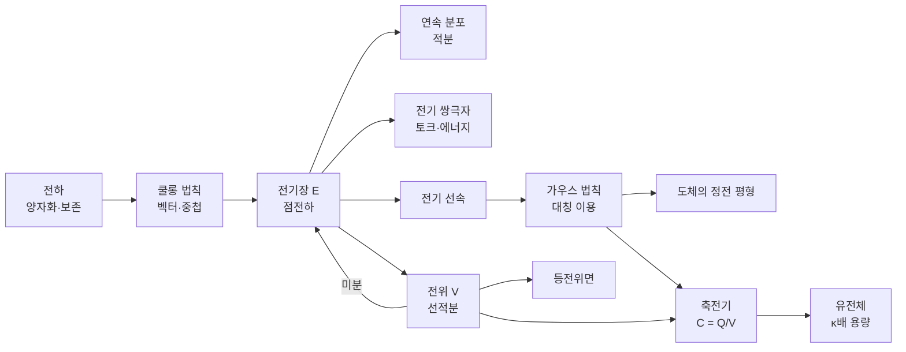

# 일반물리학 8. 전기장과 전위 — 쿨롱 법칙에서 가우스 법칙과 축전기까지
<!-- prev: emq-1, phy-2, m2-07 -->
<!-- next: uphy-9, uphy-10 -->

> [!NOTE]
> **이 단원의 범위**
> - 전하의 성질과 쿨롱 법칙(벡터 형태, 중첩)
> - 전기장: 점전하, 연속 전하 분포(막대, 고리, 원판), 전기 쌍극자
> - 전기 선속과 가우스 법칙, 대칭성을 이용한 전기장 계산
> - 도체의 정전 평형
> - 전기 퍼텐셜 에너지와 전위, 등전위면, $\vec{E}$와 $V$의 관계
> - 축전기(전기 용량, 직렬·병렬 연결, 저장 에너지)와 유전체

**학습 목표**

1. 쿨롱 법칙을 벡터로 쓰고, 중첩 원리로 여러 점전하가 만드는 힘과 전기장을 성분별로 계산할 수 있다.
2. 막대·고리·원판 같은 연속 전하 분포의 전기장을 적분으로 구하고, 전기 쌍극자가 받는 토크와 퍼텐셜 에너지를 설명할 수 있다.
3. 전기 선속을 정의하고, 가우스 법칙과 대칭성을 이용해 구·직선·평면 전하 분포의 전기장을 구할 수 있다.
4. 정전 평형 상태 도체의 성질(내부 전기장 0, 표면 전하, 표면 전기장 $\sigma/\varepsilon_0$)을 가우스 법칙으로 설명할 수 있다.
5. 전위를 전기장의 선적분으로 정의하고, 전위로부터 전기장을 미분으로 구하며, 등전위면을 해석할 수 있다.
6. 축전기의 전기 용량을 기하 구조로부터 유도하고, 연결·저장 에너지·유전체의 효과를 계산할 수 있다.

**이 단원의 학습 사다리**

| 단계 | 무엇을 하나? |
|---|---|
| STEP 1. 이전 학습 다시 보기 | 중2 「전기와 자기」, 물리학 「전기와 자기」, 전자기와 양자 「전자기적 상호작용」을 꺼내 본다 |
| STEP 2. 기초 다지기 | 단위 벡터와 성분, 미소 전하 $dq$와 적분, 대칭으로 상쇄하기, 면적 벡터와 선속, 선적분과 기울기, 이항 근사 |
| STEP 3. 핵심 개념 | 쿨롱 법칙 → 전기장 → 연속 분포 → 쌍극자 → 가우스 법칙 → 도체 → 전위 → $E$와 $V$ → 축전기 → 유전체 |
| STEP 4. 오개념 바로잡기 | "가우스 법칙은 아무 곡면에서나 전기장을 구해 준다?" 같은 착각을 바로잡는다 |
| STEP 5. 다음 단계로 | 전자기학의 미분형 가우스 법칙, 푸아송 방정식, 영상 전하법 |
| STEP 6. 생활·산업·진로 | 터치스크린, 적층 세라믹 축전기와 DRAM, 정전 집진기, 세포막 |

---

## 🗺️ 단원 들어가기

스마트폰 화면을 손가락으로 건드리면 화면은 어떻게 손가락의 위치를 알아챌까? 화면 아래에는 투명한 전극이 바둑판처럼 깔려 있고, 전극 사이에는 아주 작은 축전기가 수천 개 만들어져 있다. 손가락이 다가오면 그 근처의 전기장 모양이 바뀌고, 저장된 전하가 달라진다. 이 작은 변화를 읽어 내는 것이 정전 용량 방식 터치스크린이다.

고등학교에서는 점전하의 전기장 $E = kQ/r^2$과 전기력선 그림을 읽는 법을 배웠다. 그러나 화면 전극, 반도체 칩의 배선, 세포막처럼 실제 전하는 점이 아니라 선·면·부피에 퍼져 있다. 이 단원에서는 **적분**으로 퍼져 있는 전하의 전기장을 구하고, **가우스 법칙**으로 대칭을 이용해 계산을 극적으로 줄이며, **전위**라는 스칼라 지도로 에너지를 다룬다. 마지막으로 이 모든 것이 모이는 소자, 축전기를 설계해 본다.

---

## STEP 1. 🔙 이전 학습 다시 보기

### 연계 개념표

| 이전 단원 | 고등학교까지 배운 것 | 대학에서 이렇게 확장된다 |
|---|---|---|
| 중2 「전기와 자기」 '마찰 전기와 정전기 유도' | 전자가 옮겨 가 대전되고, 도체에서 정전기 유도가 일어난다 | 전하의 **양자화·보존**, 정전 평형 도체의 성질을 **가우스 법칙으로 증명** |
| 물리학 「전기와 자기」 '전하와 전기력', '전기장', '전위차' | 쿨롱 법칙의 크기 비례 관계, 전기장과 전위차의 정성적 의미 | 쿨롱 법칙을 **벡터**로 쓰고 성분별로 중첩 |
| 물리학 「전기와 자기」 '축전기' | 축전기가 전기장에 에너지를 저장, 센서에 활용 | $C = \varepsilon_0A/d$를 **유도**, 원통형·구형 축전기, 연결과 $U = \frac{1}{2}CV^2$의 **적분 유도** |
| 전자기와 양자 「전자기적 상호작용」 '전기장과 전위' | 점전하의 $E = kQ/r^2$, $V = kQ/r$, 등전위면 읽기, $E \approx \Delta V/d$ | 연속 분포를 **적분**, $\vec{E} = -\nabla V$를 **편미분**으로, 가우스 법칙 |
| 전자기와 양자 「전자기적 상호작용」 '정전기 유도와 유전분극' | 도체 내부 전기장 0, 유전분극으로 내부 전기장 약화 | 유전 상수 $\kappa$로 축전기 용량·에너지 변화를 **정량적으로** 계산 |

### 준비 운동 (사전 진단)

**Q1.** 두 점전하 사이의 거리를 2배로 하면 전기력의 크기는 몇 배가 되는가?

**Q2.** $4.0\ \mathrm{nC}$의 전하가 어떤 점에서 $2.0\times10^{-6}\ \mathrm{N}$의 힘을 받았다. 그 점의 전기장 세기는?

**Q3.** 전기 용량 $10\ \mu\mathrm{F}$인 축전기를 $5.0\ \mathrm{V}$로 충전하면 저장되는 전하량은?

**Q4.** $+3.0\ \mu\mathrm{C}$의 전하가 전위차 $12\ \mathrm{V}$인 두 점 사이를 높은 전위에서 낮은 전위로 이동할 때 전기력이 한 일은?

정답 및 해설

**Q1.** $\frac{1}{4}$배. 쿨롱 법칙은 거리의 제곱에 반비례한다.

**Q2.** $E = F/q = 2.0\times10^{-6}/4.0\times10^{-9} = 5.0\times10^2\ \mathrm{N/C}$

**Q3.** $Q = CV = 10\times10^{-6}\times5.0 = 5.0\times10^{-5}\ \mathrm{C} = 50\ \mu\mathrm{C}$

**Q4.** $W = q\Delta V = 3.0\times10^{-6}\times12 = 3.6\times10^{-5}\ \mathrm{J}$

---

## STEP 2. 🧱 기초 다지기

### ① 단위 벡터와 성분

전하 $q_1$에서 $q_2$를 향하는 위치 벡터를 $\vec{r}_{12} = \vec{r}_2 - \vec{r}_1$이라 하면, 크기가 1이고 방향만 나타내는 **단위 벡터**는 $\hat{r}_{12} = \vec{r}_{12}/r_{12}$이다. 힘이나 전기장을 더할 때는 반드시 성분으로 나누어 더한다.

$$
\vec{F} = \vec{F}_1 + \vec{F}_2 \;\Leftrightarrow\; F_x = F_{1x} + F_{2x},\quad F_y = F_{1y} + F_{2y}
$$

### ② 미소 전하와 적분

연속적으로 퍼진 전하는 아주 작은 조각 $dq$로 나누어 점전하처럼 다룬 뒤 더한다.

| 분포 | 전하 밀도 | 미소 전하 |
|---|---|---|
| 선(막대, 고리) | 선전하 밀도 $\lambda$ ($\mathrm{C/m}$) | $dq = \lambda\,dl$ |
| 면(판, 원판, 껍질) | 면전하 밀도 $\sigma$ ($\mathrm{C/m^2}$) | $dq = \sigma\,dA$ |
| 부피(구, 원통) | 부피 전하 밀도 $\rho$ ($\mathrm{C/m^3}$) | $dq = \rho\,dV$ |

### ③ 대칭으로 상쇄하기

적분하기 전에 **대칭**을 먼저 본다. 예를 들어 고리 모양 전하의 축 위 한 점에서, 고리의 마주 보는 두 조각이 만드는 전기장은 축에 수직인 성분끼리 정확히 상쇄된다. 그러면 축 방향 성분만 적분하면 된다. 대칭을 찾는 것이 계산의 절반이다.

### ④ 면적 벡터와 선속

작은 면 $dA$에 수직인 방향(닫힌 곡면에서는 바깥쪽)을 향하고 크기가 $dA$인 벡터를 **면적 벡터** $d\vec{A}$라 한다. 벡터장이 면을 뚫고 지나가는 양은 스칼라곱으로 나타낸다.

$$
d\Phi = \vec{E}\cdot d\vec{A} = E\,dA\cos\theta
$$

전기장이 면에 수직으로 뚫고 나가면 $\cos\theta = 1$, 면을 따라 스치면 $0$, 안으로 들어오면 음수이다. 닫힌 곡면 전체에 대해 더한 것을 $\oint \vec{E}\cdot d\vec{A}$로 쓴다.

### ⑤ 선적분과 기울기(그래디언트)

경로를 따라 $\vec{E}\cdot d\vec{s}$를 더한 것을 **선적분** $\int_a^b \vec{E}\cdot d\vec{s}$라 한다. 일 $W = \int\vec{F}\cdot d\vec{s}$와 같은 꼴이다. 반대로, 스칼라 함수 $V(x,y,z)$가 공간에서 가장 빨리 증가하는 방향과 그 비율은 **기울기(gradient)** 벡터로 나타낸다.

$$
\nabla V = \left(\frac{\partial V}{\partial x},\ \frac{\partial V}{\partial y},\ \frac{\partial V}{\partial z}\right)
$$

$\partial V/\partial x$는 $y$, $z$를 고정하고 $x$로만 미분한 **편미분**이다. 예: $V = x^2y$이면 $\partial V/\partial x = 2xy$, $\partial V/\partial y = x^2$.

### ⑥ 이항 근사

$\lvert x \rvert \ll 1$이면 $(1 + x)^n \approx 1 + nx$이다. 멀리서 본 쌍극자의 전기장처럼, 거의 같은 두 큰 값의 차이를 계산할 때 쓴다. 예: $(1 + 0.01)^{-2} \approx 0.98$ (정확한 값 $0.9803$).

> [!TIP]
> 💡 **요령** — 전기장 문제는 "① 그림과 좌표축 → ② $dq$ 하나가 만드는 $d\vec{E}$ → ③ 대칭으로 상쇄되는 성분 지우기 → ④ 남은 성분만 적분" 순서로 풀면 거의 실수하지 않는다.

---

## STEP 3. 📘 핵심 개념

### ① 전하와 쿨롱 법칙

#### 전하의 성질

| 성질 | 내용 |
|---|---|
| 두 종류 | 양(+)과 음(−). 같은 종류는 밀고 다른 종류는 당긴다 |
| **양자화(quantization)** | 관측되는 전하는 기본 전하 $e = 1.602\times10^{-19}\ \mathrm{C}$의 정수배이다($q = ne$) |
| **보존(conservation)** | 고립계의 알짜 전하는 변하지 않는다. 대전은 전하의 이동이지 생성이 아니다 |
| 도체와 절연체 | 도체에는 자유롭게 움직이는 전하(금속의 전도 전자)가 있고, 절연체에는 거의 없다 |

쿼크는 $\pm\frac{1}{3}e$, $\pm\frac{2}{3}e$의 전하를 갖지만 홀로 관측되지 않으므로 '관측되는 전하는 $e$의 정수배'라는 말은 여전히 성립한다. 전자와 양전자가 쌍소멸할 때도 $(-e) + (+e) = 0$으로 전하는 보존된다.

#### 쿨롱 법칙의 벡터 형태

점전하 $q_1$이 $q_2$에 작용하는 힘은

$$
\vec{F}_{12} = k\frac{q_1q_2}{r_{12}^2}\,\hat{r}_{12}, \qquad k = \frac{1}{4\pi\varepsilon_0} = 8.99\times10^9\ \mathrm{N\cdot m^2/C^2}
$$

$\varepsilon_0 = 8.854\times10^{-12}\ \mathrm{C^2/(N\cdot m^2)}$은 **진공의 유전율(permittivity of free space)** 이다. $q_1q_2 > 0$이면 힘이 $\hat{r}_{12}$ 방향(척력), $q_1q_2 < 0$이면 반대 방향(인력)으로 부호가 방향까지 알아서 정해 준다. 여러 전하가 있으면 각 쌍의 힘을 벡터로 더한다(**중첩 원리**). 쿨롱 법칙의 역제곱 꼴은 지수가 2에서 벗어나는 정도가 매우 작다는(정밀 실험에서 약 $10^{-16}$ 이하) 사실로 확인되어 있다.

#### 예제 1 — 전기력은 중력보다 얼마나 센가

두 양성자 사이의 전기력과 만유인력의 비를 구하시오. ($m_p = 1.673\times10^{-27}\ \mathrm{kg}$, $G = 6.674\times10^{-11}\ \mathrm{N\cdot m^2/kg^2}$)

**풀이**
- 식 세우기: 둘 다 역제곱 법칙이므로 거리가 약분된다. $\dfrac{F_e}{F_g} = \dfrac{ke^2}{Gm_p^2}$
- 대입: $\dfrac{8.99\times10^9\times(1.602\times10^{-19})^2}{6.674\times10^{-11}\times(1.673\times10^{-27})^2} \approx 1.24\times10^{36}$
- 의미: 원자·분자·물질의 구조는 전기력이 정한다. 그런데도 천체 규모에서 중력이 지배하는 것은 물질이 거의 정확히 중성이어서 전기력이 상쇄되기 때문이다.

#### 예제 2 — 세 전하의 합력

원점에 $q_1 = +2.0\ \mu\mathrm{C}$, $(0.30\ \mathrm{m},\ 0)$에 $q_2 = -3.0\ \mu\mathrm{C}$, $(0,\ 0.40\ \mathrm{m})$에 $q_3 = +4.0\ \mu\mathrm{C}$이 있다. $q_1$이 받는 알짜 힘은?

**풀이**
- $q_2$에 의한 힘: 인력이므로 $+x$ 방향, $F = \dfrac{8.99\times10^9\times2.0\times10^{-6}\times3.0\times10^{-6}}{0.30^2} \approx 0.599\ \mathrm{N}$
- $q_3$에 의한 힘: 척력이므로 $-y$ 방향, $F = \dfrac{8.99\times10^9\times2.0\times10^{-6}\times4.0\times10^{-6}}{0.40^2} \approx 0.450\ \mathrm{N}$
- 합력: $\vec{F} = (0.599,\ -0.450)\ \mathrm{N}$, 크기 $\sqrt{0.599^2 + 0.450^2} \approx 0.749\ \mathrm{N}$, $+x$축에서 아래로 $\tan^{-1}(0.450/0.599) \approx 36.9^\circ$

<!-- fig:uphy-8-coulomb-vectors -->

### ② 전기장 — 점전하와 중첩

#### 정의

공간의 한 점에 아주 작은 양의 시험 전하 $q_0$를 놓았을 때 받는 힘을 $q_0$로 나눈 것이 그 점의 **전기장(electric field)** 이다.

$$
\vec{E} = \frac{\vec{F}}{q_0}, \qquad \vec{E}_{\text{점전하}} = k\frac{q}{r^2}\hat{r}
$$

($\hat{r}$는 전하에서 그 점을 향하는 단위 벡터) 시험 전하가 '아주 작아야' 하는 이유는, 시험 전하 자신이 원래 전하 분포(특히 도체의 전하)를 흐트러뜨리지 않아야 하기 때문이다. 전기장을 알면 그 점에 놓인 어떤 전하 $q$가 받는 힘도 $\vec{F} = q\vec{E}$로 바로 구한다.

#### 예제 3 — 두 전하가 만드는 전기장

$(-0.040\ \mathrm{m},\ 0)$에 $+5.0\ \mathrm{nC}$, $(+0.040\ \mathrm{m},\ 0)$에 $-5.0\ \mathrm{nC}$이 있다. 점 P$(0,\ 0.030\ \mathrm{m})$의 전기장을 구하시오.

**풀이**
- 거리: 두 전하 모두 P까지 $\sqrt{0.040^2 + 0.030^2} = 0.050\ \mathrm{m}$, 각 전기장 크기 $E_1 = E_2 = \dfrac{8.99\times10^9\times5.0\times10^{-9}}{0.050^2} \approx 1.80\times10^4\ \mathrm{N/C}$
- 방향: (+)전하의 전기장은 P에서 바깥쪽 $(0.8,\ 0.6)$, (−)전하의 전기장은 P에서 그 전하 쪽 $(0.8,\ -0.6)$
- 합: $y$성분은 상쇄, $E_x = 2\times0.8\times1.80\times10^4 \approx 2.88\times10^4\ \mathrm{N/C}$ ($+x$ 방향)
- 의미: 쌍극자의 수직이등분선 위에서 전기장은 (+)에서 (−)로 향하는 축과 나란하다(방향은 (+) 쪽에서 (−) 쪽으로).

<!-- fig:uphy-8-field-superposition -->

#### 균일한 전기장 속의 하전 입자

전기장이 균일하면 하전 입자는 일정한 가속도 $\vec{a} = q\vec{E}/m$를 받으므로 「일반물리학 1」의 포물선 운동과 똑같이 다룰 수 있다.

#### 예제 4 — 전자의 편향

속력 $3.0\times10^7\ \mathrm{m/s}$로 수평하게 날아가는 전자가 길이 $4.0\ \mathrm{cm}$인 두 평행판 사이(위쪽으로 향하는 균일한 전기장 $1.0\times10^4\ \mathrm{N/C}$)를 지난다. 판을 벗어날 때 연직 방향으로 휜 거리와 각도는? ($m_e = 9.109\times10^{-31}\ \mathrm{kg}$)

**풀이**
- 가속도: 전자는 (−)이므로 아래쪽, $a = eE/m_e = \dfrac{1.602\times10^{-19}\times1.0\times10^4}{9.109\times10^{-31}} \approx 1.76\times10^{15}\ \mathrm{m/s^2}$
- 시간: $t = L/v_0 = 0.040/3.0\times10^7 \approx 1.33\times10^{-9}\ \mathrm{s}$
- 휜 거리: $y = \frac{1}{2}at^2 \approx 1.6\times10^{-3}\ \mathrm{m}$ (1.6 mm)
- 각도: $v_y = at \approx 2.3\times10^6\ \mathrm{m/s}$, $\tan\theta = v_y/v_0 \approx 0.078$, $\theta \approx 4.5^\circ$
- 의미: 전자의 가속도는 중력 가속도의 약 $10^{14}$배이므로 중력은 무시해도 된다. 잉크젯 프린터의 대전된 잉크 방울, 질량 분석기의 이온도 같은 원리로 휜다.

### ③ 연속 전하 분포의 전기장

#### 기본 식

$$
\vec{E} = \int d\vec{E} = \int k\frac{dq}{r^2}\hat{r}
$$

#### (가) 막대의 연장선 위

길이 $L$, 전하 $Q$가 고르게 분포한 막대($\lambda = Q/L$)가 $x = 0$에서 $x = L$까지 놓여 있고, 점 P가 $x = -d$에 있다. $x$에 있는 조각 $dq = \lambda\,dx$까지의 거리는 $x + d$이고, 모든 조각의 전기장이 $-x$ 방향으로 같으므로

$$
E = \int_0^L\frac{k\lambda\,dx}{(x + d)^2} = k\lambda\left[\frac{1}{d} - \frac{1}{d + L}\right] = \frac{kQ}{d(d + L)}
$$

$d \gg L$이면 $E \approx kQ/d^2$로 점전하와 같아진다.

#### (나) 고리의 축 위

반지름 $R$, 전하 $Q$인 고리의 축 위, 중심에서 $z$만큼 떨어진 점을 생각한다. 각 조각까지의 거리는 $\sqrt{z^2 + R^2}$로 모두 같고, 축에 수직인 성분은 대칭으로 상쇄된다. 축 성분은 $\cos\theta = z/\sqrt{z^2 + R^2}$를 곱한 것이므로

$$
E_z = \int\frac{k\,dq}{z^2 + R^2}\cdot\frac{z}{\sqrt{z^2 + R^2}} = \frac{kQz}{(z^2 + R^2)^{3/2}}
$$

- 중심($z = 0$)에서 $E = 0$: 모든 방향의 기여가 상쇄된다.
- $z \gg R$에서 $E \approx kQ/z^2$: 멀리서는 점전하로 보인다.
- 그 사이 $dE_z/dz = 0$인 $z = R/\sqrt{2}$에서 최대이다.

<!-- fig:uphy-8-continuous-charge -->

#### (다) 원판의 축 위와 무한 평면

면전하 밀도 $\sigma$, 반지름 $R$인 원판을 반지름 $r$, 폭 $dr$인 고리들($dq = \sigma\cdot2\pi r\,dr$)로 나누어 (나)의 결과를 적분하면

$$
E_z = \int_0^R\frac{kz\,\sigma2\pi r\,dr}{(z^2 + r^2)^{3/2}} = \frac{\sigma}{2\varepsilon_0}\left(1 - \frac{z}{\sqrt{z^2 + R^2}}\right)
$$

$R \to \infty$(또는 $z \ll R$)이면 $E = \dfrac{\sigma}{2\varepsilon_0}$로 **거리와 무관한 균일한 전기장**이 된다. 큰 판 가까이에서 전기장이 균일한 이유이다.

| 분포 | 가까이서 | 멀리서 |
|---|---|---|
| 고리(축 위) | 중심에서 $0$ | $kQ/z^2$ |
| 원판(축 위) | $\sigma/2\varepsilon_0$ (일정) | $kQ/z^2$ |
| 막대(연장선) | $kQ/[d(d + L)]$ | $kQ/d^2$ |

#### 예제 5 — 고리 전하

반지름 $0.10\ \mathrm{m}$인 고리에 $20\ \mathrm{nC}$이 고르게 분포한다. 축 위 (1) $z = 0.10\ \mathrm{m}$, (2) 전기장이 최대인 곳, (3) $z = 1.0\ \mathrm{m}$에서 전기장을 구하시오.

**풀이**
(1) $E = \dfrac{8.99\times10^9\times2.0\times10^{-8}\times0.10}{(0.020)^{3/2}} \approx 6.36\times10^3\ \mathrm{N/C}$
(2) $z = R/\sqrt{2} \approx 0.071\ \mathrm{m}$에서 $E \approx 6.92\times10^3\ \mathrm{N/C}$
(3) $E \approx 1.77\times10^2\ \mathrm{N/C}$. 점전하 근사 $kQ/z^2 = 1.80\times10^2\ \mathrm{N/C}$와 약 1.5 % 차이로, 반지름의 10배 거리에서는 점전하로 보아도 된다.

### ④ 전기 쌍극자

#### 쌍극자 모멘트와 먼 곳의 전기장

크기가 같고 부호가 반대인 두 전하 $\pm q$가 거리 $d$만큼 떨어진 것을 **전기 쌍극자(electric dipole)** 라 한다. (−)에서 (+)를 향하고 크기가 $p = qd$인 벡터를 **전기 쌍극자 모멘트(electric dipole moment)** $\vec{p}$라 한다.

쌍극자 축 위, 중심에서 $z$($z \gg d$)인 점의 전기장은

$$
E = \frac{kq}{(z - d/2)^2} - \frac{kq}{(z + d/2)^2} = \frac{kq}{z^2}\left[\left(1 - \frac{d}{2z}\right)^{-2} - \left(1 + \frac{d}{2z}\right)^{-2}\right] \approx \frac{kq}{z^2}\cdot\frac{2d}{z} = \frac{2kp}{z^3}
$$

(STEP 2의 이항 근사) 쌍극자의 전기장은 **거리의 세제곱**에 반비례해 점전하보다 빨리 줄어든다. 멀리서 보면 $+q$와 $-q$가 거의 겹쳐 보여 서로 상쇄되기 때문이다. 수직이등분선 위에서는 $E \approx kp/z^3$이다.

#### 균일한 전기장 속의 쌍극자

균일한 전기장에서 두 전하가 받는 힘은 크기가 같고 방향이 반대이므로 알짜 힘은 0이지만, 작용선이 달라 **토크**가 생긴다.

$$
\vec{\tau} = \vec{p}\times\vec{E}, \qquad \tau = pE\sin\theta
$$

쌍극자를 각 $\theta$($\vec{p}$와 $\vec{E}$ 사이)로 돌리는 데 드는 일로부터 퍼텐셜 에너지를 정의하면($\theta = 90^\circ$에서 0으로 기준)

$$
U = -\vec{p}\cdot\vec{E} = -pE\cos\theta
$$

$\vec{p}$가 $\vec{E}$와 나란할 때($\theta = 0$) $U = -pE$로 가장 낮고 안정하다. 불균일한 전기장에서는 알짜 힘도 생겨, 쌍극자가 전기장이 센 쪽으로 끌려간다. 대전체가 종잇조각처럼 중성인 물체를 끌어당기는 이유이다(유도된 쌍극자).

<!-- fig:uphy-8-dipole-torque -->

#### 예제 6 — 물 분자와 열운동

물 분자의 쌍극자 모멘트는 약 $6.2\times10^{-30}\ \mathrm{C\cdot m}$이다. 세기 $2.0\times10^5\ \mathrm{N/C}$의 전기장 속에서 (1) 최대 토크, (2) 나란한 상태에서 반대 상태로 뒤집는 데 드는 일을 구하고, (3) $300\ \mathrm{K}$의 열에너지 규모 $kT$와 비교하시오.

**풀이**
(1) $\tau_{\max} = pE = 6.2\times10^{-30}\times2.0\times10^5 = 1.24\times10^{-24}\ \mathrm{N\cdot m}$
(2) $W = U(180^\circ) - U(0^\circ) = 2pE \approx 2.5\times10^{-24}\ \mathrm{J}$
(3) $kT = 1.381\times10^{-23}\times300 \approx 4.1\times10^{-21}\ \mathrm{J}$로, $pE$의 약 3000배이다. 상온에서는 열운동이 압도적이라 물 분자는 이 정도 전기장에서 아주 조금만 정렬한다. 그래서 유전분극의 세기는 온도에 따라 달라진다.

### ⑤ 전기 선속과 가우스 법칙

#### 전기 선속

어떤 면을 지나는 **전기 선속(electric flux)** 은

$$
\Phi_E = \int\vec{E}\cdot d\vec{A}
$$

전기력선 그림에서 선속은 면을 뚫고 지나가는 전기력선의 수에 비례한다. 닫힌 곡면에서는 나가는 선속을 (+), 들어오는 선속을 (−)로 센다.

#### 가우스 법칙

점전하 $q$를 중심으로 반지름 $r$인 구면을 생각하면, 구면 위 모든 점에서 $\vec{E}$가 바깥쪽 수직이고 크기가 $kq/r^2$이므로

$$
\oint\vec{E}\cdot d\vec{A} = \frac{kq}{r^2}\cdot4\pi r^2 = 4\pi kq = \frac{q}{\varepsilon_0}
$$

$r$이 약분되어 **반지름과 무관**하다. 역제곱 법칙 덕분에 넓이 증가($r^2$)와 세기 감소($1/r^2$)가 정확히 상쇄되기 때문이다. 곡면을 찌그러뜨려도 전기력선 수는 변하지 않으며, 곡면 바깥의 전하가 만드는 전기력선은 들어왔다 나가므로 기여가 0이다. 중첩 원리를 쓰면 일반적으로 다음이 성립한다.

> [!IMPORTANT]
> **가우스 법칙(Gauss's law)** — 임의의 닫힌 곡면(가우스 곡면)을 지나는 알짜 전기 선속은 그 안에 들어 있는 알짜 전하를 $\varepsilon_0$로 나눈 것과 같다.
>
> $$
> \oint\vec{E}\cdot d\vec{A} = \frac{q_{\text{안}}}{\varepsilon_0}
> $$

가우스 법칙은 **언제나** 성립하지만, 그것으로 전기장을 **구할 수 있는** 것은 대칭성이 높아 곡면 위에서 $E$가 일정하고 $\vec{E}$와 $d\vec{A}$의 각이 일정한 경우뿐이다.

<!-- sim:u-gauss-law -->

#### 대칭을 이용한 계산

| 대칭 | 가우스 곡면 | 결과 |
|---|---|---|
| 구 대칭(점전하, 구 껍질, 균일한 구) | 같은 중심의 구면 | 바깥: $E = kQ/r^2$. 균일한 구의 내부: $E = kQr/R^3$. 껍질 내부: $E = 0$ |
| 원통 대칭(무한 직선, 원통) | 같은 축의 원통(옆면만 선속) | $E = \dfrac{\lambda}{2\pi\varepsilon_0 r} = \dfrac{2k\lambda}{r}$ |
| 평면 대칭(무한 평면) | 평면을 관통하는 원통(양 밑면만 선속) | $E = \dfrac{\sigma}{2\varepsilon_0}$ |

**균일하게 대전된 절연체 구의 내부 유도** 반지름 $R$, 전하 $Q$가 고르게 분포한 구 안에서 반지름 $r$인 가우스 구면이 품은 전하는 $Q(r/R)^3$이다. 따라서 $E\cdot4\pi r^2 = Q r^3/(\varepsilon_0R^3)$에서 $E = kQr/R^3$, 중심에서 거리에 비례해 커지다가 표면에서 $kQ/R^2$이 되고 바깥에서는 $1/r^2$로 줄어든다.

**무한 직선 유도** 길이 $h$, 반지름 $r$인 원통에서 밑면은 $\vec{E}$와 나란해 선속이 0이고, 옆면에서 $E\cdot2\pi rh = \lambda h/\varepsilon_0$이므로 $E = \lambda/(2\pi\varepsilon_0r)$이다. ③에서 적분으로 원판을 무한히 키워 얻은 $\sigma/2\varepsilon_0$도 원통 하나로 단번에 나온다.

<!-- fig:uphy-8-gauss-surfaces -->

#### 예제 7 — 가우스 법칙의 직접 적용

(1) 정육면체의 중심에 $3.0\ \mathrm{nC}$이 있다. 전체 면과 한 면을 지나는 선속은? (2) 반지름 $5.0\ \mathrm{cm}$인 절연체 구에 $8.0\ \mathrm{nC}$이 고르게 분포한다. 중심에서 $2.0\ \mathrm{cm}$, $5.0\ \mathrm{cm}$, $10\ \mathrm{cm}$인 곳의 전기장은? (3) 선전하 밀도 $2.0\ \mu\mathrm{C/m}$인 긴 직선에서 $5.0\ \mathrm{cm}$인 곳의 전기장은?

**풀이**
(1) $\Phi = q/\varepsilon_0 = 3.0\times10^{-9}/8.854\times10^{-12} \approx 339\ \mathrm{N\cdot m^2/C}$. 대칭으로 한 면은 $\frac{1}{6}$인 약 $56.5\ \mathrm{N\cdot m^2/C}$
(2) 내부: $E = kQr/R^3 = \dfrac{8.99\times10^9\times8.0\times10^{-9}\times0.020}{0.050^3} \approx 1.15\times10^4\ \mathrm{N/C}$. 표면: $kQ/R^2 \approx 2.88\times10^4\ \mathrm{N/C}$. 바깥: $kQ/r^2 \approx 7.19\times10^3\ \mathrm{N/C}$
(3) $E = 2k\lambda/r = 2\times8.99\times10^9\times2.0\times10^{-6}/0.050 \approx 7.2\times10^5\ \mathrm{N/C}$

> [!TIP]
> 💡 **비유** — 가우스 법칙은 '분수대를 둘러싼 울타리'이다. 울타리를 어떤 모양으로 치든, 울타리를 넘어 나가는 물의 양은 안에 있는 분수(전하)가 내뿜는 양으로 정해진다. 울타리 밖의 분수에서 날아온 물은 들어왔다 나가므로 셈에서 빠진다.

### ⑥ 도체의 정전 평형

#### 네 가지 성질과 그 근거

도체에서 전하의 이동이 멈춘 상태를 **정전 평형(electrostatic equilibrium)** 이라 한다. 금속은 외부 조건이 바뀌어도 눈 깜짝할 새보다 훨씬 짧은 시간에 이 상태에 다시 이른다.

| 성질 | 근거 |
|---|---|
| 1. 도체 내부의 전기장은 0이다 | 0이 아니면 자유 전자가 힘을 받아 움직이므로 평형이 아니다 |
| 2. 알짜 전하는 모두 표면에 있다 | 내부에 가우스 곡면을 잡으면 $E = 0$이므로 $q_{\text{안}} = 0$ |
| 3. 표면 바로 바깥의 전기장은 표면에 수직이고 $E = \sigma/\varepsilon_0$이다 | 접선 성분이 있으면 표면 전하가 움직인다. 표면을 관통하는 작은 원통(안쪽 밑면은 $E = 0$)에 가우스 법칙: $EA = \sigma A/\varepsilon_0$ |
| 4. 도체 전체가 하나의 등전위체이다 | 내부 $E = 0$이므로 어느 두 점 사이에도 $\Delta V = -\int\vec{E}\cdot d\vec{s} = 0$ |

무한 평면 전하($\sigma/2\varepsilon_0$)와 도체 표면($\sigma/\varepsilon_0$)이 2배 차이 나는 이유는, 도체 표면 전하가 만드는 전기장이 안쪽에서는 도체의 다른 전하들과 상쇄되고 바깥쪽에서는 보강되기 때문이다.

#### 빈 공간이 있는 도체와 차폐

도체 속 빈 공간(공동)에 전하가 없으면 공동 안의 전기장도 0이다. 바깥 전기장이 아무리 변해도 안은 영향을 받지 않는다(**정전 차폐**). 공동 안에 전하 $+q$를 넣으면 공동 벽에 $-q$가, 바깥 표면에 $+q$가 유도된다(도체가 중성이었다면). 도체 속에 공동 벽을 감싸는 가우스 곡면을 잡으면 $E = 0$이므로 그 안의 알짜 전하가 0이어야 하기 때문이다.

<!-- fig:uphy-8-conductor-cavity -->

#### 뾰족한 곳에 전하가 몰린다

반지름 $R_1$, $R_2$인 두 도체 구를 가는 도선으로 이으면 전위가 같아진다($kQ_1/R_1 = kQ_2/R_2$). 따라서 $Q_1/Q_2 = R_1/R_2$이고, 면전하 밀도는

$$
\frac{\sigma_1}{\sigma_2} = \frac{Q_1/R_1^2}{Q_2/R_2^2} = \frac{R_2}{R_1}
$$

곡률 반지름이 작은(뾰족한) 곳일수록 면전하 밀도와 표면 전기장이 크다. 공기는 약 $3\times10^6\ \mathrm{V/m}$에서 절연이 깨지므로(**절연 파괴**), 뾰족한 끝에서는 주변 공기가 이온화되어 전하가 새어 나간다(코로나 방전). 피뢰침, 정전기 제거 바늘이 이 원리를 이용한다.

#### 예제 8 — 도체 구가 견딜 수 있는 전하

반지름 $0.10\ \mathrm{m}$인 도체 구를 공기 중에서 대전시킨다. 표면 전기장이 $3.0\times10^6\ \mathrm{V/m}$를 넘으면 방전된다고 할 때 (1) 최대 면전하 밀도, (2) 최대 전하량, (3) 최대 전위를 구하시오.

**풀이**
(1) $\sigma = \varepsilon_0E = 8.854\times10^{-12}\times3.0\times10^6 \approx 2.66\times10^{-5}\ \mathrm{C/m^2}$
(2) $Q = 4\pi R^2\sigma \approx 3.3\times10^{-6}\ \mathrm{C}$
(3) $V = kQ/R = ER = 3.0\times10^5\ \mathrm{V}$
- 의미: 구를 크게 할수록 높은 전위를 유지할 수 있다. 정전 발전기(반데그래프 발전기)의 둥근 큰 머리, 고압 설비의 둥근 단자가 이 때문이다.

### ⑦ 전기 퍼텐셜 에너지와 전위

#### 전기력은 보존력이다

점전하 $q$가 만드는 전기장 속에서 시험 전하 $q_0$를 옮길 때 전기력이 하는 일은, 반지름 방향 성분만 기여하므로

$$
W = \int_{r_a}^{r_b}\frac{kqq_0}{r^2}\,dr = kqq_0\left(\frac{1}{r_a} - \frac{1}{r_b}\right)
$$

로 처음과 끝의 거리만으로 정해진다(경로 무관). 따라서 「일반물리학 3」처럼 퍼텐셜 에너지를 정의할 수 있다. $W = -\Delta U$이고 무한히 먼 곳을 $U = 0$으로 두면

$$
U(r) = k\frac{qq_0}{r}
$$

같은 부호면 $U > 0$(가까워질수록 커짐), 다른 부호면 $U < 0$이다. 여러 전하로 이루어진 계의 퍼텐셜 에너지는 **모든 쌍**에 대해 더한다: $U = \sum_{\text{쌍}} kq_iq_j/r_{ij}$. 이 값은 전하들을 무한히 먼 곳에서 하나씩 가져와 배치하는 데 외부가 해야 하는 일과 같다.

#### 전위와 전위차

단위 양전하당 퍼텐셜 에너지를 **전위(전기 퍼텐셜, electric potential)** 라 한다.

$$
V = \frac{U}{q_0}, \qquad \Delta V = V_b - V_a = -\int_a^b\vec{E}\cdot d\vec{s}
$$

단위는 $\mathrm{V} = \mathrm{J/C}$이고, 그래서 전기장의 단위 $\mathrm{N/C}$는 $\mathrm{V/m}$와 같다. 전위는 스칼라이므로 여러 전하의 전위는 **부호를 포함해 그냥 더한다.**

| 분포 | 전위 $V$ (무한원 기준) |
|---|---|
| 점전하 | $kq/r$ |
| 여러 점전하 | $\sum kq_i/r_i$ |
| 연속 분포 | $\int k\,dq/r$ |
| 고리의 축 위 | $kQ/\sqrt{z^2 + R^2}$ |
| 균일한 전기장 $E$를 따라 $d$만큼 | $\Delta V = -Ed$ |
| 반지름 $R$인 도체 구(전하 $Q$) | 바깥 $kQ/r$, 표면과 내부 모두 $kQ/R$ |

**전자볼트** 원자·입자 물리에서는 에너지 단위로 **전자볼트(electron volt)** 를 쓴다. 기본 전하가 전위차 $1\ \mathrm{V}$를 지날 때 얻는 에너지로 $1\ \mathrm{eV} = 1.602\times10^{-19}\ \mathrm{J}$이다.

#### 예제 9 — 전위차로 가속하기

정지한 양성자와 전자를 각각 전위차 $2.0\ \mathrm{kV}$로 가속했다. 각각의 나중 속력은? ($m_p = 1.673\times10^{-27}\ \mathrm{kg}$, $m_e = 9.109\times10^{-31}\ \mathrm{kg}$)

**풀이**
- 식 세우기: 에너지 보존 $\frac{1}{2}mv^2 = e\lvert\Delta V\rvert$
- 운동 에너지: 둘 다 $2.0\ \mathrm{keV} = 3.20\times10^{-16}\ \mathrm{J}$로 같다.
- 양성자: $v = \sqrt{2\times3.20\times10^{-16}/1.673\times10^{-27}} \approx 6.2\times10^5\ \mathrm{m/s}$
- 전자: $v \approx 2.65\times10^7\ \mathrm{m/s}$ (빛의 속력의 약 9 %로 아직 비상대론적 근사가 쓸 만하다)

#### 예제 10 — 전하를 모아 놓는 데 드는 일

한 변이 $0.10\ \mathrm{m}$인 정삼각형의 꼭짓점에 (1) $+1.0\ \mu\mathrm{C}$ 세 개, (2) $+2.0$, $+2.0$, $-1.0\ \mu\mathrm{C}$을 배치하는 데 외부가 해야 하는 일은?

**풀이**
(1) 쌍이 3개이고 모두 같으므로 $U = 3\times\dfrac{8.99\times10^9\times(1.0\times10^{-6})^2}{0.10} \approx 0.27\ \mathrm{J}$
(2) $U = \dfrac{k}{a}\left[(2.0)(2.0) + (2.0)(-1.0) + (2.0)(-1.0)\right]\times10^{-12} = 0$
- 의미: (2)에서는 두 (+)전하를 가까이 모으는 데 든 일을 (−)전하가 들어오며 돌려준다. 계의 퍼텐셜 에너지가 0이라고 전하들이 힘을 받지 않는 것은 아니다.

### ⑧ 등전위면과 $\vec{E}$와 $V$의 관계

#### 등전위면

전위가 같은 점들을 이은 면을 **등전위면(equipotential surface)** 이라 한다. 등전위면 위에서 전하를 옮기면 $\Delta V = 0$이므로 전기력이 일을 하지 않는다. 그러려면 $\vec{E}\cdot d\vec{s} = 0$, 즉 **전기장은 등전위면에 수직**이어야 한다. 정전 평형 도체의 표면은 등전위면이다.

| 전하 분포 | 등전위면 |
|---|---|
| 점전하, 구 | 같은 중심의 구면 |
| 무한 직선 | 같은 축의 원통면 |
| 균일한 전기장(평행판 사이) | 판과 나란한 평면, 같은 전위 간격이면 같은 거리 간격 |
| 쌍극자 | 수직이등분면이 $V = 0$, (+)와 (−) 근처에 각각 닫힌 곡면 |

#### 전위로부터 전기장 구하기

$dV = -\vec{E}\cdot d\vec{s}$이므로, $x$ 방향으로 $dx$만큼 움직이면 $dV = -E_x\,dx$이다. 세 방향 모두 쓰면

$$
E_x = -\frac{\partial V}{\partial x},\quad E_y = -\frac{\partial V}{\partial y},\quad E_z = -\frac{\partial V}{\partial z} \qquad\Longleftrightarrow\qquad \vec{E} = -\nabla V
$$

전기장은 **전위가 가장 빨리 감소하는 방향**을 가리키고, 그 크기는 그 방향의 전위 기울기이다. 스칼라 하나($V$)만 적분하고 나중에 미분하는 쪽이 벡터 세 성분을 따로 적분하는 것보다 쉬운 경우가 많다.

**검산: 고리의 축 위** $V(z) = kQ(z^2 + R^2)^{-1/2}$를 미분하면

$$
E_z = -\frac{dV}{dz} = kQ\cdot\frac{1}{2}(z^2 + R^2)^{-3/2}\cdot2z = \frac{kQz}{(z^2 + R^2)^{3/2}}
$$

③에서 벡터 적분으로 얻은 결과와 같다.

<!-- sim:u-potential-landscape -->

#### 예제 11 — 전위 함수에서 전기장 구하기

어떤 영역의 전위가 $V(x, y) = 3x^2y - y^3$ (V, $x$와 $y$는 m)이다. 점 $(1.0,\ 2.0)\ \mathrm{m}$의 전기장을 구하시오.

**풀이**
- 편미분: $\dfrac{\partial V}{\partial x} = 6xy$, $\dfrac{\partial V}{\partial y} = 3x^2 - 3y^2$
- 대입: $E_x = -6(1.0)(2.0) = -12\ \mathrm{V/m}$, $E_y = -(3 - 12) = +9.0\ \mathrm{V/m}$
- 결과: $\vec{E} = (-12,\ 9.0)\ \mathrm{V/m}$, 크기 $15\ \mathrm{V/m}$

> [!TIP]
> 💡 **비유** — 전위는 '지형도의 높이', 등전위면은 '등고선', 전기장은 '공이 굴러가는 가장 가파른 내리막'이다. $\vec{E} = -\nabla V$의 − 부호는 "공은 오르막이 아니라 내리막으로 구른다"는 뜻이다.

### ⑨ 축전기 — 전기 용량, 연결, 저장 에너지

#### 전기 용량의 정의

절연된 두 도체에 $+Q$와 $-Q$를 주면 둘 사이에 전위차 $V$가 생기고, $Q$는 $V$에 비례한다. 그 비례 상수가 **전기 용량(capacitance)** 이다.

$$
C = \frac{Q}{V} \qquad (\text{단위: } \mathrm{F} = \mathrm{C/V})
$$

$C$는 도체의 **모양과 배치, 사이의 물질**로만 정해진다. 구하는 방법은 언제나 같다: ① $\pm Q$를 가정 → ② 가우스 법칙으로 $E$ → ③ 선적분으로 $V$ → ④ $C = Q/V$.

#### 세 가지 기본 축전기

**평행판** 넓이 $A$, 간격 $d$. 판 사이 $E = \sigma/\varepsilon_0 = Q/(\varepsilon_0A)$(도체 표면), $V = Ed$이므로

$$
C = \frac{\varepsilon_0A}{d}
$$

**원통형(동축)** 안쪽 반지름 $a$, 바깥 반지름 $b$, 길이 $L$. 사이에서 $E = Q/(2\pi\varepsilon_0Lr)$, $V = \int_a^b E\,dr = \dfrac{Q}{2\pi\varepsilon_0L}\ln\dfrac{b}{a}$이므로

$$
C = \frac{2\pi\varepsilon_0L}{\ln(b/a)}
$$

**구형** 안쪽 반지름 $a$, 바깥 반지름 $b$. $V = kQ\left(\dfrac{1}{a} - \dfrac{1}{b}\right)$이므로 $C = 4\pi\varepsilon_0\dfrac{ab}{b - a}$. $b \to \infty$이면 **고립된 도체 구** $C = 4\pi\varepsilon_0R$이다. 지구($R \approx 6.37\times10^6\ \mathrm{m}$)도 약 $7\times10^{-4}\ \mathrm{F}$에 불과하다. 패럿은 매우 큰 단위여서 실제 소자는 pF~mF 범위가 대부분이다.

#### 직렬과 병렬

| 연결 | 같은 것 | 합성 용량 | 이유 |
|---|---|---|---|
| 병렬 | 전압 $V$ | $C = C_1 + C_2 + \cdots$ | 전하가 더해진다: $Q = (C_1 + C_2)V$ |
| 직렬 | 전하 $Q$ | $\dfrac{1}{C} = \dfrac{1}{C_1} + \dfrac{1}{C_2} + \cdots$ | 전압이 더해진다: $V = Q/C_1 + Q/C_2$ |

직렬로 연결된 축전기는 판 사이의 도선 부분이 고립되어 있어(처음에 중성) 각 축전기에 크기가 같은 $\pm Q$가 유도된다. 저항의 연결 규칙과 **반대**라는 점에 주의한다(「일반물리학 9」).

#### 저장 에너지와 에너지 밀도

전하가 $q$인 상태에서 $dq$를 더 옮기는 데 드는 일은 $dW = V\,dq = (q/C)\,dq$이다. 0에서 $Q$까지 적분하면

$$
U = \int_0^Q\frac{q}{C}\,dq = \frac{Q^2}{2C} = \frac{1}{2}CV^2 = \frac{1}{2}QV
$$

$QV$가 아니라 $\frac{1}{2}QV$인 이유는 충전하는 동안 전압이 0에서 $V$까지 점점 커지기 때문이다($q$–$V$ 그래프의 삼각형 넓이). 평행판에 $C = \varepsilon_0A/d$, $V = Ed$를 넣고 부피 $Ad$로 나누면

$$
u = \frac{U}{Ad} = \frac{1}{2}\varepsilon_0E^2
$$

이 **에너지 밀도** 식은 평행판뿐 아니라 어떤 전기장에서도 성립한다. 에너지는 전하에 붙어 있는 것이 아니라 **전기장이 있는 공간에 저장**된다고 볼 수 있다. 이 관점이 「일반물리학 10」의 전자기파 에너지로 이어진다.

#### 예제 12 — 평행판 축전기 설계

$10\ \mathrm{cm}\times20\ \mathrm{cm}$ 금속판 두 장을 $1.0\ \mathrm{mm}$ 간격으로 마주 놓고 $12\ \mathrm{V}$로 충전했다. (1) 전기 용량, (2) 전하량, (3) 판 사이 전기장, (4) 저장 에너지를 구하고, (5) 에너지 밀도로 (4)를 검산하시오.

**풀이**
(1) $C = \dfrac{8.854\times10^{-12}\times0.020}{1.0\times10^{-3}} \approx 1.77\times10^{-10}\ \mathrm{F} = 177\ \mathrm{pF}$
(2) $Q = CV \approx 2.1\times10^{-9}\ \mathrm{C}$
(3) $E = V/d = 1.2\times10^4\ \mathrm{V/m}$
(4) $U = \frac{1}{2}CV^2 \approx 1.27\times10^{-8}\ \mathrm{J}$
(5) $u = \frac{1}{2}\varepsilon_0E^2 \approx 6.4\times10^{-4}\ \mathrm{J/m^3}$, 부피 $2.0\times10^{-5}\ \mathrm{m^3}$를 곱하면 $1.27\times10^{-8}\ \mathrm{J}$로 일치한다.

#### 예제 13 — 축전기 회로망

$C_1 = 2.0\ \mu\mathrm{F}$와 $C_2 = 3.0\ \mu\mathrm{F}$를 직렬로 잇고, 이 묶음과 $C_3 = 4.0\ \mu\mathrm{F}$를 병렬로 연결하여 $12\ \mathrm{V}$ 전지에 연결했다. 합성 용량, 각 축전기의 전하와 전압, 전체 저장 에너지를 구하시오.

**풀이**
- $C_{12} = \left(\dfrac{1}{2.0} + \dfrac{1}{3.0}\right)^{-1} = 1.2\ \mu\mathrm{F}$, 전체 $C = 1.2 + 4.0 = 5.2\ \mu\mathrm{F}$
- 직렬 묶음: $Q_1 = Q_2 = 1.2\times12 = 14.4\ \mu\mathrm{C}$, $V_1 = 14.4/2.0 = 7.2\ \mathrm{V}$, $V_2 = 14.4/3.0 = 4.8\ \mathrm{V}$ (합 12 V)
- $C_3$: $V_3 = 12\ \mathrm{V}$, $Q_3 = 48\ \mu\mathrm{C}$
- 에너지: $U = \frac{1}{2}\times5.2\times10^{-6}\times12^2 \approx 3.7\times10^{-4}\ \mathrm{J}$

<!-- fig:uphy-8-capacitor-network -->

### ⑩ 유전체 — 축전기의 용량을 키우는 절연체

#### 유전 상수

두 판 사이를 절연체로 채우면 같은 전하에서 전위차가 $\frac{1}{\kappa}$로 줄어 전기 용량이 $\kappa$배가 된다.

$$
C = \kappa C_0 = \frac{\kappa\varepsilon_0A}{d}
$$

$\kappa$를 **유전 상수(dielectric constant)**(비유전율)라 한다. 미시적으로는 외부 전기장 $\vec{E}_0$가 유전체를 분극시켜(극성 분자의 정렬, 전자구름의 치우침) 유전체 표면에 **속박 전하(bound charge)** 가 나타나고, 이것이 만드는 반대 방향 전기장이 내부 전기장을 $E = E_0/\kappa$로 약하게 한다.

<!-- fig:uphy-8-dielectric -->

| 물질 | 유전 상수 $\kappa$ (약, 상온) | 절연 내력 (MV/m, 약) |
|---|---|---|
| 진공 | 1 (정의) | — |
| 공기(1기압) | 1.0006 | 3 |
| 테플론 | 2.1 | 60 |
| 폴리스타이렌 | 2.6 | 24 |
| 종이 | 3.5 | 16 |
| 물(20 °C) | 80 | — |
| 티타늄산 바륨 계열 세라믹 | 수백~수천 | — |

**절연 내력(dielectric strength)** 은 절연 파괴 없이 견디는 최대 전기장이다. 좋은 유전체는 $\kappa$와 절연 내력이 모두 커서, 같은 크기로 더 많은 전하와 에너지를 담을 수 있다. 물은 $\kappa$가 크지만 이온이 녹아 있으면 전도성이 생겨 축전기에 쓰기 어렵다. 한편 이 큰 $\kappa$ 때문에 물속에서 이온 사이의 전기력이 약 $\frac{1}{80}$로 약해져 소금이 잘 녹는다(「일반화학 6」).

#### 가우스 법칙과 유전체

유전체가 있을 때 가우스 법칙은 자유 전하 $q_{\text{자유}}$만으로 쓸 수 있다.

$$
\oint\kappa\vec{E}\cdot d\vec{A} = \frac{q_{\text{자유}}}{\varepsilon_0}
$$

속박 전하의 효과가 $\kappa$ 안에 모두 들어간다. 예를 들어 유전체 속 점전하의 전기장은 $E = \dfrac{q}{4\pi\kappa\varepsilon_0r^2}$이다.

#### 유전체를 넣을 때의 에너지 — 전지를 떼었을 때와 붙였을 때

| 조건 | 일정한 양 | $C$ | $V$ | $Q$ | $U$ |
|---|---|---|---|---|---|
| 전지 분리 후 삽입 | $Q$ | $\kappa C_0$ | $V_0/\kappa$ | $Q_0$ | $U_0/\kappa$ (감소) |
| 전지 연결한 채 삽입 | $V$ | $\kappa C_0$ | $V_0$ | $\kappa Q_0$ | $\kappa U_0$ (증가) |

전지를 떼고 넣으면 에너지가 줄어드는데, 줄어든 에너지는 유전체를 판 사이로 **끌어당기는 일**로 쓰인다(불균일한 가장자리 전기장이 분극된 유전체를 잡아당긴다).

#### 예제 14 — 유전체 삽입

$C_0 = 50\ \mathrm{pF}$인 평행판 축전기를 $100\ \mathrm{V}$로 충전했다. (1) 전지를 떼고 $\kappa = 4.0$인 유전체로 판 사이를 채울 때, (2) 전지를 연결한 채 채울 때 각각 $Q$, $V$, $U$를 구하시오. (3) (2)에서 전지가 한 일과 축전기 에너지 증가량을 비교하시오.

**풀이**
- 처음: $Q_0 = 5.0\ \mathrm{nC}$, $U_0 = \frac{1}{2}\times50\times10^{-12}\times100^2 = 2.5\times10^{-7}\ \mathrm{J}$
(1) $Q = 5.0\ \mathrm{nC}$, $V = 25\ \mathrm{V}$, $U = Q^2/(2\kappa C_0) \approx 6.3\times10^{-8}\ \mathrm{J}$
(2) $V = 100\ \mathrm{V}$, $Q = 20\ \mathrm{nC}$, $U = 1.0\times10^{-6}\ \mathrm{J}$
(3) 전지가 옮긴 전하 $15\ \mathrm{nC}$, 한 일 $15\times10^{-9}\times100 = 1.5\times10^{-6}\ \mathrm{J}$. 축전기 에너지 증가는 $7.5\times10^{-7}\ \mathrm{J}$로 절반이고, 나머지 절반은 유전체를 끌어당기는 역학적 일(결국 열)로 간다.

---

## STEP 4. ⚠️ 오개념 바로잡기

| 흔한 오개념 | 올바른 개념 | 왜 그럴까? |
|---|---|---|
| 가우스 법칙으로 어떤 전하 분포든 전기장을 구할 수 있다 | 가우스 법칙은 늘 성립하지만, 전기장을 **구하는 데** 쓸 수 있는 것은 구·원통·평면처럼 대칭이 높을 때뿐이다 | 곡면 위에서 $E$가 일정해야 $\oint\vec{E}\cdot d\vec{A}$에서 $E$를 적분 밖으로 꺼낼 수 있다 |
| 가우스 곡면을 지나는 선속이 0이면 곡면 위의 전기장도 0이다 | 선속 0은 **안의 알짜 전하가 0**이라는 뜻이다. 바깥 전하의 전기장은 곡면 위에 있다 | 바깥 전하의 전기력선은 들어왔다 나가며 선속에 기여하지 않을 뿐이다 |
| 전위가 0인 곳은 전기장도 0이다 | 쌍극자의 수직이등분면은 $V = 0$이지만 $E \ne 0$이다 | 전기장은 전위의 **값**이 아니라 **기울기**로 정해진다 |
| 도체 내부는 전위가 0이다 | 도체 내부는 **전기장**이 0이고, 전위는 표면과 같은 일정한 값이다 | $E = 0$이면 $V$가 변하지 않을 뿐, 값이 0일 필요는 없다 |
| 전하는 전위가 낮은 곳으로 움직인다 | **양전하**는 전위가 낮은 곳으로, **음전하(전자)** 는 전위가 높은 곳으로 힘을 받는다 | $\vec{F} = q\vec{E}$에서 $q < 0$이면 힘이 $\vec{E}$와 반대이다 |
| 축전기는 전하를 저장한다 | 축전기 전체의 알짜 전하는 0이다. 축전기가 저장하는 것은 **분리된 전하의 전기장 에너지**이다 | 두 판에 $+Q$와 $-Q$가 있을 뿐이다 |
| 축전기의 직렬·병렬 공식은 저항과 같다 | 축전기는 **병렬이면 더하고**, 직렬이면 역수를 더한다. 저항과 반대이다 | 병렬에서 판의 넓이가 늘어나는 효과, 직렬에서 판 간격이 늘어나는 효과와 같다 |
| 전기 용량은 충전된 전하가 많을수록 크다 | $C$는 도체의 모양·배치·유전체로만 정해진다. $Q$를 2배로 하면 $V$도 2배가 된다 | $C = Q/V$는 정의일 뿐, $Q$와 $V$는 비례한다 |

---

## STEP 5. 🎓 다음 단계로 한 걸음 더

> [!CAUTION]
> 여기부터는 일반 과목의 범위를 넘는 전공 과목 맛보기이다. 평가 대상이 아니며, 이 단원의 개념이 전공에서 어떻게 확장되는지 보여 주기 위한 내용이다.

### 전공 과목과의 연결

| 전공 과목 | 이어지는 내용 |
|---|---|
| 전자기학 | 발산 정리와 미분형 가우스 법칙, 푸아송·라플라스 방정식, 경계값 문제, 다중극 전개 |
| 전자기학·전기 재료 | 분극 벡터 $\vec{P}$와 전기 변위 $\vec{D}$, 유전체 경계 조건, 강유전체 |
| 수리물리 | 벡터 해석(기울기·발산·회전), 특수 함수(르장드르 다항식) |
| 반도체 소자·회로 | MOS 축전기, 공핍층 용량, 기생 용량과 신호 지연 |
| 계산 물리·전산 전자기 | 유한 차분법·유한 요소법으로 전위 분포 수치 계산 |

### 맛보기 ① 미분형 가우스 법칙과 푸아송 방정식

가우스 법칙을 아주 작은 상자에 적용하고 상자를 한없이 줄이면, 한 점에서의 관계식이 된다. 수학의 **발산 정리** $\oint\vec{E}\cdot d\vec{A} = \int(\nabla\cdot\vec{E})\,dV$를 쓰면

$$
\nabla\cdot\vec{E} = \frac{\partial E_x}{\partial x} + \frac{\partial E_y}{\partial y} + \frac{\partial E_z}{\partial z} = \frac{\rho}{\varepsilon_0}
$$

여기에 $\vec{E} = -\nabla V$를 넣으면 **푸아송 방정식** $\nabla^2V = -\rho/\varepsilon_0$을 얻는다. 전하가 없는 곳에서는 $\nabla^2V = 0$(**라플라스 방정식**)이다. 반도체 소자 설계, 전극 사이의 전위 분포 계산은 결국 이 방정식을 주어진 경계 조건에서 푸는 문제이다. 라플라스 방정식의 해는 어떤 점의 값이 주변 값의 평균과 같다는 성질이 있어, 격자의 각 점을 이웃 네 점의 평균으로 바꾸는 계산을 반복하면 수치 해를 얻을 수 있다.

### 맛보기 ② 영상 전하법

접지된 무한 도체 평면에서 거리 $d$인 곳에 점전하 $q$가 있다. 도체 표면에 유도된 전하 분포를 직접 구하기는 어렵지만, 평면 반대쪽 거울 위치에 $-q$를 놓으면 평면 위 모든 점에서 $V = 0$이 되어 경계 조건을 만족한다. 해가 유일하다는 정리 덕분에, 도체 바깥의 전기장은 '$q$와 영상 전하 $-q$'가 만드는 쌍극자의 전기장과 똑같다. 따라서 전하는 도체 쪽으로 $F = \dfrac{kq^2}{(2d)^2}$의 힘으로 끌린다. 대전된 풍선이 벽에 붙는 현상을 정량적으로 다루는 방법이다.

### 일반물리학 vs 전공 과목

| 구분 | 일반물리학 | 전자기학(전공) |
|---|---|---|
| 가우스 법칙 | 적분형, 대칭 이용 | 미분형 $\nabla\cdot\vec{E} = \rho/\varepsilon_0$, 발산 정리 |
| 전위 | 점전하·고리·구, $\vec{E} = -\nabla V$ | 푸아송·라플라스 방정식의 경계값 문제 |
| 쌍극자 | $\vec{p}$, 토크, $U = -\vec{p}\cdot\vec{E}$ | 다중극 전개(사중극, 팔중극) |
| 유전체 | 유전 상수 $\kappa$ | $\vec{D} = \varepsilon_0\vec{E} + \vec{P}$, 경계 조건, 이방성 매질 |
| 수학 | 적분, 편미분 맛보기 | 벡터 해석, 편미분 방정식 |

---

## STEP 6. 🏭 생활·산업·진로 연결

### 사례 1. 정전 용량 방식 터치스크린

- **원리** 투명 전극(산화 인듐 주석 등)이 가로·세로 줄로 겹쳐 수많은 작은 축전기를 이룬다. 전도성인 손가락이 다가오면 전극 사이 전기장의 일부가 손가락 쪽으로 빠져 상호 용량이 변한다. 컨트롤러는 각 교차점의 용량을 빠르게 측정해 위치를 계산한다.
- **어디에 쓰이나** 스마트폰, 태블릿, 노트북 터치패드, 승강기·가전의 터치 버튼. 장갑을 끼면 잘 안 되는 이유는 장갑이 절연체라 전기장 분포를 거의 바꾸지 못하기 때문이다.

### 사례 2. 적층 세라믹 축전기와 메모리

- **원리** $C = \kappa\varepsilon_0A/d$를 키우려면 $\kappa$와 $A$를 크게, $d$를 작게 해야 한다. 적층 세라믹 축전기(MLCC)는 유전 상수가 큰 세라믹 층을 수 μm 두께로 수백 장 쌓아 병렬 연결한 것이다. DRAM은 셀마다 아주 작은 축전기의 충전 여부로 0과 1을 기억한다.
- **어디에 쓰이나** 스마트폰 한 대에 수백~천여 개의 MLCC가 전원 안정화·잡음 제거에 쓰인다. DRAM은 축전기가 조금씩 방전되므로 주기적으로 다시 충전(재생)해야 한다.

### 사례 3. 정전 집진기와 레이저 프린터

- **원리** 가는 전극 주위의 매우 센 전기장으로 공기를 이온화(코로나 방전)하여 먼지 입자를 대전시키고, 반대 전하를 띤 집진판으로 끌어당긴다. 레이저 프린터는 빛을 쪼인 부분만 전하가 빠지는 감광 드럼에 대전된 토너를 붙인다.
- **어디에 쓰이나** 화력 발전소·제철소의 배기가스 정화, 공기 청정기, 정전 도장(자동차 도색), 복사기.

### 사례 4. 세포막 — 생체 속의 축전기

- **원리** 신경 세포막은 두께 수 nm의 지질 이중층(유전체)을 사이에 두고 안팎에 이온이 분리된 축전기이다. 약 $70\ \mathrm{mV}$의 막전위가 수 nm에 걸리므로 막 속 전기장은 $10^7\ \mathrm{V/m}$ 규모로 공기의 절연 파괴 전기장보다도 크다.
- **어디에 쓰이나** 활동 전위가 퍼지는 속도는 막의 전기 용량에 좌우된다(「일반생명과학 12」). 전기 천공법은 짧고 강한 전압으로 막에 일시적 구멍을 내 유전자를 세포에 넣는 기술이다.

### 관련 전공과 진로

| 진로 | 하는 일 | 관련 전공 |
|---|---|---|
| 전자 부품·소재 엔지니어 | MLCC·유전체 소재 개발, 고유전율 박막 | 재료공학, 세라믹공학, 화학공학 |
| 반도체 소자 엔지니어 | 메모리 셀 축전기, 게이트 유전체 설계 | 전자공학, 반도체공학, 물리학 |
| 디스플레이·터치 엔지니어 | 터치 센서 패턴과 신호 처리 | 전자공학, 디스플레이공학 |
| 고전압·전력 설비 엔지니어 | 절연 설계, 방전 방지, 피뢰 시스템 | 전기공학 |
| 전산 전자기 해석 연구원 | 전위·전기장 수치 해석, 전자파 적합성 | 전기전자공학, 물리학, 응용수학 |

---

## 🔬 탐구 활동

### 활동 A. 얕은 물 수조에서 등전위선 측정하기 (실험)

**목표** 두 전극 사이의 전위 분포를 측정하여 등전위선을 그리고, 전위 기울기로부터 전기장의 방향과 크기를 구한다.

**준비물** 바닥에 모눈종이를 깐 넓은 플라스틱 수조(수돗물 약 1 cm 깊이), 금속 전극 2개(원기둥형 2개, 또는 원기둥 1개와 막대 1개), 직류 전원 장치(6 V 이하), 디지털 멀티미터와 탐침, 집게 전선

**과정**
1. 두 전극을 수조 양쪽에 세우고 전원(예: 6 V)에 연결한다. 멀티미터의 COM 단자는 (−)전극에 연결한다.
2. 탐침으로 물속 여러 점의 전위를 재어, 1 V, 2 V, 3 V, 4 V, 5 V인 점들을 각각 5~8개씩 찾아 모눈종이 좌표로 기록한다.
3. 같은 전위의 점들을 이어 등전위선을 그리고, 등전위선에 수직인 전기력선을 그려 넣는다.
4. 두 전극 사이 중심선을 따라 1 cm 간격으로 전위를 재어 $V$–$x$ 그래프를 그리고, 기울기로 각 지점의 $E_x = -\Delta V/\Delta x$를 구한다.
5. (선택) 두 전극 사이에 금속 고리를 놓고, 고리 안의 전위가 일정한지 확인한다.

**결과 기록**

| 중심선 위치 $x$ (cm) | 0 | 1 | 2 | 3 | 4 | 5 | 6 | 7 | 8 |
|---|---|---|---|---|---|---|---|---|---|
| 전위 $V$ (V) | | | | | | | | | |
| $E_x \approx -\Delta V/\Delta x$ (V/m) | | | | | | | | | |

**생각해 보기**
1. 등전위선이 촘촘한 곳은 어디인가? 그곳의 전기장이 센 이유를 $\vec{E} = -\nabla V$로 설명해 보자.
2. 금속 고리 안의 전위가 일정했다면, 이것은 도체의 어떤 성질을 보여 주는가?
3. 이 실험은 정전기 상황이 아니라 물속에 작은 전류가 흐르는 상황이다. 그런데도 등전위선 모양이 정전기 문제와 같은 이유를 추리해 보자(힌트: 전류 밀도는 전기장에 비례한다).

> [!WARNING]
> **안전 수칙** 전원은 6 V 이하의 직류만 사용하고, 가정용 콘센트 전원을 물에 연결하지 않는다. 젖은 손으로 전원 장치의 단자를 만지지 않으며, 물이 전원 장치에 튀지 않게 수조와 떨어뜨려 둔다. 실험 후 전원을 먼저 끄고 전극을 꺼낸다.

### 활동 B. 고리 전하의 전기장을 수치 적분으로 계산하기 (스프레드시트)

**목표** 연속 전하 분포를 작은 점전하로 나누어 더하는 방법(수치 적분)을 익히고, 해석적 결과와 비교한다.

**준비물** 스프레드시트 프로그램

**과정**
1. 반지름 $R = 0.10\ \mathrm{m}$, 전하 $Q = 20\ \mathrm{nC}$인 고리를 $N = 36$개 점전하($Q/N$)로 나눈다. 각 점의 좌표 $(R\cos\phi_i,\ R\sin\phi_i,\ 0)$을 표로 만든다.
2. 축 위 점 $(0, 0, z)$에서 각 점전하가 만드는 전기장의 $x$, $y$, $z$ 성분을 계산하고 각각 합한다.
3. $z = 0,\ 0.02,\ \ldots,\ 0.30\ \mathrm{m}$에 대해 반복하여 $E_z$–$z$ 그래프를 그리고, 해석식 $kQz/(z^2 + R^2)^{3/2}$와 비교한다.
4. $N = 4,\ 12,\ 36$으로 바꾸어 결과가 어떻게 달라지는지 본다. 축에서 벗어난 점 $(0.05,\ 0,\ 0.05)\ \mathrm{m}$에서도 계산해 본다.

**결과 기록**

| $z$ (m) | 수치 $E_z$ ($N = 36$) | 해석 $E_z$ | $E_x$, $E_y$ 합 | 상대 오차 |
|---|---|---|---|---|
| 0.02 | | | | |
| 0.07 | | | | |
| 0.10 | | | | |
| 0.30 | | | | |

**생각해 보기**
1. 축 위에서 $E_x$, $E_y$의 합이 0에 가까운 이유를 대칭으로 설명해 보자.
2. 축에서 벗어난 점에서는 해석식이 없다. 수치 적분이 왜 실제 설계(전극, 센서)에서 필수적인지 말해 보자.

---

## ✅ 개념 확인 문제

### 기본

**1.** $+3.0\ \mu\mathrm{C}$과 $-5.0\ \mu\mathrm{C}$의 점전하가 $0.20\ \mathrm{m}$ 떨어져 있다. 두 전하 사이 힘의 크기와 종류는? ($k = 8.99\times10^9\ \mathrm{N\cdot m^2/C^2}$)

정답 및 해설

**정답** 약 $3.4\ \mathrm{N}$, 인력

$F = k\lvert q_1q_2\rvert/r^2 = 8.99\times10^9\times15\times10^{-12}/0.040 \approx 3.37\ \mathrm{N}$. 부호가 반대이므로 인력이다.

**2.** $x = 0$에 $+4.0\ \mathrm{nC}$, $x = 1.0\ \mathrm{m}$에 $+9.0\ \mathrm{nC}$이 있다. $x$축 위에서 전기장이 0인 점은?

정답 및 해설

**정답** $x = 0.40\ \mathrm{m}$

두 전하가 같은 부호이므로 둘 사이에서 전기장이 반대 방향이다. $\dfrac{4.0}{x^2} = \dfrac{9.0}{(1.0 - x)^2}$에서 $\dfrac{2}{x} = \dfrac{3}{1.0 - x}$, $x = 0.40\ \mathrm{m}$. 작은 전하에 더 가까운 쪽이다.

**3.** 어떤 닫힌 곡면 안에 $+5.0\ \mathrm{nC}$과 $-2.0\ \mathrm{nC}$이 있고, 곡면 바깥에 $+7.0\ \mathrm{nC}$이 있다. 곡면을 지나는 알짜 전기 선속은? ($\varepsilon_0 = 8.854\times10^{-12}\ \mathrm{C^2/(N\cdot m^2)}$)

정답 및 해설

**정답** 약 $339\ \mathrm{N\cdot m^2/C}$

$\Phi = q_{\text{안}}/\varepsilon_0 = 3.0\times10^{-9}/8.854\times10^{-12} \approx 339\ \mathrm{N\cdot m^2/C}$. 바깥 전하는 곡면 위 전기장에는 영향을 주지만 알짜 선속에는 기여하지 않는다.

**4.** 정지한 전자를 전위차 $500\ \mathrm{V}$로 가속했다. 전자의 운동 에너지(eV와 J)와 속력은? ($m_e = 9.109\times10^{-31}\ \mathrm{kg}$)

정답 및 해설

**정답** $500\ \mathrm{eV} = 8.0\times10^{-17}\ \mathrm{J}$, 약 $1.3\times10^7\ \mathrm{m/s}$

$K = e\Delta V = 500\ \mathrm{eV} = 500\times1.602\times10^{-19} = 8.01\times10^{-17}\ \mathrm{J}$. $v = \sqrt{2K/m_e} \approx 1.33\times10^7\ \mathrm{m/s}$.

**5.** 넓이 $1.0\times10^{-2}\ \mathrm{m^2}$인 두 판이 $0.50\ \mathrm{mm}$ 떨어진 평행판 축전기(진공)의 전기 용량과, $9.0\ \mathrm{V}$로 충전했을 때 저장 에너지는?

정답 및 해설

**정답** 약 $177\ \mathrm{pF}$, 약 $7.2\times10^{-9}\ \mathrm{J}$

$C = \varepsilon_0A/d = 8.854\times10^{-12}\times1.0\times10^{-2}/5.0\times10^{-4} \approx 1.77\times10^{-10}\ \mathrm{F}$. $U = \frac{1}{2}CV^2 = 0.5\times1.77\times10^{-10}\times81 \approx 7.2\times10^{-9}\ \mathrm{J}$.

### 응용

**6.** 반지름 $0.15\ \mathrm{m}$인 얇은 도체 구 껍질에 $+6.0\ \mathrm{nC}$이 있다. 중심에서 (1) $0.10\ \mathrm{m}$, (2) $0.15\ \mathrm{m}$(표면 바로 바깥), (3) $0.30\ \mathrm{m}$인 곳의 전기장과 전위를 구하시오.

정답 및 해설

**정답** (1) $E = 0$, $V \approx 360\ \mathrm{V}$ (2) $E \approx 2.4\times10^3\ \mathrm{N/C}$, $V \approx 360\ \mathrm{V}$ (3) $E \approx 6.0\times10^2\ \mathrm{N/C}$, $V \approx 180\ \mathrm{V}$

(1) 껍질 안 가우스 구면에는 전하가 없으므로 $E = 0$. 전위는 일정하여 표면값 $kQ/R = 8.99\times10^9\times6.0\times10^{-9}/0.15 \approx 360\ \mathrm{V}$.
(2) $E = kQ/R^2 \approx 2.40\times10^3\ \mathrm{N/C}$.
(3) $E = kQ/r^2 \approx 599\ \mathrm{N/C}$, $V = kQ/r \approx 180\ \mathrm{V}$. 전기장은 0이어도 전위는 0이 아니다.

**7.** 어떤 영역의 전위가 $V = 2.0x^2 - 3.0yz$ (V, 좌표는 m)이다. 점 $(1.0,\ 1.0,\ 2.0)\ \mathrm{m}$의 전기장 벡터와 크기를 구하시오.

정답 및 해설

**정답** $\vec{E} = (-4.0,\ 6.0,\ 3.0)\ \mathrm{V/m}$, 크기 약 $7.8\ \mathrm{V/m}$

$E_x = -\partial V/\partial x = -4.0x = -4.0$, $E_y = -\partial V/\partial y = 3.0z = 6.0$, $E_z = -\partial V/\partial z = 3.0y = 3.0$. 크기 $\sqrt{16 + 36 + 9} = \sqrt{61} \approx 7.8\ \mathrm{V/m}$.

**8.** $C_1 = 6.0\ \mu\mathrm{F}$와 $C_2 = 3.0\ \mu\mathrm{F}$를 병렬로 연결한 묶음에 $C_3 = 3.0\ \mu\mathrm{F}$를 직렬로 잇고 $24\ \mathrm{V}$를 걸었다. 합성 용량, 각 축전기의 전하, 전체 저장 에너지를 구하시오.

정답 및 해설

**정답** $2.25\ \mu\mathrm{F}$, $Q_1 = 36\ \mu\mathrm{C}$, $Q_2 = 18\ \mu\mathrm{C}$, $Q_3 = 54\ \mu\mathrm{C}$, $U \approx 6.5\times10^{-4}\ \mathrm{J}$

$C_{12} = 9.0\ \mu\mathrm{F}$, $C = (1/9.0 + 1/3.0)^{-1} = 2.25\ \mu\mathrm{F}$. 전체 전하 $Q = 2.25\times24 = 54\ \mu\mathrm{C}$가 $C_3$와 병렬 묶음에 같이 걸린다. $V_3 = 54/3.0 = 18\ \mathrm{V}$, $V_{12} = 6.0\ \mathrm{V}$, $Q_1 = 36\ \mu\mathrm{C}$, $Q_2 = 18\ \mu\mathrm{C}$. $U = \frac{1}{2}\times2.25\times10^{-6}\times24^2 \approx 6.5\times10^{-4}\ \mathrm{J}$.

**9.** $20\ \mathrm{pF}$인 평행판 축전기를 $50\ \mathrm{V}$로 충전한 뒤 전지를 떼고, 판 사이를 $\kappa = 3.0$인 유전체로 채웠다. 나중의 전하, 전압, 저장 에너지를 구하고 에너지 변화가 어디로 갔는지 쓰시오.

정답 및 해설

**정답** $Q = 1.0\ \mathrm{nC}$, $V \approx 17\ \mathrm{V}$, $U \approx 8.3\times10^{-9}\ \mathrm{J}$

전지를 뗐으므로 $Q = 20\times10^{-12}\times50 = 1.0\times10^{-9}\ \mathrm{C}$로 일정. $C = 60\ \mathrm{pF}$, $V = Q/C \approx 16.7\ \mathrm{V}$. $U = Q^2/2C \approx 8.3\times10^{-9}\ \mathrm{J}$로 처음 $2.5\times10^{-8}\ \mathrm{J}$의 $\frac{1}{3}$이다. 줄어든 에너지는 전기장이 유전체를 판 사이로 끌어당기며 한 일로 쓰였다.

### 융합·서술형

**10. [기술 연계]** 반지름 $0.20\ \mathrm{m}$와 $0.050\ \mathrm{m}$인 두 도체 구를 멀리 떨어뜨려 놓고 가는 도선으로 연결한 뒤 전체에 $5.0\ \mu\mathrm{C}$을 주었다. (1) 각 구의 전하와 공통 전위, (2) 각 구의 표면 전기장을 구하고, (3) 공기의 절연 파괴 전기장($3\times10^6\ \mathrm{V/m}$)과 비교하여 피뢰침 끝을 뾰족하게 만드는 이유를 서술하시오.

정답 및 해설

**예시 답안**
(1) 전위가 같으므로 $Q_1/R_1 = Q_2/R_2$, $Q_1 : Q_2 = 4 : 1$. $Q_1 = 4.0\ \mu\mathrm{C}$, $Q_2 = 1.0\ \mu\mathrm{C}$. 공통 전위 $V = kQ_1/R_1 = 8.99\times10^9\times4.0\times10^{-6}/0.20 \approx 1.8\times10^5\ \mathrm{V}$.
(2) $E = V/R$이므로 큰 구 $9.0\times10^5\ \mathrm{V/m}$, 작은 구 $3.6\times10^6\ \mathrm{V/m}$.
(3) 작은 구의 표면 전기장은 절연 파괴 전기장을 넘어 주변 공기가 이온화되어 전하가 새어 나간다. 같은 전위라도 곡률 반지름이 작은 곳일수록 전기장이 크므로($E = V/R$), 뾰족한 피뢰침 끝에서는 구름과 지면 사이 전위차가 커질 때 코로나 방전이 먼저 일어나 번개가 그쪽으로 유도되고, 전하가 접지선을 따라 땅으로 안전하게 흘러간다.

**채점 포인트** ① 등전위 조건으로 전하 분배 ② $E = V/R$로 표면 전기장 비교 ③ 절연 파괴와 뾰족한 끝의 관계

**11. [생명 연계]** 신경 세포막을 두께 $5.0\ \mathrm{nm}$, 유효 유전 상수 $5.0$인 평행판 축전기로 모형화한다. 막전위는 $70\ \mathrm{mV}$이다. (1) 막 속 전기장, (2) 단위 넓이당 전기 용량($\mu\mathrm{F/cm^2}$), (3) 막 한쪽 면의 면전하 밀도와 $1\ \mu\mathrm{m^2}$당 1가 이온 수를 구하고, (4) 막전위를 만드는 데 필요한 이온이 세포 속 이온 전체에 비해 많은지 적은지 추리하시오.

정답 및 해설

**예시 답안**
(1) $E = V/d = 0.070/5.0\times10^{-9} = 1.4\times10^7\ \mathrm{V/m}$
(2) $C/A = \kappa\varepsilon_0/d = 5.0\times8.854\times10^{-12}/5.0\times10^{-9} \approx 8.9\times10^{-3}\ \mathrm{F/m^2} \approx 0.89\ \mu\mathrm{F/cm^2}$ (측정값 약 $1\ \mu\mathrm{F/cm^2}$과 같은 규모)
(3) $\sigma = (C/A)V \approx 6.2\times10^{-4}\ \mathrm{C/m^2}$. $1\ \mu\mathrm{m^2}$에는 $6.2\times10^{-16}\ \mathrm{C}$, 이온 수로 $6.2\times10^{-16}/1.602\times10^{-19} \approx 3.9\times10^3$개.
(4) 지름 $20\ \mu\mathrm{m}$인 공 모양 세포라면 막 넓이는 약 $1.3\times10^3\ \mu\mathrm{m^2}$이므로 필요한 이온은 약 $5\times10^6$개이다. 세포 속 칼륨 이온은 농도를 약 $0.1\ \mathrm{mol/L}$로 잡으면 약 $2.5\times10^{11}$개이다. 필요한 이온은 그 약 5만분의 1($2\times10^{-5}$)에 불과하므로, 막전위는 세포 안팎 이온 농도를 거의 바꾸지 않고 막 가까이의 아주 얇은 층에서 일어나는 전하 분리로 만들어진다.

**채점 포인트** ① $E = V/d$ ② $\kappa\varepsilon_0/d$와 단위 환산 ③ $\sigma = CV/A$와 이온 수 ④ 전하 분리가 막 표면에 국한됨을 추리

---

## 📝 한눈에 정리

### 핵심 요약

- 전하는 **양자화**($q = ne$)되고 **보존**된다. 쿨롱 법칙 $\vec{F} = kq_1q_2\hat{r}/r^2$, $k = 1/4\pi\varepsilon_0$. 여러 전하는 벡터로 중첩한다.
- 전기장 $\vec{E} = \vec{F}/q_0$. 연속 분포는 $\vec{E} = \int k\,dq\,\hat{r}/r^2$로 적분하고, 대칭으로 상쇄되는 성분을 먼저 지운다.
- 고리 축 위 $E = kQz/(z^2 + R^2)^{3/2}$, 무한 평면 $\sigma/2\varepsilon_0$, 무한 직선 $\lambda/2\pi\varepsilon_0r$.
- 쌍극자 $\vec{p} = q\vec{d}$: 먼 곳 전기장 $\propto 1/r^3$, 토크 $\vec{\tau} = \vec{p}\times\vec{E}$, 에너지 $U = -\vec{p}\cdot\vec{E}$.
- **가우스 법칙** $\oint\vec{E}\cdot d\vec{A} = q_{\text{안}}/\varepsilon_0$는 늘 성립하며, 구·원통·평면 대칭에서 전기장을 바로 준다.
- 정전 평형 도체: 내부 $E = 0$, 전하는 표면에, 표면 전기장은 수직이고 $\sigma/\varepsilon_0$, 전체가 등전위. 뾰족한 곳일수록 전기장이 크다.
- 전위 $\Delta V = -\int\vec{E}\cdot d\vec{s}$, 점전하 $V = kq/r$, 계의 에너지 $U = \sum kq_iq_j/r_{ij}$. 역으로 $\vec{E} = -\nabla V$.
- 등전위면은 전기장에 수직이며, 등전위면 위의 이동에서 전기력은 일을 하지 않는다.
- 축전기 $C = Q/V$: 평행판 $\varepsilon_0A/d$, 원통 $2\pi\varepsilon_0L/\ln(b/a)$. 병렬은 더하고 직렬은 역수를 더한다. $U = \frac{1}{2}CV^2$, $u = \frac{1}{2}\varepsilon_0E^2$.
- 유전체는 용량을 $\kappa$배로 키우고 내부 전기장을 $\frac{1}{\kappa}$로 줄인다. 전지를 뗐는지 붙였는지에 따라 에너지 변화가 다르다.

**주요 식 정리**

| 주제 | 식 |
|---|---|
| 쿨롱 법칙 | $\vec{F} = kq_1q_2\hat{r}/r^2$, $k = 8.99\times10^9\ \mathrm{N\cdot m^2/C^2}$ |
| 전기장 | $\vec{E} = \vec{F}/q_0$, $\vec{E} = \int k\,dq\,\hat{r}/r^2$ |
| 쌍극자 | $\vec{\tau} = \vec{p}\times\vec{E}$, $U = -\vec{p}\cdot\vec{E}$ |
| 가우스 법칙 | $\oint\vec{E}\cdot d\vec{A} = q_{\text{안}}/\varepsilon_0$ |
| 도체 표면 | $E = \sigma/\varepsilon_0$ |
| 전위 | $\Delta V = -\int\vec{E}\cdot d\vec{s}$, $V = kq/r$ |
| 전기장과 전위 | $\vec{E} = -\nabla V$ |
| 전기 용량 | $C = Q/V$, $C = \kappa\varepsilon_0A/d$ |
| 연결 | 병렬 $C = \sum C_i$, 직렬 $1/C = \sum 1/C_i$ |
| 에너지 | $U = Q^2/2C = \frac{1}{2}CV^2$, $u = \frac{1}{2}\varepsilon_0E^2$ |

### 핵심 용어

| 용어 | 뜻 |
|---|---|
| 전하의 양자화 | 관측되는 전하가 기본 전하 $e$의 정수배인 성질 |
| 진공의 유전율 | 쿨롱 상수를 $k = 1/4\pi\varepsilon_0$로 나타내는 상수 $\varepsilon_0$ |
| 전기장 | 단위 양전하가 받는 전기력. $\vec{E} = \vec{F}/q_0$ |
| 선전하·면전하 밀도 | 단위 길이·단위 넓이당 전하 $\lambda$, $\sigma$ |
| 전기 쌍극자 모멘트 | 크기 $qd$, (−)에서 (+)를 향하는 벡터 $\vec{p}$ |
| 전기 선속 | 면을 지나는 전기장의 양 $\int\vec{E}\cdot d\vec{A}$ |
| 가우스 법칙 | 닫힌 곡면의 전기 선속은 안의 전하를 $\varepsilon_0$로 나눈 값 |
| 정전 평형 | 도체 속 전하의 이동이 멈춘 상태. 내부 전기장 0 |
| 전위(전기 퍼텐셜) | 단위 양전하당 전기 퍼텐셜 에너지. 단위 V |
| 전자볼트 | 기본 전하가 1 V를 지날 때 얻는 에너지, $1.602\times10^{-19}\ \mathrm{J}$ |
| 등전위면 | 전위가 같은 점들의 면. 전기장에 수직 |
| 전기 용량 | 축전기의 $Q/V$. 단위 F |
| 유전 상수 | 유전체를 채웠을 때 전기 용량이 커지는 배수 $\kappa$ |
| 절연 내력 | 절연 파괴 없이 견딜 수 있는 최대 전기장 |

### 다음 단원으로

이 단원에서는 전하가 **멈춰 있을 때**의 전기장과 전위를 다루었다. 도체 양 끝에 전위차를 유지하면 정전 평형이 깨지고 전하가 계속 흐른다. 다음 「일반물리학 9. 전류·회로와 자기장」에서는 이 흐름(전류)을 미시적으로 분석하고, 축전기가 저항을 통해 충전·방전되는 RC 회로를 이 단원의 $U = \frac{1}{2}CV^2$로 해석한다. 또 움직이는 전하가 새로운 장, 즉 **자기장**을 만들고 느낀다는 사실을 따라가며 전기와 자기가 하나로 이어지는 길을 걷기 시작한다.
