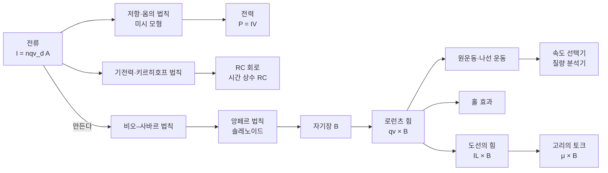

# 일반물리학 9. 전류·회로와 자기장 — 흐르는 전하가 만드는 회로와 힘
<!-- prev: emq-1, phy-2, uphy-8 -->
<!-- next: uphy-10, uchem-11 -->

> [!NOTE]
> **이 단원의 범위**
> - 전류와 전류 밀도, 저항과 옴의 법칙(미시적 모형), 전력
> - 기전력과 키르히호프 법칙, RC 회로
> - 자기장과 로런츠 힘: 원운동, 속도 선택기, 질량 분석기, 홀 효과
> - 전류 도선이 받는 힘과 토크(자기 쌍극자)
> - 비오–사바르 법칙, 앙페르 법칙과 솔레노이드

**학습 목표**

1. 전류와 전류 밀도를 유동 속도로 표현하고, 자유 전자 모형으로 옴의 법칙과 비저항을 설명할 수 있다.
2. 기전력·내부 저항·전력을 계산하고, 키르히호프 법칙으로 여러 고리 회로를 풀 수 있다.
3. RC 회로의 충전·방전을 미분 방정식으로 풀어 시간 상수와 에너지 출입을 분석할 수 있다.
4. 로런츠 힘 $\vec{F} = q\vec{v}\times\vec{B}$로 하전 입자의 원운동·나선 운동을 다루고, 속도 선택기·질량 분석기·홀 효과를 정량적으로 설명할 수 있다.
5. 전류 도선이 받는 힘과 전류 고리가 받는 토크를 자기 쌍극자 모멘트로 계산할 수 있다.
6. 비오–사바르 법칙과 앙페르 법칙으로 직선 도선·원형 고리·솔레노이드·토로이드의 자기장을 구할 수 있다.

**이 단원의 학습 사다리**

| 단계 | 무엇을 하나? |
|---|---|
| STEP 1. 이전 학습 다시 보기 | 중2 「전기와 자기」, 물리학 「전기와 자기」, 전자기와 양자 「전자기적 상호작용」, 「일반물리학 8」을 꺼내 본다 |
| STEP 2. 기초 다지기 | 벡터곱, 1계 선형 미분 방정식, 연립 일차 방정식, 닫힌 경로의 선적분 |
| STEP 3. 핵심 개념 | 전류 → 저항과 미시 모형 → 전력 → 기전력과 키르히호프 법칙 → RC 회로 → 로런츠 힘 → 원운동과 응용 → 홀 효과 → 도선의 힘과 토크 → 비오–사바르 → 앙페르 |
| STEP 4. 오개념 바로잡기 | "전자는 도선 속을 빛처럼 빠르게 달린다?" 같은 착각을 바로잡는다 |
| STEP 5. 다음 단계로 | 회로 이론(과도 응답), 자기 벡터 퍼텐셜, 상대론으로 본 자기력 |
| STEP 6. 생활·산업·진로 | 전력망, 전기차 모터, 홀 센서, 가속기와 MRI |

---

## 🗺️ 단원 들어가기

스위치를 누르면 전등은 거의 동시에 켜진다. 그런데 계산해 보면 구리 도선 속 전자가 한 방향으로 나아가는 빠르기는 1초에 고작 0.1 mm 남짓이다. 그렇다면 전등은 어떻게 그렇게 빨리 켜질까? 또 같은 전자들이 자석 근처를 지나면 옆으로 밀려나 전압을 만들고(홀 효과), 그 전압으로 스마트폰은 지구 자기장의 방향을 읽어 낸다.

「일반물리학 8」에서는 전하가 멈춰 있을 때의 장을 다루었다. 이번에는 전하가 **움직일 때**를 본다. 움직이는 전하의 흐름은 회로를 따라 에너지를 나르고, 동시에 주변에 **자기장**이라는 새로운 장을 만든다. 그리고 다른 움직이는 전하는 그 자기장에서 힘을 받는다. 이 단원은 회로 분석과 자기장 계산이라는 두 기둥을 세우고, 이 둘이 「일반물리학 10」의 전자기 유도에서 하나로 만나도록 준비한다.

---

## STEP 1. 🔙 이전 학습 다시 보기

### 연계 개념표

| 이전 단원 | 고등학교까지 배운 것 | 대학에서 이렇게 확장된다 |
|---|---|---|
| 중2 「전기와 자기」 '전류, 전압, 저항' | 전류를 물의 흐름 모형으로, 옴의 법칙 $V = IR$, 직렬·병렬 | 전류 밀도 $\vec{J} = nq\vec{v}_d$, 자유 전자 모형으로 **옴의 법칙을 유도** |
| 물리학 「전기와 자기」 '저항의 연결', '소비 전력' | 합성 저항, $P = VI = I^2R = V^2/R$ | 내부 저항과 최대 전력 전달, **키르히호프 법칙**으로 여러 전원이 있는 회로 |
| 전자기와 양자 「전자기적 상호작용」 '저항·축전기·인덕터' | 축전기 충전 때 전류가 점점 줄어든다(정성적) | RC 회로를 **미분 방정식**으로 풀어 $q(t) = C\varepsilon(1 - e^{-t/RC})$ |
| 전자기와 양자 「전자기적 상호작용」 '로런츠 힘' | $F = qvB\sin\theta$, $r = mv/qB$, 질량 분석기·홀 센서(정성적) | **벡터곱** $q\vec{v}\times\vec{B}$, 속도 선택기, 홀 전압으로 운반자 밀도 측정 |
| 전자기와 양자 「전자기적 상호작용」 '전류가 만드는 자기장' | 직선 전류 $B \propto I/r$, 솔레노이드 내부 균일(정성적) | **비오–사바르 법칙**과 **앙페르 법칙**으로 $B = \mu_0I/2\pi r$, $B = \mu_0nI$를 유도 |
| 「일반물리학 8」 '전위', '축전기' | 전위차, $C = Q/V$, $U = \frac{1}{2}CV^2$ | 전위차가 전류를 만들고, 축전기가 저항을 통해 충전·방전된다 |

### 준비 운동 (사전 진단)

**Q1.** $3.0\ \Omega$ 저항 양 끝에 $6.0\ \mathrm{V}$를 걸면 흐르는 전류는?

**Q2.** $2.0\ \Omega$과 $3.0\ \Omega$ 저항을 직렬로, 또 병렬로 연결할 때 합성 저항은 각각?

**Q3.** $220\ \mathrm{V}$에서 $1100\ \mathrm{W}$를 소비하는 전열기에 흐르는 전류는?

**Q4.** 종이 면에 수직으로 들어가는 방향으로 전류가 흐르는 긴 직선 도선 주위의 자기장은 시계 방향인가, 반시계 방향인가(종이를 위에서 볼 때)?

정답 및 해설

**Q1.** $I = V/R = 6.0/3.0 = 2.0\ \mathrm{A}$

**Q2.** 직렬 $5.0\ \Omega$, 병렬 $\dfrac{2.0\times3.0}{2.0 + 3.0} = 1.2\ \Omega$

**Q3.** $I = P/V = 1100/220 = 5.0\ \mathrm{A}$

**Q4.** 시계 방향. 오른손 엄지를 종이 속으로 향하게 하면 네 손가락이 시계 방향으로 감긴다.

---

## STEP 2. 🧱 기초 다지기

### ① 벡터곱(가위곱)

자기력은 언제나 **벡터곱(cross product)** 으로 나타난다. $\vec{C} = \vec{A}\times\vec{B}$의 크기는 $AB\sin\theta$(두 벡터가 만드는 평행사변형의 넓이), 방향은 $\vec{A}$와 $\vec{B}$ 모두에 수직이며 오른손 네 손가락을 $\vec{A}$에서 $\vec{B}$로 감아쥘 때 엄지 방향이다. 성분으로는

$$
\vec{A}\times\vec{B} = (A_yB_z - A_zB_y)\,\hat{i} + (A_zB_x - A_xB_z)\,\hat{j} + (A_xB_y - A_yB_x)\,\hat{k}
$$

| 성질 | 내용 |
|---|---|
| 순서를 바꾸면 | $\vec{B}\times\vec{A} = -\vec{A}\times\vec{B}$ |
| 나란한 두 벡터 | $\vec{A}\times\vec{B} = 0$ |
| 기본 단위 벡터 | $\hat{i}\times\hat{j} = \hat{k}$, $\hat{j}\times\hat{k} = \hat{i}$, $\hat{k}\times\hat{i} = \hat{j}$ (순환) |

### ② 1계 선형 미분 방정식: 일정한 값으로 다가가는 변화

축전기 충전처럼 '목표값과의 차이에 비례해 변하는' 양은 $\dfrac{dx}{dt} = \dfrac{x_\infty - x}{\tau}$를 따른다. $y = x - x_\infty$로 바꾸면 $dy/dt = -y/\tau$이므로 「일반물리학 7」의 뉴턴 냉각과 같은 방법으로

$$
x(t) = x_\infty + (x_0 - x_\infty)\,e^{-t/\tau}
$$

$\tau$를 **시간 상수(time constant)** 라 한다. $t = \tau$에서 차이가 $e^{-1} \approx 37\ \%$로, $t = 5\tau$에서 1 % 아래로 줄어든다. 차이가 절반이 되는 시간은 $\tau\ln 2 \approx 0.693\tau$이다.

### ③ 연립 일차 방정식

키르히호프 법칙은 미지 전류 개수만큼의 일차 방정식을 준다. 대입법·소거법으로 풀거나, 미지수가 많으면 행렬과 스프레드시트(역행렬 함수)를 쓴다. 답이 음수로 나오면 처음 가정한 방향과 반대라는 뜻일 뿐, 틀린 것이 아니다.

### ④ 닫힌 경로의 선적분

닫힌 경로를 한 바퀴 돌며 $\vec{B}\cdot d\vec{s}$를 더한 것을 $\oint\vec{B}\cdot d\vec{s}$로 쓴다. 경로 위에서 $\vec{B}$가 경로와 나란하고 크기가 일정하면 $\oint\vec{B}\cdot d\vec{s} = B\times(\text{경로 길이})$, 수직이면 0이다. 「일반물리학 8」의 가우스 법칙에서 '곡면'을 골랐듯, 앙페르 법칙에서는 대칭에 맞는 '경로'를 고른다.

### ⑤ 자주 쓰는 적분

$$
\int\frac{dx}{(x^2 + a^2)^{3/2}} = \frac{x}{a^2\sqrt{x^2 + a^2}}
$$

긴 직선 도선의 자기장을 비오–사바르 법칙으로 구할 때 쓴다. $x = a\tan\theta$로 치환하면 쉽게 확인할 수 있다.

> [!TIP]
> 💡 **요령** — 자기력 문제의 방향은 ① 좌표축을 먼저 정하고 ② 단위 벡터의 순환 규칙($\hat{i}\to\hat{j}\to\hat{k}\to\hat{i}$)으로 계산한 뒤 ③ 오른손 규칙으로 한 번 더 확인한다. 전자처럼 (−)전하는 마지막에 방향을 뒤집는다.

---

## STEP 3. 📘 핵심 개념

### ① 전류와 전류 밀도

#### 전류의 정의

도체의 한 단면을 단위 시간에 지나는 전하량이 **전류(electric current)** 이다.

$$
I = \frac{dq}{dt} \qquad (\text{단위: } \mathrm{A} = \mathrm{C/s})
$$

전류의 방향은 관례적으로 (+)전하가 움직이는 방향이다. 금속에서 실제로 움직이는 것은 전자이므로 전자의 이동 방향은 전류와 반대이다. 정상 상태 회로에서 전하가 어디에도 쌓이지 않으므로 직렬로 이어진 모든 단면에서 전류는 같다(전하 보존).

#### 전류 밀도와 유동 속도

전도 전자는 상온에서 약 $10^6\ \mathrm{m/s}$의 빠르기로 무작위로 움직이지만, 전기장이 걸리면 그 위에 아주 느린 평균 이동, 즉 **유동 속도(drift velocity)** $\vec{v}_d$가 겹쳐진다. 단위 부피당 운반자 수가 $n$, 운반자 전하가 $q$이면, 시간 $dt$ 동안 넓이 $A$인 단면을 지나는 전하는 부피 $Av_d\,dt$ 속의 전하 $nqAv_d\,dt$이다. 따라서

$$
I = nqv_dA, \qquad \vec{J} = \frac{I}{A}\text{ 방향 포함} = nq\vec{v}_d
$$

$\vec{J}$는 **전류 밀도(current density)**($\mathrm{A/m^2}$)로, 한 점에서 전류의 세기와 방향을 나타내는 벡터이다. 전류 $I$는 $\vec{J}$의 선속 $I = \int\vec{J}\cdot d\vec{A}$이다.

#### 예제 1 — 전자는 얼마나 느린가

단면적 $1.0\ \mathrm{mm^2}$인 구리 도선에 $2.0\ \mathrm{A}$가 흐른다. 구리의 전도 전자 밀도는 $n = 8.49\times10^{28}\ \mathrm{m^{-3}}$(원자당 전자 1개)이다. 전류 밀도와 유동 속력은?

**풀이**
- $J = I/A = 2.0/1.0\times10^{-6} = 2.0\times10^6\ \mathrm{A/m^2}$
- $v_d = \dfrac{J}{ne} = \dfrac{2.0\times10^6}{8.49\times10^{28}\times1.602\times10^{-19}} \approx 1.5\times10^{-4}\ \mathrm{m/s}$
- 의미: 1 m를 나아가는 데 약 2시간이 걸린다. 그래도 전등이 즉시 켜지는 것은 스위치를 닫는 순간 **전기장**이 도선을 따라 거의 빛의 속력으로 퍼져, 도선 전체의 전자가 한꺼번에 움직이기 시작하기 때문이다. 물이 가득 찬 호스는 꼭지를 열자마자 끝에서 물이 나오는 것과 같다.

#### ✔ 바로 확인

1. 금속 도선 속 전자가 움직이는 방향과 전류의 방향은 어떤 관계인가?
2. $3.0\ \mathrm{A}$의 전류가 $2.0\ \mathrm{s}$ 동안 흐를 때 한 단면을 지나는 전하량은?
3. 같은 전류가 흐르는 도선의 단면적이 절반인 곳에서 전자의 유동 속력은 몇 배인가?

정답

1. 반대 — 전류의 방향은 (+)전하가 움직이는 방향으로 정한다.
2. $6.0\ \mathrm{C}$ — $q = It$
3. 2배 — $v_d = I/(nqA)$

### ② 저항과 옴의 법칙 — 미시적 모형

#### 비저항과 저항

많은 물질에서 전류 밀도는 전기장에 비례한다.

$$
\vec{J} = \sigma\vec{E} \qquad\Longleftrightarrow\qquad \vec{E} = \rho\vec{J}
$$

$\sigma$는 **전도도(conductivity)**, $\rho = 1/\sigma$는 **비저항(resistivity)**($\Omega\cdot\mathrm{m}$)이다. 길이 $L$, 단면적 $A$인 균일한 도선에서 $V = EL$, $I = JA$이므로

$$
V = \left(\frac{\rho L}{A}\right)I = IR, \qquad R = \frac{\rho L}{A}
$$

$\vec{J} = \sigma\vec{E}$가 국소적인 **옴의 법칙**이고, $V = IR$은 그것을 도선 전체로 적분한 형태이다. $R$이 전압과 무관하게 일정한 소자를 **옴 소자**, 다이오드처럼 그렇지 않은 소자를 **비옴 소자**라 한다. $R = V/I$는 어떤 소자에서든 정의이지만, '옴의 법칙'은 그 값이 일정하다는 주장이다.

| 물질 (20 °C) | 비저항 $\rho$ ($\Omega\cdot\mathrm{m}$, 약) | 온도 계수 $\alpha$ ($\mathrm{K^{-1}}$, 약) |
|---|---|---|
| 은 | $1.59\times10^{-8}$ | $3.8\times10^{-3}$ |
| 구리 | $1.69\times10^{-8}$ | $3.9\times10^{-3}$ |
| 알루미늄 | $2.65\times10^{-8}$ | $3.9\times10^{-3}$ |
| 텅스텐 | $5.6\times10^{-8}$ | $4.5\times10^{-3}$ |
| 니크롬 | $1.0\times10^{-6}$ | $4\times10^{-4}$ |
| 규소(순수) | $10^{3}$ 규모 | 음수(온도가 오르면 감소) |
| 유리 | $10^{10}\sim10^{14}$ | — |

금속의 비저항은 온도에 따라 거의 직선적으로 증가한다: $\rho = \rho_0[1 + \alpha(T - T_0)]$. 반도체는 온도가 오르면 운반자 수가 급격히 늘어 비저항이 **줄어든다.**

#### 자유 전자 모형(드루드 모형)

전자가 전기장 $\vec{E}$에서 가속도 $-e\vec{E}/m$를 받다가 평균 시간 $\tau$마다 격자 이온(정확히는 격자의 진동과 불순물)과 충돌하여 방향이 무작위로 바뀐다고 하자. 충돌 직후 평균 속도는 0이므로, 평균적인 유동 속도는

$$
\vec{v}_d = -\frac{e\vec{E}}{m}\tau \quad\Rightarrow\quad \vec{J} = -ne\vec{v}_d = \frac{ne^2\tau}{m}\vec{E}
$$

$\tau$가 전기장과 무관하면(유동 속력이 무작위 속력보다 훨씬 작으므로 성립) $J \propto E$, 즉 옴의 법칙이 나온다. 비저항은

$$
\rho = \frac{m}{ne^2\tau}
$$

온도가 오르면 격자 진동이 심해져 $\tau$가 짧아지므로 금속의 비저항이 커진다.

#### 예제 2 — 구리 속 전자의 충돌 시간

구리($\rho = 1.69\times10^{-8}\ \Omega\cdot\mathrm{m}$, $n = 8.49\times10^{28}\ \mathrm{m^{-3}}$)에서 (1) 평균 충돌 시간 $\tau$를 구하시오. (2) 전자의 무작위 속력을 고전적인 $\sqrt{3kT/m}$(300 K)로 잡을 때와, 양자역학이 주는 값(페르미 속력, 약 $1.6\times10^6\ \mathrm{m/s}$)으로 잡을 때 평균 자유 경로를 각각 구하시오. (구리 원자 간격은 약 $0.26\ \mathrm{nm}$)

**풀이**
(1) $\tau = \dfrac{m}{ne^2\rho} = \dfrac{9.109\times10^{-31}}{8.49\times10^{28}\times(1.602\times10^{-19})^2\times1.69\times10^{-8}} \approx 2.5\times10^{-14}\ \mathrm{s}$
(2) 고전: $v \approx 1.2\times10^5\ \mathrm{m/s}$, $\lambda = v\tau \approx 3\ \mathrm{nm}$. 양자: $\lambda \approx 1.6\times10^6\times2.5\times10^{-14} \approx 4\times10^{-8}\ \mathrm{m}$(약 40 nm)
- 의미: 전자는 원자 수십~백여 개를 지나쳐야 한 번 충돌한다. 고전 모형은 옴의 법칙의 꼴은 잘 설명하지만, 전자가 왜 이온에 그렇게 드물게 부딪히는지, 무작위 속력이 왜 그렇게 큰지는 설명하지 못한다. 완전한 답은 양자역학(전자의 파동성, 페르미–디랙 분포)이 준다(「일반물리학 12」).

#### 예제 3 — 도선의 저항과 온도

지름 $1.0\ \mathrm{mm}$, 길이 $20\ \mathrm{m}$인 구리 도선의 저항을 20 °C와 100 °C에서 구하시오.

**풀이**
- $A = \pi(0.50\times10^{-3})^2 \approx 7.85\times10^{-7}\ \mathrm{m^2}$, $R_{20} = \dfrac{1.69\times10^{-8}\times20}{7.85\times10^{-7}} \approx 0.43\ \Omega$
- $R_{100} = 0.43\times(1 + 3.9\times10^{-3}\times80) \approx 0.56\ \Omega$
- 의미: 80 K 오르면 저항이 약 30 % 커진다. 백열전구의 필라멘트는 켜진 상태에서 저항이 상온보다 열 배 이상 커서, 켜는 순간 큰 전류가 흐른다.

#### ✔ 바로 확인

1. 같은 재질의 도선에서 길이와 단면적을 모두 2배로 하면 저항은 몇 배인가?
2. (O/X) 순수한 반도체의 비저항은 온도가 오르면 커진다.
3. 빈칸: 드루드 모형에서 평균 충돌 시간 $\tau$가 길수록 비저항은 (커진다 / 작아진다).

정답

1. 1배(그대로) — $R = \rho L/A$
2. X — 운반자 수가 급격히 늘어 비저항이 줄어든다.
3. 작아진다 — $\rho = m/(ne^2\tau)$

### ③ 전력

전위차 $V$를 지나 전하 $dq$가 이동하면 전기장이 $dq\,V$의 일을 한다. 단위 시간당으로 나누면 소자에 전달되는 **전력(electric power)** 은

$$
P = \frac{dW}{dt} = IV
$$

저항에서는 이 에너지가 전자–격자 충돌을 통해 열로 바뀌므로(**줄 가열**) $P = I^2R = V^2/R$이다. 국소적으로는 단위 부피당 $\vec{J}\cdot\vec{E} = \rho J^2$의 열이 난다.

#### 예제 4 — 전열기와 송전 손실

(1) $220\ \mathrm{V}$에서 $1200\ \mathrm{W}$인 전열기의 전류와 저항은? (2) 발전소가 $100\ \mathrm{MW}$를 저항 $5.0\ \Omega$인 송전선으로 보낸다. 송전 전압이 $154\ \mathrm{kV}$일 때와 $345\ \mathrm{kV}$일 때 송전선의 열손실을 비교하시오.

**풀이**
(1) $I = P/V \approx 5.5\ \mathrm{A}$, $R = V^2/P \approx 40\ \Omega$
(2) $154\ \mathrm{kV}$: $I = 10^8/1.54\times10^5 \approx 649\ \mathrm{A}$, $P_{\text{손실}} = I^2R \approx 2.1\ \mathrm{MW}$(2.1 %). $345\ \mathrm{kV}$: $I \approx 290\ \mathrm{A}$, $P_{\text{손실}} \approx 0.42\ \mathrm{MW}$(0.42 %)
- 의미: 같은 전력을 보낼 때 손실은 $I^2R = (P/V)^2R$로 전압의 제곱에 반비례한다. 전압을 약 2.2배 높이자 손실이 약 $\frac{1}{5}$로 줄었다. 여기서 $V$는 송전선 양 끝의 전압 강하가 아니라 송전 전압이라는 점에 주의한다.

#### ✔ 바로 확인

1. $10\ \Omega$ 저항에 $2.0\ \mathrm{A}$가 흐를 때 소비 전력은?
2. 같은 전력을 보낼 때 송전 전압을 2배로 높이면 송전선의 열손실은 몇 배인가?
3. 같은 전압 $220\ \mathrm{V}$에 저항 $R$과 $2R$을 각각 연결했다. 소비 전력이 큰 쪽은?

정답

1. $40\ \mathrm{W}$ — $I^2R$
2. $\frac{1}{4}$배 — $I = P/V$, 손실 $I^2R$
3. $R$ — $P = V^2/R$

### ④ 기전력과 키르히호프 법칙

#### 기전력과 내부 저항

전지는 화학 에너지를 써서 전하를 낮은 전위에서 높은 전위로 '퍼 올린다'. 단위 전하당 해 주는 이 일을 **기전력(electromotive force, emf)** $\varepsilon$이라 한다(단위 V). 이름과 달리 힘이 아니라 에너지/전하이다. 실제 전지에는 **내부 저항** $r$이 있으므로 전류 $I$가 흐를 때 단자 전압은

$$
V_{\text{단자}} = \varepsilon - Ir
$$

외부 저항 $R$을 연결하면 $I = \varepsilon/(R + r)$이고, 외부 저항이 받는 전력은 $P = \dfrac{\varepsilon^2R}{(R + r)^2}$이다. 이것을 $R$로 미분해 0으로 놓으면

$$
\frac{dP}{dR} = \varepsilon^2\frac{(R + r) - 2R}{(R + r)^3} = 0 \quad\Rightarrow\quad R = r, \qquad P_{\max} = \frac{\varepsilon^2}{4r}
$$

이것이 **최대 전력 전달 조건**이다. 이때 효율은 50 %뿐이어서, 효율이 중요한 전력 공급에서는 $R \gg r$로, 신호의 세기가 중요한 통신 회로에서는 $R = r$(임피던스 정합)로 설계한다.

#### 예제 5 — 내부 저항이 있는 전지

기전력 $12.0\ \mathrm{V}$, 내부 저항 $0.50\ \Omega$인 전지에 $5.5\ \Omega$ 저항을 연결했다. 전류, 단자 전압, 외부·내부 저항의 전력을 구하시오. 외부 저항을 바꿔 얻을 수 있는 최대 전력은?

**풀이**
- $I = 12.0/(5.5 + 0.50) = 2.0\ \mathrm{A}$, $V_{\text{단자}} = 12.0 - 2.0\times0.50 = 11.0\ \mathrm{V}$
- $P_R = I^2R = 22\ \mathrm{W}$, $P_r = I^2r = 2.0\ \mathrm{W}$, 전지가 내놓는 전력 $\varepsilon I = 24\ \mathrm{W}$ (합이 맞는다)
- 최대 전력: $R = 0.50\ \Omega$일 때 $P_{\max} = 12.0^2/(4\times0.50) = 72\ \mathrm{W}$

#### 키르히호프 법칙

| 법칙 | 내용 | 근거 |
|---|---|---|
| **분기점 법칙(제1법칙)** | 한 분기점에 들어오는 전류의 합 = 나가는 전류의 합 ($\sum I = 0$) | 전하 보존 |
| **고리 법칙(제2법칙)** | 닫힌 고리를 한 바퀴 돌 때 전위 변화의 합은 0 ($\sum\Delta V = 0$) | 정전기장은 보존력(전위가 위치만의 함수) |

고리 법칙의 부호 규칙: 저항을 전류 방향으로 지나면 $-IR$, 반대로 지나면 $+IR$. 전지를 (−)에서 (+)로 지나면 $+\varepsilon$, 반대면 $-\varepsilon$. 직렬 저항의 합 $R = R_1 + R_2$와 병렬의 $1/R = 1/R_1 + 1/R_2$도 이 두 법칙에서 바로 나온다.

<!-- fig:uphy-9-kirchhoff -->

#### 예제 6 — 전원이 두 개인 회로

두 분기점 a(위), b(아래) 사이에 세 가지가 병렬로 있다. 왼쪽 가지: 기전력 $\varepsilon_1 = 12\ \mathrm{V}$(+극이 a 쪽)와 $R_1 = 2.0\ \Omega$. 가운데 가지: $R_2 = 4.0\ \Omega$. 오른쪽 가지: 기전력 $\varepsilon_2 = 6.0\ \mathrm{V}$(+극이 a 쪽)와 $R_3 = 3.0\ \Omega$. 각 가지의 전류를 구하시오. (전지의 내부 저항은 저항에 포함)

**풀이**
- 미지수 설정: $V = V_a - V_b$. 왼쪽 가지 전류(b→a 방향) $I_1 = (\varepsilon_1 - V)/R_1$, 오른쪽 가지(b→a) $I_3 = (\varepsilon_2 - V)/R_3$, 가운데(a→b) $I_2 = V/R_2$
- 분기점 법칙: $I_1 + I_3 = I_2$ → $\dfrac{12 - V}{2.0} + \dfrac{6.0 - V}{3.0} = \dfrac{V}{4.0}$
- 양변에 12를 곱하면 $72 - 6V + 24 - 4V = 3V$, $V = 96/13 \approx 7.38\ \mathrm{V}$
- 결과: $I_1 \approx 2.31\ \mathrm{A}$, $I_2 \approx 1.85\ \mathrm{A}$, $I_3 \approx -0.46\ \mathrm{A}$
- 의미: $I_3$이 음수이므로 오른쪽 가지의 전류는 a→b 방향, 즉 $\varepsilon_2$에 (+)극으로 들어간다. 높은 기전력의 전지가 낮은 기전력의 전지를 **충전**하는 상황이다. 자동차에서 발전기가 배터리를 충전하는 것과 같다. (전위 $V$ 하나를 미지수로 잡는 이 방법을 '절점 전압법'이라 하며, 고리 전류 두 개를 미지수로 잡아 고리 법칙 두 개를 세워도 같은 답이 나온다.)

> [!TIP]
> 💡 **비유** — 회로는 '산악 순환 열차'이다. 전지는 승객(전하)을 산꼭대기로 끌어올리는 리프트(기전력), 저항은 내려오는 비탈길이다. 출발점으로 돌아오면 높이 변화의 합은 0이고(고리 법칙), 갈림길에서 승객 수는 보존된다(분기점 법칙).

#### 전류계와 전압계

전류계는 측정할 곳에 **직렬**로 넣으므로 내부 저항이 아주 작아야 하고, 전압계는 **병렬**로 대므로 내부 저항이 아주 커야 회로를 거의 바꾸지 않는다. 측정 기구도 회로의 일부라는 점이 모든 측정의 기본 주의 사항이다.

#### ✔ 바로 확인

1. 기전력 $6.0\ \mathrm{V}$, 내부 저항 $0.50\ \Omega$인 전지에서 $2.0\ \mathrm{A}$가 흐를 때 단자 전압은?
2. 짝짓기: 분기점 법칙과 고리 법칙의 근거를 각각 쓰시오.
3. 빈칸: 전압계의 내부 저항은 아주 (커야 / 작아야) 한다.

정답

1. $5.0\ \mathrm{V}$ — $\varepsilon - Ir$
2. 분기점 법칙 — 전하 보존, 고리 법칙 — 정전기장이 보존력(전위가 위치만의 함수)
3. 커야 — 병렬로 대므로 회로의 전류를 거의 빼앗지 않아야 한다.

### ⑤ RC 회로

#### 충전

처음에 비어 있는 축전기 $C$를 저항 $R$을 통해 기전력 $\varepsilon$인 전지에 연결한다. 고리 법칙으로 $\varepsilon - IR - q/C = 0$이고 $I = dq/dt$이므로

$$
R\frac{dq}{dt} + \frac{q}{C} = \varepsilon \quad\Rightarrow\quad \frac{dq}{dt} = \frac{C\varepsilon - q}{RC}
$$

STEP 2의 ②에서 $q_\infty = C\varepsilon$, $q_0 = 0$, $\tau = RC$이므로

$$
q(t) = C\varepsilon\left(1 - e^{-t/RC}\right), \qquad I(t) = \frac{dq}{dt} = \frac{\varepsilon}{R}e^{-t/RC}
$$

처음 순간 축전기는 전압이 0이라 **도선처럼**, 충분한 시간이 지나면 전류가 0이라 **끊어진 회로처럼** 행동한다. $RC$의 단위는 $\Omega\cdot\mathrm{F} = (\mathrm{V/A})(\mathrm{C/V}) = \mathrm{s}$이다.

#### 방전

충전된 축전기($q_0 = C\varepsilon$)를 저항만 있는 회로로 방전시키면 $R\,dq/dt + q/C = 0$에서

$$
q(t) = q_0e^{-t/RC}, \qquad I(t) = -\frac{q_0}{RC}e^{-t/RC}
$$

(− 부호는 전류가 충전 때와 반대 방향이라는 뜻) 축전기 에너지 $U = q^2/2C$는 $e^{-2t/RC}$로, 전하보다 두 배 빠르게 줄어든다.

#### 충전할 때 에너지의 행방

충전이 끝날 때까지 전지가 한 일은 $\int\varepsilon I\,dt = \varepsilon q_\infty = C\varepsilon^2$이다. 축전기에 저장된 에너지는 $\frac{1}{2}C\varepsilon^2$이고, 저항에서 난 열은

$$
\int_0^\infty I^2R\,dt = \frac{\varepsilon^2}{R}\int_0^\infty e^{-2t/RC}\,dt = \frac{\varepsilon^2}{R}\cdot\frac{RC}{2} = \frac{1}{2}C\varepsilon^2
$$

놀랍게도 $R$의 값과 상관없이 **전지가 준 에너지의 정확히 절반이 열로** 나간다. $R$이 작으면 짧은 시간에 큰 전류로, 크면 긴 시간에 작은 전류로 같은 양의 열이 난다.

| 시각 | 충전 중 $q/q_\infty$ | 방전 중 $q/q_0$ |
|---|---|---|
| $t = \tau$ | 0.632 | 0.368 |
| $t = 2\tau$ | 0.865 | 0.135 |
| $t = 3\tau$ | 0.950 | 0.050 |
| $t = 5\tau$ | 0.993 | 0.007 |

<!-- sim:u-rc-circuit -->

#### 예제 7 — RC 충전 설계

$R = 10\ \mathrm{k\Omega}$, $C = 100\ \mu\mathrm{F}$, $\varepsilon = 9.0\ \mathrm{V}$이다. (1) 시간 상수와 처음 전류, (2) 최종 전하의 90 %가 될 때까지 걸리는 시간, (3) 최종 저장 에너지와 저항에서 난 열을 구하시오.

**풀이**
(1) $\tau = RC = 1.0\times10^4\times1.0\times10^{-4} = 1.0\ \mathrm{s}$, $I_0 = \varepsilon/R = 0.90\ \mathrm{mA}$
(2) $1 - e^{-t/\tau} = 0.90$에서 $t = \tau\ln 10 \approx 2.3\ \mathrm{s}$
(3) $U = \frac{1}{2}C\varepsilon^2 = 0.5\times1.0\times10^{-4}\times81 \approx 4.1\times10^{-3}\ \mathrm{J}$, 열도 같은 $4.1\times10^{-3}\ \mathrm{J}$ (전지가 한 일 $8.1\times10^{-3}\ \mathrm{J}$)
- 의미: 와이퍼 간헐 동작, 카메라 플래시 충전, 심장 박동 조율기의 타이머처럼 '정해진 시간 뒤에 무언가를 하는' 회로는 RC의 시간 상수를 이용한다.

#### ✔ 바로 확인

1. $R = 2.0\ \mathrm{k\Omega}$, $C = 50\ \mu\mathrm{F}$인 RC 회로의 시간 상수는?
2. 빈칸: 충전을 시작하는 순간 빈 축전기는 (도선 / 끊어진 회로)처럼 행동한다.
3. 방전을 시작하고 $t = \tau$가 지났을 때 남은 전하는 처음의 약 몇 %인가?
4. (O/X) 저항을 크게 하면 충전하는 동안 저항에서 열로 나가는 에너지가 줄어든다.

정답

1. $0.10\ \mathrm{s}$ — $RC$
2. 도선 — 전압이 0이다.
3. 약 37 % — $e^{-1}$
4. X — $R$과 무관하게 전지가 준 에너지의 절반이다.

### ⑥ 자기장과 로런츠 힘

#### 자기장의 정의

전기장을 '정지 전하가 받는 힘'으로 정의했듯, **자기장(magnetic field)** $\vec{B}$는 '움직이는 전하가 받는 힘'으로 정의한다. 실험에 따르면 속도 $\vec{v}$로 움직이는 전하 $q$는 속도와 자기장 모두에 수직이고 크기가 $qvB\sin\theta$인 힘을 받는다.

$$
\vec{F}_B = q\vec{v}\times\vec{B}
$$

전기장도 있으면 전체 힘은 $\vec{F} = q(\vec{E} + \vec{v}\times\vec{B})$이고, 이것을 **로런츠 힘(Lorentz force)** 이라 한다. 자기장의 SI 단위는 **테슬라** $\mathrm{T} = \mathrm{N/(A\cdot m)}$이다.

| 자기장 | 크기 (약) |
|---|---|
| 지구 표면 | $25\sim65\ \mu\mathrm{T}$ |
| 냉장고 자석 근처 | $5\ \mathrm{mT}$ |
| 네오디뮴 자석 표면 | $0.5\sim1\ \mathrm{T}$ |
| 병원 MRI | $1.5\sim3\ \mathrm{T}$ |
| 연구용 최강 정상 자석 | 수십 T |

#### 자기력은 일을 하지 않는다

$\vec{F}_B \perp \vec{v}$이므로 일률 $\vec{F}_B\cdot\vec{v} = 0$이다. 자기력은 하전 입자의 **속력(운동 에너지)을 바꾸지 못하고 방향만** 바꾼다. 입자의 에너지를 늘리려면 전기장이 필요하다.

#### 예제 8 — 로런츠 힘을 벡터로

양성자가 $\vec{v} = (3.0\times10^5\,\hat{i} + 4.0\times10^5\,\hat{j})\ \mathrm{m/s}$로 자기장 $\vec{B} = 0.50\,\hat{k}\ \mathrm{T}$ 속을 지난다. 양성자가 받는 힘은?

**풀이**
- 벡터곱: $\vec{v}\times\vec{B} = (v_yB_z)\hat{i} - (v_xB_z)\hat{j} = (2.0\times10^5)\hat{i} - (1.5\times10^5)\hat{j}\ \mathrm{T\cdot m/s}$
- 힘: $\vec{F} = e\,\vec{v}\times\vec{B} = (3.2\times10^{-14}\,\hat{i} - 2.4\times10^{-14}\,\hat{j})\ \mathrm{N}$, 크기 $4.0\times10^{-14}\ \mathrm{N}$
- 확인: $\vec{F}\cdot\vec{v} = (3.2)(3.0) + (-2.4)(4.0) = 0$으로 힘이 속도에 수직이다. 크기는 $evB$ ($v = 5.0\times10^5\ \mathrm{m/s}$, $\theta = 90^\circ$)와 같다.

<!-- fig:uphy-9-lorentz-force -->

#### ✔ 바로 확인

1. 정지한 전하는 자기장 속에서 자기력을 받는가?
2. 자기력이 하전 입자에 하는 일은?
3. $2.0\ \mu\mathrm{C}$의 전하가 $1000\ \mathrm{m/s}$로 $0.50\ \mathrm{T}$ 자기장에 수직으로 움직일 때 받는 힘의 크기는?

정답

1. 받지 않는다 — $\vec{F} = q\vec{v}\times\vec{B}$에서 $v = 0$
2. 0 — 힘이 언제나 속도에 수직이다.
3. $1.0\times10^{-3}\ \mathrm{N}$ — $qvB$

### ⑦ 자기장 속의 원운동과 그 응용

#### 원운동과 사이클로트론 진동수

균일한 자기장에 수직으로 들어온 입자는 로런츠 힘이 구심력이 되어 등속 원운동을 한다.

$$
qvB = \frac{mv^2}{r} \quad\Rightarrow\quad r = \frac{mv}{qB} = \frac{p}{qB}, \qquad \omega = \frac{qB}{m}, \qquad T = \frac{2\pi m}{qB}
$$

> [!IMPORTANT]
> 각진동수 $\omega = qB/m$(**사이클로트론 진동수**)는 **속력과 무관**하다. 빠른 입자는 큰 원을, 느린 입자는 작은 원을 그리지만 한 바퀴 도는 시간은 같다. 이 성질 덕분에 일정한 진동수의 교류 전압으로 입자를 반 바퀴마다 가속하는 사이클로트론이 가능하다(상대론적 속력에 가까워지면 깨진다).

속도가 자기장과 각 $\theta$를 이루면, 수직 성분 $v\sin\theta$는 원운동을, 나란한 성분 $v\cos\theta$는 등속 운동을 하여 **나선 운동**이 된다. 나선의 반지름은 $mv\sin\theta/qB$, 한 바퀴 동안 나아가는 거리(피치)는 $v\cos\theta\cdot T$이다. 오로라와 밴앨런대의 입자가 자기력선을 감고 도는 것이 이 운동이다.

<!-- photo:uphy-9-aurora -->

#### 예제 9 — 전자의 원운동과 사이클로트론

(1) 운동 에너지 $100\ \mathrm{eV}$인 전자가 $1.0\ \mathrm{mT}$ 자기장에 수직으로 들어올 때 반지름과 진동수는? (2) 반지름 $0.50\ \mathrm{m}$, 자기장 $1.5\ \mathrm{T}$인 사이클로트론에서 양성자가 얻는 최대 운동 에너지는?

**풀이**
(1) $v = \sqrt{2K/m_e} = \sqrt{2\times100\times1.602\times10^{-19}/9.109\times10^{-31}} \approx 5.9\times10^6\ \mathrm{m/s}$, $r = \dfrac{m_ev}{eB} \approx 3.4\ \mathrm{cm}$, $f = \dfrac{eB}{2\pi m_e} \approx 2.8\times10^7\ \mathrm{Hz}$
(2) 최대 반지름에서 $v = eBR/m$이므로 $K = \dfrac{(eBR)^2}{2m_p} = \dfrac{(1.602\times10^{-19}\times1.5\times0.50)^2}{2\times1.673\times10^{-27}} \approx 4.3\times10^{-12}\ \mathrm{J} \approx 27\ \mathrm{MeV}$. 진동수는 $eB/2\pi m_p \approx 23\ \mathrm{MHz}$로 라디오파 영역이다.

#### 속도 선택기

서로 수직인 균일한 전기장 $\vec{E}$와 자기장 $\vec{B}$가 있는 영역에 입자가 둘 모두에 수직으로 들어오면, 전기력 $qE$와 자기력 $qvB$가 반대 방향이 되도록 배치할 수 있다. 두 힘이 같으면 입자는 휘지 않고 직진한다.

$$
qE = qvB \quad\Rightarrow\quad v = \frac{E}{B}
$$

이 조건은 전하와 질량에 무관하므로, 좁은 출구를 두면 **특정 속력의 입자만** 골라낼 수 있다. 더 빠른 입자는 자기력이 커서, 더 느린 입자는 전기력이 커서 휘어 나간다. 전자의 비전하 $e/m$을 처음 측정한 음극선 실험도 이 배치를 썼다.

#### 질량 분석기

속도 선택기를 통과한 이온(속력 $v$)이 균일한 자기장 $B'$에서 반원을 그린 뒤 검출기에 닿는다. $r = mv/qB'$이므로 $m = qB'r/v$이다. 속도 선택기 대신 전위차 $V$로 가속하면 $\frac{1}{2}mv^2 = qV$에서

$$
m = \frac{qB'^2r^2}{2V}
$$

동위 원소를 분리·측정하고, 분자의 질량으로 물질을 확인하며(약물 검사, 단백질 분석), 탄소 연대 측정에도 쓴다.

<!-- sim:u-mass-spectrometer -->

#### 예제 10 — 탄소 동위 원소 분리

전기장 $2.0\times10^4\ \mathrm{V/m}$, 자기장 $0.10\ \mathrm{T}$인 속도 선택기를 통과한 1가 탄소 이온이 $0.20\ \mathrm{T}$ 자기장에서 반원을 그린다. $^{12}\mathrm{C}^+$와 $^{13}\mathrm{C}^+$이 검출기에 닿는 위치는 얼마나 떨어지는가? ($1\ \mathrm{u} = 1.661\times10^{-27}\ \mathrm{kg}$)

**풀이**
- 속력: $v = E/B = 2.0\times10^5\ \mathrm{m/s}$
- 반지름: $r_{12} = \dfrac{12\times1.661\times10^{-27}\times2.0\times10^5}{1.602\times10^{-19}\times0.20} \approx 0.124\ \mathrm{m}$, $r_{13} \approx 0.135\ \mathrm{m}$
- 반원이므로 지름 차이: $2(r_{13} - r_{12}) \approx 2.1\ \mathrm{cm}$
- 의미: 질량이 8 % 다르면 반지름도 8 % 다르다. 속도 선택기 덕분에 반지름이 질량에 정확히 비례한다.

#### ✔ 바로 확인

1. 같은 자기장에서 양성자의 속력을 2배로 하면 원운동의 반지름과 주기는?
2. $E = 1.0\times10^4\ \mathrm{V/m}$, $B = 0.050\ \mathrm{T}$인 속도 선택기를 곧게 지나는 입자의 속력은?
3. (O/X) 속도가 자기장과 나란한 하전 입자는 휘지 않는다.

정답

1. 반지름 2배, 주기 그대로 — $r = mv/qB$, $T = 2\pi m/qB$
2. $2.0\times10^5\ \mathrm{m/s}$ — $v = E/B$
3. O — $\sin\theta = 0$

### ⑧ 홀 효과

폭 $w$, 두께 $t$인 도체 띠에 전류 $I$가 흐르고, 띠면에 수직으로 자기장 $\vec{B}$가 걸려 있다. 운반자는 로런츠 힘 $q\vec{v}_d\times\vec{B}$로 띠의 한쪽 옆면으로 쏠리고, 반대쪽 옆면에는 반대 전하가 남아 옆 방향 전기장 $E_H$가 생긴다. 이 전기장의 힘이 자기력과 같아지면 정상 상태가 된다.

$$
qE_H = qv_dB \quad\Rightarrow\quad V_H = E_Hw = v_dBw
$$

$v_d = I/(nqA) = I/(nqwt)$를 넣으면

$$
V_H = \frac{IB}{nqt}
$$

이 전압을 **홀 전압(Hall voltage)** 이라 한다.

<!-- fig:uphy-9-hall-effect -->

| 홀 효과로 알 수 있는 것 | 방법 |
|---|---|
| 운반자의 부호 | 홀 전압의 극성. 전자가 운반자면 한쪽, 양공(정공)이면 반대쪽이 높다 |
| 운반자 밀도 $n$ | $n = IB/(qtV_H)$ |
| 자기장의 세기 | $n$을 아는 소자에서 $B = nqtV_H/I$ (홀 센서) |

금속은 $n$이 커서 홀 전압이 매우 작고, 반도체는 $n$이 작아 홀 전압이 크다. 그래서 홀 센서는 반도체로 만든다. 일부 금속(아연 등)과 p형 반도체에서 양전하 운반자처럼 보이는 결과가 나온 것은 고전 모형으로 설명할 수 없었고, 고체의 띠 이론에서 '양공' 개념으로 이해된다.

#### 예제 11 — 구리와 반도체의 홀 전압

(1) 두께 $0.10\ \mathrm{mm}$인 구리 띠($n = 8.49\times10^{28}\ \mathrm{m^{-3}}$)에 $5.0\ \mathrm{A}$를 흘리고 $1.0\ \mathrm{T}$를 걸었을 때 홀 전압은? (2) 두께 $0.50\ \mathrm{mm}$, 운반자 밀도 $1.0\times10^{21}\ \mathrm{m^{-3}}$인 반도체 띠에 $1.0\ \mathrm{mA}$를 흘리고 $0.10\ \mathrm{T}$를 걸었을 때는?

**풀이**
(1) $V_H = \dfrac{5.0\times1.0}{8.49\times10^{28}\times1.602\times10^{-19}\times1.0\times10^{-4}} \approx 3.7\times10^{-6}\ \mathrm{V}$ (3.7 μV)
(2) $V_H = \dfrac{1.0\times10^{-3}\times0.10}{1.0\times10^{21}\times1.602\times10^{-19}\times5.0\times10^{-4}} \approx 1.2\times10^{-3}\ \mathrm{V}$ (1.2 mV)
- 의미: 반도체는 전류가 5000분의 1, 자기장이 10분의 1인데도 홀 전압이 300배 이상 크다. 스마트폰의 전자 나침반, 자동차의 바퀴 회전 센서, 전기차 모터의 회전자 위치 검출에 반도체 홀 센서가 쓰인다.

#### ✔ 바로 확인

1. 빈칸: 홀 전압은 운반자 밀도에 (비례 / 반비례)한다.
2. 홀 전압의 극성(어느 옆면이 높은가)으로 알 수 있는 것은?
3. (O/X) 같은 전류와 자기장에서 금속 띠의 홀 전압이 반도체 띠보다 크다.

정답

1. 반비례 — $V_H = IB/(nqt)$
2. 운반자 전하의 부호
3. X — 금속은 $n$이 커서 홀 전압이 매우 작다.

### ⑨ 전류 도선이 받는 힘과 토크

#### 도선이 받는 힘

길이 $L$인 도선 속 운반자 하나하나가 받는 로런츠 힘을 더하면, 운반자 수 $nAL$에 $q\vec{v}_d\times\vec{B}$를 곱한 것이고 $nqv_dA = I$이므로

$$
\vec{F} = I\vec{L}\times\vec{B}, \qquad d\vec{F} = I\,d\vec{s}\times\vec{B}
$$

($\vec{L}$은 전류 방향, 크기 $L$) 휘어진 도선은 작은 조각 $d\vec{s}$마다 힘을 구해 적분한다. 균일한 자기장에서는 휘어진 도선이 받는 힘이 **두 끝을 잇는 직선 도선**이 받는 힘과 같다($\int d\vec{s}$가 두 끝을 잇는 벡터이므로). 그래서 균일한 자기장 속 **닫힌 고리**가 받는 알짜 힘은 0이다.

#### 전류 고리가 받는 토크

가로 $a$, 세로 $b$인 직사각형 고리(전류 $I$)가 균일한 자기장 속에 있고, 고리 면의 법선이 $\vec{B}$와 각 $\theta$를 이룬다. 길이 $b$인 두 변은 크기 $IbB$의 반대 방향 힘을 받는데 작용선이 $a\sin\theta$만큼 떨어져 있어 토크 $\tau = IabB\sin\theta = IAB\sin\theta$가 생긴다. 감은 수가 $N$이면 이를 벡터로 정리해

$$
\vec{\mu} = NI\vec{A}, \qquad \vec{\tau} = \vec{\mu}\times\vec{B}, \qquad U = -\vec{\mu}\cdot\vec{B}
$$

$\vec{\mu}$를 **자기 쌍극자 모멘트(magnetic dipole moment)**($\mathrm{A\cdot m^2}$)라 하며, 방향은 오른손 네 손가락을 전류 방향으로 감을 때 엄지 방향이다. 「일반물리학 8」의 전기 쌍극자($\vec{\tau} = \vec{p}\times\vec{E}$, $U = -\vec{p}\cdot\vec{E}$)와 꼴이 똑같다. 고리는 $\vec{\mu}$가 $\vec{B}$와 나란해지도록 돈다. 나침반 바늘, 원자 속 전자의 궤도 운동과 스핀도 자기 쌍극자로 다룬다.

<!-- fig:uphy-9-loop-torque -->

#### 예제 12 — 코일의 토크

가로 $10\ \mathrm{cm}$, 세로 $5.0\ \mathrm{cm}$인 직사각형 코일(감은 수 50)에 $2.0\ \mathrm{A}$가 흐르고, $0.30\ \mathrm{T}$의 균일한 자기장 속에 있다. (1) 자기 쌍극자 모멘트, (2) 최대 토크와 $\theta = 30^\circ$일 때 토크, (3) 가장 안정한 방향에서 가장 불안정한 방향으로 돌리는 데 드는 일은?

**풀이**
(1) $\mu = NIA = 50\times2.0\times5.0\times10^{-3} = 0.50\ \mathrm{A\cdot m^2}$
(2) $\tau_{\max} = \mu B = 0.15\ \mathrm{N\cdot m}$, $\tau(30^\circ) = 0.15\times\sin30^\circ = 0.075\ \mathrm{N\cdot m}$
(3) $W = U(180^\circ) - U(0^\circ) = 2\mu B = 0.30\ \mathrm{J}$

#### 직류 전동기

토크만으로는 코일이 $\vec{\mu}\parallel\vec{B}$에서 멈춘다. **정류자**가 반 바퀴마다 코일의 전류 방향을 뒤집어 토크가 계속 같은 방향으로 작용하게 하는 것이 직류 전동기이다. 전류계(가동 코일형)는 토크를 용수철의 복원 토크와 맞세워 바늘의 각도로 전류를 읽는다.

#### ✔ 바로 확인

1. 균일한 자기장 속에 놓인 닫힌 전류 고리가 받는 알짜 힘은?
2. 길이 $0.50\ \mathrm{m}$, 전류 $4.0\ \mathrm{A}$인 도선이 $0.20\ \mathrm{T}$ 자기장에 수직으로 놓였을 때 받는 힘은?
3. 감은 수 10, 넓이 $0.010\ \mathrm{m^2}$, 전류 $1.0\ \mathrm{A}$인 코일의 자기 쌍극자 모멘트는?
4. 전류 고리가 가장 안정한 방향은?

정답

1. 0 — 토크는 생길 수 있다.
2. $0.40\ \mathrm{N}$ — $ILB$
3. $0.10\ \mathrm{A\cdot m^2}$ — $NIA$
4. $\vec{\mu}$가 $\vec{B}$와 나란할 때 — $U = -\mu B$로 가장 낮다.

### ⑩ 비오–사바르 법칙 — 전류가 만드는 자기장

#### 법칙

전류 요소 $I\,d\vec{s}$가 거리 $r$만큼 떨어진 점에 만드는 자기장은

$$
d\vec{B} = \frac{\mu_0}{4\pi}\frac{I\,d\vec{s}\times\hat{r}}{r^2}, \qquad \mu_0 = 4\pi\times10^{-7}\ \mathrm{T\cdot m/A}\ (\text{약})
$$

$\mu_0$는 **진공의 투자율(permeability of free space)** 이다. 쿨롱 법칙처럼 역제곱이지만, 방향이 전류 요소와 $\hat{r}$ 모두에 수직이라는 점이 다르다. 전류 요소의 연장선 위($d\vec{s}\parallel\hat{r}$)에는 자기장을 만들지 않는다.

#### (가) 긴 직선 도선

$x$축 위 도선에서 수직 거리 $R$인 점을 보자. 위치 $x$의 요소에 대해 $\lvert d\vec{s}\times\hat{r}\rvert = dx\,\sin\phi = dx\,R/r$, $r = \sqrt{x^2 + R^2}$이고 모든 요소의 $d\vec{B}$ 방향이 같다. STEP 2의 ⑤를 쓰면

$$
B = \frac{\mu_0I}{4\pi}\int_{-\infty}^{\infty}\frac{R\,dx}{(x^2 + R^2)^{3/2}} = \frac{\mu_0IR}{4\pi}\left[\frac{x}{R^2\sqrt{x^2 + R^2}}\right]_{-\infty}^{\infty} = \frac{\mu_0I}{2\pi R}
$$

고등학교에서 비례 관계 $B \propto I/r$로 추리했던 결과의 비례 상수가 $\mu_0/2\pi = 2\times10^{-7}\ \mathrm{T\cdot m/A}$임이 드러난다. 도선 둘레에 철가루를 뿌리면 이 자기장이 도선을 감싸는 동심원이라는 것을 눈으로 볼 수 있다.

<!-- photo:uphy-9-wire-iron-filings -->

#### (나) 원호와 원형 고리의 중심

반지름 $R$, 중심각 $\phi$인 원호의 중심에서는 모든 요소가 $d\vec{s}\perp\hat{r}$이고 거리가 $R$로 같으므로

$$
B = \frac{\mu_0I}{4\pi R^2}\int ds = \frac{\mu_0I\phi}{4\pi R} \qquad (\text{원형 고리 } \phi = 2\pi:\ B = \frac{\mu_0I}{2R})
$$

#### (다) 원형 고리의 축 위

중심에서 축을 따라 $z$인 점에서는 축에 수직인 성분이 대칭으로 상쇄되고(「일반물리학 8」의 고리 전하와 같은 논리), 축 성분만 남는다.

$$
B_z = \frac{\mu_0IR^2}{2(R^2 + z^2)^{3/2}}
$$

$z \gg R$이면 $B \approx \dfrac{\mu_0}{2\pi}\dfrac{\mu}{z^3}$($\mu = I\pi R^2$)로, 전기 쌍극자처럼 **거리의 세제곱**에 반비례한다. 작은 전류 고리는 막대자석과 같은 '자기 쌍극자'이다.

<!-- fig:uphy-9-biot-savart -->

#### 평행한 두 도선 사이의 힘

도선 1이 거리 $d$에 있는 도선 2의 자리에 만드는 자기장은 $\mu_0I_1/2\pi d$이고, 도선 2의 길이 $L$이 받는 힘은 $I_2LB$이므로

$$
\frac{F}{L} = \frac{\mu_0I_1I_2}{2\pi d}
$$

같은 방향 전류끼리는 끌어당기고 반대 방향끼리는 밀어낸다. 예전에는 이 힘으로 암페어를 정의했고, 지금은 기본 전하 $e$의 값을 고정하는 방식으로 정의하지만 결과는 거의 같다.

<!-- fig:uphy-9-parallel-wires -->

#### 예제 13 — 직선 도선과 원형 고리

(1) $10\ \mathrm{A}$가 흐르는 긴 직선 도선에서 $5.0\ \mathrm{cm}$인 곳의 자기장은? (2) 반지름 $0.10\ \mathrm{m}$, 전류 $5.0\ \mathrm{A}$인 원형 고리의 중심과, 축 위 $z = 0.10\ \mathrm{m}$의 자기장은? (3) $10\ \mathrm{A}$씩 같은 방향으로 흐르는 평행 도선이 $0.10\ \mathrm{m}$ 떨어져 있을 때 단위 길이당 힘은?

**풀이**
(1) $B = \dfrac{\mu_0I}{2\pi R} = 2\times10^{-7}\times\dfrac{10}{0.050} = 4.0\times10^{-5}\ \mathrm{T}$ (지구 자기장과 비슷)
(2) 중심 $B = \dfrac{\mu_0I}{2R} = \dfrac{4\pi\times10^{-7}\times5.0}{0.20} \approx 3.1\times10^{-5}\ \mathrm{T}$. 축 위 $B = \dfrac{4\pi\times10^{-7}\times5.0\times0.010}{2\times(0.020)^{3/2}} \approx 1.1\times10^{-5}\ \mathrm{T}$ (중심의 $1/2^{3/2} \approx 0.35$배)
(3) $F/L = 2\times10^{-7}\times\dfrac{10\times10}{0.10} = 2.0\times10^{-4}\ \mathrm{N/m}$, 인력

#### ✔ 바로 확인

1. 긴 직선 도선에서 거리를 2배로 하면 자기장은 몇 배인가?
2. 반지름 $0.10\ \mathrm{m}$인 원형 고리에 $1.0\ \mathrm{A}$가 흐를 때 중심의 자기장은?
3. 반대 방향으로 전류가 흐르는 평행한 두 도선 사이의 힘은 (인력 / 척력)인가?
4. (O/X) 전류 요소의 연장선 위에 있는 점에는 그 요소가 자기장을 만들지 않는다.

정답

1. $\frac{1}{2}$배 — $\mu_0I/2\pi R$
2. 약 $6.3\times10^{-6}\ \mathrm{T}$ — $\mu_0I/2R$
3. 척력
4. O — $d\vec{s}\times\hat{r} = 0$

### ⑪ 앙페르 법칙과 솔레노이드

#### 앙페르 법칙

긴 직선 전류 주위에서 반지름 $r$인 원을 따라 $\vec{B}\cdot d\vec{s}$를 더하면 $B\cdot2\pi r = \mu_0I$로 $r$과 무관하다. 일반적으로 다음이 성립한다.

> [!IMPORTANT]
> **앙페르 법칙(Ampère's law)** — 정상 전류가 만드는 자기장을 임의의 닫힌 경로(앙페르 고리)를 따라 선적분하면, 그 경로가 둘러싼 면을 지나는 알짜 전류에 $\mu_0$를 곱한 것과 같다.
>
> $$
> \oint\vec{B}\cdot d\vec{s} = \mu_0I_{\text{둘러쌈}}
> $$

부호는 오른손 규칙으로 정한다: 네 손가락을 적분 방향으로 감을 때 엄지 방향으로 흐르는 전류가 (+). 가우스 법칙과 마찬가지로 늘 성립하지만, 자기장을 **구하는** 데 쓰려면 경로 위에서 $B$가 일정하고 경로와 나란하거나 수직인 대칭이 필요하다. 이 형태는 **정상 전류**에서만 맞다. 축전기가 충전되는 동안처럼 전류가 변하는 경우에는 맥스웰이 보탠 '변위 전류' 항이 필요하다(「일반물리학 10」).

| 대칭 | 앙페르 고리 | 결과 |
|---|---|---|
| 긴 직선 도선(바깥) | 같은 축의 원 | $B = \mu_0I/2\pi r$ |
| 굵은 도선 내부(균일 전류, 반지름 $R$) | 같은 축의 원 ($r < R$) | $B = \mu_0Ir/2\pi R^2$ |
| 긴 솔레노이드 | 일부가 내부를 지나는 직사각형 | 내부 $B = \mu_0nI$, 외부 $\approx 0$ |
| 토로이드 | 고리 속 같은 중심의 원 | $B = \mu_0NI/2\pi r$, 바깥 0 |

#### 굵은 도선의 내부

반지름 $R$인 도선에 전류가 고르게 흐르면, 반지름 $r < R$인 원이 둘러싼 전류는 $I(r/R)^2$이다. 따라서 $B\cdot2\pi r = \mu_0Ir^2/R^2$에서 $B = \dfrac{\mu_0Ir}{2\pi R^2}$, 중심에서 0이고 표면까지 거리에 비례해 커지다가 바깥에서 $1/r$로 준다. 「일반물리학 8」의 균일한 대전 구(내부 $E \propto r$)와 같은 모양이다.

#### 솔레노이드

단위 길이당 $n$번 촘촘히 감은 긴 솔레노이드에서, 대칭에 따라 내부 자기장은 축과 나란하고 외부는 거의 0이다. 길이 $h$인 변이 내부에 있는 직사각형 고리를 잡으면, 외부의 변은 $B \approx 0$, 옆의 두 변은 $\vec{B}\perp d\vec{s}$라서 기여가 없다. 고리가 둘러싼 전류는 $nhI$이므로

$$
Bh = \mu_0nhI \quad\Rightarrow\quad B = \mu_0nI
$$

내부 자기장은 **위치와 무관하게 균일**하다(직사각형의 안쪽 변을 내부 어디에 두어도 같은 결과). 반지름이 길이에 비해 무시할 수 없으면 양 끝 근처에서 자기장이 약해지며, 끝에서는 중심값의 약 절반이 된다.

<!-- fig:uphy-9-ampere -->

#### 토로이드

도넛 모양으로 $N$번 감은 **토로이드(toroid)** 에서 반지름 $r$인 원형 고리를 잡으면 $B\cdot2\pi r = \mu_0NI$, 즉 $B = \mu_0NI/2\pi r$이다. 자기장이 코일 안에 갇히고 바깥으로 거의 새지 않아, 변압기 철심과 핵융합 장치 토카막의 기본 구조가 된다.

#### 예제 14 — 굵은 도선, 솔레노이드, 토로이드

(1) 반지름 $2.0\ \mathrm{mm}$인 도선에 $20\ \mathrm{A}$가 고르게 흐른다. 축에서 $1.0\ \mathrm{mm}$, $2.0\ \mathrm{mm}$, $4.0\ \mathrm{mm}$인 곳의 자기장은? (2) 길이 $0.50\ \mathrm{m}$에 1000번 감은 솔레노이드에 $2.0\ \mathrm{A}$를 흘릴 때 내부 자기장은? (3) $500$번 감은 토로이드(안쪽 반지름 $0.10\ \mathrm{m}$, 바깥쪽 반지름 $0.12\ \mathrm{m}$)에 $3.0\ \mathrm{A}$를 흘릴 때 코일 속 자기장의 범위는?

**풀이**
(1) 내부: $B = \dfrac{\mu_0Ir}{2\pi R^2} = \dfrac{2\times10^{-7}\times20\times1.0\times10^{-3}}{(2.0\times10^{-3})^2} = 1.0\times10^{-3}\ \mathrm{T}$. 표면: $\mu_0I/2\pi R = 2.0\times10^{-3}\ \mathrm{T}$. 바깥 $4.0\ \mathrm{mm}$: $1.0\times10^{-3}\ \mathrm{T}$
(2) $n = 2000\ \mathrm{m^{-1}}$, $B = 4\pi\times10^{-7}\times2000\times2.0 \approx 5.0\times10^{-3}\ \mathrm{T}$
(3) $B = \dfrac{\mu_0NI}{2\pi r}$: $r = 0.10\ \mathrm{m}$에서 $3.0\times10^{-3}\ \mathrm{T}$, $0.12\ \mathrm{m}$에서 $2.5\times10^{-3}\ \mathrm{T}$
- 의미: MRI처럼 $3\ \mathrm{T}$를 얻으려면 $n = 10^4\ \mathrm{m^{-1}}$로 감아도 약 $240\ \mathrm{A}$가 필요하다. 보통 도선으로는 열이 감당되지 않아 저항이 0인 초전도 선을 쓴다.

> [!TIP]
> 💡 **비유** — 비오–사바르 법칙은 '벽돌 하나하나를 쌓아 집을 짓는 방법'이고, 앙페르 법칙은 '설계도의 대칭을 보고 한 번에 크기를 재는 방법'이다. 대칭이 있으면 앙페르 법칙이 훨씬 빠르지만, 대칭이 깨진 모양(유한한 도선, 고리의 축 밖)에서는 결국 벽돌을 쌓아야 한다.

#### ✔ 바로 확인

1. (O/X) 앙페르 고리가 둘러싼 알짜 전류가 0이면 고리 위 모든 점에서 자기장이 0이다.
2. 긴 솔레노이드의 단위 길이당 감은 수를 2배로 하면 내부 자기장은 몇 배인가?
3. 빈칸: 긴 솔레노이드 내부의 자기장은 축에서의 거리에 따라 (달라진다 / 같다).
4. 전류가 고르게 흐르는 굵은 도선의 중심축에서 자기장은?

정답

1. X — 선적분이 0일 뿐이다.
2. 2배 — $B = \mu_0nI$
3. 같다 — 내부에서 균일하다.
4. 0 — 둘러싼 전류가 0이고, 안에서는 $r$에 비례한다.

---

## STEP 4. ⚠️ 오개념 바로잡기

| 흔한 오개념 | 올바른 개념 | 왜 그럴까? |
|---|---|---|
| 도선 속 전자는 빛처럼 빠르게 이동한다 | 유동 속력은 mm/s 이하이다. 빛의 속력에 가깝게 퍼지는 것은 **전기장(신호)** 이다 | 도선 전체에 전자가 이미 가득 차 있어, 전기장이 퍼지면 모든 전자가 동시에 움직인다 |
| 전지는 일정한 전류를 내보낸다 | 전지가 거의 일정하게 유지하는 것은 **기전력**이다. 전류는 연결된 회로의 저항에 따라 정해진다 | $I = \varepsilon/(R + r)$ |
| 전류는 저항을 지나면서 '소모'되어 줄어든다 | 직렬 회로의 모든 단면에서 전류는 같다. 소모되는 것은 전하의 **퍼텐셜 에너지**이다 | 전하 보존(분기점 법칙) |
| $R = V/I$이므로 저항은 전압에 비례한다 | $R$은 물질과 모양($\rho L/A$)과 온도로 정해진다. 옴 소자에서 $V$를 키우면 $I$도 비례해서 커진다 | $R = V/I$는 정의이고, 옴의 법칙은 '그 값이 일정하다'는 주장이다 |
| 자기력으로 입자를 가속해 에너지를 줄 수 있다 | 자기력은 속도에 수직이라 **일을 하지 않는다**. 가속기의 에너지는 전기장이 준다 | $\vec{F}_B\cdot\vec{v} = 0$ |
| 자기장 속에서 빠른 입자는 더 빨리 한 바퀴 돈다 | 주기 $2\pi m/qB$는 속력과 무관하다. 빠른 입자는 더 큰 원을 같은 시간에 돈다 | $r \propto v$이므로 둘레/속력이 일정하다 |
| 균일한 자기장 속 전류 고리는 힘을 받아 끌려간다 | 균일한 자기장에서 닫힌 고리의 알짜 힘은 0이고 **토크**만 받는다 | 마주 보는 변의 힘이 상쇄된다. 불균일한 자기장에서만 알짜 힘이 생긴다 |
| 앙페르 법칙으로 어떤 모양의 전류든 자기장을 구할 수 있다 | 대칭이 있을 때만 $B$를 적분 밖으로 꺼낼 수 있다. 일반적인 경우는 비오–사바르 법칙을 쓴다 | 앙페르 법칙은 선적분 전체의 값만 알려 준다 |

---

## STEP 5. 🎓 다음 단계로 한 걸음 더

> [!CAUTION]
> 여기부터는 일반 과목의 범위를 넘는 전공 과목 맛보기이다. 평가 대상이 아니며, 이 단원의 개념이 전공에서 어떻게 확장되는지 보여 주기 위한 내용이다.

### 전공 과목과의 연결

| 전공 과목 | 이어지는 내용 |
|---|---|
| 회로이론 | 절점·망 해석, 테브난·노턴 등가 회로, RC·RL·RLC 과도 응답과 라플라스 변환 |
| 전자기학 | 미분형 앙페르 법칙 $\nabla\times\vec{B} = \mu_0\vec{J}$, 자기 벡터 퍼텐셜, 자성체의 $\vec{H}$와 $\vec{M}$ |
| 고체물리·반도체 물리 | 띠 이론과 유효 질량, 양공, 양자 홀 효과 |
| 플라스마 물리·가속기 물리 | 자기장 속 입자 궤도, 자기 거울, 상대론적 사이클로트론과 싱크로트론 |
| 전기기기 | 전동기·발전기의 토크와 효율 설계 |

### 맛보기 ① 테브난 등가 회로

전원과 저항이 아무리 복잡하게 얽힌 회로라도, 두 단자 바깥에서 보면 **기전력 하나와 저항 하나의 직렬 연결**과 똑같이 행동한다(테브난 정리). 등가 기전력은 단자를 열어 둔 상태의 전압, 등가 저항은 전원을 모두 0으로 했을 때 단자 사이 저항이다. 예제 6의 회로에서 가운데 저항 $R_2$를 떼어 낸 단자 a, b를 보면, 등가 기전력은 $\dfrac{\varepsilon_1/R_1 + \varepsilon_2/R_3}{1/R_1 + 1/R_3} = 9.6\ \mathrm{V}$, 등가 저항은 $R_1\parallel R_3 = 1.2\ \Omega$이다. 다시 $R_2 = 4.0\ \Omega$을 붙이면 $I_2 = 9.6/5.2 \approx 1.85\ \mathrm{A}$로 예제 6과 같다. 회로 설계에서 '부하가 바뀔 때 어떻게 될까?'를 빠르게 답하는 핵심 도구이다.

### 맛보기 ② 자기력은 상대론적 효과이다

같은 방향으로 흐르는 두 전류가 끌어당기는 것을, 한 도선 속 전자와 함께 움직이는 관찰자가 보면 어떨까? 그 관찰자에게는 자기 도선의 전자가 정지해 있으므로 자기력이 없어야 한다. 대신 특수 상대성 이론의 길이 수축 때문에 다른 도선의 양이온과 전자의 간격이 서로 다르게 수축해 보여, 그 도선이 대전된 것처럼 보이고 **전기력**이 그 역할을 대신한다. 전자의 유동 속력은 mm/s 수준이지만 전하의 수가 엄청나서 이 미세한 효과가 측정 가능한 힘이 된다. 전기장과 자기장은 관찰자에 따라 섞이는 하나의 **전자기장**의 두 얼굴이라는 사실은 「일반물리학 10」의 전자기파와 「일반물리학 12」의 상대성 이론에서 이어진다.

### 일반물리학 vs 전공 과목

| 구분 | 일반물리학 | 전공 과목 |
|---|---|---|
| 회로 | 키르히호프 법칙, RC 지수 응답 | 등가 회로, 라플라스 변환, 주파수 응답 |
| 전도 | 드루드 모형, $\rho = m/ne^2\tau$ | 띠 이론, 페르미면, 볼츠만 수송 방정식 |
| 자기장 계산 | 비오–사바르·앙페르(적분형, 대칭) | $\nabla\times\vec{B} = \mu_0\vec{J}$, 벡터 퍼텐셜 $\vec{B} = \nabla\times\vec{A}$ |
| 입자 운동 | 균일한 장의 원·나선 운동 | 불균일한 장의 유동, 상대론적 운동 |
| 물질 | 진공 속 전류 | 자화 $\vec{M}$, 자기장 세기 $\vec{H}$, 강자성체 |

---

## STEP 6. 🏭 생활·산업·진로 연결

### 사례 1. 전력망 — 고전압 송전과 직류 송전

- **원리** 송전 손실 $I^2R = (P/V)^2R$을 줄이려고 수백 kV로 전압을 높인다. 아주 먼 거리나 바다 밑으로 보낼 때는 교류 대신 고전압 직류(HVDC)를 쓰기도 하는데, 교류에서 생기는 추가 손실(도선과 땅·바닷물 사이의 축전기 충방전 등)을 피할 수 있기 때문이다.
- **어디에 쓰이나** 발전소–변전소–배전망, 섬과 육지를 잇는 해저 케이블, 해상 풍력 단지 연결.

### 사례 2. 전기차 모터와 회생 제동

- **원리** 영구 자석과 전자석 코일 사이의 토크 $\vec{\tau} = \vec{\mu}\times\vec{B}$로 회전한다. 회전자 위치를 홀 센서 등으로 읽어 코일 전류의 방향을 전자적으로 바꾼다(브러시 없는 전동기). 감속할 때는 모터를 발전기로 돌려 배터리를 충전한다(「일반물리학 10」의 전자기 유도).
- **어디에 쓰이나** 전기차, 드론, 로봇 관절, 가전제품. 네오디뮴 자석이 센 자기장을 만들어 작고 강한 모터가 가능해졌다.

### 사례 3. 홀 센서와 전류 측정

- **원리** 반도체 띠의 홀 전압 $V_H = IB/nqt$로 자기장을 잰다. 도선을 둘러싼 자기 코어 틈에 홀 센서를 넣으면 도선을 끊지 않고 전류를 측정할 수 있다(앙페르 법칙: 코어 속 자기장이 전류에 비례).
- **어디에 쓰이나** 스마트폰 전자 나침반과 덮개 감지, 자동차 바퀴·크랭크축 회전 센서, 클램프형 전류계, 배터리 관리 시스템.

### 사례 4. 가속기, 질량 분석기, MRI

- **원리** 하전 입자를 전기장으로 가속하고 자기장 $r = p/qB$로 궤도를 휜다. 질량 분석기는 같은 원리로 이온을 질량별로 나눈다. MRI는 초전도 솔레노이드 $B = \mu_0nI$로 수 T의 균일한 자기장을 만든다.
- **어디에 쓰이나** 방사광 가속기(물질 구조 분석), 양성자·중입자 치료, 약물·도핑 검사와 단백질 분석, 탄소 연대 측정, 의료 영상.

실제 MRI 장치의 둥근 몸체 속에 이 초전도 솔레노이드가 들어 있다.

<!-- photo:uphy-9-mri-scanner -->

### 관련 전공과 진로

| 진로 | 하는 일 | 관련 전공 |
|---|---|---|
| 전력·전기 엔지니어 | 송배전망 설계, 전력 변환, 신재생 연계 | 전기공학 |
| 전기기기·모터 엔지니어 | 전동기·발전기 설계, 자석 소재 활용 | 전기공학, 기계공학, 재료공학 |
| 회로·센서 엔지니어 | 아날로그 회로, 홀 센서·전류 센서 개발 | 전자공학, 반도체공학 |
| 가속기·의료 물리 연구원 | 가속기 자석, 방사선 치료, MRI 장비 | 물리학, 원자핵공학, 의공학 |
| 분석 화학자 | 질량 분석으로 물질 동정·정량 | 화학, 약학, 생명과학 |

---

## 🔬 탐구 활동

### 활동 A. RC 회로의 시간 상수 측정하기 (실험 + 스프레드시트)

**목표** 축전기의 방전 곡선을 측정하여 $\ln V$–$t$ 그래프의 기울기로 시간 상수를 구하고, $RC$와 비교한다.

**준비물** 전해 축전기($1000\ \mu\mathrm{F}$, 정격 전압 16 V 이상), 저항($10\ \mathrm{k\Omega}$, $22\ \mathrm{k\Omega}$), 건전지 묶음(6 V), 스위치, 디지털 멀티미터(또는 전압 센서), 브레드보드, 스톱워치

**과정**
1. 축전기를 전지에 직접 연결해 충전한다(극성 주의: 축전기의 (−) 표시 다리를 전지 (−)극에).
2. 전지를 떼고 축전기를 $10\ \mathrm{k\Omega}$ 저항에 연결하는 순간부터 5초 간격으로 60초 동안 축전기 전압을 기록한다.
3. 스프레드시트에 $t$, $V$, $\ln V$를 입력하고 $\ln V$–$t$ 그래프의 추세선 기울기 $= -1/\tau$로 $\tau$를 구한다.
4. $22\ \mathrm{k\Omega}$ 저항으로 반복하고, 두 저항을 직렬·병렬로 연결해 측정한 $\tau$가 합성 저항에 비례하는지 확인한다.

**결과 기록**

| 저항 조건 | $RC$ 계산값 (s) | 측정 $\tau$ (s) | 오차 (%) |
|---|---|---|---|
| $10\ \mathrm{k\Omega}$ | | | |
| $22\ \mathrm{k\Omega}$ | | | |
| 직렬 $32\ \mathrm{k\Omega}$ | | | |
| 병렬 약 $6.9\ \mathrm{k\Omega}$ | | | |

**생각해 보기**
1. 측정 $\tau$가 계산값과 다르다면, 축전기 용량의 허용 오차(보통 ±20 %)와 멀티미터 자체의 내부 저항(약 $10\ \mathrm{M\Omega}$) 중 어느 것이 더 큰 원인일지 따져 보자.
2. 방전이 시작된 뒤 $t = \tau$일 때 축전기에 남은 에너지는 처음의 몇 %인가?

> [!WARNING]
> **안전 수칙** 전해 축전기는 극성을 반대로 연결하거나 정격 전압을 넘기면 부풀거나 터질 수 있다. 반드시 극성을 확인하고 6 V 이하로 충전한다. 충전된 축전기의 두 다리를 금속으로 직접 단락시키지 않으며, 실험 후에는 저항으로 완전히 방전시킨 뒤 정리한다.

### 활동 B. 스마트폰 자기장 센서로 직선 전류의 자기장 확인하기 (실험)

**목표** 직선 도선 주위의 자기장이 $B = \mu_0I/2\pi r$을 따르는지 측정하여 확인하고, 그래프에서 $\mu_0$를 어림한다.

**준비물** 스마트폰(자기장 센서 앱), 긴 절연 도선(약 2 m), 전류 제한 기능이 있는 직류 전원 장치 또는 건전지와 가변 저항, 전류계, 자, 나무 블록

**과정**
1. 도선을 책상 위에 곧게 펴서 테이프로 고정하고, 나머지 도선은 측정 위치에서 멀리 돌려 연결한다.
2. 전류를 흘리지 않은 상태에서 스마트폰 센서 값(지구 자기장 등 배경)을 기록하고, 이후 측정값에서 뺀다.
3. 전류를 약 2 A로 맞추고, 스마트폰 센서 위치(기종마다 다르므로 먼저 자석으로 찾는다)와 도선 사이 거리 $r$을 1, 2, 3, 4, 6, 8 cm로 바꾸며 $B$를 측정한다.
4. $B$–$1/r$ 그래프를 그려 기울기 $\mu_0I/2\pi$에서 $\mu_0$를 구한다. 전류를 바꾸어 $B \propto I$인지도 확인한다.

**결과 기록**

| $r$ (cm) | 1 | 2 | 3 | 4 | 6 | 8 |
|---|---|---|---|---|---|---|
| 측정 $B$ − 배경 (μT) | | | | | | |
| 이론값 $\mu_0I/2\pi r$ (μT) | | | | | | |

**생각해 보기**
1. 가까운 거리에서 측정값이 이론값과 어긋나는 이유를 센서의 크기와 위치의 불확실성으로 설명해 보자.
2. 되돌아오는 도선을 측정 위치 가까이 두면 결과가 어떻게 달라질지, 두 전류의 자기장 중첩으로 예상해 보자.

> [!WARNING]
> **안전 수칙** 전원 장치의 전류 제한을 3 A 이하로 설정하고, 도선과 가변 저항이 뜨거워지면 즉시 전원을 끈다. 건전지를 쓸 때는 단락 회로가 되지 않도록 반드시 저항을 직렬로 넣는다.

---

## ✅ 개념 확인 문제

### 기본

**1.** 길이 $100\ \mathrm{m}$, 단면적 $2.0\ \mathrm{mm^2}$인 알루미늄 도선($\rho = 2.65\times10^{-8}\ \Omega\cdot\mathrm{m}$)의 저항과, $3.0\ \mathrm{A}$가 흐를 때 양 끝 전압과 소비 전력은?

정답 및 해설

**정답** $R \approx 1.3\ \Omega$, $V \approx 4.0\ \mathrm{V}$, $P \approx 12\ \mathrm{W}$

$R = \rho L/A = 2.65\times10^{-8}\times100/2.0\times10^{-6} \approx 1.33\ \Omega$. $V = IR \approx 3.98\ \mathrm{V}$, $P = I^2R \approx 11.9\ \mathrm{W}$.

**2.** 단면적 $2.5\ \mathrm{mm^2}$인 구리 도선($n = 8.49\times10^{28}\ \mathrm{m^{-3}}$)에 $10\ \mathrm{A}$가 흐를 때 전자의 유동 속력은?

정답 및 해설

**정답** 약 $2.9\times10^{-4}\ \mathrm{m/s}$

$v_d = I/(neA) = 10/(8.49\times10^{28}\times1.602\times10^{-19}\times2.5\times10^{-6}) \approx 2.9\times10^{-4}\ \mathrm{m/s}$.

**3.** 기전력 $9.0\ \mathrm{V}$, 내부 저항 $1.0\ \Omega$인 전지에 $8.0\ \Omega$ 저항을 연결했다. 전류와 단자 전압은? 이 전지에서 외부 저항이 받을 수 있는 최대 전력은?

정답 및 해설

**정답** $I = 1.0\ \mathrm{A}$, $V = 8.0\ \mathrm{V}$, $P_{\max} \approx 20\ \mathrm{W}$

$I = 9.0/(8.0 + 1.0) = 1.0\ \mathrm{A}$, $V = 9.0 - 1.0\times1.0 = 8.0\ \mathrm{V}$. 최대 전력은 $R = r$일 때 $\varepsilon^2/4r = 81/4 \approx 20\ \mathrm{W}$.

**4.** 양성자가 $2.0\times10^6\ \mathrm{m/s}$로 $0.40\ \mathrm{T}$ 자기장에 수직으로 들어왔다. 원운동의 반지름과 주기는? ($m_p = 1.673\times10^{-27}\ \mathrm{kg}$)

정답 및 해설

**정답** $r \approx 5.2\ \mathrm{cm}$, $T \approx 1.6\times10^{-7}\ \mathrm{s}$

$r = m_pv/(eB) = 1.673\times10^{-27}\times2.0\times10^6/(1.602\times10^{-19}\times0.40) \approx 0.052\ \mathrm{m}$. $T = 2\pi m_p/(eB) \approx 1.64\times10^{-7}\ \mathrm{s}$로 속력과 무관하다.

**5.** $15\ \mathrm{A}$가 흐르는 긴 직선 도선에서 $3.0\ \mathrm{cm}$ 떨어진 곳의 자기장 세기는? ($\mu_0 = 4\pi\times10^{-7}\ \mathrm{T\cdot m/A}$)

정답 및 해설

**정답** $1.0\times10^{-4}\ \mathrm{T}$

$B = \mu_0I/(2\pi r) = 2\times10^{-7}\times15/0.030 = 1.0\times10^{-4}\ \mathrm{T}$. 지구 자기장의 약 2배이다.

### 응용

**6.** 예제 6과 같은 모양의 아래 회로에서 왼쪽 가지는 $\varepsilon_1 = 10\ \mathrm{V}$와 $R_1 = 1.0\ \Omega$, 오른쪽 가지는 $\varepsilon_2 = 4.0\ \mathrm{V}$와 $R_2 = 2.0\ \Omega$(두 전지 모두 +극이 위쪽 분기점 a 쪽), 가운데 가지는 $R_3 = 6.0\ \Omega$이다. 세 가지의 전류를 구하고, 어느 전지가 충전되는지 쓰시오.

<!-- fig:uphy-9-q-two-emf -->

정답 및 해설

**정답** 왼쪽 $2.8\ \mathrm{A}$(위로), 가운데 $1.2\ \mathrm{A}$(아래로), 오른쪽 $1.6\ \mathrm{A}$(아래로). $\varepsilon_2$가 충전된다.

$V = V_a - V_b$라 하면 $\dfrac{10 - V}{1.0} + \dfrac{4.0 - V}{2.0} = \dfrac{V}{6.0}$. 6을 곱하면 $60 - 6V + 12 - 3V = V$, $V = 7.2\ \mathrm{V}$. 왼쪽 $I = 2.8\ \mathrm{A}$, 오른쪽 $I = (4.0 - 7.2)/2.0 = -1.6\ \mathrm{A}$(가정과 반대로 a→b), 가운데 $7.2/6.0 = 1.2\ \mathrm{A}$. 확인: $2.8 = 1.2 + 1.6$. 오른쪽 전류가 $\varepsilon_2$의 (+)극으로 들어가므로 $\varepsilon_2$가 충전된다.

**7.** $2.0\ \mu\mathrm{F}$ 축전기를 $300\ \mathrm{V}$로 충전한 뒤 $5.0\ \mathrm{M\Omega}$ 저항으로 방전시킨다. (1) 시간 상수, (2) 전압이 $37.5\ \mathrm{V}$로 떨어지는 시각, (3) 저장 에너지가 처음의 절반이 되는 시각을 구하시오.

정답 및 해설

<!-- fig:uphy-9-q-rc-discharge -->

**정답** (1) $10\ \mathrm{s}$ (2) 약 $21\ \mathrm{s}$ (3) 약 $3.5\ \mathrm{s}$

(1) $\tau = RC = 5.0\times10^6\times2.0\times10^{-6} = 10\ \mathrm{s}$
(2) $V/V_0 = 1/8$이므로 $t = \tau\ln 8 \approx 20.8\ \mathrm{s}$
(3) $U \propto V^2 \propto e^{-2t/\tau}$이므로 $e^{-2t/\tau} = 1/2$에서 $t = \frac{\tau}{2}\ln 2 \approx 3.5\ \mathrm{s}$. 에너지는 전압보다 두 배 빨리 준다.

**8.** 1가 이온을 전위차 $1000\ \mathrm{V}$로 가속한 뒤 $0.10\ \mathrm{T}$ 자기장에 수직으로 넣었더니 반지름 $0.144\ \mathrm{m}$인 반원을 그렸다. 이온의 질량을 원자 질량 단위로 구하고, 무엇의 동위 원소일지 추리하시오. 같은 원소의 질량수 11인 동위 원소는 반지름이 얼마인가? ($1\ \mathrm{u} = 1.661\times10^{-27}\ \mathrm{kg}$)

정답 및 해설

**정답** 약 $10.0\ \mathrm{u}$ (붕소-10), 약 $0.151\ \mathrm{m}$

$m = \dfrac{qB^2r^2}{2V} = \dfrac{1.602\times10^{-19}\times0.010\times0.144^2}{2000} \approx 1.66\times10^{-26}\ \mathrm{kg} \approx 10.0\ \mathrm{u}$. 질량수 10인 안정 동위 원소가 있는 원소는 붕소이다. 같은 가속 전압에서 $r \propto \sqrt{m}$이므로 $r_{11} = 0.144\sqrt{11/10} \approx 0.151\ \mathrm{m}$.

**9.** $0.10\ \mathrm{m}$ 떨어진 두 평행 도선에 같은 방향으로 $20\ \mathrm{A}$와 $10\ \mathrm{A}$가 흐른다(아래 그림은 단면). (1) 두 도선 한가운데의 자기장, (2) 단위 길이당 힘의 크기와 종류, (3) 두 도선 사이에서 자기장이 0인 곳을 구하시오.

<!-- fig:uphy-9-q-parallel-wires -->

정답 및 해설

**정답** (1) $4.0\times10^{-5}\ \mathrm{T}$ (2) $4.0\times10^{-4}\ \mathrm{N/m}$, 인력 (3) $20\ \mathrm{A}$ 도선에서 약 $6.7\ \mathrm{cm}$

(1) 같은 방향 전류이므로 두 도선 사이에서 자기장은 반대 방향이다. $B = 2\times10^{-7}\times(20 - 10)/0.050 = 4.0\times10^{-5}\ \mathrm{T}$
(2) $F/L = 2\times10^{-7}\times20\times10/0.10 = 4.0\times10^{-4}\ \mathrm{N/m}$, 같은 방향이므로 인력
(3) $20/x = 10/(0.10 - x)$에서 $x \approx 0.067\ \mathrm{m}$

### 융합·서술형

**10. [반도체 연계]** 두께 $0.20\ \mathrm{mm}$인 반도체 띠에 $2.0\ \mathrm{mA}$를 흘리고 $0.50\ \mathrm{T}$를 띠면에 수직으로 걸었더니 홀 전압이 $2.5\ \mathrm{mV}$였다. (1) 운반자 밀도를 구하고 구리($8.5\times10^{28}\ \mathrm{m^{-3}}$)와 비교하시오. (2) 운반자가 전자인지 양공인지 실험으로 어떻게 판정하는지, (3) 홀 센서를 금속이 아닌 반도체로 만드는 이유를 서술하시오.

정답 및 해설

**예시 답안**
(1) $n = \dfrac{IB}{qtV_H} = \dfrac{2.0\times10^{-3}\times0.50}{1.602\times10^{-19}\times2.0\times10^{-4}\times2.5\times10^{-3}} \approx 1.2\times10^{22}\ \mathrm{m^{-3}}$. 구리보다 약 $7\times10^{6}$배 작다.
(2) 전류와 자기장의 방향을 정하면 로런츠 힘 $q\vec{v}_d\times\vec{B}$의 방향은 운반자 부호에 상관없이 같은 옆면을 향한다(전자는 $q$와 $\vec{v}_d$의 부호가 모두 반대이므로). 따라서 그 옆면에 쌓이는 전하의 부호, 즉 홀 전압의 극성을 재면 운반자의 부호를 안다. 그 옆면의 전위가 낮으면 전자, 높으면 양공이다.
(3) $V_H = IB/(nqt)$로 홀 전압은 운반자 밀도에 반비례한다. 반도체는 $n$이 금속보다 수백만 배 작아 같은 조건에서 훨씬 큰(측정하기 쉬운) 전압이 생긴다.

**채점 포인트** ① $n$ 계산과 비교 ② 홀 전압 극성으로 부호 판정하는 논리 ③ $V_H \propto 1/n$

**11. [기술 연계]** 전기차 모터를 단순화하여, 넓이 $0.010\ \mathrm{m^2}$인 직사각형 코일(감은 수 200)이 $0.80\ \mathrm{T}$ 자기장 속에서 회전한다고 하자. (1) $15\ \mathrm{A}$가 흐를 때 자기 쌍극자 모멘트와 최대 토크는? (2) 정류(전류 방향 전환)가 없으면 코일이 어떻게 되는지, (3) 같은 토크를 더 작은 모터로 얻는 방법을 이 단원의 식으로 두 가지 이상 제안하시오.

정답 및 해설

**예시 답안**
(1) $\mu = NIA = 200\times15\times0.010 = 30\ \mathrm{A\cdot m^2}$, $\tau_{\max} = \mu B = 24\ \mathrm{N\cdot m}$.
(2) $\vec{\tau} = \vec{\mu}\times\vec{B}$는 $\vec{\mu}$를 $\vec{B}$ 쪽으로 돌리므로, $\vec{\mu}\parallel\vec{B}$(퍼텐셜 에너지 최소)를 지나치면 토크가 반대가 되어 코일이 그 주위에서 진동하다 멈춘다. 반 바퀴마다 전류를 뒤집어야(정류자 또는 전자 회로) 토크가 계속 같은 방향으로 작용한다.
(3) $\tau = NIAB\sin\theta$이므로 ① 더 센 자석(네오디뮴 영구 자석)으로 $B$를 키우고, ② 저항이 작은 도선이나 냉각을 개선해 더 큰 $I$를 흘리고, ③ 도선을 촘촘히 감아 $N$을 늘리고, ④ 철심으로 자기장을 코일 쪽에 모은다.

**채점 포인트** ① $\mu$와 $\tau_{\max}$ 계산 ② 정류가 필요한 이유를 토크 방향으로 설명 ③ $\tau = NIAB$의 각 인자로 개선 방안 제시

### 실력 다지기

**12.** $10.0\ \mathrm{V}$ 전원(내부 저항 무시)에 $100\ \mathrm{k\Omega}$ 저항 두 개를 직렬로 연결하고, 내부 저항이 $1.0\ \mathrm{M\Omega}$인 전압계로 한 저항 양 끝의 전압을 쟀다(아래 그림). (1) 전압계가 가리키는 값과, 전압계가 없을 때의 값을 비교하시오. (2) 상대 오차를 1 % 이하로 줄이려면 전압계의 내부 저항이 대략 얼마 이상이어야 하는지 추정하시오.

<!-- fig:uphy-9-q-voltmeter -->

정답 및 해설

**정답** (1) 약 $4.76\ \mathrm{V}$ (원래 $5.00\ \mathrm{V}$, 약 $4.8\ \%$ 작다) (2) 약 $5\ \mathrm{M\Omega}$ 이상

(1) 전압계와 저항의 병렬 합성: $\left(\dfrac{1}{100} + \dfrac{1}{1000}\right)^{-1} \approx 90.9\ \mathrm{k\Omega}$. 직렬 분압으로 $V = 10.0\times\dfrac{90.9}{100 + 90.9} \approx 4.76\ \mathrm{V}$. 전압계가 없으면 $5.00\ \mathrm{V}$이다.
(2) 전압계 저항을 $R_V$라 하면 측정값은 $10\times\dfrac{R_p}{100 + R_p}$, $R_p = \dfrac{100R_V}{100 + R_V}$. 정리하면 측정값 $= 5.00\times\dfrac{2R_V}{2R_V + 100}$(k$\Omega$ 단위)이므로 상대 오차 $\approx \dfrac{100}{2R_V}$. 1 % 이하이려면 $R_V \gtrsim 5000\ \mathrm{k\Omega} = 5\ \mathrm{M\Omega}$. 측정하는 부분의 저항이 클수록 전압계의 내부 저항도 훨씬 커야 한다.

**채점 포인트** ① 병렬 합성과 분압 ② 오차를 $R_V$의 식으로 나타내 조건 추정

**13.** $220\ \mathrm{V}$에서 $100\ \mathrm{W}$를 소비하는 백열전구의 텅스텐 필라멘트는 $20\ ^\circ\mathrm{C}$에서 저항이 $40\ \Omega$이다. (1) 켜져 있을 때의 저항, (2) 비저항이 온도에 직선적으로 변한다고 보고($\alpha = 4.5\times10^{-3}\ \mathrm{K^{-1}}$, 길이·단면적 변화 무시) 필라멘트의 온도를 추정하시오. (3) 켜는 순간의 전류와 소비 전력을 구하고, (2)의 추정에서 직선 근사의 한계를 쓰시오.

정답 및 해설

**정답** (1) $484\ \Omega$ (2) 약 $2.5\times10^3\ ^\circ\mathrm{C}$ (3) $5.5\ \mathrm{A}$, 약 $1.2\ \mathrm{kW}$

(1) $R = V^2/P = 220^2/100 = 484\ \Omega$
(2) $484 = 40[1 + 4.5\times10^{-3}(T - 20)]$에서 $T - 20 \approx 2.47\times10^3\ \mathrm{K}$, $T \approx 2.5\times10^3\ ^\circ\mathrm{C}$
(3) 켜는 순간 필라멘트는 차가우므로 $I = 220/40 = 5.5\ \mathrm{A}$, $P = 220^2/40 \approx 1.2\ \mathrm{kW}$로 정상 상태(0.45 A, 100 W)의 약 12배이다. 필라멘트가 끊어지는 일이 켜는 순간에 많은 까닭이다. 한계: $\alpha$는 상온 근처에서 측정한 값이고, 수천 K까지 비저항이 정확히 직선으로 늘지는 않으므로(텅스텐은 고온에서 더 빨리 증가) 이 추정은 수백 K 정도의 오차를 가질 수 있다.

**14.** 운동하는 전자가 $1.0\ \mathrm{mT}$의 균일한 자기장 속으로 속력 $2.0\times10^6\ \mathrm{m/s}$, 자기장과 $30^\circ$를 이루는 방향으로 들어왔다(아래 그림). (1) 나선의 반지름, (2) 한 바퀴 도는 시간, (3) 피치(한 바퀴 동안 자기장 방향으로 나아가는 거리)를 구하시오. (4) 들어오는 각을 $60^\circ$로 바꾸면 반지름과 피치는 각각 몇 배가 되는가?

<!-- fig:uphy-9-q-helix-entry -->

정답 및 해설

**정답** (1) 약 $5.7\ \mathrm{mm}$ (2) 약 $3.6\times10^{-8}\ \mathrm{s}$ (3) 약 $6.2\ \mathrm{cm}$ (4) 반지름 $\sqrt{3}$배, 피치 $1/\sqrt{3}$배

(1) $r = \dfrac{m_ev\sin30^\circ}{eB} = \dfrac{9.109\times10^{-31}\times1.0\times10^6}{1.602\times10^{-19}\times1.0\times10^{-3}} \approx 5.7\times10^{-3}\ \mathrm{m}$
(2) $T = \dfrac{2\pi m_e}{eB} \approx 3.57\times10^{-8}\ \mathrm{s}$ (속력·각도와 무관)
(3) 피치 $= v\cos30^\circ\cdot T = 1.73\times10^6\times3.57\times10^{-8} \approx 6.2\times10^{-2}\ \mathrm{m}$
(4) 반지름은 $\sin\theta$에 비례해 $\sin60^\circ/\sin30^\circ = \sqrt{3}$배, 피치는 $\cos\theta$에 비례해 $\cos60^\circ/\cos30^\circ = 1/\sqrt{3}$배.

**15.** $20\ \mathrm{A}$가 흐르는 긴 직선 도선과 같은 평면에, 한 변이 $0.10\ \mathrm{m}$인 정사각형 고리(전류 $5.0\ \mathrm{A}$)가 있다. 고리의 가까운 변은 도선과 나란하게 $0.050\ \mathrm{m}$ 떨어져 있고, 그 변의 전류는 도선과 같은 방향이다(아래 그림). (1) 고리의 네 변이 받는 힘을 각각 설명하고, (2) 고리가 받는 알짜 힘의 크기와 방향을 구하시오. (3) 균일한 자기장 속 닫힌 고리의 알짜 힘이 0이라는 결론과 다른 까닭을 쓰시오.

<!-- fig:uphy-9-q-wire-loop -->

정답 및 해설

**정답** (2) 약 $2.7\times10^{-5}\ \mathrm{N}$, 도선 쪽(인력) (3) 해설 참고

(1) 가까운 변(같은 방향 전류): 도선 쪽으로 $F_1 = \dfrac{\mu_0I_1I_2L}{2\pi(0.050)} = 2\times10^{-7}\times\dfrac{20\times5.0\times0.10}{0.050} = 4.0\times10^{-5}\ \mathrm{N}$. 먼 변(반대 방향 전류, 거리 $0.15\ \mathrm{m}$): 도선에서 멀어지는 쪽으로 $F_2 \approx 1.33\times10^{-5}\ \mathrm{N}$. 도선에 수직인 두 변: 각 요소가 받는 힘이 크기는 같은 위치끼리 같고 방향이 반대(전류가 반대)라 서로 상쇄된다.
(2) $F = F_1 - F_2 \approx 2.7\times10^{-5}\ \mathrm{N}$, 도선을 향한다.
(3) 도선의 자기장은 $1/r$로 변해 **균일하지 않다**. 가까운 변이 더 센 자기장을 받으므로 두 변의 힘이 상쇄되지 않는다. 불균일한 전기장 속 전기 쌍극자가 알짜 힘을 받는 것과 같은 원리이다.

**채점 포인트** ① 각 변의 힘 방향 판정 ② 알짜 힘 계산 ③ 불균일한 자기장으로 설명

### 도전

**16.** 처음에 비어 있는 축전기 $C$를 저항 $R$을 통해 기전력 $\varepsilon$인 전지로 충전한다. (1) 축전기에 에너지가 들어가는 일률 $P_C = \dfrac{q}{C}I$를 시간의 함수로 나타내고, $P_C$가 최대가 되는 시각이 $t = RC\ln 2$이며 최댓값이 $\dfrac{\varepsilon^2}{4R}$임을 유도하시오. (2) 이 순간 저항에서의 일률과 비교하고, 그 결과를 「최대 전력 전달 조건」과 연결해 해석하시오. (3) 예제 7의 회로($R = 10\ \mathrm{k\Omega}$, $C = 100\ \mu\mathrm{F}$, $\varepsilon = 9.0\ \mathrm{V}$)에서 그 시각과 최대 일률을 구하시오.

정답 및 해설

**정답** (3) 약 $0.69\ \mathrm{s}$, 약 $2.0\times10^{-3}\ \mathrm{W}$

(1) $q/C = \varepsilon(1 - e^{-t/RC})$, $I = (\varepsilon/R)e^{-t/RC}$이므로 $u = e^{-t/RC}$라 하면 $P_C = \dfrac{\varepsilon^2}{R}(1 - u)u$. $u$에 대한 이차식으로 $u = \frac{1}{2}$에서 최대이고, 그 값은 $\dfrac{\varepsilon^2}{4R}$. $e^{-t/RC} = \frac{1}{2}$에서 $t = RC\ln 2$.
(2) 이때 축전기 전압이 $\varepsilon/2$이므로 저항에 걸린 전압도 $\varepsilon/2$, 저항의 일률 $I^2R = \varepsilon^2/(4R)$로 축전기와 같다. 매 순간 축전기는 '전압 $q/C$를 되미는 부하'처럼 행동하며, 저항에 걸린 전압과 부하 전압이 같을 때(내부 저항 = 외부 저항과 같은 상황) 부하로 가는 전력이 최대라는 최대 전력 전달 조건과 같은 꼴이다.
(3) $t = 1.0\times\ln 2 \approx 0.69\ \mathrm{s}$, $P_{\max} = 9.0^2/(4\times1.0\times10^4) \approx 2.0\times10^{-3}\ \mathrm{W}$

**채점 포인트** ① $P_C(t)$ 식과 극대 조건 유도 ② 저항 일률과의 비교 및 최대 전력 전달과의 연결 ③ 수치

**17.** 길이 $L$, 반지름 $R$, 단위 길이당 감은 수 $n$인 유한한 솔레노이드의 중심 자기장을 구한다. (1) 원형 고리 축 위의 자기장 식을 써서, 중심에서 $z$인 곳의 폭 $dz$ 부분(전류 $nI\,dz$)이 중심에 만드는 자기장을 적고 $z = -L/2$부터 $L/2$까지 적분하여 $B = \mu_0nI\dfrac{L}{\sqrt{L^2 + 4R^2}}$임을 보이시오(STEP 2 ⑤의 적분 이용). (2) $L = 0.50\ \mathrm{m}$일 때 $R = 0.020\ \mathrm{m}$와 $R = 0.10\ \mathrm{m}$에서 이 값이 $\mu_0nI$와 몇 % 다른지 구하고, '긴 솔레노이드' 근사를 쓸 수 있는 조건을 판단하시오.

정답 및 해설

**정답** (2) $R = 0.020\ \mathrm{m}$: 약 0.32 % 작다, $R = 0.10\ \mathrm{m}$: 약 7.2 % 작다

(1) 원형 고리 식에서 $dB = \dfrac{\mu_0(nI\,dz)R^2}{2(R^2 + z^2)^{3/2}}$. 적분하면 $B = \dfrac{\mu_0nIR^2}{2}\left[\dfrac{z}{R^2\sqrt{z^2 + R^2}}\right]_{-L/2}^{L/2} = \dfrac{\mu_0nI}{2}\cdot\dfrac{2\cdot(L/2)}{\sqrt{L^2/4 + R^2}} = \mu_0nI\dfrac{L}{\sqrt{L^2 + 4R^2}}$. $L \gg R$이면 $\mu_0nI$가 된다.
(2) $L/\sqrt{L^2 + 4R^2}$는 $R = 0.020$일 때 $0.9968$, $R = 0.10$일 때 $0.9285$. 오차는 근사적으로 $2R^2/L^2$이므로, 1 % 이내를 원하면 $L \gtrsim 14R$(길이가 지름의 약 7배 이상) 정도여야 한다. 짧고 굵은 코일에서는 $\mu_0nI$를 그대로 쓰면 과대평가한다.

**채점 포인트** ① 고리 식을 미소 전류로 바꾸어 적분 세우기 ② 적분 한계 대입과 정리 ③ 수치 비교와 적용 조건 판단

**18.** 구리 띠($n = 8.49\times10^{28}\ \mathrm{m^{-3}}$, $\rho = 1.69\times10^{-8}\ \Omega\cdot\mathrm{m}$)에 전류 밀도 $J = 2.0\times10^6\ \mathrm{A/m^2}$가 흐르고, 띠면에 수직으로 $1.0\ \mathrm{T}$가 걸려 있다. (1) 전류를 미는 전기장 $E = \rho J$와 홀 전기장 $E_H = v_dB$를 각각 구하시오. (2) $E_H/E = \dfrac{B}{ne\rho}$임을 보이고, 드루드 모형의 $\rho = m/(ne^2\tau)$를 넣어 이 비가 $\dfrac{eB}{m}\tau$, 즉 (사이클로트론 각진동수) × (평균 충돌 시간)임을 보이시오. (3) 이 값의 크기로부터, 자기장 속에서도 금속 속 전자의 경로가 거의 휘지 않는 까닭을 설명하시오.

정답 및 해설

**정답** (1) $E \approx 3.4\times10^{-2}\ \mathrm{V/m}$, $E_H \approx 1.5\times10^{-4}\ \mathrm{V/m}$ (2) $E_H/E \approx 4.4\times10^{-3}$ (3) 해설 참고

(1) $E = \rho J = 1.69\times10^{-8}\times2.0\times10^6 \approx 3.4\times10^{-2}\ \mathrm{V/m}$. $v_d = J/(ne) \approx 1.47\times10^{-4}\ \mathrm{m/s}$, $E_H = v_dB \approx 1.5\times10^{-4}\ \mathrm{V/m}$.
(2) $\dfrac{E_H}{E} = \dfrac{(J/ne)B}{\rho J} = \dfrac{B}{ne\rho} \approx \dfrac{1.0}{8.49\times10^{28}\times1.602\times10^{-19}\times1.69\times10^{-8}} \approx 4.4\times10^{-3}$. $\rho = m/(ne^2\tau)$를 넣으면 $\dfrac{B}{ne}\cdot\dfrac{ne^2\tau}{m} = \dfrac{eB}{m}\tau = \omega_c\tau$.
(3) $\omega_c\tau \approx 0.004$이므로 전자는 충돌과 충돌 사이에 사이클로트론 원의 약 $0.004$라디안(약 $0.25^\circ$)만 돌고 다시 무작위로 산란된다. 그래서 $1\ \mathrm{T}$에서도 금속 속 전자의 평균 운동은 전기장 방향에서 거의 벗어나지 않고, 홀 전기장도 구동 전기장의 0.4 % 정도에 그친다. 반대로 $\omega_c\tau \gg 1$인 조건(극저온의 매우 깨끗한 시료, 강한 자기장)에서는 전자가 충돌 전에 여러 바퀴 돌 수 있다.

**채점 포인트** ① 두 전기장 계산 ② $E_H/E = \omega_c\tau$ 유도 ③ 크기로 물리적 의미 해석

---

## 📝 한눈에 정리

### 핵심 요약

- 전류 $I = dq/dt = nqv_dA$, 전류 밀도 $\vec{J} = nq\vec{v}_d$. 유동 속력은 매우 작지만 전기장은 거의 빛의 속력으로 퍼진다.
- 옴의 법칙 $\vec{J} = \sigma\vec{E}$, $R = \rho L/A$. 드루드 모형: $\rho = m/ne^2\tau$. 금속의 비저항은 온도와 함께 증가한다.
- 전력 $P = IV$, 저항에서는 $I^2R = V^2/R$의 열. 송전 손실은 송전 전압의 제곱에 반비례한다.
- 단자 전압 $V = \varepsilon - Ir$, 최대 전력 전달은 $R = r$. **키르히호프 법칙**: 분기점(전하 보존), 고리(에너지 보존).
- RC 회로: 충전 $q = C\varepsilon(1 - e^{-t/RC})$, 방전 $q = q_0e^{-t/RC}$. 충전 때 전지가 준 에너지의 절반은 열이 된다.
- **로런츠 힘** $\vec{F} = q(\vec{E} + \vec{v}\times\vec{B})$. 자기력은 일을 하지 않는다. 원운동 $r = mv/qB$, $\omega = qB/m$(속력 무관).
- 속도 선택기 $v = E/B$, 질량 분석기 $m = qB^2r^2/2V$, 홀 전압 $V_H = IB/nqt$(운반자 부호와 밀도).
- 도선의 힘 $\vec{F} = I\vec{L}\times\vec{B}$, 고리의 토크 $\vec{\tau} = \vec{\mu}\times\vec{B}$, $\vec{\mu} = NI\vec{A}$, $U = -\vec{\mu}\cdot\vec{B}$.
- **비오–사바르 법칙**으로 직선 $\mu_0I/2\pi R$, 고리 중심 $\mu_0I/2R$, 평행 도선 $F/L = \mu_0I_1I_2/2\pi d$.
- **앙페르 법칙** $\oint\vec{B}\cdot d\vec{s} = \mu_0I$로 솔레노이드 $B = \mu_0nI$, 토로이드 $B = \mu_0NI/2\pi r$.

**주요 식 정리**

| 주제 | 식 |
|---|---|
| 전류 | $I = nqv_dA$, $\vec{J} = nq\vec{v}_d$ |
| 저항 | $R = \rho L/A$, $\rho = m/ne^2\tau$ |
| 전력 | $P = IV = I^2R = V^2/R$ |
| 전지 | $V = \varepsilon - Ir$ |
| RC 회로 | $q = C\varepsilon(1 - e^{-t/RC})$, $\tau = RC$ |
| 로런츠 힘 | $\vec{F} = q(\vec{E} + \vec{v}\times\vec{B})$ |
| 원운동 | $r = mv/qB$, $\omega = qB/m$ |
| 홀 전압 | $V_H = IB/nqt$ |
| 토크 | $\vec{\tau} = \vec{\mu}\times\vec{B}$, $\vec{\mu} = NI\vec{A}$ |
| 비오–사바르 | $d\vec{B} = \frac{\mu_0}{4\pi}I\,d\vec{s}\times\hat{r}/r^2$ |
| 앙페르 법칙 | $\oint\vec{B}\cdot d\vec{s} = \mu_0I$, $B_{\text{솔레노이드}} = \mu_0nI$ |

### 핵심 용어

| 용어 | 뜻 |
|---|---|
| 전류 밀도 | 단위 넓이당 전류를 나타내는 벡터 $\vec{J} = nq\vec{v}_d$ |
| 유동 속도 | 전기장 때문에 운반자가 얻는 평균 이동 속도 |
| 비저항 | 물질 고유의 전기 저항 성질. $R = \rho L/A$ |
| 기전력 | 전원이 단위 전하에 해 주는 일. 단위 V |
| 내부 저항 | 전원 내부의 저항. 단자 전압을 $Ir$만큼 낮춘다 |
| 키르히호프 법칙 | 분기점에서 전류 보존, 닫힌 고리에서 전위 변화 합 0 |
| 시간 상수 | RC 회로에서 변화가 $e^{-1}$로 줄어드는 시간 $RC$ |
| 로런츠 힘 | 전하가 전기장과 자기장에서 받는 힘 $q(\vec{E} + \vec{v}\times\vec{B})$ |
| 사이클로트론 진동수 | 자기장 속 원운동의 각진동수 $qB/m$. 속력과 무관 |
| 속도 선택기 | 수직인 $\vec{E}$와 $\vec{B}$로 $v = E/B$인 입자만 통과시키는 장치 |
| 홀 효과 | 자기장 속 전류의 운반자가 옆으로 쏠려 생기는 가로 전압 |
| 자기 쌍극자 모멘트 | 전류 고리의 세기와 방향 $\vec{\mu} = NI\vec{A}$ |
| 비오–사바르 법칙 | 전류 요소가 만드는 자기장을 주는 법칙 |
| 앙페르 법칙 | 닫힌 경로의 자기장 선적분이 둘러싼 전류의 $\mu_0$배라는 법칙 |

### 다음 단원으로

이 단원에서 전류가 자기장을 만들고, 자기장이 움직이는 전하와 전류에 힘을 준다는 것을 정량적으로 다루었다. 그렇다면 거꾸로, 자기장이 **변하면** 전류가 생길까? 다음 「일반물리학 10. 전자기 유도와 전자기파」에서는 패러데이 법칙으로 이 질문에 답하고, 인덕터와 RL·LC 회로, 교류 회로를 다룬다. 또 이 단원의 앙페르 법칙이 축전기 충전처럼 전류가 변하는 상황에서 모순에 부딪히는 것을 보고, 맥스웰이 이를 해결하며 빛이 전자기파임을 밝혀낸 과정을 따라간다. 한편 이 단원의 전류와 전하량의 관계는 「일반화학 11. 전기화학」에서 전기 분해의 패러데이 법칙을 계산하는 기초가 된다.
