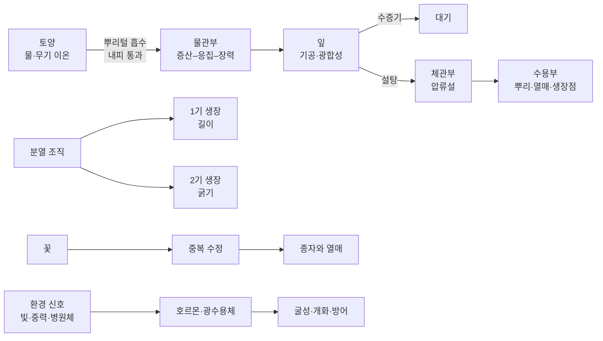
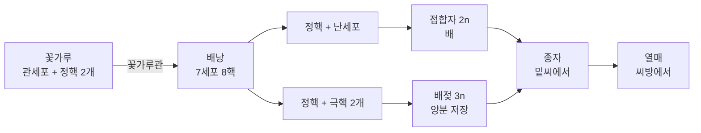

# 일반생명과학 10. 식물의 구조와 기능 — 움직이지 않고 살아남는 몸의 설계
<!-- prev: m2-05, cell-3, ubio-9 -->
<!-- next: ubio-11, ubio-13 -->

> [!NOTE]
> **이 단원의 범위**
> - 식물의 기관과 조직계, 분열 조직과 1기·2기 생장
> - 물과 무기 양분의 흡수와 물관부 수송(수분 퍼텐셜, 증산–응집–장력), 기공 조절
> - 체관부 수송(압류설)
> - 식물 영양과 토양, 공생(뿌리혹, 균근)
> - 속씨식물의 생식(꽃, 중복 수정, 종자와 열매)
> - 식물 호르몬과 환경 반응(굴성, 광주기, 방어)

**학습 목표**

1. 뿌리·줄기·잎을 이루는 세 조직계와 주요 세포 유형을 구별하고, 정단 분열 조직과 측생 분열 조직이 만드는 1기·2기 생장을 설명할 수 있다.
2. 수분 퍼텐셜 $\Psi = \Psi_s + \Psi_p$를 계산하여 세포·토양·대기 사이에서 물이 움직이는 방향을 예측할 수 있다.
3. 뿌리의 흡수 경로와 내피의 역할, 증산–응집–장력설과 기공 개폐의 분자 기작을 근거와 함께 설명할 수 있다.
4. 압류설로 체관부의 공급원–수용부 수송을 정량적으로 설명할 수 있다.
5. 필수 원소와 토양의 성질, 뿌리혹·균근 공생이 식물 영양에 주는 이점을 설명할 수 있다.
6. 속씨식물의 배우체 형성과 중복 수정, 종자·열매의 발달을 설명하고, 식물 호르몬과 광수용체가 굴성·광주기성·방어 반응을 어떻게 조절하는지 실험 결과로 추론할 수 있다.

**이 단원의 학습 사다리**

| 단계 | 무엇을 하나? |
|---|---|
| STEP 1. 이전 학습 다시 보기 | 중2 「식물과 에너지」의 잎 구조·물관·체관, 「세포호흡과 광합성」의 엽록체를 다시 본다 |
| STEP 2. 기초 다지기 | 압력 단위 MPa, 몰 농도와 삼투, 수분 퍼텐셜의 뜻, 표면적 대 부피 비를 준비한다 |
| STEP 3. 핵심 개념 | 몸의 설계 → 생장 → 물의 이동 → 기공 → 당의 이동 → 영양과 공생 → 생식 → 호르몬과 환경 반응 → 방어 |
| STEP 4. 오개념 바로잡기 | "뿌리가 물을 펌프질해 올린다?", "꽃가루가 곧 정자이다?" |
| STEP 5. 전공 맛보기 | 식물생리학의 물 수송 물리학, 식물 분자생물학의 신호 전달 |
| STEP 6. 생활·산업·진로 | 스마트팜, 내건성 작물, 조직 배양, 생물 비료 |

---

## 🗺️ 단원 들어가기

높이 100 m에 이르는 미국삼나무 꼭대기의 잎은 매일 수백 리터의 물을 하늘로 내보낸다. 그런데 이 나무에는 심장도, 근육도 없다. 진공 펌프로 물을 빨아올릴 수 있는 높이는 이론적으로 약 10 m가 한계인데, 나무는 어떻게 그 열 배 높이까지 물을 끌어올릴까?

동물은 배고프면 먹이를 찾아 움직이고, 위험하면 도망친다. 식물은 그 자리에서 평생을 보낸다. 그래서 식물의 몸은 **움직이지 않는 대신 계속 자라고, 환경을 감지하여 몸의 모양과 생리를 바꾸는** 방식으로 설계되어 있다. 이 단원에서는 식물의 몸이 어떻게 만들어지고(구조와 생장), 물과 양분을 어떻게 나르며(수송), 무엇을 먹고(영양), 어떻게 대를 잇고(생식), 어떻게 환경에 반응하는지(호르몬과 방어)를 정량적으로 살펴본다.

---

## STEP 1. 🔙 이전 학습 다시 보기

### 연계표

| 이전 단원 | 고등학교까지 배운 것 | 대학에서 이렇게 확장된다 |
|---|---|---|
| 중2 「식물과 에너지」 '잎의 구조', '물관과 체관' | 표피·잎살·기공·잎맥, 물관은 위로·체관은 위아래로, 증산 작용이 물을 끌어올린다 | 조직계와 세포 유형, **수분 퍼텐셜**로 계산하는 물의 이동, 증산–응집–장력설의 물리적 근거 |
| 중2 「식물과 에너지」 '광합성 산물의 이동과 저장' | 녹말 → 설탕으로 바꾸어 체관으로 이동 | **압류설**: 공급원에서의 능동 적재, 삼투, 압력 차에 의한 집단 흐름 |
| 「세포호흡과 광합성」 '엽록체의 구조와 기능', STEP 5 'C₄·CAM 식물' | 명반응과 캘빈 회로, 광호흡의 존재 | 광합성과 증산의 **맞교환**(기공), 건조 적응으로서의 C₄·CAM |
| 「생물 다양성」 '식물의 육상 진출과 다양성' | 관다발 식물·종자식물·속씨식물의 진화 | 속씨식물 한 개체의 몸 설계, 배우체 형성과 중복 수정의 세부 |
| 중3 「생식과 유전」 | 꽃의 구조, 수분과 수정 | 배낭(암배우체)의 7세포 8핵, 배젖의 3n, 종자 휴면과 발아의 호르몬 조절 |

### 준비 운동 (사전 진단)

**Q1.** 물관과 체관에서 각각 이동하는 주된 물질과 방향을 쓰시오.

**Q2.** 세포를 진한 설탕 용액에 넣으면 물은 세포 안과 밖 중 어느 쪽으로 이동하는가? 그 까닭은?

**Q3.** 기공을 둘러싼 두 세포의 이름과, 기공을 통해 드나드는 기체 세 가지를 쓰시오.

**Q4.** 꽃의 구조 중 수정 후 열매가 되는 부분과 종자가 되는 부분은?

정답 및 해설

**Q1.** 물관: 물과 무기 양분, 뿌리 → 잎(위쪽). 체관: 광합성 산물(주로 설탕), 잎 → 필요한 곳(위·아래 모두).

**Q2.** 세포 밖으로. 물은 용질 농도가 낮은 쪽(세포 안)에서 높은 쪽(진한 설탕 용액)으로 삼투한다. 이 단원에서는 이것을 "수분 퍼텐셜이 높은 곳에서 낮은 곳으로"라고 다시 말한다.

**Q3.** 공변세포. 이산화 탄소, 산소, 수증기.

**Q4.** 씨방 → 열매, 밑씨 → 종자.

---

## STEP 2. 🧱 기초 다지기

### ① 압력의 단위 — MPa에 익숙해지기

식물생리학에서는 물의 상태를 압력 단위로 나타낸다. 주로 **메가파스칼(MPa)** 을 쓴다.

| 단위 | 값 | 감 잡기 |
|---|---|---|
| $1\ \mathrm{MPa}$ | $10^6\ \mathrm{Pa} = 10\ \mathrm{bar}$ | 약 9.87기압 |
| 대기압 | $0.101\ \mathrm{MPa}$ | 해수면 1기압 |
| 자동차 타이어 | 약 $0.2\ \mathrm{MPa}$ (대기압보다 높은 정도) | 팽팽한 식물 세포의 팽압은 이보다 몇 배 크다 |
| 물기둥 1 m의 무게가 만드는 압력 | $\rho g h = 1000 \times 9.8 \times 1 = 9800\ \mathrm{Pa} \approx 0.01\ \mathrm{MPa}$ | 나무 높이 10 m마다 약 0.1 MPa |

### ② 몰 농도와 삼투 — 반트호프 식

용질이 녹으면 물의 '자유로움'이 줄어든다. 묽은 용액에서 그 정도는 녹은 **입자의 수**에 비례한다. 일반화학의 삼투압 식(반트호프 식)을 식물생리학에서는 **용질 퍼텐셜**로 쓴다.

$$
\Psi_s = -iCRT
$$

- $i$: 반트호프 인자(설탕 1, $\mathrm{NaCl}$ 이론값 2)
- $C$: 몰 농도($\mathrm{mol/L}$)
- $R = 0.008314\ \mathrm{L\cdot MPa/(mol\cdot K)}$ ($= 8.314\ \mathrm{J/(mol\cdot K)}$를 단위만 바꾼 값)
- $T$: 절대 온도(K)

#### 예제 1 — 설탕 용액의 용질 퍼텐셜

20 °C에서 0.30 M 설탕 용액의 용질 퍼텐셜을 구하시오.

**풀이** ① 식: $\Psi_s = -iCRT$ ② 대입: $T = 273 + 20 = 293\ \mathrm{K}$

$$
\Psi_s = -(1)(0.30\ \mathrm{mol/L})(0.008314\ \mathrm{L\cdot MPa/(mol\cdot K)})(293\ \mathrm{K}) = -0.731\ \mathrm{MPa}
$$

③ 유효 숫자 두 자리로 $\Psi_s \approx -0.73\ \mathrm{MPa}$. ④ 의미: 순수한 물보다 물의 '퍼텐셜'이 0.73 MPa만큼 낮다. 순수한 물이 이 용액 쪽으로 들어가려는 경향이 그만큼 크다는 뜻이다.

> [!TIP]
> 💡 **요령** — 20 °C에서 $RT \approx 2.44\ \mathrm{L\cdot MPa/mol}$이다. 설탕 용액이라면 "몰 농도 × 2.44"에 마이너스만 붙이면 용질 퍼텐셜이 된다(25 °C에서는 약 2.48).

### ③ 수분 퍼텐셜 — 물이 흐르는 '높이'

**수분 퍼텐셜(water potential, $\Psi$)** 은 물 1 부피당 자유 에너지를 순수한 물(대기압, 같은 온도)을 0으로 놓고 잰 값이다. 물은 언제나 **$\Psi$가 높은 곳에서 낮은 곳으로** 이동한다. 공이 언덕 위에서 아래로 굴러가는 것과 같다.

$$
\Psi = \Psi_s + \Psi_p\ (+\ \Psi_g)
$$

| 성분 | 이름 | 부호 | 뜻 |
|---|---|---|---|
| $\Psi_s$ | 용질 퍼텐셜(삼투 퍼텐셜) | 0 또는 음 | 용질이 녹아 있으면 낮아진다 |
| $\Psi_p$ | 압력 퍼텐셜 | 양·음 모두 가능 | 세포의 팽압은 양, 물관 속 장력은 음 |
| $\Psi_g$ | 중력 퍼텐셜 | 높이에 비례 | 높이 1 m마다 약 $+0.01\ \mathrm{MPa}$. 키 큰 나무에서만 중요 |

### ④ 표면적 대 부피 비

식물의 몸은 '넓게 펼치는' 설계이다. 잎은 얇고 넓어 빛과 $\mathrm{CO_2}$를 많이 받고, 뿌리털은 가늘고 수가 많아 흡수 표면을 넓힌다. 반지름 $r$인 원기둥의 옆넓이 대 부피 비는 $2/r$이므로, 지름이 10분의 1로 가늘어지면 같은 부피당 표면적은 10배가 된다.

---

## STEP 3. 📘 핵심 개념

### ① 식물의 기관과 조직계

#### (1) 세 기관 — 뿌리, 줄기, 잎

관다발 식물의 몸은 땅속의 **뿌리계(root system)** 와 땅 위의 **줄기계(shoot system)** 로 나뉜다. 줄기계는 줄기와 잎, 그리고 생식 기관인 꽃으로 이루어진다.

| 기관 | 주된 기능 | 변형의 예 |
|---|---|---|
| **뿌리** | 고정, 물·무기 이온 흡수, 저장 | 원뿌리(쌍떡잎)·수염뿌리(외떡잎), 저장뿌리(고구마), 버팀뿌리(옥수수), 호흡근(맹그로브) |
| **줄기** | 잎과 꽃을 지지, 물질 수송, 마디와 마디 사이로 구성 | 땅속줄기(감자의 덩이줄기), 기는줄기(딸기), 비늘줄기(양파) |
| **잎** | 광합성, 기체 교환, 증산 | 덩굴손(완두), 가시(선인장), 저장 잎(양파 비늘), 포충엽(파리지옥) |

줄기의 잎이 붙는 곳을 **마디**, 잎과 줄기 사이의 겨드랑이에 있는 눈을 **곁눈(액아)**, 줄기 끝의 눈을 **끝눈(정아)** 이라 한다.

#### (2) 세 조직계

모든 기관은 같은 세 **조직계(tissue system)** 가 연속해서 이어진 구조이다.

| 조직계 | 구성 | 기능 |
|---|---|---|
| **표피 조직계** | 표피(뿌리털, 공변세포, 털 포함), 큐티클. 2기 생장한 부분은 주피 | 보호, 물 손실 방지, 흡수(뿌리털), 기체 교환(기공) |
| **관다발 조직계** | 물관부(헛물관, 물관 요소), 체관부(체관 요소, 반세포) | 장거리 수송, 지지 |
| **기본 조직계** | 표피와 관다발 사이의 모든 조직(피층, 수, 잎살) | 광합성, 저장, 지지 |

#### (3) 주요 세포 유형

| 세포 | 세포벽 | 살아 있나? | 역할 |
|---|---|---|---|
| **유조직 세포** | 얇은 1차벽 | 살아 있음 | 광합성(잎살), 저장, 분화 능력 유지(상처 치유) |
| **후각 조직 세포** | 고르지 않게 두꺼운 1차벽 | 살아 있음 | 자라는 부위를 유연하게 지지(셀러리 줄기의 줄) |
| **후벽 조직 세포** | 리그닌이 쌓인 2차벽 | 대개 성숙하면 죽음 | 단단한 지지(섬유, 복숭아씨의 석세포) |
| **헛물관** | 리그닌화, 막공으로 연결 | 죽음 | 물 수송(모든 관다발 식물) |
| **물관 요소** | 리그닌화, 끝벽에 구멍(천공판) | 죽음 | 물 수송(주로 속씨식물), 헛물관보다 효율적 |
| **체관 요소** | 체판으로 연결 | 살아 있으나 핵·리보솜 없음 | 당 수송 |
| **반세포** | 원형질 연락사로 체관 요소와 연결 | 살아 있음 | 체관 요소의 대사를 대신하고 당을 적재 |

> [!IMPORTANT]
> 물관부의 수송 세포는 **죽은 세포의 빈 관**이고, 체관부의 수송 세포는 **살아 있는 세포**이다. 물관은 '수도관', 체관은 '살아 있는 컨베이어'라고 기억하자. 이 차이가 물은 **장력(음압)** 으로 끌어올리고 당은 **양압**으로 밀어 보내는 수송 방식의 차이로 이어진다.

#### (4) 뿌리·줄기·잎의 내부 구조

| 기관 | 쌍떡잎식물 | 외떡잎식물 |
|---|---|---|
| 뿌리 | 중심주의 가운데에 물관부가 별 모양, 그 사이에 체관부 | 중심에 수가 있고 물관부·체관부가 고리 모양으로 번갈아 배열 |
| 줄기 | 관다발이 고리 모양으로 배열(형성층 있음) | 관다발이 기본 조직 전체에 흩어져 있음(형성층 없음) |
| 잎 | 그물맥, 울타리 조직과 해면 조직이 구분됨 | 나란히맥, 잎살이 비교적 균일 |

잎의 **울타리 조직**은 엽록체가 많은 길쭉한 세포가 빽빽이 늘어서 빛을 받고, 아래쪽 **해면 조직**은 세포 사이 공간이 넓어 기공으로 들어온 $\mathrm{CO_2}$가 퍼진다. 이 공간에서 물이 증발하므로 증산이 일어나는 실제 장소이기도 하다.

### ② 분열 조직과 1기·2기 생장

#### (1) 무한 생장과 분열 조직

동물은 대개 정해진 크기까지 자라고 멈추지만(유한 생장), 식물은 평생 새 조직을 만든다(**무한 생장**). 이것이 가능한 것은 분열 능력을 유지한 미분화 세포 집단, 즉 **분열 조직(meristem)** 이 있기 때문이다.

| 분열 조직 | 위치 | 만드는 생장 | 결과 |
|---|---|---|---|
| **정단 분열 조직** | 뿌리 끝, 줄기 끝(끝눈·곁눈) | **1기 생장** | 길이가 늘어남, 잎·가지·꽃 형성 |
| **관다발 형성층** | 2기 생장하는 줄기·뿌리의 물관부와 체관부 사이 | **2기 생장** | 안쪽에 2기 물관부(목재), 바깥쪽에 2기 체관부 |
| **코르크 형성층** | 피층 또는 2기 체관부 바깥 | 2기 생장 | 코르크(주피) — 표피를 대신한 보호층 |
| 절간 분열 조직 | 벼과 식물 마디 사이 아래쪽 | 1기 생장 | 잘린 잔디가 다시 자라는 까닭 |

#### (2) 뿌리 끝의 1기 생장

뿌리 끝은 바깥에서부터 **뿌리골무(근관)** — 분열 구역 — 신장 구역 — 성숙(분화) 구역으로 나뉜다. 뿌리골무는 흙을 뚫고 나갈 때 정단 분열 조직을 보호하고 중력을 감지한다(⑫ 굴성). 신장 구역의 세포는 액포에 물을 채워 길이가 여러 배로 늘어나는데, 이 '부풀어 밀어내기'가 뿌리를 흙 속으로 밀어 넣는 힘이다. 뿌리털은 성숙 구역에서 생긴다.

#### (3) 2기 생장 — 나무가 굵어지는 방법

쌍떡잎식물과 겉씨식물의 목본에서 관다발 형성층은 원통 모양으로 줄기를 둘러싸고, 안쪽으로는 2기 물관부를, 바깥쪽으로는 2기 체관부를 만든다. 대개 안쪽으로 훨씬 많이 만들어 목재가 쌓인다.

- **나이테**: 온대에서는 봄에 크고 벽이 얇은 물관 세포(춘재)를, 여름 말에 작고 벽이 두꺼운 세포(추재)를 만든다. 추재와 다음 해 춘재의 경계가 나이테로 보인다. 나이테 폭으로 과거의 기후를 추정하는 학문이 나무나이테 연대학이다.
- **심재와 변재**: 오래된 안쪽 물관부(심재)는 물을 나르지 않고 수지 등이 쌓여 진한 색을 띤다. 바깥쪽 변재가 실제로 물을 나른다. 속이 빈 고목이 살아 있는 까닭이다.
- **수피(껍질)**: 관다발 형성층 바깥쪽 전체(2기 체관부 + 주피). 체관부가 수피에 있으므로, 수피를 고리 모양으로 벗기면(**환상 박피**) 뿌리로 가는 당의 공급이 끊겨 결국 나무가 죽는다.

외떡잎식물은 대부분 관다발 형성층이 없어 2기 생장을 하지 않는다(야자나무는 다른 방식으로 굵어진다).

#### 예제 2 — 나무의 나이 어림하기

어떤 소나무 줄기의 둘레를 가슴 높이에서 재었더니 94.2 cm였다. 수피 두께는 약 1.0 cm이고, 같은 숲에서 잘린 나무의 평균 나이테 폭은 0.35 cm였다. 이 높이에서 줄기가 자란 햇수를 어림하시오.

**풀이**
① 지름 $d = \dfrac{94.2\ \mathrm{cm}}{\pi} = 30.0\ \mathrm{cm}$, 반지름 $15.0\ \mathrm{cm}$
② 목재 부분의 반지름 $= 15.0 - 1.0 = 14.0\ \mathrm{cm}$
③ 햇수 $\approx \dfrac{14.0\ \mathrm{cm}}{0.35\ \mathrm{cm/년}} = 40$년
④ 의미: 나이테 폭이 해마다 같다는 가정에 기댄 어림이다. 실제 나이테는 어릴 때 넓고 늙을수록 좁아지며, 가물었던 해에는 좁다. 정확한 나이는 생장추로 심을 뽑아 나이테를 직접 센다.

### ③ 수분 퍼텐셜로 보는 세포와 물

#### (1) 세포 하나의 물 출입

식물 세포는 단단한 세포벽에 둘러싸여 있다. 물이 들어와 세포가 부풀면 벽이 되밀어 **팽압**($\Psi_p > 0$)이 생긴다. 물이 들어올수록 $\Psi_p$가 커져 결국 세포의 $\Psi$가 바깥과 같아지면 알짜 이동이 멈춘다.

| 세포 상태 | $\Psi_p$ | 겉모습 |
|---|---|---|
| 팽윤(팽팽함) | 크다(양) | 잎과 어린 줄기가 꼿꼿함 |
| 시듦 직전(원형질 분리 시작점) | 0 | 세포막이 벽에 겨우 닿아 있음 |
| 원형질 분리 | 0 (막이 벽에서 떨어짐) | 잎이 축 처짐 |

#### 예제 3 — 세포를 여러 용액에 넣으면

20 °C에서 시든 세포(용질 퍼텐셜 $-0.80\ \mathrm{MPa}$, $\Psi_p = 0$)가 있다. 세포의 부피 변화는 무시한다.
(1) 이 세포를 순수한 물에 넣으면 물은 어느 쪽으로 이동하고, 평형에서 $\Psi_p$는 얼마인가?
(2) 같은 시든 세포를 0.40 M 설탕 용액에 넣으면?

**풀이**
(1) 세포 $\Psi = -0.80 + 0 = -0.80\ \mathrm{MPa}$, 물 $\Psi = 0$. 물은 높은 곳(물, 0)에서 낮은 곳(세포)으로 **들어간다**. 평형에서 세포 $\Psi = 0$이 되어야 하므로 $\Psi_p = 0 - (-0.80) = +0.80\ \mathrm{MPa}$.
(2) 용액 $\Psi_s = -(0.40)(2.436) = -0.97\ \mathrm{MPa}$. 세포($-0.80$)가 용액($-0.97$)보다 높으므로 물이 세포에서 **빠져나가** 원형질 분리가 일어난다.

같은 세포라도 주위 용액에 따라 물의 방향이 바뀐다. 방향을 정하는 것은 세포 '안의 농도'가 아니라 **양쪽 $\Psi$의 차이**이다.

#### (2) 아쿠아포린

물 분자는 인지질 이중층을 조금씩 통과하지만, 대부분은 막의 물 통로 단백질인 **아쿠아포린(aquaporin)** 을 통해 빠르게 이동한다. 아쿠아포린은 물이 이동하는 **방향**을 바꾸지 못하고(방향은 $\Psi$ 차이가 정한다) **속도**만 바꾼다. 식물은 아쿠아포린의 인산화 등으로 뿌리의 물 투과도를 조절한다.

### ④ 뿌리의 흡수 — 물과 무기 이온이 들어오는 길

#### (1) 세 가지 경로

| 경로 | 지나는 곳 | 특징 |
|---|---|---|
| **아포플라스트 경로** | 세포벽과 세포 사이 공간(세포막 바깥의 연속된 공간) | 막을 건너지 않아 빠르지만 선택성이 없다 |
| **심플라스트 경로** | 원형질 연락사로 이어진 세포질 | 처음 한 번 막을 건너면 세포질을 따라 이동 |
| 막경유 경로 | 세포에서 세포로, 막을 반복해서 통과 | 아쿠아포린의 영향을 크게 받음 |

#### (2) 내피와 카스파리선 — 뿌리의 검문소

피층의 가장 안쪽 한 층인 **내피(endodermis)** 의 세포벽에는 **카스파리선(Casparian strip)** 이라는 수베린(왁스 성분) 띠가 둘러져 있다. 이 띠는 아포플라스트 경로를 막으므로, 물과 이온이 중심주(관다발)로 들어가려면 **반드시 내피 세포의 세포막을 한 번 통과**해야 한다.

> [!TIP]
> 💡 **비유** — 아포플라스트는 담장 사이 골목길, 카스파리선은 골목 끝을 막은 담이다. 중심주로 가려면 누구든 내피라는 '검문소 건물(세포막)'을 통과해야 하고, 그곳의 운반체 단백질이 들여보낼 이온과 막을 이온을 고른다.

#### (3) 무기 이온의 능동 흡수

토양 용액의 무기 이온 농도는 뿌리 세포보다 훨씬 낮은 경우가 많다. 뿌리 세포는 **양성자 펌프($\mathrm{H^+}$-ATP 가수 분해 효소)** 로 $\mathrm{H^+}$를 내보내 막전위(안쪽 음)와 $\mathrm{H^+}$ 농도 기울기를 만들고, 이를 이용한다.

- $\mathrm{K^+}$ 같은 양이온: 안쪽이 음인 막전위를 따라 통로로 들어온다.
- $\mathrm{NO_3^-}$ 같은 음이온: $\mathrm{H^+}$와 함께 들어오는 **공동 수송**($\mathrm{H^+}$/질산 공동 수송체).

이 원리는 「세포의 구조와 막 수송」의 화학 삼투·공동 수송과 같다. 동물 세포가 $\mathrm{Na^+}$ 기울기를 쓴다면, 식물·균류 세포는 주로 $\mathrm{H^+}$ 기울기를 쓴다.

#### (4) 근압과 일액 현상

밤에 증산이 거의 없을 때, 뿌리는 중심주로 이온을 계속 들여보낸다. 그러면 중심주의 $\Psi$가 낮아져 물이 들어오고, 물관에 양의 압력인 **근압(root pressure)** 이 생긴다. 이른 아침 풀잎 끝에 맺힌 물방울(**일액 현상**)이 그 증거이다. 그러나 근압은 대개 0.1~0.2 MPa 정도에 그쳐 물을 수 m 이상 밀어 올리지 못하고, 근압을 만들지 않는 식물도 많다. 키 큰 나무의 물 수송은 다른 원리로 설명해야 한다.

### ⑤ 물관부 수송 — 증산–응집–장력설

#### (1) 원리

1. **증산**: 잎살 세포벽을 적신 얇은 물막에서 물이 세포 사이 공간으로 증발하고, 기공을 통해 바깥으로 확산한다.
2. **장력의 발생**: 물이 증발하면 세포벽의 미세한 틈 속 물 표면이 오목해지고, 표면 장력 때문에 물에 **음압(장력)** 이 생긴다. 이 장력이 잎맥의 물관으로 전달된다.
3. **응집**: 물 분자끼리는 수소 결합으로 서로 강하게 끌어당긴다(**응집력**). 그래서 물관 속 물기둥은 끊어지지 않고 잎에서 뿌리까지 하나의 사슬로 이어진다.
4. **부착**: 물 분자는 물관의 친수성 벽에도 붙는다(**부착력**). 중력에 맞서 물기둥을 붙잡아 준다.
5. 결과적으로 잎에서 당긴 장력이 줄기를 거쳐 뿌리까지 전해지고, 토양의 물이 뿌리로 들어온다.

이 수송에는 식물의 대사 에너지가 직접 들지 않는다. 물을 끌어올리는 에너지는 결국 물을 증발시키는 **태양 에너지**이다.

#### (2) 왜 10 m를 넘을 수 있는가

진공 펌프는 물을 '빨아들이는' 것이 아니라, 대기압이 물을 밀어 올리게 할 뿐이다. 그래서 한계 높이는 $h = P_{\text{대기}}/(\rho g) = 101\,300 / (1000 \times 9.8) \approx 10.3\ \mathrm{m}$이다. 물관의 물기둥은 대기압에 기대지 않고 **응집력으로 위에서 끌어당긴다**. 가는 관 속에서 기포 없이 잘 붙은 물은 수십 MPa의 장력도 견딜 수 있음이 실험으로 알려져 있으므로, 100 m 나무에 필요한 장력(아래 예제)을 감당할 수 있다.

#### 예제 4 — 60 m 나무에 필요한 장력

높이 60 m인 나무 꼭대기의 잎까지 물을 끌어올리려 한다. 토양의 수분 퍼텐셜은 $-0.3\ \mathrm{MPa}$이다. 물관 속 마찰을 이기는 데 높이 1 m마다 약 $0.01\ \mathrm{MPa}$의 퍼텐셜 차가 추가로 든다고 할 때, 꼭대기 잎 물관의 수분 퍼텐셜은 적어도 얼마보다 낮아야 하는가? ($\rho g = 0.0098\ \mathrm{MPa/m}$)

**풀이**
① 중력을 이기는 데 필요한 차이: $0.0098 \times 60 = 0.59\ \mathrm{MPa}$
② 마찰을 이기는 데 필요한 차이: $0.01 \times 60 = 0.60\ \mathrm{MPa}$
③ 꼭대기 물관의 $\Psi < -0.3 - 0.59 - 0.60 = -1.49\ \mathrm{MPa}$, 즉 약 $-1.5\ \mathrm{MPa}$보다 낮아야 한다.
④ 의미: 물관 속 물은 1기압(0.1 MPa)의 10배가 넘는 장력 아래 있다. 실제로 키 큰 나무 꼭대기 잎의 물관 수분 퍼텐셜은 대낮에 이 정도로 낮게 측정된다.

#### (3) 토양–식물–대기 연속체

물의 이동은 토양에서 대기까지 이어진 $\Psi$의 '내리막'으로 정리된다. 대기의 수분 퍼텐셜은 상대 습도(RH)로 계산한다.

$$
\Psi_{\text{대기}} = \frac{RT}{\bar{V}_w}\ln(\mathrm{RH})
$$

($\bar{V}_w = 1.80\times10^{-5}\ \mathrm{m^3/mol}$: 물의 몰 부피)

| 위치 (20 °C의 맑은 낮, 예시) | $\Psi$ (MPa) |
|---|---|
| 젖은 토양 | $-0.3$ |
| 뿌리 물관 | $-0.6$ |
| 줄기 물관(10 m 높이) | $-0.8$ |
| 잎 세포 | $-1.0$ |
| 잎 속 공기(RH 99%) | 약 $-1.4$ |
| 바깥 공기(RH 50%) | 약 $-94$ |

마지막 두 칸에서 $\Psi$가 수십 MPa나 떨어진다. 물 이동의 가장 큰 '낙차'는 잎과 대기 사이에 있고, 그래서 물이 가장 크게 저항받는 문, 즉 **기공**이 증산 속도를 결정하는 조절 지점이 된다. 습도가 90%로 높아지면 바깥 공기의 $\Psi$는 약 $-14\ \mathrm{MPa}$로 올라가 낙차가 줄고 증산이 느려진다.

#### (4) 증거와 한계 — 공동화

- **압력실 측정**: 잎이 달린 가지를 잘라 압력실에 넣고 압력을 가해 자른 면에 물이 막 비칠 때의 압력을 재면, 물관 속 장력의 크기를 알 수 있다. 낮에 더 큰 장력이 측정된다.
- **줄기 지름의 변화**: 증산이 활발한 낮에는 물관 속 장력 때문에 나무줄기가 아주 조금 가늘어지고, 밤에 회복된다. 잎이 먼저 반응하고 줄기 아래쪽이 나중에 반응한다(위에서 끌어당긴다는 증거).
- **공동화(cavitation)**: 장력이 너무 크거나 물이 얼었다 녹으면 물기둥이 끊겨 기포가 생긴다. 기포가 찬 물관은 물을 나르지 못한다. 헛물관과 물관 요소 사이의 **막공**은 기포가 옆 관으로 번지는 것을 막고, 물은 옆 관으로 우회한다. 가뭄에 나무가 말라 죽는 주된 원인 중 하나가 공동화이다.

### ⑥ 기공 조절 — 광합성과 증산의 맞교환

#### (1) 기공은 왜 조절해야 하는가

기공이 열리면 $\mathrm{CO_2}$가 들어와 광합성이 일어나지만, 같은 문으로 물이 빠져나간다. 잎 속 공기와 바깥 공기 사이의 수증기 농도 차는 $\mathrm{CO_2}$ 농도 차보다 훨씬 크므로, 식물은 $\mathrm{CO_2}$ 한 분자를 얻을 때마다 물을 수백 분자나 잃는다. 흡수한 물의 대부분(90% 이상)이 증산으로 나간다. 그래서 기공의 열림 정도는 '광합성을 더 할 것인가, 물을 아낄 것인가'의 끊임없는 맞교환이다.

#### (2) 공변세포가 부풀면 열린다

공변세포의 세포벽은 셀룰로스 미세 섬유가 둘레 방향(방사상)으로 감겨 있어, 부풀 때 굵어지지 못하고 길어진다. 두 공변세포는 양 끝이 붙어 있으므로 길어지면서 바깥으로 휘고, 그 사이의 구멍이 벌어진다.

| 단계 | 기공이 열릴 때 | 기공이 닫힐 때 |
|---|---|---|
| 신호 | 청색광(포토트로핀), 잎 속 낮은 $\mathrm{CO_2}$, 아침의 생체 시계 | 앱시스산(ABA, 가뭄 신호), 높은 $\mathrm{CO_2}$, 어둠 |
| 양성자 펌프 | 활성화 → $\mathrm{H^+}$ 유출, 막 과분극 | 억제 |
| 이온 이동 | $\mathrm{K^+}$가 통로로 유입, $\mathrm{Cl^-}$ 유입과 말산 합성으로 전하 균형 | $\mathrm{Ca^{2+}}$ 증가 → 음이온 통로 열림 → 탈분극 → $\mathrm{K^+}$ 유출 |
| 공변세포 $\Psi$ | 낮아짐 → 물 유입 | 높아짐 → 물 유출 |
| 결과 | 팽압 증가, 기공 열림 | 팽압 감소, 기공 닫힘 |

#### 예제 5 — $\mathrm{K^+}$ 유입이 만드는 수분 퍼텐셜 변화

25 °C에서 기공이 열리는 동안 공변세포의 용질 농도가 $\mathrm{K^+}$와 그 짝 음이온의 유입으로 0.30 osmol/L만큼 늘었다. 공변세포의 용질 퍼텐셜은 얼마나 변하는가? (입자 농도 osmol/L을 $iC$로 본다.)

**풀이** $\Delta\Psi_s = -\Delta(iC)RT = -(0.30)(0.008314)(298) = -0.74\ \mathrm{MPa}$. 공변세포의 $\Psi$가 이웃 표피 세포보다 크게 낮아지므로 물이 들어와 팽압이 높아지고 기공이 열린다. 몇 분 안에 이 정도의 이온을 옮기는 일은 양성자 펌프가 ATP로 만든 기울기 덕분이다.

#### (3) 건조 환경의 전략

| 전략 | 방법 | 예 |
|---|---|---|
| 기공 수와 위치 | 잎 뒷면에 기공, 움푹 들어간 홈 속에 기공, 털로 덮음 | 협죽도 |
| 큐티클 | 두꺼운 왁스층 | 상록수, 선인장 |
| 잎의 축소 | 잎을 가시로, 광합성은 줄기가 | 선인장 |
| C₄ 광합성 | $\mathrm{CO_2}$를 농축하여 기공을 덜 열고도 광합성 | 옥수수, 사탕수수 |
| CAM 광합성 | 밤에 기공을 열어 $\mathrm{CO_2}$를 유기산으로 저장, 낮에 기공을 닫고 캘빈 회로 | 선인장, 파인애플, 돌나물 |

C₄ 식물은 같은 양의 탄소를 고정할 때 잃는 물이 C₃ 식물의 대략 절반 수준이다. 「물질대사·세포호흡·광합성」에서 배운 C₄·CAM 경로는 결국 **기공 조절 문제의 생화학적 해법**이다.

### ⑦ 체관부 수송 — 압류설

#### (1) 공급원에서 수용부로

체관부는 당을 **공급원(source)** 에서 **수용부(sink)** 로 나른다. 공급원은 당을 만들거나 내놓는 기관(다 자란 잎, 봄철에 녹말을 분해하는 저장 뿌리), 수용부는 당을 소비하거나 저장하는 기관(뿌리, 어린 잎, 자라는 열매, 덩이줄기)이다. 같은 기관이 계절에 따라 공급원이 되기도 하고 수용부가 되기도 하므로, 체관의 흐름 방향은 위·아래 모두 가능하다.

#### (2) 압류설(압력 흐름설)

1. **적재**: 공급원의 반세포·체관 요소는 $\mathrm{H^+}$/설탕 공동 수송체로 설탕을 능동적으로 체관에 쌓는다(아포플라스트 적재). 원형질 연락사를 통해 확산으로 적재하는 식물도 있다(심플라스트 적재).
2. **물의 유입**: 체관 속 설탕 농도가 높아져 $\Psi_s$가 크게 낮아지면, 이웃 물관에서 물이 삼투로 들어와 **팽압이 높아진다**.
3. **집단 흐름**: 공급원 쪽 체관은 압력이 높고, 수용부 쪽은 설탕이 빠져나가 압력이 낮다. 이 **압력 차**로 체관액 전체가 한꺼번에 흐른다(확산이 아니라 **집단 흐름**).
4. **하역**: 수용부에서 설탕이 빠져나가고(능동 또는 수동), 물은 다시 물관으로 돌아간다.

#### 예제 6 — 공급원과 수용부의 압력 차

20 °C에서 공급원 잎의 체관 설탕 농도는 0.60 M이고 이웃 물관의 수분 퍼텐셜은 $-0.60\ \mathrm{MPa}$이다. 수용부 뿌리의 체관 설탕 농도는 0.20 M이고 이웃 물관의 수분 퍼텐셜은 $-0.30\ \mathrm{MPa}$이다. 체관과 이웃 물관이 각각 물에 대해 평형에 있고 설탕 외의 용질은 무시할 때, 두 곳의 체관 팽압과 그 차이를 구하시오.

**풀이**
① 평형이면 체관의 $\Psi$ = 이웃 물관의 $\Psi$이므로 $\Psi_p = \Psi_{\text{물관}} - \Psi_s$
② 공급원: $\Psi_s = -(0.60)(2.436) = -1.46\ \mathrm{MPa}$ → $\Psi_p = -0.60 + 1.46 = +0.86\ \mathrm{MPa}$
③ 수용부: $\Psi_s = -(0.20)(2.436) = -0.49\ \mathrm{MPa}$ → $\Psi_p = -0.30 + 0.49 = +0.19\ \mathrm{MPa}$
④ 압력 차 $= 0.86 - 0.19 = 0.67\ \mathrm{MPa}$, 공급원에서 수용부 쪽으로 체관액을 민다.

이 계산에서 체관의 압력은 **양**이고 물관의 압력은 **음**이다. 같은 줄기 안에서 바로 옆에 붙은 두 관이 정반대의 압력 상태로 일한다.

#### (3) 압류설의 증거

- **진딧물 실험**: 진딧물의 주둥이(구침)는 체관 요소 하나에 정확히 꽂힌다. 진딧물을 마취하고 구침만 잘라 두면 체관액이 계속 흘러나온다. 체관 안이 **양압**이라는 직접 증거이며, 흘러나온 액에는 설탕이 질량으로 대략 10~20%에 이를 만큼 높은 농도로 들어 있다.
- **이동 속도**: 방사성 탄소($^{14}\mathrm{C}$)로 표지한 $\mathrm{CO_2}$를 잎에 주면 표지된 설탕이 시간당 약 1 m 정도의 속도로 이동한다. 확산만으로는 이 속도를 설명할 수 없다.
- **환상 박피**: 수피를 고리 모양으로 벗기면 위쪽 가장자리에 당이 쌓여 부풀어 오른다.

> [!TIP]
> 💡 **비유** — 물관은 위에서 줄을 당겨 끌어올리는 두레박, 체관은 한쪽 끝에서 물풍선을 쥐어짜 반대쪽으로 밀어 보내는 호스이다. 하나는 당기고(장력), 하나는 민다(팽압).

### ⑧ 식물 영양과 토양

#### (1) 필수 원소

**필수 원소**는 그 원소가 없으면 식물이 생활사를 완성하지 못하는 원소이다. 흙 없이 영양액에서 기르는 **수경 재배** 실험으로 원소를 하나씩 빼 보며 확인하였다.

| 구분 | 원소 | 주요 역할(예) |
|---|---|---|
| **다량 원소** (건조 질량의 약 0.1% 이상) | C, H, O | 유기물의 골격 — 공기와 물에서 |
| | N | 아미노산, 핵산, 엽록소 |
| | P | 핵산, ATP, 인지질 |
| | K | 삼투 조절(기공), 효소 활성화 |
| | Ca | 세포벽(펙틴), 신호 전달($\mathrm{Ca^{2+}}$) |
| | Mg | 엽록소의 중심 원자, ATP와 결합 |
| | S | 시스테인·메싸이오닌 |
| **미량 원소** | Fe, Mn, Zn, Cu, Ni, Mo, B, Cl | 전자 전달(Fe, Cu), 물 분해(Mn), 질산 환원·질소 고정(Mo) 등 효소의 보조 인자 |

**결핍 증상과 이동성**: N, P, K, Mg처럼 체관으로 다시 옮겨질 수 있는 원소가 부족하면 **늙은 잎**에서 먼저 증상이 나타난다(늙은 잎에서 빼내 어린 잎으로 보내므로). Ca, Fe, B처럼 잘 옮겨지지 않는 원소는 **어린 잎**에서 먼저 증상이 나타난다. 질소 결핍은 늙은 잎이 노랗게 되는 황화로 흔히 나타난다.

#### (2) 토양 — 살아 있는 저장고

| 토양의 성질 | 내용 | 식물에의 의미 |
|---|---|---|
| 입자 크기 | 모래(굵음) > 실트 > 점토(가늚) | 모래는 통기·배수가 좋고, 점토는 물과 양분을 잘 붙잡는다. 둘이 섞인 양토가 재배에 좋다 |
| 부식(유기물) | 분해 중인 유기물 | 물을 머금고, 양분을 천천히 내놓고, 토양을 엉기게 하여 통기 개선 |
| **양이온 교환** | 점토와 부식의 표면은 음전하를 띠어 $\mathrm{K^+}$, $\mathrm{Ca^{2+}}$, $\mathrm{Mg^{2+}}$를 붙잡는다 | 뿌리가 내놓는 $\mathrm{H^+}$(그리고 호흡의 $\mathrm{CO_2}$가 만든 탄산)가 양이온을 밀어내 흡수할 수 있게 한다 |
| 음이온 | $\mathrm{NO_3^-}$ 등은 입자에 잘 붙지 않음 | 비에 쉽게 씻겨 나가 지하수 오염(부영양화)의 원인이 된다 |
| 토양 생물 | 세균, 균류, 지렁이 등 | 유기물 분해, 질소 순환, 공생 |

> [!WARNING]
> 비료를 많이 줄수록 좋은 것은 아니다. 식물이 쓰고 남은 질산염과 인산염은 강과 바다로 흘러가 조류를 폭발적으로 늘리고(부영양화), 지나친 관개는 토양에 염을 쌓아(염류화) 오히려 뿌리의 물 흡수를 방해한다(문제 6 참고).

### ⑨ 공생 — 뿌리혹과 균근

#### (1) 질소는 공기에 가득한데 왜 부족할까

대기의 약 78%가 질소($\mathrm{N_2}$)이지만, $\mathrm{N\equiv N}$ 삼중 결합이 매우 강해 식물은 이를 직접 쓰지 못한다. 식물이 흡수하는 질소는 $\mathrm{NH_4^+}$와 $\mathrm{NO_3^-}$이며, 이것을 공급하는 것은 토양 세균의 **질소 고정**과 유기물 분해(암모니아화), 질산화 작용이다.

#### (2) 뿌리혹 — 콩과 식물과 뿌리혹박테리아

콩과 식물의 뿌리는 플라보노이드를 분비하고, 이에 반응한 **뿌리혹박테리아**(리조비움 등)가 신호 물질을 내놓는다. 서로를 알아본 뒤 세균이 뿌리털로 들어가 **뿌리혹**을 만든다. 뿌리혹 속 세균(박테로이드)은 질소 고정 효소로 $\mathrm{N_2}$를 $\mathrm{NH_3}$로 환원한다.

$$
\mathrm{N_2 + 8H^+ + 8e^- + 16\,ATP \longrightarrow 2NH_3 + H_2 + 16\,ADP + 16\,P_i}
$$

- 식물은 세균에게 광합성 산물(유기산)을 주고, 세균은 식물에게 고정한 질소를 준다(**상리 공생**).
- 질소 고정 효소는 $\mathrm{O_2}$에 의해 망가진다. 뿌리혹의 **레그헤모글로빈**은 $\mathrm{O_2}$와 결합하여 효소 주변의 자유 $\mathrm{O_2}$ 농도를 낮추면서도 세균의 세포호흡에 필요한 $\mathrm{O_2}$는 공급한다. 그래서 뿌리혹을 자르면 붉은색을 띤다.
- 콩과 작물을 번갈아 심는 **돌려짓기**는 토양의 질소를 보충한다.

#### 예제 7 — 질소 고정의 에너지 비용

뿌리혹이 질소 1.0 g을 암모니아로 고정하는 데 드는 ATP는 최소 몇 mol인가? 이 ATP를 포도당의 세포호흡(포도당 1 mol당 약 30 mol ATP)으로만 얻는다면 포도당 몇 g이 필요한가? (N의 원자량 14.0, 포도당 180)

**풀이**
① $\mathrm{NH_3}$ 2 mol에 ATP 16 mol → $\mathrm{NH_3}$ 1 mol(N 1 mol)당 ATP 8 mol
② N 1.0 g $= 1.0/14.0 = 0.0714\ \mathrm{mol}$ → ATP $= 0.0714 \times 8 = 0.571\ \mathrm{mol}$
③ 포도당 $= 0.571/30 = 0.0190\ \mathrm{mol}$ → $0.0190 \times 180 = 3.4\ \mathrm{g}$
④ 의미: 이것은 ATP만 센 최소값이다. 전자 공급과 뿌리혹 유지 비용을 더하면 실제로는 훨씬 많은 탄소가 든다. 질소 고정이 '공짜'가 아니기 때문에, 토양에 질소가 충분하면 콩과 식물은 뿌리혹을 덜 만든다.

#### (3) 균근 — 뿌리와 균류의 동맹

**균근(mycorrhiza)** 은 식물 뿌리와 균류의 상리 공생체이다. 육상 식물 종의 대다수가 균근을 만든다. 균류의 가는 균사는 뿌리털보다 훨씬 가늘고 길게 퍼져 흡수 표면을 크게 넓히며, 특히 토양에서 잘 움직이지 않는 **인산**과 물을 식물에게 공급한다. 식물은 그 대가로 광합성 산물의 상당량을 균류에 준다.

| 종류 | 균사의 위치 | 특징 |
|---|---|---|
| **외생 균근** | 뿌리 표면을 덮고 피층 세포 사이에 그물을 만듦(세포 안으로는 들어가지 않음) | 소나무·참나무 등 숲의 나무, 송이버섯·트러플이 이 균류의 자실체 |
| **내생 균근**(수지상 균근) | 피층 세포벽을 뚫고 세포막을 밀어 넣으며 나뭇가지 모양 구조(수지상체)를 만듦 | 대부분의 초본·작물, 가장 흔한 형태 |

균근은 식물의 육상 진출 초기부터 있었던 것으로 화석 기록이 보여 준다(「생물 다양성」). 뿌리가 충분히 발달하기 전, 균류는 초기 육상 식물의 '임시 뿌리' 역할을 했을 것이다.

#### (4) 그 밖의 영양 방식

| 방식 | 예 | 얻는 것 |
|---|---|---|
| 착생 | 난초, 이끼(나무 위에서 삶) | 지지만 얻고 양분은 스스로 |
| 기생 | 새삼(다른 식물의 관다발에 흡기를 꽂음) | 물·당·무기 양분 |
| 식충 | 파리지옥, 끈끈이주걱 | 질소가 부족한 습지에서 곤충의 질소 |

### ⑩ 속씨식물의 생식 — 꽃, 중복 수정, 종자와 열매

#### (1) 세대 교번 속의 꽃

식물의 생활사는 **포자체(2n)** 세대와 **배우체(n)** 세대가 번갈아 나타나는 **세대 교번**이다. 속씨식물에서는 포자체가 우리가 보는 식물 전체이고, 배우체는 꽃 속에 숨은 몇 개의 세포로 줄어들었다.

| 꽃의 부분 | 구성 | 역할 |
|---|---|---|
| 꽃받침·꽃잎 | 변형된 잎 | 보호, 꽃가루 매개자 유인 |
| **수술** | 꽃밥 + 수술대 | 꽃밥에서 꽃가루(수배우체) 형성 |
| **암술** | 암술머리 + 암술대 + **씨방** | 씨방 속 **밑씨**에서 배낭(암배우체) 형성 |

#### (2) 배우체의 형성

| | 수배우체(꽃가루) | 암배우체(배낭) |
|---|---|---|
| 감수 분열 | 꽃밥 속 꽃가루 모세포(2n) → 소포자 4개(n) | 밑씨 속 배낭 모세포(2n) → 대포자 4개 중 **1개만** 살아남음 |
| 체세포 분열 | 소포자 1회 분열 → **관세포 + 생식 세포**. 생식 세포가 1회 더 분열 → **정핵(정세포) 2개** | 대포자의 핵이 3회 분열 → 8핵 |
| 완성된 구조 | 2~3세포의 꽃가루 | 대표적 유형: **7세포 8핵** — 난세포 1, 조세포 2, 반족세포 3, 극핵 2개를 가진 **중앙 세포** 1 |

#### (3) 수분과 자가 불화합성

꽃가루가 암술머리에 옮겨 붙는 것이 **수분**이다(바람, 곤충, 새, 물 등이 매개). 많은 속씨식물은 자기 꽃가루를 거부하는 **자가 불화합성**을 가진다. 꽃가루와 암술이 같은 S 대립유전자를 가지면 꽃가루관의 생장이 멈추는 방식이 대표적이다. 근친 교배를 막아 유전적 다양성을 유지하는 장치이다.

#### (4) 중복 수정

꽃가루가 암술머리에서 발아하면 관세포가 **꽃가루관**을 뻗어 암술대 속을 자라 내려간다. 꽃가루관은 조세포가 내는 신호를 따라 밑씨의 주공으로 들어가 정핵 두 개를 배낭에 방출한다.

- 정핵 1(n) + 난세포(n) → **접합자(2n)** → 배
- 정핵 2(n) + 중앙 세포의 극핵 2개(n + n) → **배젖 핵(3n)** → 배젖

두 번의 수정이 동시에 일어나므로 **중복 수정(double fertilization)** 이라 하며, 속씨식물의 특징이다. 수정이 일어나야만 양분 저장 조직(배젖)이 만들어지므로, 수정되지 않을 밑씨에 양분을 낭비하지 않는다.

#### 예제 8 — 종자 각 부분의 핵상과 염색체 수

체세포의 염색체 수가 $2n = 14$인 완두에서 다음 각 부분의 염색체 수를 구하시오. (1) 정핵 (2) 배의 세포 (3) 배젖의 세포 (4) 종피(씨껍질) (5) 꼬투리(열매껍질)

**풀이** (1) n = 7 (2) 2n = 14 (3) 3n = 21 (4) 종피는 밑씨의 껍질(주피)에서, (5) 꼬투리는 씨방 벽에서 생긴 **어미 식물의 조직**이므로 둘 다 2n = 14이다. 특히 종피와 열매껍질의 유전자형은 수정에 참여한 꽃가루와 관계없이 **어미 식물**과 같다는 점이 유전 문제에서 자주 쓰인다.

#### (5) 종자와 열매

| 구조 | 기원 | 내용 |
|---|---|---|
| 배 | 접합자 | 떡잎(쌍떡잎 2장, 외떡잎 1장), 어린눈, 배축, 어린뿌리 |
| 배젖 | 배젖 핵(3n) | 외떡잎(벼, 옥수수)은 성숙 종자에 배젖이 남고, 많은 쌍떡잎(콩)은 발달 중 떡잎이 배젖의 양분을 흡수 |
| 종피 | 밑씨의 주피 | 보호 |
| 열매 | 씨방 벽 → 열매껍질 | 종자 보호와 퍼뜨리기(바람: 단풍나무, 동물: 과육, 갈고리: 도꼬마리) |

열매는 하나의 꽃의 하나의 씨방에서 생긴 **단과**(복숭아), 한 꽃의 여러 씨방에서 생긴 **취과**(산딸기), 여러 꽃이 모여 생긴 **다화과**(파인애플)로 나눈다. 씨방이 아닌 꽃턱 등이 함께 자란 열매(사과, 딸기의 과육)를 **헛열매**라 한다.

종자는 성숙하면 물을 잃고 **휴면**에 들어간다. 적당한 물·온도·산소(일부는 빛)가 갖추어지면 물을 흡수하고(흡수), 배가 지베렐린을 만들어 배젖의 저장 녹말을 분해하게 하여 **발아**한다(⑪).

#### (6) 무성 생식

많은 식물은 줄기·뿌리·잎의 일부에서 새 개체를 만든다(**영양 생식**: 감자 덩이줄기, 딸기 기는줄기). 사람은 꺾꽂이, 접붙이기, **조직 배양**으로 우수한 형질을 그대로 가진 클론을 대량으로 얻는다. 유전적으로 같은 개체만 기르면 한 가지 병원체에 모두 쓰러질 위험이 커진다.

### ⑪ 식물 호르몬

#### (1) 식물 호르몬의 특징

**식물 호르몬**은 아주 낮은 농도로 생장·발생·환경 반응을 조절하는 신호 분자이다. 동물 호르몬과 달리 전용 분비샘이 없고 여러 조직에서 만들어지며, 한 호르몬이 여러 효과를 내고, 효과는 **농도와 다른 호르몬과의 비율**, 표적 조직에 따라 달라진다.

| 호르몬 | 주로 만드는 곳 | 대표 효과 |
|---|---|---|
| **옥신**(IAA) | 줄기 끝, 어린 잎 | 세포 신장, 굴성, 정단 우세, 뿌리 형성(꺾꽂이), 열매 발달, 관다발 분화 |
| **사이토키닌** | 뿌리 | 세포 분열, 곁눈 생장 촉진, 잎의 노화 지연 |
| **지베렐린** | 어린 잎, 종자의 배 | 줄기 신장, 종자 발아(호분층의 아밀레이스 유도), 개화(장일 식물의 추대), 씨 없는 포도의 알 키우기 |
| **앱시스산**(ABA) | 잎, 뿌리, 종자 | 종자 휴면 유지, 가뭄 시 기공 닫힘 |
| **에틸렌**(기체) | 익는 열매, 노화·상처 조직 | 열매 성숙, 잎·열매의 떨어짐, 노화, 어두운 곳 새싹의 3중 반응 |
| **브라시노스테로이드** | 여러 조직 | 세포 신장·분열(옥신과 비슷한 효과) |
| **자스몬산** | 상처 부위 | 초식 동물·병원체 방어 |
| **스트리고락톤** | 뿌리 | 곁가지 형성 억제, 토양 속 균근 균류 유인 |

#### (2) 옥신의 발견 — 실험으로 보는 신호

| 실험 | 조작 | 결과 | 결론 |
|---|---|---|---|
| 다윈 부자 | 귀리 자엽초 끝을 덮거나 자름 | 한쪽에서 빛을 주어도 굽지 않음 | 빛을 감지하는 곳은 **끝**, 굽는 곳은 그 아래 |
| 보이센–옌센 | 끝과 아래 사이에 젤라틴(물질 통과) 또는 운모(불통과)를 끼움 | 젤라틴은 굽고, 운모는 굽지 않음 | 끝에서 **물질**이 내려온다 |
| 벤트 | 자른 끝을 한천에 올렸다가 그 한천 조각을 끝 잘린 자엽초 한쪽에 올림 | 빛이 없어도 한천 반대쪽으로 굽음 | 물질이 많은 쪽이 더 자란다 — 옥신이라 이름 붙임 |

#### (3) 옥신의 작용 원리

- **극성 수송**: 옥신은 줄기 끝에서 아래쪽으로 한 방향으로 이동한다. 세포 아래쪽 막에만 놓인 옥신 유출 운반체(PIN 단백질) 때문이다. 이 운반체의 위치가 바뀌면 옥신의 흐름이 바뀌어 굴성이 생긴다.
- **산 생장 가설**: 옥신은 세포막의 양성자 펌프를 활성화한다. 세포벽이 산성이 되면 **익스팬신**이 활성화되어 셀룰로스 사이의 결합을 느슨하게 하고, 세포는 팽압으로 늘어난다.
- **농도 의존성**: 같은 농도라도 줄기는 신장이 촉진되고 뿌리는 억제될 수 있다. 뿌리가 줄기보다 훨씬 낮은 농도에 반응하기 때문이다.
- **정단 우세**: 끝눈에서 내려온 옥신은 곁눈의 생장을 억제한다(뿌리에서 온 사이토키닌은 반대로 작용). 끝눈을 자르면 곁가지가 많아진다 — 가지치기와 순지르기의 원리이다.

> [!TIP]
> 💡 **조직 배양의 비율 규칙** — 담배 등의 캘러스(미분화 세포 덩어리)에 옥신 대 사이토키닌 비율을 높이면 뿌리가, 낮추면 싹이, 비슷하게 주면 캘러스가 계속 자란다. 한 호르몬의 '양'이 아니라 두 호르몬의 '비율'이 운명을 정한다.

#### (4) 신호 전달의 공통 논리

많은 식물 호르몬은 "억제자를 없애서 켠다"는 방식으로 작용한다. 옥신이 수용체에 결합하면 유전자 발현을 막고 있던 억제 단백질이 유비퀴틴화되어 분해되고, 옥신 반응 유전자가 켜진다. 지베렐린과 자스몬산도 비슷한 '억제자 분해' 논리를 쓴다. 「세포 신호 전달과 세포 주기」의 수용–전달–반응 3단계가 식물에서도 그대로 나타난다.

### ⑫ 환경 반응 — 굴성, 광수용체, 광주기

#### (1) 굴성

**굴성(tropism)** 은 자극의 **방향**에 따라 기관이 굽는 생장 반응이다. 대개 옥신이 한쪽으로 몰려 양쪽의 생장 속도가 달라져 일어난다.

| 굴성 | 자극 | 감지 | 반응 |
|---|---|---|---|
| **굴광성** | 한쪽에서 오는 빛(청색광) | 포토트로핀 | 옥신이 그늘진 쪽으로 이동 → 그늘 쪽이 더 자라 줄기가 빛 쪽으로 굽음 |
| **굴중력성** | 중력 | 뿌리골무 세포의 **평형석**(녹말 알갱이가 든 색소체)이 아래로 가라앉음 | 옥신이 아래쪽으로 몰림 → 뿌리는 아래쪽 신장이 억제되어 아래로, 줄기는 아래쪽이 더 자라 위로 굽음 |
| **굴촉성** | 접촉 | 기계 자극 수용 | 덩굴손이 지지대를 감음 |

자극의 방향과 관계없는 운동은 **경성**이라 한다(미모사 잎이 접히는 것은 잎자루 아래 세포의 빠른 팽압 변화 때문이다).

#### (2) 광수용체

| 광수용체 | 흡수하는 빛 | 하는 일 |
|---|---|---|
| **피토크롬** | 적색광(약 660 nm)·원적색광(약 730 nm) | 종자 발아, 그늘 회피, 광주기성 |
| 크립토크롬 | 청색광 | 줄기 신장 억제, 생체 시계 맞추기 |
| 포토트로핀 | 청색광 | 굴광성, 기공 열림, 엽록체 이동 |

피토크롬은 두 형태를 오간다. 적색광을 흡수한 $\mathrm{P_r}$는 활성형 $\mathrm{P_{fr}}$로, 원적색광을 흡수한 $\mathrm{P_{fr}}$는 다시 $\mathrm{P_r}$로 바뀐다. 어둠 속에서 $\mathrm{P_{fr}}$는 서서히 $\mathrm{P_r}$로 돌아간다.

$$
\mathrm{P_r} \underset{\text{원적색광(730 nm)}}{\overset{\text{적색광(660 nm)}}{\rightleftharpoons}} \mathrm{P_{fr}}\ (\text{활성형})
$$

상추 종자에 적색광과 원적색광을 번갈아 비추면, **마지막에 비춘 빛**이 적색광이면 발아하고 원적색광이면 발아하지 않는다. 다른 식물의 그늘 밑에서는 잎이 적색광을 흡수해 원적색광 비율이 높아지므로, 작은 종자는 발아를 미루고 어린 식물은 줄기를 길게 뻗는다(그늘 회피).

#### (3) 광주기성과 개화

**광주기성(photoperiodism)** 은 낮과 밤의 길이에 따른 생리 반응이다. 실험 결과, 식물이 실제로 재는 것은 낮의 길이가 아니라 **연속된 밤(암기)의 길이**였다.

| 유형 | 개화 조건 | 예 |
|---|---|---|
| **단일 식물** | 연속된 밤이 **임계 암기보다 길 때** | 국화, 코스모스, 벼, 콩 |
| **장일 식물** | 연속된 밤이 **임계 암기보다 짧을 때** | 시금치, 무, 상추, 보리 |
| 중성 식물 | 낮 길이와 무관 | 토마토, 옥수수의 일부 품종 |

- **야간 조명(광중단)**: 긴 밤 한가운데 잠깐 빛을 비추면 밤이 두 개의 짧은 밤으로 나뉜 것처럼 작용한다. 단일 식물은 개화하지 않고 장일 식물은 개화한다. 이때 적색광이 효과적이고, 바로 뒤에 원적색광을 비추면 효과가 사라진다 — 피토크롬이 밤의 길이를 재는 데 관여한다는 증거이다.
- **플로리겐**: 잎이 밤의 길이를 감지하면 **FT 단백질**을 만들어 체관을 통해 줄기 끝으로 보내고, 그곳에서 꽃눈 형성 유전자를 켠다. 단일 조건에 둔 잎 하나를 접붙이면 다른 식물도 개화하는 접목 실험이 이동성 신호의 존재를 먼저 보여 주었다.
- **춘화 처리**: 겨울밀·보리 등은 일정 기간 저온을 겪어야 다음 봄에 개화할 수 있다.

#### 예제 9 — 광주기 실험 해석

임계 암기가 11시간인 단일 식물 A와 장일 식물 B를 다음 조건에서 길렀다. 각 조건에서 개화 여부를 예측하시오.

| 조건 | 빛 처리 (24시간 주기) |
|---|---|
| ㄱ | 명 14시간 – 암 10시간 |
| ㄴ | 명 10시간 – 암 14시간 |
| ㄷ | 명 10시간 – 암 14시간, 암기 중간에 적색광 섬광 |
| ㄹ | ㄷ과 같되 적색광 섬광 직후 원적색광 섬광 |

**풀이**

| 조건 | 가장 긴 연속 암기 | A(단일) | B(장일) |
|---|---|---|---|
| ㄱ | 10시간 (< 11) | 개화 안 함 | 개화 |
| ㄴ | 14시간 (> 11) | 개화 | 개화 안 함 |
| ㄷ | 7시간 (적색광이 밤을 끊음) | 개화 안 함 | 개화 |
| ㄹ | 14시간 (원적색광이 적색광 효과를 되돌림) | 개화 | 개화 안 함 |

ㄷ과 ㄹ은 낮 길이가 같은데 결과가 다르다. 식물은 **연속된 밤의 길이**를 재며, 그 측정에 **피토크롬**이 관여한다.

#### (4) 생체 시계

기공 개폐, 잎의 '수면 운동' 같은 많은 반응은 빛이 없는 일정한 조건에서도 약 24시간 주기를 유지한다(**일주기 리듬**). 생체 시계는 피토크롬·크립토크롬이 받은 빛 신호로 매일 다시 맞추어지며, 광주기성에서 '밤이 얼마나 길었는지'를 재는 기준이 된다.

### ⑬ 식물의 방어

#### (1) 초식 동물에 대한 방어

| 방어 | 예 |
|---|---|
| 물리적 방어 | 가시, 털, 두꺼운 큐티클, 규산 결정(벼과) |
| 화학적 방어(2차 대사 물질) | 니코틴, 카페인, 탄닌, 단백질 분해 효소 억제제, 겨자 기름(배추과) |
| 유도 방어 | 잎이 씹히면 **자스몬산** 신호로 방어 물질 생산을 늘림 |
| 간접 방어 | 애벌레가 씹은 잎이 휘발성 물질을 내뿜어 애벌레의 천적(기생벌)을 불러들임 |

#### (2) 병원체에 대한 방어 — 식물의 면역

식물에는 순환하는 면역 세포도, 항체도 없다. 그 대신 **모든 세포**가 병원체를 인식하는 수용체를 가진다.

| 단계 | 인식하는 것 | 반응 |
|---|---|---|
| 1단계: 패턴 인식 면역 | 많은 미생물에 공통인 분자 패턴(세균의 편모 단백질 조각, 균류의 키틴 등) | 세포벽 강화, 항균 물질(피토알렉신) 생산, 기공 닫기 |
| 2단계: 효과기 유발 면역 | 병원체가 1단계를 피하려고 주입한 효과기 단백질을 **R 유전자**의 산물이 인식 | 강한 반응, **과민 반응**(감염 부위 세포가 스스로 죽어 병원체를 가둠) |
| 전신 반응: **전신 획득 저항성** | 감염 부위에서 만든 신호(살리실산 관련)가 온몸으로 이동 | 며칠~수주간 몸 전체가 여러 병원체에 저항성 |

R 유전자와 병원체 효과기 유전자가 짝을 이룰 때 저항성이 생기므로 이를 **유전자 대 유전자 모델**이라 한다. 작물 육종에서 R 유전자를 도입하는 것이 대표적인 내병성 품종 개발 방법이다. 이 구조는 다음 단원 「동물의 구조와 기능 Ⅰ」의 선천 면역(패턴 인식 수용체)과 놀랍도록 닮았다.

#### (3) 비생물 스트레스

| 스트레스 | 반응 |
|---|---|
| 가뭄 | ABA → 기공 닫힘, 어린 잎 생장 억제, 뿌리는 더 깊이 |
| 침수(산소 부족) | 에틸렌 → 피층 세포 일부가 죽어 공기 통로(통기 조직) 형성 |
| 염분 | 이온을 액포에 격리, 용질(프롤린 등)을 쌓아 $\Psi$를 낮춤, 염생 식물은 염샘으로 배출 |
| 고온 | **열 충격 단백질**이 다른 단백질의 변성을 막음 |
| 저온 | 막 지질의 불포화도를 높여 막 유동성 유지, 세포 밖 얼음 형성을 견디는 용질 축적 |

---

## STEP 4. ⚠️ 오개념 바로잡기

| 흔한 오개념 | 올바른 개념 | 왜 그럴까? |
|---|---|---|
| 뿌리가 펌프처럼 물을 밀어 올려 나무 꼭대기까지 보낸다 | 키 큰 나무의 물 수송은 주로 잎의 증산이 만든 **장력**이 응집한 물기둥을 끌어당겨 일어난다 | 근압은 0.1~0.2 MPa 정도로 작고 밤에 주로 나타난다. 낮에 물관 속 압력은 음(장력)이다 |
| 물은 농도가 높은 쪽에서 낮은 쪽으로 이동한다 | 물은 **수분 퍼텐셜이 높은 쪽에서 낮은 쪽**으로 이동한다 | 용질 농도뿐 아니라 압력도 $\Psi$를 정한다. 팽팽한 세포는 용질이 많아도 물을 더 받아들이지 않을 수 있다 |
| 체관의 당은 확산으로 이동한다 | 체관액은 공급원과 수용부의 **팽압 차**로 집단 흐름한다 | 시간당 약 1 m라는 속도는 확산으로 설명할 수 없다. 진딧물 구침에서 체관액이 스스로 흘러나온다 |
| 식물은 흙을 먹고 자란다 | 식물 건조 질량의 대부분은 공기의 $\mathrm{CO_2}$와 물에서 온 C, H, O이다 | 흙은 무기 이온(전체의 몇 % 이하)과 물, 지지를 제공한다. 수경 재배로도 작물이 자란다 |
| 꽃가루가 곧 정자(정세포)이다 | 꽃가루는 관세포와 생식 세포(→ 정핵 2개)로 이루어진 **수배우체**이다 | 꽃가루 하나가 정핵 두 개를 운반하므로 중복 수정이 가능하다 |
| 장일 식물은 낮이 길어야 꽃이 핀다 | 식물이 재는 것은 **연속된 밤의 길이**이다 | 긴 밤을 섬광으로 끊으면 낮 길이가 같아도 결과가 뒤바뀐다 |
| 열매의 모든 부분은 수정된 자손의 유전자형을 가진다 | 열매껍질과 종피는 **어미 식물**의 조직이다 | 자손 세대는 배(와 배젖)뿐이다. 그래서 씨 없는 수박의 과육도 어미 식물의 형질을 보인다 |
| 기공은 낮에 열리고 밤에 닫힌다 — 모든 식물에서 | **CAM 식물**은 밤에 열고 낮에 닫는다. 또 가뭄이면 낮에도 닫힌다 | 기공 개폐는 빛, $\mathrm{CO_2}$, ABA, 생체 시계가 함께 정한다 |

---

## STEP 5. 🎓 다음 단계로 한 걸음 더

> [!CAUTION]
> 여기부터는 일반 과목의 범위를 넘는 전공 과목 맛보기이다. 평가 대상이 아니며, 이 단원의 개념이 전공에서 어떻게 깊어지는지 보여 준다.

### 전공 과목과의 연결

| 전공 과목 | 이어지는 내용 |
|---|---|
| 식물생리학 | 수분 관계의 열역학, 물관 유압 전도도, 기공 전도도와 광합성 모형, 체관 적재 기작 |
| 식물분자생물학 | 호르몬 수용체와 유비퀴틴–프로테아솜 신호, 광수용체와 생체 시계 유전자 |
| 식물병리학 | 패턴 인식 수용체, 효과기 단백질, R 유전자 클로닝과 내병성 육종 |
| 토양학·작물학 | 양이온 교환 용량, 질소 이용 효율, 균근 접종 |
| 식물발생학 | 분열 조직 유지 유전자, 꽃 기관 정체성의 ABC 모델 |

### ① 물관을 흐르는 물 — 하겐–푸아죄유 법칙

물관 하나를 원통형 관으로 보면, 관을 흐르는 부피 유량 $Q$는 반지름의 **네제곱**에 비례한다.

$$
Q = \frac{\pi r^4}{8\eta}\frac{\Delta P}{L}
$$

지름이 두 배인 물관은 같은 압력 기울기에서 $2^4 = 16$배의 물을 나른다. 그래서 굵은 물관 요소를 가진 속씨식물이 헛물관만 가진 겉씨식물보다 수송 효율이 높다. 그러나 굵은 관은 공동화가 일어나기 쉬워, 추운 지방의 침엽수는 가는 헛물관을 유지한다. 효율과 안전의 맞교환은 식물 수리학(plant hydraulics)의 핵심 주제이다.

### ② 꽃의 ABC 모델

애기장대의 돌연변이 연구에서, 꽃의 네 바퀴(꽃받침–꽃잎–수술–심피)는 세 종류의 유전자 기능 A, B, C의 조합으로 정해진다는 모델이 제안되었다. A만 → 꽃받침, A+B → 꽃잎, B+C → 수술, C만 → 심피. C 기능이 없는 돌연변이에서는 A가 꽃 전체로 퍼져 꽃잎과 꽃받침만 반복되는 '겹꽃'이 생긴다. 여러 겹꽃 원예 품종이 이런 돌연변이에서 왔다.

### 일반 과목 vs 전공 과목

| 주제 | 일반생명과학 | 전공 과목 |
|---|---|---|
| 물 수송 | $\Psi = \Psi_s + \Psi_p$, 증산–응집–장력의 원리 | 유압 전도도, 공동화 취약성 곡선, 기공 전도도 모형 |
| 체관 수송 | 압류설의 정성·간단한 정량 | 체관 적재 운반체의 동역학, 수송 속도의 수리 모형 |
| 호르몬 | 호르몬별 효과와 상호 작용 | 수용체 구조, 신호 전달 경로의 유전학 |
| 개화 | 임계 암기, 피토크롬, 플로리겐 | 생체 시계 유전자 네트워크, FT 유전자 조절 |
| 방어 | 패턴 인식·R 유전자·전신 획득 저항성 | 수용체–효과기 결합 구조, 병원체 진화와 군비 경쟁 |

---

## STEP 6. 🏭 생활·산업·진로 연결

### 사례 1. 스마트팜 — 광주기와 수분 상태를 제어한다

- **원리** 광주기성(임계 암기), 피토크롬의 적색·원적색광 반응, 증산과 수분 퍼텐셜.
- **어디에 쓰이나** 국화 재배 농가는 가을에 밤중 조명으로 개화를 늦추어 출하 시기를 맞춘다. 실내 수직 농장은 적색·청색 LED의 비율로 줄기 신장과 잎 모양을 조절하고, 잎 온도·습도 센서로 증산 상태를 추정해 관수량을 정한다.

### 사례 2. 내건성·내염성 작물 개발

- **원리** ABA 신호와 기공 조절, 물관의 공동화 저항성, 이온의 액포 격리.
- **어디에 쓰이나** 기후 변화로 가뭄과 토양 염류화가 늘면서, 물을 덜 쓰고도 수확량을 유지하는 품종이 육종되고 있다. C₄ 광합성 경로를 벼 같은 C₃ 작물에 도입하려는 장기 연구도 진행 중이다.

### 사례 3. 식물 조직 배양과 종묘 산업

- **원리** 분열 조직의 전형성능, 옥신/사이토키닌 비율.
- **어디에 쓰이나** 바이러스가 없는 생장점 조직을 배양해 감자·딸기의 무병 종묘를 대량 생산하고, 멸종 위기 식물을 증식한다.

### 사례 4. 생물 비료와 지속 가능한 농업

- **원리** 뿌리혹박테리아의 질소 고정, 균근의 인산 흡수.
- **어디에 쓰이나** 콩과 녹비 작물 돌려짓기, 균근 균 접종제로 화학 비료 사용을 줄이고 수질 오염을 줄인다.

### 관련 전공과 진로

| 진로 | 하는 일 | 관련 전공 |
|---|---|---|
| 작물 육종가 | 내병성·내건성 품종 개발 | 식물생명과학, 원예학, 농학 |
| 스마트팜 엔지니어 | 환경 제어 시스템 설계, 생육 데이터 분석 | 바이오시스템공학, 원예학 |
| 식물병리 연구원 | 병원체 진단과 방제, 저항성 유전자 연구 | 식물의학, 미생물학 |
| 산림 과학자 | 숲의 물 이용과 가뭄 피해, 탄소 흡수 연구 | 산림과학, 생태학 |
| 토양·환경 컨설턴트 | 토양 진단, 비료 처방, 오염 정화 | 토양학, 환경공학 |

---

## 🔬 탐구 활동

### 활동 A. 감자 조직의 수분 퍼텐셜 구하기

**목표** 여러 농도의 설탕 용액에 감자 조각을 담가 질량 변화를 측정하고, 질량 변화가 0이 되는 농도로부터 감자 조직의 수분 퍼텐셜을 계산한다.

**준비물** 감자, 코르크 천공기(또는 칼), 자, 전자저울(0.01 g), 0~0.5 M 설탕 용액(0.1 M 간격), 비커 6개, 거름종이, 온도계, 스프레드시트

**과정**
1. 같은 크기(예: 지름 1 cm, 길이 4 cm)의 감자 조각 18개를 만들고, 표면의 물기를 거름종이로 가볍게 닦는다.
2. 조각 3개씩 질량을 재어 기록한 뒤 각 농도의 용액에 담근다. 용액 온도를 기록한다.
3. 60분 뒤 꺼내 물기를 같은 방식으로 닦고 다시 질량을 잰다.
4. 질량 변화율(%) $= \dfrac{\text{나중 질량} - \text{처음 질량}}{\text{처음 질량}} \times 100$을 구해 농도에 대한 그래프를 그린다.
5. 그래프가 0과 만나는 농도를 선형 보간으로 구하고, $\Psi_s = -iCRT$로 그 용액의 수분 퍼텐셜을 계산한다. 이 값이 감자 조직의 $\Psi$이다.

**결과 기록 (예시 자료, 20 °C)**

| 설탕 농도 (M) | 0 | 0.1 | 0.2 | 0.3 | 0.4 | 0.5 |
|---|---|---|---|---|---|---|
| 질량 변화율 (%, 3개 평균) | +12.0 | +6.5 | +1.8 | −3.0 | −7.6 | −11.0 |

예시 자료에서 0이 되는 농도는 0.2 M과 0.3 M 사이이다.

$$
C_0 = 0.2 + 0.1\times\frac{1.8}{1.8 + 3.0} = 0.24\ \mathrm{M},\qquad \Psi = -(0.24)(2.436) \approx -0.58\ \mathrm{MPa}
$$

**생각해 보기**
1. 질량 변화가 0인 용액에서 감자 조직과 용액 사이의 물 이동은 완전히 멈춘 것일까, 아니면 알짜 이동만 0인 것일까?
2. 같은 농도의 $\mathrm{NaCl}$ 용액으로 실험하면 0이 되는 농도는 어떻게 달라질지 반트호프 인자로 예측해 보자.
3. 표면의 물기를 닦는 방식이 측정에 주는 오차를 줄이려면 어떻게 해야 할까?

> [!WARNING]
> **안전 수칙** 코르크 천공기와 칼은 몸 바깥쪽을 향하게 하여 도마 위에서만 사용한다. 실험에 쓴 감자와 용액은 먹지 않는다.

### 활동 B. 잎 표피 본뜨기로 기공 밀도와 증산 비교하기

**목표** 잎의 앞면·뒷면, 햇빛 아래·그늘의 잎에서 기공 밀도를 측정하고 증산 속도와 비교한다.

**준비물** 여러 식물의 잎, 투명 매니큐어, 투명 테이프, 받침유리, 현미경(400배), 대물 마이크로미터, 지퍼 비닐 백, 전자저울

**과정**
1. 잎의 앞면과 뒷면 같은 위치에 매니큐어를 얇게 바르고 말린 뒤 투명 테이프로 떼어 받침유리에 붙인다.
2. 대물 마이크로미터로 시야의 지름을 재어 시야 넓이($\pi r^2$)를 구한다(예: 지름 0.45 mm → 0.16 mm²).
3. 시야 5곳에서 기공 수를 세어 평균을 내고, 1 mm²당 기공 수를 계산한다.
4. 같은 잎이 달린 가지를 물이 든 시험관에 꽂고 시험관 입구를 기름막으로 막은 뒤, 1시간 동안 줄어든 질량을 재어 증산량을 비교한다.

**결과 기록**

| 잎 | 면 | 시야당 평균 기공 수 | 기공 밀도 (개/mm²) | 1시간 증산량 (g) |
|---|---|---|---|---|
| 양지 잎 | 앞면 | | | |
| 양지 잎 | 뒷면 | | | |
| 음지 잎 | 앞면 | | | |
| 음지 잎 | 뒷면 | | | |

**생각해 보기**
1. 기공이 잎 뒷면에 더 많은 것은 어떤 이점이 있을까? 잎 앞면과 뒷면의 온도·빛 조건으로 설명해 보자.
2. 기공 밀도가 같아도 증산 속도가 다를 수 있는 까닭을 세 가지 들어 보자(기공의 열림 정도, 습도, 바람 등).

> [!WARNING]
> **안전 수칙** 매니큐어는 인화성이 있으므로 불 가까이에서 쓰지 않고 환기한다. 옻나무 등 피부염을 일으키는 식물은 쓰지 않는다.

---

## ✅ 개념 확인 문제

### 기본

**1.** 다음 세포를 물관부, 체관부, 기본 조직계로 분류하고, 성숙했을 때 살아 있는지 쓰시오.
(가) 물관 요소 (나) 반세포 (다) 울타리 조직 세포 (라) 헛물관 (마) 체관 요소

정답 및 해설

**정답** 물관부: (가) 죽음, (라) 죽음 / 체관부: (나) 살아 있음, (마) 살아 있음(핵·리보솜 없음) / 기본 조직계: (다) 살아 있음

물관부의 수송 세포는 세포 내용물이 없는 빈 관이어야 물이 장력으로 흐를 수 있고, 체관 요소는 살아 있는 막이 있어야 설탕 농도를 유지하고 팽압을 만들 수 있다.

**2.** 어떤 식물 세포의 용질 퍼텐셜이 $-0.50\ \mathrm{MPa}$, 압력 퍼텐셜이 $+0.20\ \mathrm{MPa}$이다. 이 세포의 수분 퍼텐셜을 구하고, 수분 퍼텐셜이 $-0.60\ \mathrm{MPa}$인 이웃 세포와의 사이에서 물이 어느 방향으로 이동하는지 쓰시오.

정답 및 해설

**정답** $\Psi = -0.50 + 0.20 = -0.30\ \mathrm{MPa}$. 물은 이 세포($-0.30$)에서 이웃 세포($-0.60$)로 이동한다.

물은 수분 퍼텐셜이 높은 곳에서 낮은 곳으로 이동한다. $-0.30$이 $-0.60$보다 높다.

**3.** 뿌리 내피의 카스파리선이 없다면 식물의 무기 이온 흡수에 어떤 문제가 생기는지 설명하시오.

정답 및 해설

**정답** 물과 이온이 세포막을 거치지 않고 아포플라스트 경로로 곧장 중심주에 들어갈 수 있게 되어, 내피 세포막의 운반체가 이온을 **골라** 들여보내는 선택이 사라진다. 그 결과 독성 이온이 걸러지지 않고, 중심주에 쌓은 이온도 아포플라스트를 따라 토양으로 새어 나가 근압 형성과 이온 농축이 어려워진다.

**4.** 체세포의 염색체 수가 $2n = 20$인 옥수수에서 (1) 배젖 세포, (2) 배의 세포, (3) 꽃가루관 속 정핵의 염색체 수를 쓰시오.

정답 및 해설

**정답** (1) 3n = 30 (2) 2n = 20 (3) n = 10

배젖 핵은 정핵 1개(n)와 극핵 2개(n + n)가 융합한 3n이다.

**5.** 다음 현상과 가장 관련이 깊은 식물 호르몬을 쓰시오.
(1) 덜 익은 바나나를 잘 익은 사과와 함께 봉지에 넣으면 빨리 익는다. (2) 가뭄에 잎의 기공이 닫힌다. (3) 끝눈을 자르면 곁가지가 많이 난다. (4) 보리 종자의 호분층에서 아밀레이스가 만들어진다.

정답 및 해설

**정답** (1) 에틸렌 (2) 앱시스산(ABA) (3) 옥신(끝눈에서 내려오던 옥신의 정단 우세가 풀림, 사이토키닌의 곁눈 촉진도 관여) (4) 지베렐린

### 응용

**6.** 25 °C에서 관개를 지나치게 하여 토양 용액의 $\mathrm{NaCl}$ 농도가 0.25 M이 되었다(완전히 해리한다고 본다). (1) 토양 용액의 수분 퍼텐셜을 구하시오. (2) 이 작물 뿌리 세포의 수분 퍼텐셜이 $-0.90\ \mathrm{MPa}$일 때, 물은 어느 방향으로 이동하는가? (3) 염생 식물이 이런 토양에서 살아갈 수 있는 방법을 한 가지 쓰시오. ($R = 0.008314\ \mathrm{L\cdot MPa/(mol\cdot K)}$)

정답 및 해설

**정답** (1) 약 $-1.24\ \mathrm{MPa}$ (2) 뿌리 세포에서 토양으로 물이 빠져나간다. (3) 세포 안에 이온이나 프롤린 같은 용질을 쌓아 뿌리의 수분 퍼텐셜을 토양보다 낮춘다(또는 염을 액포에 격리하거나 염샘으로 배출한다).

(1) $\Psi_s = -iCRT = -(2)(0.25)(0.008314)(298) = -1.24\ \mathrm{MPa}$
(2) 뿌리($-0.90$)가 토양($-1.24$)보다 높으므로 물은 뿌리에서 토양으로 이동한다. 토양에 물이 충분해도 식물은 시든다. 이것이 염류화된 땅에서 작물이 자라지 못하는 까닭이다.

**7.** 맑은 여름날 어떤 나무의 잎이 달린 가지를 잘라 압력실 측정을 했더니, 새벽 5시에는 $0.4\ \mathrm{MPa}$, 오후 2시에는 $1.8\ \mathrm{MPa}$의 압력을 가해야 자른 면에 물이 비쳤다. (1) 각 시각 물관 속 압력 퍼텐셜은 대략 얼마인가? (2) 두 시각의 차이가 생긴 까닭을 증산–응집–장력설로 설명하시오. (3) 오후 2시의 장력이 계속 더 커지면 어떤 위험이 생기는가?

정답 및 해설

**정답** (1) 새벽 약 $-0.4\ \mathrm{MPa}$, 오후 약 $-1.8\ \mathrm{MPa}$ (2) 낮에는 기공이 열리고 기온이 높고 습도가 낮아 증산이 활발하므로, 잎에서 물이 증발하며 만든 장력이 커진다. 밤에는 증산이 거의 없어 토양의 물이 물관을 다시 채우며 장력이 줄어든다. (3) 물기둥이 끊어지는 공동화가 일어나 그 물관이 물을 나르지 못하게 된다(심하면 가지·잎이 마르고 나무가 죽는다).

압력실에서 물을 자른 면까지 밀어내는 데 필요한 압력은 물관 속 장력의 크기와 같다고 본다.

**8.** 20 °C에서 공급원 잎 체관의 설탕 농도는 0.80 M, 이웃 물관의 수분 퍼텐셜은 $-0.50\ \mathrm{MPa}$이다. 수용부 열매 체관의 설탕 농도는 0.30 M, 이웃 물관의 수분 퍼텐셜은 $-0.20\ \mathrm{MPa}$이다. 체관이 각각 이웃 물관과 물에 대해 평형이라고 할 때 (1) 두 곳의 체관 팽압을 구하고 (2) 체관액은 어느 방향으로 흐르는지 쓰시오. ($RT = 2.436\ \mathrm{L\cdot MPa/mol}$)

정답 및 해설

**정답** (1) 공급원 약 $+1.45\ \mathrm{MPa}$, 수용부 약 $+0.53\ \mathrm{MPa}$ (2) 공급원 잎 → 열매(압력 차 약 0.92 MPa)

공급원: $\Psi_s = -(0.80)(2.436) = -1.95\ \mathrm{MPa}$, $\Psi_p = -0.50 - (-1.95) = +1.45\ \mathrm{MPa}$
수용부: $\Psi_s = -(0.30)(2.436) = -0.73\ \mathrm{MPa}$, $\Psi_p = -0.20 - (-0.73) = +0.53\ \mathrm{MPa}$
압류설에 따라 체관액은 팽압이 높은 공급원에서 낮은 수용부로 집단 흐름한다.

**9.** 상추 종자를 어둠 속에서 물에 적신 뒤 다음과 같이 빛을 비추고 다시 어둠에 두었다. 발아율이 높을 것으로 예상되는 것을 모두 고르고 까닭을 쓰시오. (R: 적색광, FR: 원적색광)
ㄱ. R ㄴ. R → FR ㄷ. R → FR → R ㄹ. R → FR → R → FR ㅁ. 빛 없음

정답 및 해설

**정답** ㄱ, ㄷ

마지막에 비춘 빛이 적색광이면 피토크롬이 활성형 $\mathrm{P_{fr}}$로 남아 발아가 촉진된다. 마지막이 원적색광이면 $\mathrm{P_r}$로 되돌아가 발아하지 않는다. 빛이 없으면(ㅁ) $\mathrm{P_{fr}}$가 거의 없어 발아율이 낮다.

### 융합·서술형

**10. [환경·기후 연계]** 기후 변화로 여름 가뭄이 잦아지는 지역에서 한 연구팀이 "대기 $\mathrm{CO_2}$ 농도가 높아지면 작물의 물 이용 효율이 높아질 것"이라고 예측했다. 기공 조절, 증산, 광합성의 관계를 이용해 이 예측의 근거를 설명하고, 이 예측이 들어맞지 않을 수 있는 요인을 한 가지 이상 서술하시오.

정답 및 해설

**예시 답안**
잎 속 $\mathrm{CO_2}$ 농도가 높으면 기공이 덜 열려도 같은 양의 $\mathrm{CO_2}$가 들어올 수 있고, 실제로 높은 $\mathrm{CO_2}$는 공변세포의 기공 닫힘 반응을 일으킨다. 기공 열림이 줄면 증산으로 잃는 물이 줄어드는데 광합성은 유지되거나 늘어나므로, 고정한 탄소 1단위당 잃는 물이 줄어 물 이용 효율이 높아진다.
그러나 ① 기온이 함께 오르면 잎과 대기 사이의 수증기 농도 차가 커져 증산 요구가 늘고, ② 증산이 줄면 잎의 냉각 효과가 줄어 고온 스트레스가 커지며, ③ 가뭄이 심하면 ABA로 기공이 아예 닫혀 광합성 자체가 멈추고 공동화가 일어날 수 있다. ④ C₄ 작물은 이미 $\mathrm{CO_2}$를 농축하므로 이득이 작다. 따라서 효율 향상이 수확량 증가로 그대로 이어진다고 보기 어렵다.

**채점 포인트** ① 기공을 통한 $\mathrm{CO_2}$ 유입과 물 유출의 맞교환 ② 높은 $\mathrm{CO_2}$에서 기공 열림 감소 ③ 한계 요인(기온, 잎 온도, 가뭄과 ABA, C₄의 차이 등) 한 가지 이상

**11. [실험 설계]** 사과나무 가지 하나의 수피를 고리 모양으로 2 cm 폭으로 벗겨 내고(환상 박피), 그 가지의 열매 크기와 당도, 그리고 박피한 부위 위·아래 수피의 모양을 몇 주간 관찰하였다. (1) 박피 부위 위쪽과 아래쪽에서 각각 어떤 변화가 예상되는지 압류설로 설명하시오. (2) 이 처리가 그 가지의 잎에서 물 공급에 문제를 일으키지 않는 까닭을 쓰시오. (3) 줄기 전체를 이렇게 박피하면 나무가 결국 죽는 까닭을 쓰시오.

정답 및 해설

**예시 답안**
(1) 수피에는 2기 체관부가 있으므로, 박피하면 잎(공급원)에서 아래쪽 수용부로 가던 체관 흐름이 끊긴다. 박피 위쪽에는 당이 쌓여 수피가 부풀고, 그 가지의 잎에서 만든 당이 위쪽 열매로 더 많이 가서 열매가 커지고 당도가 높아질 수 있다. 박피 아래쪽은 당 공급이 줄어든다.
(2) 물관부(목재)는 관다발 형성층 안쪽에 있어 박피로 제거되지 않으므로, 물은 계속 위로 올라간다.
(3) 뿌리로 가는 당이 끊겨 뿌리 세포가 세포호흡에 쓸 양분을 받지 못한다. 저장 양분을 다 쓰면 뿌리가 죽고, 그러면 물과 무기 양분 흡수가 멈춰 나무 전체가 죽는다.

**채점 포인트** ① 체관부의 위치(수피)와 물관부의 위치(목재) ② 공급원–수용부 흐름의 차단 ③ 뿌리의 에너지 고갈 → 흡수 중단

**12. [물리 연계]** 상대 습도 50%, 20 °C의 대기와 상대 습도 90%, 20 °C의 대기에서 각각 수분 퍼텐셜을 구하고, 습한 날 빨래와 식물의 증산이 모두 느려지는 까닭을 수분 퍼텐셜로 설명하시오. ($\Psi = \dfrac{RT}{\bar{V}_w}\ln \mathrm{RH}$, $R = 8.314\ \mathrm{J/(mol\cdot K)}$, $\bar{V}_w = 1.80\times10^{-5}\ \mathrm{m^3/mol}$)

정답 및 해설

**정답** RH 50%: 약 $-94\ \mathrm{MPa}$, RH 90%: 약 $-14\ \mathrm{MPa}$

$\dfrac{RT}{\bar{V}_w} = \dfrac{8.314 \times 293}{1.80\times10^{-5}} = 1.353\times10^{8}\ \mathrm{Pa} = 135.3\ \mathrm{MPa}$
RH 50%: $135.3 \times \ln 0.50 = 135.3 \times (-0.693) = -93.8\ \mathrm{MPa}$
RH 90%: $135.3 \times \ln 0.90 = 135.3 \times (-0.105) = -14.3\ \mathrm{MPa}$

젖은 빨래나 잎 속 공기의 수분 퍼텐셜은 0에 가깝다(잎 속은 약 $-1.4\ \mathrm{MPa}$). 습한 날에는 바깥 공기의 수분 퍼텐셜이 덜 낮아져 물이 빠져나가는 '낙차'가 작아지므로, 증발과 증산이 모두 느려진다. 단, 낙차가 −94에서 −14 MPa로 줄었다고 증산 속도가 같은 비율로 주는 것은 아니며, 실제 증산 속도는 잎과 공기의 수증기 농도 차와 기공 열림에 따라 결정된다.

---

## 📝 한눈에 정리

### 핵심 요약

- 식물의 몸은 뿌리·줄기·잎이 **표피·관다발·기본 조직계**로 연속된 구조이다. 물관부의 수송 세포(헛물관, 물관 요소)는 죽은 빈 관, 체관 요소는 반세포의 도움을 받는 살아 있는 세포이다.
- 정단 분열 조직은 길이를 늘리는 **1기 생장**, 관다발 형성층과 코르크 형성층은 굵기를 늘리는 **2기 생장**을 만든다. 나이테는 2기 물관부의 계절적 차이이다.
- 물은 **수분 퍼텐셜** $\Psi = \Psi_s + \Psi_p$가 높은 곳에서 낮은 곳으로 이동하며, $\Psi_s = -iCRT$로 계산한다.
- 뿌리의 물과 이온은 아포플라스트·심플라스트 경로로 들어오다가 **카스파리선** 때문에 내피 세포막을 반드시 통과한다. 무기 이온은 양성자 펌프가 만든 기울기로 능동 흡수된다.
- 물관부 수송은 **증산–응집–장력**으로 일어나며, 물관 속 물은 음압 상태이다. 가장 큰 $\Psi$ 낙차는 잎과 대기 사이에 있어 **기공**이 조절 지점이 된다.
- 공변세포는 청색광에 $\mathrm{K^+}$를 들여 부풀어 기공을 열고, ABA는 $\mathrm{Ca^{2+}}$ 신호로 이온을 내보내 기공을 닫는다. C₄·CAM은 물을 아끼는 생화학적 해법이다.
- 체관부 수송은 공급원의 설탕 적재 → 물 유입 → **팽압 차에 의한 집단 흐름**(압류설)이다.
- 필수 원소 중 질소와 인은 각각 **뿌리혹 세균의 질소 고정**과 **균근**의 도움으로 얻기도 한다.
- 속씨식물은 정핵 2개로 난세포와 중앙 세포를 동시에 수정하는 **중복 수정**으로 배(2n)와 배젖(3n)을 만들고, 밑씨는 종자, 씨방은 열매가 된다.
- 옥신·사이토키닌·지베렐린·ABA·에틸렌 등의 호르몬과 피토크롬·포토트로핀 같은 광수용체가 굴성, **연속된 밤의 길이**를 재는 광주기성, 패턴 인식·R 유전자·전신 획득 저항성의 방어를 조절한다.

### 핵심 용어

| 용어 | 뜻 |
|---|---|
| 조직계 | 표피·관다발·기본 조직계. 모든 기관을 연속해서 이루는 조직 단위 |
| 분열 조직 | 분열 능력을 유지한 미분화 세포 집단(정단·측생) |
| 2기 생장 | 관다발 형성층과 코르크 형성층에 의해 줄기·뿌리가 굵어지는 생장 |
| 수분 퍼텐셜 | 순수한 물을 0으로 잰 물의 자유 에너지(압력 단위). 물은 높은 곳에서 낮은 곳으로 이동 |
| 카스파리선 | 내피 세포벽의 수베린 띠. 아포플라스트 경로를 막아 세포막 통과를 강제 |
| 증산–응집–장력설 | 증산이 만든 장력이 응집한 물기둥을 끌어올린다는 물관부 수송 설명 |
| 공동화 | 물관 속 물기둥이 끊겨 기포가 생기는 현상 |
| 압류설 | 공급원과 수용부의 팽압 차로 체관액이 집단 흐름한다는 설명 |
| 균근 | 식물 뿌리와 균류의 상리 공생체 |
| 레그헤모글로빈 | 뿌리혹에서 $\mathrm{O_2}$를 붙잡아 질소 고정 효소를 보호하는 단백질 |
| 중복 수정 | 정핵 하나는 난세포와, 다른 하나는 극핵 두 개와 융합하는 속씨식물의 수정 |
| 옥신 | 세포 신장·굴성·정단 우세를 조절하는 식물 호르몬, 극성 수송됨 |
| 피토크롬 | 적색광·원적색광을 흡수해 $\mathrm{P_r}$와 $\mathrm{P_{fr}}$를 오가는 광수용체 |
| 전신 획득 저항성 | 국부 감염 후 식물 전체에 생기는 넓은 범위의 병 저항성 |

### 다음 단원으로

식물은 움직이지 않는 대신 넓게 펼치고, 물을 증발시켜 끌어올리며, 모든 세포가 스스로를 지킨다. 반대로 동물은 움직이며 먹이를 찾고, 그 먹이를 몸속에서 쪼개고, 심장으로 혈액을 밀어 보내며, 떠돌아다니는 면역 세포로 몸을 지킨다. 다음 단원 「동물의 구조와 기능 Ⅰ — 물질대사와 방어」에서는 체온 조절, 소화, 순환과 기체 교환, 면역, 배설을 이 단원과 같은 정량적 눈으로 살펴본다. 식물의 압류설과 증산이 '압력 차와 농도 차'로 설명되었듯, 동물의 혈압과 기체 교환, 콩팥의 농축도 같은 물리 원리로 설명된다.
