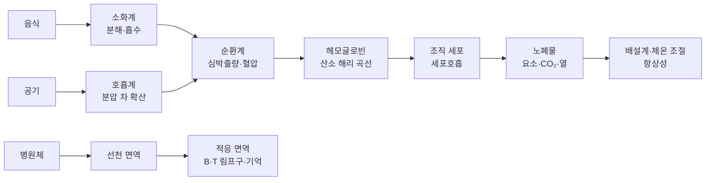
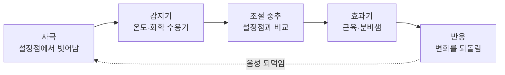
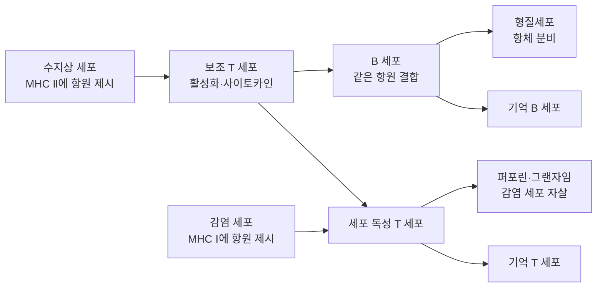
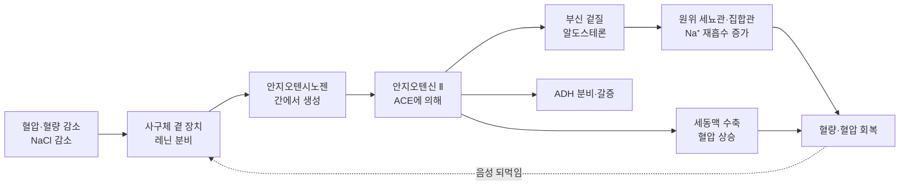

# 일반생명과학 11. 동물의 구조와 기능 Ⅰ — 물질대사와 방어
<!-- prev: bio-2, bio-1, m2-06 -->
<!-- next: ubio-12, ubio-13 -->

> [!NOTE]
> **이 단원의 범위**
> - 동물의 조직과 기관계, 항상성과 되먹임, 체온 조절
> - 영양과 소화(소화 효소, 흡수, 조절)
> - 순환계(심장 주기, 혈압, 혈액)와 기체 교환(호흡 색소, 산소 해리 곡선)
> - 면역계(선천 면역과 적응 면역, B·T 림프구, 면역 기억, 면역 이상)
> - 삼투 조절과 배설(네프론, 호르몬 조절)

**학습 목표**

1. 동물의 네 가지 조직과 기관계를 구별하고, 되먹임 회로로 항상성을, 열 교환 경로와 대사율–몸 크기 관계로 체온 조절을 정량적으로 설명할 수 있다.
2. 소화 효소의 작용 부위와 기질, 영양소의 흡수 경로, 소화의 호르몬 조절을 설명할 수 있다.
3. 심장 주기와 심박출량, 혈압과 혈류의 관계(푸아죄유 법칙, 스탈링 힘)를 계산하고 해석할 수 있다.
4. 분압과 산소 해리 곡선으로 기체 교환과 산소 운반(보어 효과, 태아 헤모글로빈)을 정량적으로 설명할 수 있다.
5. 선천 면역과 적응 면역의 인식 방식과 B·T 림프구의 작용, 면역 기억과 면역 이상을 설명할 수 있다.
6. 네프론의 부위별 기능과 역류 증폭, ADH·레닌–안지오텐신–알도스테론계의 조절을 계산 문제에 적용할 수 있다.

**이 단원의 학습 사다리**

| 단계 | 무엇을 하나? |
|---|---|
| STEP 1. 이전 학습 다시 보기 | 중2 「동물과 에너지」의 네 기관계, 「생명 시스템의 구성」의 통합, 「항상성과 몸의 조절」의 피드백과 면역을 다시 본다 |
| STEP 2. 기초 다지기 | 분압과 확산, 흐름 = 압력 차 ÷ 저항, S자 곡선과 힐 식, 삼투 농도, 거듭제곱 법칙 |
| STEP 3. 핵심 개념 | 조직 → 항상성 → 체온 → 영양·소화 → 순환·혈압·혈액 → 기체 교환·산소 운반 → 면역 → 삼투 조절·배설 |
| STEP 4. 오개념 바로잡기 | "정맥혈에는 산소가 없다?", "열이 나는 것은 체온 조절의 실패다?" |
| STEP 5. 전공 맛보기 | 생리학의 심혈관 모형, 면역학의 항체 다양성, 신장 생리의 정량 모형 |
| STEP 6. 생활·산업·진로 | 맥박 산소 측정기, 고지 적응 훈련, 항체 의약품, 혈액 투석 |

---

## 🗺️ 단원 들어가기

해발 8000 m가 넘는 히말라야 정상에서 공기의 산소 분압은 해수면의 약 3분의 1밖에 되지 않는다. 그런데도 오랜 적응 훈련을 한 등반가는 산소통 없이 정상에 오른다. 한편 같은 산 위를 줄기러기는 해마다 날아서 넘는다. 숨 쉬는 같은 공기에서 산소를 더 많이 꺼내 쓰는 비결은 무엇일까?

몸은 끊임없이 바뀌는 바깥 환경 속에서 안쪽 환경을 일정하게 유지하며, 그 유지에는 에너지가 든다. 그 에너지는 음식에서 오고(소화), 산소와 함께 세포로 배달되며(순환·기체 교환), 대사의 찌꺼기는 걸러져 나간다(배설). 그리고 이 모든 체계를 노리는 침입자를 면역계가 막는다. 이 단원에서는 고등학교에서 '무엇을 하는가'로 배운 기관계를 '얼마나, 왜 그만큼'의 수준으로 다시 본다.

---

## STEP 1. 🔙 이전 학습 다시 보기

### 연계표

| 이전 단원 | 고등학교까지 배운 것 | 대학에서 이렇게 확장된다 |
|---|---|---|
| 중2 「동물과 에너지」 '소화계', '순환계', '호흡계', '배설계' | 소화 효소와 흡수, 심장의 2심방 2심실, 폐포의 확산, 여과–재흡수–분비 | 효소의 활성화와 호르몬 조절, 심장 주기와 전기 전도, 분압과 산소 해리 곡선, 네프론 부위별 수송 |
| 「생명 시스템의 구성」 '기관계의 통합적 작용' | 심박출량 = 심박수 × 1회 박출량, 콩팥의 농축률, 운동 시 기관계 반응 | 픽 원리로 심박출량 측정, 혈압과 저항, 여과량·최대 수송량 계산, 역류 증폭 |
| 「항상성과 몸의 조절」 '항상성', '체온 조절', '삼투압 조절' | 음성 피드백, 시상하부, ADH와 집합관 | 대사율과 몸 크기, 열 교환 경로, 레닌–안지오텐신–알도스테론계, 아쿠아포린 |
| 「항상성과 몸의 조절」 '우리 몸의 방어 작용' | 선천적·후천적 면역, 체액성·세포성 면역, 1차·2차 면역 반응 | 패턴 인식 수용체, MHC와 항원 제시, 항체 구조와 유전자 재배열, 클론 선택, 면역 이상 |
| 「식물의 구조와 기능」 '수분 퍼텐셜', '식물의 방어' | 물은 퍼텐셜이 높은 곳에서 낮은 곳으로, 패턴 인식 면역 | 모세혈관의 스탈링 힘, 콩팥 수질의 삼투 기울기, 동물의 선천 면역 |

### 준비 운동 (사전 진단)

**Q1.** 휴식 시 심박수가 분당 70회, 1회 박출량이 70 mL이면 심박출량은 몇 L/min인가?

**Q2.** 폐포에서 산소가 혈액으로 이동하는 원리는 확산과 능동 수송 중 무엇인가?

**Q3.** 땀을 많이 흘렸을 때 분비가 늘어나는 호르몬과 그 호르몬이 작용하는 콩팥 부위는?

**Q4.** 2차 면역 반응이 1차 면역 반응보다 빠르고 강한 까닭은?

정답 및 해설

**Q1.** $70 \times 70 = 4900\ \mathrm{mL/min} \approx 4.9\ \mathrm{L/min}$

**Q2.** 확산. 이 단원에서는 '산소 분압의 차이'를 따라 확산한다고 정량적으로 다룬다.

**Q3.** 항이뇨 호르몬(ADH), 집합관(과 원위 세뇨관 끝부분).

**Q4.** 1차 반응에서 만들어진 기억 세포가 같은 항원을 다시 만나면 빠르게 증식·분화하기 때문이다.

---

## STEP 2. 🧱 기초 다지기

### ① 분압 — 기체 혼합물 속 한 기체의 몫

돌턴의 부분 압력 법칙에 따라, 기체 혼합물에서 한 기체의 **분압**은 전체 압력 × 그 기체의 몰분율이다. 생리학에서는 압력을 흔히 mmHg로 쓴다($1\ \mathrm{mmHg} = 133.3\ \mathrm{Pa}$, $760\ \mathrm{mmHg} = 101.3\ \mathrm{kPa}$).

$$
P_{\mathrm{O_2}} = 0.21 \times 760\ \mathrm{mmHg} \approx 160\ \mathrm{mmHg}\quad(\text{해수면 건조 공기})
$$

액체에 녹은 기체도 '분압'으로 나타낸다. 혈액의 $P_{\mathrm{O_2}}$가 100 mmHg라는 말은 "$P_{\mathrm{O_2}} = 100\ \mathrm{mmHg}$인 공기와 평형을 이룰 만큼 산소가 녹아 있다"는 뜻이다. 기체는 언제나 **분압이 높은 곳에서 낮은 곳으로** 확산한다.

### ② 확산 속도 — 픽의 확산 법칙

막을 통한 기체의 확산 속도는 다음에 비례한다.

$$
\text{확산 속도} \propto \frac{A\,\Delta P}{d}
$$

($A$: 표면적, $\Delta P$: 분압 차, $d$: 막 두께). 그래서 호흡 표면은 **넓고, 얇고, 축축하다**(기체는 물에 녹아야 막을 건넌다). 폐포의 총면적은 약 70 m², 폐포와 모세혈관 사이 장벽의 두께는 1 µm 이하이다.

### ③ 흐름 = 압력 차 ÷ 저항

혈액이 혈관을 흐르는 것은 전류가 저항을 흐르는 것과 닮았다(옴의 법칙 $I = V/R$).

$$
Q = \frac{\Delta P}{R}
$$

곧은 관에서 저항은 반지름의 네제곱에 반비례한다(**푸아죄유 법칙**, $R = \dfrac{8\eta L}{\pi r^4}$). 혈관 반지름이 조금만 바뀌어도 혈류는 크게 바뀐다.

### ④ S자 곡선과 힐 식

헤모글로빈의 산소 포화도 $S$는 산소 분압 $P$에 대해 S자(시그모이드) 곡선을 그린다. 이 곡선은 경험식인 **힐 식**으로 잘 근사된다.

$$
S = \frac{P^{n}}{P^{n} + P_{50}^{\,n}}
$$

$P_{50}$은 포화도가 50%가 되는 분압이고, $n$(힐 계수)이 1보다 클수록 곡선이 가파른 S자가 된다. 사람 성인 헤모글로빈은 대략 $P_{50} \approx 27\ \mathrm{mmHg}$, $n \approx 2.7$이다. $n = 1$이면 S자가 아닌 쌍곡선(미오글로빈처럼)이 된다.

### ⑤ 삼투 농도 — mOsm/L

체액의 삼투 성질은 녹아 있는 **입자 수**로 정해진다. 1 L에 녹은 입자의 밀리몰 수를 **삼투 농도**(mOsm/L)라 한다. 150 mM $\mathrm{NaCl}$은 $\mathrm{Na^+}$와 $\mathrm{Cl^-}$로 나뉘어 약 300 mOsm/L이 되고, 사람 혈장의 삼투 농도도 약 300 mOsm/L이다.

### ⑥ 거듭제곱 법칙

생물의 많은 양은 몸무게 $M$의 거듭제곱 $Y = aM^{b}$로 나타나며, 로그–로그 그래프에서 기울기 $b$인 직선이 된다. 표면적 대 부피 비는 몸이 클수록 작아진다(한 변 1 cm인 정육면체는 6 cm⁻¹, 10 cm인 정육면체는 0.6 cm⁻¹).

---

## STEP 3. 📘 핵심 개념

### ① 동물의 조직과 기관계

#### (1) 네 가지 조직

| 조직 | 구조의 특징 | 예 | 기능 |
|---|---|---|---|
| **상피 조직** | 세포가 빽빽이 붙어 층을 이루고, 한쪽은 바깥(또는 내강)에, 반대쪽은 기저막에 닿음(극성) | 피부 표피, 소장 내벽, 폐포벽, 세뇨관 벽 | 보호, 흡수, 분비, 선택적 수송 |
| **결합 조직** | 세포가 드문드문 있고 **세포 외 기질**(섬유 + 바탕질)이 많음 | 뼈, 연골, 힘줄, 지방 조직, **혈액** | 지지, 연결, 저장, 운반 |
| **근육 조직** | 액틴·미오신 섬유로 수축 | 골격근(가로무늬, 수의), 심장근(가로무늬, 불수의), 평활근(민무늬, 불수의) | 운동, 박동, 내장 운동 |
| **신경 조직** | 뉴런과 신경교 세포 | 뇌, 척수, 신경 | 신호의 수용·전달·통합 |

상피의 모양(편평·입방·원주)과 층수(단층·중층)는 기능에 맞추어져 있다. 확산이 일어나는 폐포와 모세혈관 벽은 **단층 편평 상피**(얇게), 마찰이 큰 피부와 식도는 **중층 편평 상피**(두껍게), 흡수가 일어나는 소장은 미세 융털이 있는 **단층 원주 상피**이다.

#### (2) 기관계

조직이 모여 기관을, 기관이 모여 **기관계**를 이룬다. 이 단원은 물질대사와 방어를 맡은 소화계, 순환계, 호흡계, 면역계·림프계, 배설계, 그리고 체온 조절에 관여하는 외피계(피부)를 다루고, 내분비계·신경계·생식계·근육·골격계는 「동물의 구조와 기능 Ⅱ」에서 다룬다.

### ② 항상성과 되먹임

#### (1) 내부 환경과 조절 회로

동물의 세포는 **간질액**(세포 사이의 액체)에 잠겨 산다. 이 내부 환경의 온도, pH, 포도당·이온 농도, 삼투 농도를 일정한 범위로 유지하는 것이 **항상성(homeostasis)** 이다. 항상성은 고정된 값이 아니라 **설정점(set point)** 근처에서 오르내리는 동적 평형이다.

#### (2) 음성 되먹임과 양성 되먹임

| 구분 | 작동 | 예 | 성격 |
|---|---|---|---|
| **음성 되먹임** | 반응이 처음 변화를 **줄임** | 체온·혈당·혈압·혈장 삼투 농도 조절 | 안정화, 항상성의 기본 |
| **양성 되먹임** | 반응이 처음 변화를 **키움** | 분만 시 옥시토신과 자궁 수축, 혈액 응고, 활동 전위의 $\mathrm{Na^+}$ 유입 | 과정을 빠르게 끝까지 진행시키고 외부 사건으로 종료 |

#### (3) 조절자와 순응자, 설정점의 변화

- **조절자**는 바깥 변화에도 내부 변수를 일정하게 유지하고(사람의 체온), **순응자**는 내부 변수가 바깥을 따라간다(많은 해양 무척추동물의 체액 삼투 농도). 한 동물이 어떤 변수에는 조절자, 다른 변수에는 순응자일 수 있다.
- 설정점은 고정되어 있지 않다. 체온은 하루 중 약 0.5~1 °C 오르내리고(일주기 리듬), 열이 날 때는 설정점 자체가 올라간다. 높은 고도에서 몇 주에 걸쳐 적혈구가 늘어나는 것처럼 환경에 맞춰 생리가 바뀌는 것을 **순화**(acclimatization)라 한다.

### ③ 체온 조절

#### (1) 내온성과 외온성

| 구분 | 열의 주된 출처 | 예 | 장단점 |
|---|---|---|---|
| **내온성** | 자신의 대사열 | 포유류, 조류 | 넓은 환경에서 높은 활동성 유지 / 에너지를 많이 씀 |
| **외온성** | 바깥 환경(햇볕 쬐기 등) | 대부분의 어류, 양서류, 파충류, 무척추동물 | 같은 크기 내온 동물보다 먹이가 훨씬 적게 듦 / 활동이 환경 온도에 좌우 |

'정온·변온'은 체온이 일정한지를, '내온·외온'은 열이 어디서 오는지를 말한다. 깊은 바다의 물고기는 외온성이지만 체온이 거의 일정하다.

#### (2) 열 교환의 네 경로

| 경로 | 원리 | 조절 방법 |
|---|---|---|
| 복사 | 전자기파(적외선)로 열을 주고받음 | 햇볕 쬐기, 그늘로 이동 |
| 전도 | 맞닿은 물체 사이의 직접 열 이동 | 차가운 바닥에 배 깔기 |
| 대류 | 몸 표면을 지나는 공기·물의 흐름 | 털 세우기(공기층 유지), 바람 피하기 |
| **증발** | 물이 기화하며 숨은열을 가져감 | 땀, 헐떡임, 침 바르기 |

**단열**(털, 깃털, 지방층), **피부 혈관의 수축·확장**, **역류 열 교환**(오리 다리와 돌고래 지느러미에서 동맥의 따뜻한 혈액이 바로 옆 정맥의 차가운 혈액을 데워 열이 몸 중심으로 되돌아옴), **떨림 열 발생**(골격근의 수축), **비떨림 열 발생**(갈색 지방의 미토콘드리아에서 짝풀림 단백질이 ATP를 만들지 않고 열을 냄) 등이 함께 작동한다. 사람의 체온 조절 중추는 시상하부이다.

#### 예제 1 — 땀으로 버려야 하는 열

마라톤 선수가 달리는 동안 대사로 생기는 열 중 바깥으로 내보내야 하는 열이 800 W이다. 기온이 피부 온도보다 높아 복사·전도·대류로는 열을 내보낼 수 없고 모두 땀의 증발로 처리해야 한다면, 1시간 동안 증발해야 하는 땀은 몇 L인가? (피부 온도에서 물의 증발열 2.4 kJ/g, 땀의 밀도 1.0 g/mL)

**풀이**
① 1시간 동안의 열: $Q = 800\ \mathrm{J/s} \times 3600\ \mathrm{s} = 2.88\times10^{6}\ \mathrm{J} = 2880\ \mathrm{kJ}$
② 증발할 물: $m = \dfrac{2880\ \mathrm{kJ}}{2.4\ \mathrm{kJ/g}} = 1.2\times10^{3}\ \mathrm{g}$
③ 부피 약 $1.2\ \mathrm{L}$
④ 의미: 흘러내려 증발하지 못한 땀은 열을 가져가지 못하므로 실제로 흘리는 땀은 더 많다. 물을 보충하지 않으면 혈장량이 줄어 심박출량과 피부 혈류가 함께 줄고, 체온이 급격히 오를 수 있다(열사병). 체온 조절은 순환·배설과 떼어 생각할 수 없다.

#### (3) 대사율과 몸의 크기

**대사율**은 단위 시간에 쓰는 에너지의 양이다. 휴식·공복·적정 온도에서 잰 내온 동물의 최소 대사율을 **기초 대사율(BMR)**, 외온 동물에서 특정 온도로 잰 값을 **표준 대사율(SMR)** 이라 한다. 포유류의 기초 대사율은 몸무게의 약 $3/4$제곱에 비례한다는 경험 법칙(클라이버 법칙)이 알려져 있다.

$$
\mathrm{BMR} \approx 70\,M^{0.75}\quad(\mathrm{kcal/일},\ M\text{은 kg})
$$

#### 예제 2 — 생쥐와 사람의 대사율

클라이버 식으로 70 kg인 사람과 25 g인 생쥐의 기초 대사율을 구하고, 몸무게 1 kg당 대사율을 비교하시오.

**풀이**
① 사람: $70 \times 70^{0.75} = 70 \times 24.2 \approx 1.69\times10^{3}\ \mathrm{kcal/일}$ → 1 kg당 약 $24\ \mathrm{kcal/일}$
② 생쥐: $70 \times 0.025^{0.75} = 70 \times 0.0629 \approx 4.4\ \mathrm{kcal/일}$ → 1 kg당 $4.4/0.025 \approx 176\ \mathrm{kcal/일}$
③ 1 kg당 대사율은 생쥐가 사람의 약 $176/24 \approx 7$배이다.
④ 의미: 작은 동물은 표면적 대 부피 비가 커서 열을 빨리 잃고, 몸무게당 훨씬 많이 먹고 빠르게 숨 쉬며 심장이 빨리 뛴다(생쥐의 심박수는 분당 수백 회). 이것이 작은 포유류와 새가 **휴면**(torpor)이나 **동면**으로 대사율과 체온을 크게 낮추는 까닭이다.

#### (4) 발열은 설정점의 이동이다

감염되면 대식세포 등이 내는 신호 물질(내인성 발열 물질)이 시상하부에서 프로스타글란딘 생성을 늘려 체온 설정점을 높인다. 설정점이 38.5 °C로 올라가면 37 °C의 몸은 '춥다'고 판단해 떨고 피부 혈관을 수축시킨다(오한). 해열제는 프로스타글란딘 합성을 억제해 설정점을 되돌린다. 즉 발열은 조절의 실패가 아니라 **조절된** 체온 상승이다.

### ④ 영양 — 무엇을 먹어야 하는가

#### (1) 필요한 것: 에너지, 재료, 필수 영양소

동물의 식사는 세 가지를 공급해야 한다. ① 세포호흡의 **화학 에너지**(탄수화물·지방·단백질), ② 생체 분자를 만드는 **유기 재료**(탄소 골격, 질소), ③ 스스로 만들 수 없는 **필수 영양소**.

| 필수 영양소 | 내용 | 결핍의 예 |
|---|---|---|
| 필수 아미노산 | 사람 성인에게 9가지(트립토판, 라이신, 메싸이오닌 등) | 단백질 합성 저하. 한 가지 곡물만 먹으면 특정 아미노산이 부족해지기 쉬움(곡류+콩류 조합의 근거) |
| 필수 지방산 | 리놀레산, 알파–리놀렌산 | 피부염, 성장 장애 |
| 비타민 | 수용성(B군, C) / 지용성(A, D, E, K) | 괴혈병(C), 각기병(B₁), 구루병(D), 야맹증(A) |
| 무기질 | Ca, P(뼈), Fe(헤모글로빈), I(갑상샘 호르몬), Na, K, Cl(체액·신경) | 빈혈(Fe), 갑상샘종(I) |

지용성 비타민은 몸에 쌓이므로 보충제로 과다 섭취하면 중독될 수 있다.

#### (2) 에너지 수지

영양소 1 g의 에너지는 대략 탄수화물·단백질 4 kcal, 지방 9 kcal이다. 섭취 에너지가 소비보다 많으면 남은 에너지는 간·근육의 글리코젠과 지방 조직의 지방으로 저장된다. 지방이 저장 형태로 선택되는 까닭은 1 g당 에너지가 크고 물을 거의 끼고 있지 않아 같은 에너지를 훨씬 가볍게 저장하기 때문이다.

#### (3) 먹이를 먹는 방식과 소화관

여과 섭식자(수염고래), 체액 섭식자(모기, 진딧물), 덩어리 섭식자(대부분의 동물) 등으로 나뉜다. 소화는 **섭취 → 소화 → 흡수 → 배출**의 네 단계이다. 해파리처럼 입과 항문이 하나인 **위수강**을 가진 동물도 있지만, 대부분의 동물은 입에서 항문까지 한 방향으로 이어진 **완전한 소화관**을 가져 부위마다 다른 일을 순서대로 할 수 있다.

### ⑤ 소화 과정과 소화 효소

#### (1) 기계적 소화와 화학적 소화

이로 씹고 위가 섞는 **기계적 소화**는 표면적을 넓히고, 효소에 의한 **가수 분해**(물 분자를 넣어 결합을 끊음)인 **화학적 소화**는 고분자를 흡수 가능한 단위체로 만든다.

#### (2) 부위별 소화

| 부위 | 분비물·환경 | 일어나는 일 |
|---|---|---|
| 입·식도 | 침(침 아밀레이스, pH 약 7) | 녹말 → 엿당 등. 식괴를 삼키면 식도의 꿈틀 운동으로 위까지 이동 |
| 위 | 위액: **염산**(벽세포, pH 약 2), **펩시노젠**(으뜸세포), 점액(점액 세포) | 산이 단백질을 풀고 세균을 죽임. 펩시노젠 → 펩신(산과 펩신 자신에 의해 활성화). 단백질 → 작은 폴리펩타이드 |
| 소장 (십이지장) | 이자액(탄산수소 이온, 이자 효소), 쓸개즙 | 위산 중화, 대부분의 화학적 소화 |
| 소장 (빈창자·돌창자) | 상피의 막에 붙은 효소(솔가장자리 효소) | 마지막 분해와 **흡수** |
| 대장 | 점액 | 물·무기 이온 재흡수, 장내 미생물에 의한 발효, 대변 형성 |

#### (3) 영양소별 소화 효소

| 영양소 | 효소(분비 기관) | 작용 위치 | 산물 |
|---|---|---|---|
| 녹말 | 침 아밀레이스(침샘), 이자 아밀레이스(이자) | 입, 소장 | 엿당, 짧은 사슬 |
| 이당류 | 말테이스, 수크레이스, 락테이스(소장 상피 막) | 소장 | 포도당, 과당, 갈락토스 |
| 단백질 | 펩신(위), 트립신·키모트립신(이자), 카복시펩티데이스(이자), 아미노펩티데이스·다이펩티데이스(소장 상피) | 위, 소장 | 아미노산, 짧은 펩타이드 |
| 지방 | 쓸개즙산염(간, 효소 아님 — **유화**), 라이페이스(이자) | 소장 | 지방산, 모노글리세리드 |
| 핵산 | 뉴클레이스(이자), 뉴클레오티데이스 등(소장) | 소장 | 뉴클레오타이드 → 염기, 당, 인산 |

> [!IMPORTANT]
> **단백질 분해 효소는 왜 자기 몸을 소화하지 않을까?** 위와 이자는 단백질 분해 효소를 **비활성 전구체**(펩시노젠, 트립시노젠)로 분비한다. 트립시노젠은 소장 상피 막에 있는 엔테로펩티데이스에 의해 비로소 트립신이 되고, 트립신이 다른 전구체들을 연쇄적으로 활성화한다. 위벽은 점액층과 빠른 세포 교체로 산과 펩신을 견딘다. 이 보호가 무너진 것이 위궤양이며, 그 주요 원인 중 하나가 헬리코박터 파일로리 감염이다.

#### (4) 소화관의 진화적 적응

육식 동물은 소화가 쉬운 단백질·지방을 먹으므로 소장이 짧다. 셀룰로스는 동물의 효소로 분해되지 않으므로 초식 동물은 소장이 길고 맹장이 크며 미생물 발효에 기댄다. 소 같은 **반추 동물**은 네 개의 방으로 된 위의 혹위에서 미생물이 셀룰로스를 발효하게 하고, 그 미생물 자체도 소화하여 단백질을 얻는다.

### ⑥ 흡수와 소화의 조절

#### (1) 표면적을 넓히는 구조

소장 내벽은 큰 **주름**, 그 위의 손가락 모양 **융털**, 융털 상피 세포 막의 **미세 융털**(솔가장자리)로 세 번 접혀 흡수 표면이 매우 넓다.

#### 예제 3 — 소장의 표면적 증폭

지름 2.5 cm, 길이 3.0 m인 매끈한 원통 안쪽 면에 주름이 표면적을 3배, 융털이 10배, 미세 융털이 20배 늘린다고 하자(설명용 근사값). 흡수 표면적을 구하시오.

**풀이** 매끈한 원통 안쪽 넓이 $\pi d L = \pi \times 0.025 \times 3.0 = 0.236\ \mathrm{m^2}$에 증폭률 $3 \times 10 \times 20 = 600$을 곱하면 약 $1.4\times10^{2}\ \mathrm{m^2}$이다. 이 근사는 실제를 과대평가한다. 최근의 측정에서는 소화관 전체 점막의 표면적이 약 30 m² 안팎으로 추정되는데, 융털과 미세 융털의 실제 밀도·길이가 근사보다 작기 때문이다. 그래도 '매끈한 관'보다 백 배 이상 넓다는 결론은 같다. 근사값의 한계를 아는 것도 정량 생물학의 일부이다.

#### (2) 영양소의 흡수 경로

| 영양소 | 상피 세포로 들어가는 방법 | 그다음 경로 |
|---|---|---|
| 포도당, 갈락토스 | **$\mathrm{Na^+}$–포도당 공동 수송체**(2 $\mathrm{Na^+}$와 함께) — $\mathrm{Na^+}$–$\mathrm{K^+}$ 펌프가 만든 $\mathrm{Na^+}$ 기울기를 이용하는 2차 능동 수송 | 반대쪽 막의 촉진 확산 운반체 → 모세혈관 |
| 과당 | 촉진 확산 | 모세혈관 |
| 아미노산, 짧은 펩타이드 | $\mathrm{Na^+}$ 또는 $\mathrm{H^+}$ 공동 수송 | 모세혈관 |
| 지방산, 모노글리세리드 | 쓸개즙산염과 **미셀**을 이루어 막 가까이 운반 → 확산으로 상피 세포에 들어감 → 세포 안에서 **트라이글리세리드로 재합성** → 단백질과 함께 **킬로미크론**으로 포장 | 융털의 **암죽관(림프관)** → 가슴관 → 정맥 |

모세혈관으로 흡수된 수용성 영양소는 **간문맥**을 통해 먼저 간으로 간다. 간은 혈당을 조절하고(글리코젠 저장), 독성 물질을 해독한 뒤 혈액을 온몸으로 보낸다. 소장 상피의 공동 수송 원리를 이용한 것이 설사 환자에게 쓰는 **경구 수액**(소금 + 포도당)이다. 포도당이 $\mathrm{Na^+}$를 끌고 들어가고, 물이 삼투로 따라 들어간다.

#### (3) 소화의 호르몬 조절

| 호르몬 | 분비 부위와 자극 | 작용 |
|---|---|---|
| **가스트린** | 위, 음식물(펩타이드)이 위에 들어올 때 | 위액 분비, 위 운동 촉진 |
| **세크레틴** | 십이지장, 산성 미즙이 들어올 때 | 이자의 **탄산수소 이온** 분비 촉진(위산 중화) |
| **콜레시스토키닌(CCK)** | 십이지장, 지방·아미노산 | 이자의 **소화 효소** 분비, **쓸개** 수축 |

세크레틴은 1900년대 초 신경을 모두 끊은 소장에서도 산을 넣으면 이자액이 나오는 실험으로 발견된, 최초로 확인된 호르몬이다.

#### (4) 식욕과 에너지 저장의 조절

공복에 위가 내는 **그렐린**은 배고픔을 일으키고, 식사 후 소장이 내는 PYY와 이자의 인슐린, 지방량에 비례해 지방 조직이 내는 **렙틴**은 식욕을 억제한다. 이 신호들은 모두 시상하부의 식욕 중추에 모인다. 비만인 사람은 대개 렙틴이 부족한 것이 아니라 렙틴에 대한 반응이 둔해진 상태이다. 장내 미생물의 구성도 에너지 흡수와 대사에 영향을 준다는 연구가 활발하다.

### ⑦ 순환계의 설계

#### (1) 개방 순환과 폐쇄 순환

| 구분 | 개방 순환계 | 폐쇄 순환계 |
|---|---|---|
| 동물 | 절지동물, 대부분의 연체동물 | 환형동물, 두족류, 척추동물 |
| 구조 | 심장이 혈림프를 체강(혈체강)으로 내보내 기관을 직접 적심 | 혈액이 언제나 혈관 안에 있고, 간질액과 구별됨 |
| 압력·속도 | 낮음 | 높음 → 몸이 크고 활동적인 동물에 유리 |

곤충은 개방 순환계이지만 산소는 순환계가 아니라 **기관계**(몸 표면의 숨구멍에서 세포 가까이까지 이어진 공기관)로 직접 공급하므로 활동적일 수 있다.

#### (2) 척추동물 심장의 진화

| 동물 | 심장 | 순환 |
|---|---|---|
| 어류 | 1심방 1심실 | **단일 순환**: 심장 → 아가미 → 온몸. 아가미에서 압력이 크게 떨어짐 |
| 양서류, 파충류 | 2심방 1심실(파충류는 심실이 불완전하게 나뉨, 악어는 완전) | 이중 순환, 심실에서 일부 혼합 |
| 조류·포유류 | 2심방 2심실 | 완전한 **이중 순환**: 폐순환과 온몸 순환이 분리 |

완전한 이중 순환에서는 폐에서 산소를 채운 혈액이 다시 심장으로 돌아와 **높은 압력으로** 온몸에 다시 보내진다. 내온성의 높은 대사율은 이 설계 덕분에 가능하다. 조류와 포유류의 4실 심장은 각각 따로 진화한 **수렴 진화**의 예이다.

### ⑧ 심장 주기와 심박출량

#### (1) 심장 주기

심장이 한 번 수축하고 이완하는 과정을 **심장 주기**라 한다. 심박수 75회/분이면 한 주기는 0.8초이다.

| 단계 | 심방 | 심실 | 방실 판막 | 반달 판막 |
|---|---|---|---|---|
| 확장기(심실 이완) | 이완 → 마지막에 수축 | 이완, 혈액이 채워짐 | 열림 | 닫힘 |
| 수축기(심실 수축) | 이완 | 수축, 혈액을 동맥으로 내보냄 | **닫힘** (첫째 심음) | 열림 |
| 수축기 끝 | 이완 | 이완 시작 | 닫힘 | **닫힘** (둘째 심음) |

판막은 압력 차로만 열리고 닫히는 '한 방향 문'이다. 심장 소리('쿵–딱')는 판막이 닫히며 생긴 혈액의 진동이다. 판막이 제대로 닫히지 않으면 혈액이 역류하는 소리(심잡음)가 들린다.

#### (2) 심장의 자동성과 전기 전도

심장근은 신경 자극 없이도 스스로 박동한다(**자동성**). 우심방 벽의 **동방 결절**(박동원)에서 시작한 흥분은 심방 전체로 퍼져 심방을 수축시키고, **방실 결절**에서 약 0.1초 지연된 뒤(심방이 혈액을 다 밀어 넣을 시간), **히스 다발**과 **푸르킨예 섬유**를 따라 심실 꼭대기(심첨)부터 위쪽으로 빠르게 퍼진다. 그래서 심실은 치약 튜브를 아래에서 짜듯 수축한다.

**심전도(ECG)** 는 이 전기 활동을 피부에서 기록한 것이다. P파(심방 탈분극) – QRS파(심실 탈분극) – T파(심실 재분극). 박동원의 속도는 자율 신경(교감: 촉진, 부교감: 억제)과 에피네프린이 조절한다.

#### (3) 심박출량과 픽 원리

**심박출량**(cardiac output) = 심박수 × 1회 박출량이다. 심박출량을 직접 재기는 어렵지만, **질량 보존**을 이용하면 계산할 수 있다(**픽 원리**). 폐에서 1분 동안 혈액에 실린 산소의 양은 몸이 1분 동안 쓴 산소의 양($\dot{V}_{\mathrm{O_2}}$)과 같다.

$$
\text{심박출량} = \frac{\dot{V}_{\mathrm{O_2}}}{C_a - C_v}
$$

($C_a$, $C_v$: 동맥혈과 혼합 정맥혈의 산소 함량)

#### 예제 4 — 픽 원리로 심박출량 구하기

휴식 중인 사람의 산소 소비량이 250 mL/min, 동맥혈의 산소 함량이 200 mL/L, 혼합 정맥혈(폐동맥 혈액)의 산소 함량이 150 mL/L이다. 심박수가 분당 72회일 때 심박출량과 1회 박출량을 구하시오.

**풀이**
① 혈액 1 L가 폐를 지날 때 얻는 산소: $200 - 150 = 50\ \mathrm{mL/L}$
② 심박출량 $= \dfrac{250\ \mathrm{mL/min}}{50\ \mathrm{mL/L}} = 5.0\ \mathrm{L/min}$
③ 1회 박출량 $= \dfrac{5000\ \mathrm{mL/min}}{72\ \mathrm{회/min}} \approx 69\ \mathrm{mL}$
④ 의미: 혈액 1 L가 지닌 산소 200 mL 중 휴식 시에는 50 mL(25%)만 쓰인다. 나머지는 '예비분'으로, 운동할 때는 심박출량을 늘리는 것과 함께 혈액 1 L에서 더 많은 산소를 꺼내 쓴다(⑫).

**1회 박출량의 조절**: 심실에 혈액이 더 많이 채워지면(정맥 환류 증가) 심장근이 더 늘어나 더 세게 수축한다(**프랭크–스탈링 기전**). 교감 신경은 수축력 자체도 키운다.

### ⑨ 혈관, 혈압, 모세혈관 교환

#### (1) 혈관의 구조

| 혈관 | 벽의 구조 | 특징 |
|---|---|---|
| 동맥 | 두꺼운 탄력 섬유와 평활근 | 높은 압력 견딤, 탄성으로 박동을 고르게 함. 세동맥의 평활근이 저항을 조절 |
| 모세혈관 | 단층 편평 상피(내피)와 기저막뿐 | 지름 약 5~10 µm, 물질 교환의 장소 |
| 정맥 | 얇은 벽, 판막 있음 | 압력 낮음, 혈액 저장(전체 혈액의 약 3분의 2), 골격근 펌프와 판막이 혈액을 심장으로 |

#### (2) 혈류 속도와 단면적

혈액은 압축되지 않으므로 어느 단계에서나 1분에 흐르는 부피는 심박출량과 같다(**연속 방정식** $Q = Av$). 모세혈관 하나는 가늘지만 그 수가 엄청나 **전체 단면적**은 대동맥보다 수백 배 넓다. 그래서 모세혈관에서 혈액은 가장 느리게 흐르며, 교환에 필요한 시간을 번다. 예를 들어 $Q = 5\ \mathrm{L/min} = 83\ \mathrm{cm^3/s}$일 때 단면적 약 $4\ \mathrm{cm^2}$인 대동맥에서는 $v \approx 21\ \mathrm{cm/s}$, 전체 단면적 약 $3000\ \mathrm{cm^2}$인 모세혈관에서는 $v \approx 0.03\ \mathrm{cm/s}$이다(예시 값).

#### (3) 혈압

혈압은 혈액이 혈관 벽에 미치는 압력으로, 위팔 동맥에서 **수축기 혈압/이완기 혈압**으로 잰다(정상 성인 약 120/80 mmHg 미만이 권장 범위). 한 주기 동안 이완기가 더 길기 때문에 **평균 동맥압**은 산술 평균보다 이완기 쪽에 가깝다.

$$
\text{평균 동맥압} \approx \text{이완기 혈압} + \frac{1}{3}(\text{수축기 혈압} - \text{이완기 혈압})
$$

혈압은 대동맥에서 가장 높고, **세동맥**을 지나며 가장 크게 떨어지며, 대정맥에서는 0에 가깝다. 세동맥이 '수도꼭지'인 셈이다. 몸 전체로 보면 평균 동맥압 ≈ 심박출량 × 총말초 저항이다.

#### 예제 5 — 평균 동맥압과 세동맥 반지름

(1) 혈압이 120/80 mmHg인 사람의 평균 동맥압을 구하시오. (2) 어떤 장기로 가는 세동맥의 반지름이 평활근 수축으로 10% 줄었다. 압력 차가 같다면 그 장기의 혈류는 몇 % 줄어드는가? 원래 혈류를 유지하려면 압력 차가 몇 배가 되어야 하는가?

**풀이**
(1) $80 + \dfrac{1}{3}(120 - 80) = 93.3\ \mathrm{mmHg}$ → 약 $93\ \mathrm{mmHg}$
(2) 푸아죄유 법칙에서 $Q \propto r^4$이므로 $Q'/Q = 0.90^4 = 0.656$. 혈류는 약 **34% 감소**한다. 같은 혈류를 유지하려면 압력 차가 $1/0.656 \approx 1.52$배가 되어야 한다.
의미: 반지름 10%의 변화가 혈류를 3분의 1이나 바꾼다. 몸은 세동맥의 지름만 바꾸어 운동 중에 근육으로는 혈류를 몰아 주고 소화관 혈류는 줄인다. 반대로 죽상 경화로 동맥이 좁아지면 심장은 훨씬 높은 압력을 만들어야 한다(고혈압).

#### (4) 모세혈관에서의 교환 — 스탈링 힘

모세혈관 벽을 통한 물의 알짜 이동은 두 힘의 차이로 정해진다. 혈관 안의 **혈압(정수압)** 은 액체를 밖으로 밀고, 혈장 단백질(주로 알부민)이 만드는 **교질 삼투압**은 액체를 안으로 끌어들인다.

| 위치 (예시 값) | 혈압 | 교질 삼투압 | 알짜 압력 |
|---|---|---|---|
| 세동맥 쪽 끝 | 35 mmHg | 25 mmHg | +10 mmHg → **여과**(밖으로) |
| 세정맥 쪽 끝 | 15 mmHg | 25 mmHg | −10 mmHg → **재흡수**(안으로) |

(간질액의 압력과 교질 삼투압은 작다고 보고 무시하였다.) 실제로는 여과가 재흡수보다 조금 많아, 하루 수 L의 액체가 간질에 남는다. 이것을 **림프계**가 모아 정맥으로 되돌린다. 간 질환이나 영양 결핍으로 혈장 단백질이 줄면 교질 삼투압이 떨어져 부종(배가 붓는 복수 등)이 생긴다. 식물의 수분 퍼텐셜과 같은 논리로, 액체는 '압력 + 삼투'의 합이 높은 곳에서 낮은 곳으로 움직인다.

### ⑩ 혈액

#### (1) 혈액의 구성

| 성분 | 비율·수 (성인, 대략) | 기능 |
|---|---|---|
| **혈장** | 혈액 부피의 약 55% | 물(약 90%), 이온, 혈장 단백질(알부민: 삼투압 / 글로불린: 항체 / 피브리노젠: 응고), 영양소, 호르몬, 노폐물, $\mathrm{CO_2}$ 운반 |
| **적혈구** | 약 400만~500만 개/µL | 헤모글로빈으로 $\mathrm{O_2}$ 운반, 핵·미토콘드리아 없음, 수명 약 120일 |
| **백혈구** | 약 4000~10000개/µL | 방어(호중구, 단핵구 → 대식세포, 림프구, 호산구, 호염기구) |
| **혈소판** | 약 15만~40만 개/µL | 혈액 응고. 골수의 거핵세포 조각 |

혈액 세포는 모두 골수의 **조혈 줄기세포**에서 생긴다. 콩팥은 조직에 가는 산소가 줄면 **에리트로포이에틴(EPO)** 을 분비해 적혈구 생성을 늘린다 — 고지대 순화와 빈혈 치료의 원리이다.

#### (2) 혈액 응고 — 양성 되먹임의 연쇄

혈관이 손상되면 ① 혈관이 수축하고 ② 혈소판이 노출된 콜라겐에 붙어 **혈소판 마개**를 만들며 ③ 응고 인자의 연쇄 반응이 일어난다. 연쇄의 끝에서 **프로트롬빈 → 트롬빈**이 되고, 트롬빈이 **피브리노젠 → 피브린**으로 바꾸어 그물을 짜 혈구를 붙잡는다. 이 과정에는 $\mathrm{Ca^{2+}}$와 비타민 K가 필요하다. 트롬빈이 자신의 생성을 더 촉진하는 양성 되먹임으로 응고가 빠르게 완성된다. 응고 인자 유전자의 이상으로 생기는 병이 **혈우병**이다.

> [!WARNING]
> 혈관 안에서 원치 않는 혈전이 생기면 혈관을 막아 심근 경색이나 뇌졸중을 일으킨다. 동맥 벽에 콜레스테롤과 면역 세포가 쌓이는 **죽상 경화**가 그 주요 배경이며, 고혈압·흡연·고지혈증·당뇨병이 위험을 키운다. 심혈관 질환은 세계적으로 가장 큰 사망 원인 중 하나이다.

### ⑪ 기체 교환

#### (1) 다양한 호흡 표면

| 동물 | 호흡 기관 | 설계의 핵심 |
|---|---|---|
| 어류 | 아가미 | **역류 교환**: 물과 혈액이 반대 방향으로 흐름 → 혈액이 지나는 내내 분압 차가 유지되어 물 속 산소의 대부분을 얻음 |
| 곤충 | 기관계 | 공기관이 세포까지 직접 → 순환계 없이 기체 교환 |
| 조류 | 폐 + 기낭 | 공기가 폐(부기관지)를 **한 방향**으로 흐름 → 날숨·들숨 모두 신선한 공기가 교환 표면을 지남 |
| 포유류 | 폐(폐포) | 공기가 드나드는 막다른 주머니. 음압 호흡 |

물은 공기보다 산소 함량이 수십 분의 1이고 무겁고 끈적하다. 그래서 물에서 사는 동물은 호흡 표면 위로 물을 끊임없이 흘려보내는 데 많은 에너지를 쓴다. 아가미의 역류 교환은 이 불리함을 보상하는 설계이다.

#### (2) 포유류의 호흡 운동

가로막(횡격막)이 수축해 내려가고 갈비뼈 사이 근육이 가슴을 넓히면, 흉강 부피가 늘어 폐 안의 압력이 대기압보다 낮아지고 공기가 들어온다(**음압 호흡**). 조용한 날숨은 근육이 이완하며 수동적으로 일어난다. 한 번에 드나드는 공기(**일회 호흡량**)는 휴식 시 약 500 mL인데, 그중 약 150 mL는 기관·기관지에 머물러 교환에 쓰이지 않는다(**해부학적 사강**).

$$
\text{폐포 환기량} = (\text{일회 호흡량} - \text{사강}) \times \text{호흡수}
$$

예를 들어 500 mL × 12회/min이면 분당 환기량은 6.0 L/min이지만, 폐포 환기량은 $(500 - 150) \times 12 = 4.2\ \mathrm{L/min}$이다. 같은 6.0 L/min이라도 250 mL × 24회로 얕고 빠르게 쉬면 폐포 환기량은 $(250 - 150)\times 24 = 2.4\ \mathrm{L/min}$으로 줄어든다. 깊은 호흡이 효율적인 까닭이다.

#### (3) 폐포와 조직의 분압

들이마신 공기는 기도에서 수증기로 포화되고(37 °C에서 수증기 분압 47 mmHg), 폐포에서는 이미 있던 $\mathrm{CO_2}$와 섞인다. 폐포의 산소 분압은 **폐포 기체 식**으로 어림한다.

$$
P_{A\mathrm{O_2}} \approx F_{\mathrm{O_2}}(P_{\text{대기}} - 47) - \frac{P_{a\mathrm{CO_2}}}{0.8}
$$

(0.8은 호흡률, 즉 소비한 $\mathrm{O_2}$에 대한 생긴 $\mathrm{CO_2}$의 비)

| 위치 | $P_{\mathrm{O_2}}$ (mmHg) | $P_{\mathrm{CO_2}}$ (mmHg) |
|---|---|---|
| 들이마신 공기(해수면) | 약 160 | 약 0.3 |
| 폐포 | 약 100 | 약 40 |
| 동맥혈 | 약 95~100 | 약 40 |
| 휴식 중 조직(혼합 정맥혈) | 약 40 | 약 46 |
| 격렬하게 운동하는 근육 | 20 이하 | 더 높음 |

#### 예제 6 — 고산에서의 폐포 산소 분압

(1) 해수면($P_{\text{대기}} = 760\ \mathrm{mmHg}$, $P_{a\mathrm{CO_2}} = 40\ \mathrm{mmHg}$)에서 폐포 산소 분압을 구하시오. (2) 해발 약 5500 m($P_{\text{대기}} \approx 380\ \mathrm{mmHg}$)에서 과호흡으로 $P_{a\mathrm{CO_2}}$가 30 mmHg로 낮아졌을 때의 폐포 산소 분압은? ($F_{\mathrm{O_2}} = 0.21$)

**풀이**
(1) $0.21 \times (760 - 47) - 40/0.8 = 149.7 - 50 = 99.7 \approx 100\ \mathrm{mmHg}$
(2) $0.21 \times (380 - 47) - 30/0.8 = 69.9 - 37.5 = 32.4 \approx 32\ \mathrm{mmHg}$
의미: 고산에서는 산소의 '비율'(21%)은 같지만 전체 압력이 낮아 분압이 떨어진다. 몸은 호흡을 늘려 $P_{a\mathrm{CO_2}}$를 낮춤으로써 폐포 산소 분압을 조금이라도 끌어올린다. 이 분압에서 헤모글로빈이 얼마나 포화되는지는 다음 소절의 곡선으로 판단한다.

#### (4) 호흡의 조절

호흡 리듬은 **연수**(와 뇌교)의 호흡 중추가 만든다. 호흡을 가장 강하게 자극하는 것은 산소 부족이 아니라 **$\mathrm{CO_2}$ 증가**이다. $\mathrm{CO_2}$가 뇌척수액으로 확산해 탄산을 만들고 pH가 떨어지면 연수 근처의 중추 화학 수용기가 이를 감지해 호흡을 깊고 빠르게 한다. 목동맥과 대동맥의 말초 화학 수용기는 $P_{a\mathrm{O_2}}$가 크게(대략 60 mmHg 아래로) 떨어질 때 강하게 반응한다. 그래서 숨을 오래 참을 수 없는 까닭은 산소가 바닥나서가 아니라 $\mathrm{CO_2}$가 쌓이기 때문이다.

### ⑫ 호흡 색소와 산소 해리 곡선

#### (1) 왜 호흡 색소가 필요한가

37 °C 혈장에 물리적으로 녹는 산소는 $P_{\mathrm{O_2}} = 100\ \mathrm{mmHg}$에서 혈액 1 dL당 약 0.3 mL에 불과하다. 휴식 중 심박출량 5 L/min으로는 1분에 약 15 mL밖에 나르지 못하는데, 몸은 1분에 약 250 mL를 쓴다. **호흡 색소**가 이 차이를 메운다.

척추동물은 철(Fe)을 가진 **헤모글로빈**을 적혈구에 담아 쓰고, 절지동물과 연체동물의 상당수는 구리(Cu)를 가진 **헤모사이아닌**을 혈림프에 녹여 쓴다(산소와 결합하면 푸른색). 사람 헤모글로빈은 소단위체 4개(α 2, β 2)로 이루어지고, 각 소단위체의 헴 철 하나에 $\mathrm{O_2}$ 하나가 결합한다. 헤모글로빈 1 g은 최대 약 1.34 mL의 $\mathrm{O_2}$와 결합하므로, 혈액 1 dL에 헤모글로빈이 15 g 있으면 최대 산소 함량은 약 $15 \times 1.34 = 20.1\ \mathrm{mL/dL}$이다.

#### (2) 협동성과 S자 곡선

산소 하나가 결합하면 단백질의 구조가 바뀌어 나머지 소단위체의 친화도가 높아진다(**협동성**, 「물질대사·세포호흡·광합성」의 다른 자리 입체성 조절과 같은 원리). 그래서 산소 해리 곡선은 S자가 된다.

- **평평한 윗부분**(폐, 60~100 mmHg): 분압이 다소 떨어져도 포화도가 거의 줄지 않는다 → 고도나 폐 질환에 대한 안전 여유.
- **가파른 중간 부분**(조직, 20~40 mmHg): 분압이 조금만 떨어져도 많은 산소를 내놓는다 → 활동이 많은 조직일수록 더 많이 받는다.

#### 예제 7 — 산소 해리 곡선으로 산소 공급량 계산하기

헤모글로빈의 포화도를 힐 식 $S = \dfrac{P^{2.7}}{P^{2.7} + 26.8^{2.7}}$로 나타내고, 혈액 1 dL당 최대 산소 함량을 20.1 mL라 하자(녹은 산소는 무시).
(1) $P_{\mathrm{O_2}} = 100$, 40, 20 mmHg에서의 포화도를 구하시오.
(2) 동맥혈($100\ \mathrm{mmHg}$)이 휴식 중인 조직($40\ \mathrm{mmHg}$)과 운동 중인 근육($20\ \mathrm{mmHg}$)에서 각각 혈액 1 dL당 내놓는 산소량을 구하시오.
(3) 운동 중 근육에서 pH가 낮아지고 온도가 올라 $P_{50}$이 32 mmHg로 커졌다면, 20 mmHg에서 내놓는 산소량은?

**풀이**
(1) $S(100) = 0.972$, $S(40) = 0.747$, $S(20) = 0.312$ → 약 97%, 75%, 31%
(2) 휴식: $20.1 \times (0.972 - 0.747) = 4.5\ \mathrm{mL/dL}$ (실은 산소의 약 23%)
  운동: $20.1 \times (0.972 - 0.312) = 13.3\ \mathrm{mL/dL}$ (약 68%)
(3) $P_{50} = 32$일 때 $S(20) = \dfrac{20^{2.7}}{20^{2.7} + 32^{2.7}} = 0.219$ → $20.1 \times (0.972 - 0.219) = 15.1\ \mathrm{mL/dL}$
(동맥혈의 포화도는 폐에서 정해지므로 오른쪽 이동 전 값 0.972를 그대로 썼다.)
의미: 운동 근육은 분압을 낮추는 것만으로 산소를 약 3배 받고, 곡선의 오른쪽 이동으로 다시 약 14% 더 받는다. 심박출량이 3~4배 늘어나는 것과 곱하면 근육의 산소 공급은 휴식 때의 열 배 이상이 될 수 있다.

#### (3) 곡선을 이동시키는 요인

| 요인 | 곡선 이동 | 의미 |
|---|---|---|
| pH 감소($\mathrm{CO_2}$ 증가) — **보어 효과** | 오른쪽(친화도 감소) | 대사가 활발한 조직에서 산소를 더 내놓음 |
| 온도 상승 | 오른쪽 | 운동 근육 |
| 2,3-BPG 증가 | 오른쪽 | 고지대 순화, 빈혈 시 적혈구에서 증가 |
| **태아 헤모글로빈**(γ 사슬) | 왼쪽($P_{50}$ 약 19 mmHg) | 태반에서 어머니 혈액의 산소를 빼앗아 옴 |
| **미오글로빈**(근육, 소단위 1개) | 매우 왼쪽, 쌍곡선($P_{50}$ 수 mmHg 이하) | 근육 속 산소 저장소, 분압이 아주 낮을 때만 내놓음 |
| 일산화 탄소 | 산소보다 약 200배 이상 강하게 결합, 남은 자리의 산소도 잘 놓지 않음(왼쪽) | CO 중독: 포화도와 운반량이 모두 감소 |

> [!TIP]
> 💡 **곡선 읽기 요령** — "오른쪽으로 이동 = 같은 분압에서 포화도가 낮다 = 산소를 잘 내놓는다." 조직의 '산소를 더 달라'는 신호($\mathrm{CO_2}$, 산, 열)는 곡선을 오른쪽으로 밀고, '산소를 빼앗아 와야 하는' 쪽(태아, 근육 속 저장)은 왼쪽에 있다.

#### (4) 이산화 탄소의 운반

조직에서 생긴 $\mathrm{CO_2}$는 혈액에서 약 70%가 **탄산수소 이온**, 약 20%가 헤모글로빈 등과 결합한 형태, 약 7~10%가 녹은 형태로 운반된다. 적혈구 속 **탄산 탈수 효소**가 반응을 빠르게 한다.

$$
\mathrm{CO_2 + H_2O \rightleftharpoons H_2CO_3 \rightleftharpoons H^+ + HCO_3^-}
$$

생긴 $\mathrm{H^+}$는 헤모글로빈이 붙잡아(완충) pH 변화를 줄이고 동시에 산소를 내놓게 한다(보어 효과). $\mathrm{HCO_3^-}$는 적혈구 밖 혈장으로 나가고 대신 $\mathrm{Cl^-}$가 들어온다(염소 이동). 폐에서는 이 과정이 모두 반대로 일어나 $\mathrm{CO_2}$가 날숨으로 나간다.

### ⑬ 선천 면역

#### (1) 면역계의 두 갈래

| 비교 | **선천 면역**(내재 면역) | **적응 면역**(획득 면역) |
|---|---|---|
| 인식 대상 | 많은 병원체에 공통인 분자 패턴 | 특정 항원의 특정 부위(**에피토프**) |
| 수용체 | 유전체에 정해진 수십 종의 패턴 인식 수용체 | 유전자 재배열로 만든 수백만 종 이상의 항원 수용체 |
| 반응 속도 | 몇 분~몇 시간 | 처음엔 며칠 |
| 기억 | 없음(제한적) | 있음 |

#### (2) 장벽과 세포

- **장벽**: 피부, 점막, 점액과 섬모 운동, 위산, 눈물·침 속 라이소자임(세균 세포벽 분해), 항균 펩타이드, 피부 상재균.
- **식세포**: **호중구**(가장 많은 백혈구, 감염 부위에 먼저 도착), **대식세포**(단핵구가 조직에서 분화, 오래 머물며 잡아먹음), **수지상 세포**(항원을 잡아 림프절로 가서 T 세포에 제시 — 선천 면역과 적응 면역의 다리).
- **자연 살해(NK) 세포**: 바이러스에 감염되었거나 암이 된 세포가 표면의 MHC Ⅰ 분자를 줄이면 이를 '이상'으로 알아차리고 세포 자살을 유도한다.
- **패턴 인식 수용체**: 식세포 등의 **톨 유사 수용체(TLR)** 는 세균의 지질 다당류, 편모 단백질, 바이러스의 이중 가닥 RNA 같은 분자 패턴을 인식한다. 초파리의 톨 수용체, 식물의 패턴 인식 수용체(「식물의 구조와 기능」)와 같은 계열의 아이디어이다.

#### (3) 염증 반응과 보체, 인터페론

1. 상처 부위의 **비만세포**가 **히스타민**을 분비하고, 대식세포가 신호 물질(사이토카인)을 낸다.
2. 모세혈관이 확장되고 투과성이 높아져 혈장과 백혈구가 조직으로 나온다 → 붉어짐, 열, 부기, 통증.
3. 호중구와 대식세포가 모여 병원체를 잡아먹는다. 고름은 죽은 세포와 백혈구이다.

**보체**는 혈장 단백질 30여 종의 연쇄 반응계로, 병원체 표면에 구멍을 뚫거나(막 공격 복합체) 식세포가 잘 잡아먹게 표시하고 염증을 촉진한다. **인터페론**은 바이러스에 감염된 세포가 분비해 이웃 세포가 바이러스 증식을 억제하게 한다. 감염이 온몸으로 퍼지면 발열(③)이 일어나고, 지나친 전신 염증은 패혈성 쇼크로 이어질 수 있다.

### ⑭ 적응 면역 — B 림프구와 T 림프구

#### (1) 림프구의 항원 수용체

| | B 림프구 | T 림프구 |
|---|---|---|
| 성숙 장소 | 골수 | **가슴샘** |
| 수용체 | B 세포 수용체 = 막에 붙은 항체 | T 세포 수용체(α·β 사슬) |
| 인식 방식 | 항원을 **그대로**(녹아 있는 단백질, 병원체 표면) | 세포 안에서 잘린 펩타이드 조각이 **MHC 분자에 실려 제시된 것만** |
| 주된 결과 | 형질세포 → 항체 분비(체액성 면역) | 보조 T 세포: 다른 면역 세포 활성화 / 세포 독성 T 세포: 감염 세포 제거(세포성 면역) |

**항체**(면역 글로불린)는 무거운 사슬 2개와 가벼운 사슬 2개로 된 Y자 단백질이다. 두 팔 끝의 **가변 부위**가 에피토프와 결합하고, 줄기의 **불변 부위**가 항체의 종류와 하는 일을 정한다.

#### (2) MHC와 항원 제시

| MHC | 있는 세포 | 싣는 펩타이드 | 인식하는 T 세포 |
|---|---|---|---|
| **MHC Ⅰ** | 핵이 있는 거의 모든 세포 | 세포 **안**에서 만들어진 단백질(바이러스 단백질 포함) | **세포 독성 T 세포**(CD8) |
| **MHC Ⅱ** | 항원 제시 세포(수지상 세포, 대식세포, B 세포) | 세포가 **삼킨** 바깥 단백질 | **보조 T 세포**(CD4) |

MHC 유전자는 사람에게서 가장 다양한 유전자 중 하나라, 사람마다 MHC 조합이 달라 장기 이식 시 거부 반응의 주된 원인이 된다.

#### (3) 수용체 다양성 — 유전자 재배열

유전체에는 항체 유전자가 완성된 형태로 들어 있지 않다. B 세포가 성숙하는 동안 무거운 사슬은 V, D, J 조각 중 하나씩을, 가벼운 사슬은 V, J 조각 중 하나씩을 골라 DNA 수준에서 잘라 붙인다(**V(D)J 재조합**). T 세포 수용체도 같은 방식으로 만들어진다.

#### 예제 8 — 조합으로 만드는 다양성

사람의 항체 유전자에 기능하는 조각이 대략 다음과 같다고 하자(설명용 어림값). 무거운 사슬: V 40개, D 25개, J 6개 / 가벼운 사슬 κ: V 40개, J 5개 / 가벼운 사슬 λ: V 30개, J 4개. 무거운 사슬과 가벼운 사슬의 무작위 조합만으로 만들 수 있는 항체 종류는 몇 가지인가?

**풀이**
① 무거운 사슬: $40 \times 25 \times 6 = 6000$
② 가벼운 사슬: κ $40 \times 5 = 200$, λ $30 \times 4 = 120$ → 합 $320$
③ 항체 $= 6000 \times 320 = 1.92\times10^{6}$, 약 200만 가지
④ 의미: 유전자 조각 약 150개로 백만 가지가 넘는 항원 수용체를 만든다. 실제로는 조각이 이어지는 부위에서 염기가 무작위로 더해지거나 빠지는 **접합부 다양성**까지 더해져 다양성이 몇 자릿수 더 커지고, 활성화된 B 세포에서는 **체세포 과돌연변이**로 친화도가 더 높은 항체가 선택된다.

#### (4) 클론 선택과 자기 관용

림프구 하나는 **한 종류**의 수용체만 가진다. 항원과 맞는 수용체를 가진 극소수의 림프구만 선택되어 증식(**클론 확장**)하고, 효과기 세포와 **기억 세포**로 분화한다. 이것이 **클론 선택**이다.

자기 몸의 분자에 강하게 반응하는 림프구는 골수와 가슴샘에서 성숙하는 동안 제거되거나 기능을 잃는다(**자기 관용**). 무작위 재배열은 자기 분자에 반응하는 수용체도 만들어 내므로, 이 검열이 꼭 필요하다.

예를 들어 활성화된 B 세포 1개가 약 12시간마다 분열하면 5일(10회 분열) 뒤 $2^{10} = 1024$개가 된다. 처음 반응에서 항체가 의미 있는 양으로 나오기까지 1주일 가까이 걸리는 까닭이다.

#### (5) 체액성 면역과 세포성 면역

**항체가 하는 일**: ① 바이러스나 독소에 붙어 세포와의 결합을 막는 **중화**, ② 병원체를 덮어 식세포가 잘 잡아먹게 하는 **옵소닌화**, ③ 여러 병원체를 엮는 **응집**, ④ **보체 활성화**.

**항체의 종류**: IgM(1차 반응에서 가장 먼저 대량 생산, 5량체), IgG(혈액에 가장 많고 **태반을 통과**, 2차 반응의 주력), IgA(침·눈물·점액·**모유**에 분비, 점막 방어), IgE(비만세포에 붙어 알레르기·기생충 방어), IgD(B 세포 표면 수용체).

### ⑮ 면역 기억과 면역 이상

#### (1) 1차·2차 반응과 능동·수동 면역

기억 세포 덕분에 2차 반응은 더 빠르고(잠복기 짧음), 더 크며(항체 양 많음), 더 정교하다(친화도 높은 IgG 중심). 「항상성과 몸의 조절」에서 다룬 백신은 이 기억을 미리 만드는 **인공 능동 면역**이다. 반면 태반을 통한 IgG, 모유의 IgA, 항독소·단일클론항체 주사처럼 만들어진 항체를 받는 **수동 면역**은 즉시 효과가 있지만 기억 세포가 생기지 않아 몇 주에서 몇 달이면 사라진다.

#### (2) 면역 이상

| 이상 | 원리 | 예 |
|---|---|---|
| **알레르기** (과민 반응) | 무해한 항원(꽃가루, 음식)에 IgE가 만들어져 비만세포에 붙음 → 다시 노출되면 비만세포가 히스타민 방출 | 비염, 천식, 두드러기. 전신 반응인 **아나필락시스**는 혈압 급강하로 생명을 위협하므로 즉시 에피네프린 주사 |
| **자가 면역 질환** | 자기 관용이 깨져 자기 항원 공격 | 1형 당뇨병(이자 β세포), 류마티스 관절염, 다발 경화증(신경의 말이집), 전신 홍반 루푸스 |
| **면역 결핍** — 선천성 | 림프구 발생 유전자의 이상 | 중증 복합 면역 결핍증(B·T 세포 모두 결핍) |
| **면역 결핍** — 후천성 | 바이러스·약물·영양 결핍 | **HIV**가 보조 T 세포(CD4)를 감염·파괴 → **AIDS**: 체액성·세포성 면역이 모두 약해져 기회 감염과 암 증가 |
| 이식 거부 | 다른 사람의 MHC를 T 세포가 '남'으로 인식 | 장기 이식 후 면역 억제제 필요 |

**병원체의 회피**: 독감 바이러스는 표면 단백질을 조금씩 바꾸어(항원 변이) 기억을 피하고, 결핵균은 대식세포 안에서 살아남으며, HIV는 면역계의 사령관인 보조 T 세포를 직접 공격한다. 암세포도 면역 검문 분자를 이용해 T 세포의 공격을 피하는데, 이를 풀어 주는 약이 **면역 관문 억제제**이다.

### ⑯ 삼투 조절과 질소성 노폐물

#### (1) 삼투 조절의 문제

| 동물 | 환경 대비 체액 | 문제 | 해결 |
|---|---|---|---|
| **해수 경골어류** | 저장성(체액 약 400 mOsm/L, 바닷물 약 1000) | 물을 잃고 염이 들어옴 | 바닷물을 많이 마시고, 아가미로 염을 능동 배출, 오줌은 아주 적게 |
| **담수 경골어류** | 고장성 | 물이 들어오고 염을 잃음 | 물을 거의 마시지 않고, 묽은 오줌을 많이, 아가미로 염을 능동 흡수 |
| 상어 | 요소 등을 쌓아 바닷물과 비슷하거나 약간 고장성 | 요소의 단백질 변성 | TMAO로 요소의 변성 작용을 상쇄 |
| 육상 동물 | — | 증발로 물을 잃음 | 큐티클·피부, 농축된 오줌, 행동(야행성), 대사수 이용 |

이 모든 해결의 공통점은 이온을 한 방향으로 옮기는 **수송 상피**(아가미의 염 세포, 콩팥 세뇨관)이다.

#### (2) 질소성 노폐물

아미노산과 핵산이 분해되면 독성이 강한 암모니아($\mathrm{NH_3}$)가 생긴다. 동물은 환경에 따라 세 가지 형태로 배출한다.

| 형태 | 독성 | 배출에 필요한 물 | 에너지 비용 | 동물 |
|---|---|---|---|---|
| 암모니아 | 매우 큼 | 매우 많음 | 거의 없음 | 대부분의 수생 동물(아가미로 확산) |
| **요소** | 작음 | 중간 | 간의 요소 회로에서 ATP 소비 | 포유류, 대부분의 양서류, 상어 |
| 요산 | 매우 작음, 물에 거의 녹지 않음 | 매우 적음(반고체 배설) | 가장 큼 | 조류, 파충류, 곤충, 육상 달팽이 |

요산 배출은 단단한 껍질의 알 속에서 노폐물이 배아 주변에 녹아 쌓이지 않게 하는 데도 유리하다. 반면 포유류의 배아는 노폐물을 태반을 통해 어머니에게 넘기므로 요소로 충분하다.

### ⑰ 배설계와 네프론

#### (1) 배설의 네 과정

여러 동물의 배설 기관(편형동물의 원신관, 환형동물의 후신관, 곤충의 말피기관, 척추동물의 콩팥)은 모두 같은 논리를 따른다. ① **여과**(체액을 크기로 거름) → ② **재흡수**(필요한 것을 되찾음) → ③ **분비**(더 버릴 것을 추가) → ④ **배설**. '일단 거의 다 거른 뒤 필요한 것만 되찾는' 방식은 처음 보는 독성 물질도 자동으로 버릴 수 있다는 장점이 있다.

#### (2) 사람 네프론의 구조와 부위별 기능

콩팥 하나에는 약 100만 개의 **네프론**이 있다. 콩팥은 몸무게의 1% 남짓이지만 심박출량의 약 20%를 받는다.

| 부위 | 주요 수송 | 물 투과성 | 여과액의 삼투 농도 변화(mOsm/L) |
|---|---|---|---|
| 사구체 → 보먼주머니 | 혈압에 의한 여과(혈구·큰 단백질 제외) | — | 300 |
| **근위 세뇨관** | 포도당·아미노산 거의 전부, $\mathrm{Na^+}$·물의 약 2/3 재흡수, $\mathrm{HCO_3^-}$ 재흡수, $\mathrm{H^+}$·약물 분비 | 높음 | 300 (같은 비율로 흡수) |
| **헨레 고리 하행 지** | 물만 빠져나감(아쿠아포린) | 높음, 염 불투과 | 300 → 최대 약 1200 |
| **헨레 고리 상행 지** | 염만 빠져나감(굵은 부분은 $\mathrm{NaCl}$ 능동 수송) | **불투과** | 1200 → 약 100 |
| **원위 세뇨관** | $\mathrm{Na^+}$·$\mathrm{K^+}$·$\mathrm{H^+}$·$\mathrm{HCO_3^-}$ 조절(호르몬) | 낮음~조절 | 약 100 |
| **집합관** | ADH에 따라 물 재흡수, 깊은 수질에서 요소 일부 재흡수 | **ADH가 있을 때만 높음** | 100 → 최대 약 1200 |

#### (3) 역류 증폭 — 수질의 삼투 기울기

헨레 고리는 아래로 내려갔다가(하행 지) U자로 꺾여 올라오는(상행 지) 구조이다. 상행 지가 물은 남긴 채 염만 퍼내므로 주변 간질액이 진해지고, 그 진한 간질액이 하행 지에서 물을 빼낸다. 하행 지에서 진해진 여과액이 다시 상행 지로 올라가 더 많은 염을 내놓는다. 이 되먹임이 반복되며 콩팥 겉질(약 300 mOsm/L)에서 수질 깊은 곳(사람 약 1200 mOsm/L)까지 삼투 기울기가 만들어진다(**역류 증폭계**). 집합관은 이 기울기 한가운데를 지나 내려가므로, ADH로 물 통로를 열기만 하면 오줌을 최대 약 1200 mOsm/L까지 농축할 수 있다. 수질의 혈관(곧은 혈관)도 U자로 지나가며 역류 교환으로 이 기울기를 씻어 내지 않는다.

> [!TIP]
> 💡 **비유** — 상행 지는 '소금만 퍼서 옆 마당에 쌓는 일꾼', 하행 지는 '옆 마당 소금에 물을 빼앗기는 통로'이다. 일꾼은 염 하나 퍼낼 때마다 작은 농도 차만 만들 수 있지만, U자 구조 덕분에 그 작은 차이가 길이 방향으로 차곡차곡 쌓인다. 사막에 사는 캥거루쥐처럼 헨레 고리가 긴 동물일수록 오줌을 더 진하게 만든다.

#### (4) 정량으로 보는 콩팥

- **사구체 여과율(GFR)**: 1분에 걸러지는 혈장 부피. 건강한 성인 약 125 mL/min(하루 약 180 L).
- **여과량**(filtered load) = GFR × 혈장 농도. 포도당 운반체의 수에는 한계가 있어 재흡수할 수 있는 최대 속도(**최대 수송량**, 포도당은 약 375 mg/min)를 넘는 만큼은 오줌으로 나온다.
- **청소율**(clearance) $C = \dfrac{U \times V}{P}$ ($U$: 오줌 속 농도, $V$: 오줌 생성 속도, $P$: 혈장 농도) — 1분에 그 물질이 완전히 제거된 혈장의 부피. 여과되고 재흡수·분비되지 않는 이눌린의 청소율은 GFR과 같다.

#### 예제 10 — 포도당은 언제 오줌에 나오는가

GFR이 125 mL/min이고 포도당의 최대 수송량이 375 mg/min인 사람이 있다. 혈장 포도당 농도가 (1) 100 mg/dL, (2) 400 mg/dL일 때 오줌으로 나오는 포도당 속도를 구하시오.

**풀이**
① 단위 맞추기: $100\ \mathrm{mg/dL} = 1.00\ \mathrm{mg/mL}$
(1) 여과량 $= 125\ \mathrm{mL/min} \times 1.00\ \mathrm{mg/mL} = 125\ \mathrm{mg/min} < 375$ → 모두 재흡수, 배설 0
(2) 여과량 $= 125 \times 4.00 = 500\ \mathrm{mg/min}$ → 배설 $= 500 - 375 = 125\ \mathrm{mg/min}$
③ 의미: 이 단순 모형에서는 여과량이 375 mg/min이 되는 혈장 농도 300 mg/dL부터 포도당이 나온다. 실제로는 네프론마다 최대 수송량이 조금씩 달라 약 180~200 mg/dL부터 포도당이 나오기 시작한다(신장 역치). 당뇨병에서 '단 오줌'이 나오는 까닭이며, 오줌 속 포도당이 물을 붙잡아 오줌양이 늘고 갈증이 생긴다.

### ⑱ 배설의 호르몬 조절

#### (1) ADH — 물의 양을 조절

혈장 삼투 농도가 높아지면(약 1~2%만 높아져도) 시상하부의 삼투 수용기가 감지해 **뇌하수체 후엽**의 **ADH(항이뇨 호르몬, 바소프레신)** 분비를 늘린다. ADH는 집합관 세포의 수용체에 결합하고, 2차 전달자 신호로 세포 안에 저장된 **아쿠아포린**을 세포막에 끼워 넣는다. 물이 수질의 진한 간질액으로 빠져나가 오줌이 진해진다. ADH가 없으면 아쿠아포린이 회수되어 묽은 오줌이 많이 나온다. 알코올은 ADH 분비를 억제해 오줌양을 늘리고 탈수를 일으킨다. ADH 분비나 수용체에 이상이 있으면 하루 수 L에서 10 L가 넘는 묽은 오줌이 나오는 요붕증이 생긴다.

#### 예제 11 — 최소 오줌양

어떤 사람이 하루에 오줌으로 내보내야 하는 용질(요소, 염 등)이 600 mOsm이다. (1) 오줌을 최대로 농축할 수 있다면(1200 mOsm/L) 하루 최소 오줌양은? (2) ADH가 거의 없어 오줌이 100 mOsm/L로 묽다면?

**풀이** (1) $600/1200 = 0.50\ \mathrm{L/일}$ (2) $600/100 = 6.0\ \mathrm{L/일}$
의미: 버려야 할 용질의 양이 같아도 농축 능력에 따라 필요한 물이 12배 차이 난다. 표류자가 바닷물(약 1000 mOsm/L 이상)을 마시면 안 되는 까닭도 여기 있다. 바닷물 1 L의 염을 버리려면 1 L에 가까운 오줌이 필요한데 다른 노폐물도 함께 버려야 하므로, 마신 양보다 더 많은 물을 잃게 된다.

#### (2) 레닌–안지오텐신–알도스테론계(RAAS) — 혈압과 염의 양을 조절

- **사구체 곁 장치**는 수입 세동맥의 혈압이 떨어지거나 원위 세뇨관의 $\mathrm{NaCl}$이 줄면 **레닌**을 분비한다. 레닌은 혈장의 안지오텐시노젠을 안지오텐신 Ⅰ으로 자르고, 주로 폐 혈관의 **ACE**(안지오텐신 전환 효소)가 이를 **안지오텐신 Ⅱ**로 바꾼다.
- 안지오텐신 Ⅱ는 세동맥을 수축시키고, 부신 겉질에서 **알도스테론** 분비를 촉진한다. 알도스테론은 원위 세뇨관·집합관의 $\mathrm{Na^+}$ 재흡수(와 $\mathrm{K^+}$ 분비)를 늘리고, 물이 삼투로 따라가 혈량과 혈압이 회복된다.
- 혈량이 늘어 심방이 늘어나면 심방이 **심방 나트륨 이뇨 펩타이드(ANP)** 를 분비해 레닌·알도스테론을 억제하고 $\mathrm{Na^+}$ 배설을 늘린다(RAAS의 길항자).

| 상황 | ADH | RAAS | 오줌 |
|---|---|---|---|
| 물을 많이 마심(혈장이 묽어짐) | 감소 | 변화 작음 | 많고 묽음 |
| 땀을 많이 흘림(삼투 농도 증가, 혈량 감소) | 증가 | 증가 | 적고 진함 |
| 출혈(혈량 감소, 삼투 농도는 비슷) | 증가 | 크게 증가 | 적음 |

ADH는 주로 '삼투 농도'를, RAAS는 주로 '혈량과 혈압'을 맞춘다고 정리하면 두 체계의 역할이 구별된다. 고혈압 치료제 중 상당수(ACE 억제제, 안지오텐신 수용체 차단제, 이뇨제)가 이 회로의 어느 한 단계를 겨냥한다.

---

## STEP 4. ⚠️ 오개념 바로잡기

| 흔한 오개념 | 올바른 개념 | 왜 그럴까? |
|---|---|---|
| 정맥혈에는 산소가 거의 없다 | 휴식 중 혼합 정맥혈의 헤모글로빈은 아직 약 75%가 산소와 결합해 있다 | 휴식 시 조직은 동맥혈 산소의 약 4분의 1만 쓴다. 이 예비분이 운동할 때 쓰인다 |
| 호흡을 자극하는 가장 강한 신호는 산소 부족이다 | 평상시에는 **$\mathrm{CO_2}$ 증가(pH 감소)** 가 가장 강한 자극이다 | 산소 해리 곡선의 윗부분이 평평해 $P_{\mathrm{O_2}}$가 꽤 떨어져도 산소 운반이 유지되므로, 말초 수용기는 큰 저하에서야 강하게 반응한다 |
| 혈액은 모세혈관에서 가장 빨리 흐른다(가장 가늘어서) | 모세혈관에서 가장 **느리다** | 하나하나는 가늘지만 전체 단면적이 가장 넓다. 연속 방정식 $Q = Av$ |
| 열이 나는 것은 체온 조절이 고장 난 것이다 | 발열은 시상하부의 **설정점이 올라간** 조절된 상태이다 | 그래서 열이 오를 때 오히려 춥고 떨린다. 열사병은 설정점은 그대로인데 열을 내보내지 못하는 진짜 실패이다 |
| 소화는 위에서 대부분 끝난다 | 화학적 소화와 흡수의 대부분은 **소장**에서 일어난다 | 위는 단백질 소화를 시작하고 음식물을 저장·혼합한다. 위를 떼어 낸 사람도 영양소를 흡수할 수 있다 |
| 항체가 병원체를 직접 죽인다 | 항체는 주로 **표시하고 묶고 막는다**(중화, 옵소닌화, 응집, 보체 활성화) | 실제로 죽이는 것은 식세포, 보체, 세포 독성 T 세포이다 |
| T 세포는 병원체 자체를 알아본다 | T 세포는 **MHC에 실린 펩타이드 조각**만 인식한다 | 그래서 바이러스가 세포 안에 숨어도 세포 독성 T 세포가 감염 세포를 찾아낸다 |
| 콩팥은 노폐물만 골라서 걸러 낸다 | 콩팥은 작은 분자를 거의 **다 거른 뒤** 필요한 것을 재흡수한다 | 하루 약 180 L를 걸러 약 1.5 L만 내보낸다. 포도당도 일단 걸러진다 |

---

## STEP 5. 🎓 다음 단계로 한 걸음 더

> [!CAUTION]
> 여기부터는 일반 과목의 범위를 넘는 전공 과목 맛보기이다. 평가 대상이 아니며, 이 단원의 개념이 전공에서 어떻게 깊어지는지 보여 준다.

### 전공 과목과의 연결

| 전공 과목 | 이어지는 내용 |
|---|---|
| 동물생리학·인체생리학 | 심장의 압력–부피 고리, 혈관의 탄성(윈드케셀 모형), 호흡 역학, 신장 수송체의 분자 기작 |
| 면역학 | 항체 클래스 전환과 친화도 성숙, T 세포 분화(Th1·Th2·Th17·조절 T 세포), 사이토카인 신호 |
| 생화학·분자생물학 | 헤모글로빈의 T·R 상태 구조, 다른 자리 입체성 모델(MWC 모형), 수송체 구조 |
| 생체역학·의공학 | 혈류 역학, 인공 심장 판막, 인공 콩팥(투석막) 설계 |

### ① 헤모글로빈의 두 상태 — 협동성의 구조적 설명

헤모글로빈은 산소 친화도가 낮은 T(긴장) 상태와 높은 R(이완) 상태 사이를 오간다. 산소가 붙을수록 R 상태가 유리해져 남은 자리의 친화도가 높아진다. $\mathrm{H^+}$, $\mathrm{CO_2}$, 2,3-BPG는 T 상태에 붙어 이를 안정화하므로 곡선이 오른쪽으로 간다. 이렇게 '전체가 한꺼번에 두 상태를 오간다'고 보는 협동 결합 모형은 효소의 다른 자리 입체성 조절을 설명하는 기본 틀이 된다. 힐 식의 $n = 2.7$은 결합 자리 4개보다 작은데, 결합이 '완전히 동시에' 일어나지는 않음을 뜻한다.

### 일반 과목 vs 전공 과목

| 주제 | 일반생명과학 | 전공 과목 |
|---|---|---|
| 심장 | 심장 주기, 심박출량, 픽 원리 | 압력–부피 고리, 심근 수축의 분자 기작, 심전도 판독 |
| 산소 운반 | 힐 식, 보어 효과, 태아 헤모글로빈 | T·R 상태 구조, 결합 평형의 열역학 |
| 면역 | 클론 선택, MHC, V(D)J 조합 수 | 친화도 성숙, T 세포 분화, 면역 치료 설계 |
| 콩팥 | 부위별 기능, 역류 증폭, 최대 수송량 | 수송체 동역학, 수질 기울기의 수리 모형, 산–염기 조절 |

---

## STEP 6. 🏭 생활·산업·진로 연결

### 사례 1. 맥박 산소 측정기 — 산소 해리 곡선을 손끝에서 읽는다

- **원리** 산소와 결합한 헤모글로빈과 결합하지 않은 헤모글로빈은 적색광과 적외선을 흡수하는 정도가 다르다. 두 파장의 흡수 비율로 동맥혈의 산소 포화도를 계산한다.
- **어디에 쓰이나** 수술 중 환자 감시, 폐렴·호흡기 질환 환자의 상태 판단. 포화도 90%는 곡선에서 약 60 mmHg에 해당해, 이 아래로 떨어지면 곡선의 가파른 구간으로 들어가 위험이 빠르게 커진다. 일산화 탄소 중독에서는 측정값이 실제보다 정상처럼 나올 수 있다는 한계도 있다.

### 사례 2. 항체 의약품과 면역 치료

- **원리** 클론 선택, 항체의 특이성, 면역 관문 분자.
- **어디에 쓰이나** 특정 암세포 단백질이나 염증 신호 물질을 겨냥한 단일클론항체 치료제, T 세포의 공격을 되살리는 면역 관문 억제제, 환자의 T 세포에 암 인식 수용체를 넣어 되돌려 주는 세포 치료.

### 사례 3. 혈액 투석과 인공 콩팥

- **원리** 반투막을 사이에 둔 확산과 여과, 역류 흐름(혈액과 투석액을 반대 방향으로 흘려 농도 차 유지).
- **어디에 쓰이나** 말기 신부전 환자는 일주일에 여러 번 투석을 받는다. 투석액의 조성으로 요소·칼륨은 빼내고 필요한 이온은 유지한다. 아가미의 역류 교환과 같은 원리이다.

### 관련 전공과 진로

| 진로 | 하는 일 | 관련 전공 |
|---|---|---|
| 의사·간호사 | 순환·호흡·신장·면역 질환의 진단과 치료 | 의학, 간호학 |
| 임상병리사 | 혈액 검사, 면역 검사, 신장 기능 검사 | 임상병리학 |
| 면역학 연구원·백신 개발자 | 면역 반응 연구, 항체·백신 설계 | 생명과학, 면역학, 약학 |
| 운동생리학자 | 선수의 심폐 능력 측정, 훈련 처방 | 체육학, 운동생리학 |
| 의료기기 엔지니어 | 산소 측정기, 투석기, 인공 판막 개발 | 의공학, 전자공학, 기계공학 |

---

## 🔬 탐구 활동

### 활동 A. 스프레드시트로 산소 해리 곡선 그리고 해석하기

**목표** 힐 식으로 산소 해리 곡선을 그리고, $P_{50}$과 $n$을 바꾸어 보어 효과, 태아 헤모글로빈, 미오글로빈의 차이를 정량적으로 비교한다.

**준비물** 스프레드시트 프로그램

**과정**
1. A열에 $P_{\mathrm{O_2}}$를 0~120 mmHg까지 5 mmHg 간격으로 입력한다.
2. B열(성인, 정상): `=A2^2.7/(A2^2.7+26.8^2.7)` 을 입력하고 아래로 채운다.
3. C열(보어 효과, $P_{50} = 32$), D열(태아, $P_{50} = 19$), E열(미오글로빈, $n = 1$, $P_{50} = 2.8$)도 같은 방식으로 만든다.
4. 다섯 열을 산점도(곡선)로 그린다.
5. 혈액 1 dL당 최대 산소 함량을 20.1 mL로 놓고, 동맥혈(100 mmHg)과 각 조직 분압(40, 20 mmHg)에서 내놓는 산소량을 계산해 표로 정리한다.

**결과 기록** $P_{\mathrm{O_2}}$ = 100, 40, 20 mmHg에서 성인 정상 곡선은 0.972, 0.747, 0.312, 보어 효과 곡선은 0.956, 0.646, 0.219가 나와야 한다(계산 확인용). 태아·미오글로빈 곡선의 값은 직접 계산하여 표로 정리한다.

**생각해 보기**
1. 태반에서 어머니 혈액의 $P_{\mathrm{O_2}}$가 약 30~40 mmHg라고 할 때, 태아 헤모글로빈이 산소를 받아 올 수 있는 까닭을 두 곡선을 비교해 설명해 보자.
2. 미오글로빈 곡선을 보고, 미오글로빈이 혈액의 산소 운반체로는 쓸모가 없지만 근육 속 저장소로는 알맞은 까닭을 설명해 보자.

### 활동 B. 운동 전후의 혈압과 심박수 측정하기

**목표** 운동 전후 혈압과 심박수를 측정하여 평균 동맥압과 맥압의 변화를 계산하고, 자율 신경과 혈관 저항의 변화로 해석한다.

**준비물** 자동 전자 혈압계(위팔형), 초시계, 기록지, 스프레드시트

**과정**
1. 의자에 5분 이상 앉아 쉰 뒤, 위팔을 심장 높이에 두고 혈압과 심박수를 2회 측정해 평균을 낸다.
2. 제자리 뛰기 또는 계단 오르기를 3분 동안 한 뒤, 운동 직후와 5분 후, 10분 후에 같은 자세로 측정한다.
3. 각 시점의 평균 동맥압(이완기 + 맥압의 1/3)과 맥압(수축기 − 이완기)을 계산해 표로 정리한다.

**결과 기록**

| 시점 | 수축기 (mmHg) | 이완기 (mmHg) | 심박수 (회/분) | 평균 동맥압 | 맥압 |
|---|---|---|---|---|---|
| 휴식 | | | | | |
| 운동 직후 | | | | | |
| 10분 후 | | | | | |

**생각해 보기**
1. 운동 직후 수축기 혈압은 크게 오르는데 이완기 혈압은 거의 변하지 않거나 조금 내려가는 경우가 많다. 심박출량 증가와 근육 세동맥의 확장(총말초 저항 감소)으로 설명해 보자.
2. 평균 동맥압 ≈ 심박출량 × 총말초 저항을 이용해, 운동 직후 심박출량이 3배가 되었는데 평균 동맥압이 1.2배만 올랐다면 총말초 저항은 몇 배가 되었는지 계산해 보자. (정답: $1.2/3 = 0.4$배)

> [!WARNING]
> **안전 수칙** 심장·호흡기 질환, 고혈압이 있거나 몸 상태가 좋지 않은 사람은 운동 단계에 참여하지 않는다. 어지럽거나 가슴이 아프면 즉시 멈추고 알린다. 혈압계 커프는 지나치게 오래 감아 두지 않는다. 측정값은 개인 건강 정보이므로 이름 없이 기록하고, 이 활동의 값으로 질병을 스스로 판단하지 않는다.

---

## ✅ 개념 확인 문제

### 기본

**1.** 다음 구조를 상피·결합·근육·신경 조직 중 하나로 분류하시오.
(1) 혈액 (2) 소장 융털의 표면 세포층 (3) 심장 벽의 대부분 (4) 힘줄 (5) 폐포 벽

정답 및 해설

**정답** (1) 결합 조직 (2) 상피 조직(단층 원주 상피) (3) 근육 조직(심장근) (4) 결합 조직 (5) 상피 조직(단층 편평 상피)

혈액은 세포(혈구)가 액체 기질(혈장)에 흩어져 있는 결합 조직이다.

**2.** 다음 소화 효소의 분비 기관, 작용 부위, 기질을 쓰시오. (1) 펩신 (2) 트립신 (3) 라이페이스 (4) 락테이스

정답 및 해설

**정답**

| 효소 | 분비 기관 | 작용 부위 | 기질 |
|---|---|---|---|
| 펩신 | 위(으뜸세포, 펩시노젠으로 분비) | 위 | 단백질 |
| 트립신 | 이자(트립시노젠으로 분비) | 소장 | 단백질·폴리펩타이드 |
| 라이페이스 | 이자 | 소장 | 지방(트라이글리세리드) |
| 락테이스 | 소장 상피(막에 붙은 효소) | 소장 | 젖당 |

**3.** 심장에서 흥분이 전도되는 순서를 쓰고, 방실 결절에서 전도가 지연되는 것이 왜 필요한지 설명하시오.

정답 및 해설

**정답** 동방 결절 → 심방 근육 → 방실 결절 → 히스 다발 → 푸르킨예 섬유 → 심실 근육

방실 결절의 지연(약 0.1초) 동안 심방이 수축을 끝내 심실에 혈액을 다 채운다. 지연이 없으면 심방과 심실이 거의 동시에 수축해 심실이 덜 찬 상태로 혈액을 내보내게 된다.

**4.** 다음 중 선천 면역에 해당하는 것을 모두 고르시오.
ㄱ. 톨 유사 수용체가 세균의 편모 단백질을 인식한다. ㄴ. 형질세포가 IgG를 분비한다. ㄷ. NK 세포가 MHC Ⅰ이 줄어든 세포를 죽인다. ㄹ. 기억 T 세포가 빠르게 증식한다. ㅁ. 비만세포가 히스타민을 분비해 혈관을 확장시킨다.

정답 및 해설

**정답** ㄱ, ㄷ, ㅁ

ㄴ과 ㄹ은 특정 항원을 인식하고 기억하는 적응 면역이다. ㅁ의 비만세포는 알레르기에서는 IgE(적응 면역의 산물)로 자극받기도 하지만, 염증 반응에서 히스타민을 내는 작용 자체는 선천 면역의 일부이다.

**5.** 네프론에서 (1) 포도당이 거의 모두 재흡수되는 곳, (2) 물은 통과하지 못하고 $\mathrm{NaCl}$만 빠져나가는 곳, (3) ADH가 물 투과성을 조절하는 곳을 쓰시오.

정답 및 해설

**정답** (1) 근위 세뇨관 (2) 헨레 고리 상행 지 (3) 집합관

### 응용

**6.** 어떤 사람의 산소 소비량이 300 mL/min, 동맥혈 산소 함량이 19 mL/dL, 혼합 정맥혈 산소 함량이 13 mL/dL이다. 심박수가 분당 75회일 때 (1) 심박출량과 (2) 1회 박출량을 구하시오.

정답 및 해설

**정답** (1) $5.0\ \mathrm{L/min}$ (2) 약 $67\ \mathrm{mL}$

동정맥 산소 함량 차 $= 19 - 13 = 6\ \mathrm{mL/dL} = 60\ \mathrm{mL/L}$
심박출량 $= 300 / 60 = 5.0\ \mathrm{L/min}$ (픽 원리)
1회 박출량 $= 5000 / 75 = 66.7 \approx 67\ \mathrm{mL}$

**7.** 혈액의 헤모글로빈 농도가 14 g/dL이고 헤모글로빈 1 g이 최대 1.34 mL의 산소와 결합한다. 동맥혈의 포화도는 98%, 휴식 중인 조직을 지난 정맥혈은 75%, 격렬하게 운동하는 근육을 지난 정맥혈은 25%이다. (1) 혈액 1 dL당 최대 산소 함량, (2) 휴식 시와 운동 시 혈액 1 dL가 조직에 내놓는 산소량을 구하시오. (녹은 산소는 무시한다.)

정답 및 해설

**정답** (1) 약 $18.8\ \mathrm{mL/dL}$ (2) 휴식 약 $4.3\ \mathrm{mL/dL}$, 운동 약 $13.7\ \mathrm{mL/dL}$

(1) $14 \times 1.34 = 18.76\ \mathrm{mL/dL}$
(2) 휴식: $18.76 \times (0.98 - 0.75) = 4.31$, 운동: $18.76 \times (0.98 - 0.25) = 13.69$
운동 시에는 같은 혈액 1 dL에서 약 3.2배의 산소를 꺼내 쓴다. 조직의 낮은 분압, 그리고 산·$\mathrm{CO_2}$·열에 의한 곡선의 오른쪽 이동(보어 효과)이 함께 작용한 결과이다.

**8.** GFR이 120 mL/min이고 포도당 최대 수송량이 375 mg/min인 사람의 혈장 포도당 농도가 (1) 300 mg/dL, (2) 500 mg/dL일 때 오줌으로 배설되는 포도당 속도를 각각 구하시오. (단순 모형으로 계산한다.)

정답 및 해설

**정답** (1) 0 mg/min (2) 225 mg/min

(1) 여과량 $= 120\ \mathrm{mL/min} \times 3.00\ \mathrm{mg/mL} = 360\ \mathrm{mg/min} < 375$ → 모두 재흡수
(2) 여과량 $= 120 \times 5.00 = 600\ \mathrm{mg/min}$ → 배설 $= 600 - 375 = 225\ \mathrm{mg/min}$

**9.** 해발 약 3000 m의 대기압은 약 526 mmHg이다. 이곳에서 $P_{a\mathrm{CO_2}}$가 35 mmHg일 때 (1) 폐포 산소 분압을 폐포 기체 식으로 구하고, (2) 힐 식($P_{50} = 26.8$, $n = 2.7$)으로 동맥혈 포화도를 어림하시오. (3) 이곳에 몇 주 머문 사람의 혈액에서 일어나는 변화를 두 가지 쓰시오. ($F_{\mathrm{O_2}} = 0.21$, 수증기압 47 mmHg)

정답 및 해설

**정답** (1) 약 57 mmHg (2) 약 88% (3) EPO 증가에 따른 적혈구(헤모글로빈) 증가, 적혈구 속 2,3-BPG 증가(곡선이 오른쪽으로 이동해 조직에 산소를 잘 내놓음)

(1) $0.21 \times (526 - 47) - 35/0.8 = 100.6 - 43.8 = 56.8\ \mathrm{mmHg}$
(2) $S = \dfrac{56.8^{2.7}}{56.8^{2.7} + 26.8^{2.7}} \approx 0.88$
폐포 산소 분압은 해수면의 약 57%로 떨어졌지만 포화도는 97%에서 88%로 조금만 줄었다. 곡선 윗부분이 평평하기 때문이다.

### 융합·서술형

**10. [보건 연계]** HIV 감염자가 치료받지 않으면 수년 뒤 평소에는 문제가 되지 않던 균류·세균 감염과 일부 암에 잘 걸리게 된다. HIV가 감염하는 세포를 밝히고, 그 세포의 감소가 체액성 면역과 세포성 면역을 **모두** 약하게 만드는 까닭을 서술하시오. 또 항바이러스제 치료가 이 과정을 어떻게 바꾸는지 쓰시오.

정답 및 해설

**예시 답안**
HIV는 표면의 CD4 단백질을 가진 **보조 T 세포**(와 일부 대식세포)를 감염시켜 파괴한다. 보조 T 세포는 MHC Ⅱ에 실린 항원을 인식한 뒤 사이토카인으로 같은 항원에 결합한 B 세포를 활성화해 형질세포·기억 B 세포로 분화시키고(체액성 면역), 세포 독성 T 세포의 증식과 활성화도 돕는다(세포성 면역). 따라서 보조 T 세포가 줄면 두 갈래가 함께 약해져, 건강한 사람에게는 문제가 되지 않던 병원체(기회 감염)와 감염 세포·암세포를 제거하지 못한다. 항바이러스제를 함께 써서 바이러스 복제를 억제하면 보조 T 세포 수가 회복·유지되어 AIDS로의 진행을 막고, 혈중 바이러스가 검출되지 않을 만큼 낮아지면 성 접촉을 통한 전파 위험도 크게 줄어든다.

**채점 포인트** ① 보조 T 세포(CD4) ② B 세포 활성화와 세포 독성 T 세포 활성화 모두에 필요함 ③ 기회 감염 ④ 항바이러스제의 효과

**11. [의학·물리 연계]** 고혈압 치료제인 ACE 억제제는 안지오텐신 Ⅰ이 안지오텐신 Ⅱ로 바뀌는 것을 막는다. (1) 이 약이 혈압을 낮추는 두 가지 경로를 레닌–안지오텐신–알도스테론계로 설명하고, (2) 세동맥 반지름이 평균 5% 넓어지면 같은 압력 차에서 혈류는 몇 배가 되는지 푸아죄유 법칙으로 계산하시오. (3) 이 약을 먹는 사람의 혈액에서 레닌 농도가 오히려 높아지는 까닭을 되먹임으로 설명하시오.

정답 및 해설

**예시 답안**
(1) ① 안지오텐신 Ⅱ가 줄어 세동맥 수축이 약해지므로 총말초 저항이 줄어든다. ② 알도스테론 분비가 줄어 원위 세뇨관·집합관의 $\mathrm{Na^+}$ 재흡수가 줄고, 물도 덜 재흡수되어 혈량이 줄어든다(ADH 분비 자극도 줄어든다). 둘 다 평균 동맥압 ≈ 심박출량 × 총말초 저항을 낮춘다.
(2) $Q \propto r^4$ → $1.05^4 = 1.22$배
(3) 안지오텐신 Ⅱ와 그로 인한 혈압 상승은 평소 레닌 분비를 억제하는 음성 되먹임 신호이다. 이 신호가 약해지면 사구체 곁 장치는 혈압이 낮다고 감지해 레닌을 더 분비한다. 그러나 ACE가 막혀 있으므로 레닌이 늘어도 안지오텐신 Ⅱ는 충분히 만들어지지 못한다.

**채점 포인트** ① 혈관 수축 감소 ② 알도스테론 감소 → $\mathrm{Na^+}$·물 재흡수 감소 ③ $1.05^4 \approx 1.22$ ④ 음성 되먹임의 해제

---

## 📝 한눈에 정리

### 핵심 요약

- 동물의 몸은 상피·결합·근육·신경 조직으로 이루어지며, 항상성은 감지기–조절 중추–효과기의 **음성 되먹임**으로 설정점 근처에서 유지된다.
- 내온 동물은 대사열과 단열·혈관 조절·역류 열 교환·떨림·갈색 지방으로 체온을 지키고, 대사율은 몸무게의 약 $3/4$제곱에 비례해 작은 동물일수록 몸무게당 대사율이 크다. 발열은 설정점의 이동이다.
- 소화 효소는 비활성 전구체로 분비되어 단계적으로 활성화되고, 대부분의 소화와 흡수는 소장에서 일어난다. 포도당은 $\mathrm{Na^+}$ 공동 수송으로, 지방은 킬로미크론으로 암죽관을 통해 흡수된다. 가스트린·세크레틴·CCK가 소화를 조절한다.
- 심박출량 = 심박수 × 1회 박출량이며 **픽 원리**로 측정한다. 혈류 $Q = \Delta P/R$이고 저항은 $r^4$에 반비례하므로 세동맥이 혈류 배분을 정한다. 모세혈관에서는 혈압과 교질 삼투압(스탈링 힘)이 물의 출입을 정한다.
- 기체는 **분압 차**를 따라 확산하며, 폐포 산소 분압은 약 100 mmHg이다. 호흡은 주로 $\mathrm{CO_2}$(pH)로 조절된다.
- 헤모글로빈의 협동성이 만든 **S자 산소 해리 곡선**은 폐에서는 안정적으로 싣고 조직에서는 많이 내놓게 하며, 보어 효과·온도·2,3-BPG는 곡선을 오른쪽으로, 태아 헤모글로빈·미오글로빈은 왼쪽에 놓인다. $\mathrm{CO_2}$는 주로 탄산수소 이온으로 운반된다.
- 선천 면역은 패턴 인식 수용체·식세포·염증·보체로 즉시 반응하고, 적응 면역은 V(D)J 재조합으로 다양해진 B·T 세포 수용체의 **클론 선택**과 MHC를 통한 항원 제시로 특이적으로 반응하며 기억을 남긴다.
- 면역 이상에는 알레르기(IgE), 자가 면역 질환(자기 관용 붕괴), 면역 결핍(HIV의 보조 T 세포 파괴)이 있다.
- 동물은 환경에 따라 암모니아·요소·요산으로 질소를 배출한다. 네프론은 여과–재흡수–분비로 오줌을 만들고, 헨레 고리의 **역류 증폭**이 만든 수질 기울기에서 **ADH**가 집합관의 물 재흡수를, **RAAS**와 ANP가 $\mathrm{Na^+}$와 혈압을 조절한다.

### 핵심 용어

| 용어 | 뜻 |
|---|---|
| 음성 되먹임 | 반응이 처음 변화를 줄여 상태를 설정점 근처로 되돌리는 조절 |
| 기초 대사율 | 휴식·공복·적정 온도에서 내온 동물의 최소 대사율 |
| 킬로미크론 | 소장 상피에서 재합성된 지방을 단백질로 싼 입자, 암죽관으로 흡수 |
| 심박출량 | 심장이 1분 동안 내보내는 혈액량(심박수 × 1회 박출량) |
| 픽 원리 | 산소 소비량 ÷ 동정맥 산소 함량 차로 심박출량을 구하는 질량 보존 원리 |
| 스탈링 힘 | 모세혈관 벽을 사이에 둔 혈압과 교질 삼투압의 균형 |
| 산소 해리 곡선 | 산소 분압에 따른 헤모글로빈의 산소 포화도 곡선 |
| 보어 효과 | pH 감소($\mathrm{CO_2}$ 증가)로 헤모글로빈의 산소 친화도가 낮아지는 현상 |
| 패턴 인식 수용체 | 병원체에 공통인 분자 패턴을 인식하는 선천 면역의 수용체(TLR 등) |
| MHC | 세포 안팎 단백질의 펩타이드 조각을 T 세포에 제시하는 막단백질 |
| 클론 선택 | 항원에 맞는 수용체를 가진 림프구만 선택되어 증식·분화하는 원리 |
| 역류 증폭계 | 헨레 고리가 콩팥 수질에 삼투 농도 기울기를 만드는 방식 |

### 다음 단원으로

이 단원에서 몸의 균형을 지키는 '명령'은 시상하부, 자율 신경, ADH, 알도스테론, 인슐린 같은 신호로 짧게 등장했다. 그 신호들은 어떻게 만들어지고, 어떤 경로로 표적 세포에 도달하며, 뉴런의 전기 신호는 어떻게 근육을 움직일까? 다음 단원 「동물의 구조와 기능 Ⅱ — 조절과 생식」에서는 내분비계와 신경계, 감각과 운동, 그리고 생식과 발생을 다룬다. 또 개체 하나의 물질대사가 모여 개체군과 생태계의 에너지 흐름을 이루는 모습은 「생태학」에서 이어진다.
