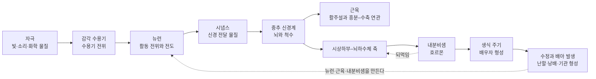
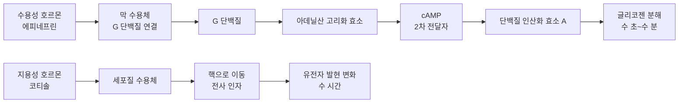
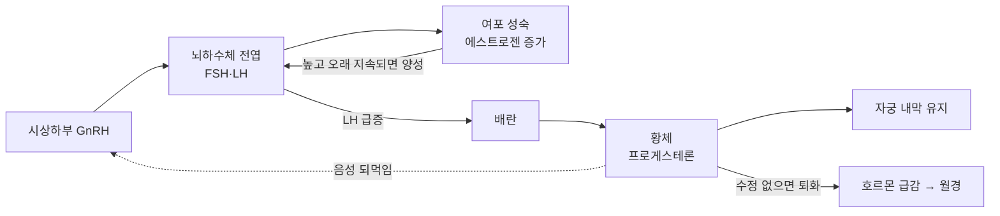
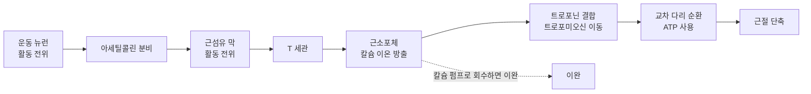

# 일반생명과학 12. 동물의 구조와 기능 Ⅱ — 조절과 생식
<!-- prev: bio-2, m3-05, ubio-11 -->
<!-- next: ubio-13 -->

> [!NOTE]
> **이 단원의 범위**
> - 호르몬과 내분비계: 화학 신호의 종류, 호르몬의 신호 경로, 시상하부–뇌하수체 축, 음성·양성 되먹임
> - 동물의 생식: 무성·유성 생식, 배우자 형성, 생식 주기와 호르몬, 임신
> - 배아 발생: 수정, 난할, 낭배 형성, 기관 형성과 유도
> - 뉴런의 막전위(네른스트 식, 골드먼 식)와 활동 전위, 시냅스와 신경 전달 물질
> - 신경계의 구성과 뇌, 감각 수용(시각, 청각, 평형 감각, 화학 감각)
> - 근육 수축(활주설, 흥분–수축 연관)과 골격

**학습 목표**

1. 호르몬을 화학적 성질에 따라 나누고, 수용체 위치에 따라 신호 경로가 어떻게 달라지는지 설명하며, 시상하부–뇌하수체 축의 되먹임으로 호르몬 이상의 위치를 추론할 수 있다.
2. 배우자 형성과 여성·남성 생식 주기의 호르몬 조절을 되먹임으로 설명하고, 수정에서 기관 형성까지 배아 발생의 단계를 배엽의 운명과 연결할 수 있다.
3. 네른스트 식과 골드먼 식으로 평형 전위와 휴지 전위를 계산하고, 전압 개폐 이온 통로의 상태 변화로 활동 전위와 불응기를 설명할 수 있다.
4. 화학적 시냅스의 전달 과정과 시냅스 후 전위의 가중을 설명하고, 주요 신경 전달 물질과 수용체의 종류를 구분할 수 있다.
5. 감각 수용기가 자극을 수용기 전위로 바꾸는 과정을 시각·청각·화학 감각의 예로 설명할 수 있다.
6. 활주설의 근거와 교차 다리 순환, 흥분–수축 연관을 설명하고, 근육 원섬유 마디의 길이–장력 관계를 정량적으로 해석할 수 있다.

**이 단원의 학습 사다리**

| 단계 | 무엇을 하나? |
|---|---|
| STEP 1. 이전 학습 다시 보기 | 고등학교 「항상성과 몸의 조절」의 뉴런·호르몬, 중학교 「자극과 반응」의 감각 기관을 다시 본다 |
| STEP 2. 기초 다지기 | 자연로그와 상용로그, 전기화학 퍼텐셜, 지수 감소와 반감기, 증폭의 곱셈을 익힌다 |
| STEP 3. 핵심 개념 | 내분비계 → 생식 → 배아 발생 → 막전위와 활동 전위 → 시냅스 → 신경계와 뇌 → 감각 → 근육과 골격 |
| STEP 4. 오개념 바로잡기 | "휴지 전위는 펌프가 만든다?", "근수축 때 필라멘트가 짧아진다?" 같은 착각을 바로잡는다 |
| STEP 5. 다음 단계로 | 케이블 이론과 호지킨–헉슬리 모형, 신경생물학·내분비학·발생생물학으로 이어진다 |
| STEP 6. 생활·산업·진로 | 호르몬 진단, 뇌–기계 인터페이스, 보조 생식술, 근육 질환 치료 |

---

## 🗺️ 단원 들어가기

100 m 출발선에 선 선수를 떠올려 보자. 출발 총소리가 귀의 유모 세포를 흔들고, 그 기계적 진동은 수 밀리초 안에 전기 신호로 바뀌어 청각 신경을 따라 뇌로 간다. 대뇌의 운동 영역이 명령을 내리면 운동 뉴런의 활동 전위가 다리 근육에 도착하고, 근육 세포 속에서 칼슘 이온이 쏟아져 나와 수많은 마이오신 머리가 액틴을 당긴다. 총소리를 듣고 발이 출발대를 밀기까지 걸리는 시간은 약 0.15 s 안팎이다.

같은 순간, 선수의 부신 속질은 에피네프린을 혈액으로 쏟아내 심장 박동을 높이고 간의 글리코젠을 분해시킨다. 이 신호는 신경 신호보다 훨씬 느리지만 몸 전체에 퍼지고 오래 지속된다. 그리고 이 모든 장치 — 뉴런, 근육, 내분비샘 — 는 한때 단 하나의 수정란이었던 세포가 난할과 낭배 형성을 거쳐 만들어 낸 것이다.

이 단원은 동물이 **정보를 주고받고(신경·내분비), 반응하고(근육·골격), 다음 세대를 만드는(생식·발생)** 방식을 분자와 세포 수준까지 내려가 정량적으로 살펴본다.

---

## STEP 1. 🔙 이전 학습 다시 보기

### 연계 개념표

| 이전 단원 | 고등학교·중학교에서는 여기까지 | 대학에서는 이렇게 확장 |
|---|---|---|
| 중학교 「자극과 반응」 감각 기관 | 눈·귀·코·혀·피부의 구조와 감각이 뇌로 전달되는 길 | 감각 수용기가 자극을 **수용기 전위**로 바꾸는 분자 기작(로돕신의 신호 전달, 유모 세포의 기계 개폐 통로) |
| 중학교 「자극과 반응」 호르몬 | 인슐린·글루카곤·티록신 등의 작용, 신경과 호르몬 비교 | 호르몬의 **화학적 분류**와 수용체 위치에 따른 신호 경로, 시상하부–뇌하수체 축 |
| 고등학교 「항상성과 몸의 조절」 '뉴런의 구조와 흥분의 전도' | 휴지 전위 약 −70 mV, 탈분극·재분극·과분극, 실무율, 도약 전도 | **네른스트 식·골드먼 식**으로 막전위를 계산, 전압 개폐 통로의 세 상태와 불응기 |
| 고등학교 「항상성과 몸의 조절」 '시냅스 전달과 약물' | 신경 전달 물질의 분비·확산·결합·제거, 약물의 작용 단계 | $\mathrm{Ca^{2+}}$에 의한 소포 융합, 이온성·대사성 수용체, EPSP·IPSP의 가중, 양자 방출 |
| 고등학교 「항상성과 몸의 조절」 '사람의 신경계', '항상성' | 대뇌·소뇌·간뇌·연수의 기능, 티록신의 음성 피드백, 혈당·체온 조절 | 뇌의 발생적 구분과 학습·기억(장기 강화), 되먹임 고리로 내분비 질환의 위치 추론 |
| 일반생명과학 「동물의 구조와 기능 Ⅰ」 | 항상성과 되먹임, 체온 조절, 삼투 조절과 호르몬 | 같은 되먹임 원리를 생식 주기(양성 되먹임 포함)와 신경 신호로 넓힌다 |

### 준비 운동 (사전 진단)

**Q1.** 휴지 상태의 뉴런에서 $\mathrm{Na^+}$와 $\mathrm{K^+}$는 각각 세포 안과 밖 중 어디에 더 많은가? 나트륨–칼륨 펌프는 한 번에 몇 개의 이온을 어느 방향으로 옮기는가?

**Q2.** 혈중 티록신 농도가 높아지면 시상하부와 뇌하수체 전엽의 분비는 어떻게 변하는가? 이런 조절을 무엇이라 하는가?

**Q3.** 근육이 수축할 때 근육 원섬유 마디(근절)에서 길이가 변하지 **않는** 띠는 무엇인가?

**Q4.** 수정란이 난할을 7번 하면 세포는 몇 개가 되는가? 이때 배아 전체의 크기는 수정란에 비해 어떠한가?

정답 및 해설

**Q1.** $\mathrm{Na^+}$는 세포 **밖**, $\mathrm{K^+}$는 세포 **안**에 많다. 펌프는 ATP 1분자를 써서 $\mathrm{Na^+}$ 3개를 밖으로, $\mathrm{K^+}$ 2개를 안으로 옮긴다.

**Q2.** 둘 다 **억제**된다(TRH, TSH 분비 감소). 결과가 원인을 억제하는 **음성 되먹임(음성 피드백)** 이다.

**Q3.** **A대**(마이오신 필라멘트의 길이). I대와 H대는 짧아진다.

**Q4.** $2^7 = 128$개. 난할 동안에는 세포가 자라지 않고 나뉘기만 하므로 배아 전체의 크기는 수정란과 거의 같다.

---

## STEP 2. 🧱 기초 다지기

### ① 자연로그와 상용로그 바꾸기

막전위 식에는 자연로그 $\ln$이 나온다. 계산기 없이 어림하려면 상용로그로 바꾸는 것이 편하다.

$$
\ln x = \ln 10 \times \log_{10} x \approx 2.303\,\log_{10} x
$$

$\log_{10} 10 = 1$, $\log_{10} 2 \approx 0.301$, $\log_{10} 3 \approx 0.477$을 기억해 두면 대부분의 어림이 가능하다. 예를 들어 농도비가 10배이면 $\log_{10} 10 = 1$, 100배이면 2이다.

### ② 열에너지 한 몫, $RT/F$

이온 한 몰을 전위차 $V$만큼 옮길 때의 전기적 일은 $zFV$이다($z$: 이온의 전하수, $F = 96485\ \mathrm{C/mol}$: 패러데이 상수). 같은 이온이 농도 $C_1$에서 $C_2$로 옮겨 갈 때 자유 에너지 변화는 $RT\ln(C_2/C_1)$이다($R = 8.314\ \mathrm{J/(mol\cdot K)}$). 두 에너지를 비교하는 눈금이 $RT/F$이다.

| 온도 | $RT/F$ | $2.303\,RT/F$ |
|---|---|---|
| 20 °C (293 K) | 약 25.3 mV | 약 58.2 mV |
| 37 °C (310 K) | 약 26.7 mV | 약 61.5 mV |

즉 체온에서 1가 양이온의 농도비가 10배이면 약 61.5 mV의 전위차와 '맞먹는다'.

> [!TIP]
> 💡 **비유** — 언덕 위(높은 농도)에서 공이 굴러 내려가려는 경향과, 언덕 아래에 서서 공을 밀어 올리는 사람(전위차)의 힘이 정확히 같아지면 공은 멈춘다. 그때 사람의 '힘'에 해당하는 전위가 바로 평형 전위이다.

### ③ 지수 감소와 반감기

혈액 속 호르몬은 간과 콩팥에서 일정한 비율로 제거되는 경우가 많다. 제거 속도가 농도에 비례하면

$$
C(t) = C_0\, e^{-kt}, \qquad t_{1/2} = \frac{\ln 2}{k}
$$

이다. 반감기가 지날 때마다 농도는 절반이 되므로, 처음의 $1/8$이 되려면 반감기의 3배가 걸린다.

### ④ 증폭은 곱셈이다

신호 전달 연쇄에서 각 단계가 다음 단계 분자를 여러 개 활성화하면, 전체 증폭률은 각 단계 증폭률의 **곱**이다. 단계별로 10배, 100배, 10배이면 전체는 $10\times100\times10 = 10^4$배이다.

### ⑤ 데시벨

소리의 세기 준위는 $\beta = 10\log_{10}(I/I_0)$ dB이다. 10 dB 커질 때마다 세기는 10배, 30 dB 차이는 $10^3$배이다. 감각계가 매우 넓은 범위의 자극을 다루는 방식을 이해하는 데 쓴다.

---

## STEP 3. 📘 핵심 개념

### ① 호르몬과 내분비계 — 혈액을 타는 화학 신호

#### (1) 동물의 화학 신호는 거리에 따라 나뉜다

| 신호 방식 | 신호 분자가 가는 거리 | 예 |
|---|---|---|
| **내분비(endocrine)** | 혈액을 타고 먼 표적 세포까지 | 인슐린, 티록신, 코티솔 |
| **측분비(paracrine)** | 이웃 세포까지 확산 | 프로스타글란딘(염증), 성장 인자 |
| **자가분비(autocrine)** | 분비한 세포 자신 | 일부 사이토카인(T 림프구의 인터류킨-2) |
| **시냅스 신호** | 시냅스 틈(수십 nm)을 건너 | 아세틸콜린 |
| **신경 분비(neuroendocrine)** | 뉴런이 혈액으로 분비 | 옥시토신, 항이뇨 호르몬(ADH) |
| **페로몬(pheromone)** | 같은 종의 다른 개체로, 몸 밖으로 | 누에나방의 성 유인 물질, 개미의 길 표시 물질 |

**내분비계(endocrine system)** 는 관(導管) 없이 호르몬을 혈액으로 내보내는 **내분비샘**과 호르몬을 분비하는 세포들의 모임이다. 땀샘·침샘처럼 관을 통해 분비하는 **외분비샘**과 구별된다.

#### (2) 호르몬의 화학적 분류와 신호 경로

호르몬이 **물에 녹는가, 지질에 녹는가**가 수용체의 위치와 작용 방식을 결정한다.

| 구분 | **수용성 호르몬** | **지용성 호르몬** |
|---|---|---|
| 종류 | 펩타이드·단백질(인슐린, 글루카곤, ADH, 생장 호르몬), 대부분의 아민(에피네프린) | 스테로이드(코티솔, 알도스테론, 에스트로젠, 테스토스테론), 갑상샘 호르몬(티록신) |
| 혈액 속 이동 | 혈장에 녹아 자유롭게 | 운반 단백질에 결합하여 |
| 수용체 위치 | **세포막** 표면 | **세포질 또는 핵** 안 |
| 신호 경로 | G 단백질 연결 수용체·효소 연결 수용체 → 2차 전달자(cAMP, $\mathrm{Ca^{2+}}$, $\mathrm{IP_3}$) → 단백질 인산화 연쇄 | 호르몬–수용체 복합체가 **전사 인자**로 작용하여 특정 유전자의 전사를 조절 |
| 반응 속도와 지속 | 초~분 단위로 빠르고 비교적 짧다 | 시간~일 단위로 느리고 오래간다 |
| 반감기(혈중) | 대개 짧다(분 단위) | 대개 길다(시간~일 단위) |

> [!NOTE]
> 에피네프린과 티록신은 둘 다 아미노산 타이로신에서 만들어지는 아민 호르몬이지만, 에피네프린은 수용성이고 티록신은 지용성이다. **출발 재료가 아니라 분자의 극성**이 수용체 위치를 정한다.

같은 호르몬이라도 **표적 세포가 가진 수용체와 세포 내 경로**에 따라 반응이 달라진다. 에피네프린은 간세포에서는 β 수용체 → cAMP 경로로 글리코젠 분해를, 소화관 혈관의 평활근에서는 α 수용체를 통해 혈관 수축을, 골격근 혈관에서는 β 수용체를 통해 혈관 확장을 일으킨다.

#### 예제 1 — 신호 증폭 어림하기

간세포에 에피네프린 분자 1개가 결합하면 활성화된 수용체가 G 단백질 약 100개를 활성화하고, 활성화된 아데닐산 고리화 효소 1개가 cAMP를 약 1000분자 만든다고 하자(G 단백질 1개가 효소 1개를 활성화한다고 가정). 이후 단계를 무시하면 cAMP는 약 몇 분자 생기는가? 실제 증폭이 이보다 더 큰 이유는?

**풀이**
식 세우기: 증폭률은 단계별 증폭의 곱이다.
대입: $1 \times 100 \times 1 \times 1000 = 1\times10^5$
결과: cAMP 약 $10^5$분자. 실제로는 cAMP 하나가 단백질 인산화 효소를 활성화하고, 그 효소가 다시 여러 개의 인산화 효소를 인산화하는 단계가 더 이어지므로, 포도당 방출까지의 전체 증폭은 이보다 몇 자릿수 더 커진다. 혈중 농도가 $10^{-10}\ \mathrm{mol/L}$ 수준인 호르몬이 큰 효과를 내는 비결이 이 곱셈 증폭이다.

#### (3) 시상하부–뇌하수체 축 — 신경계와 내분비계가 만나는 곳

**시상하부(hypothalamus)** 는 간뇌의 일부로, 신경 신호를 받아 호르몬 신호로 바꾸는 사령부이다. 그 아래에 매달린 **뇌하수체(pituitary gland)** 는 발생 기원이 다른 두 부분으로 되어 있다.

| 부분 | 시상하부와의 연결 | 분비 호르몬 |
|---|---|---|
| **뇌하수체 후엽** | 시상하부 신경 분비 세포의 **축삭이 직접** 후엽까지 뻗어 있다(신경 조직) | 시상하부에서 만든 **옥시토신**, **항이뇨 호르몬(ADH)** 을 저장했다가 분비 |
| **뇌하수체 전엽** | 시상하부의 **방출·억제 호르몬**이 문맥 혈관(두 모세 혈관망을 잇는 혈관)을 따라 전엽에 도착(샘 조직) | 갑상샘 자극 호르몬(TSH), 부신 겉질 자극 호르몬(ACTH), 여포 자극 호르몬(FSH), 황체 형성 호르몬(LH), 생장 호르몬(GH), 프로락틴(PRL) |

전엽 호르몬 중 TSH, ACTH, FSH, LH는 다른 내분비샘을 자극하는 **자극 호르몬(tropic hormone)** 이다. 그래서 시상하부 → 뇌하수체 전엽 → 말단 내분비샘의 **3단계 축**이 생긴다.

| 축 | 시상하부 | 뇌하수체 전엽 | 말단 샘 | 말단 호르몬의 주 작용 |
|---|---|---|---|---|
| 갑상샘 축 | TRH | TSH | 갑상샘 | 티록신: 기초 대사율 증가, 발생·성장 |
| 스트레스 축 | CRH | ACTH | 부신 겉질 | 코티솔: 혈당 증가(포도당 신생), 면역·염증 억제 |
| 생식샘 축 | GnRH | FSH, LH | 정소·난소 | 테스토스테론, 에스트로젠, 프로게스테론 |

**주요 내분비샘과 호르몬(축에 속하지 않는 것)**

| 내분비샘 | 호르몬 | 주 작용 |
|---|---|---|
| 송과샘 | 멜라토닌 | 생체 리듬(밤에 분비 증가) |
| 부갑상샘 | 부갑상샘 호르몬(PTH) | 혈중 $\mathrm{Ca^{2+}}$ 증가(뼈에서 방출, 콩팥 재흡수, 비타민 D 활성화) |
| 갑상샘 C 세포 | 칼시토닌 | 혈중 $\mathrm{Ca^{2+}}$ 감소(일부 동물에서 뚜렷) |
| 부신 속질 | 에피네프린, 노르에피네프린 | 투쟁–도피 반응. 교감 신경이 직접 자극 |
| 부신 겉질 | 알도스테론 | 콩팥의 $\mathrm{Na^+}$ 재흡수 증가 |
| 이자 섬 | 인슐린(β 세포), 글루카곤(α 세포) | 혈당 감소 / 혈당 증가 |

#### (4) 되먹임 — 축의 균형을 지키는 고리

말단 호르몬은 대개 시상하부와 뇌하수체 전엽을 **억제**한다(음성 되먹임). 그래서 축의 어느 한 단계가 고장 나면 위아래 호르몬 농도가 특징적인 무늬로 변한다. 이 무늬를 읽으면 병변의 위치를 추론할 수 있다.

| 이상 부위 | 티록신 | TSH | 까닭 |
|---|---|---|---|
| 갑상샘 자체의 기능 저하(1차성) | 낮음 | **높음** | 티록신이 적어 억제가 풀리므로 뇌하수체가 TSH를 많이 분비 |
| 뇌하수체의 기능 저하(2차성) | 낮음 | **낮음** | 위에서부터 자극이 없음 |
| 갑상샘의 과다 분비(TSH 수용체를 자극하는 자가 항체 등) | 높음 | **낮음** | 많은 티록신이 뇌하수체를 강하게 억제 |
| 아이오딘 결핍 | 낮음 | 높음 | 티록신 합성 재료 부족 → TSH가 갑상샘을 계속 자극하여 갑상샘이 커짐(갑상샘종) |

반대로 결과가 원인을 더 키우는 **양성 되먹임**도 있다. 분만 때 자궁 경부가 늘어나는 신호 → 옥시토신 분비 → 자궁 수축 → 경부가 더 늘어남 → 옥시토신이 더 분비되는 고리가 대표적이다. 양성 되먹임은 '끝을 내야 하는' 사건(분만, 배란, 혈액 응고)에 쓰이며, 사건이 끝나면 고리가 끊어진다.

> [!IMPORTANT]
> 되먹임 고리를 그릴 때는 **감지기(무엇이 변화를 감지하나) → 조절 중추 → 효과기 → 조절 대상 변수**를 반드시 구분하자. 음성 되먹임은 변수를 기준값 쪽으로 되돌리고, 양성 되먹임은 변수를 기준값에서 더 멀어지게 한다.

#### 예제 2 — 호르몬은 얼마나 빨리 사라지는가

어떤 펩타이드 호르몬의 혈중 반감기가 5분이다. 분비가 갑자기 멈추었을 때 혈중 농도가 처음의 $12.5\%$로 떨어지는 데 걸리는 시간과 제거 속도 상수 $k$를 구하시오.

**풀이**
식 세우기: $C/C_0 = (1/2)^{t/t_{1/2}}$
대입: $0.125 = (1/2)^3$이므로 $t = 3 \times 5 = 15\ \mathrm{min}$. $k = \ln 2 / t_{1/2} = 0.693/5\ \mathrm{min} \approx 0.139\ \mathrm{min^{-1}}$
의미: 반감기가 짧은 호르몬은 분비 속도만 조절해도 혈중 농도를 분 단위로 바꿀 수 있다. 인슐린처럼 빠른 조절이 필요한 호르몬이 짧은 반감기를 갖는 까닭이다. 반대로 갑상샘 호르몬은 반감기가 약 일주일 정도로 길어, 약을 끊어도 효과가 서서히 사라진다.

> [!TIP]
> 💡 **비유** — 시상하부–뇌하수체 축은 '본사 → 지역 본부 → 지점'으로 이어지는 회사와 같다. 지점의 실적(말단 호르몬)이 목표를 넘으면 본사와 지역 본부가 지시를 줄인다. 지점이 문을 닫으면(1차성) 지역 본부는 독촉 공문(TSH)을 마구 보내고, 지역 본부가 문을 닫으면(2차성) 독촉 공문도 끊긴다.

### ② 동물의 생식 — 배우자를 만들고 시기를 맞춘다

#### (1) 무성 생식과 유성 생식

| 구분 | **무성 생식** | **유성 생식** |
|---|---|---|
| 방식 | 출아(히드라), 분열(플라나리아), 조각남과 재생(불가사리), **단위 생식**(진딧물, 일부 도마뱀) | 감수 분열로 만든 반수체 배우자(정자·난자)의 수정 |
| 자손의 유전적 구성 | 어버이와 거의 같다 | 어버이의 유전자가 새로 조합된다 |
| 장점 | 짝이 필요 없고, 개체군이 빠르게 늘어난다 | 유전적 다양성 → 변하는 환경·기생자에 대응 |
| 단점 | 환경이 변하면 개체군 전체가 취약 | 짝 찾기·수컷 생산 비용 |

진딧물처럼 환경이 안정한 여름에는 단위 생식으로 빠르게 늘고, 가을에 유성 생식으로 바꾸는 동물도 있다. 유성 생식의 유전적 이점은 「감수 분열과 유전 양식」에서 본 독립 분리·교차·무작위 수정에서 나온다.

수정 방식은 **체외 수정**(물속에 배우자를 방출: 많은 어류, 양서류)과 **체내 수정**(육상 동물: 파충류, 조류, 포유류)으로 나뉜다. 체내 수정은 건조한 육상에서 배우자를 보호하는 적응이다.

#### (2) 배우자 형성 — 정자와 난자는 다르게 만들어진다

| 비교 | **정자 형성** | **난자 형성** |
|---|---|---|
| 장소 | 정소의 세정관 | 난소의 여포 |
| 시작과 기간 | 사춘기부터 평생 계속 | 태아기에 1차 난모세포까지 만들어 감수 1분열 전기에서 정지 → 사춘기 이후 주기마다 일부가 재개 |
| 1개의 모세포에서 생기는 배우자 | 정자 4개 | 난자 1개 + 극체(2~3개, 퇴화) |
| 세포질 분배 | 균등 | **불균등**(난자가 세포질을 거의 다 가진다) |
| 감수 2분열의 완료 | 정자가 되기 전에 완료 | 사람은 **수정이 일어나야** 감수 2분열이 끝난다(2차 난모세포 상태로 배란) |
| 지지 세포 | 세르톨리 세포(영양 공급, 인히빈 분비) | 여포 세포(에스트로젠 분비) |

난자 형성에서 세포질을 불균등하게 나누는 까닭은, 배아가 스스로 영양을 얻기 전까지 쓸 **세포질(mRNA, 단백질, 리보솜, 미토콘드리아, 난황)** 을 한 세포에 몰아주기 위해서이다.

#### (3) 남성 생식의 호르몬 조절

- 시상하부의 **GnRH** → 뇌하수체 전엽의 **FSH**와 **LH**
- **LH** → 정소의 **라이디히 세포**(간질 세포)가 **테스토스테론** 분비
- **FSH** + 테스토스테론 → **세르톨리 세포**가 정자 형성을 지원
- 음성 되먹임: 테스토스테론은 시상하부와 전엽을, 세르톨리 세포가 분비하는 **인히빈**은 주로 FSH 분비를 억제

#### (4) 여성 생식 주기 — 난소 주기와 자궁 주기

사람 여성의 생식 주기는 평균 약 28일이며(개인차가 크다), 난소에서 일어나는 **난소 주기**와 자궁 내막에서 일어나는 **자궁 주기(월경 주기)** 가 호르몬으로 맞물려 있다. 아래는 28일 주기를 가정한 대표적인 흐름이다.

| 시기(일) | 난소 주기 | 주요 호르몬 변화 | 자궁 주기 |
|---|---|---|---|
| 1~5 | 여포기 시작: FSH로 여러 여포가 자람 | 에스트로젠·프로게스테론 낮음 → 억제가 풀려 FSH 약간 상승 | **월경기**: 자궁 내막이 떨어져 나감 |
| 6~13 | 여포기: 한 개의 우세 여포가 성숙 | 여포의 **에스트로젠** 점점 증가. 처음엔 FSH·LH를 억제(음성) | **증식기**: 에스트로젠으로 내막이 두꺼워짐 |
| 약 14 | **배란** | 에스트로젠이 높게 일정 기간 유지되면 되먹임이 **양성**으로 바뀌어 **LH 급증**(FSH도 함께 상승) → 약 하루 뒤 배란 | 증식기 끝 |
| 15~28 | 황체기: 배란 후 남은 여포가 **황체**가 됨 | 황체가 **프로게스테론**과 에스트로젠 분비 → 시상하부·전엽 억제(음성) → LH·FSH 낮음 | **분비기**: 내막의 혈관과 분비샘이 발달, 착상 준비 |
| 약 25~28 | 수정이 없으면 황체가 퇴화 | 프로게스테론·에스트로젠 급감 | 내막 유지 실패 → 다음 월경 |

**임신이 되면** — 착상한 배아의 영양막(나중에 태반의 일부)이 **사람 융모성 생식샘 자극 호르몬(hCG)** 을 분비한다. hCG는 LH처럼 작용해 황체를 유지시키므로 프로게스테론이 계속 분비되어 월경이 일어나지 않는다. 임신 2~3개월 무렵부터는 태반이 직접 프로게스테론과 에스트로젠을 만든다. 임신 진단 키트는 오줌 속 hCG를 항체로 검출한다.

#### 예제 3 — hCG 농도의 배가 시간

임신 초기 혈중 hCG 농도는 약 2일마다 2배로 증가한다고 하자. 어느 날 측정한 농도가 $50$(상대 단위)였다면, $800$이 되는 것은 약 며칠 뒤인가?

**풀이**
식 세우기: $C = C_0 \times 2^{t/T_d}$, $T_d = 2$일
대입: $800/50 = 16 = 2^4$ → $t = 4 \times 2 = 8$일
의미: 배가 시간이 정상보다 훨씬 길면 착상 이상을 의심하는 단서가 된다(실제 진단은 여러 검사를 함께 본다). 지수 증가는 곱셈으로 생각하면 계산이 쉽다.

#### 예제 4 — 경구 피임약의 원리 추론하기

경구 피임약에는 합성 에스트로젠과 합성 프로게스테론(프로게스틴)이 들어 있어 혈중 농도를 일정하게 유지한다. 이 약이 배란을 막는 원리를 되먹임으로 설명하시오.

**풀이** 두 호르몬이 일정 수준으로 계속 있으면 황체기와 비슷한 상태가 되어 시상하부의 GnRH와 전엽의 FSH·LH가 **음성 되먹임**으로 억제된다. FSH가 낮아 여포가 충분히 성숙하지 못하고, 에스트로젠이 '서서히 높아져 정점에 머무는' 신호가 없으므로 양성 되먹임에 의한 **LH 급증이 일어나지 않아** 배란이 되지 않는다.

> [!TIP]
> 💡 **요령** — 에스트로젠은 "양이 적거나 짧게 있으면 브레이크, 많고 오래 있으면 가속 페달"이다. 같은 호르몬이 농도와 지속 시간에 따라 되먹임의 방향을 바꾸는 점이 생식 주기의 핵심이다.

### ③ 배아 발생 — 한 세포에서 몸의 설계도까지

#### (1) 수정 — 한 정자만 들어오게 하라

성게처럼 체외 수정하는 동물에서 잘 연구된 수정 과정은 다음과 같다.

1. **첨체 반응**: 정자가 난자의 젤리층에 닿으면 정자 머리의 **첨체**가 효소를 내보내 길을 뚫는다.
2. **막 융합**: 정자와 난자의 세포막이 융합한다.
3. **빠른 다정 수정 방지**: 융합 직후 난자 막으로 $\mathrm{Na^+}$가 들어와 막전위가 탈분극되어 다른 정자의 융합을 막는다(성게, 수 초 이내).
4. **느린 다정 수정 방지(피질 반응)**: 난자 세포질의 $\mathrm{Ca^{2+}}$ 농도가 물결처럼 높아지면 피질 과립이 외포 작용으로 내용물을 분비해 **수정막**을 만든다(약 1분).
5. **난자의 활성화**: 높아진 $\mathrm{Ca^{2+}}$가 물질대사를 깨우고, 단백질 합성과 DNA 복제가 시작된다. 정자 핵과 난자 핵이 합쳐져 **접합자**(2n)가 된다.

포유류는 체내 수정을 하며, 정자가 난자를 둘러싼 **투명대**의 단백질에 결합한 뒤 첨체 반응을 일으키고, 피질 반응으로 투명대가 변해 다른 정자를 막는다. 사람의 수정은 대개 수란관에서 일어난다.

#### (2) 난할과 포배 — 나뉘기만 하고 자라지 않는다

**난할(cleavage)** 은 수정란의 빠른 체세포 분열이다. 세포 주기에서 $\mathrm{G_1}$·$\mathrm{G_2}$기가 거의 없이 S기와 M기만 되풀이되므로, 세포 수는 늘지만 세포(할구) 하나의 크기는 작아진다. 난할로 생긴 세포 덩어리 안쪽에 액체가 찬 공간(**포배강**)이 생기면 **포배(blastula)** 라 한다(사람에서는 이 시기의 배아를 **배반포**라 하며 자궁에 착상한다).

난황의 양과 분포가 난할 양식을 결정한다.

| 난황 | 난할 양식 | 예 |
|---|---|---|
| 적고 고르게 분포 | **전할**(알 전체가 나뉨), 할구 크기 비슷 | 성게, 포유류 |
| 한쪽(식물극)에 비교적 많음 | **전할**, 동물극 할구가 작고 식물극 할구가 큼 | 개구리 |
| 매우 많음 | **부분 할**(난황 위의 얇은 원반만 나뉨, 반할) | 조류, 파충류 |
| 중앙에 많음 | 핵만 먼저 분열한 뒤 표면에 세포막이 생김(표할) | 곤충(초파리) |

#### 예제 5 — 난할 횟수와 할구의 크기

지름 $1.2\ \mathrm{mm}$인 개구리 수정란이 균등하게 12번 난할했다고 가정하자. (1) 세포 수는? (2) 할구 하나의 부피는 수정란의 몇 분의 1인가? (3) 할구가 구형이라 할 때 지름은 약 몇 μm인가?

**풀이**
(1) $2^{12} = 4096$개
(2) 전체 부피가 그대로이므로 $1/4096$
(3) 부피가 $1/4096$이면 지름은 $(1/4096)^{1/3} = 1/16$배 → $1200\ \mathrm{\mu m}/16 = 75\ \mathrm{\mu m}$
의미: 난할은 커다란 알 세포를 보통 체세포 크기의 세포로 '쪼개는' 과정이다. 실제 개구리 할구는 동물극 쪽이 작고 식물극 쪽이 커서 균등하지 않다.

#### (3) 낭배 형성 — 세 개의 배엽이 자리를 잡는다

**낭배 형성(gastrulation)** 은 포배 표면의 세포들이 안으로 말려 들어가 이동하면서 **세 배엽**을 만드는 과정이다. 세포가 처음 말려 들어가는 구멍을 **원구(blastopore)** 라 하고, 새로 생긴 관을 **원장**(원시 소화관)이라 한다.

| 배엽 | 위치 | 주요 유래 기관 |
|---|---|---|
| **외배엽** | 바깥 | 표피와 그 부속물(털, 손톱, 땀샘), **신경계**(뇌, 척수, 신경 능선 유래의 말초 신경), 눈의 수정체, 내이 |
| **중배엽** | 가운데 | **척삭**, 골격·근육, 순환계(심장, 혈관, 혈액), 콩팥, 생식샘, 진피 |
| **내배엽** | 안쪽 | 소화관의 상피, 간, 이자, 폐·기관의 상피, 갑상샘 |

원구가 입이 되는 동물을 **선구동물**(연체동물, 환형동물, 절지동물), 원구가 항문이 되고 입이 나중에 생기는 동물을 **후구동물**(극피동물, 척삭동물)이라 한다. 이 차이는 「생물 다양성」에서 본 동물 계통 분류의 중요한 근거이다.

#### (4) 기관 형성 — 신경관과 체절

척추동물에서 낭배 형성 뒤 가장 먼저 눈에 띄는 기관 형성은 **신경관 형성**이다.

1. 등쪽 중배엽이 막대 모양의 **척삭(notochord)** 을 만든다.
2. 척삭이 그 위의 외배엽에 신호를 보내 두꺼운 **신경판**을 만들게 한다.
3. 신경판이 접혀 올라가 **신경관**이 된다 → 앞쪽은 뇌, 뒤쪽은 척수.
4. 신경관이 닫힐 때 경계에서 떨어져 나온 **신경 능선 세포**가 몸 곳곳으로 이동하여 말초 신경, 멜라닌 세포, 얼굴뼈의 일부 등을 만든다.
5. 척삭 양옆의 중배엽이 마디마디 나뉘어 **체절(somite)** 이 되고, 체절에서 척추뼈, 골격근, 진피가 생긴다.

사람에서 신경관이 제대로 닫히지 않으면 척추갈림증 같은 **신경관 결손**이 생긴다. 임신 전후 엽산 섭취가 그 위험을 줄이는 것으로 알려져 있다.

#### (5) 형태 형성의 세포 기작과 유도

| 기작 | 내용 | 예 |
|---|---|---|
| 세포 모양 변화 | 세포 꼭대기의 미세섬유가 수축하여 세포가 쐐기 모양이 되면 판이 휘어진다 | 신경판이 접혀 신경관이 됨 |
| 세포 이동 | 세포가 세포 외 기질을 붙잡고 기어간다 | 신경 능선 세포의 이동, 낭배 형성 |
| 세포 사멸(세포 자살) | 정해진 세포가 프로그램에 따라 죽는다 | 손가락 사이 물갈퀴 조직의 제거 |
| **유도(induction)** | 한 세포 집단이 신호 물질로 이웃 세포의 발생 운명을 바꾼다 | 척삭 → 신경판, 눈 소포 → 수정체 |

**형성체 실험** — 20세기 초, 영원(도롱뇽류)의 낭배에서 원구 등쪽 입술 부분을 떼어 다른 낭배의 배쪽에 이식하자, 이식받은 배아에서 신경관과 체절을 갖춘 **두 번째 배아 몸통**이 생겼다. 새 몸통의 대부분은 이식된 조직이 아니라 **숙주 세포**로 만들어졌다. 즉 등쪽 입술은 주변 세포의 운명을 바꾸는 **형성체(organizer)** 이다. 오늘날에는 형성체가 분비하는 여러 단백질이 이웃 세포의 신호 경로를 억제하거나 활성화하여 등–배 축을 정한다는 것이 밝혀졌다(「유전자 발현 조절과 생명공학」의 발생 유전자 조절과 이어진다).

> [!TIP]
> 💡 **비유** — 낭배 형성은 바람 빠진 공의 한쪽을 손가락으로 눌러 안으로 밀어 넣는 것과 비슷하다. 겉면(외배엽)과 안쪽으로 들어간 면(내배엽) 사이에 또 한 겹(중배엽)이 끼어들어 몸의 세 층이 생긴다.

### ④ 뉴런의 막전위와 활동 전위

#### (1) 평형 전위 — 네른스트 식의 유도

막이 $\mathrm{K^+}$만 통과시킨다고 하자. 안쪽에 많은 $\mathrm{K^+}$는 농도 기울기를 따라 밖으로 나가려 한다. 양이온이 빠져나가면 안쪽이 음전하를 띠고, 이 전위차는 $\mathrm{K^+}$를 다시 안으로 끌어당긴다. 두 경향이 균형을 이루면 알짜 이동이 멈춘다. 이때의 막전위가 **평형 전위(equilibrium potential)** 이다.

이온 1몰을 밖에서 안으로 옮길 때의 자유 에너지 변화는 농도 항과 전기 항의 합이다.

$$
\Delta G = RT\ln\frac{[\mathrm{X}]_{\text{안}}}{[\mathrm{X}]_{\text{밖}}} + zF\,V_m
$$

여기서 $V_m = V_{\text{안}} - V_{\text{밖}}$(막전위)이다. 평형에서는 $\Delta G = 0$이므로

$$
E_{\mathrm{X}} = \frac{RT}{zF}\ln\frac{[\mathrm{X}]_{\text{밖}}}{[\mathrm{X}]_{\text{안}}} \approx \frac{61.5\ \mathrm{mV}}{z}\log_{10}\frac{[\mathrm{X}]_{\text{밖}}}{[\mathrm{X}]_{\text{안}}}\quad(37\ ^\circ\mathrm{C})
$$

이것이 **네른스트 식(Nernst equation)** 이다. 평형 전위를 만드는 데 실제로 이동하는 이온의 양은 아주 적어서(막 가까이의 극히 일부 이온), 세포 안팎의 농도는 사실상 변하지 않는다.

#### 예제 6 — 포유류 뉴런의 평형 전위

포유류 뉴런의 대표적인 이온 농도가 아래와 같다(단위 mM, 37 °C). 각 이온의 평형 전위를 구하시오.

| 이온 | 세포 밖 | 세포 안 |
|---|---|---|
| $\mathrm{K^+}$ | 5 | 140 |
| $\mathrm{Na^+}$ | 145 | 15 |
| $\mathrm{Cl^-}$ | 110 | 10 |
| $\mathrm{Ca^{2+}}$ | 2 | 0.0001 |

**풀이**
식 세우기: $E = \dfrac{61.5\ \mathrm{mV}}{z}\log_{10}\dfrac{[\text{밖}]}{[\text{안}]}$
대입:
- $E_{\mathrm{K}} = 61.5\times\log_{10}(5/140) = 61.5\times(-1.447) \approx -89\ \mathrm{mV}$
- $E_{\mathrm{Na}} = 61.5\times\log_{10}(145/15) = 61.5\times0.985 \approx +61\ \mathrm{mV}$
- $E_{\mathrm{Cl}} = \dfrac{61.5}{-1}\times\log_{10}(110/10) = -61.5\times1.041 \approx -64\ \mathrm{mV}$
- $E_{\mathrm{Ca}} = \dfrac{61.5}{2}\times\log_{10}(2/0.0001) = 30.8\times4.30 \approx +132\ \mathrm{mV}$

의미: 휴지 전위(약 −70 mV)는 $E_{\mathrm{K}}$에 가깝지만 같지 않다. $\mathrm{Na^+}$와 $\mathrm{Ca^{2+}}$는 휴지 상태에서 안으로 들어가려는 강한 경향을 가지므로, 통로가 열리기만 하면 세포 안으로 쏟아진다. 이것이 활동 전위와 시냅스 소포 분비의 '에너지원'이다. ($\mathrm{Cl^-}$의 평형 전위는 세포마다 다르다.)

#### (2) 휴지 전위 — 여러 이온의 '가중 평균', 골드먼 식

실제 휴지 막은 $\mathrm{K^+}$를 가장 잘 통과시키지만 $\mathrm{Na^+}$와 $\mathrm{Cl^-}$도 조금씩 통과시킨다. 여러 이온이 함께 막을 지날 때 알짜 전류가 0이 되는 막전위는 **골드먼–호지킨–카츠 식(골드먼 식, GHK equation)** 으로 구한다.

$$
V_m = \frac{RT}{F}\ln\frac{P_{\mathrm{K}}[\mathrm{K^+}]_{\text{밖}} + P_{\mathrm{Na}}[\mathrm{Na^+}]_{\text{밖}} + P_{\mathrm{Cl}}[\mathrm{Cl^-}]_{\text{안}}}{P_{\mathrm{K}}[\mathrm{K^+}]_{\text{안}} + P_{\mathrm{Na}}[\mathrm{Na^+}]_{\text{안}} + P_{\mathrm{Cl}}[\mathrm{Cl^-}]_{\text{밖}}}
$$

$P$는 각 이온의 **투과도**이다. 음이온인 $\mathrm{Cl^-}$는 분자와 분모에서 안팎이 뒤바뀌어 들어간다. 어떤 이온의 투과도가 압도적으로 크면 $V_m$은 그 이온의 평형 전위에 가까워진다.

#### 예제 7 — 휴지 전위와 활동 전위 정점 어림

예제 6의 농도를 쓰고, 휴지 상태의 투과도 비를 $P_{\mathrm{K}} : P_{\mathrm{Na}} : P_{\mathrm{Cl}} = 1 : 0.04 : 0.45$라 하자. (1) 휴지 전위를 구하시오. (2) 활동 전위 정점에서 $P_{\mathrm{Na}}$가 $P_{\mathrm{K}}$의 20배가 된다면 막전위는 약 얼마인가?

**풀이**
(1) 분자 $= 1\times5 + 0.04\times145 + 0.45\times10 = 5 + 5.8 + 4.5 = 15.3$
분모 $= 1\times140 + 0.04\times15 + 0.45\times110 = 140 + 0.6 + 49.5 = 190.1$
$V_m = 26.7\ \mathrm{mV}\times\ln(15.3/190.1) = 26.7\times(-2.520) \approx -67\ \mathrm{mV}$
(2) 분자 $= 5 + 20\times145 + 4.5 = 2909.5$, 분모 $= 140 + 20\times15 + 49.5 = 489.5$
$V_m = 26.7\times\ln(2909.5/489.5) = 26.7\times1.782 \approx +48\ \mathrm{mV}$
의미: 막전위를 바꾸는 것은 이온 농도가 아니라 **투과도의 비**이다. 활동 전위의 탈분극은 $\mathrm{Na^+}$ 투과도가 순간적으로 수백 배 커져 막전위가 $E_{\mathrm{Na}}$ 쪽으로 끌려가는 현상이다. 정점이 $E_{\mathrm{Na}}$(+61 mV)에 이르지 못하는 것은 그 순간에도 $\mathrm{K^+}$ 투과가 남아 있고, $\mathrm{Na^+}$ 통로가 곧 불활성화되기 때문이다.

> [!IMPORTANT]
> 나트륨–칼륨 펌프는 $\mathrm{Na^+}$ 3개를 내보내고 $\mathrm{K^+}$ 2개를 들여오므로 그 자체로 약간의 음전위(수 mV 정도)를 직접 만든다. 그러나 휴지 전위의 **대부분**은 펌프가 만들어 둔 **농도 기울기**와 휴지 막의 **선택적 투과성**(열린 $\mathrm{K^+}$ 누출 통로)에서 나온다. 펌프는 '배터리 충전기', 이온 농도 차는 '배터리', 열린 통로는 '스위치'에 해당한다.

#### (3) 활동 전위 — 전압 개폐 통로의 세 상태

전압 개폐 $\mathrm{Na^+}$ 통로에는 **활성화 문**과 **불활성화 문** 두 개가 있다고 보면 이해하기 쉽다.

| 단계 | 전압 개폐 $\mathrm{Na^+}$ 통로 | 전압 개폐 $\mathrm{K^+}$ 통로 | 막전위 |
|---|---|---|---|
| 휴지 | **닫힘**(활성화 문 닫힘, 불활성화 문 열림) | 닫힘 | 약 −70 mV |
| 역치 도달 후 상승기 | 활성화 문이 빠르게 열림 → **열림** → $\mathrm{Na^+}$ 유입이 탈분극을 더 키움(양성 되먹임) | 천천히 열리기 시작 | $E_{\mathrm{Na}}$ 쪽으로 급상승 |
| 정점~하강기 | 불활성화 문이 닫힘 → **불활성** | 열림 → $\mathrm{K^+}$ 유출 | 재분극 |
| 과분극(후과분극) | 불활성에서 서서히 회복 | 아직 열려 있음 | $E_{\mathrm{K}}$ 쪽으로 내려감 |
| 회복 | 닫힘(다시 열릴 수 있는 상태) | 닫힘 | 휴지 전위 |

- **역치(threshold)** 는 $\mathrm{Na^+}$ 유입에 의한 탈분극 속도가 $\mathrm{K^+}$ 유출 등에 의한 회복 속도를 처음으로 넘어서는 막전위이다. 그 뒤에는 양성 되먹임으로 스스로 폭발하므로 **실무율**이 성립한다.
- **절대 불응기**: 대부분의 $\mathrm{Na^+}$ 통로가 불활성 상태라 어떤 자극으로도 새 활동 전위가 생기지 않는 시기.
- **상대 불응기**: 일부 통로는 회복되었지만 $\mathrm{K^+}$ 통로가 열려 있어(과분극) 보통보다 강한 자극이 있어야 활동 전위가 생기는 시기.
- 불응기 때문에 활동 전위의 최대 발생 빈도에 한계가 생기고, 흥분은 지나온 쪽으로 되돌아가지 않는다.
- 자극의 세기는 활동 전위의 **크기**가 아니라 **빈도**(초당 발생 횟수)와 흥분하는 뉴런의 **수**로 부호화된다.

**실험적 근거** — 1950년대 초 오징어의 거대 축삭(지름 약 0.5 mm 안팎)에 전극을 꽂고, 막전위를 원하는 값에 고정한 채 흐르는 전류를 재는 **전압 고정법**으로 $\mathrm{Na^+}$ 전류와 $\mathrm{K^+}$ 전류가 시간차를 두고 흐른다는 것이 밝혀졌다. 바깥 용액의 $\mathrm{Na^+}$를 줄이면 활동 전위의 정점이 네른스트 식이 예측하는 만큼 낮아졌다. 복어 독 **테트로도톡신**은 전압 개폐 $\mathrm{Na^+}$ 통로를 막아 활동 전위를 없앤다.

#### (4) 전도 — 지름, 말이집, 그리고 국소 전류

활동 전위가 생긴 부위로 들어온 양전하는 축삭 안을 따라 퍼지며(국소 전류) 이웃 막을 탈분극시킨다. 이 수동적 퍼짐이 멀리 갈수록 전도가 빠르다.

| 요인 | 전도 속도에 미치는 영향 | 까닭 |
|---|---|---|
| 축삭 지름 증가 | 빨라짐 | 축삭 내부의 전기 저항이 줄어 전류가 멀리 퍼짐 |
| 말이집 | 크게 빨라짐 | 막을 통한 전류 누출과 막의 전기 용량이 줄어 전류가 다음 **랑비에 결절**까지 퍼짐 → 결절에서만 활동 전위(도약 전도) |
| 온도(변온 동물) | 높을수록 빨라짐(일정 범위) | 통로 개폐 속도 증가 |

척추동물의 말이집은 중추 신경계에서는 **희소돌기아교세포**, 말초 신경계에서는 **슈반 세포**가 만든다. 말이집이 손상되는 다발성 경화증에서는 전도가 느려지거나 끊긴다.

#### 예제 8 — 도약 전도의 속도 어림

말이집 신경에서 랑비에 결절 사이 간격이 $1.0\ \mathrm{mm}$이고, 한 결절에서 다음 결절의 활동 전위가 시작되기까지 약 $0.020\ \mathrm{ms}$가 걸린다고 하자. 전도 속도는? 이 신경으로 1 m 떨어진 발끝에서 척수까지 신호가 가는 데 걸리는 시간은?

**풀이**
$v = \dfrac{1.0\times10^{-3}\ \mathrm{m}}{2.0\times10^{-5}\ \mathrm{s}} = 50\ \mathrm{m/s}$, 걸리는 시간 $= 1\ \mathrm{m}\ /\ 50\ \mathrm{m/s} = 0.020\ \mathrm{s} = 20\ \mathrm{ms}$
의미: 총소리를 듣고 출발하기까지의 약 0.15 s 가운데 신경 전도 자체는 일부이고, 상당 부분은 시냅스 지연과 중추에서의 처리 시간이다.

### ⑤ 시냅스와 신경 전달 물질

#### (1) 전기적 시냅스와 화학적 시냅스

| 비교 | **전기적 시냅스** | **화학적 시냅스** |
|---|---|---|
| 구조 | 간극 연접으로 두 세포의 세포질이 직접 연결 | 시냅스 틈(약 20~40 nm)을 두고 분리 |
| 신호 | 이온 전류가 바로 건너감 | 신경 전달 물질 |
| 속도 | 거의 지연 없음 | 약 0.5~1 ms 정도의 시냅스 지연 |
| 방향과 조절 | 대개 양방향, 조절이 단순 | 한 방향, 흥분·억제·증폭·가소성 등 다양한 조절 |
| 예 | 심장근 세포 사이, 일부 도피 반사 회로 | 신경계 시냅스 대부분, 신경근 접합부 |

#### (2) 화학적 시냅스 전달의 단계

1. 활동 전위가 축삭 말단에 도착하면 **전압 개폐 $\mathrm{Ca^{2+}}$ 통로**가 열린다.
2. $\mathrm{Ca^{2+}}$가 유입되어(예제 6에서 본 큰 전기화학적 기울기) 시냅스 소포가 세포막과 융합하고, 신경 전달 물질이 **외포 작용**으로 분비된다.
3. 전달 물질이 확산하여 시냅스 후 막의 수용체에 결합한다.
4. 수용체의 종류에 따라 이온 통로가 직접 열리거나(빠름), 2차 전달자 경로가 작동한다(느림).
5. 전달 물질은 분해 효소(아세틸콜린 분해 효소), 재흡수 수송체, 확산으로 제거되어 신호가 끝난다.

| 수용체 | **이온성(이온 통로형)** | **대사성(G 단백질 연결형)** |
|---|---|---|
| 작동 | 전달 물질이 결합하면 수용체 자체가 이온 통로로 열림 | G 단백질 → 2차 전달자 → 통로 개폐, 효소 활성, 유전자 발현 |
| 속도·지속 | 밀리초, 짧음 | 수십 밀리초~분, 길고 넓은 효과 |
| 예 | 니코틴성 아세틸콜린 수용체, 글루탐산의 AMPA 수용체, $\mathrm{GABA_A}$ 수용체 | 무스카린성 아세틸콜린 수용체, 도파민 수용체, $\mathrm{GABA_B}$ 수용체 |

#### (3) 시냅스 후 전위와 가중

- **흥분성 시냅스 후 전위(EPSP)**: $\mathrm{Na^+}$와 $\mathrm{K^+}$를 함께 통과시키는 통로 등이 열려 막이 **탈분극** — 역치에 가까워짐.
- **억제성 시냅스 후 전위(IPSP)**: $\mathrm{Cl^-}$ 통로나 $\mathrm{K^+}$ 통로가 열려 막이 **과분극**되거나 휴지 전위 근처에 묶임 — 역치에서 멀어짐.

시냅스 후 전위는 실무율을 따르지 않는 **등급 전위**로, 크기가 전달 물질의 양에 따라 달라지고 퍼지면서 줄어든다. 한 뉴런에는 수천 개의 시냅스가 있으며, 이들이 만든 전위는 더해진다.

| 가중 | 내용 |
|---|---|
| **시간적 가중** | 한 시냅스에서 짧은 간격으로 EPSP가 잇달아 생겨 앞의 것이 사라지기 전에 겹침 |
| **공간적 가중** | 여러 시냅스의 EPSP·IPSP가 동시에 생겨 더해짐 |

더해진 전위가 **축삭 둔덕**(전압 개폐 $\mathrm{Na^+}$ 통로가 밀집한 축삭의 시작 부분)에서 역치를 넘으면 활동 전위가 생긴다. 뉴런은 들어오는 수많은 신호를 '합산하여 결정하는' 계산 단위이다.

#### 예제 9 — 양자 방출

신경근 접합부에서 자발적으로 소포 하나가 분비될 때 근육 막에 약 $0.4\ \mathrm{mV}$의 작은 전위(미니 전위)가 생긴다. 신경을 한 번 자극했을 때 근육 막의 전위 변화가 약 $40\ \mathrm{mV}$였다면, 소포 몇 개가 분비되었다고 어림할 수 있는가? 이 어림의 한계는?

**풀이** $40/0.4 = 100$개 정도. 신경 전달 물질은 소포 단위(**양자**)로 분비된다는 것이 이런 측정에서 밝혀졌다. 다만 전위가 커질수록 막전위가 통로의 반전 전위에 가까워져 소포 하나가 더하는 전위가 줄어들므로, 단순 나눗셈은 소포 수를 **적게** 어림한다.

#### (4) 주요 신경 전달 물질

| 분류 | 물질 | 대표적 역할 |
|---|---|---|
| — | **아세틸콜린** | 신경근 접합부(흥분), 부교감 신경, 뇌의 주의·기억 |
| 아미노산 | **글루탐산** | 척추동물 중추 신경계의 주된 흥분성 전달 물질, 학습·기억 |
| 아미노산 | **GABA**, 글라이신 | 뇌(GABA)와 척수(글라이신)의 주된 억제성 전달 물질 |
| 생체 아민 | 노르에피네프린, 도파민, 세로토닌 | 각성(노르에피네프린), 보상·운동 조절(도파민), 기분·수면(세로토닌). 주로 대사성 수용체 |
| 신경 펩타이드 | 엔도르핀, P 물질 | 통증 조절 |
| 기체 | 일산화 질소(NO) | 세포막을 통과하여 이웃 세포로 확산, 혈관 평활근 이완 |

### ⑥ 신경계의 구성과 뇌

#### (1) 신경계는 점점 중앙으로 모였다

히드라(자포동물)는 중추 없이 그물처럼 퍼진 **신경망**을 갖고, 플라나리아(편형동물)에서는 머리 쪽에 신경절이 모이는 **두부화**가 시작된다. 곤충은 뇌와 배쪽 신경삭, 체절마다의 신경절로 국소 조절을 하고, 문어는 크고 복잡한 뇌로 뛰어난 학습 능력을 보인다. 척추동물은 신경관에서 유래한 뇌와 등쪽 척수(**중추 신경계**)에 **말초 신경계**가 연결된다.

척추동물의 말초 신경계는 정보 방향에 따라 **구심성**(감각)과 **원심성**(운동)으로, 원심성은 다시 골격근을 조절하는 **체성 신경계**와 내장·분비샘을 조절하는 **자율 신경계**(교감·부교감·장 신경계)로 나뉜다(교감과 부교감의 길항 작용은 고등학교 「항상성과 몸의 조절」 참고). 신경계에는 뉴런 외에 **아교 세포**(신경교)가 많아서 말이집 형성, 이온 환경 조절, 영양 공급, 면역 방어를 담당한다.

#### (2) 척추동물 뇌의 구분

발생 초기 신경관의 앞쪽은 세 개의 부풀음(**전뇌, 중뇌, 후뇌**)이 되고, 이것이 다시 나뉘어 성체의 뇌가 된다.

| 배아의 뇌 | 성체의 구조 | 주요 기능 |
|---|---|---|
| 전뇌 | **대뇌**(대뇌 겉질, 기저핵, 해마, 편도체) | 감각 정보의 통합, 수의 운동, 학습·기억, 감정 |
| 전뇌 | **간뇌**(시상, 시상하부) | 감각 정보의 중계(시상), 항상성과 내분비 조절·생체 리듬(시상하부) |
| 중뇌 | **중뇌** | 시각·청각 반사, 안구 운동, 동공 반사 |
| 후뇌 | **뇌교, 연수** | 호흡·심장 박동 조절, 대뇌와 소뇌·척수를 잇는 통로 |
| 후뇌 | **소뇌** | 운동의 협응과 평형, 운동 기술 학습 |

중뇌·뇌교·연수를 **뇌줄기**라 한다. 뇌줄기의 그물 형성체는 대뇌로 가는 신호를 걸러 **각성과 수면**을 조절한다. 수면 중에도 뇌는 활동하며, 뇌파(EEG)로 수면 단계를 구분한다.

#### (3) 대뇌 겉질과 기능의 분업

사람 대뇌 겉질은 두께 수 mm의 얇은 층이지만 주름이 많아 넓고, 뉴런 수십억 개가 모여 있다. 앞이마엽(전두엽)에는 운동 겉질과 판단·계획의 연합 영역, 마루엽(두정엽)에는 체감각 겉질, 관자엽(측두엽)에는 청각 겉질, 뒤통수엽(후두엽)에는 시각 겉질이 있다.

| 근거의 종류 | 예 |
|---|---|
| 손상 연구 | 왼쪽 앞이마엽의 특정 부위(브로카 영역)가 손상되면 말을 만들기 어렵고, 왼쪽 관자엽의 부위(베르니케 영역)가 손상되면 말의 이해가 어렵다 |
| 분리 뇌 연구 | 뇌량이 끊긴 환자는 왼쪽 시야에 보인 물체를 말로 이름 대기 어렵다 → 대부분의 사람에서 언어는 좌반구 우세 |
| 뇌 영상 | 기능적 자기 공명 영상(fMRI), 양전자 방출 단층 촬영(PET)으로 과제 수행 중 활성 부위 관찰 |
| 전기 자극·기록 | 운동 겉질 자극 시 반대쪽 몸의 근육이 움직임, 겉질의 몸 지도 |

#### (4) 감정, 학습과 기억

- **변연계**(편도체, 해마, 시상하부 일부 등)는 감정과 기억에 관여한다. 편도체는 공포 기억, 해마는 새로운 사건 기억의 형성에 중요하다.
- **단기 기억**은 겉질과 해마의 일시적 연결, **장기 기억**은 겉질 안에 연결이 굳어진 상태로 본다.
- 학습의 세포 수준 기초로 **시냅스 가소성**이 있다. 해마에서 고빈도 자극을 준 뒤 같은 시냅스의 EPSP가 수 시간 이상 커지는 **장기 강화(LTP)** 가 대표적이며, 글루탐산 수용체의 수와 기능 변화가 관여한다.
- 신경계 질환: 도파민 뉴런의 소실(파킨슨병), 뇌에 비정상 단백질 응집(알츠하이머병) 등은 뇌의 특정 회로나 전달 물질과 연결된다.

### ⑦ 감각 수용 — 자극을 전기 신호로 번역하다

#### (1) 감각 수용의 공통 단계

| 단계 | 내용 |
|---|---|
| **감각 변환** | 자극 에너지를 막전위 변화(**수용기 전위**, 등급 전위)로 바꾼다 |
| **증폭** | 신호 전달 연쇄 등으로 작은 자극을 큰 신호로 키운다 |
| **전달** | 수용기 전위가 활동 전위의 **빈도**로 바뀌어 중추로 간다(수용기가 뉴런이 아니면 시냅스로 감각 뉴런에 전달) |
| **통합·지각** | 어떤 감각인지는 신호가 **도착하는 뇌 영역**이 정한다(눈을 눌렀을 때 빛이 보이는 이유) |
| **순응** | 자극이 계속되면 반응이 줄어든다(옷을 입은 느낌이 곧 사라짐) |

| 수용기 종류 | 받아들이는 자극 | 예 |
|---|---|---|
| 기계 수용기 | 압력, 접촉, 늘어남, 진동 | 피부 촉각 소체, 유모 세포, 근방추 |
| 화학 수용기 | 화학 물질 | 미각 세포, 후각 뉴런, 혈액의 $\mathrm{CO_2}$·$\mathrm{O_2}$ 감지기 |
| 전자기 수용기 | 빛, 전기장, 자기장 | 광수용기(막대·원뿔 세포), 뱀의 적외선 감지 기관 |
| 온도 수용기 | 열과 차가움 | 피부의 자유 신경 말단 |
| 통각 수용기 | 조직 손상을 일으킬 만한 자극 | 자유 신경 말단 |

#### (2) 청각과 평형 감각 — 유모 세포

사람 귀의 **달팽이관** 안에서 소리 진동은 림프액의 압력파가 되어 **기저막**을 흔든다. 기저막 위의 **유모 세포** 꼭대기에는 길이가 다른 털(부동 섬모)이 계단처럼 늘어서 있다. 털이 한쪽으로 휘면 털끝을 잇는 가는 연결 섬유가 당겨져 **기계 개폐 이온 통로**가 열리고 $\mathrm{K^+}$가 유입되어 탈분극된다(이 세포가 접한 림프액은 $\mathrm{K^+}$ 농도가 높다). 반대로 휘면 과분극된다. 유모 세포는 전달 물질 분비량을 바꿔 감각 뉴런의 활동 전위 빈도를 바꾼다.

- **음높이(진동수)**: 기저막은 입구 쪽이 좁고 뻣뻣하며 끝 쪽이 넓고 유연하다. 그래서 높은 소리는 입구 쪽, 낮은 소리는 끝 쪽을 가장 크게 흔든다. 뇌는 **어느 위치의 유모 세포가 흥분했는가**로 음높이를 안다(사람은 대략 20 Hz~20 kHz).
- **음의 세기**: 진동이 클수록 흥분하는 유모 세포가 많고 활동 전위 빈도가 높다.
- **평형 감각**: 반고리관(머리의 회전 가속), 전정 기관의 이석(머리의 기울기와 직선 가속) 역시 유모 세포가 담당한다. 어류의 옆줄도 같은 원리이다.

#### 예제 10 — 넓은 범위를 다루는 감각

일상 대화 소리를 약 60 dB, 지하철 안 소음을 약 90 dB이라 하자. 지하철 소음의 세기는 대화 소리의 몇 배인가? 귀가 이렇게 넓은 범위를 다룰 수 있는 감각 수용의 특징을 하나 쓰시오.

**풀이** $10^{(90-60)/10} = 10^3 = 1000$배. 감각계는 자극 세기에 대략 로그적으로 반응하고(세기가 10배씩 늘 때 감각 크기는 일정량씩 늘어남), 순응과 여러 역치의 수용기를 함께 써서 넓은 범위를 부호화한다. 너무 큰 소리가 오래 지속되면 유모 세포가 손상되어 회복되지 않으므로(소음성 난청) 이어폰 음량에 주의해야 한다.

#### (3) 시각 — 어둠 속에서 '켜져 있는' 세포

척추동물의 눈은 각막과 수정체로 빛을 모아 **망막**에 상을 맺는다. 망막의 광수용기는 두 종류이다.

| 비교 | **막대 세포** | **원뿔 세포** |
|---|---|---|
| 수(사람 한쪽 눈) | 약 1억 개 이상 | 약 600만 개 |
| 민감도 | 매우 높음(어두운 곳) | 낮음(밝은 곳) |
| 색 구별 | 못 함 | 함 — 빛을 흡수하는 파장대가 다른 세 종류 |
| 분포 | 망막 주변부에 많음 | 중심오목(황반의 중심)에 밀집 → 선명한 시각 |
| 시각 색소 | 로돕신(레티날 + 옵신) | 세 종류의 포톱신 |

광수용기의 신호 전달은 다른 감각 세포와 반대로 **빛을 받으면 과분극**된다.

1. 어둠 속에서는 세포 안의 cGMP가 높아 cGMP 개폐 $\mathrm{Na^+}$ 통로가 열려 있다(**어둠 전류**). 막전위는 약 −40 mV로 탈분극되어 있고, 전달 물질(글루탐산)을 계속 분비한다.
2. 빛을 받으면 로돕신의 **레티날**이 cis형에서 trans형으로 모양이 바뀌고, 옵신이 활성화된다.
3. 활성 로돕신 1분자가 G 단백질(**트랜스듀신**) 여러 분자를 활성화 → 트랜스듀신이 cGMP 분해 효소(**PDE**)를 활성화 → cGMP 감소.
4. cGMP 개폐 통로가 닫혀 $\mathrm{Na^+}$ 유입이 줄고 세포가 **과분극**(약 −70 mV 쪽) → 글루탐산 분비가 **감소**한다.
5. 그다음 단계의 쌍극 세포가 이 변화를 받아들여(종류에 따라 흥분 또는 억제) 신경절 세포로 전달하고, 신경절 세포의 축삭이 **시신경**이 되어 뇌로 활동 전위를 보낸다.

이 연쇄의 증폭 덕분에 막대 세포는 광자 1개에도 반응할 수 있다. 어두운 영화관에 들어가면 처음에 잘 안 보이다가 서서히 보이는 **암순응**은 밝은 곳에서 분해된 로돕신이 다시 만들어지고 감도가 회복되는 과정이다.

#### (4) 화학 감각 — 미각과 후각

| 비교 | 미각 | 후각 |
|---|---|---|
| 수용기 | 미뢰 속의 미각 수용 세포(뉴런이 아님 → 감각 뉴런과 시냅스) | 후각 상피의 후각 뉴런(그 자체가 감각 뉴런) |
| 감지하는 맛·냄새 | 단맛, 감칠맛, 쓴맛(G 단백질 연결 수용체), 짠맛, 신맛(이온 통로 관련) | 수백 종류의 후각 수용체(G 단백질 연결 수용체) 조합으로 매우 많은 냄새 구별 |
| 부호화 | 한 수용 세포는 대개 한 종류의 맛 수용체를 발현 | 한 후각 뉴런은 한 종류의 수용체만 발현, 같은 수용체 뉴런은 후각 망울의 같은 곳으로 모임 |

'혀의 부위마다 느끼는 맛이 다르다'는 이른바 혀 지도는 근거가 약하며, 다섯 가지 맛 모두 혀 대부분에서 느낄 수 있다.

> [!TIP]
> 💡 **비유** — 막대 세포는 '어두울 때 계속 켜 둔 수도꼭지'이다. 빛이 오면 수도꼭지를 잠그는 것(전달 물질 감소)이 곧 신호이다. 신호의 핵심은 '켜짐'이 아니라 '변화'이다.

### ⑧ 근육 수축과 골격

#### (1) 골격근의 계층 구조

**골격근** → 근육 다발 → **근섬유**(근육 세포: 여러 세포가 융합한 다핵 세포) → **근육 원섬유** → **근육 원섬유 마디(근절, sarcomere)**. 근절은 근수축의 기본 단위로, 두 **Z선** 사이의 구간이다.

| 띠·선 | 무엇이 있나 | 수축할 때 |
|---|---|---|
| **A대** | 마이오신 필라멘트(굵은 필라멘트) 전체 길이 | **변하지 않음** |
| **I대** | 액틴 필라멘트(가는 필라멘트)만 있는 부분 | 짧아짐 |
| **H대** | A대 가운데 마이오신만 있는 부분 | 짧아짐(사라질 수 있음) |
| Z선 | 액틴 필라멘트가 고정되는 경계 | 서로 가까워짐 |
| M선 | 마이오신 필라멘트의 가운데를 잇는 구조 | — |

#### (2) 활주설 — 필라멘트는 짧아지지 않고 미끄러진다

1950년대에 근육을 여러 길이에서 전자 현미경과 광학 현미경으로 관찰한 결과, 근절이 짧아질 때 **A대의 길이는 일정**하고 I대와 H대만 짧아진다는 사실이 밝혀졌다. 이는 두 필라멘트의 길이는 그대로이고 **액틴 필라멘트가 마이오신 필라멘트 사이로 미끄러져 들어가 겹치는 부분이 늘어난다**는 **활주설(sliding filament theory)** 의 핵심 근거이다.

**교차 다리 순환** — 마이오신 머리가 ATP 에너지로 액틴을 당기는 과정은 다음 고리를 반복한다.

1. 마이오신 머리에 ATP가 결합하면 머리가 액틴에서 **떨어진다**.
2. ATP가 ADP와 인산으로 가수 분해되며 머리가 '장전된'(고에너지) 자세로 젖혀진다.
3. 머리가 액틴의 결합 부위에 붙어 **교차 다리**를 만든다.
4. 인산이 떨어지며 머리가 굽어 액틴을 M선 쪽으로 당긴다(**힘 발생**). 이어 ADP가 떨어진다.
5. 새 ATP가 결합하면 1로 돌아간다.

죽은 뒤 ATP가 고갈되면 1단계가 일어나지 못해 교차 다리가 붙은 채 굳는다. 이것이 **사후 경직**이다.

#### (3) 흥분–수축 연관 — 칼슘이 스위치이다

1. 운동 뉴런의 활동 전위가 **신경근 접합부**에 도착하면 아세틸콜린이 분비된다.
2. 근섬유 막의 니코틴성 아세틸콜린 수용체(이온성)가 열려 탈분극 → 근섬유 막에 활동 전위가 생긴다.
3. 활동 전위가 막이 안으로 깊이 들어간 **T 세관**을 따라 근섬유 안쪽까지 퍼진다.
4. T 세관의 전압 감지 단백질이 이웃한 **근소포체**의 $\mathrm{Ca^{2+}}$ 방출 통로를 연다 → 세포질의 $\mathrm{Ca^{2+}}$ 급증.
5. $\mathrm{Ca^{2+}}$가 액틴 필라멘트 위의 **트로포닌**에 결합 → **트로포미오신**이 비켜나 액틴의 마이오신 결합 부위가 드러남 → 교차 다리 순환 시작.
6. 자극이 멈추면 근소포체의 $\mathrm{Ca^{2+}}$ 펌프(ATP 사용)가 $\mathrm{Ca^{2+}}$를 다시 거두어들여 근육이 이완된다.

#### (4) 길이–장력 관계 — 겹침이 힘을 정한다

근절이 낼 수 있는 힘은 마이오신 머리와 액틴이 겹치는 정도에 비례한다. 다음 단순 모형으로 계산해 보자.

- 마이오신 필라멘트 길이 $1.6\ \mathrm{\mu m}$(가운데 $0.2\ \mathrm{\mu m}$에는 머리가 없는 맨 부분), 한쪽 Z선에 붙은 액틴 필라멘트 길이 $1.0\ \mathrm{\mu m}$
- 근절 길이를 $L$이라 하면 근절의 반쪽에서 Z선부터 마이오신 끝까지 거리는 $L/2 - 0.8$이므로, 액틴과 마이오신의 겹침 길이는 $1.0 - (L/2 - 0.8) = 1.8 - L/2\ \mathrm{\mu m}$
- 머리가 있는 부분은 반쪽에 $0.7\ \mathrm{\mu m}$이므로, $2.0 \le L \le 2.2\ \mathrm{\mu m}$에서 모든 머리가 액틴과 겹쳐 힘이 최대

| 근절 길이 $L$ (μm) | 겹침 길이 (μm) | 최대 힘에 대한 비 |
|---|---|---|
| 2.0~2.2 | 0.7 이상(머리 전부 겹침) | 1.00 |
| 2.5 | 0.55 | 약 0.79 |
| 3.0 | 0.30 | 약 0.43 |
| 3.6 | 0 | 0 |

$L$이 2.0 μm보다 짧아지면 양쪽 액틴이 서로 겹치고 마이오신이 Z선에 부딪쳐 힘이 다시 줄어든다. 몸속 골격근은 대개 최대 힘에 가까운 길이 범위에서 일하도록 뼈에 붙어 있다.

#### 예제 11 — 근섬유의 수축 거리

한 근섬유에 근절 $1.0\times10^4$개가 직렬로 이어져 있고, 수축하며 각 근절이 $2.5\ \mathrm{\mu m}$에서 $2.0\ \mathrm{\mu m}$로 짧아졌다. 근섬유 전체는 몇 mm 짧아지는가? 이때 A대 길이는 어떻게 되는가?

**풀이**
식 세우기: 전체 단축 = 근절 하나의 단축 × 근절 수
대입: $(2.5 - 2.0)\ \mathrm{\mu m}\times1.0\times10^4 = 5.0\times10^3\ \mathrm{\mu m} = 5.0\ \mathrm{mm}$
의미: 근절 하나의 단축은 0.5 μm에 불과하지만, 직렬로 이어진 수많은 근절이 동시에 짧아져 눈에 보이는 움직임이 된다. A대는 마이오신 필라멘트 길이이므로 $1.6\ \mathrm{\mu m}$로 그대로이다.

#### (5) 힘의 조절과 근섬유의 종류

- **운동 단위**: 운동 뉴런 하나와 그것이 지배하는 근섬유 전체. 섬세한 움직임(눈 근육)은 운동 단위가 작고, 큰 힘(다리 근육)은 운동 단위가 크다. 힘이 더 필요하면 더 많은, 더 큰 운동 단위를 동원한다.
- **가중과 강축**: 근섬유 한 번의 수축(연축)이 끝나기 전에 다음 활동 전위가 오면 힘이 더해지고, 빈도가 아주 높으면 매끄럽고 지속적인 **강축**이 된다.

근섬유는 미토콘드리아·모세 혈관·마이오글로빈이 많아 느리지만 잘 지치지 않는 **지근(산화형, 붉은 근육)** 과, 주로 해당 과정으로 ATP를 얻어 빠르고 강하지만 빨리 지치는 **속근(해당형, 흰 근육)** 으로 나뉜다. 마라톤 선수는 지근, 단거리 선수는 속근의 비율이 높은 경향이 있다.

| 비교 | 골격근 | 심장근 | 평활근 |
|---|---|---|---|
| 가로무늬 | 있음 | 있음 | 없음 |
| 조절 | 수의적(체성 신경) | 불수의적(자율 신경, 자체 박동) | 불수의적(자율 신경, 호르몬) |
| 세포 연결 | 독립된 근섬유 | 간극 연접으로 전기적 연결 | 간극 연접(일부) |
| $\mathrm{Ca^{2+}}$의 표적 | 트로포닌 | 트로포닌 | 칼모듈린 → 마이오신 조절 |

#### (6) 골격 — 근육이 당길 받침대

근육은 **당기기만** 할 수 있으므로, 서로 반대로 작용하는 **길항근**의 쌍과 이를 받쳐 줄 골격이 필요하다.

| 골격 종류 | 구조 | 예 | 특징 |
|---|---|---|---|
| **유체 골격** | 체강의 액체에 압력을 걸어 몸의 모양을 바꿈 | 지렁이, 히드라 | 환상근·종주근이 번갈아 수축(연동 운동) |
| **외골격** | 몸 바깥의 단단한 껍데기 | 절지동물(키틴), 조개(탄산 칼슘) | 생장하려면 탈피 필요 |
| **내골격** | 몸 안의 뼈·연골 | 척추동물, 극피동물 | 몸과 함께 자람 |

척추동물의 뼈는 칼슘 인산염이 쌓인 살아 있는 조직으로, 지지·보호 외에 칼슘 저장(부갑상샘 호르몬과 연결)과 조혈(골수)을 맡는다. 근육은 **힘줄**로 뼈에 붙고 뼈끼리는 **인대**와 관절로 연결된다. 팔꿈치 관절에서 위팔두갈래근(굴근)과 위팔세갈래근(신근)이 길항근의 쌍이다. 관절은 지렛대의 받침점 역할을 하며, 대부분의 팔다리 근육은 힘에서는 손해를 보는 대신 움직이는 거리와 속도에서 이득을 보는 위치에 붙어 있다.

---

## STEP 4. ⚠️ 오개념 바로잡기

| 흔한 오개념 | 올바른 개념 | 왜 그럴까? |
|---|---|---|
| 휴지 전위는 나트륨–칼륨 펌프가 직접 만든다 | 펌프의 직접 기여는 수 mV 정도이고, 휴지 전위의 대부분은 펌프가 만들어 둔 농도 차와 **$\mathrm{K^+}$ 누출 통로**를 통한 확산이 만든다 | 펌프를 멈추어도 막전위는 곧바로 사라지지 않고 농도 차가 줄어드는 동안 서서히 감소한다 |
| 활동 전위 동안 세포 안팎의 이온 농도가 크게 바뀐다 | 활동 전위 한 번에 이동하는 이온은 전체의 극히 일부여서 **농도는 거의 변하지 않는다** | 막전위를 바꾸는 데 필요한 전하량이 아주 작기 때문이다. 바뀌는 것은 투과도이다 |
| 자극이 강하면 활동 전위가 더 커진다 | 활동 전위의 크기는 같고(실무율), 강한 자극은 **빈도**와 동원되는 뉴런 **수**로 부호화된다 | 수용기 전위·시냅스 후 전위는 등급 전위라 크기가 변하므로 둘을 혼동하기 쉽다 |
| 근육이 수축하면 액틴·마이오신 필라멘트가 짧아진다 | 필라멘트 길이는 그대로이고 **겹침이 늘어난다**(A대 일정) | '수축'이라는 낱말이 부품 자체가 줄어드는 것처럼 들린다 |
| ATP는 마이오신 머리가 액틴에 붙는 데 쓰인다 | ATP 결합은 머리를 액틴에서 **떼어 내고**, 가수 분해 에너지는 머리를 다시 장전하는 데 쓰인다 | 사후 경직은 ATP가 없으면 '떨어지지 못함'을 보여 준다 |
| 스테로이드 호르몬도 세포막 수용체에 붙어 2차 전달자를 만든다 | 지용성 호르몬은 대개 막을 통과해 **세포 안 수용체**와 결합하고 전사를 조절한다 | 수용성 호르몬의 경로를 모든 호르몬에 일반화하기 쉽다 |
| 에스트로젠은 언제나 LH 분비를 억제한다 | 낮은 농도에서는 억제(음성)하지만, **높은 농도가 지속되면 양성 되먹임**으로 LH 급증을 일으킨다 | 한 호르몬은 한 방향으로만 작용한다는 선입견 때문이다 |
| 막대 세포는 빛을 받으면 탈분극되어 신호를 보낸다 | 막대 세포는 빛을 받으면 **과분극**되어 전달 물질 분비가 **줄어든다** | 다른 감각 수용기 대부분이 자극에 탈분극되기 때문이다 |

---

## STEP 5. 🎓 다음 단계로 한 걸음 더

> [!CAUTION]
> 여기부터는 일반 과목의 범위를 넘는 전공 과목 맛보기이다. 평가 대상이 아니며, 이 단원의 개념이 전공에서 어떻게 정량적 모형으로 자라는지 보여 준다.

### 전공 과목과의 연결

| 전공 과목 | 이어지는 내용 |
|---|---|
| 동물생리학 | 내분비 축의 정량적 조절, 심장근의 활동 전위, 근육 역학(힘–속도 관계) |
| 신경생물학·신경과학 | 이온 통로의 구조와 개폐, 시냅스 가소성의 분자 기작, 신경 회로와 행동 |
| 계산신경과학 | 케이블 방정식, 호지킨–헉슬리 모형, 신경망 모형 |
| 내분비학 | 수용체 신호 경로, 호르몬 리듬(박동성 분비, 일주기) |
| 발생생물학 | 형태 형성 물질의 농도 기울기, 혹스 유전자, 줄기세포와 재생 |
| 생물물리학 | 단분자 수준의 마이오신 힘 측정, 광수용 단백질의 광화학 |

### 맛보기 ① 케이블 이론 — 신호는 얼마나 멀리 퍼지나

축삭을 새는 전선으로 보면, 한 점에서 주입한 일정한 전압 변화 $V_0$는 거리 $x$에 따라

$$
V(x) = V_0\,e^{-x/\lambda}, \qquad \lambda = \sqrt{\frac{r_m}{r_i}}
$$

로 줄어든다. $r_m$은 단위 길이당 막 저항, $r_i$는 단위 길이당 축삭 내부 저항이며, $\lambda$를 **길이 상수**라 한다. 지름이 커지면 $r_i$가 줄고, 말이집은 $r_m$을 크게 키우므로 둘 다 $\lambda$를 키워 전도를 빠르게 한다(STEP 3 ④의 표를 수식으로 표현한 것이다). 가지 돌기에서 생긴 EPSP가 축삭 둔덕까지 가면서 줄어드는 정도도 이 식으로 어림한다.

### 맛보기 ② 호지킨–헉슬리 모형

전압 고정 실험 결과를 바탕으로, 막을 축전기와 이온별 가변 저항이 병렬로 연결된 회로로 보고 다음 미분 방정식을 세운다.

$$
C_m\frac{dV}{dt} = -\bar g_{\mathrm{Na}}m^3h\,(V-E_{\mathrm{Na}}) - \bar g_{\mathrm{K}}n^4\,(V-E_{\mathrm{K}}) - g_L\,(V-E_L) + I_{\text{자극}}
$$

$m$, $h$, $n$은 통로의 '문'이 열려 있을 확률로, 각각 전압에 따라 정해진 속도로 변한다. $m$은 STEP 3의 활성화 문, $h$는 불활성화 문에 해당한다. 이 식을 컴퓨터로 풀면 역치, 실무율, 불응기, 전도 속도가 모두 재현된다. 통로 단백질의 구조가 밝혀지기 수십 년 전에 만든 모형이 그 구조를 정확히 '예언'했다는 점에서 생물학의 정량 모형의 힘을 보여 준다.

### 지금(일반생명과학) vs 전공 과목

| 주제 | 일반생명과학 | 전공 과목 |
|---|---|---|
| 막전위 | 네른스트·골드먼 식으로 정상 상태 계산 | 시간에 따라 변하는 전류를 미분 방정식으로 |
| 전도 | 지름·말이집의 효과를 정성적으로 | 케이블 방정식으로 길이 상수·시간 상수 계산 |
| 시냅스 | 전달 단계, EPSP·IPSP, 가중 | 양자 분석 통계, 가소성의 분자 기작 |
| 내분비 | 축과 되먹임 고리 그리기 | 되먹임 회로의 동역학 모형, 박동성 분비 |
| 발생 | 배엽과 유도, 형성체 실험 | 형태 형성 물질의 기울기와 유전자 조절망 |
| 근육 | 활주설과 길이–장력 관계 | 힘–속도 관계, 교차 다리의 확률 모형 |

---

## STEP 6. 🏭 생활·산업·진로 연결

### 사례 1. 호르몬 검사와 내분비 진단

- **원리** 혈액의 TSH와 갑상샘 호르몬, ACTH와 코티솔처럼 축의 위아래 호르몬을 함께 측정하고 되먹임 무늬로 병변 위치를 추론한다(STEP 3 ①의 표). 측정에는 주로 항체를 이용한 면역 측정법이 쓰인다.
- **어디에 쓰이나** 갑상샘 기능 검사, 부신 질환 진단, 성장 장애 평가, 임신 진단(hCG).

### 사례 2. 뇌–기계 인터페이스와 신경 보철

- **원리** 운동 겉질 뉴런들의 활동 전위 빈도 패턴을 전극으로 기록하고 컴퓨터가 해석해 로봇 팔이나 커서를 움직인다. 인공 와우는 반대로, 달팽이관 위치별 전극으로 청각 신경을 자극하여 음높이의 위치 부호화를 흉내 낸다.
- **어디에 쓰이나** 척수 손상·근위축 환자의 의사소통과 보조 기기, 청각 재활, 파킨슨병의 뇌 심부 자극.

### 사례 3. 보조 생식술

- **원리** FSH 등 생식샘 자극 호르몬으로 여러 여포를 성숙시키고, LH 급증을 흉내 내는 호르몬으로 배란 시기를 맞춘 뒤 난자를 채취해 체외에서 수정시킨다. 배아를 포배(배반포) 단계까지 배양한 뒤 자궁에 이식한다.
- **어디에 쓰이나** 난임 치료, 멸종 위기 동물의 번식 연구.

### 사례 4. 근육 질환과 약물 표적

- **원리** 근육 세포막을 지지하는 단백질의 유전적 결함은 수축 때마다 근섬유를 손상시킨다(근이영양증). 신경근 접합부의 아세틸콜린 수용체에 대한 자가 항체는 근무력증을 일으키며, 아세틸콜린 분해 효소 억제제가 증상을 완화한다.
- **어디에 쓰이나** 유전자 치료 연구, 마취 중 근이완제, 국소 근육 경련 치료.

### 관련 전공과 진로

| 진로 | 하는 일 | 관련 전공 |
|---|---|---|
| 신경과학 연구자 | 이온 통로·시냅스·신경 회로 연구 | 생명과학, 뇌인지과학, 의학 |
| 내분비내과·산부인과 의사 | 호르몬 질환과 난임 진료 | 의학 |
| 임상 병리사·진단 기기 개발자 | 호르몬·생체 지표 측정법 개발과 검사 | 임상병리학, 의공학 |
| 신경공학자 | 뇌–기계 인터페이스, 신경 자극 장치 설계 | 바이오메디컬공학, 전자공학 |
| 발생생물학·재생의학 연구자 | 줄기세포 분화, 오가노이드, 조직 재생 | 생명과학, 의생명과학 |
| 운동 생리학자·재활 전문가 | 근육 기능 평가, 운동 처방 | 체육학, 물리치료학 |

---

## 🔬 탐구 활동

### 활동 A. 스프레드시트로 막전위 계산기 만들기

**목표** 네른스트 식과 골드먼 식을 스프레드시트에 구현하고, 이온 농도와 투과도를 바꾸며 막전위가 어떻게 변하는지 분석한다.

**준비물** 스프레드시트 프로그램(자연로그 함수 LN, 상용로그 함수 LOG10 사용)

**과정**
1. 셀에 상수 $R = 8.314$, $F = 96485$, 체온 $T = 310\ \mathrm{K}$를 넣고 $RT/F$를 mV 단위로 계산한다(약 26.7).
2. 예제 6의 농도를 입력하고 각 이온의 평형 전위를 네른스트 식으로 계산한다.
3. 투과도 비 $P_{\mathrm{K}} : P_{\mathrm{Na}} : P_{\mathrm{Cl}}$을 입력 칸으로 만들고 골드먼 식으로 $V_m$을 계산한다.
4. 바깥 $[\mathrm{K^+}]$를 2, 5, 10, 20, 50, 100 mM로 바꾸며 $E_{\mathrm{K}}$와 $V_m$을 각각 기록하고, 가로축을 $\log_{10}[\mathrm{K^+}]_{\text{밖}}$으로 한 그래프를 그린다.
5. $P_{\mathrm{Na}}/P_{\mathrm{K}}$를 0.01, 0.04, 0.1, 1, 10, 20으로 바꾸며 $V_m$을 기록한다.

**결과 기록**

| $[\mathrm{K^+}]_{\text{밖}}$ (mM) | 2 | 5 | 10 | 20 | 50 | 100 |
|---|---|---|---|---|---|---|
| $E_{\mathrm{K}}$ (mV) | | | | | | |
| $V_m$ (mV, 골드먼) | | | | | | |

**생각해 보기**
1. $E_{\mathrm{K}}$ 그래프의 기울기는 바깥 $\mathrm{K^+}$가 10배 될 때 몇 mV인가? 네른스트 식에서 예상한 값과 비교해 보자.
2. 바깥 $\mathrm{K^+}$가 낮을 때 $V_m$이 $E_{\mathrm{K}}$에서 크게 벗어나는 까닭을 골드먼 식의 각 항으로 설명해 보자.
3. 혈중 $\mathrm{K^+}$가 5 mM에서 8 mM로 높아지는 고칼륨혈증이 심장 박동에 위험한 이유를 계산 결과와 연결해 보자.

---

## ✅ 개념 확인 문제

### 기본

**1.** 37 °C에서 어떤 근육 세포의 $\mathrm{K^+}$ 농도가 세포 밖 4 mM, 세포 안 150 mM이다. $\mathrm{K^+}$의 평형 전위를 구하시오($2.303\,RT/F = 61.5\ \mathrm{mV}$).

정답 및 해설

**정답** 약 $-97\ \mathrm{mV}$

$E_{\mathrm{K}} = 61.5\times\log_{10}(4/150) = 61.5\times(-1.574) \approx -96.9\ \mathrm{mV}$. 안쪽 농도가 바깥보다 높은 양이온이므로 평형 전위는 음(−)이다.

**2.** 다음 호르몬을 수용체가 세포막에 있는 것과 세포 안에 있는 것으로 구분하시오.
ㄱ. 인슐린 ㄴ. 코티솔 ㄷ. 에피네프린 ㄹ. 티록신 ㅁ. 항이뇨 호르몬 ㅂ. 에스트로젠

정답 및 해설

**정답** 세포막: ㄱ, ㄷ, ㅁ / 세포 안: ㄴ, ㄹ, ㅂ

펩타이드(인슐린, ADH)와 수용성 아민(에피네프린)은 막을 통과하지 못해 막 수용체를 쓴다. 스테로이드(코티솔, 에스트로젠)와 갑상샘 호르몬(티록신)은 지용성이라 세포 안 수용체와 결합해 전사를 조절한다.

**3.** 골격근이 수축할 때 근육 원섬유 마디에서 길이가 짧아지는 것을 **모두** 고르시오.
ㄱ. A대 ㄴ. I대 ㄷ. H대 ㄹ. 액틴 필라멘트 ㅁ. 근절(Z선 사이 거리)

정답 및 해설

**정답** ㄴ, ㄷ, ㅁ

필라멘트(ㄹ)의 길이와 마이오신 필라멘트 길이에 해당하는 A대(ㄱ)는 그대로이다. 액틴이 미끄러져 겹침이 늘어나므로 액틴만 있는 I대, 마이오신만 있는 H대, 근절 전체가 짧아진다.

**4.** 다음 기관이 유래하는 배엽을 쓰시오.
(가) 척수 (나) 이자의 내분비 세포와 소화관 상피 (다) 심장과 혈관 (라) 표피 (마) 척삭

정답 및 해설

**정답** (가) 외배엽 (나) 내배엽 (다) 중배엽 (라) 외배엽 (마) 중배엽

신경계는 외배엽의 신경판이 접혀 생긴 신경관에서 유래한다. 척삭은 등쪽 중배엽에서 생겨 신경판 형성을 유도한다.

**5.** 화학적 시냅스에서 활동 전위가 축삭 말단에 도착한 뒤 신경 전달 물질이 분비되기까지 직접 필요한 이온과 그 이온이 통과하는 통로를 쓰시오. 이 이온은 왜 통로가 열리면 세포 **안으로** 들어오는가?

정답 및 해설

**정답** $\mathrm{Ca^{2+}}$, 전압 개폐 $\mathrm{Ca^{2+}}$ 통로

세포 밖 $\mathrm{Ca^{2+}}$ 농도(약 2 mM)가 세포 안(약 0.0001 mM)보다 약 $2\times10^4$배 높아 평형 전위가 약 +130 mV이다. 막전위가 활동 전위 정점에서도 이보다 훨씬 낮으므로, 농도 기울기와 전기적 기울기 모두 $\mathrm{Ca^{2+}}$를 안으로 미는 방향이다.

### 응용

**6.** 갑상샘 기능 이상이 의심되는 두 사람의 혈액 검사 결과이다. 각 사람의 이상 부위를 추론하고 근거를 쓰시오.

| 사람 | 티록신 | TSH |
|---|---|---|
| A | 정상보다 낮음 | 정상보다 높음 |
| B | 정상보다 낮음 | 정상보다 낮음 |

정답 및 해설

**정답** A: 갑상샘 자체(1차성 기능 저하), B: 뇌하수체 전엽(또는 시상하부)의 기능 저하

A는 티록신이 부족해 음성 되먹임에 의한 억제가 풀리므로 뇌하수체가 TSH를 많이 내고 있다. 뇌하수체는 정상이고 갑상샘이 반응하지 못하는 것이다. B는 TSH가 낮아 갑상샘이 자극을 받지 못한 결과이다. B의 경우 TRH를 주사했을 때 TSH가 오르면 시상하부, 오르지 않으면 뇌하수체의 이상으로 다시 나눌 수 있다.

**7.** 예제 6의 농도와 투과도 비 $P_{\mathrm{K}} : P_{\mathrm{Na}} : P_{\mathrm{Cl}} = 1 : 0.04 : 0.45$에서 휴지 전위는 약 −67 mV이다. 혈중 $\mathrm{K^+}$가 5 mM에서 8 mM로 높아지면 (1) $E_{\mathrm{K}}$와 (2) 휴지 전위는 각각 약 얼마가 되는가($RT/F = 26.7\ \mathrm{mV}$)? (3) 이것이 심장근에 위험한 까닭을 쓰시오.

정답 및 해설

**정답** (1) 약 $-76\ \mathrm{mV}$ (2) 약 $-63\ \mathrm{mV}$ (3) 해설 참고

(1) $E_{\mathrm{K}} = 61.5\times\log_{10}(8/140) = 61.5\times(-1.243) \approx -76\ \mathrm{mV}$
(2) 분자 $= 8 + 5.8 + 4.5 = 18.3$, 분모 $= 190.1$, $V_m = 26.7\times\ln(18.3/190.1) = 26.7\times(-2.341) \approx -63\ \mathrm{mV}$
(3) 휴지 전위가 약 4~5 mV 탈분극된다. 이 상태가 지속되면 전압 개폐 $\mathrm{Na^+}$ 통로 일부가 불활성 상태에 머물러 활동 전위가 약해지고 전도가 느려지며, 심장의 전기적 박동 리듬이 흐트러져 부정맥이 생길 수 있다.

**8.** 휴지 전위 −70 mV, 역치 −55 mV인 뉴런에 흥분성 시냅스 하나가 만드는 EPSP가 +4 mV, 억제성 시냅스 하나가 만드는 IPSP가 −3 mV라 하자(전위는 단순히 더해진다고 가정). 억제성 시냅스 1개가 동시에 작동할 때, 활동 전위를 일으키려면 흥분성 시냅스가 최소 몇 개 동시에 작동해야 하는가? 이는 어떤 가중인가?

정답 및 해설

**정답** 5개, 공간적 가중

역치까지 $15\ \mathrm{mV}$가 필요하고 IPSP가 $3\ \mathrm{mV}$를 깎으므로 EPSP로 $18\ \mathrm{mV}$ 이상을 채워야 한다. $4n \ge 18$ → $n \ge 4.5$ → 최소 5개. 4개이면 $-70 + 16 - 3 = -57\ \mathrm{mV}$로 역치에 못 미친다. 여러 시냅스의 전위가 동시에 더해지므로 공간적 가중이다.

**9.** STEP 3 ⑧의 단순 모형(마이오신 필라멘트 $1.6\ \mathrm{\mu m}$, 맨 부분 $0.2\ \mathrm{\mu m}$, 액틴 필라멘트 $1.0\ \mathrm{\mu m}$)에서 근절 길이가 $2.8\ \mathrm{\mu m}$일 때 근절이 낼 수 있는 힘은 최대 힘의 약 몇 %인가? 이때 H대가 있다면 그 길이는?

정답 및 해설

**정답** 약 57%, H대 $0.8\ \mathrm{\mu m}$

겹침 길이 $= 1.8 - 2.8/2 = 0.4\ \mathrm{\mu m}$, 힘의 비 $= 0.4/0.7 \approx 0.57$. H대는 A대 가운데 액틴이 들어오지 않은 부분이다. 양쪽 액틴 끝 사이 거리 $= L - 2\times1.0 = 0.8\ \mathrm{\mu m}$이고 이것이 마이오신 길이 1.6 μm보다 짧으므로 H대 길이는 $0.8\ \mathrm{\mu m}$이다.

### 융합·서술형

**10. [약리·독성 연계]** 다음 세 물질이 신경–근육 계에 미치는 영향을 각각 작용 단계와 함께 서술하고, 증상(마비 또는 경련)을 예측하시오.
(가) 테트로도톡신: 전압 개폐 $\mathrm{Na^+}$ 통로 차단 (나) 보툴리눔 독소: 시냅스 소포의 융합 방해 (다) 유기인계 화합물: 아세틸콜린 분해 효소 억제

정답 및 해설

**예시 답안**
(가) 축삭과 근섬유 막에서 활동 전위의 상승기가 일어나지 못하므로 운동 뉴런의 흥분이 전도되지 않는다 → **이완성 마비**. 호흡근이 마비되면 생명이 위험하다.
(나) 활동 전위가 말단에 도착하고 $\mathrm{Ca^{2+}}$가 들어와도 아세틸콜린이 분비되지 않는다 → 근섬유 막이 탈분극되지 않아 **이완성 마비**.
(다) 분비된 아세틸콜린이 제거되지 않아 수용체를 계속 자극한다 → 처음에는 근육의 **경련**, 지속되면 근섬유 막이 탈분극된 채 머물러 오히려 활동 전위가 생기지 못하는 마비로 이어질 수 있다. 부교감 신경 표적에서도 과도한 반응(침 분비, 동공 축소)이 나타난다.

**채점 포인트** ① 각 물질의 작용 단계를 전도·분비·제거로 정확히 구분 ② 마비와 경련을 근거와 함께 예측 ③ 신호의 '종료'도 신호 전달의 필수 단계임을 언급

**11. [신경계·내분비계 통합]** 갑작스러운 위협(예: 맹견과의 마주침)에 대한 몸의 반응은 수 초 안에 나타나는 반응과 수십 분 뒤에 나타나 오래가는 반응으로 나뉜다. 두 반응을 각각 담당하는 경로를 시상하부에서 출발하여 서술하고, 신호의 종류·전달 경로·수용체 위치·지속 시간의 차이를 비교하시오. 또 위협이 사라진 뒤 두 번째 반응이 어떻게 멈추는지 쓰시오.

정답 및 해설

**예시 답안**
빠른 반응: 시상하부 → 교감 신경 → 부신 속질에서 에피네프린·노르에피네프린 분비(교감 신경 말단에서도 노르에피네프린). 에피네프린은 수용성 아민으로 막의 G 단백질 연결 수용체 → cAMP 경로를 통해 수 초 안에 심박수 증가, 간의 글리코젠 분해, 기관지 확장을 일으키며 반감기가 짧아 효과도 비교적 빨리 사라진다.
느린 반응: 시상하부 CRH → 뇌하수체 전엽 ACTH(문맥 혈관과 혈액) → 부신 겉질 코티솔. 코티솔은 스테로이드로 세포 안 수용체와 결합해 유전자 발현을 바꾸므로 수십 분~수 시간에 걸쳐 포도당 신생 증가, 염증 억제 등이 나타나고 오래 지속된다.
종료: 코티솔이 시상하부(CRH)와 뇌하수체 전엽(ACTH)을 음성 되먹임으로 억제하여 분비가 줄어든다. 위협이 사라져 시상하부로의 신경 입력이 줄면 축 전체가 기준 상태로 돌아온다.

**채점 포인트** ① 교감 신경–부신 속질 경로와 HPA 축을 구분 ② 수용성·지용성에 따른 수용체 위치와 속도 차이 ③ 음성 되먹임에 의한 종료

---

## 📝 한눈에 정리

### 핵심 요약

- 수용성 호르몬은 막 수용체 → 2차 전달자 → 인산화 연쇄로 빠르게, 지용성 호르몬은 세포 안 수용체 → 전사 조절로 느리고 오래 작용한다. 연쇄 반응은 신호를 곱셈으로 증폭한다.
- 시상하부는 후엽에 신경 분비(옥시토신, ADH)로, 전엽에 방출 호르몬으로 명령하며, 시상하부–전엽–말단 샘의 축은 음성 되먹임으로 유지된다. 위아래 호르몬의 무늬로 병변 위치를 추론할 수 있다.
- 여성 생식 주기에서 에스트로젠은 낮으면 음성, 높게 지속되면 양성 되먹임으로 LH 급증과 배란을 일으키고, 황체의 프로게스테론이 내막을 유지한다. 임신 시 hCG가 황체를 유지한다.
- 수정 → 난할(포배) → 낭배 형성(3배엽, 원구) → 기관 형성(척삭, 신경관, 체절)으로 발생하며, 유도와 형성체가 세포의 운명을 정한다.
- 평형 전위는 네른스트 식 $E = \dfrac{RT}{zF}\ln\dfrac{[\text{밖}]}{[\text{안}]}$, 휴지 전위는 투과도를 가중한 골드먼 식으로 구한다. 막전위를 바꾸는 것은 투과도의 비이다.
- 활동 전위는 전압 개폐 $\mathrm{Na^+}$ 통로의 열림(양성 되먹임)과 불활성화, $\mathrm{K^+}$ 통로의 지연된 열림으로 생기며, 불응기가 방향성과 최대 빈도를 정한다. 지름과 말이집이 전도 속도를 높인다.
- 화학적 시냅스에서는 $\mathrm{Ca^{2+}}$ 유입 → 소포의 양자 방출 → 이온성·대사성 수용체 → EPSP·IPSP의 시간적·공간적 가중 → 축삭 둔덕에서 결정이 이루어진다.
- 감각 수용기는 자극을 수용기 전위로 바꾸고 활동 전위 빈도로 전달한다. 유모 세포는 기계 개폐 통로, 막대 세포는 로돕신–트랜스듀신–PDE–cGMP 경로로 빛에 과분극된다.
- 근수축은 필라멘트가 미끄러지는 활주설로 설명되며, 교차 다리 순환에서 ATP는 머리를 떼고 장전한다. $\mathrm{Ca^{2+}}$–트로포닌이 흥분과 수축을 잇고, 겹침 길이가 힘을 정한다.

### 핵심 용어

| 용어 | 뜻 |
|---|---|
| 2차 전달자 | 막 수용체의 신호를 세포 안으로 퍼뜨리는 작은 분자(cAMP, $\mathrm{Ca^{2+}}$, $\mathrm{IP_3}$) |
| 자극 호르몬 | 다른 내분비샘의 분비를 자극하는 호르몬(TSH, ACTH, FSH, LH) |
| 양성 되먹임 | 결과가 원인을 강화하는 조절. 분만, LH 급증 |
| 황체 | 배란 후 여포가 변한 구조. 프로게스테론 분비 |
| 낭배 형성 | 포배 세포가 안으로 이동해 세 배엽을 만드는 과정 |
| 형성체 | 이웃 세포의 발생 운명을 유도하는 배아 부위(원구 등쪽 입술) |
| 평형 전위 | 한 이온의 농도 기울기와 전기적 기울기가 균형을 이루는 막전위 |
| 네른스트 식 | 평형 전위를 이온 농도비로 나타낸 식 |
| 골드먼 식 | 여러 이온의 투과도와 농도로 막전위를 구하는 식 |
| 불응기 | 활동 전위 직후 새 활동 전위가 생기지 않거나 생기기 어려운 시기 |
| EPSP·IPSP | 시냅스 후 막을 역치 쪽으로 또는 역치 반대쪽으로 움직이는 등급 전위 |
| 수용기 전위 | 감각 수용기에서 자극에 의해 생기는 등급 전위 |
| 활주설 | 액틴 필라멘트가 마이오신 필라멘트 사이로 미끄러져 근절이 짧아진다는 설 |
| 흥분–수축 연관 | 근섬유 막의 활동 전위가 $\mathrm{Ca^{2+}}$ 방출을 거쳐 수축으로 이어지는 과정 |

### 다음 단원으로

이 단원에서는 한 개체 안에서 정보가 흐르고 다음 세대가 만들어지는 방식을 보았다. 이제 시야를 개체 밖으로 넓혀, 그렇게 태어난 개체들이 모인 개체군이 어떻게 늘고 줄며, 여러 종이 어떻게 함께 살고, 에너지와 물질이 생태계를 어떻게 흐르고 도는지 「생태학」에서 정량적으로 살펴본다. 생식 주기와 자손 수 같은 생식의 특성은 생활사 전략이라는 이름으로 다시 등장한다.
