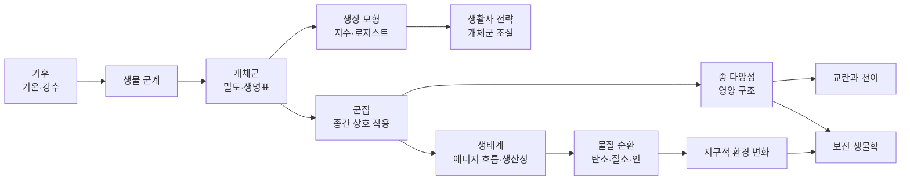
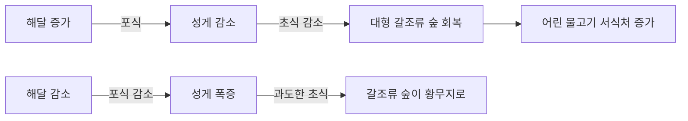
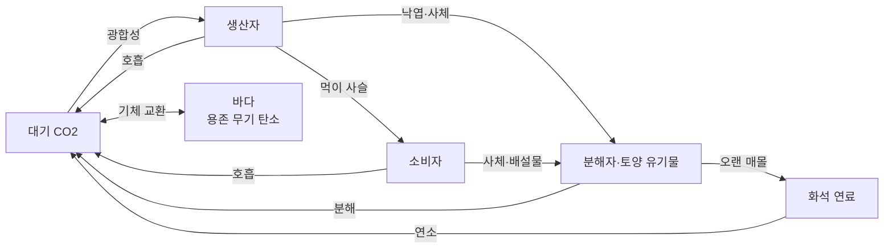

# 일반생명과학 13. 생태학 — 개체군에서 생물권까지, 수로 읽는 생명의 그물
<!-- prev: bio-1, 5-1, 5-2, ubio-8 -->
<!-- next: uearth-9 -->

> [!NOTE]
> **이 단원의 범위**
> - 생태학의 범위와 생물 군계(육상·수생), 기후가 분포를 정하는 원리
> - 개체군의 특성(밀도, 분포, 생명표)과 생장 모형(지수·로지스트), 생활사 전략, 개체군 조절
> - 군집의 종간 상호 작용(경쟁, 포식, 초식, 공생), 종 다양성과 영양 구조, 교란과 천이
> - 생태계의 에너지 흐름과 생산성, 물질 순환(물, 탄소, 질소, 인)
> - 보전 생물학과 지구적 환경 변화

**학습 목표**

1. 생태학의 연구 수준을 구분하고, 기온과 강수량의 패턴으로 주요 육상 생물 군계의 분포를 설명하며 수생 생물 군계의 층 구조를 비교할 수 있다.
2. 표지 재포획법과 생명표로 개체군의 크기와 순번식률을 계산하고, 지수 생장과 로지스트 생장 모형을 유도·적용하여 그 가정과 한계를 설명할 수 있다.
3. 생활사 전략의 상충 관계와 밀도 의존·비의존 요인으로 개체군 조절을 설명할 수 있다.
4. 종간 상호 작용을 실험적 근거와 함께 설명하고, 다양도 지수로 군집을 비교하며, 핵심종·영양 단계 연쇄 효과·교란과 천이로 군집 구조의 변화를 해석할 수 있다.
5. 1차·2차 생산량과 생태 효율을 계산하고, 탄소·질소·인 순환의 저장고와 이동 과정을 비교할 수 있다.
6. 종–면적 관계와 유효 개체군 크기로 생물 다양성 위협을 정량적으로 평가하고, 지구적 환경 변화에 대한 대응을 논의할 수 있다.

**이 단원의 학습 사다리**

| 단계 | 무엇을 하나? |
|---|---|
| STEP 1. 이전 학습 다시 보기 | 통합과학 「생태계 구성 요소와 상호 관계」·「생태계 평형」, 고등학교 「생명 시스템의 구성」의 생태 내용을 다시 꺼낸다 |
| STEP 2. 기초 다지기 | 지수 함수와 자연로그, 변화율로 읽는 미분 방정식, 단위가 붙은 비율 계산을 준비한다 |
| STEP 3. 핵심 개념 | 생물 군계 → 개체군의 특성 → 생장 모형 → 생활사와 조절 → 종간 상호 작용 → 군집 구조 → 교란과 천이 → 에너지 흐름 → 물질 순환 → 보전과 지구적 변화 |
| STEP 4. 오개념 바로잡기 | "환경 수용력에서 출생이 멈춘다?", "천이는 반드시 하나의 극상으로 간다?" |
| STEP 5. 다음 단계로 | 로트카–볼테라 모형, 개체군 생태학·군집 생태학·생태계 생태학·보전 생물학 |
| STEP 6. 생활·산업·진로 | 수산 자원 관리, 생태계 복원, 환경 DNA 조사, 탄소 흡수원 평가 |

---

## 🗺️ 단원 들어가기

1950년대 말 하와이의 한 산꼭대기에서 시작된 대기 중 $\mathrm{CO_2}$ 측정 그래프는 해마다 톱니처럼 오르내리면서 전체적으로는 꾸준히 올라간다. 톱니의 한 주기는 1년이다. 북반구의 봄·여름에는 숲과 초원의 광합성이 $\mathrm{CO_2}$를 빨아들이고, 가을·겨울에는 호흡과 분해가 $\mathrm{CO_2}$를 되돌린다. 지구 전체의 생물권이 숨을 쉬는 모습이 그래프에 찍힌 것이다.

한편 북아메리카의 한 모피 회사가 100년 가까이 남긴 사냥 기록에는 눈신토끼와 스라소니의 수가 약 10년 주기로 오르내리는 모습이 담겨 있다. 바다에서는 한때 무한해 보이던 어장이 몇십 년 만에 무너지기도 했다.

이 세 장면은 모두 **"생물은 수가 얼마나 되고, 서로와 환경을 통해 어떻게 늘고 줄며, 에너지와 물질은 어디로 가는가"** 라는 생태학의 질문이다. 이 단원에서는 고등학교에서 배운 생태계 개념을 수식과 자료로 다시 읽는다.

---

## STEP 1. 🔙 이전 학습 다시 보기

### 연계 개념표

| 이전 단원 | 고등학교에서는 여기까지 | 대학에서는 이렇게 확장 |
|---|---|---|
| 통합과학2 「생태계 구성 요소와 상호 관계」 | 생물적·비생물적 요인, 작용·반작용·상호작용, 빛·온도·물과 생물의 적응 | 기후 요인이 **생물 군계**의 분포를 정하는 원리, 수생 생태계의 층 구조 |
| 통합과학2 「생태계 평형」 | 먹이 그물, 생태 피라미드, 에너지 효율 약 10%, 탄소 순환, 포식자–피식자 주기 변동 | **1차·2차 생산량과 생태 효율**의 정량 계산, 영양 단계 연쇄 효과, 질소·인 순환 |
| 고등학교 「생명 시스템의 구성」 '생태계의 구조와 기능' | 총생산량 = 순생산량 + 호흡량, 탄소·질소 순환의 주요 과정 | 생산성을 제한하는 요인(빛, 영양염, 수분·온도), 순 생태계 생산량, 저장고와 체류 시간 |
| 고등학교 「생명 시스템의 구성」 '개체군과 군집' | J자형·S자형 생장 곡선, 환경 수용력, 생존 곡선, 방형구법과 중요치, 종간 상호작용의 종류, 천이 | **지수·로지스트 방정식**, 생명표와 순번식률, 생활사 전략, **다양도 지수**, 천이의 기작과 중간 교란 가설 |
| 일반생명과학 「진화의 원리」 | 자연 선택, 유전적 부동, 소집단 | 생활사의 진화, 소개체군의 멸종 위험과 **유효 개체군 크기** |

### 준비 운동 (사전 진단)

**Q1.** 어떤 숲의 1년 총생산량이 $1200$, 생산자의 호흡량이 $700$(상대값)이다. 순생산량은?

**Q2.** 이론적 생장 곡선(J자형)과 실제 생장 곡선(S자형)이 달라지는 원인을 한 낱말로 쓰시오.

**Q3.** 콩과식물과 뿌리혹박테리아의 관계, 사람과 회충의 관계는 각각 어떤 상호작용인가? 두 종이 얻는 이익(+)·손해(−)로 표시하시오.

**Q4.** 산불이 난 숲에서 시작되는 천이와 화산섬의 용암 대지에서 시작되는 천이 중 어느 쪽이 더 빨리 진행되는가? 그 까닭은?

정답 및 해설

**Q1.** $1200 - 700 = 500$

**Q2.** 환경 저항(먹이·공간 부족, 노폐물, 질병, 포식 등)

**Q3.** 상리 공생 $(+, +)$, 기생 $(+, -)$ — 회충이 이익, 사람이 손해

**Q4.** 산불 자리(2차 천이)가 더 빠르다. 토양과 그 속의 씨앗·뿌리·미생물이 남아 있기 때문이다. 용암 대지는 토양을 만드는 데부터 시작해야 한다(1차 천이).

---

## STEP 2. 🧱 기초 다지기

### ① 변화율로 읽는 미분 방정식

개체군 생태학의 모형은 "개체 수가 **얼마나 빨리** 변하는가"를 쓴다. $\dfrac{dN}{dt}$는 개체 수 $N$의 순간 변화율(단위: 개체/시간)이다. 1인당(한 개체당) 변화율은 $\dfrac{1}{N}\dfrac{dN}{dt}$로, 단위는 $1/\text{시간}$이다.

- 1인당 변화율이 **일정**하면 → 지수 생장
- 1인당 변화율이 **$N$이 커질수록 줄면** → 로지스트 생장

### ② 지수 함수와 자연로그

$\dfrac{dN}{dt} = rN$을 만족하는 함수는 $N(t) = N_0e^{rt}$이다. 양변에 자연로그를 취하면 $\ln N = \ln N_0 + rt$로, 시간–$\ln N$ 그래프가 기울기 $r$인 **직선**이 된다. 그래서 생장 자료는 세로축을 로그 눈금으로 그려 보면 지수 생장인지 바로 알 수 있다.

| 자주 쓰는 값 | 근삿값 |
|---|---|
| $\ln 2$ | 0.693 |
| $\ln 10$ | 2.303 |
| $e^1$, $e^2$ | 2.718, 7.389 |
| 배가 시간 $t_d = \ln 2 / r$ | $r = 0.1$이면 약 6.9 |

### ③ 단위가 붙은 비율

생태계 생산성은 **단위 면적·단위 시간당** 에너지나 물질의 양으로 나타낸다. 예: $\mathrm{kJ/(m^2\cdot yr)}$, $\mathrm{g\,C/(m^2\cdot yr)}$(탄소 질량 기준). 효율은 같은 단위끼리 나눈 무차원 비율이다.

$$
\text{효율}(\%) = \frac{\text{나중 단계의 양}}{\text{앞 단계의 양}}\times100
$$

> [!TIP]
> 💡 **요령** — 생태학 계산의 절반은 "무엇을 무엇으로 나누는가"이다. 분모가 '받은 빛'인지, '총생산량'인지, '먹은 양'인지, '동화한 양'인지를 먼저 적어 두면 헷갈리지 않는다.

---

## STEP 3. 📘 핵심 개념

### ① 생태학의 범위와 생물 군계

#### (1) 생태학의 연구 수준

**생태학(ecology)** 은 생물과 환경(다른 생물 포함) 사이의 상호 작용, 그리고 그 결과 나타나는 생물의 **분포와 풍부도**를 연구하는 학문이다.

| 수준 | 중심 질문 | 예 |
|---|---|---|
| 개체 생태학 | 개체는 환경에 어떻게 적응하는가 | 사막 도마뱀의 체온 조절 행동 |
| 개체군 생태학 | 개체 수는 왜, 얼마나 빨리 변하는가 | 고라니 개체군의 연간 증가율 |
| 군집 생태학 | 여러 종은 어떻게 함께 사는가 | 갯벌 저서 생물의 종 구성 |
| 생태계 생태학 | 에너지와 물질은 어떻게 흐르고 도는가 | 논 생태계의 질소 수지 |
| 경관 생태학 | 여러 생태계의 배열이 생물에 어떤 영향을 주는가 | 도로가 숲을 나눌 때의 동물 이동 |
| 지구 생태학 | 생물권 전체와 지구 환경의 상호 작용 | 대기 $\mathrm{CO_2}$의 계절 변동 |

#### (2) 기후가 생물의 분포를 정한다

지구가 둥글어서 같은 양의 햇빛이 적도에서는 좁은 면적에, 고위도에서는 넓은 면적에 비스듬히 퍼진다. 그래서 적도가 뜨겁고 극이 차갑다. 적도에서 데워진 공기가 상승하면서 많은 비를 뿌리고, 위도 약 30° 부근에서 건조한 공기가 내려앉아 큰 사막대가 생긴다. 이처럼 **기온과 강수량**의 연간 평균과 계절 변동이 육상 생물 군계를 가르는 가장 큰 요인이다. 산을 오르면 위도를 높이는 것처럼 기온이 낮아지므로 높이에 따라서도 군계가 바뀐다.

<!-- fig:ubio-13-biome-map -->

**생물 군계(biome)** 는 기후에 따라 구분되는 대규모 생태계 유형으로, 육상에서는 **우점하는 식생의 모양**(키 큰 상록수, 낙엽수, 풀, 관목)으로 이름을 붙인다.

| 육상 생물 군계 | 기후의 특징 | 식생과 동물 |
|---|---|---|
| **열대 우림** | 연중 덥고(약 25~29 °C), 연 강수량이 매우 많음 | 층이 여러 겹인 상록 활엽수림, 종 다양성이 가장 높음, 토양은 영양분이 적음(빠른 분해와 흡수) |
| **사바나** | 덥고 건기와 우기가 뚜렷함 | 드문드문한 나무와 넓은 초원, 대형 초식 동물, 주기적 불 |
| **사막** | 강수량 매우 적음(대략 연 300 mm 이하) | 다육 식물(CAM 식물), 야행성·굴 파는 동물 |
| **지중해성 관목림** | 여름 건조·겨울 습윤 | 단단한 잎의 관목, 불에 적응한 식물 |
| **온대 초원** | 겨울 춥고 여름 더움, 강수량 중간 | 뿌리가 깊은 풀, 비옥한 토양 |
| **온대 낙엽수림** | 사계절이 뚜렷, 강수량 비교적 많음 | 가을에 잎을 떨구는 활엽수, 한반도의 대부분 |
| **북방 침엽수림(타이가)** | 겨울이 길고 매우 추움 | 상록 침엽수, 넓은 면적, 분해가 느려 유기물이 쌓임 |
| **툰드라** | 매우 춥고 생장 기간이 짧음, 영구 동토 | 이끼·지의류·키 작은 관목, 나무가 자라지 못함 |

<!-- fig:ubio-13-biome-climate -->

#### (3) 수생 생물 군계 — 빛, 깊이, 염분

수생 생물 군계는 지구 표면의 약 70%를 덮으며, 주로 **염분**(담수/해수)과 **물리적 구조**(깊이, 빛, 흐름)로 구분한다.

| 구분 | 특징 |
|---|---|
| 빛의 수직 구분 | 빛이 광합성에 충분한 **유광층**(맑은 바다에서 대략 수십~200 m)과 그 아래 **무광층** |
| 수온 약층 | 따뜻한 표층과 차가운 심층 사이의 급격한 수온 변화층. 온대 호수에서는 봄·가을에 성층이 깨져 물이 뒤섞이며(전도) 산소와 영양염이 고루 퍼진다 |
| 호수 | 영양염이 적고 맑은 **빈영양호** ↔ 영양염이 많아 생산성이 높고 심층 산소가 부족해지기 쉬운 **부영양호** |
| 하천 | 상류(차갑고 산소 많음, 유속 빠름) → 하류(따뜻하고 탁함, 유기물 많음) |
| 습지·하구·갯벌 | 담수와 해수가 섞이는 곳, 생산성이 매우 높음, 많은 어류의 산란·성장 장소 |
| 산호초 | 따뜻하고 맑은 얕은 열대 바다, 산호와 공생하는 조류의 광합성 |
| 외해 원양 | 넓지만 영양염이 적어 단위 면적 생산성은 낮음 |
| 심해저 | 빛이 없음, 위에서 떨어지는 유기물이나 열수 분출공의 **화학 합성** 세균에 의존 |

<!-- fig:ubio-13-lake -->

#### 예제 1 — 기후 자료로 생물 군계 추론하기

다음 세 지역의 연평균 기온과 연 강수량(대략값)이다. 각각 어떤 생물 군계일 가능성이 큰가?
(가) 27 °C, 2500 mm, 계절 변화 작음 (나) −10 °C, 250 mm, 여름 2개월만 영상 (다) 12 °C, 1300 mm, 사계절 뚜렷

**풀이** (가) 열대 우림 — 연중 고온다습. (나) 툰드라 — 매우 춥고 생장 기간이 짧다. 강수량이 적지만 증발도 적고 영구 동토 때문에 배수가 나빠 땅은 축축하다. (다) 온대 낙엽수림 — 한반도 중부와 비슷한 기후이다. 같은 강수량이라도 **기온이 높으면 증발이 많아** 식물이 쓸 수 있는 물이 적어지므로, 군계는 기온과 강수량을 **함께** 보아야 판단할 수 있다.

#### ✔ 바로 확인

1. (O/X) 육상 생물 군계는 우점하는 식생의 모양(상록수, 낙엽수, 풀, 관목)으로 이름을 붙인다.
2. 빈칸: 적도에서 상승한 공기가 위도 약 (    )° 부근에서 내려앉아 큰 사막대가 생긴다.
3. 고르기: 연평균 기온이 매우 낮고 생장 기간이 짧으며 영구 동토가 있어 나무가 자라지 못하는 군계는 (타이가 / 툰드라)이다.
4. 온대 호수에서 봄·가을에 성층이 깨져 물이 위아래로 섞이는 현상을 무엇이라 하는가?

정답

1. O
2. 30 — 내려오는 공기는 건조하다.
3. 툰드라
4. 전도 — 이때 산소와 영양염이 고루 퍼진다.

### ② 개체군의 특성 — 몇 마리이며, 어떻게 흩어져 있고, 얼마나 사는가

#### (1) 밀도와 분포 양식

**개체군(population)** 은 같은 지역에 살며 서로 교배할 수 있는 같은 종 개체의 집단이다. 개체군 크기는 출생(B)·이입(I)으로 늘고 사망(D)·이출(E)로 준다: $\Delta N = B + I - D - E$.

| 분포 양식 | 모습 | 원인과 예 |
|---|---|---|
| **집중 분포** | 무리 지어 있음 | 자원이 몰려 있거나 무리 생활: 습한 곳의 버섯, 물고기 떼 |
| **균일 분포** | 일정한 간격 | 텃세, 타감 작용: 둥지 사이 간격이 일정한 바닷새, 사막 관목 |
| **임의 분포** | 규칙 없음 | 자원이 고르고 상호 작용이 약할 때: 바람에 퍼진 민들레 씨앗 |

#### (2) 개체 수 어림 — 표지 재포획법

움직이는 동물은 모두 셀 수 없으므로 **표지 재포획법**을 쓴다. 1차로 $M$마리를 잡아 표지하고 놓아준 뒤, 충분히 섞였을 때 2차로 $C$마리를 잡아 그중 표지된 개체 $R$마리를 센다. 표지 비율이 개체군 전체와 같다고 가정하면

$$
\frac{R}{C} = \frac{M}{N} \quad\Rightarrow\quad N = \frac{MC}{R}
$$

**가정**: 표지가 생존·포획 확률에 영향을 주지 않는다, 두 포획 사이에 출생·사망·이동이 무시할 만하다, 표지 개체가 고르게 섞인다.

#### 예제 2 — 연못의 개구리 수

연못에서 개구리 60마리를 잡아 표지하고 놓아주었다. 일주일 뒤 80마리를 잡았더니 그중 12마리가 표지되어 있었다. (1) 개체군 크기를 어림하시오. (2) 표지 때문에 개구리가 포식자 눈에 잘 띄어 많이 잡아먹혔다면 어림값은 실제보다 큰가, 작은가?

**풀이**
(1) $N = \dfrac{60\times80}{12} = 400$마리
(2) 표지 개체가 줄어 $R$이 작아지므로 $N$은 실제보다 **크게** 어림된다. 반대로 한 번 잡힌 개체가 덫을 피하게 되면 $R$이 작아져 역시 과대 어림, 덫에 맛을 들여 다시 잘 잡히면 과소 어림이 된다.

#### (3) 생명표와 생존 곡선

**생명표(life table)** 는 같은 시기에 태어난 집단(동시 출생 집단)을 따라가며 나이별 생존과 번식을 정리한 표이다.

- $l_x$: 태어난 개체가 나이 $x$까지 살아남을 확률(생존율)
- $m_x$: 나이 $x$인 암컷 한 마리가 그 기간에 낳는 암컷 자손 수(번식률)
- **순번식률** $R_0 = \sum l_x m_x$: 암컷 한 마리가 일생 동안 남기는 평균 암컷 자손 수. $R_0 > 1$이면 개체군 증가, $R_0 = 1$이면 유지, $R_0 < 1$이면 감소
- **세대 시간** $T = \dfrac{\sum x\,l_x m_x}{R_0}$: 자손을 낳는 평균 나이

$l_x$를 로그 눈금으로 그린 생존 곡선은 Ⅰ형(어릴 때 사망률 낮음: 사람, 대형 포유류), Ⅱ형(나이에 관계없이 사망률 일정: 많은 조류, 일부 도마뱀), Ⅲ형(어릴 때 사망률 매우 높음: 굴, 많은 어류와 식물)으로 나눈다. 로그 눈금에서 Ⅱ형이 직선인 것은 **매 기간 같은 비율**이 죽기 때문이다.

<!-- fig:ubio-13-survivorship -->

#### 예제 3 — 생명표로 개체군의 앞날 읽기

어떤 한해살이에 가까운 들쥐 개체군의 생명표이다(나이 단위: 계절).

| 나이 $x$ | 0 | 1 | 2 | 3 | 4 |
|---|---|---|---|---|---|
| $l_x$ | 1.00 | 0.40 | 0.25 | 0.10 | 0 |
| $m_x$ | 0 | 1.0 | 3.0 | 2.0 | 0 |

$R_0$와 세대 시간 $T$를 구하고, 개체군이 늘어날지 판단하시오.

**풀이**
식 세우기: $R_0 = \sum l_x m_x$, $T = \sum x\,l_x m_x / R_0$
대입: $l_x m_x$ = 0, 0.40, 0.75, 0.20, 0 → $R_0 = 1.35$
$\sum x\,l_x m_x = 1\times0.40 + 2\times0.75 + 3\times0.20 = 2.50$ → $T = 2.50/1.35 \approx 1.85$계절
의미: $R_0 = 1.35 > 1$이므로 한 세대마다 약 1.35배로 늘어난다. 1인당 생장률은 대략 $r \approx \ln R_0 / T = 0.300/1.85 \approx 0.16$(계절당)으로 어림할 수 있다. $l_x m_x$가 가장 큰 나이 2가 개체군 증가에 가장 크게 기여하므로, 이 나이의 생존율을 낮추는 관리가 가장 효과적이다.

#### ✔ 바로 확인

1. 50마리를 표지해 놓아준 뒤 40마리를 다시 잡았더니 8마리가 표지되어 있었다. 개체군 크기는?
2. (O/X) 생존율 $l_x$를 로그 눈금으로 그리면 Ⅱ형 생존 곡선은 직선이 된다.
3. 짝짓기: (가) 텃세로 둥지 간격이 일정 (나) 습한 곳에 몰린 버섯 — 집중·균일·임의 분포 중 무엇인가?
4. $l_x$가 1, 0.5, 0.2이고 $m_x$가 0, 2, 3(나이 0, 1, 2)인 개체군의 $R_0$는? 개체군은 늘어나는가?

정답

1. 250마리 — $N = MC/R = 50\times40/8$.
2. O — 매 기간 같은 비율이 죽기 때문이다.
3. (가) 균일 분포 (나) 집중 분포
4. $R_0 = 0.5\times2 + 0.2\times3 = 1.6$, $R_0 > 1$이므로 늘어난다.

### ③ 개체군 생장 모형 — 지수와 로지스트

#### (1) 지수 생장 — 자원이 무한하다면

출생률 $b$와 사망률 $d$가 개체당 일정하면(이입·이출 무시) 개체 수의 변화율은 개체 수에 비례한다.

$$
\frac{dN}{dt} = (b-d)N = rN \quad\Rightarrow\quad N(t) = N_0e^{rt}
$$

$r$을 **1인당 내적 증가율**이라 한다. 조건이 가장 좋을 때의 값을 $r_{\max}$로 쓴다. 지수 생장은 새 서식지에 들어간 개체군, 재앙 뒤 회복하는 개체군에서 짧은 기간 동안 관찰된다.

번식이 1년에 한 번처럼 **일정한 시기에만** 일어나면 이산 모형 $N_{t+1} = \lambda N_t$를 쓴다. $\lambda$는 유한 증가율로, 연속 모형과 $\lambda = e^{r}$($r = \ln\lambda$)의 관계가 있다.

#### 예제 4 — 섬에 들어온 사슴

포식자 없는 섬에 사슴 50마리가 들어왔고, $r = 0.20/\mathrm{yr}$로 지수 생장한다고 하자. (1) 10년 뒤 개체 수는? (2) 배가 시간은? (3) 같은 사슴을 이산 모형 $\lambda = 1.5$로 나타내면 연속 모형의 $r$은?

**풀이**
(1) $N = 50\,e^{0.20\times10} = 50\,e^{2} = 50\times7.389 \approx 369$마리
(2) $t_d = \ln2 / r = 0.693/0.20 \approx 3.5\ \mathrm{yr}$
(3) $r = \ln1.5 \approx 0.41/\mathrm{yr}$ (예: 200마리 → 300 → 450 → 675 …)
의미: 10년 만에 약 7배가 된다. 배가 시간이 일정하다는 것이 지수 생장의 특징이며, 실제 섬에서는 머지않아 먹이가 바닥나 생장이 멈추거나 개체군이 붕괴한다.

#### (2) 로지스트 생장 — 환경 수용력이 있다면

자원이 한정되면 개체가 많을수록 1인당 증가율이 떨어진다. 가장 단순한 가정은 1인당 증가율이 $N$에 따라 **직선으로** 줄어 $N = K$에서 0이 되는 것이다.

$$
\frac{1}{N}\frac{dN}{dt} = r\left(1-\frac{N}{K}\right) \quad\Rightarrow\quad \frac{dN}{dt} = rN\,\frac{K-N}{K}
$$

$K$를 **환경 수용력(carrying capacity)** 이라 한다. 이 미분 방정식의 해는

$$
N(t) = \frac{K}{1+\left(\dfrac{K-N_0}{N_0}\right)e^{-rt}}
$$

이며 S자 곡선을 그린다. $\dfrac{dN}{dt}$를 $N$에 대해 미분하여 0으로 두면 $N = K/2$에서 개체군 증가 속도가 최대이고, 그 값은 $rK/4$이다.

| $N$ | $N$이 작을 때 | $N = K/2$ | $N \to K$ |
|---|---|---|---|
| $(K-N)/K$ | 약 1 | 1/2 | 0에 가까움 |
| 1인당 증가율 | 약 $r$(지수 생장과 비슷) | $r/2$ | 0에 가까움 |
| 개체군 증가 속도 $dN/dt$ | 작음($N$이 작아서) | **최대** $rK/4$ | 작음 |

<!-- sim:u-population-growth -->

#### 예제 5 — 로지스트 모형으로 수산 자원 관리하기

어떤 물고기 개체군이 $r = 0.50/\mathrm{yr}$, $K = 1000$(톤)인 로지스트 생장을 한다.
(1) 개체군이 200, 500, 800톤일 때 연간 증가량을 각각 구하시오.
(2) 처음 100톤에서 시작하면 5년 뒤 몇 톤인가?
(3) 개체군을 무너뜨리지 않고 매년 거두어들일 수 있는 최대량은 얼마이며, 그때 개체군을 몇 톤으로 유지해야 하는가?

**풀이**
(1) $dN/dt = 0.50\,N(1000-N)/1000$
- $N = 200$: $0.50\times200\times0.8 = 80$톤/년
- $N = 500$: $0.50\times500\times0.5 = 125$톤/년
- $N = 800$: $0.50\times800\times0.2 = 80$톤/년

(2) $N(5) = \dfrac{1000}{1 + 9e^{-2.5}} = \dfrac{1000}{1 + 9\times0.0821} = \dfrac{1000}{1.739} \approx 575$톤
(3) 증가량이 최대인 $N = K/2 = 500$톤에 유지하면 연간 $rK/4 = 125$톤을 거둘 수 있다. 이것이 **최대 지속 가능 생산량**의 기본 생각이다.
의미: 200톤일 때와 800톤일 때 증가량이 같다. 개체군이 작으면 '낳을 개체'가 적고, 크면 '자원이 부족'하기 때문이다. 실제 어장에서는 $r$과 $K$를 정확히 알기 어렵고 해마다 변하므로, 계산된 최댓값보다 적게 거두는 것이 안전하다.

#### (3) 모형의 가정과 한계

로지스트 모형은 ① 모든 개체가 같다(나이 구조 무시), ② 밀도의 효과가 **즉시** 나타난다, ③ $K$가 일정하다고 가정한다. 실제로는 먹이 부족이 다음 세대 번식에 늦게 반영되는 **시간 지연** 때문에 개체 수가 $K$를 넘었다가 내려오며 진동하기도 한다. 실험실의 짚신벌레나 효모는 S자 곡선에 잘 맞지만, 물벼룩처럼 $K$ 근처에서 크게 진동하는 생물도 있다. 모형은 '정확한 예측기'라기보다 **어떤 가정이 어떤 결과를 낳는지 비교하는 기준선**이다.

> [!TIP]
> 💡 **비유** — 로지스트 생장은 빈 강당에 사람들이 들어오는 모습과 같다. 처음에는 문 앞에 선 사람이 많을수록 빨리 차지만(지수), 자리가 차면 들어올 사람이 남은 빈자리를 찾느라 느려지고, 만석($K$)이 되면 더 들어오지 못한다.

#### ✔ 바로 확인

1. $r = 0.35/\mathrm{yr}$로 지수 생장하는 개체군의 배가 시간은 약 몇 년인가?
2. (O/X) 로지스트 생장에서 개체군 증가 속도 $dN/dt$는 $N = K$일 때 가장 크다.
3. $r = 0.4/\mathrm{yr}$, $K = 1000$인 로지스트 개체군의 최대 증가 속도는?
4. 빈칸: 이산 모형에서 유한 증가율 $\lambda = 2$이면 연속 모형의 $r$은 약 (    )이다.

정답

1. 약 2.0년 — $\ln2/0.35 \approx 1.98$.
2. X — $N = K/2$에서 최대이고, $N = K$에서는 0이다.
3. 100마리/년 — $rK/4$.
4. 0.69 — $r = \ln\lambda = \ln2$.

### ④ 생활사 전략과 개체군 조절

#### (1) 생활사 — 한정된 에너지를 어디에 쓸 것인가

**생활사(life history)** 는 언제 처음 번식하는가, 몇 번 번식하는가, 한 번에 몇 개를 낳는가 같은 생존과 번식의 일정이다. 생물이 쓸 수 있는 에너지는 한정되므로 생존·생장·번식 사이에 **상충 관계(trade-off)** 가 생긴다. 예를 들어 새끼를 많이 기르게 한 황조롱이 부모는 다음 해 생존율이 낮아지는 경향이 관찰되었다.

| 비교 | **r-선택**(밀도가 낮고 불안정한 환경) | **K-선택**(밀도가 $K$ 근처인 안정한 환경) |
|---|---|---|
| 자손 수 | 많고 작음 | 적고 큼 |
| 부모의 보살핌 | 거의 없음 | 많음 |
| 성숙 | 빠름 | 늦음 |
| 수명 | 짧음 | 김 |
| 번식 횟수 | 한 번(일회 번식)인 경우가 많음 | 여러 번(반복 번식) |
| 생존 곡선 | 주로 Ⅲ형 | 주로 Ⅰ형 |
| 예 | 잡초, 많은 곤충, 연어(일회 번식) | 코끼리, 고래, 대형 유인원 |

r-선택과 K-선택은 양 끝의 이념형이고, 실제 생물은 그 사이의 다양한 조합을 보인다. 같은 종이라도 포식 압력이 높은 하천의 구피는 더 일찍 성숙하고 작은 새끼를 많이 낳는 쪽으로 진화한 사례가 실험으로 확인되었다(「진화의 원리」의 자연 선택과 연결).

#### (2) 개체군 조절 — 밀도 의존 요인과 밀도 비의존 요인

| 구분 | **밀도 의존 요인** | **밀도 비의존 요인** |
|---|---|---|
| 정의 | 개체 수가 많을수록 출생률을 낮추거나 사망률을 높이는 요인 | 밀도와 관계없이 일정 비율을 죽이는 요인 |
| 예 | 먹이·둥지 자리 경쟁, 포식, 질병의 전파, 노폐물 축적, 스트레스에 의한 번식 감소 | 서리·가뭄·폭풍·홍수·산불 |
| 개체군에 미치는 효과 | 음성 되먹임 → 개체 수를 $K$ 근처로 **조절** | 큰 변동을 일으키지만 조절하지는 못함 |

#### (3) 개체군의 주기와 연결

- **포식자–피식자 주기**: 눈신토끼–스라소니의 약 10년 주기는 포식만이 아니라 토끼의 **먹이 식물 부족**과 포식이 함께 작용한 결과로 보는 것이 실험적으로 지지된다. 먹이를 준 구역과 포식자를 막은 구역을 비교한 야외 실험에서, 두 처리를 함께 했을 때 토끼 밀도가 가장 크게 늘었다.
- **메타개체군**: 서식지 조각마다 흩어진 작은 개체군들이 이주로 연결된 집단. 한 조각의 개체군이 사라져도 다른 조각에서 다시 이주해 와 전체가 유지된다. 서식지가 쪼개진 지역의 보전에 중요한 개념이다.

#### ✔ 바로 확인

1. 짝짓기: (가) 작은 자손을 많이, 빨리 성숙 (나) 큰 자손을 적게, 부모의 보살핌 많음 — r-선택과 K-선택 중 무엇에 가까운가?
2. 고르기: 질병의 전파는 (밀도 의존 / 밀도 비의존) 요인, 늦서리는 (밀도 의존 / 밀도 비의존) 요인이다.
3. (O/X) 밀도 비의존 요인은 개체군을 환경 수용력 근처로 조절한다.
4. 빈칸: 이주로 연결된, 서식지 조각마다 흩어진 작은 개체군들의 집단을 (    )이라 한다.

정답

1. (가) r-선택 (나) K-선택
2. 질병은 밀도 의존, 늦서리는 밀도 비의존
3. X — 조절은 음성 되먹임으로 작용하는 밀도 의존 요인이 한다.
4. 메타개체군

### ⑤ 종간 상호 작용

| 상호 작용 | 종 1 | 종 2 | 핵심 |
|---|---|---|---|
| **경쟁** | − | − | 같은 한정된 자원을 함께 씀 |
| **포식** | + | − | 포식자가 피식자를 잡아먹음 |
| **초식** | + | − | 동물이 식물이나 조류의 일부를 먹음 |
| **기생** | + | − | 기생자가 숙주의 몸 안팎에서 양분을 얻음(대개 숙주를 바로 죽이지 않음) |
| **상리 공생** | + | + | 두 종 모두 이익 |
| **편리 공생** | + | 0 | 한쪽만 이익, 다른 쪽은 거의 영향 없음 |

#### (1) 경쟁과 생태적 지위

- **경쟁 배타 원리**: 같은 한정된 자원을 **똑같이** 이용하는 두 종은 오래 공존할 수 없다. 1930년대 두 종의 짚신벌레를 따로 기르면 각각 S자 생장을 했지만, 함께 기르면 한 종만 살아남았다.
- **생태적 지위(niche)**: 한 종이 이용하는 생물적·비생물적 자원의 총체(서식 공간, 먹이, 활동 시간 등). 경쟁자가 없을 때 차지할 수 있는 **기본 지위**와 경쟁자가 있을 때 실제로 차지하는 **실현 지위**로 나눈다. 바위 해안에서 위쪽에 사는 따개비 종은 아래쪽 종을 제거하자 아래까지 퍼져 나갔다 — 아래쪽 종이 실현 지위를 좁히고 있었던 것이다.
- **자원 분할**(분서): 비슷한 종이 지위를 나누어 공존한다(나무 높이별로 먹이를 찾는 솔새류, 서로 다른 크기의 씨앗을 먹는 핀치).
- **형질 치환**: 두 종이 함께 사는 곳에서 경쟁을 줄이는 쪽으로 형질 차이가 더 커지는 현상(함께 사는 섬의 두 핀치는 부리 크기 차이가 따로 사는 섬보다 크다).

<!-- fig:ubio-13-barnacle-niche -->

#### (2) 포식과 방어

| 방어 방식 | 내용 | 예 |
|---|---|---|
| 기계적·화학적 방어 | 가시, 단단한 껍데기, 독 | 고슴도치, 독화살개구리 |
| **은폐색** | 주변과 비슷한 색과 모양 | 대벌레, 넙치 |
| **경고색** | 독이나 맛없음을 알리는 눈에 띄는 색 | 독화살개구리, 무당벌레 |
| **베이츠 의태** | 해 없는 종이 해로운 종을 닮음 | 독 없는 꽃등에가 벌을 닮음 |
| **뮐러 의태** | 해로운 종끼리 서로 닮아 함께 학습 효과를 얻음 | 독 있는 여러 나비, 벌과 말벌 |

식물도 초식에 맞서 가시, 쓴맛의 2차 대사 물질(니코틴, 카페인 등)을 만들고, 일부는 잎을 먹히면 초식 곤충의 천적을 부르는 휘발성 물질을 내보낸다.

#### (3) 공생

**공생(symbiosis)** 은 두 종이 오랫동안 직접 밀접하게 함께 사는 관계로, 기생·상리 공생·편리 공생이 모두 포함된다. 육상 식물 대부분의 뿌리와 공생하는 **균근**, 콩과식물의 **뿌리혹박테리아**, 흰개미 장 속의 셀룰로스 분해 미생물, 산호와 공생 조류가 상리 공생의 예이다. 상리 공생도 환경에 따라 이익의 크기가 변하며, 수온이 높아지면 산호가 공생 조류를 잃는 **백화 현상**이 일어난다.

> [!TIP]
> 💡 **요령** — 상호 작용을 분류할 때는 '누가 무엇을 얻고 잃는가'를 **개체군의 생장률** 기준으로 보자. 꽃가루받이 곤충과 꽃은 둘 다 상대가 있으면 개체군이 더 잘 자라므로 (+, +)이다.

#### ✔ 바로 확인

1. 짝짓기: 경쟁, 편리 공생, 기생을 $(+, -, 0)$으로 나타내시오.
2. (O/X) 실현 지위는 기본 지위보다 넓을 수 있다.
3. 빈칸: 해 없는 꽃등에가 벌을 닮아 잡아먹히지 않는 것은 (    ) 의태이다.
4. 두 핀치가 함께 사는 섬에서 부리 크기 차이가 따로 사는 섬보다 더 커지는 현상은?

정답

1. 경쟁 $(-,-)$, 편리 공생 $(+,0)$, 기생 $(+,-)$
2. X — 경쟁자 등 때문에 기본 지위와 같거나 더 좁다(그림의 따개비).
3. 베이츠
4. 형질 치환

### ⑥ 군집 구조 — 종 다양성과 영양 구조

#### (1) 종 다양성은 '몇 종'과 '얼마나 고르게'로 이루어진다

**종 다양성**은 **종 풍부도**(종의 수)와 **상대 풍부도**(각 종이 차지하는 비율의 고르기)로 이루어진다. 두 요소를 함께 담은 지수가 자주 쓰인다($p_i$: 종 $i$의 개체 비율).

$$
H' = -\sum_i p_i\ln p_i \quad(\text{섀넌 다양도 지수}), \qquad D = 1-\sum_i p_i^2 \quad(\text{심프슨 다양도 지수})
$$

$H'$는 종 수가 많고 고를수록 커진다. $D$는 '무작위로 두 개체를 뽑았을 때 서로 다른 종일 확률'이다.

#### 예제 6 — 두 숲의 다양성 비교

두 숲에서 나무 100그루씩을 조사하였다. 두 숲 모두 4종이다. 섀넌 지수와 심프슨 지수를 구해 비교하시오.

| 종 | A | B | C | D |
|---|---|---|---|---|
| 숲 Ⅰ (그루) | 25 | 25 | 25 | 25 |
| 숲 Ⅱ (그루) | 85 | 5 | 5 | 5 |

**풀이**
숲 Ⅰ: $p_i = 0.25$ → $H' = -4\times0.25\ln0.25 = \ln4 \approx 1.39$, $D = 1 - 4\times0.25^2 = 0.75$
숲 Ⅱ: $H' = -(0.85\ln0.85 + 3\times0.05\ln0.05) = -(0.85\times(-0.1625) + 0.15\times(-2.996)) \approx 0.138 + 0.449 = 0.59$, $D = 1-(0.7225 + 3\times0.0025) = 0.27$
의미: 종 풍부도는 같지만 숲 Ⅱ는 한 종이 압도적으로 우점하여 다양성 지수가 훨씬 낮다. 숲 Ⅱ에서 걷다 마주치는 나무는 대부분 A종이다. 종 수만 세면 이 차이를 놓친다.

#### (2) 다양성이 높은 군집은 무엇이 다른가

야외 초원 실험에서 식물 종 수를 다르게 심은 구획을 오랫동안 비교했더니, 종이 많은 구획일수록 **생산성이 높고**, 가뭄 같은 교란 뒤 생산성의 **변동이 작으며**, 외래종의 침입에 더 잘 버티는 경향이 나타났다. 서로 다른 지위를 가진 종들이 자원을 더 완전히 쓰고, 한 종이 약해져도 다른 종이 그 역할을 메우기 때문으로 해석한다.

#### (3) 영양 구조와 먹이 사슬의 길이

생산자 → 1차 소비자 → 2차 소비자 …의 먹이 관계가 **영양 구조**이며, 여러 먹이 사슬이 얽힌 것이 먹이 그물이다. 먹이 사슬은 대개 4~5단계를 넘지 않는다. 그 까닭으로는 단계마다 에너지가 크게 줄어든다는 **에너지 가설**(⑧ 참고)과, 긴 사슬일수록 교란 뒤 회복이 어렵다는 **동적 안정성 가설**이 제시되며, 에너지 가설이 실험 증거를 더 많이 얻었다(나무 구멍 물웅덩이 군집에서 낙엽 투입량을 줄이자 먹이 사슬이 짧아졌다).

#### (4) 군집에 큰 영향을 주는 종

| 종의 유형 | 뜻 | 예 |
|---|---|---|
| **우점종** | 개체 수나 생물량이 가장 큰 종 | 한반도 극상림의 신갈나무·서어나무 |
| **핵심종** | 수나 생물량은 많지 않아도 군집 구조를 좌우하는 종 | 바위 해안의 불가사리: 제거 실험에서 홍합이 바위를 독점해 종 수가 크게 줄었다 |
| **생태계 기술자** | 물리적 환경을 바꾸어 서식지를 만드는 종 | 댐을 짓는 비버, 굴을 파는 동물, 산호 |
| **기초종** | 다른 종의 서식 기반이 되는 우점적 생산자 | 갯벌의 갈대, 해조류 숲의 대형 갈조류 |

#### (5) 상향식 조절과 하향식 조절

- **상향식 조절**: 아래 영양 단계(영양염, 생산자)의 양이 위 단계를 결정한다. 호수에 인을 넣으면 조류 → 동물성 플랑크톤 → 물고기가 차례로 늘어난다.
- **하향식 조절**: 위 영양 단계(포식자)가 아래 단계를 결정한다. 포식자의 변화가 한 단계씩 건너뛰며 반대 방향으로 전해지는 것을 **영양 단계 연쇄 효과(trophic cascade)** 라 한다.

호수 관리에서는 이 원리를 이용해 플랑크톤을 먹는 물고기를 잡아먹는 포식성 어류를 늘려 동물성 플랑크톤을 늘리고, 그 결과 조류를 줄여 수질을 개선하는 **생물 조작**을 시도한다.

#### (6) 군집의 지리적 패턴

- **위도 기울기**: 대부분의 생물군에서 적도에 가까울수록 종 다양성이 높다. 열대가 오랫동안 빙하기의 교란을 덜 받아 종 분화가 누적될 시간이 길었다는 가설과, 일조량·강수량이 많아 생산성이 높다는 가설(실제 증발산량과 종 수의 상관)이 제시된다.
- **섬 생물지리학**: 섬의 종 수는 본토에서의 **이입률**과 섬에서의 **멸종률**이 같아지는 곳에서 평형을 이룬다. 섬이 **클수록** 멸종률이 낮고, 본토에 **가까울수록** 이입률이 높아 종 수가 많다. 맹그로브 섬에서 절지동물을 훈증으로 제거한 뒤 다시 들어오는 과정을 관찰한 실험이 이 이론을 지지했다. 보호 구역은 사실상 '서식지의 섬'이므로 이 이론이 보전 설계에 쓰인다.

<!-- fig:ubio-13-island-equilibrium -->

#### ✔ 바로 확인

1. 두 종이 각각 50%인 군집의 심프슨 지수 $D$와 섀넌 지수 $H'$는?
2. (O/X) 핵심종은 그 군집에서 생물량이 가장 큰 종이다.
3. 고르기: 해달이 줄면 성게는 (늘고 / 줄고), 대형 갈조류 숲은 (늘어난다 / 줄어든다).
4. 빈칸: 섬이 클수록 (    )률이 낮고, 본토에 가까울수록 (    )률이 높아 평형 종 수가 크다.

정답

1. $D = 1 - (0.25 + 0.25) = 0.5$, $H' = \ln2 \approx 0.69$
2. X — 생물량이 가장 큰 종은 우점종이고, 핵심종은 수에 비해 영향이 유난히 큰 종이다.
3. 성게는 늘고 갈조류 숲은 줄어든다 — 영양 단계 연쇄 효과.
4. 멸종, 이입

### ⑦ 교란과 천이

#### (1) 교란은 예외가 아니라 일상이다

**교란(disturbance)** 은 폭풍, 산불, 홍수, 가뭄, 초식, 사람의 활동처럼 군집을 바꾸고 자원을 다시 분배하는 사건이다. 예전에는 군집이 안정한 극상으로 향한다고 보았지만, 지금은 대부분의 군집이 **교란과 회복을 되풀이하는 비평형 상태**에 있다고 본다.

**중간 교란 가설** — 교란이 너무 잦거나 강하면 이를 견디는 몇 종만 남고, 너무 드물면 경쟁에 강한 종이 다른 종을 몰아내어 다양성이 낮아진다. **중간 정도**의 교란에서 개척종과 경쟁에 강한 종이 섞여 다양성이 가장 높다는 가설이다. 뉴질랜드 하천의 무척추동물 연구 등에서 지지되었지만 모든 군집에 들어맞는 것은 아니다. 옐로스톤의 대형 산불(1988년)처럼 큰 교란도 숲을 다양한 나이의 조각으로 나누어 경관 수준의 다양성을 높이는 역할을 한다.

#### (2) 1차 천이와 2차 천이

| 비교 | **1차 천이** | **2차 천이** |
|---|---|---|
| 시작 조건 | 토양이 없음(용암 대지, 빙하가 물러난 땅) | 토양이 남아 있음(산불 자리, 버려진 농경지) |
| 개척자 | 지의류·이끼, 질소 고정 미생물을 가진 식물 | 한해살이풀 등 |
| 속도 | 느림(수백~수천 년) | 빠름(수십~수백 년) |

빙하가 물러난 알래스카의 한 만에서 땅이 드러난 시기가 다른 지점들을 비교한 연구(**시간 대신 공간을 쓰는 방법**)에서, 개척 단계 → 질소를 고정하는 공생 미생물을 가진 관목(드리아스, 오리나무) → 가문비나무 숲으로 바뀌면서 토양의 질소가 크게 늘고 산성화되는 과정이 확인되었다.

#### (3) 천이의 기작 — 앞선 종은 다음 종에게 무엇을 하는가

| 기작 | 내용 | 예 |
|---|---|---|
| **촉진** | 앞선 종이 토양·그늘·질소를 바꾸어 다음 종의 정착을 돕는다 | 오리나무가 질소를 늘려 가문비나무 생장을 도움 |
| **억제** | 앞선 종이 다음 종의 정착을 방해한다 | 오리나무 덤불이 가문비나무 어린나무의 빛을 가림 |
| **내성** | 앞선 종과 관계없이 각 종의 생활사(정착 속도, 그늘 견딤)에 따라 순서가 생긴다 | 그늘에 강한 음수가 천천히 자라 나중에 우점 |

한 군집에서 세 기작이 함께 작용하며, 천이의 끝이 하나의 정해진 극상인 것도 아니다. 한반도 중부의 숲에서 소나무 같은 양수림이 신갈나무 등 참나무류 중심의 숲으로 바뀌어 가는 것도 그늘 견딤의 차이가 큰 몫을 한다.

#### ✔ 바로 확인

1. 짝짓기: (가) 버려진 농경지 (나) 빙하가 물러난 맨땅 — 1차 천이와 2차 천이 중 무엇인가?
2. (O/X) 중간 교란 가설에 따르면 교란이 전혀 없을 때 종 다양성이 가장 높다.
3. 빈칸: 오리나무가 토양 질소를 늘려 가문비나무의 정착을 돕는 천이 기작은 (    )이다.
4. 한반도 중부에서 소나무 숲이 참나무류 숲으로 바뀌는 데 큰 몫을 하는 두 무리의 차이는?

정답

1. (가) 2차 천이 (나) 1차 천이
2. X — 교란이 없으면 경쟁에 강한 종이 다른 종을 몰아내어 다양성이 낮아진다.
3. 촉진
4. 그늘을 견디는 능력(내음성)의 차이

### ⑧ 생태계의 에너지 흐름과 생산성

#### (1) 1차 생산 — 생태계의 에너지 예산

생태계에 들어온 빛에너지 가운데 생산자가 화학 에너지로 바꾸는 양은 매우 적다. 지표에 도달하는 햇빛 중 광합성에 쓰이는 비율은 대략 1% 안팎이다(엽록소가 흡수하지 않는 파장, 잎에 닿지 않는 빛, 반사·투과가 많기 때문).

| 용어 | 정의 | 관계 |
|---|---|---|
| **총 1차 생산량(GPP)** | 생산자가 광합성으로 고정한 에너지(유기물) 총량 | |
| **순 1차 생산량(NPP)** | GPP에서 생산자 자신의 호흡($R_a$)을 뺀 양. 소비자가 쓸 수 있는 몫 | $\mathrm{NPP} = \mathrm{GPP} - R_a$ |
| **순 생태계 생산량(NEP)** | GPP에서 생태계 전체의 호흡(생산자 + 소비자 + 분해자, $R_T$)을 뺀 양. 양이면 탄소를 저장하는 '흡수원' | $\mathrm{NEP} = \mathrm{GPP} - R_T$ |
| **생물량(현존량)** | 어느 순간 살아 있는 유기물의 양 | 생산량(속도)과 구별 |

생산성은 **속도**(단위 면적·시간당)이고 생물량은 **재고**이다. 바다의 식물성 플랑크톤은 생물량은 작지만 빠르게 만들어지고 먹히므로 생산성이 크다. 지구 전체 NPP의 대략 절반이 바다에서 나온다.

#### (2) 1차 생산을 제한하는 요인

| 생태계 | 주된 제한 요인 | 근거 |
|---|---|---|
| 바다의 넓은 원양 | **영양염**(질소, 일부 해역은 철) | 철이 부족한 해역에 철을 뿌린 실험에서 식물성 플랑크톤이 급증 |
| 연안·호수 | 질소 또는 **인** | 호수 반쪽에만 인을 넣은 실험에서 그쪽만 녹조 발생 |
| 육상 | **기온과 수분**(실제 증발산량), 그다음 질소·인 | 실제 증발산량이 큰 곳일수록 NPP가 큼, 비료 실험에서 질소 첨가 시 생장 증가 |
| 모든 생태계 | 빛 | 깊은 물, 숲 바닥 |

**리비히의 최소량 법칙**처럼, 생산은 가장 부족한 자원에 의해 제한된다. 부족한 영양염을 보충하면 생산이 늘다가 이번에는 다른 요인이 제한하게 된다.

#### 예제 7 — 초원의 에너지 예산

어떤 초원에 1년 동안 도달한 햇빛이 $5.0\times10^6\ \mathrm{kJ/m^2}$, 생산자의 GPP가 $5.0\times10^4\ \mathrm{kJ/m^2}$, NPP가 $2.0\times10^4\ \mathrm{kJ/m^2}$이다. 초식 동물의 순생산량(생장 + 번식으로 몸에 쌓인 에너지)이 $2.0\times10^3$, 육식 동물의 순생산량이 $1.6\times10^2\ \mathrm{kJ/m^2}$이다.
(1) 광합성 효율(GPP/햇빛)은? (2) 생산자의 호흡량과 NPP/GPP는? (3) 초식 동물과 육식 동물의 영양 효율은?

**풀이**
(1) $\dfrac{5.0\times10^4}{5.0\times10^6}\times100 = 1.0\%$
(2) $R_a = 5.0\times10^4 - 2.0\times10^4 = 3.0\times10^4\ \mathrm{kJ/m^2}$, $\mathrm{NPP/GPP} = 0.40$ (생산자도 고정한 에너지의 60%를 자신의 호흡에 쓴다)
(3) 초식 동물: $\dfrac{2.0\times10^3}{2.0\times10^4}\times100 = 10\%$, 육식 동물: $\dfrac{1.6\times10^2}{2.0\times10^3}\times100 = 8.0\%$
의미: 햇빛의 1%가 생산자로, 그중 다시 약 10%씩만 다음 영양 단계의 순생산으로 넘어간다. 육식 동물의 순생산량은 처음 햇빛의 $1.6\times10^2/5.0\times10^6 \approx 0.003\%$에 불과하다.

#### (3) 2차 생산과 생산 효율

소비자가 먹은 에너지는 다음과 같이 나뉜다.

$$
\text{섭취량} = \text{배출량(대변)} + \underbrace{\text{호흡량} + \text{순 2차 생산량}}_{\text{동화량}}
$$

$$
\text{생산 효율} = \frac{\text{순 2차 생산량}}{\text{동화량}}\times100
$$

| 동물 무리 | 생산 효율(대략) | 까닭 |
|---|---|---|
| 정온 동물(조류, 포유류) | 약 1~3% | 체온 유지에 동화량 대부분을 호흡으로 씀 |
| 어류 | 약 10% 안팎 | 변온 동물 |
| 곤충 | 약 40% 안팎 | 변온 동물, 호흡 손실 적음 |

**영양 효율**(한 영양 단계의 순생산량 ÷ 아래 단계의 순생산량)은 생태계에 따라 약 5~20%이며 평균 10% 정도로 본다. 같은 넓이의 땅에서 곡물을 직접 먹는 것보다 가축을 거쳐 먹을 때 사람이 얻는 에너지가 크게 줄어드는 이유이다.

#### 예제 8 — 애벌레 한 마리의 에너지 장부

애벌레가 잎 $200\ \mathrm{J}$을 먹고, $100\ \mathrm{J}$을 대변으로 내보내고, $67\ \mathrm{J}$을 호흡으로 썼다. (1) 몸에 쌓인 에너지는? (2) 동화 효율(동화량/섭취량)과 생산 효율은? (3) 이 애벌레를 먹는 새가 같은 양의 에너지를 동화했을 때 생산 효율이 약 2%라면 새의 순생산량은?

**풀이**
(1) $200 - 100 - 67 = 33\ \mathrm{J}$
(2) 동화량 $= 200 - 100 = 100\ \mathrm{J}$ → 동화 효율 $50\%$, 생산 효율 $= 33/100 = 33\%$
(3) $100\ \mathrm{J}\times0.02 = 2\ \mathrm{J}$
의미: 같은 에너지를 동화해도 정온 동물은 대부분을 열로 잃는다. 잎에 들어 있던 에너지 가운데 다음 소비자가 먹을 수 있는 애벌레의 몸으로 넘어간 것은 $33/200 = 16.5\%$뿐이다.

<!-- fig:ubio-13-energy-flow -->

#### (4) 생태 피라미드

| 피라미드 | 단위 | 뒤집힐 수 있는가 |
|---|---|---|
| 에너지(생산량) 피라미드 | $\mathrm{kJ/(m^2\cdot yr)}$ | **뒤집히지 않는다**(열역학 제2법칙: 단계마다 일부가 열로 빠져나감) |
| 생물량 피라미드 | $\mathrm{g/m^2}$ | 바다에서는 뒤집힐 수 있다 — 식물성 플랑크톤이 빨리 만들어지고 빨리 먹혀 순간의 생물량은 동물성 플랑크톤보다 작다 |
| 개체 수 피라미드 | 개체 수 | 나무 한 그루에 곤충 수천 마리처럼 뒤집힐 수 있다 |

> [!IMPORTANT]
> 에너지는 생태계를 **한 방향으로 흐르고** 결국 열로 빠져나가지만, 원소는 **순환**한다. 생태계가 유지되려면 바깥(태양)에서 에너지가 끊임없이 들어와야 하고, 원소는 분해자에 의해 끊임없이 재활용되어야 한다.

#### ✔ 바로 확인

1. GPP가 800, 생산자 호흡이 450일 때 NPP는?
2. (O/X) 에너지 피라미드는 바다 생태계에서 뒤집힐 수 있다.
3. 어떤 동물이 먹이 100 J을 먹고 40 J을 대변으로, 50 J을 호흡으로 썼다. 순 2차 생산량과 생산 효율은?
4. 고르기: 생산 효율이 더 높은 쪽은 (곤충 / 포유류)이다.

정답

1. 350 — $\mathrm{NPP} = \mathrm{GPP} - R_a$.
2. X — 뒤집힐 수 있는 것은 생물량 피라미드이다.
3. 10 J, 약 17% — 동화량 60 J 가운데 10 J.
4. 곤충 — 변온 동물이라 체온 유지에 쓰는 호흡이 적다.

### ⑨ 물질 순환 — 탄소, 질소, 인, 그리고 물

#### (1) 순환을 보는 틀 — 저장고와 흐름

원소는 생물(유기물)과 환경(무기물) 사이를 오간다. 저장고를 '생물이 바로 쓸 수 있는가', '유기물인가 무기물인가'로 나누어 보면 순환을 비교하기 쉽다. 저장고의 크기를 들어오는(나가는) 속도로 나눈 값이 **체류 시간**이다. 대기 중 수증기는 며칠 만에 바뀌지만, 깊은 바다나 암석의 탄소는 수천 년~수백만 년 머문다.

**분해**의 속도는 기온과 수분에 크게 좌우된다. 열대 우림은 분해가 빨라 영양분이 토양보다 식물체에 많고, 북방 침엽수림·툰드라·습지는 분해가 느려 유기물이 토양에 두껍게 쌓인다(이탄).

| 순환 | 주요 저장고 | 생물로 들어가는 과정 | 환경으로 돌아가는 과정 | 특징 |
|---|---|---|---|---|
| **물** | 바다, 빙하, 지하수, 대기 | 식물의 흡수, 동물의 섭취 | 증산, 증발, 호흡 | 태양 에너지가 증발을 일으켜 순환을 구동. 육상 강수의 상당 부분이 식물의 증산에서 옴 |
| **탄소** | 바다(용존 무기 탄소), 화석 연료·퇴적암, 토양 유기물, 식물, 대기의 $\mathrm{CO_2}$ | 광합성 | 세포호흡, 분해, 연소 | 대기 $\mathrm{CO_2}$가 해마다 계절 변동. 사람의 화석 연료 연소와 토지 이용 변화가 대기 저장고를 키움 |
| **질소** | 대기의 $\mathrm{N_2}$(약 78%) | **질소 고정**(세균: $\mathrm{N_2}\to\mathrm{NH_3}$), 식물의 $\mathrm{NH_4^+}$·$\mathrm{NO_3^-}$ 흡수 | **암모니아화**(분해자), **질산화**($\mathrm{NH_4^+}\to\mathrm{NO_2^-}\to\mathrm{NO_3^-}$), **탈질소화**($\mathrm{NO_3^-}\to\mathrm{N_2}$, 산소 부족 조건) | 대부분 생물은 $\mathrm{N_2}$를 직접 쓰지 못함. 산업적 질소 고정(비료)이 자연적 고정에 맞먹는 규모로 커짐 |
| **인** | 퇴적암, 토양, 해양 퇴적물 | 풍화로 녹아 나온 인산 이온($\mathrm{PO_4^{3-}}$) 흡수 | 분해, 하천을 따라 바다로 이동 → 퇴적 | **기체 상태가 거의 없어** 순환이 느리고 국지적. 지질학적 융기로만 육지에 되돌아옴 |

<!-- fig:ubio-13-cycles -->

#### (2) 실험으로 본 물질 순환 — 숲의 벌채 실험

미국 북동부의 한 실험 숲에서 작은 유역 단위로 들어오는 비와 나가는 하천물의 화학 성분을 수년간 측정했다. 유역 하나의 나무를 모두 베고 제초제로 식생 재생을 막자, 하천으로 빠져나가는 물의 양이 늘고 **질산 이온의 유출이 수십 배**로 증가했다. 식물이 흡수하던 질소가 붙잡히지 못하고 씻겨 나간 것이다. 이 실험은 **식생이 영양소를 생태계 안에 붙잡아 두는 핵심 장치**임을 보여 주었다.

#### 예제 9 — 대기 탄소 저장고 어림하기

대기 중 $\mathrm{CO_2}$ 농도 1 ppm은 탄소 약 $2.13\ \mathrm{Gt}$(기가톤, $10^9\ \mathrm{t}$)에 해당한다. (1) $\mathrm{CO_2}$ 농도가 420 ppm일 때 대기 중 탄소량은? (2) 사람 활동으로 해마다 탄소 약 $10\ \mathrm{Gt}$가 배출되고 그중 약 45%가 대기에 남는다면, 대기 $\mathrm{CO_2}$는 해마다 약 몇 ppm씩 증가하는가? (3) 나머지 55%는 어디로 가는가?

**풀이**
(1) $420\times2.13 \approx 895\ \mathrm{Gt\,C}$ (약 $9\times10^2\ \mathrm{Gt}$)
(2) $\dfrac{10\times0.45}{2.13} \approx 2.1\ \mathrm{ppm/yr}$
(3) 대략 바다(용해, 해양 산성화의 원인)와 육상 생태계(광합성에 의한 흡수)가 나누어 흡수한다. 이 흡수는 수온 상승, 가뭄, 산불 등으로 약해질 수 있어 기후 변화를 더 키우는 되먹임이 우려된다(「기후와 기후 변화」에서 이어진다).

#### ✔ 바로 확인

1. 짝짓기: $\mathrm{N_2}\to\mathrm{NH_3}$, $\mathrm{NH_4^+}\to\mathrm{NO_3^-}$, $\mathrm{NO_3^-}\to\mathrm{N_2}$ — 각각 무슨 과정인가?
2. (O/X) 인 순환에는 대기를 거치는 중요한 기체 단계가 있다.
3. 어떤 저장고의 크기가 900, 해마다 들어오고 나가는 양이 120(같은 단위)이다. 체류 시간은?
4. 숲의 나무를 모두 베고 재생을 막은 유역에서, 하천으로 빠져나가는 양이 수십 배로 늘어난 이온은?

정답

1. 질소 고정, 질산화, 탈질소화
2. X — 인은 기체 단계가 거의 없어 순환이 느리고 국지적이다.
3. 7.5년 — 저장고 크기 ÷ 흐름 속도.
4. 질산 이온 — 식물이 흡수하던 질소가 씻겨 나갔다.

### ⑩ 보전 생물학과 지구적 환경 변화

#### (1) 생물 다양성의 세 수준과 위협

**보전 생물학(conservation biology)** 은 생태학·진화학·유전학을 바탕으로 생물 다양성을 지키는 방법을 연구하는 통합 학문이다. 생물 다양성은 **유전적 다양성**(개체군 안팎의 유전적 변이), **종 다양성**, **생태계 다양성**의 세 수준으로 본다. 생태계는 식량, 깨끗한 물, 꽃가루받이, 기후 조절, 휴식과 문화 같은 **생태계 서비스**를 제공한다.

| 주요 위협 | 내용과 예 |
|---|---|
| **서식지 손실과 단편화** | 가장 큰 위협. 숲이 도로·농지로 조각나면 가장자리가 늘고 내부 서식 종이 줄어든다 |
| **외래 침입종** | 천적이 없는 곳에서 토착종을 포식·경쟁으로 밀어냄(뉴트리아, 큰입배스, 가시박) |
| **남획** | 번식보다 빠른 포획. 대형 어류, 고래, 코끼리 상아 |
| **오염과 지구적 변화** | 부영양화, 생물 농축, 기후 변화, 해양 산성화 |

#### (2) 종–면적 관계 — 서식지가 줄면 종은 얼마나 줄까

같은 지역에서 조사 면적 $A$를 넓히면 발견되는 종 수 $S$가 늘어나는데, 대개 다음 관계를 따른다.

$$
S = cA^z, \qquad \log S = \log c + z\log A
$$

$z$는 대개 약 0.15~0.35이다. 이 관계를 거꾸로 쓰면 서식지가 줄어들 때 장기적으로 남을 종의 비율을 어림할 수 있다.

<!-- sim:u-species-area -->

#### 예제 10 — 숲이 10%만 남는다면

$z = 0.25$인 열대 숲이 개발로 원래 면적의 10%만 남았다. 오랜 시간이 지나 새 평형에 이르면 원래 종의 약 몇 %가 사라질 것으로 어림되는가? 면적이 절반만 줄었다면?

**풀이**
식 세우기: $\dfrac{S_{\text{나중}}}{S_{\text{처음}}} = \left(\dfrac{A_{\text{나중}}}{A_{\text{처음}}}\right)^z$
대입: $0.10^{0.25} \approx 0.562$ → 약 44% 감소. 절반이면 $0.50^{0.25} \approx 0.841$ → 약 16% 감소
의미: 면적이 90% 줄어도 종은 '90%'가 아니라 약 44% 줄어드는 것으로 어림된다. 그러나 남은 숲이 여러 조각으로 나뉘거나 고유종이 사라진 부분에 몰려 있으면 손실은 더 커진다. 또 멸종은 시간을 두고 일어나므로, 지금 살아 있는 종 중 일부는 이미 '멸종 예약' 상태일 수 있다(멸종 부채).

#### (3) 작은 개체군의 위험 — 유효 개체군 크기와 멸종 소용돌이

개체군이 작아지면 유전적 부동과 근친 교배로 유전적 다양성이 줄고, 적응력과 번식력이 떨어져 개체군이 더 작아지는 악순환에 빠진다. 이를 **멸종 소용돌이**라 한다. 유전적 다양성의 관점에서는 실제 개체 수보다 **번식에 참여하는 개체** 수가 중요하며, 성비가 치우친 경우 **유효 개체군 크기**는

$$
N_e = \frac{4N_mN_f}{N_m + N_f}
$$

로 어림한다($N_m$, $N_f$: 번식하는 수컷·암컷 수).

#### 예제 11 — 사육 번식 계획의 성비

멸종 위기 동물 100마리를 보호 시설에서 번식시키려 한다. (1) 수컷 10마리와 암컷 90마리가 번식한다면 $N_e$는? (2) 수컷 50마리, 암컷 50마리라면?

**풀이**
(1) $N_e = \dfrac{4\times10\times90}{10+90} = \dfrac{3600}{100} = 36$
(2) $N_e = \dfrac{4\times50\times50}{100} = 100$
의미: 같은 100마리라도 소수의 수컷이 번식을 독점하면 유전적으로는 36마리 집단처럼 행동한다. 그래서 보전 번식 계획은 개체마다 번식 기회를 고르게 나누고, 다른 집단과 개체를 교환하여 유전자 흐름을 유지한다.

이 밖에 개체 수가 줄어 가는 원인을 찾아 제거하는 **감소 개체군 접근**도 쓰인다. 미국 남동부 붉은벼슬딱따구리는 둥지를 팔 수 있는 늙은 소나무 숲의 감소가 원인으로 밝혀져, 숲 하층을 관리하고 인공 둥지 구멍을 제공하자 개체군이 회복되기 시작했다.

#### (4) 경관과 보호 구역

- **이동 통로(생태 통로)**: 서식지 조각을 이어 개체의 이동과 유전자 흐름을 가능하게 한다(도로 위아래의 생태 통로).
- **가장자리 효과**: 조각이 작을수록 가장자리 비율이 커져 빛·바람·포식자·외래종의 영향이 커진다.
- **생물 다양성 중점 지역(핫스폿)**: 고유종이 많고 위협이 큰 지역을 우선 보호한다.
- **보호 구역 설계**: 섬 생물지리학과 메타개체군 개념에 따라 '크고 하나로 이어진' 보호 구역이 대체로 유리하지만, 여러 작은 구역은 질병·재해의 위험을 분산시키는 장점이 있다. 한반도의 비무장 지대(DMZ)처럼 사람의 출입이 제한된 지역이 뜻밖의 서식처가 되기도 한다.

#### (5) 지구적 환경 변화

| 변화 | 생태학적 원리 | 결과와 대응 |
|---|---|---|
| **영양염 과다(부영양화)** | 비료·하수의 질소와 인이 제한 요인을 풀어 조류 폭증 → 분해 과정에서 산소 고갈 | 연안의 산소 결핍 해역, 녹조. 비료 사용 효율화, 하수 처리, 습지 복원 |
| **생물 농축** | 분해·배출되지 않는 물질(일부 유기 염소계 농약, 메틸수은)은 영양 단계마다 농도가 약 수 배~10배 이상씩 높아짐 | 최상위 포식자의 번식 장애(알 껍데기 얇아짐). 규제 후 회복 사례 |
| **기후 변화** | 대기 $\mathrm{CO_2}$ 증가와 온실 효과 | 생물 분포의 고위도·고지대 이동, 개화·곤충 출현 시기의 어긋남, 산호 백화 |
| **해양 산성화** | $\mathrm{CO_2}$가 바닷물에 녹아 pH 감소, 탄산 이온 감소 | 산호·조개 등 탄산 칼슘 껍데기 형성 방해 |
| **오존층 파괴** | 염화 플루오린화 탄소(CFC)가 성층권 오존 분해 → 자외선 증가 | 국제 협약(1987년 몬트리올 의정서)으로 생산 금지 → 오존층이 서서히 회복 중 |

> [!TIP]
> 💡 **요령** — 지구적 환경 문제는 대개 "어떤 순환의 한 흐름이 사람에 의해 커졌다"로 정리된다. 부영양화는 질소·인 순환, 기후 변화와 해양 산성화는 탄소 순환, 생물 농축은 '순환되지 못하는 물질'의 문제이다. 해결책 역시 그 흐름을 줄이거나 되돌리는 방향에서 찾는다.

#### ✔ 바로 확인

1. $z = 0.25$일 때 서식지 면적이 원래의 $1/16$로 줄면 장기적으로 남는 종의 비율은?
2. 번식하는 수컷 5마리, 암컷 35마리인 개체군의 유효 개체군 크기 $N_e$는?
3. (O/X) 생물 다양성에 대한 가장 큰 위협은 서식지 손실과 단편화이다.
4. 짝짓기: 부영양화, 해양 산성화는 각각 어느 물질 순환의 흐름이 커진 문제인가?

정답

1. 50% — $(1/16)^{0.25} = 1/2$.
2. 17.5 — $4\times5\times35/40$, 실제 40마리의 절반에도 못 미친다.
3. O
4. 부영양화는 질소·인 순환, 해양 산성화는 탄소 순환

---

## STEP 4. ⚠️ 오개념 바로잡기

| 흔한 오개념 | 올바른 개념 | 왜 그럴까? |
|---|---|---|
| 개체군이 환경 수용력에 이르면 출생과 사망이 멈춘다 | 출생률과 사망률이 **같아져** 알짜 증가가 0이 되는 것이다. 개체는 계속 태어나고 죽는다 | $dN/dt = 0$을 '아무 일도 없음'으로 읽기 쉽다 |
| 개체군 증가 속도는 개체 수가 $K$에 가까울수록 가장 빠르다 | 로지스트 모형에서 증가 속도($dN/dt$)는 **$K/2$에서 최대**이다. 1인당 증가율은 $N$이 작을수록 크다 | 개체 수가 많으면 많이 낳는다는 직관과 자원 부족 효과를 함께 따지지 않기 때문이다 |
| 다양성은 종의 수와 같다 | 다양성은 종 풍부도와 **상대 풍부도(고르기)** 를 함께 고려한다 | 종 수가 같아도 한 종이 우점하면 다양성 지수가 낮다(예제 6) |
| 천이는 반드시 하나의 정해진 극상에 이른다 | 천이의 경로와 끝은 기후·토양·교란에 따라 다르며, 많은 군집이 교란이 되풀이되는 **비평형** 상태에 있다 | 교과서의 천이 순서 그림을 고정된 공식으로 외우기 때문이다 |
| 생물량 피라미드와 에너지 피라미드는 언제나 같은 모양이다 | 에너지 피라미드는 뒤집히지 않지만, 생물량 피라미드는 바다처럼 생산자의 회전이 빠르면 뒤집힐 수 있다 | 생산량(속도)과 생물량(재고)을 구별하지 않기 때문이다 |
| 질소는 대기에 가장 많으므로 식물이 직접 흡수해 쓴다 | 대부분의 생물은 $\mathrm{N_2}$를 쓰지 못하고, 세균이 고정한 $\mathrm{NH_4^+}$나 $\mathrm{NO_3^-}$를 흡수한다 | 저장고의 크기와 '쓸 수 있는 형태'를 혼동한다 |
| 핵심종은 그 군집에서 가장 많은 종이다 | 핵심종은 수나 생물량에 비해 군집 구조에 미치는 영향이 **유난히 큰** 종이다. 가장 많은 종은 우점종이다 | '핵심'이라는 낱말을 '주인공, 다수'로 읽는다 |
| 서식지 면적이 90% 줄면 종도 90% 사라진다 | 종–면적 관계 $S = cA^z$ 때문에 감소율은 그보다 작게 어림되지만(약 44%, $z = 0.25$), 단편화와 멸종 부채로 실제 손실은 더 커질 수 있다 | 비례 관계로 착각한다 |

---

## STEP 5. 🎓 다음 단계로 한 걸음 더

> [!CAUTION]
> 여기부터는 일반 과목의 범위를 넘는 전공 과목 맛보기이다. 평가 대상이 아니며, 이 단원의 모형이 전공에서 어떻게 확장되는지 보여 준다.

### 전공 과목과의 연결

| 전공 과목 | 이어지는 내용 |
|---|---|
| 개체군 생태학 | 나이 구조 행렬 모형(레슬리 행렬), 확률적 개체군 모형과 멸종 위험 분석 |
| 군집 생태학 | 로트카–볼테라 경쟁·포식 모형, 중립 이론, 먹이 그물 구조 분석 |
| 생태계 생태학 | 생지화학 순환의 정량 수지, 동위 원소를 이용한 영양 단계 추적 |
| 수리생물학 | 미분 방정식의 평형점과 안정성 분석, 감염병 모형 |
| 보전 생물학·경관 생태학 | 개체군 생존력 분석, 서식지 연결성 분석, 지리 정보 시스템(GIS) |
| 진화생태학 | 생활사 이론, 공진화, 행동 생태학 |

### 맛보기 ① 로트카–볼테라 경쟁 모형

두 종이 경쟁하면 각 종의 로지스트 식에 상대 종의 영향을 더한다.

$$
\frac{dN_1}{dt} = r_1N_1\,\frac{K_1 - N_1 - \alpha N_2}{K_1}, \qquad \frac{dN_2}{dt} = r_2N_2\,\frac{K_2 - N_2 - \beta N_1}{K_2}
$$

$\alpha$는 종 2의 한 개체가 종 1에게 종 1의 몇 개체만큼의 경쟁 효과를 주는지를 나타낸다. 이 식의 평형점을 분석하면, 두 종이 공존하려면 대략 **각 종이 상대 종보다 자기 종을 더 강하게 억제해야**(종내 경쟁 > 종간 경쟁) 한다는 결론이 나온다. 경쟁 배타 원리와 자원 분할을 수식으로 표현한 것이다.

### 맛보기 ② 포식자–피식자 모형

$$
\frac{dH}{dt} = rH - aHP, \qquad \frac{dP}{dt} = baHP - mP
$$

$H$는 피식자, $P$는 포식자 수이며 $a$는 포획 효율, $b$는 잡아먹은 피식자를 포식자로 바꾸는 효율, $m$은 포식자 사망률이다. 이 모형은 피식자가 늘면 뒤따라 포식자가 늘고, 피식자가 줄면 포식자가 줄어드는 **시간차 진동**을 만든다. 통합과학 「생태계 평형」에서 그래프로 본 주기 변동이 두 개의 곱셈 항에서 나온다는 것을 보여 준다.

### 지금(일반생명과학) vs 전공 과목

| 주제 | 일반생명과학 | 전공 과목 |
|---|---|---|
| 개체군 생장 | 지수·로지스트 모형, 생명표 | 나이 구조 행렬, 확률적 모형, 시간 지연 |
| 종간 상호 작용 | 종류와 실험 사례 | 연립 미분 방정식, 평형과 안정성 |
| 다양성 | 섀넌·심프슨 지수 | 베타 다양성, 계통 다양성, 표본 수 보정 |
| 생산성 | GPP·NPP·효율 계산 | 원격 탐사·에디 공분산으로 생태계 탄소 교환 측정 |
| 물질 순환 | 저장고와 과정 | 동위 원소 추적, 지구 시스템 모형 |
| 보전 | 종–면적, $N_e$ | 개체군 생존력 분석, 보전 유전체학 |

---

## STEP 6. 🏭 생활·산업·진로 연결

### 사례 1. 수산 자원 평가와 총허용어획량

- **원리** 어획량과 조사선 자료로 개체군 크기와 증가율을 추정하고, 로지스트 모형(예제 5)과 그 확장 모형으로 지속 가능한 어획 수준을 계산한다. 불확실성을 고려해 계산된 최댓값보다 낮은 수준에서 어획량을 정한다.
- **어디에 쓰이나** 연근해 어종의 총허용어획량 설정, 금어기·그물코 크기 규제.

### 사례 2. 환경 DNA로 생물 조사하기

- **원리** 물이나 흙에 남은 생물의 DNA 조각을 걸러 PCR과 염기 서열 분석으로 읽으면, 직접 잡지 않고도 그곳에 사는 종의 목록을 얻을 수 있다(「유전자 발현 조절과 생명공학」의 DNA 기술).
- **어디에 쓰이나** 멸종 위기종의 서식 확인, 외래종 조기 발견, 하천 생물 다양성 모니터링.

### 사례 3. 생태계 복원과 생태 공학

- **원리** 천이의 촉진 기작(질소 고정 식물 심기), 영양 단계 연쇄 효과(포식자 복원), 습지 식물과 미생물의 질소·인 제거를 이용해 훼손된 생태계를 되살린다.
- **어디에 쓰이나** 폐광지 녹화, 하천·습지 복원, 인공 습지를 이용한 오수 처리, 도시 생태 통로 설계.

### 사례 4. 탄소 흡수원 평가

- **원리** 숲과 갯벌의 순 생태계 생산량(NEP)을 측정하고, 위성 자료로 넓은 지역의 1차 생산을 추정해 생태계가 흡수·저장하는 탄소량을 계산한다.
- **어디에 쓰이나** 국가 온실가스 통계, 산림·연안 습지(블루카본) 보전 정책, 기후 변화 영향 평가.

### 관련 전공과 진로

| 진로 | 하는 일 | 관련 전공 |
|---|---|---|
| 생태학자 | 개체군·군집·생태계 연구, 장기 생태 관측 | 생명과학, 생태학, 환경생물학 |
| 수산 자원 연구원 | 어종의 자원량 평가, 어획 관리 | 해양생명과학, 수산학 |
| 환경 영향 평가사·환경 컨설턴트 | 개발 사업이 생태계에 미치는 영향 조사와 저감 방안 | 환경공학, 생태학 |
| 보전 생물학자·국립공원 연구원 | 멸종 위기종 복원, 보호 구역 관리 | 생명과학, 산림자원학 |
| 기후·탄소 분석가 | 생태계 탄소 수지 측정, 기후 정책 자료 분석 | 대기과학, 환경과학, 지리학 |
| 생물정보·환경 DNA 분석가 | 대량 염기 서열 자료로 생물 다양성 분석 | 생물정보학, 생명과학 |

---

## 🔬 탐구 활동

### 활동 A. 스프레드시트로 개체군 생장 모형 실험하기

**목표** 지수 생장과 로지스트 생장을 이산 근사로 계산하고, $r$과 $K$, 수확량을 바꾸며 개체군의 변화를 비교한다.

**준비물** 스프레드시트 프로그램

**과정**
1. A열에 시간 $t = 0, 1, 2, \ldots, 30$을 입력한다.
2. B열(지수 생장)에 $N_0 = 10$을 넣고, 다음 칸은 $N_{t+1} = N_t + rN_t$로 계산한다($r = 0.3$).
3. C열(로지스트 생장)에 $N_{t+1} = N_t + rN_t(1 - N_t/K)$를 입력한다($K = 500$).
4. D열에 C열의 증가량 $N_{t+1} - N_t$를 계산하고, 증가량이 최대인 시점의 $N$을 찾는다.
5. $r$을 0.3, 1.5, 2.2, 2.7로 바꾸며 C열의 그래프 모양을 관찰한다.
6. 일정한 수확량 $H$를 빼는 E열 $N_{t+1} = N_t + rN_t(1 - N_t/K) - H$를 만들고($r = 0.3$, $N_0 = 250$, 50단계까지, 음수가 되면 0으로 둔다), $H$를 20, 37, 40으로 바꾸어 본다.

**결과 기록**

| 조건 | 마지막 단계의 $N$ | 그래프 모양(S자, 진동, 붕괴 등) |
|---|---|---|
| 지수, $r = 0.3$ | | |
| 로지스트, $r = 0.3$ | | |
| 로지스트, $r = 2.2$ | | |
| 로지스트, $r = 2.7$ | | |
| 수확 $H = 37$ | | |
| 수확 $H = 40$ | | |

**생각해 보기**
1. 증가량이 최대인 시점의 $N$은 $K/2$에 가까운가? 이론값 $rK/4$와 비교해 보자.
2. $r$이 커지면 왜 $K$ 주변에서 진동이 생기는가? 이산 모형에서 '한 단계 늦게 반응하는' 것이 STEP 3 ③의 시간 지연과 어떻게 비슷한가?
3. $H$가 $rK/4$보다 조금만 커져도 개체군이 무너지는 까닭을 설명해 보자.

### 활동 B. 학교 숲 또는 화단의 종 다양성 비교하기

**목표** 사람의 간섭 정도가 다른 두 장소의 식물 군집을 조사하여 섀넌·심프슨 지수로 비교한다.

**준비물** $1\ \mathrm{m}\times1\ \mathrm{m}$ 방형구(끈과 막대), 기록지, 식물 도감 또는 식물 이름 찾기 앱, 스프레드시트

**과정**
1. 많이 밟히는 운동장 가장자리와 덜 밟히는 화단(또는 숲 가장자리) 두 곳을 정한다.
2. 장소마다 방형구를 무작위로 5곳씩 놓고 종별 개체 수(포기 수)를 센다.
3. 장소별로 종별 비율 $p_i$를 구하고, $H' = -\sum p_i\ln p_i$와 $D = 1-\sum p_i^2$를 계산한다.

**결과 기록**

| 장소 | 종 수 | 총 개체 수 | 가장 많은 종과 비율 | $H'$ | $D$ |
|---|---|---|---|---|---|
| 운동장 가장자리 | | | | | |
| 화단·숲 가장자리 | | | | | |

**생각해 보기**
1. 두 장소의 차이를 교란의 세기와 중간 교란 가설로 설명해 보자.
2. 방형구 수를 늘리면 종 수는 어떻게 변하는가? 종–면적 관계와 연결해 보자.

> [!WARNING]
> **안전 수칙** 벌, 뱀, 옻나무·쐐기풀 등에 주의하고 긴팔·긴바지와 장갑을 착용한다. 식물을 뽑지 말고 관찰만 하며, 조사 후 손을 씻는다. 차도 가까운 곳에서는 조사하지 않는다.

---

## ✅ 개념 확인 문제

### 기본

**1.** 어떤 곤충 개체군이 $N_0 = 200$에서 $r = 0.10/\text{주}$로 지수 생장한다. 5주 뒤의 개체 수와 배가 시간을 구하시오($e^{0.5} \approx 1.649$).

정답 및 해설

**정답** 약 330마리, 약 6.9주

$N = 200\,e^{0.10\times5} = 200\times1.649 \approx 330$. 배가 시간 $= \ln2/0.10 \approx 6.9$주.

**2.** 호숫가에서 도마뱀 45마리를 잡아 표지한 뒤 놓아주었다. 며칠 뒤 60마리를 잡았더니 9마리가 표지되어 있었다. 개체군 크기를 어림하고, 이 방법이 성립하기 위한 가정을 두 가지 쓰시오.

정답 및 해설

**정답** 300마리

$N = 45\times60/9 = 300$. 가정: 표지가 생존·포획 확률을 바꾸지 않는다, 두 포획 사이에 출생·사망·이입·이출이 무시할 만하다, 표지 개체가 개체군 안에 고르게 섞인다 중 두 가지.

**3.** 다음 관계를 두 종이 받는 영향 $(+, -, 0)$으로 나타내고 상호 작용의 이름을 쓰시오.
(가) 같은 꽃의 꿀을 두고 다투는 두 종의 벌 (나) 독 없는 꽃등에가 벌을 닮아 새에게 덜 잡아먹힘(꽃등에와 새의 관계) (다) 균근 균류와 소나무 (라) 고래 피부에 붙어 사는 따개비

정답 및 해설

**정답** (가) $(-, -)$ 경쟁 (나) 새가 꽃등에를 잡아먹는 관계 자체는 포식 $(+, -)$이며, 꽃등에의 닮음은 베이츠 의태라는 방어이다 (다) $(+, +)$ 상리 공생 (라) $(+, 0)$ 편리 공생

**4.** 다음 중 옳은 것을 **모두** 고르시오.
ㄱ. 에너지 피라미드는 바다 생태계에서 뒤집힐 수 있다.
ㄴ. 인 순환에는 대기를 거치는 중요한 기체 단계가 없다.
ㄷ. 탈질소화는 산소가 부족한 토양에서 질산 이온을 $\mathrm{N_2}$로 바꾼다.
ㄹ. 1차 천이는 토양이 남아 있는 곳에서 시작된다.

정답 및 해설

**정답** ㄴ, ㄷ

ㄱ: 뒤집힐 수 있는 것은 **생물량** 피라미드이다. 에너지 피라미드는 단계마다 열 손실이 있어 뒤집히지 않는다. ㄹ: 토양이 남아 있는 곳은 2차 천이이다.

**5.** 어떤 숲의 1년 GPP가 $1200$, 생산자 호흡이 $700$, 소비자와 분해자의 호흡 합이 $450$(단위: $\mathrm{g\,C/m^2}$)이다. (1) NPP (2) NEP (3) 이 숲은 탄소의 흡수원인가 배출원인가?

정답 및 해설

**정답** (1) 500 (2) 50 (3) 흡수원

(1) $1200 - 700 = 500$ (2) $1200 - (700 + 450) = 50$ (3) NEP가 양(+)이므로 생태계 전체로 보아 대기에서 탄소를 흡수해 저장하고 있다.

### 응용

**6.** 로지스트 생장을 하는 개체군에서 $r = 0.40/\mathrm{yr}$, $K = 500$이다. (1) $N = 100$일 때 연간 증가량은? (2) 증가량이 최대가 되는 $N$과 그 값은? (3) $N_0 = 100$에서 시작해 $N = 400$에 이르는 데 걸리는 시간은? ($\ln16 \approx 2.77$)

정답 및 해설

**정답** (1) 32 (2) $N = 250$, 50 (3) 약 6.9년

(1) $0.40\times100\times(500-100)/500 = 32$
(2) $N = K/2 = 250$, $rK/4 = 0.40\times500/4 = 50$
(3) 해 $N = K/[1 + ((K-N_0)/N_0)e^{-rt}]$에서 $400 = 500/(1 + 4e^{-0.4t})$ → $1 + 4e^{-0.4t} = 1.25$ → $e^{-0.4t} = 1/16$ → $t = \ln16/0.4 \approx 6.9$년

**7.** 두 갯벌에서 저서 동물 100마리씩을 채집한 결과이다. 섀넌 지수 $H'$와 심프슨 지수 $D$를 구하고 어느 갯벌의 다양성이 높은지 쓰시오(소수 둘째 자리까지).

| 종 | 가 | 나 | 다 | 라 |
|---|---|---|---|---|
| 갯벌 Ⅰ | 40 | 30 | 20 | 10 |
| 갯벌 Ⅱ | 70 | 10 | 10 | 10 |

정답 및 해설

**정답** 갯벌 Ⅰ: $H' \approx 1.28$, $D = 0.70$ / 갯벌 Ⅱ: $H' \approx 0.94$, $D = 0.48$ → 갯벌 Ⅰ이 더 다양하다.

갯벌 Ⅰ: $H' = -(0.4\ln0.4 + 0.3\ln0.3 + 0.2\ln0.2 + 0.1\ln0.1) = 0.367 + 0.361 + 0.322 + 0.230 \approx 1.28$, $D = 1 - (0.16 + 0.09 + 0.04 + 0.01) = 0.70$
갯벌 Ⅱ: $H' = -(0.7\ln0.7 + 3\times0.1\ln0.1) = 0.250 + 0.691 \approx 0.94$, $D = 1 - (0.49 + 0.03) = 0.48$
종 수는 같지만 갯벌 Ⅱ는 한 종이 70%를 차지해 고르기가 낮다.

**8.** 어떤 호수의 영양 단계별 순생산량이 생산자 $8000$, 1차 소비자 $600$, 2차 소비자 $48$(단위: $\mathrm{kJ/(m^2\cdot yr)}$)이다. (1) 1차 소비자와 2차 소비자의 영양 효율을 각각 구하시오. (2) 이 호수에서 2차 소비자를 잡아먹는 3차 소비자가 살 수 있는 순생산량을 영양 효율 8%로 어림하시오. (3) 이 호수에 유기 염소계 농약이 유입되었다면 어느 영양 단계에서 농도가 가장 높겠는가? 그 까닭은?

정답 및 해설

**정답** (1) 7.5%, 8.0% (2) 약 $3.8\ \mathrm{kJ/(m^2\cdot yr)}$ (3) 가장 높은 영양 단계

(1) $600/8000 = 7.5\%$, $48/600 = 8.0\%$
(2) $48\times0.08 \approx 3.8$
(3) 분해·배출되지 않는 물질은 먹은 양만큼 몸에 쌓이고, 위 단계의 포식자는 생물량이 훨씬 큰 아래 단계를 먹으므로 단계마다 농도가 높아진다(생물 농축). 에너지는 단계마다 줄지만 이 물질은 줄지 않는 것이 차이이다.

**9.** 어떤 다년생 식물 개체군의 생명표이다(나이 단위: 년). $R_0$와 세대 시간 $T$를 구하고, 개체군의 증감을 판단하시오.

| 나이 $x$ | 0 | 1 | 2 | 3 |
|---|---|---|---|---|
| $l_x$ | 1.00 | 0.50 | 0.20 | 0.05 |
| $m_x$ | 0 | 2.0 | 4.0 | 2.0 |

정답 및 해설

**정답** $R_0 = 1.9$, $T \approx 1.5$년, 증가

$l_xm_x$ = 0, 1.0, 0.8, 0.1 → $R_0 = 1.9$. $\sum x\,l_xm_x = 1.0 + 1.6 + 0.3 = 2.9$ → $T = 2.9/1.9 \approx 1.53$년. $R_0 > 1$이므로 세대마다 약 1.9배로 증가한다.

### 융합·서술형

**10. [보전·지리 연계]** 어느 산림 지역에서 도로와 택지 개발로 숲 면적이 원래의 25%로 줄어들었다. (1) $z = 0.25$인 종–면적 관계로 장기적으로 사라질 종의 비율을 어림하시오($0.25^{0.25} \approx 0.707$). (2) 남은 25%의 숲이 하나로 이어져 있을 때와 작은 조각 여러 개로 나뉘어 있을 때 실제 손실이 어떻게 다를지 섬 생물지리학, 가장자리 효과, 메타개체군 개념을 써서 서술하고, 피해를 줄이는 방안을 두 가지 제안하시오.

정답 및 해설

**예시 답안**
(1) $S_{\text{나중}}/S_{\text{처음}} = 0.25^{0.25} \approx 0.71$ → 약 29%의 종이 사라질 것으로 어림된다.
(2) 작은 조각으로 나뉘면 각 조각은 작은 섬처럼 멸종률이 높고, 조각 사이 거리가 멀면 이입이 줄어 사라진 개체군이 다시 채워지지 않는다. 조각이 작을수록 가장자리 비율이 커져 숲 내부를 필요로 하는 종의 서식지가 실제보다 더 줄어든다. 따라서 같은 면적이라도 조각난 경우 손실이 어림값보다 커진다. 방안: 조각 사이에 생태 통로를 만들어 메타개체군을 연결한다, 남은 숲 중 큰 조각을 우선 보호 구역으로 지정한다, 도로에 동물 이동용 지하·육교 통로를 설치한다 등.

**채점 포인트** ① 종–면적 계산 ② 단편화 효과를 이입·멸종·가장자리로 설명 ③ 개념에 근거한 대책

**11. [지구과학·화학 연계]** 아래 그림과 같이 대기 $\mathrm{CO_2}$의 계절 변동 그래프는 북반구 고위도 관측소에서 진폭이 크고 남극 관측소에서는 매우 작다. (1) 이 차이를 생태계의 1차 생산과 호흡의 계절성, 남북반구의 육지 면적 차이로 설명하시오. (2) 사람이 배출한 $\mathrm{CO_2}$의 일부가 바다에 흡수되는 것이 해양 생태계에 미치는 영향을 화학 반응과 연결하여 서술하시오. (3) 기후가 따뜻해져 북방 침엽수림과 툰드라 토양의 분해 속도가 빨라지면 탄소 순환에 어떤 되먹임이 생길 수 있는지 쓰시오.

<!-- fig:ubio-13-q-co2-season -->

정답 및 해설

**예시 답안**
(1) 북반구 중·고위도에는 육지와 숲이 넓어, 여름 생장기에 광합성(GPP)이 호흡을 크게 앞질러 $\mathrm{CO_2}$가 감소하고, 겨울에는 광합성이 거의 멈춘 채 호흡과 분해가 계속되어 $\mathrm{CO_2}$가 증가한다. 남반구는 대부분 바다이고 계절성이 큰 육상 식생이 적으며, 남북반구의 계절이 반대여서 일부 상쇄되므로 남극에서는 진폭이 작다.
(2) $\mathrm{CO_2}$가 물에 녹으면 탄산이 생기고 수소 이온을 내놓아 pH가 낮아진다($\mathrm{CO_2 + H_2O \rightleftharpoons H_2CO_3 \rightleftharpoons H^+ + HCO_3^-}$). 늘어난 $\mathrm{H^+}$가 탄산 이온과 결합해 $\mathrm{HCO_3^-}$가 되므로 탄산 이온이 줄어, 산호·조개·일부 플랑크톤이 탄산 칼슘 골격을 만들기 어려워진다(해양 산성화).
(3) 이 지역 토양에는 분해가 느려 쌓인 유기 탄소가 매우 많다. 온난화로 분해가 빨라지면 토양 유기물이 $\mathrm{CO_2}$(산소가 부족한 습지에서는 메테인)로 방출되어 대기 온실 기체를 늘리고, 이것이 다시 온난화를 키우는 **양성 되먹임**이 생길 수 있다.

**채점 포인트** ① 광합성–호흡의 계절 불균형과 육지 분포 ② 해양 산성화의 화학적 과정과 생물 영향 ③ 분해 속도와 양성 되먹임

### 실력 다지기

**12. [자료 해석 — 생장 곡선]** 플라스크에서 기른 효모의 개체 수(상대값)를 표와 그림으로 나타낸 것이다.

| 시간(h) | 0 | 2 | 4 | 6 | 8 | 10 | 12 | 14 |
|---|---|---|---|---|---|---|---|---|
| $N$ | 10 | 26 | 66 | 145 | 264 | 376 | 446 | 479 |

(1) 처음 4시간의 자료로 내적 증가율 $r$을 어림하시오($\ln10 = 2.303$, $\ln66 = 4.190$). (2) 환경 수용력 $K$를 어림하시오. (3) 개체 수 증가 속도가 가장 큰 시기는 대략 언제이며, 그 까닭은? (4) (1)의 어림값이 실제 $r$보다 약간 작게 나오는 까닭을 쓰시오.

<!-- fig:ubio-13-q-yeast -->

정답 및 해설

**정답** (1) 약 0.47/h (2) 약 500 (3) 약 8시간 무렵 (4) 해설 참고

(1) 지수 생장이면 $\ln N$이 시간에 대해 직선이다. $r \approx (4.190 - 2.303)/4 \approx 0.47\ \mathrm{h^{-1}}$
(2) 증가가 점점 느려지며 약 500에 다가가므로 $K \approx 500$
(3) 2시간 간격 증가량이 6→8 h(119), 8→10 h(112)로 가장 크다. 로지스트 모형에서는 $N = K/2 = 250$일 때 증가 속도가 최대인데, 이 시점이 약 8시간 무렵이다.
(4) 처음부터 1인당 증가율은 $r(1 - N/K)$로 조금씩 줄고 있으므로, 실제 자료의 기울기는 $r$보다 약간 작다(이 자료는 $r = 0.50$, $K = 500$으로 만든 것이다).

**13. [에너지 흐름과 식량]** 1 ha의 곡물 밭에서 사람이 먹을 수 있는 부분의 에너지가 1년에 $1.0\times10^7\ \mathrm{kJ}$이고, 사람 1명은 하루 $1.0\times10^4\ \mathrm{kJ}$이 필요하다. (1) 곡물을 직접 먹으면 몇 명이 1년 동안 먹고 살 수 있는가? (2) 곡물을 모두 소에게 먹이고 소의 고기만 먹는다면(영양 효율 10%로 가정) 몇 명인가? (3) 같은 사료로 곤충을 기르면 정온 동물보다 훨씬 많은 식량을 얻을 수 있는 까닭을 생산 효율로 설명하시오.

정답 및 해설

**정답** (1) 약 2.7명 (2) 약 0.27명 (3) 해설 참고

1인당 1년 필요량 $= 1.0\times10^4\times365 = 3.65\times10^6\ \mathrm{kJ}$
(1) $1.0\times10^7 / 3.65\times10^6 \approx 2.7$명
(2) $1.0\times10^6 / 3.65\times10^6 \approx 0.27$명 — 한 영양 단계를 더 거치면 약 10분의 1로 줄어든다.
(3) 정온 동물은 동화한 에너지의 대부분을 체온 유지를 위한 호흡에 써서 생산 효율이 약 1~3%이지만, 변온 동물인 곤충은 약 40% 안팎이다. 같은 동화량에서 몸(먹을 수 있는 부분)으로 쌓이는 에너지가 훨씬 크다.

**14. [교란과 다양성 자료]** 어느 하천에서 홍수로 바닥 돌이 뒤집히는 빈도가 다른 지점들의 무척추동물 종 수를 조사하여 표와 그림으로 나타냈다.

| 교란 빈도(회/년) | 0.1 | 0.5 | 1 | 2 | 5 | 10 |
|---|---|---|---|---|---|---|
| 종 수 | 6 | 14 | 22 | 19 | 9 | 4 |

(1) 자료의 경향을 쓰고, 어떤 가설을 지지하는지 쓰시오. (2) 교란이 매우 드문 곳과 매우 잦은 곳에서 종 수가 적은 까닭을 각각 쓰시오. (3) 이 조사만으로 '교란 빈도가 종 수를 결정한다'고 결론 내리기 어려운 까닭을 한 가지 쓰시오.

<!-- fig:ubio-13-q-disturbance -->

정답 및 해설

**정답** (1) 중간 빈도(약 1회/년)에서 종 수가 가장 많다 — 중간 교란 가설 (2)(3) 해설 참고

(2) 드문 곳: 오래 안정하므로 경쟁에 강한 몇 종이 자원과 공간을 독점하여 다른 종을 몰아낸다. 잦은 곳: 교란을 견디거나 빨리 다시 정착하는 소수의 개척종만 살아남는다. 중간에서는 두 무리가 섞인다.
(3) 야외 조사는 상관관계만 보여 준다. 교란이 잦은 지점은 유속·바닥 재질·수온 등 다른 조건도 다를 수 있으므로, 같은 조건에서 교란 빈도만 바꾸는 실험(예: 돌을 인위적으로 뒤집는 처리)이 필요하다.

**15. [경쟁 실험 해석]** 그림과 같이 1930년대 실험에서 짚신벌레 A종과 B종은 따로 기르면 각각 S자 생장을 했지만, 같은 시험관에서 함께 기르면 B종이 약 16일 만에 사라졌다. 그런데 B종과 C종을 함께 기르면 두 종이 모두 살아남았고, B종은 시험관의 위쪽 물에서 떠다니는 세균을, C종은 산소가 적은 바닥 쪽에서 가라앉은 효모를 주로 먹었다. (1) A·B의 결과를 설명하는 원리는? (2) B·C가 공존한 까닭을 생태적 지위로 설명하시오. (3) '따로 기른 배양'이 이 실험에서 꼭 필요한 까닭은?

<!-- fig:ubio-13-q-paramecium -->

정답 및 해설

**정답** (1) 경쟁 배타 원리 (2)(3) 해설 참고

(1) 같은 먹이(세균)를 똑같은 방식으로 이용하는 두 종은 공존하지 못하고, 자원을 더 효율적으로 쓰는 A종이 B종을 몰아냈다.
(2) B와 C는 먹이와 사는 공간이 달라(자원 분할) 지위가 겹치는 부분이 작으므로 종간 경쟁이 약해 공존할 수 있었다.
(3) B종이 함께 기를 때 사라진 원인이 경쟁 때문이고 배양 조건 자체(먹이, 온도, 오염) 때문이 아님을 보이려면, 같은 조건에서 혼자서는 잘 자란다는 대조 결과가 있어야 한다.

### 도전

**16. [수확과 개체군의 안정성]** 어떤 어류 개체군이 $r = 0.40/\mathrm{yr}$, $K = 10000$(톤)인 로지스트 생장을 한다. 해마다 개체군 크기와 관계없이 **일정한 양** $H$를 잡는다고 하자. (1) 개체군을 유지하며 잡을 수 있는 최대 $H$는? (2) $H = 840$톤/년일 때 개체군이 변하지 않는 평형 크기를 모두 구하시오. (3) 두 평형 중 작은 교란 뒤 되돌아오는 쪽(안정)과 멀어지는 쪽(불안정)을 $dN/dt$의 부호로 판단하시오. (4) $H = 840$을 유지하던 중 이상 수온으로 개체군이 2500톤으로 줄었다. 어획량을 그대로 두면 어떻게 되는가? 이를 막는 어획 규칙을 제안하시오.

정답 및 해설

**정답** (1) 1000톤/년 (2) 3000톤, 7000톤 (3) 7000톤 안정, 3000톤 불안정 (4) 해설 참고

<!-- fig:ubio-13-q-harvest -->

(1) 최대 지속 생산량 $rK/4 = 0.40\times10000/4 = 1000$
(2) $0.40N(1 - N/10000) = 840$ → $N^2 - 10000N + 2.1\times10^7 = 0$ → $N = (10000 \pm 4000)/2 = 7000$ 또는 $3000$
(3) $dN/dt = 0.40N(1 - N/10000) - 840$. 3000 < N < 7000이면 증가량이 840보다 커서 $dN/dt > 0$, $N > 7000$이면 $< 0$이므로 7000으로 되돌아온다(안정). $N < 3000$이면 증가량이 840보다 작아 $dN/dt < 0$이므로 3000에서 조금만 줄어도 계속 감소한다(불안정).
(4) 2500톤에서는 증가량 $0.40\times2500\times0.75 = 750$톤 < 840톤이므로 해마다 줄어들고, 줄수록 증가량도 작아져 결국 붕괴한다. 개체군 크기에 비례해 잡는 규칙(일정 어획률, 예: 해마다 자원량의 일정 비율)이나, 자원량이 기준 이하로 떨어지면 어획을 줄이거나 멈추는 규칙을 쓰면 줄어든 개체군에서 어획도 함께 줄어 회복할 수 있다.

**채점 포인트** ① 평형 방정식 풀이 ② $dN/dt$ 부호로 안정성 판단 ③ 밀도 비의존 사건과 일정량 어획의 위험을 연결한 대책

**17. [생명표로 보전 정책 고르기]** 어떤 바다거북 개체군의 생명표이다(나이 단위: 년, $m_x$는 5년 동안 낳는 암컷 새끼 수).

| 나이 $x$ | 0 | 5 | 10 | 15 | 20 | 25 |
|---|---|---|---|---|---|---|
| $l_x$ | 1 | 0.05 | 0.02 | 0.01 | 0.006 | 0.003 |
| $m_x$ | 0 | 0 | 0 | 40 | 40 | 40 |

두 가지 보전 방안이 있다. (가) 모래사장의 알과 새끼를 보호하여 0→5세 생존율을 1.5배로 높인다. (나) 그물에 걸려 죽는 것을 막는 장치를 의무화하여 10→15세, 15→20세, 20→25세의 구간 생존율을 각각 0.50→0.75, 0.60→0.80, 0.50→0.75로 높인다. (1) 현재 $R_0$를 구하고 개체군의 앞날을 판단하시오. (2) (가), (나) 각각의 $R_0$를 구하시오. (3) 어느 방안이 더 효과적인지와 그 까닭을 생명표의 구조로 설명하시오.

정답 및 해설

**정답** (1) $R_0 = 0.76$, 감소 (2) (가) 1.14 (나) 1.44 (3) 해설 참고

(1) $R_0 = 40\times(0.01 + 0.006 + 0.003) = 0.76 < 1$ → 세대마다 약 24%씩 줄어든다.
(2) (가) 5세 이후의 $l_x$가 모두 1.5배: $R_0 = 0.76\times1.5 = 1.14$
(나) $l_{15} = 0.02\times0.75 = 0.015$, $l_{20} = 0.015\times0.80 = 0.012$, $l_{25} = 0.012\times0.75 = 0.009$ → $R_0 = 40\times0.036 = 1.44$
(3) (나)가 더 효과적이다. 번식은 15세 이후에만 일어나므로 번식 직전·번식 중인 개체의 생존율이 $l_xm_x$에 직접, 그리고 뒤 나이까지 곱해져 누적된다. 알 단계는 수가 많지만 그 뒤 생존율이 매우 낮아 대부분 번식 전에 죽으므로, 같은 비율로 높여도 효과가 작다. 오래 살고 늦게 번식하는 생물(K-선택 쪽)은 성체 생존을 지키는 정책이 중요하다.

**채점 포인트** ① $R_0$ 계산과 1과의 비교 ② (나)에서 $l_x$를 누적 곱으로 다시 계산 ③ 번식 나이와 생존율의 기여로 정책 효과를 설명

---

## 📝 한눈에 정리

### 핵심 요약

- 생물 군계는 기온·강수량의 패턴으로 결정되며 육상은 우점 식생으로, 수생은 염분·빛·깊이로 구분한다.
- 개체군 크기는 표지 재포획법($N = MC/R$)으로 어림하고, 생명표의 순번식률 $R_0 = \sum l_xm_x$가 1보다 크면 개체군이 늘어난다.
- 지수 생장 $dN/dt = rN$은 일정한 배가 시간을 갖고, 로지스트 생장 $dN/dt = rN(K-N)/K$는 S자 곡선을 그리며 $N = K/2$에서 증가 속도가 최대($rK/4$)이다.
- 생활사에는 생존·생장·번식 사이의 상충 관계가 있으며, 밀도 의존 요인은 개체군을 음성 되먹임으로 조절하고 밀도 비의존 요인은 변동을 일으킨다.
- 경쟁 배타 원리와 실현 지위, 자원 분할·형질 치환, 포식에 대한 방어와 의태, 공생이 군집을 만든다.
- 종 다양성은 종 풍부도와 상대 풍부도로 이루어지며 섀넌·심프슨 지수로 비교한다. 핵심종과 영양 단계 연쇄 효과가 군집 구조를 크게 바꾼다.
- 대부분의 군집은 교란과 회복을 되풀이하며, 천이는 촉진·억제·내성의 기작으로 진행된다. 중간 정도의 교란에서 다양성이 높은 경우가 많다.
- 생산자는 햇빛의 약 1%를 고정하고(GPP), 호흡을 뺀 NPP가 소비자의 몫이 된다. 영양 효율은 약 10%, 정온 동물의 생산 효율은 낮다.
- 탄소·질소·인·물은 저장고와 과정이 다르게 순환하며, 사람의 활동이 탄소(기후 변화, 산성화)와 질소·인(부영양화)의 흐름을 크게 키웠다.
- 서식지 손실·외래종·남획·오염이 생물 다양성을 위협하며, 종–면적 관계와 유효 개체군 크기로 그 위험을 어림하고 보호 구역·생태 통로·복원으로 대응한다.

### 핵심 용어

| 용어 | 뜻 |
|---|---|
| 생물 군계 | 기후로 구분되는 대규모 생태계 유형 |
| 표지 재포획법 | 표지한 개체의 재포획 비율로 개체군 크기를 어림하는 방법 |
| 순번식률 $R_0$ | 암컷 한 마리가 일생 동안 남기는 평균 암컷 자손 수 |
| 내적 증가율 $r$ | 개체당 출생률에서 사망률을 뺀 값 |
| 환경 수용력 $K$ | 환경이 오래 지탱할 수 있는 최대 개체군 크기 |
| 생활사 | 생존과 번식의 일정(첫 번식 나이, 번식 횟수, 자손 수) |
| 밀도 의존 요인 | 밀도가 높을수록 출생률을 낮추거나 사망률을 높이는 요인 |
| 실현 지위 | 경쟁자 등이 있을 때 한 종이 실제로 차지하는 생태적 지위 |
| 핵심종 | 수에 비해 군집 구조에 미치는 영향이 매우 큰 종 |
| 영양 단계 연쇄 효과 | 포식자의 변화가 영양 단계를 건너뛰며 아래로 전해지는 효과 |
| 중간 교란 가설 | 중간 정도의 교란에서 종 다양성이 가장 높다는 가설 |
| 순 1차 생산량 | 총 1차 생산량에서 생산자의 호흡을 뺀 양 |
| 질소 고정 | $\mathrm{N_2}$를 생물이 쓸 수 있는 암모니아로 바꾸는 과정 |
| 유효 개체군 크기 | 유전적 부동의 관점에서 본 번식 개체군의 실질적인 크기 |

### 다음 단원으로

이 단원으로 일반생명과학의 여정은 분자에서 생물권까지 이어졌다. 예제 9와 융합 문제 11에서 본 대기 $\mathrm{CO_2}$의 증가, 해양 산성화, 토양 탄소의 되먹임은 생물권만의 문제가 아니라 대기·해양·암석권이 함께 움직이는 지구 시스템의 문제이다. 일반지구과학 「기후와 기후 변화」에서는 기후 시스템의 되먹임, 고기후 기록, 탄소 순환과 기후 모형을 통해 이 질문을 지구 전체의 시간 규모로 넓혀 본다.
