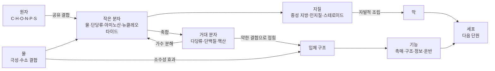

# 일반생명과학 1. 생명의 화학 — 물과 탄소가 짜는 분자의 설계도
<!-- prev: 2-5, cell-1, bio-1 -->
<!-- next: ubio-2, ubio-3, ubio-6 -->

> [!NOTE]
> **이 단원의 범위**
> - 생명 현상의 특성, 생물학의 탐구 방법(관찰·가설·대조 실험·이론)
> - 생명을 이루는 원소와 화학 결합, 물의 성질(수소 결합, 응집, 비열, 용매, pH와 완충)
> - 탄소 골격과 작용기, 축합과 가수 분해
> - 탄수화물, 지질, 단백질(네 단계 구조와 접힘), 핵산의 구조와 기능

**학습 목표**

1. 생명 현상의 공통 특성과 계층적 구조를 설명하고, 가설 연역적 탐구에서 대조 실험·변인·반복의 역할을 실험 사례로 분석할 수 있다.
2. 공유 결합·이온 결합·수소 결합·반데르발스 상호 작용·소수성 상호 작용을 세기와 생물학적 역할로 비교할 수 있다.
3. 물의 극성과 수소 결합으로 응집·표면 장력·높은 비열과 기화열·얼음의 밀도·용매로서의 성질을 설명하고, pH와 완충 작용을 헨더슨–하셀바흐 식으로 계산할 수 있다.
4. 탄소 골격의 다양성과 주요 작용기의 성질을 이용해 생체 분자의 성질을 예측할 수 있다.
5. 탄수화물·지질·단백질·핵산을 단위체, 결합의 종류, 입체 구조, 기능의 관점에서 비교하고, 단백질의 1~4차 구조와 접힘을 결합의 종류로 설명할 수 있다.

**이 단원의 학습 사다리**

| 단계 | 무엇을 하나? |
|---|---|
| STEP 1. 이전 학습 다시 보기 | 통합과학의 단위체·중합체, 「세포」의 네 가지 생체 분자, 「생명 시스템의 구성」의 생물의 특성을 다시 꺼낸다 |
| STEP 2. 기초 다지기 | 몰과 농도 단위, 로그와 pH, 결합 에너지의 크기 감각, 골격 구조식 읽기 |
| STEP 3. 핵심 개념 | 생명의 특성과 탐구 방법 → 원자와 결합 → 물 → pH와 완충 → 탄소와 작용기 → 축합 → 탄수화물 → 지질 → 단백질 → 핵산 |
| STEP 4. 오개념 바로잡기 | "수소 결합은 공유 결합의 일종?", "변성되면 펩타이드 결합이 끊어진다?" 같은 착각 |
| STEP 5. 다음 단계로 한 걸음 더 | 단백질 접힘의 열역학, 아미노산의 적정 곡선과 등전점 |
| STEP 6. 생활·산업·진로 | 수액과 완충, 단백질 구조 예측, 트랜스 지방 규제, 핵산 의약품 |

---

## 🗺️ 단원 들어가기

바닷물 한 컵과 내 혈액 한 컵을 화학 분석기에 넣어 보자. 원소 목록만 보면 둘은 놀랄 만큼 비슷하다. 수소, 산소, 탄소, 질소, 나트륨, 칼륨, 염소…. 그런데 혈액은 몸을 돌며 산소를 나르고, 상처가 나면 스스로 굳고, 침입한 세균을 찾아 죽인다. **같은 원자로 만들어졌는데 무엇이 다른가?**

답은 원자가 '무엇이냐'보다 원자가 **어떻게 이어지고, 어떤 모양으로 접히고, 물속에서 서로 어떻게 끌고 미느냐**에 있다. 헤모글로빈 단백질의 아미노산 574개 가운데 단 2개(β 사슬 두 개의 6번째 아미노산)가 바뀌면 적혈구가 낫 모양으로 찌그러지는 병이 생긴다. 반대로 탄소 6개짜리 포도당이 연결되는 **방향** 하나만 바꾸면, 소화되는 밥(녹말)이 소화되지 않는 종이(셀룰로스)가 된다.

이 단원은 대학 생명과학의 출발점으로서 생명을 **화학의 언어**로 다시 읽는다. 고등학교에서 "단백질은 아미노산으로 이루어진다"고 배웠다면, 이제는 "왜 그 아미노산 배열이 바로 그 모양으로 접히는가"를 결합의 세기와 물의 성질로 설명해 볼 것이다.

---

## STEP 1. 🔙 이전 학습 다시 보기

### 연계표

| 이전 단원 | 고등학교에서는 여기까지 | 대학에서는 이렇게 확장 |
|---|---|---|
| 통합과학1 「지각과 생명체 구성 물질의 규칙성」 | 탄소의 결합 손 4개, 단위체(아미노산·뉴클레오타이드)가 결합해 단백질·핵산을 이룸, DNA 이중 나선의 상보 결합 | 결합의 **종류와 세기**(kJ/mol), 작용기의 성질, 핵산 가닥의 **5′→3′ 방향성**과 역평행 |
| 통합과학2 「산과 염기, 중화 반응」 | 산·염기의 성질과 중화, pH의 뜻 | $K_w$와 로그 계산, **완충 용액**과 헨더슨–하셀바흐 식, 혈액의 탄산수소 완충계 |
| 화학 「물질의 구조와 성질」 | 전기 음성도, 결합의 극성, 분자 간 힘과 수소 결합 | 수소 결합이 물의 응집·비열·얼음의 밀도를 만드는 원리, **소수성 효과**가 생체 분자를 접고 조립하는 원리 |
| 생명과학 「생명 시스템의 구성」 | 생물의 특성(물질대사, 자극과 반응, 항상성, 생식, 진화 등), 생명 시스템의 구성 단계 | 생명의 특성을 **창발성**과 진화라는 통합 주제로 묶고, 가설 연역적 탐구와 대조 실험을 분석 |
| 진로 선택 「세포와 물질대사」 '세포' | 탄수화물·지질·핵산·단백질의 종류와 기능, 단백질의 1~4차 구조와 변성 | 글리코사이드 결합의 **α/β 방향**, 지방산의 포화·시스·트랜스, 아미노산 곁사슬의 분류와 이온화, 단백질 접힘을 붙드는 **각 결합의 역할**, 안핀슨 실험 |

### 준비 운동 (사전 진단)

**Q1.** 물 분자는 왜 극성 분자인가? '전기 음성도'와 '분자 모양'이라는 말을 넣어 설명하시오.

**Q2.** pH 3인 용액의 수소 이온 농도는 pH 6인 용액의 몇 배인가?

**Q3.** 다음 중 단위체와 중합체의 짝이 옳지 않은 것은?
ㄱ. 포도당 – 글리코젠 ㄴ. 아미노산 – 단백질 ㄷ. 지방산 – 중성 지방 ㄹ. 뉴클레오타이드 – RNA

**Q4.** 달걀을 삶으면 흰자가 굳는다. 이때 단백질의 무엇이 변하고, 무엇은 그대로인가?

정답 및 해설

**Q1.** 산소의 전기 음성도가 수소보다 커서 O–H 결합의 공유 전자쌍이 산소 쪽으로 치우친다(산소는 부분 음전하, 수소는 부분 양전하). 분자 모양이 직선이 아니라 **굽은 형**(약 104.5°)이어서 두 결합의 쌍극자가 상쇄되지 않으므로 분자 전체가 극성을 띤다.

**Q2.** $10^{-3} / 10^{-6} = 10^3$, 즉 **1000배**이다.

**Q3.** **ㄷ** — 중성 지방은 글리세롤 1분자와 지방산 3분자가 결합한 것으로, 같은 단위체가 길게 반복되는 중합체가 아니다. 지질은 '물에 잘 녹지 않는다'는 성질로 묶은 무리이다.

**Q4.** 열 때문에 입체 구조(2·3·4차 구조)를 붙들던 약한 결합이 끊어져 사슬이 풀리고 서로 엉킨다(**변성**). 아미노산의 배열 순서(1차 구조)와 펩타이드 결합은 그대로이다.

---

## STEP 2. 🧱 기초 다지기

### ① 몰과 농도 — 생명과학의 단위 감각

세포 속 분자는 대개 **mM(밀리몰 농도)**, **µM(마이크로몰 농도)** 수준이다. 병원 검사지는 같은 양을 mg/dL로 적기도 하므로 두 단위를 자유롭게 바꿀 수 있어야 한다.

| 단위 | 뜻 | 예 |
|---|---|---|
| M(mol/L) | 용액 1 L에 든 용질의 몰수 | 순수한 물은 약 55.5 M($1000 \div 18.0$) |
| mM | $10^{-3}$ M | 혈중 포도당 약 5 mM, 혈장 $\mathrm{Na^+}$ 약 140 mM |
| µM, nM | $10^{-6}$ M, $10^{-9}$ M | 호르몬, 세포 안의 $\mathrm{Ca^{2+}}$(약 0.1 µM) |
| mg/dL | 혈액 100 mL에 든 mg | 공복 혈당 약 70~100 mg/dL |
| %(질량/부피) | 100 mL에 든 g | 생리 식염수 0.9% = 9 g/L |

**변환 예** 혈당 90 mg/dL = 900 mg/L = 0.900 g/L. 포도당의 몰질량 180.2 g/mol로 나누면 $0.900 / 180.2 = 4.99 \times 10^{-3}$ M, 즉 **약 5.0 mM**이다. 생리 식염수 9 g/L는 $9 / 58.44 = 0.154$ M이다.

### ② 로그와 pH

$$
\mathrm{pH} = -\log_{10}[\mathrm{H^+}], \qquad [\mathrm{H^+}] = 10^{-\mathrm{pH}}
$$

- pH가 1 작아지면 $[\mathrm{H^+}]$는 **10배** 커진다. pH 차이 $\Delta$는 농도 비 $10^{\Delta}$이다.
- 예: $[\mathrm{H^+}] = 3.2 \times 10^{-5}$ M이면 $\mathrm{pH} = -\log(3.2\times10^{-5}) = 5 - \log 3.2 = 5 - 0.505 = 4.49$.
- 로그의 곱셈 규칙 $\log(ab) = \log a + \log b$ 는 STEP 3의 헨더슨–하셀바흐 식을 유도할 때 그대로 쓰인다.

> [!TIP]
> 💡 **어림 요령** — $\log 2 \approx 0.30$, $\log 3 \approx 0.48$, $\log 5 \approx 0.70$ 세 개만 외워 두면 계산기 없이도 pH를 소수 첫째 자리까지 어림할 수 있다.

### ③ 결합 에너지의 크기 감각 — kJ/mol

결합 1몰을 끊는 데 드는 에너지를 kJ/mol로 나타낸다. 체온(약 310 K)에서 분자들이 서로 부딪치며 주고받는 열에너지의 크기는 대략 $RT \approx 8.314 \times 310 \approx 2.6\ \mathrm{kJ/mol}$ 이다.

| 상호 작용 | 대략적 세기(kJ/mol) | 체온의 열운동으로? |
|---|---|---|
| 공유 결합(C–C, O–H) | 약 350~460 | 거의 끊어지지 않는다 |
| 수소 결합 | 약 5~30(물에서 약 20) | 끊어졌다 다시 생기기를 반복한다 |
| 이온 결합(물속의 염다리) | 약 4~20(물속에서 크게 약해짐) | 끊어졌다 다시 생긴다 |
| 반데르발스 상호 작용 | 약 0.4~4 | 하나하나는 쉽게 끊어진다 |

공유 결합은 $RT$의 100배가 넘으므로 체온에서 **안정**하다. 수소 결합·반데르발스 상호 작용은 $RT$의 몇 배 정도여서 하나하나는 약하지만, **수백~수천 개가 동시에 작용**하면 단백질이나 DNA의 모양을 단단히 붙든다. 약하기 때문에 효소가 기질을 붙잡았다 놓아주고, DNA 두 가닥이 복제 때 벌어질 수 있다. **생명은 '강한 결합으로 뼈대를 만들고, 약한 결합으로 모양과 상호 작용을 만든다.'**

### ④ 골격 구조식 읽기

유기 분자를 그릴 때 대학 교재는 탄소와 탄소에 붙은 수소를 생략한 **골격 구조식**을 흔히 쓴다.

| 규칙 | 뜻 |
|---|---|
| 선의 꺾이는 점·끝점 | 탄소 원자 |
| 탄소에 붙은 수소 | 생략(탄소가 결합 4개를 채우도록 수소가 붙어 있다고 본다) |
| O, N, S, P와 그에 붙은 H | 반드시 적는다 |
| 이중선 | 이중 결합 |

예를 들어 지그재그 선 끝에 –COOH가 붙어 있으면 지방산, 육각형 고리에 –OH가 여럿 붙어 있으면 당이다. 이 단원에서는 표와 말로 구조를 설명하지만, 분자식에서 **작용기를 찾아내는 눈**을 길러 두면 이후 물질대사 단원이 훨씬 쉬워진다.

---

## STEP 3. 📘 핵심 개념

### ① 생명 현상의 특성 — 무엇이 '살아 있음'을 만드는가

생명을 한 문장으로 정의하기는 어렵다. 대신 생물학자들은 모든 생물에 공통으로 나타나는 특성들의 묶음으로 생명을 알아본다.

| 특성 | 내용 | 예 |
|---|---|---|
| **질서 있는 구조** | 세포를 기본 단위로 분자–세포–조직–기관–개체가 계층을 이룬다 | 해바라기 씨의 나선 배열, 세포의 막 구조 |
| **물질대사와 에너지 처리** | 에너지를 얻어 쓰며 물질을 합성·분해한다 | 광합성, 세포호흡 |
| **자극에 대한 반응** | 환경 변화를 감지하고 반응한다 | 빛을 향해 휘는 줄기, 동공 반사 |
| **항상성** | 내부 환경을 일정 범위로 유지한다 | 체온·혈당 조절 |
| **생장과 발생** | 유전 정보에 따라 자라고 형태를 갖춘다 | 수정란 → 개체 |
| **생식과 유전** | 자신을 닮은 자손을 만들며 DNA로 정보를 전달한다 | 세균의 이분법, 유성 생식 |
| **진화적 적응** | 집단이 세대를 거치며 환경에 맞게 변한다 | 항생제 내성 세균 |

#### 생명을 보는 다섯 개의 렌즈

대학 생명과학은 수많은 사실을 몇 가지 큰 주제로 엮어 이해한다.

1. **계층과 창발성(emergent property)**: 아래 수준의 부품을 모아 배열하면 부품 하나에는 없던 성질이 새로 나타난다. 아미노산 하나는 촉매가 아니지만, 수백 개가 특정한 모양으로 접힌 효소는 촉매이다. 그래서 생명과학은 부품을 분해해 보는 **환원주의**와, 부품 사이의 관계를 보는 **시스템 생물학**을 함께 쓴다.
2. **구조와 기능의 상관관계**: 모양이 하는 일을 정한다. 이 단원 전체가 그 사례집이다.
3. **정보의 흐름**: DNA → RNA → 단백질로 정보가 흐르며, 이 정보는 생식으로 전달된다.
4. **에너지와 물질의 흐름**: 에너지는 생태계를 한 방향으로 흐르고(대부분 태양에서 와서 열로 나간다), 물질은 순환한다.
5. **진화**: 모든 생물이 공통 조상에서 유래했다는 사실이 생명의 통일성(같은 유전 암호, 같은 20종 아미노산)과 다양성을 함께 설명한다. 진화는 생물학의 **핵심 통합 주제**이다.

> [!TIP]
> 💡 **비유** — 피아노 건반 88개를 따로 두드리면 소리일 뿐이지만, 순서와 박자를 맞추면 음악이 된다. 음악은 건반 어디에도 들어 있지 않다. 창발성이란 '배열'과 '관계'가 만들어 내는 성질이다.

---

### ② 생물학의 탐구 방법 — 관찰에서 이론까지

#### (1) 두 가지 탐구의 길

| 구분 | **발견적(귀납적) 탐구** | **가설 연역적 탐구** |
|---|---|---|
| 출발 | 체계적인 관찰과 자료 수집 | 관찰에서 생긴 질문에 대한 잠정적 답(가설) |
| 논리 | 많은 사례 → 일반화 | 가설 → "만약 가설이 옳다면 ~일 것이다"(예측) → 실험으로 검증 |
| 예 | 유전체 해독, 세포 소기관 목록 작성, 생물 다양성 조사 | 대조 실험으로 약물의 효과 검증 |

좋은 **가설**(hypothesis)은 **검증 가능하고 반증 가능**해야 한다. 실험 결과가 예측과 맞으면 가설은 '지지'될 뿐 '증명'되지는 않는다. 다른 설명이 남아 있을 수 있기 때문이다. 반대로 예측과 어긋나는 결과가 반복되면 가설은 기각된다.

**이론**(theory)은 가설보다 훨씬 넓은 현상을 설명하고, 수많은 독립적 증거로 지지되며, 새로운 예측을 낳는 설명 체계이다(세포설, 진화론, 유전자설). 일상어의 "그건 이론일 뿐이야"와는 뜻이 정반대에 가깝다.

#### (2) 대조 실험의 설계

| 요소 | 뜻 | 놓치면 생기는 문제 |
|---|---|---|
| **독립 변인(조작 변인)** | 실험자가 일부러 바꾸는 요인 | — |
| **종속 변인** | 독립 변인에 따라 측정하는 결과 | 측정 방법이 모호하면 비교 불가 |
| **통제 변인** | 두 집단에서 같게 유지하는 요인 | 결과 차이가 무엇 때문인지 알 수 없음 |
| **대조군** | 독립 변인만 처리하지 않은 집단 | 처리 효과의 기준이 없음 |
| **반복과 무작위 배정** | 여러 개체를 무작위로 나누어 반복 측정 | 우연한 차이·개체 차이를 효과로 착각 |
| **맹검(blind)** | 측정자·피험자가 어느 집단인지 모르게 함 | 기대가 결과에 섞임(위약 효과 등) |

#### 예제 1 — 실험 자료의 해석

한 학생이 "토양 염분이 높으면 상추 모종의 생장이 억제된다"는 가설을 세우고, 같은 날 파종한 모종 10개를 무작위로 5개씩 나누어 한쪽에는 수돗물, 다른 쪽에는 0.1 M NaCl 용액을 같은 양만큼 2주 동안 주었다. 2주 뒤 키(cm)는 다음과 같았다.

| 집단 | 개체 1 | 개체 2 | 개체 3 | 개체 4 | 개체 5 |
|---|---|---|---|---|---|
| 수돗물 | 12.1 | 11.4 | 12.8 | 11.9 | 12.3 |
| 0.1 M NaCl | 9.2 | 10.1 | 8.7 | 9.6 | 9.4 |

(1) 독립 변인, 종속 변인, 대조군을 쓰시오. (2) 각 집단의 평균과 표준 편차를 구하시오. (3) 결론을 쓰고, 결론의 한계를 하나 지적하시오.

**풀이**
(1) 독립 변인: 물에 넣은 NaCl의 유무. 종속 변인: 2주 뒤 모종의 키. 대조군: 수돗물을 준 집단.
(2) 평균: 수돗물 $(12.1+11.4+12.8+11.9+12.3)/5 = 60.5/5 = 12.1$ cm, NaCl $47.0/5 = 9.4$ cm.
표본 표준 편차 $s = \sqrt{\sum (x_i - \bar{x})^2 / (n-1)}$ 로 계산하면 수돗물 집단의 편차 제곱합은 $0 + 0.49 + 0.49 + 0.04 + 0.04 = 1.06$ 이므로 $s = \sqrt{1.06/4} \approx 0.51$ cm, NaCl 집단도 $0.04 + 0.49 + 0.49 + 0.04 + 0 = 1.06$ 으로 $s \approx 0.51$ cm이다.
(3) 평균 차이(2.7 cm)가 각 집단의 흩어짐(약 0.5 cm)보다 훨씬 크므로 가설이 **지지**된다. 한계: 표본이 5개씩으로 적고, 한 농도만 시험해 '농도가 높을수록' 억제되는지는 알 수 없으며, 염분이 아니라 '나트륨 이온' 또는 '삼투 효과' 중 무엇 때문인지는 구별되지 않는다(예: 같은 삼투 농도의 KCl·설탕 용액 집단을 추가하면 구별할 수 있다).

> [!IMPORTANT]
> 실험 결론은 "가설이 지지된다/기각된다"로 쓴다. 다른 원인(교란 변인)을 배제하는 **추가 대조군**을 떠올리는 것이 대학 실험 보고서의 핵심 능력이다.

---

### ③ 생명을 이루는 원자와 화학 결합

#### (1) 생명의 원소

생물은 자연에 있는 약 90여 종의 원소 가운데 20~25종을 필수로 쓴다.

| 원소 | 사람 몸의 질량 비율(약) | 주요 역할 |
|---|---|---|
| O, C, H, N | 약 65%, 18%, 10%, 3% (합 약 96%) | 물과 모든 유기물의 뼈대 |
| Ca, P | 약 1.5%, 1% | 뼈·이, 핵산·ATP·인지질의 인산 |
| K, S, Na, Cl, Mg | 각각 1% 미만 | 막전위, 단백질의 이황화 결합, 효소 보조 인자 |
| **미량 원소**(Fe, I, Zn, Cu, Mn 등) | 0.01% 미만 | 헤모글로빈의 철, 갑상샘 호르몬의 아이오딘, 효소의 금속 보조 인자 |

산소가 질량으로 가장 많은 것은 몸의 약 60~70%가 물이기 때문이다. 미량 원소는 양이 적어도 결핍되면 병이 된다(아이오딘 결핍 → 갑상샘종).

#### (2) 동위 원소 — 생명과학의 추적 장치

같은 원소라도 중성자 수가 다른 **동위 원소**(isotope)는 화학적 성질이 거의 같아 생체 분자 속에 그대로 들어간다. 그래서 '표지'를 붙인 원자가 어디로 가는지 추적할 수 있다.

| 동위 원소 | 성질 | 이용 예 |
|---|---|---|
| $^{14}\mathrm{C}$ | 방사성, 반감기 약 5730년 | 광합성 탄소 경로 추적, 연대 측정 |
| $^{32}\mathrm{P}$, $^{35}\mathrm{S}$ | 방사성 | DNA와 단백질을 각각 표지 |
| $^{18}\mathrm{O}$, $^{15}\mathrm{N}$ | 안정(방사선 없음), 질량으로 구별 | 광합성 산소의 출처, DNA 반보존적 복제 증명 |
| $^{18}\mathrm{F}$ | 방사성(반감기 약 110분) | 포도당 유사체에 붙여 PET 검사(암세포의 포도당 흡수 영상) |

예: $^{14}\mathrm{C}$가 처음의 25%만 남았다면 $0.25 = (1/2)^2$ 이므로 반감기 2번, 약 $2 \times 5730 = 11\,460$년이 지났다.

#### (3) 결합의 종류 — 강한 뼈대와 약한 손잡이

원자의 화학적 성질은 **원자가 전자**가 정한다. C는 결합 4개, N은 3개, O는 2개, H는 1개를 만든다(「물질의 구조와 성질」).

| 결합·상호 작용 | 원리 | 생물학적 예 |
|---|---|---|
| **비극성 공유 결합** | 전기 음성도가 비슷한 원자가 전자쌍을 고르게 공유 | C–C, C–H(지방산 꼬리) |
| **극성 공유 결합** | 전기 음성도 차이로 전자쌍이 한쪽으로 치우침(부분 전하 δ+, δ−) | O–H, N–H, C=O |
| **이온 결합** | 전자를 주고받아 생긴 양이온과 음이온의 정전기적 인력 | NaCl 결정, 단백질 속 –COO⁻와 –NH₃⁺ 사이의 **염다리** |
| **수소 결합** | δ+를 띤 H(O–H, N–H의 H)와 이웃 분자의 전기 음성 원자(O, N) 사이의 인력 | 물 분자 사이, DNA 염기쌍, 단백질 2차 구조 |
| **반데르발스 상호 작용** | 순간적으로 치우친 전자 분포가 이웃에 일으키는 약한 인력. 아주 가까울 때만 작용 | 단백질 내부 소수성 곁사슬의 빽빽한 맞물림, 도마뱀붙이의 발바닥 |
| **소수성 상호 작용** | 결합이라기보다, 물이 비극성 분자를 한데 몰아내는 효과 | 막의 인지질 이중층, 단백질의 소수성 핵 |

전기 음성도(폴링 척도): O 3.4, N 3.0, C 2.6, H 2.2. C–H 결합은 차이가 작아 비극성에 가깝고, O–H·N–H는 극성이 크다. **수소 결합이 O–H나 N–H의 H에서만 생기고 C–H의 H에서는 거의 생기지 않는 이유**이다.

> [!TIP]
> 💡 **비유** — 공유 결합은 용접, 이온 결합과 수소 결합은 자석, 반데르발스 상호 작용은 벨크로(찍찍이)이다. 벨크로 고리 하나는 약하지만 넓은 면이 맞닿으면 꽤 단단히 붙는다. 그래서 반데르발스 상호 작용은 **모양이 꼭 맞는 분자들 사이**에서만 의미가 있다. 효소와 기질, 항체와 항원의 '모양 맞춤'이 중요한 이유이다.

#### (4) 분자 모양이 기능을 정한다

분자의 모양은 원자 오비탈의 배치로 정해진다. 탄소의 결합 4개는 정사면체 꼭짓점 방향(약 109.5°)을 향하고, 물의 O–H 결합은 약 104.5° 굽어 있다. 뇌의 아편 수용체에 진통제 모르핀과 몸속 엔도르핀이 모두 결합하는 것은, 화학식은 달라도 **수용체에 닿는 부분의 모양**이 비슷하기 때문이다. 약물 설계는 이 '모양 흉내 내기'에서 출발한다.

---

### ④ 물의 성질 — 수소 결합이 만든 생명의 무대

물 분자 하나는 두 개의 H(δ+)와 산소의 비공유 전자쌍 두 개(δ−)로 이웃과 **최대 4개의 수소 결합**을 만든다. 액체 상태에서 이 수소 결합은 끊임없이 끊어지고 다시 생긴다(하나의 수명은 피코초 수준). 물의 놀라운 성질 네 가지가 모두 여기서 나온다.

#### (1) 응집력·부착력과 표면 장력

- **응집**(cohesion): 물 분자끼리 수소 결합으로 서로 끌어당긴다. 키 100 m가 넘는 나무 꼭대기까지 물관 속 물기둥이 끊어지지 않고 끌려 올라가는 바탕이다(ubio-10 「식물의 구조와 기능」의 증산–응집–장력설).
- **부착**(adhesion): 물이 물관 벽의 셀룰로스처럼 극성인 표면에 달라붙는다. 중력을 거슬러 가는 관을 타고 오르는 모세관 현상을 돕는다.
- **표면 장력**: 표면의 물 분자는 아래쪽으로만 끌려 표면이 팽팽한 막처럼 행동한다. 소금쟁이가 물 위를 걷는다. 물의 표면 장력은 상온에서 약 0.072 N/m로, 흔한 액체 가운데 매우 크다.

#### (2) 높은 비열과 기화열 — 온도의 완충재

| 성질 | 물의 값(약) | 비교 | 생물학적 의미 |
|---|---|---|---|
| **비열** | 4.18 J/(g·K) | 에탄올 약 2.4, 철 약 0.45 | 몸과 바다의 온도가 천천히 변한다 |
| **기화열** | 약 2.4 kJ/g(체온 부근) | 같은 질량의 물을 1 K 데우는 에너지의 500배 이상 | 땀의 증발이 효과적으로 열을 빼앗는다 |

물을 데우면 들어간 에너지의 상당 부분이 분자의 운동을 빠르게 하기 전에 **수소 결합을 끊는 데** 쓰인다. 그래서 같은 열을 받아도 온도가 덜 오른다. 증발할 때는 수소 결합을 모두 끊고 떨어져 나가야 하므로 큰 에너지가 필요하다.

#### 예제 2 — 체온과 땀

체중 70 kg인 사람이 안정 시 약 100 W의 열을 만든다. 몸의 평균 비열을 3.5 kJ/(kg·K)이라고 하자.
(1) 열이 전혀 빠져나가지 않는다면 1시간 동안 체온은 몇 도 오르는가? (2) 이 열을 모두 땀의 증발로 내보내려면 땀이 몇 g 증발해야 하는가? (물의 기화열 2.4 kJ/g)

**풀이**
(1) 식: $Q = Pt$, $\Delta T = Q / (mc)$.
대입: $Q = 100\ \mathrm{W} \times 3600\ \mathrm{s} = 3.6\times10^{5}\ \mathrm{J} = 360\ \mathrm{kJ}$, $\Delta T = 360 / (70 \times 3.5) = 360 / 245 \approx 1.5\ \mathrm{K}$.
(2) $m = 360\ \mathrm{kJ} / 2.4\ \mathrm{kJ/g} = 150\ \mathrm{g}$.
의미: 안정 상태에서도 열 방출이 막히면 1시간에 약 1.5 °C씩 체온이 오른다. 반면 땀 150 g(작은 컵 하나)만 증발하면 이 열을 모두 처리할 수 있다. 몸이 물로 이루어져 있지 않았다면(비열이 작다면) 체온은 훨씬 빠르게 요동쳤을 것이다.

#### (3) 얼음이 물에 뜬다

대부분의 물질은 고체가 액체보다 밀도가 크다. 물은 4 °C 부근에서 밀도가 가장 크고, 얼면 수소 결합이 각 분자를 이웃 4개와 규칙적인 육각 격자로 고정해 분자 사이가 오히려 **벌어진다**. 얼음의 밀도는 약 0.92 g/cm³로 액체 물보다 작다.

그래서 겨울에 호수는 **위에서부터** 얼고, 얼음층이 단열재가 되어 아래 물은 4 °C 근처에서 얼지 않는다. 물고기와 수생 생물이 겨울을 나는 조건이다. 반대로 세포 속 물이 얼면 부피가 늘어나고 얼음 결정이 막을 찢으므로, 세포를 냉동 보관할 때는 글리세롤 같은 동결 보호제를 쓴다.

#### (4) 만능 용매 — 친수성과 소수성

물은 극성 분자와 이온을 잘 녹인다. NaCl 결정을 물에 넣으면 물 분자의 δ− 산소가 $\mathrm{Na^+}$을, δ+ 수소가 $\mathrm{Cl^-}$을 둘러싸 **수화 껍질**을 만들며 이온을 떼어 낸다.

| 구분 | 성질 | 예 |
|---|---|---|
| **친수성**(hydrophilic) | 물과 수소 결합하거나 이온–쌍극자 인력을 갖는다 | 당, 아미노산, 이온, 단백질 표면 |
| **소수성**(hydrophobic) | 비극성이어서 물과 잘 어울리지 못한다 | 지방, 기름, 지방산 꼬리, 콜레스테롤 |
| **양친매성**(amphipathic) | 한 분자에 친수성 부분과 소수성 부분이 함께 있다 | 인지질, 비누, 담즙산 |

**소수성 효과의 진짜 원인** — 기름과 물이 섞이지 않는 것은 기름 분자끼리 강하게 끌어당겨서가 아니다. 비극성 분자 주위의 물 분자들은 그 분자와 수소 결합을 하지 못해, 자기들끼리 수소 결합을 유지하려고 **질서 정연한 우리 모양**으로 배열해야 한다. 이것은 물의 엔트로피를 낮춘다. 비극성 분자들이 한데 모이면 물과 닿는 면적이 줄어 묶여 있던 물 분자들이 풀려나고 **물의 엔트로피가 커진다**. 즉 소수성 효과는 주로 **물의 엔트로피**가 몰아가는 현상이다. 인지질이 저절로 이중층을 만들고, 단백질이 소수성 곁사슬을 안쪽에 숨긴 채 접히는 힘이 바로 이것이다.

> [!TIP]
> 💡 **비유** — 북적이는 광장(물)에 손을 잡지 못하는 사람(기름 분자)이 섞여 있으면, 주변 사람들이 그를 피해 어색하게 줄을 서야 한다. 손 못 잡는 사람들을 한구석에 모아 두면 나머지 사람들은 다시 자유롭게 움직인다. 모인 것은 그들이 서로 좋아해서가 아니라, 군중이 자유로워지기 때문이다.

---

### ⑤ 산·염기, pH와 완충 작용

#### (1) 물의 자동 이온화와 pH

물 분자는 아주 드물게 수소 이온을 주고받는다.

$$
2\mathrm{H_2O} \rightleftharpoons \mathrm{H_3O^+} + \mathrm{OH^-}, \qquad K_w = [\mathrm{H^+}][\mathrm{OH^-}] = 1.0\times10^{-14}\ (25\ ^\circ\mathrm{C})
$$

($\mathrm{H_3O^+}$를 간단히 $\mathrm{H^+}$로 쓴다.) 순수한 물은 $[\mathrm{H^+}] = [\mathrm{OH^-}] = 10^{-7}$ M, pH 7이다. 물 분자 약 5억 5천만 개 가운데 1개꼴로만 이온화되어 있는 셈이다($55.5\ \mathrm{M} / 10^{-7}\ \mathrm{M}$).

| 체액 | pH(약) | $[\mathrm{H^+}]$(M) |
|---|---|---|
| 위액 | 1.5~3.5 | $10^{-2}$ 부근 |
| 소변 | 5~7(식사에 따라 변함) | — |
| 혈액 | **7.35~7.45** | $4\times10^{-8}$ 부근 |
| 세포질 | 약 7.2 | — |
| 리소좀 내부 | 약 4.5~5 | — |
| 이자액 | 약 8 | — |

혈액의 pH 범위 7.35~7.45는 $[\mathrm{H^+}]$로 보면 $4.47\times10^{-8}$ ~ $3.55\times10^{-8}$ M, 즉 고작 1.26배 차이이다. 몸은 수소 이온 농도를 이처럼 좁은 범위에 붙잡아 둔다. pH가 바뀌면 단백질 곁사슬의 전하가 바뀌어 모양과 기능이 달라지기 때문이다.

#### (2) 완충 용액

**완충 용액**(buffer)은 약산과 그 짝염기(또는 약염기와 그 짝산)가 함께 들어 있어, 산이나 염기를 조금 넣어도 pH가 크게 변하지 않는 용액이다.

$$
\mathrm{HA} \rightleftharpoons \mathrm{H^+} + \mathrm{A^-}, \qquad K_a = \frac{[\mathrm{H^+}][\mathrm{A^-}]}{[\mathrm{HA}]}
$$

양변에 $-\log$를 취하면 **헨더슨–하셀바흐 식**을 얻는다.

$$
\mathrm{pH} = \mathrm{p}K_a + \log\frac{[\mathrm{A^-}]}{[\mathrm{HA}]}
$$

- 산($\mathrm{H^+}$)이 들어오면 $\mathrm{A^-}$가 받아 HA가 되고, 염기($\mathrm{OH^-}$)가 들어오면 HA가 $\mathrm{H^+}$를 내주어 물이 된다.
- 비 $[\mathrm{A^-}]/[\mathrm{HA}]$가 10배 바뀌어야 pH가 1 변한다. 완충 능력은 $\mathrm{pH} \approx \mathrm{p}K_a$ 근처(대략 $\mathrm{p}K_a \pm 1$)에서 가장 크다.

#### (3) 혈액의 탄산–탄산수소 완충계

$$
\mathrm{CO_2} + \mathrm{H_2O} \rightleftharpoons \mathrm{H_2CO_3} \rightleftharpoons \mathrm{H^+} + \mathrm{HCO_3^-}
$$

혈액에서는 녹아 있는 $\mathrm{CO_2}$와 탄산을 합쳐 '산'으로 보고, 겉보기 $\mathrm{p}K_a = 6.1$, 녹은 $\mathrm{CO_2}$의 농도 $= 0.03\ \mathrm{mM/mmHg} \times P_{\mathrm{CO_2}}$ 로 계산한다.

$$
\mathrm{pH} = 6.1 + \log\frac{[\mathrm{HCO_3^-}]}{0.03 \times P_{\mathrm{CO_2}}}
$$

이 완충계의 특별한 점은 **두 손잡이를 따로 조절할 수 있다**는 것이다. 폐는 호흡으로 $P_{\mathrm{CO_2}}$를 몇 분 안에, 콩팥은 $\mathrm{HCO_3^-}$의 재흡수와 $\mathrm{H^+}$ 배설로 몇 시간~며칠에 걸쳐 조절한다.

#### 예제 3 — 혈액의 pH

(1) 정상 동맥혈의 $[\mathrm{HCO_3^-}] = 24\ \mathrm{mM}$, $P_{\mathrm{CO_2}} = 40\ \mathrm{mmHg}$일 때 pH를 구하시오.
(2) 호흡이 얕아져 $P_{\mathrm{CO_2}}$가 60 mmHg로 올랐다면(탄산수소 이온은 그대로) pH는?

**풀이**
(1) 분모: $0.03 \times 40 = 1.2\ \mathrm{mM}$. 비: $24 / 1.2 = 20$. $\mathrm{pH} = 6.1 + \log 20 = 6.1 + 1.30 = 7.40$.
(2) 분모: $0.03 \times 60 = 1.8$. 비: $24 / 1.8 = 13.3$. $\mathrm{pH} = 6.1 + \log 13.3 = 6.1 + 1.12 = 7.22$.
의미: 이산화 탄소가 쌓이면 혈액이 산성 쪽으로 기운다(**호흡성 산증**). 정상 혈액에서 $\mathrm{HCO_3^-}$가 산의 20배나 되는 것은, 대사로 생기는 산(젖산 등)을 받아 줄 '염기 쪽 예비량'을 넉넉히 두는 설계로 볼 수 있다.

> [!WARNING]
> 헨더슨–하셀바흐 식은 농도를 활동도 대신 쓰는 근사식이다. 매우 묽은 용액이나 $[\mathrm{A^-}]/[\mathrm{HA}]$가 극단적인 경우(100배 이상)에는 오차가 커진다. 혈액 계산의 6.1과 0.03도 37 °C 혈장에서의 실험적 값이다.

---

### ⑥ 탄소 골격과 작용기

#### (1) 탄소가 뼈대가 되는 이유

탄소는 원자가 전자 4개로 **결합 4개**를 만들고, 탄소끼리도 단일·이중 결합으로 안정하게 이어진다. 그래서 긴 사슬, 가지, 고리, 이중 결합 위치가 다양한 골격이 가능하다. 규소도 결합 4개를 만들지만 Si–Si 결합이 약하고 Si–O 결합이 너무 안정해, 지각에서는 규산염 '광물'의 뼈대가 되고 생명의 뼈대는 되지 못했다(「지각과 생명체 구성 물질의 규칙성」).

| 골격의 다양성 | 예 |
|---|---|
| 길이 | 에테인(C₂) → 팔미트산(C₁₆) 꼬리 |
| 가지 | 아미노산 류신과 아이소류신 |
| 이중 결합의 수와 위치 | 포화 지방산 vs 불포화 지방산 |
| 고리 | 포도당(6원 고리), 스테로이드(4개 고리), 염기(퓨린·피리미딘) |

#### (2) 이성질체 — 같은 분자식, 다른 분자

| 종류 | 무엇이 다른가 | 생물학적 예 |
|---|---|---|
| **구조 이성질체** | 원자의 연결 순서 | 포도당(알데하이드형)과 과당(케톤형), 둘 다 $\mathrm{C_6H_{12}O_6}$ |
| **시스–트랜스 이성질체** | 이중 결합 양쪽 원자단의 공간 배치 | 시스 불포화 지방산 vs 트랜스 지방산, 시각 색소 레티날(빛을 받으면 시스 → 트랜스) |
| **거울상 이성질체** | 서로 겹쳐지지 않는 거울상(비대칭 탄소) | 생물의 아미노산은 거의 L형, 당은 거의 D형 |

거울상 이성질체는 화학적 성질이 거의 같아도 **효소나 수용체와 맞는 모양**이 다르다. 오른손 장갑에 왼손이 들어가지 않는 것과 같다. 한 거울상만 약효가 있고 다른 거울상은 효과가 없거나 해로운 약물이 있어, 제약 산업은 원하는 거울상만 골라 만드는 기술을 중시한다.

#### (3) 생명의 일곱 가지 주요 작용기

**작용기**(functional group)는 분자의 화학적 성질을 결정하는 원자 묶음이다. 같은 탄소 골격이라도 작용기가 다르면 전혀 다른 분자가 된다. 성호르몬 에스트라다이올과 테스토스테론은 골격이 같고 작용기 몇 개만 다르다.

| 작용기 | 구조 | 성질 | 들어 있는 분자 |
|---|---|---|---|
| **하이드록시기** | –OH | 극성, 수소 결합 → 물에 잘 녹게 함 | 당, 알코올 |
| **카보닐기** | >C=O(사슬 끝이면 알데하이드, 가운데면 케톤) | 극성, 당의 분류 기준 | 포도당(알데하이드), 과당(케톤) |
| **카복실기** | –COOH | **산**: 세포 pH에서 –COO⁻로 이온화 | 아미노산, 지방산, 시트르산 |
| **아미노기** | –NH₂ | **염기**: 세포 pH에서 –NH₃⁺ | 아미노산 |
| **설프하이드릴기** | –SH | 두 개가 산화되어 **이황화 결합**(–S–S–) | 시스테인, 머리카락의 케라틴 |
| **인산기** | –OPO₃²⁻ | 음전하, 물과 반응하며 에너지 방출 | ATP, 핵산, 인지질, 인산화 단백질 |
| **메틸기** | –CH₃ | 비극성, 다른 분자가 알아보는 '표지' | DNA의 메틸화(유전자 발현 조절) |

#### 예제 4 — 작용기로 성질 예측하기

다음 세 분자 (가) 에테인 $\mathrm{CH_3CH_3}$, (나) 에탄올 $\mathrm{CH_3CH_2OH}$, (다) 아세트산 $\mathrm{CH_3COOH}$ 가운데 (1) 물에 가장 녹기 어려운 것 (2) pH 7 수용액에서 대부분 음이온으로 존재하는 것을 고르고 이유를 쓰시오. (아세트산의 $\mathrm{p}K_a = 4.76$)

**풀이**
(1) **(가)** — 작용기 없이 C–H 결합만 있어 비극성이다. (나)와 (다)는 –OH, –COOH가 물과 수소 결합한다.
(2) **(다)** — 헨더슨–하셀바흐 식에서 $\log([\mathrm{A^-}]/[\mathrm{HA}]) = 7 - 4.76 = 2.24$, 비는 $10^{2.24} \approx 174$. 즉 99% 이상이 $\mathrm{CH_3COO^-}$로 존재한다. 세포 속 유기산(젖산, 피루브산, 시트르산)을 흔히 '-산' 대신 '-산 이온'(젖산염, 피루브산염)으로 부르는 이유이다.

#### (4) ATP — 작용기가 만드는 에너지 화폐

ATP는 아데닌(염기) + 리보스(당) + 인산기 3개로 된 뉴클레오타이드이다. 음전하를 띤 인산기 3개가 좁은 공간에서 서로 밀어내고 있어, 끝의 인산기가 물과 반응해 떨어져 나가면(가수 분해) 생성물이 훨씬 안정해지며 에너지가 방출된다. ATP의 에너지 수지는 ubio-3 「물질대사·세포호흡·광합성」에서 자유 에너지로 계산한다.

---

### ⑦ 거대 분자의 공통 원리 — 축합과 가수 분해

탄수화물(다당류), 단백질, 핵산은 작은 **단위체**(monomer)가 공유 결합으로 이어진 **중합체**(polymer)이다. 세 가지 모두 같은 화학 원리를 쓴다.

$$
\text{단위체–OH} + \text{H–단위체} \xrightarrow{\text{축합(탈수 합성)}} \text{단위체–단위체} + \mathrm{H_2O}
$$

| 반응 | 일어나는 일 | 에너지 | 예 |
|---|---|---|---|
| **축합**(탈수 합성) | 결합 하나가 생길 때마다 물 1분자가 빠진다 | 에너지가 필요(세포에서는 활성화된 단위체를 씀) | 리보솜의 펩타이드 결합 형성, 간의 글리코젠 합성 |
| **가수 분해** | 물 1분자를 넣어 결합 하나를 끊는다 | 에너지 방출(대개 자발적이나 느려서 효소 필요) | 소화(아밀레이스, 펩신, 라이페이스) |

단위체 $n$개로 된 사슬에는 결합이 $n-1$개 있으므로, 합성할 때 물 $n-1$분자가 빠지고 완전히 분해할 때 물 $n-1$분자가 쓰인다.

> [!TIP]
> 💡 **비유** — 단위체는 기차의 객차, 축합은 연결기에 걸쇠를 거는 일, 가수 분해는 걸쇠를 푸는 일이다. 걸쇠를 하나 걸 때마다 '물방울 하나'를 떼어 내고, 풀 때는 물방울 하나를 다시 끼운다.

대단한 다양성은 이 단순한 규칙에서 나온다. 아미노산 20종으로 길이 100인 사슬을 만들면 가능한 배열은 $20^{100} \approx 10^{130}$가지로, 관측 가능한 우주의 원자 수(약 $10^{80}$)보다 훨씬 많다.

---

### ⑧ 탄수화물 — 연료, 저장, 건축

#### (1) 단당류

단당류는 $(\mathrm{CH_2O})_n$ 꼴의 분자식을 가지며 –OH 여러 개와 카보닐기 1개가 있다.

| 분류 기준 | 종류 | 예 |
|---|---|---|
| 카보닐기 위치 | **알도스**(사슬 끝, 알데하이드) | 포도당, 갈락토스, 리보스 |
| | **케토스**(사슬 가운데, 케톤) | 과당 |
| 탄소 수 | 3탄당 | 글리세르알데하이드(물질대사의 중간 산물) |
| | 5탄당 | 리보스(RNA), 디옥시리보스(DNA) |
| | 6탄당 | 포도당, 과당, 갈락토스 |

물에 녹은 5탄당·6탄당은 대부분 **고리 모양**으로 존재한다. 포도당은 5번 탄소의 –OH가 1번 탄소의 카보닐기와 반응해 6원 고리를 만든다. 이때 1번 탄소의 –OH가 고리 평면의 아래쪽이면 **α-포도당**, 위쪽이면 **β-포도당**이다. 이 작은 차이가 녹말과 셀룰로스의 운명을 가른다.

#### (2) 이당류와 글리코사이드 결합

두 단당류가 축합하여 생긴 결합을 **글리코사이드 결합**이라 하고, 참여한 탄소 번호와 α/β로 이름 붙인다.

| 이당류 | 구성 | 결합 | 특징 |
|---|---|---|---|
| 엿당(맥아당) | 포도당 + 포도당 | α(1→4) | 녹말 소화의 중간 산물 |
| 설탕(자당) | 포도당 + 과당 | α1→β2 | 식물 체관의 수송 형태, 환원당 아님 |
| 젖당 | 갈락토스 + 포도당 | β(1→4) | 젖당 분해 효소가 부족하면 젖당 불내증 |

#### (3) 다당류 — 결합의 방향이 기능을 바꾼다

| 다당류 | 단위체와 결합 | 모양 | 기능 |
|---|---|---|---|
| **아밀로스**(녹말) | α-포도당, α(1→4) | 나선형, 가지 없음 | 식물의 에너지 저장 |
| **아밀로펙틴**(녹말) | α(1→4) + 약 24~30개마다 α(1→6) 가지 | 가지 친 나선 | 식물의 에너지 저장(찹쌀은 거의 아밀로펙틴) |
| **글리코젠** | α(1→4) + 약 8~12개마다 α(1→6) 가지 | 가지가 매우 많음 | 동물의 간·근육 저장 |
| **셀룰로스** | β-포도당, β(1→4) | 곧은 사슬이 나란히 수소 결합으로 묶인 미세 섬유 | 식물 세포벽 |
| **키틴** | N-아세틸글루코사민, β(1→4) | 셀룰로스와 비슷한 섬유 | 절지동물 외골격, 균류 세포벽 |

β(1→4) 결합에서는 이웃한 포도당이 하나씩 **위아래가 뒤집혀** 이어지므로 사슬이 곧게 뻗는다. 곧은 사슬의 –OH들이 옆 사슬과 수소 결합을 수없이 만들어 셀룰로스는 물에 녹지 않는 질긴 섬유가 된다. α(1→4) 결합은 사슬을 꺾어 나선을 만들고, 나선은 –OH 일부를 바깥에 드러내 효소가 접근하기 쉽다.

사람의 소화 효소는 α 결합만 자를 수 있다. 셀룰로스를 먹는 소·흰개미는 β 결합을 자르는 효소(셀룰레이스)를 가진 미생물을 소화관에 기른다. 사람에게 셀룰로스는 '식이 섬유'로서 장의 움직임을 돕고 장내 미생물의 먹이가 된다.

#### 예제 5 — 다당류의 분해

녹말 81 g을 완전히 가수 분해하면 포도당 몇 g이 생기는가? (녹말을 $(\mathrm{C_6H_{10}O_5})_n$으로, $n$은 매우 크다고 보고, 단위 1개의 질량 162 g/mol, 포도당 180 g/mol)

**풀이**
식: 녹말 속 포도당 단위 1개 + 물 1분자 → 포도당 1분자($n$이 매우 크면 결합 수 $n-1 \approx n$).
대입: 녹말 단위 몰수 $= 81 / 162 = 0.50$ mol → 포도당 0.50 mol $\times 180 = 90$ g.
의미: 가수 분해 때 물이 더해지므로 생성물 질량(90 g)이 원래 녹말(81 g)보다 **약 11% 크다**. 질량이 '늘어난' 9 g은 물에서 온 것이다.

---

### ⑨ 지질 — 물을 피하는 분자들

지질은 중합체가 아니며, **소수성**이라는 공통점으로 묶인다. 주로 C–H 결합이 많은 탄화수소 부분으로 되어 있다.

#### (1) 지방(중성 지방, 트라이글리세라이드)

글리세롤 1분자의 –OH 3개에 지방산 3분자의 –COOH가 각각 축합하여 **에스터 결합** 3개를 만든다(물 3분자가 빠진다).

| 지방산 | 구조 | 성질 | 예 |
|---|---|---|---|
| **포화 지방산** | 탄소 사이에 이중 결합 없음, 수소로 '포화' | 곧은 사슬이 빽빽이 쌓여 실온에서 고체 | 버터, 돼지기름의 팔미트산·스테아르산 |
| **시스 불포화 지방산** | 시스 이중 결합에서 사슬이 꺾임 | 빽빽이 쌓이지 못해 실온에서 액체 | 올리브유의 올레산, 등 푸른 생선의 오메가-3 |
| **트랜스 지방산** | 이중 결합이 있지만 트랜스 배치라 사슬이 곧음 | 포화 지방처럼 굳고, 혈중 LDL을 높여 심혈관 질환 위험을 키움 | 부분 경화유(식물성 기름에 수소를 일부 첨가할 때 생김) |

지방은 1 g당 약 9 kcal(약 37 kJ)로 탄수화물·단백질(약 4 kcal)의 두 배 이상의 에너지를 저장한다. 지방산 꼬리는 거의 C–H 결합만으로 되어 있어 산화될 수 있는 '전자'가 많고, 물을 끌어안지 않아 무게도 가볍다. 글리코젠은 1 g당 물을 약 2~3 g 끌어안고 저장되므로, 같은 에너지를 글리코젠으로만 저장한다면 몸무게가 훨씬 무거워질 것이다.

#### (2) 인지질 — 막을 만드는 양친매성 분자

글리세롤에 지방산 2개와, 인산기를 포함한 친수성 머리(예: 콜린)가 붙어 있다. 물속에서 인지질은 소수성 꼬리를 물에서 감추려고 **저절로** 이중층이나 공 모양의 리포솜을 만든다. 에너지를 따로 쓰지 않고도 막이 조립되는 이유가 ④의 소수성 효과이다. 막의 구조와 수송은 다음 단원 「세포의 구조와 막 수송」의 주제이다.

#### (3) 스테로이드

탄소 고리 4개가 붙은 골격을 공유하고 작용기만 다르다. **콜레스테롤**은 동물 세포막의 유동성을 조절하고 성호르몬·부신 피질 호르몬·비타민 D의 원료이다. 혈중 콜레스테롤은 지단백질(LDL, HDL)에 실려 운반되며, LDL이 지나치게 많으면 혈관 벽에 쌓이는 동맥 경화의 위험이 커진다.

---

### ⑩ 단백질 Ⅰ — 아미노산과 펩타이드 결합

#### (1) 아미노산의 구조

모든 아미노산은 중심 탄소(α 탄소)에 **아미노기, 카복실기, 수소, 곁사슬(R기)** 가 붙은 구조이다. 생리적 pH에서 아미노기는 $-\mathrm{NH_3^+}$, 카복실기는 $-\mathrm{COO^-}$로 이온화되어 있어(쌍극성 이온) 물에 잘 녹는다. 단백질을 만드는 20종 아미노산은 곁사슬의 성질로 나눈다.

| 무리 | 곁사슬 성질 | 아미노산 | 단백질 속에서 주로 있는 곳 |
|---|---|---|---|
| **비극성(소수성)** | 탄화수소, 방향족 고리 | 글리신, 알라닌, 발린, 류신, 아이소류신, 메싸이오닌, 페닐알라닌, 트립토판, 프롤린 | 단백질 **안쪽**, 막 관통 부위 |
| **극성(전하 없음)** | –OH, –SH, 아마이드 | 세린, 트레오닌, 시스테인, 타이로신, 아스파라진, 글루타민 | 표면, 활성 부위 |
| **산성**(음전하) | –COO⁻ | 아스파트산, 글루탐산 | 표면, 염다리 |
| **염기성**(양전하) | –NH₃⁺ 등 | 라이신, 아르지닌, 히스티딘 | 표면, DNA 결합 부위 |

글리신(R = H)은 가장 작아 사슬이 급히 꺾이는 곳에, 프롤린은 곁사슬이 주사슬과 고리를 이루어 사슬을 꺾는 곳에 자주 있다. 사람은 9종의 **필수 아미노산**을 스스로 합성하지 못해 음식으로 먹어야 한다.

#### (2) 펩타이드 결합

한 아미노산의 카복실기와 다음 아미노산의 아미노기가 축합하여 **펩타이드 결합**(–CO–NH–)을 만든다. 사슬의 한쪽 끝은 아미노기(**N 말단**), 다른 끝은 카복실기(**C 말단**)여서 **방향성**이 있고, 리보솜은 언제나 N 말단에서 C 말단 쪽으로 사슬을 늘린다.

펩타이드 결합은 C–N 사이에 전자가 일부 공유되어 **부분적인 이중 결합** 성질을 띤다. 그래서 그 주위 6개 원자가 한 평면에 고정되고 회전하지 못한다. 사슬은 α 탄소 양쪽의 결합에서만 회전할 수 있어, 접힐 수 있는 모양이 제한된다. 이것이 2차 구조가 몇 가지 규칙적인 모양으로 정해지는 이유이다.

#### 예제 6 — 곁사슬의 전하와 pH

히스티딘 곁사슬의 $\mathrm{p}K_a$는 약 6.0이다. (1) pH 7.4에서 히스티딘 곁사슬 가운데 양성자가 붙은(양전하) 비율은? (2) pH 6.0, 5.0에서는?

**풀이**
식: 양성자가 붙은 형을 HA라 하면 $[\mathrm{A}]/[\mathrm{HA}] = 10^{\mathrm{pH}-\mathrm{p}K_a}$, 양성자화 비율 $= 1/(1 + 10^{\mathrm{pH}-\mathrm{p}K_a})$.
(1) $1/(1+10^{1.4}) = 1/(1+25.1) \approx 0.038$, 약 **4%**.
(2) pH 6.0: $1/(1+1) = $ **50%**, pH 5.0: $1/(1+0.1) \approx $ **91%**.
의미: 히스티딘은 생리적 pH 근처에서 전하가 쉽게 바뀌는 유일한 곁사슬이다. 그래서 효소 활성 부위에서 양성자를 주고받는 '손'으로 자주 쓰이고, 세포가 산성인 엔도솜으로 물질을 옮길 때 단백질 모양이 바뀌는 'pH 스위치'가 되기도 한다.

---

### ⑪ 단백질 Ⅱ — 네 단계 구조와 접힘

| 구조 단계 | 정의 | 붙드는 결합 | 예 |
|---|---|---|---|
| **1차 구조** | 아미노산의 배열 순서 | 펩타이드 결합(공유 결합) | 유전자 염기 서열이 결정 |
| **2차 구조** | 주사슬의 규칙적 반복 모양: **α 나선**, **β 병풍**(β 판) | 주사슬의 C=O와 N–H 사이의 **수소 결합** | 케라틴(α 나선), 거미줄 실크(β 병풍) |
| **3차 구조** | 폴리펩타이드 하나 전체의 입체 모양 | 곁사슬 사이의 소수성 상호 작용·반데르발스 상호 작용·수소 결합·염다리, 그리고 **이황화 결합**(공유) | 마이오글로빈, 라이소자임 |
| **4차 구조** | 여러 폴리펩타이드(소단위)의 조립 | 3차 구조와 같은 종류의 결합 | 헤모글로빈(α 2 + β 2), 콜라겐(세 가닥 나선) |

#### (1) 2차 구조의 규칙

- **α 나선**: 사슬이 오른나선으로 감기며, $i$번째 아미노산의 C=O가 $i+4$번째의 N–H와 수소 결합한다. 한 바퀴에 약 3.6개 아미노산이 들어가고, 곁사슬은 나선 바깥으로 뻗는다.
- **β 병풍**: 펼쳐진 사슬 둘 이상이 나란히 놓여 사슬 **사이**에 수소 결합을 만든다. 평행·역평행 배열이 있다.
- 두 구조 모두 곁사슬이 아니라 **주사슬**의 원자끼리 만든 수소 결합이라는 점이 중요하다. 그래서 아미노산 종류가 달라도 같은 2차 구조가 생길 수 있다.

#### (2) 접힘을 몰아가는 힘 — 물이 단백질을 접는다

수용성 단백질이 접힐 때는 대체로 다음 그림이 그려진다.

1. 소수성 곁사슬이 물을 피해 **안쪽으로 모인다**(소수성 효과, 가장 큰 원동력).
2. 안쪽에 모인 곁사슬들이 빈틈없이 맞물리며 반데르발스 상호 작용을 극대화한다.
3. 주사슬의 극성 C=O, N–H는 안쪽에 묻히는 대신 서로 수소 결합하여 α 나선·β 병풍을 만든다.
4. 극성·전하를 띤 곁사슬은 표면에서 물과 수소 결합한다.
5. 세포 밖으로 분비되는 단백질은 시스테인 사이 **이황화 결합**으로 구조를 더 단단히 잠근다.

막에 박히는 단백질은 반대로 막 속(소수성 환경)에 닿는 쪽에 소수성 곁사슬을 드러낸다. 막을 한 번 가로지르는 α 나선은 대개 소수성 아미노산 약 20개로 되어 있어, 염기 서열만 보고도 막 단백질 여부를 예측할 수 있다(탐구 활동 B).

#### (3) 1차 구조가 입체 구조를 결정한다 — 안핀슨의 실험

1950~1960년대 안핀슨(Anfinsen)은 효소 라이보뉴클레이스(아미노산 124개, 이황화 결합 4개)에 **요소**(수소 결합을 방해)와 **환원제**(이황화 결합을 끊음)를 처리해 완전히 풀었다. 효소 활성은 사라졌다. 이어서 두 물질을 천천히 제거하자 사슬이 스스로 다시 접히며 활성이 거의 완전히 돌아왔다.

| 처리 | 구조 | 활성 |
|---|---|---|
| 처음 | 정상 접힘 | 있음 |
| 요소 + 환원제 | 풀린 사슬 | 없음 |
| 두 물질을 천천히 제거 | 정상 접힘으로 돌아옴 | 거의 회복 |
| 환원제만 먼저 제거(요소는 남김) 후 요소 제거 | 엉뚱한 이황화 결합이 많이 생김 | 대부분 회복 안 됨 |

결론: **입체 구조에 필요한 정보는 아미노산 서열(1차 구조) 안에 들어 있다.** 이 업적으로 안핀슨은 1972년 노벨 화학상을 받았다. 마지막 줄의 결과는, 접힘이 올바른 순서로 일어나지 않으면 '틀린 구조'에 갇힐 수 있다는 것을 보여 준다.

세포 속은 단백질이 매우 붐비는 환경이어서, 막 만들어진 사슬의 소수성 부분끼리 엉겨 붙기 쉽다. **샤페론**(chaperone) 단백질은 사슬을 감싸 잘못된 엉김을 막고 올바르게 접힐 기회를 준다. 샤페론은 접힘 정보를 주는 것이 아니라 **접힘이 일어날 환경**을 제공한다.

#### (4) 구조가 바뀌면 기능이 바뀐다 — 겸상 적혈구 빈혈증

헤모글로빈 β 사슬의 6번째 아미노산이 **글루탐산(음전하, 친수성) → 발린(비극성, 소수성)** 으로 바뀌면, 산소를 내놓은 헤모글로빈 분자 표면에 소수성 '돌기'가 생긴다. 이 돌기가 이웃 헤모글로빈의 소수성 틈에 끼어 분자들이 긴 섬유로 뭉치고, 적혈구가 낫 모양으로 찌그러져 모세 혈관을 막는다. **1차 구조의 한 글자 → 표면의 성질 → 4차 구조 위의 분자 간 조립 → 세포의 모양 → 개체의 질병**으로 이어지는, 계층과 창발성의 교과서적 사례이다.

#### (5) 변성과 접힘 이상

| 변성 요인 | 어떤 결합을 방해하나 | 예 |
|---|---|---|
| 열 | 약한 결합 전체(분자 운동이 커짐) | 달걀 삶기, 고열 |
| 극단적 pH | 곁사슬 전하가 바뀌어 염다리·수소 결합 변화 | 위산 속 음식 단백질, 식초에 절인 생선 |
| 유기 용매·계면 활성제 | 소수성 상호 작용 | 알코올 소독 |
| 환원제 | 이황화 결합 | 파마 1제(케라틴의 이황화 결합을 끊음) |

일부 단백질은 잘못 접혀 β 병풍이 쌓인 **아밀로이드** 섬유를 만들어 조직에 쌓인다. 알츠하이머병의 아밀로이드 판, 그리고 잘못 접힌 형태가 정상 단백질을 같은 모양으로 바꾸며 퍼지는 **프라이온** 질환이 그 예이다.

#### (6) 구조를 어떻게 알아내나

| 방법 | 원리 | 특징 |
|---|---|---|
| **X선 결정학** | 단백질 결정에 X선을 쪼여 생긴 회절 무늬로 전자 밀도 계산 | 원자 수준 해상도, 결정 만들기가 관건 |
| **NMR 분광법** | 원자핵의 자기적 성질로 원자 사이 거리 측정 | 용액 속 작은 단백질, 움직임 정보 |
| **극저온 전자 현미경**(cryo-EM) | 급속 냉동한 분자 수만 개의 영상을 평균해 3차원 재구성 | 큰 복합체·막 단백질에 강함 |
| **인공지능 구조 예측** | 진화적으로 비슷한 서열 정보와 기계 학습으로 서열에서 구조 예측 | 2020년대에 정확도가 크게 높아짐(2024년 노벨 화학상) |

#### 예제 7 — 단백질의 크기 어림

아미노산 300개로 된 폴리펩타이드가 있다. (1) 합성될 때 빠져나가는 물 분자 수 (2) 아미노산 잔기 1개의 평균 질량을 약 110 Da(g/mol)로 할 때 분자량을 어림하시오. (3) 이 폴리펩타이드를 암호화하는 데 필요한 최소 염기 수는? (종결 코돈 포함)

**풀이**
(1) 결합 수 $= 300 - 1 = 299$개 → 물 **299분자**.
(2) $300 \times 110 = 33\,000$ Da $\approx$ **33 kDa**.
(3) 아미노산 1개당 코돈 3염기, 종결 코돈 1개 추가: $(300 + 1) \times 3 = $ **903염기**.
의미: 실험실에서는 단백질을 전기 영동해 크기(kDa)를 재고, 이 계산을 거꾸로 하여 아미노산 수를 어림한다. 110 Da는 20종 아미노산의 평균 질량에서 물(18 Da)을 뺀 값에 가깝다.

---

### ⑫ 핵산의 구조와 기능

#### (1) 뉴클레오타이드

핵산의 단위체 **뉴클레오타이드**는 **5탄당 + 질소 염기 + 인산기**로 되어 있다. 당의 탄소에는 1′~5′ 번호를 붙인다(염기의 원자 번호와 구별하려고 프라임을 붙인다). 염기는 1′ 탄소에, 인산기는 5′ 탄소에 붙는다.

| 구분 | 종류 | 구조 |
|---|---|---|
| **퓨린** | 아데닌(A), 구아닌(G) | 고리 2개(6원 + 5원) |
| **피리미딘** | 사이토신(C), 타이민(T, DNA), 유라실(U, RNA) | 고리 1개(6원) |
| 당 | 리보스(RNA), 디옥시리보스(DNA: 2′ 탄소에 –OH 대신 –H) | 5탄당 |

#### (2) 핵산 가닥 — 방향이 있는 사슬

한 뉴클레오타이드의 3′ –OH와 다음 뉴클레오타이드의 5′ 인산기가 축합하여 **인산다이에스터 결합**을 만든다. 그 결과 당–인산 뼈대가 생기고, 사슬의 한쪽 끝은 5′ 인산(**5′ 말단**), 다른 끝은 3′ –OH(**3′ 말단**)이다. 염기 서열은 관례적으로 **5′→3′ 방향**으로 쓴다. 핵산을 합성하는 효소는 언제나 3′ 끝에 새 뉴클레오타이드를 붙인다(ubio-6 「유전의 분자적 기초」).

#### (3) DNA 이중 나선

| 특징 | 내용 |
|---|---|
| 두 가닥의 방향 | **역평행**(한 가닥 5′→3′, 다른 가닥 3′→5′) |
| 염기쌍 | A–T(수소 결합 2개), G–C(수소 결합 3개). 항상 퓨린 + 피리미딘이라 폭이 일정(약 2 nm) |
| 뼈대 | 바깥쪽의 당–인산(음전하) |
| 쌓임 | 납작한 염기쌍이 계단처럼 쌓이며 소수성·반데르발스 상호 작용(**염기 쌓임**)으로 나선을 안정화 |
| 크기 | 염기쌍 사이 약 0.34 nm, 한 바퀴에 약 10염기쌍(약 3.4 nm) |
| 샤가프 규칙 | 이중 가닥 DNA에서 $A = T$, $G = C$, 따라서 퓨린 = 피리미딘 |

G–C 쌍이 많은 DNA일수록 두 가닥을 떼어 내는 데 높은 온도가 필요하다. 수소 결합이 하나 더 많은 데다 G–C 쌍의 쌓임 상호 작용도 더 강하기 때문이다. 이 성질은 PCR에서 가닥을 붙이는 온도를 설계할 때 그대로 쓰인다(ubio-7 「유전자 발현 조절과 생명공학」).

#### (4) RNA와 그 밖의 뉴클레오타이드

RNA는 대개 단일 가닥이지만, 가닥 안에서 상보적인 부분끼리 짝을 지어 머리핀·고리 같은 입체 구조를 만든다(A–U, G–C). 그래서 RNA는 정보 전달(mRNA)뿐 아니라 운반(tRNA), 구조와 촉매(rRNA — 리보솜에서 펩타이드 결합을 만드는 것은 RNA이다), 조절(마이크로 RNA)까지 한다. 리보스의 2′ –OH는 RNA를 화학적으로 덜 안정하게 하여, DNA가 장기 보관용 '원본', RNA가 쓰고 버리는 '작업 사본'이 되는 화학적 이유 중 하나이다.

뉴클레오타이드는 핵산의 부품만이 아니다. ATP(에너지 화폐), $\mathrm{NAD^+}$·FAD(전자 운반체), cAMP(세포 신호의 2차 전달자)가 모두 뉴클레오타이드 가족이다.

#### 예제 8 — 염기 조성과 DNA의 크기

5000 bp(염기쌍)의 이중 가닥 DNA 한쪽 가닥(가닥 1)의 염기 조성이 A 30%, T 24%, G 26%, C 20%이다.
(1) 가닥 2의 염기 조성 (2) 이중 가닥 전체의 A와 G 비율 (3) 두 가닥 사이 수소 결합의 총수 (4) 이 DNA의 길이(µm)를 구하시오.

**풀이**
(1) 상보성에 따라 가닥 2의 A = 가닥 1의 T = 24%, T = 30%, G = 가닥 1의 C = 20%, C = 26%.
(2) 전체 A $= (30 + 24)/2 = 27\%$(= T), 전체 G $= (26 + 20)/2 = 23\%$(= C).
(3) A–T 쌍 $= 5000 \times 0.54 = 2700$, G–C 쌍 $= 5000 \times 0.46 = 2300$. 수소 결합 $= 2 \times 2700 + 3 \times 2300 = 5400 + 6900 = $ **12 300개**.
(4) $5000 \times 0.34\ \mathrm{nm} = 1700\ \mathrm{nm} = $ **1.7 µm**.
의미: 한 가닥 안에서는 A ≠ T일 수 있다. 샤가프 규칙은 **이중 가닥 전체**에서만 성립한다. 같은 계산으로 사람의 반수체 유전체(약 $3.1\times10^9$ bp)는 약 1 m, 체세포 하나의 DNA 전체는 약 2 m에 이른다. 지름 수 µm의 핵 속에 이를 담으려면 정교한 포장(염색질)이 필요하다.

#### 네 가지 생체 분자 한눈에 비교

| 구분 | 탄수화물(다당류) | 지질 | 단백질 | 핵산 |
|---|---|---|---|---|
| 단위체 | 단당류 | (중합체 아님) 글리세롤, 지방산 등 | 아미노산 20종 | 뉴클레오타이드 4종 |
| 단위체를 잇는 결합 | 글리코사이드 결합 | 에스터 결합(중성 지방·인지질) | 펩타이드 결합 | 인산다이에스터 결합 |
| 주요 원소 | C, H, O | C, H, O(인지질은 P) | C, H, O, N, S | C, H, O, N, P |
| 입체 구조를 붙드는 힘 | 사슬 사이 수소 결합 | 소수성 효과(막 조립) | 수소 결합, 소수성 효과, 염다리, 이황화 결합 | 염기쌍의 수소 결합, 염기 쌓임 |
| 대표 기능 | 에너지 저장, 구조 | 에너지 저장, 막, 호르몬 | 촉매, 구조, 운반, 신호, 방어 | 유전 정보 저장·전달·발현 |

---

## STEP 4. ⚠️ 오개념 바로잡기

| 흔한 오개념 | 올바른 개념 | 왜 그럴까? |
|---|---|---|
| 수소 결합은 수소 원자가 끼어 있는 공유 결합이다 | 수소 결합은 **분자 사이(또는 한 분자의 떨어진 부분 사이)의 정전기적 인력**이다 | O–H의 공유 결합(약 460 kJ/mol)과 수소 결합(약 20 kJ/mol)은 세기가 20배 이상 다르다 |
| 기름이 물과 섞이지 않는 것은 기름 분자끼리 강하게 끌어당기기 때문이다 | 주된 원인은 **물의 엔트로피**(소수성 효과)이다 | 비극성 분자 주위의 물이 질서 있게 묶이는 것을 피하려고 비극성 분자들이 한데 모인다 |
| 단백질이 변성되면 펩타이드 결합이 끊어져 아미노산으로 분해된다 | 변성은 **입체 구조**가 풀리는 것이며 1차 구조는 그대로이다 | 펩타이드 결합을 끊는 것은 가수 분해(효소, 강산과 고온)이다 |
| 완충 용액은 pH를 7로 유지한다 | 완충 용액은 **자기의 $\mathrm{p}K_a$ 근처의 pH**를 유지한다 | 아세트산 완충액은 pH 4.8 근처, 혈액은 7.4 근처를 지킨다 |
| pH 6은 pH 7보다 '조금' 더 산성이다 | $[\mathrm{H^+}]$가 **10배** 크다 | pH는 로그 척도이다 |
| 셀룰로스는 포도당이 아니어서 소화되지 않는다 | 셀룰로스도 포도당 중합체이며, **β(1→4) 결합**을 자르는 효소가 사람에게 없을 뿐이다 | 결합 방향이 효소의 모양 맞춤을 결정한다 |
| 샤가프 규칙에 따라 DNA 한 가닥에서도 A = T이다 | 이 규칙은 **이중 가닥 전체**에서 성립한다 | A는 반대 가닥의 T와 짝지으므로, 한 가닥 안의 A와 T 수는 서로 무관하다 |
| 가설이 실험으로 지지되면 '증명'된 것이다 | 실험은 가설을 **지지하거나 기각**할 뿐이다 | 같은 결과를 설명하는 다른 가설이 남아 있을 수 있다 |

---

## STEP 5. 🎓 다음 단계로 한 걸음 더

> [!CAUTION]
> 여기부터는 일반 과목의 범위를 넘는 전공 과목 맛보기이다. 평가 대상이 아니며, 이 단원의 개념이 전공에서 어떻게 확장되는지 보여 주기 위한 내용이다.

### 전공 과목과의 연결

| 전공 과목 | 이어지는 내용 |
|---|---|
| 생화학 | 아미노산의 적정과 등전점, 효소 반응 메커니즘, 탄수화물·지질 대사 경로 |
| 구조생물학·생물물리학 | 단백질 접힘의 열역학과 속도론, 구조 결정 방법, 분자 동역학 모의실험 |
| 유기화학 | 작용기의 반응성, 입체 화학(거울상 이성질체), 반응 메커니즘 |
| 물리화학 | 수소 결합 네트워크와 물의 열역학, 소수성 효과의 통계 역학 |
| 생물정보학 | 서열로부터 구조·기능 예측, 단백질 설계 |

### 맛보기 ① 단백질 접힘의 열역학 — 근소한 차이로 이기는 게임

접힘 반응 '풀린 상태(U) ⇌ 접힌 상태(N)'의 자유 에너지 변화는

$$
\Delta G_{\text{접힘}} = \Delta H - T\Delta S
$$

이다. 사슬이 하나의 모양으로 고정되면 **사슬 자체의 엔트로피는 크게 줄어** 접힘에 불리하다. 이를 이기는 것이 소수성 효과(물의 엔트로피 증가)와 내부의 수소 결합·반데르발스 상호 작용(엔탈피)이다. 두 큰 수가 서로 거의 상쇄되어, 작은 단백질의 $\Delta G_{\text{접힘}}$은 대개 **−20~−60 kJ/mol 정도**에 불과하다. 수소 결합 몇 개 분량이다.

평형 상수 $K = [\mathrm{N}]/[\mathrm{U}] = e^{-\Delta G/RT}$ 로 바꿔 보면(25 °C, $RT = 2.48\ \mathrm{kJ/mol}$),

| $\Delta G_{\text{접힘}}$ | $K$ | 풀린 분자의 비율 |
|---|---|---|
| −20 kJ/mol | 약 $3.2\times10^{3}$ | 약 0.03% |
| −40 kJ/mol | 약 $1.0\times10^{7}$ | 약 0.00001% |

'근소한 안정성'은 결함이 아니라 설계이다. 단백질은 조절 분자가 붙거나 인산화되면 쉽게 모양을 바꿀 수 있어야 하고, 쓸모가 다하면 분해될 수 있어야 하기 때문이다. 한편 돌연변이 하나가 $\Delta G$를 10 kJ/mol만 깎아도 풀린 분자 비율이 수십 배 늘어나는데, 많은 유전 질환이 이렇게 '덜 안정한 단백질'에서 생긴다.

### 맛보기 ② 아미노산의 적정 곡선과 등전점

글리신을 산성 용액에 녹인 뒤 NaOH를 조금씩 넣으면 pH가 두 번 완만하게 머무는 구간(완충 구간)이 나타난다. 카복실기($\mathrm{p}K_1 \approx 2.3$)와 아미노기($\mathrm{p}K_2 \approx 9.6$)가 차례로 양성자를 내놓기 때문이다. 알짜 전하가 0인 pH를 **등전점**(pI)이라 하고, 곁사슬이 이온화하지 않는 아미노산은

$$
\mathrm{pI} = \frac{\mathrm{p}K_1 + \mathrm{p}K_2}{2} \approx \frac{2.3 + 9.6}{2} \approx 6.0
$$

이다. 단백질도 표면의 산성·염기성 곁사슬에 따라 고유한 pI를 가지며, pH 기울기 속에서 단백질을 pI에 따라 분리하는 **등전점 전기 영동**은 단백질체학의 기본 기술이다.

### 지금 vs 다음 단계

| 구분 | 일반생명과학(이 단원) | 전공 과목 |
|---|---|---|
| 결합 | 종류와 대략적 세기, 생물학적 역할 | 결합 에너지의 양자 화학적 계산, 분자 역학 힘장 |
| 물 | 수소 결합으로 설명하는 네 가지 성질 | 물의 구조와 열역학, 소수성 효과의 엔트로피·엔탈피 분해 |
| pH | 헨더슨–하셀바흐 식, 혈액 완충 | 다양성자 적정, 활동도, 세포 소기관별 pH 조절 |
| 단백질 | 1~4차 구조와 결합, 안핀슨 실험 | 접힘 에너지 지형, 접힘 속도론, 구조 예측 알고리즘 |
| 핵산 | 뉴클레오타이드, 방향성, 이중 나선 | 핵산의 열역학(녹는점 예측), 비정형 구조, 핵산–단백질 인식 |

---

## STEP 6. 🏭 생활·산업·진로 연결

### 사례 1. 수액과 혈액 가스 분석 — 완충을 숫자로 읽는 병원

- **원리** 응급실에서는 동맥혈의 pH, $P_{\mathrm{CO_2}}$, $\mathrm{HCO_3^-}$를 측정해 헨더슨–하셀바흐 식의 어느 '손잡이'가 고장 났는지 판단한다. $P_{\mathrm{CO_2}}$가 원인이면 호흡성, $\mathrm{HCO_3^-}$가 원인이면 대사성 산·염기 장애이다.
- **어디에 쓰이나** 중환자 치료, 마취 관리, 수액 처방(생리 식염수·링거액의 조성 설계).

### 사례 2. 단백질 구조 예측과 신약 개발

- **원리** 1차 구조가 입체 구조를 결정한다는 원리(안핀슨) 위에서, 진화적으로 비슷한 서열들의 정보와 인공지능을 결합해 서열만으로 구조를 예측한다. 약물이 결합할 '주머니'의 모양을 알면 그 모양에 맞는 분자를 설계할 수 있다.
- **어디에 쓰이나** 표적 단백질 구조 기반의 신약 설계, 효소 개량, 항체 설계.

### 사례 3. 지방산의 화학과 식품 산업

- **원리** 식물성 기름에 수소를 첨가(경화)하면 불포화 지방산이 포화되어 마가린처럼 굳는다. 반응이 부분적으로만 진행되면 시스 이중 결합 일부가 트랜스로 바뀌어 트랜스 지방이 생긴다.
- **어디에 쓰이나** 여러 나라가 트랜스 지방 함량 표시를 의무화하거나 부분 경화유 사용을 제한하고 있으며, 식품 업계는 다른 방식(에스터 교환 등)으로 기름의 녹는점을 조절한다.

### 사례 4. 핵산 의약품

- **원리** 핵산은 상보적 염기쌍으로 특정 서열을 정확히 찾아간다. 리보스의 2′ 위치나 인산 뼈대를 화학적으로 바꾸면 분해 효소에 대한 저항성을 높일 수 있다.
- **어디에 쓰이나** mRNA 백신(지질 나노 입자에 담아 세포로 전달), 특정 mRNA를 표적으로 하는 안티센스 올리고뉴클레오타이드와 작은 간섭 RNA 치료제.

### 관련 전공과 진로

| 진로 | 하는 일 | 관련 전공 |
|---|---|---|
| 구조생물학자 | 단백질·핵산의 입체 구조 결정과 기능 연구 | 생명과학, 생화학, 화학 |
| 신약 연구원 | 표적 단백질에 맞는 약물 분자 설계·검증 | 약학, 화학, 생명공학 |
| 임상 병리사·의사 | 혈액 가스·생화학 검사의 해석 | 임상병리학, 의학, 간호학 |
| 식품 과학자 | 탄수화물·지질·단백질의 성질을 이용한 식품 개발 | 식품공학, 식품영양학 |
| 생물정보학자 | 서열·구조 자료의 분석과 예측 모델 개발 | 생물정보학, 컴퓨터공학, 통계학 |

---

## 🔬 탐구 활동

### 활동 A. 완충 용액은 정말 pH를 지킬까?

**목표** 증류수, 인산 완충 용액, 생물 재료(우유 또는 감자즙)에 산과 염기를 조금씩 넣으며 pH 변화를 측정하고, 완충 능력을 비교한다.

**준비물** pH 측정기(또는 범용 pH 시험지), 비커 50 mL 6개, 0.1 M HCl, 0.1 M NaOH, 0.1 M 인산 완충 용액(pH 7.0), 증류수, 우유 또는 감자즙, 스포이트(또는 뷰렛), 눈금 실린더, 장갑, 보안경

**과정**
1. 비커 세 개에 증류수, 인산 완충 용액, 우유를 각각 25 mL씩 넣고 처음 pH를 잰다.
2. 각 비커에 0.1 M HCl을 5방울(약 0.25 mL)씩 넣고 저어 준 뒤 pH를 잰다. 30방울이 될 때까지 반복한다.
3. 새 비커 세 개로 같은 실험을 0.1 M NaOH로 반복한다.
4. 넣은 방울 수를 가로축, pH를 세로축으로 하여 여섯 개의 그래프를 스프레드시트로 그린다.

**결과 기록**

| 넣은 방울 수 | 0 | 5 | 10 | 15 | 20 | 25 | 30 |
|---|---|---|---|---|---|---|---|
| 증류수 + HCl | | | | | | | |
| 완충 용액 + HCl | | | | | | | |
| 우유 + HCl | | | | | | | |
| 증류수 + NaOH | | | | | | | |
| 완충 용액 + NaOH | | | | | | | |
| 우유 + NaOH | | | | | | | |

**생각해 보기**
1. 증류수의 pH가 HCl 몇 방울에 급격히 떨어지는 이유를 계산으로 확인해 보자. (HCl 0.25 mL를 증류수 25 mL에 넣으면 $[\mathrm{H^+}] \approx 0.1 \times 0.25/25.25 \approx 1\times10^{-3}$ M, pH 약 3)
2. 우유가 완충 작용을 보인다면, 우유 속 어떤 물질(단백질의 곁사슬, 인산염 등)이 그 역할을 할까?
3. 완충 용액도 결국 pH가 변하기 시작하는 지점이 있다. 그 이유를 헨더슨–하셀바흐 식으로 설명해 보자.

> [!WARNING]
> **안전 수칙** 0.1 M HCl과 NaOH는 묽지만 눈에 들어가면 위험하므로 보안경과 장갑을 반드시 착용한다. 피부에 묻으면 즉시 많은 물로 씻는다. 실험에 쓴 우유는 마시지 않는다. 폐액은 중화한 뒤 지시에 따라 버린다.

### 활동 B. 아미노산 서열로 막 관통 부위 찾기 (스프레드시트 자료 분석)

**목표** 아미노산의 소수성 척도를 이용해 서열의 **소수성 그래프**를 그리고, 막을 관통하는 부위를 예측한다.

**자료** 카이트–둘리틀(Kyte–Doolittle) 소수성 척도(값이 클수록 소수성)

| 아미노산 | I | V | L | F | C | M | A | G | T | S |
|---|---|---|---|---|---|---|---|---|---|---|
| 값 | 4.5 | 4.2 | 3.8 | 2.8 | 2.5 | 1.9 | 1.8 | −0.4 | −0.7 | −0.8 |

| 아미노산 | W | Y | P | H | E | Q | D | N | K | R |
|---|---|---|---|---|---|---|---|---|---|---|
| 값 | −0.9 | −1.3 | −1.6 | −3.2 | −3.5 | −3.5 | −3.5 | −3.5 | −3.9 | −4.5 |

분석할 서열(가상의 막 단백질 일부, 한 글자 기호, 38개): `MSKEDRNGQTLLAVIFGLVALLIAVGLFIWSKREDNQK`

**과정**
1. A열에 위치 번호(1~38), B열에 아미노산 한 글자, C열에 소수성 값을 입력한다(VLOOKUP 함수를 쓰면 편하다).
2. D열에 연속한 9개 값의 평균(창 크기 9)을 계산한다. 예: D5 = AVERAGE(C1:C9)을 '1~9번 창'의 값으로 놓고 아래로 채운다.
3. 창의 시작 위치를 가로축, 평균값을 세로축으로 꺾은선 그래프를 그린다.
4. 평균값이 약 +1.6을 넘는 구간을 찾아 표시한다.

**예시 결과(일부)**

| 창(위치) | 서열 | 평균 소수성 |
|---|---|---|
| 1~9 | MSKEDRNGQ | −2.41 |
| 6~14 | RNGQTLLAV | 0.11 |
| 11~19 | LLAVIFGLV | 3.17 |
| 16~24 | FGLVALLIA | 2.90 |
| 21~29 | LLIAVGLFI | 3.20 |
| 26~34 | GLFIWSKRE | −0.32 |
| 30~38 | WSKREDNQK | −3.11 |

**생각해 보기**
1. 11~30번(20개) 구간의 평균 소수성은 약 2.91이다. 이 구간이 막 관통 α 나선이라면, 막의 소수성 층 두께(약 3 nm)와 α 나선이 아미노산 하나당 약 0.15 nm씩 전진한다는 사실로 몇 개가 필요한지 계산해 비교해 보자. ($3 / 0.15 = 20$)
2. 막 관통 구간 양 끝에 K, R 같은 양전하 아미노산이 모여 있는 이유를 인지질 머리의 성질과 관련지어 추론해 보자.
3. 실제 분석에서는 창 크기를 약 19로 하는 경우가 많다. 창 크기를 키우면 그래프가 어떻게 달라질지 예상해 보자. 또 수용성 단백질의 소수성 핵도 높은 값을 보일 수 있으므로, 이 예측을 확인하려면 어떤 실험이 필요할지 생각해 보자.

---

## ✅ 개념 확인 문제

### 기본

**1.** 다음 중 생명의 특성으로 보기 어려운 것을 고르고 이유를 쓰시오.
ㄱ. 세균이 항생제가 있는 환경에서 여러 세대를 거치며 내성 집단이 된다. ㄴ. 소금 결정이 포화 용액 속에서 커진다. ㄷ. 사람의 혈당이 식사 후 올랐다가 다시 정상 범위로 돌아온다. ㄹ. 해바라기가 해를 향해 고개를 돌린다.

정답 및 해설

**정답 ㄴ**

결정의 성장은 물질대사·유전 정보·자극 반응 없이 이온이 물리적으로 쌓이는 현상이다. ㄱ은 진화적 적응, ㄷ은 항상성, ㄹ은 자극에 대한 반응이다. '커진다'는 겉모습만으로 생장을 판단하면 안 된다.

**2.** 물 분자 하나가 이웃 분자와 만들 수 있는 수소 결합의 최대 개수와, 얼음이 물에 뜨는 이유를 쓰시오.

정답 및 해설

**정답** 최대 4개

H 2개가 각각 이웃의 O에, O의 비공유 전자쌍 2개가 각각 이웃의 H와 수소 결합한다. 얼음에서는 모든 분자가 수소 결합 4개로 육각 격자에 고정되어 분자 사이가 액체보다 벌어지므로 밀도가 작아(약 0.92 g/cm³) 물에 뜬다.

**3.** pH 3인 용액에 대해 (1) $[\mathrm{H^+}]$ (2) 25 °C에서 $[\mathrm{OH^-}]$ (3) pH 6인 용액과 비교한 $[\mathrm{H^+}]$의 비를 구하시오.

정답 및 해설

**정답** (1) $1\times10^{-3}$ M (2) $1\times10^{-11}$ M (3) 1000배

(2) $[\mathrm{OH^-}] = K_w/[\mathrm{H^+}] = 10^{-14}/10^{-3} = 10^{-11}$ M. (3) $10^{-3}/10^{-6} = 10^{3}$.

**4.** 다음 작용기와 그 성질을 바르게 짝지으시오.
(가) –COOH (나) –NH₂ (다) –SH (라) –OPO₃²⁻
ㄱ. 두 개가 산화되어 공유 결합을 만든다. ㄴ. 세포 pH에서 양성자를 받아 양전하를 띤다. ㄷ. 세포 pH에서 양성자를 내놓아 음전하를 띤다. ㄹ. ATP와 핵산 뼈대에 있으며 음전하를 띤다.

정답 및 해설

**정답** (가)–ㄷ, (나)–ㄴ, (다)–ㄱ, (라)–ㄹ

(다) 설프하이드릴기 두 개가 산화되면 이황화 결합(–S–S–)이 생긴다.

**5.** 녹말, 글리코젠, 셀룰로스를 (1) 단위체의 종류 (2) 결합 방식 (3) 기능으로 비교하고, 사람이 셀룰로스를 소화하지 못하는 이유를 쓰시오.

정답 및 해설

**정답**
(1) 셋 모두 포도당(녹말·글리코젠은 α-포도당, 셀룰로스는 β-포도당)
(2) 녹말: α(1→4)(아밀로펙틴은 α(1→6) 가지 포함), 글리코젠: α(1→4) + 가지가 더 많은 α(1→6), 셀룰로스: β(1→4)
(3) 녹말: 식물의 저장, 글리코젠: 동물의 저장, 셀룰로스: 식물 세포벽의 구조

사람의 소화 효소(아밀레이스 등)는 α 글리코사이드 결합에 맞는 모양이어서 β(1→4) 결합을 자르지 못한다.

### 응용

**6.** 체중 60 kg인 사람이 운동하며 400 W의 열을 30분 동안 만들었다. 이 열을 모두 땀의 증발로 내보낸다면 증발해야 하는 땀의 질량은? 또 땀이 증발하지 않고 흘러내리기만 하면 냉각 효과가 거의 없는 이유를 쓰시오. (물의 기화열 2.4 kJ/g)

정답 및 해설

**정답** 300 g

$Q = 400\ \mathrm{W} \times 1800\ \mathrm{s} = 7.2\times10^5\ \mathrm{J} = 720\ \mathrm{kJ}$, $m = 720/2.4 = 300\ \mathrm{g}$.

냉각은 물 분자가 수소 결합을 끊고 기체가 되며 피부에서 열(기화열)을 가져갈 때 일어난다. 흘러내린 땀은 액체 상태 그대로 몸을 떠나므로 그 큰 기화열을 빼앗아 가지 못한다. 습한 날 더 덥게 느끼는 것도 증발이 잘 안 되기 때문이다.

**7.** 어떤 환자의 동맥혈에서 $[\mathrm{HCO_3^-}] = 15\ \mathrm{mM}$, $P_{\mathrm{CO_2}} = 40\ \mathrm{mmHg}$로 측정되었다. (1) 혈액의 pH를 구하시오. (2) 이 환자가 호흡을 빠르고 깊게 하여 $P_{\mathrm{CO_2}}$를 25 mmHg로 낮추면 pH는 얼마가 되는가? (3) (2)의 반응은 어떤 의미인가? ($\mathrm{pH} = 6.1 + \log([\mathrm{HCO_3^-}]/(0.03\,P_{\mathrm{CO_2}}))$)

정답 및 해설

**정답** (1) 약 7.20 (2) 약 7.40 (3) 호흡에 의한 보상

(1) $0.03 \times 40 = 1.2$, $15/1.2 = 12.5$, $\mathrm{pH} = 6.1 + \log 12.5 = 6.1 + 1.10 = 7.20$. 탄산수소 이온이 줄어든 **대사성 산증**이다.
(2) $0.03 \times 25 = 0.75$, $15/0.75 = 20$, $\mathrm{pH} = 6.1 + 1.30 = 7.40$.
(3) 대사 쪽 손잡이($\mathrm{HCO_3^-}$)가 고장 나자 다른 손잡이($P_{\mathrm{CO_2}}$)를 움직여 비 20 : 1을 되찾았다. 원인(산의 축적)이 없어진 것은 아니므로 근본 치료는 따로 필요하다.

**8.** 아미노산 400개로 된 수용성 효소가 있다. (1) 이 효소를 완전히 가수 분해하는 데 필요한 물 분자 수 (2) 대략적인 분자량(잔기당 110 Da)을 구하시오. (3) 효소 안쪽 깊숙이 있던 류신이 돌연변이로 아스파트산으로 바뀌었다. 효소의 구조와 기능에 어떤 영향이 예상되는지 결합과 물의 관점에서 설명하시오.

정답 및 해설

**정답** (1) 399분자 (2) 약 44 kDa (3) 아래 해설

(3) 류신은 비극성 곁사슬로, 소수성 핵 안에서 이웃 곁사슬과 반데르발스 상호 작용으로 빽빽이 맞물려 있었다. 아스파트산은 생리적 pH에서 음전하를 띠므로, 물이 없는 안쪽에 묻히면 매우 불안정하다. 그 결과 접힌 구조의 안정성($\Delta G_{\text{접힘}}$)이 크게 줄어 단백질이 일부 풀리거나 다르게 접히고, 활성 부위의 모양이 바뀌어 활성이 떨어지거나 사라질 가능성이 크다. 표면에서 일어난 같은 종류의 치환보다 영향이 훨씬 크다.

**9.** 3000 bp인 이중 가닥 DNA의 G + C 함량이 60%이다. (1) A의 개수 (2) 두 가닥 사이 수소 결합의 총수 (3) 같은 길이에 G + C 함량이 40%인 DNA와 비교했을 때 두 가닥을 떼어 내는 데 필요한 온도는 어느 쪽이 높을지 쓰고 이유를 설명하시오.

정답 및 해설

**정답** (1) 1200개 (2) 7800개 (3) G + C 60%인 DNA

(1) 전체 염기는 $2 \times 3000 = 6000$개. A + T = 40% → 2400개, A = T = 1200개.
(2) A–T 쌍 $= 3000 \times 0.4 = 1200$, G–C 쌍 $= 1800$. 수소 결합 $= 2 \times 1200 + 3 \times 1800 = 2400 + 5400 = 7800$개.
(3) G–C 쌍은 수소 결합이 3개로 A–T 쌍(2개)보다 많고 염기 쌓임도 강해, G–C 비율이 높을수록 이중 가닥이 더 안정하다.

### 융합·서술형

**10. [계층과 창발성]** 겸상 적혈구 빈혈증을 예로 들어, 분자 수준의 변화가 개체 수준의 증상으로 이어지는 과정을 (1) 1차 구조 (2) 단백질 표면의 성질과 4차 구조 위의 분자 간 조립 (3) 세포 (4) 개체 수준으로 나누어 서술하시오. 각 단계에서 '물'이 하는 역할을 한 번 이상 언급하시오.

정답 및 해설

**예시 답안**
(1) 헤모글로빈 β 사슬 6번째 아미노산이 친수성·음전하의 글루탐산에서 비극성의 발린으로 바뀐다.
(2) 원래 물과 수소 결합하던 표면 자리에 소수성 곁사슬이 드러난다. 물은 소수성 표면과 닿기를 꺼리므로(소수성 효과), 산소를 내놓은 헤모글로빈끼리 이 소수성 돌기를 이웃 분자의 소수성 틈에 끼우며 긴 섬유로 뭉친다.
(3) 섬유가 적혈구 안에서 길게 자라 세포를 낫 모양으로 찌그러뜨리고, 변형된 적혈구는 유연성을 잃어 쉽게 파괴된다.
(4) 낫 모양 적혈구가 모세 혈관을 막아 통증·조직 손상을 일으키고, 적혈구 파괴로 빈혈이 생긴다.

**채점 포인트** ① 아미노산 치환과 곁사슬 성질 변화 ② 소수성 효과(물의 역할)로 설명한 분자 간 응집 ③ 세포·개체 수준의 결과를 인과적으로 연결

**11. [탐구 설계]** 새로 발견한 분비 단백질 X의 활성이 이황화 결합에 의존한다는 가설을 세웠다. (1) 이 가설을 검증하는 대조 실험을 독립 변인, 종속 변인, 통제 변인, 대조군을 밝혀 설계하시오. (2) 예상 결과를 쓰시오. (3) 환원제가 이황화 결합 말고 다른 것에 영향을 주었을 가능성을 배제하려면 어떤 추가 실험을 할 수 있는지 하나 제안하시오.

정답 및 해설

**예시 답안**
(1) 독립 변인: 환원제(이황화 결합을 끊는 물질) 처리 여부. 종속 변인: X의 효소 활성(일정 시간 동안 생성물의 양). 통제 변인: 단백질 농도, 온도, pH, 반응 시간, 기질 농도. 대조군: 환원제 대신 같은 부피의 완충 용액을 넣은 X. 각 조건을 3회 이상 반복한다.
(2) 가설이 옳다면 환원제 처리군의 활성이 대조군보다 크게 낮아진다.
(3) 예: ① 시스테인을 세린으로 바꾼 돌연변이 X를 만들어 환원제 없이도 활성이 떨어지는지 확인한다. ② 환원제를 제거하고 산화 조건으로 되돌렸을 때 활성이 회복되는지 확인한다(안핀슨 실험의 논리). ③ 이황화 결합이 없는 다른 효소에 같은 환원제를 처리해 활성이 유지되는지 확인한다(환원제 자체의 비특이적 효과 배제).

**채점 포인트** ① 변인과 대조군의 정확한 구분 ② 예측을 가설과 논리적으로 연결 ③ 교란 요인을 배제하는 추가 대조 실험의 타당성

---

## 📝 한눈에 정리

### 핵심 요약

- 생명은 질서 있는 구조, 물질대사, 자극 반응, 항상성, 생장·발생, 생식·유전, 진화적 적응으로 알아보며, **창발성**과 **진화**가 생물학을 묶는 큰 주제이다.
- 가설 연역적 탐구에서 가설은 검증·반증 가능해야 하고, 대조군·통제 변인·반복·무작위 배정이 결론의 신뢰도를 정한다. 실험은 가설을 지지하거나 기각할 뿐 증명하지 않는다.
- 공유 결합(수백 kJ/mol)은 생체 분자의 뼈대를, 수소 결합·이온 결합·반데르발스 상호 작용(수~수십 kJ/mol)과 소수성 효과는 모양과 상호 작용을 만든다.
- 물은 극성과 수소 결합 때문에 응집·표면 장력, 높은 비열과 기화열, 얼음의 낮은 밀도, 뛰어난 용매 능력을 가진다. 소수성 효과는 주로 물의 엔트로피가 몰아간다.
- $\mathrm{pH} = -\log[\mathrm{H^+}]$이며, 완충 용액은 $\mathrm{pH} = \mathrm{p}K_a + \log([\mathrm{A^-}]/[\mathrm{HA}])$에 따라 $\mathrm{p}K_a$ 근처의 pH를 지킨다. 혈액은 탄산–탄산수소 완충계로 pH 7.4(비 20 : 1)를 유지한다.
- 탄소의 결합 4개가 다양한 골격과 이성질체를 만들고, 하이드록시·카보닐·카복실·아미노·설프하이드릴·인산·메틸기가 분자의 성질을 정한다.
- 다당류·단백질·핵산은 **축합**으로 만들어지고 **가수 분해**로 분해된다. 단위체 $n$개의 사슬에는 결합 $n-1$개가 있다.
- 탄수화물은 글리코사이드 결합의 α/β 방향에 따라 저장(녹말·글리코젠)과 구조(셀룰로스·키틴)로 나뉘고, 지질은 소수성으로 묶이며 지방(에너지), 인지질(막), 스테로이드(막·호르몬)가 있다.
- 단백질의 1차 구조(펩타이드 결합)가 2차(주사슬 수소 결합), 3차(곁사슬 상호 작용·이황화 결합), 4차(소단위 조립) 구조를 결정하며(안핀슨 실험), 아미노산 하나의 치환이 질병을 일으킬 수 있다.
- 핵산은 5′→3′ 방향성을 가진 인산다이에스터 사슬이고, DNA는 역평행 이중 나선(A–T 2개, G–C 3개의 수소 결합)으로 정보를 저장하며, RNA는 정보 전달·촉매·조절을 맡는다.

### 핵심 용어

| 용어 | 뜻 |
|---|---|
| 창발성 | 구성 요소가 특정하게 배열·상호 작용할 때 새로 나타나는 성질 |
| 가설 | 검증·반증할 수 있는 잠정적 설명 |
| 수소 결합 | O–H, N–H의 부분 양전하 H와 이웃의 전기 음성 원자 사이의 인력 |
| 소수성 효과 | 비극성 분자가 물속에서 한데 모이는 경향. 주로 물의 엔트로피 증가가 원인 |
| 양친매성 | 한 분자 안에 친수성 부분과 소수성 부분을 함께 가진 성질 |
| 완충 용액 | 약산과 짝염기가 함께 있어 pH 변화를 억제하는 용액 |
| 작용기 | 분자의 화학적 성질을 결정하는 원자 묶음 |
| 거울상 이성질체 | 서로 겹쳐지지 않는 거울상 관계의 이성질체 |
| 축합(탈수 합성) | 물 분자가 빠지며 두 분자가 공유 결합하는 반응 |
| 글리코사이드 결합 | 두 당 사이의 공유 결합. α/β와 탄소 번호로 구분 |
| 펩타이드 결합 | 아미노산의 카복실기와 아미노기가 축합해 생긴 결합(–CO–NH–) |
| 변성 | 단백질의 입체 구조가 풀려 기능을 잃는 것(1차 구조는 유지) |
| 샤페론 | 다른 단백질이 올바르게 접히도록 돕는 단백질 |
| 인산다이에스터 결합 | 뉴클레오타이드의 3′ –OH와 다음 뉴클레오타이드의 5′ 인산을 잇는 결합 |

### 주요 식 정리

| 식 | 쓰임 |
|---|---|
| $\mathrm{pH} = -\log[\mathrm{H^+}]$, $K_w = [\mathrm{H^+}][\mathrm{OH^-}] = 10^{-14}$ | pH와 이온 농도 변환(25 °C) |
| $\mathrm{pH} = \mathrm{p}K_a + \log([\mathrm{A^-}]/[\mathrm{HA}])$ | 완충 용액, 곁사슬 이온화 비율 |
| $Q = mc\Delta T$, $Q = mL$ | 비열에 의한 온도 변화, 증발 냉각 |
| 결합 수 $= n - 1$ | 중합체의 축합·가수 분해에 드나드는 물 분자 수 |

### 다음 단원으로

생체 분자의 화학을 익혔으니 이제 그 분자들이 모여 만든 가장 작은 생명 시스템, **세포**로 들어간다. 인지질이 소수성 효과로 저절로 만든 이중층에 단백질이 박혀 세포막이 되고, 그 막이 무엇을 통과시키는지가 세포의 삶을 정한다. 다음 단원 「세포의 구조와 막 수송」에서는 세포 소기관의 분업과 막을 통한 물질 이동을 다루고, 이어지는 「물질대사·세포호흡·광합성」에서는 이 단원에서 본 ATP와 작용기가 에너지의 흐름 속에서 어떻게 쓰이는지 따라간다.
