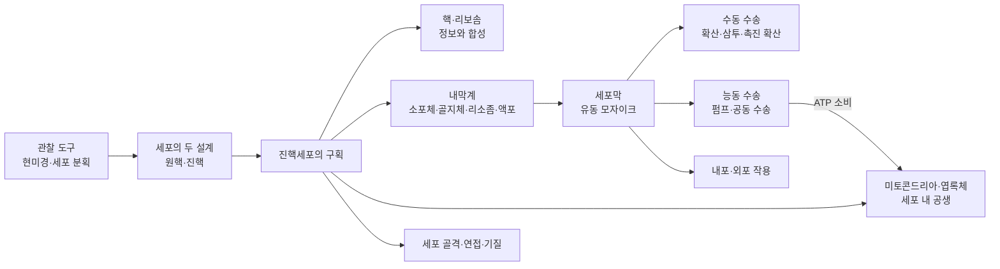
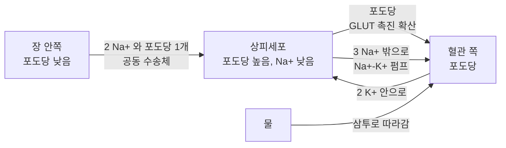

# 일반생명과학 2. 세포의 구조와 막 수송 — 막으로 나눈 공간, 막을 건너는 물질
<!-- prev: cell-1, 3-5, ubio-1 -->
<!-- next: ubio-3, ubio-4, ubio-10 -->

> [!NOTE]
> **이 단원의 범위**
> - 현미경(분해능)과 세포 분획법, 원핵세포와 진핵세포
> - 핵과 리보솜, 내막계(소포체·골지체·리소좀·액포), 미토콘드리아와 엽록체(세포 내 공생설)
> - 세포 골격, 세포 연접, 세포 외 기질
> - 막의 구조(유동 모자이크 모형)와 선택적 투과성
> - 수동 수송(확산, 삼투, 촉진 확산), 능동 수송과 공동 수송, 내포 작용과 외포 작용

**학습 목표**

1. 현미경의 분해능을 파장과 개구수로 설명하고, 세포 분획법으로 소기관을 분리하는 원리와 결과를 해석할 수 있다.
2. 원핵세포와 진핵세포의 구조를 비교하고, 세포 크기의 한계를 표면적 대 부피 비와 확산 시간으로 정량적으로 설명할 수 있다.
3. 핵·리보솜·내막계·미토콘드리아·엽록체·세포 골격·세포 연접·세포 외 기질의 구조와 기능을 단백질의 흐름과 세포 사이의 협력으로 연결하고, 세포 내 공생설의 증거를 평가할 수 있다.
4. 유동 모자이크 모형과 막 유동성에 영향을 주는 요인을 설명하고, 분자의 크기·극성·전하로 막 투과성을 예측할 수 있다.
5. 확산·삼투(수분 퍼텐셜)·촉진 확산·능동 수송·공동 수송·내포·외포 작용을 에너지와 농도 기울기의 관점에서 구분하고, 전기 화학적 기울기를 이용해 수송의 방향과 에너지를 계산할 수 있다.

**이 단원의 학습 사다리**

| 단계 | 무엇을 하나? |
|---|---|
| STEP 1. 이전 학습 다시 보기 | 통합과학의 확산·삼투, 「세포」의 소기관과 막 수송, 「생명의 화학」의 소수성 효과를 꺼낸다 |
| STEP 2. 기초 다지기 | 크기 단위와 분해능, 표면적 대 부피 비, 확산 시간의 어림, 삼투 농도 |
| STEP 3. 핵심 개념 | 현미경과 분획 → 원핵·진핵세포 → 핵과 리보솜 → 내막계 → 미토콘드리아·엽록체 → 세포 골격 → 연접과 기질 → 막 구조 → 수동 수송 → 능동·공동 수송 → 내포·외포 작용 |
| STEP 4. 오개념 바로잡기 | "삼투에서 용질이 움직인다?", "등삼투 용액이면 언제나 등장액?" |
| STEP 5. 다음 단계로 한 걸음 더 | 휴지 막전위와 골드먼 식, 소낭 수송의 분자 기계 |
| STEP 6. 생활·산업·진로 | 경구 수액, 리소좀 축적 질환, 초고해상도 현미경, 막 분리 기술 |

---

## 🗺️ 단원 들어가기

설사로 탈수된 아이에게 맹물을 먹이면 오히려 상태가 나빠질 수 있다. 그런데 물 1 L에 소금과 **포도당**을 정해진 비율로 섞어 먹이면 장이 물을 빠르게 흡수한다. 세계 보건 기구가 보급한 이 '경구 수액'은 20세기 의학의 가장 값싸고 효과적인 발명으로 꼽히며, 수많은 생명을 구했다. 왜 포도당이 있어야 물이 잘 흡수될까?

답은 소장 상피세포의 막에 박힌 단백질 하나에 있다. 이 단백질은 나트륨 이온 2개가 세포 안으로 쏟아져 들어가려는 힘을 빌려 포도당 1분자를 함께 끌고 들어온다. 용질이 들어가면 물이 삼투로 따라간다. 그리고 나트륨 이온이 쏟아져 들어가려는 그 힘은 세포 반대편의 또 다른 단백질이 ATP를 써서 끊임없이 만들어 둔 것이다.

이 단원에서는 세포를 **막으로 구획된 공간**으로 본다. 막은 각 구획에 다른 화학 환경을 만들고, 막에 박힌 단백질은 물질을 골라 옮긴다. 고등학교에서 소기관의 이름과 수송 방식의 종류를 익혔다면, 이제는 **"얼마나 빨리, 어느 방향으로, 에너지는 얼마나"** 를 계산해 볼 것이다.

---

## STEP 1. 🔙 이전 학습 다시 보기

### 연계표

| 이전 단원 | 고등학교에서는 여기까지 | 대학에서는 이렇게 확장 |
|---|---|---|
| 통합과학1 「생명 시스템과 물질대사」 | 세포막은 인지질과 단백질로 되어 있고 선택적 투과성이 있다. 확산·삼투·능동 수송(간단히) | 확산 속도와 거리의 관계($t \propto x^2$), 삼투압과 **수분 퍼텐셜**의 계산, 전기 화학적 기울기 |
| 진로 선택 「세포와 물질대사」 '세포' | 소기관의 구조와 기능, 분비 단백질의 경로, 원핵·진핵세포 비교, 유동 모자이크 모형, 수송 방식의 표 | 분해능 공식과 원심력의 크기, 내막계의 **방향성**(cis/trans, 엔도솜 경로), 세포 내 공생설의 증거, 세포 골격·연접·기질, 공동 수송의 에너지 계산 |
| 진로 선택 「세포와 물질대사」 '세포호흡과 광합성' | 미토콘드리아와 엽록체의 막 구조 | 두 소기관의 **기원**(세포 내 공생)과 막 사이의 단백질 수송 |
| 일반생명과학 「생명의 화학」 | 인지질의 양친매성, 소수성 효과, 단백질의 막 관통 부위 | 막의 유동성(지방산의 포화도·콜레스테롤), 막 단백질의 배치와 비대칭성 |

### 준비 운동 (사전 진단)

**Q1.** 다음 물질을 인지질 이중층을 쉽게 통과하는 순서로 나열하시오.
ㄱ. $\mathrm{O_2}$ ㄴ. 포도당 ㄷ. $\mathrm{Na^+}$ ㄹ. 물

**Q2.** 적혈구를 증류수에 넣으면 어떻게 되며, 그 이유는?

**Q3.** 단백질 분비가 활발한 세포에서 특히 발달한 소기관 두 가지를 쓰시오.

**Q4.** 한 변이 1 cm인 정육면체와 2 cm인 정육면체의 (표면적/부피) 비를 각각 구하시오.

정답 및 해설

**Q1.** ㄱ > ㄹ > ㄴ > ㄷ — 작은 비극성 분자 > 작은 극성 분자 > 큰 극성 분자 > 이온. 물은 극성이지만 매우 작아 일부 통과하고, 아쿠아포린이 있으면 훨씬 빠르다.

**Q2.** 물이 삼투로 세포 안으로 들어와 부풀다가 터진다(용혈). 세포 안의 용질 농도가 더 높고 동물세포에는 세포벽이 없기 때문이다.

**Q3.** 거친면 소포체, 골지체(이 밖에 에너지를 공급하는 미토콘드리아).

**Q4.** 1 cm: $6/1 = 6\ \mathrm{cm^{-1}}$, 2 cm: $24/8 = 3\ \mathrm{cm^{-1}}$. 한 변이 $L$이면 비는 $6/L$로, 크기가 커질수록 작아진다.

---

## STEP 2. 🧱 기초 다지기

### ① 크기의 사다리와 분해능

| 대상 | 크기(약) | 볼 수 있는 도구 |
|---|---|---|
| 개구리 알, 사람 난자 | 0.1~1 mm(난자 약 0.1 mm) | 맨눈(한계 약 0.1 mm) |
| 대부분의 동식물 세포 | 10~100 µm | 광학 현미경 |
| 세균, 미토콘드리아 | 1~5 µm | 광학 현미경 |
| 바이러스, 리보솜 | 20~300 nm, 약 25 nm | 전자 현미경 |
| 단백질, 막의 두께 | 2~10 nm, 약 5~10 nm | 전자 현미경, 결정학 |
| 원자 | 약 0.1 nm | X선 결정학 |

**배율**은 상이 얼마나 커졌는지, **분해능**(resolution)은 가까이 있는 두 점을 두 점으로 구별할 수 있는 최소 거리이다. 해상도가 따라 주지 않으면 배율을 아무리 높여도 흐릿한 상이 커질 뿐이다. 빛의 회절 때문에 광학 현미경의 분해능은 대략

$$
d \approx \frac{0.61\,\lambda}{\mathrm{NA}}
$$

로 제한된다. $\lambda$는 빛의 파장, NA(개구수)는 대물렌즈가 빛을 모으는 능력으로 공기 중 렌즈는 1보다 작고, 기름을 쓰는 렌즈는 약 1.4까지 커진다. 녹색광($\lambda = 550$ nm)과 NA 1.4의 기름 렌즈를 쓰면 $d \approx 0.61 \times 550 / 1.4 \approx 240$ nm, 즉 약 **0.2 µm**이다. 전자의 파장은 이보다 수십만 배 짧아 전자 현미경은 이론상 원자 수준까지 분해할 수 있다(생물 시료는 실제로 약 1~2 nm).

### ② 표면적 대 부피 비

반지름 $r$인 구의 표면적은 $4\pi r^2$, 부피는 $\frac{4}{3}\pi r^3$이므로

$$
\frac{\text{표면적}}{\text{부피}} = \frac{3}{r}
$$

이다. 지름 1 µm인 세균은 $6\ \mathrm{\mu m^{-1}}$, 지름 10 µm인 세포는 $0.6\ \mathrm{\mu m^{-1}}$, 100 µm인 세포는 $0.06\ \mathrm{\mu m^{-1}}$이다. 세포가 커지면 물질을 들이고 내보낼 막(표면적)이 소비하는 부피에 비해 부족해진다. 소장의 미세 융털, 미토콘드리아의 크리스타, 신경 세포의 가늘고 긴 돌기는 모두 이 비를 키우는 설계이다.

### ③ 확산 시간의 어림 — 거리의 제곱에 비례한다

분자가 무작위로 움직여 평균적으로 거리 $x$만큼 퍼지는 데 걸리는 시간은 대략

$$
t \approx \frac{x^2}{2D}
$$

이다. $D$는 **확산 계수**로, 물속의 작은 분자(포도당, 산소 등)는 약 $10^{-9}\ \mathrm{m^2/s}$이다.

| 거리 $x$ | 확산 시간(어림) | 의미 |
|---|---|---|
| 1 µm(세균 크기) | 약 0.5 ms | 세균 안은 확산만으로 충분 |
| 10 µm(동물세포 크기) | 약 0.05 s | 세포 하나도 확산으로 충분 |
| 100 µm | 약 5 s | 큰 세포는 세포 골격 수송이 필요해지기 시작 |
| 1 mm | 약 8분(500 s) | 몸속 조직에는 혈관이 필요 |
| 1 cm | 약 14시간 | 확산만으로는 생명 유지 불가 |

거리가 10배 늘면 시간은 **100배** 늘어난다. 세포 크기가 대략 1~100 µm로 제한되고, 다세포 생물이 순환계를 진화시킨 이유가 이 식에 담겨 있다.

### ④ 삼투 농도

삼투는 **용질 입자의 개수**에 따라 정해진다. 1 M 포도당은 입자 1 M, 1 M NaCl은 $\mathrm{Na^+}$와 $\mathrm{Cl^-}$로 나뉘어 이상적으로 2 M의 입자를 만든다. 입자의 총 몰 농도를 **삼투 농도**(osmolarity, 단위 osmol/L 또는 Osm)라 한다. 사람 체액의 삼투 농도는 약 0.29~0.30 Osm(290~300 mOsm)이다.

삼투압은 묽은 용액에서 기체 상태 방정식과 같은 꼴을 따른다(반트호프 식).

$$
\pi = iCRT
$$

$i$는 용질 1개가 만드는 입자 수, $C$는 몰 농도, $R = 8.314\ \mathrm{J/(mol\cdot K)}$, $T$는 절대 온도이다. 체액(0.30 Osm, 310 K)의 삼투압은 $300\ \mathrm{mol/m^3} \times 8.314 \times 310 \approx 7.7\times10^5\ \mathrm{Pa}$, 약 **7.6기압**이다. 세포막 양쪽의 삼투 농도가 조금만 달라도 큰 압력 차가 생길 수 있다는 뜻이다.

---

## STEP 3. 📘 핵심 개념

### ① 세포를 연구하는 도구 — 현미경과 세포 분획

#### (1) 현미경의 종류

| 현미경 | 원리 | 분해능(약) | 강점과 한계 |
|---|---|---|---|
| **명시야 광학 현미경** | 가시광선이 시료를 투과 | 0.2 µm | 살아 있는 세포 관찰, 대비가 약해 염색이 필요할 때가 많다 |
| 위상차·미분 간섭 현미경 | 굴절률 차이를 밝기 차이로 바꿈 | 0.2 µm | 염색 없이 살아 있는 세포의 윤곽과 움직임 |
| **형광 현미경** | 특정 분자에 붙인 형광 물질(형광 단백질, 형광 항체)이 내는 빛 | 0.2 µm | 원하는 분자만 골라 위치 추적 |
| **공초점 현미경** | 레이저와 바늘구멍으로 초점면 밖의 빛을 차단 | 0.2 µm(깊이 방향 개선) | 두꺼운 시료의 광학 단면, 3차원 재구성 |
| **초고해상도 형광 현미경** | 형광 분자를 하나씩 켜고 끄거나 들뜸 영역을 좁혀 회절 한계를 우회 | 약 20~50 nm | 단백질 분포를 나노 수준으로(2014년 노벨 화학상) |
| **투과 전자 현미경**(TEM) | 전자선이 매우 얇은 절편을 투과, 중금속 염색 | 약 1~2 nm(생물 시료) | 소기관의 내부 구조, 시료는 죽은 상태 |
| **주사 전자 현미경**(SEM) | 표면에서 튀어나온 전자를 검출 | 약 수 nm | 입체적인 표면 |
| **극저온 전자 현미경**(cryo-EM) | 급속 냉동한 시료를 염색 없이 관찰, 수많은 영상 평균 | 단백질 복합체에서 원자 수준에 근접 | 막 단백질·큰 복합체의 구조(2017년 노벨 화학상) |

#### (2) 세포 분획법

**세포 분획**(cell fractionation)은 세포를 깨뜨린 균질액을 원심 분리해 소기관을 크기·밀도에 따라 나누는 방법이다. 원심 분리기의 효과는 중력의 몇 배인지(**상대 원심력**, RCF, 단위 ×g)로 나타낸다.

$$
\mathrm{RCF} = \frac{\omega^2 r}{g} \approx 1.118\times10^{-5} \times r(\mathrm{cm}) \times (\mathrm{rpm})^2
$$

| 단계(차등 원심 분리) | 조건(대략) | 침전물에 모이는 것 |
|---|---|---|
| 1 | 약 600 ×g, 10분 | 핵, 깨지지 않은 세포 |
| 2 | 약 15 000 ×g, 5~10분 | 미토콘드리아, 엽록체, 리소좀, 퍼옥시좀 |
| 3 | 약 100 000 ×g, 1시간 | 소포체·골지체·세포막 조각(마이크로솜) |
| 4 | 약 300 000 ×g, 2시간 | 리보솜 |
| 상층액 | — | 세포질 용액(사이토졸)의 수용성 단백질 |

차등 원심 분리 뒤에는 설탕의 밀도 기울기 속에서 소기관을 밀도대로 다시 나누어 순도를 높인다. 분획마다 표지 효소(예: 미토콘드리아의 시트르산 회로 효소, 리소좀의 산성 가수 분해 효소)의 활성을 재서 어떤 소기관이 모였는지 확인한다. **현미경이 '어디에 무엇이 있는지'를 보여 준다면, 분획은 '그것이 무엇을 하는지'를 생화학적으로 알려 준다.**

#### 예제 1 — 원심력의 크기

회전 반지름 10 cm인 원심 분리기를 (1) 1000 rpm (2) 10 000 rpm으로 돌릴 때 상대 원심력을 구하고, 각각 위 표의 어느 단계에 가까운지 쓰시오.

**풀이**
식: $\mathrm{RCF} \approx 1.118\times10^{-5} \times r \times (\mathrm{rpm})^2$.
(1) $1.118\times10^{-5} \times 10 \times (1000)^2 = 112$ ×g → 핵을 가라앉히기에도 약간 부족하다(시간을 늘리거나 회전을 올려야 함).
(2) $1.118\times10^{-5} \times 10 \times (10\,000)^2 = 1.12\times10^{4}$ ×g → 2단계(미토콘드리아 침전)에 가깝다.
의미: 회전 속도를 10배 올리면 원심력은 **100배**가 된다. 리보솜처럼 작은 입자를 가라앉히려면 진공 속에서 수만 rpm으로 도는 초원심 분리기가 필요하다.

---

### ② 원핵세포와 진핵세포

모든 세포는 **세포막, 세포질(사이토졸), 리보솜, DNA**를 가진다. 차이는 내부를 막으로 나누었느냐에 있다.

| 비교 | 원핵세포(세균·고세균) | 진핵세포(원생생물·균류·식물·동물) |
|---|---|---|
| 크기(약) | 1~5 µm | 10~100 µm |
| DNA | 핵막 없이 **핵양체**, 대개 고리 모양 염색체 1개 + 플라스미드 | **핵막**에 싸인 핵, 히스톤과 결합한 선형 염색체 여러 개 |
| 막성 소기관 | 없다 | 내막계, 미토콘드리아, (엽록체) |
| 리보솜 | 70S(50S + 30S) | 세포질은 80S(60S + 40S), 미토콘드리아·엽록체 속은 70S와 비슷 |
| 세포벽 | 세균은 펩티도글리칸(고세균은 다른 성분) | 식물은 셀룰로스, 균류는 키틴, 동물은 없음 |
| 운동 기관 | 세균 편모(회전하는 단백질 모터, 미세 소관 없음) | 섬모·편모(미세 소관 9 + 2 배열, 휘는 운동) |
| 세포 골격 | 액틴·튜불린과 비슷한 단백질이 있음 | 미세 섬유·미세 소관·중간 섬유가 발달 |

진핵세포가 원핵세포보다 훨씬 클 수 있었던 이유를 STEP 2로 풀면 다음과 같다. 크기가 커져 표면적 대 부피 비가 작아지는 문제는 **내부 막**으로 해결했다. 막이 세포 안으로 접혀 들어가 소기관이 되자 반응 표면적이 늘어났고, 서로 섞이면 안 되는 반응(리소좀의 산성 소화와 사이토졸의 중성 대사)을 따로 진행할 수 있게 되었다. 확산 거리가 길어지는 문제는 **세포 골격 위의 모터 단백질**이 소낭을 실어 나르는 방식으로 해결했다.

> [!TIP]
> 💡 **비유** — 원핵세포는 칸막이 없는 원룸 작업장, 진핵세포는 부서마다 방을 나누고 복도에 컨베이어를 깐 공장이다. 원룸은 작고 빠르지만 커지기 어렵다. 공장은 짓고 유지하는 비용이 크지만, 크고 복잡한 일을 나누어 할 수 있다.

---

### ③ 핵과 리보솜 — 정보 보관소와 조립 공장

#### (1) 핵

| 구조 | 특징 | 기능 |
|---|---|---|
| **핵막** | 2중막. 바깥 막은 거친면 소포체와 이어져 있다 | 유전 물질과 세포질을 분리 |
| **핵공 복합체** | 핵막을 관통하는 거대한 단백질 통로(핵공 하나에 단백질 수백 개) | 작은 분자는 자유롭게, 큰 단백질과 RNA는 '주소표'가 있을 때만 선택적으로 통과 |
| **핵 라미나** | 핵막 안쪽을 받치는 중간 섬유(라민)의 그물 | 핵의 모양 유지, 염색질 배치 |
| **염색질** | DNA + 히스톤 등 단백질. 분열할 때 응축해 염색체가 됨 | 유전 정보 저장, 전사 |
| **인**(핵소체) | 막이 없는 진한 부분 | rRNA 합성, 리보솜 소단위 조립 |

핵공이 '선택적'이라는 것은 한 실험으로 드러난다. 핵에서 일하는 단백질(예: DNA 중합 효소)에는 염기성 아미노산이 몰린 짧은 서열(**핵 위치 신호**)이 있다. 이 서열을 원래 핵에 들어가지 않는 단백질에 붙이면 그 단백질도 핵으로 들어간다. 반대로 이 서열을 지우면 핵 단백질이 세포질에 머문다.

#### (2) 리보솜

리보솜은 rRNA와 단백질로 된 큰 소단위와 작은 소단위로 이루어진 **막 없는** 입자이다. 같은 리보솜이 어디에 있느냐에 따라 만든 단백질의 목적지가 달라진다.

| 위치 | 만드는 단백질 | 예 |
|---|---|---|
| **유리 리보솜**(사이토졸) | 사이토졸에서 일하거나 핵·미토콘드리아·엽록체·퍼옥시좀으로 갈 단백질 | 해당 과정 효소 |
| **부착 리보솜**(소포체 표면) | 분비 단백질, 막 단백질, 내막계 안에서 일할 단백질 | 인슐린, 항체, 리소좀 효소 |

리보솜은 처음엔 모두 사이토졸에서 번역을 시작한다. 새로 만들어지는 사슬의 앞부분에 소포체로 가라는 신호 서열이 있으면, 번역 도중 리보솜 전체가 소포체 막에 붙는다. 리보솜이 소포체에 '붙어 있는' 상태는 고정된 것이 아니라 만드는 단백질에 따라 정해진다(자세한 과정은 「유전의 분자적 기초」).

---

### ④ 내막계 — 막으로 이어진 생산·배송 체계

**내막계**(endomembrane system)는 핵막, 소포체, 골지체, 리소좀, 액포, 각종 소낭, 세포막으로 이루어진다. 이들은 직접 이어져 있거나 **소낭**이 떨어져 나가 다른 막과 융합하는 방식으로 막과 내용물을 주고받는다. 미토콘드리아, 엽록체, 퍼옥시좀은 이 체계에 속하지 않는다.

#### (1) 소포체

| 구분 | 구조 | 기능 |
|---|---|---|
| **거친면 소포체** | 리보솜이 붙은 납작한 주머니(시스터나) | 분비·막 단백질의 합성과 접힘, **당 사슬 첨가**(당단백질), 이황화 결합 형성, 막 인지질 합성, 잘못 접힌 단백질의 품질 관리 |
| **매끈면 소포체** | 리보솜 없는 관 모양 그물 | 지질·스테로이드 합성(성호르몬을 만드는 세포에 발달), 간세포에서 약물·독소의 해독(물에 녹기 쉽게 변형), 근육 세포에서 $\mathrm{Ca^{2+}}$ 저장과 방출, 간에서 글리코젠 분해 산물의 처리 |

간세포에 진정제 같은 약물을 반복 투여하면 매끈면 소포체와 해독 효소가 늘어난다. 그 결과 약물이 더 빨리 분해되어 같은 효과를 내려면 더 많은 양이 필요해진다(**약물 내성**의 한 원인).

#### (2) 골지체 — 방향이 있는 물류 센터

골지체는 납작한 주머니가 쌓인 구조로, 소포체에 가까운 **시스면**(받는 쪽)과 세포막 쪽의 **트랜스면**(내보내는 쪽)이 구별된다.

1. 소포체에서 떨어져 나온 수송 소낭이 시스면에 융합한다.
2. 단백질은 시스 → 트랜스 방향으로 이동하며 당 사슬이 다듬어지고(일부 당 제거·추가), 인산기나 황산기가 붙는 등 변형된다. 식물에서는 세포벽의 다당류(펙틴 등)도 여기서 만든다.
3. 트랜스면에서 목적지별로 **분류**되어 소낭에 담긴다. 목적지는 분자 '주소표'가 정한다. 예를 들어 리소좀으로 갈 효소에는 골지체에서 **만노스-6-인산** 표지가 붙고, 이 표지를 알아보는 수용체가 그 효소를 리소좀행 소낭에 모은다.

> [!TIP]
> 💡 **비유** — 소포체는 '제조 공장', 골지체는 '포장·분류 센터', 당 사슬과 인산 표지는 '송장'이다. 송장이 잘못 붙으면 물건이 엉뚱한 곳으로 간다. 실제로 만노스-6-인산 표지를 붙이는 효소에 이상이 생기면 리소좀 효소들이 세포 밖으로 분비되어 버려 리소좀이 텅 비는 유전 질환이 생긴다.

<!-- fig:ubio-2-endo -->

#### (3) 리소좀 — 세포 속 소화 기관

리소좀은 약 50종의 **산성 가수 분해 효소**를 담은 단일막 주머니이다. 막의 양성자 펌프가 ATP를 써서 $\mathrm{H^+}$을 퍼 넣어 내부를 pH 약 4.5~5로 유지한다. 효소들은 이 산성에서 가장 잘 작동하므로, 리소좀이 터져 효소가 중성의 사이토졸(pH 약 7.2)로 새어 나와도 활성이 크게 떨어진다. **구획화가 만든 안전장치**이다.

| 리소좀이 하는 일 | 내용 |
|---|---|
| 식세포 작용으로 삼킨 물질의 소화 | 아메바의 먹이, 대식세포가 삼킨 세균 |
| **자가 포식**(autophagy) | 낡은 소기관이나 사이토졸 일부를 막으로 감싸 리소좀과 융합해 분해·재활용(2016년 노벨 생리의학상) |
| 엔도솜 경로의 종착점 | 수용체 매개 내포 작용으로 들어온 물질의 분해 |

리소좀 효소 하나가 유전적으로 결핍되면 분해되지 못한 물질이 쌓이는 **리소좀 축적 질환**이 생긴다. 예를 들어 테이–삭스병은 특정 지질을 분해하는 효소가 없어 뇌세포에 지질이 쌓인다.

#### (4) 액포

| 종류 | 생물 | 기능 |
|---|---|---|
| **중심 액포** | 성숙한 식물세포(세포 부피의 최대 약 80% 이상) | 물과 이온 저장, **팽압** 유지, 색소(꽃잎의 안토사이아닌), 방어 물질, 리소좀과 비슷한 분해 |
| 식포 | 아메바 등 | 식세포 작용으로 삼킨 먹이를 담음 |
| **수축포** | 민물 원생생물(짚신벌레 등) | 삼투로 들어온 물을 퍼내 세포가 터지지 않게 함 |

식물세포는 값비싼 세포질을 늘리지 않고 값싼 물로 액포를 채워 세포를 크게 키운다. 표면적 대 부피 비 문제도 줄어든다. 세포질은 액포와 세포막 사이의 얇은 층에 있어 바깥과의 거리가 짧기 때문이다.

#### (5) 퍼옥시좀 — 내막계 밖의 산화 공장

퍼옥시좀은 단일막 소기관이지만 소포체에서 일부 막을 받고 단백질은 사이토졸에서 직접 들여오므로 보통 내막계에 넣지 않는다. 여러 기질에서 수소를 떼어 산소에 넘기는 산화 반응으로 **과산화 수소**($\mathrm{H_2O_2}$)를 만들고, 카탈레이스로 곧바로 물과 산소로 분해한다. 매우 긴 지방산의 분해, 간에서 알코올 해독, 식물에서는 광호흡(「물질대사·세포호흡·광합성」)에 관여한다.

#### 예제 2 — 펄스–추적 실험 해석

분비 세포에 방사성 아미노산을 5분간 공급(펄스)한 뒤 비방사성 아미노산으로 바꾸고(추적), 전자 현미경 자기 방사법으로 방사능의 위치를 조사했다. 이어 같은 실험을 약물 X를 처리한 세포에서 반복했더니 방사능이 시간이 지나도 소포체에만 머물렀고 골지체에는 나타나지 않았다. (1) 정상 세포에서 예상되는 방사능의 이동 순서를 쓰시오. (2) 약물 X가 막는 단계를 추론하시오. (3) 이 실험만으로 X가 '단백질 합성'을 막는다고 결론 내릴 수 없는 이유를 쓰시오.

**풀이**
(1) 거친면 소포체 → (수송 소낭) → 골지체 시스면 → 트랜스면 → 분비 소낭 → 세포 밖.
(2) 방사능이 소포체에 나타났으므로 합성과 소포체 진입은 정상이다. 골지체로 가지 못했으므로 **소포체에서 골지체로 가는 수송 소낭의 형성 또는 융합** 단계를 막는다.
(3) 방사능이 소포체에 '나타났다'는 것 자체가 표지된 아미노산이 단백질로 합성되었다는 증거이다. 합성을 막았다면 방사능이 소포체에도 거의 나타나지 않았을 것이다.

---

### ⑤ 미토콘드리아와 엽록체 — 세포 안의 옛 세균

#### (1) 구조와 기능 요약

| 소기관 | 막 구조 | 내부 | 기능 |
|---|---|---|---|
| **미토콘드리아** | 외막 + 크리스타로 접힌 내막(막 사이 공간) | 기질: DNA, 70S형 리보솜, 시트르산 회로 효소 | 세포호흡으로 ATP 생산, 세포 자살 조절, $\mathrm{Ca^{2+}}$ 저장 |
| **엽록체**(색소체의 한 종류) | 외막 + 내막, 내부의 틸라코이드 막(그라나) | 스트로마: DNA, 70S형 리보솜, 캘빈 회로 효소 | 광합성 |

두 소기관은 내막계와 소낭을 주고받지 않는다. 대부분의 단백질은 핵 유전자로부터 사이토졸의 유리 리보솜에서 만들어진 뒤, 막의 단백질 수송 통로를 지나 들어온다. 두 소기관 자체의 DNA는 소수의 단백질(전자 전달계 일부 등)과 rRNA·tRNA만 암호화한다. 사람 미토콘드리아 DNA는 약 16 500 bp의 고리 모양이다.

#### (2) 세포 내 공생설

**세포 내 공생설**(endosymbiont theory)에 따르면, 고세균과 가까운 조상 세포가 산소 호흡을 하는 세균(α-프로테오박테리아 무리)을 삼키고 소화하지 않은 채 공생한 것이 미토콘드리아가 되었다. 그 뒤 일부 계통이 광합성 세균(남세균)을 다시 받아들여 엽록체를 얻었다.

| 증거 | 내용 | 무엇을 지지하나 |
|---|---|---|
| 2중막 | 안쪽 막은 삼켜진 세균의 막, 바깥 막은 삼킨 세포의 막에서 유래했다고 보면 설명된다. 내막에는 세균 막에 흔한 인지질(카디오리핀)이 많다 | 삼킴(식세포 작용)의 흔적 |
| 고리 모양 DNA | 히스톤이 거의 없는 고리 모양 DNA를 가진다 | 원핵세포와의 유사성 |
| 리보솜 | 70S형으로 세균과 비슷하고, 세균 리보솜을 막는 일부 항생제(클로람페니콜 등)에 민감하다 | 원핵세포와의 유사성 |
| 분열 | 세포 주기와 별도로 이분법과 비슷하게 분열하여 수가 늘어난다. 새로 만들 수는 없고 기존 것이 분열해야만 생긴다 | 독립 생물이었던 흔적 |
| 유전자 서열 | rRNA 서열을 비교한 계통수에서 미토콘드리아는 α-프로테오박테리아, 엽록체는 남세균의 가지 안에 들어간다 | 기원 계통의 직접 증거 |
| 막 단백질 | 내막의 수송 단백질과 전자 전달 효소가 세균의 것과 닮았다 | 원핵세포와의 유사성 |

공생 이후 원래 세균이 가졌던 유전자 대부분은 숙주의 핵으로 옮겨 갔다. 그래서 오늘날 미토콘드리아와 엽록체는 스스로 살 수 없고, 핵 유전자의 산물에 의존한다. 갈조류·규조류처럼 엽록체가 막을 3~4겹 가진 생물은, 엽록체를 가진 진핵 조류를 다시 삼킨 **2차 공생**의 결과로 해석된다(「생물 다양성」).

> [!IMPORTANT]
> 세포 내 공생설은 "미토콘드리아가 세균처럼 생겼다"는 겉모습만으로 받아들여진 것이 아니다. 독립적인 여러 종류의 증거(막, DNA, 리보솜, 분열, 서열 계통)가 **모두 같은 결론**을 가리키기 때문에 이론이 되었다. 증거의 수렴이 강한 과학 이론의 특징이다.

---

### ⑥ 세포 골격 — 세포의 뼈대, 레일, 근육

**세포 골격**(cytoskeleton)은 사이토졸 전체에 퍼진 단백질 섬유의 그물이다. 세 종류가 굵기와 단위체, 역할로 구별된다.

| 구분 | **미세 소관** | **미세 섬유**(액틴 필라멘트) | **중간 섬유** |
|---|---|---|---|
| 지름(약) | 25 nm(속이 빈 관) | 7 nm | 8~12 nm |
| 단위체 | α·β-튜불린 이량체 | 액틴 | 종류가 다양(케라틴, 비멘틴, 라민 등) |
| 방향성과 역동성 | +끝·−끝이 있고 빠르게 길어지고 짧아짐 | +끝·−끝이 있고 빠르게 조립·분해 | 방향성 없음, 비교적 안정 |
| 함께 일하는 모터 | **키네신**(대개 +끝 방향), **다인에인**(−끝 방향) | **마이오신** | 없음 |
| 대표 기능 | 소낭·소기관 수송의 레일, 방추사로 염색체 분리, 섬모·편모의 운동 | 세포 모양(세포 피질), 미세 융털의 심, 근육 수축, 아메바 운동, 원형질 유동, 세포질 분열의 수축 고리 | 장력에 버팀(세포 모양 유지), 핵 라미나, 데스모솜과 연결 |
| 시작점 | 중심체(동물세포에서는 중심립 한 쌍을 포함) | 세포막 근처 | — |

**섬모와 편모** 진핵세포의 섬모·편모는 미세 소관이 바깥에 9쌍, 가운데 2개로 배열된 **9 + 2 구조**이다. 이웃한 미세 소관 쌍 사이의 다인에인 '팔'이 ATP를 써서 한쪽 쌍을 밀어 올리는데, 쌍들이 서로 묶여 있어 미끄러지는 대신 **휘어진다**. 기관지 상피의 섬모가 점액을 밀어 올리고, 정자가 편모를 흔들어 헤엄치는 원리이다. 다인에인에 이상이 있는 유전 질환에서는 호흡기 감염이 잦고 정자의 운동성이 떨어진다.

#### 예제 3 — 소낭 수송 속도

신경 세포의 세포체에서 만든 소낭을 키네신이 미세 소관을 따라 약 1 µm/s로 실어 나른다. (1) 길이 1 m인 사람의 좌골 신경 축삭 끝까지 가는 데 걸리는 시간 (2) 같은 거리를 확산($D = 10^{-12}\ \mathrm{m^2/s}$, 소낭처럼 큰 입자의 사이토졸 속 값으로 가정)으로 가는 데 걸리는 시간을 어림하시오.

**풀이**
(1) $t = 1\ \mathrm{m} / (1\times10^{-6}\ \mathrm{m/s}) = 10^6\ \mathrm{s} \approx 11.6$일, 약 12일.
(2) $t \approx x^2/(2D) = 1^2 / (2\times10^{-12}) = 5\times10^{11}\ \mathrm{s}$, 약 1만 6천 년.
의미: 모터 단백질의 능동 수송이 없다면 긴 신경 세포는 존재할 수 없다. 확산은 짧은 거리에서만 빠르고, 거리가 길어지면 제곱으로 느려진다(STEP 2 ③).

---

### ⑦ 세포 연접과 세포 외 기질 — 세포가 모여 조직이 되는 방법

#### (1) 동물의 세포 외 기질(ECM)

동물세포는 스스로 분비한 단백질과 다당류의 그물, **세포 외 기질**(extracellular matrix)에 싸여 있다.

| 성분 | 성질 | 역할 |
|---|---|---|
| **콜라겐** | 세 가닥 나선의 섬유. 사람 몸 단백질의 약 4분의 1 | 인장 강도(힘줄, 피부, 뼈의 바탕) |
| **프로테오글리칸** | 작은 핵심 단백질에 많은 당 사슬이 붙어 물을 붙잡는 젤 | 압력에 버팀(연골), 콜라겐 섬유 사이를 채움 |
| **파이브로넥틴** 등 | 기질 단백질과 세포막 수용체를 잇는 접착 단백질 | 세포를 기질에 붙임, 세포 이동의 길잡이 |
| **인테그린** | 세포막 관통 수용체. 바깥은 파이브로넥틴, 안은 액틴 미세 섬유와 연결 | 기질의 변화를 세포 안 신호로 전달, 세포 골격과 기질을 이음 |

인테그린을 통해 세포 바깥의 기질과 안쪽의 세포 골격, 나아가 핵까지 기계적으로 이어진다. 그래서 세포는 붙어 있는 바닥이 얼마나 단단한지를 '느끼고' 유전자 발현을 바꾸기도 한다. 대부분의 정상 세포는 기질에 붙지 못하면 분열하지 않거나 스스로 죽는데, 암세포는 이 제약에서 벗어나 떠돌아다니며 전이한다(「세포 신호 전달과 세포 주기」).

#### (2) 동물의 세포 연접

| 연접 | 구조 | 기능 | 예 |
|---|---|---|---|
| **밀착 연접** | 이웃 세포막을 막 단백질이 띠처럼 꿰매 붙임 | 세포 **사이**로 물질이 새지 않게 막음. 막 단백질이 위아래 면으로 섞이지 않게 함 | 장 상피, 뇌혈관의 혈액–뇌 장벽 |
| **데스모솜**(고정 연접) | 단추 모양의 판에 중간 섬유가 연결되고, 판 사이를 접착 단백질(카드헤린)이 이음 | 기계적 힘에 버티도록 세포를 단단히 고정 | 피부, 심장 근육 |
| **간극 연접** | 이웃 세포막의 통로 단백질(코넥신)이 마주 보며 지름 약 1.5 nm의 통로를 만듦 | 이온·작은 분자(당, 아미노산, cAMP)가 세포질에서 세포질로 직접 이동 | 심장 근육의 전기 신호 전달, 배아 세포 사이의 신호 |

밀착 연접 때문에 장의 영양소는 세포 '사이'가 아니라 세포 '안'을 지나 혈관으로 가야 한다. 그래서 세포의 윗면(장 안쪽)과 아랫면(혈관 쪽)에 서로 다른 수송 단백질을 배치할 수 있다. 이 배치가 ⑩의 포도당 흡수를 가능하게 한다.

#### (3) 식물의 세포벽과 원형질 연락사

| 구조 | 내용 |
|---|---|
| **1차 세포벽** | 셀룰로스 미세 섬유가 다른 다당류와 단백질의 바탕에 박힌 얇고 유연한 벽. 자라는 세포 |
| **중층** | 이웃 세포의 1차 세포벽 사이, **펙틴**이 많아 세포를 붙임(잼을 굳히는 그 펙틴) |
| **2차 세포벽** | 생장이 끝난 일부 세포가 1차 벽 안쪽에 더 쌓은 두꺼운 벽. 리그닌이 스며 단단함(목재) |
| **원형질 연락사** | 세포벽을 관통하는 통로. 이웃 세포의 세포막과 세포질이 이어짐 |

원형질 연락사는 물, 작은 용질, 일부 단백질과 RNA, 그리고 식물 바이러스까지 통과시킨다. 동물의 간극 연접과 기능이 비슷하지만, 막 자체가 이어진다는 점이 다르다.

---

### ⑧ 막의 구조 — 유동 모자이크 모형

#### (1) 모형이 만들어진 과정

| 시기 | 관찰·제안 | 남긴 것 |
|---|---|---|
| 1890년대 | 지질에 잘 녹는 물질일수록 세포막을 잘 통과한다 | 막은 지질로 되어 있다 |
| 1925년 | 적혈구 막에서 추출한 지질을 물 위에 펴면 세포 표면적의 약 2배 넓이가 된다 | 지질 **이중층** |
| 1935년 | 막의 표면 장력 등을 설명하려고 지질 이중층 양쪽을 단백질 층이 덮는 '샌드위치' 모형 제안 | 단백질도 막의 성분 |
| 1960년대 | 막 단백질 상당수가 소수성 부분을 가져 이중층 표면에만 있을 수 없음. 동결 할단(freeze-fracture) 전자 현미경에서 막 한가운데 단백질 알갱이가 보임 | 샌드위치 모형의 한계 |
| 1972년 | 싱어와 니컬슨의 **유동 모자이크 모형** | 단백질이 유동적인 지질 이중층에 박히거나 붙어 있다 |

#### (2) 막의 유동성

인지질은 막 평면에서 초당 수 µm 정도를 옆으로 이동할 만큼 빠르게 움직이지만(확산 계수 약 1 µm²/s), 한쪽 층에서 반대쪽 층으로 **뒤집히는 일(플립플롭)은 매우 드물다.** 그래서 막의 두 층은 지질 조성이 서로 다른 **비대칭** 상태를 유지할 수 있다. 막 단백질은 지질보다 느리게 움직이고, 상당수는 세포 골격에 묶여 거의 움직이지 않는다.

**유동성의 실험적 증거** — 1970년 프라이(Frye)와 에디딘(Edidin)은 생쥐 세포와 사람 세포의 막 단백질을 서로 다른 형광 항체로 표지한 뒤 두 세포를 융합하였다. 처음에는 두 색이 반반 나뉘어 있었지만 37 °C에서 약 40분 뒤 고르게 섞였다. 15 °C 이하에서는 거의 섞이지 않았다.

| 요인 | 유동성에 미치는 영향 | 이유 |
|---|---|---|
| 온도 하강 | 감소(어느 온도 아래에서는 젤 같은 고체 상태) | 분자 운동이 줄어든다 |
| **불포화 지방산** 비율 증가 | 증가 | 시스 이중 결합의 꺾임 때문에 꼬리가 빽빽이 쌓이지 못한다 |
| 포화 지방산·긴 사슬 비율 증가 | 감소 | 꼬리끼리 반데르발스 상호 작용이 커진다 |
| **콜레스테롤**(동물세포) | 높은 온도에서는 감소, 낮은 온도에서는 굳는 것을 방해 | 단단한 고리가 인지질 운동을 제한하면서도 인지질이 빽빽이 쌓이는 것을 막는다 → '유동성 완충제' |

추운 곳에 사는 식물이나 미생물, 겨울잠 자는 동물은 막의 불포화 지방산 비율을 높여 낮은 온도에서도 막이 굳지 않게 한다. 막이 너무 굳으면 수송 단백질과 효소가 작동하지 못하고, 너무 묽으면 새기 쉽다.

#### (3) 막 단백질과 당 사슬

| 구분 | 특징 | 예 |
|---|---|---|
| **내재성 막 단백질** | 이중층에 박혀 있음. 대부분 막을 관통하며, 막 속 부분은 소수성 아미노산의 α 나선 | 수송 단백질, 수용체, 인테그린 |
| **표재성 막 단백질** | 막 표면이나 내재성 단백질에 느슨하게 붙어 있음 | 세포 골격과 연결된 단백질 |

막 단백질의 여섯 가지 기능: **수송**, **효소 작용**, **신호 수용**, **세포 인식**(당단백질), **세포 간 결합**, **세포 골격·기질과의 연결**.

세포막 바깥쪽 면에는 단백질과 지질에 붙은 짧은 당 사슬이 있다. 당 사슬은 종·개체·세포 종류마다 달라 세포의 '이름표' 역할을 한다. ABO 혈액형은 적혈구 표면 당 사슬 끝의 당 하나 차이로 정해진다. 당 사슬은 소포체·골지체 안에서 붙여지므로, 소낭이 세포막과 융합하면 소기관의 '안쪽 면'이 세포막의 '바깥 면'이 된다. **막의 안팎 방향은 합성부터 세포막에 이르기까지 보존된다.**

> [!TIP]
> 💡 **비유** — 세포막은 단단한 벽이 아니라 **기름 바다 위의 빙산 군도**이다. 인지질은 출렁이는 바다, 단백질은 떠다니는 빙산, 세포 골격에 묶인 단백질은 닻을 내린 배이다. 바다 윗면과 아랫면의 물(두 층)은 거의 섞이지 않는다.

---

### ⑨ 선택적 투과성과 수동 수송

#### (1) 인지질 이중층의 투과성

| 분자 | 이중층 투과 | 이유 |
|---|---|---|
| 작은 비극성 분자($\mathrm{O_2}$, $\mathrm{CO_2}$, $\mathrm{N_2}$, 스테로이드) | 빠름 | 소수성 층에 녹아 지나간다 |
| 작은 극성 분자(물, 요소, 글리세롤) | 느림 | 크기가 작아 일부 지나가지만 소수성 층이 방해한다 |
| 큰 극성 분자(포도당, 아미노산) | 매우 느림 | 수송 단백질이 필요하다 |
| 이온($\mathrm{Na^+}$, $\mathrm{K^+}$, $\mathrm{Cl^-}$, $\mathrm{Ca^{2+}}$) | 거의 불가 | 전하와 수화 껍질 때문에 소수성 층에 들어가기가 극히 어렵다. 물보다 $10^9$배 이상 느리다고 알려져 있다 |

#### (2) 확산 — 기울기를 따라 내려가는 흐름

**확산**은 분자들의 무작위 운동의 결과로 농도가 높은 곳에서 낮은 곳으로 **알짜 이동**이 일어나는 현상이다. 개별 분자는 양쪽으로 다 움직이지만, 많은 쪽에서 출발하는 분자가 더 많으므로 알짜 흐름이 생긴다. 막을 가로지르는 확산 속도는 (픽의 법칙을 막에 적용하면)

$$
J = P\,(C_{\text{밖}} - C_{\text{안}})
$$

로 쓸 수 있다. $J$는 막 단위 면적당 수송 속도, $P$는 **투과 계수**(막의 성질과 분자의 크기·극성에 따라 정해짐)이다. 확산은 기울기가 0이 되면(**동적 평형**) 알짜 이동이 멈춘다. 에너지는 쓰지 않으므로 **수동 수송**이다.

#### (3) 삼투와 장성

**삼투**(osmosis)는 선택적 투과성 막을 사이에 두고 **물이** 용질 농도가 낮은 쪽(자유로운 물이 많은 쪽)에서 높은 쪽으로 이동하는 확산이다. 용질 분자 주위의 물 분자는 수화되어 자유롭게 움직이지 못하므로, 용질이 많은 쪽은 '자유로운 물'이 적다.

**장성**(tonicity)은 어떤 용액에 세포를 넣었을 때 세포가 물을 얻을지 잃을지를 나타내는 말로, **막을 통과하지 못하는 용질**의 농도로 정해진다.

| 바깥 용액 | 동물세포(적혈구) | 식물세포 |
|---|---|---|
| **저장액** | 물이 들어와 부풀다 터짐(용혈) | 팽압이 커져 단단해짐(정상적인 건강 상태) |
| **등장액** | 부피 유지(정상) | 팽압이 거의 없어 시듦 |
| **고장액** | 물을 잃고 쭈그러듦 | **원형질 분리** |

> [!IMPORTANT]
> **삼투 농도와 장성은 다르다.** 0.3 Osm 요소 용액은 세포 안과 삼투 농도가 같지만(등삼투), 요소는 막을 꽤 잘 통과하므로 세포 안으로 들어온다. 그러면 세포 안 용질이 늘어 물이 따라 들어오고, 적혈구는 결국 터진다. 즉 이 용액은 등삼투이면서 **저장액**이다. 장성은 '막을 통과하지 못하는 용질'만 센다.

#### (4) 수분 퍼텐셜 — 물이 흐르는 방향을 하나의 수로

식물세포처럼 세포벽이 있으면 용질 농도뿐 아니라 **압력**도 물의 흐름에 영향을 준다. 둘을 함께 다루는 양이 **수분 퍼텐셜**(water potential, $\Psi$, 단위 MPa)이다. 물은 언제나 **$\Psi$가 높은 곳에서 낮은 곳으로** 흐른다. 대기압의 순수한 물을 $\Psi = 0$으로 정한다.

$$
\Psi = \Psi_s + \Psi_p, \qquad \Psi_s = -iCRT
$$

- **용질 퍼텐셜**(삼투 퍼텐셜) $\Psi_s$: 용질이 있으면 항상 음수. $R = 0.00831\ \mathrm{L\cdot MPa/(mol\cdot K)}$.
- **압력 퍼텐셜** $\Psi_p$: 세포벽이 세포를 되미는 팽압은 양수, 물관 속처럼 당기는 장력은 음수.

<!-- sim:u-water-potential -->

#### 예제 4 — 수분 퍼텐셜로 물의 방향 정하기

20 °C(293 K)에서 어떤 식물세포의 $\Psi_s = -0.80$ MPa, $\Psi_p = +0.30$ MPa이다.
(1) 세포의 $\Psi$를 구하시오. (2) 이 세포를 0.10 M 설탕 용액(대기압)에 넣으면 물은 어느 쪽으로 이동하는가? (3) 평형에 도달했을 때 세포의 $\Psi_p$는? (세포 부피 변화가 작아 $\Psi_s$는 그대로라고 가정) (4) 0.40 M 설탕 용액에 넣으면?

**풀이**
(1) $\Psi = -0.80 + 0.30 = -0.50$ MPa.
(2) 용액: $\Psi = \Psi_s = -(1)(0.10)(0.00831)(293) = -0.243 \approx -0.24$ MPa. 용액(−0.24)이 세포(−0.50)보다 높으므로 물은 **용액 → 세포**로 들어간다.
(3) 평형에서 세포의 $\Psi$도 −0.24 MPa가 되어야 하므로 $\Psi_p = -0.24 - (-0.80) = +0.56$ MPa. 세포는 더 팽팽해진다.
(4) 용액: $\Psi = -(0.40)(0.00831)(293) = -0.97$ MPa. 세포(−0.50)보다 낮으므로 물이 **세포 → 용액**으로 빠져나간다. $\Psi_p$가 0으로 떨어진 뒤에도 물이 계속 나가면 원형질 분리가 일어난다.
의미: 압력 퍼텐셜이 없으면 '농도만으로' 방향이 정해지지만, 세포벽이 되미는 압력이 있으면 세포가 바깥보다 진한데도 물이 더 들어오지 않을 수 있다. 수분 퍼텐셜은 뿌리–줄기–잎–대기로 이어지는 물의 흐름(「식물의 구조와 기능」)에서도 같은 방식으로 쓰인다.

#### (5) 촉진 확산 — 단백질이 열어 주는 길

| 수송 단백질 | 작동 방식 | 속도(1개당, 약) | 예 |
|---|---|---|---|
| **통로 단백질** | 막을 관통하는 친수성 구멍. 대개 특정 이온이나 물만 골라 통과(선택성 필터) | 초당 $10^6 \sim 10^8$개 | 칼륨 이온 통로, **아쿠아포린**(물 통로, 2003년 노벨 화학상) |
| **개폐성 통로** | 전압·리간드(신호 분자)·기계적 힘에 따라 열리고 닫힘 | 위와 같음 | 신경 세포의 전압 개폐성 $\mathrm{Na^+}$ 통로, 귀의 기계 감수성 통로 |
| **운반체 단백질** | 기질과 결합하면 모양이 바뀌어 반대쪽으로 내놓음(번갈아 열리는 문) | 초당 $10^2 \sim 10^4$개 | 포도당 운반체(GLUT), 아미노산 운반체 |

운반체는 결합 자리가 한정되어 있어 **포화**된다. 운반 속도는 효소 반응 속도와 같은 꼴로 나타낼 수 있다.

$$
J = \frac{J_{\max}[S]}{K_t + [S]}
$$

$K_t$는 최대 속도의 절반이 되는 기질 농도로, 작을수록 운반체가 기질을 잘 붙잡는다. 단순 확산은 농도에 비례해 끝없이 커지지만($J \propto [S]$), 촉진 확산은 $J_{\max}$에서 멈춘다. 또 비슷한 모양의 분자가 운반체를 두고 **경쟁**하고, 특정 저해제로 막힌다.

#### 예제 5 — 운반체의 포화

어떤 세포의 포도당 운반체가 $J_{\max} = 100$(상대값), $K_t = 2.0$ mM를 갖는다. 바깥 포도당 농도가 0.5, 2.0, 8.0, 20 mM일 때 흡수 속도를 구하고, 혈당이 5 mM에서 10 mM로 두 배가 될 때 흡수 속도는 두 배가 되는지 판단하시오.

**풀이**
$[S] = 0.5$: $100 \times 0.5/2.5 = 20$. $[S] = 2.0$: $100 \times 2/4 = 50$. $[S] = 8.0$: $100 \times 8/10 = 80$. $[S] = 20$: $100 \times 20/22 \approx 91$.
5 mM: $100 \times 5/7 \approx 71$, 10 mM: $100 \times 10/12 \approx 83$. 두 배가 아니라 약 **1.17배**만 늘어난다.
의미: $K_t$보다 훨씬 높은 농도에서는 운반체가 거의 포화되어 농도 변화에 둔감해진다. 몸의 조직마다 $K_t$가 다른 포도당 운반체를 써서, 혈당이 바뀔 때 어떤 조직은 흡수량을 일정하게, 어떤 조직(간, 이자 β세포)은 혈당에 비례해 바꾸도록 조절한다.

---

### ⑩ 능동 수송과 공동 수송

#### (1) 전기 화학적 기울기 — 이온에게는 두 개의 언덕이 있다

전하를 띤 이온은 농도 차이뿐 아니라 **막전위**(막 안팎의 전위차)의 영향도 받는다. 대부분의 동물세포는 안쪽이 바깥보다 약 −50~−90 mV 음전하를 띤다(**휴지 막전위**). 이온 1 mol이 바깥에서 안으로 이동할 때의 자유 에너지 변화는

$$
\Delta G = RT\ln\frac{C_{\text{안}}}{C_{\text{밖}}} + zF\,\Delta V
$$

이다. $z$는 이온의 전하수, $F = 96\,485\ \mathrm{C/mol}$(패러데이 상수), $\Delta V = V_{\text{안}} - V_{\text{밖}}$(막전위)이다. 첫 항은 농도의 언덕, 둘째 항은 전기의 언덕이며, 둘을 합친 것이 **전기 화학적 기울기**이다. $\Delta G < 0$이면 저절로(수동적으로) 일어나고, $\Delta G > 0$이면 에너지를 넣어 주어야 한다.

| 이온(전형적 포유류 세포) | 바깥(mM) | 안(mM) | 막전위 −70 mV에서 저절로 가려는 방향 |
|---|---|---|---|
| $\mathrm{Na^+}$ | 145 | 12 | **안으로**(농도·전기 모두 안쪽으로 내리막) |
| $\mathrm{K^+}$ | 5 | 140 | 밖으로(농도 내리막이 전기 오르막보다 조금 큼) |

#### 예제 6 — 나트륨 이온이 들어오려는 힘

37 °C(310 K)에서 위 표의 $\mathrm{Na^+}$ 1 mol이 바깥에서 안으로 이동할 때의 $\Delta G$를 구하시오. 막전위는 −70 mV이다. ($RT = 8.314 \times 310 = 2577\ \mathrm{J/mol}$)

**풀이**
농도 항: $RT\ln(12/145) = 2577 \times \ln(0.0828) = 2577 \times (-2.49) \approx -6.4\ \mathrm{kJ/mol}$.
전기 항: $zF\Delta V = (+1)(96\,485)(-0.070) \approx -6.8\ \mathrm{kJ/mol}$.
합: $\Delta G \approx -13.2\ \mathrm{kJ/mol}$.
의미: $\mathrm{Na^+}$은 농도와 전기 두 언덕 모두에서 내리막을 만나 **세게** 들어오려 한다. 이 에너지가 세포가 쓰는 '두 번째 화폐'이다. 공동 수송체는 이 내리막을 이용해 다른 물질을 오르막으로 끌어올린다.

#### (2) 1차 능동 수송 — ATP를 직접 쓰는 펌프

| 펌프 | 하는 일 | 의미 |
|---|---|---|
| **나트륨–칼륨 펌프**($\mathrm{Na^+/K^+}$-ATPase) | ATP 1개로 $\mathrm{Na^+}$ 3개를 밖으로, $\mathrm{K^+}$ 2개를 안으로 | $\mathrm{Na^+}$·$\mathrm{K^+}$ 기울기 형성. 휴식 중 사람이 쓰는 ATP의 약 4분의 1 안팎(뇌·콩팥에서는 훨씬 더 큼)을 소비한다고 어림 |
| **칼슘 펌프** | 사이토졸의 $\mathrm{Ca^{2+}}$를 세포 밖이나 소포체로 | 사이토졸 $\mathrm{Ca^{2+}}$을 약 0.1 µM로 낮게 유지(신호로 쓰기 위해) |
| **양성자 펌프**($\mathrm{H^+}$-ATPase) | $\mathrm{H^+}$을 퍼냄 | 식물·균류 세포막의 막전위 형성, 리소좀·액포의 산성화, 위의 위산 분비($\mathrm{H^+/K^+}$ 펌프) |
| **ABC 운반체** | ATP 결합·가수 분해로 다양한 분자를 퍼냄 | 일부 암세포의 항암제 배출(다제 내성) |

**나트륨–칼륨 펌프의 작동 순환**
1. 안쪽을 향한 펌프에 사이토졸의 $\mathrm{Na^+}$ 3개가 결합한다.
2. $\mathrm{Na^+}$ 결합이 ATP에 의한 **인산화**를 일으킨다(펌프 단백질의 아스파트산에 인산기가 붙음).
3. 인산화로 모양이 바뀌어 바깥쪽으로 열리고, $\mathrm{Na^+}$에 대한 친화력이 낮아져 $\mathrm{Na^+}$ 3개를 내놓는다.
4. 바깥의 $\mathrm{K^+}$ 2개가 결합하면 인산기가 떨어진다.
5. 원래 모양으로 돌아와 안쪽으로 $\mathrm{K^+}$ 2개를 내놓고, 다시 $\mathrm{Na^+}$을 받을 준비를 한다.

한 번 돌 때마다 양전하 1개가 알짜로 밖으로 나가므로, 이 펌프는 막전위를 직접 만드는 데도 조금 기여한다(**기전성 펌프**).

#### 예제 7 — 펌프 한 바퀴의 에너지 장부

예제 6의 조건에서 (1) $\mathrm{Na^+}$ 1 mol을 안에서 밖으로 내보내는 데 드는 $\Delta G$ (2) $\mathrm{K^+}$ 1 mol을 밖에서 안으로 들이는 데 드는 $\Delta G$ (3) 펌프 한 바퀴($\mathrm{Na^+}$ 3, $\mathrm{K^+}$ 2)에 필요한 에너지를 구하고, 세포 속에서 ATP 가수 분해가 내놓는 에너지(약 50 kJ/mol)와 비교하시오.

**풀이**
(1) 예제 6의 반대 방향이므로 $+13.2\ \mathrm{kJ/mol}$.
(2) 농도 항 $RT\ln(140/5) = 2577 \times 3.33 \approx +8.6$, 전기 항(양이온이 음전하인 안쪽으로) $(+1)(96\,485)(-0.070) \approx -6.8$. 합 $\approx +1.8\ \mathrm{kJ/mol}$.
(3) $3 \times 13.2 + 2 \times 1.8 = 39.5 + 3.7 \approx 43\ \mathrm{kJ}$(펌프 한 바퀴를 1 mol 일어나게 할 때). ATP 약 50 kJ/mol보다 작으므로 ATP 1개로 한 바퀴를 돌릴 수 있다.
의미: 펌프의 이온 수 비(3 : 2)는 ATP 하나의 에너지로 감당할 수 있는 범위 안에 맞추어져 있다. 막전위가 더 음수가 되거나 기울기가 더 가팔라지면 필요한 에너지가 ATP의 에너지에 가까워져 펌프가 느려진다.

<!-- fig:ubio-2-ion-hills -->

#### (3) 2차 능동 수송 — 공동 수송

**공동 수송**(cotransport)은 한 물질이 전기 화학적 기울기를 따라 내려가는 에너지로 다른 물질을 기울기를 거슬러 함께 옮기는 것이다. ATP를 직접 쓰지 않지만, 내려가는 기울기를 만든 것은 1차 능동 수송이므로 **2차 능동 수송**이라고 한다.

| 종류 | 방향 | 예 |
|---|---|---|
| **공동 수송(동향 수송, symport)** | 두 물질이 같은 방향 | 소장의 $\mathrm{Na^+}$–포도당 공동 수송체(2 $\mathrm{Na^+}$ : 1 포도당), 식물의 $\mathrm{H^+}$–설탕 공동 수송체(체관에 설탕 싣기) |
| **역향 수송(antiport)** | 두 물질이 반대 방향 | $\mathrm{Na^+/Ca^{2+}}$ 교환체(3 $\mathrm{Na^+}$ 안으로, 1 $\mathrm{Ca^{2+}}$ 밖으로), $\mathrm{Na^+/H^+}$ 교환체(세포질 pH 조절) |

소장 상피세포의 **윗면**(장 안쪽)에는 $\mathrm{Na^+}$–포도당 공동 수송체, **아랫면**(혈관 쪽)에는 포도당 운반체(촉진 확산)와 나트륨–칼륨 펌프가 있다. 밀착 연접이 두 면의 단백질이 섞이지 않게 막는다. 포도당은 장 → 세포는 오르막(공동 수송), 세포 → 혈관은 내리막(촉진 확산)으로 이동해, 결국 장의 포도당을 거의 남김없이 흡수한다.

<!-- fig:ubio-2-sglt -->

#### 예제 8 — 공동 수송은 포도당을 몇 배까지 농축할 수 있을까?

예제 6에서 $\mathrm{Na^+}$ 1개가 들어올 때 $-13.2\ \mathrm{kJ/mol}$의 에너지가 나온다. $\mathrm{Na^+}$ 2개가 포도당(전하 없음) 1개와 함께 들어오는 공동 수송체가 이 에너지를 모두 포도당 농축에 쓴다면, 평형에서 세포 안/밖 포도당 농도비의 이론적 최댓값은? $\mathrm{Na^+}$ 1개만 쓰는 수송체라면?

**풀이**
식: 평형에서 $RT\ln(C_{\text{안}}/C_{\text{밖}}) + 2\Delta G_{\mathrm{Na}} = 0$ → $C_{\text{안}}/C_{\text{밖}} = e^{-2\Delta G_{\mathrm{Na}}/RT}$.
대입: $-2\Delta G_{\mathrm{Na}}/RT = 2 \times 13.18 / 2.577 \approx 10.2$ → $e^{10.2} \approx 2.8\times10^{4}$배.
$\mathrm{Na^+}$ 1개: $e^{13.18/2.577} = e^{5.11} \approx 170$배.
의미: 결합하는 $\mathrm{Na^+}$ 수를 하나 늘리면 농축 능력이 **제곱**(약 170배 → 약 170²배)으로 커진다. 장과 콩팥 세뇨관에서 포도당을 거의 남김없이 회수할 수 있는 이유이다. 실제 세포에서는 포도당이 계속 혈관으로 빠져나가므로 이 극한까지 가지는 않는다.

<!-- sim:u-cotransport -->

#### 수송 방식 한눈에 비교

| 구분 | 단순 확산 | 촉진 확산 | 1차 능동 수송 | 2차 능동 수송 |
|---|---|---|---|---|
| 방향 | 기울기 따라 | 기울기 따라 | 기울기 거슬러 | 한 물질은 따라, 다른 물질은 거슬러 |
| 에너지원 | 기울기 | 기울기 | ATP 직접 | 다른 이온의 기울기 |
| 막단백질 | 불필요 | 통로·운반체 | 펌프 | 공동 수송체·역향 수송체 |
| 포화 | 없음 | 있음 | 있음 | 있음 |
| 세포호흡 저해제의 영향 | 없음 | 없음 | 즉시 멈춤 | 기울기가 사라지며 점차 멈춤 |

---

### ⑪ 내포 작용과 외포 작용 — 막으로 감싸 옮기기

#### (1) 외포 작용(세포 외 배출)

소낭이 세포막에 다가가 융합하면서 내용물을 세포 밖으로 내보낸다. 소낭의 막은 세포막의 일부가 된다.

| 종류 | 특징 | 예 |
|---|---|---|
| **구성적 분비** | 신호 없이 계속 일어남 | 세포 외 기질 단백질, 세포막 성분 보충 |
| **조절성 분비** | 소낭을 모아 두었다가 신호(대개 사이토졸 $\mathrm{Ca^{2+}}$ 증가)가 오면 한꺼번에 방출 | 신경 전달 물질, 인슐린, 소화 효소 |

#### (2) 내포 작용(세포 내 섭취)

| 종류 | 무엇을 | 방식 | 예 |
|---|---|---|---|
| **식세포 작용** | 큰 입자(세균, 죽은 세포) | 위족으로 감싸 식포를 만들고 리소좀과 융합 | 대식세포, 호중구, 아메바 |
| **음세포 작용** | 세포 밖 액체와 그 속의 용질(비선택적) | 막이 작게 함입되어 소낭 형성 | 대부분의 세포에서 계속 일어남 |
| **수용체 매개 내포 작용** | 특정 분자(선택적) | 수용체에 리간드가 결합 → 안쪽에 **클라트린** 단백질이 덮인 함몰부에 모임 → 소낭 형성 → 엔도솜 | 콜레스테롤을 담은 LDL, 철을 담은 트랜스페린 |

**LDL과 가족성 고콜레스테롤혈증** 혈액의 콜레스테롤은 LDL 입자에 실려 다니다가 세포막의 LDL 수용체에 결합해 수용체 매개 내포 작용으로 세포에 들어간다. LDL 수용체 유전자에 결함이 있으면 세포가 LDL을 들이지 못해 혈중 콜레스테롤이 매우 높아지고, 젊은 나이에 동맥 경화가 생긴다. 이 연구는 수용체 매개 내포 작용의 원리를 밝힌 업적으로 1985년 노벨 생리의학상을 받았다.

수용체 매개 내포 작용으로 들어온 소낭은 **엔도솜**에서 분류된다. 엔도솜 내부는 산성이어서 많은 리간드가 수용체에서 떨어지고, 수용체는 소낭에 담겨 세포막으로 **재활용**되며, 리간드는 리소좀으로 가서 분해된다. 이 덕분에 수용체 하나가 여러 번 쓰인다.

#### 예제 9 — 막의 수지 맞추기

지름 20 µm인 구형 세포에서 지름 100 nm인 소낭이 1분에 2000개씩 내포 작용으로 만들어진다. (1) 1시간 동안 내포 작용으로 세포 안으로 들어가는 막의 면적은 세포 표면적의 몇 %인가? (2) 그런데도 세포가 계속 작아지지 않는 이유를 쓰시오.

**풀이**
(1) 세포 표면적: $4\pi(10\ \mathrm{\mu m})^2 \approx 1257\ \mathrm{\mu m^2}$. 소낭 하나: $4\pi(0.05\ \mathrm{\mu m})^2 \approx 0.0314\ \mathrm{\mu m^2}$. 1시간: $2000 \times 60 = 1.2\times10^5$개 → $1.2\times10^5 \times 0.0314 \approx 3770\ \mathrm{\mu m^2}$. 비율: $3770/1257 \approx 3.0$, 즉 **약 300%**.
(2) 내포 작용으로 들어간 막의 대부분이 엔도솜에서 재활용 소낭에 실려 외포 작용으로 세포막에 다시 돌아오고, 새 막도 내막계에서 계속 보충되기 때문이다.
의미: 활발한 세포는 한 시간에 세포막 전체를 몇 번이나 '들였다 내보내는' 셈이다. 세포막은 고정된 껍질이 아니라 내막계와 끊임없이 순환하는 흐름이다.

---

## STEP 4. ⚠️ 오개념 바로잡기

| 흔한 오개념 | 올바른 개념 | 왜 그럴까? |
|---|---|---|
| 삼투에서는 용질이 진한 쪽에서 묽은 쪽으로 이동한다 | 삼투에서 막을 지나는 것은 **물**이며, 물은 수분 퍼텐셜이 높은(용질이 적은) 쪽에서 낮은 쪽으로 흐른다 | 용질이 막을 지나지 못하기 때문에 물이 대신 움직인다 |
| 삼투 농도가 같은 용액은 언제나 등장액이다 | 막을 통과하는 용질(요소 등)이 있으면 **등삼투이면서 저장액**일 수 있다 | 장성은 막을 통과하지 못하는 용질만으로 정해진다 |
| 평형에 도달하면 분자 이동이 멈춘다 | 분자는 계속 양쪽으로 움직이고, **알짜 이동**만 0이 된다 | 확산은 무작위 운동의 통계적 결과이다(동적 평형) |
| 촉진 확산은 단백질을 쓰므로 에너지가 든다 | 촉진 확산은 기울기를 따라가는 **수동 수송**이다 | 단백질은 길을 열어 줄 뿐 추진력은 기울기이다 |
| 공동 수송은 ATP를 쓰지 않으므로 수동 수송이다 | 한 물질을 기울기 **거슬러** 옮기므로 능동 수송(2차)이다 | 그 기울기는 결국 ATP를 쓰는 펌프가 만든다 |
| 이온은 농도가 높은 쪽에서 낮은 쪽으로만 움직인다 | 이온은 **전기 화학적 기울기**를 따른다 | 막전위가 농도 차와 반대 방향으로 이온을 끌 수 있다(예: $\mathrm{K^+}$) |
| 막의 두 층은 같은 성분으로 되어 있다 | 두 층의 지질·단백질·당 사슬 조성은 **비대칭**이다 | 지질의 플립플롭이 매우 드물고, 당 사슬은 바깥 면에만 있다 |
| 세균은 소기관이 없으므로 세포 골격도 없다 | 세균에도 액틴·튜불린과 닮은 단백질 섬유가 있다 | 세포 분열과 모양 유지에 쓰인다 |

---

## STEP 5. 🎓 다음 단계로 한 걸음 더

> [!CAUTION]
> 여기부터는 일반 과목의 범위를 넘는 전공 과목 맛보기이다. 평가 대상이 아니며, 이 단원의 개념이 전공에서 어떻게 확장되는지 보여 주기 위한 내용이다.

### 전공 과목과의 연결

| 전공 과목 | 이어지는 내용 |
|---|---|
| 세포생물학 | 단백질 표적화와 소낭 수송의 분자 기계, 세포 골격의 동역학, 세포 부착 신호 |
| 생리학·신경생물학 | 막전위와 활동 전위, 상피 수송, 콩팥의 수송 단백질 |
| 생물물리학 | 막의 역학과 상전이, 이온 통로의 선택성과 개폐 기작 |
| 식물생리학 | 수분 퍼텐셜과 물관 수송, 양성자 구동 수송, 기공 조절 |
| 약학·약리학 | 약물의 막 투과(흡수), 수송 단백질을 표적으로 하는 약물 |

### 맛보기 ① 휴지 막전위와 골드먼 식

막이 $\mathrm{K^+}$만 통과시킨다면, $\mathrm{K^+}$이 밖으로 새어 나가 안쪽이 음전하가 되고, 전기적 끌림이 농도 차와 균형을 이루는 전위에서 알짜 흐름이 멈춘다. 이 전위가 **네른스트 전위**이다(예제 6의 $\Delta G = 0$으로 놓아 얻는다).

$$
E_{\mathrm{K}} = \frac{RT}{zF}\ln\frac{[\mathrm{K^+}]_{\text{밖}}}{[\mathrm{K^+}]_{\text{안}}} \approx 61.5\ \mathrm{mV} \times \log_{10}\frac{5}{140} \approx -89\ \mathrm{mV}\ (37\ ^\circ\mathrm{C})
$$

같은 방법으로 $E_{\mathrm{Na}} \approx +67$ mV이다. 실제 휴지 막전위(약 −70 mV)는 두 값 사이에 있으며, 각 이온의 **투과도**를 가중치로 하는 골드먼–호지킨–카츠 식으로 계산한다. 휴지 상태에서는 $\mathrm{K^+}$ 투과도가 훨씬 커서 $E_{\mathrm{K}}$ 가까이에 있고, 신경 세포가 흥분할 때 $\mathrm{Na^+}$ 통로가 열리면 막전위가 순간적으로 $E_{\mathrm{Na}}$ 쪽으로 치솟는다. 이것이 활동 전위이다(「동물의 구조와 기능 Ⅱ」).

### 맛보기 ② 소낭은 주소를 어떻게 찾아갈까?

소낭이 아무 막과 융합하면 내막계는 순식간에 뒤섞일 것이다. 실제로는 소낭 막의 단백질과 목적지 막의 단백질이 **짝이 맞을 때만** 서로 꼬여 두 막을 끌어당겨 융합시킨다(SNARE 단백질). 여기에 소기관마다 다른 표지 단백질(Rab 계열)이 '주소'를 더한다. 신경 말단에서 이 융합은 $\mathrm{Ca^{2+}}$ 신호에 맞춰 1 ms 안에 일어난다. 소낭 수송의 조절 기작을 밝힌 연구는 2013년 노벨 생리의학상을 받았고, 보툴리눔 독소가 근육을 마비시키는 것도 SNARE 단백질을 잘라 신경 전달 물질의 외포 작용을 막기 때문이다.

### 지금 vs 다음 단계

| 구분 | 일반생명과학(이 단원) | 전공 과목 |
|---|---|---|
| 현미경 | 분해능 공식, 종류와 용도 | 영상 물리, 초고해상도 원리, 영상 정량 분석 |
| 내막계 | 소기관의 기능, 단백질의 경로와 표지 | 신호 서열 인식 복합체, 소낭 피막 단백질, SNARE·Rab의 분자 기작 |
| 막 | 유동 모자이크, 유동성 요인 | 지질 뗏목과 막 영역, 막의 역학적 성질 |
| 수송 | 전기 화학적 기울기, 펌프와 공동 수송의 에너지 | 수송 단백질의 구조와 작동 주기, 수송 속도론, 골드먼 식 |
| 세포 간 연결 | 연접과 기질의 종류 | 세포 부착이 만드는 신호, 조직 공학, 기계 생물학 |

---

## STEP 6. 🏭 생활·산업·진로 연결

### 사례 1. 경구 수액 — 공동 수송을 처방하다

- **원리** 콜레라 같은 감염성 설사에서는 장 상피의 염소 이온 분비가 비정상적으로 늘어 물이 장으로 빠져나간다. 그러나 $\mathrm{Na^+}$–포도당 공동 수송체는 정상으로 남아 있는 경우가 많다. 소금과 포도당을 함께 먹이면 공동 수송으로 $\mathrm{Na^+}$과 포도당이 흡수되고, 물이 삼투로 따라 들어간다.
- **어디에 쓰이나** 탈수 치료용 경구 수액(전 세계적으로 표준 조성이 정해져 보급됨), 스포츠 음료의 당·전해질 설계.

### 사례 2. 리소좀 축적 질환과 효소 대체 요법

- **원리** 결핍된 리소좀 효소를 만들어 정맥에 넣으면, 효소에 붙은 당 표지(만노스-6-인산이나 만노스 등)를 세포막의 수용체가 알아보고 수용체 매개 내포 작용으로 세포에 들인 뒤 엔도솜을 거쳐 리소좀까지 보낸다.
- **어디에 쓰이나** 고셰병, 파브리병 등 일부 리소좀 축적 질환의 치료. 내막계의 '주소 체계'를 치료에 그대로 이용한 사례이다.

### 사례 3. 첨단 세포 영상

- **원리** 형광 단백질을 원하는 단백질에 붙여 살아 있는 세포에서 위치를 추적하고, 초고해상도 기법으로 회절 한계를 넘어서며, 극저온 전자 현미경으로 막 단백질의 원자 구조를 본다.
- **어디에 쓰이나** 약물이 표적 막 단백질에 결합하는 모습의 구조 분석, 바이러스가 세포막과 융합하는 과정 연구, 병리 진단.

### 사례 4. 막 분리 기술 — 역삼투와 투석

- **원리** 바닷물 쪽에 삼투압(약 2.5~3 MPa)보다 큰 압력을 가하면 물이 반투막을 거슬러 이동한다(**역삼투**). 혈액 투석은 크기에 따라 선택적으로 통과시키는 막을 사이에 두고 노폐물을 확산으로 빼낸다.
- **어디에 쓰이나** 해수 담수화, 정수기, 콩팥 기능을 잃은 환자의 혈액 투석. 아쿠아포린을 넣은 인공막으로 효율을 높이는 연구도 진행 중이다.

### 관련 전공과 진로

| 진로 | 하는 일 | 관련 전공 |
|---|---|---|
| 세포생물학자 | 소기관과 막 수송의 기작 연구 | 생명과학, 생화학, 의생명과학 |
| 영상·현미경 전문가 | 세포 영상 장비 운용, 영상 분석 알고리즘 개발 | 생명과학, 물리학, 광학공학 |
| 약학 연구원 | 약물의 막 투과·수송 단백질 표적 약물 개발 | 약학, 화학 |
| 임상 의사·임상 병리사 | 수액·전해질 처방, 세포 검사 | 의학, 간호학, 임상병리학 |
| 막 공정 엔지니어 | 담수화·투석·분리막 설계 | 화학공학, 환경공학, 신소재공학 |

---

## 🔬 탐구 활동

### 활동 A. 감자 조직의 수분 퍼텐셜 구하기

**목표** 여러 농도의 설탕 용액에 감자 조각을 담가 질량 변화율을 측정하고, 질량이 변하지 않는 농도로부터 감자 세포의 수분 퍼텐셜을 구한다.

**준비물** 감자, 코르크 보어(또는 칼과 자), 전자저울(0.01 g), 0, 0.1, 0.2, 0.3, 0.4, 0.5 M 설탕 용액 각 50 mL, 비커 6개, 거름종이, 핀셋, 온도계, 타이머

**과정**
1. 감자에서 같은 크기(지름 약 1 cm, 길이 약 3 cm)의 조각을 여러 개 잘라 껍질을 없앤다.
2. 조각의 표면 물기를 거름종이로 가볍게 닦고 농도별로 3개씩 질량을 잰다.
3. 각 농도의 설탕 용액에 담가 실온에서 약 1시간 둔다. 용액의 온도를 기록한다.
4. 꺼내어 같은 방법으로 물기를 닦고 질량을 다시 잰다.
5. 질량 변화율(%) $= (\text{나중} - \text{처음}) / \text{처음} \times 100$ 을 계산하고, 설탕 농도를 가로축, 평균 질량 변화율을 세로축으로 그래프를 그린다.
6. 그래프가 가로축(질량 변화 0%)과 만나는 농도 $C_0$를 구하고, $\Psi = -C_0RT$ 로 감자 세포의 수분 퍼텐셜을 계산한다.

**결과 기록**

| 설탕 농도(M) | 0 | 0.1 | 0.2 | 0.3 | 0.4 | 0.5 |
|---|---|---|---|---|---|---|
| 처음 질량 평균(g) | | | | | | |
| 나중 질량 평균(g) | | | | | | |
| 질량 변화율(%) | | | | | | |

**예시 자료와 계산** 20 °C에서 질량 변화율이 차례로 +18.0, +9.5, +3.0, −3.5, −9.0, −14.0%였다고 하자. 0.2 M(+3.0%)과 0.3 M(−3.5%) 사이를 직선으로 이으면 0%가 되는 농도는 $0.2 + 0.1 \times 3.0/6.5 \approx 0.25$ M이다. 따라서 $\Psi \approx -(0.25)(0.00831)(293) \approx -0.60$ MPa이다. (6개 점 전체로 직선 회귀를 하면 약 0.26 M, −0.63 MPa로 비슷하다.)

**생각해 보기**
1. 질량 변화가 0인 용액에서 감자 세포의 $\Psi_p$를 0으로 볼 수 있을까? 이 방법이 엄밀히 구하는 것은 무엇인지 생각해 보자.
2. 설탕 대신 같은 몰 농도의 NaCl 용액을 쓰면 $C_0$는 어떻게 달라질까? ($i$를 고려하라.)
3. 조각의 크기가 다르거나 담그는 시간이 짧으면 결과에 어떤 영향을 줄까?

> [!WARNING]
> **안전 수칙** 칼과 코르크 보어는 몸 바깥쪽으로 밀어 사용하고, 미끄러지지 않게 도마 위에서 자른다. 실험에 쓴 감자와 용액은 먹지 않는다.

### 활동 B. 한천 정육면체로 보는 크기와 확산

**목표** 크기가 다른 한천 정육면체에 물질이 스며드는 정도를 비교하여 표면적 대 부피 비와 확산의 관계를 정량적으로 확인한다.

**준비물** 페놀프탈레인을 넣어 굳힌 한천(약한 염기성으로 분홍색), 칼, 자, 0.1 M 식초(또는 묽은 아세트산) 용액, 비커, 숟가락, 타이머, 장갑, 보안경

**과정**
1. 분홍색 한천을 한 변 1 cm, 2 cm, 3 cm인 정육면체로 자른다.
2. 세 정육면체를 산 용액에 동시에 담그고 10분 동안 가끔 뒤집어 준다(산이 스며든 곳은 색이 사라진다).
3. 꺼내어 물기를 닦고 가운데를 잘라 색이 사라진 깊이(mm)를 잰다.
4. 정육면체마다 표면적/부피 비와, 전체 부피 중 산이 스며든 부피의 비율을 계산한다. 스며든 깊이를 $a$라 하면 비율 $= 1 - (L - 2a)^3/L^3$ 이다.

**결과 기록**

| 한 변(cm) | 표면적/부피($\mathrm{cm^{-1}}$) | 스며든 깊이(cm) | 스며든 부피 비율(%) |
|---|---|---|---|
| 1 | 6.0 | | |
| 2 | 3.0 | | |
| 3 | 2.0 | | |

**예시 계산** 세 정육면체 모두 스며든 깊이가 0.3 cm였다면 비율은 1 cm: $1 - 0.4^3/1 = 93.6\%$, 2 cm: $1 - 1.4^3/8 = 65.7\%$, 3 cm: $1 - 2.4^3/27 = 48.8\%$이다.

**생각해 보기**
1. 스며든 '깊이'는 같은데 '비율'이 크기에 따라 달라지는 이유를 설명해 보자.
2. 10분 대신 40분 담그면 깊이는 몇 배가 될 것으로 예상하는가? ($x \propto \sqrt{t}$)
3. 몸집이 큰 동물이 확산 대신 무엇으로 이 문제를 해결했는지 예를 들어 보자.

> [!WARNING]
> **안전 수칙** 페놀프탈레인과 한천을 만들 때 쓰는 수산화 나트륨 용액은 피부와 눈을 상하게 하므로 장갑과 보안경을 착용하고, 교사가 준비하는 것을 원칙으로 한다. 칼은 도마 위에서 사용한다. 실험에 쓴 한천은 먹지 않는다.

---

## ✅ 개념 확인 문제

### 기본

**1.** 파장 500 nm의 빛과 개구수 1.25인 대물렌즈를 쓰는 광학 현미경의 분해능을 구하고($d \approx 0.61\lambda/\mathrm{NA}$), 이 현미경으로 리보솜(지름 약 25 nm)을 낱낱이 구별할 수 있는지 판단하시오.

정답 및 해설

**정답** 약 244 nm(약 0.24 µm), 구별할 수 없다.

$d = 0.61 \times 500/1.25 = 244$ nm. 리보솜은 이보다 10배 정도 작으므로, 서로 붙어 있는 리보솜을 하나하나 구별할 수 없다. 전자 현미경이 필요하다.

**2.** 세포 분획법에서 다음 소기관을 낮은 원심력에서부터 가라앉는 순서로 나열하시오.
ㄱ. 리보솜 ㄴ. 핵 ㄷ. 미토콘드리아 ㄹ. 소포체 조각

정답 및 해설

**정답** ㄴ → ㄷ → ㄹ → ㄱ

크고 무거운 것부터 가라앉는다(핵 약 600 ×g, 미토콘드리아 약 15 000 ×g, 마이크로솜 약 100 000 ×g, 리보솜 약 300 000 ×g).

**3.** 세포 내 공생설의 증거로 적절한 것을 **모두** 고르시오.
ㄱ. 미토콘드리아는 고리 모양 DNA를 가진다. ㄴ. 엽록체의 리보솜은 세균의 리보솜과 비슷하다. ㄷ. 미토콘드리아는 핵의 지시 없이 새로 만들어질 수 있다. ㄹ. 엽록체의 rRNA 서열은 남세균과 가깝다.

정답 및 해설

**정답 ㄱ, ㄴ, ㄹ**

ㄷ은 틀린 서술이다. 미토콘드리아는 새로 만들어지지 않고 기존 미토콘드리아의 분열로만 생긴다. 이것이 오히려 독립 생물이었던 흔적으로 해석된다.

**4.** 세 종류의 세포 연접 (가) 밀착 연접 (나) 데스모솜 (다) 간극 연접 각각의 주된 기능을 쓰고, 심장 근육이 한 몸처럼 동시에 수축하는 데 가장 중요한 것을 고르시오.

정답 및 해설

**정답** (가) 세포 사이 틈을 봉해 물질 누출을 막음 (나) 중간 섬유와 연결되어 세포를 기계적으로 단단히 고정 (다) 이웃 세포의 세포질을 이어 이온·작은 분자를 직접 이동시킴. 동시 수축에는 **(다)**

간극 연접으로 이온 전류가 이웃 세포로 바로 퍼져 전기 신호가 빠르게 전달된다. 데스모솜도 수축할 때 세포가 떨어지지 않게 해 주므로 심장 근육에 많다.

**5.** 다음 수송의 예를 단순 확산, 촉진 확산, 1차 능동 수송, 2차 능동 수송 중 하나로 분류하시오.
(가) 폐포에서 혈액으로 $\mathrm{O_2}$ 이동 (나) 아쿠아포린을 통한 물 이동 (다) 위벽 세포의 $\mathrm{H^+}$ 분비($\mathrm{H^+/K^+}$-ATPase) (라) 소장 상피세포의 $\mathrm{Na^+}$–포도당 공동 수송

정답 및 해설

**정답** (가) 단순 확산 (나) 촉진 확산 (다) 1차 능동 수송 (라) 2차 능동 수송

### 응용

**6.** 적혈구(세포 안 삼투 농도 0.30 Osm)를 다음 용액에 넣었다. 각각의 장성(저장·등장·고장)을 판단하시오. 단, 요소는 막을 통과하고 NaCl과 설탕은 통과하지 못한다.
(가) 0.15 M NaCl (나) 0.30 M 설탕 (다) 0.30 M 요소 (라) 0.15 M NaCl + 0.10 M 요소

정답 및 해설

**정답** (가) 등장 (나) 등장 (다) 저장(용혈) (라) 등장

(가) 0.15 × 2 = 0.30 Osm. (나) 0.30 Osm. (다) 삼투 농도는 같지만 요소가 세포 안으로 들어와 물이 따라 들어가므로 저장액이다. (라) 삼투 농도는 0.40 Osm(고삼투)이지만, 막을 통과하지 못하는 용질(NaCl)만 보면 0.30 Osm이므로 결국 등장이다. 요소는 안팎 농도가 같아질 때까지 들어올 뿐 부피를 바꾸지 않는다.

**7.** 20 °C(293 K)에서 세포 A는 $\Psi_s = -0.90$ MPa, $\Psi_p = +0.40$ MPa이고, 이웃한 세포 B는 $\Psi_s = -0.70$ MPa, $\Psi_p = +0.10$ MPa이다. (1) 두 세포의 수분 퍼텐셜 (2) 물이 이동하는 방향 (3) 세포 A를 순수한 물에 넣고 충분히 기다리면 $\Psi_p$는 얼마가 되는지 구하시오($\Psi_s$는 그대로라고 가정).

정답 및 해설

**정답** (1) A: −0.50 MPa, B: −0.60 MPa (2) A → B (3) +0.90 MPa

(1) A: $-0.90 + 0.40 = -0.50$, B: $-0.70 + 0.10 = -0.60$.
(2) 물은 $\Psi$가 높은 A(−0.50)에서 낮은 B(−0.60)로 이동한다. B가 용질 농도는 더 낮지만(덜 음수인 $\Psi_s$) 팽압이 작아 전체 $\Psi$가 더 낮다.
(3) 순수한 물의 $\Psi = 0$이므로 평형에서 $\Psi_s + \Psi_p = 0$ → $\Psi_p = +0.90$ MPa.

**8.** 37 °C, 막전위 −70 mV(안쪽이 음)인 세포에서 $\mathrm{Ca^{2+}}$의 농도가 바깥 1.2 mM, 사이토졸 0.0001 mM(0.1 µM)이다. (1) $\mathrm{Ca^{2+}}$ 1 mol이 바깥에서 안으로 들어올 때의 $\Delta G$를 구하시오($RT = 2.577\ \mathrm{kJ/mol}$, $F = 96\,485\ \mathrm{C/mol}$). (2) 이 결과가 $\mathrm{Ca^{2+}}$가 '신호'로 쓰이기에 유리한 이유를 쓰시오.

정답 및 해설

**정답** (1) 약 −38 kJ/mol (2) 아래 해설

(1) 농도 항: $2.577 \times \ln(0.0001/1.2) = 2.577 \times (-9.39) \approx -24.2$ kJ/mol. 전기 항: $zF\Delta V = (+2)(96\,485)(-0.070) \approx -13.5$ kJ/mol. 합 $\approx -37.7$, 약 −38 kJ/mol.
(2) $\mathrm{Ca^{2+}}$는 매우 큰 내리막 기울기를 갖고 있어, 통로가 잠깐만 열려도 빠르게 쏟아져 들어와 사이토졸 농도가 수십 배로 순식간에 오른다. 평소 농도가 극히 낮으므로 작은 유입도 뚜렷한 '신호'가 된다. 대신 세포는 칼슘 펌프와 $\mathrm{Na^+/Ca^{2+}}$ 교환체로 이 낮은 농도를 계속 유지해야 한다.

**9.** 소장 상피세포에 나트륨–칼륨 펌프 저해제(우아바인)를 처리하였다. (1) 처리 직후 $\mathrm{Na^+}$–포도당 공동 수송체가 곧바로 멈추는가? (2) 시간이 지나면 포도당 흡수는 어떻게 되는가? 이유를 전기 화학적 기울기로 설명하시오.

정답 및 해설

**정답** (1) 곧바로 멈추지는 않는다. (2) 점차 줄어 결국 멈춘다.

공동 수송체는 ATP가 아니라 이미 만들어져 있는 $\mathrm{Na^+}$ 기울기를 쓰므로 처리 직후에는 계속 작동한다. 그러나 펌프가 멈춰 들어온 $\mathrm{Na^+}$을 퍼내지 못하면 세포 안 $\mathrm{Na^+}$ 농도가 점점 올라가고 막전위도 덜 음수가 되어, $\mathrm{Na^+}$이 들어오려는 힘($\Delta G$)이 작아진다. 그 결과 포도당을 기울기 거슬러 끌어올리는 능력도 줄어든다. 2차 능동 수송이 결국 1차 능동 수송에 의존함을 보여 준다.

### 융합·서술형

**10. [구조와 기능]** 이자의 β세포가 인슐린(분비 단백질)을 만들어 혈액으로 내보내기까지의 과정을 (1) 관여하는 소기관과 그 순서 (2) 각 단계에서 막이 하는 역할(구획, 소낭, 융합) (3) 세포 골격과 미토콘드리아의 역할로 나누어 서술하시오. 또 혈당이 오를 때만 인슐린이 분비되게 하는 방식이 무엇인지 쓰시오.

정답 및 해설

**예시 답안**
(1) 핵(인슐린 유전자 전사, mRNA는 핵공으로 나옴) → 사이토졸에서 번역 시작 → 신호 서열에 의해 거친면 소포체에 부착된 리보솜에서 합성되며 소포체 안으로 들어감 → 소포체에서 접힘·이황화 결합 형성 → 수송 소낭 → 골지체(시스 → 트랜스)에서 가공·분류 → 분비 소낭에 저장.
(2) 소포체·골지체 막은 단백질을 사이토졸과 분리된 구획 안에 가둔 채 가공하게 한다. 막이 떨어져 나와 소낭이 되고, 소낭은 목적지 막과 융합해 내용물을 넘긴다. 마지막에 분비 소낭이 세포막과 융합하면 내부가 세포 밖과 이어져 인슐린이 방출된다(외포 작용).
(3) 소낭은 미세 소관을 레일 삼아 모터 단백질이 실어 나르고, 합성·수송·융합에 필요한 ATP는 미토콘드리아의 세포호흡이 공급한다.
분비 조절: **조절성 분비** — 분비 소낭을 모아 두었다가 혈당 상승 신호로 사이토졸 $\mathrm{Ca^{2+}}$ 농도가 오르면 한꺼번에 세포막과 융합한다.

**채점 포인트** ① 소기관 순서의 정확성 ② 구획·소낭·융합 개념의 사용 ③ 세포 골격·미토콘드리아의 역할 ④ 조절성 분비와 $\mathrm{Ca^{2+}}$ 신호

**11. [정량 추론]** 민물에 사는 짚신벌레는 수축포로 물을 끊임없이 퍼낸다. (1) 짚신벌레가 민물에서 물을 얻는 이유를 수분 퍼텐셜(또는 장성)로 설명하시오. (2) 짚신벌레를 점점 진한 소금물로 옮기면 수축포의 수축 빈도는 어떻게 변할지 예측하시오. (3) 수축포가 물을 퍼내는 데 ATP가 필요하다는 가설을 검증하는 실험을 설계하고, 예상 결과를 쓰시오.

정답 및 해설

**예시 답안**
(1) 세포 안의 용질 농도가 민물보다 훨씬 높아 세포의 수분 퍼텐셜이 민물보다 낮다(민물은 0에 가깝고 세포는 음수). 세포벽이 없어 팽압으로 버틸 수 없으므로 물이 계속 삼투로 들어온다. 수축포가 퍼내지 않으면 세포가 터진다.
(2) 바깥 용액이 진해질수록 안팎의 수분 퍼텐셜 차이가 줄어 들어오는 물이 적어지므로 수축 빈도가 줄어든다. 세포와 등장인 농도 근처에서는 거의 멈추고, 그보다 진하면 세포가 물을 잃어 쭈그러든다.
(3) 같은 민물 조건에서 짚신벌레를 두 집단으로 나누어, 한 집단에는 세포호흡 저해제(ATP 생성을 막는 물질)를 낮은 농도로 처리하고 다른 집단(대조군)에는 같은 부피의 민물만 넣는다. 온도·시간·개체 밀도를 같게 하고 일정 시간 동안 수축포의 수축 횟수와 세포 부피를 측정한다. 가설이 옳다면 처리군은 수축 빈도가 줄고 세포가 부풀다가 터지는 개체가 늘어난다. 저해제 자체의 독성과 구별하려면 저해제를 처리하되 바깥을 등장액으로 바꾼 집단을 추가해, 이때는 세포가 부풀지 않음을 확인한다.

**채점 포인트** ① 수분 퍼텐셜(장성)과 세포벽의 유무로 설명 ② 농도에 따른 경향 예측 ③ 대조군·통제 변인·추가 대조군을 갖춘 실험 설계

---

## 📝 한눈에 정리

### 핵심 요약

- 광학 현미경의 분해능은 $d \approx 0.61\lambda/\mathrm{NA}$(약 0.2 µm)로 제한되며, 전자 현미경·초고해상도·극저온 전자 현미경이 이를 넘는다. 세포 분획은 원심력(RCF ∝ rpm²)으로 소기관을 분리해 기능을 생화학적으로 밝힌다.
- 원핵세포는 핵막과 막성 소기관이 없고 작다. 진핵세포는 내부 막으로 구획을 나누고 세포 골격으로 물질을 실어 날라, 표면적 대 부피 비($3/r$)와 확산 시간($t \approx x^2/2D$)의 한계를 넘어 커졌다.
- 핵은 핵공으로 출입을 선택하고 인에서 리보솜을 조립한다. 유리 리보솜과 부착 리보솜은 만드는 단백질의 목적지가 다르다.
- 내막계(소포체 → 골지체 시스·트랜스 → 소낭 → 세포막·리소좀·액포)는 단백질을 합성·가공·분류·배송하며, 당 사슬과 만노스-6-인산 같은 표지가 주소 역할을 한다. 리소좀은 산성 구획에서 분해와 자가 포식을 맡는다.
- 미토콘드리아와 엽록체는 2중막, 고리 DNA, 70S형 리보솜, 독자적 분열, rRNA 서열 계통이라는 수렴하는 증거로 **세포 내 공생**에서 기원했다고 본다.
- 세포 골격(미세 소관·미세 섬유·중간 섬유)은 모양 유지, 모터 단백질 수송, 세포 운동을 담당하고, 세포 연접(밀착·데스모솜·간극)과 세포 외 기질(콜라겐, 프로테오글리칸, 인테그린)은 세포를 조직으로 묶는다.
- 막은 유동 모자이크 구조로, 온도·지방산 불포화도·콜레스테롤이 유동성을 정하며, 두 층은 비대칭이다. 작은 비극성 분자는 잘 통과하고 이온은 거의 통과하지 못한다.
- 수동 수송(확산, 삼투, 촉진 확산)은 기울기를 따른다. 물은 수분 퍼텐셜($\Psi = \Psi_s + \Psi_p$, $\Psi_s = -iCRT$)이 높은 곳에서 낮은 곳으로 흐르며, 장성은 막을 통과하지 못하는 용질로 정해진다. 운반체는 포화된다.
- 이온은 전기 화학적 기울기($\Delta G = RT\ln(C_{\text{안}}/C_{\text{밖}}) + zF\Delta V$)를 따른다. 1차 능동 수송(나트륨–칼륨 펌프: ATP 1, $\mathrm{Na^+}$ 3 밖, $\mathrm{K^+}$ 2 안)이 만든 기울기를 2차 능동 수송(공동 수송·역향 수송)이 이용한다.
- 큰 물질은 외포 작용(구성적·조절성)과 내포 작용(식세포·음세포·수용체 매개)으로 옮기며, 막은 내막계와 세포막 사이를 끊임없이 순환한다.

### 핵심 용어

| 용어 | 뜻 |
|---|---|
| 분해능 | 가까운 두 점을 구별할 수 있는 최소 거리 |
| 세포 분획 | 세포 균질액을 원심 분리해 소기관을 나누는 방법 |
| 내막계 | 핵막·소포체·골지체·리소좀·액포·소낭·세포막으로 이루어진, 막을 주고받는 체계 |
| 자가 포식 | 세포가 자기 성분을 막으로 감싸 리소좀에서 분해·재활용하는 과정 |
| 세포 내 공생설 | 미토콘드리아와 엽록체가 삼켜진 원핵생물에서 기원했다는 이론 |
| 세포 골격 | 미세 소관·미세 섬유·중간 섬유로 된 세포 속 단백질 섬유 그물 |
| 간극 연접 | 이웃 동물세포의 세포질을 잇는 통로 단백질 연접 |
| 세포 외 기질 | 동물세포가 분비한 콜라겐·프로테오글리칸 등의 그물 |
| 유동 모자이크 모형 | 유동적인 인지질 이중층에 단백질이 박히거나 붙어 있다는 막의 모형 |
| 장성 | 막을 통과하지 못하는 용질에 의해 정해지는, 세포가 물을 얻거나 잃는 경향 |
| 수분 퍼텐셜 | 용질과 압력의 효과를 합친 물의 퍼텐셜 에너지. 물은 높은 곳에서 낮은 곳으로 흐름 |
| 전기 화학적 기울기 | 이온의 농도 차와 막전위를 함께 고려한 이동 경향 |
| 공동 수송 | 한 물질의 기울기 내리막 에너지로 다른 물질을 기울기 거슬러 함께 옮기는 2차 능동 수송 |
| 수용체 매개 내포 작용 | 수용체에 결합한 특정 분자를 클라트린 피막 소낭으로 들이는 과정 |

### 주요 식 정리

| 식 | 쓰임 |
|---|---|
| $d \approx 0.61\lambda/\mathrm{NA}$ | 광학 현미경의 분해능 |
| $\mathrm{RCF} \approx 1.118\times10^{-5}\, r(\mathrm{cm})\,(\mathrm{rpm})^2$ | 원심 분리의 상대 원심력 |
| 표면적/부피 $= 3/r$, $t \approx x^2/(2D)$ | 세포 크기의 한계 |
| $\pi = iCRT$, $\Psi = \Psi_s + \Psi_p$, $\Psi_s = -iCRT$ | 삼투압, 수분 퍼텐셜 |
| $J = J_{\max}[S]/(K_t + [S])$ | 운반체의 포화 |
| $\Delta G = RT\ln(C_{\text{안}}/C_{\text{밖}}) + zF\Delta V$ | 막 수송의 방향과 에너지 |

### 다음 단원으로

막은 물질을 가르는 경계일 뿐 아니라 **에너지를 저장하는 장치**이기도 하다. 이 단원에서 $\mathrm{Na^+}$ 기울기가 포도당을 끌어올리는 '화폐'로 쓰이는 것을 보았다. 다음 단원 「물질대사·세포호흡·광합성」에서는 미토콘드리아 내막과 엽록체 틸라코이드 막이 $\mathrm{H^+}$ 기울기를 만들고, 그 기울기로 ATP 합성 효소를 돌리는 과정을 자유 에너지로 따라간다. 한편 막 단백질 가운데 수용체가 바깥의 신호를 받아 세포 안으로 전하는 과정은 「세포 신호 전달과 세포 주기」에서 이어진다.
