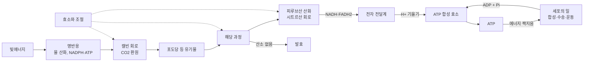
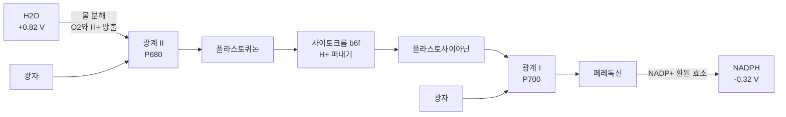

# 일반생명과학 3. 물질대사·세포호흡·광합성 — 자유 에너지를 따라 흐르는 전자
<!-- prev: cell-2, cell-3, ubio-2 -->
<!-- next: ubio-4, ubio-10, ubio-13 -->

> [!NOTE]
> **이 단원의 범위**
> - 자유 에너지와 물질대사, ATP 순환과 에너지 짝지음
> - 효소의 작용(활성화 에너지, 반응 속도론)과 조절(저해, 다른 자리 입체성 조절, 되먹임 억제)
> - 산화–환원과 전자 운반체, 해당 과정, 피루브산 산화와 시트르산 회로, 산화적 인산화(화학 삼투), 발효
> - 광합성의 명반응(광계, 선형·순환 전자 흐름)과 캘빈 회로, 광호흡과 C4·CAM 식물

**학습 목표**

1. 깁스 자유 에너지 변화와 평형 상수의 관계를 이용해 대사 반응의 방향을 판단하고, ATP 가수 분해와의 짝지음으로 비자발적 반응이 진행되는 원리를 계산으로 설명할 수 있다.
2. 효소가 활성화 에너지를 낮추는 전략과 미카엘리스–멘텐 식을 설명하고, 저해 양식·다른 자리 입체성 조절·되먹임 억제를 반응 속도 자료로 구별할 수 있다.
3. 환원 전위로 전자의 흐름 방향과 에너지를 계산하고, 해당 과정·피루브산 산화·시트르산 회로·산화적 인산화의 물질 수지와 ATP 수지를 양성자 수로부터 유도할 수 있다.
4. 발효와 혐기 호흡을 산소 호흡과 비교하고, 탄수화물 외의 영양소가 세포호흡에 들어오는 경로를 설명할 수 있다.
5. 광계와 전자 흐름, 화학 삼투, 캘빈 회로를 연결해 광합성의 에너지·물질 수지를 계산하고, 광호흡과 C4·CAM 식물의 적응을 비교할 수 있다.

**이 단원의 학습 사다리**

| 단계 | 무엇을 하나? |
|---|---|
| STEP 1. 이전 학습 다시 보기 | 「물질대사와 에너지」의 ATP·효소, 「세포호흡과 광합성」의 4단계와 명반응·캘빈 회로, 「세포의 구조와 막 수송」의 전기 화학적 기울기를 꺼낸다 |
| STEP 2. 기초 다지기 | $\Delta G$와 $Q$, 환원 전위와 $\Delta G = -nF\Delta E$, 활성화 에너지와 반응 속도, 대사 경로 읽기 |
| STEP 3. 핵심 개념 | 열역학 → ATP → 효소 작용 → 효소 조절 → 산화–환원 → 해당 과정 → 시트르산 회로 → 산화적 인산화 → 발효 → 대사의 연결 → 빛과 색소 → 명반응 → 캘빈 회로 → 광호흡과 C4·CAM |
| STEP 4. 오개념 바로잡기 | "ATP의 고에너지 결합이 에너지를 낸다?", "효소는 평형을 이동시킨다?" |
| STEP 5. 다음 단계로 한 걸음 더 | 대사 흐름의 조절과 에너지 전하, 회전 모터의 화학량론 |
| STEP 6. 생활·산업·진로 | 대사 질환과 미토콘드리아, 효소 저해 약물, 작물의 광합성 개량, 바이오 공정 |

---

## 🗺️ 단원 들어가기

사람은 하루에 자기 몸무게와 맞먹는 양의 ATP를 만들고 쓴다. 그런데 몸속에 있는 ATP를 모두 모아도 수십 그램에 불과하다. 한 분자의 ATP가 하루에 수백~수천 번 다시 충전된다는 뜻이다. 이 충전소는 1초도 쉬지 않는다. 시안화물이 몇 분 만에 생명을 앗아 가는 것도, 미토콘드리아 내막의 단백질 하나를 막아 이 충전을 멈추기 때문이다.

같은 시각 지구 반대편의 옥수수밭에서는, 잎 속 엽록체가 빛을 받아 물을 쪼개고 있다. 물에서 떼어 낸 전자는 원래 있던 곳보다 1 V 넘게 '높은' 에너지 상태로 끌어올려진다. 그리고 그 전자는 결국 우리가 먹는 포도당에 실려, 우리 미토콘드리아 안에서 다시 산소에게로 '떨어진다'.

고등학교에서 세포호흡과 광합성의 단계와 산물을 익혔다면, 이 단원에서는 그 모든 단계를 하나의 질문으로 꿰어 본다. **"이 반응은 왜 이 방향으로 가고, 에너지는 얼마이며, 세포는 그 속도를 어떻게 조절하는가?"** 그 답의 언어가 자유 에너지, 환원 전위, 효소 반응 속도론이다.

---

## STEP 1. 🔙 이전 학습 다시 보기

### 연계표

| 이전 단원 | 고등학교에서는 여기까지 | 대학에서는 이렇게 확장 |
|---|---|---|
| 진로 선택 「물질과 에너지」 '화학 변화의 자발성' | 엔탈피와 엔트로피로 보는 자발성 | $\Delta G = \Delta G^{\circ\prime} + RT\ln Q$로 세포 속 실제 조건의 자발성 계산, $\Delta G^{\circ\prime}$와 평형 상수 |
| 진로 선택 「세포와 물질대사」 '물질대사와 에너지' | ATP의 구조와 ATP–ADP 순환, 효소의 특성, 경쟁적·비경쟁적 저해, 활성화 에너지 | 에너지 짝지음의 정량, 미카엘리스–멘텐 식과 저해 양식의 판별, 다른 자리 입체성 조절과 되먹임 억제의 실제 사례 |
| 진로 선택 「세포와 물질대사」 '세포호흡과 광합성' | 4단계의 장소·산물, 기질 수준·산화적 인산화, 발효, 광계와 비순환·순환 전자 흐름, 캘빈 회로 3단계 | 해당 과정 10단계와 조절 효소, 전자 전달 복합체와 양성자 수, ATP 수지의 유도, Z 도식, ATP : NADPH 비 문제, 광호흡과 C4·CAM의 비용 |
| 진로 선택 「화학 반응의 세계」 '산화·환원 반응' | 산화수, 화학 전지와 표준 환원 전위 | 생체 전자 운반체의 환원 전위와 $\Delta G^{\circ\prime} = -nF\Delta E^{\circ\prime}$ |
| 일반생명과학 「세포의 구조와 막 수송」 | 전기 화학적 기울기, 1차·2차 능동 수송, 미토콘드리아·엽록체의 기원 | 양성자 구동력과 ATP 합성 효소, 막 사이의 대사 물질 수송(셔틀) |

### 준비 운동 (사전 진단)

**Q1.** 포도당 1분자가 산소 호흡으로 완전히 분해될 때 해당 과정, 피루브산 산화, 시트르산 회로에서 생기는 NADH의 수를 각각 쓰시오.

**Q2.** 효소는 반응의 (가) 활성화 에너지 (나) 반응열 (다) 평형 상수 가운데 무엇을 바꾸는가?

**Q3.** 광합성의 명반응에서 물이 분해되는 곳과, 산소 기체의 산소 원자가 어디에서 오는지 쓰시오.

**Q4.** 근육 세포가 산소 부족 상태에서 젖산을 만드는 가장 중요한 이유는 무엇인가?

정답 및 해설

**Q1.** 해당 과정 2, 피루브산 산화 2, 시트르산 회로 6(합 10).

**Q2.** (가)만. 반응열과 평형 상수는 반응물과 생성물의 상태로만 정해지므로 효소가 바꾸지 못한다.

**Q3.** 광계Ⅱ 근처의 틸라코이드 내부 쪽에서 물이 분해되며, $\mathrm{O_2}$의 산소는 **물**에서 온다.

**Q4.** 피루브산에 NADH의 전자를 넘겨 $\mathrm{NAD^+}$를 재생해야 해당 과정이 계속 돌아 ATP를 얻을 수 있기 때문이다.

---

## STEP 2. 🧱 기초 다지기

### ① 자유 에너지와 반응의 방향

일정한 온도와 압력에서 반응이 저절로 일어날 수 있는지는 **깁스 자유 에너지 변화** $\Delta G$가 알려 준다.

$$
\Delta G = \Delta H - T\Delta S
$$

| $\Delta G$ | 반응 | 생명과학에서 부르는 이름 |
|---|---|---|
| $\Delta G < 0$ | 정반응이 자발적 | **발에르고닉**(exergonic, 자유 에너지 방출) |
| $\Delta G > 0$ | 정반응이 비자발적(역반응이 자발적) | **엔데르고닉**(endergonic, 자유 에너지 흡수) |
| $\Delta G = 0$ | 평형 | 알짜 반응 없음 |

'자발적'은 '빠르다'는 뜻이 아니다. 포도당과 산소의 반응은 $\Delta G$가 매우 큰 음수지만, 설탕 봉지는 공기 중에서 수년간 멀쩡하다. 속도는 활성화 에너지가 정하며, 그것은 효소의 몫이다.

반응 $\mathrm{A} \rightleftharpoons \mathrm{B}$의 $\Delta G$는 농도에 따라 달라진다.

$$
\Delta G = \Delta G^{\circ\prime} + RT\ln Q, \qquad Q = \frac{[\text{생성물}]}{[\text{반응물}]}
$$

$\Delta G^{\circ\prime}$은 생화학의 **표준 자유 에너지 변화**로, 모든 물질 1 M, pH 7, 25 °C 조건의 값이다(물의 농도는 식에 넣지 않는다). 평형($\Delta G = 0$)에서 $Q = K'$이므로

$$
\Delta G^{\circ\prime} = -RT\ln K', \qquad K' = e^{-\Delta G^{\circ\prime}/RT}
$$

25 °C에서 $RT = 2.48\ \mathrm{kJ/mol}$, 37 °C에서 $RT = 2.58\ \mathrm{kJ/mol}$이다. $\Delta G^{\circ\prime}$이 5.7 kJ/mol 변할 때마다 25 °C에서 $K'$은 약 10배 변한다($2.303 RT \approx 5.7$).

> [!TIP]
> 💡 **로그 요령** — $\ln x = 2.303\log x$. $\ln 10 \approx 2.30$, $\ln 2 \approx 0.69$. 그래서 $Q$가 10배 바뀌면 $\Delta G$는 37 °C에서 약 5.9 kJ/mol 바뀐다.

### ② 환원 전위와 자유 에너지

물질이 전자를 얻으려는 경향을 **표준 환원 전위** $E^{\circ\prime}$(V)로 나타낸다(pH 7 기준). 전자는 $E^{\circ\prime}$이 **낮은(음의) 쪽에서 높은(양의) 쪽으로** 저절로 흐르며, 그 자유 에너지 변화는

$$
\Delta G^{\circ\prime} = -nF\Delta E^{\circ\prime}, \qquad \Delta E^{\circ\prime} = E^{\circ\prime}_{\text{전자 받는 쪽}} - E^{\circ\prime}_{\text{전자 주는 쪽}}
$$

이다. $n$은 옮겨지는 전자 수, $F = 96\,485\ \mathrm{C/mol}$이다. 1 V의 차이를 전자 2개가 내려가면 약 193 kJ/mol이 방출된다(「화학 반응의 세계」의 전지 원리와 같다).

### ③ 활성화 에너지와 반응 속도

반응물이 생성물이 되려면 결합이 늘어나고 비틀린, 에너지가 높은 **전이 상태**를 지나야 한다. 그 에너지 언덕의 높이가 **활성화 에너지** $E_a$이다. 반응 속도 상수는 아레니우스 식을 따른다.

$$
k = A\,e^{-E_a/RT}
$$

$E_a$가 지수에 들어 있으므로 언덕을 조금만 낮춰도 속도는 엄청나게 빨라진다. 37 °C에서 $E_a$를 10 kJ/mol 낮추면 속도는 $e^{10/2.58} \approx 48$배, 34 kJ/mol 낮추면 $e^{34/2.58} \approx 5\times10^{5}$배 빨라진다. 효소는 흔히 반응을 $10^{6}$배 이상, 때로는 $10^{15}$배 넘게 빠르게 한다.

### ④ 대사 경로 읽는 법

| 표기 | 뜻 |
|---|---|
| A → B → C → D | 각 화살표 하나가 효소 하나가 촉매하는 단계 |
| 굵은 화살표, '조절 단계' | 대개 $\Delta G$가 큰 음수인 **비가역 단계**. 경로의 속도를 정하는 문지기 |
| 가역 화살표 ⇌ | 세포 속에서 $\Delta G \approx 0$에 가까워 농도에 따라 양방향으로 진행 |
| 탄소 수 표시(6C → 2×3C) | 탄소 장부를 맞추며 $\mathrm{CO_2}$가 어디서 나가는지 추적 |

---

## STEP 3. 📘 핵심 개념

### ① 물질대사와 열역학

**물질대사**(metabolism)는 생물 안의 모든 화학 반응의 총합이며, 큰 분자를 분해하며 에너지를 내놓는 **이화 작용**(catabolism)과 에너지를 써서 큰 분자를 만드는 **동화 작용**(anabolism)으로 나뉜다. 둘을 잇는 것이 ATP와 환원된 전자 운반체이다.

| 열역학 법칙 | 내용 | 생명에서의 의미 |
|---|---|---|
| **제1법칙** | 에너지는 생성·소멸하지 않고 형태만 바뀐다 | 생물은 에너지를 만들지 못하고 빛·화학 에너지를 변환할 뿐이다 |
| **제2법칙** | 고립계의 엔트로피는 증가한다. 모든 에너지 변환에서 일부는 열로 흩어진다 | 생물은 질서(낮은 엔트로피)를 유지하는 대신 주위로 열과 단순한 분자($\mathrm{CO_2}$, $\mathrm{H_2O}$)를 내보내 **전체 엔트로피를 늘린다** |

생물은 에너지와 물질을 주고받는 **열린계**이다. 세포 속 대사 경로는 평형에 도달하지 않는다. 생성물은 다음 반응으로 계속 넘어가고 새 반응물이 계속 들어오기 때문이다. **평형은 곧 죽음**이다. 폭포 아래로 물이 계속 흘러야 물레방아가 돌듯, 대사는 반응물이 생성물로 계속 '흘러내리는' 상태를 유지해야 일을 할 수 있다.

#### 예제 1 — 평형 상수와 반응의 방향

해당 과정의 두 번째 단계 포도당-6-인산(G6P) ⇌ 과당-6-인산(F6P)의 $\Delta G^{\circ\prime} = +1.7\ \mathrm{kJ/mol}$이다.
(1) 25 °C에서 $K'$을 구하시오. (2) 세포 속에서 이 반응이 정방향으로 진행되려면 [F6P]/[G6P]가 어떤 조건이어야 하는가?

**풀이**
(1) $K' = e^{-1.7/2.48} = e^{-0.686} \approx 0.50$. 평형에서 F6P는 G6P의 절반이다.
(2) $\Delta G = 1.7 + RT\ln Q < 0$ 이려면 $Q < K' = 0.50$, 즉 [F6P]/[G6P]가 0.5보다 작아야 한다. 다음 단계(PFK)가 F6P를 계속 소비해 그 비를 낮게 유지하므로, $\Delta G^{\circ\prime}$이 양수인데도 세포 속에서는 정방향으로 흐른다.
의미: $\Delta G^{\circ\prime}$의 부호만으로 세포 속 반응의 방향을 판단하면 안 된다. 실제 방향은 $Q$를 넣은 $\Delta G$가 정한다.

#### ✔ 바로 확인

1. (O/X) 생물은 몸속 질서를 유지하므로, 생물이 살아가면 우주 전체의 엔트로피가 줄어든다.
2. 한 단계 계산: 25 °C에서 $\Delta G^{\circ\prime} = -5.7\ \mathrm{kJ/mol}$인 반응의 $K'$은 약 얼마인가? ($RT = 2.48\ \mathrm{kJ/mol}$)
3. 빈칸: 큰 분자를 분해하며 에너지를 내놓는 물질대사를 (    ), 에너지를 써서 큰 분자를 만드는 물질대사를 (    )이라 한다.

정답

1. X — 주위로 열과 단순한 분자를 내보내 전체 엔트로피는 늘린다.
2. 약 10 — $e^{5.7/2.48} = e^{2.30}$.
3. 이화 작용, 동화 작용

---

### ② ATP와 에너지 짝지음

#### (1) ATP가 에너지를 내놓는 이유

$$
\mathrm{ATP} + \mathrm{H_2O} \rightarrow \mathrm{ADP} + \mathrm{P_i}, \qquad \Delta G^{\circ\prime} = -30.5\ \mathrm{kJ/mol}
$$

흔히 '고에너지 인산 결합'이라 하지만, 에너지는 결합을 끊을 때 나오는 것이 아니다(결합을 끊는 데는 언제나 에너지가 든다). ATP의 가수 분해가 큰 음의 $\Delta G$를 갖는 까닭은 **생성물이 반응물보다 훨씬 안정하기** 때문이다.

1. 인산기 3개의 음전하가 좁은 곳에서 서로 밀어낸다. 하나가 떨어지면 반발이 줄어든다.
2. 떨어져 나온 무기 인산($\mathrm{P_i}$)은 공명으로 전자가 퍼져 안정하다.
3. ADP와 $\mathrm{P_i}$는 ATP보다 물에 잘 수화된다.

#### (2) 세포 속에서는 더 크다

세포는 ATP를 ADP보다 훨씬 높은 농도로 유지하므로 실제 $\Delta G$는 표준값보다 훨씬 큰 음수이다.

#### 예제 2 — 세포 속 ATP의 실제 자유 에너지

37 °C에서 어떤 세포의 [ATP] = 4.0 mM, [ADP] = 0.40 mM, $[\mathrm{P_i}]$ = 4.0 mM이다. ATP 가수 분해의 $\Delta G$를 구하시오.

**풀이**
식: $\Delta G = \Delta G^{\circ\prime} + RT\ln\dfrac{[\mathrm{ADP}][\mathrm{P_i}]}{[\mathrm{ATP}]}$ (농도는 M 단위).
대입: $Q = (4.0\times10^{-4})(4.0\times10^{-3})/(4.0\times10^{-3}) = 4.0\times10^{-4}$, $RT\ln Q = 2.577 \times \ln(4.0\times10^{-4}) = 2.577 \times (-7.82) \approx -20.2$ kJ/mol.
결과: $\Delta G \approx -30.5 - 20.2 = -50.7$, **약 −51 kJ/mol**.
의미: 세포 속 ATP는 표준값의 1.5배 이상 에너지를 낸다. 세포가 ATP/ADP 비를 높게 '충전'해 두는 것 자체가 에너지를 저장하는 방법이다.

#### (3) 에너지 짝지음 — 인산화된 중간체

ATP는 대개 물과 반응해 열만 내는 것이 아니라, **인산기를 다른 분자에 옮겨** 그 분자를 반응성이 큰 상태로 만든다.

$$
\text{포도당} + \mathrm{P_i} \rightarrow \text{포도당-6-인산} + \mathrm{H_2O}, \qquad \Delta G^{\circ\prime} = +13.8\ \mathrm{kJ/mol}
$$

$$
\text{포도당} + \mathrm{ATP} \rightarrow \text{포도당-6-인산} + \mathrm{ADP}, \qquad \Delta G^{\circ\prime} = +13.8 + (-30.5) = -16.7\ \mathrm{kJ/mol}
$$

$K'$로 보면 짝지음 전 $e^{-13.8/2.48} \approx 0.0038$에서 짝지음 후 $e^{16.7/2.48} \approx 840$으로, 약 $2\times10^{5}$배(= ATP 가수 분해의 $K'$) 커진다. **두 반응을 하나의 효소 위에서 공통 중간체로 묶어야** 짝지음이 일어난다. 따로 일어나면 ATP의 에너지는 열로 흩어질 뿐이다.

| 세포의 일 | ATP가 하는 일 | 예 |
|---|---|---|
| 화학적 일 | 반응물을 인산화해 비자발적 합성을 진행 | 글루타민 합성, 단백질·핵산 합성 |
| 수송의 일 | 수송 단백질을 인산화해 모양 변화 | 나트륨–칼륨 펌프(「세포의 구조와 막 수송」) |
| 기계적 일 | 모터 단백질에 결합·가수 분해되며 모양 변화 | 마이오신, 키네신, 다인에인 |

#### (4) ATP 순환

ATP는 저장 물질이 아니라 **빠르게 도는 화폐**이다. 이화 작용(세포호흡)이 ADP + $\mathrm{P_i}$로 ATP를 재충전하고, 세포의 일이 ATP를 ADP + $\mathrm{P_i}$로 되돌린다. 일하는 근육 세포는 ATP 전량을 1분 안에 재생한다고 어림된다.

#### ✔ 바로 확인

1. 한 단계 계산: $\Delta G^{\circ\prime} = +13.8\ \mathrm{kJ/mol}$인 반응을 ATP 가수 분해($-30.5$)와 짝지으면 전체 $\Delta G^{\circ\prime}$은?
2. (O/X) ATP의 끝 인산 결합은 끊어질 때 에너지를 내놓는 특별한 결합이다.
3. 고르기: 세포 속 ATP 가수 분해의 실제 $\Delta G$(약 −50 kJ/mol)가 표준값보다 큰 음수인 까닭은? (가) 세포가 [ATP]/[ADP]를 높게 유지하기 때문 (나) 세포 속 온도가 높기 때문

정답

1. −16.7 kJ/mol
2. X — 결합을 끊는 데는 늘 에너지가 든다. 생성물(ADP + $\mathrm{P_i}$)이 반응물보다 훨씬 안정해서 $\Delta G$가 음수이다.
3. (가) — $Q = [\mathrm{ADP}][\mathrm{P_i}]/[\mathrm{ATP}]$가 매우 작아 $RT\ln Q$가 큰 음수가 된다.

---

### ③ 효소의 작용

#### (1) 효소는 언덕을 낮춘다

효소는 반응의 $\Delta G$나 평형 상수를 바꾸지 않고 **활성화 에너지를 낮춰** 정반응과 역반응을 똑같은 비율로 빠르게 한다. 그 결과 평형에 '빨리' 도달하게 할 뿐 평형의 위치는 그대로이다.

효소는 기질과 결합해 **효소–기질 복합체**를 만든다. 활성 부위는 기질과 꼭 맞는 단단한 틀이라기보다, 기질이 결합하면서 모양이 조금 바뀌어 더 꼭 감싸는 **유도 적합**(induced fit)을 보인다.

<!-- fig:ubio-3-activation -->

| 활성화 에너지를 낮추는 전략 | 내용 | 예 |
|---|---|---|
| 기질을 알맞은 방향으로 붙잡기 | 두 기질을 반응할 방향으로 가까이 놓아 '우연한 충돌'을 기다리지 않게 함 | 대부분의 이기질 반응 |
| 전이 상태 안정화 | 활성 부위가 기질보다 **전이 상태**와 더 잘 결합해 결합을 비틀고 늘림 | 라이소자임의 당 고리 비틀기 |
| 알맞은 미세 환경 | 활성 부위의 산성·염기성 곁사슬이 양성자를 주고받음 | 히스티딘의 양성자 전달 |
| 일시적 공유 결합 | 곁사슬이 기질과 잠시 공유 결합해 반응을 단계로 나눔 | 세린 가수 분해 효소 |

많은 효소는 **보조 인자**가 필요하다. 금속 이온($\mathrm{Zn^{2+}}$, $\mathrm{Mg^{2+}}$, $\mathrm{Fe^{2+}}$)과 유기 분자인 **조효소**($\mathrm{NAD^+}$, FAD, 조효소 A 등)이며, 조효소 상당수는 비타민에서 만들어진다(나이아신 → $\mathrm{NAD^+}$, 리보플래빈 → FAD, 판토텐산 → 조효소 A).

#### (2) 반응 속도론 — 미카엘리스–멘텐 식

효소 농도가 일정할 때 초기 반응 속도 $v$는 기질 농도 $[S]$에 따라

$$
v = \frac{V_{\max}[S]}{K_m + [S]}
$$

로 나타난다. $V_{\max}$는 모든 효소가 기질로 포화되었을 때의 최대 속도, $K_m$(미카엘리스 상수)은 $v = V_{\max}/2$가 되는 기질 농도로, 대략 효소가 기질에 대한 친화력의 역수처럼 해석된다($K_m$이 작을수록 낮은 농도에서도 잘 작동).

| $[S]$와 $K_m$의 관계 | 속도 | 해석 |
|---|---|---|
| $[S] \ll K_m$ | $v \approx (V_{\max}/K_m)[S]$, 기질 농도에 비례 | 대부분의 효소가 비어 있다 |
| $[S] = K_m$ | $v = V_{\max}/2$ | 절반이 채워져 있다 |
| $[S] \gg K_m$ | $v \approx V_{\max}$, 기질 농도와 무관 | 거의 포화 |

$V_{\max}$를 효소 농도로 나눈 값이 **전환수**(초당 효소 한 분자가 처리하는 기질 수)이다. 카탈레이스, 탄산 무수화 효소 같은 효소는 초당 $10^{5} \sim 10^{6}$개 이상을 처리한다.

#### 예제 3 — $K_m$의 의미

$V_{\max} = 100\ \mathrm{\mu mol/min}$, $K_m = 2.0$ mM인 효소에서 $[S]$가 0.5, 2.0, 18 mM일 때 $v$를 구하시오. $v$를 $V_{\max}$의 90%로 만들려면 $[S]$는 $K_m$의 몇 배여야 하는가?

**풀이**
$[S] = 0.5$: $100 \times 0.5/2.5 = 20$. $[S] = 2.0$: $100 \times 2/4 = 50$. $[S] = 18$: $100 \times 18/20 = 90\ \mathrm{\mu mol/min}$.
일반적으로 $v/V_{\max} = 0.9$ → $[S] = 9K_m$. 따라서 **9배**.
의미: 포화 곡선은 끝으로 갈수록 매우 완만해진다. 50%에서 90%로 가려면 기질이 9배나 필요하다. 세포 속 많은 효소는 기질 농도가 $K_m$ 근처에 있어, 기질 농도 변화에 민감하게 반응하도록 맞춰져 있다.

#### (3) 온도와 pH

온도가 오르면 분자 운동이 활발해져 속도가 증가하지만(대략 10 °C마다 2~3배), 최적 온도를 넘으면 효소가 **변성**되어 급격히 떨어진다. pH는 활성 부위 곁사슬의 이온화 상태를 바꾼다(「생명의 화학」의 히스티딘 예제). 펩신(최적 pH 약 2), 트립신(약 8)처럼 효소의 최적 pH는 작용하는 장소의 환경과 맞는다.

#### ✔ 바로 확인

1. (O/X) 효소는 평형 상수를 크게 하여 생성물을 더 많이 만든다.
2. 한 단계 계산: $V_{\max} = 80$, $K_m = 4.0$ mM인 효소에서 $[S]$가 4.0 mM, 12 mM일 때 $v$는?
3. 그림 읽기: 위의 활성화 에너지 그림에서 효소가 있을 때 달라지는 것과 달라지지 않는 것을 하나씩 쓰시오.
4. 빈칸: 기질이 결합하면서 활성 부위의 모양이 조금 바뀌어 기질을 더 꼭 감싸는 것을 (    )이라 한다.

정답

1. X — 정반응과 역반응을 같은 비율로 빠르게 할 뿐 평형의 위치는 그대로이다.
2. 40, 60 — $80 \times 4/8$, $80 \times 12/16$.
3. 달라지는 것: 활성화 에너지(언덕의 높이). 달라지지 않는 것: $\Delta G$(반응물과 생성물의 차이).
4. 유도 적합

---

### ④ 효소 활성의 조절

#### (1) 저해제

| 종류 | 결합 위치 | $V_{\max}$ | 겉보기 $K_m$ | 기질을 늘리면 | 예 |
|---|---|---|---|---|---|
| **경쟁적 저해** | 활성 부위(기질과 경쟁) | 그대로 | 커짐: $K_m(1 + [I]/K_i)$ | 저해가 극복됨 | 메탄올 중독에 에탄올 투여(같은 효소를 두고 경쟁), 설파제 |
| **비경쟁적 저해** | 활성 부위 밖(효소 모양을 바꿈) | 작아짐: $V_{\max}/(1 + [I]/K_i)$ | 그대로 | 극복 안 됨 | 일부 중금속 이온 |
| **비가역적 저해** | 활성 부위 곁사슬과 공유 결합 | 작동하는 효소 수 자체가 줄어듦 | — | 극복 안 됨 | 신경 작용제가 아세틸콜린 분해 효소의 세린에 결합, 페니실린이 세균 세포벽 합성 효소에 결합, 아스피린이 염증 효소를 아세틸화 |

($K_i$는 저해제의 해리 상수로, 작을수록 강한 저해제이다.)

<!-- fig:ubio-3-inhibition -->

실제 효소에서 경쟁적 저해제가 활성 부위를 차지한 모습은 아래와 같다. 에이즈 치료제 가운데 단백질 분해 효소 저해제는 이렇게 바이러스 효소의 활성 부위에 꼭 맞도록 설계한 분자이다.

<!-- photo:ubio-3-hiv-protease-inhibitor -->

#### 예제 4 — 저해제의 종류 판별

예제 3의 효소($V_{\max} = 100$, $K_m = 2.0$ mM)에 $K_i = 1.0$ mM인 저해제를 2.0 mM 넣었다. (1) 경쟁적 저해제일 때 (2) 비경쟁적 저해제일 때 $[S] = 2.0$ mM와 18 mM에서의 $v$를 각각 구하고, 두 경우를 어떻게 구별하는지 쓰시오.

**풀이**
$1 + [I]/K_i = 1 + 2/1 = 3$.
(1) 경쟁적: 겉보기 $K_m = 6.0$ mM. $v(2) = 100 \times 2/8 = 25$, $v(18) = 100 \times 18/24 = 75$.
(2) 비경쟁적: 겉보기 $V_{\max} = 33.3$. $v(2) = 33.3 \times 2/4 \approx 16.7$, $v(18) = 33.3 \times 18/20 = 30$.
구별: 기질 농도를 크게 높였을 때 경쟁적 저해는 저해 없는 속도(90)에 가까워지고(75 → 계속 증가), 비경쟁적 저해는 최대 33.3을 넘지 못한다.

#### (2) 다른 자리 입체성 조절(알로스테릭 조절)

**다른 자리 입체성 효소**는 대개 여러 소단위로 이루어지고, 활성 부위와 다른 **조절 부위**를 가진다. 조절 분자가 결합하면 효소 전체가 활성형 또는 비활성형 쪽으로 모양을 바꾼다.

| 현상 | 내용 | 결과 |
|---|---|---|
| 활성화제 결합 | 활성형을 안정화 | 같은 기질 농도에서 속도 증가 |
| 저해제 결합 | 비활성형을 안정화 | 속도 감소 |
| **협동성** | 한 소단위에 기질이 결합하면 다른 소단위의 활성 부위도 기질을 잘 받는 모양으로 바뀜 | 속도 곡선이 **S자 모양**: 기질 농도의 작은 변화에 '스위치'처럼 반응 |

**예: 포스포프럭토키네이스(PFK)** 해당 과정 3단계(F6P → 과당-1,6-이중인산)를 촉매하는 이 효소는 해당 과정의 핵심 조절점이다.

| 조절 분자 | 작용 | 의미 |
|---|---|---|
| ATP(높은 농도) | 조절 부위에 결합해 **저해** | 에너지가 넉넉하면 포도당 분해를 늦춤 |
| AMP, ADP | **활성화** | 에너지가 부족하면 분해를 서두름 |
| 시트르산 | 저해 | 시트르산 회로가 밀려 있으면 해당 과정을 늦춤 |

ATP는 PFK의 기질이면서 저해제이다. 기질로서는 활성 부위에, 저해제로서는 조절 부위(친화력이 더 낮아 ATP가 많을 때만 채워짐)에 결합한다.

<!-- sim:u-allosteric -->

#### (3) 되먹임 억제

대사 경로의 **최종 생성물**이 경로의 **첫 번째(또는 앞쪽) 효소**를 다른 자리 입체성으로 저해하는 것을 **되먹임 억제**(feedback inhibition)라 한다.

아이소류신이 넉넉해지면 효소 1에 결합해 경로 전체를 멈추게 한다. 중간 산물이 쌓이지 않고, 필요 없는 합성에 에너지와 재료가 낭비되지 않는다. 아이소류신이 소비되어 농도가 떨어지면 저해제가 떨어져 나가 경로가 다시 열린다.

> [!TIP]
> 💡 **비유** — 되먹임 억제는 냉난방기의 온도 조절 장치와 같다. 방이 원하는 온도(최종 산물의 농도)에 이르면 장치가 보일러(첫 효소)를 끄고, 온도가 떨어지면 다시 켠다. 보일러를 끄는 것이 각 방의 라디에이터를 하나씩 잠그는 것보다 효율적이다.

이 밖에 세포는 **구획화**(효소를 특정 소기관에 모음), **효소 복합체**(연속된 단계의 효소를 한 덩어리로 묶어 중간 산물이 흩어지지 않게 함), **인산화에 의한 공유 결합 조절**(「세포 신호 전달과 세포 주기」), **효소량 조절**(유전자 발현)로 대사 속도를 조절한다.

#### ✔ 바로 확인

1. 그림 읽기: 위의 저해 그림에서 기질 농도를 크게 높이면 극복되는 저해는 경쟁적·비경쟁적 중 어느 것인가?
2. 짝짓기: (가) 메탄올 중독 환자에게 에탄올 투여 (나) 신경 작용제가 효소의 세린에 결합 (다) ATP가 PFK의 조절 부위에 결합 — ㄱ. 비가역적 저해 ㄴ. 다른 자리 입체성 저해 ㄷ. 경쟁적 저해
3. 빈칸: 대사 경로의 최종 생성물이 경로 앞쪽의 효소를 저해하는 것을 (    )라 한다.
4. (O/X) 협동성을 보이는 다른 자리 입체성 효소의 속도 곡선은 S자 모양이다.

정답

1. 경쟁적 저해 — $V_{\max}$는 그대로이고 겉보기 $K_m$만 커진다.
2. (가)–ㄷ, (나)–ㄱ, (다)–ㄴ
3. 되먹임 억제
4. O

---

### ⑤ 산화–환원과 전자 운반체

#### (1) 생체 산화는 '수소 떼어 내기'

| 산화 | 환원 |
|---|---|
| 전자를 잃음 | 전자를 얻음 |
| 생체 분자에서는 주로 **수소를 잃음**(C–H 결합 감소) | 수소를 얻음(C–H 결합 증가) |

세포호흡 전체 반응에서 포도당은 산화되고 산소는 환원된다.

$$
\mathrm{C_6H_{12}O_6} + 6\mathrm{O_2} \rightarrow 6\mathrm{CO_2} + 6\mathrm{H_2O}, \qquad \Delta G^{\circ\prime} \approx -2870\ \mathrm{kJ/mol}
$$

포도당의 C–H 결합 전자는 탄소와 수소에 '느슨하게' 공유되어 있다가, 전기 음성도가 큰 산소 쪽으로 옮겨 가 단단히 붙들린다(C=O, O–H). 이 '전자의 낙하'가 에너지원이다. 지방이 탄수화물보다 1 g당 에너지가 많은 것도 C–H 결합이 더 많기(더 환원되어 있기) 때문이다.

#### (2) 전자 운반체

| 운반체(산화형 → 환원형) | 받는 것 | $E^{\circ\prime}$(약) | 쓰임 |
|---|---|---|---|
| $\mathrm{NAD^+}$ → NADH | 전자 2개 + $\mathrm{H^+}$ 1개(수소화 이온 $\mathrm{H^-}$ 형태) + 나머지 $\mathrm{H^+}$는 용액으로 | −0.32 V | 이화 작용(세포호흡) |
| FAD → $\mathrm{FADH_2}$ | 전자 2개 + $\mathrm{H^+}$ 2개 | 효소에 결합한 상태에 따라 다름(약 0 V 부근) | 시트르산 회로의 숙신산 산화 |
| $\mathrm{NADP^+}$ → NADPH | NADH와 같음 | −0.32 V | 동화 작용(광합성, 지방산 합성) |

탈수소 효소는 기질에서 수소 원자 2개(= 전자 2개 + 양성자 2개)를 떼어, 수소화 이온 하나는 $\mathrm{NAD^+}$에 주고 양성자 하나는 용액에 내놓는다.

$$
\mathrm{H{-}C{-}OH}\ (\text{기질}) + \mathrm{NAD^+} \rightarrow \mathrm{C{=}O} + \mathrm{NADH} + \mathrm{H^+}
$$

세포가 이화 작용에는 NADH, 동화 작용에는 NADPH를 따로 쓰는 것은, 두 전자 운반체의 '저장 탱크'를 따로 두어 분해와 합성을 독립적으로 조절하기 위함이다. 세포 속 NADH/$\mathrm{NAD^+}$ 비는 낮고 NADPH/$\mathrm{NADP^+}$ 비는 높게 유지된다.

#### (3) 전자는 계단을 내려간다

| 산화–환원 쌍(pH 7) | $E^{\circ\prime}$(V, 약) |
|---|---|
| $\mathrm{NAD^+}$/NADH | −0.32 |
| 퓨마르산/숙신산 | +0.03 |
| 유비퀴논/유비퀴놀 | +0.05 |
| 사이토크롬 c(Fe³⁺/Fe²⁺) | +0.25 |
| $\frac{1}{2}\mathrm{O_2}$/$\mathrm{H_2O}$ | +0.82 |

#### 예제 5 — NADH에서 산소까지

(1) NADH의 전자 2개가 산소로 전달될 때의 $\Delta G^{\circ\prime}$을 구하시오. (2) 이 에너지가 한 번에 방출되지 않고 여러 단계로 나뉘는 이점을 쓰시오.

**풀이**
(1) $\Delta E^{\circ\prime} = 0.82 - (-0.32) = 1.14$ V. $\Delta G^{\circ\prime} = -2 \times 96\,485 \times 1.14 \approx -2.2\times10^{5}$ J/mol $= $ **약 −220 kJ/mol**.
(2) 220 kJ/mol은 ATP 몇 개분에 해당한다. 한 번에 방출되면 대부분 열로 흩어진다(수소 기체와 산소의 폭발처럼). 여러 운반체를 계단처럼 거치며 조금씩 내놓으면 각 단계의 에너지를 양성자 펌핑에 붙잡아 쓸 수 있다.

#### ✔ 바로 확인

1. (O/X) 생체 분자가 수소 원자를 잃으면(C–H 결합이 줄면) 산화된 것이다.
2. 한 단계 계산: 숙신산/퓨마르산 쌍(+0.03 V)의 전자 2개가 산소(+0.82 V)로 갈 때의 $\Delta G^{\circ\prime}$은 약 몇 kJ/mol인가?
3. 고르기: 광합성·지방산 합성 같은 동화 작용에 주로 쓰이는 전자 운반체는? NADH / NADPH / $\mathrm{FADH_2}$

정답

1. O
2. 약 −152 kJ/mol — $-2 \times 96\,485 \times (0.82 - 0.03)$.
3. NADPH

---

### ⑥ 해당 과정 — 모든 생물이 공유하는 오래된 경로

해당 과정은 세포질에서 산소 없이 포도당(6C) 1분자를 피루브산(3C) 2분자로 분해한다. 거의 모든 생물에 있고 막성 소기관이 필요 없어, 산소가 없던 초기 지구에서 진화한 매우 오래된 경로로 여겨진다.

<!-- fig:ubio-3-resp-overview -->

| 단계 | 반응(요점) | 효소 | ATP | NADH | 비고 |
|---|---|---|---|---|---|
| 1 | 포도당 → 포도당-6-인산 | 헥소키네이스 | −1 | | 비가역. 인산화로 포도당이 세포 밖으로 못 나감 |
| 2 | → 과당-6-인산 | 이성질화 효소 | | | 가역 |
| 3 | → 과당-1,6-이중인산 | **PFK** | −1 | | **비가역, 핵심 조절점** |
| 4 | → 3탄당 인산 2개(DHAP + G3P) | 알돌레이스 | | | 6C → 3C + 3C |
| 5 | DHAP → G3P | 이성질화 효소 | | | 이후 모든 단계는 **×2** |
| 6 | G3P + $\mathrm{P_i}$ → 1,3-이중인산글리세르산 | G3P 탈수소 효소 | | +1(×2) | 산화. 무기 인산을 붙임 |
| 7 | → 3-인산글리세르산 | 인산글리세르산 키네이스 | +1(×2) | | **기질 수준 인산화** |
| 8 | → 2-인산글리세르산 | 자리 옮김 효소 | | | |
| 9 | → 포스포엔올피루브산(PEP) | 에놀레이스 | | | 물이 빠지며 인산기가 매우 불안정해짐 |
| 10 | → 피루브산 | 피루브산 키네이스 | +1(×2) | | **기질 수준 인산화**, 비가역 |
| **합계** | | | **−2 + 4 = +2** | **+2** | |

$$
\text{포도당} + 2\mathrm{NAD^+} + 2\mathrm{ADP} + 2\mathrm{P_i} \rightarrow 2\,\text{피루브산} + 2\mathrm{NADH} + 2\mathrm{H^+} + 2\mathrm{ATP} + 2\mathrm{H_2O}
$$

**기질 수준 인산화**는 인산기를 가진 기질(1,3-이중인산글리세르산, PEP)이 ATP보다 인산기를 더 '내놓고 싶어 하는' 상태(가수 분해의 $\Delta G^{\circ\prime}$이 ATP보다 더 큰 음수)여서, 효소가 그 인산기를 ADP에 직접 넘기는 것이다. PEP의 인산기 가수 분해 $\Delta G^{\circ\prime}$은 약 −62 kJ/mol로 ATP(−30.5)의 두 배 정도이다.

> [!IMPORTANT]
> 6단계에서 $\mathrm{NAD^+}$가 소모된다. $\mathrm{NAD^+}$가 재생되지 않으면 해당 과정은 6단계에서 멈춘다. 산소가 있으면 전자 전달계가, 없으면 발효가 $\mathrm{NAD^+}$를 재생한다. 해당 과정의 속도는 결국 **'NADH를 어디로 보내느냐'** 에 달려 있다.

#### ✔ 바로 확인

1. 한 단계 계산: 포도당 1분자의 해당 과정에서 소비되는 ATP, 만들어지는 ATP, 알짜 ATP는 각각 몇 개인가?
2. 빈칸: 해당 과정의 핵심 조절점(3단계)을 촉매하는 효소는 (    )이다.
3. (O/X) 해당 과정은 미토콘드리아 기질에서 일어난다.
4. 고르기: $\mathrm{NAD^+}$가 재생되지 않으면 해당 과정은 몇 단계에서 멈추는가?

정답

1. 2, 4, 2
2. PFK(포스포프럭토키네이스)
3. X — 세포질(사이토졸)에서 일어난다.
4. 6단계 — G3P 탈수소 효소가 $\mathrm{NAD^+}$를 쓴다.

---

### ⑦ 피루브산 산화와 시트르산 회로

#### (1) 피루브산 산화 — 연결 단계

피루브산은 미토콘드리아 내막의 운반체로 기질에 들어가, 효소 3종과 조효소 5종으로 된 거대한 **피루브산 탈수소 효소 복합체**에서 탈탄산·산화·조효소 A 결합을 한꺼번에 겪는다.

$$
\text{피루브산} + \mathrm{NAD^+} + \text{CoA} \rightarrow \text{아세틸 CoA} + \mathrm{CO_2} + \mathrm{NADH}
$$

이 반응은 비가역이며, 생성물(아세틸 CoA, NADH)과 높은 ATP가 복합체를 저해한다. 아세틸 CoA는 '탄소 2개의 연료'로, 탄수화물·지방·일부 아미노산이 모두 이 형태로 시트르산 회로에 들어간다.

#### (2) 시트르산 회로(크레브스 회로, TCA 회로)

| 단계 | 반응(요점) | 산물 |
|---|---|---|
| 1 | 아세틸 CoA(2C) + 옥살아세트산(4C) → 시트르산(6C) | (CoA 방출) |
| 2 | 시트르산 → 아이소시트르산 | 이성질화 |
| 3 | 아이소시트르산 → α-케토글루타르산(5C) | $\mathrm{CO_2}$, NADH |
| 4 | α-케토글루타르산 → 숙시닐 CoA(4C) | $\mathrm{CO_2}$, NADH |
| 5 | 숙시닐 CoA → 숙신산 | GTP(또는 ATP) — **기질 수준 인산화** |
| 6 | 숙신산 → 퓨마르산 | $\mathrm{FADH_2}$ (이 효소는 내막에 박혀 전자 전달계의 복합체 Ⅱ이기도 함) |
| 7 | 퓨마르산 → 말산 | 물 첨가 |
| 8 | 말산 → 옥살아세트산 | NADH |

회로 1회전(아세틸 CoA 1분자)의 산물: $\mathrm{CO_2}$ 2, NADH 3, $\mathrm{FADH_2}$ 1, ATP(GTP) 1. 포도당 1분자당 2회전.

<!-- fig:ubio-3-tca -->

> [!NOTE]
> 탄소 장부를 엄밀히 따라가면, 한 회전에서 나가는 $\mathrm{CO_2}$ 2개의 탄소는 그 회전에 들어온 아세틸기의 탄소가 아니라 옥살아세트산에서 온 것이다. 들어온 아세틸기의 탄소는 다음 회전 이후에 $\mathrm{CO_2}$로 나간다. 그래도 '아세틸기 1개가 들어오면 $\mathrm{CO_2}$ 2개가 나간다'는 알짜 장부는 맞다.

#### 예제 6 — 불리한 단계를 끌고 가는 법

8단계 말산 + $\mathrm{NAD^+}$ → 옥살아세트산 + NADH의 $\Delta G^{\circ\prime}$은 약 +29.7 kJ/mol로 매우 불리하다. 37 °C의 미토콘드리아에서 [NADH]/[$\mathrm{NAD^+}$] = 0.1, [말산] = 0.2 mM이라면, 이 반응이 정방향으로 진행하려면 옥살아세트산 농도가 얼마보다 낮아야 하는가?

**풀이**
식: $\Delta G = 29.7 + RT\ln Q < 0$ → $Q < e^{-29.7/2.577} = e^{-11.5} \approx 9.9\times10^{-6}$.
$Q = \dfrac{[\mathrm{OAA}]}{[\text{말산}]} \times \dfrac{[\mathrm{NADH}]}{[\mathrm{NAD^+}]} = \dfrac{[\mathrm{OAA}]}{0.2\ \mathrm{mM}} \times 0.1$ → $[\mathrm{OAA}] < 9.9\times10^{-6} \times 0.2\ \mathrm{mM}/0.1 \approx 2\times10^{-5}\ \mathrm{mM} = 0.02\ \mathrm{\mu M}$.
의미: 1단계의 시트르산 합성 효소($\Delta G^{\circ\prime} \approx -32$ kJ/mol)가 옥살아세트산을 즉시 소비해 그 농도를 극히 낮게 유지하므로, 8단계는 불리한 표준값에도 정방향으로 흐른다. **회로 전체는 이웃 단계들이 서로 끌고 미는 연결 장치이다.**

#### ✔ 바로 확인

1. 그림 읽기: 위의 시트르산 회로 그림에서 $\mathrm{CO_2}$가 나가는 단계의 번호 두 개를 쓰시오.
2. 한 단계 계산: 포도당 1분자가 피루브산 산화와 시트르산 회로 2회전을 거칠 때 나오는 $\mathrm{CO_2}$는 모두 몇 분자인가?
3. 빈칸: 숙신산 → 퓨마르산을 촉매하는 효소는 내막에 박혀 있어 전자 전달계의 (    )이기도 하다.

정답

1. 3, 4
2. 6분자 — 피루브산 산화 2 + 회로 4.
3. 복합체 Ⅱ

---

### ⑧ 산화적 인산화 — 화학 삼투

#### (1) 전자 전달계

미토콘드리아 내막에는 전자가 차례로 지나가는 단백질 복합체와 이동성 운반체가 있다.

| 구성 | 전자를 받는 곳 → 주는 곳 | 기질 → 막 사이 공간으로 퍼내는 $\mathrm{H^+}$(전자 2개당, 약) |
|---|---|---|
| **복합체 Ⅰ** | NADH → 유비퀴논(Q) | 4 |
| **복합체 Ⅱ**(숙신산 탈수소 효소) | 숙신산의 $\mathrm{FADH_2}$ → Q | 0 |
| **유비퀴논(Q)** | 막 속을 떠다니는 지용성 운반체 | — |
| **복합체 Ⅲ** | 유비퀴놀 → 사이토크롬 c | 4 |
| **사이토크롬 c** | 막 바깥면을 따라 움직이는 작은 단백질 | — |
| **복합체 Ⅳ** | 사이토크롬 c → $\mathrm{O_2}$(물 생성) | 2 |

따라서 NADH 1개의 전자쌍은 $\mathrm{H^+}$ 약 **10개**, 숙신산($\mathrm{FADH_2}$) 1개의 전자쌍은 복합체 Ⅰ을 건너뛰므로 약 **6개**를 퍼낸다. 전자 운반체 안에서 실제로 전자를 주고받는 것은 철–황 중심, 헴의 철, 구리 같은 금속 원자들이다.

<!-- fig:ubio-3-etc -->

#### (2) 양성자 구동력

퍼낸 $\mathrm{H^+}$은 막 사이 공간에 쌓여 두 가지 '언덕'을 만든다. 기질 쪽이 음전하(막전위 $\Delta\psi$, 약 0.15~0.18 V)이고, 기질 쪽 pH가 더 높다(ΔpH 약 0.5~1). 둘을 합친 것이 **양성자 구동력**(proton-motive force)이다.

$$
\Delta p = \Delta\psi + \frac{2.303RT}{F}\,\Delta\mathrm{pH} \qquad (37\ ^\circ\mathrm{C}\text{에서 } 2.303RT/F \approx 0.0615\ \mathrm{V})
$$

#### 예제 7 — 양성자 하나의 값어치

$\Delta\psi = 0.16$ V, ΔpH = 0.75일 때 (1) 양성자 구동력 (2) $\mathrm{H^+}$ 1 mol이 막 사이 공간에서 기질로 돌아올 때 방출되는 자유 에너지를 구하고, (3) 세포 속 ATP 합성에 약 50 kJ/mol이 필요하다면 ATP 1개에 최소 몇 개의 $\mathrm{H^+}$이 필요한지 어림하시오.

**풀이**
(1) $\Delta p = 0.16 + 0.0615 \times 0.75 = 0.16 + 0.046 = 0.206$ V.
(2) $\Delta G = -F\Delta p = -96\,485 \times 0.206 \approx -19.9$ kJ/mol, 약 **−20 kJ/mol**.
(3) $50/19.9 \approx 2.5$ → 최소 **약 3개**(정수로 올림).
의미: 실제 측정된 값(아래)과 잘 맞는다. 화학 삼투설이 정량적으로도 일관됨을 보여 준다.

#### (3) ATP 합성 효소 — 회전하는 분자 모터

ATP 합성 효소는 막에 박힌 부분($\mathrm{F_o}$)과 기질로 튀어나온 머리 부분($\mathrm{F_1}$)으로 되어 있다.

1. $\mathrm{H^+}$이 $\mathrm{F_o}$의 고리 모양 소단위(c 고리)에 하나씩 결합하며 고리를 **회전**시킨다.
2. 고리에 붙은 축이 함께 돌며 $\mathrm{F_1}$ 머리의 촉매 소단위 3개의 모양을 차례로 바꾼다.
3. 각 촉매 소단위는 'ADP·$\mathrm{P_i}$ 결합 → ATP 형성 → ATP 방출' 상태를 돌아가며 거친다. 한 바퀴(360°)에 ATP 3개가 만들어진다.

포유류 미토콘드리아의 c 고리는 소단위 8개이므로 한 바퀴에 $\mathrm{H^+}$ 8개, ATP 1개당 $8/3 \approx 2.7$개이다. 여기에 ADP와 $\mathrm{P_i}$를 기질로 들이고 ATP를 내보내는 수송에 $\mathrm{H^+}$ 약 1개분이 더 들어, **ATP 1개당 $\mathrm{H^+}$ 약 3.7개(흔히 4개로 어림)** 가 필요하다.

전자 현미경으로 밝힌 실제 ATP 합성 효소의 구조는 아래와 같다. 막에 박힌 c 고리, 회전축, 촉매 소단위가 모인 머리, 머리를 붙잡는 고정 줄기를 모두 확인할 수 있다.

<!-- photo:ubio-3-atp-synthase-structure -->

#### (4) ATP 수지의 유도

| 출처(포도당 1분자) | 개수 | ATP 환산 |
|---|---|---|
| 해당 과정의 기질 수준 인산화 | 2 ATP | 2 |
| 시트르산 회로의 기질 수준 인산화 | 2 ATP(GTP) | 2 |
| NADH(피루브산 산화 2 + 시트르산 회로 6) | 8 | 8 × 2.5 = 20 |
| $\mathrm{FADH_2}$(시트르산 회로) | 2 | 2 × 1.5 = 3 |
| 해당 과정의 NADH(세포질) | 2 | 셔틀에 따라 2 × 2.5 = 5 또는 2 × 1.5 = 3 |
| **합계** | | **약 30~32** |

NADH 1개 = $\mathrm{H^+}$ 10개 ÷ 4 = **2.5 ATP**, $\mathrm{FADH_2}$ 1개 = 6 ÷ 4 = **1.5 ATP**. 이 값을 **P/O 비**라고도 한다. 정수가 아닌 것은 양성자 기울기라는 '공동 저수지'를 거치기 때문이다.

세포질의 NADH는 내막을 통과하지 못해 전자만 미토콘드리아로 넘긴다. 간과 심장은 **말산–아스파트산 셔틀**로 전자를 기질의 NADH로 넘겨 2.5 ATP를, 골격근과 뇌는 **글리세롤 인산 셔틀**로 전자를 막의 FAD(→ Q)로 넘겨 1.5 ATP를 얻는다. 그래서 총 ATP는 32 또는 30이다.

**효율** 32 × 30.5 = 976 kJ, 976/2870 ≈ **34%**(표준 조건 기준). 세포 속 ATP의 실제 $\Delta G$(약 50 kJ/mol)로 계산하면 더 높아진다. 나머지는 열로 방출되어 체온을 유지한다.

<!-- sim:u-atp-yield -->

#### (5) 저해제와 짝풀림 물질 — 화학 삼투의 증거

| 물질 | 작용 지점 | $\mathrm{O_2}$ 소비 | ATP 합성 |
|---|---|---|---|
| 로테논 | 복합체 Ⅰ | 감소(숙신산을 주면 회복) | 감소 |
| 안티마이신 A | 복합체 Ⅲ | 멈춤 | 멈춤 |
| 시안화물, 일산화 탄소 | 복합체 Ⅳ | 멈춤 | 멈춤 |
| 올리고마이신 | ATP 합성 효소의 $\mathrm{F_o}$ | **감소**(양성자가 돌아올 길이 막혀 전자 전달도 느려짐) | 멈춤 |
| 짝풀림 물질(DNP 등), 갈색 지방의 짝풀림 단백질 | 내막에 $\mathrm{H^+}$ 누출 통로 | **증가** | 감소, 에너지는 열로 |

올리고마이신을 넣으면 산소 소비도 줄어든다는 사실(전자 전달과 ATP 합성이 **짝지어져** 있음), 짝풀림 물질을 넣으면 산소 소비는 오히려 늘면서 ATP 합성만 멈춘다는 사실(짝지음의 매개가 **양성자 기울기**임)은 화학 삼투설의 강력한 증거이다. 화학 삼투설은 미첼이 1961년에 제안했고 1978년 노벨 화학상을 받았다.

#### ✔ 바로 확인

1. (O/X) 짝풀림 물질을 넣으면 산소 소비는 줄고 ATP 합성은 늘어난다.
2. 한 단계 계산: NADH 3개와 $\mathrm{FADH_2}$ 1개가 산화적 인산화로 만드는 ATP는? (NADH 2.5, $\mathrm{FADH_2}$ 1.5)
3. 한 단계 계산: 37 °C에서 $\Delta\psi = 0.15$ V, ΔpH = 0.5일 때 양성자 구동력은 약 몇 V인가?
4. 빈칸: 전자 전달계가 퍼낸 $\mathrm{H^+}$은 미토콘드리아의 (    )에 쌓인다.

정답

1. X — 산소 소비는 늘고 ATP 합성은 줄어든다(에너지가 열로).
2. 9 — $3 \times 2.5 + 1 \times 1.5$.
3. 약 0.18 V — $0.15 + 0.0615 \times 0.5$.
4. 막 사이 공간

---

### ⑨ 발효와 혐기 호흡

산소가 없을 때 세포가 ATP를 얻는 방법은 둘이다.

| 구분 | **발효** | **혐기 호흡** |
|---|---|---|
| 전자 전달계 | 쓰지 않음 | 씀(막의 전자 전달계 + 화학 삼투) |
| 최종 전자 수용체 | 유기물(피루브산, 아세트알데하이드) | 산소가 아닌 무기물(황산 이온, 질산 이온, 이산화 탄소 등) |
| ATP(포도당 1분자) | 2(해당 과정만) | 산소 호흡보다 적지만 발효보다 많음 |
| 예 | 효모의 알코올 발효, 젖산균·근육의 젖산 발효 | 황산 환원 세균(황화 수소 냄새), 탈질 세균, 메테인 생성 고세균 |

**발효의 핵심은 $\mathrm{NAD^+}$ 재생**이다.

| | 알코올 발효 | 젖산 발효 |
|---|---|---|
| 반응 | 피루브산 → 아세트알데하이드 + $\mathrm{CO_2}$, 아세트알데하이드 + NADH → 에탄올 + $\mathrm{NAD^+}$ | 피루브산 + NADH → 젖산 + $\mathrm{NAD^+}$ |
| 알짜 | 포도당 → 2 에탄올 + 2 $\mathrm{CO_2}$ + 2 ATP | 포도당 → 2 젖산 + 2 ATP |

| 산소에 대한 태도 | 뜻 | 예 |
|---|---|---|
| 절대 혐기성 | 산소가 있으면 살 수 없음 | 파상풍균, 메테인 생성 고세균 |
| **통성 혐기성** | 산소가 있으면 산소 호흡, 없으면 발효(또는 혐기 호흡) | 효모, 대장균, (조직 수준에서) 사람의 근육 |
| 절대 호기성 | 산소 호흡만 | 결핵균, (조직 수준에서) 사람의 뇌 |

#### 예제 8 — 효모의 선택

효모를 포도당 배지에서 키울 때 (가) 산소가 충분하면 산소 호흡(포도당 1분자당 ATP 30), (나) 산소가 없으면 알코올 발효를 한다. 같은 양의 ATP(6.0 mmol)를 얻는 데 필요한 포도당의 양(mmol)과 그때 생기는 $\mathrm{CO_2}$의 양(mmol)을 각각 구하시오.

**풀이**
(가) 포도당 $6.0/30 = 0.20$ mmol, $\mathrm{CO_2}$ $0.20 \times 6 = 1.2$ mmol.
(나) 포도당 $6.0/2 = 3.0$ mmol, $\mathrm{CO_2}$ $3.0 \times 2 = 6.0$ mmol(에탄올 6.0 mmol도 생김).
의미: 산소가 없으면 같은 ATP를 위해 포도당을 15배나 소비한다. 효모를 무산소 조건으로 옮기면 포도당 소비 속도가 크게 늘어나는 현상(**파스퇴르 효과**)이 이 계산으로 설명된다. 발효에서 $\mathrm{CO_2}$가 더 많이 나오는 것도 빵 반죽이 잘 부푸는 이유이다.

#### ✔ 바로 확인

1. (O/X) 발효에서 ATP가 만들어지는 단계는 해당 과정뿐이다.
2. 고르기: 젖산 발효에서 NADH의 전자를 최종적으로 받는 물질은? 산소 / 피루브산 / 아세트알데하이드
3. 한 단계 계산: 효모가 포도당 5.0 mmol을 알코올 발효하면 에탄올과 $\mathrm{CO_2}$는 각각 몇 mmol 생기는가?

정답

1. O — 그래서 포도당 1분자당 ATP 2개뿐이다.
2. 피루브산 — 젖산으로 환원되며 $\mathrm{NAD^+}$가 재생된다.
3. 에탄올 10 mmol, $\mathrm{CO_2}$ 10 mmol

---

### ⑩ 물질대사의 연결 — 다른 연료와 생합성

| 영양소 | 분해 산물 | 세포호흡에 들어오는 곳 |
|---|---|---|
| 다당류(녹말, 글리코젠) | 포도당, 포도당-1-인산 | 해당 과정 |
| 지방 | 글리세롤 + 지방산 | 글리세롤 → 해당 과정의 3탄당 인산, 지방산 → **β 산화**로 아세틸 CoA |
| 단백질 | 아미노산 → 아미노기 제거(요소로 배설) | 탄소 골격이 피루브산, 아세틸 CoA, 시트르산 회로 중간 물질로 |

**β 산화**는 미토콘드리아 기질에서 지방산을 탄소 2개씩 잘라 아세틸 CoA로 만드는 과정이다. 한 번 자를 때마다 NADH 1개와 $\mathrm{FADH_2}$ 1개가 생긴다. 시작할 때 지방산을 활성화하는 데 ATP 2개분이 든다.

#### 예제 9 — 지방은 왜 좋은 연료인가

팔미트산(C₁₆ 포화 지방산, 몰질량 256 g/mol)의 완전 산화로 얻는 ATP 수를 구하고, 포도당(180 g/mol, ATP 32)과 1 g당 ATP를 비교하시오.

**풀이**
β 산화 7회 → 아세틸 CoA 8, NADH 7, $\mathrm{FADH_2}$ 7.
아세틸 CoA 1개 = 시트르산 회로 1회전 = NADH 3 × 2.5 + $\mathrm{FADH_2}$ 1 × 1.5 + ATP 1 = 10 ATP → 8 × 10 = 80.
β 산화의 운반체: 7 × 2.5 + 7 × 1.5 = 17.5 + 10.5 = 28.
활성화 비용 −2. 합계 $80 + 28 - 2 = $ **106 ATP**.
1 g당: 팔미트산 $106/256 \approx 0.41$ mol ATP, 포도당 $32/180 \approx 0.18$ mol ATP → **약 2.3배**.
의미: 지방산은 산소가 거의 없는 긴 탄화수소 사슬, 즉 이미 '덜 산화된' 연료여서 탄소 1개당 얻는 전자가 많다(팔미트산 6.6 ATP/C, 포도당 5.3 ATP/C). 게다가 물을 끌어안지 않고 저장되므로 실제 저장 무게당 차이는 더 크다.

이화 작용의 중간 물질은 동화 작용의 재료도 된다. 시트르산 회로의 중간 물질은 아미노산과 헴의 원료가 되고, 시트르산은 세포질로 나와 지방산 합성의 아세틸 CoA 공급원이 된다. 그래서 시트르산 회로는 분해와 합성이 만나는 **대사의 교차로**이다. 세포는 ATP/ADP 비와 NADH/$\mathrm{NAD^+}$ 비를 신호 삼아, 에너지가 넉넉하면 분해 경로(PFK, 피루브산 탈수소 효소, 아이소시트르산 탈수소 효소)를 늦추고 합성 경로를 연다.

#### ✔ 바로 확인

1. 빈칸: 미토콘드리아 기질에서 지방산을 탄소 2개씩 잘라 아세틸 CoA로 만드는 과정을 (    )라 한다.
2. 한 단계 계산: 스테아르산(C₁₈ 포화 지방산)은 β 산화를 몇 번 거쳐 아세틸 CoA 몇 개가 되는가?
3. (O/X) 단백질의 아미노기는 시트르산 회로에서 $\mathrm{CO_2}$로 나간다.

정답

1. β 산화
2. 8번, 9개 — 탄소 18개 = 아세틸 CoA 9개, 자르는 횟수는 하나 적다.
3. X — 아미노기는 떼어 내 요소로 배설하고, 탄소 골격만 세포호흡에 들어간다.

---

### ⑪ 광합성 Ⅰ — 빛을 붙잡는 장치

#### (1) 빛의 에너지

빛은 광자의 흐름이며, 광자 1개의 에너지는 $E = hc/\lambda$이다($h = 6.626\times10^{-34}\ \mathrm{J\cdot s}$, $c = 3.00\times10^{8}\ \mathrm{m/s}$).

#### 예제 10 — 광자 1몰의 에너지

파장 680 nm인 광자 1개와 1 mol($6.022\times10^{23}$개)의 에너지를 구하고, NADH의 전자쌍이 산소로 갈 때의 에너지(약 220 kJ/mol)와 비교하시오.

**풀이**
$E = (6.626\times10^{-34})(3.00\times10^{8})/(680\times10^{-9}) \approx 2.92\times10^{-19}$ J.
1 mol: $2.92\times10^{-19} \times 6.022\times10^{23} \approx 1.76\times10^{5}$ J $= $ **약 176 kJ/mol**.
의미: 적색광 광자 1 mol의 에너지는 화학 결합 하나와 비슷한 크기이다. 전자 하나를 물(+0.82 V)에서 $\mathrm{NADP^+}$(−0.32 V)까지 끌어올리는 데 드는 에너지는 $F \times 1.14\ \mathrm{V} \approx 110$ kJ/mol로, 이론상 광자 하나로도 가능해 보인다. 그러나 실제로는 손실을 감안해 광자 **두 개**(광계 Ⅱ와 광계 Ⅰ)를 써서 두 번에 나누어 끌어올린다.

#### (2) 색소와 광계

| 색소 | 흡수 빛 | 역할 |
|---|---|---|
| **엽록소 a** | 청자색광, 적색광 | 반응 중심에서 전자를 내놓는 유일한 색소 |
| 엽록소 b | 청색광, 주황색광 | 안테나(보조) 색소 |
| 카로티노이드 | 청자~청록색광 | 안테나 색소, 과도한 빛에너지를 열로 흩어 엽록소 보호(광보호) |

엽록소가 광자를 흡수하면 전자가 들뜬 상태가 된다. 분리된 엽록소 용액에서는 들뜬 전자가 곧바로 바닥 상태로 돌아오며 빛(형광)과 열을 내지만, 엽록체 안에서는 이 에너지가 쓸모 있게 전달된다.

**광계**(photosystem)는 단백질에 배열된 수백 개의 **안테나 색소(집광 복합체)** 와 **반응 중심**으로 이루어진다.
1. 안테나 색소가 흡수한 에너지는 전자가 아니라 **들뜬 에너지 자체**로 이웃 색소에 차례로 전달되어(공명 에너지 전달) 반응 중심으로 모인다.
2. 반응 중심의 특별한 엽록소 a 한 쌍이 들뜨면 전자를 이웃의 **1차 전자 수용체**에 넘긴다. 빛에너지가 처음으로 **화학 에너지(전하 분리)** 로 바뀌는 순간이다.

광계Ⅱ의 반응 중심은 680 nm 빛을 잘 흡수하여 **P680**, 광계Ⅰ은 700 nm를 잘 흡수하여 **P700**이라 한다. 전자를 잃은 $\mathrm{P680^+}$는 생물계에서 알려진 가장 강한 산화제 중 하나로(약 +1.2 V), 물에서 전자를 빼앗을 수 있다.

#### ✔ 바로 확인

1. 한 단계 계산: 파장 450 nm인 광자 1 mol의 에너지는 약 몇 kJ인가?
2. (O/X) 안테나 색소는 흡수한 빛에너지를 전자의 형태로 반응 중심에 넘긴다.
3. 빈칸: 광계Ⅱ의 반응 중심 엽록소 a 쌍은 (    ), 광계Ⅰ의 것은 (    )이라 부른다.

정답

1. 약 266 kJ — $(6.626\times10^{-34})(3.00\times10^{8})/(450\times10^{-9}) \times 6.022\times10^{23}$.
2. X — 전자가 아니라 들뜬 에너지 자체를 이웃 색소로 전달한다.
3. P680, P700

---

### ⑫ 광합성 Ⅱ — 명반응의 전자 흐름

#### (1) 선형 전자 흐름과 Z 도식

| 단계 | 일어나는 일 |
|---|---|
| ① 광계Ⅱ | 빛에너지로 P680의 전자가 1차 수용체로 넘어간다. 전자를 잃은 $\mathrm{P680^+}$가 물 분해 복합체(망가니즈 원자 4개와 칼슘을 포함)를 통해 물에서 전자를 채운다: $2\mathrm{H_2O} \rightarrow \mathrm{O_2} + 4\mathrm{H^+} + 4e^-$. $\mathrm{H^+}$은 **틸라코이드 내부**에 남는다 |
| ② 플라스토퀴논(PQ) | 전자를 받으며 스트로마 쪽에서 $\mathrm{H^+}$을 함께 받아 막 속을 이동 |
| ③ 사이토크롬 $b_6f$ 복합체 | PQ의 전자를 받아 플라스토사이아닌(PC)에 넘기며, 스트로마의 $\mathrm{H^+}$을 틸라코이드 내부로 옮긴다(미토콘드리아 복합체 Ⅲ과 닮은꼴) |
| ④ 광계Ⅰ | 빛에너지로 P700의 전자가 다시 높은 에너지로 들뜬다. 전자를 잃은 $\mathrm{P700^+}$는 PC의 전자로 채워진다 |
| ⑤ 페레독신(Fd)과 $\mathrm{NADP^+}$ 환원 효소 | 전자 2개로 $\mathrm{NADP^+}$ + $\mathrm{H^+}$ → NADPH. 스트로마의 $\mathrm{H^+}$이 소비되어 기울기가 더 커진다 |

<!-- fig:ubio-3-thylakoid -->

전자의 에너지(환원 전위)를 세로축으로 그리면 물(+0.82 V)에서 출발해 광계Ⅱ에서 한 번, 광계Ⅰ에서 또 한 번 솟아올랐다가 $\mathrm{NADP^+}$(−0.32 V)에 이르는 **Z 모양**이 된다. 이것이 **Z 도식**이다.

<!-- fig:ubio-3-z -->

#### (2) 순환 전자 흐름

광계Ⅰ의 들뜬 전자가 $\mathrm{NADP^+}$ 대신 페레독신에서 사이토크롬 $b_6f$ 쪽으로 되돌아가 다시 광계Ⅰ로 돌아오는 경로이다. 물 분해와 NADPH 생성은 없고, $b_6f$ 복합체의 양성자 펌핑으로 **ATP만** 만든다.

#### (3) 광인산화와 ATP : NADPH 비

틸라코이드 내부(pH 약 5~6)와 스트로마(pH 약 8) 사이의 $\mathrm{H^+}$ 기울기로 ATP 합성 효소가 스트로마 쪽에 ATP를 만든다. 엽록체에서는 막전위보다 **pH 차이**가 양성자 구동력의 대부분을 차지한다(틸라코이드 막은 $\mathrm{Cl^-}$, $\mathrm{Mg^{2+}}$ 같은 이온이 이동해 전위차를 상쇄하기 때문이다).

#### 예제 11 — 선형 전자 흐름만으로 충분할까?

다음을 가정하자. 선형 전자 흐름에서 $\mathrm{O_2}$ 1분자(전자 4개, NADPH 2개)마다 물 분해로 $\mathrm{H^+}$ 4개, $b_6f$ 복합체로 $\mathrm{H^+}$ 8개가 틸라코이드 내부에 쌓인다. 엽록체 ATP 합성 효소의 c 고리는 소단위 14개이다. (1) $\mathrm{O_2}$ 1분자당 만들어지는 ATP 수와 ATP : NADPH 비를 구하시오. (2) 캘빈 회로는 $\mathrm{CO_2}$ 3분자를 고정하는 데 ATP 9, NADPH 6이 필요하다. 이때 부족한 ATP를 순환 전자 흐름(전자 1개가 돌 때 $\mathrm{H^+}$ 2개를 옮긴다고 가정)으로 채우려면 전자 몇 개가 순환해야 하는가?

**풀이**
(1) $\mathrm{H^+}$ 12개. ATP 1개당 $\mathrm{H^+}$ $14/3 \approx 4.67$개 → ATP $12/4.67 \approx 2.57$개. NADPH 2개이므로 ATP : NADPH = **약 1.29**.
(2) NADPH 6개를 만들면 $\mathrm{O_2}$ 3분자분이므로 ATP $3 \times 2.57 = 7.71$개. 부족분 $9 - 7.71 = 1.29$개 → $\mathrm{H^+}$ $1.29 \times 4.67 = 6$개 → 순환 전자 **3개**.
의미: 캘빈 회로가 요구하는 ATP : NADPH(1.5)는 선형 흐름이 주는 비(약 1.29)보다 크다. 순환 전자 흐름은 이 차이를 메우는 조절 장치이며, 식물은 빛 조건과 대사 요구에 따라 두 흐름의 비율을 바꾼다.

#### ✔ 바로 확인

1. 그림 읽기: 위의 틸라코이드 막 그림에서 $\mathrm{O_2}$가 나오는 곳과 NADPH가 만들어지는 곳(스트로마 쪽인지 내부 쪽인지)을 쓰시오.
2. 고르기: 순환 전자 흐름이 만드는 것은? ATP / NADPH / $\mathrm{O_2}$
3. (O/X) 엽록체에서 전자 전달로 퍼낸 $\mathrm{H^+}$은 스트로마에 쌓인다.
4. 한 단계 계산: 선형 전자 흐름에서 $\mathrm{O_2}$ 1분자가 나올 때 이동하는 전자 수와 만들어지는 NADPH 수는?

정답

1. $\mathrm{O_2}$: 광계 Ⅱ의 물 분해(틸라코이드 내부 쪽), NADPH: 광계 Ⅰ 뒤 페레독신과 $\mathrm{NADP^+}$ 환원 효소(스트로마 쪽).
2. ATP만
3. X — 틸라코이드 내부에 쌓인다.
4. 전자 4개, NADPH 2개

---

### ⑬ 광합성 Ⅲ — 캘빈 회로

캘빈 회로는 스트로마에서 명반응의 ATP와 NADPH로 $\mathrm{CO_2}$를 당으로 환원한다.

| 단계 | 반응($\mathrm{CO_2}$ 3분자 기준) | 소비 |
|---|---|---|
| ① **탄소 고정** | 3 RuBP(5C) + 3 $\mathrm{CO_2}$ → 6 3-인산글리세르산(3PG, 3C). 효소 **루비스코** | — |
| ② **환원** | 6 3PG → 6 1,3-이중인산글리세르산 → 6 G3P | ATP 6, NADPH 6 |
| ③ **RuBP 재생** | 5 G3P(15C) → 3 RuBP(15C), 1 G3P(3C)는 회로 밖으로 | ATP 3 |
| **알짜** | 3 $\mathrm{CO_2}$ → G3P 1 | **ATP 9, NADPH 6** |

<!-- fig:ubio-3-calvin -->

②의 환원은 해당 과정 6·7단계를 거꾸로 돌리는 것과 같은 화학이다(다만 NADH 대신 NADPH를 쓴다). 회로 밖으로 나간 G3P는 엽록체에서 녹말로, 세포질에서 설탕으로 만들어져 식물 전체로 보내진다.

**빛에 의한 조절** 캘빈 회로는 빛을 직접 쓰지 않지만 빛이 있을 때만 켜진다. 빛을 받으면 스트로마의 pH가 올라가고(양성자가 틸라코이드 내부로 퍼내지므로) $\mathrm{Mg^{2+}}$ 농도가 높아지며, 광계Ⅰ의 전자로 환원된 작은 단백질(싸이오레독신)이 캘빈 회로의 몇몇 효소의 이황화 결합을 끊어 활성화한다. 밤에 캘빈 회로가 꺼져 있어야, 해당 과정과 캘빈 회로가 같은 세포 안에서 서로의 산물을 헛되이 되돌리는 '헛바퀴'를 막을 수 있다.

#### 예제 12 — 포도당 1분자의 값

(1) 포도당 1분자를 합성하는 데 드는 ATP와 NADPH 수 (2) NADPH 1개를 ATP 약 2.5개분으로 환산할 때(세포호흡에서 NADH의 가치) 총 ATP 환산량 (3) 이것을 포도당 1분자가 세포호흡으로 돌려주는 ATP(약 32)와 비교하시오.

**풀이**
(1) G3P 2개 = $\mathrm{CO_2}$ 6분자분 → ATP 18, NADPH 12.
(2) $18 + 12 \times 2.5 = 18 + 30 = 48$ ATP 상당.
(3) 만드는 데 48, 분해하여 32를 돌려받는다. 약 $32/48 \approx 67\%$.
의미: 어떤 에너지 변환도 100%가 될 수 없다(제2법칙). 식물이 포도당을 만들어 두는 것은 손해를 감수하고서라도 빛이 없을 때나 다른 기관(뿌리, 열매)에서 쓸 수 있는 **저장·운반 가능한 화학 에너지**를 얻기 위함이다.

#### ✔ 바로 확인

1. 한 단계 계산: 포도당 1분자(G3P 2분자)를 만드는 데 캘빈 회로가 쓰는 ATP와 NADPH는 각각 몇 개인가?
2. 빈칸: RuBP에 $\mathrm{CO_2}$를 붙이는 효소는 (    )이다.
3. 그림 읽기: 위의 캘빈 회로 그림에서 G3P 6분자 가운데 회로 밖으로 나가는 것은 몇 분자인가?
4. (O/X) 캘빈 회로는 빛을 직접 쓰지 않으므로 밤에도 낮과 똑같이 돈다.

정답

1. ATP 18, NADPH 12
2. 루비스코
3. 1분자 — 나머지 5분자(15C)는 RuBP 3분자(15C)로 재생된다.
4. X — 빛이 있을 때만 켜진다(스트로마 pH·$\mathrm{Mg^{2+}}$ 상승, 싸이오레독신에 의한 효소 활성화).

---

### ⑭ 광호흡과 C4·CAM 식물

#### (1) 루비스코의 약점과 광호흡

루비스코는 지구에서 가장 많은 단백질로 꼽힐 만큼 대량으로 존재하지만, 촉매 속도가 매우 느리고(활성 부위당 초당 몇 회 수준) **$\mathrm{O_2}$와도 반응**한다. 대기의 $\mathrm{O_2}$가 거의 없던 시절에 진화한 효소의 흔적으로 해석된다.

| 루비스코 반응 | 생성물 |
|---|---|
| 카복실화(RuBP + $\mathrm{CO_2}$) | 3PG 2분자 → 캘빈 회로 |
| **산소화**(RuBP + $\mathrm{O_2}$) | 3PG 1분자 + 2-인산글리콜산(2C) 1분자 |

2-인산글리콜산은 쓸모없고 일부 효소를 저해하므로, 식물은 엽록체 → 퍼옥시좀 → 미토콘드리아를 거치는 경로로 이를 처리한다. 이 과정에서 산소화 2회마다 $\mathrm{CO_2}$ 1분자(와 암모니아)가 방출되고 ATP와 환원력이 소모된다. 빛이 있을 때 $\mathrm{O_2}$를 쓰고 $\mathrm{CO_2}$를 내놓는다 하여 **광호흡**이라 하지만, ATP를 만들지 않으므로 세포호흡과는 전혀 다르다.

덥고 건조한 날 식물이 물을 아끼려고 **기공을 닫으면** 잎 속 $\mathrm{CO_2}$는 줄고 광합성으로 만든 $\mathrm{O_2}$는 쌓인다. 또 온도가 오르면 루비스코의 $\mathrm{O_2}$ 선호가 커지고 $\mathrm{CO_2}$의 용해도가 $\mathrm{O_2}$보다 더 크게 줄어든다. 그래서 광호흡은 **고온·건조·강한 빛**에서 크게 늘어난다.

#### 예제 13 — 광호흡의 손실

어떤 C3 식물 잎에서 루비스코의 카복실화 : 산소화 비가 3 : 1이다. 고정된 $\mathrm{CO_2}$ 가운데 광호흡으로 다시 잃는 비율은? 고온에서 비가 2 : 1로 바뀌면?

**풀이**
3 : 1 — 카복실화 3회로 $\mathrm{CO_2}$ 3분자 고정, 산소화 1회로 $\mathrm{CO_2}$ 0.5분자 방출. 손실 $0.5/3 \approx $ **17%**, 알짜 고정 2.5분자.
2 : 1 — 손실 $0.5/2 = $ **25%**.
의미: 광호흡은 C3 식물이 고정한 탄소의 상당 부분을 되돌린다. 벼·밀·콩 같은 주요 C3 작물의 수확량을 높이려는 연구가 광호흡에 주목하는 이유이다.

#### (2) C4 식물 — 공간을 나누어 $\mathrm{CO_2}$를 농축한다

1. **엽육 세포**의 **PEP 카복실화 효소**가 $\mathrm{HCO_3^-}$를 PEP(3C)에 붙여 옥살아세트산(4C)을 만든다. 이 효소는 $\mathrm{O_2}$와 반응하지 않고 $\mathrm{CO_2}$(탄산수소 이온) 친화력이 커서, 기공을 반쯤 닫아도 $\mathrm{CO_2}$를 붙잡는다.
2. 4C 화합물(말산 등)이 원형질 연락사로 잎맥을 둘러싼 **관다발초 세포**로 이동한다(엽육 세포가 관다발초를 고리처럼 둘러싼 **크랜츠 구조**).
3. 관다발초 세포에서 4C 화합물이 $\mathrm{CO_2}$를 내놓아, 루비스코 주변의 $\mathrm{CO_2}$ 농도를 대기보다 몇 배 이상 높인다 → 광호흡이 크게 줄고 캘빈 회로가 돈다.
4. 남은 3C 화합물(피루브산)은 엽육 세포로 돌아가 ATP를 써서 PEP로 재생된다(ATP 2개 상당).

$\mathrm{CO_2}$ 1분자당 ATP 2개가 더 들어, 포도당 1분자에 ATP **30개**(C3는 18개)가 필요하다. 그러나 고온·강광에서는 광호흡을 피하는 이득이 이 비용보다 훨씬 크다. 옥수수, 사탕수수, 수수가 대표적인 C4 작물이다.

#### (3) CAM 식물 — 시간을 나누어 물을 아낀다

선인장, 파인애플, 돌나물과 식물은 **밤에** 기공을 열어 PEP 카복실화 효소로 $\mathrm{CO_2}$를 고정하고 말산으로 만들어 **액포에 저장**한다(밤새 세포액이 산성이 된다). **낮에는** 기공을 닫아 물 손실을 막은 채, 말산에서 $\mathrm{CO_2}$를 꺼내 같은 세포에서 캘빈 회로를 돌린다.

<!-- fig:ubio-3-c4cam -->

| 구분 | C3 식물 | C4 식물 | CAM 식물 |
|---|---|---|---|
| 첫 고정 산물 | 3PG(3C) | 옥살아세트산(4C) | 옥살아세트산(4C) → 말산 |
| 첫 고정 효소 | 루비스코 | PEP 카복실화 효소 | PEP 카복실화 효소 |
| 두 고정의 분리 | 없음 | **공간**(엽육 세포 ↔ 관다발초 세포) | **시간**(밤 ↔ 낮) |
| 광호흡 | 많음(고온에서 특히) | 매우 적음 | 적음 |
| 포도당당 ATP | 18 | 30 | 30 이상 |
| 기공이 열리는 때 | 낮 | 낮(덜 열어도 됨) | 밤 |
| 유리한 환경 | 온화·습윤 | 고온·강광 | 매우 건조 |
| 예 | 벼, 밀, 콩, 대부분의 나무 | 옥수수, 사탕수수 | 선인장, 파인애플 |

#### 세포호흡과 광합성의 전자 흐름 비교

| 비교 | 미토콘드리아(세포호흡) | 엽록체(광합성) |
|---|---|---|
| 전자 공급원 → 최종 수용체 | NADH·$\mathrm{FADH_2}$ → $\mathrm{O_2}$ | $\mathrm{H_2O}$ → $\mathrm{NADP^+}$ |
| 환원 전위의 방향 | −0.32 V → +0.82 V(내리막) | +0.82 V → −0.32 V(빛으로 오르막) |
| 에너지원 | 유기물의 화학 에너지 | 빛 |
| $\mathrm{H^+}$이 쌓이는 곳 | 막 사이 공간 | 틸라코이드 내부 |
| ATP가 생기는 곳 | 기질 | 스트로마 |
| 양성자 구동력의 주성분 | 막전위 | pH 차이 |
| 닮은 구성 요소 | 퀴논, 복합체 Ⅲ, ATP 합성 효소 | 플라스토퀴논, $b_6f$ 복합체, ATP 합성 효소 |

두 소기관의 ATP 합성 효소와 퀴논–사이토크롬 복합체가 구조적으로 닮은 것은, 둘 다 세균에서 기원한 화학 삼투 장치를 물려받았기 때문이다(「세포의 구조와 막 수송」의 세포 내 공생설).

#### ✔ 바로 확인

1. 짝짓기: (가) 엽육 세포와 관다발초 세포로 나눔 (나) 밤과 낮으로 나눔 (다) 나누지 않음 — ㄱ. C3 식물 ㄴ. C4 식물 ㄷ. CAM 식물
2. 한 단계 계산: 카복실화 : 산소화 비가 4 : 1인 C3 식물 잎에서 고정한 $\mathrm{CO_2}$ 가운데 광호흡으로 잃는 비율은?
3. (O/X) 광호흡은 빛이 있을 때 ATP를 만드는 또 하나의 호흡이다.

정답

1. (가)–ㄴ, (나)–ㄷ, (다)–ㄱ
2. 12.5% — 산소화 1회에 $\mathrm{CO_2}$ 0.5분자 방출, $0.5/4$.
3. X — ATP를 만들지 않고 오히려 ATP와 환원력을 소모한다.

---

## STEP 4. ⚠️ 오개념 바로잡기

| 흔한 오개념 | 올바른 개념 | 왜 그럴까? |
|---|---|---|
| ATP의 '고에너지 결합'이 끊어질 때 에너지가 나온다 | 결합을 끊는 데는 에너지가 들며, 에너지는 **생성물이 더 안정한 상태가 되며** 방출된다 | 전하 반발 감소, 공명 안정화, 수화가 생성물을 안정하게 한다 |
| 효소는 반응의 평형을 생성물 쪽으로 이동시킨다 | 효소는 정·역반응을 똑같이 빠르게 할 뿐 **평형 상수는 바꾸지 못한다** | $K$는 $\Delta G^{\circ\prime}$로만 정해진다 |
| $\Delta G^{\circ\prime} > 0$인 반응은 세포에서 일어나지 않는다 | 세포 속 농도($Q$)가 충분히 작으면 $\Delta G < 0$이 되어 진행된다 | 시트르산 회로의 말산 산화가 대표적 예이다 |
| 자발적 반응은 빠르게 일어난다 | 자발성($\Delta G$)과 속도(활성화 에너지)는 **별개**이다 | 포도당은 공기 중에서 거의 산화되지 않는다 |
| 산소는 세포호흡에서 포도당을 '태워' $\mathrm{CO_2}$를 만든다 | $\mathrm{CO_2}$는 시트르산 회로의 탈탄산에서 나오고, 산소는 전자 전달계 끝에서 **물**이 된다 | 산소의 산소 원자는 물로, $\mathrm{CO_2}$의 산소는 포도당과 물에서 온다 |
| 세포호흡의 ATP 수는 정확히 36(또는 38)개로 정해져 있다 | 양성자 화학량론과 셔틀에 따라 **약 30~32개**이며 정수가 아닐 수 있다 | NADH와 ATP 사이에 양성자 기울기라는 공동 저수지가 있다 |
| 광호흡도 호흡이므로 ATP를 만든다 | 광호흡은 ATP를 **소모**하고 고정한 탄소를 잃는 과정이다 | 루비스코의 산소화 산물을 처리하는 비용이다 |
| C4 식물은 캘빈 회로 대신 C4 회로를 쓴다 | C4 회로는 $\mathrm{CO_2}$를 **농축**하는 펌프이며, 실제 당 합성은 관다발초 세포의 **캘빈 회로**가 한다 | 모든 광합성 식물의 최종 탄소 고정은 루비스코이다 |

---

## STEP 5. 🎓 다음 단계로 한 걸음 더

> [!CAUTION]
> 여기부터는 일반 과목의 범위를 넘는 전공 과목 맛보기이다. 평가 대상이 아니며, 이 단원의 개념이 전공에서 어떻게 확장되는지 보여 주기 위한 내용이다.

### 전공 과목과의 연결

| 전공 과목 | 이어지는 내용 |
|---|---|
| 생화학 | 각 반응의 메커니즘과 조절, 당 신생·글리코젠 대사·지방산 합성·아미노산 대사, 대사 통합 |
| 생물물리화학 | 생체 에너지학, 양성자 구동력의 측정, 효소 반응 속도론(전이 상태 이론) |
| 식물생리학 | 광계의 구조와 광보호, 광합성의 환경 반응, 탄소 농축 기작 |
| 미생물학 | 다양한 혐기 호흡과 화학 합성, 대사 공학 |
| 시스템생물학 | 대사 흐름 분석, 대사 조절 해석(조절 계수) |

### 맛보기 ① 대사 흐름은 누가 정하나 — 에너지 전하

세포의 에너지 상태를 한 숫자로 나타내는 지표로 **에너지 전하**가 있다.

$$
\text{에너지 전하} = \frac{[\mathrm{ATP}] + \frac{1}{2}[\mathrm{ADP}]}{[\mathrm{ATP}] + [\mathrm{ADP}] + [\mathrm{AMP}]}
$$

모두 ATP이면 1, 모두 AMP이면 0이다. 대부분의 세포는 약 0.8~0.95를 유지한다. ATP를 만드는 경로(PFK 등)는 에너지 전하가 높아지면 급격히 느려지고, ATP를 쓰는 합성 경로는 반대로 빨라진다. 두 곡선이 교차하는 지점에서 에너지 전하가 안정하게 유지되는 셈이다. 또한 AMP는 ADP 2개에서 ATP 1개를 만드는 반응($2\mathrm{ADP} \rightleftharpoons \mathrm{ATP} + \mathrm{AMP}$)의 산물이어서, ATP가 조금만 줄어도 AMP는 상대적으로 크게 늘어난다. 그래서 AMP는 ATP보다 예민한 '에너지 부족 경보'가 되며, AMP에 반응하는 단백질 인산화 효소가 세포 전체의 대사를 다시 짠다.

### 맛보기 ② 회전 모터의 화학량론은 생물마다 다르다

ATP 합성 효소의 c 고리 소단위 수는 생물마다 8~15개 정도로 다르다. 한 바퀴에 ATP 3개는 고정이므로, c 고리가 클수록 ATP 1개당 양성자가 많이 필요하지만 대신 **약한 양성자 구동력에서도** ATP를 만들 수 있다(기어비가 낮은 자전거처럼). 엽록체(c 14)가 미토콘드리아(c 8)보다 '낮은 기어'를 쓰는 것은 양성자 구동력의 크기와 구성이 다르기 때문으로 해석된다. 이 회전 모터가 실제로 돈다는 것은 효소의 축에 형광 막대를 붙여 현미경으로 회전을 직접 관찰한 실험으로 확인되었다.

### 지금 vs 다음 단계

| 구분 | 일반생명과학(이 단원) | 전공 과목 |
|---|---|---|
| 열역학 | $\Delta G = \Delta G^{\circ\prime} + RT\ln Q$, 짝지음 | 대사 경로 전체의 $\Delta G$ 지형, 비평형 열역학 |
| 효소 | 미카엘리스–멘텐, 저해 양식, 다른 자리 입체성 조절 | 전이 상태 이론, 다기질 반응 속도론, 협동성 모델 |
| 세포호흡 | 단계별 물질·ATP 수지, 양성자 수 | 복합체의 구조와 양성자 경로, 활성 산소, 대사 통합 |
| 광합성 | Z 도식, ATP : NADPH, 캘빈 회로, C4·CAM | 광계의 구조, 비광화학적 소광, 탄소 농축 기작의 공학 |
| 조절 | PFK·되먹임 억제의 원리 | 호르몬·신호에 의한 대사 재편, 대사 흐름 분석 |

---

## STEP 6. 🏭 생활·산업·진로 연결

### 사례 1. 미토콘드리아와 질병

- **원리** 미토콘드리아 DNA나 핵의 전자 전달계 유전자에 이상이 생기면 산화적 인산화가 떨어져, 에너지를 많이 쓰는 뇌·근육·심장에 증상이 나타난다. 젖산이 쌓이는 것도 특징이다(NADH를 발효로 처리하므로).
- **어디에 쓰이나** 미토콘드리아 질환의 진단(혈중 젖산/피루브산 비, 유전자 검사), 노화와 신경 퇴행성 질환 연구.

### 사례 2. 효소 저해를 이용한 약물

- **원리** 경쟁적 저해제는 기질을 흉내 내 활성 부위를 차지하고, 비가역적 저해제는 효소를 영구히 불활성화한다.
- **어디에 쓰이나** 콜레스테롤 합성 경로의 조절 효소를 저해하는 고지혈증 약(스타틴 계열), 세균 세포벽 합성 효소를 저해하는 항생제(페니실린 계열), 바이러스 단백질 분해 효소를 저해하는 항바이러스제.

### 사례 3. 광합성을 개량한 작물

- **원리** 광호흡 경로를 우회하는 대사 경로를 엽록체에 넣거나, 벼에 C4 광합성 형질을 도입하거나, 강광에서 빛을 열로 흩어 버리는 광보호 반응이 빛이 약해졌을 때 더 빨리 꺼지도록 조절하면 광합성 효율이 높아질 수 있다.
- **어디에 쓰이나** 식량 생산성 향상 연구, 기후 변화(고온·건조)에 대응하는 작물 육종.

### 사례 4. 발효 공정과 대사 공학

- **원리** 미생물의 대사 경로에서 원하는 산물로 가는 효소를 늘리고, 되먹임 억제를 받지 않는 효소로 바꾸며, 산물이 다른 경로로 새는 효소를 없앤다.
- **어디에 쓰이나** 아미노산(조미료·사료 첨가물) 대량 생산, 바이오 에탄올과 바이오 플라스틱 원료 생산, 의약품 전구 물질의 미생물 생산.

### 관련 전공과 진로

| 진로 | 하는 일 | 관련 전공 |
|---|---|---|
| 생화학자 | 효소와 대사 경로의 기작·조절 연구 | 생화학, 생명과학, 화학 |
| 의약 화학자·약리학자 | 효소 저해제 설계, 대사 질환 치료제 개발 | 약학, 화학, 의학 |
| 작물·식물 과학자 | 광합성 효율 개량, 스트레스 내성 작물 | 식물생명과학, 농학, 원예학 |
| 대사 공학자 | 미생물 세포 공장 설계, 발효 공정 최적화 | 생명공학, 화학공학, 미생물학 |
| 운동·임상 영양 전문가 | 에너지 대사 측정과 처방 | 체육학, 영양학, 운동생리학 |

---

## 🔬 탐구 활동

### 활동 A. 카탈레이스의 반응 속도론 — $K_m$과 $V_{\max}$ 구하기

**목표** 감자즙 속 카탈레이스가 과산화 수소를 분해하는 속도를 기질 농도별로 측정하고, 라인위버–버크 도표로 $K_m$과 $V_{\max}$를 구한다.

**준비물** 감자, 강판, 거름종이(원형 지름 약 1 cm로 펀칭), 증류수, 과산화 수소(3%를 희석하여 0.25, 0.5, 1, 2, 3% 준비), 비커 또는 시험관 5개, 핀셋, 초시계, 장갑, 보안경

**과정**
1. 감자를 갈아 증류수와 1 : 1로 섞고 걸러 효소액을 만든다.
2. 거름종이 원판을 효소액에 5초 담갔다가 꺼내 여분을 털어 낸다(모든 원판을 같은 방법으로).
3. 원판을 과산화 수소 용액 바닥에 놓고, 발생한 산소 기포 때문에 수면까지 떠오르는 시간 $t$(s)를 잰다. 농도마다 3회 반복한다.
4. 반응 속도를 $v = 1/t$로 놓고, $1/[S]$를 가로축, $1/v$를 세로축으로 그린다.
5. 직선 $1/v = (K_m/V_{\max})(1/[S]) + 1/V_{\max}$의 세로축 절편과 기울기로 $V_{\max}$와 $K_m$을 구한다.

**결과 기록**

| $[S]$(%) | 0.25 | 0.5 | 1 | 2 | 3 |
|---|---|---|---|---|---|
| 떠오르는 시간 평균 $t$(s) | | | | | |
| $v = 1/t$($\mathrm{s^{-1}}$) | | | | | |
| $1/[S]$ | 4.0 | 2.0 | 1.0 | 0.50 | 0.33 |
| $1/v$(s) | | | | | |

**예시 자료와 계산** 떠오르는 시간이 차례로 20, 12, 8.0, 6.0, 5.3 s였다면 $1/v$는 20, 12, 8.0, 6.0, 5.3이다. 스프레드시트의 추세선(직선 회귀)으로 구하면 기울기 약 4.0, 세로축 절편 약 4.0이므로 $V_{\max} \approx 1/4.0 = 0.25\ \mathrm{s^{-1}}$, $K_m \approx 4.0/4.0 = 1.0\%$이다.

**생각해 보기**
1. 효소액을 끓였다가 식혀서 같은 실험을 하면 어떤 결과가 예상되는가?
2. 효소액을 절반으로 묽히면 $V_{\max}$와 $K_m$은 각각 어떻게 변할까?
3. 라인위버–버크 도표는 낮은 기질 농도의 오차를 크게 부풀린다. 그 이유를 $1/v$의 성질로 설명해 보자.

> [!WARNING]
> **안전 수칙** 과산화 수소는 피부와 눈을 자극하므로 장갑과 보안경을 착용하고, 3% 이하의 묽은 용액만 사용한다. 피부에 묻으면 즉시 물로 씻는다. 강판을 쓸 때 손을 다치지 않게 주의한다.

### 활동 B. 산소 전극 자료로 미토콘드리아의 짝지음 분석하기 (자료 분석)

**목표** 분리한 미토콘드리아의 산소 소비 기록을 분석하여 호흡 속도, ADP/O 비, 호흡 조절비를 계산하고 저해제·짝풀림 물질의 효과를 해석한다.

**자료** NADH를 만드는 기질(말산 + 글루탐산)과 무기 인산이 든 반응 용기(산소 처음 240 nmol)에 미토콘드리아를 넣고, 정해진 시각에 물질을 넣으며 용기 속 산소량을 기록했다(가상의 자료).

| 시각(분) | 0 | 1.0 | 2.0 | 3.0 | 3.6 | 4.6 | 5.6 | 6.6 | 7.6 |
|---|---|---|---|---|---|---|---|---|---|
| 산소(nmol $\mathrm{O_2}$) | 240 | 230 | 220 | 170 | 140 | 128 | 116 | 36 | 36 |
| 넣은 물질 | | | ADP 400 nmol(2.0분) | | (ADP 소진) | | DNP(5.6분) | 시안화물(6.6분) | |

**과정**
1. 구간마다 산소 소비 속도(nmol $\mathrm{O_2}$/분)를 계산한다. ① 0~2.0분 ② 2.0~3.6분 ③ 3.6~5.6분 ④ 5.6~6.6분 ⑤ 6.6분 이후.
2. ADP 400 nmol이 모두 ATP로 바뀌는 동안(2.0~3.6분) 소비된 산소를 산소 '원자' 수로 바꾸어 **ADP/O 비**를 구한다.
3. **호흡 조절비** = (ADP가 있을 때의 속도) / (ADP를 다 쓴 뒤의 속도)를 구한다.

**예시 계산** ① 10 ② $80/1.6 = 50$ ③ $24/2.0 = 12$ ④ 80 ⑤ 0 (nmol $\mathrm{O_2}$/분). 2.0~3.6분 동안 산소 $220 - 140 = 80$ nmol $\mathrm{O_2}$ = 산소 원자 160 nmol이므로 ADP/O $= 400/160 = 2.5$. 호흡 조절비 $= 50/12 \approx 4.2$.

**생각해 보기**
1. 기질을 말산 + 글루탐산 대신 숙신산으로 바꾸면 ADP/O 비는 커질까, 작아질까? (이 자료의 값이 이론값과 맞는지도 따져 보자. NADH 기질의 이론값은 약 2.5, 숙신산은 약 1.5이다. 숙신산이라면 같은 ADP 400 nmol에 산소 원자가 몇 nmol 소비될지 예상해 보자.)
2. ADP를 다 쓴 뒤 산소 소비가 느려지는 이유를 '짝지음'과 '양성자 구동력'으로 설명해 보자.
3. DNP를 넣은 뒤 산소 소비가 가장 빨라진 이유와, 시안화물을 넣은 뒤 완전히 멈춘 이유를 각각 쓰시오.

> [!NOTE]
> 이 자료는 계산 연습을 위한 가상 자료이다. 생각해 보기 1에서 보듯, 실제 실험에서는 기질에 따라 기대되는 ADP/O 비가 달라지므로 자료의 타당성을 이론값과 비교하는 습관이 중요하다.

---

## ✅ 개념 확인 문제

### 기본

**1.** 25 °C에서 어떤 대사 반응 A → B의 $\Delta G^{\circ\prime} = +7.5\ \mathrm{kJ/mol}$이다. (1) 평형 상수 $K'$ (2) 세포 속에서 [B]/[A] = 0.010일 때의 $\Delta G$와 반응 방향을 구하시오. ($RT = 2.48\ \mathrm{kJ/mol}$)

정답 및 해설

**정답** (1) 약 0.049 (2) 약 −3.9 kJ/mol, 정방향

(1) $K' = e^{-7.5/2.48} = e^{-3.02} \approx 0.049$.
(2) $\Delta G = 7.5 + 2.48 \times \ln 0.010 = 7.5 + 2.48 \times (-4.61) = 7.5 - 11.4 \approx -3.9$ kJ/mol. 음수이므로 A → B가 진행된다. B가 다음 반응으로 빨리 소비되어 [B]/[A]가 $K'$보다 작게 유지되는 상황이다.

**2.** 어떤 효소에 저해제 X를 넣었더니 $V_{\max}$는 변하지 않고 겉보기 $K_m$이 커졌고, 저해제 Y를 넣었더니 $K_m$은 그대로이고 $V_{\max}$가 작아졌다. X와 Y의 저해 양식과 각각이 결합하는 위치를 쓰시오.

정답 및 해설

**정답** X: 경쟁적 저해(활성 부위), Y: 비경쟁적 저해(활성 부위가 아닌 다른 부위)

X는 기질과 활성 부위를 두고 경쟁하므로 기질을 충분히 늘리면 $V_{\max}$에 도달할 수 있다. Y는 효소의 모양을 바꿔 작동하는 효소의 비율을 줄이므로 기질을 늘려도 $V_{\max}$가 회복되지 않는다.

**3.** 아세틸 CoA 4분자가 시트르산 회로에서 완전히 산화될 때 생기는 $\mathrm{CO_2}$, NADH, $\mathrm{FADH_2}$, ATP(GTP)의 수와, 이 전자 운반체들이 산화적 인산화로 만드는 ATP 수(NADH 2.5, $\mathrm{FADH_2}$ 1.5)를 구하시오.

정답 및 해설

**정답** $\mathrm{CO_2}$ 8, NADH 12, $\mathrm{FADH_2}$ 4, ATP 4 / 산화적 인산화 36 ATP

1회전당 $\mathrm{CO_2}$ 2, NADH 3, $\mathrm{FADH_2}$ 1, ATP 1의 4배. 산화적 인산화: $12 \times 2.5 + 4 \times 1.5 = 30 + 6 = 36$. 기질 수준 4를 더하면 아세틸 CoA 1분자당 10 ATP이다.

**4.** 미토콘드리아 현탁액에 다음 물질을 각각 넣었을 때 산소 소비량과 ATP 합성량의 변화를 쓰시오.
(가) 시안화물 (나) 올리고마이신 (다) 짝풀림 물질(DNP)

정답 및 해설

**정답** (가) 산소 소비 멈춤, ATP 합성 멈춤 (나) 산소 소비 감소, ATP 합성 멈춤 (다) 산소 소비 증가, ATP 합성 감소

(가) 복합체 Ⅳ가 막혀 전자가 산소에 가지 못한다. (나) ATP 합성 효소가 막혀 양성자가 돌아오지 못하고, 양성자 구동력이 너무 커져 전자 전달도 느려진다. (다) 양성자가 ATP 합성 효소를 거치지 않고 새어 들어가 기울기가 무너지므로, 전자 전달은 빨라지지만 ATP는 만들어지지 않는다.

<!-- fig:ubio-3-q-o2-trace -->

**5.** 광합성 명반응의 선형 전자 흐름에서 전자가 지나가는 순서대로 다음을 나열하고, 산소가 방출되는 단계와 NADPH가 만들어지는 단계를 쓰시오.
ㄱ. 광계Ⅰ ㄴ. 물 ㄷ. 사이토크롬 $b_6f$ 복합체 ㄹ. 광계Ⅱ ㅁ. $\mathrm{NADP^+}$ ㅂ. 플라스토퀴논

정답 및 해설

**정답** ㄴ → ㄹ → ㅂ → ㄷ → ㄱ → ㅁ

산소는 광계Ⅱ에서 물이 분해될 때(ㄴ → ㄹ), NADPH는 광계Ⅰ 뒤의 페레독신과 $\mathrm{NADP^+}$ 환원 효소에서(ㄱ → ㅁ) 만들어진다. (광계Ⅰ과 사이토크롬 $b_6f$ 사이에는 플라스토사이아닌이 있다.)

### 응용

**6.** 어떤 생물의 미토콘드리아 ATP 합성 효소는 c 고리 소단위가 10개이고, ATP를 기질 밖으로 내보내는 수송에 $\mathrm{H^+}$ 1개가 든다. NADH 1개가 $\mathrm{H^+}$ 10개, $\mathrm{FADH_2}$ 1개가 $\mathrm{H^+}$ 6개를 퍼낸다면 (1) ATP 1개당 필요한 $\mathrm{H^+}$ 수 (2) NADH와 $\mathrm{FADH_2}$의 P/O 비를 구하시오.

정답 및 해설

**정답** (1) 약 4.33개 (2) NADH 약 2.3, $\mathrm{FADH_2}$ 약 1.4

(1) 한 바퀴에 $\mathrm{H^+}$ 10개로 ATP 3개 → $10/3 \approx 3.33$, 수송 1 추가 → $4.33$.
(2) NADH: $10/4.33 \approx 2.31$, $\mathrm{FADH_2}$: $6/4.33 \approx 1.38$.
c 고리가 클수록 ATP 1개당 양성자가 더 필요해 P/O 비가 작아진다. P/O 비가 정수가 아닌 이유를 보여 준다.

**7.** 포도당 10분자가 (가) 골격근 세포 (나) 간세포에서 산소 호흡으로 완전히 분해될 때 얻는 ATP의 수를 각각 구하고, 차이가 생기는 이유를 쓰시오. 또 (가)의 에너지 효율을 구하시오. (NADH 2.5, $\mathrm{FADH_2}$ 1.5, ATP 30.5 kJ/mol, 포도당 2870 kJ/mol)

정답 및 해설

**정답** (가) 300 (나) 320, 효율 약 32%

해당 과정에서 생긴 세포질의 NADH 2개를 골격근은 글리세롤 인산 셔틀로 $\mathrm{FADH_2}$ 수준(1.5 ATP)으로, 간은 말산–아스파트산 셔틀로 NADH 수준(2.5 ATP)으로 미토콘드리아에 넘긴다. 포도당 1분자당 30 대 32이므로 10분자에 300 대 320이다.
효율: $300 \times 30.5 / (10 \times 2870) = 9150/28\,700 \approx 0.319$, 약 32%.

**8.** 어떤 C3 식물에서 고온일 때 루비스코의 카복실화 : 산소화 비가 2 : 1이 되었다. (1) 고정된 $\mathrm{CO_2}$ 중 광호흡으로 잃는 비율 (2) 같은 조건의 C4 식물이 포도당 1분자를 만드는 데 드는 ATP 수(C3의 18 ATP에 $\mathrm{CO_2}$ 1분자당 2 ATP 추가)를 구하고, 고온에서 C4 식물이 유리한 이유를 쓰시오.

정답 및 해설

**정답** (1) 25% (2) 30 ATP

(1) 카복실화 2회로 $\mathrm{CO_2}$ 2분자 고정, 산소화 1회로 0.5분자 방출 → $0.5/2 = 25\%$.
(2) $18 + 6 \times 2 = 30$.
C4 식물은 ATP를 더 쓰지만, 관다발초 세포에 $\mathrm{CO_2}$를 농축해 광호흡을 거의 없앤다. 고온·강광에서는 C3 식물이 광호흡으로 잃는 탄소와 에너지가 C4의 추가 비용보다 커서 C4가 유리하다. 빛이 강하면 추가 ATP를 만드는 데 필요한 빛에너지도 넉넉하다.

**9.** 광합성에서 $\mathrm{O_2}$ 1분자를 방출하는 데 680 nm 광자가 최소 8개 필요하다. (1) 포도당 1 mol을 합성하는 데 필요한 광자의 몰수 (2) 그 광자들의 에너지(광자 1 mol = 176 kJ) (3) 흡수한 빛에너지가 포도당의 화학 에너지(2870 kJ/mol)로 저장되는 효율을 구하시오. (4) 실제로는 $\mathrm{O_2}$ 1분자에 광자 약 10개가 필요하다면 효율은?

정답 및 해설

**정답** (1) 48 mol (2) 약 8450 kJ (3) 약 34% (4) 약 27%

(1) 포도당 1 mol당 $\mathrm{O_2}$ 6 mol → $6 \times 8 = 48$ mol.
(2) $48 \times 176 \approx 8450$ kJ.
(3) $2870/8450 \approx 0.34$.
(4) 광자 60 mol → $60 \times 176 = 10\,560$ kJ, $2870/10\,560 \approx 0.27$.
실제 들판에서 작물이 받은 전체 햇빛 대비 효율은 1~2% 정도로 훨씬 낮다. 엽록소가 흡수하지 못하는 파장, 반사, 광포화, 광호흡, 세포호흡 손실이 더해지기 때문이다.

### 융합·서술형

**10. [비교·진화]** 미토콘드리아의 전자 전달계와 엽록체의 명반응을 (1) 환원 전위로 본 전자의 흐름 방향과 에너지원 (2) 양성자가 쌓이는 구획과 ATP가 만들어지는 구획 (3) 구조적으로 닮은 구성 요소의 관점에서 비교하고, (4) 두 장치가 닮은 이유를 세포 내 공생설과 관련지어 설명하시오. 계산 근거로 NADH → $\mathrm{O_2}$의 $\Delta G^{\circ\prime}$(n = 2)을 함께 제시하시오.

정답 및 해설

**예시 답안**
(1) 미토콘드리아: 전자가 NADH(−0.32 V)에서 $\mathrm{O_2}$(+0.82 V)로 **내리막**을 흐르며 에너지를 내놓는다. $\Delta G^{\circ\prime} = -2 \times 96\,485 \times 1.14 \approx -220$ kJ/mol로 저절로 일어난다. 엽록체: 전자가 $\mathrm{H_2O}$(+0.82 V)에서 $\mathrm{NADP^+}$(−0.32 V)로 **오르막**을 가야 하므로(+220 kJ/mol) 빛에너지가 필요하며, 광계Ⅱ와 광계Ⅰ에서 두 번 끌어올린다(Z 도식).
(2) 미토콘드리아는 막 사이 공간에 $\mathrm{H^+}$이 쌓이고 기질에서 ATP가 생긴다. 엽록체는 틸라코이드 내부에 쌓이고 스트로마에서 생긴다. 두 경우 모두 ATP는 원래 세균의 '세포질'에 해당하는 쪽에서 만들어진다.
(3) 지용성 퀴논(유비퀴논/플라스토퀴논), 퀴놀을 산화하며 양성자를 옮기는 복합체(복합체 Ⅲ/사이토크롬 $b_6f$), 회전하는 ATP 합성 효소.
(4) 두 소기관은 각각 호흡 세균과 광합성 세균이 공생하여 생겼으며, 그 세균들은 세포막에서 화학 삼투로 ATP를 만드는 공통의 오래된 장치를 물려받았다. 그래서 막에서 양성자를 퍼내는 방향과 ATP 합성 효소의 방향이 세균의 세포막과 같은 방식으로 보존되어 있다.

**채점 포인트** ① 환원 전위와 $\Delta G$ 계산으로 내리막/오르막 설명 ② 구획의 정확한 비교 ③ 닮은 구성 요소 2개 이상 ④ 세포 내 공생설과의 논리적 연결

**11. [탐구 설계]** 처음 보는 식물 종 P가 C3 식물인지 C4 식물인지 알아보려 한다. (1) 방사성 $^{14}\mathrm{CO_2}$를 이용한 실험 (2) 산소 농도를 바꾸는 실험 (3) 잎의 단면 관찰을 각각 설계하고, C4 식물일 때 예상되는 결과를 쓰시오. 대조군으로 쓸 식물도 제시하시오.

정답 및 해설

**예시 답안**
(1) 빛을 비추는 잎에 $^{14}\mathrm{CO_2}$를 수 초 동안만 공급한 뒤 즉시 끓는 에탄올로 반응을 멈추고, 크로마토그래피로 방사능이 처음 나타나는 화합물을 찾는다. C3 식물이면 3PG(3C)에, C4 식물이면 옥살아세트산·말산 같은 **4탄소 화합물**에 먼저 나타난다.
(2) 빛·온도·$\mathrm{CO_2}$ 농도를 같게 하고 공기 중 $\mathrm{O_2}$ 농도를 21%와 2%로 바꾸어 광합성 속도($\mathrm{CO_2}$ 흡수 속도)를 잰다. C3 식물은 산소를 낮추면 광호흡이 줄어 광합성 속도가 크게 증가한다. C4 식물은 $\mathrm{CO_2}$ 농축 덕분에 광호흡이 원래 적어 **산소 농도의 영향을 거의 받지 않는다.**

<!-- fig:ubio-3-q-c3c4-o2 -->

(3) 잎을 가로로 잘라 현미경으로 본다. C4 식물이면 엽록체가 많은 관다발초 세포를 엽육 세포가 고리 모양으로 둘러싼 **크랜츠 구조**가 보인다.
대조군: C3 식물(벼, 밀, 콩)과 C4 식물(옥수수, 사탕수수)을 같은 조건에서 함께 실험해, 방법이 두 유형을 제대로 구별하는지 확인한다.

**채점 포인트** ① 각 실험의 조작 변인과 통제 변인 ② 원리(첫 고정 산물, 광호흡의 $\mathrm{O_2}$ 의존성, 해부 구조)와 예상 결과의 연결 ③ 알려진 C3·C4 식물을 대조군으로 사용

### 실력 다지기

**12. [자료 해석: 저해 양식 판별]** 어떤 효소의 초기 속도를 저해제 없이, 그리고 저해제 Z 1.5 mM이 있을 때 측정했다(단위 µmol/min). 아래 그림은 표의 값을 나타낸 것이다(가로축은 로그 눈금).

| $[S]$ (mM) | 1 | 3 | 9 | 27 | 81 |
|---|---|---|---|---|---|
| 저해제 없음 | 30 | 60 | 90 | 108 | 115.7 |
| 저해제 Z 1.5 mM | 12 | 30 | 60 | 90 | 108 |

(1) 저해제가 없을 때의 $V_{\max}$와 $K_m$을 표에서 구하시오(미카엘리스–멘텐 식으로 확인). (2) Z가 있을 때의 겉보기 $K_m$과 $V_{\max}$를 구하고 저해 양식을 판별하시오. (3) Z의 $K_i$를 구하시오. (4) Z가 같은 세기(배율 $1 + [I]/K_i$가 같음)의 비경쟁적 저해제였다면 $[S] = 81$ mM에서의 속도는?

<!-- fig:ubio-3-q-mm-data -->

정답 및 해설

**정답** (1) $V_{\max} = 120$, $K_m = 3$ mM (2) 겉보기 $K_m = 9$ mM, $V_{\max} = 120$, 경쟁적 저해 (3) 0.75 mM (4) 약 39 µmol/min

(1) $[S] = 3$에서 $v = 60$이고 $[S]$가 커질수록 120에 다가가므로 $V_{\max} = 120$, $K_m = 3$ mM. 확인: $[S] = 9$ → $120 \times 9/12 = 90$, $[S] = 27$ → $120 \times 27/30 = 108$. 표와 맞는다.
(2) Z가 있을 때 $v = 60 = V_{\max}/2$가 되는 농도가 9 mM이고, $[S] = 81$에서 108로 여전히 120을 향해 커진다($120 \times 81/90 = 108$). $V_{\max}$는 그대로, $K_m$만 3배 → **경쟁적 저해**. 표에서 Z가 있을 때의 값이 '기질 농도를 3배로 한' 없을 때의 값과 같다는 것도 같은 뜻이다.

<!-- fig:ubio-3-q-lineweaver -->

(3) $9 = 3(1 + 1.5/K_i)$ → $1.5/K_i = 2$ → $K_i = 0.75$ mM.
(4) $V_{\max}$가 $120/3 = 40$으로 줄고 $K_m = 3$ 그대로: $40 \times 81/84 \approx 38.6$ µmol/min.

**13. [에너지 짝지음과 세포 속 농도]** 글루타민 합성 반응은 다음과 같다.

$$
\text{글루탐산} + \mathrm{NH_4^+} \rightarrow \text{글루타민} + \mathrm{H_2O}, \qquad \Delta G^{\circ\prime} = +14.2\ \mathrm{kJ/mol}
$$

(1) 이 반응을 ATP 가수 분해와 짝지은 반응의 $\Delta G^{\circ\prime}$과, 짝짓기 전후의 $K'$(37 °C, $RT = 2.577$ kJ/mol)을 구하시오. (2) 세포 속 농도가 [글루탐산] 10 mM, $[\mathrm{NH_4^+}]$ 0.5 mM, [글루타민] 5.0 mM, [ATP] 4.0 mM, [ADP] 0.40 mM, $[\mathrm{P_i}]$ 4.0 mM일 때, 짝짓지 않은 반응과 짝지은 반응의 $\Delta G$를 각각 구하고 결과를 해석하시오(농도는 M 단위로 넣는다).

정답 및 해설

**정답** (1) −16.3 kJ/mol, $K'$ 약 0.0040 → 약 560 (2) 짝짓지 않음 약 +32 kJ/mol, 짝지음 약 −18.7 kJ/mol

(1) $14.2 + (-30.5) = -16.3$ kJ/mol. 짝짓기 전 $K' = e^{-14.2/2.577} = e^{-5.51} \approx 0.0040$, 짝지은 뒤 $e^{16.3/2.577} = e^{6.33} \approx 560$.
(2) 짝짓지 않은 반응: $Q = \dfrac{5.0\times10^{-3}}{(1.0\times10^{-2})(5.0\times10^{-4})} = 1000$, $\Delta G = 14.2 + 2.577\ln 1000 = 14.2 + 17.8 \approx +32$ kJ/mol. 세포 속 농도에서는 표준 조건보다 더 불리해 절대 저절로 일어나지 않는다.
짝지은 반응: $Q = \dfrac{(5.0\times10^{-3})(4.0\times10^{-4})(4.0\times10^{-3})}{(1.0\times10^{-2})(5.0\times10^{-4})(4.0\times10^{-3})} = 0.40$, $\Delta G = -16.3 + 2.577\ln 0.40 = -16.3 - 2.4 \approx -18.7$ kJ/mol. 세포가 ATP/ADP 비를 높게 유지하므로 짝지은 반응이 충분히 자발적이다.

<!-- fig:ubio-3-q-coupling-dg -->

**채점 포인트** ① 짝지음에서 $\Delta G^{\circ\prime}$의 덧셈과 $K'$의 곱셈 관계 ② $Q$를 넣은 $\Delta G$ 계산 ③ ATP/ADP 비가 반응을 끌고 감을 해석

**14. [자료 해석: 호흡과 발효의 비율]** 포도당 배지의 효모가 1시간 동안 산소 6.0 mmol을 소비하고 이산화 탄소 18.0 mmol을 내놓았다. 효모는 포도당을 산소 호흡(포도당 1분자당 ATP 30)과 알코올 발효(ATP 2)로만 쓴다고 하자.
(1) 산소 호흡과 발효에 쓰인 포도당은 각각 몇 mmol인가? (2) 얻은 ATP의 총량과, 그 가운데 발효에서 온 비율을 구하시오. (3) 생긴 에탄올의 양을 구하고, 이 효모가 산소가 있는데도 발효를 상당히 하고 있다고 판단할 수 있는 근거를 쓰시오.

정답 및 해설

**정답** (1) 호흡 1.0 mmol, 발효 6.0 mmol (2) 42 mmol, 약 29% (3) 12 mmol, 아래 해설

(1) 산소 호흡에 쓴 포도당을 $a$, 발효에 쓴 포도당을 $b$라 하면, $\mathrm{O_2}$: $6a = 6.0$ → $a = 1.0$. $\mathrm{CO_2}$: $6a + 2b = 18.0$ → $b = 6.0$.
(2) ATP $= 1.0 \times 30 + 6.0 \times 2 = 30 + 12 = 42$ mmol. 발효 비율 $12/42 \approx 29\%$.
(3) 에탄올 $= 2b = 12$ mmol. 산소 호흡만 했다면 내놓은 $\mathrm{CO_2}$와 소비한 $\mathrm{O_2}$의 비가 1이어야 하는데 실제로는 3이다. 산소를 쓰지 않고 $\mathrm{CO_2}$만 내는 경로(알코올 발효)가 함께 일어났다는 뜻이며, 포도당의 약 86%($6/7$)가 발효로 갔다.

**15. [실험 결과 예측: 캘빈 회로의 중간 물질]** 빛을 받으며 $^{14}\mathrm{CO_2}$로 광합성하던 조류에서 3PG와 RuBP의 양이 일정하게 유지되고 있었다. 다음 조건에서 두 물질의 양이 처음 몇 분 동안 어떻게 변할지 예측하고 이유를 쓰시오. (1) 빛을 끈다($\mathrm{CO_2}$는 그대로). (2) 빛은 그대로 두고 $\mathrm{CO_2}$ 공급을 끊는다. (3) 실제 실험에서 빛을 끈 직후 한 물질이 늘고 다른 물질이 줄었다. 이 결과가 캘빈 회로의 어떤 성질을 보여 주는지 쓰시오.

정답 및 해설

**예시 답안**
(1) **3PG 증가, RuBP 감소.** 빛이 꺼지면 명반응이 ATP와 NADPH를 공급하지 못해 3PG → G3P 환원과 RuBP 재생이 멈춘다. 남아 있던 RuBP는 루비스코가 $\mathrm{CO_2}$와 결합시켜(빛이 필요 없음) 3PG로 계속 바꾸므로 RuBP는 줄고 3PG는 쌓인다.
(2) **RuBP 증가, 3PG 감소.** $\mathrm{CO_2}$가 없으면 탄소 고정이 멈춰 RuBP가 소비되지 않는데, ATP와 NADPH는 계속 있어 3PG는 G3P로 환원되고 RuBP로 재생된다.

<!-- fig:ubio-3-q-calvin-dark -->

(3) 캘빈 회로가 고정 → 환원 → 재생이 이어진 **순환**이며, 탄소 고정 단계는 빛을 직접 쓰지 않지만 환원과 재생 단계가 명반응의 ATP·NADPH에 의존한다는 것, 그리고 RuBP가 고정 반응의 **기질**, 3PG가 그 **생성물**이라는 순서를 보여 준다(캘빈이 회로의 순서를 밝힐 때 쓴 논리이다).

**채점 포인트** ① 각 조건에서 멈추는 단계를 정확히 지목 ② 두 물질의 변화 방향을 모두 맞게 예측 ③ 순환 구조와 명반응 의존성으로 해석

### 도전

**16. [화학 삼투의 증거: 산–염기 전이 실험]** 엽록체에서 분리한 틸라코이드를 그림과 같이 어두운 곳에서 pH 4 완충 용액에 담가 틸라코이드 내부를 pH 4로 맞춘 뒤, ADP와 $\mathrm{P_i}$가 든 pH 8 용액으로 재빨리 옮겼더니 **빛이 없는데도** ATP가 잠깐 만들어졌다.
(1) ATP가 만들어진 까닭을 설명하시오. (2) 다음 경우 ATP가 만들어질지 예측하고 이유를 쓰시오. (가) pH 4에서 pH 4 용액으로 옮긴다. (나) pH 8 용액에 짝풀림 물질을 함께 넣는다. (다) 처음부터 pH 8에 담갔다가 pH 4 용액으로 옮긴다. (3) 25 °C에서 ΔpH = 4만으로 생기는 양성자 구동력과 $\mathrm{H^+}$ 1 mol이 돌아올 때 내놓는 자유 에너지를 구하고($2.303RT/F = 0.0592$ V), ATP 1개(약 50 kJ/mol)에 최소 몇 개의 $\mathrm{H^+}$이 필요한지 어림하시오. (4) 이 실험이 "전자 전달과 ATP 합성을 잇는 것은 막의 양성자 기울기"라는 가설을 강하게 지지하는 까닭을 쓰시오.

<!-- fig:ubio-3-q-acid-bath -->

정답 및 해설

**예시 답안**
(1) 옮긴 순간 틸라코이드 내부(pH 4)가 바깥(pH 8)보다 $\mathrm{H^+}$ 농도가 $10^4$배 높아진다. 이 $\mathrm{H^+}$이 ATP 합성 효소를 지나 바깥으로 흘러나오며 효소를 돌려, 스트로마 쪽에 해당하는 바깥에서 ADP + $\mathrm{P_i}$ → ATP를 만든다. 기울기가 사라지면 합성도 멈춘다.
(2) (가) 만들어지지 않음 — 안팎의 pH가 같아 기울기가 없다. (나) 거의 만들어지지 않음 — $\mathrm{H^+}$이 ATP 합성 효소를 거치지 않고 막을 통해 새어 나가 기울기가 바로 무너진다. (다) 만들어지지 않음 — 기울기의 방향이 반대(바깥이 산성)여서 $\mathrm{H^+}$이 안으로 들어가려 하며, ATP 합성 효소는 내부 → 스트로마 방향의 흐름으로 ATP를 만든다.
(3) $\Delta p = 0.0592 \times 4 \approx 0.237$ V. $\Delta G = -F\Delta p = -96\,485 \times 0.237 \approx -22.8$ kJ/mol. $50/22.8 \approx 2.2$ → 최소 약 **3개**.
(4) 빛도 전자 전달도 없이, 오직 인위적으로 만든 pH 차이만으로 ATP가 합성되었다. ATP 합성에 필요한 것이 전자 전달계의 어떤 화학적 중간체가 아니라 막을 사이에 둔 양성자 기울기 자체라는 것을 직접 보여 준다. (2)의 대조 조건들은 기울기의 존재와 방향이 핵심임을 확인해 준다.

**채점 포인트** ① 양성자 기울기 → ATP 합성 효소 → ATP의 인과 설명 ② 세 조건의 예측과 근거(기울기 유무·누출·방향) ③ 양성자 구동력과 필요한 $\mathrm{H^+}$ 수의 계산 ④ 가설과 증거의 논리적 연결

**17. [종합 계산: 연료와 산소]** 포도당과 팔미트산의 완전 산화는 다음과 같다.

$$
\mathrm{C_6H_{12}O_6} + 6\mathrm{O_2} \rightarrow 6\mathrm{CO_2} + 6\mathrm{H_2O} \ (\text{ATP 32}), \qquad \mathrm{C_{16}H_{32}O_2} + 23\mathrm{O_2} \rightarrow 16\mathrm{CO_2} + 16\mathrm{H_2O} \ (\text{ATP 106})
$$

(1) 두 연료의 $\mathrm{O_2}$ 1분자당 ATP 수와 호흡률(RQ = 내놓은 $\mathrm{CO_2}$ / 소비한 $\mathrm{O_2}$)을 구하시오. (2) 운동 중인 사람의 호흡률이 0.85였다. 두 연료만 쓴다고 할 때 소비한 $\mathrm{O_2}$의 몇 %가 포도당 산화에 쓰였는가? (3) 이때 $\mathrm{O_2}$ 1분자당 평균 ATP 수를 구하시오. (4) 1 g당 ATP는 지방이 많은데도(예제 9), 산소 공급이 한계에 이르는 고강도 운동에서는 탄수화물이 주된 연료가 되는 까닭을 (1)의 결과로 설명하시오.

정답 및 해설

**정답** (1) 포도당 약 5.3 ATP/$\mathrm{O_2}$, RQ 1.0 / 팔미트산 약 4.6 ATP/$\mathrm{O_2}$, RQ 약 0.70 (2) 약 51% (3) 약 5.0 (4) 아래 해설

(1) 포도당 $32/6 \approx 5.33$, RQ $= 6/6 = 1.0$. 팔미트산 $106/23 \approx 4.61$, RQ $= 16/23 \approx 0.70$.
(2) 포도당에 쓰인 $\mathrm{O_2}$ 비율을 $x$라 하면 $1.0x + 0.70(1 - x) = 0.85$ → $0.30x = 0.15$ → $x \approx 0.51$(정확히는 $0.154/0.304 \approx 0.507$), 약 **51%**.
(3) $0.507 \times 5.33 + 0.493 \times 4.61 \approx 2.70 + 2.27 \approx 4.98$, 약 **5.0** ATP/$\mathrm{O_2}$.
(4) 지방은 '질량당' ATP가 많지만 '산소당' ATP는 포도당이 약 16% 더 많다. 지방산은 이미 산소가 거의 없는(더 환원된) 분자여서 완전히 산화하는 데 산소가 더 많이 들기 때문이다. 산소 공급이 한계인 고강도 운동에서는 같은 산소로 더 많은 ATP를 얻는 탄수화물이 유리하다(게다가 산소가 부족해도 해당 과정과 젖산 발효로 ATP를 낼 수 있다).

**채점 포인트** ① 산소당 ATP와 호흡률의 정확한 계산 ② 호흡률로 연료 비율을 세우는 식 ③ 가중 평균 ④ 질량당과 산소당의 구분으로 생리 현상 설명

**18. [조건 바꾸기: C4 식물의 빛 비용]** 예제 11의 가정(선형 전자 흐름에서 $\mathrm{O_2}$ 1분자당 NADPH 2, $\mathrm{H^+}$ 12개, c 고리 14개로 ATP 1개당 $\mathrm{H^+}$ $14/3$개, 순환 전자 1개당 $\mathrm{H^+}$ 2개)을 그대로 쓰고, 선형 흐름의 전자 1개는 광자 2개(광계 Ⅱ와 Ⅰ), 순환 흐름의 전자 1개는 광자 1개(광계 Ⅰ)가 필요하다고 하자.
(1) C3 식물이 $\mathrm{CO_2}$ 3분자를 고정할 때(ATP 9, NADPH 6) 필요한 선형·순환 전자 수와 광자 수를 구하시오. (2) C4 식물은 $\mathrm{CO_2}$ 1분자당 ATP 2개가 더 든다. $\mathrm{CO_2}$ 3분자에 필요한 순환 전자 수와 광자 수를 구하시오. (3) $\mathrm{CO_2}$ 1분자당 광자 수를 비교하시오. (4) 이 계산은 광호흡을 넣지 않았다. 덥고 건조한 환경에서 C4 식물이 C3 식물보다 오히려 유리해지는 까닭을 이 결과와 함께 설명하시오.

정답 및 해설

**정답** (1) 선형 12, 순환 3, 광자 27 (2) 순환 17, 광자 41 (3) C3 9개, C4 약 13.7개 (4) 아래 해설

(1) NADPH 6 → $\mathrm{O_2}$ 3분자분 → 선형 전자 12개, 광자 24개. 선형 흐름의 ATP $= 3 \times 12/(14/3) \approx 7.71$, 부족분 $9 - 7.71 = 1.29$ ATP → $\mathrm{H^+}$ $1.29 \times 14/3 = 6$개 → 순환 전자 3개, 광자 3개. 합계 광자 **27개**.
(2) ATP $9 + 3 \times 2 = 15$, NADPH 6. 선형은 그대로 전자 12개(광자 24개), ATP 7.71. 부족분 $15 - 7.71 = 7.29$ ATP → $\mathrm{H^+}$ $7.29 \times 14/3 = 34$개 → 순환 전자 **17개**, 광자 17개. 합계 **41개**.
(3) C3: $27/3 = 9$개, C4: $41/3 \approx 13.7$개. 광호흡이 없다면 C4 식물은 $\mathrm{CO_2}$ 하나를 고정하는 데 빛이 약 1.5배 더 든다.
(4) 덥고 건조하면 C3 식물은 기공을 닫아 잎 속 $\mathrm{CO_2}$가 줄고 루비스코의 산소화가 늘어, 고정한 탄소의 상당 부분을 광호흡으로 잃고(예: 2 : 1이면 25%) 그 처리에 ATP와 환원력까지 쓴다. C4 식물은 추가 ATP(빛 약 1.5배)를 치르는 대신 $\mathrm{CO_2}$를 농축해 광호흡을 거의 없앤다. 빛이 넉넉한 고온·강광 환경에서는 빛 비용보다 광호흡 손실이 더 커서 C4 식물의 알짜 탄소 고정이 더 많아진다.

**채점 포인트** ① 선형 흐름의 ATP 부족분에서 순환 전자 수 유도 ② C4의 추가 ATP를 반영한 계산 ③ $\mathrm{CO_2}$당 광자 비교 ④ 광호흡 손실과 빛 비용의 맞교환으로 환경 적응 설명

---

## 📝 한눈에 정리

### 핵심 요약

- 반응의 방향은 $\Delta G = \Delta G^{\circ\prime} + RT\ln Q$가 정하고, $\Delta G^{\circ\prime} = -RT\ln K'$이다. 생명은 평형에서 멀리 떨어진 열린계로, 대사 산물이 계속 흘러야 일을 할 수 있다.
- ATP 가수 분해($\Delta G^{\circ\prime} = -30.5$, 세포 속 약 −50 kJ/mol)는 인산화된 중간체를 통해 비자발적 반응과 짝지어지며, ATP는 빠르게 순환하는 에너지 화폐이다.
- 효소는 활성화 에너지만 낮추고 평형은 바꾸지 않는다. $v = V_{\max}[S]/(K_m + [S])$를 따르며, 경쟁적 저해는 $K_m$을, 비경쟁적 저해는 $V_{\max}$를 바꾼다. 다른 자리 입체성 조절(PFK)과 되먹임 억제가 대사 흐름을 조절한다.
- 생체 산화는 C–H 전자를 $\mathrm{NAD^+}$·FAD에 싣는 과정이며, 전자는 환원 전위가 낮은 곳에서 높은 곳으로 흐른다: $\Delta G^{\circ\prime} = -nF\Delta E^{\circ\prime}$(NADH → $\mathrm{O_2}$ 약 −220 kJ/mol).
- 해당 과정(세포질)은 포도당 → 피루브산 2, ATP 순 2, NADH 2이며 PFK가 핵심 조절점이다. 피루브산 산화와 시트르산 회로(기질)는 포도당당 $\mathrm{CO_2}$ 6, NADH 8, $\mathrm{FADH_2}$ 2, ATP 2를 만든다.
- 전자 전달계는 NADH당 $\mathrm{H^+}$ 10개, $\mathrm{FADH_2}$당 6개를 퍼내 양성자 구동력을 만들고, 회전하는 ATP 합성 효소가 ATP 1개당 $\mathrm{H^+}$ 약 4개로 ATP를 만든다. 총 ATP는 약 30~32, 효율 약 34%이다.
- 발효는 유기물에 전자를 넘겨 $\mathrm{NAD^+}$를 재생하고 ATP 2만 얻으며, 혐기 호흡은 산소 대신 무기물을 최종 전자 수용체로 쓴다. 지방(β 산화)과 단백질도 아세틸 CoA·회로 중간 물질로 들어온다.
- 명반응은 광계Ⅱ(P680, 물 분해)와 광계Ⅰ(P700)이 전자를 두 번 끌어올리는 Z 도식으로 NADPH와 ATP를 만들며, 순환 전자 흐름이 부족한 ATP를 보충한다.
- 캘빈 회로는 $\mathrm{CO_2}$ 3분자로 G3P 1분자를 만드는 데 ATP 9, NADPH 6을 쓰며 빛으로 활성화된다.
- 루비스코의 산소화로 생기는 광호흡은 고온·건조에서 고정한 탄소를 잃게 하며, C4 식물은 공간 분리, CAM 식물은 시간 분리로 $\mathrm{CO_2}$를 농축해 이를 줄인다.

### 핵심 용어

| 용어 | 뜻 |
|---|---|
| 깁스 자유 에너지 변화 | 일정 온도·압력에서 반응의 자발성을 알려 주는 양($\Delta G = \Delta H - T\Delta S$) |
| 에너지 짝지음 | 발에르고닉 반응의 에너지로 엔데르고닉 반응을 진행시키는 것 |
| 미카엘리스 상수 | 반응 속도가 최대 속도의 절반이 되는 기질 농도 |
| 다른 자리 입체성 조절 | 활성 부위가 아닌 조절 부위에 분자가 결합해 효소의 모양과 활성을 바꾸는 조절 |
| 되먹임 억제 | 대사 경로의 최종 산물이 앞쪽 효소를 저해하는 조절 |
| 표준 환원 전위 | 물질이 전자를 얻으려는 경향(pH 7 기준, V) |
| 기질 수준 인산화 | 인산기를 가진 기질에서 ADP로 인산기를 직접 옮기는 ATP 합성 |
| 양성자 구동력 | 막전위와 pH 차이가 함께 만드는, 양성자를 되돌려 보내려는 힘 |
| 화학 삼투 | 양성자 기울기의 에너지로 ATP 합성 효소가 ATP를 만드는 원리 |
| P/O 비 | 산소 원자 1개가 환원될 때 만들어지는 ATP 수 |
| 혐기 호흡 | 산소가 아닌 무기물을 최종 전자 수용체로 쓰는 세포호흡 |
| Z 도식 | 광합성 전자의 환원 전위 변화를 나타낸 Z 모양 그림 |
| 루비스코 | 캘빈 회로의 탄소 고정 효소. $\mathrm{O_2}$와도 반응한다 |
| 광호흡 | 루비스코의 산소화로 시작되어 $\mathrm{CO_2}$를 잃고 에너지를 소모하는 과정 |

### 주요 식 정리

| 식 | 쓰임 |
|---|---|
| $\Delta G = \Delta G^{\circ\prime} + RT\ln Q$, $\Delta G^{\circ\prime} = -RT\ln K'$ | 반응 방향, 평형 상수 |
| $v = V_{\max}[S]/(K_m + [S])$ | 효소 반응 속도 |
| $\Delta G^{\circ\prime} = -nF\Delta E^{\circ\prime}$ | 전자 이동의 에너지 |
| $\Delta p = \Delta\psi + (2.303RT/F)\Delta\mathrm{pH}$, $\Delta G = -F\Delta p$ | 양성자 구동력 |
| $E = hc/\lambda$ | 광자의 에너지 |
| NADH 2.5, $\mathrm{FADH_2}$ 1.5 ATP / 캘빈 회로 $3\mathrm{CO_2}$ : 9 ATP : 6 NADPH | ATP·광합성 수지 |

### 다음 단원으로

세포는 이 단원에서 본 대사 장치를 늘 같은 속도로 돌리지 않는다. 호르몬이 오면 글리코젠을 분해하고, 영양이 넉넉하면 분열을 준비한다. 바깥의 신호가 막의 수용체를 거쳐 효소의 인산화와 2차 전달자로 증폭되는 과정은 다음 단원 「세포 신호 전달과 세포 주기」에서 다룬다. 또 광합성으로 만든 설탕이 체관을 따라 식물 전체로 운반되는 과정은 「식물의 구조와 기능」에서, 생산자가 고정한 에너지가 생태계를 흐르는 과정은 「생태학」에서 이어진다.
