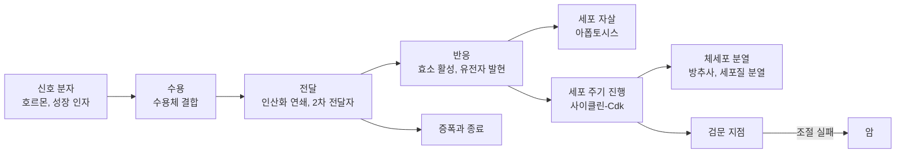
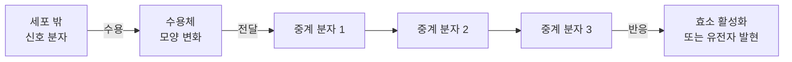
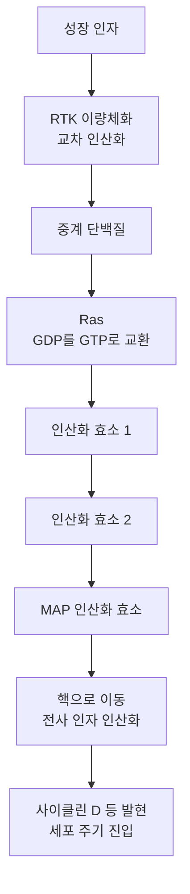
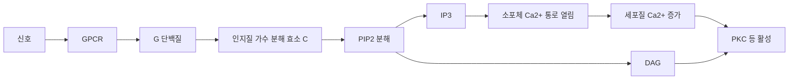
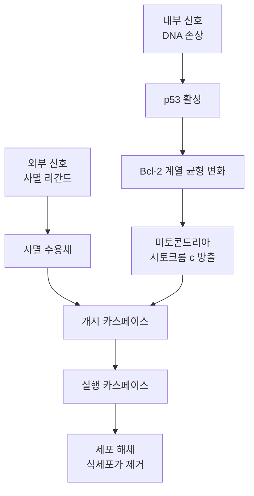
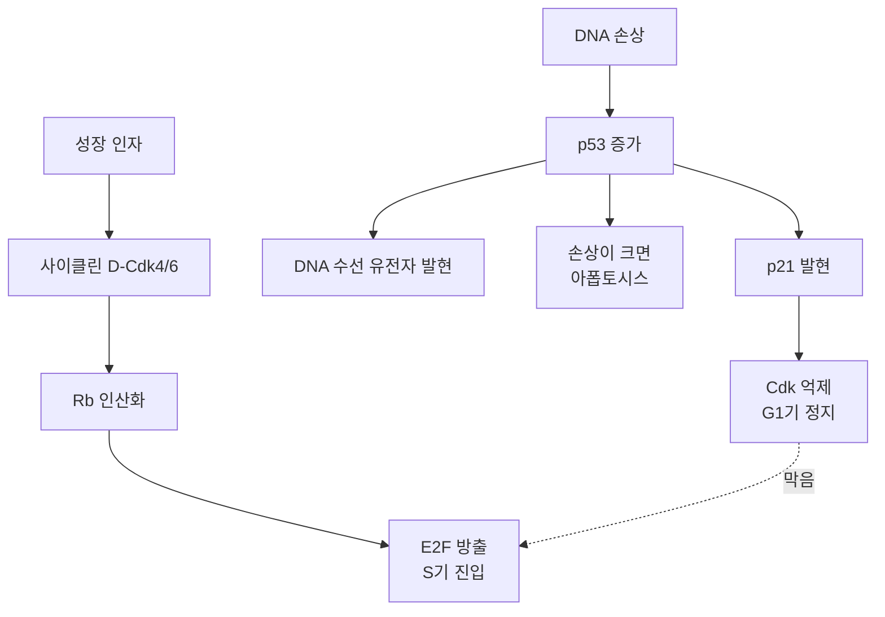

# 일반생명과학 4. 세포 신호 전달과 세포 주기 — 세포가 듣고, 판단하고, 나뉘는 방법
<!-- prev: cell-1, bio-3, ubio-2, ubio-3 -->
<!-- next: ubio-5, ubio-7, ubio-12 -->

> [!NOTE]
> **이 단원의 범위**
> - 세포 신호의 세 단계(수용–전달–반응)
> - 수용체의 종류(G 단백질 연결 수용체, 수용체 타이로신 인산화 효소, 이온 통로, 세포 내 수용체)
> - 인산화 연쇄 반응과 2차 전달자, 신호의 증폭과 종료, 세포 자살
> - 세포 주기와 체세포 분열(방추사, 세포질 분열)
> - 세포 주기 조절(검문 지점, 사이클린–Cdk)과 암

**학습 목표**

1. 세포 신호 전달을 수용–전달–반응의 세 단계로 나누어 설명하고, 신호가 전달되는 거리에 따라 내분비·측분비·접촉 신호 등을 구별할 수 있다.
2. 네 종류의 수용체(G 단백질 연결 수용체, 수용체 타이로신 인산화 효소, 리간드 개폐 이온 통로, 세포 내 수용체)의 구조와 작동 방식을 비교하고, 리간드 결합을 해리 상수로 정량적으로 다룰 수 있다.
3. 인산화 연쇄 반응과 2차 전달자(cAMP, $\mathrm{Ca^{2+}}$, $\mathrm{IP_3}$, DAG)가 신호를 증폭·분배·종료하는 원리를 계산과 함께 설명할 수 있다.
4. 세포 자살(아폽토시스)의 경로와 생물학적 의미를 설명하고 괴사와 구별할 수 있다.
5. 세포 주기의 각 시기와 체세포 분열 과정에서 방추사·동원체·수축환이 하는 일을 설명하고, 관찰 자료로 각 시기의 길이를 어림할 수 있다.
6. 검문 지점과 사이클린–Cdk 복합체가 세포 주기를 조절하는 원리를 실험 근거로 설명하고, 조절이 무너질 때 암이 생기는 과정을 원종양 유전자와 종양 억제 유전자로 설명할 수 있다.

**이 단원의 학습 사다리**

| 단계 | 무엇을 하나? |
|---|---|
| STEP 1. 이전 학습 다시 보기 | 생명과학 「생명의 연속성과 다양성」의 세포 주기, 세포와 물질대사 「세포」의 막 단백질, 「세포의 구조와 막 수송」을 다시 꺼낸다 |
| STEP 2. 기초 다지기 | 신호의 거리, 결합 평형과 해리 상수, 곱셈으로 쌓이는 증폭, 지수 증가와 배가 시간 |
| STEP 3. 핵심 개념 | 세 단계 → 수용체 네 종류 → 인산화 연쇄와 2차 전달자 → 증폭·종료 → 세포 자살 → 세포 주기와 체세포 분열 → 세포 주기 조절과 암 |
| STEP 4. 오개념 바로잡기 | "신호 분자가 세포 안으로 들어가야 작용한다?", "간기는 쉬는 시기?" 같은 착각 |
| STEP 5. 전공으로 한 걸음 | 약리학의 용량–반응 곡선, 세포 주기의 스위치를 수식으로 |
| STEP 6. 생활·산업·진로 | 수용체를 겨냥한 약, 표적 항암제, 미세소관 억제 항암제, 세포 주기 억제제 |

---

## 🗺️ 단원 들어가기

어두운 골목에서 갑자기 개가 짖는다. 1초도 안 되어 심장이 빨리 뛰고, 손에 땀이 나고, 혈액 속 포도당이 늘어난다. 콩팥 위의 부신 속질이 **에피네프린(아드레날린)** 을 혈액으로 내보냈기 때문이다. 그런데 이상한 점이 있다. 에피네프린 분자는 간세포 **안으로 들어가지 않는다**. 세포막 바깥에 잠깐 붙었다 떨어질 뿐인데, 간세포 안에서는 글리코젠이 분해되어 포도당이 쏟아져 나온다. 바깥에서 문을 두드린 것만으로 어떻게 집 안의 창고가 열릴까?

한편 우리 몸에서는 1초에 수백만 개의 세포가 새로 만들어지고, 거의 같은 수의 세포가 스스로 사라진다. 세포는 언제 나뉘고 언제 멈출지, 언제 스스로 죽을지를 **주변에서 오는 신호와 자기 내부의 점검 결과**를 종합해 결정한다. 이 결정이 고장 나 "멈추라"는 신호를 무시하고 계속 나뉘는 세포가 바로 **암세포**이다.

이 단원은 세포가 바깥의 신호를 **듣고(수용)**, 안에서 **옮기고 키우며(전달)**, 마지막에 **행동하는(반응)** 과정을 먼저 살핀다. 그리고 그 행동 가운데 가장 중요한 두 가지 — **분열할 것인가, 죽을 것인가** — 를 세포 주기와 그 조절 장치로 이어서 다룬다.

---

## STEP 1. 🔙 이전 학습 다시 보기

### 연계 개념표

| 이전 단원 | 고등학교에서 배운 것 | 이 단원에서 확장되는 것 |
|---|---|---|
| 생명과학 「생명의 연속성과 다양성」 '체세포분열과 생식세포 형성' | 세포 주기(G₁–S–G₂–M), 체세포분열의 전기·중기·후기·말기, DNA 상대량 변화 | 전중기와 동원체, 방추사 미세소관의 종류, 후기 A·B, 수축환과 세포판 |
| 생명과학 「생명의 연속성과 다양성」 '염색체의 구조' | 염색 분체, 동원체, 히스톤 | 응집 단백질(코헤신)이 염색 분체를 붙잡고 있다가 후기에 잘리는 원리 |
| 세포와 물질대사 「세포」 '세포막의 구조와 물질 수송' | 유동 모자이크 모형, 막단백질의 종류(수송·수용체·효소) | 수용체 단백질의 구조와 작동 방식, 막을 통과하는 신호와 못 하는 신호 |
| 세포와 물질대사 「세포」 '세포 소기관' | 미토콘드리아, 세포 골격(미세소관·미세섬유) | 미토콘드리아의 시토크롬 c 방출과 세포 자살, 미세소관의 동적 불안정성과 방추사 |
| 일반생명과학 「세포의 구조와 막 수송」 | 막 수송, 이온 통로, 세포 연접 | 리간드 개폐 이온 통로, 간극 연접을 통한 직접 신호, 고정 의존성 |

고등학교에서는 "세포 주기가 있다"와 "분열 단계마다 염색체가 이렇게 움직인다"까지 배웠다. 대학에서는 **누가 그 순서를 정하는가**(분자 스위치), **신호는 어떻게 세포막을 건너가는가**(수용체와 연쇄 반응), **고장 나면 어떻게 되는가**(암)를 묻는다.

### 준비 운동 (사전 진단)

**Q1.** 세포 주기에서 DNA가 복제되는 시기는? 사람 체세포의 G₂기 세포 하나에 들어 있는 염색 분체는 몇 개인가?

**Q2.** 체세포분열 후기에 분리되는 것은 상동 염색체인가, 염색 분체인가?

**Q3.** 다음 중 세포막의 인지질 이중층을 쉽게 통과할 수 있는 분자를 고르시오. (가) 스테로이드 호르몬 (나) 인슐린(단백질) (다) $\mathrm{Na^+}$

**Q4.** 효소의 다른 자리 입체성 조절이란 무엇인가? 한 문장으로 쓰시오.

정답 및 해설

**Q1.** S기. 사람 체세포는 염색체 46개이고 G₂기에는 각 염색체가 염색 분체 2개로 되어 있으므로 염색 분체는 92개이다.

**Q2.** 염색 분체. 상동 염색체가 분리되는 것은 감수 1분열 후기이다.

**Q3.** (가). 스테로이드는 소수성이라 인지질 이중층에 녹아 통과한다. 인슐린은 크고 친수성이며, $\mathrm{Na^+}$은 전하를 띠어 통로 없이 통과하기 어렵다. 이 차이가 수용체가 세포막에 있는지 세포 안에 있는지를 결정한다.

**Q4.** 효소의 활성 부위가 아닌 다른 자리에 조절 분자가 결합하여 효소의 모양을 바꾸고 활성을 높이거나 낮추는 것이다(「물질대사·세포호흡·광합성」). 신호 전달 단백질 대부분이 이런 '모양 바꾸기'로 켜지고 꺼진다.

---

## STEP 2. 🧱 기초 다지기

### ① 신호는 얼마나 멀리 가는가

세포끼리 주고받는 신호는 전달 거리에 따라 나눌 수 있다. 거리가 다르면 신호 분자의 농도, 작용 속도, 지속 시간이 달라진다.

| 종류 | 거리 | 방식 | 예 |
|---|---|---|---|
| **접촉 신호**(contact-dependent) | 0(맞닿음) | 세포 표면 분자끼리 직접 결합, 또는 **간극 연접**(동물)·**원형질 연락사**(식물)로 세포질이 이어짐 | 면역 세포의 항원 인식, 발생 중 이웃 세포 구별 |
| **자가 분비**(autocrine) | 자기 자신 | 분비한 물질이 자기 수용체에 결합 | 일부 암세포의 성장 인자 자가 공급 |
| **측분비**(paracrine) | 수 μm~수 mm | 주변 세포로 확산되는 **국소 조절 물질** | 성장 인자, 염증 물질 |
| **시냅스 신호**(synaptic) | 약 20~40 nm의 틈 | 신경 전달 물질이 시냅스 틈을 건넘 | 아세틸콜린 |
| **내분비**(endocrine) | 몸 전체 | **호르몬**이 혈액을 타고 이동 | 에피네프린, 인슐린, 에스트로젠 |

> [!TIP]
> 💡 **비유** — 접촉 신호는 악수, 측분비는 교실 안에서 말하기, 시냅스 신호는 귓속말, 내분비는 전국 방송이다. 방송은 멀리 가지만 신호가 엷어지므로, 받는 쪽(수용체)이 아주 낮은 농도도 알아들을 만큼 예민해야 한다.

### ② 결합 평형과 해리 상수 — "얼마나 붙어 있는가"

신호 분자(**리간드**, ligand) L과 수용체 R의 결합은 가역 반응이다.

$$
\mathrm{R} + \mathrm{L} \rightleftharpoons \mathrm{RL},\qquad K_d = \frac{[\mathrm{R}][\mathrm{L}]}{[\mathrm{RL}]}
$$

**해리 상수**(dissociation constant) $K_d$는 농도 단위를 가지며, **작을수록 결합이 강하다**. 전체 수용체 중 리간드가 붙어 있는 비율(점유율) $\theta$는 위 식을 정리하면

$$
\theta = \frac{[\mathrm{RL}]}{[\mathrm{R}] + [\mathrm{RL}]} = \frac{[\mathrm{L}]}{[\mathrm{L}] + K_d}
$$

이다(리간드가 수용체보다 훨씬 많아 결합해도 $[\mathrm{L}]$이 거의 변하지 않는다고 근사). $[\mathrm{L}] = K_d$일 때 수용체의 절반이 차므로 $K_d$는 "절반이 차는 농도"라고 기억하면 된다.

| $[\mathrm{L}]$ | $0.1K_d$ | $K_d$ | $3K_d$ | $9K_d$ | $99K_d$ |
|---|---|---|---|---|---|
| 점유율 $\theta$ | 약 0.09 | 0.50 | 0.75 | 0.90 | 0.99 |

점유율을 10%에서 90%로 올리려면 리간드 농도를 $0.111K_d$에서 $9K_d$로, 즉 **81배** 올려야 한다. 이런 '완만한' 반응을 스위치처럼 날카롭게 만드는 장치가 STEP 3의 연쇄 반응과 STEP 5의 협동성이다.

호르몬의 수용체는 대개 $K_d$가 nM($10^{-9}\ \mathrm{M}$) 수준 이하로 매우 작다. 혈액 속 호르몬 농도가 nM 정도로 낮아도 알아들을 수 있는 이유이다.

### ③ 곱셈으로 쌓이는 증폭 — 단계 수와 로그

연쇄 반응의 각 단계에서 활성화된 분자 하나가 다음 분자 $a_i$개를 활성화하면, 전체 증폭률은 각 단계의 곱이다.

$$
\text{전체 증폭률} = a_1 \times a_2 \times \cdots \times a_n,\qquad \log_{10}(\text{증폭률}) = \sum \log_{10} a_i
$$

단계마다 10배씩 4단계면 $10^4$배이다. 로그를 쓰면 "자릿수가 단계마다 하나씩 늘어난다"고 볼 수 있다.

### ④ 지수 증가와 배가 시간

세포 주기 길이가 $T$이고 모든 세포가 계속 분열하면, 시간 $t$ 뒤 세포 수는

$$
N(t) = N_0 \cdot 2^{t/T},\qquad \text{배가 횟수} = \log_2 \frac{N}{N_0}
$$

이다. 세포 1개에서 $10^9$개(지름 약 1 cm 종양의 세포 수 어림값)가 되려면 $\log_2 10^9 \approx 30$번의 배가가 필요하다. 이 계산은 STEP 3-⑦에서 암의 성장을 해석할 때 다시 쓴다.

> [!IMPORTANT]
> 실제 조직에서는 모든 세포가 분열하지 않고(G₀기 세포), 세포가 죽기도 하므로 실제 배가 시간은 세포 주기 길이보다 훨씬 길다. 지수 모형은 **상한**을 어림하는 도구이다.

---

## STEP 3. 📘 핵심 개념

### ① 세포 신호의 세 단계 — 수용, 전달, 반응

#### 실험이 보여 준 것: 신호는 세포 안에서 '바통'으로 바뀐다

1950년대에 서덜랜드(E. Sutherland)는 에피네프린이 간세포의 글리코젠 분해 효소(글리코젠 인산화 효소)를 활성화하는 과정을 연구했다. 그가 얻은 핵심 관찰은 다음과 같다.

| 실험 조건 | 글리코젠 인산화 효소의 활성화 | 해석 |
|---|---|---|
| 온전한 간세포 + 에피네프린 | 일어남 | 정상 반응 |
| 정제한 효소 + 에피네프린(시험관) | **일어나지 않음** | 에피네프린이 효소에 직접 작용하는 것이 아니다 |
| 세포를 깨뜨린 균질액 + 에피네프린 | 일어남 | 막 조각을 포함한 세포 성분이 필요하다 |
| 막을 원심 분리로 제거한 상층액 + 에피네프린 | 일어나지 않음 | 막(수용체)이 신호를 받아야 한다 |
| 막을 에피네프린으로 처리 → 막 제거 → 그 용액을 상층액에 넣음 | **일어남** | 막에서 만들어진 작은 분자(**cAMP**)가 신호를 전달한다 |

이 결과로 신호 전달은 세 단계로 정리되었다.

1. **수용**(reception): 신호 분자가 표적 세포의 **수용체 단백질**에 결합한다. 수용체는 신호 분자의 모양을 알아보는 '자물쇠'이다.
2. **전달**(transduction): 결합이 수용체의 모양을 바꾸고, 그 변화가 세포 안의 여러 분자로 차례로 넘어간다. 이 과정에서 신호는 다른 형태(인산화, 작은 분자의 농도)로 바뀌고 커진다.
3. **반응**(response): 전달된 신호가 효소 활성, 세포 골격, 이온 통로, 유전자 발현을 바꾸어 세포의 행동이 달라진다.

#### 반응은 '빠른 반응'과 '느린 반응'으로 나뉜다

| 구분 | 세포질 반응 | 핵 반응 |
|---|---|---|
| 표적 | 이미 있는 효소·통로·세포 골격 | 전사 인자 → 유전자 발현 |
| 속도 | 초~분 | 분~시간(전사·번역이 필요) |
| 예 | 에피네프린에 의한 글리코젠 분해 | 성장 인자에 의한 사이클린 D 유전자 발현, 스테로이드 호르몬 반응 |

#### 같은 신호, 다른 반응 — 특이성은 세포가 정한다

같은 에피네프린이 간세포에서는 글리코젠을 분해하게 하고, 심장 근육 세포에서는 수축을 강하게 하며, 소화관의 일부 평활근은 이완시킨다. 신호 분자 자체에 "무엇을 하라"는 명령이 들어 있는 것이 아니라, **어떤 수용체와 어떤 중계·반응 단백질을 가졌는지**에 따라 세포마다 반응이 다르다.

| 세포 | 가진 수용체·중계 분자 | 에피네프린에 대한 반응 |
|---|---|---|
| 간세포 | β 수용체 → cAMP → 글리코젠 분해 효소 | 포도당 방출 |
| 심장 근육 세포 | β 수용체 → cAMP → $\mathrm{Ca^{2+}}$ 통로 인산화 | 수축력·박동 증가 |
| 일부 혈관 평활근(피부 등) | α 수용체 → $\mathrm{Ca^{2+}}$ 증가 | 수축(혈관이 좁아짐) |
| 골격근의 혈관 평활근 | β 수용체 → cAMP | 이완(혈관이 넓어짐) |

> [!TIP]
> 💡 **비유** — 학교 종(신호)이 울리면 학생은 교실로 들어가고, 급식실 직원은 배식을 준비하고, 경비원은 문을 연다. 종소리는 같지만 '종을 듣고 무엇을 할지'는 각자가 가진 업무 목록(수용체와 중계 단백질)이 정한다.

#### 예제 1 — 서덜랜드 실험의 논리

정제한 글리코젠 인산화 효소에 cAMP를 직접 넣었더니 효소가 활성화되지 않았다. 그러나 cAMP를 세포 상층액(막 없음)에 넣으면 활성화되었다. 이 결과로 알 수 있는 것은?

**풀이** cAMP도 효소에 직접 작용하지 않는다. 상층액에는 cAMP와 효소 사이를 잇는 **또 다른 중계 단백질**이 들어 있어야 한다. 이 중계 단백질이 뒤에 밝혀진 **단백질 인산화 효소 A(PKA)** 와 인산화 효소 연쇄이다. 즉 신호 전달 경로는 "수용체 → 2차 전달자 → 인산화 효소 연쇄 → 표적 효소"의 여러 단계로 되어 있다.

---

### ② 수용체의 종류 — 문을 두드리는 네 가지 방식

신호 분자가 **친수성이고 크면**(단백질, 펩타이드, 대부분의 신경 전달 물질) 막을 통과하지 못하므로 수용체가 **세포막**에 있다. **작고 소수성이면**(스테로이드, 갑상샘 호르몬, 일산화 질소) 막을 통과하므로 수용체가 **세포 안**에 있다.

| 수용체 | 구조 | 작동 방식 | 대표 신호 |
|---|---|---|---|
| **G 단백질 연결 수용체**(GPCR) | 막을 7번 관통하는 단일 폴리펩타이드 | 리간드 결합 → 수용체가 G 단백질을 활성화(GDP를 GTP로 교환) | 에피네프린, 많은 냄새·맛 분자, 빛(로돕신), 여러 신경 전달 물질 |
| **수용체 타이로신 인산화 효소**(RTK) | 막을 1번 관통, 세포 안쪽에 인산화 효소 부위 | 리간드 결합 → 두 수용체가 모여 **이량체** → 서로의 타이로신을 인산화 → 여러 중계 단백질이 결합 | 인슐린, 표피 성장 인자(EGF), 혈소판 유래 성장 인자(PDGF) |
| **리간드 개폐 이온 통로** | 여러 소단위체가 둘러싼 통로 | 리간드 결합 → 통로가 열려 특정 이온이 흐름 → 막전위 변화 | 아세틸콜린(니코틴성 수용체), GABA, 글루탐산 |
| **세포 내 수용체** | 세포질 또는 핵의 단백질 | 리간드가 막을 통과해 결합 → 복합체가 **전사 인자**로 작용 | 스테로이드 호르몬(에스트로젠, 테스토스테론, 코르티솔), 갑상샘 호르몬 |

#### (1) G 단백질 연결 수용체와 G 단백질 스위치

GPCR은 사람 유전체에서 가장 큰 막 수용체 집단으로, 수백 종류가 넘는다(냄새 수용체만 수백 종). GPCR이 직접 효소 활성을 갖지는 않는다. 대신 세포막 안쪽에 붙어 있는 **이종 삼량체 G 단백질**(α·β·γ 소단위체)을 켠다.

1. 쉬는 상태: G 단백질의 α 소단위체에 **GDP**가 붙어 있고 비활성이다.
2. 리간드가 GPCR에 결합 → GPCR의 모양이 바뀌어 G 단백질과 결합 → α 소단위체가 GDP를 내놓고 **GTP**를 받는다.
3. GTP가 붙은 α 소단위체가 βγ와 떨어져 막을 따라 이동하며 **표적 효소**(예: 아데닐산 고리화 효소)를 활성화한다.
4. α 소단위체는 스스로 GTP를 GDP로 가수 분해하는 **GTP 가수 분해 효소**(GTPase) 활성을 가지므로, 잠시 뒤 스스로 꺼진다.

| G 단백질의 상태 | 붙은 뉴클레오타이드 | 활성 |
|---|---|---|
| 쉬는 상태 | GDP | 꺼짐 |
| 수용체가 켬 | GTP | 켜짐 |
| 스스로 가수 분해 | GDP + $\mathrm{P_i}$ | 다시 꺼짐 |

<!-- fig:ubio-4-gpcr-camp -->

> [!NOTE]
> 콜레라균의 독소는 G 단백질 α 소단위체를 화학적으로 변형하여 **GTP를 가수 분해하지 못하게** 만든다. 그러면 G 단백질이 계속 켜진 채 cAMP가 끊임없이 만들어지고, 장 상피 세포에서 $\mathrm{Cl^-}$과 물이 장 안으로 쏟아져 심한 설사가 일어난다. '끄는 장치'가 고장 나는 것이 병이 된 예이다.

#### (2) 수용체 타이로신 인산화 효소 — 한 번에 여러 경로를

RTK는 단백질의 **타이로신** 잔기에 인산기를 붙이는 효소 부위를 세포 안쪽에 가지고 있다. 리간드가 없으면 단량체로 흩어져 있다가, 리간드가 결합하면 두 개가 모여 **이량체**가 되고 서로의 타이로신을 인산화한다(**교차 인산화**). 인산화된 타이로신 하나하나가 서로 다른 중계 단백질이 붙는 '정거장'이 되므로, RTK 하나가 **여러 경로를 동시에** 켤 수 있다.

<!-- fig:ubio-4-rtk -->

| 비교 | GPCR | RTK |
|---|---|---|
| 막 관통 횟수 | 7회 | 1회 |
| 활성화 방식 | 모양 변화 → G 단백질 | 이량체화 → 교차 인산화 |
| 직접 효소 활성 | 없음 | 있음(타이로신 인산화) |
| 주로 조절하는 것 | 대사, 감각, 빠른 반응 | 세포 생장·분열·분화(느린 반응 포함) |
| 이상과 질병 | 콜레라(G 단백질 고정) | 여러 암(RTK가 리간드 없이도 계속 켜짐) |

#### (3) 리간드 개폐 이온 통로 — 가장 빠른 수용체

리간드가 결합하면 통로가 열려 $\mathrm{Na^+}$, $\mathrm{K^+}$, $\mathrm{Ca^{2+}}$, $\mathrm{Cl^-}$ 같은 이온이 농도 기울기를 따라 흐른다. 중계 단계가 거의 없으므로 반응이 **밀리초** 수준으로 빠르다. 신경과 근육의 시냅스 신호가 대표적이다(「동물의 구조와 기능 Ⅱ」에서 막전위와 함께 다룬다).

#### (4) 세포 내 수용체 — 수용체가 곧 전사 인자

스테로이드 호르몬은 막을 통과해 세포질이나 핵의 수용체에 결합한다. 호르몬–수용체 복합체는 DNA의 특정 서열(호르몬 반응 요소)에 결합하여 표적 유전자의 전사를 켜거나 끈다. 단백질을 새로 만들어야 하므로 반응이 느리지만(수십 분~수 시간) 오래 지속된다.

> [!TIP]
> 💡 **비유** — GPCR은 '초인종'(누르면 집 안의 다른 사람이 움직임), RTK는 '여러 개의 버튼이 달린 리모컨'(한 번에 여러 기능), 이온 통로는 '자동문'(바로 열림), 세포 내 수용체는 '집 안까지 들어와 설계도를 고치는 손님'이다.

#### 예제 2 — 수용체 점유율

어떤 성장 인자의 수용체 $K_d$가 $0.2\ \mathrm{nM}$이다. (1) 성장 인자 농도가 $0.6\ \mathrm{nM}$일 때 점유율은? (2) 점유율을 90%로 만들려면 농도가 얼마여야 하는가?

**풀이**
(1) $\theta = \dfrac{0.6}{0.6 + 0.2} = 0.75$, 즉 75%이다.
(2) $0.9 = \dfrac{[\mathrm{L}]}{[\mathrm{L}] + 0.2}$에서 $[\mathrm{L}] = 9 \times 0.2 = 1.8\ \mathrm{nM}$이다.

점유율이 75%에서 90%로 오르는 데 농도가 3배 필요하다. 수용체 점유는 농도에 비례하지 않고 **포화**된다. 그래서 호르몬 농도가 아주 높아져도 반응이 무한히 커지지는 않는다.

---

### ③ 인산화 연쇄 반응과 2차 전달자

#### 인산화 효소와 인산 가수 분해 효소 — 켜고 끄는 한 쌍

**단백질 인산화 효소**(protein kinase)는 ATP의 말단 인산기를 표적 단백질의 세린·트레오닌·타이로신 잔기에 옮겨 붙인다. 인산기는 음전하를 2개 가까이 띠므로 단백질의 모양과 활성을 크게 바꾼다. **단백질 인산 가수 분해 효소**(protein phosphatase)는 인산기를 떼어 원래대로 되돌린다. 사람 유전체에는 단백질 인산화 효소 유전자가 500개 남짓 있다.

$$
\text{단백질} + \mathrm{ATP} \xrightarrow{\text{인산화 효소}} \text{단백질-}\mathrm{P} + \mathrm{ADP},\qquad \text{단백질-}\mathrm{P} + \mathrm{H_2O} \xrightarrow{\text{인산 가수 분해 효소}} \text{단백질} + \mathrm{P_i}
$$

인산화 효소 A가 B를 인산화해 켜고, B가 C를 켜고, C가 D를 켜는 식으로 이어지는 것을 **인산화 연쇄 반응**(phosphorylation cascade)이라 한다. 대표적인 예가 RTK에서 시작하는 **Ras–MAP 인산화 효소 경로**이다.

**Ras**는 G 단백질처럼 GTP가 붙으면 켜지고 GDP가 되면 꺼지는 작은 GTP 결합 단백질이다. Ras 유전자의 돌연변이로 GTP를 가수 분해하지 못하면 성장 인자가 없어도 분열 신호가 계속 나간다. 사람 암의 상당 부분(어림하여 4분의 1 안팎)에서 Ras 계열 유전자의 돌연변이가 발견된다.

#### 2차 전달자 — 작고, 빠르게 퍼지는 분자

**2차 전달자**(second messenger)는 수용체가 켜진 뒤 세포 안에서 만들어지거나 방출되는 작은 비단백질 분자이다. 확산이 빨라 세포 전체로 신호를 퍼뜨린다(신호 분자가 '1차 전달자'이다).

| 2차 전달자 | 만들어지는 방식 | 주로 켜는 것 | 종료 방식 |
|---|---|---|---|
| **cAMP**(고리형 AMP) | 아데닐산 고리화 효소가 ATP에서 합성 | 단백질 인산화 효소 A(PKA) | **인산 다이에스터 가수 분해 효소**(PDE)가 AMP로 분해 |
| **$\mathrm{IP_3}$**(이노시톨 삼인산) | 인지질 가수 분해 효소 C가 막 인지질 $\mathrm{PIP_2}$를 자름 | 소포체의 $\mathrm{Ca^{2+}}$ 통로를 엶 | 인산 가수 분해로 제거 |
| **DAG**(다이아실글리세롤) | $\mathrm{IP_3}$와 함께 생김, 막에 남음 | 단백질 인산화 효소 C(PKC) | 대사되어 제거 |
| **$\mathrm{Ca^{2+}}$** | 소포체·세포 밖에서 통로를 통해 유입 | 칼모듈린 → 여러 효소, 근수축, 분비 | $\mathrm{Ca^{2+}}$ 펌프가 소포체·세포 밖으로 퍼냄 |

#### 왜 하필 $\mathrm{Ca^{2+}}$인가 — 농도 차이가 만드는 예민함

세포는 $\mathrm{Ca^{2+}}$ 펌프로 세포질의 $\mathrm{Ca^{2+}}$ 농도를 약 $10^{-7}\ \mathrm{M}$(0.1 μM)로 매우 낮게 유지한다. 세포 밖 액체와 소포체 안은 약 $10^{-3}\ \mathrm{M}$ 수준이다. 농도 차이가 $10^4$배 정도이므로, 통로가 잠깐만 열려도 세포질 농도가 수 배~수십 배 뛰어오른다. 배경이 아주 조용한 방에서는 작은 소리도 크게 들리는 것과 같다.

> [!NOTE]
> 세포질 $\mathrm{Ca^{2+}}$을 낮게 유지해야 하는 또 하나의 이유는 인산이다. 세포에는 인산 화합물이 많은데, $\mathrm{Ca^{2+}}$ 농도가 높으면 인산 칼슘으로 침전될 수 있다. 생명은 아주 오래전부터 $\mathrm{Ca^{2+}}$을 '바깥에 두는 이온'으로 다루었고, 그 큰 농도 차이를 신호로 이용하게 되었다.

#### 예제 3 — 세포질 속 $\mathrm{Ca^{2+}}$ 이온의 수

부피가 $2\ \mathrm{pL}$($2 \times 10^{-12}\ \mathrm{L}$)인 세포의 세포질 $\mathrm{Ca^{2+}}$ 농도가 $1.0 \times 10^{-7}\ \mathrm{M}$이다. (아보가드로수 $N_A = 6.02 \times 10^{23}\ \mathrm{mol^{-1}}$) (1) 세포질 속 유리 $\mathrm{Ca^{2+}}$ 이온은 몇 개인가? (2) 세포 밖 농도가 $2.0 \times 10^{-3}\ \mathrm{M}$이면 농도 차이는 몇 배인가?

**풀이**
(1) $1.0\times10^{-7}\ \mathrm{mol/L} \times 2\times10^{-12}\ \mathrm{L} \times 6.02\times10^{23}\ \mathrm{mol^{-1}} \approx 1.2\times10^{5}$개
(2) $\dfrac{2.0\times10^{-3}}{1.0\times10^{-7}} = 2.0\times10^{4}$배

세포 전체에 겨우 십만 개 남짓이므로, 통로로 수십만 개만 들어와도 농도가 몇 배가 된다. 실제로는 들어온 $\mathrm{Ca^{2+}}$의 대부분이 단백질에 붙잡히므로(완충) 유리 이온의 증가는 이보다 작다.

---

### ④ 신호의 증폭과 종료, 그리고 특이성

#### 증폭 — 하나가 수천만이 되기까지

연쇄 반응의 각 단계에서 **효소**인 중계 분자는 꺼지기 전까지 여러 개의 기질을 처리한다. 그래서 단계를 거칠 때마다 활성 분자의 수가 곱으로 늘어난다.

#### 예제 4 — 에피네프린 신호의 증폭(가상 수치)

에피네프린 1분자가 결합한 수용체가 다음과 같이 신호를 전달한다고 하자. 최종적으로 방출되는 포도당 1-인산은 몇 분자인가?

| 단계 | 가정 |
|---|---|
| 수용체 → G 단백질 | 수용체 1개가 G 단백질 10개를 활성화 |
| G 단백질 → 아데닐산 고리화 효소 | G 단백질 1개가 효소 1개를 활성화 |
| 아데닐산 고리화 효소 → cAMP | 효소 1개가 cAMP 100개를 만듦 |
| cAMP → PKA | PKA(조절 소단위체 2 + 촉매 소단위체 2)는 cAMP 4개가 결합해야 촉매 소단위체 2개를 내놓음 |
| PKA 촉매 소단위체 → 인산화 효소 키네이스 | 1개가 10개를 인산화 |
| 인산화 효소 키네이스 → 글리코젠 인산화 효소 | 1개가 10개를 인산화 |
| 글리코젠 인산화 효소 → 포도당 1-인산 | 1개가 1000개를 만듦 |

**풀이**
- G 단백질 10 → 고리화 효소 10 → cAMP $10 \times 100 = 1000$
- PKA: $1000 \div 4 = 250$개 → 촉매 소단위체 $250 \times 2 = 500$개
- 인산화 효소 키네이스 $500 \times 10 = 5000$ → 글리코젠 인산화 효소 $5000 \times 10 = 5\times10^{4}$
- 포도당 1-인산 $5\times10^{4} \times 1000 = 5\times10^{7}$분자

호르몬 1분자가 약 $10^{7.7}$배로 증폭되었다. 로그로 보면 단계별 증폭률 $10, 1, 100, 0.5, 10, 10, 1000$의 로그를 더한 것($1 + 0 + 2 - 0.30 + 1 + 1 + 3 = 7.7$)이다. 혈액 속 nM 수준의 호르몬이 초 단위로 혈당을 바꿀 수 있는 이유이다.

#### 종료 — 끄는 장치가 없으면 신호는 병이 된다

신호를 켜는 것만큼 **끄는 것**이 중요하다. 그래야 세포가 다음 신호에 다시 반응할 수 있고, 신호의 세기를 '지금의 자극'에 맞출 수 있다.

| 단계 | 끄는 장치 | 고장 나면 |
|---|---|---|
| 리간드 | 리간드가 떨어지고 분해·재흡수됨(결합은 가역적) | 신호가 오래 남음 |
| 수용체 | 인산화된 수용체에 억제 단백질이 붙어 G 단백질과 차단(**탈감작**), 세포 안으로 끌려 들어감(내포 작용) | 약물 내성과 관련 |
| G 단백질·Ras | 스스로 GTP 가수 분해 | 콜레라, Ras 돌연변이 암 |
| cAMP | 인산 다이에스터 가수 분해 효소(PDE)가 분해 | 카페인은 PDE를 억제하여 cAMP 신호를 길게 함 |
| 인산화된 단백질 | 인산 가수 분해 효소가 인산기 제거 | 신호가 꺼지지 않음 |
| $\mathrm{Ca^{2+}}$ | 펌프가 소포체·세포 밖으로 퍼냄 | 근육 경련 등 |

종료 장치가 있으면 신호 분자의 **농도 변화**를 따라갈 수 있다. 예를 들어 cAMP가 반감기 2초로 분해된다면, 합성이 멈춘 뒤 10초 만에 $\left(\dfrac12\right)^{5} = \dfrac{1}{32}$로 줄어든다.

<!-- sim:u-signal-cascade -->

#### 특이성과 효율 — 비계 단백질과 교차 대화

한 세포 안에 수십 가지 경로가 동시에 돌아가는데도 신호가 엉키지 않는 이유는 다음과 같다.

- **비계 단백질**(scaffolding protein): 한 경로의 인산화 효소들을 한 곳에 묶어 두어 빠르고 정확하게 신호를 넘긴다.
- **세포 내 위치**: 막·세포질·핵 등 장소에 따라 만나는 분자가 다르다.
- **교차 대화**(cross-talk): 경로끼리 일부러 영향을 주고받아 여러 신호를 **종합**하기도 한다. 한 경로의 산물이 다른 경로를 억제하거나 강화한다.

> [!TIP]
> 💡 **비유** — 증폭은 '다단계 전화 연락망'이다. 반장이 10명에게, 그 10명이 각각 10명에게 전하면 세 단계 만에 1000명이 안다. 종료는 '연락망 해제' 공지이고, 비계 단백질은 같은 반 학생들만 한 단체방에 묶어 두는 것이다.

---

### ⑤ 세포 자살 — 아폽토시스

#### 몸을 만들기 위해 세포가 죽는다

**아폽토시스**(apoptosis, 세포 자살)는 세포가 유전적으로 정해진 절차에 따라 스스로를 해체하는 **예정된 세포 죽음**이다. 사람 손가락은 발생 초기에 물갈퀴로 이어져 있다가, 손가락 사이 세포가 아폽토시스로 사라지면서 갈라진다. 발생하는 신경계에서도 처음 만들어진 뉴런의 상당수가 연결에 실패하면 스스로 죽는다.

예쁜꼬마선충(*C. elegans*) 자웅동체는 발생 중 체세포를 1090개 만드는데, 그중 **131개가 정확히 같은 시기·같은 위치에서** 죽어 성체는 959개의 체세포를 가진다. 이 고정된 죽음을 추적하여 세포 자살 유전자들이 처음 밝혀졌다.

| 구분 | 아폽토시스(세포 자살) | 괴사(necrosis) |
|---|---|---|
| 원인 | 내부·외부의 '죽으라'는 신호 | 화상, 독소, 산소 부족 같은 손상 |
| 세포 모양 | 쪼그라들고, 핵이 조각나며, 막으로 싸인 조각(아폽토시스 소체)으로 나뉨 | 부풀어 오르다 막이 터짐 |
| 내용물 | 막에 싸인 채 식세포가 먹어 치움 | 주변으로 쏟아짐 |
| 염증 | 거의 없음 | 염증을 일으킴 |
| 에너지 | ATP가 필요한 능동 과정 | 수동적 붕괴 |

#### 두 경로, 하나의 실행자

아폽토시스를 실제로 실행하는 것은 **카스페이스**(caspase)라는 단백질 분해 효소 무리이다. 카스페이스는 평소에 비활성 전구체로 있다가, 신호가 오면 서로를 잘라 연쇄적으로 활성화되고(증폭!), 세포의 구조 단백질과 DNA 분해 효소의 억제 단백질을 잘라 세포를 해체한다.

| 경로 | 시작 신호 | 과정 |
|---|---|---|
| **외부 경로**(사멸 수용체 경로) | 면역 세포가 내놓는 사멸 리간드가 표적 세포의 **사멸 수용체**에 결합 | 수용체에 어댑터 단백질이 모임 → 개시 카스페이스 활성 → 실행 카스페이스 활성 |
| **내부 경로**(미토콘드리아 경로) | DNA 손상, 성장 인자 결핍, 소포체 스트레스 등 | Bcl-2 계열 단백질의 균형이 '죽음' 쪽으로 기움 → 미토콘드리아 외막에 구멍 → **시토크롬 c** 방출 → 카스페이스 활성 |

**Bcl-2 계열**에는 죽음을 막는 단백질(예: Bcl-2)과 촉진하는 단백질이 함께 있고, 그 균형이 세포의 운명을 정한다. 미토콘드리아는 세포호흡에서 전자 전달계의 구성원이던 시토크롬 c를 내보내어, '에너지 공장'이 '죽음의 방아쇠' 역할도 한다(「물질대사·세포호흡·광합성」).

#### 세포 자살이 고장 나면

| 고장 | 결과 |
|---|---|
| 세포 자살이 너무 적다 | 손상된 세포가 살아남아 **암**, 자기 세포를 공격하는 림프구가 남아 자가 면역 질환 |
| 세포 자살이 너무 많다 | 일부 신경 퇴행성 질환, 심근 경색·뇌졸중 뒤의 조직 손실 확대 |

> [!IMPORTANT]
> 아폽토시스는 '실패'가 아니라 다세포 생물의 **품질 관리**이다. 몸 전체의 이익을 위해 손상된 세포, 필요 없는 세포, 위험한 세포를 깔끔하게 제거한다. 암세포가 살아남는 중요한 비결 하나는 바로 이 자살 프로그램을 끄는 것이다.

#### 예제 5 — 예쁜꼬마선충의 세포 자살

(1) 예쁜꼬마선충 발생 중 만들어진 체세포 중 아폽토시스로 죽는 세포의 비율은 약 몇 %인가? (2) 어떤 돌연변이 선충에서 실행 카스페이스 유전자가 기능을 잃었다면 성체의 체세포 수는 어떻게 되겠는가?

**풀이**
(1) $\dfrac{131}{1090} \approx 0.12$, 약 12%
(2) 죽어야 할 131개가 살아남아 약 1090개가 된다. 실제로 이런 돌연변이 선충은 '여분의 세포'를 가지지만 대체로 살아갈 수 있어서, 연구자들이 세포 자살 유전자를 찾아낼 수 있었다.

---

### ⑥ 세포 주기와 체세포 분열

#### 세포 주기의 구성

**세포 주기**(cell cycle)는 한 세포가 분열로 생긴 뒤 다시 분열하여 두 딸세포가 될 때까지의 과정이다. 배양한 사람 세포는 대략 24시간 주기로 분열하며, 그중 분열기(M기)는 1시간 안팎에 불과하다.

| 시기 | 하는 일 | 세포 1개의 DNA 양(G₁ = 2C) |
|---|---|---|
| **G₁기** | 세포 생장, 단백질·소기관 합성, 분열 여부 결정 | 2C |
| **S기** | DNA 복제, 중심체 복제 시작 | 2C → 4C |
| **G₂기** | 분열 준비, 복제 점검 | 4C |
| **M기** | 핵분열(체세포 분열) + 세포질 분열 | 4C → 각 딸세포 2C |
| **G₀기** | 주기에서 벗어나 분열하지 않는 상태(신경 세포, 대부분의 간세포 등) | 2C |

여기서 C는 반수체 유전체 1벌의 DNA 양이다. "간기는 쉬는 시기"가 아니라 세포가 가장 바쁘게 일하고 자라는 시기라는 점에 주의하자.

#### 체세포 분열의 다섯 단계

고등학교에서는 전기–중기–후기–말기로 배웠다. 대학에서는 전기와 중기 사이를 **전중기**(prometaphase)로 따로 떼어 다섯 단계로 본다. 핵막이 사라져 방추사가 염색체를 붙잡는 결정적 시기이기 때문이다.

| 단계 | 염색체 | 방추사와 중심체 | 핵막 |
|---|---|---|---|
| **전기** | 염색질이 응축되어 염색체가 보임(염색 분체 2개가 코헤신으로 묶임) | 복제된 중심체 2개가 멀어지며 그 사이에 방추사가 자람 | 아직 있음, 인이 사라짐 |
| **전중기** | 각 염색 분체의 동원체에 단백질 구조물 **키네토코어**가 형성 | 미세소관이 키네토코어를 붙잡음(**키네토코어 미세소관**) | 조각나 사라짐 |
| **중기** | 모든 염색체가 **중기판**(적도면)에 배열 | 자매 염색 분체가 서로 반대쪽 극의 미세소관에 붙음 | 없음 |
| **후기** | 코헤신이 잘려 자매 염색 분체가 분리 → 딸염색체가 양극으로 | 키네토코어 미세소관이 짧아짐(후기 A), 극 미세소관이 서로 밀어 세포가 길어짐(후기 B) | 없음 |
| **말기** | 딸염색체가 양극에 모여 풀어짐 | 방추사 해체 | 두 핵에서 다시 생김 |

#### 방추사 — 미세소관이 만든 기계

방추사는 **미세소관**(튜불린 단백질의 중합체)으로 이루어진다. 동물 세포에서는 **중심체**(한 쌍의 중심립과 주변 물질)가 미세소관을 자라게 하는 출발점이다(식물 세포에는 중심립이 없지만 방추사는 만들어진다).

| 미세소관의 종류 | 어디서 어디로 | 하는 일 |
|---|---|---|
| 키네토코어 미세소관 | 극 → 염색체의 키네토코어 | 염색체를 붙잡고 끌어당김 |
| 극 미세소관(비키네토코어) | 극 → 반대쪽 극 방향, 중앙에서 겹침 | 겹친 부분을 모터 단백질이 밀어 극 사이를 벌림 |
| 성상체 미세소관 | 극 → 세포막 쪽으로 퍼짐 | 방추사의 위치를 세포 안에 고정 |

후기에 염색체는 어떻게 움직일까? 형광 표지 실험에서 키네토코어 미세소관은 **키네토코어 쪽 끝에서 분해되며 짧아지고**, 키네토코어의 모터 단백질이 짧아지는 미세소관을 '붙잡고 걷듯이' 극으로 이동한다는 것이 밝혀졌다(극 쪽에서도 일부 분해된다). 즉 미세소관은 밧줄처럼 '당겨지는' 것이 아니라, 끝이 **녹으면서 따라가는** 방식이다.

> [!NOTE]
> 미세소관은 끝에서 튜불린이 붙었다 떨어졌다 하며 길이가 계속 변한다(**동적 불안정성**). 탁솔(파클리탁셀)은 미세소관이 분해되지 못하게 굳히고, 빈블라스틴 같은 물질은 중합을 막는다. 둘 다 방추사의 작동을 망가뜨려 빨리 분열하는 세포를 멈추게 하므로 항암제로 쓰인다(STEP 6).

#### 세포질 분열 — 동물은 조이고, 식물은 쌓는다

| 구분 | 동물 세포 | 식물 세포 |
|---|---|---|
| 방식 | **분열구**(cleavage furrow)가 바깥에서 안으로 파고듦 | 세포 중앙에 **세포판**(cell plate)이 안에서 바깥으로 자람 |
| 구조 | 세포막 안쪽의 **수축환**: 액틴 미세섬유 + 미오신 | 골지체에서 온 소낭이 중앙에 모여 융합 |
| 결과 | 두 세포로 잘록하게 나뉨 | 세포판이 새 세포막과 세포벽이 됨 |
| 이유 | 단단한 세포벽이 없어 조일 수 있음 | 세포벽 때문에 조일 수 없음 |

#### 세균의 이분법 — 체세포 분열의 조상

세균은 원형 염색체 1개를 **복제 원점**에서부터 복제하고, 두 사본이 세포의 양 끝으로 이동한 뒤 세포막이 가운데서 안으로 자라 둘로 나뉜다(**이분법**). 세균에는 방추사가 없지만, 분열면에 고리를 만드는 단백질이 튜불린과, 염색체 분리에 관여하는 일부 단백질이 액틴과 닮았다. 진핵세포의 분열 기구가 세균의 단순한 장치에서 진화했다는 단서이다. 일부 단세포 진핵생물(와편모조류, 규조류 등)은 핵막이 사라지지 않은 채 분열하는 '중간 형태'를 보인다.

#### 각 시기의 길이를 어림하는 법

세포들이 주기의 여러 시기에 **무작위로** 흩어져 있다면(비동기 집단), 어느 시기에 있는 세포의 비율은 그 시기가 주기에서 차지하는 시간의 비율과 비슷하다.

$$
\text{시기의 길이} \approx \frac{\text{그 시기의 세포 수}}{\text{전체 세포 수}} \times \text{세포 주기 전체 길이}
$$

분열기 세포의 비율을 **분열 지수**(mitotic index)라 한다.

#### 예제 6 — 양파 뿌리 끝 관찰 자료

양파 뿌리 끝 표본에서 세포 500개를 세었더니 간기 440, 전기 30, 중기 12, 후기 8, 말기 10개였다. 이 조직의 세포 주기를 20시간이라 할 때, (1) 분열 지수, (2) 각 시기의 길이를 구하시오.

**풀이**
(1) 분열기 세포 $30 + 12 + 8 + 10 = 60$개 → 분열 지수 $= \dfrac{60}{500} = 0.12$ (12%)
(2)

| 시기 | 세포 수 | 비율 | 길이 |
|---|---|---|---|
| 간기 | 440 | 0.880 | $0.880 \times 20 = 17.6\ \mathrm{h}$ |
| 전기 | 30 | 0.060 | 1.2 h(72분) |
| 중기 | 12 | 0.024 | 약 29분 |
| 후기 | 8 | 0.016 | 약 19분 |
| 말기 | 10 | 0.020 | 24분 |

후기가 가장 짧다. 염색 분체가 일단 갈라지면 빠르게 끝까지 진행된다는 뜻이다. 이 방법은 세포가 모두 분열 중이고 시기마다 고르게 분포한다는 가정 위에 있으므로, 분열하지 않는 세포가 많은 조직에서는 오차가 크다(STEP 4).

#### 예제 7 — DNA 양 분포로 G₁, S, G₂+M 나누기

세포를 DNA에 결합하는 형광 염료로 염색해 세포 하나하나의 형광 세기를 재면(유세포 분석), DNA 양에 따라 세포 수 분포를 얻을 수 있다. 배양 세포 10,000개에서 2C인 세포 5,500개, 2C와 4C 사이 2,500개, 4C인 세포 2,000개를 얻었다. 세포 주기가 22시간이면 G₁, S, G₂+M기의 길이는?

**풀이** 2C = G₁기, 2C와 4C 사이 = S기(복제 중), 4C = G₂기 + M기이다.
- G₁: $0.55 \times 22 = 12.1\ \mathrm{h}$
- S: $0.25 \times 22 = 5.5\ \mathrm{h}$
- G₂+M: $0.20 \times 22 = 4.4\ \mathrm{h}$

G₁기가 가장 길고 세포 종류에 따라 가장 크게 달라진다. 세포가 "분열할지 말지"를 결정하는 시기가 G₁기이기 때문이다.

---

### ⑦ 세포 주기 조절 — 검문 지점, 사이클린–Cdk, 그리고 암

#### 세포 융합 실험 — 세포질 속에 '명령 분자'가 있다

1970년 무렵, 서로 다른 시기의 배양 세포를 융합시키는 실험이 수행되었다.

| 융합한 두 세포 | 결과 | 해석 |
|---|---|---|
| S기 + G₁기 | G₁기 핵이 곧바로 DNA 복제를 시작 | S기 세포질에 S기 진입을 일으키는 물질이 있다 |
| S기 + G₂기 | G₂기 핵은 다시 복제하지 않음 | 이미 복제한 DNA는 재복제되지 않는다(한 주기에 한 번) |
| M기 + G₁기 | G₁기 핵의 막이 사라지고 염색질이 응축(복제 전이라 염색 분체 1개짜리) | M기 세포질에 분열을 일으키는 물질이 있다 |

비슷한 시기에 개구리 난모세포 연구에서, 성숙한 난자의 세포질을 미성숙 난모세포에 주입하면 분열이 시작된다는 사실이 알려졌다. 이 활성을 **MPF**(성숙 촉진 인자, 뒤에 M기 촉진 인자로도 불림)라 했고, 그 정체가 **사이클린**과 **Cdk**의 복합체임이 밝혀졌다.

#### 사이클린과 Cdk — 엔진과 열쇠

- **Cdk**(사이클린 의존성 인산화 효소)는 세포 주기 내내 일정하게 있지만, 혼자서는 비활성이다.
- **사이클린**(cyclin)은 주기에 따라 **합성되었다가 분해**되며 농도가 오르내린다. 사이클린이 Cdk에 붙어야 Cdk가 활성을 띤다.
- 활성 사이클린–Cdk는 수많은 표적 단백질을 인산화하여 다음 시기로 넘어가게 한다.

| 복합체(척추동물) | 활성 시기 | 주요 역할 |
|---|---|---|
| 사이클린 D–Cdk4/6 | G₁기 중반 | 성장 인자 신호에 반응, Rb 단백질 인산화 시작 |
| 사이클린 E–Cdk2 | G₁기 말 → S기 | 제한점 통과, 복제 개시 |
| 사이클린 A–Cdk2 | S기 | DNA 복제 진행, 재복제 방지 |
| 사이클린 B–Cdk1(=MPF) | G₂기 말 → M기 | 핵막 분해, 염색체 응축, 방추사 형성 |

**M기에서 빠져나오기**: 중기에 모든 염색체가 제대로 붙으면 **후기 촉진 복합체**(APC/C)가 활성화된다. 이 복합체는 단백질에 '분해 표지'(유비퀴틴)를 붙이는 효소로, ① 코헤신 분해 효소를 붙잡고 있던 억제 단백질을 분해해 코헤신이 잘리게 하고(후기 시작), ② 사이클린 B를 분해해 MPF를 꺼서 세포가 말기로 넘어가게 한다. 분해는 되돌릴 수 없으므로, 세포 주기는 **한 방향으로만** 진행된다.

> [!TIP]
> 💡 **비유** — Cdk는 자동차 엔진, 사이클린은 엔진에 꽂는 열쇠이다. 열쇠는 단계마다 다른 것을 쓰고, 다 쓴 열쇠는 부숴 버린다(분해). 열쇠를 부숴 버리니 차는 뒤로 갈 수 없다.

#### 검문 지점 — "다음으로 넘어가도 되는가?"

**검문 지점**(checkpoint)은 앞 단계가 제대로 끝났는지, 환경이 적절한지 확인하고 문제가 있으면 주기를 멈추는 지점이다.

| 검문 지점 | 확인하는 것 | 문제가 있으면 |
|---|---|---|
| **G₁ 검문 지점**(제한점) | 세포 크기, 영양, 성장 인자, DNA 손상 | G₀기로 들어가거나 수선 후 진행. 손상이 심하면 아폽토시스 |
| **G₂ 검문 지점** | DNA 복제 완료 여부, DNA 손상 | MPF 활성을 막아 M기 진입을 미룸 |
| **M 검문 지점**(방추사 형성 검문) | 모든 염색체의 키네토코어가 양극 방추사에 붙었는지 | 붙지 않은 키네토코어 하나만 있어도 후기 시작(APC/C)을 막음 |

포유류 세포에서는 G₁ 검문 지점을 통과하면(제한점) 대개 성장 인자가 사라져도 그 주기를 끝까지 마친다. 그래서 G₁ 검문 지점이 가장 중요한 '결정 지점'이다.

<!-- fig:ubio-4-cycle-control -->

#### 바깥 신호가 세포 주기를 조절한다

| 외부 요인 | 내용 | 실험·관찰 |
|---|---|---|
| **성장 인자** | PDGF 같은 단백질이 RTK에 결합 → Ras–MAP 인산화 효소 경로 → 사이클린 D 합성 → G₁기 통과 | 배양액에서 성장 인자를 빼면 섬유아세포가 G₀기에 머문다. 상처 부위의 혈소판이 PDGF를 내놓아 섬유아세포 분열을 촉진 |
| **밀도 의존성 억제** | 세포가 한 층으로 빽빽이 차면 분열을 멈춤 | 배양 접시의 세포 일부를 긁어내면 빈자리 가장자리 세포가 다시 분열해 메움 |
| **고정 의존성** | 기질(배양 접시, 세포 외 기질)에 붙어 있어야 분열 | 떠 있는 정상 세포는 분열하지 않음 |

암세포는 이 세 가지를 모두 무시하는 경우가 많다. 성장 인자 없이도 분열하고, 겹겹이 쌓이며, 떠 있는 상태로도 자란다.

#### 종양 억제 단백질 Rb와 p53 — 두 개의 브레이크

- **Rb 단백질**: 비인산화 상태에서 S기 유전자를 켜는 전사 인자(E2F)를 붙잡아 둔다. 성장 인자 신호로 사이클린 D–Cdk4/6가 Rb를 인산화하면 E2F가 풀려나 S기 유전자가 발현된다. Rb는 **G₁기의 브레이크**이다.
- **p53 단백질**: DNA 손상이 생기면 안정화되어 늘어나고, ① Cdk 억제 단백질(p21) 유전자를 켜서 주기를 멈추게 하고, ② DNA 수선 유전자를 켜며, ③ 손상이 너무 크면 아폽토시스를 유도한다. p53은 '유전체의 수호자'로 불리며, 사람 암의 절반 가까이에서 p53 유전자 돌연변이가 발견된다.

<!-- sim:u-cell-cycle -->

#### 암 — 세포 주기 조절의 다단계 고장

**암**(cancer)은 세포 주기 조절과 세포 자살을 담당하는 유전자들에 돌연변이가 **여러 개 쌓여**, 세포가 몸 전체의 통제를 벗어나 증식하는 병이다.

| 유전자 종류 | 정상 기능 | 암에서의 변화 | 비유 | 예 |
|---|---|---|---|---|
| **원종양 유전자**(proto-oncogene) | 분열을 촉진하는 신호 단백질 | 기능 획득 돌연변이 → **종양 유전자**(oncogene). 대립유전자 하나만 바뀌어도 효과(우성처럼 작용) | 가속 페달이 눌린 채 고정 | Ras, 성장 인자 수용체(RTK), Myc |
| **종양 억제 유전자**(tumor suppressor gene) | 분열 억제, DNA 수선, 아폽토시스 유도 | 기능 상실 돌연변이. 대개 대립유전자 **둘 다** 잃어야 효과(열성처럼 작용) | 브레이크 고장 | p53, Rb, BRCA1 |

원종양 유전자가 종양 유전자로 바뀌는 방식에는 ① 유전자 안의 점 돌연변이(과활성 단백질), ② 유전자 증폭(복사본이 많아짐), ③ 염색체 전좌(강한 프로모터 옆으로 옮겨 가거나 융합 단백질이 생김)가 있다.

**다단계 발암**: 대장암은 대개 정상 상피 → 작은 용종 → 큰 용종 → 암 → 전이로 수년~수십 년에 걸쳐 진행되며, 단계마다 종양 억제 유전자의 상실과 종양 유전자의 활성화가 하나씩 더해진다. 나이가 들수록 암이 많아지는 것은 돌연변이가 쌓일 시간이 길기 때문이다.

| 용어 | 뜻 |
|---|---|
| 양성 종양 | 원래 자리에 머무르는 덩어리. 대개 수술로 제거 가능 |
| 악성 종양(암) | 주변 조직을 침범하고, 혈관·림프관으로 퍼질 수 있음 |
| **전이**(metastasis) | 암세포가 원래 자리를 떠나 다른 기관에 새 종양을 만드는 것 |

> [!NOTE]
> 1951년 한 환자의 자궁경부암 조직에서 얻은 세포는 지금도 실험실에서 무한히 분열하며 연구에 쓰인다(HeLa 세포). 정상 세포가 배양에서 수십 번 분열한 뒤 멈추는 것과 대조적이다. 이 세포가 본인의 동의 없이 연구에 쓰였다는 사실은 이후 연구 윤리와 생체 시료 동의 제도를 논의하는 중요한 계기가 되었다.

#### 예제 8 — 종양이 보이기까지의 배가 횟수

암세포 1개가 계속 분열한다고 할 때 (1) 지름 약 1 cm인 종양(약 $10^9$개 세포)이 되려면 몇 번의 배가가 필요한가? (2) 약 1 kg($10^{12}$개 세포)이 되려면? (3) 두 결과를 비교하여 조기 발견의 의미를 설명하시오.

**풀이**
(1) $\log_2 10^9 = 9 \log_2 10 \approx 9 \times 3.32 \approx 30$번
(2) $\log_2 10^{12} \approx 40$번
(3) 처음 30번의 배가 동안 종양은 대개 증상도 없고 영상으로도 잘 보이지 않는다. 그런데 '보이는' 크기에서 생명을 위협하는 크기까지는 **약 10번의 배가**만 더 필요하다. 종양의 일생에서 진단 가능한 기간은 생각보다 짧으므로, 검진으로 일찍 발견하는 것이 중요하다. (실제 종양은 세포가 죽기도 하고 혈관 공급 등의 제약이 있어 성장이 느려지므로 이 계산은 단순화한 모형이다.)

---

## STEP 4. ⚠️ 오개념 바로잡기

| 흔한 오개념 | 올바른 개념 | 왜 그럴까? |
|---|---|---|
| 호르몬은 세포 안으로 들어가야 작용한다 | 친수성 신호 분자는 세포막의 수용체에 결합만 하고, 신호는 막을 건너 **모양 변화와 2차 전달자**로 전달된다 | 서덜랜드의 실험에서 에피네프린은 막이 있어야만 작용했고, 막에서 만들어진 cAMP가 대신 신호를 날랐다 |
| 같은 호르몬은 모든 세포에서 같은 반응을 일으킨다 | 반응은 **세포가 가진 수용체와 중계·반응 단백질**에 따라 다르다 | 에피네프린은 간에서는 포도당 방출, 심장에서는 수축력 증가, 혈관에 따라 수축 또는 이완을 일으킨다 |
| 신호를 끄는 것은 신호 분자가 없어지는 것뿐이다 | GTP 가수 분해, PDE, 인산 가수 분해 효소, 수용체 탈감작 등 **단계마다 종료 장치**가 있다 | 콜레라 독소처럼 한 단계의 종료 장치만 고장 나도 신호가 계속된다 |
| 간기는 세포가 쉬는 시기이다 | 간기는 생장, DNA 복제, 분열 준비가 일어나는 가장 바쁜 시기이고, 주기의 대부분(약 90%)을 차지한다 | 분열기에만 염색체가 '보이기' 때문에 생긴 착각이다 |
| 후기에 방추사가 밧줄처럼 염색체를 잡아당긴다 | 키네토코어 미세소관이 **끝에서 분해되며 짧아지고**, 키네토코어가 그 끝을 따라 이동한다. 극 미세소관은 서로 밀어 세포를 늘인다 | 미세소관에 형광 표지를 하고 관찰한 결과, 표지 위치는 그대로인 채 키네토코어 쪽 끝이 짧아졌다 |
| 사이클린은 효소이다 | 사이클린은 효소가 아니라 Cdk를 활성화하는 **조절 단백질**이고, 효소는 Cdk이다 | 사이클린의 '농도 변화'가 주기를 만들고, Cdk의 인산화 활성이 실제 일을 한다 |
| 분열 지수로 구한 시기의 길이는 언제나 정확하다 | 모든 세포가 분열하고 시기마다 고르게 분포한다는 가정이 필요하며, G₀기 세포가 많으면 분열기 길이를 과소평가한다 | 비율로 시간을 추정하는 것은 '정상 상태 비동기 집단'에서만 성립하는 근사이다 |
| 암은 한 번의 돌연변이로 생긴다 | 대개 원종양 유전자 활성화와 종양 억제 유전자 상실이 **여러 번 쌓여야** 생긴다 | 대장암의 단계적 진행, 나이에 따라 급격히 높아지는 암 발생률이 이를 뒷받침한다 |

---

## STEP 5. 🎓 다음 단계로 한 걸음 더

> [!CAUTION]
> 여기부터는 일반 과목의 범위를 넘는 전공 과목 맛보기이다. 평가 대상이 아니며, 이 단원의 개념이 대학 전공 과목에서 어떻게 확장되는지 보여 주기 위한 내용이다.

### 전공 과목과의 연결

| 전공 과목 | 이어지는 내용 |
|---|---|
| 세포생물학 | 수용체의 구조와 신호 경로의 세부, 미세소관 모터 단백질, 세포 주기 검문의 분자 기작 |
| 분자생물학 | 전사 인자와 신호 경로의 연결, 유비퀴틴–프로테아솜에 의한 단백질 분해 |
| 약리학 | 작용제와 길항제, 용량–반응 곡선, 수용체 탈감작과 내성 |
| 종양생물학 | 암의 특징, 종양 미세 환경, 표적 치료와 면역 치료 |
| 시스템생물학 | 신호 경로와 세포 주기를 미분 방정식으로 모형화, 쌍안정성과 진동 |
| 생화학 | 인산화 효소의 반응 속도론, 효소의 협동성 |

### ① 용량–반응 곡선과 협동성 — 완만한 반응을 스위치로

STEP 2의 점유율 식은 리간드 농도를 81배 올려야 10%에서 90%로 간다. 그런데 여러 리간드가 **협동적으로** 결합하거나 연쇄 반응이 겹치면 반응은 훨씬 가팔라진다. 이를 **힐 식**(Hill equation)으로 나타낸다.

$$
\theta = \frac{[\mathrm{L}]^{n}}{[\mathrm{L}]^{n} + K^{n}}
$$

$n$은 힐 계수이다. $n = 1$이면 STEP 2의 식이고, 10%→90%에 필요한 농도 비는 $81^{1/n}$이다. $n = 4$이면 $81^{1/4} = 3$배만 올려도 10%에서 90%로 바뀐다. 약리학에서는 약물 농도에 따른 반응을 이 식으로 분석하고, 반응의 절반을 일으키는 농도($\mathrm{EC_{50}}$)로 약효를 비교한다.

### ② 세포 주기를 수식으로 — 되먹임이 만드는 스위치와 시계

시스템생물학에서는 사이클린 B–Cdk1 활성을 미분 방정식으로 쓴다. Cdk1이 자기를 활성화하는 효소를 다시 켜는 **양성 되먹임**이 있으면, 사이클린 농도가 문턱을 넘는 순간 활성이 '딸깍' 하고 뛰어오르는 **쌍안정 스위치**가 된다. 그리고 활성 Cdk1이 결국 APC/C를 켜서 자기의 사이클린을 분해하는 **지연된 음성 되먹임**이 있으면, 이 스위치가 저절로 켜졌다 꺼지기를 반복하는 **진동자**가 된다. 개구리 초기 배아의 세포 주기는 이런 생화학적 시계로 약 30분마다 돌아간다는 것이 실험으로 확인되었다.

### 지금 vs 전공 과목

| 구분 | 일반생명과학 | 전공 과목 |
|---|---|---|
| 수용체 | 네 종류의 작동 방식 | 수용체의 3차원 구조, 활성 상태의 구조 변화, 약물 설계 |
| 신호 전달 | 연쇄 반응, 2차 전달자, 증폭과 종료 | 경로 간 연결망, 정량적 모형, 신호의 시간적 패턴 |
| 세포 주기 | 시기, 사이클린–Cdk, 검문 지점 | Cdk 억제 단백질, 인산화 부위의 조절, 쌍안정성 모형 |
| 세포 자살 | 두 경로와 카스페이스 | Bcl-2 계열 상호 작용, 다른 형태의 조절된 세포 죽음 |
| 암 | 원종양 유전자와 종양 억제 유전자, 다단계 발암 | 암 유전체 분석, 종양 이질성, 표적·면역 치료의 내성 |

---

## STEP 6. 🏭 생활·산업·진로 연결

### 사례 1. 수용체를 겨냥한 약 — G 단백질 연결 수용체

- **원리** GPCR은 세포 표면에 있어 약물이 닿기 쉽고, 리간드 결합 부위가 뚜렷하다. 수용체를 켜는 약을 **작용제**, 막는 약을 **길항제**라 한다.
- **쓰임** 현재 쓰이는 약의 상당 부분(어림하여 3분의 1 안팎)이 GPCR을 표적으로 한다. 심장 박동을 늦추는 β 수용체 차단제(고혈압·부정맥), 천식 때 기관지를 넓히는 β 수용체 작용제, 위산 분비를 줄이는 히스타민 수용체 차단제, 진통제 등이다.

### 사례 2. 표적 항암제 — 고장 난 인산화 효소만 끄기

- **원리** 만성 골수성 백혈병에서는 9번과 22번 염색체의 전좌로 늘 켜져 있는 **융합 타이로신 인산화 효소**가 만들어진다. 이 효소의 ATP 결합 부위에 끼어들어 활성을 막는 작은 분자를 설계하였다.
- **쓰임** 이 약(이매티닙)은 정상 세포에는 영향이 적으면서 암세포의 분열 신호만 끊어, 이 백혈병의 예후를 크게 바꾸었다. 이후 성장 인자 수용체(RTK)나 그 하위 인산화 효소를 겨냥한 표적 치료제가 폐암·유방암 등에 쓰이고 있다. 다만 표적 단백질에 새 돌연변이가 생기면 약이 듣지 않는 **내성**이 나타난다.

### 사례 3. 방추사를 멈추는 항암제와 세포 주기 억제제

- **원리** 탁솔은 주목나무 껍질에서 처음 발견된 물질로 미세소관을 굳혀 방추사가 작동하지 못하게 한다. 그러면 M 검문 지점이 풀리지 않아 세포가 분열기에 멈추고 결국 죽는다. 최근에는 사이클린 D–Cdk4/6의 활성을 억제하여 G₁기에서 멈추게 하는 약도 일부 유방암 치료에 쓰인다.
- **쓰임** 빨리 분열하는 세포를 공격하므로 효과가 크지만, 머리카락 뿌리·골수·장 상피처럼 정상적으로 빨리 분열하는 세포도 영향을 받아 탈모·면역 저하 같은 부작용이 생긴다.

### 사례 4. 카페인과 커피 한 잔의 분자 생물학

- **원리** 카페인은 뇌의 아데노신 수용체(GPCR)를 막아 졸음을 늦추고, 높은 농도에서는 cAMP를 분해하는 PDE도 억제한다.
- **쓰임** 신호 전달 경로의 '끄는 장치'를 억제하는 약물의 원리를 이해하는 좋은 예이다. 발기 부전 치료제와 일부 폐동맥 고혈압 치료제는 특정 PDE를 선택적으로 억제하여 고리형 뉴클레오타이드(cGMP) 신호를 길게 유지한다.

### 관련 전공과 진로

| 진로 | 하는 일 | 관련 학과 |
|---|---|---|
| 신약 개발 연구원 | 수용체·인산화 효소 표적 발굴, 약물 선별 | 약학, 생명과학, 화학, 생화학 |
| 종양학 연구자·의사 | 암의 분자 기작 연구, 표적 치료 | 의학, 생명과학, 분자생물학 |
| 세포 치료·재생 의학 연구원 | 줄기세포 증식·분화 조절, 세포 주기 관리 | 생명공학, 의생명과학 |
| 시스템생물학자 | 신호 경로와 세포 주기의 수학적 모형 | 생명과학, 수학, 물리학, 컴퓨터공학 |
| 임상 병리사·세포 병리사 | 조직 표본에서 분열 지수, 암세포 판정 | 임상병리학, 의학 |

---

## 🔬 탐구 활동

### 활동 A. 양파 뿌리 끝에서 세포 주기 시기의 길이 어림하기

**목표** 체세포 분열 표본에서 시기별 세포 수를 세어 분열 지수와 각 시기의 상대적 길이를 구하고, 그 추정의 가정과 한계를 평가한다.

**준비물** 물에 2~3일 키운 양파 뿌리 끝(1~2 cm), 고정액(에탄올:아세트산 = 3:1), $1\ \mathrm{M}$ 염산, 아세트산 올세인(또는 아세트산 카민) 염색액, 받침유리와 덮개유리, 해부 바늘, 핀셋, 거름종이, 광학 현미경, 보안경, 실험용 장갑

**과정**
1. 뿌리 끝을 잘라 고정액에 하루 담가 세포 활동을 멈춘다.
2. 뿌리 끝을 $1\ \mathrm{M}$ 염산에 넣어 약 60 °C 물중탕에서 수 분간 처리한다(세포벽 사이를 느슨하게 하는 해리).
3. 물로 헹군 뒤 뿌리 끝 2 mm 정도만 받침유리에 놓고 염색액을 떨어뜨려 수 분간 둔다.
4. 덮개유리를 덮고 거름종이를 올려 엄지로 눌러 세포를 한 층으로 펼친다(누르기법).
5. 저배율로 생장점 부위를 찾은 뒤 고배율로 바꾸어, 겹치지 않는 시야 몇 곳에서 세포를 시기별로 센다(모둠당 300개 이상).
6. 모둠 자료를 합쳐 분열 지수와 시기별 비율을 구하고, 세포 주기를 20시간으로 가정하여 각 시기의 길이를 계산한다.

**결과 기록**

| 시기 | 간기 | 전기 | 중기 | 후기 | 말기 | 합계 |
|---|---|---|---|---|---|---|
| 세포 수 | | | | | | |
| 비율 | | | | | | 1 |
| 추정 길이(h) | | | | | | 20 |

**생각해 보기**
1. 뿌리 끝에서 멀어진 부위(신장대)의 세포를 함께 셌다면 분열 지수는 어떻게 달라지는가? 그 이유를 G₀기와 연결하여 설명해 보자.
2. 전기 후반과 전중기, 말기와 다음 간기 초기를 구별하기 어려웠던 세포는 어떻게 분류했는가? 분류 기준이 모둠마다 다르면 결과에 어떤 영향을 주는가?
3. 이 방법이 성립하려면 어떤 가정이 필요한가? 가정이 깨지는 상황을 하나 들어 보자.

> [!WARNING]
> **안전 수칙** 염산과 아세트산은 피부·눈을 손상시키므로 보안경과 장갑을 착용하고, 묻으면 즉시 많은 물로 씻는다. 염색액은 옷과 피부를 물들이므로 주의한다. 물중탕을 다룰 때 화상에 주의하고, 고정액의 에탄올은 인화성이므로 불 가까이 두지 않는다. 해부 바늘의 끝은 다른 사람을 향하지 않게 한다.

### 활동 B. 스프레드시트로 신호의 포화와 증폭 모형 만들기

**목표** 점유율 식과 연쇄 증폭을 스프레드시트로 계산하여, 수용체 단계에서는 반응이 포화되고 연쇄 단계에서는 반응이 곱으로 커지는 것을 그래프로 확인한다.

**과정**
1. A열에 리간드 농도를 $K_d$의 배수로 0.01, 0.03, 0.1, 0.3, 1, 3, 10, 30, 100을 넣는다.
2. B열에 점유율 $\theta = \dfrac{[\mathrm{L}]}{[\mathrm{L}]+K_d}$를 계산한다(셀 수식 예: `=A2/(A2+1)`).
3. C열에 힐 계수 $n = 4$일 때의 값 $\dfrac{[\mathrm{L}]^4}{[\mathrm{L}]^4+1}$를 계산한다.
4. 가로축을 로그 눈금으로 하여 B, C열을 그래프로 그리고, 10%와 90%가 되는 농도를 읽는다.
5. 다른 시트에 예제 4의 단계별 증폭률을 넣고, 단계마다 누적 분자 수와 그 로그 값을 구해 막대그래프로 그린다. 한 단계의 증폭률을 절반으로 줄이면 최종값이 어떻게 변하는지 확인한다.

**결과 기록**

| 항목 | $n = 1$ | $n = 4$ |
|---|---|---|
| 10%가 되는 농도($K_d$ 배수) | | |
| 90%가 되는 농도($K_d$ 배수) | | |
| 두 농도의 비 | | |

**생각해 보기**
1. 로그 눈금 그래프에서 $n = 1$ 곡선은 어떤 모양인가? 반응의 '문턱'이 필요한 세포 결정(분열 시작, 세포 자살)에 어느 곡선이 더 적합한가?
2. 연쇄 반응에서 어느 한 단계의 증폭률이 0에 가까워지면 전체 반응은 어떻게 되는가? 이를 표적 항암제의 원리와 연결해 보자.

---

## ✅ 개념 확인 문제

### 기본

**1.** 세포 신호 전달의 세 단계를 순서대로 쓰고, 에피네프린에 의한 간세포의 글리코젠 분해에서 각 단계에 해당하는 사건을 하나씩 쓰시오.

정답 및 해설

**정답** 수용 → 전달 → 반응

- 수용: 에피네프린이 간세포막의 G 단백질 연결 수용체(β 수용체)에 결합한다.
- 전달: G 단백질 → 아데닐산 고리화 효소 → cAMP → PKA → 인산화 효소 연쇄
- 반응: 활성화된 글리코젠 인산화 효소가 글리코젠을 분해하여 포도당이 방출된다.

**2.** 다음 신호 분자를 수용체가 세포막에 있는 것과 세포 안에 있는 것으로 나누시오.
ㄱ. 인슐린 ㄴ. 에스트로젠 ㄷ. 아세틸콜린 ㄹ. 코르티솔 ㅁ. 표피 성장 인자

정답 및 해설

**정답** 세포막: ㄱ, ㄷ, ㅁ / 세포 안: ㄴ, ㄹ

인슐린과 표피 성장 인자는 단백질로 수용체 타이로신 인산화 효소에, 아세틸콜린은 친수성 신경 전달 물질로 이온 통로형 수용체(또는 GPCR)에 결합한다. 에스트로젠과 코르티솔은 소수성 스테로이드라 막을 통과하여 세포 내 수용체에 결합한다.

**3.** 어떤 호르몬 수용체의 해리 상수 $K_d$가 $5\ \mathrm{nM}$이다. 호르몬 농도가 $15\ \mathrm{nM}$일 때 수용체 점유율은 몇 %인가? (리간드 농도는 결합해도 변하지 않는다고 가정한다.)

정답 및 해설

**정답** 75%

$\theta = \dfrac{15}{15 + 5} = 0.75$

**4.** 동물 세포와 식물 세포의 세포질 분열을 비교하여, 각각 무엇이 어떤 방향으로 만들어지는지 쓰시오.

정답 및 해설

**정답** 동물 세포는 세포막 안쪽의 액틴–미오신 **수축환**이 조여 **분열구**가 바깥에서 안으로 파고든다. 식물 세포는 골지체에서 온 소낭이 세포 중앙에 모여 융합한 **세포판**이 안에서 바깥으로 자라 새 세포막과 세포벽이 된다. 식물 세포는 단단한 세포벽 때문에 조여서 나뉠 수 없다.

**5.** 사이클린과 Cdk의 관계에 대한 설명으로 옳은 것만을 있는 대로 고르시오.
ㄱ. Cdk의 양은 세포 주기에 따라 크게 오르내린다.
ㄴ. Cdk는 사이클린과 결합해야 인산화 효소 활성을 띤다.
ㄷ. 사이클린 B가 분해되어야 세포가 M기를 마칠 수 있다.

정답 및 해설

**정답** ㄴ, ㄷ

ㄱ. 양이 크게 오르내리는 것은 사이클린이다. Cdk는 비교적 일정한 양으로 존재한다. ㄷ. 후기 촉진 복합체가 사이클린 B를 분해하면 MPF(사이클린 B–Cdk1)가 꺼지고 세포가 말기로 진행한다.

### 응용

**6.** 어떤 신호 경로가 다음과 같다. 수용체 1개가 G 단백질 20개를 활성화하고, G 단백질 1개가 효소 X 1개를 켜며, 효소 X 1개가 2차 전달자 50개를 만든다. 2차 전달자 2개가 결합해야 인산화 효소 Y 1개가 켜지고, Y 1개는 표적 단백질 200개를 인산화한다. 수용체 1개가 활성화될 때 인산화되는 표적 단백질은 몇 개인가? 또 이 증폭률은 $10$의 몇 제곱인가?

정답 및 해설

**정답** $1.0 \times 10^5$개, $10^5$

G 단백질 20 → 효소 X 20 → 2차 전달자 $20 \times 50 = 1000$ → Y $1000 \div 2 = 500$ → 표적 $500 \times 200 = 100\,000 = 10^5$개

**7.** 배양한 세포를 DNA 염색 후 유세포 분석했더니 세포 8,000개 중 2C가 4,000개, 2C와 4C 사이가 2,400개, 4C가 1,600개였다. 세포 주기가 20시간일 때 (1) S기의 길이, (2) G₁기의 길이를 구하시오. (3) 이 세포에 DNA 복제를 막는 약물을 처리하고 하루가 지나면 분포가 어떻게 바뀌겠는가?

정답 및 해설

**정답** (1) 6시간 (2) 10시간 (3) 2C 근처(G₁/S 경계)에 세포가 몰리고 4C 세포가 거의 사라진다.

(1) $\dfrac{2400}{8000} \times 20 = 0.30 \times 20 = 6\ \mathrm{h}$
(2) $\dfrac{4000}{8000} \times 20 = 10\ \mathrm{h}$
(3) 복제가 막히면 S기로 들어간 세포가 진행하지 못하고, G₂·M기 세포는 분열을 마친 뒤 G₁기를 지나 S기 입구에서 멈춘다. 그래서 DNA 양이 2C 근처인 세포가 대부분이 된다. 이 원리로 세포 주기를 한 시기에 맞추는(동기화) 실험을 한다.

**8.** 다음 돌연변이가 세포 분열에 미치는 영향을 '늘 분열 / 분열 억제'로 판단하고 이유를 쓰시오.
(1) Ras 단백질이 GTP를 가수 분해하지 못하게 된 돌연변이
(2) Rb 단백질이 사이클린 D–Cdk4/6에 의해 인산화되지 못하는 돌연변이(늘 비인산화 상태)
(3) p53 단백질의 DNA 결합 부위가 망가진 돌연변이(DNA가 손상된 세포에서)

정답 및 해설

**정답**
(1) 늘 분열 — Ras가 GTP 결합 상태(켜짐)로 고정되어 성장 인자 없이도 분열 신호가 계속 나간다. 종양 유전자가 된다.
(2) 분열 억제 — 비인산화 Rb가 E2F를 계속 붙잡아 S기 유전자가 발현되지 않으므로 G₁기에서 멈춘다.
(3) 늘 분열(손상된 채로) — p53이 p21·수선 유전자·세포 자살 유전자를 켜지 못하므로, DNA가 손상된 세포가 멈추지도 죽지도 않고 분열을 계속하여 돌연변이가 쌓인다.

**9.** 서로 다른 시기의 세포를 융합하는 실험에서, M기 세포와 G₁기 세포를 융합하면 G₁기 핵의 염색질이 응축하여 염색체처럼 보인다. 그런데 이 염색체는 M기 세포의 염색체와 달리 **염색 분체가 하나씩**이다. (1) 그 이유는? (2) 이 결과는 M기 세포질에 무엇이 있음을 보여 주는가?

정답 및 해설

**정답**
(1) G₁기 핵은 아직 S기를 거치지 않아 DNA가 복제되지 않았으므로, 응축되어도 염색 분체가 1개인 염색체가 된다.
(2) M기 세포질에는 핵막 분해와 염색질 응축을 일으키는 **확산 가능한 물질**(MPF, 사이클린 B–Cdk1)이 있으며, 이 물질은 핵이 어느 시기에 있든 M기 사건을 강제로 일으킨다.

### 융합·서술형

**10. [의학 연계]** 콜레라 독소는 G 단백질 α 소단위체가 GTP를 가수 분해하지 못하게 만든다. (1) 장 상피 세포 안에서 cAMP 농도는 어떻게 변하는가? (2) 이 변화가 심한 설사로 이어지는 과정을 막 수송과 삼투 개념을 써서 설명하시오. (3) 콜레라 치료의 핵심이 항생제보다 **경구 수액(포도당 + 염류)** 인 이유를 추론하시오.

정답 및 해설

**예시 답안**
(1) G 단백질이 켜진 상태로 고정되어 아데닐산 고리화 효소가 계속 활성화되므로 cAMP 농도가 높게 유지된다. 끄는 장치가 고장 났다.
(2) 높은 cAMP는 PKA를 통해 상피 세포의 $\mathrm{Cl^-}$ 통로를 열어 $\mathrm{Cl^-}$이 장 안으로 계속 빠져나가게 한다. 이온을 따라 $\mathrm{Na^+}$과 물이 삼투에 의해 장 안으로 이동하므로 많은 양의 물이 설사로 손실된다.
(3) 환자를 위협하는 것은 세균 자체보다 탈수와 전해질 손실이다. 장 상피에는 $\mathrm{Na^+}$–포도당 공동 수송체가 있어서(「세포의 구조와 막 수송」), 포도당과 $\mathrm{Na^+}$을 함께 먹이면 cAMP 경로와 무관하게 $\mathrm{Na^+}$과 물을 다시 흡수시킬 수 있다. 그래서 값싼 경구 수액이 생명을 구한다.

**채점 포인트** ① cAMP 지속 증가 ② $\mathrm{Cl^-}$ 분비와 삼투에 의한 물 이동 ③ 공동 수송을 이용한 재흡수

**11. [자료 해석·암]** 어떤 사람의 정상 조직과 종양 조직을 비교했더니 다음과 같았다.

| 항목 | 정상 조직 | 종양 조직 |
|---|---|---|
| 분열 지수 | 1% | 12% |
| 유전자 E의 복사본 수 | 2 | 30(증폭) |
| 유전자 T의 기능 있는 대립유전자 수 | 2 | 0 |
| 배양 접시에서 한 층이 찬 뒤의 분열 | 멈춤 | 계속 쌓임 |

(1) 유전자 E와 T는 각각 원종양 유전자와 종양 억제 유전자 중 무엇일 가능성이 큰가? 근거와 함께 쓰시오. (2) 이 사람의 형제가 태어날 때부터 유전자 T의 기능 있는 대립유전자를 1개만 가졌다면, 그 형제의 암 발생 위험은 일반인과 비교해 어떠할지 다단계 발암의 관점에서 추론하시오.

정답 및 해설

**예시 답안**
(1) 유전자 E는 복사본이 늘어 산물이 과다해졌으므로 **원종양 유전자**(→ 종양 유전자, 기능 획득)일 가능성이 크다. 유전자 T는 기능 있는 대립유전자 둘을 모두 잃었으므로 **종양 억제 유전자**(기능 상실, 두 대립유전자 모두 필요)일 가능성이 크다. 분열 지수 증가와 밀도 의존성 억제 상실은 세포 주기 조절이 무너졌음을 보여 준다.
(2) 일반인은 한 세포에서 T의 두 대립유전자가 모두 손상되어야 하지만, 형제는 이미 하나를 잃은 상태이므로 **한 번의 돌연변이만 더** 생기면 그 단계가 완성된다. 그래서 암 위험이 훨씬 높고, 더 젊은 나이에, 여러 곳에서 생길 수 있다. 실제로 망막모세포종이나 BRCA1 관련 유방암에서 이런 가족성 경향이 관찰된다.

**채점 포인트** ① 증폭 → 기능 획득 → 원종양 유전자 ② 두 대립유전자 상실 → 종양 억제 유전자 ③ 필요한 돌연변이 수가 줄어 위험 증가

**12. [수학 연계]** 지름 $1\ \mathrm{cm}$ 종양의 세포 수를 $10^9$개로 어림하자. (1) 세포 1개에서 이 크기가 되려면 몇 번의 배가가 필요한가? (2) 종양 세포의 실제 배가 시간이 60일이라면 이 기간은 약 몇 년인가? (3) 실제 배가 시간이 세포 주기 길이(약 1일)보다 훨씬 긴 이유를 두 가지 쓰시오.

정답 및 해설

**정답** (1) 약 30번 (2) 약 4.9년(약 5년) (3) 아래 해설

(1) $\log_2 10^9 \approx 29.9 \approx 30$
(2) $30 \times 60 = 1800$일, $1800 \div 365 \approx 4.9$년
(3) ① 종양의 모든 세포가 분열하지 않는다(G₀기에 있거나 산소·영양이 부족한 세포). ② 분열로 생긴 세포 일부가 죽는다(아폽토시스, 괴사, 면역 세포에 의한 제거). 그 밖에 혈관 공급의 한계 등이 성장을 늦춘다.

---

## 📝 한눈에 정리

### 핵심 요약

- 세포 신호 전달은 **수용 → 전달 → 반응**의 세 단계이며, 신호는 거리에 따라 접촉·측분비·시냅스·내분비 신호로 나뉜다.
- 친수성 신호는 막 수용체(**GPCR, RTK, 리간드 개폐 이온 통로**)에, 소수성 신호는 **세포 내 수용체**(전사 인자)에 결합한다.
- 수용체 결합은 $\theta = \dfrac{[\mathrm{L}]}{[\mathrm{L}]+K_d}$를 따르며 포화된다. $K_d$가 작을수록 결합이 강하다.
- 신호는 **인산화 연쇄 반응**과 **2차 전달자**(cAMP, $\mathrm{IP_3}$, DAG, $\mathrm{Ca^{2+}}$)로 전달되며, 단계마다 곱으로 **증폭**된다.
- G 단백질의 GTP 가수 분해, PDE, 인산 가수 분해 효소, 수용체 탈감작이 신호를 **종료**하며, 종료 장치의 고장은 질병(콜레라, 암)이 된다.
- **아폽토시스**는 카스페이스가 실행하는 예정된 세포 죽음으로, 외부(사멸 수용체)·내부(미토콘드리아, 시토크롬 c) 경로가 있다.
- 세포 주기는 G₁–S–G₂–M이며, 체세포 분열은 전기–전중기–중기–후기–말기로 진행하고 **방추사**(미세소관)가 염색 분체를 나누며, 세포질 분열은 동물은 수축환, 식물은 세포판으로 일어난다.
- **사이클린–Cdk** 복합체가 주기를 진행시키고, 사이클린의 합성과 분해가 주기의 방향을 정한다. **검문 지점**(G₁, G₂, M)이 이상을 점검한다.
- **암**은 원종양 유전자(가속 페달)의 기능 획득과 종양 억제 유전자(브레이크, p53·Rb)의 기능 상실이 여러 번 쌓여 생긴다.

### 핵심 용어

| 용어 | 뜻 |
|---|---|
| 리간드 | 수용체에 특이적으로 결합하는 분자 |
| 해리 상수($K_d$) | 수용체의 절반이 리간드와 결합하는 리간드 농도. 작을수록 결합이 강하다 |
| G 단백질 연결 수용체(GPCR) | 막을 7번 관통하며 G 단백질을 활성화하는 수용체 |
| 수용체 타이로신 인산화 효소(RTK) | 리간드 결합으로 이량체화하여 서로의 타이로신을 인산화하는 수용체 |
| 2차 전달자 | 수용체 활성화 뒤 세포 안에서 신호를 퍼뜨리는 작은 분자(cAMP, $\mathrm{Ca^{2+}}$ 등) |
| 인산화 연쇄 반응 | 인산화 효소가 차례로 다음 인산화 효소를 인산화하여 신호를 전달·증폭하는 과정 |
| 아폽토시스 | 카스페이스가 실행하는 예정된 세포 죽음(세포 자살) |
| 카스페이스 | 아폽토시스를 실행하는 단백질 분해 효소 |
| 키네토코어 | 동원체에 형성되어 방추사 미세소관이 붙는 단백질 구조물 |
| 수축환 | 동물 세포의 세포질 분열 때 분열구를 만드는 액틴–미오신 고리 |
| 사이클린 의존성 인산화 효소(Cdk) | 사이클린과 결합해야 활성을 띠며 세포 주기를 진행시키는 인산화 효소 |
| 검문 지점 | 세포 주기의 다음 단계로 넘어가도 되는지 점검하는 조절 지점 |
| 원종양 유전자 | 정상 세포 분열을 촉진하는 유전자. 기능 획득 돌연변이로 종양 유전자가 된다 |
| 종양 억제 유전자 | 세포 분열을 억제하거나 손상 세포를 제거하는 유전자(p53, Rb) |

### 다음 단원으로

세포가 신호를 듣고 체세포 분열로 **똑같은 두 세포**를 만드는 원리를 배웠다. 그런데 생식세포를 만들 때 세포는 염색체를 절반으로 줄이고, 매번 **서로 다른 조합**을 만든다. 다음 단원 「감수 분열과 유전 양식」에서는 감수 분열의 염색체 행동이 멘델의 유전 법칙, 연관과 유전자 지도, 염색체 이상을 어떻게 설명하는지 탐구한다. 이 단원의 신호 경로와 암 이야기는 「유전자 발현 조절과 생명공학」에서 유전자 발현 조절과 암의 분자생물학으로, 「동물의 구조와 기능 Ⅱ」에서 호르몬과 신경 신호로 다시 이어진다.
