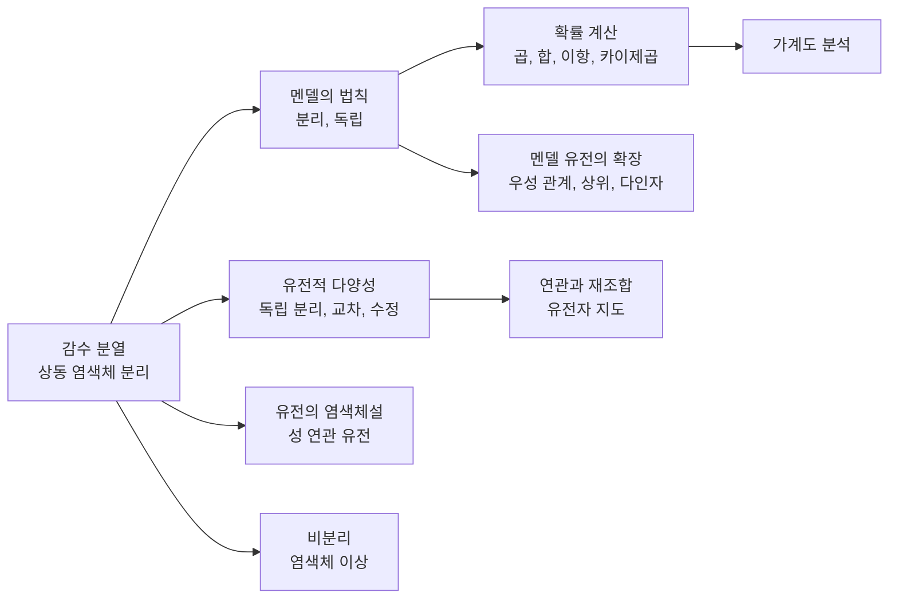

# 일반생명과학 5. 감수 분열과 유전 양식 — 염색체의 춤이 만드는 확률의 규칙
<!-- prev: gene-1, bio-3, m3-06, ubio-4 -->
<!-- next: ubio-6, ubio-8 -->

> [!NOTE]
> **이 단원의 범위**
> - 감수 분열 과정과 유전적 다양성(독립 분리, 교차, 무작위 수정)
> - 멘델의 법칙과 확률 계산
> - 멘델 유전의 확장(불완전 우성, 공우성, 복대립, 다면 발현, 상위, 다인자 유전)
> - 가계도 분석, 유전의 염색체설과 성 연관 유전
> - 연관과 재조합 빈도, 유전자 지도, 염색체 수·구조 이상

**학습 목표**

1. 감수 1분열 전기의 상동 염색체 접합과 교차, 감수 1·2분열의 분리 대상 차이를 분자 수준(코헤신, 키네토코어)까지 설명하고, 유전적 다양성의 세 원천을 정량적으로 비교할 수 있다.
2. 멘델의 분리·독립 법칙을 감수 분열의 염색체 행동으로 설명하고, 곱·합 규칙, 이항 분포, 카이제곱 검정으로 교배 결과를 예측하고 검정할 수 있다.
3. 불완전 우성, 공우성, 복대립, 다면 발현, 상위, 다인자 유전과 같은 멘델 유전의 확장 양상을 구별하고 변형된 분리비를 해석할 수 있다.
4. 가계도로 유전 방식을 판별하고, 조건부 확률(베이즈 추론 포함)을 써서 유전 위험을 계산할 수 있다.
5. 유전의 염색체설을 뒷받침한 실험(초파리 흰 눈, 비분리)을 설명하고, 성 결정 방식과 성 연관 유전, X 염색체 불활성화를 설명할 수 있다.
6. 검정 교배 자료로 재조합 빈도를 구하고, 3점 검정 교배로 유전자 순서와 거리, 간섭을 구하며, 염색체 수·구조 이상의 원인과 결과를 설명할 수 있다.

**이 단원의 학습 사다리**

| 단계 | 무엇을 하나? |
|---|---|
| STEP 1. 이전 학습 다시 보기 | 중3 「생식과 유전」, 생명과학 「생명의 연속성과 다양성」, 생물의 유전 「유전자와 유전물질」을 다시 꺼낸다 |
| STEP 2. 기초 다지기 | 유전 기호, 확률의 곱·합 규칙과 이항 분포, 카이제곱 검정 |
| STEP 3. 핵심 개념 | 감수 분열 → 다양성의 원천 → 멘델 법칙과 확률 → 멘델 유전의 확장 → 가계도 → 염색체설과 성 연관 → 연관과 유전자 지도 → 염색체 이상 |
| STEP 4. 오개념 바로잡기 | "우성은 흔하다?", "재조합 빈도는 거리에 정비례한다?" 같은 착각 |
| STEP 5. 전공으로 한 걸음 | 지도 함수, LOD 점수, 유전체 각인과 세포질 유전 |
| STEP 6. 생활·산업·진로 | 유전 상담, 분자 표지 육종, 씨 없는 수박, 산전 선별 검사 |

---

## 🗺️ 단원 들어가기

형제자매는 같은 부모에게서 태어났는데도 얼굴, 키, 혈액형이 제각각이다. 그런데 이 '제각각'에는 놀랍도록 엄밀한 규칙이 있다. 혈액형이 A형($I^Ai$)인 아버지와 B형($I^Bi$)인 어머니의 자녀는 A, B, AB, O형이 각각 정확히 $\dfrac14$의 확률로 나온다. 왜 하필 $\dfrac14$일까?

1860년대 멘델은 완두 수천 그루를 세어 이런 비율을 찾아냈지만, 그 이유를 설명할 '실체'는 알지 못했다. 40년 가까이 지나 현미경으로 **감수 분열**을 관찰하던 연구자들이 상동 염색체가 짝을 지었다가 갈라지는 모습이 멘델의 '유전 인자'의 행동과 똑같다는 것을 알아챘다. 그리고 다시 10여 년 뒤 초파리를 키우던 연구실에서, 같은 염색체 위의 유전자는 함께 다니되 가끔 자리를 바꾼다는 사실이 밝혀졌고, 그 '가끔'의 빈도로 염색체 위 유전자의 **지도**를 그릴 수 있게 되었다.

이 단원은 감수 분열이라는 염색체의 움직임에서 출발하여, 그것이 어떻게 유전의 **확률 규칙**이 되는지, 규칙이 복잡해 보이는 경우(멘델 유전의 확장)는 어떻게 이해하는지, 같은 염색체 위의 유전자는 어떻게 지도로 그리는지, 염색체 자체가 잘못 나뉘면 무슨 일이 생기는지를 차례로 다룬다.

---

## STEP 1. 🔙 이전 학습 다시 보기

### 연계 개념표

| 이전 단원 | 고등학교까지 배운 것 | 이 단원에서 확장되는 것 |
|---|---|---|
| 중3 「생식과 유전」 '멘델의 유전 실험' | 우열·분리·독립의 원리, 9 : 3 : 3 : 1, 중간 유전 | 법칙의 염색체적 근거, 검정 교배, 카이제곱 검정, 변형된 분리비(9 : 3 : 4, 9 : 7, 2 : 1) |
| 생명과학 「생명의 연속성과 다양성」 '생식세포 형성' | 감수 1·2분열의 염색체 행동, 2가 염색체와 교차, $2^{23}$가지 조합 | 감수 1분열 전기의 세부 단계, 시냅토네마 복합체, 코헤신의 단계적 제거, 교차가 다양성에 더하는 몫 |
| 생물의 유전 「유전자와 유전물질」 '상염색체·성염색체 유전' | ABO식 혈액형, X 염색체 열성 유전, 가계도 분석의 논리, 조건부 확률 | X 염색체 우성·Y 연관, 베이즈 추론, 성 결정 방식의 다양성, X 염색체 불활성화 |
| 생물의 유전 「유전자와 유전물질」 '다유전자유전'과 '염색체 이상' | 누적 효과 모형, 비분리와 다운·터너·클라인펠터 증후군, 결실·중복·역위·전좌 | 이항 분포와 문턱 모형, 배수성, 역위·전좌 보인자의 생식세포, 산모 나이 효과 |
| 생물의 유전 「유전자와 유전물질」 STEP 5 | 연관과 교차, 재조합 빈도의 정의(맛보기) | 2점·3점 검정 교배, 이중 교차와 간섭, 유전자 지도 작성 |
| 일반생명과학 「세포 신호 전달과 세포 주기」 | 체세포 분열, 코헤신, 키네토코어, M 검문 지점 | 감수 분열에서 키네토코어 방향과 코헤신 보호가 체세포 분열과 어떻게 다른지 |

고등학교에서는 "감수 분열에서 상동 염색체가 나뉜다"와 "분리비는 이렇게 나온다"를 따로 배운 경우가 많다. 대학에서는 이 둘이 **하나의 사실**(염색체의 행동 = 유전자의 행동)임을 실험 근거로 확인하고, 그 위에서 확률·통계로 유전을 다룬다.

### 준비 운동 (사전 진단)

**Q1.** $2n = 8$인 생물에서 감수 1분열 중기 세포 하나의 2가 염색체 수와 염색 분체 수는?

**Q2.** 완두에서 $RrYy$를 자가 수분하면 자손의 표현형 비는? 그중 $rryy$의 비율은?

**Q3.** 정상인 부모 사이에서 상염색체 열성 유전병인 자녀가 태어났다. 이 부모의 정상 자녀가 보인자일 확률은?

**Q4.** 감수 2분열에서 비분리가 일어나면 생식세포 4개 중 몇 개가 염색체 수 이상인가?

정답 및 해설

**Q1.** 2가 염색체 4개, 염색 분체 16개. 상동 염색체 4쌍이 각각 2가 염색체를 이루고, 염색체 8개가 각각 염색 분체 2개씩이다.

**Q2.** 9 : 3 : 3 : 1, $rryy$는 $\dfrac14 \times \dfrac14 = \dfrac{1}{16}$이다.

**Q3.** $\dfrac23$. 부모는 모두 $Aa$이고, 정상 자녀($AA : Aa = 1 : 2$) 중 $Aa$의 비율이다.

**Q4.** 2개. 비분리가 일어난 쪽의 딸세포에서만 $n+1$과 $n-1$이 하나씩 생기고, 다른 쪽 두 세포는 정상이다.

---

## STEP 2. 🧱 기초 다지기

### ① 유전 기호 읽기

| 표기 | 뜻 | 예 |
|---|---|---|
| $A$, $a$ | 대문자는 우성, 소문자는 열성 대립유전자(멘델식) | $Aa$ |
| $+$ 위첨자 | **야생형**(wild type, 자연 집단에 흔한 형) 대립유전자(초파리식) | $w^+$ 붉은 눈, $w$ 흰 눈 |
| $I^A$, $I^B$, $i$ | 같은 유전자 자리의 여러 대립유전자를 위첨자로 구별 | ABO식 혈액형 |
| $X^{a}Y$ | 성염색체 위 유전자는 염색체 기호에 위첨자로 | 혈우병 남자 |
| $\dfrac{AB}{ab}$ | 연관된 두 유전자. 가로줄 위·아래가 각각 한 염색체 | $A$와 $B$가 한 염색체에(상인), $\dfrac{Ab}{aB}$는 상반 |
| P, F₁, F₂ | 어버이 세대, 잡종 1대, 잡종 2대 | |

### ② 확률 — 곱 규칙, 합 규칙, 이항 분포

- **곱 규칙**: 독립인 사건이 모두 일어날 확률은 각 확률의 곱. 여러 유전자를 **한 유전자씩 따로 계산해 곱하면** 퍼넷 사각형을 그리지 않아도 된다.
- **합 규칙**: 서로 배타적인 사건 중 하나가 일어날 확률은 각 확률의 합.
- **이항 분포**: 한 자녀가 형질 X를 가질 확률이 $p$일 때, 자녀 $n$명 중 정확히 $k$명이 X일 확률은

$$
P(k) = \binom{n}{k} p^{k}(1-p)^{n-k}
$$

"적어도 한 명"은 여사건으로 $1 - (1-p)^n$이다.

#### 예제 1 — 갈래 대신 곱셈

$AaBbCcDd \times AaBbccDd$(네 유전자는 서로 다른 염색체에 있음)에서 (1) 자손이 $AaBbccDd$일 확률, (2) 네 형질 모두 우성 표현형일 확률을 구하시오.

**풀이**
(1) $Aa$: $\dfrac12$, $Bb$: $\dfrac12$, $cc$($Cc \times cc$): $\dfrac12$, $Dd$: $\dfrac12$ → $\left(\dfrac12\right)^4 = \dfrac{1}{16}$
(2) $A\_$: $\dfrac34$, $B\_$: $\dfrac34$, $C\_$($Cc \times cc$): $\dfrac12$, $D\_$: $\dfrac34$ → $\dfrac34 \cdot \dfrac34 \cdot \dfrac12 \cdot \dfrac34 = \dfrac{27}{128}$

이 교배의 퍼넷 사각형은 $16 \times 8 = 128$칸이다. 유전자별로 나누어 곱하는 방법이 훨씬 빠르고 실수가 적다.

### ③ 카이제곱 검정 — "이 정도 차이는 우연인가?"

실제 교배에서 관찰 수는 기대 비율과 정확히 같지 않다. 그 차이가 **우연한 표집 오차**인지, 가설이 틀렸다는 **증거**인지 판단하는 도구가 **카이제곱($\chi^2$) 적합도 검정**이다.

$$
\chi^2 = \sum \frac{(\text{관찰 수} - \text{기대 수})^2}{\text{기대 수}}
$$

1. **귀무가설**을 세운다(예: "9 : 3 : 3 : 1로 분리한다").
2. 기대 수를 계산하고 $\chi^2$를 구한다. 비율이 아니라 **개수**로 계산해야 한다.
3. **자유도** = 범주 수 − 1
4. 표의 임곗값과 비교한다. 생물학에서는 흔히 유의 수준 0.05를 쓴다.

| 자유도 | 1 | 2 | 3 | 4 |
|---|---|---|---|---|
| 임곗값($p = 0.05$) | 3.84 | 5.99 | 7.81 | 9.49 |

$\chi^2$이 임곗값보다 **작으면** "가설과 어긋난다고 볼 근거가 없다"(기각하지 않음), **크면** 가설을 기각한다.

> [!IMPORTANT]
> 검정을 통과했다고 가설이 '증명'된 것은 아니다. "자료가 가설과 모순되지 않는다"는 뜻일 뿐이다. 또 기대 수가 너무 작으면(대략 5 미만인 범주가 있으면) 검정이 부정확해진다.

---

## STEP 3. 📘 핵심 개념

### ① 감수 분열의 과정 — 한 번 복제, 두 번 분열

#### 왜 감수 분열인가

유성 생식을 하는 생물은 두 생식세포가 합쳐져(수정) 새 개체가 된다. 생식세포가 체세포와 같은 $2n$이라면 세대마다 염색체 수가 두 배가 될 것이다. **감수 분열**(meiosis)은 DNA를 **한 번** 복제한 뒤 **두 번** 연속 분열하여, 핵상 $2n$인 세포에서 $n$인 세포 4개를 만든다.

| 생활사 유형 | 감수 분열이 일어나는 때 | 다세포 세대 | 예 |
|---|---|---|---|
| 배우자 감수 분열 | 생식세포를 만들 때 | $2n$만 | 대부분의 동물 |
| 포자 감수 분열(세대 교번) | 포자를 만들 때 | $n$(배우체)과 $2n$(포자체) 모두 | 식물, 일부 조류 |
| 접합자 감수 분열 | 수정란이 생긴 직후 | $n$만 | 많은 균류, 일부 원생생물 |

#### 감수 1분열 — 상동 염색체가 갈라진다

감수 1분열 전기는 길고 복잡하며, 사람 난모세포에서는 태아 때 시작해 수십 년 동안 멈춰 있기도 하다. 세부 단계는 다음과 같다.

| 전기 Ⅰ의 세부 단계 | 일어나는 일 |
|---|---|
| 세사기(렙토텐) | 복제된 염색체가 가는 실처럼 응축되기 시작 |
| 접합기(자이고텐) | 상동 염색체가 서로를 찾아 길이 방향으로 나란히 붙기 시작(**접합**, synapsis). 단백질 사다리인 **시냅토네마 복합체**가 둘을 지퍼처럼 붙임 |
| 태사기(파키텐) | 접합 완료(**2가 염색체**, 염색 분체 4개 = 4분 염색체). 이 시기에 비자매 염색 분체 사이에서 **교차**(crossing over)가 일어남 |
| 복사기(디플로텐) | 시냅토네마 복합체가 풀리며 상동 염색체가 조금 떨어짐. 교차가 일어난 자리가 X자 모양 **키아즈마**(chiasma)로 보임 |
| 이동기(디아키네시스) | 염색체가 최대로 응축, 핵막이 사라짐 |

교차는 DNA가 **의도적으로 끊어진 뒤** 상동 염색체의 같은 서열을 주형 삼아 다시 이어지는 과정이다. 상동 염색체 한 쌍마다 대개 **적어도 한 번**의 교차가 일어나는데, 이 교차(키아즈마)가 두 상동 염색체를 중기 Ⅰ까지 붙잡아 두어 양극으로 정확히 갈라지게 한다. 교차가 전혀 없는 상동 염색체 쌍은 비분리를 일으키기 쉽다.

| 단계 | 감수 1분열 | 감수 2분열 |
|---|---|---|
| 중기 | 2가 염색체가 적도면에 배열. **자매 염색 분체의 키네토코어가 같은 극**을 향함 | 염색체가 적도면에 배열. 자매 키네토코어가 **반대 극**을 향함(체세포 분열과 같음) |
| 후기 | 팔 부분의 코헤신이 잘려 **상동 염색체가 분리**. 동원체 부근의 코헤신은 보호되어 자매 염색 분체는 붙어 있음 | 동원체 부근 코헤신이 잘려 **자매 염색 분체가 분리** |
| 결과 | $2n \to n$, 세포 2개(각 염색체는 염색 분체 2개) | $n \to n$, 세포 4개(각 염색체는 염색 분체 1개) |
| 사이 시기 | 감수 1분열과 2분열 사이에 **DNA 복제가 없음** | |

#### 체세포 분열과 감수 분열 — 무엇이 다른가

| 구분 | 체세포 분열 | 감수 분열 |
|---|---|---|
| 상동 염색체의 접합·교차 | 없음(드물게 체세포 교차) | 전기 Ⅰ에 있음 |
| 중기에 배열되는 단위 | 염색체 하나하나 | 중기 Ⅰ: 2가 염색체(상동 쌍) |
| 자매 키네토코어의 방향 | 반대 극 | 중기 Ⅰ: 같은 극 / 중기 Ⅱ: 반대 극 |
| 코헤신 제거 | 후기에 한꺼번에 | 후기 Ⅰ: 팔 부분 / 후기 Ⅱ: 동원체 부분 |
| 딸세포 | 2개, 모세포와 유전적으로 같음 | 4개, 반수체, 서로 유전적으로 다름 |

<!-- fig:ubio-5-kinetochore-orientation -->

> [!TIP]
> 💡 **비유** — 체세포 분열은 '복사한 서류 묶음을 두 사람에게 똑같이 나눠 주기'이다. 감수 분열은 먼저 '아버지 쪽 책과 어머니 쪽 책 중 한 권씩 고르고(1분열), 그 책의 원본과 복사본을 다시 나누는(2분열)' 과정이다. 그리고 1분열 전에 두 책의 일부 쪽을 맞바꿔 끼우는 일(교차)이 일어난다.

#### 예제 2 — 감수 분열 단계별 수 세기

$2n = 6$인 동물의 정모세포에 대해 표를 채우시오(DNA 양은 G₁기 세포를 2로 함).

| 시기 | 세포 1개의 염색체 수 | 염색 분체 수 | 2가 염색체 수 | DNA 상대량 |
|---|---|---|---|---|
| G₁기 | 6 | 6 | 0 | 2 |
| 중기 Ⅰ | (가) | (나) | (다) | (라) |
| 중기 Ⅱ | (마) | (바) | 0 | (사) |
| 정세포 | 3 | 3 | 0 | 1 |

**풀이** (가) 6 (나) 12 (다) 3 (라) 4 (마) 3 (바) 6 (사) 2

<!-- fig:ubio-5-q-meiosis-counts -->

중기 Ⅰ과 중기 Ⅱ의 DNA 상대량 비는 2 : 1이고, 염색체 수 비도 2 : 1이다. 반면 중기 Ⅰ의 세포와 G₂기 세포는 염색체 수·DNA 양이 같지만 2가 염색체 유무로 구별된다.

#### ✔ 바로 확인

1. (O/X) 감수 1분열과 감수 2분열 사이에 DNA가 한 번 더 복제된다.
2. 빈칸: 상동 염색체가 길이 방향으로 접합하여 생긴, 염색 분체 4개짜리 구조를 (    ) 염색체라 한다.
3. $2n = 8$인 동물의 중기 Ⅱ 세포 1개에 있는 염색체 수와 염색 분체 수는?
4. 교차가 일어나는 시기는 전기 Ⅰ의 어느 세부 단계인가?

정답

1. X — DNA는 감수 분열 전에 한 번만 복제되고 두 번 연속 분열한다.
2. 2가 — 4분 염색체라고도 한다.
3. 4개, 8개 — 감수 1분열로 $n = 4$가 되었지만 각 염색체는 아직 염색 분체 2개이다.
4. 태사기(파키텐) — 접합이 완료되어 2가 염색체가 된 시기이다. 복사기에 키아즈마로 보인다.

---

### ② 유전적 다양성의 세 원천 — 독립 분리, 교차, 무작위 수정

| 원천 | 일어나는 때 | 원리 | 크기(사람) |
|---|---|---|---|
| **독립 분리**(independent assortment) | 중기 Ⅰ | 각 상동 염색체 쌍이 부계·모계 중 어느 쪽을 어느 극으로 보낼지 다른 쌍과 독립적으로 정해짐 | $2^{23} = 8\,388\,608$가지 생식세포 |
| **교차**(crossing over) | 전기 Ⅰ | 비자매 염색 분체가 일부를 교환하여 부계·모계 대립유전자가 섞인 **재조합 염색체**가 생김 | 염색체당 평균 1~3회 교차 → 사실상 무한 |
| **무작위 수정**(random fertilization) | 수정 | 어떤 정자와 어떤 난자가 만날지 무작위 | 교차 없이도 $2^{23} \times 2^{23} = 2^{46} \approx 7.0 \times 10^{13}$가지 |

교차 하나는 그 염색체의 생식세포 유형을 **두 배 이상** 늘린다. 염색체 한 쌍에 여러 유전자가 있고 교차 위치가 매번 다르므로, 사람의 생식세포가 이전에 만들어진 어떤 것과 같을 확률은 사실상 0이다. 이 다양성이 자연 선택의 재료가 된다(「진화의 원리」).

<!-- fig:ubio-5-independent-assortment -->

#### 예제 3 — 생식세포의 종류

$2n = 8$인 어떤 생물이 네 쌍의 상동 염색체 각각에 이형 접합 유전자를 하나씩 가진다($AaBbCcDd$, 모두 다른 염색체). (1) 교차를 무시할 때 만들 수 있는 생식세포의 유전자형은 몇 가지인가? (2) 이 개체를 자가 수정하면 자손의 유전자형은 몇 가지인가?

**풀이**
(1) 쌍마다 2가지 → $2^4 = 16$가지
(2) 유전자마다 $AA$, $Aa$, $aa$의 3가지 → $3^4 = 81$가지

생식세포 종류는 $2^n$, 자손 유전자형은 $3^n$으로 늘어난다. 이 단순한 계산만으로도 유성 생식이 만드는 조합의 폭을 알 수 있다.

#### ✔ 바로 확인

1. $2n = 6$인 생물이 교차 없이 만들 수 있는 생식세포의 염색체 조합은 몇 가지인가?
2. (O/X) 독립 분리는 중기 Ⅱ에서 자매 염색 분체가 무작위로 배열되기 때문에 일어난다.
3. 짝짓기: (1) 독립 분리 (2) 교차 (3) 무작위 수정 — ㄱ. 수정 ㄴ. 전기 Ⅰ ㄷ. 중기 Ⅰ
4. $AaBbCc$(세 유전자는 서로 다른 염색체)를 자가 수정하면 자손의 유전자형은 몇 가지인가?

정답

1. 8가지 — 상동 염색체 3쌍이므로 $2^3$이다.
2. X — 중기 Ⅰ에서 상동 염색체 쌍들이 서로 독립적으로 배열되기 때문이다.
3. (1) ㄷ (2) ㄴ (3) ㄱ
4. 27가지 — 유전자마다 3가지이므로 $3^3$이다.

---

### ③ 멘델의 법칙과 확률 계산

#### 멘델의 실험이 바꾼 생각 — 섞임 유전에서 입자 유전으로

멘델 이전에는 부모의 형질이 물감처럼 섞인다는 **섞임 유전**이 널리 받아들여졌다. 섞임 유전이 맞다면 F₁에서 사라진 형질은 F₂에서 다시 나타날 수 없다. 멘델은 F₁에서 사라진 흰 꽃이 F₂에서 약 $\dfrac14$로 **그대로** 다시 나타나는 것을 보고, 형질을 결정하는 단위(유전자)가 **섞이지 않는 입자**로 전달된다고 결론지었다.

멘델이 성공한 이유는 ① 대립 형질이 뚜렷하고 자가·타가 수분을 통제할 수 있는 완두를 골랐고, ② 순종을 먼저 확보했으며, ③ 한 번에 한두 형질만 추적했고, ④ 많은 개체를 **세어서** 비율로 분석했기 때문이다.

#### 분리의 법칙과 독립의 법칙 — 감수 분열로 다시 읽기

| 법칙 | 내용 | 감수 분열의 대응 사건 |
|---|---|---|
| **분리의 법칙** | 한 쌍의 대립유전자는 생식세포를 만들 때 분리되어 각 생식세포에 하나씩 들어간다 | 후기 Ⅰ의 상동 염색체 분리 |
| **독립의 법칙** | 서로 다른 형질의 대립유전자 쌍은 서로 독립적으로 분리된다 | 중기 Ⅰ에서 서로 다른 상동 염색체 쌍의 무작위 배열 |

> [!WARNING]
> 독립의 법칙은 두 유전자가 **서로 다른 염색체**에 있거나 같은 염색체라도 **아주 멀리** 떨어져 있을 때만 성립한다. 가까이 있는 유전자는 연관되어 함께 움직인다(STEP 3-⑦).

#### 검정 교배 — 보이지 않는 유전자형을 드러내기

우성 표현형 개체의 유전자형($AA$인지 $Aa$인지)을 알려면 **열성 동형 접합**($aa$)과 교배한다. 열성 개체는 $a$만 주므로, 자손의 표현형이 곧 검사 대상이 만든 생식세포의 종류와 비율을 보여 준다.

| 검사 대상 | 생식세포 | 검정 교배 자손 |
|---|---|---|
| $AA$ | $A$ | 모두 우성 |
| $Aa$ | $A : a = 1 : 1$ | 우성 : 열성 = 1 : 1 |
| $AaBb$(독립) | $AB : Ab : aB : ab = 1 : 1 : 1 : 1$ | 네 표현형이 1 : 1 : 1 : 1 |

검정 교배는 연관과 재조합 빈도를 구할 때도 핵심 도구가 된다.

#### 예제 4 — 이항 분포로 가족 예측하기

어떤 상염색체 열성 유전병에 대해 보인자인 부부($Aa \times Aa$)가 자녀 5명을 낳는다. (1) 정확히 2명이 유전병일 확률, (2) 적어도 1명이 유전병일 확률을 구하시오.

**풀이** 한 자녀가 유전병일 확률 $p = \dfrac14$
(1) $\dbinom{5}{2}\left(\dfrac14\right)^2\left(\dfrac34\right)^3 = 10 \times \dfrac{1}{16} \times \dfrac{27}{64} = \dfrac{270}{1024} = \dfrac{135}{512} \approx 0.26$
(2) $1 - \left(\dfrac34\right)^5 = 1 - \dfrac{243}{1024} = \dfrac{781}{1024} \approx 0.76$

"자녀 4명 중 1명이 유전병이다"라는 것은 **확률**이지 약속이 아니다. 자녀마다 확률은 독립적으로 $\dfrac14$이다.

#### 예제 5 — 카이제곱 검정으로 독립의 법칙 확인하기

어떤 식물에서 두 형질에 대해 이형 접합인 F₁을 자가 수분하여 F₂ 400개체를 얻었다. 관찰 결과가 9 : 3 : 3 : 1에 맞는지 검정하시오.

| 표현형 | 우성·우성 | 우성·열성 | 열성·우성 | 열성·열성 |
|---|---|---|---|---|
| 관찰 수 | 218 | 84 | 71 | 27 |

**풀이**
- 기대 수: $400 \times \dfrac{9}{16} = 225$, $75$, $75$, $25$
- $\chi^2 = \dfrac{(218-225)^2}{225} + \dfrac{(84-75)^2}{75} + \dfrac{(71-75)^2}{75} + \dfrac{(27-25)^2}{25}$
  $= 0.218 + 1.080 + 0.213 + 0.160 \approx 1.67$
- 자유도 $4 - 1 = 3$, 임곗값 7.81

$1.67 < 7.81$이므로 귀무가설을 기각하지 않는다. 관찰된 차이는 표집 오차로 설명할 수 있으며, 두 유전자가 독립적으로 분리한다는 가설과 모순되지 않는다.

<!-- sim:u-chi-square -->

#### ✔ 바로 확인

1. $Aa \times aa$의 자손에서 우성 표현형 : 열성 표현형의 비는?
2. (O/X) 분리의 법칙은 후기 Ⅰ에 상동 염색체가 갈라지는 것으로 설명된다.
3. $Aa \times Aa$ 부부의 자녀 3명이 모두 열성 표현형일 확률은?
4. F₂에서 네 표현형의 관찰 수로 9 : 3 : 3 : 1을 카이제곱 검정할 때 자유도는?

정답

1. 1 : 1 — 검정 교배이므로 $Aa$가 만드는 생식세포 비가 그대로 나타난다.
2. O — 대립유전자는 상동 염색체의 같은 자리에 있다.
3. $\dfrac{1}{64}$ — 자녀마다 독립적으로 $\dfrac14$이므로 $\left(\dfrac14\right)^3$이다.
4. 3 — 부류 수 4에서 1을 뺀다.

---

### ④ 멘델 유전의 확장 — 규칙이 '깨진 것처럼' 보일 때

멘델이 고른 완두의 일곱 형질은 모두 완전 우성이고 한 유전자가 한 형질을 정했다. 실제 생물의 유전은 더 다양하지만, **분리와 독립의 원리 자체는 그대로**이다. 달라지는 것은 유전자형이 표현형으로 바뀌는 방식이다.

#### (1) 대립유전자 사이의 관계 — 불완전 우성, 공우성, 복대립

| 양상 | 이형 접합의 표현형 | 예 | F₂ 표현형 비 |
|---|---|---|---|
| 완전 우성 | 우성 동형 접합과 같음 | 완두 꽃 색 | 3 : 1 |
| **불완전 우성** | 두 동형 접합의 중간 | 금어초·분꽃의 붉은 꽃 × 흰 꽃 → 분홍 꽃 | 1 : 2 : 1 |
| **공우성** | 두 대립유전자의 형질이 **모두** 나타남 | MN식 혈액형($L^ML^N$은 M과 N 항원 모두), ABO식의 $I^AI^B$ | 1 : 2 : 1 |
| **복대립** | 한 유전자 자리에 대립유전자가 셋 이상 | ABO식 혈액형($I^A = I^B > i$), 토끼 털색 | 교배에 따라 다름 |

우성과 열성은 **분자 수준의 기능**으로 이해할 수 있다. 예를 들어 테이–삭스병의 원인 효소는 이형 접합에서 정상의 절반만 만들어지지만 기능에 충분하므로 **개체 수준**에서는 열성이다. 그러나 **효소 활성 수준**에서는 중간값이므로 불완전 우성이고, **분자 수준**에서는 두 대립유전자 산물이 모두 만들어지므로 공우성이다. 우열은 "어느 수준에서 보느냐"에 따라 달라진다.

#### (2) 다면 발현 — 한 유전자, 여러 형질

**다면 발현**(pleiotropy)은 한 유전자가 여러 표현형에 영향을 주는 것이다. 낫 모양 적혈구 빈혈증의 대립유전자는 헤모글로빈 하나를 바꾸지만, 그 결과 빈혈, 혈관 막힘과 통증, 비장 손상, 그리고 이형 접합에서는 **말라리아 저항성**까지 나타난다. 마르판 증후군의 원인 유전자(결합 조직 단백질)는 키, 손가락 길이, 심장 대동맥, 눈의 수정체에 함께 영향을 준다.

**치사 대립유전자**도 다면 발현의 예이다. 생쥐의 노란 털 대립유전자 $A^Y$는 털색에는 우성이지만 동형 접합($A^YA^Y$)이면 배아 때 죽는다(생존에는 열성 치사). 그래서 노란 쥐끼리 교배하면 노란 : 비노란 $= 2 : 1$이 된다.

#### (3) 상위 — 한 유전자가 다른 유전자의 발현을 가린다

**상위**(epistasis)는 한 유전자 자리의 유전자형이 다른 자리의 표현형 발현을 가리거나 바꾸는 것이다. 래브라도레트리버의 털색은 두 유전자로 정해진다.

- $B$(검정 색소) > $b$(갈색 색소)
- $E$: 색소를 털에 쌓음 > $e$: 색소를 쌓지 못함 → $ee$이면 $B$, $b$와 관계없이 **노란색**

$BbEe \times BbEe$에서

| 유전자형 | $B\_E\_$ | $bbE\_$ | $B\_ee$ | $bbee$ |
|---|---|---|---|---|
| 비율 | 9 | 3 | 3 | 1 |
| 표현형 | 검정 | 갈색(초콜릿) | 노랑 | 노랑 |

검정 : 갈색 : 노랑 $= 9 : 3 : 4$가 된다. 16칸의 합이 그대로이므로 **두 유전자가 독립적으로 분리**한다는 것을 알 수 있다.

두 유전자가 한 대사 경로의 연속된 단계를 맡으면 **9 : 7**이 나오기도 한다. 예를 들어 무색 전구 물질 → (효소 C) → 중간 물질 → (효소 P) → 보라 색소일 때, 두 효소가 모두 있어야($C\_P\_$) 보라색이고 나머지는 모두 흰색이다.

| 상호 작용 | F₂ 비 | 해석 |
|---|---|---|
| 독립(상호 작용 없음) | 9 : 3 : 3 : 1 | 두 형질이 따로 |
| 열성 상위 | 9 : 3 : 4 | $ee$가 다른 유전자를 가림 |
| 상보 유전자(이중 열성 상위) | 9 : 7 | 두 우성 대립유전자가 모두 필요 |
| 우성 상위 | 12 : 3 : 1 | 한 유전자의 우성이 다른 유전자를 가림 |

<!-- fig:ubio-5-epistasis -->

> [!TIP]
> 💡 **요령** — F₂ 비의 합이 **16**이면 두 유전자가 독립적으로 분리하는 것이다. 9 : 3 : 4나 9 : 7은 9 : 3 : 3 : 1의 칸을 **묶은 것**일 뿐이다. 먼저 합을 보고 16칸 중 어느 칸끼리 묶였는지 찾자.

#### (4) 다인자 유전과 환경

**다인자 유전**(polygenic inheritance)은 여러 유전자가 누적 효과를 내는 양적 형질의 유전이다. $n$쌍의 유전자가 같은 크기로 더해지면 F₂에서 대문자 대립유전자 수 $k$의 확률은 $\dbinom{2n}{k}\left(\dfrac12\right)^{2n}$이고, 표현형은 $2n+1$가지가 된다. 여기에 환경의 영향이 더해지면 분포는 매끄러운 종 모양이 된다.

같은 유전자형도 환경에 따라 표현형이 달라진다. 수국은 토양의 산성도에 따라 꽃 색이 푸른색~분홍색으로 바뀌고, 히말라야 토끼는 체온이 낮은 귀·발끝에만 검은 털이 난다(온도에 민감한 색소 효소). 한 유전자형이 환경에 따라 나타내는 표현형의 범위를 **반응 규격**(norm of reaction)이라 한다. 같은 유전자형을 가진 개체 중 형질이 나타나는 비율을 **침투도**(penetrance), 나타나는 정도를 **표현도**(expressivity)라 한다.

#### 예제 6 — 상위의 분리비

래브라도레트리버에서 검정 수컷($BbEe$)과 갈색 암컷($bbEe$)을 교배할 때 자손의 표현형 비를 구하시오.

**풀이** 유전자별로 나누어 곱한다.
- $B$ 유전자: $Bb \times bb$ → $B\_ : bb = \dfrac12 : \dfrac12$
- $E$ 유전자: $Ee \times Ee$ → $E\_ : ee = \dfrac34 : \dfrac14$

검정($B\_E\_$) $= \dfrac12 \times \dfrac34 = \dfrac38$, 갈색($bbE\_$) $= \dfrac12 \times \dfrac34 = \dfrac38$, 노랑($\_\_ee$) $= \dfrac14$

**답** 검정 : 갈색 : 노랑 $= 3 : 3 : 2$

#### ✔ 바로 확인

1. 짝짓기: (1) 붉은 꽃 × 흰 꽃 분꽃의 F₁이 분홍 꽃 (2) $L^ML^N$인 사람이 M 항원과 N 항원을 모두 가짐 (3) 한 유전자 자리에 $I^A$, $I^B$, $i$가 있음 — ㄱ. 공우성 ㄴ. 복대립 ㄷ. 불완전 우성
2. 노란 털 생쥐($A^Ya$)끼리 교배하면 태어나는 자손의 노란 털 : 노랗지 않은 털의 비는?
3. (O/X) F₂의 표현형 비가 9 : 3 : 4이면 두 유전자가 같은 염색체에 연관되어 있다.
4. 빈칸: 한 유전자가 여러 표현형에 영향을 주는 것을 (    )이라 한다.

정답

1. (1) ㄷ (2) ㄱ (3) ㄴ
2. 2 : 1 — $A^YA^Y$는 배아 때 죽으므로 $A^Ya : aa = 2 : 1$이다.
3. X — 합이 16이므로 두 유전자는 독립적으로 분리한다. 9 : 3 : 3 : 1의 칸이 상위로 묶였을 뿐이다.
4. 다면 발현 — 예: 낫 모양 적혈구 빈혈증 대립유전자.

---

### ⑤ 가계도 분석 — 사람의 유전을 논리와 확률로

#### 유전 방식별 특징

| 유전 방식 | 가계도의 특징 | 예 |
|---|---|---|
| 상염색체 열성 | 정상 부모에게서 환자가 나옴, 대를 건너뜀, 남녀 비슷, 근친혼에서 빈도 증가 | 낭성 섬유증, 페닐케톤뇨증, 낫 모양 적혈구 빈혈증 |
| 상염색체 우성 | 환자에게 적어도 한쪽 환자 부모(새 돌연변이 제외), 대를 거르지 않음, 남녀 비슷 | 헌팅턴병, 연골 무형성증 |
| X 연관 열성 | 남자 환자가 훨씬 많음, 아버지 → 아들 전달 없음, 환자 남자의 딸은 모두 보인자 | 혈우병 A, 뒤셴 근육 퇴행 위축, 적록 색맹 |
| X 연관 우성 | 환자 아버지의 **딸은 모두** 환자, 아들은 모두 정상 | 저인산혈증성 구루병 |
| Y 연관 | 아버지 → 아들로만, 모든 아들 | (Y의 유전자 수가 적어 드묾) |

분석 순서는 「유전자와 유전물질」에서 배운 대로 ① 우열 판단 → ② 위치(상염색체/X) 판단 → ③ 유전자형 → ④ 확률이다. 대학 단계에서는 여기에 **조건부 확률을 정보로 갱신하는 방법**(베이즈 추론)을 더한다.

<!-- fig:ubio-5-pedigree-bayes -->

#### 예제 7 — 사촌이 아닌 두 '정상 형제' 사이의 위험

남자 갑과 여자 을은 각자 상염색체 열성 유전병 환자인 형제자매가 있고, 갑과 을, 그리고 넷의 부모는 모두 정상이다. 갑과 을이 결혼하여 첫 아이를 낳을 때 유전병일 확률은? (두 집안은 혈연관계가 없다.)

**풀이**
- 갑의 부모는 모두 $Aa$ → 정상인 갑이 $Aa$일 확률 $\dfrac23$. 을도 마찬가지로 $\dfrac23$
- 둘 다 $Aa$일 때 자녀가 $aa$일 확률 $\dfrac14$
- $\dfrac23 \times \dfrac23 \times \dfrac14 = \dfrac19$

#### 예제 8 — 베이즈 추론: 정상인 아들 셋이 주는 정보

여자 병의 어머니는 혈우병 보인자($X^HX^h$)이고, 아버지는 정상이다. 병은 정상인 남자와 결혼해 **정상인 아들 3명**을 두었다. 병이 보인자일 확률은?

**풀이** 정보가 없을 때(사전 확률) 병이 보인자일 확률은 $\dfrac12$이다. 그런데 "아들 셋이 모두 정상"이라는 관찰은 병이 보인자가 **아닐** 가능성을 높인다.

| | 병이 보인자 | 병이 보인자가 아님 |
|---|---|---|
| 사전 확률 | $\dfrac12$ | $\dfrac12$ |
| 아들 3명이 모두 정상일 확률 | $\left(\dfrac12\right)^3 = \dfrac18$ | 1 |
| 곱(결합 확률) | $\dfrac{1}{16}$ | $\dfrac12 = \dfrac{8}{16}$ |
| 사후 확률 | $\dfrac{1/16}{9/16} = \dfrac19$ | $\dfrac89$ |

**답** $\dfrac19$. 처음 $\dfrac12$이던 확률이 관찰을 반영하여 $\dfrac19$로 줄었다. 유전 상담에서는 이렇게 가족 정보를 모두 반영해 위험을 계산한다.

> [!IMPORTANT]
> 조건부 확률에서 가장 흔한 실수는 **이미 알게 된 정보를 무시하는 것**이다. "정상"이라는 표현형, "아들이 모두 정상"이라는 관찰 모두가 확률을 바꾸는 정보이다.

#### ✔ 바로 확인

1. 정상인 부모에게서 유전병인 딸이 태어났다. 이 유전병의 유전 방식으로 가장 알맞은 것은?
2. (O/X) X 연관 열성 형질은 아버지에게서 아들로 전달될 수 있다.
3. 부모가 모두 $Aa$일 때 정상 표현형인 자녀가 보인자($Aa$)일 확률은?
4. 예제 8에서 병의 정상인 아들이 3명이 아니라 2명이라면 병이 보인자일 확률은?

정답

1. 상염색체 열성 — 정상 부모에게서 나왔으니 열성이고, X 연관 열성이라면 딸의 아버지가 환자여야 한다.
2. X — 아들은 아버지에게서 Y를 받으므로 아버지의 X 연관 형질을 받지 않는다.
3. $\dfrac23$ — 정상($AA$, $Aa$, $Aa$) 세 경우 중 두 경우이다.
4. $\dfrac15$ — 결합 확률 $\dfrac12 \times \dfrac14 = \dfrac18$과 $\dfrac12$에서 $\dfrac{1/8}{1/8 + 1/2} = \dfrac15$

---

### ⑥ 유전의 염색체설과 성 연관 유전

#### 유전의 염색체설

1902년 무렵 서턴(W. Sutton)과 보베리(T. Boveri)는 감수 분열 때 염색체의 행동이 멘델의 유전 인자의 행동과 꼭 같다는 점에 주목하여, **유전자는 염색체 위에 있다**는 **유전의 염색체설**(chromosome theory of inheritance)을 제안했다.

| 멘델의 유전 인자 | 감수 분열의 염색체 |
|---|---|
| 쌍으로 존재 | 상동 염색체가 쌍으로 존재 |
| 생식세포에 하나씩 분리 | 상동 염색체가 갈라져 하나씩 |
| 다른 형질과 독립적으로 분리 | 다른 상동 쌍과 독립적으로 배열 |
| 수정으로 다시 쌍이 됨 | 수정으로 다시 $2n$ |

그러나 '닮았다'는 것은 증거가 아니다. 결정적 증거는 초파리에서 나왔다.

#### 모건의 흰 눈 초파리 — 특정 유전자를 특정 염색체에

1910년 모건(T. H. Morgan)은 붉은 눈(야생형) 초파리 집단에서 **흰 눈 수컷** 한 마리를 발견했다.

| 교배 | F₁ | F₂ |
|---|---|---|
| 흰 눈 수컷 × 붉은 눈 암컷 | 모두 붉은 눈 | 붉은 눈 : 흰 눈 $= 3 : 1$, 그런데 **흰 눈은 모두 수컷** |
| 역교배: 흰 눈 암컷 × 붉은 눈 수컷 | 암컷은 모두 붉은 눈, **수컷은 모두 흰 눈** | 붉은 눈 : 흰 눈 $= 1 : 1$(암수 모두) |

흰 눈 대립유전자 $w$가 **X 염색체**에 있고 Y에는 대응 자리가 없다고 하면 모든 결과가 설명된다. 첫 교배는 $X^{w^+}X^{w^+} \times X^wY$ → F₁ $X^{w^+}X^w$, $X^{w^+}Y$ → F₂ 수컷의 절반이 $X^wY$(흰 눈). 정역교배 결과가 다르다는 점이 성 연관의 표지이다.

<!-- fig:ubio-5-morgan-cross -->

이후 모건의 제자 브리지스(C. Bridges)는 드물게 나타나는 '예외 자손'(흰 눈 암컷 × 붉은 눈 수컷에서 나온 흰 눈 **암컷**과 붉은 눈 **수컷**)이 X 염색체의 **비분리**로 생긴 $XXY$ 암컷과 $X0$ 수컷임을 현미경으로 확인했다(1916). 유전 현상의 예외가 염색체 이상과 정확히 대응한 것이다. 이로써 유전의 염색체설이 확립되었다.

#### 성 결정 방식은 하나가 아니다

| 방식 | 암 | 수 | 예 |
|---|---|---|---|
| XY | XX | XY | 포유류(Y의 SRY 유전자가 정소 발달을 시작), 초파리(X와 상염색체의 비율로 결정) |
| X0 | XX | X(하나) | 메뚜기, 일부 곤충 |
| ZW | ZW | ZZ | 조류, 나비·나방, 일부 어류·파충류 |
| 반수 배수성 | $2n$(수정란) | $n$(미수정란) | 꿀벌, 개미 |
| 온도 의존 | 알의 발생 온도에 따라 | | 일부 거북·악어 |

ZW 방식에서는 **암컷이 이형**이므로, 성 연관 열성 형질은 오히려 **암컷**에게 많이 나타난다.

#### X 염색체 불활성화 — 양을 맞추는 장치

포유류 암컷은 X가 2개, 수컷은 1개이다. 암컷의 체세포에서는 발생 초기에 두 X 중 하나가 **무작위로** 응축되어 대부분의 유전자가 꺼진다(**X 염색체 불활성화**). 꺼진 X는 핵막 가까이에 작은 덩어리(**바소체**, Barr body)로 보인다. 한 번 정해진 불활성 X는 그 세포의 자손 세포에서도 그대로 유지된다.

그래서 이형 접합 암컷은 **모자이크**이다. 삼색 고양이(흰 바탕에 주황과 검정 얼룩)는 X 위의 털색 유전자에 대해 주황 대립유전자와 검정 대립유전자를 하나씩 가진 암컷이다. 어떤 세포 무리는 주황 X를, 다른 무리는 검정 X를 켜 두어 얼룩이 생긴다. 수컷 삼색 고양이는 매우 드물고, 대개 $XXY$이다.

#### 예제 9 — 성 연관 교배 예측

혈우병 보인자 여자($X^HX^h$)와 정상 남자($X^HY$) 사이에서 (1) 아들이 혈우병일 확률, (2) 자녀가 혈우병 아들일 확률, (3) 딸이 보인자일 확률을 구하시오.

**풀이**
(1) 아들은 어머니에게서 $X^H$ 또는 $X^h$를 반반 받으므로 $\dfrac12$
(2) 아들일 확률 $\dfrac12$ × 혈우병일 확률 $\dfrac12$ $= \dfrac14$
(3) 딸은 아버지에게서 $X^H$를 받고, 어머니에게서 $X^h$를 받을 확률 $\dfrac12$ → $\dfrac12$

#### ✔ 바로 확인

1. 흰 눈 암컷($X^wX^w$) 초파리와 붉은 눈 수컷($X^{w^+}Y$)의 F₁ 수컷의 눈 색은?
2. (O/X) 조류는 암컷이 ZW이므로 성 연관 열성 형질이 암컷에게 더 많이 나타난다.
3. 빈칸: 포유류 암컷의 체세포에서 불활성화된 X 염색체는 핵막 가까이에 작은 덩어리인 (    )로 보인다.
4. 적록 색맹 남자($X^rY$)와 정상 동형 접합 여자($X^RX^R$) 사이의 딸이 보인자일 확률은?

정답

1. 흰 눈 — 수컷은 X를 어머니에게서만 받는다.
2. O — 이형인 성(ZW 암컷)은 Z가 하나뿐이라 열성 대립유전자 하나로 형질이 나타난다.
3. 바소체 — 발생 초기에 두 X 중 하나가 무작위로 응축된다.
4. 1 — 딸은 아버지에게서 반드시 $X^r$를 받는다.

---

### ⑦ 연관과 재조합 빈도, 유전자 지도

#### 연관 — 같은 염색체의 유전자는 함께 다닌다

사람의 염색체는 23쌍인데 유전자는 2만 개 남짓이므로, 한 염색체에 수백~수천 개의 유전자가 있다. 같은 염색체에 있어 함께 전달되는 경향을 보이는 유전자를 **연관 유전자**(linked genes)라 한다.

모건은 초파리 몸 색($b^+$ 회색 > $b$ 검정)과 날개 모양($vg^+$ 정상 > $vg$ 흔적)에서 이를 확인했다. 아래는 같은 방식의 검정 교배를 가상 수치로 나타낸 것이다. 회색·정상 날개 F₁ 암컷($\dfrac{b^+\,vg^+}{b\ vg}$)을 검정·흔적 날개 수컷($\dfrac{b\ vg}{b\ vg}$)과 교배했다.

| 자손 표현형 | 개체 수 | 구분 |
|---|---|---|
| 회색·정상 날개 | 412 | 어버이형 |
| 검정·흔적 날개 | 418 | 어버이형 |
| 회색·흔적 날개 | 86 | 재조합형 |
| 검정·정상 날개 | 84 | 재조합형 |
| 합계 | 1000 | |

독립이라면 1 : 1 : 1 : 1(각 250)이어야 하지만, 어버이형이 훨씬 많다. 재조합형은 F₁ 암컷의 감수 분열에서 두 유전자 **사이**에 교차가 일어나 생긴 것이다.

$$
\text{재조합 빈도} = \frac{\text{재조합형 자손 수}}{\text{전체 자손 수}} \times 100\% = \frac{86 + 84}{1000} \times 100\% = 17\%
$$

#### 재조합 빈도로 지도를 그리다

모건의 학생 스터티번트(A. Sturtevant)는 1913년 "두 유전자가 멀리 떨어져 있을수록 그 사이에서 교차가 일어날 확률이 커진다"고 생각하고, **재조합 빈도 1%를 지도 거리 1 단위**로 정해 X 염색체 위 유전자들의 순서를 그렸다. 이 단위를 **센티모건**(cM) 또는 지도 단위라 한다.

| 성질 | 내용 |
|---|---|
| 재조합 빈도의 범위 | 0% ~ 50% |
| 50%인 경우 | 서로 다른 염색체에 있거나 같은 염색체에서 매우 멀리 떨어져 독립 분리와 구별되지 않음 |
| 50%를 넘지 않는 이유 | 교차는 염색 분체 4개 중 2개 사이에서 일어나므로, 교차가 아무리 많아도 재조합형 염색 분체는 평균 절반을 넘지 못한다 |
| 지도의 한계 | 지도 거리는 **상대적 순서와 간격**을 주지만 실제 염기쌍 수와 정확히 비례하지는 않는다(교차가 잘 일어나는 곳과 아닌 곳이 있다) |

<!-- fig:ubio-5-crossover -->

1931년에는 옥수수에서 눈에 보이는 표지(염색체 한쪽 끝의 혹)를 가진 염색체를 이용하여, 유전적 재조합과 염색체 조각의 실제 교환이 함께 일어남이 현미경으로 확인되었다. 교차가 '물리적 교환'이라는 직접 증거이다.

#### 상인과 상반 — 어버이형이 무엇인지 먼저 정한다

$\dfrac{AB}{ab}$(우성끼리 한 염색체, **상인** 배치)와 $\dfrac{Ab}{aB}$(**상반** 배치)는 유전자형이 같은 $AaBb$이지만 어버이형 생식세포가 정반대이다. 재조합 빈도를 $r$이라 하면

| 배치 | $AB$ | $Ab$ | $aB$ | $ab$ |
|---|---|---|---|---|
| 상인 $\dfrac{AB}{ab}$ | $\dfrac{1-r}{2}$ | $\dfrac{r}{2}$ | $\dfrac{r}{2}$ | $\dfrac{1-r}{2}$ |
| 상반 $\dfrac{Ab}{aB}$ | $\dfrac{r}{2}$ | $\dfrac{1-r}{2}$ | $\dfrac{1-r}{2}$ | $\dfrac{r}{2}$ |

검정 교배 자료에서는 **가장 많은 두 부류가 어버이형**, 가장 적은 부류가 재조합형이다.

#### 3점 검정 교배 — 순서, 거리, 간섭을 한 번에

세 유전자를 동시에 추적하면 두 유전자 사이의 거리만이 아니라 **순서**를 정할 수 있고, 두 번의 교차(**이중 교차**)를 직접 셀 수 있다.

<!-- fig:ubio-5-double-crossover -->

#### 예제 10 — 3점 검정 교배로 유전자 지도 그리기

어떤 식물에서 세 유전자 $A/a$, $B/b$, $C/c$에 대해 이형 접합인 개체(배치는 모름)를 $aabbcc$와 검정 교배하여 1000개체를 얻었다. (유전자형은 알파벳 순서로 적었고, 실제 염색체 위 순서는 모른다.)

| 자손(생식세포) | $AbC$ | $aBc$ | $ABc$ | $abC$ | $ABC$ | $abc$ | $Abc$ | $aBC$ |
|---|---|---|---|---|---|---|---|---|
| 개체 수 | 359 | 353 | 45 | 43 | 96 | 92 | 7 | 5 |

(1) 세 유전자의 순서를 정하시오. (2) 이웃한 유전자 사이의 지도 거리를 구하시오. (3) 간섭 계수를 구하시오.

**풀이**

**① 어버이형과 이중 교차형 찾기** 가장 많은 두 부류 $AbC$(359), $aBc$(353)가 어버이형, 가장 적은 두 부류 $Abc$(7), $aBC$(5)가 이중 교차형이다.

**② 순서 정하기** 이중 교차는 **가운데 유전자만** 바꾼다. 어버이형 $AbC$와 이중 교차형 $Abc$를 비교하면 $C$만 다르다. 따라서 **$C$가 가운데**이고 순서는 $A - C - B$이다. 어버이 염색체는 $A\,C\,b$와 $a\,c\,B$이다.

**③ 거리 구하기** 순서대로 다시 적으면($A\ C\ B$ 순)

| 부류 | 순서대로 쓴 유전자형 | 개체 수 | 교차 위치 |
|---|---|---|---|
| 어버이형 | $A\,C\,b$ / $a\,c\,B$ | 359 + 353 = 712 | 없음 |
| 단일 교차 Ⅰ | $A\,c\,B$ / $a\,C\,b$ | 45 + 43 = 88 | $A$–$C$ 사이 |
| 단일 교차 Ⅱ | $A\,C\,B$ / $a\,c\,b$ | 96 + 92 = 188 | $C$–$B$ 사이 |
| 이중 교차 | $A\,c\,b$ / $a\,C\,B$ | 7 + 5 = 12 | 양쪽 모두 |

- $A$–$C$ 거리 $= \dfrac{88 + 12}{1000} \times 100 = 10\ \mathrm{cM}$ (이중 교차도 이 구간에서 한 번 교차했으므로 포함)
- $C$–$B$ 거리 $= \dfrac{188 + 12}{1000} \times 100 = 20\ \mathrm{cM}$
- $A$–$B$ 거리 $= 10 + 20 = 30\ \mathrm{cM}$

**④ 간섭** 두 구간의 교차가 독립이라면 기대 이중 교차 수 $= 0.10 \times 0.20 \times 1000 = 20$개

$$
\text{병발 계수} = \frac{\text{관찰된 이중 교차 수}}{\text{기대 이중 교차 수}} = \frac{12}{20} = 0.6,\qquad \text{간섭} = 1 - 0.6 = 0.4
$$

한 구간에서 교차가 일어나면 가까운 구간의 교차가 억제되는 경향(**간섭**)이 있다는 뜻이다.

> [!WARNING]
> $C$를 무시하고 $A$와 $B$만 보면 재조합형은 단일 교차 Ⅰ과 Ⅱ뿐이다($88 + 188 = 276$, 27.6%). 이중 교차 개체는 $A$와 $B$의 조합이 어버이형과 같아서 재조합이 **보이지 않기** 때문이다. 그래서 먼 두 유전자의 재조합 빈도는 실제 거리보다 작게 나온다. 유전자 지도는 **가까운 유전자 사이의 거리를 더해서** 만든다.

<!-- sim:u-gene-mapping -->

#### ✔ 바로 확인

1. 두 유전자에 대한 검정 교배 자손 1000개체 중 재조합형이 80개체였다. 재조합 빈도와 지도 거리는?
2. (O/X) 두 유전자 사이가 아주 멀면 재조합 빈도가 50%를 넘을 수 있다.
3. 상반 배치 $\dfrac{Ab}{aB}$에서 재조합 빈도가 20%이면 $AB$ 생식세포의 비율은?
4. 3점 검정 교배 자료에서 개체 수가 가장 적은 두 부류는 무엇이며, 이 부류로 무엇을 정하는가?

정답

1. 8%, 8 cM — 재조합 빈도 1%를 1 cM으로 정한다.
2. X — 교차는 염색 분체 4개 중 2개 사이에서 일어나므로 재조합 빈도는 최대 50%이다.
3. 0.1 — $AB$는 상반 배치에서 재조합형이므로 $\dfrac{r}{2}$이다.
4. 이중 교차형 — 어버이형과 비교해 바뀐 유전자 하나가 가운데 유전자이므로 순서를 정한다.

---

### ⑧ 염색체 수·구조 이상

#### 수 이상 — 비분리, 이수성, 배수성

| 종류 | 핵형 | 원인 | 예 |
|---|---|---|---|
| **이수성**(aneuploidy) — 삼염색체 | $2n+1$ | 비분리로 생긴 $n+1$ 생식세포의 수정 | 다운 증후군(21번 삼염색체), 클라인펠터 증후군($47,\mathrm{XXY}$) |
| 이수성 — 일염색체 | $2n-1$ | $n-1$ 생식세포의 수정 | 터너 증후군($45,\mathrm{X}$). 상염색체 일염색체는 대개 배아 때 사망 |
| **배수성**(polyploidy) | $3n$, $4n$ … | 염색체 전체가 분리되지 않음, 서로 다른 종 사이의 교잡 후 염색체 배가 | 바나나($3n$), 감자($4n$), 빵밀($6n = 42$). 동물에서는 드묾 |

<!-- fig:ubio-5-nondisjunction -->

이수성이 해로운 이유는 **유전자 양의 불균형** 때문이다. 염색체 한 개 전체가 더 있거나 없으면 수백 개 유전자의 산물이 1.5배 또는 0.5배가 된다. 사람에서 살아서 태어날 수 있는 상염색체 삼염색체는 유전자가 비교적 적은 21번, 18번, 13번 정도이다. 반면 성염색체 이상이 비교적 가벼운 것은 여분의 X가 불활성화되고, Y에는 유전자가 적기 때문이다.

다운 증후군의 대부분은 **어머니의 감수 1분열 비분리**로 생기며, 산모의 나이가 많을수록 빈도가 높아진다(어림하여 25세 무렵 1천여 명 중 1명, 40세 무렵 100명 중 1명 정도). 사람 난모세포는 태아 때 감수 1분열 전기에 들어가 배란될 때까지 수십 년 머무르는데, 그동안 상동 염색체를 붙잡는 코헤신이 서서히 약해지는 것이 한 원인으로 생각된다.

식물에서 배수성은 새로운 종이 한 세대 만에 생기는 중요한 길이다. 씨 없는 수박은 $4n$ 수박과 $2n$ 수박을 교배해 얻은 $3n$ 수박이다. $3n$은 감수 분열 때 상동 염색체 세 개가 짝을 제대로 짓지 못해 정상 생식세포를 거의 만들지 못하므로 씨가 생기지 않는다.

#### 구조 이상 — 결실, 중복, 역위, 전좌

| 종류 | 변화 | 감수 분열에서의 모습 | 결과의 예 |
|---|---|---|---|
| **결실** | 일부가 없어짐 | 접합 때 정상 염색체 쪽에 고리 모양 돌출 | 5번 짧은 팔 결실(고양이 울음 증후군) |
| **중복** | 일부가 반복 | 접합 때 중복된 쪽에 돌출 | 유전자 중복은 새 유전자 진화의 재료(「진화의 원리」) |
| **역위** | 일부가 뒤집힘 | 역위 고리 형성. 고리 안에서 교차가 일어나면 결실·중복이 있는 생식세포가 생김 | 보인자는 대개 정상이지만 생식 능력 감소, 역위 구간의 재조합이 억제됨 |
| **전좌** | 일부가 비상동 염색체로 이동 | 상호 전좌는 네 염색체가 십자 모양으로 접합 | 로버트슨 전좌(21번이 14번에 붙음) 보인자에게서 가족성 다운 증후군, 9–22번 전좌(백혈병, 체세포) |

<!-- fig:ubio-5-chromosome-structure -->

> [!NOTE]
> 균형 잡힌 전좌나 역위를 가진 사람은 유전자 양이 정상이라 대개 건강하다. 그러나 그 사람의 생식세포 일부는 유전자가 넘치거나 모자라게 되어, 유산이 반복되거나 염색체 이상인 자녀가 태어날 위험이 높다. 가족성 다운 증후군이 산모 나이와 관계없이 반복되는 경우가 이에 해당한다.

#### 예제 11 — 비분리의 시기 추론

정상 시각인 남자($X^RY$)와 적록 색맹 보인자인 여자($X^RX^r$) 사이에서 **적록 색맹인 클라인펠터 증후군 아들**($X^rX^rY$)이 태어났다. 비분리는 누구의 몇 번째 감수 분열에서 일어났는가? (교차는 X의 이 유전자와 동원체 사이에서 일어나지 않는다고 가정한다.)

**풀이** $X^r$은 어머니만 가지고 있으므로 $X^rX^r$은 어머니에게서, Y는 아버지에게서 왔다. 어머니의 두 X는 $X^R$와 $X^r$인데, 생식세포에 **같은** $X^r$ 두 개가 들어갔다. 감수 1분열 비분리라면 서로 다른 상동 염색체($X^R$와 $X^r$)가 함께 들어갔을 것이므로, 이는 $X^r$의 자매 염색 분체가 갈라지지 않은 **어머니의 감수 2분열 비분리**이다.

<!-- fig:ubio-5-q-xxy-nondisjunction -->

교차가 있으면 이 추론이 달라질 수 있다는 점에 주의하자. 유전자와 동원체 사이에서 교차가 일어나면 한 염색체의 두 염색 분체가 서로 다른 대립유전자를 가질 수 있기 때문이다.

#### ✔ 바로 확인

1. 짝짓기: (1) $47,\mathrm{XXY}$ (2) $45,\mathrm{X}$ (3) 21번 삼염색체 — ㄱ. 다운 증후군 ㄴ. 터너 증후군 ㄷ. 클라인펠터 증후군
2. (O/X) 감수 1분열에서 비분리가 일어나면 그 감수 분열로 생긴 생식세포 4개가 모두 염색체 수가 비정상이다.
3. 빈칸: 염색체의 일부가 끊어졌다가 뒤집혀 다시 붙는 구조 이상은 (    )이다.
4. $2n = 22$인 식물의 3배체($3n$) 체세포의 염색체 수는?

정답

1. (1) ㄷ (2) ㄴ (3) ㄱ
2. O — $n+1$ 두 개, $n-1$ 두 개가 생긴다(2분열 비분리는 정상 두 개가 남음).
3. 역위 — 유전자 양은 그대로이다.
4. 33개 — $n = 11$이므로 $3n = 33$이다.

---

## STEP 4. ⚠️ 오개념 바로잡기

| 흔한 오개념 | 올바른 개념 | 왜 그럴까? |
|---|---|---|
| 우성 대립유전자는 집단에서 더 흔하다 | 우열은 이형 접합에서의 표현형 문제이고, 빈도는 진화의 역사가 정한다 | 다지증(우성)은 드물고, O형 대립유전자(열성)는 많은 집단에서 가장 흔하다 |
| 우성 대립유전자가 열성 대립유전자를 '억누른다' | 대개 열성 대립유전자는 기능이 없는 산물을 만들 뿐이고, 우성 대립유전자 하나의 산물만으로 충분한 것이다 | 테이–삭스병처럼 분자 수준에서는 두 대립유전자가 모두 발현된다 |
| 감수 2분열은 체세포 분열과 완전히 같다 | 결과적으로 염색 분체를 나누는 점은 같지만, 감수 2분열 전에 **DNA 복제가 없고**, 염색 분체가 교차로 서로 달라져 있으며, 세포가 반수체이다 | 감수 1분열 후 간기에 S기가 없다 |
| 9 : 3 : 4나 9 : 7이 나오면 멘델 법칙이 틀린 것이다 | 두 유전자는 여전히 독립적으로 분리하며, 유전자의 산물이 상호 작용하여 표현형 칸이 **묶인 것**이다 | 비의 합이 16인 것이 독립 분리의 증거이다 |
| 재조합 빈도는 실제 거리에 정비례한다 | 가까운 거리에서만 대략 비례하고, 멀어지면 이중 교차가 숨어 **50%에서 포화**한다. 또 교차가 잘 일어나는 부위가 따로 있다 | 3점 검정 교배에서 $A$–$B$의 직접 재조합 빈도(27.6%)가 거리의 합(30 cM)보다 작았다 |
| 교차는 상동 염색체 '사이'에서 염색체 전체가 바뀌는 것이다 | 교차는 2가 염색체의 네 염색 분체 중 **비자매 염색 분체 두 개** 사이에서 일부 구간이 교환되는 것이다 | 한 번의 교차로 네 염색 분체 중 두 개만 재조합형이 된다 |
| 성염색체 이상은 상염색체 이상보다 언제나 심각하다 | 오히려 성염색체 수 이상이 대개 가볍다 | 여분의 X는 불활성화되고, Y는 유전자 수가 적다 |
| X 연관 열성 형질은 언제나 수컷에게 많다 | **이형 배우자를 가진 성**에게 많다. ZW 방식(조류)에서는 암컷이 이형이다 | 성 연관 유전은 '성별'이 아니라 성염색체 구성에 달려 있다 |

---

## STEP 5. 🎓 다음 단계로 한 걸음 더

> [!CAUTION]
> 여기부터는 일반 과목의 범위를 넘는 전공 과목 맛보기이다. 평가 대상이 아니며, 이 단원의 개념이 대학 전공 과목에서 어떻게 확장되는지 보여 주기 위한 내용이다.

### 전공 과목과의 연결

| 전공 과목 | 이어지는 내용 |
|---|---|
| 유전학 | 지도 함수, 사분자 분석(균류), 유전체 각인, 세포질 유전, 유전자 상호 작용의 분자적 해석 |
| 인류유전학·의학유전학 | 연관 분석과 LOD 점수, 유전체 연관 분석(GWAS), 유전 상담의 위험 계산 |
| 집단유전학 | 하디–바인베르크 평형, 연관 불평형, 유전적 부동 |
| 양적유전학 | 유전율, 육종가, 양적 형질 유전자 자리(QTL) 지도 |
| 세포유전학 | 감수 분열 검문, 핵형과 분자 핵형(염색체 마이크로어레이) |

### ① 지도 함수 — 숨은 이중 교차를 보정하기

재조합 빈도 $r$이 커지면 이중 교차가 숨어 실제 거리보다 작게 측정된다. 교차가 염색체 위에서 서로 독립적으로(포아송 분포로) 일어난다고 가정하면 지도 거리 $d$(모건 단위)와 $r$ 사이에 **홀데인 지도 함수**가 성립한다.

$$
r = \frac{1}{2}\left(1 - e^{-2d}\right) \qquad\Longleftrightarrow\qquad d = -\frac{1}{2}\ln(1 - 2r)
$$

$r$이 작으면 $d \approx r$이고, $d$가 커지면 $r$은 $\dfrac12$에 다가간다. 예를 들어 $r = 0.30$이면 $d = -\dfrac12 \ln 0.4 \approx 0.458$, 즉 약 46 cM이다. 실제로는 간섭이 있으므로 간섭을 고려한 다른 지도 함수도 쓴다.

### ② LOD 점수 — 사람에서 연관을 판정하는 법

사람은 교배 실험을 할 수 없으므로, 여러 가계도 자료가 "두 유전자가 거리 $r$로 연관되어 있다"는 가설과 "독립이다($r = 0.5$)"는 가설 중 어느 쪽을 얼마나 더 지지하는지 확률의 비로 비교한다. 그 비의 상용로그를 **LOD 점수**라 하며, 대략 3 이상(1000 : 1)이면 연관이 있다고 판단한다. 헌팅턴병 유전자의 위치가 이런 연관 분석으로 4번 염색체에서 처음 찾아졌다.

### ③ 멘델을 따르지 않는 유전 — 유전체 각인과 세포질 유전

- **유전체 각인**(genomic imprinting): 일부 유전자는 부모 중 **어느 쪽에서 왔는지**에 따라 한쪽만 발현된다. 15번 염색체의 같은 부위 결실이 아버지에게서 오면 프라더–윌리 증후군, 어머니에게서 오면 앤젤만 증후군이 된다.
- **세포질 유전**: 미토콘드리아와 엽록체 DNA는 대개 난자의 세포질을 통해 **어머니에게서만** 전달된다. 미토콘드리아 유전자 이상에 의한 질환은 어머니에게서 모든 자녀로 전달되지만 아버지에게서는 전달되지 않는다.

### 지금 vs 전공 과목

| 구분 | 일반생명과학 | 전공 과목 |
|---|---|---|
| 감수 분열 | 단계, 교차, 코헤신의 단계적 제거 | 교차 형성의 분자 기작, 감수 분열 검문, 성별에 따른 차이 |
| 분리비 | 곱·합 규칙, 이항, 카이제곱 | 최대 가능도 추정, 사분자 분석 |
| 확장 | 우성 관계, 상위, 다인자 | 유전자 상호 작용 연결망, 유전율, QTL |
| 가계도 | 유전 방식 판별, 베이즈 추론 | LOD 점수 연관 분석, 다유전자 위험 점수 |
| 유전자 지도 | 재조합 빈도, 3점 검정 교배, 간섭 | 지도 함수, 유전 지도와 물리 지도의 통합 |
| 염색체 이상 | 이수성, 배수성, 구조 이상 | 분자 핵형, 복제 수 변이, 이수성의 발생 기작 |

---

## STEP 6. 🏭 생활·산업·진로 연결

### 사례 1. 유전 상담 — 확률을 사람의 언어로

- **원리** 가계도 분석, 조건부 확률과 베이즈 추론, 침투도.
- **쓰임** 가족 중 유전 질환이 있는 사람은 유전 상담에서 자신과 자녀의 위험을 안내받는다. 상담자는 "4분의 1"이라는 숫자가 "넷째 아이가 환자"라는 뜻이 아님을 설명하고, 검사의 선택과 결과의 의미를 당사자가 스스로 결정할 수 있도록 돕는다. 침투도가 낮은 형질은 유전자형이 있어도 발병하지 않을 수 있어 위험 계산이 더 복잡해진다.

### 사례 2. 분자 표지 육종 — 보이지 않는 유전자를 연관으로 추적하기

- **원리** 원하는 형질(병 저항성, 수확량)을 정하는 유전자와 **가까이 연관된 DNA 표지**를 찾으면, 형질이 나타나기 전 어린 모종의 DNA만 검사해 그 유전자를 가졌는지 알 수 있다. 표지와 유전자 사이의 거리가 가까울수록(재조합 빈도가 작을수록) 예측이 정확하다.
- **쓰임** 벼·밀·콩·가축의 품종 개량에서 선발 기간과 비용을 크게 줄였다.

### 사례 3. 씨 없는 수박과 배수체 작물

- **원리** 콜히친(방추사 형성을 막는 물질)을 처리하면 염색체가 복제된 뒤 세포가 나뉘지 않아 $4n$ 식물이 생긴다. $4n \times 2n \to 3n$ 수박은 감수 분열이 정상적으로 일어나지 않아 씨가 생기지 않는다.
- **쓰임** 씨 없는 수박, 배수체 바나나·감자·딸기 등. 배수체 식물은 세포와 기관이 큰 경우가 많아 원예 작물에 쓰인다.

### 사례 4. 산전 선별 검사와 핵형 분석

- **원리** 비분리에 의한 이수성, 산모 나이 효과, 구조 이상 보인자.
- **쓰임** 산모의 혈액 속 태아 유래 DNA 조각을 분석해 21·18·13번 삼염색체 위험을 선별하고, 필요하면 양수 검사 등으로 핵형을 확인한다. 선별 검사는 '진단'이 아니며 위양성이 있을 수 있다는 점, 검사와 그 결과에 따른 선택이 개인의 가치관과 사회적 지원에 깊이 연결된다는 점을 함께 다룬다.

### 관련 전공과 진로

| 진로 | 하는 일 | 관련 학과 |
|---|---|---|
| 유전 상담 전문가 | 가계도 분석과 위험 계산, 검사 안내 | 생명과학, 의학, 간호학, 유전상담 대학원 |
| 세포유전 검사 전문가 | 핵형 분석, 염색체 이상 진단 | 임상병리학, 의생명과학 |
| 육종 연구원 | 교배 설계, 분자 표지 선발, 배수체 육종 | 농생명과학, 원예학, 식물생명공학, 동물자원학 |
| 통계유전학자 | 연관 분석, 유전체 연관 분석, 위험 모형 | 통계학, 생물정보학, 생명과학 |
| 생식의학 연구자 | 감수 분열 이상과 불임, 배아 유전 검사 | 의학, 생명과학 |

---

## 🔬 탐구 활동

### 활동 A. 옥수수 이삭으로 카이제곱 검정하기

**목표** 두 유전자에 대해 이형 접합인 F₁을 자가 수분하여 얻은 옥수수 이삭의 낟알 표현형을 세고, 9 : 3 : 3 : 1 가설을 카이제곱 검정으로 검정한다.

**준비물** 낟알 색(보라/노랑)과 모양(매끈/쭈글쭈글)이 분리된 교육용 F₂ 옥수수 이삭(또는 고해상도 사진), 핀 또는 수성 펜, 계수기, 스프레드시트

**과정**
1. 이삭의 한 줄을 시작점으로 표시하고, 줄을 따라 낟알을 네 표현형(보라·매끈, 보라·쭈글, 노랑·매끈, 노랑·쭈글)으로 나누어 센다. 센 낟알에 표시하여 중복을 막는다.
2. 모둠별로 최소 300개 이상을 센다.
3. 스프레드시트에 관찰 수를 넣고, 9 : 3 : 3 : 1에 따른 기대 수와 $\chi^2$를 계산한다.
4. 각 형질만 따로 3 : 1에 맞는지(자유도 1)도 검정한다.
5. 모둠 자료를 합쳐 다시 검정하고, 표본 크기에 따른 $\chi^2$의 변화를 비교한다.

**결과 기록**

| 표현형 | 관찰 수 | 기대 비 | 기대 수 | $\dfrac{(O-E)^2}{E}$ |
|---|---|---|---|---|
| 보라·매끈 | | 9/16 | | |
| 보라·쭈글 | | 3/16 | | |
| 노랑·매끈 | | 3/16 | | |
| 노랑·쭈글 | | 1/16 | | |
| 합계 | | 1 | | $\chi^2 =$ |

**생각해 보기**
1. 두 형질 각각은 3 : 1에 맞는데 두 형질을 함께 보면 9 : 3 : 3 : 1에서 크게 벗어났다면, 어떤 가능성을 생각할 수 있는가?
2. 모둠 하나의 자료(300개)와 반 전체 자료(약 3000개)에서 같은 비율의 차이가 났다면 $\chi^2$ 값은 어떻게 다른가? 표본 크기가 검정에 주는 의미를 설명해 보자.

> [!WARNING]
> **안전 수칙** 핀을 사용할 때 찔리지 않게 주의하고, 이삭에 곰팡이가 피었으면 맨손으로 만지지 말고 장갑을 낀다. 실험 후 손을 씻는다.

### 활동 B. 3점 검정 교배 자료로 유전자 지도 만들기

**목표** 가상의 3점 검정 교배 자료를 스프레드시트로 분석하여 유전자 순서, 지도 거리, 간섭을 구하고, 두 유전자만 보았을 때 거리가 과소평가되는 것을 확인한다.

**과정**
1. 교사가 준 3점 검정 교배 자료(8부류, 1000개체 이상)를 입력한다.
2. 개체 수로 정렬하여 어버이형(가장 많은 두 부류)과 이중 교차형(가장 적은 두 부류)을 찾는다.
3. 어버이형과 이중 교차형을 비교하여 가운데 유전자를 정하고, 열 순서를 실제 순서로 바꾼다.
4. 각 구간의 재조합 빈도(이중 교차 포함), 바깥 두 유전자의 직접 재조합 빈도, 기대·관찰 이중 교차 수, 간섭을 계산한다.
5. 바깥 두 유전자의 직접 재조합 빈도와 두 구간 거리의 합을 비교하고, STEP 5의 홀데인 지도 함수로 보정한 값과도 비교한다.

**결과 기록**

| 항목 | 값 |
|---|---|
| 어버이형 / 이중 교차형 | |
| 유전자 순서 | |
| 구간 1 거리(cM) / 구간 2 거리(cM) | |
| 바깥 두 유전자의 직접 재조합 빈도(%) | |
| 기대 이중 교차 수 / 관찰 이중 교차 수 | |
| 병발 계수 / 간섭 | |

**생각해 보기**
1. 간섭이 1이면 관찰된 이중 교차 수는 몇 개인가? 이것은 염색체 위에서 무엇을 뜻하는가?
2. 바깥 두 유전자의 직접 재조합 빈도가 구간 거리의 합보다 작은 이유를 이중 교차로 설명해 보자.

---

## ✅ 개념 확인 문제

### 기본

**1.** 감수 1분열과 감수 2분열에서 각각 분리되는 것과, 그 분리를 가능하게 하는 코헤신 제거의 차이를 쓰시오.

정답 및 해설

**정답** 감수 1분열 후기에는 **상동 염색체**가 분리되며, 이때 염색체 팔 부분의 코헤신만 잘리고 동원체 부근의 코헤신은 보호된다. 감수 2분열 후기에는 동원체 부근의 코헤신이 잘려 **자매 염색 분체**가 분리된다.

**2.** $2n = 10$인 생물에서 교차를 무시할 때 한 개체가 만들 수 있는 생식세포의 염색체 조합 수와, 두 개체 사이에서 생길 수 있는 수정란의 염색체 조합 수를 구하시오.

정답 및 해설

**정답** $2^5 = 32$가지, $32 \times 32 = 1024$가지

상동 염색체가 5쌍이므로 생식세포는 $2^5$가지이고, 무작위 수정으로 $2^5 \times 2^5 = 2^{10}$가지 조합이 가능하다.

**3.** $AaBbCc \times AaBbCc$(세 유전자는 서로 다른 염색체, 모두 완전 우성)에서 자손이 세 형질 모두 열성 표현형일 확률과, $AaBbCc$일 확률을 구하시오.

정답 및 해설

**정답** $\dfrac{1}{64}$, $\dfrac18$

$aabbcc$: $\left(\dfrac14\right)^3 = \dfrac{1}{64}$ / $AaBbCc$: $\left(\dfrac12\right)^3 = \dfrac18$

**4.** 다음 F₂ 표현형 비를 보이는 유전 양상을 연결하시오.
(1) 1 : 2 : 1 (2) 9 : 3 : 4 (3) 9 : 7 (4) 2 : 1
ㄱ. 열성 치사 대립유전자 ㄴ. 불완전 우성 또는 공우성 ㄷ. 열성 상위 ㄹ. 상보 유전자

정답 및 해설

**정답** (1) ㄴ (2) ㄷ (3) ㄹ (4) ㄱ

(4) 이형 접합끼리 교배하면 1 : 2 : 1 중 동형 접합 한 부류가 죽어 2 : 1이 된다(생쥐 노란 털 $A^Y$).

**5.** 초파리 흰 눈 유전자가 X 염색체에 있다는 결론을 이끈 근거를 정역교배 결과로 설명하시오.

정답 및 해설

**정답** 흰 눈 수컷 × 붉은 눈 암컷의 F₂에서는 흰 눈이 수컷에게만 나타났고, 역교배(흰 눈 암컷 × 붉은 눈 수컷)에서는 F₁ 수컷이 모두 흰 눈, 암컷이 모두 붉은 눈이었다. 정역교배 결과가 성별에 따라 다르다는 것은 유전자가 성염색체(X)에 있음을 보여 준다. 수컷은 X를 어머니에게서만 받으므로 흰 눈 어머니의 아들은 모두 흰 눈이다.

### 응용

**6.** 어떤 식물에서 키 큰 개체 290그루와 작은 개체 110그루가 나왔다. 3 : 1 분리 가설을 유의 수준 0.05에서 카이제곱 검정으로 판정하시오.

정답 및 해설

**정답** $\chi^2 \approx 1.33 < 3.84$이므로 가설을 기각하지 않는다.

기대 수는 $400 \times \dfrac34 = 300$, $100$. $\chi^2 = \dfrac{(290-300)^2}{300} + \dfrac{(110-100)^2}{100} = 0.333 + 1.000 \approx 1.33$. 자유도 1의 임곗값 3.84보다 작다.

**7.** 초파리에서 두 유전자 $A$와 $B$는 같은 염색체에서 20 cM 떨어져 있다. 상인 배치의 암컷 $\dfrac{AB}{ab}$와 수컷 $\dfrac{AB}{ab}$를 교배할 때 자손 중 $aabb$의 비율을 구하시오. (초파리 수컷은 감수 분열에서 교차가 일어나지 않는다.)

정답 및 해설

**정답** 0.2(20%)

암컷의 생식세포: $AB$ 0.4, $ab$ 0.4, $Ab$ 0.1, $aB$ 0.1. 수컷은 교차가 없으므로 $AB$ 0.5, $ab$ 0.5. $aabb$ = 암컷 $ab$ × 수컷 $ab$ $= 0.4 \times 0.5 = 0.2$이다. 만약 수컷도 20%로 재조합한다면 $0.4 \times 0.4 = 0.16$이 된다.

<!-- fig:ubio-5-q-punnett-linkage -->

**8.** 세 유전자 $P$, $Q$, $R$ 사이의 재조합 빈도가 $P$–$Q$ 18%, $Q$–$R$ 7%, $P$–$R$ 11%이다. 세 유전자의 순서를 정하고 그 근거를 쓰시오.

정답 및 해설

**정답** $P - R - Q$ (또는 $Q - R - P$)

가장 먼 두 유전자는 재조합 빈도가 가장 큰 $P$와 $Q$(18%)이고, $P$–$R$(11%) + $R$–$Q$(7%) = 18%이므로 $R$이 가운데에 있다.

**9.** 그림은 여자 무의 외가 가계도이다. 무의 외삼촌은 혈우병 환자이다. 무의 부모와 외조부모, 무 자신은 모두 정상이고, 무에게는 형제자매가 없다. 무가 정상인 남자와 결혼해 첫 아이를 낳을 때, (1) 무가 보인자일 확률, (2) 첫 아이가 혈우병 아들일 확률을 구하시오. (3) 만약 무에게 정상인 남동생이 한 명 있다면 (1)의 답은 어떻게 달라지는가?

<!-- fig:ubio-5-q-hemophilia-pedigree -->

정답 및 해설

**정답** (1) $\dfrac14$ (2) $\dfrac{1}{16}$ (3) $\dfrac16$

(1) 외삼촌이 혈우병($X^hY$)이고 외조부가 정상이므로 외조모가 보인자($X^HX^h$)이다. 무의 어머니(정상)가 보인자일 확률은 $\dfrac12$, 어머니가 보인자일 때 무가 $X^h$를 받을 확률은 $\dfrac12$이므로 $\dfrac12 \times \dfrac12 = \dfrac14$이다.
(2) 무가 보인자일 때 아이가 혈우병 아들일 확률은 $\dfrac12 \times \dfrac12 = \dfrac14$이므로 $\dfrac14 \times \dfrac14 = \dfrac{1}{16}$이다.
(3) 정상인 남동생이라는 정보로 어머니가 보인자일 확률을 베이즈 추론으로 고친다. 결합 확률은 보인자일 때 $\dfrac12 \times \dfrac12 = \dfrac14$, 아닐 때 $\dfrac12 \times 1 = \dfrac12$이므로 어머니가 보인자일 확률은 $\dfrac{1/4}{1/4 + 1/2} = \dfrac13$이다. 따라서 무가 보인자일 확률은 $\dfrac13 \times \dfrac12 = \dfrac16$로 줄어든다.

### 융합·서술형

**10. [자료 해석]** 어떤 식물에서 꽃 색은 두 유전자로 정해진다. 흰 꽃 순종 두 계통(계통 1, 계통 2)을 교배하자 F₁이 모두 보라색이었고, F₁을 자가 수분한 F₂ 320그루 중 보라색이 178그루, 흰색이 142그루였다. (1) F₂의 비는 어떤 이론비에 가까운가? 카이제곱 검정으로 확인하시오. (2) 두 유전자의 산물이 색소 합성 경로에서 어떤 관계에 있는지 추론하고, 두 계통의 유전자형을 쓰시오.

정답 및 해설

**예시 답안**
(1) 9 : 7. 기대 수 $320 \times \dfrac{9}{16} = 180$, $320 \times \dfrac{7}{16} = 140$. $\chi^2 = \dfrac{(178-180)^2}{180} + \dfrac{(142-140)^2}{140} \approx 0.022 + 0.029 = 0.051 < 3.84$이므로 9 : 7 가설과 모순되지 않는다.
(2) 두 유전자 $C$와 $P$가 색소 합성 경로의 **연속된 두 단계의 효소**를 만들고, 두 효소가 모두 있어야($C\_P\_$) 보라 색소가 만들어진다(상보 유전자). 흰 꽃 두 계통은 서로 다른 단계가 막힌 $CCpp$와 $ccPP$이고, F₁ $CcPp$는 두 효소를 모두 가져 보라색이다. 이처럼 서로 다른 돌연변이 계통의 교배에서 야생형이 회복되는 것을 **상보성 검정**이라 하며, 두 돌연변이가 서로 다른 유전자에 있음을 보여 준다.

**채점 포인트** ① 9 : 7과 카이제곱 계산 ② 경로의 연속된 두 단계 ③ $CCpp$, $ccPP$

**11. [3점 검정 교배]** 초파리에서 세 열성 돌연변이 $x$, $y$, $z$에 대해 세 겹 이형 접합 암컷을 세 겹 열성 수컷과 교배하여 2000마리를 얻었다. 결과(유전자형은 알파벳 순서)는 다음과 같다.

| $x^+y^+z$ | $xyz^+$ | $x^+yz^+$ | $xy^+z$ | $x^+y^+z^+$ | $xyz$ | $x^+yz$ | $xy^+z^+$ |
|---|---|---|---|---|---|---|---|
| 708 | 702 | 248 | 242 | 46 | 44 | 6 | 4 |

(1) 유전자 순서, (2) 이웃한 유전자 사이의 거리, (3) 간섭을 구하시오.

정답 및 해설

**정답** (1) $x - y - z$ ($y$가 가운데) (2) $x$–$y$ 25 cM, $y$–$z$ 5 cM (3) 0.6

- 어버이형: 가장 많은 $x^+y^+z$(708), $xyz^+$(702) / 이중 교차형: 가장 적은 $x^+yz$(6), $xy^+z^+$(4)
- 어버이형 $x^+y^+z$와 이중 교차형 $x^+yz$는 $y$만 다르므로 **$y$가 가운데**이다. 어버이 염색체는 $x^+\,y^+\,z$와 $x\,y\,z^+$이다.
- $x^+yz^+$(248), $xy^+z$(242): $x$와 $y$ 사이에서 교차 → $x$–$y$ 거리 $= \dfrac{248 + 242 + 6 + 4}{2000} \times 100 = 25\ \mathrm{cM}$
- $x^+y^+z^+$(46), $xyz$(44): $y$와 $z$ 사이에서 교차 → $y$–$z$ 거리 $= \dfrac{46 + 44 + 6 + 4}{2000} \times 100 = 5\ \mathrm{cM}$
- 기대 이중 교차 $= 0.25 \times 0.05 \times 2000 = 25$, 관찰 10 → 병발 계수 $= \dfrac{10}{25} = 0.4$, 간섭 $= 1 - 0.4 = 0.6$

<!-- fig:ubio-5-q-three-point-map -->

**채점 포인트** ① 어버이형·이중 교차형 판별 ② 가운데 유전자 결정 ③ 이중 교차를 두 구간에 모두 더함 ④ 간섭 계산

**12. [염색체 이상·윤리]** 21번 염색체가 14번 염색체에 붙은 로버트슨 전좌를 가진 어머니(염색체 45개, 표현형 정상)가 있다. (1) 이 어머니가 표현형이 정상인 이유를 유전자 양으로 설명하시오. (2) 이 어머니의 생식세포가 정상 정자와 수정할 때 다운 증후군 자녀가 태어날 수 있는 이유를 감수 분열에서 염색체가 나뉘는 방식으로 설명하시오. (3) 이런 가족성 다운 증후군이 산모 나이와 관계없이 나타나는 이유를 쓰시오.

정답 및 해설

**예시 답안**
(1) 21번 염색체 하나가 14번에 통째로 붙어 있어 염색체 '개수'는 45개이지만, 유전자 양은 21번 두 벌, 14번 두 벌로 정상과 같다(잃어버린 부분은 유전자가 거의 없는 짧은 팔 일부뿐). 그래서 표현형이 정상이다.
(2) 감수 분열 때 정상 14번, 정상 21번, 전좌 염색체(14+21)가 짝을 지어 나뉘는데, 전좌 염색체와 정상 21번이 **같은 생식세포로** 들어가는 경우가 생긴다. 이 생식세포가 정상 정자(21번 1개)와 수정하면 21번 유전자가 세 벌이 되어 다운 증후군이 된다.
(3) 원인이 나이에 따른 비분리 증가가 아니라 어머니가 가진 **구조 이상(전좌) 자체**이기 때문에, 어머니의 나이와 관계없이 일정한 위험이 있고 가족 안에서 반복될 수 있다. 그래서 다운 증후군 자녀가 있는 가족에서 핵형 분석으로 전좌 보인자인지 확인하는 것이 유전 상담에서 중요하다.

<!-- fig:ubio-5-q-robertsonian -->

**채점 포인트** ① 유전자 양이 정상 ② 전좌 염색체와 정상 21번이 함께 분리 ③ 비분리가 아닌 구조 이상이 원인

### 실력 다지기

**13. [상위와 검정 교배]** 래브라도레트리버의 털색은 $B/b$와 $E/e$로 정해진다(STEP 3-④). 유전자형을 모르는 검정 털 수컷을 노란 털 암컷($bbee$)과 여러 번 교배하여 강아지 16마리를 얻었더니 검정 4, 갈색 4, 노랑 8마리였다. (1) 이 수컷의 유전자형을 쓰고 근거를 쓰시오. (2) 만약 수컷이 $BBEe$였다면 자손의 표현형 비는 어떻게 되었겠는가?

정답 및 해설

**정답** (1) $BbEe$ (2) 검정 : 노랑 = 1 : 1

(1) $bbee$는 $be$ 생식세포만 주므로 자손의 표현형은 수컷이 만드는 생식세포 종류를 그대로 보여 준다. 갈색($bbE\_$)이 나왔으니 수컷은 $b$를, 노랑($\_\_ee$)이 나왔으니 $e$를 가진다. 수컷이 $BbEe$이면 생식세포 $BE : Be : bE : be = 1 : 1 : 1 : 1$ → 자손 $BbEe$(검정) : $Bbee$(노랑) : $bbEe$(갈색) : $bbee$(노랑) = 1 : 1 : 1 : 1, 즉 검정 : 갈색 : 노랑 $= 1 : 1 : 2$로 관찰(4 : 4 : 8)과 맞는다.
(2) 생식세포 $BE : Be = 1 : 1$ → $BbEe$(검정) : $Bbee$(노랑) $= 1 : 1$

**14. [상염색체 + X 연관]** 정상 시각이지만 적록 색맹 보인자($X^RX^r$)이고 알비노증(상염색체 열성)에 대해 $Aa$인 여자가, 정상 시각($X^RY$)이고 $Aa$인 남자와 결혼했다. (1) 첫 아이가 적록 색맹이면서 알비노증인 아들일 확률은? (2) 첫 아이가 알비노증인 딸일 확률은? (3) 첫 아이가 두 형질 모두 정상인 아들로 태어났다. 이 아들이 알비노증 대립유전자를 가지고 있을 확률은?

정답 및 해설

**정답** (1) $\dfrac{1}{16}$ (2) $\dfrac18$ (3) $\dfrac23$

두 유전자는 서로 다른 염색체에 있으므로 따로 구해 곱한다.
(1) 색맹인 아들($X^rY$): 아버지에게서 Y $\left(\dfrac12\right)$ × 어머니에게서 $X^r$ $\left(\dfrac12\right) = \dfrac14$. 알비노증 $\dfrac14$. → $\dfrac14 \times \dfrac14 = \dfrac{1}{16}$
(2) 딸일 확률 $\dfrac12$ × 알비노증 $\dfrac14 = \dfrac18$ (딸은 아버지의 $X^R$를 받아 색맹이 아니다.)
(3) 정상 표현형이라는 정보가 있으므로 $AA : Aa = 1 : 2$ 중 $Aa$일 확률 $\dfrac23$이다. 색맹 유전자와는 독립이다.

**15. [연관 배치 판정과 예측]** 어떤 식물에서 두 유전자에 대해 이형 접합인 개체를 $aabb$와 검정 교배했더니 다음과 같았다.

| 자손 | $AaBb$ | $Aabb$ | $aaBb$ | $aabb$ |
|---|---|---|---|---|
| 개체 수 | 105 | 410 | 390 | 95 |

(1) 이 이형 접합 개체의 연관 배치(상인·상반)와 두 유전자 사이의 지도 거리를 구하시오. (2) 이 개체를 같은 재조합 빈도를 가진 상인 배치 개체 $\dfrac{AB}{ab}$와 교배하면 자손 중 $aabb$의 비율은?

정답 및 해설

**정답** (1) 상반 배치 $\dfrac{Ab}{aB}$, 20 cM (2) 0.04

(1) 가장 많은 두 부류 $Aabb$, $aaBb$는 이 개체가 $Ab$, $aB$ 생식세포를 많이 만든다는 뜻이므로 어버이 염색체는 $Ab$와 $aB$(상반)이다. 재조합형은 $AB$, $ab$이므로 $\dfrac{105 + 95}{1000} = 20\%$ → 20 cM
(2) 상반 개체의 $ab$ 생식세포는 재조합형이므로 $\dfrac{0.2}{2} = 0.1$, 상인 개체의 $ab$는 어버이형이므로 $\dfrac{1 - 0.2}{2} = 0.4$ → $0.1 \times 0.4 = 0.04$

### 도전

**16. [자료 분석·통계]** 두 유전자 $A/a$, $B/b$에 대해 이형 접합인 개체를 $aabb$와 검정 교배하여 1000개체를 얻었다.

| 자손 | $AaBb$ | $aabb$ | $Aabb$ | $aaBb$ |
|---|---|---|---|---|
| 개체 수 | 290 | 310 | 210 | 190 |

(1) 두 유전자가 독립적으로 분리한다는 가설(1 : 1 : 1 : 1)을 유의 수준 0.05에서 카이제곱 검정하시오. (2) 각 유전자를 따로 보았을 때 1 : 1로 분리하는지 확인하시오. 이 확인이 왜 필요한가? (3) 결론과 재조합 빈도를 쓰시오. (4) 한 학생이 "재조합 빈도가 40%이므로 두 유전자는 정확히 40 cM 떨어져 있다"고 결론지었다. 이 결론의 문제점과, 거리를 더 정확히 구하기 위한 실험을 제안하시오.

정답 및 해설

**정답** (1) $\chi^2 = 41.6 > 7.81$ → 독립 분리 가설 기각 (2) $A$ 500 : 500, $B$ 480 : 520, 모두 1 : 1과 맞음 (3) 연관, 재조합 빈도 40% (4) 아래 해설

(1) 기대 수는 모두 250. $\chi^2 = \dfrac{40^2 + 60^2 + 40^2 + 60^2}{250} = \dfrac{10\,400}{250} = 41.6$. 자유도 3의 임곗값 7.81보다 훨씬 크다.
(2) $A\_$ : $aa = (290 + 210) : (310 + 190) = 500 : 500$, $B\_$ : $bb = (290 + 190) : (310 + 210) = 480 : 520$ → $\chi^2 = \dfrac{20^2}{500} \times 2 = 1.6 < 3.84$. 한 유전자의 어떤 유전자형이 잘 살아남지 못해 비율이 어긋난 것이라면 연관이 아니어도 1 : 1 : 1 : 1에서 벗어날 수 있다. 각 유전자의 분리가 정상임을 확인해야 '두 유전자가 함께 움직이는 것'(연관) 때문이라고 해석할 수 있다.
(3) 어버이형 $AB$, $ab$가 많으므로 상인 배치로 연관되어 있다. 재조합 빈도 $= \dfrac{210 + 190}{1000} = 40\%$
(4) 거리가 멀면 두 유전자 사이에서 이중 교차가 일어나도 바깥 두 유전자의 조합은 어버이형으로 보이므로 재조합 빈도가 실제 거리보다 **작게** 나온다. 실제 거리는 40 cM보다 클 가능성이 있다. 두 유전자 사이에 있는 표지 유전자를 찾아 3점 검정 교배를 하고, 가까운 구간의 거리를 더해 지도를 만들어야 한다.

**채점 포인트** ① 카이제곱 계산과 판정 ② 단일 유전자 분리 확인의 의미 ③ 상인 연관, 40% ④ 숨은 이중 교차로 과소 추정, 3점 검정 교배 제안

**17. [가계도·확률 갱신]** 상염색체 우성 유전병 D는 늦게 발병한다. 대립유전자를 가진 사람이 50세까지 증상이 나타날 확률(침투도)이 70%, 30세까지는 10%라고 하자(가상의 값). 남자 기의 아버지는 이 병의 환자(이형 접합)이고 어머니는 정상(대립유전자 없음)이다.

(1) 기가 50세이고 아직 증상이 없을 때, 기가 대립유전자를 가지고 있을 확률을 구하시오. (2) (1)의 경우 기의 자녀가 대립유전자를 물려받을 확률은? (3) 기가 30세이고 증상이 없다면 (1)의 답은 어떻게 되는가? 두 결과의 차이를 '정보'의 관점에서 설명하시오.

정답 및 해설

**정답** (1) $\dfrac{3}{13} \approx 0.23$ (2) $\dfrac{3}{26} \approx 0.12$ (3) $\dfrac{9}{19} \approx 0.47$

(1) 사전 확률: 대립유전자를 가질 확률 $\dfrac12$, 갖지 않을 확률 $\dfrac12$

| | 대립유전자 있음 | 없음 |
|---|---|---|
| 사전 확률 | $\dfrac12$ | $\dfrac12$ |
| 50세까지 증상 없을 확률 | $0.3$ | 1 |
| 결합 확률 | $0.15$ | $0.5$ |

사후 확률 $= \dfrac{0.15}{0.15 + 0.5} = \dfrac{3}{13}$
(2) 기가 이형 접합일 때 자녀에게 줄 확률 $\dfrac12$ → $\dfrac{3}{13} \times \dfrac12 = \dfrac{3}{26}$
(3) 30세까지 증상 없을 확률은 0.9이므로 $\dfrac{0.5 \times 0.9}{0.5 \times 0.9 + 0.5} = \dfrac{9}{19}$. 30세에는 대립유전자가 있어도 아직 증상이 없는 것이 보통이므로 '증상이 없다'는 관찰이 확률을 거의 바꾸지 못한다. 50세까지 증상이 없다는 것은 대립유전자를 가진 사람에게는 드문 일이므로 훨씬 강한 정보가 된다.

**채점 포인트** ① 침투도를 조건부 확률로 사용 ② 사후 확률 계산 ③ 자녀 확률 $\times\dfrac12$ ④ 관찰의 정보량 차이 설명

---

## 📝 한눈에 정리

### 핵심 요약

- 감수 분열은 DNA 복제 1회 뒤 연속 2회 분열하여 $2n$에서 $n$ 세포 4개를 만든다. 감수 1분열에서 **상동 염색체**, 감수 2분열에서 **자매 염색 분체**가 분리된다.
- 전기 Ⅰ에 상동 염색체가 **접합**하여 2가 염색체를 이루고 비자매 염색 분체 사이에서 **교차**가 일어나며, 키아즈마가 상동 염색체를 중기 Ⅰ까지 붙잡는다.
- 유전적 다양성은 **독립 분리**($2^n$), **교차**, **무작위 수정**에서 나온다.
- 멘델의 **분리·독립 법칙**은 감수 분열의 염색체 행동 그 자체이며, 곱·합 규칙, 이항 분포, 카이제곱 검정으로 예측하고 검정한다.
- 불완전 우성(1 : 2 : 1), 공우성, 복대립, 다면 발현(치사 2 : 1), 상위(9 : 3 : 4, 9 : 7), 다인자 유전은 멘델의 원리를 따르되 유전자형이 표현형으로 바뀌는 방식이 다른 경우이다.
- 가계도는 우열 → 위치 → 유전자형 → 확률 순서로 분석하며, 관찰된 정보를 **베이즈 추론**으로 반영한다.
- **유전의 염색체설**은 초파리 흰 눈의 성 연관 유전과 비분리 예외 자손으로 확립되었다. 성 결정 방식(XY, X0, ZW, 반수 배수성)과 X 염색체 불활성화를 이해해야 성 연관 유전을 해석할 수 있다.
- 같은 염색체의 유전자는 **연관**되어 있고, 재조합 빈도(1% = 1 cM)로 **유전자 지도**를 그린다. 3점 검정 교배로 순서·거리·간섭을 구한다.
- 비분리는 **이수성**, 전체 염색체 세트의 증가는 **배수성**, 결실·중복·역위·전좌는 **구조 이상**을 일으키며, 유전자 양의 불균형이 표현형 이상의 핵심 원인이다.

### 핵심 용어

| 용어 | 뜻 |
|---|---|
| 접합 | 감수 1분열 전기에 상동 염색체가 길이 방향으로 나란히 붙는 것 |
| 키아즈마 | 교차가 일어난 자리에서 상동 염색체가 X자로 이어져 보이는 곳 |
| 독립 분리 | 서로 다른 상동 염색체 쌍이 중기 Ⅰ에서 서로 독립적으로 배열·분리되는 것 |
| 검정 교배 | 우성 표현형 개체를 열성 동형 접합과 교배하여 유전자형과 생식세포 비를 알아내는 교배 |
| 카이제곱 검정 | 관찰 수와 기대 수의 차이가 우연으로 설명되는지 판단하는 통계 검정 |
| 공우성 | 이형 접합에서 두 대립유전자의 형질이 모두 나타나는 것 |
| 다면 발현 | 한 유전자가 여러 표현형에 영향을 주는 것 |
| 상위 | 한 유전자 자리의 유전자형이 다른 자리의 표현형 발현을 가리거나 바꾸는 것 |
| 다인자 유전 | 여러 유전자가 누적 효과를 내어 연속 변이를 만드는 유전 |
| 유전의 염색체설 | 유전자가 염색체 위에 있고 감수 분열의 염색체 행동이 유전 법칙의 바탕이라는 이론 |
| X 염색체 불활성화 | 포유류 암컷 체세포에서 X 염색체 하나가 무작위로 응축되어 꺼지는 현상 |
| 재조합 빈도 | 전체 자손 중 재조합형 자손의 비율. 1%를 1 cM으로 한다 |
| 간섭 | 한 구간의 교차가 인접 구간의 교차를 억제하는 현상. 1 − 병발 계수 |
| 이수성과 배수성 | 염색체 일부 개수의 증감과, 염색체 세트 전체의 증가 |

### 다음 단원으로

유전자가 염색체 위의 정해진 자리에 있고, 감수 분열을 따라 확률 규칙대로 전달된다는 것을 알았다. 그렇다면 그 '유전자'의 물질적 실체는 무엇이고, 어떻게 정확히 복제되며, 어떻게 단백질이라는 형질로 바뀔까? 다음 단원 「유전의 분자적 기초」에서는 DNA가 유전 물질이라는 증거, 이중 나선의 구조, 복제·전사·번역의 분자 기구, 돌연변이를 다룬다. 집단 속에서 대립유전자의 빈도가 어떻게 변하는지는 「진화의 원리」에서 하디–바인베르크 평형으로 이어진다.
