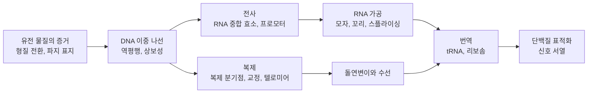
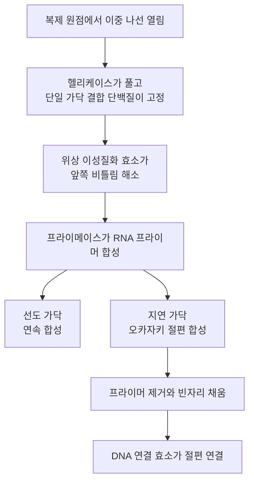
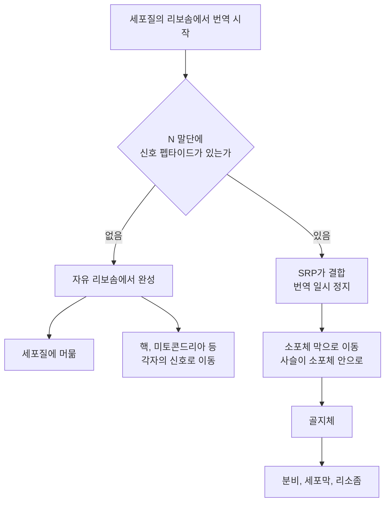

# 일반생명과학 6. 유전의 분자적 기초 — 네 글자로 쓰고, 베끼고, 읽는 생명
<!-- prev: gene-1, gene-2, 3-6 -->
<!-- next: ubio-7, ubio-8 -->

> [!NOTE]
> **이 단원의 범위**
> - DNA가 유전 물질이라는 증거와 DNA 이중 나선 구조
> - DNA 복제(복제 원점, 효소들, 선도·지연 가닥, 교정과 수선, 텔로미어)
> - 유전 암호와 전사, 진핵세포의 RNA 가공
> - 번역(tRNA, 리보솜, 개시–신장–종결)과 단백질 표적화
> - 돌연변이의 종류와 영향

**학습 목표**

1. DNA가 유전 물질이라는 여러 실험 증거를 대조군과 논리 구조까지 분석하여 설명할 수 있다.
2. DNA 이중 나선의 구조적 특징(역평행, 상보성, 홈, 쌓임)을 설명하고, 염기 조성과 녹는점의 관계를 정량적으로 다룰 수 있다.
3. 복제 분기점에서 일하는 효소들의 역할과 순서를 설명하고, 선도·지연 가닥, 교정과 수선, 텔로미어 문제를 계산과 함께 설명할 수 있다.
4. 유전 암호가 해독된 실험 근거를 설명하고, 원핵·진핵세포의 전사와 진핵세포의 RNA 가공(모자, 꼬리, 스플라이싱)을 비교할 수 있다.
5. tRNA와 리보솜의 구조, 번역의 개시–신장–종결 과정, 단백질이 목적지로 보내지는 원리를 설명할 수 있다.
6. 돌연변이를 분자 수준에서 분류하고, 그 영향을 유전 암호표와 단백질 기능으로 예측할 수 있다.

**이 단원의 학습 사다리**

| 단계 | 무엇을 하나? |
|---|---|
| STEP 1. 이전 학습 다시 보기 | 통합과학 「유전자와 단백질」, 생물의 유전 「유전자와 유전물질」·「유전자의 발현」을 다시 꺼낸다 |
| STEP 2. 기초 다지기 | 뉴클레오타이드의 방향과 상보 서열 쓰기, 길이 단위, 확률로 보는 오류율, 화학 결합의 세기 |
| STEP 3. 핵심 개념 | 유전 물질의 증거 → 이중 나선 → 복제 → 유전 암호와 전사·RNA 가공 → 번역과 표적화 → 돌연변이 |
| STEP 4. 오개념 바로잡기 | "DNA 중합 효소는 양방향으로 합성한다?", "인트론은 쓸모없다?" 같은 착각 |
| STEP 5. 전공으로 한 걸음 | 정확도의 열역학, RNA 세계 가설 |
| STEP 6. 생활·산업·진로 | 항생제와 리보솜, mRNA 백신, 항바이러스제, 유전 질환 진단 |

---

## 🗺️ 단원 들어가기

사람 세포 하나의 핵에는 약 64억 염기쌍의 DNA가 들어 있다. 이 DNA를 한 줄로 이으면 2 m쯤 되는데, 지름 수 μm인 핵 속에 감겨 있다. 세포는 분열할 때마다 이 64억 글자를 **몇 시간 만에** 베끼는데, 그 결과 생기는 오류는 한 번의 분열에 **한 글자 안팎**이다. 사람이 손으로 책을 베끼면 수천 글자마다 하나씩 틀린다는 것을 생각하면 놀라운 정확도이다.

게다가 세포는 이 글자를 필요한 부분만 골라 RNA로 옮겨 적고, RNA의 글자를 **세 개씩 끊어 읽어** 20가지 아미노산의 사슬로 바꾸며, 만든 단백질을 세포 안팎의 정확한 장소로 배달한다. 이 모든 과정을 맡는 것도 결국 이 DNA에 적힌 정보로 만든 분자들이다.

이 단원은 고등학교에서 배운 "DNA → RNA → 단백질"의 흐름을 **분자 기계의 수준**에서 다시 본다. 어떤 실험이 DNA를 유전 물질로 확정했는지, 이중 나선은 어떻게 '스스로 복제할 수 있는 구조'인지, 복제·전사·번역에 어떤 분자들이 어떤 순서로 일하는지, 그리고 글자가 틀리면(돌연변이) 무슨 일이 생기는지를 차례로 살핀다.

---

## STEP 1. 🔙 이전 학습 다시 보기

### 연계 개념표

| 이전 단원 | 고등학교에서 배운 것 | 이 단원에서 확장되는 것 |
|---|---|---|
| 통합과학1 「유전자와 단백질」 | DNA·유전자·염색체, 상보적 염기 짝, 중심 원리, 코돈과 유전 암호표 | 유전 암호가 해독된 실험 근거, 흔들림 짝짓기, 유전 암호의 오류 완충 효과 |
| 생물의 유전 「유전자와 유전물질」 '유전물질 규명과 DNA 구조' | 그리피스·에이버리·허시와 체이스 실험, 샤가프 법칙, 이중 나선 | 실험의 대조군과 남은 반론, 추가 증거(DNA 양의 일정성, 자외선 작용 스펙트럼), 홈과 쌓임, 녹는점 |
| 생물의 유전 「유전자와 유전물질」 '반보존적 복제' | 메셀슨과 스탈 실험, 효소는 용어 수준(헬리케이스, 프라이머, DNA 중합 효소, 연결 효소) | 복제 분기점의 효소 전체와 작동 순서, 오카자키 절편, 교정과 불일치 수선, 텔로미어와 텔로머레이스 |
| 생물의 유전 「유전자의 발현」 '전사와 번역' | 전사의 개시·신장·종결, 모자·꼬리·스플라이싱, 리보솜의 A·P·E 자리, 유전 부호, 돌연변이 종류 | 프로모터 서열, 전사 종결 기구, 스플라이싱 기구, 아미노아실 tRNA 합성 효소, 번역의 에너지, 신호 서열과 표적화, 돌연변이의 원인과 수선 |

고등학교에서는 과정의 **순서와 이름**을 배웠다. 대학에서는 **왜 그 방식이어야 하는지**(구조의 제약), **얼마나 빠르고 정확한지**(정량), **어떻게 알아냈는지**(실험 근거)를 묻는다.

### 준비 운동 (사전 진단)

**Q1.** DNA 한 가닥이 `5′-ATGCCA-3′`일 때 상보적인 가닥을 5′→3′ 방향으로 쓰시오.

**Q2.** 이중 가닥 DNA에서 시토신(C)이 전체 염기의 15%일 때 아데닌(A)은 몇 %인가?

**Q3.** mRNA `5′-AUG GCU UGG UAA-3′`가 번역되면 아미노산은 몇 개이고 펩타이드 결합은 몇 개인가?

**Q4.** 진핵세포의 처음 전사체에서 잘려 나가는 부위와 성숙한 mRNA에 남는 부위의 이름을 쓰시오.

정답 및 해설

**Q1.** `5′-TGGCAT-3′`. 상보 서열을 쓰면 `3′-TACGGT-5′`이고, 이를 5′부터 다시 쓰면 위와 같다(역상보 서열).

**Q2.** 35%. $\mathrm{G} = \mathrm{C} = 15\%$이므로 $\mathrm{A} + \mathrm{T} = 70\%$, $\mathrm{A} = 35\%$이다.

**Q3.** 아미노산 3개(Met–Ala–Trp), 펩타이드 결합 2개. UAA는 종결 코돈이다.

**Q4.** 잘려 나가는 부위는 인트론, 남는 부위는 엑손이다.

---

## STEP 2. 🧱 기초 다지기

### ① 방향이 있는 사슬 — 5′과 3′

뉴클레오타이드의 당(DNA는 디옥시리보스, RNA는 리보스)의 탄소에 1′~5′ 번호를 붙인다. 염기는 1′, 인산은 5′ 탄소에 붙고, 한 뉴클레오타이드의 3′–OH와 다음 뉴클레오타이드의 5′ 인산이 **인산 다이에스터 결합**으로 이어진다. 그래서 사슬에는 **5′ 끝**(인산)과 **3′ 끝**(–OH)이 있다.

| 규칙 | 내용 |
|---|---|
| 서열을 쓰는 약속 | 특별한 표시가 없으면 **5′ → 3′** 방향으로 쓴다 |
| 상보 가닥 | 역평행이므로 상보 가닥은 반대 방향. 5′→3′으로 쓰려면 **뒤집어서(역상보)** 쓴다 |
| 사슬이 자라는 방향 | DNA·RNA 합성 효소는 모두 새 사슬의 **3′ 끝**에만 뉴클레오타이드를 붙인다(5′→3′ 합성) |
| 주형을 읽는 방향 | 따라서 주형 가닥은 **3′ → 5′** 방향으로 읽힌다 |

> [!TIP]
> 💡 **요령** — 역상보 서열을 쓸 때는 ① 오른쪽 끝(3′)부터 한 글자씩 왼쪽으로 가며 ② 짝(A↔T, G↔C)을 적는다. 두 단계를 한 번에 하면 실수가 줄어든다.

### ② 길이 단위와 어림

| 단위 | 뜻 | 예 |
|---|---|---|
| bp(염기쌍) | 이중 가닥의 길이 | |
| nt(뉴클레오타이드) | 단일 가닥의 길이 | mRNA, 프라이머 |
| kb, Mb, Gb | $10^3$, $10^6$, $10^9$ bp | 대장균 유전체 약 4.6 Mb, 사람 반수체 유전체 약 3.1 Gb |
| 이중 나선 길이 | 1 bp당 약 0.34 nm | 1 Mb ≈ 0.34 mm |
| 단백질 질량 | 아미노산 잔기당 평균 약 110 Da | 300개 아미노산 ≈ 33 kDa |

### ③ 오류율과 확률

글자 하나를 틀릴 확률이 $\varepsilon$이고 글자가 $L$개이면, 평균 오류 수는 $L\varepsilon$이다. 서로 독립인 오류 방지 단계를 거치면 오류율은 **곱으로** 줄어든다.

$$
\varepsilon_{\text{최종}} = \varepsilon_1 \times f_2 \times f_3,\qquad (f\text{: 각 단계에서 놓치는 비율})
$$

예를 들어 $10^{-5}$의 오류 중 99%를 고치는($f = 10^{-2}$) 단계가 두 번 있으면 최종 오류율은 $10^{-9}$이다. 로그로 보면 단계마다 자릿수가 줄어든다.

### ④ 결합의 세기 — 강한 뼈대, 약한 짝

| 결합 | 어디에 | 세기(어림) | 의미 |
|---|---|---|---|
| 공유 결합(인산 다이에스터 결합) | 당–인산 골격 | 수백 kJ/mol | 서열이 쉽게 바뀌지 않는다(정보의 안정성) |
| 수소 결합 | 염기쌍 사이 | 개당 수~20 kJ/mol 정도 | 열이나 효소로 쉽게 열 수 있다(복제·전사가 가능) |
| 염기 쌓임(소수성·판데르발스) | 위아래 염기쌍 사이 | 염기쌍 사이마다 수십 kJ/mol 정도 | 이중 나선 안정성의 큰 몫 |

정보를 담은 **서열은 단단하게**, 정보를 읽기 위한 **짝은 느슨하게** 묶여 있다는 것이 DNA 구조의 핵심 설계이다.

---

## STEP 3. 📘 핵심 개념

### ① DNA가 유전 물질이라는 증거

20세기 전반에는 단백질이 유전 물질이라는 생각이 우세했다. 단백질은 20종의 아미노산으로 다양한 구조를 만들 수 있는 반면, DNA는 네 종류의 뉴클레오타이드가 단조롭게 반복되는 분자(테트라뉴클레오타이드 가설)로 잘못 알려져 있었기 때문이다. 이 생각을 뒤집은 증거들을 **논리 구조**에 주목하여 다시 보자.

#### (1) 형질 전환과 그 물질의 정체

그리피스(1928)는 열로 죽인 병원성 S형 폐렴쌍구균이 살아 있는 R형을 S형으로 바꾸는 **형질 전환**을 발견했다. 형질 전환된 세균의 자손도 계속 S형이었으므로, 바뀐 것은 **유전되는 성질**이었다.

에이버리와 동료들(1944)은 S형 세균에서 형질 전환 물질을 정제하여 그 성질을 조사했다.

| 검사 | 결과 | 의미 |
|---|---|---|
| 원소 분석 | 질소와 인의 비가 DNA의 이론값과 가까움 | 주성분이 DNA |
| 단백질 분해 효소, RNA 분해 효소 처리 | 활성 유지 | 단백질·RNA가 아님 |
| **DNA 분해 효소** 처리 | 활성 사라짐 | 활성이 DNA에 있음 |
| 자외선 흡수 | 260 nm 부근에서 최대(핵산의 특징) | 핵산 |

남은 반론은 "정제한 DNA에 **미량의 단백질**이 섞여 그것이 진짜 유전 물질일 수 있다"는 것이었다. 실험이 아무리 깨끗해도 '0'을 증명하기는 어렵다.

#### (2) 허시와 체이스 — 두 물질을 따로 표지하기

허시와 체이스(1952)는 박테리오파지(T2)의 단백질을 $^{35}\mathrm{S}$로, DNA를 $^{32}\mathrm{P}$로 **따로** 표지하고, 대장균에 감염시킨 뒤 믹서로 흔들어 세균 표면의 파지 껍질을 떼어 내고 원심 분리했다.

| 표지 | 대부분의 방사능이 있던 곳 | 자손 파지로 전달 |
|---|---|---|
| $^{35}\mathrm{S}$(단백질) | 상층액(떨어져 나간 파지 껍질) | 거의 없음 |
| $^{32}\mathrm{P}$(DNA) | 침전물(감염된 세균) | 상당량(어림하여 3분의 1 안팎) 전달 |

에이버리 실험이 "섞인 상태에서 하나를 없애기"였다면, 이 실험은 "두 물질을 **처음부터 구별해 추적하기**"였다. 세균 안으로 들어가 자손을 만든 것은 DNA였다. 다만 이 실험도 소량의 단백질이 함께 들어가는 것을 완전히 배제하지는 못했으므로, 앞의 증거들과 **함께** 결론을 지지한 것으로 보아야 한다.

#### (3) 그 밖의 증거 — 양과 작용 스펙트럼

| 관찰 | 내용 | DNA를 지지하는 이유 |
|---|---|---|
| DNA 양의 일정성 | 같은 생물의 체세포(2n)는 DNA 양이 일정하고, 정자·난자(n)는 그 **절반**이다 | 유전 물질에 기대되는 성질. 단백질 양은 세포 종류마다 크게 다르다 |
| 샤가프의 염기 조성 | 생물 종마다 염기 조성이 다르고, $\mathrm{A} = \mathrm{T}$, $\mathrm{G} = \mathrm{C}$ | DNA가 단조로운 반복이 아니라 종마다 다른 정보를 담을 수 있다 |
| 자외선 작용 스펙트럼 | 세균에 돌연변이를 가장 잘 일으키는 자외선 파장이 약 260 nm로 핵산의 흡수 최대와 일치(단백질의 흡수 최대는 약 280 nm) | 돌연변이가 일어나는 표적이 핵산이다 |

> [!IMPORTANT]
> 과학적 결론은 대개 **한 번의 결정적 실험**보다 **서로 다른 방법의 증거들이 한 방향을 가리킬 때** 굳어진다. DNA가 유전 물질이라는 결론도 형질 전환, 파지 표지, DNA 양, 염기 조성, 돌연변이의 작용 스펙트럼이 모두 같은 답을 가리키면서 확립되었다. 그리고 1953년의 이중 나선 구조가 "DNA라면 어떻게 복제될 수 있는가"를 보여 주며 마지막 의심을 거두었다.

#### 예제 1 — 실험의 대조군 설계

허시와 체이스의 실험에서 '흔들기' 단계를 빼면 결과가 어떻게 달라지겠는가? 또 감염 없이 파지만 원심 분리하는 대조 실험은 왜 필요한가?

**풀이** 흔들지 않으면 파지 껍질이 세균 표면에 붙은 채 함께 가라앉으므로 $^{35}\mathrm{S}$도 침전물에서 많이 검출되어, 단백질과 DNA를 구별할 수 없다. 파지만 원심 분리하는 대조 실험은 이 조건에서 **파지 자체는 가라앉지 않고 상층액에 남는다**는 것을 확인해 준다. 그래야 침전물의 $^{32}\mathrm{P}$가 '세균 안으로 들어간 DNA' 때문이라고 해석할 수 있다.

---

### ② DNA 이중 나선의 구조

#### 구조를 이끈 자료

| 자료 | 내용 | 구조에 준 제약 |
|---|---|---|
| X선 회절(프랭클린, 윌킨스) | X자 무늬, 일정한 간격의 반복, 지름 약 2 nm | 나선, 반복 주기, 바깥쪽 인산 |
| 샤가프 법칙 | $\mathrm{A} = \mathrm{T}$, $\mathrm{G} = \mathrm{C}$ | 특정한 염기끼리의 짝 |
| 염기의 화학 구조 | 퓨린(A, G)은 고리 2개, 피리미딘(T, C)은 1개. 수소 결합에 참여하는 원자의 위치 | 퓨린–피리미딘 짝이면 지름이 일정 |
| 밀도 | 단위 길이당 질량 | 사슬이 두 가닥 |

#### 구조의 특징

| 특징 | 내용 | 의미 |
|---|---|---|
| 이중 나선 | 두 가닥이 오른손 방향으로 꼬임 | |
| 역평행 | 한 가닥이 5′→3′이면 다른 가닥은 3′→5′ | 복제·전사의 방향성을 결정 |
| 당–인산 골격이 바깥 | 음전하를 띤 인산이 물과 접촉 | 히스톤(양전하)과 결합, 물에 녹음 |
| 상보적 염기쌍 | A–T(수소 결합 2개), G–C(3개) | 한 가닥이 다른 가닥의 주형 |
| 치수(일반적인 B형) | 지름 약 2 nm, 염기쌍 간격 약 0.34 nm, 한 바퀴에 약 10.5 bp(약 3.6 nm) | |
| 큰 홈과 작은 홈 | 두 골격 사이의 간격이 넓은 곳과 좁은 곳이 번갈아 나타남 | 단백질이 이중 나선을 풀지 않고도 **큰 홈**으로 염기의 가장자리를 '읽어' 특정 서열에 결합(전사 인자 등) |
| 염기 쌓임 | 납작한 염기쌍이 동전처럼 포개짐 | 이중 나선 안정성의 큰 부분 |

> [!TIP]
> 💡 **비유** — 이중 나선은 '꼬인 사다리'이다. 난간(당–인산 골격)은 못(공유 결합)으로 단단히 박혀 있고, 가로대(염기쌍)는 가운데가 자석(수소 결합)으로 붙어 있어 쉽게 열린다. 사다리를 비틀면 난간 사이에 넓은 틈과 좁은 틈이 생기는데, 넓은 틈(큰 홈)으로 손을 넣으면 가로대를 떼지 않고도 어떤 가로대인지 만져서 알 수 있다.

#### 녹는점 — 두 가닥을 떼어 내는 온도

DNA 용액을 가열하면 어느 온도 범위에서 두 가닥이 갈라진다(**변성**). 단일 가닥은 염기 쌓임이 풀려 260 nm 자외선을 더 많이 흡수하므로(**농색 효과**), 흡광도로 변성을 추적할 수 있다. 절반이 변성되는 온도를 **녹는점**($T_m$)이라 한다.

$T_m$은 **G–C 비율**이 높을수록, **염 농도**가 높을수록(인산의 음전하 반발을 가림) 높다. 한 표준 염 농도 조건에서 얻은 실험식으로

$$
T_m \approx 69.3 + 0.41 \times (\text{G+C의 백분율})\quad (^\circ\mathrm{C})
$$

이 알려져 있다(조건이 달라지면 계수도 달라지는 근사식이다). 온도를 천천히 낮추면 상보적인 가닥이 다시 짝을 찾는데(**재생**, 혼성화), 이 성질이 PCR과 DNA 탐침 기술의 바탕이다(「유전자 발현 조절과 생명공학」).

#### 진핵세포 DNA의 포장 — 뉴클레오솜

진핵세포의 DNA는 히스톤 단백질 8개(H2A, H2B, H3, H4 각 2개)로 된 원판에 약 147 bp가 약 1.7바퀴 감겨 **뉴클레오솜**을 이루고, 뉴클레오솜 사이는 연결 DNA로 이어진다(구슬 꿰기). 히스톤은 라이신·아르지닌이 많아 양전하를 띠므로 DNA의 음전하와 강하게 결합한다. 뉴클레오솜은 다시 접히고 고리를 이루어 응축되며, 분열기에 최대로 응축된 것이 염색체이다. 포장 정도는 유전자 발현 조절과 깊이 관련된다(「유전자 발현 조절과 생명공학」).

#### 예제 2 — 염기 조성과 녹는점

세균 X의 DNA는 아데닌이 18%이다. (1) 나머지 염기의 비율은? (2) 위 실험식으로 녹는점을 어림하시오. (3) 이 세균은 어떤 환경에 살 가능성이 큰지 추론하시오.

**풀이**
(1) $\mathrm{T} = 18\%$, $\mathrm{G} = \mathrm{C} = \dfrac{100 - 36}{2} = 32\%$
(2) $\mathrm{G+C} = 64\%$ → $T_m \approx 69.3 + 0.41 \times 64 = 69.3 + 26.2 \approx 95.5\ ^\circ\mathrm{C}$
(3) G–C 비율이 높아 이중 나선이 열에 안정하다. 다만 유전체의 G–C 비율은 생활 온도 말고도 여러 요인과 관련되므로, '고온 환경일 가능성이 있다' 정도로 조심스럽게 추론해야 한다. 실제로 고온에 사는 미생물은 유전체보다 **tRNA·rRNA의 G–C 비율**이 생활 온도와 더 뚜렷한 관계를 보인다.

---

### ③ DNA 복제 — 복제 분기점의 분자 기계

#### 반보존적 복제의 확인

메셀슨과 스탈(1958)은 $^{15}\mathrm{N}$로 키운 대장균을 $^{14}\mathrm{N}$ 배지로 옮긴 뒤 DNA를 밀도 기울기 원심 분리하여, 1세대에 중간 밀도 띠 하나, 2세대에 중간과 가벼운 띠가 1 : 1임을 보였다(「유전자와 유전물질」). 이것으로 각 옛 가닥이 새 가닥의 주형이 되는 **반보존적 복제**가 확립되었다. 이제 "누가, 어떤 순서로" 복제하는지 보자.

#### 복제 원점과 복제 거품

복제는 **복제 원점**(origin of replication)이라는 특정 서열에서 시작한다. 원점에서 이중 나선이 열리면 **복제 거품**이 생기고, 거품의 양 끝인 **복제 분기점**(replication fork) 두 개가 서로 반대 방향으로 움직이며 복제한다(**양방향 복제**).

| 구분 | 원핵세포(대장균) | 진핵세포(사람) |
|---|---|---|
| 복제 원점 수 | 원형 염색체에 1개 | 염색체마다 수백~수천 개, 유전체 전체에 수만 개 |
| 분기점 속도(어림) | 초당 약 1000 nt | 초당 약 50 nt(뉴클레오솜을 풀어야 해서 느림) |
| 복제 시간 | 약 40분 | S기 약 8시간 |

#### 복제 분기점에서 일하는 단백질들

| 단백질 | 하는 일 |
|---|---|
| **헬리케이스** | ATP를 써서 분기점에서 두 가닥 사이의 수소 결합을 끊어 이중 나선을 푼다 |
| **단일 가닥 결합 단백질** | 풀린 단일 가닥에 붙어 다시 짝짓거나 꼬이지 않게 한다 |
| **위상 이성질화 효소**(토포아이소머레이스) | 분기점 앞쪽에서 꼬임이 쌓여 생기는 비틀림을 DNA를 잠깐 끊었다 다시 이어 풀어 준다 |
| **프라이메이스** | 짧은 **RNA 프라이머**(약 5~10 nt)를 합성한다. DNA 중합 효소는 사슬을 처음부터 시작하지 못하고 이미 있는 3′–OH에만 이어 붙일 수 있기 때문이다 |
| **DNA 중합 효소**(대장균: Ⅲ) | 프라이머의 3′ 끝에 주형과 상보적인 뉴클레오타이드를 5′→3′ 방향으로 이어 붙인다. 고리 모양의 **미끄럼 죔쇠** 단백질이 효소를 DNA에 붙잡아 두어 떨어지지 않고 길게 합성한다 |
| **DNA 중합 효소**(대장균: Ⅰ) | RNA 프라이머를 제거하고 그 자리를 DNA로 채운다 |
| **DNA 연결 효소**(리게이스) | 이웃한 DNA 조각의 3′–OH와 5′ 인산 사이에 인산 다이에스터 결합을 만들어 잇는다 |

새 뉴클레오타이드는 **뉴클레오사이드 삼인산**(dATP, dGTP, dCTP, dTTP) 형태로 들어온다. 결합할 때 두 개의 인산(피로인산)이 떨어져 나가고, 피로인산이 다시 분해되면서 반응이 합성 쪽으로 강하게 진행된다. 즉 복제의 에너지는 재료 자신이 가지고 온다.

#### 선도 가닥과 지연 가닥 — 방향의 제약이 만든 해법

두 주형 가닥은 역평행인데, DNA 중합 효소는 5′→3′ 방향으로만 합성한다. 그래서 한 분기점에서 두 새 가닥은 다르게 만들어진다.

| 구분 | **선도 가닥**(leading strand) | **지연 가닥**(lagging strand) |
|---|---|---|
| 합성 방향 | 분기점이 열리는 방향과 같음 | 분기점이 열리는 방향과 반대 |
| 방식 | 프라이머 하나로 **연속** 합성 | 짧은 조각으로 **불연속** 합성, 조각마다 새 프라이머 |
| 조각 | 없음 | **오카자키 절편**: 세균 약 1000~2000 nt, 진핵 약 100~200 nt |
| 마무리 | | 프라이머 제거 → 빈자리 채움 → 연결 효소가 이음 |

<!-- fig:ubio-6-replication-bubble -->

실제 세포에서는 이 단백질들이 따로 떠다니지 않고 분기점에서 하나의 커다란 복합체(**레플리솜**)로 함께 움직인다. 지연 가닥 주형이 고리 모양으로 접혀, 두 중합 효소가 같은 방향으로 움직이면서도 서로 반대 방향의 가닥을 합성한다고 생각된다.

<!-- sim:u-replication-fork -->

#### 예제 3 — 대장균과 사람의 복제 시간

(1) 대장균 유전체($4.6 \times 10^6$ bp)를 복제 원점 하나에서 양방향으로 복제할 때, 분기점 속도가 초당 1000 nt이면 걸리는 시간은? (2) 사람 1번 염색체(약 $2.5 \times 10^8$ bp)를 복제 원점 하나로 복제한다면(분기점 속도 초당 50 nt) 며칠이 걸리는가? (3) S기가 8시간이라면 사람 반수체 유전체($3.2 \times 10^9$ bp)를 복제하는 데 적어도 몇 개의 복제 원점이 동시에 필요한가?

**풀이**
(1) 분기점 두 개가 각각 절반씩 복제: $\dfrac{4.6\times10^6}{2 \times 1000\ \mathrm{nt/s}} = 2300\ \mathrm{s} \approx 38$분
(2) $\dfrac{2.5\times10^8}{2 \times 50} = 2.5\times10^6\ \mathrm{s} \approx 29$일
(3) 원점 하나가 8시간 동안 복제하는 길이 $= 2 \times 50 \times 28\,800 = 2.88\times10^6$ bp. $\dfrac{3.2\times10^9}{2.88\times10^6} \approx 1.1\times10^3$개

이론적인 최솟값만 약 1100개이다. 실제로는 원점마다 켜지는 시기가 다르고 분기점이 늘 최고 속도로 움직이지는 않으므로 수만 개의 원점이 쓰인다. 진핵생물이 원점을 여러 개 갖는 이유가 바로 이 계산에 있다.

#### 교정과 수선 — 정확도의 세 겹 방어

| 단계 | 기작 | 오류율(어림, 염기당) |
|---|---|---|
| ① 염기 선택 | 중합 효소의 활성 부위가 올바른 염기쌍의 모양(퓨린–피리미딘의 일정한 폭)을 골라냄 | 약 $10^{-5}$ |
| ② **교정**(proofreading) | 잘못된 뉴클레오타이드가 붙으면 중합 효소가 멈추고, **3′→5′ 핵산 말단 분해 효소** 활성으로 방금 붙인 것을 잘라 낸 뒤 다시 합성 | 약 $10^{-7}$ |
| ③ **불일치 수선**(mismatch repair) | 복제 직후 남은 잘못된 짝을 다른 단백질들이 찾아내고, **새 가닥**의 해당 부분을 잘라 내고 다시 합성 | 약 $10^{-9}$ ~ $10^{-10}$ |

불일치 수선에서 중요한 것은 **어느 가닥이 원본인지** 아는 것이다. 대장균은 원본 가닥에만 메틸기가 붙어 있고 새 가닥에는 잠시 동안 붙어 있지 않은 점을 이용해 구별한다. 반보존적 복제가 아니라면 이런 구별은 불가능했을 것이다.

복제 오류가 아닌 **DNA 손상**을 고치는 수선도 있다.

| 수선 방식 | 대상 | 과정 |
|---|---|---|
| **뉴클레오타이드 절제 수선** | 자외선이 만든 **피리미딘 이량체**(이웃한 T–T가 공유 결합으로 묶임) 등 이중 나선을 크게 비트는 손상 | 손상 부위 양쪽을 끊어 수십 nt를 제거 → 중합 효소가 채움 → 연결 효소가 이음 |
| 염기 절제 수선 | 탈아미노화(C → U) 등 염기 하나의 손상 | 손상된 염기를 떼어 내고 그 자리를 채움 |
| 이중 가닥 절단 수선 | 전리 방사선 등으로 두 가닥이 모두 끊김 | 상동 염색체를 주형으로 고치거나, 끝을 그냥 이어 붙임(오류 가능) |

뉴클레오타이드 절제 수선 효소에 이상이 있는 **색소성 건피증** 환자는 햇빛의 자외선 손상을 고치지 못해 피부암 위험이 매우 높다. 수선 기구가 곧 암을 막는 장치라는 것을 보여 준다.

#### 예제 4 — 한 번의 분열에서 생기는 오류

사람 체세포의 DNA(약 $6.4 \times 10^9$ bp)가 한 번 복제될 때, 각 방어 단계까지 남는 평균 오류 수를 구하시오.

**풀이**
- 염기 선택만: $6.4\times10^9 \times 10^{-5} = 6.4\times10^4$개
- 교정 후: $6.4\times10^9 \times 10^{-7} = 640$개
- 불일치 수선 후($10^{-10}$로 가정): $6.4\times10^9 \times 10^{-10} \approx 0.6$개

세 단계를 모두 거치면 한 번의 분열에 평균 한 개도 안 되는 오류가 남는다. 이렇게 드물게 남은 오류가 **돌연변이**가 되어 유전적 다양성과 질병의 원인이 된다.

#### 텔로미어 — 선형 염색체 끝의 문제

선형 염색체의 맨 끝에서 지연 가닥의 마지막 RNA 프라이머가 제거되면, 그 자리를 채울 3′–OH가 없어 빈 채로 남는다. 그래서 복제할 때마다 염색체 끝이 조금씩 짧아진다(**말단 복제 문제**). 원형 염색체를 가진 세균에는 이 문제가 없다.

진핵생물의 염색체 끝에는 짧은 서열이 수천 번 반복된 **텔로미어**가 있다(사람은 `TTAGGG`의 반복). 텔로미어는 유전자를 담지 않은 '완충 지대'로, 짧아져도 당분간 유전자가 손실되지 않게 하며, 끝이 끊어진 DNA로 오인되어 수선 기구가 끝끼리 이어 붙이는 것을 막는다.

**텔로머레이스**(telomerase)는 자신이 가진 **RNA 주형**을 이용해 텔로미어 반복 서열을 염색체 끝에 덧붙이는 효소이다(RNA를 주형으로 DNA를 만드는 역전사 효소의 일종). 생식세포 계열과 줄기세포에서는 활성이 있지만, 대부분의 체세포에서는 활성이 낮다. 그래서 배양한 정상 체세포는 수십 번 분열하면 텔로미어가 짧아져 분열을 멈춘다. 반면 암세포의 대부분은 텔로머레이스를 다시 켜서(또는 다른 방법으로) 텔로미어를 유지하여 무한히 분열한다.

> [!TIP]
> 💡 **비유** — 텔로미어는 신발 끈 끝의 플라스틱 캡이다. 끈(염색체)을 쓸 때마다 캡이 조금씩 닳지만, 캡이 남아 있는 동안 끈의 실(유전자)은 풀리지 않는다. 텔로머레이스는 닳은 캡을 다시 씌워 주는 수리공이다.

#### 예제 5 — 텔로미어로 어림한 분열 한도

어떤 체세포의 텔로미어 길이가 약 10 kb이고, 분열할 때마다 약 100 bp씩 짧아진다. 텔로미어가 5 kb 이하가 되면 분열을 멈춘다고 할 때, 최대 몇 번 분열할 수 있는가?

**풀이** $\dfrac{10\,000 - 5\,000}{100} = 50$번

정상 사람 섬유아세포가 배양에서 수십 번 분열한 뒤 멈추는 관찰과 크기가 비슷하다. 실제로 줄어드는 양은 세포와 조건에 따라 다르므로(약 50~200 bp) 이 값은 어림이다.

---

### ④ 유전 암호와 전사, 진핵세포의 RNA 가공

#### 유전자와 단백질의 관계 — 1유전자 1효소에서 1유전자 1폴리펩타이드로

비들과 테이텀(1941)은 붉은빵곰팡이에 X선을 쬐어, 최소 배지(당·무기 염류·비타민 하나)에서는 자라지 못하고 특정 물질을 넣어 주어야 자라는 **영양 요구성 돌연변이**를 얻었다. 아르지닌 합성 경로의 돌연변이주들은 어느 중간 물질을 넣어야 자라는지에 따라 몇 부류로 나뉘었고, 각 부류는 경로의 **서로 다른 한 단계**가 막혀 있었다. 이로부터 "유전자 하나가 효소 하나를 만든다"는 **1유전자 1효소 가설**이 나왔다.

이후 이 가설은 수정되었다. 효소가 아닌 단백질(구조 단백질, 호르몬)도 있고, 헤모글로빈처럼 여러 폴리펩타이드로 된 단백질도 있으며, tRNA·rRNA처럼 단백질이 되지 않는 RNA 유전자도 있다. 그래서 지금은 "유전자는 하나의 폴리펩타이드 **또는** 기능성 RNA를 지정하는 DNA 부위"라고 정의한다.

#### 유전 암호의 해독

| 질문 | 실험 | 결론 |
|---|---|---|
| 몇 글자가 한 단어인가? | 크릭과 동료들(1961): 아크리딘 계열 물질로 유전자에 염기 1개의 삽입(+) 또는 결실(−)을 일으킴. 하나만 있으면 기능 상실, (+)(−)를 함께 넣으면 기능 회복, (+)(+)(+)를 셋 넣어도 기능 회복 | 고정된 위치에서 **세 글자씩 끊어 읽으며 쉼표가 없다**(삼중 부호, 읽는 틀) |
| 어떤 코돈이 어떤 아미노산인가? | 니런버그와 마테이(1961): 세포 추출액에 U만으로 된 인공 RNA(poly-U)를 넣자 페닐알라닌 사슬이 만들어짐 | UUU = Phe. 같은 방법으로 AAA = Lys, CCC = Pro |
| 나머지는? | 반복 서열을 가진 인공 RNA, 짧은 3염기 RNA가 특정 tRNA를 리보솜에 붙이는 실험 | 1960년대 중반까지 64개 코돈이 모두 밝혀짐 |

$4^1 = 4$, $4^2 = 16$으로는 20종의 아미노산을 나타낼 수 없고, $4^3 = 64$이면 충분하다. 그래서 61개 코돈이 20종의 아미노산을, 3개(UAA, UAG, UGA)가 종결을 지정하며, AUG는 메싸이오닌이자 개시 신호이다(유전 암호표는 「유전자의 발현」 참고).

#### 예제 6 — 반복 서열 인공 RNA

(1) UC가 반복된 인공 RNA(`UCUCUCUC…`)를 번역시키면 어떤 폴리펩타이드가 만들어지는가? (2) UUC가 반복된 인공 RNA(`UUCUUCUUC…`)는 어떤가? (번역은 개시 코돈 없이 아무 곳에서나 시작된다고 한다. UCU = Ser, CUC = Leu, UUC = Phe, CUU = Leu)

**풀이**
(1) 어디서 시작하든 `UCU CUC UCU CUC …` 또는 `CUC UCU …`이므로 **Ser과 Leu가 번갈아** 이어진 한 종류의 사슬이 생긴다.
(2) 시작 위치에 따라 `UUC UUC …`(Phe만), `UCU UCU …`(Ser만), `CUU CUU …`(Leu만)의 **세 종류의 동종 폴리펩타이드**가 생긴다.

두 결과는 유전 암호가 **3글자 단위**이며 **겹치지 않고** 읽힌다는 것과 정확히 맞아떨어진다. 2글자 부호라면 (1)에서 `UC UC …` 또는 `CU CU …`로 읽혀, 한 가지 아미노산만 반복된 사슬(시작 위치에 따라 두 종류)이 생겼을 것이다.

#### 전사 — RNA 중합 효소가 프로모터에서 시작한다

**RNA 중합 효소**는 DNA 주형 가닥을 3′→5′으로 읽으며 RNA를 5′→3′으로 합성한다. DNA 중합 효소와 달리 **프라이머 없이** 시작할 수 있고, 스스로 이중 나선을 푼다. 교정 능력은 약해 DNA 복제보다 오류율이 높지만(약 $10^{-4}$~$10^{-5}$), RNA는 많이 만들어지고 곧 분해되므로 큰 문제가 되지 않는다.

| 구분 | 세균 | 진핵세포 |
|---|---|---|
| RNA 중합 효소 | 1종(+ 프로모터를 인식하는 **시그마 인자**) | 3종: Ⅰ(대부분의 rRNA), **Ⅱ(mRNA)**, Ⅲ(tRNA 등 작은 RNA) |
| 프로모터 | 전사 시작점 앞 약 10 bp, 35 bp 부근의 짧은 보존 서열 | 시작점 앞 약 25~30 bp의 **TATA 상자** 등 |
| 개시 | 시그마 인자를 가진 효소가 직접 결합 | **전사 인자**들이 먼저 프로모터에 모이고 그 위에 중합 효소가 결합(**전사 개시 복합체**) |
| 종결 | G–C가 많은 머리핀 구조 뒤에 U가 이어지는 서열, 또는 종결 단백질 | 폴리 A 신호(`AAUAAA`) 뒤쪽에서 RNA가 잘리고, 중합 효소는 조금 더 가다 떨어짐 |
| 전사와 번역 | 같은 공간에서 동시에 | 핵 → 가공 → 세포질 |

한 유전자에서 주형이 되는 가닥은 하나이지만, 어느 가닥이 주형인지는 **유전자마다 다르다**. 프로모터의 방향이 그것을 정한다.

#### 진핵세포의 RNA 가공

처음 전사체(pre-mRNA)는 세 가지 가공을 거쳐 성숙한 mRNA가 된다.

| 가공 | 내용 | 기능 |
|---|---|---|
| **5′ 모자** | 5′ 끝에 변형된 구아닌(7-메틸구아노신)이 특이한 5′–5′ 결합으로 붙음 | 분해 효소로부터 보호, 핵 밖 수송, 리보솜이 mRNA에 결합하는 표지 |
| **3′ 폴리 A 꼬리** | 폴리 A 신호 뒤에서 RNA가 잘리고 아데닌 약 50~250개가 붙음 | 보호, 수송, 번역 효율 |
| **RNA 스플라이싱** | 인트론을 잘라 내고 엑손을 이음 | 단백질 정보의 연속성 회복, 선택적 스플라이싱 |

**스플라이싱 기구**: 인트론의 양 끝은 대개 5′ 쪽이 `GU`, 3′ 쪽이 `AG`로 시작·끝난다. 작은 핵 RNA와 단백질로 된 입자(snRNP) 여러 개가 인트론에 모여 **스플라이스오솜**을 만들고, 인트론의 경계를 인식해 잘라 낸다. 이때 실제 화학 반응의 중심에는 단백질이 아니라 **RNA**가 있다. 일부 생물에서는 인트론이 단백질 없이 스스로를 잘라 내기도 한다. 이렇게 효소처럼 작용하는 RNA를 **리보자임**(ribozyme)이라 한다.

**선택적 스플라이싱**(alternative splicing): 같은 처음 전사체에서 어떤 엑손을 남길지 다르게 골라 서로 다른 mRNA를 만든다. 사람의 여러 엑손을 가진 유전자 대부분(90% 이상)이 선택적 스플라이싱을 한다. 그래서 단백질 유전자는 약 2만 개인데 만들어지는 단백질 종류는 그보다 훨씬 많다.

<!-- fig:ubio-6-rna-processing -->

| 인트론이 있어서 좋은 점 | 설명 |
|---|---|
| 선택적 스플라이싱 | 한 유전자로 여러 단백질 |
| 엑손 뒤섞기 | 단백질의 기능 단위(도메인)가 엑손 단위로 나뉘는 경우가 많아, 재조합으로 엑손이 새 조합을 이루어 새 단백질이 진화하기 쉽다 |
| 발현 조절 | 인트론 안에 조절 서열이 있기도 하다 |

#### 예제 7 — 유전자, 전사체, 단백질의 크기

근육의 디스트로핀 유전자는 약 220만 bp에 걸쳐 있고 엑손 79개를 가지며, 성숙한 mRNA는 약 14 kb이다. (1) 이 유전자에서 엑손이 차지하는 비율은? (2) 사람 RNA 중합 효소 Ⅱ의 속도를 분당 약 2 kb로 어림하면 이 유전자 하나를 전사하는 데 걸리는 시간은?

**풀이**
(1) $\dfrac{14\,000}{2\,200\,000} \approx 0.0064$, 약 0.6%. 나머지 99% 이상이 인트론이다.
(2) $\dfrac{2200\ \mathrm{kb}}{2\ \mathrm{kb/min}} = 1100$분 ≈ 18시간

한 번 전사하는 데 거의 하루가 걸린다. 디스트로핀 유전자에 결실 돌연변이가 잘 생기는 것(뒤셴 근육 퇴행 위축)도 유전자가 이처럼 크기 때문으로 생각된다.

---

### ⑤ 번역과 단백질 표적화

#### tRNA — 코돈과 아미노산을 잇는 어댑터

**tRNA**는 약 70~90 nt 길이의 RNA로, 분자 안의 상보적 부위끼리 짝지어 평면으로 그리면 클로버잎, 실제 입체 구조는 **L자 모양**이다. 한쪽 끝에 **안티코돈**, 반대쪽 3′ 끝(`CCA` 서열)에 아미노산이 붙는다.

**아미노아실 tRNA 합성 효소**는 아미노산마다 하나씩(보통 20종) 있으며, ATP를 써서 알맞은 아미노산을 알맞은 tRNA에 붙인다. 유전 암호의 '번역 사전'은 사실 이 효소들이다. 이 효소도 교정 기능이 있어 비슷한 아미노산(예: 발린과 아이소류신)을 잘못 붙이면 떼어 낸다.

**흔들림 짝짓기**(wobble): 코돈의 셋째 염기와 안티코돈의 첫째(5′) 염기 사이는 짝짓기 규칙이 느슨하다. 예를 들어 안티코돈 5′ 자리의 G는 코돈 셋째 자리의 C와 U 모두와 짝지을 수 있고, 변형 염기 이노신(I)은 U, C, A와 짝지을 수 있다. 그래서 61개 코돈을 읽는 데 61종의 tRNA가 필요하지 않다(이론적으로 30여 종이면 충분하다).

#### 리보솜 — RNA가 일하는 공장

| 구분 | 세균 | 진핵세포(세포질) |
|---|---|---|
| 전체 | 70S | 80S |
| 작은 소단위체 | 30S | 40S |
| 큰 소단위체 | 50S | 60S |

(S는 침강 계수의 단위로, 더하기가 성립하지 않는다.)

리보솜은 rRNA와 수십 종의 단백질로 되어 있지만, 펩타이드 결합을 만드는 활성 부위에는 단백질이 없고 **rRNA**만 있다. 즉 리보솜은 거대한 **리보자임**이다. 리보솜에는 tRNA가 들어가는 A 자리, P 자리, E 자리가 있다.

#### 번역의 세 단계

| 단계 | 세균 | 진핵세포 | 에너지 |
|---|---|---|---|
| **개시** | 작은 소단위체가 mRNA의 개시 코돈 앞 퓨린이 많은 서열(**샤인–달가노 서열**)과 rRNA의 짝짓기로 결합. 개시 tRNA(포밀메싸이오닌)가 AUG에 결합 | 작은 소단위체가 **5′ 모자**에 결합한 뒤 mRNA를 따라 이동하며 첫 AUG를 찾음(**탐색**). 개시 tRNA(메싸이오닌) | GTP 1개 |
| **신장** | ① 아미노아실 tRNA가 A 자리에 들어옴(코돈–안티코돈 확인) ② P 자리의 사슬이 A 자리 아미노산으로 옮겨지며 펩타이드 결합 ③ 리보솜이 3′ 쪽으로 코돈 하나만큼 이동(**자리 옮김**), 빈 tRNA는 E 자리로 | 같음 | 아미노산당 GTP 2개(입장, 자리 옮김) |
| **종결** | A 자리에 종결 코돈 → **방출 인자**(단백질)가 결합 → 사슬에 물 분자가 더해져 끊어짐 → 리보솜 분리 | 같음 | GTP |

폴리펩타이드는 **N 말단(아미노기)에서 C 말단(카복실기) 방향**으로 자란다. mRNA는 5′→3′으로 읽힌다. 한 mRNA에 여러 리보솜이 줄지어 붙은 **폴리리보솜**은 같은 단백질을 동시에 여러 개 만든다.

<!-- fig:ubio-6-translation -->

#### 예제 8 — 단백질 하나를 만드는 비용

아미노산 300개로 된 단백질을 만들 때 (1) 고에너지 인산 결합은 몇 개쯤 쓰이는가? (아미노산을 tRNA에 붙일 때 ATP → AMP + 피로인산으로 2개, 신장 단계에서 펩타이드 결합 하나마다 GTP 2개로 계산하고 개시·종결은 무시한다.) (2) 이 단백질의 분자량은 약 얼마인가?

**풀이**
(1) 아미노산 활성화 $300 \times 2 = 600$개, 신장 $299 \times 2 = 598$개 → 약 1200개
(2) $300 \times 110\ \mathrm{Da} = 33\ \mathrm{kDa}$

펩타이드 결합 하나에 고에너지 결합 약 4개를 쓴다. 단백질 합성은 세포가 쓰는 에너지 가운데 큰 몫을 차지하며, 이 비용의 상당 부분은 **정확성**을 위한 것이다(코돈–안티코돈 확인과 교정에 GTP가 쓰인다).

#### 접힘과 번역 후 변형

갓 만들어진 폴리펩타이드는 아미노산 서열에 따라 스스로 접히지만, **샤페론** 단백질이 잘못 접히거나 엉기지 않게 돕는다. 이후 인산화, 당 사슬 부착, 잘라 내기(인슐린은 긴 전구체에서 일부가 잘려 나가 완성됨) 같은 **번역 후 변형**을 거쳐 기능을 갖는다.

#### 단백질 표적화 — 주소가 적힌 단백질

모든 번역은 세포질의 리보솜에서 시작하지만, 단백질의 목적지는 다양하다. 목적지는 아미노산 서열 속의 **신호 서열**(주소)로 정해진다.

| 목적지 | 번역 장소 | 표지 |
|---|---|---|
| 세포질 | 세포질의 자유 리보솜 | 특별한 신호 없음 |
| 핵 | 자유 리보솜 | **핵 위치 신호**(양전하 아미노산이 많은 짧은 서열) → 핵공 통과 |
| 미토콘드리아·엽록체 | 자유 리보솜에서 완성 후 이동 | N 말단의 특유한 신호 서열 → 막의 수송 복합체 통과 |
| 소포체 → 골지체 → 리소좀·세포막·세포 밖(분비) | **소포체에 붙은 리보솜**(거친면 소포체) | N 말단의 **신호 펩타이드** |

**신호 펩타이드 가설**: 분비 단백질의 번역이 시작되어 N 말단의 신호 펩타이드(소수성 아미노산이 많은 약 20개 남짓)가 리보솜 밖으로 나오면, **신호 인식 입자**(SRP)가 이를 붙잡아 번역을 잠시 멈추고 리보솜째 소포체 막의 수용체로 데려간다. 리보솜이 막의 통로에 자리 잡으면 번역이 다시 시작되어 사슬이 소포체 안으로 들어가고, 신호 펩타이드는 잘려 나간다. 이후 단백질은 소포체와 골지체에서 가공되어 소낭으로 운반된다(「세포의 구조와 막 수송」).

> [!TIP]
> 💡 **비유** — 단백질은 '송장이 붙은 택배'이다. 송장(신호 서열)이 없으면 그 자리(세포질)에 둔다. 송장에 '소포체 경유'가 적혀 있으면 포장 작업 도중에 택배 기사(SRP)가 작업대째 물류 센터(소포체)로 옮겨 마저 만든다.

#### 예제 9 — 신호 서열을 옮겨 붙인 실험

본래 세포질에 있는 단백질의 유전자 앞부분에 분비 단백질의 신호 펩타이드 서열을 이어 붙여 세포에서 발현시켰다. 반대로 분비 단백질에서 신호 펩타이드 부분을 없앴다. 각각 단백질은 어디에서 발견되겠는가?

**풀이** 신호 펩타이드를 붙인 세포질 단백질은 소포체로 들어가 분비 경로를 따라 **세포 밖으로 분비**된다. 신호 펩타이드를 없앤 분비 단백질은 **세포질에 남는다**. 신호 서열이 목적지를 결정하는 '필요하고도 충분한' 정보임을 보여 주는 실험이다.

---

### ⑥ 돌연변이의 종류와 영향

**돌연변이**(mutation)는 DNA 염기 서열의 변화이다. 체세포에 생기면 그 개체에만 영향을 주고(암 등), 생식세포 계열에 생기면 자손에게 전달된다.

#### 점 돌연변이 — 글자 하나의 변화

| 종류 | 분자 수준의 변화 | 단백질에 미치는 영향 |
|---|---|---|
| **치환** — 전이(transition) | 퓨린 ↔ 퓨린(A ↔ G), 피리미딘 ↔ 피리미딘(C ↔ T) | 아래 세 경우 중 하나 |
| **치환** — 전환(transversion) | 퓨린 ↔ 피리미딘 | 아래 세 경우 중 하나 |
| 침묵 돌연변이 | 코돈이 바뀌어도 같은 아미노산 | 대개 없음 |
| 미스센스 돌연변이 | 다른 아미노산 | 없음 ~ 심각(위치와 성질에 따라) |
| 넌센스 돌연변이 | 종결 코돈이 생김 | 짧은 단백질, 대개 기능 상실 |
| **삽입·결실** | 염기의 추가·제거 | 3의 배수가 아니면 **틀 이동** → 뒤의 아미노산이 모두 바뀌고 대개 일찍 종결. 3의 배수이면 아미노산이 더해지거나 빠짐 |

유전 암호표로 계산해 보면, 61개 센스 코돈의 각 자리에서 일어날 수 있는 단일 염기 치환 549가지 가운데 약 24%(134가지)는 침묵, 약 71%(392가지)는 미스센스, 약 4%(23가지)는 넌센스이다. 침묵 돌연변이의 대부분은 **셋째 자리**에서 생긴다. 또 성질이 비슷한 아미노산의 코돈끼리 닮은 경우가 많아, 미스센스 돌연변이도 비슷한 아미노산으로 바뀌는 경우가 적지 않다. 유전 암호 자체가 오류에 대한 **완충 장치**처럼 배치되어 있는 셈이다.

<!-- sim:u-mutation-translator -->

#### 대표적인 예

| 질환 | 돌연변이 | 결과 |
|---|---|---|
| 낫 모양 적혈구 빈혈증 | β-글로빈 유전자 6번째 코돈의 치환(mRNA GAG → GUG, Glu → Val) | 소수성 발린 때문에 산소가 적을 때 헤모글로빈이 섬유로 엉김 |
| 낭성 섬유증(가장 흔한 형) | 염기 3개의 결실로 508번째 페닐알라닌 하나가 빠짐(틀 이동 없음) | 염화 이온 통로 단백질이 잘못 접혀 소포체에서 분해됨 → 세포막에 도달하지 못함(**표적화 실패**) |
| 헌팅턴병 | CAG 반복이 비정상적으로 늘어남(약 36회 이상) | 단백질에 글루타민이 길게 이어져 신경 세포에 독성. 세대가 지날수록 반복이 늘어나 더 일찍 발병하기도 함 |
| 뒤셴 근육 퇴행 위축 | 거대한 디스트로핀 유전자의 결실(틀 이동) | 근육 세포막을 지지하는 단백질이 없어 근육이 점차 손상 |

#### 돌연변이의 원인

| 원인 | 예 | 일으키는 변화 |
|---|---|---|
| 자발적 | 복제 오류, 염기의 자발적 탈아미노화(C → U) | 주로 치환. 반복 서열에서 중합 효소 미끄러짐 → 삽입·결실 |
| 물리적 돌연변이원 | 자외선 | 피리미딘 이량체 → 수선 오류 시 치환 |
| | X선·감마선(전리 방사선) | 가닥 절단, 염색체 이상 |
| 화학적 돌연변이원 | 염기 유사체(5-브로모유라실) | 짝을 잘못 지어 전이 |
| | 알킬화제, 담배 연기의 일부 물질 | 염기 변형 → 치환 |
| | 끼어드는 물질(아크리딘 계열) | 염기쌍 사이에 끼어 삽입·결실(틀 이동) |

화학 물질이 돌연변이를 일으키는지 빠르게 선별하는 방법으로 **에임스 검사**가 쓰인다. 히스티딘을 만들지 못하는 세균 돌연변이주를 시험 물질(동물 간 추출물로 대사시킨 것 포함)에 노출시키고, 히스티딘 없는 배지에서 다시 자라게 된(**복귀 돌연변이**) 집락 수를 센다. 돌연변이원일수록 집락이 많이 생긴다. 돌연변이원의 상당수는 발암 물질이기도 하다.

> [!IMPORTANT]
> 돌연변이는 '나쁜 것'만이 아니다. 대부분은 영향이 거의 없는 **중립적** 변화이고, 일부는 해로우며, 아주 드물게 이로운 것도 있다. 사람은 한 세대에 부모에게 없던 새 돌연변이를 수십 개 정도 가지고 태어나며, 이것이 집단의 유전적 변이와 진화의 원재료가 된다(「진화의 원리」).

#### 예제 10 — 주형 가닥에서 단백질까지, 그리고 돌연변이

어떤 유전자 일부의 주형 가닥이 다음과 같다.

`3′-CCGTACAGTCTTACCGAAGCAATTCG-5′`

(1) mRNA와 폴리펩타이드를 쓰시오(첫 AUG에서 시작). (2) mRNA의 셋째 코돈 첫째 염기(G)가 U로 바뀌면? (3) 셋째 코돈 셋째 염기(A)가 G로 바뀌면? (4) 셋째 코돈 둘째 염기(A)가 U로 바뀌면? (5) 둘째 코돈의 첫째 염기(U)가 결실되면?

**풀이**
(1) mRNA는 주형과 상보적·역평행: `5′-GGC AUG UCA GAA UGG CUU CGU UAA GC-3′` → **Met–Ser–Glu–Trp–Leu–Arg**(UAA 종결)
(2) GAA → UAA: **넌센스**. Met–Ser에서 종결
(3) GAA → GAG: **침묵**. 둘 다 Glu이므로 단백질 변화 없음
(4) GAA → GUA: **미스센스**. Glu → Val, Met–Ser–Val–Trp–Leu–Arg
(5) `AUG CAG AAU GGC UUC GUU AAG C…` → Met–Gln–Asn–Gly–Phe–Val–Lys…: **틀 이동**. 결실 뒤의 아미노산이 모두 바뀌고, 원래의 종결 코돈 UAA도 읽는 틀이 어긋나 인식되지 않으므로, 이 서열 뒤쪽에서 새 종결 코돈을 만날 때까지 엉뚱한 아미노산이 이어진다.

---

## STEP 4. ⚠️ 오개념 바로잡기

| 흔한 오개념 | 올바른 개념 | 왜 그럴까? |
|---|---|---|
| DNA 중합 효소는 양쪽 방향으로 합성할 수 있다 | DNA·RNA 중합 효소는 모두 새 사슬의 3′ 끝에만 붙이므로 **5′→3′ 방향으로만** 합성한다 | 반응에 필요한 에너지가 새로 들어오는 뉴클레오사이드 삼인산에 있기 때문이다. 그래서 지연 가닥이 생긴다 |
| DNA 중합 효소는 빈 주형에서 바로 합성을 시작한다 | 이미 있는 3′–OH가 필요하므로 **프라이머**가 있어야 한다. RNA 중합 효소는 프라이머가 필요 없다 | 이 차이가 텔로미어 문제와 PCR 프라이머 설계의 이유가 된다 |
| 복제 오류는 모두 DNA 중합 효소의 교정으로 고쳐진다 | 염기 선택, 교정, **불일치 수선**의 세 단계가 함께 작동하고, 손상은 별도의 수선 기구가 고친다 | 불일치 수선 유전자의 이상은 일부 유전성 대장암의 원인이다 |
| 한 염색체에서 주형 가닥은 늘 같은 가닥이다 | 유전자마다 주형 가닥이 다를 수 있다 | 프로모터의 방향이 주형 가닥을 정한다 |
| 인트론은 쓸모없는 DNA이다 | 인트론은 **선택적 스플라이싱**, 엑손 뒤섞기, 발현 조절에 쓰인다 | 사람 단백질 종류가 유전자 수보다 많은 것은 선택적 스플라이싱 덕분이다 |
| 펩타이드 결합은 리보솜의 단백질이 만든다 | 활성 부위는 **rRNA**로 되어 있다(리보솜은 리보자임) | 리보솜의 입체 구조에서 활성 부위 근처에 단백질이 없음이 확인되었다 |
| tRNA는 61종(코돈 수만큼) 필요하다 | **흔들림 짝짓기** 덕분에 그보다 훨씬 적어도 된다 | 안티코돈 5′ 자리의 G, I 등은 여러 염기와 짝지을 수 있다 |
| 돌연변이는 항상 단백질을 망가뜨린다 | 침묵·중립 돌연변이가 많고, 미스센스도 영향이 거의 없는 경우가 많다 | 유전 암호의 중복성과 아미노산 성질의 유사성이 완충한다 |

---

## STEP 5. 🎓 다음 단계로 한 걸음 더

> [!CAUTION]
> 여기부터는 일반 과목의 범위를 넘는 전공 과목 맛보기이다. 평가 대상이 아니며, 이 단원의 개념이 대학 전공 과목에서 어떻게 확장되는지 보여 주기 위한 내용이다.

### 전공 과목과의 연결

| 전공 과목 | 이어지는 내용 |
|---|---|
| 분자생물학 | 복제 개시의 조절(재복제 방지), 수선 경로의 세부, 전사 개시 복합체, 스플라이싱 조절, 번역 조절 |
| 생화학 | 중합 효소의 반응 속도론, 정확도의 열역학과 반응 속도론적 교정 |
| 구조생물학 | 중합 효소·리보솜·스플라이스오솜의 원자 수준 구조(X선 결정학, 극저온 전자 현미경) |
| 유전학 | 돌연변이율 측정, 억제 돌연변이, 상보성 검정 |
| 생명의 기원·진화생물학 | RNA 세계 가설, 유전 암호의 기원과 진화 |

### ① 정확도의 열역학 — 염기쌍만으로는 부족하다

올바른 염기쌍과 틀린 염기쌍의 결합 자유 에너지 차이를 $\Delta\Delta G$라 하면, 평형에서 틀린 짝이 선택될 확률은 대략

$$
\varepsilon \approx e^{-\Delta\Delta G/RT}
$$

이다. $\Delta\Delta G$를 약 $12\ \mathrm{kJ/mol}$로 잡고 $T = 310\ \mathrm{K}$, $R = 8.314\ \mathrm{J/(mol\cdot K)}$를 넣으면 $\varepsilon \approx e^{-4.66} \approx 10^{-2}$이다. 수소 결합의 차이만으로는 100개에 하나꼴로 틀린다는 뜻이다. 실제 오류율 $10^{-9}$~$10^{-10}$에 이르려면 효소가 **모양을 확인**하고(활성 부위가 퓨린–피리미딘 쌍의 폭만 허용), **에너지를 써서 한 번 더 확인**하고(교정), 별도의 **수선**을 거쳐야 한다. 에너지를 써서 같은 구별을 여러 번 반복해 정확도를 곱으로 높이는 원리를 **반응 속도론적 교정**이라 하며, 번역의 코돈 확인에도 같은 원리가 쓰인다.

### ② RNA 세계 가설

리보솜의 핵심이 rRNA이고, 스플라이싱의 화학 반응을 RNA가 맡으며, 단백질 합성의 재료(ATP, 조효소 일부)에도 RNA 조각이 들어 있다. 이런 사실들로부터, 초기 생명은 **RNA가 유전 정보 저장과 촉매를 모두 맡았던 세계**였고 나중에 정보 저장은 더 안정한 DNA로, 촉매는 더 다양한 단백질로 넘어갔다는 **RNA 세계 가설**이 제안되었다. DNA에 리보스의 2′–OH가 없는 것(가수 분해에 더 안정), U 대신 T를 쓰는 것(C의 탈아미노화로 생긴 U를 오류로 알아볼 수 있음)도 '안정한 저장 매체'로의 진화로 해석된다.

### 지금 vs 전공 과목

| 구분 | 일반생명과학 | 전공 과목 |
|---|---|---|
| 유전 물질의 증거 | 고전 실험의 논리 | 유전체 해독, 기능 유전체학 |
| DNA 구조 | B형 이중 나선, 녹는점, 뉴클레오솜 | 여러 형태(A, Z형), 초나선, 염색질 고차 구조 |
| 복제 | 효소의 역할, 선도·지연 가닥, 교정·수선, 텔로미어 | 복제 개시 허가, 복제 스트레스, 수선 경로 선택 |
| 전사·가공 | 프로모터, RNA 중합 효소, 모자·꼬리·스플라이싱 | 전사 개시 복합체 조립, 스플라이싱 부호, RNA 변형 |
| 번역 | tRNA, 리보솜, 단계, 표적화 | 번역 개시 조절, 리보솜 구조와 동역학, 단백질 품질 관리 |
| 돌연변이 | 종류와 영향, 원인 | 돌연변이 신호(돌연변이 지문)와 암 유전체, 돌연변이율의 진화 |

---

## STEP 6. 🏭 생활·산업·진로 연결

### 사례 1. 항생제는 왜 세균의 리보솜만 멈출까

- **원리** 세균(70S)과 사람 세포질(80S)의 리보솜은 rRNA와 단백질 구성이 다르다.
- **쓰임** 스트렙토마이신, 테트라사이클린, 에리트로마이신 같은 항생제는 세균 리보솜의 특정 부위에 결합해 번역을 막는다. 사람 세포에는 영향이 적지만, 세균에서 유래한 **미토콘드리아의 리보솜**은 세균 리보솜과 닮아 일부 항생제의 부작용과 관련된다(세포 내 공생설의 흔적). 리보솜 결합 부위의 돌연변이는 항생제 내성의 한 원인이다.

### 사례 2. mRNA 백신 — 번역 기구를 빌려 쓰기

- **원리** 성숙한 mRNA의 구조(5′ 모자, 폴리 A 꼬리, 번역 부위)와 번역 과정.
- **쓰임** 병원체 단백질의 정보를 담은 mRNA를 지질 나노 입자에 싸서 주사하면, 사람 세포의 리보솜이 그 단백질을 만들어 면역 반응을 일으킨다. 모자와 꼬리를 붙이고, 일부 염기를 변형 염기로 바꾸어 mRNA가 덜 분해되고 불필요한 염증 반응을 덜 일으키게 설계한다. mRNA는 핵으로 들어가지 않고 며칠 안에 분해된다.

### 사례 3. 항바이러스제와 항암제 — 복제를 노리는 가짜 재료

- **원리** DNA 중합 효소는 뉴클레오타이드의 3′–OH에만 다음 뉴클레오타이드를 이을 수 있다.
- **쓰임** 3′–OH가 없는 가짜 뉴클레오사이드(뉴클레오사이드 유사체)는 새 사슬에 끼어들면 더 이상 이어지지 않게 하여(사슬 종결) 바이러스의 역전사 효소나 중합 효소를 멈춘다. HIV, B형 간염, 헤르페스 치료제 일부가 이 원리이다. 같은 원리로 DNA 합성을 방해하는 물질 일부는 빨리 분열하는 암세포를 공격하는 항암제로 쓰인다. 이 원리를 시험관에서 이용한 것이 염기 서열 분석의 사슬 종결법이다.

### 사례 4. 유전 질환의 분자 진단과 치료

- **원리** 돌연변이의 종류(미스센스, 넌센스, 틀 이동, 반복 확장, 스플라이싱 이상)와 그 영향.
- **쓰임** 유전자 검사로 환자의 돌연변이 종류를 확인하면 치료 전략이 달라진다. 예를 들어 낭성 섬유증에서 잘못 접히는 단백질을 바로 접히게 돕는 약, 뒤셴 근육 퇴행 위축에서 틀 이동이 생긴 엑손을 스플라이싱 때 건너뛰게 하여 읽는 틀을 되살리는 약(엑손 건너뛰기)이 개발되었다. 돌연변이의 분자 기작을 알아야 치료를 설계할 수 있다는 좋은 예이다.

### 관련 전공과 진로

| 진로 | 하는 일 | 관련 학과 |
|---|---|---|
| 분자생물학 연구원 | 복제·전사·번역 기구 연구 | 생명과학, 분자생물학, 생화학 |
| 구조생물학자 | 중합 효소·리보솜의 입체 구조 해석, 약물 설계 | 생화학, 화학, 물리학 |
| 유전자 진단 전문가 | 돌연변이 검출, 유전 질환·암 진단 | 임상병리학, 의생명과학, 의학 |
| 핵산 의약품 개발 연구원 | mRNA 백신, 핵산 치료제 설계 | 약학, 생명공학, 화학공학 |
| 생물정보학자 | 유전체 서열 분석, 돌연변이 영향 예측 | 생물정보학, 컴퓨터공학, 통계학 |

---

## 🔬 탐구 활동

### 활동 A. 스프레드시트로 '번역기' 만들고 돌연변이 실험하기

**목표** 유전 암호표를 스프레드시트(또는 간단한 프로그램)에 넣어 DNA 서열을 mRNA와 아미노산 서열로 바꾸는 도구를 만들고, 여러 종류의 돌연변이가 단백질에 주는 영향을 체계적으로 비교한다.

**과정**
1. 한 시트에 64개 코돈과 아미노산을 두 열로 입력한다(유전 암호표).
2. 다른 시트에 DNA 암호 가닥 서열을 한 칸에 입력하고, 셀 함수(문자열 바꾸기)로 T를 U로 바꾼 mRNA를 만든다.
3. 첫 AUG의 위치를 찾고, 그 위치부터 세 글자씩 잘라 열에 나열한 뒤, 코돈표에서 찾아 아미노산으로 바꾼다. 종결 코돈에서 멈춘다.
4. 예제 10의 서열을 넣어 결과가 맞는지 확인한다.
5. 서열의 한 위치를 바꾸거나 지우는 돌연변이를 10가지 이상 만들고, 각각 침묵·미스센스·넌센스·틀 이동 중 무엇인지, 단백질 길이가 어떻게 변하는지 기록한다.
6. (심화) 한 코돈의 첫째·둘째·셋째 자리를 각각 다른 세 염기로 바꾸어 보고, 자리별로 침묵 돌연변이가 몇 번 나오는지 센다.

**결과 기록**

| 돌연변이(위치와 변화) | 종류 | 바뀐 아미노산 서열 | 단백질 길이 변화 |
|---|---|---|---|
| | | | |
| | | | |
| | | | |

**생각해 보기**
1. 침묵 돌연변이가 가장 많이 생긴 코돈 자리는 몇 번째인가? 유전 암호표의 어떤 특징 때문인가?
2. 같은 '염기 하나의 변화'인데 치환과 결실의 영향이 크게 다른 이유를 읽는 틀로 설명해 보자.

### 활동 B. 녹는점 자료로 G–C 비율과 이중 나선 안정성의 관계 찾기

**목표** 여러 생물 DNA의 녹는점 자료를 분석하여 G–C 비율과 녹는점의 관계를 직선으로 나타내고, 그 기울기의 의미를 해석한다.

**자료**(같은 염 농도에서 측정했다고 가정한 가상 자료)

| DNA 시료 | P | Q | R | S | T |
|---|---|---|---|---|---|
| G+C 비율(%) | 35 | 42 | 50 | 58 | 66 |
| 녹는점(°C) | 83.8 | 86.6 | 89.9 | 93.0 | 96.4 |

**과정**
1. 스프레드시트에 자료를 넣고 가로축을 G+C 비율, 세로축을 녹는점으로 하는 산점도를 그린다.
2. 추세선(선형)을 추가하여 기울기와 절편을 구한다.
3. 기울기를 'G+C 비율 1%가 늘 때 녹는점이 몇 °C 오르는가'로 해석한다.
4. 미지 시료의 녹는점이 91.5 °C일 때 G+C 비율을 어림한다.
5. 염 농도를 낮추면 이 직선이 어떻게 이동할지 예상해 본다.

**결과 기록**

| 항목 | 값 |
|---|---|
| 기울기(°C / %) | |
| 절편(°C) | |
| 미지 시료의 G+C 비율 어림(%) | |

**생각해 보기**
1. G–C 쌍의 수소 결합이 A–T 쌍보다 하나 많다는 것 외에, G–C 비율이 높을수록 안정한 다른 이유는 무엇인가? (STEP 2의 결합 세기 표를 참고하자.)
2. PCR 프라이머를 설계할 때 G+C 비율을 고려하는 이유를 이 자료와 연결해 설명해 보자.

> [!WARNING]
> **안전 수칙** 실제로 DNA 시료를 가열하여 흡광도를 측정하는 실험을 할 경우, 뜨거운 물중탕과 가열 블록에 화상을 입지 않도록 내열 장갑을 쓰고, 자외선 분광 광도계의 광원을 직접 들여다보지 않는다. DNA 염색 시약은 돌연변이원일 수 있으므로 장갑을 끼고 다루며 지정된 폐기 용기에 버린다.

---

## ✅ 개념 확인 문제

### 기본

**1.** 허시와 체이스의 실험에서 $^{35}\mathrm{S}$와 $^{32}\mathrm{P}$가 각각 파지의 어느 성분을 표지하는지 쓰고, 대장균과 함께 침전물에서 주로 검출된 것이 무엇인지 쓰시오.

정답 및 해설

**정답** $^{35}\mathrm{S}$: 단백질 껍질, $^{32}\mathrm{P}$: DNA. 침전물에서는 주로 $^{32}\mathrm{P}$가 검출되었다.

황은 단백질의 일부 아미노산(메싸이오닌, 시스테인)에만 있고, 인은 DNA의 당–인산 골격에 있다. 대장균 안으로 들어간 것은 DNA였다.

**2.** 이중 가닥 DNA 2000 bp에서 G가 전체 염기의 28%이다. (1) A의 비율, (2) 염기쌍 사이 수소 결합의 총수를 구하시오.

정답 및 해설

**정답** (1) 22% (2) 5120개

(1) $\mathrm{C} = 28\%$, $\mathrm{A} = \mathrm{T} = \dfrac{100 - 56}{2} = 22\%$
(2) 염기는 4000개. G–C 쌍 $= 4000 \times 0.28 = 1120$개, A–T 쌍 $= 4000 \times 0.22 = 880$개. 수소 결합 $= 1120 \times 3 + 880 \times 2 = 3360 + 1760 = 5120$개

**3.** 지연 가닥의 오카자키 절편 하나가 만들어지고 이웃 절편과 이어지기까지 작용하는 효소를 순서대로 쓰시오. (헬리케이스로 이중 나선이 풀린 다음부터)

정답 및 해설

**정답** 프라이메이스(RNA 프라이머 합성) → DNA 중합 효소(대장균 Ⅲ, 절편 합성) → DNA 중합 효소(대장균 Ⅰ, 이웃 절편의 프라이머를 제거하고 DNA로 채움) → DNA 연결 효소(절편 사이를 이음)

**4.** 진핵세포의 mRNA 가공 세 가지를 쓰고, 각각의 기능을 하나씩 쓰시오.

정답 및 해설

**정답**
- 5′ 모자: 분해 방지, 리보솜 결합 표지
- 3′ 폴리 A 꼬리: 분해 방지, 핵 밖 수송
- RNA 스플라이싱: 인트론 제거와 엑손 연결, 선택적 스플라이싱으로 여러 단백질 생성

**5.** 다음 중 옳은 것만을 있는 대로 고르시오.
ㄱ. 리보솜에서 펩타이드 결합을 만드는 활성 부위는 rRNA로 되어 있다.
ㄴ. 아미노아실 tRNA 합성 효소는 코돈과 안티코돈을 짝지어 주는 효소이다.
ㄷ. 분비 단백질은 N 말단의 신호 펩타이드에 의해 번역 도중 소포체로 들어간다.
ㄹ. 폴리펩타이드는 C 말단에서 N 말단 방향으로 자란다.

정답 및 해설

**정답** ㄱ, ㄷ

ㄴ. 이 효소는 아미노산을 알맞은 tRNA에 붙이는 효소이다. 코돈–안티코돈 짝짓기는 리보솜의 A 자리에서 일어난다. ㄹ. 폴리펩타이드는 N 말단에서 C 말단 방향으로 자란다.

### 응용

**6.** 어떤 세균의 원형 유전체가 $4.6 \times 10^6$ bp이고, 복제 원점 1개에서 양방향으로 복제한다. 분기점 속도가 초당 800 nt라면 복제에 걸리는 시간은 몇 분인가? 그런데 이 세균은 영양이 풍부할 때 20분마다 분열한다. 어떻게 가능한지 추론하시오.

정답 및 해설

**정답** 약 48분

$\dfrac{4.6\times10^6}{2 \times 800} = 2875\ \mathrm{s} \approx 48$분

복제에 48분이 걸리는데 20분마다 분열하려면, 앞선 복제가 끝나기 전에 **다음 복제를 원점에서 미리 시작**해야 한다. 실제로 빨리 자라는 세균에서는 복제가 겹쳐 진행되어, 갓 생긴 세포가 이미 복제 중인 염색체를 물려받는다.

**7.** UUC가 반복된 인공 RNA를 개시 코돈 없이 아무 곳에서나 번역되는 세포 추출액에 넣었다. (UUC = Phe, UCU = Ser, CUU = Leu) (1) 만들어지는 폴리펩타이드의 종류를 쓰시오. (2) 만약 유전 암호가 2글자 단위였다면 결과는 어떻게 되었겠는가?

정답 및 해설

**정답**
(1) 시작 위치에 따라 폴리-Phe, 폴리-Ser, 폴리-Leu의 **세 종류**의 동종 폴리펩타이드
(2) 2글자 단위라면 `UU CU UC UU CU UC …`처럼 세 가지 2글자가 차례로 반복되어, 어디서 시작하든 **세 아미노산이 같은 순서로 반복되는 한 종류**의 폴리펩타이드가 생겼을 것이다. 실제 결과가 세 종류의 동종 사슬이었으므로 3글자 단위임이 지지된다.

**8.** mRNA `5′-ACAUGGCUCAGUGGAAAUAGCG-3′`에 대하여 (1) 폴리펩타이드를 쓰시오. (2) 넷째 코돈(UGG)의 셋째 염기 G가 A로 바뀌면 어떤 종류의 돌연변이인가? (3) 둘째 코돈 바로 뒤에 염기 A 하나가 삽입되면 폴리펩타이드는 어떻게 되는가? (GCU = Ala, CAG = Gln, UGG = Trp, AAA = Lys, UGA·UAG = 종결, ACA = Thr, GUG = Val, GAA = Glu, AUA = Ile)

정답 및 해설

**정답**
(1) `AC | AUG GCU CAG UGG AAA UAG | CG` → Met–Ala–Gln–Trp–Lys
(2) UGG → UGA: **넌센스 돌연변이**. Met–Ala–Gln에서 종결
(3) `AUG GCU A CAG …` → `AUG GCU ACA GUG GAA AUA GCG` → Met–Ala–Thr–Val–Glu–Ile–… : **틀 이동**. 원래의 종결 코돈 UAG가 어긋나 읽히지 않으므로 이 서열 뒤에서 새 종결 코돈을 만날 때까지 번역이 이어진다.

**9.** 붉은빵곰팡이에서 물질 Z를 합성하지 못하는 돌연변이주 a~d를 얻었다. 최소 배지에 각 물질을 넣었을 때 자라는지(+) 조사했다. 물질 P, Q, R은 Z 합성 경로의 중간 물질이다.

| 돌연변이주 | 최소 배지 | +P | +Q | +R | +Z |
|---|---|---|---|---|---|
| a | − | − | + | − | + |
| b | − | + | + | + | + |
| c | − | − | − | − | + |
| d | − | + | + | − | + |

(1) 중간 물질의 순서를 정하시오. (2) 각 돌연변이주가 막힌 단계를 쓰시오.

정답 및 해설

**정답** (1) 전구 물질 → R → P → Q → Z
(2) b: 전구 물질 → R, d: R → P, a: P → Q, c: Q → Z

경로의 **뒤쪽** 물질일수록 더 많은 돌연변이주를 살린다. Z는 모두를, Q는 c를 뺀 셋을, P는 b와 d를, R은 b만 살리므로 R → P → Q → Z 순서이다. 어떤 돌연변이주는 막힌 단계 **뒤의** 물질을 넣어 주면 자란다. 예를 들어 d는 P, Q, Z로는 자라지만 R로는 자라지 못하므로 R → P 단계가 막혔다.

**10.** 사람 체세포 DNA(약 $6.4 \times 10^9$ bp)가 복제될 때 최종 오류율이 염기당 $10^{-10}$이라고 하자. (1) 한 번의 복제에서 생기는 평균 오류 수는? (2) 수정란에서 어떤 세포까지 50번의 분열을 거쳤다면, 그 세포에 쌓인 복제 오류는 평균 몇 개인가? (3) 불일치 수선 유전자에 이상이 생겨 오류율이 100배가 되면 (2)의 값은?

정답 및 해설

**정답** (1) 약 0.64개 (2) 약 32개 (3) 약 3200개

(1) $6.4\times10^9 \times 10^{-10} = 0.64$
(2) $0.64 \times 50 = 32$
(3) $32 \times 100 = 3200$

오류가 100배로 늘면 암을 일으키는 유전자에 돌연변이가 생길 확률도 크게 높아진다. 불일치 수선 유전자의 유전적 이상이 일부 유전성 대장암의 원인인 이유이다.

### 융합·서술형

**11. [텔로미어·암·노화]** 정상 사람 섬유아세포를 배양하면 수십 번 분열한 뒤 멈추지만, 대부분의 암세포는 무한히 분열한다. (1) 선형 염색체가 복제할 때마다 짧아지는 이유를 지연 가닥 합성과 프라이머로 설명하시오. (2) 암세포가 무한히 분열할 수 있는 이유를 텔로머레이스의 작동 원리와 함께 설명하시오. (3) 텔로머레이스를 억제하는 약을 항암제로 쓸 때 기대되는 효과와, 약효가 늦게 나타날 것으로 예상되는 이유를 쓰시오.

정답 및 해설

**예시 답안**
(1) DNA 중합 효소는 3′–OH가 있어야 합성할 수 있으므로 지연 가닥은 RNA 프라이머로 시작한다. 염색체 맨 끝의 마지막 프라이머가 제거되면 그 자리를 채울 3′–OH가 없어 새 가닥의 5′ 끝에 빈자리가 남는다. 그래서 복제할 때마다 염색체 끝이 조금씩 짧아진다.
(2) 텔로머레이스는 자신이 가진 RNA를 주형으로 텔로미어 반복 서열(`TTAGGG`)을 염색체의 3′ 끝에 덧붙이는 역전사 효소이다. 늘어난 3′ 끝을 주형으로 상보 가닥이 다시 합성되면 텔로미어 길이가 유지된다. 대부분의 체세포에는 이 활성이 낮지만, 암세포의 대부분은 텔로머레이스를 다시 발현하여 텔로미어가 짧아지지 않으므로 분열 한도가 사라진다.
(3) 텔로머레이스를 억제하면 암세포의 텔로미어가 분열할 때마다 짧아져 결국 분열을 멈추거나 죽을 것으로 기대된다. 그러나 이미 있는 텔로미어가 충분히 짧아질 때까지 여러 번의 분열이 필요하므로 효과가 **늦게** 나타나고, 그동안 종양이 자랄 수 있다. 또 정상 줄기세포의 텔로머레이스도 억제되는 부작용이 걱정된다.

**채점 포인트** ① 마지막 프라이머 제거 후 채울 수 없음 ② RNA 주형을 쓰는 텔로머레이스 ③ 여러 분열 뒤에야 효과, 줄기세포 부작용

**12. [분자 의학]** 낭성 섬유증의 가장 흔한 돌연변이는 염화 이온 통로 단백질 유전자에서 염기 3개가 결실되어 508번째 페닐알라닌 하나가 빠지는 것이다. (1) 염기 3개가 결실되었는데도 그 뒤의 아미노산 서열이 정상과 같은 이유를 쓰시오. (2) 아미노산 하나만 빠졌는데도 이 단백질이 세포막에 거의 도달하지 못하는 이유를 단백질의 접힘과 소포체–골지체 경로로 설명하시오. (3) 이 환자에게 '단백질이 제대로 접히도록 돕는 약'이 효과가 있을 수 있는 이유를 추론하시오.

정답 및 해설

**예시 답안**
(1) 결실된 염기 수가 3의 배수이므로 읽는 틀이 바뀌지 않는다. 코돈 하나에 해당하는 아미노산 하나만 빠지고 그 뒤는 정상 틀로 읽힌다.
(2) 이 단백질은 막 단백질이라 소포체에 붙은 리보솜에서 번역되어 소포체 막에 삽입된 뒤 골지체를 거쳐 세포막으로 가야 한다. 아미노산 하나가 빠지면 단백질이 제대로 접히지 못하고, 소포체의 품질 관리 체계가 이를 잘못 접힌 단백질로 인식해 분해한다. 그래서 단백질이 만들어지기는 하지만 세포막에 도달하지 못하고, 염화 이온이 수송되지 않아 점액이 끈끈해진다.
(3) 단백질의 아미노산 서열은 거의 정상이므로, 접힘을 도와 품질 관리를 통과하게 하면 세포막까지 운반되어 어느 정도 기능할 수 있다. 실제로 접힘을 돕는 약과 통로가 더 잘 열리게 하는 약을 함께 쓰는 치료가 개발되었다. 돌연변이의 분자 기작(합성 실패인지, 접힘·표적화 실패인지, 기능 실패인지)에 따라 치료 전략이 달라진다.

**채점 포인트** ① 3의 배수 결실 → 틀 유지 ② 잘못 접힘 → 소포체 품질 관리로 분해 → 표적화 실패 ③ 접힘 보조로 기능 일부 회복

---

## 📝 한눈에 정리

### 핵심 요약

- 형질 전환 물질의 정제(에이버리), 단백질·DNA의 분리 표지(허시와 체이스), DNA 양의 일정성, 염기 조성, 자외선 작용 스펙트럼이 모두 **DNA가 유전 물질**임을 가리켰다.
- DNA는 당–인산 골격이 바깥, 상보적 염기쌍이 안쪽에 있는 **역평행 이중 나선**이며, 큰 홈과 작은 홈이 있고, G–C 비율과 염 농도가 높을수록 녹는점이 높다.
- 복제는 **복제 원점**에서 양방향으로 진행되며, 헬리케이스·단일 가닥 결합 단백질·위상 이성질화 효소·프라이메이스·DNA 중합 효소·연결 효소가 함께 일한다.
- 중합 효소는 5′→3′으로만, 프라이머가 있어야 합성하므로 **선도 가닥**은 연속, **지연 가닥**은 오카자키 절편으로 불연속 합성된다.
- 정확도는 염기 선택 → **교정** → **불일치 수선**의 곱으로 높아지며(약 $10^{-10}$), 손상은 절제 수선 등으로 고친다.
- 선형 염색체 끝은 복제마다 짧아지며, **텔로미어**가 완충하고 **텔로머레이스**가 RNA 주형으로 다시 늘린다.
- 유전 암호는 **겹치지 않는 3글자 부호**로 틀 이동 실험과 인공 RNA 실험으로 해독되었다. 전사는 프로모터에서 RNA 중합 효소가 시작하며, 진핵세포의 pre-mRNA는 **모자·꼬리·스플라이싱**을 거친다.
- 번역은 아미노아실 tRNA 합성 효소가 짝지은 tRNA와 **리보자임인 리보솜**이 개시–신장–종결로 수행하며, **신호 서열**이 단백질의 목적지를 정한다.
- 돌연변이는 치환(침묵·미스센스·넌센스)과 삽입·결실(틀 이동)로 나뉘고, 자발적 오류와 물리·화학적 돌연변이원이 원인이며, 영향은 위치와 종류에 따라 없음부터 치명적까지 다양하다.

### 핵심 용어

| 용어 | 뜻 |
|---|---|
| 형질 전환 | 외부에서 들어온 DNA로 세포의 유전 형질이 바뀌는 현상 |
| 역평행 | 이중 나선의 두 가닥이 서로 반대 방향(5′→3′, 3′→5′)으로 놓인 배열 |
| 녹는점($T_m$) | 이중 가닥 DNA의 절반이 단일 가닥으로 변성되는 온도 |
| 복제 원점 | DNA 복제가 시작되는 특정 서열 |
| 프라이머 | DNA 중합 효소가 이어 붙일 3′–OH를 제공하는 짧은 RNA |
| 오카자키 절편 | 지연 가닥에서 불연속적으로 합성되는 짧은 DNA 조각 |
| 교정 | DNA 중합 효소가 잘못 붙인 뉴클레오타이드를 3′→5′ 분해 활성으로 제거하는 것 |
| 불일치 수선 | 복제 후 남은 잘못된 염기쌍을 새 가닥에서 찾아 고치는 수선 |
| 텔로머레이스 | 자신의 RNA를 주형으로 염색체 끝에 텔로미어 반복 서열을 덧붙이는 효소 |
| 프로모터 | RNA 중합 효소와 전사 인자가 결합하여 전사를 시작하는 DNA 부위 |
| RNA 스플라이싱 | 처음 전사체에서 인트론을 잘라 내고 엑손을 잇는 과정 |
| 흔들림 짝짓기 | 코돈의 셋째 염기와 안티코돈의 첫째 염기 사이의 느슨한 짝짓기 |
| 신호 펩타이드 | 단백질을 소포체로 보내는 N 말단의 짧은 아미노산 서열 |
| 틀 이동 돌연변이 | 3의 배수가 아닌 수의 염기 삽입·결실로 읽는 틀이 바뀌는 돌연변이 |

### 다음 단원으로

모든 세포가 같은 DNA를 가지고 같은 방식으로 복제·전사·번역한다는 것을 배웠다. 그렇다면 간세포와 신경 세포는 같은 유전체를 가지고도 어떻게 서로 다른 단백질을 만들까? 그리고 사람은 이 분자 기구를 어떻게 도구로 삼아 DNA를 자르고, 늘리고, 읽고, 고칠까? 다음 단원 「유전자 발현 조절과 생명공학」에서는 오페론과 진핵세포의 발현 조절, 후성유전, 발생과 암의 분자생물학, 바이러스, 그리고 PCR·염기 서열 분석·CRISPR 같은 DNA 기술을 다룬다. 돌연변이가 집단 속에서 어떻게 퍼지고 사라지는지는 「진화의 원리」로 이어진다.
