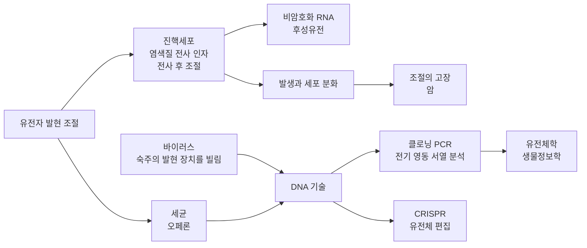
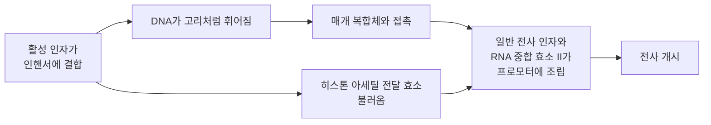

# 일반생명과학 7. 유전자 발현 조절과 생명공학 — 스위치를 읽는 법에서 다시 쓰는 법까지
<!-- prev: gene-2, gene-3, ubio-6, ubio-4 -->
<!-- next: ubio-8, ubio-12 -->

> [!NOTE]
> **이 단원의 범위**
> - 세균의 오페론(젖당·트립토판 오페론, 음성·양성 조절, 부분 이배체 분석)
> - 진핵세포의 발현 조절: 염색질 변형, 전사 인자와 인핸서, 전사 후 조절, 비암호화 RNA, 후성유전
> - 세포 분화와 발생의 유전적 조절, 암의 분자생물학
> - 바이러스의 구조와 증식(용균·용원 주기, 레트로바이러스, 바이로이드와 프라이온)
> - DNA 기술(클로닝, PCR, 전기 영동, 염기 서열 분석, CRISPR)과 유전체학·생물정보학

**학습 목표**

1. 젖당·트립토판 오페론의 음성·양성 조절을 분자 수준에서 설명하고, 부분 이배체 자료로 조절 요소가 시스(cis)로 작용하는지 트랜스(trans)로 작용하는지 판정할 수 있다.
2. 진핵세포에서 발현량이 정해지는 단계(염색질 → 전사 → RNA 가공 → mRNA 분해 → 번역 → 단백질 분해)를 차례로 설명하고, mRNA의 합성·분해 속도로 정상 상태 양을 계산할 수 있다.
3. 비암호화 RNA와 후성유전 표지가 유전자 발현을 조절하는 원리를 설명하고, 유전체 각인과 X 염색체 불활성화를 예로 들 수 있다.
4. 발생의 유전적 조절과 암의 다단계 발생을 원종양 유전자·종양 억제 유전자·세포 주기 조절과 연결하여 설명할 수 있다.
5. 바이러스의 구조와 증식 방식(용균·용원, 레트로바이러스)을 비교하고, 바이러스가 생명공학의 도구가 되는 이유를 설명할 수 있다.
6. 클로닝, PCR, 전기 영동, 염기 서열 분석, CRISPR의 원리를 이해하고 증폭량·DNA 크기·상대 발현량·유전체 피복도를 계산할 수 있다.

**이 단원의 학습 사다리**

| 단계 | 무엇을 하나? |
|---|---|
| STEP 1. 이전 학습 다시 보기 | 「유전자의 발현」의 오페론과 발생, 「생명공학기술」의 PCR·크리스퍼, 「유전의 분자적 기초」의 전사·번역을 다시 꺼낸다 |
| STEP 2. 기초 다지기 | 발현량을 정하는 일곱 관문, 지수와 로그(2배씩 늘기, 반감기), 서열이 우연히 나타날 확률, 로그 눈금 그래프 |
| STEP 3. 핵심 개념 | 오페론 → 염색질 → 전사 인자 → 전사 후 조절 → 비암호화 RNA → 후성유전 → 발생 → 암 → 바이러스 → 클로닝 → PCR·전기 영동 → 염기 서열 분석 → CRISPR → 유전체학 |
| STEP 4. 오개념 바로잡기 | "인핸서는 프로모터 바로 옆에?", "PCR은 처음부터 원하는 길이만?", "암은 돌연변이 하나로?" |
| STEP 5. 전공으로 | 감쇠 조절, 3차원 유전체, 단일 세포 전사체, 염기 교정과 프라임 편집 |
| STEP 6. 생활·산업·진로 | 표적 항암제와 동반 진단, 분자 진단, 유전자 치료 벡터, 바이오 의약품 생산 |

---

## 🗺️ 단원 들어가기

사람의 간세포 한 개와 피부 세포 한 개를 꺼내 DNA를 읽어 보면 염기 서열은 사실상 같다. 그런데 간세포는 알부민을 쏟아 내고, 피부 세포는 케라틴을 만든다. 고등학교에서는 이 차이를 "발현하는 유전자가 다르다"로 정리했다. 대학에서는 한 걸음 더 들어가 묻는다. **누가, 어디에서, 어떤 화학적 표지를 써서** 유전자를 켜고 끄는가? 그 스위치가 고장 나면 세포는 어떻게 되는가? 그리고 그 스위치를 사람이 직접 읽고, 복사하고, 다시 쓸 수 있는가?

이 질문들은 하나로 이어진다. 세균의 오페론에서 처음 밝혀진 "조절 단백질이 DNA의 특정 서열에 붙는다"는 원리는 진핵세포의 전사 인자로, 발생의 유전자 연쇄로, 그리고 스위치가 망가진 병인 암으로 확장된다. 한편 세균이 바이러스를 막으려고 진화시킨 제한 효소와 CRISPR, 바이러스가 숙주에 들어가려고 진화시킨 역전사 효소는 오늘날 실험실의 가장 중요한 도구가 되었다. 이 단원은 **유전자 발현 조절의 원리**와 그 원리를 이용한 **DNA 기술**을 함께 다룬다.

---

## STEP 1. 🔙 이전 학습 다시 보기

### 연계 개념표

| 이전 단원 | 그때 배운 것(고등학교·앞선 대학 단원) | 이 단원에서 확장되는 것 |
|---|---|---|
| 생물의 유전 「유전자의 발현」 '원핵생물의 유전자 발현 조절' | 젖당 오페론의 억제 단백질·유도 물질, CAP의 양성 조절, 트립토판 오페론 | 억제 단백질의 다른 자리 입체성 변화, 부분 이배체로 시스·트랜스 판정, 조절 돌연변이 해석 |
| 생물의 유전 「유전자의 발현」 '진핵생물의 조절', '발생과 세포 분화' | 전사 인자 조합, 인핸서, 비코이드·혹스 유전자, MyoD | 염색질 변형의 화학, 매개 복합체, 전사 후 조절, 형태 형성 물질 기울기의 정량적 해석 |
| 생물의 유전 「생명공학기술」 'PCR', '유전자 편집' | PCR의 세 단계와 $N = N_0 \times 2^n$, 가이드 RNA와 Cas9 | 원하는 길이 산물의 수($2^n - 2n$), 실시간 PCR의 $C_t$ 해석, PAM과 수선 경로, 클로닝 벡터 설계 |
| 일반생명과학 「유전의 분자적 기초」 | 전사·RNA 가공·번역, 돌연변이 | 발현 단계마다의 조절 지점, 염기 서열 분석의 원리(사슬 종결) |
| 일반생명과학 「세포 신호 전달과 세포 주기」 | 신호 전달 경로, 사이클린–Cdk, 검문 지점 | 원종양 유전자·종양 억제 유전자가 그 경로의 부품이라는 관점 |

### 준비 운동 (사전 진단)

**Q1.** 젖당 오페론에서 젖당이 없을 때 전사가 거의 일어나지 않는 이유를 '억제 단백질'과 '작동 부위'라는 말을 써서 한 문장으로 설명하시오.

**Q2.** 진핵세포 mRNA의 5′ 모자와 3′ 폴리 A 꼬리가 하는 일 두 가지를 쓰시오.

**Q3.** 표적 DNA 100분자로 효율 100%의 PCR을 20주기 하면 분자 수는 약 몇 배가 되는가?

**Q4.** 크리스퍼 유전자 가위에서 표적 위치를 '찾는' 분자와 DNA를 '자르는' 분자는 각각 무엇인가?

정답 및 해설

**Q1.** 젖당이 없으면 억제 단백질이 작동 부위에 결합해 RNA 중합 효소가 구조 유전자 쪽으로 진행하지 못하기 때문이다.

**Q2.** mRNA가 분해되지 않도록 보호하고, 리보솜이 mRNA에 결합해 번역을 시작하도록 돕는다(핵 밖으로 나가는 데에도 관여한다).

**Q3.** $2^{20} = 1\,048\,576 \approx 10^6$배. 100분자는 약 $1.0 \times 10^8$분자가 된다.

**Q4.** 찾는 분자는 가이드 RNA, 자르는 분자는 Cas9 단백질이다.

---

## STEP 2. 🧱 기초 다지기

### ① 발현량을 정하는 일곱 관문

한 세포 안의 어떤 단백질의 양은 "유전자를 가졌는가"가 아니라 다음 관문을 각각 얼마나 통과했는가로 정해진다. 이 단원의 STEP 3은 이 관문들을 차례로 하나씩 연다.

| 관문 | 일어나는 일 | 대표적 조절 방식 |
|---|---|---|
| ① 염색질 | DNA가 RNA 중합 효소에 노출되는가 | 히스톤 변형, DNA 메틸화, 염색질 재구성 |
| ② 전사 개시 | RNA 중합 효소가 프로모터에서 출발하는가 | 전사 인자, 인핸서, 억제 인자 |
| ③ RNA 가공 | 어떤 엑손 조합의 mRNA가 되는가 | 선택적 스플라이싱 |
| ④ 핵 밖 수송 | 성숙한 mRNA가 세포질로 나가는가 | 가공이 끝난 mRNA만 수송 |
| ⑤ mRNA 분해 | mRNA가 얼마나 오래 남는가 | 3′ 비번역 부위의 서열, 마이크로RNA |
| ⑥ 번역 | 리보솜이 mRNA를 얼마나 자주 읽는가 | 개시 인자 조절, 5′ 비번역 부위에 붙는 단백질 |
| ⑦ 단백질 가공·분해 | 단백질이 활성화되고 얼마나 오래 남는가 | 절단, 인산화, 유비퀴틴–프로테아솜 분해 |

세균은 전사와 번역이 같은 공간에서 거의 동시에 일어나므로 주로 ②에서 조절하고, 진핵세포는 ①~⑦을 모두 쓴다.

<!-- fig:ubio-7-expression-gates -->

### ② 지수와 로그 — 두 배씩 늘고, 반씩 줄고

생명공학 계산의 절반은 지수 함수이다.

$$
N = N_0 \cdot 2^{n} \qquad \Longleftrightarrow \qquad n = \log_2 \frac{N}{N_0}
$$

- PCR: 한 주기마다 표적이 2배 → $n$주기 뒤 $2^n$배.
- 역으로, 두 시료가 같은 양에 도달하는 주기 수의 차이 $\Delta n$을 알면 처음 양의 비는 $2^{\Delta n}$이다. $\log_2 10 \approx 3.32$이므로 **처음 양이 10배 차이 나면 약 3.3주기 차이**가 난다.
- 줄어드는 경우도 같다. 반감기가 $t_{1/2}$인 mRNA는 합성을 멈춘 뒤 시간 $t$가 지나면 $\left(\tfrac{1}{2}\right)^{t/t_{1/2}}$만 남는다. 이를 자연 로그로 쓰면 분해 속도 상수 $k_d = \dfrac{\ln 2}{t_{1/2}}$이다($\ln 2 \approx 0.693$).

### ③ 서열이 우연히 나타날 확률

네 염기가 같은 비율로 무작위로 섞여 있다고 가정하면, 길이 $L$인 특정 서열이 어떤 위치에서 나타날 확률은 $(1/4)^L$이다. 따라서 평균 $4^L$ 염기쌍마다 한 번 나타난다.

| 서열 길이 $L$ | $4^L$ | 쓰임 |
|---|---|---|
| 4 | 256 | 자주 자르는 제한 효소 |
| 6 | 4 096 | 흔한 제한 효소(예: `GAATTC`) |
| 7 | 16 384 | 마이크로RNA의 씨앗 서열 |
| 8 | 65 536 | 드물게 자르는 제한 효소 |
| 20 | 약 $1.1 \times 10^{12}$ | 크리스퍼 가이드 RNA |

실제 유전체는 염기 조성이 고르지 않고 반복 서열이 많아 이 값에서 벗어난다. 그래도 "몇 개 염기여야 유전체에서 하나뿐인 주소가 되는가"를 어림하는 데 충분히 쓸모 있다.

### ④ 로그 눈금 그래프 읽기

겔 전기 영동에서 DNA 조각이 이동한 거리는 조각 크기의 **로그**에 대략 비례하여 줄어든다. 그래서 크기를 아는 표준 조각(크기 표지)으로 "이동 거리–$\log_{10}$(크기)" 그래프를 그리면 거의 직선이 되고, 이 직선으로 모르는 조각의 크기를 읽는다. 로그 눈금에서는 1 kb와 2 kb 사이의 간격이 2 kb와 4 kb 사이의 간격과 같다는 점에 주의한다.

> [!TIP]
> 💡 **비유** — 유전자 발현 조절은 수도 시설과 같다. 원수(DNA)는 늘 있지만 정수장의 밸브(염색질), 본관 밸브(전사), 정수 필터(가공), 배관의 누수(mRNA 분해), 수도꼭지(번역), 물을 쓰고 버리는 속도(단백질 분해)가 합쳐져 집에서 쓰는 물의 양이 정해진다. 어느 하나만 보아서는 실제 수량을 알 수 없다.

---

## STEP 3. 📘 핵심 개념

### ① 세균의 오페론 — 단백질이 DNA를 읽어 스위치를 켠다

#### 다시 보는 오페론, 한 단계 깊게

세균은 환경이 빠르게 바뀌는 곳에 산다. 필요 없는 효소를 만드는 것은 낭비이고, 필요한 효소를 늦게 만드는 것은 경쟁에서 지는 일이다. 그래서 세균은 기능이 이어진 유전자들을 하나의 프로모터 아래 모아 **하나의 mRNA(다유전자 mRNA)** 로 함께 전사한다. 이것이 **오페론(operon)** 이다.

오페론 조절의 핵심은 **조절 단백질의 다른 자리 입체성(allosteric) 변화**이다. 억제 단백질이나 활성 단백질은 DNA에 붙는 부위와 작은 분자(신호)에 붙는 부위를 따로 가지며, 신호 분자가 붙으면 모양이 바뀌어 DNA 결합 능력이 달라진다. 「물질대사·세포호흡·광합성」에서 본 효소의 다른 자리 입체성 조절과 같은 원리가 이번에는 '유전자의 스위치'에 쓰인다.

| 구분 | 유도형 오페론(젖당 오페론) | 억제형 오페론(트립토판 오페론) |
|---|---|---|
| 대사 경로 | 분해(이화) 경로 | 합성(동화) 경로 |
| 평소 상태 | 꺼짐 | 켜짐 |
| 억제 단백질 단독 | **활성형** — 작동 부위에 결합 | **비활성형** — 작동 부위에 결합 못 함 |
| 신호 분자 | 알로락토스(젖당의 이성질체)가 **유도 물질** | 트립토판이 **보조 억제 물질** |
| 신호 분자가 붙으면 | 억제 단백질이 비활성형 → 작동 부위에서 떨어짐 → 전사 | 억제 단백질이 활성형 → 작동 부위에 붙음 → 전사 중단 |
| 논리 | 기질이 있을 때만 분해 효소를 만든다 | 산물이 충분하면 합성 효소를 그만 만든다 |

#### 음성 조절과 양성 조절의 결합

억제 단백질은 결합하면 전사를 끄므로 **음성 조절**이다. 젖당 오페론은 여기에 **양성 조절**이 겹쳐 있다. 포도당이 부족하면 세포 안의 cAMP 농도가 올라가고, cAMP가 붙은 **CAP**(이화물 활성 단백질)이 프로모터 바로 앞에 결합하여 DNA를 굽히고 RNA 중합 효소의 결합을 돕는다. 젖당 오페론의 프로모터는 원래 약해서, CAP이 없으면 억제 단백질이 떨어져도 전사가 조금밖에 일어나지 않는다.

| 포도당 | 젖당 | cAMP–CAP | 억제 단백질 | 전사 수준 |
|---|---|---|---|---|
| 많음 | 없음 | 결합 안 함 | 작동 부위에 결합 | 거의 없음 |
| 많음 | 있음 | 결합 안 함 | 떨어짐 | 낮음 |
| 적음 | 없음 | 결합 | 작동 부위에 결합 | 거의 없음 |
| 적음 | 있음 | 결합 | 떨어짐 | **높음** |

이처럼 더 좋은 에너지원이 있을 때 다른 영양소 분해 유전자를 억누르는 현상을 **이화물 억제(catabolite repression)** 라 한다.

#### 시스와 트랜스 — 부분 이배체로 조절 요소 가려내기

1960년대 연구자들은 세균에 F 플라스미드(F′)로 오페론 일부를 하나 더 넣어 **부분 이배체(merodiploid)** 를 만들고, 돌연변이가 다른 DNA 분자에 있는 유전자에도 영향을 주는지 조사했다. 이 실험이 "조절 유전자는 확산하는 산물(단백질)을 만들고, 작동 부위는 단지 DNA 서열이다"라는 결론을 이끌었다.

| 돌연변이 | 성질 | 작용 방식 |
|---|---|---|
| $I^-$ | 억제 단백질을 만들지 못함 → 항상 전사(구성적) | 정상 $I^+$가 있으면 회복됨 → **트랜스**(확산하는 단백질) |
| $I^s$ | 유도 물질과 결합 못 하는 억제 단백질 → 결코 켜지지 않음 | 정상 $I^+$보다 **우성**, 트랜스로 다른 작동 부위에도 붙음 |
| $O^c$ | 억제 단백질이 붙지 못하는 작동 부위 → 구성적 | **시스**: 같은 DNA 분자 위의 구조 유전자에만 영향 |
| $Z^-$ | 기능 없는 β-갈락토시데이스 | 구조 유전자 자체의 결함 |

> [!IMPORTANT]
> **시스 작용 요소**(작동 부위, 프로모터, 인핸서)는 DNA 서열이므로 자기와 같은 DNA 분자에 있는 유전자만 조절한다. **트랜스 작용 인자**(억제 단백질, 활성 단백질, 전사 인자)는 확산하는 분자이므로 세포 안의 어느 DNA 분자에도 작용한다. 이 구분은 진핵세포의 조절을 이해하는 데에도 그대로 쓰인다.

#### 예제 1 — 부분 이배체의 β-갈락토시데이스 생산

포도당이 없는 배지에서 다음 균주가 젖당이 없을 때와 있을 때 **기능 있는** β-갈락토시데이스를 만드는지 판정하시오. (사선 왼쪽은 염색체, 오른쪽은 F′)

(가) $I^+O^+Z^- \,/\, I^-O^+Z^+$  (나) $I^+O^cZ^- \,/\, I^+O^+Z^+$  (다) $I^+O^cZ^+ \,/\, I^+O^+Z^-$  (라) $I^sO^+Z^+ \,/\, I^+O^+Z^+$

**풀이** 기능 있는 효소는 $Z^+$가 있는 DNA 분자에서만 나온다. 그 $Z^+$와 **같은 분자**의 작동 부위가 어떤 억제 단백질에 의해 조절되는지를 따진다.

| 균주 | $Z^+$가 있는 분자 | 그 분자의 작동 부위 | 세포 안의 억제 단백질 | 젖당 없음 | 젖당 있음 | 판정 |
|---|---|---|---|---|---|---|
| (가) | F′ | $O^+$ | 염색체의 $I^+$ 산물(트랜스) | 없음 | 생성 | 유도형 |
| (나) | F′ | $O^+$ | $I^+$ 산물 | 없음 | 생성 | 유도형($O^c$는 $Z^-$만 켬) |
| (다) | 염색체 | $O^c$ | 붙을 수 없음 | 생성 | 생성 | 구성적 |
| (라) | 둘 다 | $O^+$ | $I^s$ 산물이 늘 결합 | 없음 | 없음 | 유도 불가 |

(나)와 (다)는 같은 돌연변이를 가졌지만 $O^c$가 어느 쪽 $Z$와 같은 분자에 있느냐에 따라 결과가 정반대이다. 이것이 작동 부위가 시스로 작용한다는 증거이다.

> [!TIP]
> 💡 **비유** — 억제 단백질은 방송으로 전달되는 "정지" 명령(트랜스)이고, 작동 부위는 각 기계에 달린 수신기(시스)이다. 수신기가 고장 난 기계는 방송과 상관없이 계속 돌아가지만, 옆 기계까지 따라 돌지는 않는다.

---

### ② 진핵세포의 조절 Ⅰ — 염색질이라는 첫 번째 관문

#### 뉴클레오솜과 염색질의 상태

진핵세포의 DNA는 히스톤 8량체에 약 147 염기쌍씩 감겨 **뉴클레오솜**을 이루고, 뉴클레오솜이 다시 접혀 염색질이 된다. 느슨하게 풀린 **진정염색질(euchromatin)** 은 전사가 잘 일어나고, 단단히 응축된 **이질염색질(heterochromatin)** 은 전사 장치가 접근하기 어렵다. 따라서 염색질 상태가 유전자 발현의 첫 관문이다.

| 변형 | 화학적 내용 | 효소 | 대체적 효과 |
|---|---|---|---|
| 히스톤 아세틸화 | 히스톤 꼬리 라이신의 아미노기에 아세틸기($-\mathrm{COCH_3}$) | 히스톤 아세틸 전달 효소(HAT) / 제거는 HDAC | 라이신의 양전하가 사라져 음전하인 DNA와의 결합이 약해짐 → 느슨 → **전사 촉진** |
| 히스톤 메틸화 | 라이신·아르지닌에 메틸기 | 히스톤 메틸 전달 효소 | 위치에 따라 촉진 또는 억제(예: 응축과 관련된 표지가 따로 있음) |
| 히스톤 인산화 | 세린 등에 인산기 | 인산화 효소 | 염색체 응축, 전사 활성화 등 상황에 따라 다름 |
| DNA 메틸화 | 사이토신(주로 CpG의 C)의 5번 탄소에 메틸기 | DNA 메틸 전달 효소(DNMT) | 프로모터 부위 메틸화 → 전사 억제 단백질 결합, **전사 억제** |
| 염색질 재구성 | ATP를 써서 뉴클레오솜을 밀어내거나 빼냄 | 재구성 복합체 | 프로모터 노출 → 전사 개시 허용 |

히스톤 꼬리의 여러 표지 조합은 특정 단백질이 알아보는 '표식'으로 작동한다는 생각을 **히스톤 부호 가설**이라 한다. 표지 자체가 스위치라기보다, 표지를 읽는 단백질을 불러오는 '주소표'라는 관점이다.

#### 예제 2 — 히스톤 탈아세틸화 효소 억제제

어떤 항암제 후보는 HDAC를 억제한다. 이 약을 처리한 세포에서 (1) 히스톤의 아세틸화 정도, (2) 염색질의 응축 정도, (3) 이전에 꺼져 있던 종양 억제 유전자의 전사가 각각 어떻게 변할지 예측하시오.

**풀이** (1) 아세틸기를 떼어 내는 효소가 억제되므로 아세틸화가 **증가**한다. (2) 라이신의 양전하가 중화되어 DNA와 히스톤의 결합이 약해지므로 염색질이 **느슨해진다**. (3) 프로모터가 노출되어 꺼져 있던 유전자의 전사가 **다시 켜질 수 있다**. 실제로 이 원리의 약물이 일부 혈액암 치료에 쓰인다. 다만 수많은 유전자에 동시에 영향을 주므로 효과와 부작용을 함께 따져야 한다.

---

### ③ 진핵세포의 조절 Ⅱ — 전사 인자, 인핸서, 조합

#### 진핵세포 유전자의 조절 부위

진핵세포의 단백질 암호 유전자는 **RNA 중합 효소 Ⅱ**가 전사한다. 이 효소는 혼자 프로모터를 인식하지 못하고 여러 단백질의 도움을 받는다.

| 요소 | 위치 | 결합하는 것 | 역할 |
|---|---|---|---|
| 핵심 프로모터(예: TATA 상자) | 전사 시작점 앞 약 25~30 염기쌍 | **일반 전사 인자**(TATA 결합 단백질 포함) | 모든 유전자에 공통. 전사 개시 복합체를 조립하여 기본 수준의 전사 |
| 근접 조절 요소 | 프로모터 앞 수십~수백 염기쌍 | 특정 전사 인자 | 유전자별 전사량 조정 |
| **인핸서**(원거리 조절 요소) | 수천~수만 염기쌍 떨어진 곳, 앞·뒤·인트론 안 어디든 | **활성 인자**(특정 전사 인자) | DNA가 고리처럼 휘어 활성 인자가 **매개 복합체**를 통해 전사 개시 복합체와 접촉 → 전사 크게 증가 |
| 사일런서 | 다양 | 억제 인자 | 전사 억제 |

특정 전사 인자는 대개 두 부분으로 나뉜다. DNA의 특정 서열을 알아보는 **DNA 결합 영역**과, 다른 단백질(매개 복합체, 히스톤 아세틸 전달 효소 등)을 불러오는 **활성화 영역**이다. 두 영역을 서로 다른 단백질에서 떼어 와 붙여도 작동하므로, 이 구조는 실험실의 '효모 2-잡종법' 같은 도구로도 쓰인다.

#### 조합 조절과 협동 조절

- **조합 조절**: 인핸서 하나에 여러 조절 서열이 있고, 그 조합을 모두 채우는 전사 인자 세트가 있는 세포에서만 유전자가 켜진다. 전사 인자 수가 $m$개이고 각 인자가 있고 없음만 따져도 $2^m$가지 조합이 가능하다.
- **협동 조절**: 진핵세포에는 오페론이 거의 없다. 대신 함께 켜져야 하는 유전자들이 서로 다른 염색체에 흩어져 있어도 **같은 조절 서열**을 가지고 있어 같은 전사 인자에 함께 반응한다. 예를 들어 스테로이드 호르몬–수용체 복합체는 그 수용체가 알아보는 서열을 가진 유전자들을 한꺼번에 켠다(「세포 신호 전달과 세포 주기」의 세포 내 수용체).

#### 예제 3 — 인핸서 조합으로 세포 특이적 발현 읽기

가상의 두 유전자 $P$와 $Q$의 인핸서에는 다음 조절 서열이 있다. 각 유전자는 자기 인핸서의 조절 서열에 맞는 활성 인자가 **모두** 있어야 전사된다.

| 유전자 | 인핸서의 조절 서열 |
|---|---|
| $P$ | ㄱ, ㄴ, ㄷ |
| $Q$ | ㄱ, ㄹ |

세포 X에는 활성 인자 ㄱ, ㄴ, ㄷ이, 세포 Y에는 ㄱ, ㄹ이, 세포 Z에는 ㄱ, ㄴ, ㄹ이 있다. (1) 각 세포에서 전사되는 유전자를 쓰시오. (2) 활성 인자 ㄱ의 유전자가 결실되면 어떻게 되는가?

**풀이** (1) X: $P$만, Y: $Q$만, Z: $Q$만($P$에 필요한 ㄷ이 없음). (2) 두 유전자 모두 ㄱ이 필요하므로 세 세포 어디에서도 $P$, $Q$가 전사되지 않는다. 두 유전자의 DNA는 모든 세포에 똑같이 있고, 차이는 오직 **어떤 전사 인자를 갖고 있느냐**에서 나온다. 같은 인자 ㄱ을 여러 세포가 공유해도 다른 인자와의 조합이 달라 서로 다른 유전자가 켜진다.

> [!TIP]
> 💡 **비유** — 인핸서는 여러 개의 열쇠 구멍이 달린 금고이다. 열쇠(전사 인자) 하나하나는 여러 금고에 쓰이지만, 특정 금고는 정해진 열쇠 꾸러미가 모두 꽂혀야 열린다. 적은 수의 열쇠로 수많은 금고를 구별해 여는 방법이 바로 조합이다.

---

### ④ 전사 후 조절 — RNA와 단백질 단계의 미세 조정

#### 선택적 스플라이싱

같은 처음 전사체에서 어떤 엑손을 넣고 뺄지를 달리하면 서로 다른 mRNA, 서로 다른 단백질(동형 단백질)이 만들어진다. 사람 유전자 대부분이 선택적 스플라이싱을 거치는 것으로 알려져 있어, 약 2만 개의 단백질 암호 유전자가 그보다 훨씬 많은 종류의 단백질을 만든다. 초파리의 한 신경 유전자(*Dscam*)는 서로 바꿔 끼울 수 있는 엑손 묶음 네 곳의 조합으로 이론상 약 3만 8천 가지 mRNA를 만들 수 있다.

#### mRNA의 수명 — 합성과 분해의 균형

mRNA의 양은 합성 속도 $k_s$(분자/분)와 분해 속도 상수 $k_d$(/분)의 균형으로 정해진다.

$$
\frac{dM}{dt} = k_s - k_d M \qquad \Rightarrow \qquad M_{\text{정상}} = \frac{k_s}{k_d} = \frac{k_s \, t_{1/2}}{\ln 2}
$$

세균의 mRNA는 대개 몇 분 만에 분해되어 환경 변화에 따라 단백질 구성이 빨리 바뀐다. 진핵세포의 mRNA는 수십 분에서 며칠까지 수명이 다양하다. 수명은 폴리 A 꼬리의 길이, 3′ 비번역 부위(3′ UTR)의 서열(예: AU가 풍부한 서열은 빠른 분해를 유도), 마이크로RNA의 결합 등으로 정해진다.

<!-- sim:u-mrna-turnover -->

#### 예제 4 — 정상 상태의 mRNA 분자 수

어떤 사이토카인 유전자는 자극을 받은 세포에서 분당 12분자의 mRNA를 만들고, 그 mRNA의 반감기는 20분이다. (1) 정상 상태의 mRNA 분자 수를 구하시오. (2) 자극이 끊겨 전사가 멈춘 뒤 60분이 지나면 처음의 몇 %가 남는가? (3) 반감기가 2배로 늘어나는 돌연변이가 생기면 정상 상태의 양은 어떻게 되는가?

**풀이**
(1) $k_d = \dfrac{\ln 2}{20\ \mathrm{min}} = 0.0347\ \mathrm{min^{-1}}$, $M = \dfrac{12\ \mathrm{min^{-1}}}{0.0347\ \mathrm{min^{-1}}} \approx 346$ → 약 350분자(유효 숫자 2자리).
(2) $60 \div 20 = 3$반감기 → $\left(\tfrac12\right)^3 = 0.125$ → **12.5%**.
(3) $M$은 $t_{1/2}$에 비례하므로 **2배**(약 690분자)가 된다. 염증 신호를 내는 단백질의 mRNA가 일부러 짧은 수명을 갖는 이유가 여기에 있다. 수명이 길어지면 자극이 끝난 뒤에도 신호가 오래 이어져 만성 염증의 원인이 될 수 있다.

#### 번역과 단백질 단계의 조절

| 단계 | 예 |
|---|---|
| 번역 개시 | 철이 부족하면 철 조절 단백질이 페리틴(철 저장 단백질) mRNA의 5′ 비번역 부위에 붙어 번역을 막는다. 철이 많아지면 떨어져 번역이 시작된다 |
| 전체 번역량 | 바이러스 감염, 영양 결핍 등 스트레스 때 개시 인자를 인산화하여 세포 전체의 번역을 낮춘다 |
| 단백질 가공 | 인슐린은 긴 전구체로 번역된 뒤 잘려 활성형이 된다 |
| 단백질 분해 | 분해할 단백질에 작은 단백질 **유비퀴틴**이 여러 개 붙으면 **프로테아솜**이 이를 알아보고 분해한다. 세포 주기의 사이클린이 정해진 때에 사라지는 것도 이 방식이다 |

---

### ⑤ 비암호화 RNA — 단백질을 만들지 않는 RNA의 일

사람 유전체에서 단백질을 암호화하는 엑손은 약 1.5%에 불과하지만, 유전체의 훨씬 넓은 부분이 RNA로 전사된다. 그 상당 부분이 단백질을 만들지 않는 **비암호화 RNA(ncRNA)** 이며, 그중 다수가 유전자 발현을 조절한다.

| 종류 | 크기 | 만들어지는 과정과 작용 |
|---|---|---|
| **마이크로RNA(miRNA)** | 약 22 뉴클레오타이드 | 머리핀 구조의 전구체가 핵과 세포질에서 차례로 잘려(세포질에서는 **다이서** 효소) 짧은 이중 가닥이 된다. 한 가닥이 아고너트 단백질과 복합체(**RISC**)를 이루어 표적 mRNA의 3′ UTR에 부분적으로 결합 → 번역 억제·분해 촉진 |
| **작은 간섭 RNA(siRNA)** | 약 21~23 뉴클레오타이드 | 긴 이중 가닥 RNA(바이러스 RNA, 실험으로 넣어 준 RNA)에서 다이서가 만든다. 표적과 **완전히** 상보적으로 결합 → 표적 mRNA를 자른다(RNA 간섭) |
| piRNA | 약 24~31 뉴클레오타이드 | 생식 세포에서 전이 인자의 발현을 막아 유전체를 보호 |
| **긴 비암호화 RNA(lncRNA)** | 200 뉴클레오타이드 이상 | 염색질 변형 복합체를 특정 위치로 데려가는 등 다양. 예: X 염색체 불활성화의 *XIST* RNA |

miRNA는 표적을 고를 때 5′ 쪽 2~8번째 염기(약 7개)인 **씨앗 서열**의 상보성을 가장 중요하게 쓴다. 씨앗 서열이 짧으므로 miRNA 하나가 수백 개의 mRNA를 조절할 수 있다.

#### 예제 5 — 씨앗 서열이 우연히 맞을 확률

7 염기 씨앗 서열에 상보적인 자리가 길이 1000 염기인 3′ UTR에 우연히 있을 기댓값을 구하고, 3′ UTR 길이가 모두 1000 염기인 유전자 2만 개 중 이런 자리를 하나 이상 가진 유전자가 약 몇 개일지 어림하시오. (염기는 무작위로 같은 비율이라고 가정)

**풀이** 한 위치에서 맞을 확률은 $1/4^7 = 1/16\,384$이다. 기댓값은 $1000/16\,384 \approx 0.061$개. 한 UTR에 하나 이상 있을 확률은 약 $1 - (1 - 1/16\,384)^{1000} \approx 0.059$이므로 $20\,000 \times 0.059 \approx 1.2 \times 10^3$개이다. 즉, 우연만으로도 **천 개가 넘는 유전자**가 하나의 miRNA 표적 후보가 된다. 실제 표적 예측에서는 진화적으로 보존된 자리만 고르거나 실험으로 확인하는 과정이 꼭 필요하다.

> [!NOTE]
> 예쁜꼬마선충의 발생 시기 조절 유전자 연구에서 1993년 첫 miRNA가 발견되었고, 이 발견은 2024년 노벨 생리의학상으로 이어졌다. 1998년에는 이중 가닥 RNA가 같은 서열의 유전자를 끄는 RNA 간섭이 보고되었으며, 오늘날 RNA 간섭은 유전자 기능 연구 도구이자 치료제의 원리가 되었다.

---

### ⑥ 후성유전 — 서열을 바꾸지 않고 대물림되는 상태

**후성유전(epigenetic inheritance)** 은 DNA 염기 서열의 변화 없이 유전자 발현 상태가 세포 분열(때로는 세대)을 넘어 전달되는 현상이다. 그 물질적 기반은 DNA 메틸화와 히스톤 변형이다.

#### 메틸화는 어떻게 복사되는가

CpG 서열은 두 가닥에서 서로 마주 보는 회문(5′-CG-3′ / 3′-GC-5′)이다. DNA가 복제되면 헌 가닥에는 메틸기가 있고 새 가닥에는 없는 **반메틸화** 상태가 된다. **유지 메틸 전달 효소**는 반메틸화된 CpG를 알아보고 새 가닥에도 메틸기를 붙인다. 그래서 메틸화 무늬는 체세포 분열을 거쳐 딸세포로 복사된다. 분화한 세포가 자기 정체성을 '기억'하는 장치가 바로 이것이다.

#### 대표적 후성유전 현상

| 현상 | 내용 | 기억할 점 |
|---|---|---|
| **유전체 각인** | 일부 유전자는 부모 중 한쪽에서 받은 대립유전자만 발현된다. 생쥐의 *Igf2*(성장 인자)는 아버지 쪽 대립유전자만, 바로 옆의 *H19*는 어머니 쪽만 발현된다 | 생식 세포 형성 때 메틸화가 지워지고 성별에 따라 다시 설정된다. 각인 이상은 일부 성장 장애 증후군의 원인 |
| **X 염색체 불활성화** | 포유류 암컷 세포에서는 발생 초기에 두 X 중 하나가 무작위로 응축되어 바소체가 된다. *XIST* lncRNA가 그 X를 뒤덮고 억제성 염색질 표지를 불러온다 | 세포마다 꺼진 X가 다르므로 모자이크가 된다. 삼색 털 고양이의 얼룩무늬 |
| 일란성 쌍둥이의 차이 | 나이가 들수록 두 사람의 메틸화 무늬 차이가 커진다는 보고가 있다 | 환경·우연이 발현 상태에 흔적을 남긴다 |
| 환경과 후성유전 | 어미 생쥐의 먹이(메틸기 공급원)가 새끼의 털색 유전자 메틸화와 표현형에 영향을 준 실험이 있다 | 사람에서 세대를 넘는 후성유전 효과는 아직 증거가 제한적이므로 신중하게 해석한다 |

#### 예제 6 — X 염색체 불활성화와 표현형 비율

고양이의 털색 유전자는 X 염색체에 있으며 $X^O$(주황)과 $X^B$(검정)가 있다. (1) $X^OX^B$ 암컷이 얼룩무늬를 보이는 이유를 설명하시오. (2) 수컷 삼색 고양이가 드문 이유를 쓰시오. (3) 이 암컷의 피부 세포 1000개를 조사할 때 주황색 털을 만드는 세포 수의 기댓값은?

**풀이**
(1) 발생 초기 각 세포에서 두 X 중 하나가 **무작위로** 불활성화되고, 그 상태가 체세포 분열로 그대로 복사되어 같은 X가 꺼진 세포 덩어리(패치)가 생긴다. $X^B$가 꺼진 패치는 주황, $X^O$가 꺼진 패치는 검정이 된다.
(2) 수컷은 X가 하나뿐이므로 두 털색을 함께 가질 수 없다. 성염색체 비분리로 생긴 XXY 수컷 같은 드문 경우에만 나타난다.
(3) 불활성화가 무작위(각각 1/2)이면 약 500개. 다만 실제로는 패치 단위로 묶이므로 표본에 따라 크게 벗어날 수 있다.

---

### ⑦ 세포 분화와 발생의 유전적 조절

#### 결정과 분화

수정란 하나가 수많은 종류의 세포가 되는 과정은 세 단계로 볼 수 있다.

| 개념 | 뜻 | 분자적 내용 |
|---|---|---|
| **결정(determination)** | 겉모습은 그대로지만 세포의 운명이 정해짐 | 핵심 조절 전사 인자의 발현이 켜지고, 스스로를 계속 켜는 양성 되먹임으로 고정 |
| **분화(differentiation)** | 세포가 특정 구조와 기능을 갖춤 | 조직 특이적 단백질(근육의 액틴·미오신 등)의 대량 합성 |
| **형태 형성(morphogenesis)** | 조직·기관·몸의 모양이 만들어짐 | 세포 이동, 모양 변화, 증식과 세포 자살의 공간적 조절 |

세포의 운명을 정하는 정보는 두 가지 근원에서 온다.
- **세포질 결정 인자**: 난자의 세포질에 고르지 않게 분포한 mRNA·단백질. 난할 때 서로 다른 딸세포로 나뉘어 들어간다(초파리의 비코이드 mRNA).
- **유도(induction)**: 이웃 세포가 분비하거나 표면에 내보이는 신호가 표적 세포의 유전자 발현을 바꾼다. 신호 전달 경로(「세포 신호 전달과 세포 주기」)의 끝에서 전사 인자가 켜지는 것이다.

#### 근육 세포의 결정 — 양성 되먹임 스위치

근육 전구 세포에서 켜지는 **MyoD**는 근육 특이 유전자들을 켜는 전사 인자이면서 **자기 유전자도 켠다**. 한번 충분히 켜지면 신호가 사라져도 계속 켜져 있는 '기억 스위치'가 된다. MyoD는 다른 전사 인자들과 함께 세포 주기를 멈추게 하는 유전자도 켜서, 분화한 근육 세포가 더는 분열하지 않게 한다.

#### 패턴 형성 — 위치 정보를 숫자로 읽기

초파리 배아의 앞뒤 축은 어미가 난자 앞쪽에 넣어 둔 비코이드 mRNA에서 시작한다. 번역된 비코이드 단백질은 앞에서 뒤로 퍼지며 분해되므로 농도가 대략 지수 함수 꼴로 줄어든다.

$$
C(x) = C_0 \, e^{-x/\lambda}
$$

$x$는 앞쪽 끝에서의 거리, $\lambda$는 농도가 $1/e$로 줄어드는 길이(**길이 상수**)이다. 비코이드의 $\lambda$는 배아 길이 $L$의 약 20%로 측정된다. 비코이드처럼 농도에 따라 서로 다른 유전자를 켜는 물질을 **형태 형성 물질(morphogen)** 이라 한다.

#### 예제 7 — 문턱 농도와 발현 경계

비코이드의 길이 상수를 $\lambda = 0.20L$이라 하자. 어떤 간극 유전자는 비코이드 농도가 $0.30\,C_0$ 이상인 곳에서만 켜진다. (1) 이 유전자가 켜지는 구역의 뒤쪽 경계는 앞쪽 끝에서 배아 길이의 몇 %인가? (2) 어미가 비코이드 유전자를 2개 더 가져 $C_0$가 2배가 되면 경계는 어느 쪽으로 얼마나 움직이는가?

**풀이**
(1) $0.30\,C_0 = C_0 e^{-x/\lambda}$ → $x = \lambda \ln \dfrac{1}{0.30} = 0.20L \times 1.204 = 0.24L$ → 약 **24%** 지점.
(2) 문턱은 그대로 $0.30$(원래 $C_0$ 기준)이고 새 농도가 $2C_0 e^{-x/\lambda}$이므로 $x = \lambda \ln \dfrac{2}{0.30} = 0.20L \times 1.897 = 0.38L$. 경계가 뒤쪽으로 약 **14%p**($\lambda \ln 2 \approx 0.14L$) 이동한다. 실제로 비코이드 유전자 수를 늘린 배아에서는 머리 쪽 구조가 뒤로 넓어지는 것이 관찰되었다. 연속적인 농도 차이가 '켜짐/꺼짐'이라는 뚜렷한 경계로 바뀌는 셈이다.

#### 혹스 유전자, 세포 자살, 그리고 보존성

- 앞뒤 축을 따라 마디의 정체성을 정하는 **혹스 유전자**는 약 60개 아미노산으로 된 DNA 결합 영역(호메오 영역)을 갖는 전사 인자를 만든다. 이 영역은 효모·식물·동물에 이르기까지 서열이 매우 비슷하게 보존되어 있다.
- 예쁜꼬마선충 자웅동체는 발생 중 1090개의 체세포를 만들고 그중 131개가 정해진 시기에 **세포 자살**로 사라져 성체에는 959개의 체세포가 남는다. 세포 자살을 실행하는 유전자들(사람에서는 카스페이스 등)도 동물 전체에 보존되어 있다. 사람 손가락 사이의 물갈퀴가 사라지는 것도 세포 자살 덕분이다.

---

### ⑧ 암의 분자생물학 — 세포 분열 스위치의 고장

#### 두 종류의 암 관련 유전자

암은 세포 분열을 조절하는 유전자들에 돌연변이가 **여러 개 쌓여** 생긴다. 자동차에 비유하면 가속 페달이 눌린 채 붙어 버리고(원종양 유전자의 활성화), 브레이크가 고장 나는(종양 억제 유전자의 불활성화) 일이 함께 일어나는 것이다.

| 구분 | **원종양 유전자 → 종양 유전자** | **종양 억제 유전자** |
|---|---|---|
| 정상 기능 | 세포 분열을 촉진하는 신호 단백질(성장 인자 수용체, Ras, 전사 인자 등) | 분열을 억제하거나 DNA 손상을 고치거나 세포 자살을 유도(p53, Rb 등) |
| 암이 되는 변화 | **기능 획득**: 점 돌연변이로 늘 켜진 단백질, 유전자 증폭, 염색체 전좌로 강한 프로모터 아래로 이동 | **기능 상실**: 결실, 넌센스 돌연변이, 프로모터 과메틸화 |
| 세포 수준의 우열 | 한쪽 대립유전자만 바뀌어도 효과(우성처럼 작용) | 대개 두 대립유전자가 모두 망가져야 효과(열성처럼 작용) |
| 대표 예 | *RAS* 점 돌연변이(GTP를 분해하지 못해 늘 '켜짐'), 유방암 일부의 *HER2* 증폭, 만성 골수성 백혈병의 9번–22번 염색체 전좌(*BCR-ABL* 융합 유전자) | *TP53*(사람 암의 약 절반에서 돌연변이), *RB1*, *APC*, *BRCA1*·*BRCA2* |

- **Ras 경로**: 성장 인자 → 수용체 타이로신 인산화 효소 → Ras → 인산화 효소 연쇄 → 분열 촉진 유전자의 전사. 늘 켜진 Ras는 성장 인자가 없어도 분열 신호를 보낸다.
- **p53 경로**: DNA 손상 → p53 단백질 증가 → Cdk 억제 단백질(p21) 유전자 전사(세포 주기 정지) + DNA 수선 유전자 전사 + 손상이 크면 세포 자살 유도. p53이 없으면 손상된 세포가 분열을 계속하며 돌연변이를 더 쌓는다.
- **Rb 단백질**: G₁기에서 S기 진입에 필요한 전사 인자를 붙잡아 둔다. 사이클린–Cdk가 Rb를 인산화하면 전사 인자가 풀려나 S기로 들어간다.

#### 다단계 발암과 유전적 소인

대장암은 정상 상피 → 작은 용종 → 큰 양성 종양 → 악성 종양 → 전이의 단계를 거치며, 단계마다 *APC* 기능 상실, *RAS* 활성화, *TP53* 기능 상실 같은 변화가 차례로 더해지는 경향이 있다. 암이 주로 나이 든 사람에게 많은 이유는 돌연변이가 쌓이는 데 시간이 걸리기 때문이다. 텔로머레이스 활성화(무한 분열), 혈관 생성 유도, 면역 회피, 다른 조직으로의 침투도 진행된 암의 특징이다.

부모에게서 이미 망가진 대립유전자 하나를 물려받으면 남은 하나만 망가져도 되므로 암이 더 일찍, 더 많이 생긴다. 이를 **두 번 타격 가설**이라 하며 유전성 망막모세포종(*RB1*) 연구에서 제안되었다.

#### 예제 8 — 두 번 타격을 확률로 따져 보기

망막의 표적 세포가 $2.0 \times 10^6$개이고, 발생 기간 동안 한 세포에서 *RB1* 대립유전자 하나가 기능을 잃을 확률이 $5.0 \times 10^{-7}$이라 하자(두 대립유전자는 독립). (1) 정상 대립유전자 두 개를 가진 아이의 한쪽 눈에서 두 타격을 모두 받은 세포 수의 기댓값, (2) 하나를 이미 잃은 채 태어난 아이의 기댓값을 구하시오. (3) (2)에서 한쪽 눈에 종양 세포가 하나 이상 생길 확률을 푸아송 근사로 구하시오.

**풀이**
(1) $2.0 \times 10^6 \times (5.0 \times 10^{-7})^2 = 5.0 \times 10^{-7}$ — 거의 0이다.
(2) $2.0 \times 10^6 \times 5.0 \times 10^{-7} = 1.0$.
(3) 평균이 1.0인 푸아송 분포에서 하나 이상일 확률은 $1 - e^{-1.0} \approx 0.63$이다. 두 눈이 독립이면 양쪽 모두 생길 확률은 약 $0.63^2 \approx 0.40$이다. 이 단순 모형만으로도 유전성 망막모세포종이 **어린 나이에, 양쪽 눈에** 자주 생기고, 비유전성은 대개 한쪽 눈에만 드물게 생기는 관찰을 설명할 수 있다.

> [!WARNING]
> 'BRCA 변이가 있으면 반드시 암이 생긴다'는 말은 틀리다. 위험이 크게 높아질 뿐이며, 그 정도는 변이의 종류와 다른 요인에 따라 다르다. 유전 검사 결과는 전문 유전 상담과 함께 해석해야 한다.

---

### ⑨ 바이러스의 구조와 증식

#### 바이러스는 무엇으로 이루어지는가

**바이러스(virus)** 는 핵산 유전체와 그것을 싸는 단백질 껍질(**캡시드**)로 된 감염성 입자이다. 일부는 숙주의 막에서 얻은 **외피(envelope)** 를 가진다. 스스로 물질대사를 하지 않고 숙주 세포의 리보솜, 뉴클레오타이드, ATP를 빌려서만 증식하므로 '절대 세포 내 기생체'이다.

| 분류 기준 | 종류 | 예 |
|---|---|---|
| 유전체 | 이중 가닥 DNA / 단일 가닥 DNA / 이중 가닥 RNA / 단일 가닥 RNA(+가닥은 바로 mRNA로 쓰임, −가닥은 먼저 상보적 RNA를 만들어야 함) / 역전사를 거치는 RNA | 헤르페스바이러스(이중 DNA), 코로나바이러스(+RNA, 약 3만 염기), 인플루엔자바이러스(−RNA, 8개 조각), HIV(역전사 RNA) |
| 껍질 | 외피 없음 / 외피 있음 | 아데노바이러스 / 인플루엔자바이러스 |
| 숙주 | 세균(**박테리오파지**), 식물, 동물 | T4 파지, 담배 모자이크 바이러스 |

**숙주 범위**는 바이러스 표면 단백질이 숙주 세포의 어떤 수용체에 결합하느냐로 정해진다. HIV는 보조 T 세포의 CD4 단백질 등에 결합한다.

#### 박테리오파지의 두 가지 생활 방식

| 구분 | **용균 주기** | **용원 주기** |
|---|---|---|
| 과정 | 흡착 → 유전체 주입 → 숙주 DNA 분해·파지 성분 합성 → 조립 → 숙주 세포를 터뜨리며 방출 | 파지 DNA가 숙주 염색체에 삽입되어 **프로파지**가 됨 → 숙주가 분열할 때마다 함께 복제 |
| 숙주 | 죽는다 | 살아서 분열한다 |
| 전환 | — | 자외선 등 환경 신호를 받으면 프로파지가 빠져나와 용균 주기로 전환 |
| 예 | T4 파지(용균만) | λ 파지(두 방식 모두, '온화한 파지') |

<!-- fig:ubio-7-phage-cycles -->

세균은 이에 맞서 **제한 효소**(자기 DNA는 메틸화로 보호하고 외부 DNA를 자름)와 **CRISPR 체계**(과거 감염의 기억으로 파지 DNA를 자름)를 진화시켰다. 이 두 방어 장치가 오늘날 생명공학의 핵심 도구가 되었다.

#### 동물 바이러스와 레트로바이러스

외피가 있는 동물 바이러스는 숙주 막과 융합하거나 내포 작용으로 들어가고, 새로 만든 외피 단백질이 박힌 세포막을 두르고 출아한다. **레트로바이러스**인 HIV는 다음 순서로 증식한다.

역전사 효소는 교정 기능이 없어 오류가 많고, 그 결과 한 환자 안에서도 바이러스가 빠르게 변이한다. 그래서 역전사 효소·통합 효소·단백질 분해 효소를 동시에 막는 **복합 약물 요법**을 쓴다. 한 가지 약만 쓰면 그 약에 내성인 변이가 자연 선택되기 때문이다(「진화의 원리」).

#### 예제 9 — 바이러스 증식과 변이의 규모

(1) 세균 하나를 감염시킨 파지가 한 번의 용균 주기에 평균 100개의 자손 파지를 방출한다(방출 크기). 주변 세균이 충분하다면 세 번의 주기 뒤 파지 수는 몇 개인가? (2) 유전체가 10 000 염기인 RNA 바이러스의 복제 오류율이 염기당 $1 \times 10^{-4}$이면, 한 번 복제할 때 유전체당 평균 몇 개의 돌연변이가 생기는가?

**풀이**
(1) $100^3 = 1.0 \times 10^6$개. 지수적 증가이므로 몇 시간 만에 배양액이 맑아지는(세균이 터지는) 것을 볼 수 있다.
(2) $10\,000 \times 1 \times 10^{-4} = 1$개. 자손 바이러스의 상당수가 부모와 다른 서열을 가진다는 뜻이다. RNA 바이러스의 오류율은 대략 염기당 $10^{-4}\sim10^{-6}$ 수준으로, DNA를 교정하며 복제하는 세포보다 훨씬 높다.

#### 신종 바이러스, 바이로이드, 프라이온

- **신종 바이러스**: 기존 바이러스의 돌연변이, 동물에서 사람으로의 전파(인수 공통 감염), 인플루엔자처럼 조각난 유전체가 섞이는 재편성으로 나타난다.
- **바이로이드**: 단백질 껍질 없이 수백 염기의 고리 모양 RNA만으로 식물을 감염시킨다. 단백질을 암호화하지 않고 식물의 발현 조절을 교란한다.
- **프라이온**: 핵산이 없는 감염성 단백질. 잘못 접힌 단백질이 정상 단백질을 잘못 접힌 형태로 바꾸는 연쇄 반응을 일으켜 뇌에 축적된다. 열과 일반 소독에 강하다.

---

### ⑩ DNA 기술 Ⅰ — 유전자 클로닝

#### 클로닝의 재료

**유전자 클로닝(gene cloning)** 은 원하는 DNA 조각을 벡터에 넣어 숙주 세포 안에서 똑같은 사본을 대량으로 만드는 일이다.

| 재료 | 핵심 성질 |
|---|---|
| **제한 효소** | 4~8 염기쌍의 회문 서열을 인식해 자른다. 예: `5′-G↓AATTC-3′`을 자르면 4 염기가 튀어나온 **점착 말단**이 생긴다 |
| **DNA 연결 효소** | 상보적으로 짝지은 점착 말단의 당–인산 골격을 공유 결합으로 잇는다 |
| **플라스미드 벡터** | ① 복제 원점(숙주 안에서 복제), ② 선택 표지(항생제 내성 유전자), ③ 여러 제한 효소 자리가 모인 **다중 클로닝 자리**, ④ 필요하면 발현용 프로모터 |
| **숙주** | 대장균(빠름, 값쌈), 효모(진핵 단백질 가공 일부), 동물 세포(복잡한 당 사슬 부착이 필요한 단백질) |

#### 청·백 선별 — 오페론 지식이 도구가 되다

흔한 플라스미드는 다중 클로닝 자리가 *lacZ* 유전자의 앞부분(α 조각) 안에 있다. 외부 DNA가 들어가면 *lacZ*가 끊겨 β-갈락토시데이스를 만들지 못한다. 배지에 무색의 기질 X-gal(분해되면 파란색)과 유도 물질 IPTG(분해되지 않는 알로락토스 유사체)를 넣으면,

| 집락 | 플라스미드 | *lacZ* | 색 |
|---|---|---|---|
| 자라지 않음 | 없음 | — | (항생제에 죽음) |
| 파란색 | 빈 플라스미드 | 온전함 → 효소 있음 | 파랑 |
| **흰색** | 외부 DNA가 들어간 재조합 플라스미드 | 끊김 → 효소 없음 | 흰색 |

#### cDNA — 진핵 유전자를 세균에서 발현하려면

세균은 RNA 스플라이싱을 하지 못한다. 그래서 진핵세포 유전자를 세균에서 발현시킬 때는 세포에서 뽑은 성숙한 mRNA를 **역전사 효소**로 DNA로 바꾼 **cDNA(상보적 DNA)** 를 쓴다. cDNA에는 인트론이 없다. 한 조직의 mRNA 전체로 만든 cDNA 모음(cDNA 라이브러리)은 그 조직에서 **발현되는 유전자**만 담고 있다는 점도 중요하다.

#### 예제 10 — 제한 효소 자리의 빈도

(1) 6 염기쌍을 인식하는 제한 효소는 무작위 서열에서 평균 몇 염기쌍마다 자르는가? (2) 사람 반수체 유전체(약 $3.1 \times 10^9$ 염기쌍)를 이 효소로 완전히 자르면 조각은 대략 몇 개인가? (3) 8 염기쌍 인식 효소라면?

**풀이** (1) $4^6 = 4096$ 염기쌍마다 → 약 4 kb. (2) $3.1 \times 10^9 / 4096 \approx 7.6 \times 10^5$개(약 76만 개). 전기 영동하면 띠가 아니라 번진 얼룩으로 보인다. (3) $4^8 = 65\,536$ → $3.1\times10^9/65\,536 \approx 4.7 \times 10^4$개. 실제로는 염기 조성과 메틸화(예: 포유류 유전체에는 CpG가 적다) 때문에 CG를 포함한 자리는 이 어림보다 훨씬 드물다.

---

### ⑪ DNA 기술 Ⅱ — PCR과 겔 전기 영동

#### PCR을 정량적으로

PCR의 원리(변성 → 프라이머 결합 → 신장의 반복, 열에 강한 DNA 중합 효소)는 「생명공학기술」에서 배웠다. 대학에서는 산물을 세어 본다.

- 긴 주형 DNA에서 시작하면 처음 몇 주기의 산물은 한쪽 끝만 프라이머 위치에서 끝나고 다른 쪽은 길게 이어진 '긴 산물'이다. 양 끝이 모두 프라이머 위치로 정해진 **원하는 길이의 이중 가닥**은 **3주기째에 처음** 나타난다.
- 이중 가닥 주형 1분자에서 시작할 때 $n$주기 뒤 원하는 길이의 이중 가닥 수는

$$
N_{\text{표적}} = 2^n - 2n
$$

  이다(3주기: $8 - 6 = 2$). $n$이 커지면 $2n$은 무시할 수 있어 사실상 $2^n$이다.
- 실제 효율 $E$(0~1)가 100%가 아니면 $N = N_0(1+E)^n$이다. 프라이머와 뉴클레오타이드가 바닥나고 효소 활성이 떨어지면 후반부에는 증폭이 멈추는 **정체기**에 들어간다.

#### 실시간 PCR과 $C_t$

**실시간 PCR(정량 PCR)** 은 매 주기마다 형광으로 산물의 양을 잰다. 형광이 정해진 문턱을 넘는 주기를 **$C_t$(문턱 주기)** 라 한다. 처음 양이 많을수록 $C_t$가 작다. 효율이 100%이면

$$
\frac{N_{0,A}}{N_{0,B}} = 2^{\,C_{t,B} - C_{t,A}}
$$

유전자 발현량을 비교할 때는 RNA를 역전사한 뒤(역전사 PCR) 측정하고, 세포마다 거의 일정하게 발현되는 **기준 유전자**로 시료량 차이를 보정한다($\Delta\Delta C_t$ 방법).

$$
\Delta C_t = C_{t,\text{표적}} - C_{t,\text{기준}}, \qquad \Delta\Delta C_t = \Delta C_{t,\text{처리}} - \Delta C_{t,\text{대조}}, \qquad \text{상대 발현량} = 2^{-\Delta\Delta C_t}
$$

#### 예제 11 — PCR 산물 세기와 효율

(1) 이중 가닥 주형 1분자에서 5주기 뒤 원하는 길이의 이중 가닥은 몇 개이고 전체 이중 가닥은 몇 개인가? (2) 표적 10분자에서 효율 90%로 30주기 하면 몇 분자가 되는가? 효율 100%일 때와 비교하시오.

**풀이**
(1) 원하는 길이: $2^5 - 2 \times 5 = 22$개, 전체: $2^5 = 32$개(나머지 10개는 한쪽 또는 양쪽이 긴 산물).
(2) $10 \times 1.9^{30} \approx 2.3 \times 10^9$분자. 효율 100%이면 $10 \times 2^{30} \approx 1.1 \times 10^{10}$분자로, 효율이 10%p 낮을 뿐인데 30주기 뒤에는 약 **4.7배** 차이가 난다. 정량 PCR에서 효율을 측정해 보정하는 이유이다.

#### 겔 전기 영동

DNA는 인산기 때문에 음전하를 띠고, 질량당 전하가 길이와 관계없이 거의 일정하다. 그래서 전기장 속에서 모두 **(+)극 쪽으로** 움직이고, 아가로스 겔의 그물 구조를 빠져나가는 저항 차이로 **짧은 조각일수록 멀리** 간다. 앞의 STEP 2-④처럼 이동 거리는 크기의 로그에 대략 선형으로 줄어든다.

<!-- sim:u-gel -->

#### 예제 12 — 표준 곡선으로 크기 구하기

크기 표지의 이동 거리가 다음과 같았다.

| 크기(bp) | 5000 | 3000 | 2000 | 1000 | 500 |
|---|---|---|---|---|---|
| 이동 거리(cm) | 4.60 | 5.05 | 5.40 | 6.00 | 6.60 |

모르는 조각 X가 5.70 cm 이동했다. X의 크기를 구하시오.

**풀이** $y = \log_{10}(\text{크기}/100)$로 놓으면 $y$는 1.699, 1.477, 1.301, 1.000, 0.699이고 이동 거리 $d$와 $d = 8.00 - 2.00\,y$의 직선 관계가 정확히 맞는다(두 점으로 기울기를 구한 뒤 나머지 점으로 확인). $5.70 = 8.00 - 2.00\,y$ → $y = 1.15$ → 크기 $= 100 \times 10^{1.15} \approx 1.4 \times 10^3$ bp. 1000 bp와 2000 bp 표지 사이에 있으므로 그럴듯하다. 선형 보간(산술 눈금)으로 구하면 1500 bp가 되어 틀린 값이 나온다는 점에 주의한다.

#### 예제 13 — 제한 효소 지도

6.0 kb 고리형 플라스미드를 잘라 다음 결과를 얻었다. EcoRI 단독: 6.0 kb 한 조각, BamHI 단독: 4.0 kb와 2.0 kb, 두 효소 함께: 3.0 kb, 2.0 kb, 1.0 kb. 자리의 배치를 구하시오.

**풀이** EcoRI 단독으로 고리가 한 번 열려 6.0 kb가 나왔으므로 EcoRI 자리는 1개, BamHI 자리는 2개이다. 이중 절단에서 2.0 kb 조각이 그대로 남았으므로 EcoRI 자리는 4.0 kb 조각 안에 있고, 이를 3.0 kb와 1.0 kb로 나눈다. 따라서 고리를 따라 **BamHI – (2.0) – BamHI – (1.0) – EcoRI – (3.0) – 다시 처음 BamHI** 순서이다. EcoRI는 한 BamHI 자리에서 1.0 kb, 다른 BamHI 자리에서 3.0 kb 떨어져 있다.

---

### ⑫ DNA 기술 Ⅲ — 염기 서열 분석

#### 사슬 종결법(생어 방법)

DNA 중합 효소는 새 뉴클레오타이드를 가닥의 3′-OH에 붙인다. **다이디옥시뉴클레오타이드(ddNTP)** 는 3′-OH가 없어서 한번 붙으면 더는 사슬이 자라지 못한다. 주형, 프라이머, 보통의 dNTP, 그리고 염기마다 다른 형광을 붙인 소량의 ddNTP를 섞어 반응시키면, 각 위치에서 우연히 ddNTP가 들어가 끝난 **길이가 하나씩 다른 조각들**이 생긴다. 이것을 모세관 전기 영동으로 짧은 것부터 순서대로 읽으면 새 가닥의 서열이 5′→3′ 방향으로 나온다. 주형은 그 상보 서열이다.

#### 예제 14 — 사슬 종결법 자료 읽기

모세관을 통과한 형광 신호를 짧은 조각부터 차례로 기록하니 G, A, T, T, C, A, G, C였다. (1) 새로 합성된 가닥과 (2) 주형 가닥의 서열을 각각 5′→3′ 방향으로 쓰시오.

**풀이** (1) 가장 짧은 조각이 프라이머 바로 다음 위치에서 끝난 것이므로 그대로 읽으면 `5′-GATTCAGC-3′`. (2) 주형은 상보적이고 역평행이므로 `3′-CTAAGTCG-5′`, 5′부터 쓰면 `5′-GCTGAATC-3′`.

#### 차세대·3세대 분석과 피복도

| 방식 | 원리 | 읽기 길이 | 특징 |
|---|---|---|---|
| 사슬 종결법 | ddNTP 종결 + 모세관 전기 영동 | 약 1000 염기 이하 | 정확, 한 번에 한 서열 → 확인용 |
| **대량 병렬 분석**(차세대) | 유리판 위의 수억 개 DNA 무리에서 형광 염기를 한 개씩 붙이며 촬영(합성 중 분석) | 수백 염기 | 한 번에 수십억 개 읽기 → 유전체·전사체 분석의 주력 |
| 단일 분자 긴 읽기(3세대) | DNA 한 분자가 나노 구멍을 지날 때 전류 변화, 또는 단일 중합 효소의 실시간 관찰 | 수만 염기 이상 | 반복 서열·구조 변이 해독에 유리, 메틸화도 직접 읽음 |

짧은 조각을 무작위로 많이 읽어 겹치는 부분으로 이어 붙이는 방식(산탄총 방식)에서, 읽기 길이 $L$, 읽기 수 $N$, 유전체 크기 $G$이면 평균 **피복도** $C = LN/G$이다. 읽기가 무작위로 흩어지면 한 염기가 한 번도 읽히지 않을 확률은 약 $e^{-C}$이다.

#### 예제 15 — 피복도 설계

사람 유전체($3.1 \times 10^9$ bp)를 150 염기 읽기로 평균 30배 피복하려면 읽기가 몇 개 필요한가? 피복도가 3배라면 이론상 유전체의 몇 %가 읽히지 않는가?

**풀이** $N = CG/L = 30 \times 3.1 \times 10^9 / 150 = 6.2 \times 10^8$개(6억 2천만 개). 피복도 3배이면 $e^{-3} \approx 0.050$ → 약 **5%** 가 빠진다. 30배이면 이론값은 사실상 0이지만, 실제로는 반복 서열과 증폭이 어려운 부위 때문에 빈틈이 남는다. 그래서 긴 읽기 기술을 함께 쓴다.

---

### ⑬ CRISPR — 유전체를 다시 쓰는 도구

#### 세균의 면역에서 실험실의 가위로

세균 유전체에는 짧은 반복 서열 사이사이에 과거에 침입한 파지 DNA 조각(간격 서열)이 끼어 있다. 이 부위가 전사되어 만들어진 짧은 RNA가 Cas 단백질을 이끌고 같은 파지가 다시 들어오면 그 DNA를 찾아 자른다. 2012년 이 체계를 단순화하여 **가이드 RNA(sgRNA) 하나 + Cas9 단백질**로 원하는 DNA를 자를 수 있음이 제시되었다(2020년 노벨 화학상).

| 요소 | 내용 |
|---|---|
| 가이드 RNA | 표적과 상보적인 약 20 염기 + Cas9에 붙는 골격 |
| **PAM** | 표적 서열 바로 뒤의 짧은 서열. 흔히 쓰는 Cas9은 `5′-NGG-3′`. PAM이 없으면 상보적이어도 자르지 않는다(세균이 자기 CRISPR 부위를 자르지 않는 이유) |
| 절단 | PAM 앞 약 3 염기 위치에서 두 가닥을 모두 자름(이중 가닥 절단) |
| **비상동 말단 연결(NHEJ)** | 잘린 끝을 그냥 잇는다. 이때 작은 삽입·결실이 잘 생겨 틀 이동 → 유전자 **기능 제거**(녹아웃) |
| **상동 의존 수선(HDR)** | 넣어 준 주형 DNA를 베껴 고친다 → 원하는 서열로 **교정**·삽입. 분열하는 세포에서 주로 일어나 효율이 낮다 |

<!-- fig:ubio-7-crispr -->

#### 예제 16 — PAM은 얼마나 흔한가

무작위 서열에서 한 가닥의 어떤 위치 뒤에 `NGG`가 올 확률은? 두 가닥을 모두 고려하면 평균 몇 염기쌍마다 PAM이 있는가? 이것이 의미하는 바를 쓰시오.

**풀이** N은 아무 염기이므로 G, G 두 자리만 맞으면 된다: $(1/4)^2 = 1/16$. 두 가닥을 모두 보면 $1/16 + 1/16 = 1/8$ → 평균 **약 8 염기쌍마다** 하나. 따라서 거의 모든 유전자 안에서 자를 수 있는 위치를 찾을 수 있다. 실제 설계에서는 표적과 비슷한 서열이 유전체 다른 곳에 있는지(표적 이탈 가능성)를 생물정보학 도구로 미리 검사한다.

> [!IMPORTANT]
> 유전자 기능을 알아보는 고전적 방법인 '돌연변이를 찾아 표현형을 보는' **정방향 유전학**에 더해, CRISPR는 '유전자를 골라 망가뜨리고 표현형을 보는' **역방향 유전학**을 거의 모든 생물에서 가능하게 했다. RNA 간섭(mRNA를 줄임), 리포터 유전자(형광 단백질 유전자를 조절 부위에 붙여 발현 위치를 봄), 제자리 혼성화(조직에서 mRNA 위치를 봄), RNA 서열 분석(전사체 전체를 셈)도 함께 쓰이는 발현·기능 분석 도구이다.

---

### ⑭ 유전체학과 생물정보학

#### 유전체를 비교하면 보이는 것

| 생물 | 유전체 크기(약) | 단백질 암호 유전자 수(약) |
|---|---|---|
| 대장균 | 460만 bp | 4 300 |
| 출아 효모 | 1200만 bp | 6 000 |
| 애기장대 | 1억 3천만 bp | 27 000 |
| 초파리 | 1억 4천만 bp | 14 000 |
| 사람 | 31억 bp | 20 000 |

- 유전자 수는 몸의 복잡성과 비례하지 않는다. 사람과 초파리의 유전자 수 차이는 겨우 1.5배 정도이고, 양파 유전체는 사람보다 약 5배 크다. 복잡성은 유전자 개수보다 **조절**(선택적 스플라이싱, 조합 조절, 비암호화 RNA)에서 더 많이 나온다.
- 사람 유전체에서 단백질 암호 엑손은 약 1.5%이고, 절반 가까이(약 45%)가 **전이 인자**와 그 흔적이다. 이 중 약 300 bp 길이의 한 반복 서열 집단은 백만 개 가까운 사본이 있어 유전체의 약 10%를 차지한다.
- **유전자군**: 유전자 중복과 그 뒤의 돌연변이로 비슷한 유전자 무리가 생긴다. 헤모글로빈의 α·β 사슬 유전자군은 발생 시기별로 다른 구성원이 발현된다(태아형 → 성인형). 기능을 잃은 사본은 **위유전자**로 남는다.
- 개인 사이의 유전체 차이는 단일 염기 다형성(SNP) 기준으로 약 0.1% 수준이다. 수많은 사람의 SNP와 질병을 비교하는 **전장 유전체 연관 분석(GWAS)** 은 질병과 관련된 유전체 위치를 찾는다.

#### 생물정보학의 기본 작업

| 작업 | 내용 |
|---|---|
| 서열 정렬과 유사성 검색 | 새 서열을 데이터베이스와 비교해 비슷한 유전자를 찾고, 일치율(%)과 우연히 그만큼 비슷할 기댓값을 계산 |
| 유전자 찾기와 주석 | 열린 해독틀, 스플라이싱 신호, 보존된 서열로 유전자 위치와 기능 후보를 표시 |
| 계통 분석 | 여러 생물의 서열로 계통수를 그림(「진화의 원리」) |
| 구조 예측 | 아미노산 서열로 단백질 입체 구조를 예측 |
| 오믹스 통합 | 전사체(RNA), 단백질체, 대사체 자료를 합쳐 조절 네트워크를 모델링 — **시스템생물학** |
| 메타유전체학 | 배양하지 않고 환경 시료의 DNA 전체를 읽어 미생물 군집을 분석 |

#### 예제 17 — 일치율 계산

두 유전자의 같은 부위 20 염기를 틈 없이 정렬했더니 3곳이 서로 달랐다. 일치율은? 같은 비교를 1000 염기로 넓혔을 때 일치율이 85%였다면 다른 염기는 몇 개인가?

**풀이** $(20 - 3)/20 = 0.85$ → **85%**. 1000 염기에서 85% 일치이면 다른 염기는 $1000 \times 0.15 = 150$개이다. 짧은 구간의 일치율은 우연의 영향이 크므로, 유사성 검색 결과는 일치율과 함께 정렬 길이와 통계적 기댓값을 보고 판단한다.

---

## STEP 4. ⚠️ 오개념 바로잡기

| 흔한 오개념 | 올바른 개념 | 왜 그럴까? |
|---|---|---|
| 젖당 오페론의 억제 단백질은 젖당이 있으면 분해된다 | 억제 단백질은 그대로 있고, **알로락토스가 다른 자리에 붙어 모양이 바뀌어** 작동 부위에서 떨어진다 | 젖당이 사라지면 곧바로 다시 결합해 빠르게 끄기 위해서이다 |
| 작동 부위 돌연변이($O^c$)는 세포 안의 모든 젖당 오페론을 켠다 | 같은 DNA 분자 위의 유전자만 켠다(**시스**) | 작동 부위는 단백질을 만들지 않는 DNA 서열일 뿐이다 |
| 인핸서는 프로모터 바로 앞에 붙어 있어야 한다 | 수만 염기쌍 떨어져 있거나 유전자 뒤·인트론 안에 있어도 된다 | DNA가 고리처럼 휘어 활성 인자가 매개 복합체를 통해 프로모터와 만난다 |
| 후성유전 변화는 DNA 서열을 바꾸는 돌연변이의 일종이다 | 서열은 그대로이고 메틸화·히스톤 변형 같은 **화학적 표지**가 바뀐다 | 그래서 원리적으로 되돌릴 수 있고, 약물의 표적이 되기도 한다 |
| 암은 '암 유전자' 하나가 생겨서 생긴다 | 원종양 유전자 활성화와 종양 억제 유전자 불활성화가 **여러 개 쌓여야** 한다 | 세포에는 여러 겹의 안전장치가 있어 하나만 고장 나서는 대개 암이 되지 않는다 |
| PCR은 첫 주기부터 원하는 길이의 조각만 만든다 | 원하는 길이의 이중 가닥은 **3주기째** 처음 생기고, 그 뒤 $2^n - 2n$으로 늘어난다 | 처음에는 긴 주형에서 한쪽 끝이 열린 긴 산물이 먼저 생긴다 |
| 겔에서 큰 DNA 조각일수록 전하가 커서 멀리 간다 | 질량당 전하는 거의 같고, 큰 조각일수록 겔 그물에 걸려 **덜** 간다 | 분리의 기준은 전하가 아니라 크기에 따른 저항이다 |
| 바이러스는 아주 작은 세균이다 | 세포 구조와 물질대사가 없고 숙주 세포 안에서만 증식한다 | 그래서 항생제(세균의 세포벽·리보솜 표적)가 바이러스에는 듣지 않는다 |

---

## STEP 5. 🎓 다음 단계로 한 걸음 더

> [!CAUTION]
> 여기부터는 일반 과목의 범위를 넘는 전공 과목 맛보기이다. 시험 범위가 아니며, 이 단원의 개념이 전공에서 어떻게 이어지는지 보여 주기 위한 내용이다.

### 전공 과목과의 연결

| 전공 과목 | 이어지는 내용 |
|---|---|
| 분자생물학 | 전사 개시 복합체 구조, 감쇠 조절과 리보스위치, RNA 가공 기구, 번역 조절 |
| 후성유전학·염색질 생물학 | 히스톤 변형의 읽기·쓰기·지우기 단백질, 3차원 유전체 구조, 각인 |
| 발생생물학 | 형태 형성 물질의 수학 모델, 신호 경로(Wnt, 헤지호그, 노치), 줄기세포 |
| 암생물학 | 암의 특징, 종양 미세 환경, 표적 치료와 면역 항암 |
| 바이러스학 | 바이러스 분류(유전체 기반), 숙주–바이러스 상호 작용, 백신 설계 |
| 유전체학·생물정보학 | 서열 정렬 알고리즘, 유전체 조립, 전사체 통계 분석, 기계 학습 |
| 유전공학·합성생물학 | 발현 벡터 설계, 유전자 회로, 염기 교정과 프라임 편집, 전달 기술 |

### 맛보기 ① 트립토판 오페론의 감쇠 조절

트립토판 오페론에는 억제 단백질 말고도 두 번째 스위치가 있다. 오페론 앞쪽 짧은 선도 서열에는 트립토판 코돈이 연달아 두 개 있다. 세균에서는 전사와 번역이 동시에 일어나므로, 트립토판이 많으면 리보솜이 이 코돈을 빨리 지나가고 그 뒤의 RNA가 **종결자 머리핀**을 만들어 전사가 일찍 끝난다. 트립토판이 부족하면 리보솜이 그 코돈에서 머뭇거리고, RNA가 다른 머리핀(반종결자)을 만들어 전사가 계속된다. 즉 **번역의 속도로 전사의 운명을 정하는** 방식으로, 전사와 번역이 분리된 진핵세포에서는 불가능한 원핵세포만의 조절이다.

### 맛보기 ② 단일 세포 전사체와 3차원 유전체

조직 하나를 통째로 갈아 RNA를 재면 여러 세포의 평균만 보인다. 세포 하나하나에 바코드 서열을 붙여 수만 개 세포의 전사체를 따로 읽는 **단일 세포 RNA 서열 분석**은 같은 조직 안의 숨은 세포 종류와 분화 경로를 드러낸다. 한편 핵 속 DNA가 서로 가까이 붙은 부위를 잘라 이어 읽는 기법은 인핸서와 프로모터가 실제로 만나는 3차원 고리 구조를 지도로 만든다. 이렇게 얻은 수십만 차원의 자료를 해석하는 데에는 통계와 기계 학습이 필수이다.

### 일반생명과학 vs 전공 과목

| 주제 | 일반생명과학(이 단원) | 전공 과목 |
|---|---|---|
| 원핵 조절 | 젖당·트립토판 오페론, 부분 이배체 | 감쇠 조절, 시그마 인자 교체, 리보스위치, 전역 조절망 |
| 진핵 조절 | 염색질 변형, 인핸서, 조합 조절 | 매개 복합체 구조, 3차원 유전체, 전사 응축체 |
| 비암호화 RNA | miRNA, siRNA, lncRNA의 작용 | 생성 경로의 효소학, 표적 예측 알고리즘 |
| 암 | 원종양·종양 억제 유전자, 다단계 | 암 유전체 분석, 표적·면역 치료 기작 |
| DNA 기술 | 원리와 기본 계산 | 실험 설계, 정량 분석의 통계, 편집 도구 공학 |

---

## STEP 6. 🏭 생활·산업·진로 연결

### 사례 1. 표적 항암제와 동반 진단

- **원리** 암세포가 특정 종양 유전자에 '중독'되어 있으면(예: *BCR-ABL* 융합 단백질, *HER2* 증폭, 특정 *EGFR* 돌연변이) 그 단백질만 막는 약이 정상 세포는 비교적 덜 해치면서 암세포를 억제한다.
- **어디에 쓰이나** 치료 전에 종양 조직의 DNA·RNA를 PCR이나 차세대 분석으로 검사해 약이 들을 환자를 고른다(동반 진단). 치료 중 혈액 속에 흘러나온 암 DNA를 추적해 재발이나 내성 돌연변이를 일찍 찾기도 한다.

### 사례 2. 분자 진단과 감염병 감시

- **원리** 역전사 PCR은 RNA 바이러스의 유전체를 DNA로 바꾸어 증폭하고, $C_t$로 바이러스 양을 어림한다. 유전체 분석은 변이 바이러스의 등장과 전파 경로를 추적한다.
- **어디에 쓰이나** 감염병 검사, 하수 속 바이러스 유전체 감시, 식품 속 병원균 검사, 법의학 DNA 감식.

### 사례 3. 유전자 치료와 바이러스 벡터

- **원리** 바이러스가 세포에 유전자를 넣는 능력은 그대로 두고 병을 일으키는 유전자는 빼낸 **바이러스 벡터**에 치료 유전자를 실어 넣는다. 레트로바이러스 계열 벡터는 유전체에 삽입되어 오래 발현되고, 아데노 부속 바이러스 벡터는 주로 삽입 없이 핵 안에 머문다.
- **어디에 쓰이나** 유전성 망막 질환·척수성 근위축증 같은 단일 유전자 질환 치료, 환자 T 세포에 암 인식 수용체를 넣는 세포 치료. 삽입 위치에 따른 위험, 면역 반응, 높은 비용이 과제이다.

### 사례 4. 바이오 의약품 생산

- **원리** 클로닝한 유전자를 강한 프로모터 뒤에 연결해 미생물·동물 세포에서 대량 발현시킨다. 당 사슬이 붙어야 제 기능을 하는 항체 의약품은 동물 세포 배양으로 만든다.
- **어디에 쓰이나** 인슐린, 항체 치료제, 백신 항원, 산업용 효소. 생산 세포의 발현량을 높이는 일 자체가 유전자 발현 조절의 응용이다.

### 관련 전공과 진로

| 진로 | 하는 일 | 관련 전공 |
|---|---|---|
| 분자생물학·유전체 연구원 | 발현 조절 기작, 유전자 기능 연구 | 생명과학, 분자생물학, 생화학 |
| 임상 분자 진단 전문가 | PCR·서열 분석 검사 운영과 해석 | 임상병리학, 의생명과학, 의학 |
| 생물정보학자 | 유전체·전사체 자료 분석, 알고리즘 개발 | 생물정보학, 통계학, 컴퓨터공학 |
| 바이오 공정 엔지니어 | 세포 배양과 단백질 생산 공정 설계 | 생명공학, 화학공학 |
| 유전자·세포 치료 개발자 | 벡터 설계, 유전자 편집 치료제 개발 | 유전공학, 약학, 의학 |
| 바이러스학·방역 연구원 | 신종 바이러스 감시, 백신·치료제 개발 | 미생물학, 수의학, 보건학 |

---

## 🔬 탐구 활동

### 활동 A. 제한 효소 절단과 겔 전기 영동으로 DNA 지도 만들기

**목표** 크기를 아는 DNA를 제한 효소로 잘라 전기 영동하고, 표준 곡선으로 조각 크기를 구해 제한 효소 지도를 그린다.

**준비물** 실험용 플라스미드 또는 파지 DNA, 제한 효소 두 종류와 완충 용액, 마이크로피펫, 37 °C 항온 수조, 아가로스, 전기 영동 장치와 전원 장치, DNA 크기 표지, 안전한 DNA 염색 시약, 청색광 관찰 장치, 보호 장갑·보안경, 스프레드시트

**과정**
1. 효소 A 단독, 효소 B 단독, A + B, 자르지 않은 DNA의 네 반응을 준비하여 37 °C에서 1시간 반응시킨다.
2. 1% 아가로스 겔에 크기 표지와 네 반응액을 넣고 전기 영동한다(DNA는 (+)극 쪽으로 이동하므로 시료 홈을 (−)극 쪽에 둔다).
3. 염색 후 각 띠의 이동 거리를 mm 단위로 잰다.
4. 스프레드시트에서 크기 표지의 $\log_{10}(\text{크기})$를 이동 거리에 대해 그리고 직선 추세선(1차 회귀)을 구한다.
5. 회귀식으로 각 띠의 크기를 계산하고, 단독·이중 절단 결과가 서로 맞는 자리 배치를 찾는다.

**결과 기록**

| 레인 | 이동 거리(mm) | 계산한 크기(bp) | 조각 크기의 합(bp) |
|---|---|---|---|
| 자르지 않음 | | | — |
| 효소 A | | | |
| 효소 B | | | |
| A + B | | | |

**생각해 보기**
1. 자르지 않은 고리형 플라스미드가 띠를 두 개 이상 보이는 이유는 무엇일까(초나선형과 풀린 고리형의 이동 차이)?
2. 조각 크기의 합이 원래 크기와 다르다면 어떤 원인을 생각할 수 있을까(크기가 같은 두 조각이 한 띠로 겹침, 너무 작은 조각이 겔 밖으로 나감 등)?
3. 표준 곡선이 아주 큰 조각과 아주 작은 조각에서 직선을 벗어나는 이유를 겔 농도와 관련지어 설명해 보자.

> [!WARNING]
> **안전 수칙** ① 전기 영동 장치는 고전압을 쓰므로 전원을 끈 뒤에만 뚜껑을 열고 겔을 꺼낸다. ② 아가로스를 녹일 때 끓어 넘칠 수 있으므로 내열 장갑을 끼고 중간중간 저어 준다. ③ DNA 염색 시약은 독성이 낮은 것을 쓰되 맨손으로 만지지 않고, 자외선 관찰기를 쓸 때는 자외선 차단 보안경을 낀다. ④ 효소와 시약은 지정된 폐기 용기에 버린다.

### 활동 B. 실시간 PCR 자료로 상대 발현량 계산하기(자료 분석)

**목표** $C_t$ 자료와 $\Delta\Delta C_t$ 방법으로 약물 처리에 따른 유전자 발현 변화를 계산하고, 효율 가정의 영향을 평가한다.

**자료**(가상의 세 번 반복 측정)

| 시료 | 표적 유전자 $C_t$ | 기준 유전자 $C_t$ |
|---|---|---|
| 대조 1 / 2 / 3 | 27.1 / 26.9 / 27.0 | 18.6 / 18.4 / 18.5 |
| 처리 1 / 2 / 3 | 24.1 / 23.9 / 24.0 | 18.1 / 17.9 / 18.0 |

**과정**
1. 각 조건의 평균 $C_t$를 구한다.
2. $\Delta C_t$(표적 − 기준)를 대조·처리 각각 계산하고 $\Delta\Delta C_t$를 구한다.
3. 상대 발현량 $2^{-\Delta\Delta C_t}$를 계산한다.
4. 효율이 90%라면 $1.9^{-\Delta\Delta C_t}$로 다시 계산해 비교한다.

**생각해 보기**
1. 기준 유전자의 $C_t$도 처리 후 0.5만큼 줄었다. 보정하지 않고 표적 $C_t$만 비교하면 결과가 어떻게 달라지는가?
2. 기준 유전자 자체가 약물에 반응한다면 어떤 문제가 생길까? 이를 확인하는 방법을 제안해 보자.

---

## ✅ 개념 확인 문제

### 기본

**1.** 진핵세포의 염색질 변형에 대한 설명으로 옳은 것만을 있는 대로 고르시오.
ㄱ. 히스톤 아세틸화는 라이신의 양전하를 중화하여 염색질을 느슨하게 한다.
ㄴ. 프로모터 부위의 DNA 메틸화는 대개 전사를 촉진한다.
ㄷ. 메틸화 무늬는 유지 메틸 전달 효소에 의해 딸세포로 복사될 수 있다.

정답 및 해설

**정답** ㄱ, ㄷ

ㄴ. 프로모터의 CpG 메틸화는 메틸화된 DNA에 붙는 억제 단백질을 불러오고 전사 인자의 결합을 방해하여 대개 전사를 **억제**한다. ㄷ. 유지 메틸 전달 효소는 복제 후 반메틸화된 CpG를 알아보고 새 가닥에 메틸기를 붙인다.

**2.** 어떤 mRNA가 분당 5분자씩 합성되고 반감기는 30분이다. (1) 정상 상태의 분자 수를 구하시오. (2) 전사가 멈춘 뒤 90분이 지나면 약 몇 분자가 남는가?

정답 및 해설

**정답** (1) 약 220분자 (2) 약 27분자

(1) $k_d = \ln 2 / 30 = 0.0231\ \mathrm{min^{-1}}$, $M = 5 / 0.0231 \approx 216$ → 약 $2.2 \times 10^2$분자.
(2) 90분은 반감기 3번 → $216 \times (1/2)^3 = 27$분자.

**3.** 원하는 부위의 양 끝에 프라이머를 설계하고 이중 가닥 주형 1분자로 PCR을 시작했다. (1) 원하는 길이의 이중 가닥이 처음 나타나는 주기는? (2) 10주기 뒤 원하는 길이의 이중 가닥은 몇 개인가?

정답 및 해설

**정답** (1) 3주기 (2) 1004개

(2) $2^{10} - 2 \times 10 = 1024 - 20 = 1004$개.

**4.** 겔 전기 영동에서 DNA가 (+)극 쪽으로 이동하는 이유와, 크기에 따라 분리되는 이유를 각각 쓰시오.

정답 및 해설

**정답** DNA 골격의 인산기가 음전하를 띠기 때문에 (+)극으로 이동한다. 질량당 전하는 크기와 관계없이 거의 같으므로, 겔의 그물 구조를 빠져나가는 저항이 작은 **짧은 조각이 더 멀리** 이동하여 크기별로 나뉜다.

**5.** 레트로바이러스가 숙주 세포 안에서 증식하는 과정에서 작용하는 바이러스 효소 두 가지를 작용 순서대로 쓰고, 각각의 역할을 쓰시오.

정답 및 해설

**정답** ① 역전사 효소: 바이러스 RNA 유전체를 주형으로 DNA를 합성한다. ② 통합 효소: 만들어진 바이러스 DNA를 숙주 염색체에 삽입하여 프로바이러스로 만든다. (그 뒤 바이러스 단백질 전구체를 자르는 단백질 분해 효소도 작용한다.)

### 응용

**6.** 포도당이 없는 배지에서 다음 부분 이배체 대장균이 젖당이 없을 때와 있을 때 기능 있는 β-갈락토시데이스를 만드는지 판정하시오.
(가) $I^-O^+Z^+ \,/\, I^+O^+Z^+$  (나) $I^sO^+Z^+ \,/\, I^+O^cZ^+$  (다) $I^-O^cZ^- \,/\, I^+O^+Z^+$

정답 및 해설

**정답** (가) 유도형(없음: 생성 안 함, 있음: 생성) (나) 구성적(둘 다 생성) (다) 유도형

(가) F′의 $I^+$가 만든 억제 단백질이 트랜스로 두 작동 부위에 모두 붙으므로 정상처럼 유도된다.
(나) $I^s$ 억제 단백질은 유도 물질이 있어도 $O^+$에 붙어 있으므로 염색체의 $Z^+$는 꺼진다. 그러나 F′의 $Z^+$는 $O^c$와 같은 분자에 있어 어떤 억제 단백질도 붙지 못하므로 항상 발현된다.
(다) 기능 있는 $Z^+$는 F′에 있고 같은 분자의 작동 부위는 $O^+$이다. F′의 $I^+$ 산물이 이를 조절하므로 유도형이다. 염색체의 $O^c$는 기능 없는 $Z^-$만 켠다.

**7.** 5.0 kb 고리형 플라스미드에서 HindIII 단독: 5.0 kb, PstI 단독: 3.5 kb + 1.5 kb, 두 효소 함께: 3.5 kb + 1.0 kb + 0.5 kb를 얻었다. HindIII 자리는 두 PstI 자리로부터 각각 얼마나 떨어져 있는가?

정답 및 해설

**정답** 한 PstI 자리에서 1.0 kb, 다른 PstI 자리에서 0.5 kb

HindIII 자리는 1개, PstI 자리는 2개이다. 이중 절단에서 3.5 kb 조각이 그대로 남았으므로 HindIII 자리는 1.5 kb 조각 안에 있으며, 이를 1.0 kb와 0.5 kb로 나눈다.

**8.** 어떤 약물을 처리한 세포와 대조 세포에서 실시간 PCR을 했다. 대조: 표적 $C_t = 27.0$, 기준 $C_t = 18.5$ / 처리: 표적 $C_t = 24.0$, 기준 $C_t = 18.0$. 효율 100%를 가정하여 처리 세포에서 표적 유전자의 상대 발현량을 구하시오. 기준 유전자로 보정하지 않았다면 몇 배로 계산되었겠는가?

정답 및 해설

**정답** 약 5.7배 증가(보정하지 않으면 8배)

$\Delta C_{t,\text{대조}} = 27.0 - 18.5 = 8.5$, $\Delta C_{t,\text{처리}} = 24.0 - 18.0 = 6.0$, $\Delta\Delta C_t = 6.0 - 8.5 = -2.5$ → $2^{2.5} \approx 5.66$ → 약 **5.7배**.
보정하지 않으면 $2^{27.0 - 24.0} = 2^3 = 8$배로, 처리 시료에 RNA가 조금 더 많이 들어간 효과(기준 유전자 $C_t$가 0.5 작음)까지 발현 증가로 잘못 셈하게 된다.

**9.** 사슬 종결법에서 짧은 조각부터 순서대로 읽은 형광 신호가 A, C, G, G, T, C, A, T였다. 주형 가닥의 서열을 5′→3′ 방향으로 쓰시오.

정답 및 해설

**정답** `5′-ATGACCGT-3′`

새 가닥은 `5′-ACGGTCAT-3′`이다. 주형은 이와 상보적이고 역평행이므로 `3′-TGCCAGTA-5′`이며, 5′부터 쓰면 `5′-ATGACCGT-3′`이다.

### 융합·서술형

**10. [확률·의학 연계]** 어떤 조직의 표적 세포가 $2.0 \times 10^6$개이고, 한 세포에서 종양 억제 유전자의 대립유전자 하나가 기능을 잃을 확률이 $5.0 \times 10^{-7}$이다. (1) 정상 대립유전자 2개를 가진 사람과 1개만 가진 사람에서 두 대립유전자를 모두 잃은 세포 수의 기댓값을 각각 구하시오. (2) 이 결과로 유전성 암이 비유전성 암보다 이른 나이에, 여러 곳에서 생기는 경향을 설명하시오. (3) 같은 논리가 원종양 유전자에는 왜 그대로 적용되지 않는가?

정답 및 해설

**예시 답안**
(1) 2개: $2.0\times10^6 \times (5.0\times10^{-7})^2 = 5.0 \times 10^{-7}$, 1개: $2.0\times10^6 \times 5.0\times10^{-7} = 1.0$. 약 200만 배 차이가 난다.
(2) 이미 한 대립유전자를 잃은 사람은 모든 세포가 '한 번 타격'을 받은 상태로 출발하므로, 남은 하나만 잃으면 되는 세포가 많아 짧은 시간 안에 여러 세포·여러 기관에서 독립적으로 종양이 생길 수 있다(평균 1.0이면 한 조직에 하나 이상 생길 확률이 약 63%).
(3) 원종양 유전자는 기능 획득 돌연변이가 **한 대립유전자에만** 생겨도 효과가 나타나므로(우성처럼 작용) 두 번 타격이 필요하지 않다. 다만 하나의 종양 유전자만으로는 대개 암이 되지 않고 다른 유전자의 변화가 더 필요하다.

**채점 포인트** ① 기댓값 계산 ② 출발점이 '한 번 타격'이라는 해석 ③ 기능 상실(열성)과 기능 획득(우성)의 구분

**11. [생명공학·윤리 연계]** 한 연구진이 혈액 질환 치료를 위해 환자의 조혈모세포에서 특정 조절 부위를 Cas9으로 잘라 기능을 없애려 한다. (1) 이 목적에 맞는 수선 경로는 NHEJ와 HDR 중 무엇이며 그 이유는? (2) 가이드 RNA 20 염기와 완전히 같은 서열이 사람 유전체(두 가닥 합쳐 약 $6.2\times10^9$ 위치)에 우연히 있을 기댓값을 구하시오. (3) 그런데도 표적 이탈을 따로 검사해야 하는 이유를 쓰시오.

정답 및 해설

**예시 답안**
(1) **NHEJ**. 조절 부위의 기능을 없애는 것이 목적이므로, 잘린 끝을 이으며 작은 삽입·결실을 만드는 NHEJ로 충분하고 효율도 높다. HDR은 주형이 필요하고 분열하는 세포에서 효율이 낮다.
(2) $6.2 \times 10^9 / 4^{20} = 6.2\times10^9 / (1.1\times10^{12}) \approx 5.6 \times 10^{-3}$ — 완전히 같은 서열은 거의 없다.
(3) Cas9은 몇 개 염기가 맞지 않아도 자를 수 있다. 예를 들어 PAM에 가까운 12 염기만 맞아도 되는 경우를 생각하면 기댓값이 $6.2\times10^9/4^{12} \approx 370$으로 커진다. 또 실제 유전체는 무작위가 아니라 반복 서열이 많다. 엉뚱한 곳을 자르면 종양 억제 유전자를 망가뜨릴 수도 있으므로, 생물정보학 예측과 유전체 분석으로 표적 이탈을 확인해야 한다.

**채점 포인트** ① 목적과 수선 경로의 연결 ② 확률 계산 ③ 불완전 결합과 실제 유전체의 비무작위성 언급

**12. [유전체학 연계]** 출아 효모 유전체(약 $1.2 \times 10^7$ bp)를 200 염기 읽기로 평균 10배 피복하려 한다. (1) 필요한 읽기 수를 구하시오. (2) 이론상 한 번도 읽히지 않는 염기는 약 몇 bp인가? (3) 실제로는 이보다 빈틈이 훨씬 많이 남는 까닭을 쓰시오.

정답 및 해설

**정답** (1) $6.0 \times 10^5$개 (2) 약 540 bp

(1) $N = CG/L = 10 \times 1.2\times10^7 / 200 = 6.0 \times 10^5$개.
(2) $e^{-10} \approx 4.5 \times 10^{-5}$ → $1.2\times10^7 \times 4.5\times10^{-5} \approx 5.4 \times 10^2$ bp.
(3) 읽기가 완전히 무작위로 흩어지지 않고(염기 조성에 따라 증폭·분석 효율이 다름), 읽기 길이보다 긴 반복 서열은 어디에 놓아야 할지 정할 수 없기 때문이다. 그래서 긴 읽기 기술을 함께 써서 빈틈을 메운다.

---

## 📝 한눈에 정리

### 핵심 요약

- 세균의 오페론은 조절 단백질의 **다른 자리 입체성 변화**로 켜지고 꺼진다. 젖당 오페론은 유도형(음성) + cAMP–CAP(양성), 트립토판 오페론은 억제형이다.
- 부분 이배체 분석에서 작동 부위는 **시스**, 억제 단백질은 **트랜스**로 작용한다.
- 진핵세포의 발현량은 염색질 → 전사 → 가공 → 수송 → mRNA 분해 → 번역 → 단백질 분해의 여러 관문에서 정해진다. 정상 상태의 mRNA 양은 $k_s t_{1/2}/\ln 2$이다.
- 히스톤 아세틸화는 전사를 돕고 프로모터 DNA 메틸화는 억제한다. 전사 인자는 멀리 떨어진 **인핸서**에 붙어 DNA 고리와 매개 복합체를 통해 작용하며, **조합**으로 세포 특이성을 만든다.
- miRNA·siRNA는 RISC를 통해 mRNA의 번역·수명을 조절하고, lncRNA는 염색질 변형 복합체를 이끈다. 메틸화 무늬의 복사가 **후성유전**(각인, X 불활성화)의 바탕이다.
- 발생은 세포질 결정 인자와 유도 신호 → 핵심 전사 인자(양성 되먹임) → 분화의 연쇄이며, 형태 형성 물질의 농도 기울기가 위치 정보가 된다.
- 암은 원종양 유전자의 기능 획득과 종양 억제 유전자의 기능 상실이 **여러 개 쌓여** 생기며, 유전성 암은 '두 번 타격'으로 설명된다.
- 바이러스는 캡시드와 핵산으로 된 절대 세포 내 기생체이며, 용균·용원 주기와 레트로바이러스의 역전사·통합이 대표적 증식 방식이다.
- 클로닝(제한 효소·벡터·청백 선별·cDNA), PCR($2^n - 2n$, $C_t$), 전기 영동(로그 표준 곡선), 사슬 종결법과 대량 병렬 분석(피복도 $C = LN/G$), CRISPR(가이드 RNA·PAM·NHEJ/HDR)가 유전체학과 생물정보학의 기반이다.

### 주요 식 정리

| 식 | 뜻 |
|---|---|
| $M = k_s / k_d = k_s t_{1/2} / \ln 2$ | mRNA 정상 상태 양 |
| $C(x) = C_0 e^{-x/\lambda}$ | 형태 형성 물질의 농도 기울기 |
| $N = N_0(1+E)^n$, 원하는 길이 산물 $2^n - 2n$ | PCR 증폭 |
| 상대 발현량 $= 2^{-\Delta\Delta C_t}$ | 실시간 PCR 비교 |
| 평균 $4^L$ bp마다 한 번 | 길이 $L$ 서열의 우연한 출현 |
| $C = LN/G$, 빈틈 비율 $\approx e^{-C}$ | 유전체 서열 분석 피복도 |

### 핵심 용어

| 용어 | 뜻 |
|---|---|
| 오페론 | 하나의 프로모터·작동 부위로 함께 전사·조절되는 원핵생물의 유전자 묶음 |
| 시스 작용 요소 / 트랜스 작용 인자 | 같은 DNA 분자에만 작용하는 DNA 서열 / 확산하여 어느 DNA에나 작용하는 조절 분자 |
| 이화물 억제 | 포도당이 있으면 cAMP–CAP이 줄어 다른 당의 분해 유전자가 덜 발현되는 현상 |
| 인핸서 | 프로모터에서 멀리 떨어져 활성 인자가 결합하는 진핵세포의 조절 서열 |
| 히스톤 아세틸화 | 히스톤 라이신에 아세틸기가 붙어 염색질이 느슨해지는 변형 |
| 마이크로RNA | RISC를 이끌어 표적 mRNA의 번역을 억제하거나 분해를 촉진하는 약 22 뉴클레오타이드 RNA |
| 후성유전 | 염기 서열 변화 없이 발현 상태가 세포 분열·세대를 넘어 전달되는 현상 |
| 유전체 각인 | 부모 중 한쪽에서 받은 대립유전자만 발현되는 현상 |
| 형태 형성 물질 | 농도 기울기로 세포에 위치 정보를 주는 물질 |
| 원종양 유전자 / 종양 억제 유전자 | 기능 획득 시 암을 촉진하는 정상 유전자 / 기능 상실 시 암을 촉진하는 유전자 |
| 용원 주기 | 파지 DNA가 숙주 염색체에 삽입되어 함께 복제되는 생활 방식 |
| cDNA | mRNA를 주형으로 역전사 효소가 만든, 인트론 없는 DNA |
| $C_t$ | 실시간 PCR에서 형광이 문턱을 넘는 주기 수 |
| PAM | Cas9이 DNA를 자르기 위해 표적 바로 뒤에 필요한 짧은 서열(흔히 NGG) |

### 다음 단원으로

이 단원에서 본 돌연변이, 유전자 중복, 조절 서열의 변화, 그리고 세대마다 달라지는 유전체 서열은 모두 **진화의 재료**이다. 다음 단원 「진화의 원리」에서는 개체 하나의 유전자가 아니라 **집단 전체의 대립유전자 빈도**가 자연 선택, 유전적 부동, 유전자 흐름, 돌연변이로 어떻게 바뀌는지를 하디–바인베르크 평형에서 출발해 계산하고, 이 단원에서 배운 서열 비교 기술로 계통수를 그리는 방법을 배운다.
