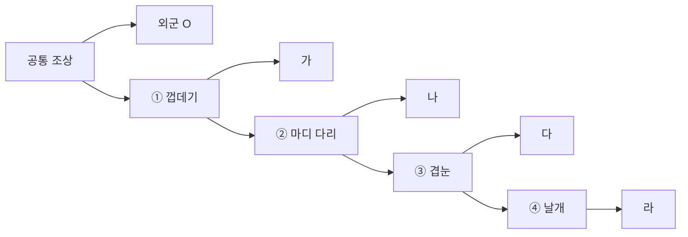

# 일반생명과학 8. 진화의 원리 — 대립유전자 빈도에서 생명의 나무까지
<!-- prev: 4-2, bio-3, 4-1, ubio-7 -->
<!-- next: ubio-9, ubio-13 -->

> [!NOTE]
> **이 단원의 범위**
> - 다윈의 자연 선택설과 진화의 증거
> - 집단의 유전적 변이와 하디–바인베르크 평형
> - 진화의 요인(자연 선택, 유전적 부동, 유전자 흐름, 돌연변이), 선택의 유형과 성 선택
> - 종의 개념, 생식적 격리, 이소적·동소적 종 분화
> - 대진화와 생명의 역사, 계통수 읽기와 분기 분석, 분자 시계

**학습 목표**

1. 다윈의 자연 선택설을 관찰과 추론의 구조로 설명하고, 화석·상동성·생물지리·직접 관찰 등 진화의 증거를 평가할 수 있다.
2. 하디–바인베르크 평형을 유도하고, 대립유전자 빈도·보인자 빈도를 계산하며 카이제곱 검정으로 평형 여부를 판정할 수 있다.
3. 자연 선택·유전적 부동·유전자 흐름·돌연변이가 대립유전자 빈도를 바꾸는 방식을 간단한 식으로 계산하고 비교할 수 있다.
4. 방향성·안정화·분단성 선택, 성 선택, 균형 선택(이형 접합자 우위)을 구분하고 사례에 적용할 수 있다.
5. 여러 종 개념과 생식적 격리 기작을 설명하고, 이소적·동소적 종 분화(배수성 포함)의 과정을 비교할 수 있다.
6. 생명의 역사의 주요 사건과 대진화의 기작을 설명하고, 형질·서열 자료로 계통수를 작성하며 분자 시계로 분기 시점을 추정할 수 있다.

**이 단원의 학습 사다리**

| 단계 | 무엇을 하나? |
|---|---|
| STEP 1. 이전 학습 다시 보기 | 통합과학 「진화와 생물다양성」, 「지질시대와 생물다양성」, 생명과학 「생명의 연속성과 다양성」의 진화·분류를 다시 꺼낸다 |
| STEP 2. 기초 다지기 | 확률의 곱셈·덧셈 규칙과 이항 전개, 카이제곱 검정, 지수적 감소와 반감기, 빈도 분포 그래프 |
| STEP 3. 핵심 개념 | 다윈 → 증거 → 변이와 하디–바인베르크 → 진화의 네 요인 → 선택의 유형 → 종과 격리 → 종 분화 → 생명의 역사 → 대진화 → 계통수와 분자 시계 |
| STEP 4. 오개념 바로잡기 | "개체가 진화한다?", "평형이면 우성 형질이 늘어난다?", "사람은 침팬지에서 진화했다?" |
| STEP 5. 전공으로 | 확산 근사와 고정 확률, 중립 이론, 유전체로 읽는 선택 |
| STEP 6. 생활·산업·진로 | 항생제·항암제 내성 관리, 보전 유전학, 감염병 계통 추적, 육종 |

---

## 🗺️ 단원 들어가기

병원에서 처음 쓰기 시작할 때 잘 듣던 항생제가 몇 년 뒤에는 듣지 않는다. 같은 일이 살충제, 제초제, 항암제, 항바이러스제에서도 되풀이된다. 약이 세균을 '바꾼' 것일까? 그렇지 않다. 약은 원래 집단 안에 드물게 있던 내성 변이를 **골라 남겼을** 뿐이다. 변한 것은 개체가 아니라 **집단의 유전적 구성**이다.

고등학교에서는 이것을 "과잉 생산 → 변이 → 생존 경쟁 → 자연 선택 → 진화"의 흐름으로 이해했다. 대학에서는 같은 현상을 수로 다룬다. 집단 속 대립유전자의 비율은 얼마이고, 아무 일도 일어나지 않으면 그 비율은 어떻게 되며, 선택·우연·이주·돌연변이는 그 비율을 한 세대에 얼마나 바꾸는가? 그리고 이런 작은 변화가 수백만 년 쌓이면 어떻게 새로운 종과 거대한 생명의 나무가 되는가? 이 단원은 **소진화(집단 수준)** 에서 출발해 **종 분화**를 거쳐 **대진화(종 이상 수준)** 와 **계통**까지 한 줄로 잇는다.

---

## STEP 1. 🔙 이전 학습 다시 보기

### 연계 개념표

| 이전 단원 | 그때 배운 것 | 이 단원에서 확장되는 것 |
|---|---|---|
| 통합과학2 「진화와 생물다양성」 '변이', '다윈의 자연선택설' | 유전적 변이와 환경적 변이, 자연 선택의 과정, 항생제 내성·핀치 부리 사례 | 대립유전자 빈도로 진화를 정의, 선택 계수로 변화 속도 계산 |
| 통합과학2 「진화와 생물다양성」 STEP 5 맛보기 | 하디·바인베르크 식 $p^2 + 2pq + q^2 = 1$, 유전적 부동의 소개 | 평형의 유도와 다섯 조건, 카이제곱 검정, 부동의 정량화(이형 접합도 감소) |
| 통합과학2 「지질시대와 생물다양성」 | 지질 시대 구분, 표준 화석, 대멸종 | 방사성 연대 측정, 주요 사건의 연대, 대멸종 뒤의 적응 방산 |
| 생명과학 「생명의 연속성과 다양성」 '생물 진화의 원리' | 진화의 증거(화석, 상동·상사 기관, 분자), 종분화의 개요 | 생식적 격리의 분류, 이소적·동소적 종 분화, 배수성 |
| 생명과학 「생명의 연속성과 다양성」 '분류 체계', '계통수' | 분류 단계, 3역 6계, 서열 차이로 계통수 그리기 | 단계통군·측계통군, 공유 파생 형질, 최대 절약법, 분자 시계 |

### 준비 운동 (사전 진단)

**Q1.** "기린은 높은 나뭇잎을 먹으려고 목을 늘였고, 늘어난 목이 자손에게 전해졌다." 이 설명이 자연 선택설과 다른 점을 한 문장으로 쓰시오.

**Q2.** 어떤 집단에서 열성 형질(aa)을 가진 개체가 9%이다. 하디–바인베르크 평형을 가정할 때 대립유전자 a의 빈도는?

**Q3.** 상동 기관과 상사 기관의 예를 하나씩 들고, 어느 것이 공통 조상의 증거인지 쓰시오.

**Q4.** 말과 당나귀 사이에서 노새가 태어나는데도 둘을 다른 종으로 보는 이유는?

정답 및 해설

**Q1.** 살아 있는 동안 얻은 형질(획득 형질)은 유전되지 않는다. 자연 선택설에서는 원래 목 길이에 유전적 변이가 있었고, 목이 긴 개체가 더 많이 살아남아 자손을 남겨 집단의 평균이 바뀐 것으로 설명한다.

**Q2.** $q^2 = 0.09$ → $q = 0.3$

**Q3.** 상동 기관: 사람의 팔과 박쥐의 날개(뼈의 구성이 같음) — **공통 조상의 증거**. 상사 기관: 새의 날개와 곤충의 날개(기원이 다르고 기능이 비슷함) — 비슷한 환경에 대한 적응의 결과.

**Q4.** 노새는 생식 능력이 없어 두 집단의 유전자가 다음 세대로 섞여 이어지지 않기 때문이다(잡종 불임, 생식적 격리).

---

## STEP 2. 🧱 기초 다지기

### ① 확률의 두 규칙과 이항 전개

- **곱셈 규칙**: 서로 독립인 사건이 함께 일어날 확률은 각 확률의 곱이다. 정자가 A를 가질 확률이 $p$, 난자가 A를 가질 확률이 $p$이면 수정란이 AA일 확률은 $p \times p = p^2$이다.
- **덧셈 규칙**: 서로 배타적인 여러 경로로 같은 결과가 생길 확률은 각 확률의 합이다. Aa는 (정자 A, 난자 a) 또는 (정자 a, 난자 A)로 생기므로 $pq + qp = 2pq$이다.
- 두 규칙을 합치면 이항 전개 $(p + q)^2 = p^2 + 2pq + q^2$이 된다. 대립유전자가 세 개이면 $(p + q + r)^2$으로 확장된다.

### ② 카이제곱($\chi^2$) 검정 — 관찰이 기대와 '충분히' 다른가

관찰값 $O$와 가설에서 나오는 기댓값 $E$를 비교하는 통계량이다.

$$
\chi^2 = \sum \frac{(O - E)^2}{E}
$$

계산한 $\chi^2$를 자유도에 맞는 **임곗값**과 비교한다. 유의 수준 5%에서 자유도 1의 임곗값은 3.84, 자유도 2는 5.99이다. $\chi^2$가 임곗값보다 작으면 "차이는 우연으로 설명할 수 있다"(가설을 기각하지 않음), 크면 "우연만으로 보기 어렵다"(가설 기각)고 판단한다. 하디–바인베르크 검정에서는 유전자형 3범주에서 자유도가 $3 - 1 - 1 = 1$이다(자료에서 $p$를 하나 추정했으므로 1을 더 뺀다).

> [!TIP]
> 💡 **요령** — 카이제곱 검정은 "가설이 옳다"를 증명하지 않는다. "자료가 가설과 모순되지 않는다"까지만 말할 수 있다. 표본이 작으면 실제 차이가 있어도 검정이 이를 잡아내지 못할 수 있다.

### ③ 지수적 감소와 반감기

어떤 양이 일정한 비율 $r$로 매번 줄어들면 $t$번 뒤에는 $X_t = X_0(1 - r)^t$이다. 시간이 연속이면 $X(t) = X_0 e^{-kt}$로 쓰고, 반으로 줄어드는 시간 **반감기**는 $t_{1/2} = \ln 2 / k$이다. 이 단원에서는 이 꼴이 세 번 나온다.

| 줄어드는 것 | 식 | 줄어드는 이유 |
|---|---|---|
| 방사성 동위 원소 | $N = N_0 (1/2)^{t/t_{1/2}}$ | 원자핵의 붕괴 |
| 작은 집단의 이형 접합도 | $H_t = H_0 \left(1 - \dfrac{1}{2N}\right)^t$ | 유전적 부동 |
| 이주가 있는 섬과 육지의 빈도 차이 | $q_t - q_m = (q_0 - q_m)(1 - m)^t$ | 유전자 흐름 |

### ④ 빈도 분포 그래프 읽기

키, 몸무게, 부리 깊이처럼 여러 유전자가 관여하는 **양적 형질**은 집단 안에서 종 모양(정규 분포에 가까운)의 분포를 보인다. 가로축은 형질 값, 세로축은 그 값을 가진 개체 수(또는 비율)이다. 선택이 작용하면 **분포의 평균이 옮겨 가거나, 폭이 좁아지거나, 봉우리가 둘로 갈라진다.** STEP 3-⑤에서 이 세 가지 변화를 각각 다른 선택 유형으로 읽는다.

---

## STEP 3. 📘 핵심 개념

### ① 다윈의 자연 선택설 — 생각이 바뀐 과정

#### 다윈 이전의 생각들

| 인물·시기 | 생각 | 다윈에게 준 것 |
|---|---|---|
| 린네(18세기) | 생물을 계층적으로 분류하고 이명법으로 이름 붙임 | 생물 사이 '닮음의 정도'를 체계화(뒤에 공통 조상으로 해석됨) |
| 퀴비에(19세기 초) | 지층마다 다른 화석, 멸종을 인정. 격변으로 생물이 바뀌었다고 봄 | 멸종이 실제로 일어난다는 증거 |
| 허턴·라이엘 | 오늘날 관찰되는 느린 과정이 오랜 시간 쌓여 지형을 만든다(동일 과정설) | **지구는 매우 오래되었다** — 작은 변화가 쌓일 시간 |
| 라마르크(1809) | 용불용과 획득 형질의 유전으로 생물이 변한다 | 생물이 변한다는 생각을 체계적으로 제시(기작은 틀림) |
| 맬서스 | 인구는 식량보다 빨리 늘어 생존 경쟁이 생긴다 | 과잉 생산과 경쟁이라는 핵심 전제 |

다윈은 비글호 항해(1831~1836)에서 남아메리카의 화석과 갈라파고스 제도의 섬마다 조금씩 다른 생물을 관찰하였다. 이후 20년 넘게 자료를 모으던 중 월리스가 같은 결론에 도달한 원고를 보내오자, 1858년 두 사람의 논문이 함께 발표되었고 이듬해 『종의 기원』(1859)이 출판되었다.

#### 관찰과 추론의 구조

| 구분 | 내용 |
|---|---|
| 관찰 1 | 같은 종의 개체들은 형질이 서로 다르고(변이), 그 상당 부분은 유전된다 |
| 관찰 2 | 모든 생물은 환경이 지탱할 수 있는 수보다 훨씬 많은 자손을 낳으며, 그중 상당수가 번식 전에 죽는다 |
| 추론 1 | 주어진 환경에서 생존·번식에 유리한 형질을 가진 개체가 평균적으로 더 많은 자손을 남긴다 |
| 추론 2 | 그 결과 유리한 형질이 세대가 지날수록 집단 안에 쌓인다 → 집단이 환경에 **적응**한다 |

다윈이 이 원리를 확신하게 된 중요한 근거는 **인위 선택**이었다. 사람이 몇 세대 동안 원하는 형질을 가진 개체만 골라 번식시키면, 야생 양배추 한 종에서 브로콜리·양배추·콜라비·케일처럼 모습이 전혀 다른 품종이 만들어진다. 사람이 짧은 시간에 이만큼 바꿀 수 있다면, 자연은 훨씬 긴 시간 동안 훨씬 큰 변화를 만들 수 있다는 추론이다.

> [!IMPORTANT]
> 자연 선택은 ① **개체**에 작용하지만 진화는 **집단**에서 일어난다. ② 이미 있는 유전적 변이 중에서 고를 뿐 필요한 변이를 만들어 내지 않는다. ③ '지금 여기'의 환경에 상대적이므로 환경이 바뀌면 유리한 형질도 바뀐다.

---

### ② 진화의 증거

#### 직접 관찰

| 사례 | 무엇이 일어났나 |
|---|---|
| 항생제 내성 세균 | 메티실린 내성 황색포도알균(MRSA)처럼 여러 항생제에 듣지 않는 균주가 병원과 지역 사회에서 늘어났다. 내성 유전자는 돌연변이와 플라스미드 전달로 퍼진다 |
| 살충제·제초제 내성 | 같은 약을 반복해서 쓴 지역에서 내성 개체의 비율이 수 년~수십 년 만에 크게 늘었다 |
| 실험실 장기 진화 | 1988년부터 이어진 대장균 배양 실험에서 수만 세대에 걸쳐 생장 속도가 빨라지고, 원래 쓰지 못하던 물질(시트르산)을 산소가 있는 조건에서 이용하는 계통이 나타났다 |

#### 상동성 — 공통 조상의 흔적

- **해부학적 상동**: 사람의 팔, 고양이의 앞다리, 고래의 가슴지느러미, 박쥐의 날개는 위팔뼈–노뼈·자뼈–손목뼈–손가락뼈의 같은 구성을 다른 용도로 쓴다.
- **발생학적 상동**: 척추동물의 배아는 모두 인두 주머니와 항문 뒤 꼬리를 거친다. 어류에서는 인두 주머니가 아가미로, 사람에서는 귀와 목의 구조로 바뀐다.
- **흔적 기관**: 고래와 일부 뱀의 몸속 골반 흔적, 사람의 꼬리뼈.
- **분자적 상동**: 거의 모든 생물이 같은 유전 부호를 쓰고 같은 효소들을 공유한다. 사람은 비타민 C 합성 효소 유전자를 가지고 있지만 돌연변이로 망가진 **위유전자**로 남아 있어 비타민 C를 음식으로 먹어야 한다. 이 위유전자는 다른 영장류와 같은 자리에서 비슷한 결함을 공유한다.

#### 수렴 진화 — 닮았지만 친척이 아닌 경우

서로 먼 계통이 비슷한 환경에서 비슷한 형질을 독립적으로 얻는 것을 **수렴 진화**라 하고, 그 결과 생긴 닮은 형질을 **상사(相似)** 라 한다. 아메리카의 선인장과 아프리카의 일부 다육 식물은 둘 다 줄기가 굵고 잎이 가시로 바뀌었지만 꽃의 구조는 전혀 다른 계통임을 보여 준다. 상사 형질은 공통 조상의 증거가 아니므로 계통수를 그릴 때 섞이지 않도록 주의해야 한다.

#### 화석 기록

화석은 오래된 지층일수록 오늘날과 다른 생물을 보여 주며, 중간 형태의 연속을 남긴다. 고래의 경우 약 5000만 년 전 육상 포유류에서 시작해 뒷다리가 점점 작아지고 콧구멍이 머리 위로 옮겨 가는 여러 단계의 화석이 발견되었다. 지느러미와 팔다리의 중간 형태를 가진 약 3억 7500만 년 전의 물고기 화석(틱타알릭)은 '어류와 네발동물 사이의 화석이 이 시기 이 환경의 지층에 있을 것'이라는 **예측**을 하고 찾아 나서 발견한 것이다.

#### 생물지리학

섬에는 대개 가장 가까운 대륙의 생물과 닮은 고유종이 산다. 환경이 비슷한 먼 대륙의 섬이 아니라 가까운 대륙과 닮았다는 것은, 생물이 **이주한 뒤 그 자리에서 변했다**는 뜻이다. 대륙 이동(「지질시대와 생물다양성」)도 분포를 설명한다. 오스트레일리아에 유대류가 많은 것은 그 대륙이 일찍 떨어져 나간 뒤 유대류가 격리된 채 다양해졌기 때문이다.

> [!TIP]
> 💡 **비유** — 진화의 증거는 범죄 수사의 여러 증거와 같다. 화석은 사건 현장 사진, 상동성은 가족끼리 닮은 얼굴, 분자 서열은 DNA 감정, 생물지리는 이동 경로 기록, 직접 관찰은 현장 생중계이다. 서로 독립적인 증거들이 같은 결론을 가리킬 때 그 결론은 강해진다.

---

### ③ 집단의 유전적 변이와 하디–바인베르크 평형

#### 변이의 근원과 측정

| 근원 | 내용 | 시간 규모 |
|---|---|---|
| 돌연변이 | 새 대립유전자를 만드는 **유일한** 근원. 점 돌연변이, 유전자 중복, 염색체 재배열 | 느림(유전자당 세대마다 대략 $10^{-5}$ 이하) |
| 유성 생식 | 감수 분열의 독립 분리와 교차, 무작위 수정이 기존 대립유전자의 **새 조합**을 만든다 | 매 세대 |
| 빠른 증식 | 세균·바이러스는 세대가 짧아 돌연변이가 빨리 쌓인다 | 수 시간~수 일 |

집단의 유전적 변이는 **대립유전자 빈도**, **이형 접합도**(이형 접합 개체의 평균 비율), 두 개체의 같은 위치 염기가 다를 평균 비율(**염기 다양도**) 등으로 잰다. 표현형 변이가 모두 유전적인 것은 아니다. 같은 유전자형도 환경에 따라 다른 표현형을 보일 수 있다.

#### 집단과 유전자 풀

**집단(population)** 은 같은 장소에 살며 서로 교배하는 같은 종의 개체 무리이고, 집단의 모든 개체가 가진 모든 대립유전자를 **유전자 풀(gene pool)** 이라 한다. 진화를 집단유전학의 말로 정의하면 다음과 같다.

> **진화(소진화)** = 세대에 따라 집단의 대립유전자 빈도가 변하는 것

#### 하디–바인베르크 평형의 유도

이배체 생물의 한 유전자 자리에 대립유전자 A와 a가 있고 빈도가 각각 $p$, $q$($p + q = 1$)라 하자. 모든 개체가 만든 생식 세포를 한 통에 넣고 무작위로 두 개를 꺼내 짝짓는다고 생각하면(무작위 교배),

| | 난자 A ($p$) | 난자 a ($q$) |
|---|---|---|
| 정자 A ($p$) | AA: $p^2$ | Aa: $pq$ |
| 정자 a ($q$) | Aa: $pq$ | aa: $q^2$ |

$$
\text{AA} : \text{Aa} : \text{aa} = p^2 : 2pq : q^2
$$

이 자손 세대의 A 빈도를 다시 세면 $p^2 + \tfrac{1}{2}(2pq) = p(p + q) = p$로 **처음과 같다**. 따라서 대립유전자 빈도는 세대가 지나도 변하지 않고, 유전자형 빈도는 **한 세대의 무작위 교배만으로** $p^2 : 2pq : q^2$에 도달하여 유지된다. 이것이 **하디–바인베르크 평형**이다. 멘델 유전은 섞여 사라지지 않으므로 열성 대립유전자도 집단 안에 그대로 보존된다는 뜻이기도 하다.

평형이 유지되려면 다음 다섯 조건이 필요하다. 각각이 깨지는 것이 곧 **진화의 요인**이다.

| 평형의 조건 | 깨지면 일어나는 일 |
|---|---|
| 돌연변이가 없다 | 새 대립유전자가 생기거나 빈도가 바뀐다 |
| 무작위 교배 | 근친 교배·동류 교배는 동형 접합자를 늘린다(대립유전자 빈도는 그대로일 수도 있음) |
| 자연 선택이 없다 | 유전자형에 따라 생존·번식 성공이 달라 빈도가 바뀐다 |
| 집단이 매우 크다 | 작은 집단에서는 우연(유전적 부동)으로 빈도가 바뀐다 |
| 유전자 흐름이 없다 | 다른 집단과의 이주로 빈도가 바뀐다 |

> [!NOTE]
> 실제 집단이 다섯 조건을 모두 만족하는 일은 드물다. 그래도 하디–바인베르크 평형은 물리학의 '마찰 없는 면'처럼 **아무 힘도 작용하지 않을 때의 기준선**으로 쓰인다. 관찰값이 기준선에서 벗어나는 방식이 어떤 힘이 작용하는지에 대한 단서가 된다.

#### 예제 1 — 유전자형 자료로 평형 검정하기

어떤 지역 주민 1000명의 MN 혈액형(공우성)을 조사하였다. MM 320명, MN 480명, NN 200명. 이 집단이 하디–바인베르크 평형에 있는지 유의 수준 5%에서 검정하시오.

**풀이**
1. 대립유전자 빈도: $p_M = \dfrac{2 \times 320 + 480}{2000} = 0.56$, $q_N = 0.44$
2. 기댓값: MM $= 0.56^2 \times 1000 = 313.6$, MN $= 2 \times 0.56 \times 0.44 \times 1000 = 492.8$, NN $= 0.44^2 \times 1000 = 193.6$
3. $\chi^2 = \dfrac{6.4^2}{313.6} + \dfrac{12.8^2}{492.8} + \dfrac{6.4^2}{193.6} = 0.131 + 0.332 + 0.212 \approx 0.68$
4. 자유도 1의 임곗값 3.84보다 작다.

**결론** 관찰값은 평형의 기댓값과 우연으로 설명할 수 있는 정도로만 다르다. 이 자료로는 이 유전자 자리에 진화의 요인이 강하게 작용한다는 증거를 찾을 수 없다.

#### 예제 2 — 열성 유전병의 보인자 빈도

어떤 상염색체 열성 유전병이 신생아 2500명 중 1명꼴로 나타난다. 평형을 가정하여 (1) 병을 일으키는 대립유전자의 빈도, (2) 보인자(이형 접합자) 빈도, (3) 환자 1명당 보인자는 약 몇 명인지 구하시오.

**풀이**
(1) $q^2 = 1/2500$ → $q = 0.020$
(2) $2pq = 2 \times 0.98 \times 0.02 = 0.0392$ → 약 3.9%(약 26명 중 1명)
(3) $0.0392 / 0.0004 = 98$ → 약 **100명**

열성 대립유전자의 대부분은 증상이 없는 보인자 속에 '숨어' 있다. 그래서 환자에게 작용하는 선택만으로는 이런 대립유전자를 집단에서 빨리 없애기 어렵다(예제 5에서 다시 확인한다).

#### 확장 — 성 연관 유전자와 복대립 유전자

- **X 연관 유전자**: 수컷(XY)은 대립유전자를 하나만 가지므로 수컷 중 열성 형질의 비율이 곧 $q$이고, 암컷은 $q^2$이다. 수컷의 8%가 적록 색맹이면 $q = 0.08$, 여성 색맹은 $0.08^2 = 0.0064$(0.64%), 여성 보인자는 $2pq = 0.147$(약 15%)이다.
- **복대립 유전자**: 대립유전자가 셋($p + q + r = 1$)이면 유전자형 빈도는 $(p + q + r)^2$의 각 항이다.

#### 예제 3 — ABO 혈액형의 대립유전자 빈도

평형에 있는 어떤 집단의 ABO 혈액형 비율이 O형 36%, A형 36.25%, B형 20.25%, AB형 7.5%이다. $I^A$, $I^B$, $i$의 빈도 $p$, $q$, $r$을 구하시오.

**풀이**
- O형 $= r^2 = 0.36$ → $r = 0.60$
- A형 + O형 $= p^2 + 2pr + r^2 = (p + r)^2 = 0.7225$ → $p + r = 0.85$ → $p = 0.25$
- $q = 1 - 0.25 - 0.60 = 0.15$
- 확인: B형 $= q^2 + 2qr = 0.0225 + 0.18 = 0.2025$, AB형 $= 2pq = 0.075$ ✓

---

### ④ 진화의 요인 — 대립유전자 빈도를 바꾸는 네 가지 힘

#### 자연 선택 — 적합도의 차이

**적합도(fitness)** 는 한 개체가 다음 세대 유전자 풀에 기여하는 상대적 정도, 즉 생존과 번식 성공을 합친 값이다. 가장 성공적인 유전자형의 적합도를 1로 놓은 값을 **상대 적합도** $w$라 하고, $1 - w = s$를 **선택 계수**라 한다. 유전자형 AA, Aa, aa의 상대 적합도가 $w_{AA}$, $w_{Aa}$, $w_{aa}$이면 선택 뒤 a의 빈도는

$$
q' = \frac{pq\,w_{Aa} + q^2 w_{aa}}{\bar{w}}, \qquad \bar{w} = p^2 w_{AA} + 2pq\,w_{Aa} + q^2 w_{aa}
$$

이다. $\bar{w}$는 집단의 평균 적합도이다.

#### 예제 4 — 한 세대의 선택

$q = 0.30$인 집단에서 상대 적합도가 AA : Aa : aa $= 1 : 1 : 0.80$이다(a가 완전 열성이고 aa가 20% 불리). 한 세대 선택 뒤의 $q$를 구하시오.

**풀이** $\bar{w} = 0.49 + 0.42 + 0.09 \times 0.80 = 0.982$, $q' = \dfrac{0.21 \times 1 + 0.09 \times 0.80}{0.982} = \dfrac{0.282}{0.982} \approx 0.287$. 한 세대에 약 0.013 줄었다. 선택 계수가 0.2로 꽤 큰데도 변화가 작은 이유는, a의 대부분이 선택을 받지 않는 Aa 속에 있기 때문이다.

#### 예제 5 — 치사 열성 대립유전자는 왜 사라지지 않는가

aa가 번식 전에 모두 죽는다면($w_{aa} = 0$, $w_{AA} = w_{Aa} = 1$) 위 식은 $q' = \dfrac{q}{1 + q}$가 되고, 이를 정리하면 $\dfrac{1}{q_t} = \dfrac{1}{q_0} + t$이다. $q$가 0.10에서 0.010으로 줄어드는 데 몇 세대가 걸리는가?

**풀이** $t = \dfrac{1}{0.010} - \dfrac{1}{0.10} = 100 - 10 = 90$세대. 사람으로 치면 2000년이 넘는다. 빈도가 낮아질수록 a는 거의 모두 보인자에게 있어 선택이 닿지 않으므로 감소가 점점 느려진다.

#### 유전적 부동 — 작은 집단의 우연

**유전적 부동(genetic drift)** 은 다음 세대로 전달되는 생식 세포가 '표본 추출'이기 때문에 생기는 우연한 빈도 변화이다. 동전을 10번 던지면 앞면이 7번 나오는 일이 흔하지만 10000번 던지면 7000번은 거의 나오지 않는 것과 같다.

- 부동은 집단이 작을수록 강하며, 결국 한 대립유전자가 **고정**(빈도 1)되고 다른 것은 **소실**된다. 중립 대립유전자가 고정될 확률은 현재의 빈도와 같다.
- 이형 접합도는 평균적으로 $H_t = H_0\left(1 - \dfrac{1}{2N}\right)^t$로 줄어든다($N$: 유효 집단 크기).
- **창시자 효과**: 소수의 개체가 새 지역에 집단을 세울 때 원래 집단과 다른 빈도를 갖게 된다. 고립된 일부 인간 집단에서 특정 유전병이 유난히 흔한 이유이다.
- **병목 효과**: 재해나 남획으로 집단이 급격히 줄었다가 회복하면 유전적 다양성이 크게 줄어든 채 남는다. 19세기 말 수십 마리 수준으로 줄었던 북방코끼리물범은 개체 수를 회복했지만 유전적 변이가 매우 적다.
- **유효 집단 크기** $N_e$는 실제 번식에 참여하는 개체 수를 반영한다. 암수의 수가 다르면 $N_e = \dfrac{4N_m N_f}{N_m + N_f}$로, 실제 개체 수보다 작다.

#### 예제 6 — 집단 크기와 다양성의 소실

(1) 유효 집단 크기가 50인 집단에서 100세대 뒤 이형 접합도는 처음의 몇 %가 남는가? 500이라면? (2) 번식하는 수컷 10마리, 암컷 90마리인 사슴 집단의 유효 집단 크기는?

**풀이**
(1) $N_e = 50$: $(1 - 1/100)^{100} = 0.99^{100} \approx 0.37$ → 약 **37%**. $N_e = 500$: $0.999^{100} \approx 0.90$ → 약 **90%**.
(2) $N_e = \dfrac{4 \times 10 \times 90}{10 + 90} = 36$. 100마리가 살지만 유전적으로는 36마리짜리 집단처럼 다양성을 잃는다. 보전 계획에서 개체 수만 보면 안 되는 이유이다.

#### 유전자 흐름 — 집단 사이의 이주

이주자 비율이 세대마다 $m$이고 이주자 집단의 빈도가 $q_m$이면 $q' = (1 - m)q + m\,q_m$이다. 유전자 흐름은 집단 사이의 차이를 **줄이고**, 다른 지역에서 생긴 유리한(또는 그 지역에 맞지 않는) 대립유전자를 옮긴다.

#### 예제 7 — 섬으로 들어오는 유전자

섬 집단의 $q = 0.20$, 육지 집단의 $q_m = 0.60$이고, 매 세대 섬 집단의 5%가 육지에서 온 개체로 바뀐다. 10세대 뒤 섬의 $q$는?

**풀이** $q_{10} - 0.60 = (0.20 - 0.60)(0.95)^{10} = -0.40 \times 0.599 = -0.240$ → $q_{10} \approx 0.36$. 10세대 만에 육지와의 차이가 0.40에서 0.24로 약 40% 줄었다. 5%의 이주만으로도 집단 사이의 차이는 빠르게 줄어든다.

#### 돌연변이 — 느리지만 유일한 원료

정방향 돌연변이율이 세대당 $\mu = 10^{-5}$이면 A의 빈도는 세대마다 $(1 - \mu)$배가 된다. 1000세대 뒤에도 $(1 - 10^{-5})^{1000} \approx 0.990$으로 약 1%만 줄어든다. 돌연변이 자체는 빈도를 바꾸는 힘으로서는 매우 약하지만, 선택과 부동이 작용할 **새로운 원료**를 공급한다는 점에서 없어서는 안 된다. 세대가 짧고 개체 수가 엄청난 세균에서는 집단 전체에 매 세대 수많은 새 돌연변이가 생긴다.

| 요인 | 빈도 변화의 방향 | 집단 사이 차이 | 적응을 만드는가? |
|---|---|---|---|
| 자연 선택 | 적합도가 높은 쪽으로 | 환경이 다르면 키움 | **예**(유일하게 일관된 적응을 만듦) |
| 유전적 부동 | 무작위 | 키움 | 아니오 |
| 유전자 흐름 | 이주자 빈도 쪽으로 | 줄임 | 아니오(적응을 퍼뜨리거나 방해할 수 있음) |
| 돌연변이 | 매우 약함, 새 대립유전자 공급 | 약간 키움 | 아니오(원료 공급) |

---

### ⑤ 선택의 유형, 성 선택, 그리고 변이의 유지

#### 양적 형질에 작용하는 세 가지 선택

| 유형 | 유리한 개체 | 분포의 변화 | 예 |
|---|---|---|---|
| **방향성 선택** | 한쪽 극단 | 평균이 한쪽으로 이동 | 가뭄으로 큰 씨만 남자 다음 세대 핀치의 평균 부리가 커짐, 약물 내성 |
| **안정화 선택** | 중간 | 평균은 그대로, 폭이 좁아짐 | 사람 신생아의 출생 체중(너무 작거나 크면 생존율이 낮았음) |
| **분단성 선택** | 양쪽 극단 | 봉우리가 둘로 갈라짐 | 먹이가 아주 작은 씨와 아주 큰 씨로 나뉜 곳의 새 부리 크기 |

#### 성 선택

**성 선택(sexual selection)** 은 짝짓기 성공의 차이로 일어나는 자연 선택의 한 형태이다. 그 결과 암수의 겉모습이 달라지는 **성적 이형성**이 생긴다.

| 종류 | 내용 | 예 |
|---|---|---|
| 동성 간 선택 | 같은 성(주로 수컷)끼리 짝을 놓고 경쟁 | 사슴 수컷의 뿔, 물개 수컷의 큰 몸집 |
| 이성 간 선택(배우자 선택) | 한 성(주로 암컷)이 상대를 고름 | 공작 수컷의 꼬리, 새의 화려한 깃털과 노래 |

배우자 선택이 왜 생겼는가에 대한 한 가지 설명은 **좋은 유전자 가설**이다. 화려한 장식을 유지하려면 건강해야 하므로 장식이 수컷의 유전적 질을 보여 주는 '정직한 신호'가 되고, 그런 수컷을 고른 암컷의 자손이 더 잘 살아남는다는 것이다. 장식은 포식자 눈에 잘 띄는 비용이 있으므로, 생존과 짝짓기 사이의 균형점에서 정해진다.

#### 변이는 왜 사라지지 않는가 — 균형 선택

선택은 대개 변이를 줄이는 방향으로 작용하는데도 집단에는 변이가 많이 남아 있다. 그 이유 중 하나가 두 개 이상의 대립유전자를 함께 유지하는 **균형 선택**이다.

- **이형 접합자 우위**: 이형 접합자의 적합도가 두 동형 접합자보다 높으면 두 대립유전자가 모두 유지된다. 말라리아가 흔한 지역의 낫 모양 적혈구 대립유전자가 대표적이다. 정상 동형 접합자는 말라리아에 취약하고, 낫 모양 동형 접합자는 빈혈이 심하며, 이형 접합자는 빈혈이 가볍고 말라리아에 강하다.
- **빈도 의존 선택**: 드문 형이 유리하면 그 형이 늘다가, 흔해지면 불리해져 다시 준다. 병원체는 흔한 숙주 면역 유형에 적응하므로 드문 면역 유전자형(예: 조직 적합성 유전자)을 가진 숙주가 유리해지는 경향이 있다.
- **중립 변이**: 적합도에 거의 영향이 없는 변이(많은 비암호화 부위, 침묵 돌연변이)는 선택을 받지 않고 부동에 따라 오르내린다.

#### 예제 8 — 이형 접합자 우위의 평형 빈도

말라리아 지역에서 상대 적합도가 정상 동형 접합자 $1 - s$, 이형 접합자 1, 낫 모양 동형 접합자 $1 - t$이면 낫 모양 대립유전자의 평형 빈도는 $\hat{q} = \dfrac{s}{s + t}$이다. $s = 0.10$, $t = 0.80$일 때 $\hat{q}$와 출생아 중 낫 모양 동형 접합자의 비율(평형 가정)을 구하시오.

**풀이** $\hat{q} = \dfrac{0.10}{0.90} \approx 0.11$. 동형 접합자 비율은 $\hat{q}^2 \approx 0.012$ → 약 1.2%. 말라리아가 사라진 지역으로 이주한 집단에서는 $s \to 0$이므로 $\hat{q} \to 0$으로, 대립유전자 빈도가 점점 줄어들 것으로 예측된다.

> [!WARNING]
> 자연 선택은 완벽한 생물을 만들지 못한다. ① 이미 있는 변이에서만 고를 수 있고, ② 조상에게서 물려받은 구조 위에서만 고칠 수 있으며(척추동물 눈의 맹점), ③ 적응은 서로 충돌하는 요구 사이의 타협이고, ④ 우연과 환경 변화가 언제나 끼어든다.

---

### ⑥ 종의 개념과 생식적 격리

#### 여러 가지 종 개념

| 종 개념 | 종을 나누는 기준 | 장점 | 한계 |
|---|---|---|---|
| **생물학적 종** | 자연에서 교배하여 생식 능력 있는 자손을 낳을 수 있는 집단(다른 집단과 생식적으로 격리) | 유전자 흐름이라는 진화의 과정과 직접 연결 | 무성 생식 생물, 화석, 서로 만나지 않는 집단에는 적용 불가. 자연에서 잡종이 생기는 경우도 많음 |
| 형태학적 종 | 몸의 모양과 구조 | 화석·무성 생식 생물에도 적용, 현장에서 실용적 | 기준이 주관적일 수 있고, 겉모습이 같은 '은밀종'을 놓침 |
| 생태학적 종 | 차지하는 생태적 지위 | 무성 생식 생물에도 적용 | 지위의 경계가 모호 |
| 계통학적 종 | 공통 조상과 그 자손으로 된 가장 작은 무리 | 서열 자료로 객관적 분석 | 어디까지 나눌지 기준이 연구자마다 다를 수 있음 |

#### 생식적 격리의 기작

| 시기 | 기작 | 내용 | 예 |
|---|---|---|---|
| 접합 전 | 서식지 격리 | 같은 지역이지만 다른 서식지를 써서 만나지 않음 | 물가에 사는 종과 숲 바닥에 사는 종 |
| 접합 전 | 시간적 격리 | 번식 시기·시각이 다름 | 같은 숲의 두 식물이 서로 다른 달에 꽃을 피움 |
| 접합 전 | 행동적 격리 | 구애 신호가 서로 맞지 않음 | 반딧불이의 발광 무늬, 새의 노래 |
| 접합 전 | 기계적 격리 | 생식 기관이나 꽃의 구조가 맞지 않음 | 꽃가루 매개 곤충이 맞지 않는 꽃 |
| 접합 전 | 배우자 격리 | 정자와 난자가 서로 알아보지 못함 | 바다에 배우자를 뿌리는 성게의 난자 표면 단백질 |
| 접합 후 | 잡종 생존력 감소 | 잡종이 발생 도중 죽거나 약함 | — |
| 접합 후 | 잡종 불임 | 잡종이 자라지만 생식 세포를 만들지 못함 | 노새(말 2n=64, 당나귀 2n=62 → 노새 2n=63, 감수 분열에서 짝짓기가 어려움) |
| 접합 후 | 잡종 붕괴 | 1대 잡종은 정상이나 그 자손 세대가 약하거나 불임 | 일부 재배 식물의 품종 사이 잡종 |

---

### ⑦ 종 분화 — 한 종이 둘로 갈라지는 과정

#### 이소적 종 분화

**이소적 종 분화(allopatric speciation)** 는 한 집단이 지리적 장벽(산맥, 바다, 강, 빙하)으로 나뉘어 유전자 흐름이 끊긴 뒤, 각 집단이 서로 다른 선택과 부동, 돌연변이를 겪어 생식적으로 격리되는 과정이다.

- 장벽은 생물의 이동 능력에 따라 다르다. 새에게는 넓은 강이 장벽이 아니지만 땅속에 사는 작은 동물에게는 장벽이 된다.
- 약 300만 년 전 파나마 지협이 솟아올라 태평양과 카리브해가 분리되자, 양쪽 바다의 많은 해양 생물이 서로 다른 종으로 갈라졌다. 오늘날 양쪽에서 가장 가까운 친척 종을 짝지어 보면 형태와 유전자가 닮았지만 서로 교배하지 않는 경우가 많다.
- 실험적 근거: 한 집단의 초파리를 두 무리로 나누어 서로 다른 먹이에서 여러 세대 키운 뒤 다시 섞으면, 같은 먹이에서 자란 무리끼리 짝짓는 경향이 나타났다는 실험들이 있다. 다른 환경에 대한 적응이 부수적으로 짝 선호를 바꿀 수 있음을 보여 준다.

#### 동소적 종 분화

**동소적 종 분화(sympatric speciation)** 는 지리적으로 같은 지역에서 유전자 흐름이 줄어 종이 갈라지는 경우이다.

| 기작 | 내용 | 예 |
|---|---|---|
| **배수성** | 감수 분열의 오류로 염색체 세트가 늘어나면, 원래 집단과 교배해도 홀수 배수체 잡종이 생겨 불임이 된다 → **한 세대 만에** 생식적 격리 | 식물에서 흔함. 빵밀(2n = 6x = 42, 세 조상 종의 유전체 AABBDD) |
| 서식지 분화 | 새로운 먹이 식물·서식지를 쓰기 시작한 무리가 그곳에서 짝짓기 | 원래 먹이 나무와 다른 과일 나무에 알을 낳기 시작한 파리 집단 |
| 성 선택 | 짝 선호의 차이 | 아프리카 호수의 시클리드류에서 수컷 색깔에 대한 암컷의 선호 차이 |

- **동질 배수체**: 한 종 안에서 염색체 세트가 2배가 된 것(2n → 4n).
- **이질 배수체**: 서로 다른 두 종의 잡종이 염색체 수가 배가되어 생식 능력을 회복한 것. 잡종의 염색체는 짝이 없어 감수 분열이 실패하지만, 배가되면 모든 염색체가 짝을 얻는다.

#### 예제 9 — 이질 배수체의 염색체 수

종 P(2n = 14)와 종 Q(2n = 18)가 교배하였다. (1) 잡종의 염색체 수와 불임인 이유를 쓰시오. (2) 잡종의 염색체가 배가되어 생긴 새 종의 체세포 염색체 수와 생식 세포의 염색체 수를 쓰시오. (3) 새 종을 P와 다시 교배하면 자손은 어떻게 되는가?

**풀이**
(1) P의 생식 세포 7개 + Q의 생식 세포 9개 = **16개**. P와 Q의 염색체는 서로 상동이 아니므로 감수 분열에서 짝을 짓지 못해 정상적인 생식 세포를 만들 수 없다.
(2) 체세포 **32개**(P 염색체 2벌 + Q 염색체 2벌), 생식 세포 **16개**.
(3) 자손은 $16 + 7 = 23$개로 P 염색체는 2벌, Q 염색체는 1벌이다. Q 염색체가 짝을 얻지 못해 불임이 된다. 따라서 새 종은 부모 종과 생식적으로 격리되어 있다.

#### 잡종 지대와 종 분화의 속도

두 집단이 다시 만나 잡종이 생기는 지역을 **잡종 지대**라 한다. 잡종 지대에서 일어날 수 있는 일은 세 가지이다.

| 결과 | 조건 | 의미 |
|---|---|---|
| **강화** | 잡종의 적합도가 매우 낮다 | 접합 전 격리를 강하게 만드는 선택이 작용 → 두 종이 더 뚜렷이 갈라짐 |
| **융합** | 잡종이 부모와 비슷하게 잘 산다 | 유전자 흐름이 다시 커져 두 집단이 하나로 합쳐질 수 있음 |
| **안정** | 잡종이 꾸준히 생기지만 지대 밖으로 퍼지지 않음 | 좁은 잡종 지대가 오랫동안 유지 |

화석 기록에서는 한 종이 오랫동안 거의 변하지 않다가 비교적 짧은 기간에 새 종이 나타나는 양상이 자주 보인다. 이를 **단속 평형**이라 하며, 꾸준히 조금씩 변하는 **점진적** 양상과 함께 둘 다 실제로 관찰된다. '짧은 기간'이라 해도 지질 시대 기준이므로 수만 년일 수 있다. 종 분화에는 몇 개의 큰 효과 유전자만 관여하기도 하고(꽃 색을 바꿔 꽃가루 매개 동물을 바꾸는 유전자), 많은 작은 효과 유전자가 관여하기도 한다.

---

### ⑧ 대진화 Ⅰ — 생명의 역사

#### 최초의 생명은 어떻게?

생명의 기원에 대해서는 다음 단계가 차례로 일어났다는 가설이 널리 연구된다.

1. **작은 유기 분자의 비생물적 합성**: 1953년 밀러와 유리는 원시 대기를 흉내 낸 기체에 방전을 가해 아미노산이 생기는 것을 보였다. 오늘날에는 심해 열수 분출구, 운석에서 온 유기물 등도 후보로 연구된다.
2. **고분자 형성**: 뜨거운 점토나 광물 표면에서 아미노산·뉴클레오타이드가 이어질 수 있다.
3. **원시 세포**: 지질이 저절로 만든 막 주머니(소포)가 분자를 가두고 커지고 나뉠 수 있다.
4. **자기 복제 분자**: RNA는 정보를 저장하면서 **촉매(리보자임)** 로도 작용하므로, DNA와 단백질 이전에 RNA가 두 역할을 함께 했다는 **RNA 세계 가설**이 유력하다. 리보솜에서 펩타이드 결합을 만드는 것이 rRNA라는 사실도 이를 뒷받침한다.

#### 방사성 연대 측정

화석과 암석의 절대 연령은 방사성 동위 원소의 붕괴로 잰다. 남은 모동위 원소의 비율이 $(1/2)^n$이면 $n$반감기가 지난 것이다.

| 동위 원소 | 반감기 | 측정 가능 범위 |
|---|---|---|
| 탄소-14 | 약 5730년 | 약 5만 년 이내의 유기물 |
| 칼륨-40 | 약 12억 5천만 년 | 화산암, 수십만 년 이상 |
| 우라늄-238 | 약 45억 년 | 아주 오래된 암석 |

퇴적암 속 화석은 직접 재기 어려우므로 그 위아래에 끼인 화산재 층의 연령으로 범위를 정한다.

#### 예제 10 — 연대 측정

(1) 어떤 뼈의 탄소-14 비율이 살아 있는 생물의 1/8이다. 이 뼈는 약 몇 년 전의 것인가? (2) 어떤 화산암에서 처음 칼륨-40의 25%만 남아 있다면 암석의 나이는?

**풀이**
(1) $1/8 = (1/2)^3$ → 3반감기 → $3 \times 5730 = 17\,190$ → 약 $1.7 \times 10^4$년 전.
(2) $25\% = (1/2)^2$ → 2반감기 → $2 \times 12.5$억 = 약 **25억 년**.

#### 생명의 역사의 주요 사건

| 시기(약) | 사건 | 의미 |
|---|---|---|
| 46억 년 전 | 지구 형성 | — |
| 35억 년 전 | 가장 오래된 화석 증거 중 하나(남세균 등 원핵생물이 만든 층상 구조, 스트로마톨라이트) | 원핵생물의 시대가 약 20억 년 이어짐 |
| 24억 년 전 무렵 | 대기에 산소가 쌓이기 시작(산소 급증 사건) | 광합성 남세균의 산소 → 많은 혐기성 생물의 쇠퇴, 호기 호흡의 길 |
| 18억 년 전 무렵 | 진핵생물 화석의 등장 | 세포 내 공생(「생물 다양성」) |
| 12억 년 전 무렵 | 다세포 진핵생물의 화석 | 몸의 크기와 세포 분화의 시작 |
| 5억 4천만 년 전 무렵 | **캄브리아기 대폭발**: 대부분의 동물 문이 짧은 기간에 화석으로 등장 | 포식–피식 관계, 단단한 껍데기 |
| 4억 7천만 년 전 무렵 | 식물의 육상 진출, 뒤이어 절지동물·네발동물 | 육상 생태계의 형성 |
| 2억 5200만 년 전 | 페름기 말 대멸종(해양 종의 약 90% 이상 소멸) | 가장 큰 대멸종, 중생대의 시작 |
| 6600만 년 전 | 백악기 말 대멸종(비조류 공룡 포함 종의 약 4분의 3 소멸) | 포유류의 적응 방산 |

지금까지 큰 대멸종은 다섯 번 있었던 것으로 정리된다(오르도비스기 말, 데본기 후기, 페름기 말, 트라이아스기 말, 백악기 말). 백악기 말 대멸종은 소행성 충돌의 증거(전 세계 지층의 이리듐 농집층, 멕시코 유카탄반도의 충돌 구덩이)와 연결된다. 대멸종 뒤에는 비어 있는 생태적 지위를 살아남은 무리가 빠르게 채우는 **적응 방산**이 일어났다. 오늘날 인간 활동으로 인한 멸종 속도가 과거 대멸종 시기에 견줄 만큼 빨라졌다는 우려도 있다(「생태학」).

#### 대륙 이동과 생물 분포

판의 운동은 대륙의 위치, 기후, 해류를 바꾸어 생물에 영향을 주었다. 약 2억 5천만 년 전 무렵 대륙이 하나로 모여 **판게아**를 이루자 얕은 바다가 줄고 내륙이 건조해졌는데, 이것이 페름기 말 대멸종의 한 배경으로 꼽힌다. 판게아가 쪼개진 뒤 각 대륙의 생물은 따로 진화하였다.

---

### ⑨ 대진화 Ⅱ — 새로운 구조는 어떻게 생기는가

| 기작 | 내용 | 예 |
|---|---|---|
| **발생 시기·속도의 변화** | 몸의 부분마다 자라는 속도가 달라지거나 성적 성숙 시기가 바뀜 | 어린 시절의 아가미를 단 채 성체가 되는 도롱뇽(유형 성숙), 사람과 침팬지의 머리뼈 비율 차이 |
| **발생 유전자 발현의 변화** | 혹스 유전자 같은 발생 조절 유전자의 발현 위치·시기가 바뀜(「유전자 발현 조절과 생명공학」) | 호수에 사는 큰가시고기 집단에서 배지느러미 가시가 없어진 것은 한 발생 유전자의 **인핸서**가 결실되어 그 부위에서만 발현이 꺼졌기 때문이다 |
| **굴절 적응** | 원래 다른 기능으로 진화한 구조가 새 기능에 쓰임 | 처음에는 체온 유지나 과시에 쓰였을 것으로 보이는 깃털이 비행에 쓰임 |
| 유전자 중복 | 여분의 사본이 새 기능을 얻음 | 헤모글로빈·혹스 유전자군 |

복잡한 구조도 작은 단계의 연속으로 생길 수 있다. 연체동물에는 빛을 감지하는 세포 몇 개만 있는 반점, 오목한 컵, 바늘구멍 사진기 같은 눈, 렌즈가 있는 눈이 모두 존재하며, 각 단계가 그 자체로 소유자에게 유리하다.

> [!IMPORTANT]
> 진화에는 **목표**가 없다. 말의 화석에서 몸집이 커지고 발가락 수가 줄어드는 '추세'가 보이지만, 실제 계통은 여러 갈래로 뻗은 덤불이며 그중 한 가지만 오늘날까지 남은 것이다. 추세는 특정 환경에서 어떤 형질을 가진 종이 더 오래 살아남거나 더 많이 분화한 결과(종 선택)로 해석할 수 있다.

---

### ⑩ 계통수 읽기와 분기 분석

#### 계통수의 구조

**계통(phylogeny)** 은 한 생물 무리의 진화 역사이고, **계통수**는 그 가설을 그린 그림이다.

| 용어 | 뜻 |
|---|---|
| 분기점(마디) | 한 조상 계통이 두 자손 계통으로 갈라진 곳 = 그 자손들의 가장 최근 공통 조상 |
| 자매군 | 가장 최근 공통 조상을 공유하는 두 무리 |
| 뿌리 | 나무 속 모든 무리의 공통 조상 |
| 기저 분류군 | 뿌리 가까이에서 일찍 갈라져 나온 무리 |
| 다분기 | 세 개 이상의 가지가 한 점에서 갈라짐 = 갈라진 순서를 아직 모름 |

계통수를 읽을 때의 규칙
1. 분기점에서 가지를 **돌려도** 같은 나무이다. 끝에 늘어선 이름의 순서는 의미가 없다.
2. 유연관계는 끝의 이웃 관계가 아니라 **공통 조상을 얼마나 최근에 공유하는가**로 읽는다.
3. 오늘날 살아 있는 두 종은 서로의 조상이 아니다. 사람과 침팬지는 약 600만~700만 년 전의 공통 조상에서 갈라진 '사촌'이다.
4. 특별히 표시하지 않았다면 가지의 길이는 시간이나 변화량을 뜻하지 않는다.

#### 단계통군, 측계통군, 다계통군

| 묶음 | 정의 | 예 |
|---|---|---|
| **단계통군**(분기군) | 한 조상과 그 **모든** 자손 | 포유류, 조류를 포함한 파충류 |
| 측계통군 | 한 조상과 자손 중 **일부만** | 조류를 뺀 전통적 '파충류', '원생생물' |
| 다계통군 | 공통 조상이 다른 여러 계통을 함께 묶음 | 날개 있는 척추동물(새와 박쥐) |

현대 분류는 단계통군만을 정식 분류군으로 삼으려 한다.

#### 공유 파생 형질과 외군

- **공유 조상 형질**: 그 무리의 조상에게서 비롯되었지만 더 오래된 무리도 가진 형질(포유류의 척추). 무리 안을 나누는 데 쓸모없다.
- **공유 파생 형질**: 그 무리에서 새로 생겨 그 무리만 공유하는 형질(포유류의 털). 분기군을 정의한다.
- **외군**: 연구하는 무리(내군)보다 먼저 갈라진 무리. 외군에도 있는 형질은 조상 형질, 내군 일부에만 있는 형질은 파생 형질로 판단한다.

#### 예제 11 — 형질 행렬로 분기도 그리기

가상의 생물 가~라와 외군 O의 형질 유무(1 = 있음, 0 = 없음)이다.

| 형질 | O | 가 | 나 | 다 | 라 |
|---|---|---|---|---|---|
| ① 단단한 껍데기 | 0 | 1 | 1 | 1 | 1 |
| ② 마디가 있는 다리 | 0 | 0 | 1 | 1 | 1 |
| ③ 겹눈 | 0 | 0 | 0 | 1 | 1 |
| ④ 날개 | 0 | 0 | 0 | 0 | 1 |

(1) 각 형질이 생긴 분기점을 정하여 분기도를 괄호식으로 쓰시오. (2) '다'의 자매군은?

**풀이** 외군에 모두 0이므로 1이 파생 형질이다. ①은 가~라 모두, ②는 나~라, ③은 다~라, ④는 라에만 있다. 따라서 가가 가장 먼저 갈라지고, 그다음 나, 마지막으로 다와 라가 갈라진다.

괄호식: `(O, (가, (나, (다, 라))))`

(2) '다'의 자매군은 **라**이다.

#### 최대 절약법

형질이나 서열 자료로 가능한 나무 중 **변화의 총횟수가 가장 적은** 나무를 고르는 방법을 **최대 절약법**이라 한다. "같은 형질이 여러 번 독립적으로 생겼다"보다 "한 번 생겨 물려받았다"가 더 단순한 설명이라는 원리이다. 생물이 많아지면 가능한 나무의 수가 폭발적으로 늘어나므로 컴퓨터 알고리즘이 필요하며, 서열 변화의 확률 모형을 써서 자료가 나올 가능성이 가장 큰 나무를 고르는 **최대 가능도법**도 널리 쓰인다.

#### 예제 12 — 염기 서열로 절약적인 나무 고르기

네 생물의 같은 부위 5 염기이다.

| 위치 | 1 | 2 | 3 | 4 | 5 |
|---|---|---|---|---|---|
| W | A | A | A | C | T |
| X | A | A | G | C | T |
| Y | G | G | A | C | C |
| Z | G | G | G | T | C |

세 가지 나무 ((W,X),(Y,Z)), ((W,Y),(X,Z)), ((W,Z),(X,Y)) 각각에 필요한 최소 변화 횟수를 구하고 가장 절약적인 나무를 고르시오.

**풀이** 위치마다 최소 변화 수를 센다.
- 위치 1, 2, 5: W·X가 같고 Y·Z가 같다 → (W,X),(Y,Z) 나무에서 1번, 나머지 나무에서 2번
- 위치 3: W·Y가 A, X·Z가 G → (W,Y),(X,Z) 나무에서 1번, 나머지에서 2번
- 위치 4: Z만 다르다 → 어느 나무에서나 1번(나무를 구별하는 데 정보가 없다)

| 나무 | 위치 1~5 | 합계 |
|---|---|---|
| ((W,X),(Y,Z)) | 1, 1, 2, 1, 1 | **6** |
| ((W,Y),(X,Z)) | 2, 2, 1, 1, 2 | 8 |
| ((W,Z),(X,Y)) | 2, 2, 2, 1, 2 | 9 |

가장 절약적인 나무는 **((W,X),(Y,Z))** 이다. 위치 3은 이 나무에서 변화가 두 번 필요한데, 같은 변화가 독립적으로 두 번 일어났거나(수렴) 되돌아간 것으로 해석된다.

#### 상동 유전자와 수평 유전자 이동

- **오솔로그**: 종 분화로 갈라진 서로 다른 종의 같은 유전자(사람과 생쥐의 β-글로빈 유전자). 종의 계통을 추정하는 데 쓴다.
- **패럴로그**: 한 유전체 안에서 유전자 중복으로 생긴 사본들(사람의 α-글로빈과 β-글로빈 유전자). 종의 계통이 아니라 유전자 중복의 역사를 보여 준다.
- **수평 유전자 이동**: 원핵생물은 형질 전환·형질 도입·접합으로 유전자를 다른 계통과 주고받는다. 그래서 생명의 나무의 뿌리 근처는 나무보다 '그물'에 가깝다(「생물 다양성」).

#### 분자 시계

어떤 유전자나 부위에서 염기 치환이 시간에 대략 비례하여 쌓인다면, 두 종의 서열 차이로 갈라진 시간을 추정할 수 있다. 이를 **분자 시계**라 한다. 이 생각의 근거는 **중립 이론**이다. 대부분의 분자 수준 변화가 적합도에 거의 영향이 없어 선택이 아닌 부동으로 고정된다면, 고정 속도는 돌연변이율과 같아져 일정하게 유지된다.

두 종이 $T$년 전에 갈라졌고 계통마다 부위당 연간 $r$의 속도로 치환이 쌓이면, 두 서열 사이의 차이는 $d = 2rT$이다(두 계통이 각각 쌓으므로 2배).

#### 예제 13 — 분자 시계 보정과 적용

화석으로 3000만 년 전에 갈라졌다고 알려진 두 종의 한 유전자 1000 염기를 비교하니 60곳이 달랐다. 같은 유전자에서 다른 두 종 사이의 차이가 1000 염기당 24곳이었다면, 두 종은 약 몇 년 전에 갈라졌는가?

**풀이**
1. 보정: $d = 60/1000 = 0.060$, $r = \dfrac{d}{2T} = \dfrac{0.060}{2 \times 3.0 \times 10^7} = 1.0 \times 10^{-9}$ /부위/년
2. 적용: $T = \dfrac{0.024}{2 \times 1.0 \times 10^{-9}} = 1.2 \times 10^7$ → 약 **1200만 년 전**

**결과의 의미와 한계** 분자 시계는 유전자마다 속도가 다르고(기능이 중요한 유전자일수록 느림), 세대가 짧은 생물에서 빠른 경향이 있으며, 같은 자리에 치환이 여러 번 겹치면 차이를 과소평가하게 된다. 그래서 여러 유전자와 여러 화석 보정점을 함께 쓰고, 오래된 분기일수록 오차 범위를 넓게 제시한다.

---

## STEP 4. ⚠️ 오개념 바로잡기

| 흔한 오개념 | 올바른 개념 | 왜 그럴까? |
|---|---|---|
| 개체가 환경에 맞게 진화한다 | 개체는 진화하지 않는다. 집단의 **대립유전자 빈도**가 세대에 걸쳐 변한다 | 선택은 개체의 생존·번식에 작용하지만 그 결과는 다음 세대 집단의 구성에서 드러난다 |
| 하디–바인베르크 평형에서는 우성 대립유전자가 점점 늘어난다 | 우성·열성과 관계없이 빈도는 **변하지 않는다** | 우성은 표현형의 문제일 뿐, 유전자 전달 확률과는 무관하다 |
| 하디–바인베르크 식에 맞으면 그 집단은 진화하지 않는다 | 한 유전자 자리, 한 세대의 검정일 뿐이며 다른 자리나 약한 힘은 놓칠 수 있다 | 약한 선택은 짧은 기간 자료로 검출하기 어렵다 |
| 유전적 부동은 작은 집단에서만 일어난다 | 모든 유한 집단에서 일어나며 작은 집단에서 **더 강할** 뿐이다 | 표본 추출의 우연은 집단 크기와 무관하게 늘 존재한다 |
| 생물은 필요해서 돌연변이를 만든다 | 돌연변이는 필요와 **무관하게** 무작위로 생기고, 선택이 그중 일부를 남긴다 | 세균을 항생제에 노출하기 전에 이미 내성 돌연변이가 있었음을 보인 실험이 있다 |
| 사람은 침팬지에서 진화했다 | 사람과 침팬지는 **공통 조상**에서 갈라진 현생 종이다 | 오늘날 살아 있는 종은 서로의 조상이 아니다 |
| 계통수의 오른쪽(또는 위쪽) 끝에 있는 생물이 더 진화한 것이다 | 끝의 모든 생물은 뿌리로부터 **같은 시간**만큼 진화했다 | 가지를 돌려도 같은 나무이므로 위치에는 우열이 없다 |
| 화석에 중간 형태가 없으니 진화의 증거가 부족하다 | 많은 중간 형태가 발견되었고, 화석화 자체가 드문 사건이라 기록에 빈틈이 있는 것이 당연하다 | 틱타알릭처럼 예측으로 찾은 중간 화석도 있다 |

---

## STEP 5. 🎓 다음 단계로 한 걸음 더

> [!CAUTION]
> 여기부터는 일반 과목의 범위를 넘는 전공 과목 맛보기이다. 시험 범위가 아니며, 이 단원의 개념이 전공에서 어떻게 이어지는지 보여 주기 위한 내용이다.

### 전공 과목과의 연결

| 전공 과목 | 이어지는 내용 |
|---|---|
| 집단유전학 | 확산 근사, 고정 확률과 고정 시간, 연관 불균형, 선택과 부동의 상호 작용 |
| 진화생물학 | 생활사 진화, 친족 선택과 사회 행동, 공진화, 진화발생생물학 |
| 분자진화학 | 중립 이론과 거의 중립 이론, $d_N/d_S$로 읽는 선택, 유전자 중복의 운명 |
| 계통분류학 | 최대 가능도법·베이즈 계통 추론, 분자 연대 측정, 명명 규약 |
| 고생물학 | 화석 기록의 편향, 대멸종의 원인 분석, 형태 계측 |
| 인류학·고인류 유전체학 | 고대 DNA, 인류 집단의 이동과 혼합 |

### 맛보기 ① 새 돌연변이가 고정될 확률

크기 $N$인 이배체 집단에 새 돌연변이가 하나 생기면 처음 빈도는 $1/(2N)$이다. 중립이라면 고정될 확률은 바로 그 값 $1/(2N)$이다. 그런데 이 돌연변이가 이형 접합 상태에서 선택 이익 $s$를 준다면(작은 $s$, 큰 집단), 고정 확률은 근사적으로 $2s$이다. $s = 0.01$(1% 유리)이라도 고정 확률은 2%에 불과하다. 유리한 돌연변이도 **대부분 처음 몇 세대에 우연히 사라진다**는 뜻이다. 반대로 $\lvert s \rvert$가 $1/(2N)$보다 훨씬 작으면 선택은 사실상 보이지 않고 부동이 지배한다. 그래서 작은 집단에서는 약간 해로운 돌연변이도 고정될 수 있다.

### 맛보기 ② 유전체로 선택의 흔적 읽기

단백질 암호 서열에서 아미노산을 바꾸는 치환의 비율($d_N$)과 바꾸지 않는 침묵 치환의 비율($d_S$)을 비교하면 선택의 종류를 짐작할 수 있다. $d_N/d_S < 1$이면 아미노산 변화를 막는 정화 선택, $\approx 1$이면 중립, $> 1$이면 아미노산 변화를 선호하는 양성 선택의 신호이다. 병원체 표면 단백질과 숙주 면역 유전자에서 $d_N/d_S > 1$인 부위가 자주 발견되는데, 이는 숙주와 병원체가 서로를 따라잡는 **군비 경쟁**의 흔적으로 해석된다.

### 일반생명과학 vs 전공 과목

| 주제 | 일반생명과학(이 단원) | 전공 과목 |
|---|---|---|
| 집단 모형 | 하디–바인베르크, 한 세대 선택식, 이형 접합도 감소식 | 확산 방정식, 고정 확률, 다유전자 모형, 양적 유전학 |
| 선택 | 선택의 세 유형, 성 선택, 이형 접합자 우위 | 친족 선택, 다수준 선택, 진화 게임 이론 |
| 종 분화 | 격리 기작, 이소적·동소적, 배수성 | 종 분화 유전학, 유전체 섬, 잡종 종 분화 |
| 계통 | 형질 행렬, 최대 절약법, 단순 분자 시계 | 확률 모형 계통 추론, 이완 분자 시계, 계통 비교법 |

---

## STEP 6. 🏭 생활·산업·진로 연결

### 사례 1. 약제 내성의 진화를 늦추는 처방

- **원리** 내성은 약이 만든 강한 방향성 선택의 결과이다. 여러 표적을 동시에 막으면 모든 약에 내성인 돌연변이가 동시에 생길 확률이 곱셈 규칙으로 매우 작아진다.
- **어디에 쓰이나** HIV·결핵의 복합 약물 요법, 항생제 적정 사용 관리, 해충 저항성 관리를 위한 '피난처'(일부 경작지에 저항성 작물을 심지 않아 감수성 해충을 남김), 항암제 내성 예측.

### 사례 2. 보전 유전학

- **원리** 작은 집단은 부동과 근친 교배로 이형 접합도를 잃고, 해로운 열성 대립유전자가 동형 접합으로 드러나 적합도가 낮아진다(근교약세).
- **어디에 쓰이나** 멸종 위기종의 유효 집단 크기 추정, 서로 다른 집단 사이의 개체 교환(유전적 구조), 생태 통로 설계, 복원 개체군 선정.

### 사례 3. 감염병의 계통 추적

- **원리** 바이러스는 돌연변이가 빨라 감염 사슬마다 서열이 조금씩 다르다. 환자들의 바이러스 유전체로 계통수를 그리면 전파 경로와 시점을 분자 시계로 추정할 수 있다.
- **어디에 쓰이나** 유행 초기의 기원 추적, 변이주의 등장 감시, 계절 인플루엔자 백신 균주 선정에 참고.

### 사례 4. 육종 — 사람이 하는 선택

- **원리** 인위 선택은 원하는 형질에 강한 방향성 선택을 가한다. 오늘날에는 유전체 표지로 어린 개체의 형질을 미리 예측해 선택한다(유전체 선발).
- **어디에 쓰이나** 수확량·병 저항성 작물, 가축 개량. 한 품종만 넓게 심으면 유전적 다양성이 줄어 새 병원체에 한꺼번에 무너질 위험이 있어 재래종과 야생 근연종의 보존이 함께 강조된다.

### 관련 전공과 진로

| 진로 | 하는 일 | 관련 전공 |
|---|---|---|
| 진화생물학·집단유전학 연구원 | 집단의 유전적 구조와 적응 연구 | 생명과학, 생태학, 통계학 |
| 계통분류학자 | 새로운 종 기재, 계통 분석 | 생명과학, 산림·해양생물학 |
| 감염병 유전체 역학자 | 병원체 유전체로 유행 추적 | 미생물학, 보건학, 생물정보학 |
| 보전 유전학자 | 멸종 위기종 유전적 다양성 관리 | 생태학, 수의학, 환경학 |
| 작물·가축 육종가 | 유전체 기반 선발, 품종 개발 | 농생명과학, 동물자원학 |
| 고생물학자 | 화석으로 생명의 역사 복원 | 지질학, 생명과학 |

---

## 🔬 탐구 활동

### 활동 A. 스프레드시트로 유전적 부동과 선택 시뮬레이션하기

**목표** 작은 집단과 큰 집단에서 대립유전자 빈도가 우연으로 변하는 모습을 관찰하고, 선택이 더해졌을 때와 비교한다.

**준비물** 스프레드시트 프로그램(난수 함수, 이항 분포 난수 또는 반복 난수를 사용할 수 있는 것)

**과정**
1. A열에 세대(0~100)를 적고, B2에 처음 빈도 $p_0 = 0.5$를 넣는다.
2. 집단 크기 $N$을 정한다(유전자 수 $2N$). 다음 세대의 A 개수는 '성공 확률 $p$, 시행 $2N$회'의 이항 분포 난수로 뽑고, 이를 $2N$으로 나누어 다음 세대 $p$로 삼는다. (이항 분포 난수 함수가 없으면 $2N$개의 난수를 만들어 $p$보다 작은 개수를 센다.)
3. $N = 10$, $N = 100$, $N = 1000$으로 각각 5번씩 반복하고 $p$의 변화를 한 그래프에 그린다.
4. 선택을 더한다: 각 세대에서 먼저 예제 4의 식으로 기대 빈도 $p'$를 계산하고, 그 $p'$로 이항 표본을 뽑는다. aa의 상대 적합도를 0.9로 놓고 3을 반복한다.

**결과 기록**

| 집단 크기 | 반복 5회 중 A가 고정된 횟수 | A가 소실된 횟수 | 평균 고정·소실 세대 | 100세대 뒤 평균 이형 접합도 $2pq$ |
|---|---|---|---|---|
| 10 | | | | |
| 100 | | | | |
| 1000 | | | | |

**생각해 보기**
1. $N = 10$에서 고정·소실까지 걸린 세대 수는 $N = 100$과 어떻게 다른가? 이형 접합도 감소식 $H_t = H_0(1 - 1/2N)^t$의 예측과 비교해 보자.
2. 선택이 있을 때, 작은 집단에서는 불리한 a가 고정되는 경우가 있었는가? 큰 집단에서는?
3. 이 결과를 멸종 위기종 보전 계획에 어떻게 적용할 수 있을까?

### 활동 B. 실제 유전자형 자료로 하디–바인베르크 검정하기(자료 분석)

**목표** 공개된 집단 유전자형 자료나 교사가 제공한 가상 자료로 대립유전자 빈도를 구하고 카이제곱 검정을 한다.

**과정**
1. 한 유전자 자리의 유전자형 수(AA, Aa, aa)를 표로 정리한다.
2. 대립유전자 빈도와 평형 기댓값을 구한다.
3. $\chi^2$를 계산하여 자유도 1의 임곗값 3.84와 비교한다.
4. 이형 접합자가 기대보다 **적게** 관찰되었다면 그 원인 후보(근친 교배, 동류 교배, 서로 다른 빈도의 두 집단을 하나로 합쳐 조사함, 이형 접합자에 불리한 선택)를 토의한다.

**생각해 보기** 같은 자료에서 표본 크기만 10배로 늘리면(비율은 같게) $\chi^2$는 어떻게 되는가? 이것이 통계적 판단에 주는 의미는?

> [!WARNING]
> **자료 윤리** 사람의 유전 정보는 민감한 개인 정보이다. 수업에서는 개인을 식별할 수 없는 공개 집단 자료나 가상 자료만 쓰고, 친구나 가족의 유전 정보를 수집하거나 공유하지 않는다.

---

## ✅ 개념 확인 문제

### 기본

**1.** 하디–바인베르크 평형이 유지되기 위한 조건 다섯 가지를 쓰고, 각 조건이 깨질 때 작용하는 진화의 요인을 짝지으시오.

정답 및 해설

**정답** ① 돌연변이 없음 ↔ 돌연변이 ② 무작위 교배 ↔ 비무작위 교배(근친·동류 교배) ③ 자연 선택 없음 ↔ 자연 선택 ④ 매우 큰 집단 ↔ 유전적 부동 ⑤ 유전자 흐름 없음 ↔ 유전자 흐름

비무작위 교배는 유전자형 빈도를 바꾸지만 그 자체로 대립유전자 빈도를 바꾸지 않을 수 있다는 점에서 다른 네 요인과 구별된다.

**2.** 평형에 있는 집단에서 우성 표현형을 보이는 개체가 84%이다. 열성 대립유전자의 빈도와 이형 접합자의 비율을 구하시오.

정답 및 해설

**정답** $q = 0.4$, 이형 접합자 48%

열성 표현형 $= 1 - 0.84 = 0.16 = q^2$ → $q = 0.4$, $p = 0.6$, $2pq = 0.48$.

**3.** 어떤 섬에 사는 도마뱀 집단 1000마리의 유전자형이 AA 490, Aa 420, aa 90이다. (1) A의 빈도를 구하시오. (2) 이 집단은 하디–바인베르크 평형에 있는가?

정답 및 해설

**정답** (1) 0.70 (2) 평형에 있다

(1) $p = (2 \times 490 + 420)/2000 = 0.70$. (2) 기댓값 $0.49 \times 1000 = 490$, $0.42 \times 1000 = 420$, $0.09 \times 1000 = 90$으로 관찰값과 정확히 같아 $\chi^2 = 0$이다.

**4.** 다음 생식적 격리 사례를 접합 전·접합 후로 구분하고 기작의 이름을 쓰시오.
(가) 두 개구리 종이 같은 연못에 살지만 한 종은 3월, 다른 종은 5월에 번식한다.
(나) 두 종의 잡종이 건강하게 자라지만 생식 세포를 만들지 못한다.
(다) 두 새 종의 수컷 노래가 달라 암컷이 다른 종 수컷에게 반응하지 않는다.

정답 및 해설

**정답** (가) 접합 전, 시간적 격리 (나) 접합 후, 잡종 불임 (다) 접합 전, 행동적 격리

**5.** 다음 묶음이 단계통군, 측계통군, 다계통군 중 무엇인지 쓰시오.
(가) 포유류 전체 (나) 조류를 뺀 파충류 (다) 날 수 있는 동물(곤충, 새, 박쥐)

정답 및 해설

**정답** (가) 단계통군 (나) 측계통군 (다) 다계통군

(나) 파충류의 공통 조상의 자손 중 조류를 뺐으므로 일부 자손만 포함한다. (다) 날개는 세 무리에서 독립적으로 생긴 상사 형질이며 이들의 공통 조상은 날지 못했다.

### 응용

**6.** 어떤 집단 200개체의 유전자형이 AA 90, Aa 60, aa 50이다. (1) 하디–바인베르크 평형의 기댓값을 구하고 카이제곱 검정을 하시오(자유도 1, 임곗값 3.84). (2) 관찰된 편차의 특징과 그 원인으로 가능한 것 두 가지를 쓰시오.

정답 및 해설

**정답** (1) 기댓값 72, 96, 32, $\chi^2 \approx 28.1$ → 평형 가설 기각 (2) 이형 접합자 부족 — 근친 교배, 서로 다른 빈도를 가진 하위 집단의 혼합 조사 등

(1) $p = (180 + 60)/400 = 0.6$, $q = 0.4$. 기댓값 $0.36 \times 200 = 72$, $0.48 \times 200 = 96$, $0.16 \times 200 = 32$.
$\chi^2 = \dfrac{18^2}{72} + \dfrac{36^2}{96} + \dfrac{18^2}{32} = 4.5 + 13.5 + 10.1 = 28.1 > 3.84$.
(2) 이형 접합자가 기대보다 크게 적고 두 동형 접합자가 많다. 근친 교배나 동류 교배는 동형 접합자를 늘린다. 또 빈도가 다른 두 집단을 하나로 합쳐 조사해도 이형 접합자가 적게 나타난다(집단 세분화 효과). 이형 접합자에 불리한 선택도 후보이다.

**7.** 남자의 6%가 X 연관 열성 형질을 나타내는 집단에서 (1) 이 형질을 나타내는 여자의 비율, (2) 보인자 여자의 비율을 구하시오(평형 가정).

정답 및 해설

**정답** (1) 0.36% (2) 약 11.3%

$q = 0.06$. (1) $q^2 = 0.0036$ (2) $2pq = 2 \times 0.94 \times 0.06 = 0.1128$.

**8.** 상대 적합도가 AA : Aa : aa $= 1 : 1 : 0$인 치사 열성 대립유전자의 빈도가 0.05이다. (1) 다음 세대의 빈도를 구하시오. (2) 빈도가 0.01이 되기까지 몇 세대가 걸리는가?

정답 및 해설

**정답** (1) 약 0.048 (2) 80세대

(1) $q' = q/(1 + q) = 0.05/1.05 \approx 0.0476$.
(2) $t = 1/q_t - 1/q_0 = 100 - 20 = 80$세대.

**9.** 두 종의 미토콘드리아 유전자를 비교했더니 부위당 0.08의 차이가 있었다. 이 유전자의 치환 속도가 계통마다 부위당 연간 $2.0 \times 10^{-8}$이라면 두 종은 약 몇 년 전에 갈라졌는가? 이 추정이 과소평가될 수 있는 이유는?

정답 및 해설

**정답** 약 200만 년 전

$T = d/(2r) = 0.08/(2 \times 2.0 \times 10^{-8}) = 2.0 \times 10^6$년.
같은 자리에 치환이 여러 번 일어나면(예: A → G → A) 관찰되는 차이는 실제 치환 수보다 적어 시간이 과소평가된다. 특히 빠르게 변하는 유전자와 오래된 분기에서 이 문제가 커진다.

### 융합·서술형

**10. [보전·통계 연계]** 어떤 섬의 여우 집단은 한때 수천 마리였으나 질병으로 15마리까지 줄었다가 50년 만에 1000마리로 회복되었다. (1) 이 집단의 유전적 다양성이 개체 수만큼 회복되지 않은 이유를 유전적 부동으로 설명하시오. (2) 감소 시기 유효 집단 크기를 15로 보고 그 상태가 5세대 이어졌다면 이형 접합도는 처음의 몇 %가 되는가? (3) 다양성을 높이기 위한 보전 방안을 근거와 함께 제안하시오.

정답 및 해설

**예시 답안**
(1) 개체 수가 15마리로 줄었을 때(병목) 원래 집단에 있던 대립유전자 중 상당수가 그 15마리에 없었거나, 작은 집단에서 우연히 소실되었다. 그 뒤 개체 수가 늘어도 남은 대립유전자들이 복사될 뿐 사라진 것은 돌아오지 않으며, 새 돌연변이가 다양성을 채우는 데는 매우 오랜 시간이 걸린다.
(2) $(1 - 1/30)^5 = (0.9667)^5 \approx 0.84$ → 약 **84%**. (병목 직후 표본 추출 자체에서 잃은 대립유전자는 이 식에 포함되지 않으므로 실제 손실은 더 클 수 있다.)
(3) 같은 종의 다른 지역 집단에서 일부 개체를 옮겨 오는 **유전자 흐름**을 인위적으로 만들어 새 대립유전자를 들여온다. 이때 원래 집단의 지역 적응을 해치지 않도록 환경이 비슷한 집단을 고르고, 질병 검역을 거친다. 또 번식 쌍을 계획해 근친 교배를 줄인다.

**채점 포인트** ① 병목에서의 표본 추출과 소실 ② 식에 따른 계산 ③ 유전자 흐름을 이용한 근거 있는 방안

**11. [의학·확률 연계]** 결핵균이 약물 X에 내성이 생기는 돌연변이는 세포 분열당 약 $10^{-8}$, 약물 Y에 내성이 생기는 돌연변이는 약 $10^{-7}$의 확률로 생긴다고 하자(두 돌연변이는 독립). 환자 몸속 결핵균이 $10^{9}$개일 때 (1) X 하나만 쓰면 처음부터 내성인 균이 평균 몇 개 있을 것으로 기대되는가? (2) 두 약에 모두 내성인 균의 기댓값은? (3) 이를 근거로 복합 약물 요법의 원리를 자연 선택으로 설명하시오.

정답 및 해설

**예시 답안**
(1) $10^9 \times 10^{-8} = 10$개 — 약을 쓰기 전부터 내성균이 있을 가능성이 높다.
(2) $10^9 \times 10^{-8} \times 10^{-7} = 10^{-6}$개 — 거의 없다.
(3) 약 X만 쓰면 원래 있던 약 10개의 내성균이 선택되어 증식하므로 치료가 실패할 수 있다(방향성 선택). 두 약을 함께 쓰면 두 가지 모두에 내성인 균이 처음부터 있을 가능성이 곱셈 규칙에 따라 매우 작아, 선택될 변이 자체가 거의 없다. 그래서 복합 요법을 **충분한 기간** 지켜야 하며, 중간에 끊거나 한 가지만 쓰면 내성 진화를 돕게 된다.

**채점 포인트** ① 기댓값 계산 ② 곱셈 규칙 ③ 돌연변이는 약과 무관하게 이미 존재하고 약은 선택만 한다는 해석

---

## 📝 한눈에 정리

### 핵심 요약

- 다윈은 변이·과잉 생산이라는 관찰에서 자연 선택과 적응을 추론했고, 인위 선택과 오랜 지구의 나이가 이를 뒷받침했다.
- 진화의 증거는 직접 관찰, 상동성(해부·발생·분자), 화석 기록, 생물지리로 서로 독립적이며 같은 결론을 가리킨다. 상사(수렴)는 공통 조상의 증거가 아니다.
- 진화는 **집단의 대립유전자 빈도 변화**이다. 무작위 교배하는 큰 집단에서 다른 힘이 없으면 $p^2 : 2pq : q^2$이 한 세대 만에 성립하고 유지된다(하디–바인베르크).
- 자연 선택은 적합도 차이로 빈도를 바꾸며 일관되게 적응을 만드는 유일한 요인이다. 열성 대립유전자는 보인자 속에 숨어 느리게 줄어든다.
- 유전적 부동은 작은 집단에서 강하고 이형 접합도를 $(1 - 1/2N)$배씩 줄인다. 유전자 흐름은 집단 사이 차이를 줄이고, 돌연변이는 새 원료를 공급한다.
- 선택은 방향성·안정화·분단성으로 분포를 바꾸고, 성 선택은 성적 이형성을, 균형 선택(이형 접합자 우위, 빈도 의존)은 변이 유지를 설명한다.
- 종은 여러 개념으로 정의되며, 생물학적 종은 접합 전·후의 생식적 격리로 구분된다. 종 분화는 지리적 격리(이소적)나 배수성·서식지·성 선택(동소적)으로 일어난다.
- 생명의 역사는 원핵생물 → 산소 증가 → 진핵생물 → 다세포 → 캄브리아기 대폭발 → 육상 진출로 이어지며, 대멸종 뒤 적응 방산이 일어났다. 대진화는 발생 조절 변화와 굴절 적응으로 새 구조를 만든다.
- 계통수는 공통 조상을 공유한 순서를 나타내며, 공유 파생 형질과 외군, 최대 절약법으로 작성하고 분자 시계 $d = 2rT$로 분기 시점을 추정한다.

### 주요 식 정리

| 식 | 뜻 |
|---|---|
| $p + q = 1$, $p^2 + 2pq + q^2 = 1$ | 하디–바인베르크 평형 |
| $\chi^2 = \sum (O - E)^2/E$ | 관찰값과 기댓값의 비교 |
| $q' = (pq\,w_{Aa} + q^2 w_{aa})/\bar{w}$ | 한 세대 선택 뒤 빈도 |
| $1/q_t = 1/q_0 + t$ | 치사 열성 대립유전자의 감소 |
| $\hat{q} = s/(s + t)$ | 이형 접합자 우위의 평형 빈도 |
| $H_t = H_0(1 - 1/2N)^t$, $N_e = 4N_mN_f/(N_m + N_f)$ | 유전적 부동과 유효 집단 크기 |
| $q' = (1 - m)q + m\,q_m$ | 유전자 흐름 |
| $d = 2rT$ | 분자 시계 |

### 핵심 용어

| 용어 | 뜻 |
|---|---|
| 유전자 풀 | 한 집단의 모든 개체가 가진 모든 대립유전자 |
| 하디–바인베르크 평형 | 진화의 요인이 없을 때 대립유전자·유전자형 빈도가 세대에 걸쳐 일정하게 유지되는 상태 |
| 상대 적합도 | 가장 성공적인 유전자형을 1로 놓은 생존·번식 성공의 상대값 |
| 유전적 부동 | 유한한 집단에서 생식 세포 표본 추출의 우연으로 생기는 빈도 변화 |
| 창시자 효과 / 병목 효과 | 소수가 새 집단을 세울 때 / 집단이 급감할 때 부동으로 다양성이 줄고 빈도가 바뀌는 현상 |
| 유전자 흐름 | 집단 사이 개체·생식 세포의 이동에 따른 대립유전자의 이동 |
| 성 선택 | 짝짓기 성공의 차이로 일어나는 선택 |
| 이형 접합자 우위 | 이형 접합자의 적합도가 두 동형 접합자보다 높아 두 대립유전자가 유지되는 현상 |
| 생식적 격리 | 두 종 사이의 교배나 생식 능력 있는 자손의 생성을 막는 기작 |
| 이소적·동소적 종 분화 | 지리적으로 분리된 / 같은 지역의 집단에서 일어나는 종 분화 |
| 이질 배수체 | 서로 다른 종의 염색체 세트를 둘 이상 가진 배수체 |
| 적응 방산 | 공통 조상에서 짧은 기간에 여러 생태적 지위에 적응한 많은 종이 생기는 현상 |
| 공유 파생 형질 | 한 분기군에서 새로 생겨 그 분기군만 공유하는 형질 |
| 분자 시계 | 서열 차이가 시간에 비례해 쌓인다고 보고 분기 시점을 추정하는 방법 |

### 다음 단원으로

진화의 원리로 무장했으니 이제 그 결과물인 **생명의 나무 전체**를 둘러볼 차례이다. 다음 단원 「생물 다양성」에서는 rRNA 서열이 밝힌 3역 체계에서 출발해 세균과 고세균, 세포 내 공생으로 생긴 진핵생물, 육상으로 올라온 식물, 균류, 그리고 동물의 체제와 계통을 차례로 살펴보고, 사람이 그 나무의 어느 가지에서 어떻게 나왔는지 확인한다.
