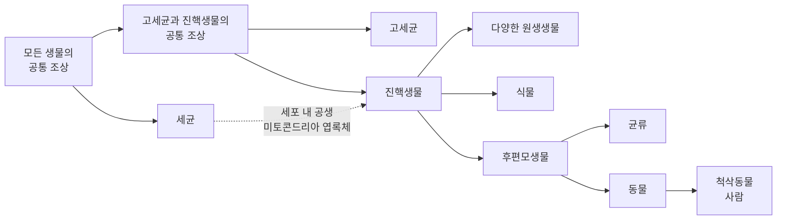
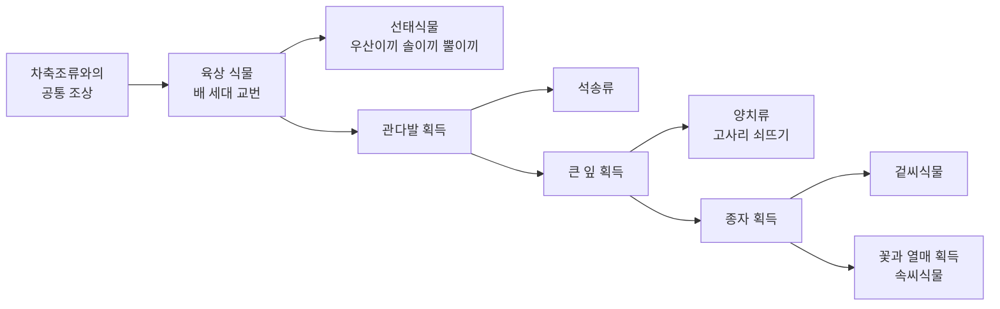
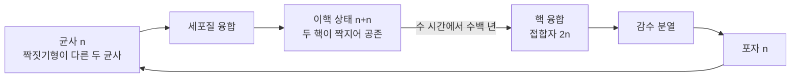
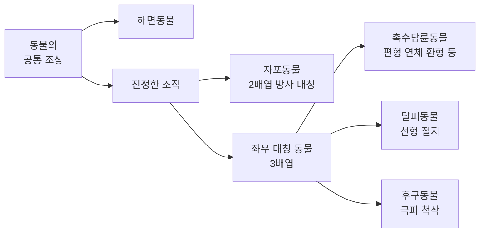

# 일반생명과학 9. 생물 다양성 — 세 개의 역에서 사람까지, 생명의 나무 둘러보기
<!-- prev: bio-3, m1-02, ubio-8 -->
<!-- next: ubio-10, ubio-11, ubio-13 -->

> [!NOTE]
> **이 단원의 범위**
> - 3역 분류 체계와 생명의 계통수
> - 원핵생물(세균과 고세균)의 구조·대사·생태적 역할
> - 원생생물과 진핵생물의 기원(세포 내 공생)
> - 식물의 육상 진출과 다양성(선태식물, 비종자 관다발 식물, 겉씨식물, 속씨식물)
> - 균류
> - 동물의 체제와 계통(주요 무척추동물 문, 척삭동물, 사람의 진화)

**학습 목표**

1. rRNA 서열 비교가 3역 체계를 이끈 과정을 설명하고, 세균·고세균·진핵생물의 분자적·구조적 차이를 비교할 수 있다.
2. 원핵생물의 구조(세포벽, 그람 염색, 내생 포자)와 유전적 다양성의 근원(형질 전환·형질 도입·접합)을 설명하고, 이분법 생장을 계산할 수 있다.
3. 원핵생물의 영양 방식과 질소 고정 등 생태적 역할을 설명하고, 세포 내 공생설의 증거로 진핵생물의 기원을 설명할 수 있다.
4. 식물이 육상에 적응하며 얻은 형질(배, 세대 교번, 관다발, 종자, 꽃과 열매)을 계통 순서로 설명하고, 생활사에서 각 단계의 핵상을 판단할 수 있다.
5. 균류의 구조·생식·영양 방식과 생태적 역할을 설명할 수 있다.
6. 동물의 체제(대칭, 배엽, 체강, 선구·후구)와 분자 계통을 바탕으로 주요 문과 척삭동물을 구분하고, 사람의 진화 과정을 증거와 함께 설명할 수 있다.

**이 단원의 학습 사다리**

| 단계 | 무엇을 하나? |
|---|---|
| STEP 1. 이전 학습 다시 보기 | 중1 「생물의 구성과 다양성」의 5계, 생명과학 「생명의 연속성과 다양성」의 3역 6계와 문 수준 분류, 「진화의 원리」의 계통수 |
| STEP 2. 기초 다지기 | 분류 단계와 학명, 핵상과 생활사 도해 읽기, 표면적–부피 비, 지수 생장과 세대 시간 |
| STEP 3. 핵심 개념 | 3역 → 원핵생물의 구조 → 대사와 생태 → 원생생물과 세포 내 공생 → 식물의 육상 진출 → 비종자 식물 → 종자식물 → 균류 → 동물의 체제 → 무척추동물 → 척삭동물 → 사람의 진화 |
| STEP 4. 오개념 바로잡기 | "고세균은 원시적인 세균?", "버섯은 식물?", "사람은 진화의 정점?" |
| STEP 5. 전공으로 | 미생물 암흑 물질과 메타유전체, 진핵생물 기원의 2역 가설 |
| STEP 6. 생활·산업·진로 | 미생물 군집과 건강, 생물 정화, 균류 의약품, 생물 자원 |

---

## 🗺️ 단원 들어가기

흙 한 숟가락에는 수십억 마리의 미생물이 있고, 그중 대부분은 실험실에서 한 번도 배양된 적이 없다. 우리 장 속에는 우리 몸의 세포 수와 비슷한 수의 세균이 산다. 지금까지 이름이 붙은 생물은 약 200만 종 안팎이지만, 실제 종 수는 그보다 몇 배에서 수십 배 많을 것으로 추정된다. 이 엄청난 다양성을 어떻게 정리할 수 있을까?

고등학교에서는 3역 6계와 동식물의 문 수준 특징을 배웠다. 대학에서는 질문이 달라진다. **왜** 원핵생물을 두 역으로 나누는가? 진핵세포의 미토콘드리아와 엽록체는 **어디에서** 왔는가? 식물이 바다에서 육지로 올라올 때 **무엇이** 문제였고 어떤 형질로 해결했는가? 해파리와 불가사리는 둘 다 방사 대칭인데 왜 불가사리가 우리와 더 가까운가? 이 단원은 「진화의 원리」에서 배운 계통수 읽기를 도구 삼아 **생명의 나무 전체를 한 바퀴** 돈다.

---

## STEP 1. 🔙 이전 학습 다시 보기

### 연계 개념표

| 이전 단원 | 그때 배운 것 | 이 단원에서 확장되는 것 |
|---|---|---|
| 중1 「생물의 구성과 다양성」 '종의 개념과 5계 분류 체계' | 종과 분류 단계, 원핵생물·원생생물·균·식물·동물의 5계 | 5계가 3역으로 바뀐 분자적 근거, '원생생물계'의 해체 |
| 생명과학 「생명의 연속성과 다양성」 '생물의 분류 체계' | 3역 6계, 학명, 계별 특징(핵막, 세포 수, 영양 방식) | 세포벽·막 지질·번역 개시 아미노산 등 역을 나누는 분자 기준, 원핵생물의 대사 다양성 |
| 생명과학 「생명의 연속성과 다양성」 '동물과 식물의 분류군' | 식물의 문(선태·석송·양치·겉씨·속씨), 동물의 문과 계통수(배엽, 대칭, 선구·후구, 탈피) | 세대 교번과 각 분류군의 생활사, 체강의 종류, 척삭동물 안의 계통, 사람의 진화 |
| 일반생명과학 「진화의 원리」 '계통수 읽기와 분기 분석' | 분기점, 자매군, 단계통군·측계통군, 공유 파생 형질, 분자 시계 | 이 단원의 모든 분류군을 계통수 위에 놓고 해석 |

### 준비 운동 (사전 진단)

**Q1.** 세균과 고세균의 공통점 한 가지와, 그럼에도 둘을 다른 역으로 나누는 이유를 쓰시오.

**Q2.** 양치식물과 겉씨식물이 공통으로 가진 구조와, 겉씨식물만 가진 구조를 하나씩 쓰시오.

**Q3.** 버섯(균계)은 광합성을 하지 않는다. 버섯은 양분을 어떻게 얻는가?

**Q4.** 불가사리가 해파리보다 사람과 계통적으로 더 가까운 근거를 하나 쓰시오.

정답 및 해설

**Q1.** 공통점: 핵막이 없는 원핵세포이다(고리형 염색체, 막성 세포 소기관 없음). 다른 역으로 나누는 이유: rRNA 등 유전자 서열과 막 지질·세포벽 같은 분자 특징이 서로 매우 다르고, 고세균은 일부 특징이 오히려 진핵생물과 비슷하기 때문이다.

**Q2.** 공통: 관다발. 겉씨식물만: 종자(밑씨, 꽃가루).

**Q3.** 소화 효소를 몸 밖으로 분비해 주변 유기물을 분해한 뒤 흡수한다(흡수 영양, 종속 영양).

**Q4.** 둘 다 원구가 항문이 되는 후구동물이다. 또 불가사리의 유생은 좌우 대칭이며, 분자 계통도 불가사리(극피동물)를 척삭동물과 함께 후구동물로 묶는다.

---

## STEP 2. 🧱 기초 다지기

### ① 분류 단계, 학명, 그리고 계통

분류 단계는 **역 > 계 > 문 > 강 > 목 > 과 > 속 > 종**이고, 학명은 **속명 + 종소명**(이명법)으로 기울여 쓴다(사람 *Homo sapiens*). 현대 분류의 목표는 이 단계들이 계통수의 **단계통군**과 일치하게 하는 것이다(「진화의 원리」). 그런데 새 자료가 나오면 계통수가 바뀌므로, 계·문 같은 상위 단계의 이름과 범위는 교재마다, 시기마다 조금씩 다를 수 있다. 이 단원에서는 학계에서 널리 받아들여지는 큰 틀을 쓰되, 논쟁 중인 부분은 그렇다고 밝힌다.

### ② 핵상과 생활사 도해 읽기

유성 생식을 하는 생물의 생활사에는 반드시 **감수 분열**(2n → n)과 **수정**(n + n → 2n)이 한 번씩 들어 있다. 이 두 사건 사이에 어떤 단계가 다세포로 자라는지에 따라 생활사가 세 가지로 나뉜다.

| 생활사 유형 | 다세포 단계 | 감수 분열이 만드는 것 | 예 |
|---|---|---|---|
| 배우자형(동물형) | 2n만 | 생식 세포(정자·난자) | 대부분의 동물 |
| 접합자형(균류형) | n만 | 포자(감수 분열이 접합자에서 곧바로 일어남) | 많은 균류, 일부 녹조류 |
| **세대 교번형**(식물형) | n과 2n 모두 | **포자** → 체세포 분열로 다세포 배우체(n)가 됨 | 모든 육상 식물, 일부 조류 |

> [!TIP]
> 💡 **요령** — 생활사 그림을 읽을 때는 먼저 '감수 분열'과 '수정' 두 화살표를 찾아 표시한다. 감수 분열 뒤부터 수정 전까지가 n, 수정 뒤부터 감수 분열 전까지가 2n이다. 식물에서 포자는 감수 분열로, 생식 세포(정자·난세포)는 배우체의 **체세포 분열**로 만들어진다는 점이 동물과 다르다.

### ③ 표면적–부피 비

반지름 $r$인 공 모양 세포의 표면적은 $4\pi r^2$, 부피는 $\tfrac43\pi r^3$이므로

$$
\frac{\text{표면적}}{\text{부피}} = \frac{3}{r} = \frac{6}{d}
$$

이다($d$: 지름). 세포가 작을수록 부피에 비해 표면적이 크다. 세포는 막을 통해 물질을 주고받으므로, 크기가 작은 원핵세포는 확산만으로도 빠르게 물질대사를 할 수 있다. 크기가 큰 진핵세포는 내막계와 세포 골격, 막성 세포 소기관으로 이 한계를 보완한다.

### ④ 지수 생장과 세대 시간

이분법으로 번식하는 세포가 세대 시간 $g$마다 두 배가 되면, 시간 $t$ 뒤의 수는

$$
N = N_0 \cdot 2^{t/g} \qquad \Longleftrightarrow \qquad g = \frac{t}{\log_2 (N/N_0)}
$$

이다. 실제 배양에서는 적응기(지체기) → 지수 생장기 → 정지기 → 사멸기를 거치며, 지수 생장은 양분이 충분한 짧은 기간에만 유지된다.

---

## STEP 3. 📘 핵심 개념

### ① 3역 분류 체계와 생명의 계통수

#### 5계에서 3역으로

20세기 중반까지는 핵막의 유무로 생물을 원핵생물과 진핵생물로 크게 나누었고, 5계 체계는 원핵생물 전체를 하나의 계로 묶었다. 1970년대 후반 우즈(C. Woese)는 모든 생물에 있고 천천히 변하는 **작은 소단위 rRNA**의 서열을 비교하여, 원핵생물이 서로 매우 다른 두 무리로 나뉜다는 것을 발견했다. 메테인 생성균 같은 일부 원핵생물은 rRNA가 다른 세균과도, 진핵생물과도 달랐다. 이렇게 해서 생물을 **세균역(Bacteria)**, **고세균역(Archaea)**, **진핵생물역(Eukarya)** 으로 나누는 3역 체계가 제안되었다.

rRNA가 깊은 계통을 재는 데 알맞은 이유
- 모든 세포 생물에 있다(공통 비교 대상).
- 단백질 합성이라는 핵심 기능을 맡아 변화가 느리다(오래된 분기도 추적 가능).
- 빠르게 변하는 부위와 느리게 변하는 부위가 섞여 있어 가까운 관계와 먼 관계를 모두 볼 수 있다.

#### 세 역의 비교

| 특징 | 세균 | 고세균 | 진핵생물 |
|---|---|---|---|
| 핵막 | 없음 | 없음 | 있음 |
| 막성 세포 소기관 | 없음 | 없음 | 있음 |
| 세포벽의 펩티도글리칸 | **있음** | 없음 | 없음 |
| 막 지질 | 지방산이 에스터 결합, 곧은 사슬 | **에터 결합**, 가지 친 사슬 | 지방산이 에스터 결합, 곧은 사슬 |
| RNA 중합 효소 | 단순한 한 종류 | 한 종류이나 진핵생물의 효소처럼 복잡 | 여러 종류 |
| 번역 개시 아미노산 | 폼일메싸이오닌 | 메싸이오닌 | 메싸이오닌 |
| 히스톤 | 없음 | 일부에 있음 | 있음 |
| 유전자 속 인트론 | 매우 드묾 | 일부 유전자에 있음 | 많음 |
| 스트렙토마이신·클로람페니콜에 의한 생장 억제 | 억제됨 | 억제되지 않음 | 억제되지 않음 |
| 염색체 | 고리형 | 고리형 | 선형, 여러 개 |
| 100 °C 이상에서 생장 | 없음 | 일부 가능 | 없음 |

고세균은 세포 구조로는 세균과 닮았지만, 전사·번역 장치와 히스톤 같은 정보 처리 체계는 진핵생물과 닮았다. 그래서 계통수에서 고세균과 진핵생물이 세균보다 서로 더 가까운 자매군으로 그려진다.

<!-- fig:ubio-9-three-domains -->

> [!NOTE]
> 최근 심해 퇴적물 등에서 유전체로만 알려진 고세균 무리(아스가르드 고세균)가 진핵생물에만 있다고 여겨졌던 단백질 유전자를 여럿 가진 것이 밝혀졌다. 이를 근거로 진핵생물이 고세균 **안에서** 갈라져 나왔다는 '2역' 관점이 힘을 얻고 있다. 생명의 나무는 지금도 다시 그려지는 중이다(STEP 5).

#### 나무인가, 그물인가

원핵생물은 **수평 유전자 이동**으로 다른 계통의 유전자를 자주 받아들인다. 또 진핵생물은 세균(미토콘드리아·엽록체의 조상)을 통째로 받아들였다. 따라서 생명의 나무의 뿌리 근처는 가지가 서로 이어진 **그물**에 가깝다. 그래도 rRNA처럼 수평 이동이 드문 핵심 유전자들은 대체로 일관된 나무 모양을 보여 주어, 3역의 큰 틀은 유지된다.

<!-- fig:ubio-9-tree-of-life -->

#### 예제 1 — 특징으로 역 판정하기

다음 미지의 단세포 생물 (가)~(다)가 속한 역을 쓰시오.
(가) 핵막이 없고, 막 지질이 에터 결합으로 되어 있으며, 105 °C의 열수 분출구에서 자란다.
(나) 핵막이 없고, 세포벽에 펩티도글리칸이 있으며, 클로람페니콜을 넣으면 자라지 않는다.
(다) 핵막과 미토콘드리아가 있고, 펩티도글리칸이 없다.

**풀이** (가) **고세균** — 에터 결합 막 지질과 100 °C 이상의 생장은 고세균의 특징이다. (나) **세균** — 펩티도글리칸과 항생제 감수성. (다) **진핵생물**.

#### ✔ 바로 확인

1. 짝짓기: 세포벽의 펩티도글리칸, 에터 결합 막 지질, 핵막 — 세균, 고세균, 진핵생물
2. (O/X) 고세균은 진핵생물보다 세균과 계통적으로 더 가깝다.
3. 빈칸: 우즈가 3역 체계를 제안할 때 서열을 비교한 분자는 (    )이다.
4. (O/X) 수평 유전자 이동 때문에 생명의 나무의 뿌리 근처는 그물에 가깝다.

정답

1. 펩티도글리칸 — 세균, 에터 결합 막 지질 — 고세균, 핵막 — 진핵생물
2. X — 세포 구조는 세균과 닮았지만 전사·번역 장치와 히스톤이 진핵생물과 닮아 진핵생물과 자매군이다.
3. 작은 소단위 rRNA
4. O

---

### ② 원핵생물의 구조와 증식

#### 작지만 정교한 세포

원핵세포는 대부분 지름 0.5~5 μm로 진핵세포(10~100 μm)보다 훨씬 작다. 공 모양(구균), 막대 모양(간균), 나선 모양(나선균)이 흔하다.

| 구조 | 내용 | 기능 |
|---|---|---|
| **세포벽** | 세균: 펩티도글리칸(당 사슬을 짧은 펩타이드가 엮은 그물) / 고세균: 다양한 다당류·단백질(펩티도글리칸 없음) | 모양 유지, 저장액에서 터지지 않게 함 |
| 협막·점액층 | 세포벽 바깥의 다당류·단백질 층 | 표면 부착, 건조 방지, 숙주 면역 회피 |
| 부착 선모·성선모 | 짧은 털 모양 단백질 / 접합 때 DNA를 주고받는 긴 관 | 부착 / DNA 전달 |
| 편모 | 세포막에 박힌 회전 모터가 단단한 나선형 섬유를 돌림 | 운동, 주성(화학 물질·빛 쪽으로 이동) |
| 핵양체 | 막으로 싸이지 않은 고리형 염색체 영역 | 유전 정보 |
| 플라스미드 | 작은 고리형 DNA | 항생제 내성 등 부가 유전자 |
| 내생 포자 | 일부 세균이 환경이 나빠지면 염색체 사본을 두꺼운 벽으로 싸서 만든 휴면 구조 | 끓여도 살아남을 만큼 강한 내성, 수백 년 이상 생존 사례 |

원핵생물의 편모는 진핵생물의 편모(미세 소관이 휘는 9 + 2 구조)와 구조도 원리도 다르다. 기능이 같아 같은 이름을 쓸 뿐 상동 구조가 아니다.

#### 그람 염색 — 세포벽의 차이를 색으로

| 단계 | 그람 양성균 | 그람 음성균 |
|---|---|---|
| 세포벽 구조 | 두꺼운 펩티도글리칸 층 | 얇은 펩티도글리칸 층 + 바깥막(지질 다당류 포함) |
| ① 크리스털 바이올렛 → ② 아이오딘 | 보라색 복합체 형성 | 보라색 복합체 형성 |
| ③ 알코올 탈색 | 두꺼운 벽에 갇혀 보라색 유지 | 바깥막이 녹고 얇은 벽에서 빠져나가 무색 |
| ④ 사프라닌(붉은색) 대비 염색 | **보라색** | **붉은색** |

그람 음성균의 바깥막에 있는 지질 다당류는 **내독소**로 작용해 발열과 쇼크를 일으킬 수 있고, 바깥막은 여러 항생제의 침투를 막는다. 페니실린 계열은 펩티도글리칸의 교차 결합을 막아 주로 그람 양성균에 잘 듣는다. 사람 세포에는 펩티도글리칸이 없으므로 이런 항생제는 사람 세포에 거의 해가 없다.

<!-- fig:ubio-9-gram-walls -->

#### 빠른 증식과 유전적 다양성

원핵생물은 이분법으로 번식한다. 감수 분열과 수정이 없는데도 유전적 다양성이 매우 큰 이유는 세 가지이다.

1. **빠른 증식과 큰 집단**: 돌연변이율이 낮아도 개체 수가 엄청나고 세대가 짧아 매일 수많은 새 돌연변이가 생긴다.
2. **유전적 재조합**(수평 유전자 이동)

| 방식 | 내용 |
|---|---|
| **형질 전환** | 주변 환경에서 DNA 조각을 받아들여 자기 유전체에 넣음. 그리피스의 폐렴쌍구균 실험에서 처음 관찰 |
| **형질 도입** | 파지가 감염 중 숙주 DNA 조각을 잘못 싸서 다른 세균으로 옮김(「유전자 발현 조절과 생명공학」의 바이러스) |
| **접합** | 성선모로 이어진 두 세포 사이에서 플라스미드(F 인자 등)나 염색체 일부가 한 방향으로 전달됨 |

3. **R 플라스미드**: 여러 항생제 내성 유전자를 한꺼번에 실은 플라스미드가 접합으로 서로 다른 종 사이에서도 전달된다. 항생제를 남용하면 내성 유전자를 가진 세균이 선택되어(「진화의 원리」) 다제 내성균이 퍼진다.

#### 예제 2 — 이분법 생장의 위력

대장균은 좋은 조건에서 약 20분마다 분열한다. (1) 세포 1개가 10시간 동안 지수적으로 자라면 몇 개가 되는가? (2) 질량이 약 $1 \times 10^{-12}$ g인 세포가 48시간 동안 같은 속도로 자란다면 총질량은 약 몇 kg인가? 지구 질량($6.0 \times 10^{24}$ kg)과 비교하고, 실제로 이런 일이 일어나지 않는 이유를 쓰시오.

**풀이**
(1) $10\ \mathrm{h} = 600\ \mathrm{min}$ → $600/20 = 30$세대 → $2^{30} \approx 1.1 \times 10^9$개.
(2) $48 \times 3 = 144$세대 → $2^{144} \times 10^{-12}\ \mathrm{g} \approx 2.2 \times 10^{31}\ \mathrm{g} = 2.2 \times 10^{28}\ \mathrm{kg}$. 지구 질량의 약 4000배이다. 실제로는 양분이 고갈되고 노폐물이 쌓여 곧 정지기에 들어간다. 지수 생장은 짧은 기간에만 가능하다.

#### 예제 3 — 크기와 표면적–부피 비

지름 1 μm인 세균과 지름 10 μm인 진핵세포의 표면적–부피 비를 비교하시오. 이것이 원핵생물의 빠른 물질대사와 어떤 관련이 있는가?

**풀이** $6/d$에서 세균은 $6\ \mathrm{\mu m^{-1}}$, 진핵세포는 $0.6\ \mathrm{\mu m^{-1}}$로 세균이 **10배** 크다. 단위 부피당 물질을 주고받는 막의 면적이 10배 넓어 양분 흡수와 노폐물 배출이 빨라지고, 그만큼 빨리 자랄 수 있다.

#### ✔ 바로 확인

1. 그람 염색 뒤 그람 양성균과 그람 음성균은 각각 무슨 색인가?
2. 짝짓기: 형질 전환, 형질 도입, 접합 — (가) 파지가 DNA 조각을 옮김 (나) 주변 DNA를 받아들임 (다) 성선모로 이어진 세포 사이의 전달
3. 세대 시간이 30분인 세균이 3시간 동안 지수 생장하면 몇 배가 되는가?
4. (O/X) 세균의 편모와 진핵생물의 편모는 상동 구조이다.

정답

1. 양성 — 보라색, 음성 — 붉은색
2. 형질 전환 — (나), 형질 도입 — (가), 접합 — (다)
3. $2^{180/30} = 2^6 = 64$배
4. X — 구조와 원리가 다르다(회전 모터 vs 9 + 2 미세 소관).

---

### ③ 원핵생물의 대사, 주요 무리, 생태적 역할

#### 네 가지 영양 방식

생물은 **에너지원**(빛 또는 화학 물질)과 **탄소원**(이산화 탄소 또는 유기물)으로 나누어 네 가지 영양 방식을 가진다. 원핵생물은 이 네 가지를 모두 쓰는 유일한 무리이다.

| 영양 방식 | 에너지원 | 탄소원 | 예 |
|---|---|---|---|
| 광합성 독립 영양 | 빛 | $\mathrm{CO_2}$ | 남세균, (원생생물의 조류, 식물) |
| 화학 합성 독립 영양 | 무기물($\mathrm{NH_3}$, $\mathrm{H_2S}$, $\mathrm{Fe^{2+}}$ 등)의 산화 | $\mathrm{CO_2}$ | 질화 세균, 황 산화 세균, 일부 고세균 |
| 광합성 종속 영양 | 빛 | 유기물 | 일부 해양 세균 |
| 화학 종속 영양 | 유기물 | 유기물 | 대부분의 세균, (균류, 동물) |

산소와의 관계도 다양하다. 산소가 꼭 필요한 **절대 호기성**, 산소가 독이 되는 **절대 혐기성**(대신 질산 이온·황산 이온 등을 최종 전자 수용체로 쓰거나 발효), 산소가 있으면 호흡하고 없으면 발효하는 **조건 혐기성**(대장균)이 있다.

#### 질소 고정과 대사 협력

대기 질소($\mathrm{N_2}$)의 삼중 결합은 매우 단단하여 대부분의 생물은 쓰지 못한다. 일부 세균과 고세균만이 **질소 고정 효소**로 이를 암모니아로 바꾼다.

$$
\mathrm{N_2} + 8\mathrm{H^+} + 8e^- + 16\ \mathrm{ATP} \rightarrow 2\mathrm{NH_3} + \mathrm{H_2} + 16\ \mathrm{ADP} + 16\ \mathrm{P_i}
$$

질소 고정 효소는 산소에 약하다. 사상 남세균의 일부는 광합성 세포 사이사이에 광합성을 하지 않는 **이형 세포**를 만들어 그 안에서만 질소를 고정하고, 이웃 세포와 고정한 질소와 광합성 산물을 주고받는다. 여러 종이 표면에 함께 붙어 사는 **생물막**도 대사 협력의 예로, 치아의 플라크와 배관 속 미끈한 막이 그렇다.

#### 예제 4 — 질소 고정의 에너지 비용

질소 고정 세균이 질소 1.0 kg(암모니아 속 N 기준)을 고정하는 데 필요한 ATP는 몇 mol인가? 포도당 1 mol의 호기 호흡으로 약 30 mol의 ATP를 얻는다고 할 때, 이 ATP를 만드는 데 필요한 포도당은 약 몇 kg인가? (N의 몰질량 14.0 g/mol, 포도당 180 g/mol, 전자 공급에 드는 비용은 무시)

**풀이** N 원자 $1000/14.0 = 71.4$ mol → $\mathrm{N_2}$ $35.7$ mol → ATP $35.7 \times 16 = 571$ mol(약 $5.7 \times 10^2$ mol). 포도당 $571/30 = 19.0$ mol → $19.0 \times 180 = 3.4 \times 10^3$ g ≈ **3.4 kg**. 질소 1 kg을 고정하는 데 포도당이 그 3배 넘게 드는 셈이다. 그래서 콩과 식물은 뿌리혹 속 세균에게 광합성 산물을 주고 대신 고정된 질소를 받는 공생 관계를 맺는다(「식물의 구조와 기능」).

#### 원핵생물의 주요 무리

| 무리 | 특징 | 예 |
|---|---|---|
| 프로테오박테리아(그람 음성의 큰 무리) | 대사가 매우 다양 | 뿌리혹세균(질소 고정 공생), 장내 세균, 콜레라균, 위궤양의 원인균. 미토콘드리아의 조상은 이 무리의 한 계통에서 왔다 |
| 남세균 | 산소 발생형 광합성. 엽록체의 조상 | 아나베나, 노스톡 |
| 그람 양성균 | 두꺼운 펩티도글리칸 | 방선균(많은 항생제의 원천), 바실러스(내생 포자), 젖산균, 황색포도알균, 세포벽이 없는 마이코플라스마 |
| 나선균류 | 나선 모양, 세포 안쪽의 편모로 회전 운동 | 매독균, 라임병균 |
| 클라미디아 | 동물 세포 안에서만 사는 기생균 | 일부 성 매개 감염 원인균 |
| 고세균의 극한 호염균 | 소금 농도가 매우 높은 곳 | 염전, 사해 |
| 고세균의 극한 호열균 | 매우 뜨거운 곳 | 온천, 열수 분출구 |
| 고세균의 메테인 생성균 | $\mathrm{CO_2}$를 $\mathrm{H_2}$로 환원해 메테인 생성, 절대 혐기성 | 늪, 논, 소의 반추위, 하수 처리장 |

고세균이 극한 환경에만 사는 것은 아니다. 바다와 흙 속에도 엄청난 수의 고세균이 살며 탄소·질소 순환에 참여한다.

#### 생태계와 인간에 대한 역할

| 역할 | 내용 |
|---|---|
| 분해자 | 죽은 생물과 배설물의 유기물을 무기물로 되돌려 물질 순환을 완성 |
| 물질 순환의 핵심 고리 | 질소 고정, 질화 작용, 탈질 작용(「생태학」) |
| 생산자 | 바다의 남세균은 지구 광합성의 상당 부분을 담당. 대기 산소의 역사적 원천 |
| 공생 | **상리 공생**(장내 세균의 비타민 합성, 뿌리혹세균), **편리 공생**, **기생**(병원균) |
| 병원균 | **외독소**(세균이 분비하는 단백질 독소: 콜레라 독소, 보툴리눔 독소)와 **내독소**(그람 음성균 바깥막의 지질 다당류) |
| 생명공학 | 재조합 단백질 생산, 생물 정화(유출된 기름 분해), 발효 식품, 하수 처리 |

알려진 원핵생물 중 병을 일으키는 것은 일부에 불과하다. 오히려 사람의 장에 사는 미생물 군집은 소화, 면역계 발달, 병원균 억제에 기여한다.

#### ✔ 바로 확인

1. 짝짓기: 질화 세균, 남세균, 대장균 — 광합성 독립 영양, 화학 합성 독립 영양, 화학 종속 영양
2. 질소 고정 효소가 $\mathrm{N_2}$ 1분자를 고정할 때 쓰는 ATP는 몇 분자인가?
3. (O/X) 고세균은 온천·염전 같은 극한 환경에만 산다.
4. 빈칸: 그람 음성균 바깥막의 지질 다당류처럼 세균의 구조 성분이 독으로 작용하는 것을 (    )라 한다.

정답

1. 질화 세균 — 화학 합성 독립 영양, 남세균 — 광합성 독립 영양, 대장균 — 화학 종속 영양
2. 16분자
3. X — 바다와 흙 속에도 엄청난 수가 살며 탄소·질소 순환에 참여한다.
4. 내독소

---

### ④ 원생생물과 진핵생물의 기원

#### 세포 내 공생설

진핵세포의 **미토콘드리아**는 산소로 호흡하던 세균(알파프로테오박테리아 계열)이, **엽록체**는 광합성하던 남세균이 다른 세포 안에 들어가 공생하다가 세포 소기관이 된 것이라는 가설이 **세포 내 공생설**이다. 대체로 고세균 계통의 숙주 세포가 먼저 미토콘드리아를 얻었고, 그 자손 중 일부가 다시 남세균을 얻었다고 본다.

| 증거 | 내용 |
|---|---|
| 막 | 두 소기관 모두 **이중막**. 안쪽 막의 효소·수송 단백질이 세균의 세포막과 닮음 |
| 증식 | 세포 분열과 별도로 **이분법과 비슷한 방식**으로 나뉨 |
| DNA | 세균처럼 **고리형** DNA를 가짐(히스톤 없음) |
| 리보솜 | 세포질 리보솜보다 작고 세균 리보솜과 닮음. 세균 리보솜을 억제하는 항생제에 민감 |
| 서열 | rRNA와 유전자 서열이 각각 알파프로테오박테리아·남세균과 가장 가까움 |

사람의 미토콘드리아 DNA는 16 569 염기쌍에 유전자가 37개뿐이다. 자유 생활 세균의 유전체가 수백만 염기쌍인 것과 비교하면, 공생 이후 대부분의 유전자가 사라지거나 **핵으로 옮겨 갔다**는 뜻이다. 그래서 미토콘드리아는 더는 독립해 살 수 없다.

#### 1차 공생과 2차 공생

- **1차 세포 내 공생**: 진핵세포가 남세균을 삼켜 엽록체를 얻음 → 엽록체가 막 2겹. 홍조류, 녹조류, 육상 식물의 조상.
- **2차 세포 내 공생**: 다른 진핵세포가 **홍조류나 녹조류를 통째로** 삼킴 → 엽록체를 싼 막이 3~4겹이 되고, 어떤 경우에는 삼킨 조류의 핵 흔적까지 남아 있다. 규조류, 갈조류, 유글레나, 와편모조류 등의 엽록체가 이렇게 생겼다.

<!-- fig:ubio-9-endosymbiosis -->

#### 예제 5 — 막의 수로 공생 역사 추론하기

어떤 조류의 엽록체가 막 4겹으로 싸여 있고, 바깥쪽 두 막과 안쪽 두 막 사이의 공간에 작은 핵 흔적이 있다. 이 엽록체의 기원을 설명하시오.

**풀이** 가장 안쪽 두 막은 원래 남세균의 막(1차 공생 엽록체의 이중막)이다. 그 바깥의 막은 1차 공생으로 엽록체를 가진 **조류 세포의 세포막**, 가장 바깥 막은 그 조류를 삼킨 숙주의 **식포 막**에서 온 것으로 해석된다. 사이의 핵 흔적은 삼켜진 조류의 핵이 퇴화한 것이다. 따라서 이 생물은 엽록체를 가진 진핵 조류를 삼킨 **2차 세포 내 공생**으로 엽록체를 얻었다.

#### 원생생물의 다양성 — 계통 속의 위치

**원생생물**은 식물·동물·균류가 아닌 진핵생물을 편의상 부르는 말로, 하나의 단계통군이 아니다(측계통군). 분자 계통은 진핵생물을 몇 개의 큰 무리(초군)로 묶는데, 그 경계는 아직 활발히 연구 중이다. 아래는 널리 쓰이는 작업 가설이다.

| 큰 무리 | 주요 구성 | 특징·생태적 의미 |
|---|---|---|
| 엑스카바타 계열 | 장편모충(지아르디아), 트리코모나스, 유글레나, 트리파노소마 | 일부는 미토콘드리아가 크게 퇴화. 수면병을 일으키는 기생충 포함 |
| SAR(스트라메노필–알베올라타–리자리아) | 규조류, 갈조류(다시마), 와편모조류, 말라리아원충, 섬모충(짚신벌레), 유공충, 방산충 | 규조류는 바다의 주요 생산자이며 규산질 껍데기를 남김. 와편모조류의 대발생은 적조. 말라리아원충은 모기와 사람을 오가는 생활사 |
| 아키플라스티다 | 홍조류(김), 녹조류(파래, 클라미도모나스), **육상 식물** | 1차 공생 엽록체를 가진 무리. 육상 식물은 녹조류의 일부(차축조류)와 가장 가깝다 |
| 유니콘타(아모르페아) | 아메바류, 점균류, **후편모생물**(균류 + 동물 + 이들의 단세포 친척) | 균류와 동물이 원생생물 일부와 함께 한 무리를 이룬다 |

원생생물은 바다와 민물 생태계의 생산자(식물성 플랑크톤), 소비자(동물성 플랑크톤), 공생자(산호 속 와편모조류), 병원체(말라리아원충)로서 매우 중요하다. 해양 식물성 플랑크톤은 지구 전체 광합성의 상당 부분을 담당한다.

#### ✔ 바로 확인

1. 미토콘드리아와 엽록체의 조상은 각각 어떤 원핵생물 무리인가?
2. (O/X) 원생생물은 하나의 단계통군이다.
3. 엽록체가 막 4겹으로 싸인 조류는 1차·2차 세포 내 공생 중 어느 쪽으로 엽록체를 얻었는가?
4. 빈칸: 육상 식물은 진핵생물의 큰 무리 중 (    )에 속한다.

정답

1. 미토콘드리아 — 알파프로테오박테리아 계열, 엽록체 — 남세균
2. X — 식물·동물·균류가 아닌 진핵생물을 편의상 묶은 측계통군이다.
3. 2차 세포 내 공생
4. 아키플라스티다

---

### ⑤ 식물의 육상 진출

#### 녹조류에서 육상 식물로

육상 식물은 민물에 사는 녹조류의 한 무리인 **차축조류**와 가장 가깝다. 근거는 다음과 같다.
- 셀룰로스를 합성하는 막 단백질이 고리 모양으로 배열된 점(다른 조류에는 없음)
- 세포 분열 때 세포판을 만드는 방식, 정자의 구조
- 핵·엽록체 유전자 서열의 계통 분석

물속에서는 몸 전체가 물에 잠겨 있어 건조, 몸의 지탱, 생식 세포의 이동을 걱정할 필요가 없다. 반면 육지는 햇빛과 $\mathrm{CO_2}$가 풍부하고 초기에는 경쟁자도 포식자도 거의 없었다. 약 4억 7천만 년 전 무렵부터 식물이 육지로 올라오며 다음 형질을 갖추었다.

#### 육상 식물(배식물)의 파생 형질

| 형질 | 내용 | 육상 생활에 주는 이점 |
|---|---|---|
| **세대 교번** | 다세포 배우체(n)와 다세포 포자체(2n)가 번갈아 나타남 | 포자체가 감수 분열로 많은 포자를 만들어 퍼뜨림 |
| **배** | 수정란이 배우체 안에서 자라며 영양을 공급받는 다세포 배 | 어린 포자체를 건조와 손상으로부터 보호. 그래서 육상 식물을 '배식물'이라 한다 |
| 포자낭 속의 단단한 포자 | 포자벽에 매우 단단한 고분자(포자 화분소)가 있음 | 공기 중에서 마르지 않고 멀리 퍼짐 |
| 다세포 배우자낭 | 장란기(난세포를 만듦)와 장정기(정자를 만듦) | 생식 세포 보호 |
| 꼭대기 분열 조직 | 줄기·뿌리 끝에서 계속 분열하는 세포 | 빛과 양분을 향해 길게 자람 |
| 큐티클과 기공 | 밀랍층으로 수분 증발을 막고, 기공으로 기체 교환 | 건조 방지와 광합성의 균형 |

#### 식물 계통에서 형질이 생긴 순서

선태식물의 세 무리(우산이끼류, 솔이끼류, 뿔이끼류)가 서로 어떻게 연결되는지는 아직 연구가 진행 중이다. 위 그림처럼 하나의 묶음으로 보는 견해가 최근 유력하지만, 관다발 식물에 이르는 사다리처럼 그리는 견해도 있었다.

#### ✔ 바로 확인

1. 육상 식물과 가장 가까운 녹조류 무리는?
2. 빈칸: 수정란이 배우체 안에서 영양을 받으며 자라는 다세포 구조를 (    )라 하며, 그래서 육상 식물을 배식물이라 한다.
3. (O/X) 큐티클은 수분 증발을 막지만, 기공이 없으면 기체 교환이 어렵다.

정답

1. 차축조류
2. 배
3. O — 큐티클과 기공이 건조 방지와 광합성의 균형을 맞춘다.

---

### ⑥ 선태식물과 비종자 관다발 식물

#### 선태식물 — 배우체가 주인공

| 특징 | 내용 |
|---|---|
| 우세한 세대 | **배우체(n)** 가 크고 오래 산다. 포자체(2n)는 배우체 위에 붙어 영양을 받는 작은 자루와 포자낭 |
| 몸 구조 | 관다발이 없고 헛뿌리로 고정. 몸이 작고 습한 곳에 많다 |
| 수정 | 편모가 있는 **정자가 물속을 헤엄쳐** 장란기의 난세포에 도달 → 물이 필요 |
| 생태적 역할 | 맨땅에 먼저 자리 잡아 흙을 만들고 수분을 붙잡음. 물이끼 습지(이탄지)는 막대한 탄소를 저장 |

#### 비종자 관다발 식물 — 포자체가 주인공

석송류와 양치류(고사리, 쇠뜨기 등)는 **관다발**을 가져 키가 크게 자랄 수 있게 되었다.

| 새로운 형질 | 내용 |
|---|---|
| **관다발** | 물관부(헛물관, 리그닌으로 단단해진 벽)는 물과 무기 양분을, 체관부는 광합성 산물을 운반. 리그닌은 몸을 지탱 |
| 뿌리 | 물과 양분 흡수, 고정 |
| 잎 | 석송류는 관다발 하나뿐인 작은 잎, 양치류와 종자식물은 가지 친 관다발을 가진 큰 잎 |
| 포자엽 | 포자낭을 단 잎(고사리 잎 뒷면의 포자낭군) |
| 우세한 세대 | **포자체(2n)**. 배우체는 작고 독립 생활하며, 정자는 여전히 물속을 헤엄쳐야 한다 |

대부분의 양치류는 한 종류의 포자를 만들어 암수한몸 배우체가 되는 **동형 포자성**이고, 일부 석송류와 물에 사는 양치류는 큰 포자(암배우체)와 작은 포자(수배우체)를 따로 만드는 **이형 포자성**이다. 이형 포자성은 종자식물로 이어지는 중요한 단계이다.

약 3억 5천만~3억 년 전 석탄기에는 거대한 석송류와 양치류의 숲이 습지를 뒤덮었다. 이 식물들이 분해되지 않고 묻혀 **석탄**이 되었으며, 대기의 $\mathrm{CO_2}$를 크게 줄여 기후를 서늘하게 했다고 본다.

<!-- sim:u-plant-life-cycle -->

#### 예제 6 — 고사리 생활사의 핵상

체세포 염색체 수가 2n = 60인 고사리가 있다. 다음 세포나 구조의 염색체 수를 쓰시오.
(1) 포자 (2) 전엽체(배우체)의 세포 (3) 정자 (4) 수정란 (5) 포자낭 속 포자 모세포

**풀이** (1) 30 — 포자 모세포의 감수 분열로 생긴다. (2) 30 — 포자가 체세포 분열로 자란 것. (3) 30 — 배우체의 장정기에서 **체세포 분열**로 생긴다. (4) 60. (5) 60 — 포자체의 세포이며, 감수 분열 직전 단계이다.

#### ✔ 바로 확인

1. 선태식물과 양치식물에서 크고 오래 사는 우세한 세대는 각각 무엇인가?
2. 체세포 염색체 수가 2n = 40인 고사리의 포자와 전엽체 세포의 염색체 수는?
3. (O/X) 양치식물의 정자는 물이 없어도 난세포에 도달할 수 있다.

정답

1. 선태식물 — 배우체(n), 양치식물 — 포자체(2n)
2. 둘 다 20 — 포자는 감수 분열로 생기고, 전엽체는 포자가 체세포 분열로 자란 것이다.
3. X — 정자가 물속을 헤엄쳐야 한다.

---

### ⑦ 종자식물 — 겉씨식물과 속씨식물

#### 종자가 바꾼 것

**종자(seed)** 는 배와 저장 양분을 단단한 껍질(종피)로 싼 구조이다. 종자식물은 다음 형질로 물 없이도 번식할 수 있게 되었다.

| 형질 | 내용 | 이점 |
|---|---|---|
| 매우 작아진 배우체 | 배우체가 포자체의 조직 안에서 자람 | 건조와 자외선으로부터 보호받으며 포자체에게 영양을 받음 |
| 이형 포자성 | 큰 포자 → 암배우체, 작은 포자 → 수배우체(꽃가루) | 역할 분담 |
| **밑씨** | 큰 포자낭을 주피가 감싼 구조. 그 안에서 암배우체가 자라고, 수정 후 종자가 됨 | 배를 보호 |
| **꽃가루** | 수배우체를 단단한 벽이 싼 것. 바람이나 동물에 실려 이동(꽃가루받이) | **물 없이** 정핵을 난세포 가까이 운반 |

종자는 휴면 상태로 오래 버티다가 조건이 맞을 때 싹트며, 저장 양분 덕분에 어린 식물이 처음부터 스스로 광합성할 필요가 없다. 포자보다 훨씬 강한 '생존 패키지'이다.

#### 겉씨식물

밑씨가 씨방에 싸이지 않고 구과(솔방울)의 비늘 위에 **드러나 있는** 식물이다. 소철류, 은행나무, 마황류, 구과식물(소나무·잣나무·전나무 등)이 있다. 구과식물은 바늘잎에 두꺼운 큐티클과 움푹 들어간 기공이 있어 춥고 건조한 곳에서 강하며, 북반구 침엽수림을 이룬다. 소나무는 꽃가루받이에서 수정까지 1년 넘게 걸리기도 한다. 은행나무와 소철은 꽃가루 속에서 **헤엄치는 정자**를 만드는데, 이는 물속에서 헤엄치던 조상 형질의 흔적이다.

#### 속씨식물 — 꽃과 열매

속씨식물은 지금 알려진 식물 종의 약 90%를 차지한다. 약 1억 4천만 년 전 무렵 화석에 나타나 백악기에 빠르게 다양해졌다.

| 구조 | 내용 |
|---|---|
| **꽃** | 꽃받침, 꽃잎, 수술(꽃밥에서 꽃가루 생성), 심피(암술: 암술머리·암술대·**씨방**). 씨방 속에 밑씨 |
| **열매** | 수정 후 씨방이 자란 것. 종자를 보호하고 바람·물·동물에 의해 퍼지게 함 |
| **중복 수정** | 꽃가루관이 정핵 2개를 밑씨로 보냄. 정핵 하나 + 난세포 → 배(2n), 다른 정핵 하나 + 극핵 2개 → **배젖(3n)** |

중복 수정 덕분에 배젖은 실제로 수정이 일어났을 때만 만들어지므로, 수정되지 않은 밑씨에 양분을 낭비하지 않는다. 쌀·밀·옥수수의 먹는 부분은 대부분 이 배젖이다.

<!-- fig:ubio-9-double-fertilization -->

| 비교 | 외떡잎식물 | 진정쌍떡잎식물 |
|---|---|---|
| 떡잎 수 | 1장 | 2장 |
| 잎맥 | 나란히맥 | 그물맥 |
| 줄기의 관다발 | 흩어져 있음 | 고리 모양으로 배열 |
| 뿌리 | 수염뿌리 | 원뿌리와 곁뿌리 |
| 꽃가루의 발아구 | 1개 | 3개 |
| 꽃의 기관 수 | 대개 3의 배수 | 대개 4 또는 5의 배수 |
| 예 | 벼, 옥수수, 백합, 난초, 야자 | 콩, 장미, 해바라기, 참나무 |

일부 속씨식물(수련, 붓순나무 등)은 이 두 무리보다 먼저 갈라져 나온 '기저 속씨식물'이다. 꽃의 색·모양·향기와 꽃가루 매개 동물의 감각·행동은 서로 영향을 주고받으며 진화했다(**공진화**). 사람이 먹는 식량의 대부분, 섬유·목재·의약품의 상당수가 속씨식물에서 나온다.

#### 예제 7 — 옥수수 종자의 핵상

옥수수의 체세포 염색체 수는 2n = 20이다. (1) 꽃가루 속 정핵 (2) 배의 세포 (3) 배젖의 세포 (4) 종피(밑씨의 주피에서 유래) 세포의 염색체 수를 쓰시오. (5) 배젖의 유전자 중 어머니에게서 온 것의 비율은?

**풀이** (1) 10 (2) 20 (3) 30 (4) 20 — 종피는 어미 포자체의 조직이므로 자손이 아니라 **어미와 같은 유전자형**이다. (5) 극핵 2개(n + n)와 정핵 1개(n)가 합쳐졌으므로 어머니 쪽이 $2/3$이다.

#### ✔ 바로 확인

1. 체세포 염색체 수가 2n = 14인 속씨식물의 배젖 세포 염색체 수는?
2. 짝짓기: 밑씨가 구과 비늘 위에 드러나 있음, 밑씨가 씨방 속에 있음 — 겉씨식물, 속씨식물
3. 외떡잎식물의 잎맥과 줄기 관다발의 배열을 쓰시오.
4. (O/X) 꽃가루는 수배우체를 단단한 벽이 싼 것으로, 물 없이 정핵을 운반한다.

정답

1. 21 — 정핵(n) + 극핵 2개(n + n) = 3n
2. 드러남 — 겉씨식물, 씨방 속 — 속씨식물
3. 나란히맥, 관다발이 흩어져 있음
4. O

---

### ⑧ 균류

#### 몸의 구조와 영양

**균류(fungi)** 는 소화 효소를 몸 밖으로 분비하여 유기물을 분해한 뒤 흡수하는 종속 영양 진핵생물이다.

| 특징 | 내용 |
|---|---|
| 세포벽 | **키틴**(곤충 외골격과 같은 질소 함유 다당류) |
| 몸 | 가는 실 모양의 **균사**가 그물처럼 뻗은 **균사체**. 부피에 비해 표면적이 매우 커 흡수에 유리 |
| 균사의 종류 | 격벽이 있는 균사(격벽의 구멍으로 세포질·소기관이 오감) / 격벽 없이 핵이 많은 **다핵 균사** |
| 기생 균류 | 숙주 세포 안으로 뻗는 흡기로 양분을 빼앗음 |
| 균근 균류 | 식물 뿌리와 양분을 주고받는 균사 |
| 효모 | 단세포로 출아법 등으로 번식 |

버섯은 균사체의 일부가 모여 만든 **자실체**(포자를 만드는 구조)일 뿐이며, 몸의 대부분은 땅속이나 나무속에 넓게 퍼진 균사체이다. 한 개체의 균사체가 수 km²에 걸쳐 퍼진 사례도 보고되어 있다.

#### 생식 — 세포질 융합과 핵 융합 사이

균류의 유성 생식에는 동물과 다른 독특한 단계가 있다.

세포질만 합쳐지고 두 부모의 핵이 따로 있는 **이핵 상태**가 오래 유지될 수 있고, 핵 융합으로 생긴 2n 단계는 접합자뿐이다(접합자형 생활사). 많은 균류는 무성 포자로도 대량 번식한다.

#### 균류의 주요 무리

| 무리 | 특징 | 예 |
|---|---|---|
| 항아리곰팡이류 | 편모가 있는 포자. 가장 먼저 갈라진 무리 중 하나 | 양서류 피부에 감염해 전 세계 개구리 감소를 일으킨 종 |
| 접합균류 | 다핵 균사, 두꺼운 벽의 접합 포자낭 | 빵곰팡이 |
| 글로메로균류 | **수지상 균근**을 형성. 뿌리 세포 안으로 가지를 뻗음 | 육상 식물 대부분과 공생 |
| **자낭균류** | 주머니 모양 **자낭** 속에 포자. 종 수가 가장 많은 무리 중 하나 | 효모, 푸른곰팡이, 곰보버섯, 송로, 지의류의 균 대부분 |
| **담자균류** | 곤봉 모양 **담자기** 위에 포자. 이핵 균사체가 오래 삶 | 대부분의 버섯, 녹병균, 깜부기병균, 목재를 분해하는 균 |

접합균류는 하나의 단계통군이 아니라는 연구가 있어 분류가 바뀌고 있다. 균류와 동물은 편모가 하나 뒤쪽에 달린 세포(항아리곰팡이의 포자, 동물의 정자)를 공유하는 **후편모생물**로서, 균류는 식물보다 **동물과 더 가깝다**.

#### 생태적 역할과 인간

| 역할 | 내용 |
|---|---|
| 분해자 | 셀룰로스와 특히 **리그닌**을 분해할 수 있는 몇 안 되는 생물. 숲의 낙엽과 쓰러진 나무를 흙으로 되돌림 |
| 균근 | 균사가 물과 인 등 무기 양분을 뿌리에 공급하고 광합성 산물을 받음. 초기 식물의 육상 진출에도 균근 공생이 중요했다고 본다 |
| 지의류 | 균류와 조류(또는 남세균)의 공생체. 맨바위에 먼저 자리 잡아 풍화를 돕고 대기 오염에 민감해 지표 생물로 쓰임 |
| 내생균 | 식물 잎·줄기 속에 살며 초식 동물이나 병원체에 대한 저항성을 높여 주기도 함 |
| 병원체 | 식물: 녹병·도열병 등 작물 병해, 밤나무줄기마름병 / 동물: 양서류 항아리곰팡이병 / 사람: 무좀, 칸디다증, 면역 저하 환자의 폐 감염 |
| 이용 | 빵·술·간장·치즈 발효, 페니실린(1928년 푸른곰팡이에서 발견)과 장기 이식 면역 억제제, 효모를 이용한 재조합 단백질·백신 생산, 유전학 모델 생물 |

#### ✔ 바로 확인

1. 균류 세포벽의 주성분은?
2. (O/X) 균류는 식물보다 동물과 계통적으로 더 가깝다.
3. 빈칸: 세포질 융합 뒤 핵 융합 전까지 두 부모의 핵이 따로 있는 상태를 (    ) 상태라 한다.
4. 짝짓기: 자낭균류, 담자균류 — 곤봉 모양 구조 위의 포자, 주머니 속의 포자

정답

1. 키틴
2. O — 둘 다 뒤쪽에 편모 하나를 단 세포를 공유하는 후편모생물이다.
3. 이핵(n + n)
4. 자낭균류 — 주머니 속(자낭), 담자균류 — 곤봉 모양(담자기) 위

---

### ⑨ 동물의 체제와 계통

#### 동물이란

동물은 다세포의 **섭취형 종속 영양** 진핵생물이다. 세포벽 없이 콜라겐 같은 구조 단백질로 몸을 지탱하고, 대부분 신경 조직과 근육 조직을 가지며, 수정란이 **포배 → 낭배**를 거쳐 발생한다. 혹스 유전자로 앞뒤 축을 따라 몸의 부위를 정하는 체계도 대부분의 동물에 공통이다(해면동물 등 일부 기저 무리에는 혹스 유전자가 없다). 분자 시계는 동물의 기원을 약 7억~8억 년 전으로 추정하고, 약 5억 4천만 년 전 무렵 캄브리아기 대폭발로 대부분의 동물 문이 화석에 나타난다(「진화의 원리」).

#### 체제를 나누는 기준

| 기준 | 구분 | 내용 |
|---|---|---|
| 조직 | 진정한 조직 없음 / 있음 | 해면동물은 조직이 없다 |
| 대칭 | 방사 대칭 / **좌우 대칭** | 좌우 대칭 동물은 앞쪽에 감각 기관과 신경이 모이는 **두화(머리 형성)** 가 일어나 능동적으로 움직이기 좋다 |
| 배엽 | 2배엽(내배엽·외배엽) / **3배엽**(+ 중배엽) | 중배엽에서 근육과 대부분의 내부 기관이 생긴다 |
| 체강 | 무체강 / 의체강(중배엽이 일부만 싼 공간) / **진체강**(중배엽으로 완전히 싸인 공간) | 체강은 기관을 보호하고, 순환을 돕고, 몸이 움직일 때 기관이 독립적으로 움직이게 한다 |
| 발생 | **선구동물** / **후구동물** | 아래 표 |

| 발생 특징 | 선구동물 | 후구동물 |
|---|---|---|
| 난할 | 많은 무리가 **나선 난할**, 결정 난할(각 할구의 운명이 일찍 정해짐) | **방사 난할**, 조절 난할(초기 할구 하나가 완전한 배아가 될 수 있음 — 사람 일란성 쌍둥이) |
| 체강 형성 | 중배엽 덩어리가 갈라져 생김 | 원장 벽이 주머니처럼 밖으로 접혀 생김 |
| 원구의 운명 | **입**이 됨 | **항문**이 됨 |

> [!WARNING]
> 체강의 종류는 계통을 나누는 기준으로 쓰기에는 한계가 있다. 분자 계통에 따르면 무체강·의체강 동물이 하나의 무리를 이루지 않으며, 체강 구조는 여러 번 생기거나 사라진 것으로 보인다. 따라서 체강은 '몸의 설계 등급'으로 이해하고, 계통은 분자 자료와 발생 자료를 함께 보고 판단한다.

<!-- fig:ubio-9-body-plans -->

#### 분자 계통으로 본 동물의 큰 그림

촉수담륜동물과 탈피동물은 함께 선구동물을 이룬다. 해면동물과 빗해파리류(유즐동물) 중 어느 쪽이 가장 먼저 갈라졌는지는 아직 논쟁 중이다.

#### 예제 8 — 체제 특징으로 무리 판정하기

다음 동물 (가)~(다)가 위 계통수의 어느 무리에 속하는지 쓰시오.
(가) 3배엽, 좌우 대칭이며 원구가 항문이 된다. 성체는 방사 대칭이고 수관계로 움직인다.
(나) 3배엽, 좌우 대칭이며 성장하면서 큐티클을 벗는다. 몸과 다리에 마디가 있다.
(다) 조직이 있고 방사 대칭이며 촉수에 자세포가 있다. 입과 항문의 구별이 없다.

**풀이** (가) **후구동물** 중 극피동물 — 성체의 방사 대칭은 2차적으로 생긴 것이다. (나) **탈피동물** 중 절지동물. (다) **자포동물**.

#### ✔ 바로 확인

1. 낭배의 원구가 항문이 되는 동물 무리는?
2. 짝짓기: 중배엽으로 완전히 싸인 체강, 중배엽이 일부만 싼 체강 — 진체강, 의체강
3. (O/X) 해면동물은 진정한 조직을 가진다.
4. 좌우 대칭 동물에서 앞쪽에 감각 기관과 신경이 모이는 현상을 무엇이라 하는가?

정답

1. 후구동물
2. 완전히 싸임 — 진체강, 일부만 — 의체강
3. X — 해면동물은 조직이 없다.
4. 두화(머리 형성)

---

### ⑩ 주요 무척추동물 문

동물 종의 95% 이상은 척추가 없는 **무척추동물**이다. 무척추동물은 계통적 묶음이 아니라 척추동물을 뺀 나머지라는 뜻이다(측계통군).

| 문(무리) | 체제 | 핵심 특징 | 예 |
|---|---|---|---|
| 해면동물 | 조직 없음 | 깃세포가 편모로 물을 끌어들여 먹이를 걸러 먹음. 깃세포는 동물의 단세포 친척(깃편모충)과 닮음 | 해면 |
| 자포동물 | 2배엽, 방사 대칭 | 자세포로 먹이를 잡음. 소화 순환강(입 하나). 폴립형과 메두사형 | 히드라, 해파리, 산호, 말미잘 |
| 편형동물(촉수담륜) | 3배엽, 무체강 | 몸이 납작해 확산으로 기체 교환. 많은 종이 기생 | 플라나리아, 흡충, 촌충 |
| 연체동물(촉수담륜) | 3배엽, 진체강 | **근육질 발, 내장낭, 외투막**, 많은 종에 치설. 오징어·문어는 크고 복잡한 뇌와 카메라형 눈 | 달팽이, 조개, 오징어, 군부 |
| 환형동물(촉수담륜) | 3배엽, 진체강 | 몸이 반복되는 **체절**로 나뉨. 정수압 골격 | 지렁이, 갯지렁이, 거머리 |
| 선형동물(탈피) | 3배엽, 의체강 | 마디 없는 원통형 몸, 단단한 큐티클을 벗으며 자람. 흙 속에 엄청나게 많음 | 예쁜꼬마선충, 회충 |
| 절지동물(탈피) | 3배엽, 진체강(축소) | **키틴질 외골격**, 마디 있는 부속지, 체절의 융합(머리·가슴·배). 탈피 | 거미·전갈(협각류), 지네·노래기, 갑각류, 곤충 |
| 극피동물(후구) | 3배엽, 진체강 | 수관계와 관족, 석회질 골편, 성체는 대개 5방사 대칭 | 불가사리, 성게, 해삼 |

#### 절지동물과 곤충

절지동물은 알려진 동물 종의 대부분을 차지하며, 그중 곤충만 약 100만 종 가까이 기재되었다. 성공의 열쇠는 외골격(보호, 건조 방지, 근육 부착), 마디 있는 부속지의 다양한 특수화(더듬이, 입틀, 다리, 날개), 그리고 많은 곤충에서 유충과 성충이 서로 다른 먹이와 서식지를 쓰는 **완전 변태**이다. 분자 계통에 따르면 곤충은 갑각류 안에서 갈라져 나온 무리로, 둘을 합쳐 하나의 큰 무리로 보기도 한다. 외골격은 탈피 직후 몸이 무방비해지고, 크기가 커질수록 무거워져 몸집의 한계가 된다는 비용이 있다.

> [!TIP]
> 💡 **비유** — 동물의 몸 설계는 '건물 설계 방식'과 같다. 해면은 벽돌을 쌓았지만 방(조직)을 나누지 않은 창고, 자포동물은 원형 무대 같은 방사형 건물, 좌우 대칭 동물은 현관(머리)과 뒷문(항문)이 있는 복도식 건물이다. 체절은 같은 모양의 방을 반복해 지은 연립 주택이고, 절지동물은 그 방들을 기능별로 합치고(머리·가슴·배) 갑옷을 입힌 것이다.

#### ✔ 바로 확인

1. 짝짓기: 자세포, 수관계와 관족, 외투막과 근육질 발 — 극피동물, 연체동물, 자포동물
2. 탈피동물에 속하는 문 두 가지를 쓰시오.
3. (O/X) '무척추동물'은 하나의 단계통군이다.

정답

1. 자세포 — 자포동물, 수관계 — 극피동물, 외투막 — 연체동물
2. 선형동물, 절지동물
3. X — 척추동물을 뺀 나머지라는 뜻의 측계통군이다.

---

### ⑪ 척삭동물

#### 척삭동물의 네 가지 공유 파생 형질

척삭동물은 발생의 어느 시기에든 다음 네 가지를 모두 가진다.

| 형질 | 내용 | 사람에서는 |
|---|---|---|
| **척삭** | 등 쪽을 따라 몸을 지탱하는 유연한 막대 | 척추로 대체되고 척추 사이 원반의 일부로 흔적이 남음 |
| **등 쪽 신경관** | 속이 빈 신경관이 등 쪽에 있음(무척추동물의 신경삭은 대개 배 쪽, 속이 참) | 뇌와 척수 |
| **인두 틈(인두 주머니)** | 인두 벽의 틈. 원래는 먹이를 걸러 먹는 구조, 어류에서 아가미 | 발생 중 귀·목의 구조로 바뀜 |
| **항문 뒤 근육질 꼬리** | 항문보다 뒤로 뻗은 꼬리 | 배아 시기에만 나타나고 꼬리뼈로 남음 |

창고기(두삭류)는 성체도 네 형질을 모두 갖고, 멍게(미삭류)는 올챙이 모양 유생 시기에만 네 형질을 보인 뒤 고착 생활을 하며 대부분을 잃는다. 분자 계통에 따르면 척추동물과 가장 가까운 친척은 멍게 쪽이다.

<!-- fig:ubio-9-chordate-traits -->

#### 척추동물의 계통과 주요 혁신

| 분기점의 혁신 | 새로 생긴 무리 | 내용 |
|---|---|---|
| 머리뼈, **신경능선 세포** | 두개동물 | 신경능선 세포가 머리뼈·감각 기관·색소 세포 등 다양한 구조를 만듦. 먹장어 |
| 척추 | 척추동물 | 척삭을 둘러싼 척추뼈. 칠성장어(턱이 없음) |
| **턱** | 유악류 | 앞쪽 아가미를 지탱하던 뼈가 변해 턱이 됨 → 능동적 포식 |
| 경골(뼈로 된 골격), 허파 또는 부레 | 경골어류 | 연골어류(상어·가오리)와 갈라짐. 조기어류(대부분의 물고기)와 육기어류(실러캔스, 폐어, 네발동물의 조상) |
| **네 다리**(발가락이 있는 팔다리) | 네발동물 | 약 3억 6500만 년 전 무렵. 목, 골반과 척추의 연결 |
| **양막란** | 양막류 | 양막·융모막·난황낭·요막의 네 막이 배아를 보호하고 물질을 교환. 껍데기 있는 알이나 태반으로 물 없이 번식 |
| 깃털 등 | 조류(파충류 안의 한 계통) | 수각류 공룡에서 진화. 속이 빈 뼈, 이빨 없는 부리, 높은 대사율 |
| **털, 젖샘** | 포유류 | 횡격막, 분화된 이빨, 아래턱의 뼈 일부가 가운데귀의 뼈로 변함 |

양서류는 대부분 유생기를 물에서 보내고, 피부로도 기체 교환을 하여 수분이 많은 환경이 필요하다. 최근 서식지 파괴와 항아리곰팡이병 등으로 전 세계적으로 급격히 줄고 있다. 포유류는 알을 낳는 **단공류**(오리너구리), 덜 자란 새끼를 주머니에서 키우는 **유대류**(캥거루), 태반으로 오래 키우는 **진수류**(유태반류)로 나뉜다.

<!-- fig:ubio-9-vertebrate-cladogram -->

#### 예제 9 — '파충류'는 단계통군인가

거북, 도마뱀, 악어, 새의 계통은 대략 (도마뱀, (거북, (악어, 새)))로 추정된다. (1) 전통적인 '파충류'(거북, 도마뱀, 악어)는 어떤 묶음인가? (2) 악어와 가장 가까운 현생 동물은? (3) 계통 분류에서 '파충류'를 단계통군으로 쓰려면 어떻게 해야 하는가?

**풀이** (1) 공통 조상의 자손 중 새를 뺐으므로 **측계통군**이다. (2) **새**. (3) 새를 포함하여 정의한다. 그래서 최근 계통 분류에서는 '파충류'에 조류가 포함된다. 이 관점에서 새는 '살아 있는 공룡'이다.

#### ✔ 바로 확인

1. 척삭동물의 네 형질 중, 사람에서 척추 사이 원반의 일부로 흔적이 남은 것은?
2. 척추동물 계통에서 생긴 순서대로 늘어놓으시오: 양막란, 턱, 척추, 네 다리
3. 빈칸: 덜 자란 새끼를 주머니에서 키우는 포유류를 (    )라 한다.
4. (O/X) 계통 분류에서 조류는 파충류 안의 한 계통이다.

정답

1. 척삭
2. 척추 → 턱 → 네 다리 → 양막란
3. 유대류
4. O

---

### ⑫ 사람의 진화

#### 영장류의 특징

영장류는 원래 나무 위 생활에 적응한 포유류에서 시작했다. 물건을 쥘 수 있는 손발과 납작한 손발톱, 앞을 향한 두 눈(입체시), 상대적으로 큰 뇌, 긴 양육 기간이 특징이다. 사람을 포함하는 유인원(긴팔원숭이, 오랑우탄, 고릴라, 침팬지, 사람)은 꼬리가 없다. 현생 동물 중 사람과 가장 가까운 것은 침팬지와 보노보이며, 유전체의 단일 염기 차이는 약 1~2% 수준이다.

#### 사람족의 진화 — 사다리가 아닌 덤불

사람과 침팬지의 계통이 갈라진 뒤 사람 쪽 계통의 모든 종을 **사람족(호미닌)** 이라 한다. 지금까지 약 20종 안팎이 기재되었다.

| 시기(약) | 무리 | 특징 |
|---|---|---|
| 700만~600만 년 전 | 초기 사람족 | 직립 보행의 흔적(머리뼈 아래 척수 구멍의 위치), 뇌 용량은 침팬지와 비슷 |
| 400만~200만 년 전 | 오스트랄로피테쿠스 무리 | **완전한 직립 보행**(약 360만 년 전 화산재에 남은 발자국), 뇌 용량 약 400~500 cm³. 약 320만 년 전의 유명한 부분 골격 화석 포함 |
| 240만 년 전 무렵부터 | 초기 사람속(*Homo*) | 뇌가 커지기 시작, 석기 사용 |
| 190만 년 전 무렵부터 | 호모 에렉투스 | 큰 키와 현대인에 가까운 몸 비율, 뇌 용량 약 900 cm³ 안팎, 아프리카를 처음 벗어나 아시아까지 퍼짐 |
| 약 40만~4만 년 전 | 네안데르탈인 | 유럽·서아시아, 큰 뇌, 추위에 적응한 몸, 도구와 불 사용 |
| 약 30만 년 전부터 | **호모 사피엔스** | 아프리카에서 기원. 약 6만~7만 년 전 무렵 아프리카 밖으로 크게 퍼짐. 뇌 용량 약 1300~1400 cm³ |

이 표는 한 종이 다음 종으로 바뀌는 사다리가 아니다. 같은 시기에 여러 사람족이 함께 살았고, 대부분은 후손 없이 사라졌다. 직립 보행이 먼저 나타나고 뇌의 확대는 훨씬 뒤에 일어난 것처럼, 형질들이 서로 다른 시기에 따로 진화한 **모자이크 진화**가 특징이다.

#### 유전체가 밝힌 것

화석 뼈에서 뽑은 **고대 DNA** 분석으로, 아프리카 밖 현대인의 유전체에는 네안데르탈인에게서 온 부분이 약 2% 안팎 포함되어 있다는 것이 밝혀졌다. 또 손가락뼈 하나의 DNA로 새로운 사람족 집단(데니소바인)이 확인되었고, 그 유전자 일부가 일부 현대인 집단에 남아 있다. 현생 인류는 아프리카 밖으로 퍼지면서 다른 사람족과 부분적으로 **교배**한 것이다. 고대 DNA 연구로 사람의 진화를 밝힌 업적은 2022년 노벨 생리의학상으로 이어졌다.

#### 예제 10 — 사람과 침팬지의 분기 시점 어림

사람과 침팬지 유전체의 중립적인 부위에서 염기 차이가 약 1.2%이고, 치환 속도가 계통마다 부위당 연간 약 $1.0 \times 10^{-9}$이라고 하자. 두 계통이 갈라진 시기를 분자 시계로 어림하시오. 이 값과 화석 기록을 비교하시오.

**풀이** $d = 2rT$에서 $T = \dfrac{0.012}{2 \times 1.0 \times 10^{-9}} = 6.0 \times 10^6$ → 약 **600만 년 전**. 초기 사람족 화석의 연대(약 700만~600만 년 전)와 대체로 맞는다. 다만 치환 속도 추정치에 따라 결과가 수백만 년씩 달라질 수 있어, 여러 방법과 화석 보정을 함께 쓴다.

> [!IMPORTANT]
> 사람은 진화의 '목표'나 '정점'이 아니다. 오늘날 살아 있는 세균, 버섯, 고사리, 해파리는 모두 우리와 똑같이 약 40억 년의 진화를 거쳐 각자의 환경에 적응한 생물이다. 생명의 나무에서 사람은 수많은 가지 끝 중 하나이다.

#### ✔ 바로 확인

1. (O/X) 사람은 오늘날의 침팬지에서 진화하였다.
2. 사람족에서 직립 보행과 뇌의 큰 확대 중 먼저 나타난 것은?
3. 두 종의 중립 부위 염기 차이가 1.6%이고 치환 속도가 계통마다 부위당 연간 $1.0 \times 10^{-9}$이면 두 계통은 약 몇 년 전에 갈라졌는가?

정답

1. X — 두 종은 약 600만~700만 년 전의 공통 조상에서 갈라진 사촌이다.
2. 직립 보행 — 형질이 서로 다른 시기에 따로 진화한 모자이크 진화이다.
3. $T = 0.016 / (2 \times 1.0 \times 10^{-9}) = 8.0 \times 10^6$ → 약 800만 년 전

---

## STEP 4. ⚠️ 오개념 바로잡기

| 흔한 오개념 | 올바른 개념 | 왜 그럴까? |
|---|---|---|
| 고세균은 원시적인 세균의 한 종류이다 | 고세균은 세균과 다른 역이며, 정보 처리 체계는 오히려 **진핵생물과 더 가깝다** | rRNA, 막 지질, RNA 중합 효소 등이 세균과 크게 다르다 |
| 세균은 대부분 병을 일으킨다 | 병원균은 일부이며, 대부분은 분해·물질 순환·공생에 중요한 역할을 한다 | 장내 세균, 뿌리혹세균, 질소 순환 세균이 없으면 생태계가 유지되지 않는다 |
| 버섯과 곰팡이는 식물이다 | 균류는 식물과 다른 계이며, 오히려 **동물과 더 가깝다** | 키틴 세포벽, 흡수 영양, 후편모생물이라는 분자 계통 |
| 미토콘드리아와 엽록체는 진핵세포가 처음부터 만든 구조이다 | 각각 세균과 남세균이 공생하다 소기관이 된 것이다 | 이중막, 고리형 DNA, 세균형 리보솜, 서열 유사성 |
| 선태식물의 이끼 식물체는 2n이다 | 우리가 보는 초록색 이끼는 **배우체(n)** 이고, 위로 솟은 자루와 포자낭이 포자체(2n)이다 | 선태식물은 배우체가 우세한 세대이다 |
| 꽃가루가 곧 정자이다 | 꽃가루는 **수배우체** 전체이며, 그 안에서 정핵(또는 정자)이 만들어진다 | 종자식물에서 배우체는 매우 작아져 포자체 속에서 자란다 |
| 겉모습이 닮은 동물일수록 가까운 친척이다 | 해파리와 불가사리처럼 닮아도 멀 수 있다. 계통은 **공유 파생 형질과 분자 자료**로 판단한다 | 수렴 진화와 2차적 형질 변화가 있다 |
| 사람은 진화 사다리의 맨 위에 있다 | 사람은 생명의 나무의 수많은 가지 끝 중 하나이다 | 모든 현생 생물은 같은 시간 동안 진화했다 |

---

## STEP 5. 🎓 다음 단계로 한 걸음 더

> [!CAUTION]
> 여기부터는 일반 과목의 범위를 넘는 전공 과목 맛보기이다. 시험 범위가 아니며, 이 단원의 개념이 전공에서 어떻게 이어지는지 보여 주기 위한 내용이다.

### 전공 과목과의 연결

| 전공 과목 | 이어지는 내용 |
|---|---|
| 미생물학 | 원핵생물의 생리·대사, 세균 유전학, 병원 미생물학, 미생물 생태학 |
| 원생생물학·조류학 | 원생생물의 계통과 생활사, 해양 플랑크톤 생태 |
| 식물계통분류학 | 식물 형태와 분자 계통, 꽃의 진화, 식물 명명 규약 |
| 균학 | 균류의 계통, 균근 생물학, 식물·동물 병원균 |
| 무척추동물학·척추동물학 | 문별 해부와 발생, 기능 형태학, 동물 계통 |
| 고인류학·진화인류학 | 사람족 화석 해석, 고대 유전체학, 인류 집단의 이동 |

### 맛보기 ① 미생물 암흑 물질과 메타유전체

자연의 미생물 중 실험실에서 배양할 수 있는 것은 일부에 불과하다. 환경 시료에서 DNA를 통째로 뽑아 읽는 **메타유전체학**과 rRNA 유전자 서열 조사로, 배양된 적이 없는 수많은 세균·고세균 문이 발견되었다. 일부는 유전체가 매우 작고 대사 경로가 빠져 있어 다른 미생물에 붙어 사는 것으로 추정된다. 이런 자료로 다시 그린 생명의 나무에서는 세균역의 가지가 기존에 알던 것보다 훨씬 넓게 펼쳐진다.

### 맛보기 ② 진핵생물은 어디에서 왔는가 — 2역 가설

3역 체계에서는 고세균과 진핵생물이 자매군이다. 그런데 아스가르드 고세균처럼 진핵생물 특유의 단백질(세포 골격, 막 변형 관련) 유전자를 가진 고세균이 발견되면서, 진핵생물이 고세균의 **한 가지 안에서** 나왔다는 견해가 커졌다. 이 경우 생명의 나무의 가장 깊은 분기는 세균과 고세균(진핵생물 포함)의 둘뿐이다. 이 견해에서 진핵세포는 '아스가르드 계열 고세균 숙주 + 알파프로테오박테리아 공생자'의 합작품이 된다. 아직 논쟁 중이며, 계통 분석 방법과 자료 선택에 따라 결론이 달라질 수 있다.

### 일반생명과학 vs 전공 과목

| 주제 | 일반생명과학(이 단원) | 전공 과목 |
|---|---|---|
| 원핵생물 | 구조, 그람 염색, 영양 방식, 주요 무리 | 세포벽 생합성, 대사 경로, 병원성 기작, 미생물 군집 분석 |
| 진핵생물의 기원 | 세포 내 공생의 증거, 1·2차 공생 | 공생 유전체학, 단백질 표적화의 진화, 2역 가설 |
| 식물 | 육상 적응 형질, 생활사와 핵상 | 형태 발생, 꽃의 분자 발생, 식물 계통 유전체학 |
| 균류 | 구조, 생식 단계, 주요 무리, 생태 | 균류 유전학, 균근 신호, 병원성 |
| 동물 | 체제, 주요 문, 척삭동물 혁신, 사람족 | 비교 해부·발생, 동물 계통 유전체학, 고인류 유전체학 |

---

## STEP 6. 🏭 생활·산업·진로 연결

### 사례 1. 사람 미생물 군집과 건강

- **원리** 장내 미생물은 사람이 소화하지 못하는 식이 섬유를 발효해 짧은 사슬 지방산을 만들고, 면역계 발달을 돕고, 병원균이 자리 잡는 것을 막는다.
- **어디에 쓰이나** 항생제로 장내 균형이 무너져 생긴 반복성 장염에서 건강한 사람의 장내 미생물을 옮겨 주는 치료가 쓰인다. 미생물 군집 분석은 질병과의 관련성을 연구하는 도구가 되었지만, 상관관계와 인과 관계를 구별하는 것이 과제이다.

### 사례 2. 미생물을 이용한 생물 정화와 자원 순환

- **원리** 원핵생물의 다양한 대사 능력(탄화수소 분해, 금속 환원, 질소 제거).
- **어디에 쓰이나** 하수 처리장의 질화·탈질 공정, 유출 기름의 분해 촉진, 메테인 생성균을 이용한 음식물 쓰레기의 바이오가스 생산, 광산 폐수의 금속 회수.

### 사례 3. 균류에서 얻는 약과 식량

- **원리** 균류는 경쟁 미생물을 억제하는 2차 대사 물질을 만들고, 효모는 진핵세포이면서 빨리 자란다.
- **어디에 쓰이나** 페니실린·세팔로스포린 등 항생제, 장기 이식 면역 억제제, 콜레스테롤 저하제, 효모로 만든 재조합 백신과 인슐린, 발효 식품, 대체 단백질.

### 사례 4. 생물 자원과 생물 다양성 보전

- **원리** 생물 다양성은 유전자·종·생태계 수준에서 의약품·식량·소재의 원천이자 생태계 서비스의 기반이다.
- **어디에 쓰이나** 야생 식물에서 찾은 항암제, 종자 은행과 미생물 자원 은행, 환경 DNA로 서식 생물을 조사하는 생물 모니터링. 생물 자원의 이익을 원산지와 나누는 국제 규범도 중요해졌다.

### 관련 전공과 진로

| 진로 | 하는 일 | 관련 전공 |
|---|---|---|
| 미생물학 연구원 | 미생물의 생리·생태·병원성 연구 | 미생물학, 생명과학, 환경공학 |
| 분류학자·생물 다양성 조사원 | 새로운 종 발견과 기재, 생물상 조사 | 생명과학, 산림자원학, 해양생물학 |
| 식물·균류 병리학자 | 작물 병해 진단과 방제 | 식물의학, 농생명과학 |
| 환경 미생물 엔지니어 | 수처리·생물 정화 공정 설계 | 환경공학, 생명공학 |
| 자연사 박물관 학예사 | 표본 관리, 전시, 연구 | 생명과학, 지질학, 고생물학 |
| 고인류학자 | 사람족 화석·고대 DNA 연구 | 인류학, 고고학, 생명과학 |

---

## 🔬 탐구 활동

### 활동 A. 그람 염색으로 세균 세포벽 비교하기

**목표** 요구르트 속 젖산균(그람 양성)과 교사가 준비한 비병원성 그람 음성균 시료를 그람 염색하여 세포벽의 차이를 관찰하고, 모양(구균·간균)을 기록한다.

**준비물** 요구르트 희석액, 교사가 준비한 비병원성 실습용 균주, 슬라이드글라스, 백금이, 알코올램프, 크리스털 바이올렛·아이오딘·탈색용 에탄올·사프라닌 용액, 세척병, 광학 현미경(유침 대물렌즈와 유침유), 장갑, 보안경, 실험복

**과정**
1. 슬라이드에 시료를 얇게 펴 바르고 공기 중에서 말린 뒤, 불꽃 위로 2~3번 통과시켜 고정한다.
2. 크리스털 바이올렛(1분) → 물로 헹굼 → 아이오딘(1분) → 물로 헹굼.
3. 에탄올로 수 초간 탈색한 뒤 곧바로 물로 헹군다(탈색 시간이 길면 양성균도 색이 빠진다).
4. 사프라닌(1분) → 물로 헹굼 → 물기를 말린다.
5. 저배율에서 초점을 맞춘 뒤 유침 대물렌즈로 관찰하여 색과 모양을 기록한다.

**결과 기록**

| 시료 | 세포의 색 | 모양 | 배열(낱개·사슬·덩어리) | 판정(그람 양성·음성) |
|---|---|---|---|---|
| 요구르트 | | | | |
| 실습용 균주 | | | | |

**생각해 보기**
1. 탈색 단계가 그람 양성균과 음성균을 구분하는 원리를 세포벽 구조로 설명해 보자.
2. 페니실린을 처리하면 어느 쪽 세균이 더 큰 영향을 받을지 예측하고 그 이유를 쓰자.
3. 같은 시료에서 색이 섞여 보인다면 어떤 실험 오류를 의심할 수 있을까?

> [!WARNING]
> **안전 수칙** ① 병원성이 없는 실습용 균주와 식품 유래 균만 사용하고, 환경에서 채취한 미지의 균을 배양하지 않는다. ② 실험 전후 손을 씻고 실험대를 소독하며, 실험 중 음식을 먹지 않는다. ③ 에탄올은 불이 잘 붙으므로 알코올램프와 떨어진 곳에서 다룬다. ④ 염색 시약은 피부와 옷에 착색되므로 장갑과 실험복을 착용한다. ⑤ 사용한 슬라이드와 배양물은 교사의 지시에 따라 고압 멸균하거나 소독액에 담근 뒤 폐기한다.

### 활동 B. 형질 행렬로 식물과 동물의 계통수 그리기(자료 분석)

**목표** 여러 분류군의 형질을 표로 정리하고 외군을 정해 분기도를 그린 뒤, 분자 계통수와 비교한다.

**과정**
1. 식물: 차축조류(외군), 솔이끼, 석송, 고사리, 소나무, 벼에 대해 '배', '관다발', '큰 잎', '종자', '꽃과 열매'의 유무를 0과 1로 표에 적는다.
2. 동물: 해면(외군), 해파리, 지렁이, 메뚜기, 불가사리, 고등어에 대해 '진정한 조직', '좌우 대칭', '탈피', '원구가 항문', '척삭'의 유무를 적는다.
3. 공유 파생 형질이 생긴 분기점을 정해 분기도를 그린다.
4. 이 단원의 계통수와 비교하고, 형질 하나로는 위치를 정하기 어려운 분류군(예: 불가사리의 대칭)을 찾아 그 이유를 토의한다.

<!-- sim:u-cladogram -->

**생각해 보기**
1. 동물에서 '방사 대칭'을 형질로 넣으면 해파리와 불가사리가 함께 묶인다. 이것이 왜 잘못된 계통 판단인지 '공유 파생 형질'과 '상사'로 설명해 보자.
2. 형질 행렬 대신 rRNA 서열을 쓰면 어떤 장점과 한계가 있을까?

---

## ✅ 개념 확인 문제

### 기본

**1.** 세균, 고세균, 진핵생물을 비교한 설명으로 옳은 것만을 있는 대로 고르시오.
ㄱ. 펩티도글리칸 세포벽은 세균에만 있다.
ㄴ. 고세균의 막 지질은 진핵생물과 같은 에스터 결합으로 되어 있다.
ㄷ. 번역을 메싸이오닌으로 시작하는 것은 고세균과 진핵생물의 공통점이다.

정답 및 해설

**정답** ㄱ, ㄷ

ㄴ. 고세균의 막 지질은 **에터 결합**으로 되어 있어 세균·진핵생물과 다르다. ㄷ. 세균은 폼일메싸이오닌으로 시작한다.

**2.** 세포 내 공생설의 증거를 세 가지 쓰시오.

정답 및 해설

**정답** (예) ① 미토콘드리아와 엽록체가 이중막을 가진다. ② 고리형 DNA와 세균형 리보솜을 가진다. ③ 이분법과 비슷한 방식으로 스스로 나뉜다. ④ rRNA 서열이 각각 알파프로테오박테리아·남세균과 가장 가깝다. 중 세 가지

**3.** 그람 염색에서 그람 음성균이 붉은색으로 보이는 이유를 세포벽 구조와 염색 단계로 설명하시오.

정답 및 해설

**정답** 그람 음성균은 펩티도글리칸 층이 얇고 바깥막이 있다. 알코올 탈색 단계에서 바깥막이 녹고 얇은 벽에서 크리스털 바이올렛–아이오딘 복합체가 빠져나가 무색이 되며, 이후 사프라닌으로 대비 염색되어 붉은색으로 보인다.

**4.** 다음 식물 무리를 관다발 유무, 종자 유무, 우세한 세대로 구분하여 표로 정리하시오: 선태식물, 양치식물, 겉씨식물, 속씨식물

정답 및 해설

**정답**

| 무리 | 관다발 | 종자 | 우세한 세대 |
|---|---|---|---|
| 선태식물 | 없음 | 없음 | 배우체(n) |
| 양치식물 | 있음 | 없음 | 포자체(2n) |
| 겉씨식물 | 있음 | 있음(씨방 없음) | 포자체(2n) |
| 속씨식물 | 있음 | 있음(씨방 속) | 포자체(2n) |

**5.** 척삭동물의 네 가지 공유 파생 형질을 쓰시오.

정답 및 해설

**정답** 척삭, 등 쪽의 속이 빈 신경관, 인두 틈(인두 주머니), 항문 뒤 근육질 꼬리

### 응용

**6.** 배양 중인 세균 수가 오전 9시에 $5.0 \times 10^2$개, 오전 10시 40분에 $1.6 \times 10^4$개였다. 이 기간이 모두 지수 생장기였다면 세대 시간은 몇 분인가? 같은 속도가 유지된다면 오후 1시에는 약 몇 개가 되는가?

정답 및 해설

**정답** 20분, 약 $2.0 \times 10^6$개

$1.6\times10^4 / 5.0\times10^2 = 32 = 2^5$ → 100분 동안 5세대 → $g = 20$분.
오전 9시부터 오후 1시까지 240분 = 12세대 → $5.0\times10^2 \times 2^{12} \approx 2.0 \times 10^6$개. (오전 10시 40분 기준으로 140분 = 7세대를 더해도 $1.6\times10^4 \times 2^7 \approx 2.0\times10^6$개로 같다.)

**7.** 체세포 염색체 수가 2n = 24인 속씨식물에서 (1) 꽃가루관 속 정핵, (2) 배, (3) 배젖, (4) 열매 껍질(씨방 벽에서 유래) 세포의 염색체 수를 쓰시오.

정답 및 해설

**정답** (1) 12 (2) 24 (3) 36 (4) 24

(4) 열매 껍질은 씨방 벽, 즉 어미 포자체의 조직이므로 어미와 같은 2n이다.

**8.** 어떤 미지의 생물을 조사했더니 다음과 같았다. 이 생물이 속할 가능성이 가장 큰 무리를 쓰고 근거를 드시오.
- 진핵세포이며 세포벽이 키틴으로 되어 있다.
- 실 모양의 세포 구조가 그물처럼 퍼져 있고, 소화 효소를 분비해 낙엽을 분해한다.
- 곤봉 모양 구조 끝에 포자가 4개씩 달린다.

정답 및 해설

**정답** 균계의 담자균류

키틴 세포벽과 균사체, 흡수 영양은 균류의 특징이고, 곤봉 모양 담자기 위의 포자는 담자균류의 특징이다(자낭균류는 주머니 모양 자낭 속에 포자가 생긴다).

**9.** 다음 동물을 촉수담륜동물, 탈피동물, 후구동물로 분류하시오: 오징어, 거미, 성게, 지렁이, 회충, 멍게, 플라나리아

정답 및 해설

**정답** 촉수담륜동물: 오징어, 지렁이, 플라나리아 / 탈피동물: 거미, 회충 / 후구동물: 성게, 멍게

멍게는 척삭동물(미삭류)이므로 후구동물이다. 회충(선형동물)과 거미(절지동물)는 큐티클을 벗으며 자란다.

### 융합·서술형

**10. [화학·생태 연계]** 콩과 식물은 뿌리혹세균에게 광합성 산물을 주고 고정된 질소를 받는다. (1) 질소 고정 반응식을 쓰고, 질소 0.50 kg을 고정하는 데 필요한 ATP의 몰수를 구하시오(N 14.0 g/mol). (2) 질소 고정 효소가 산소에 약하다는 점과 관련하여, 남세균의 이형 세포와 뿌리혹이 각각 어떤 방식으로 이 문제를 해결하는지 추론하시오. (3) 콩과 작물을 돌려짓기(윤작)에 이용하는 이유를 설명하시오.

정답 및 해설

**예시 답안**
(1) $\mathrm{N_2} + 8\mathrm{H^+} + 8e^- + 16\ \mathrm{ATP} \rightarrow 2\mathrm{NH_3} + \mathrm{H_2} + 16\ \mathrm{ADP} + 16\ \mathrm{P_i}$. N 원자 $500/14.0 = 35.7$ mol → $\mathrm{N_2}$ 17.9 mol → ATP $17.9 \times 16 \approx 2.9 \times 10^2$ mol.
(2) 이형 세포는 산소를 발생시키는 광합성(광계 Ⅱ)을 하지 않고 두꺼운 벽으로 산소의 유입을 줄여, 그 안에서만 질소를 고정한다. 뿌리혹은 산소와 결합하는 단백질(레그헤모글로빈)로 세포 안의 자유 산소 농도를 낮게 유지하면서도 호흡에 필요한 산소는 공급하는 방식으로 해결한다.
(3) 콩과 작물이 공생 세균을 통해 토양에 고정 질소를 남기므로, 다음에 심는 작물에 필요한 질소 비료를 줄일 수 있다.

**채점 포인트** ① 반응식과 몰 계산 ② 산소 차단 전략의 구체성 ③ 질소 순환과 농업의 연결

**11. [계통·진화 연계]** 다음 주장을 평가하시오. "고래는 물속에 살고 지느러미가 있으며 몸이 유선형이므로 상어와 같은 어류로 분류해야 한다." (1) 고래와 상어의 닮은 형질은 상동과 상사 중 무엇인가? (2) 고래가 포유류임을 보여 주는 근거를 형태·발생·화석·분자 자료에서 두 가지 이상 드시오. (3) 이 사례에서 계통 분류의 원칙을 한 문장으로 정리하시오.

정답 및 해설

**예시 답안**
(1) 유선형 몸과 지느러미는 물속 생활에 적응해 독립적으로 생긴 **상사(수렴 진화)** 형질이다.
(2) 형태: 허파로 호흡하고 젖샘으로 새끼를 기르며, 가슴지느러미 속에 포유류의 팔과 같은 뼈 구성이 있다. 발생: 태반으로 새끼를 키우고, 몸속에 뒷다리·골반의 흔적이 남아 있다. 화석: 약 5000만 년 전 육상 포유류에서 뒷다리가 점점 작아지는 중간 형태 화석들이 있다. 분자: DNA 서열이 하마 등 발굽 있는 포유류와 가장 가깝다.
(3) 계통 분류는 겉모습의 유사성이 아니라 **공유 파생 형질과 공통 조상**에 근거하여 단계통군으로 묶는다.

**채점 포인트** ① 상사의 판단 ② 서로 다른 종류의 증거 두 가지 이상 ③ 공유 파생 형질·단계통군 원칙

### 실력 다지기

**12.** 미지의 원핵생물 (가)~(라)를 조사하였다. 각 생물이 속할 역과 무리를 쓰고, 페니실린(펩티도글리칸의 교차 결합을 막는 항생제)이 각 생물의 생장을 억제할지 예측하여 근거를 쓰시오.

| 생물 | 세포벽 | 막 지질 | 그람 염색 | 그 밖의 특징 |
|---|---|---|---|---|
| (가) | 두꺼운 펩티도글리칸 | 에스터 결합 | 보라색 | 끓여도 살아남는 휴면 구조를 만듦 |
| (나) | 얇은 펩티도글리칸 + 바깥막 | 에스터 결합 | 붉은색 | 바깥막에 지질 다당류 |
| (다) | 펩티도글리칸 없음 | 에터 결합 | — | 절대 혐기성, 메테인을 만듦 |
| (라) | 세포벽 없음 | 에스터 결합 | — | 클로람페니콜에 생장이 억제됨 |

정답 및 해설

**정답**
(가) 세균역, 그람 양성균(내생 포자를 만드는 바실러스류) — 억제됨: 두꺼운 펩티도글리칸이 노출되어 있어 페니실린이 잘 듣는다.
(나) 세균역, 그람 음성균 — 억제 효과가 작다: 바깥막이 항생제의 침투를 막는다.
(다) 고세균역, 메테인 생성균 — 억제되지 않음: 펩티도글리칸이 없어 표적이 없다.
(라) 세균역(마이코플라스마류) — 억제되지 않음: 세포벽 자체가 없다. 에스터 결합 막 지질과 클로람페니콜 감수성으로 세균임을 판정한다.

**채점 포인트** ① 막 지질·세포벽·항생제 감수성으로 역 판정 ② 항생제의 표적 유무로 효과 예측

**13.** 대장균은 좋은 조건에서 20분마다 분열한다. 세포 1개에서 시작해 8시간 동안 지수 생장하였다. (1) 8시간 뒤 세포 수는? (2) 특정 유전자에 새 돌연변이가 생길 확률이 세포 분열 한 번당 $1.0 \times 10^{-7}$이면, 이 기간 동안 그 유전자에 생긴 새 돌연변이 수의 기댓값은? (분열 횟수는 최종 세포 수와 거의 같다고 본다.) (3) 유전체(약 $4.6 \times 10^6$ bp)의 염기당 돌연변이율이 분열당 $1.0 \times 10^{-10}$이면, 이 집단 전체에 생긴 새 돌연변이는 약 몇 개인가? (4) 이 결과를 근거로, 감수 분열이 없는 원핵생물의 유전적 다양성이 큰 이유 한 가지를 설명하시오.

정답 및 해설

**정답** (1) 약 $1.7 \times 10^7$개 (2) 약 1.7개 (3) 약 $7.7 \times 10^3$개 (4) 아래 해설

(1) $8\ \mathrm{h} = 480\ \mathrm{min}$ → 24세대 → $2^{24} \approx 1.68 \times 10^7$개.
(2) 분열 약 $1.68 \times 10^7$번 × $1.0 \times 10^{-7}$ ≈ 1.7개.
(3) 분열 한 번에 유전체당 $4.6 \times 10^6 \times 1.0 \times 10^{-10} = 4.6 \times 10^{-4}$개 → $1.68 \times 10^7 \times 4.6 \times 10^{-4} \approx 7.7 \times 10^3$개.
(4) 돌연변이율은 매우 낮지만 세대가 짧고 개체 수가 엄청나서, 하룻밤 사이에도 집단 전체에 수천 개의 새 돌연변이가 생긴다. 여기에 수평 유전자 이동까지 더해져 다양성이 매우 크다.

**14.** 다섯 동물의 체제 형질을 정리하였다(1 = 있음, 0 = 없음).

| 형질 | 해면 | 해파리 | 플라나리아 | 지렁이 | 불가사리 |
|---|---|---|---|---|---|
| 진정한 조직 | 0 | 1 | 1 | 1 | 1 |
| 3배엽(좌우 대칭) | 0 | 0 | 1 | 1 | 1 |
| 진체강 | 0 | 0 | 0 | 1 | 1 |
| 원구가 항문이 됨 | 0 | 0 | 0 | 0 | 1 |

(1) 해면을 외군으로 하고, 위 형질이 각각 한 번씩만 생겼다고 보고 분기도를 괄호식으로 쓰시오. (2) 분자 계통에 따르면 플라나리아와 지렁이는 함께 촉수담륜동물을 이루고, 불가사리는 후구동물이다. 이 계통을 괄호식으로 쓰시오. (3) (2)의 계통이 옳다면 '진체강'은 어떻게 진화했다고 해석해야 하는가? 가능한 해석 두 가지를 쓰고, 이 결과가 본문의 주의 사항과 어떻게 연결되는지 쓰시오.

정답 및 해설

**정답** (1) `(해면, (해파리, (플라나리아, (지렁이, 불가사리))))` (2) `(해면, (해파리, ((플라나리아, 지렁이), 불가사리)))` (3) 아래 해설

(3) ① 진체강이 좌우 대칭 동물의 공통 조상에서 한 번 생긴 뒤 플라나리아 계통에서 **사라졌다**(2차적 소실). ② 촉수담륜동물 안의 지렁이 계통과 후구동물에서 **따로 생겼다**(수렴). 어느 쪽이든 체강은 계통을 정하는 기준으로 쓰기에 한계가 있다. 본문의 주의 사항처럼 체강은 '몸의 설계 등급'으로 보고, 계통은 분자 자료와 발생 자료(원구의 운명 등)를 함께 보아 판단해야 한다.

**채점 포인트** ① 공유 파생 형질로 분기도 작성 ② 분자 계통의 괄호식 ③ 소실과 수렴의 두 해석 ④ 형질 하나로 계통을 정하는 것의 한계

**15.** 「척삭동물·척추동물의 분기도와 주요 혁신」 그림을 보고 답하시오. (1) 폐어와 가장 가까운 현생 무리는 상어와 개구리 중 무엇인가? (2) 상어, 다랑어, 폐어를 묶은 전통적인 '어류'는 단계통군, 측계통군, 다계통군 중 무엇인가? 근거를 쓰시오. (3) '양막류'를 단계통군으로 정의할 때 포함해야 하는 현생 무리를 그림에서 모두 고르시오. (4) 박쥐의 날개와 새의 날개는 앞다리로서는 상동인가 상사인가? 날개로서는 어떠한가?

정답 및 해설

**정답** (1) 개구리 (2) 측계통군 (3) 사람(포유류), 도마뱀(파충류), 새(조류) (4) 앞다리로서는 상동, 날개로서는 상사

(1) 폐어는 상어보다 개구리(네발동물)와 더 최근의 공통 조상을 공유한다.
(2) 세 무리의 가장 최근 공통 조상(턱을 가진 조상)의 자손에는 네발동물(개구리, 사람, 도마뱀, 새)도 포함되는데, 이를 뺐으므로 측계통군이다.
(4) 두 날개 모두 네발동물 조상의 앞다리 뼈 구성을 물려받았으므로 앞다리로서는 상동이다. 그러나 날개는 두 계통에서 따로 생겼으므로(공통 조상은 날개가 없었음) 날개로서는 상사(수렴 진화)이다.

### 도전

**16.** 한 학생이 그람 양성균인 바실러스와 그람 음성균인 대장균을 그람 염색했더니 두 균 모두 붉은색으로 보였다. (1) 그람 염색의 원리로 볼 때, 이런 결과가 나올 수 있는 실험 과정의 오류를 두 가지 추론하시오. (2) 오류가 염색 과정 때문인지 시료 때문인지 가려내기 위한 대조 실험을 설계하시오. (3) 학생이 ② 아이오딘 단계만 빠뜨렸다면, 또 ④ 사프라닌 단계만 빠뜨렸다면 각 균은 어떻게 보일지 예측하고 이유를 쓰시오. (4) 그람 염색 결과만으로 어떤 균이 고세균인지 판정하기 어려운 이유를 쓰시오.

정답 및 해설

**예시 답안**
(1) ① 알코올 탈색을 너무 오래 하여 두꺼운 펩티도글리칸 층에서도 크리스털 바이올렛–아이오딘 복합체가 빠져나갔다. ② 오래 배양한(노화한) 바실러스를 써서 세포벽이 손상되어 복합체를 붙잡지 못했다. (크리스털 바이올렛을 너무 짧게 염색한 경우도 답이 된다.)
(2) 그람 양성·음성이 이미 확인된 표준 균주를 같은 슬라이드에 함께 놓고, 갓 배양한 시료로 같은 절차를 따른다. 표준 양성균도 붉게 나오면 염색 과정(특히 탈색 시간)의 문제이고, 표준 균은 정상인데 시료만 붉으면 시료(노화·오염 등)의 문제이다.
(3) 아이오딘을 빼면 크리스털 바이올렛이 큰 복합체를 이루지 못해 두꺼운 벽에서도 알코올에 씻겨 나가므로 **두 균 모두 붉은색**이 된다. 사프라닌을 빼면 그람 양성균은 **보라색**, 그람 음성균은 탈색된 채 **무색**이어서 현미경으로 잘 보이지 않는다.
(4) 그람 염색은 펩티도글리칸 층의 두께와 바깥막 유무를 보는 방법인데, 고세균은 펩티도글리칸이 없고 세포벽 성분이 다양해 염색 결과가 일정하지 않다. 고세균 판정에는 막 지질(에터 결합)이나 rRNA 서열 같은 자료가 필요하다.

**채점 포인트** ① 단계별 화학적 원리(복합체 형성–탈색–대비 염색)로 오류 추론 ② 알려진 균주를 함께 쓰는 대조 실험 ③ 조건 변경에 따른 결과 예측 ④ 방법의 적용 범위 인식

**17.** 원핵세포는 대부분 지름 0.5~5 μm로 작지만, 지름이 수백 μm에 이르는 거대 세균도 보고되어 있다. 지름 600 μm인 공 모양 거대 세균을 생각하자. (1) 이 세포 전체의 표면적–부피 비를 구하고, 지름 1 μm인 세균과 비교하시오. (2) 이 세균은 세포 가운데의 대부분을 큰 액포가 차지하고, 세포질은 세포막 바로 안쪽의 두께 2 μm 껍질에만 있다. 세포 표면적을 이 세포질 껍질의 부피로 나눈 값을 구하시오. (3) (2)의 값을 지름 1 μm인 세균, 지름 10 μm인 진핵세포의 표면적–부피 비와 비교하고, 이 구조가 확산에 의존하는 원핵세포의 크기 한계를 어떻게 극복하는지 설명하시오. (4) 이런 거대 세균이 진핵세포처럼 커질 수 있다면, 진핵세포가 큰 크기를 유지하는 방식과 무엇이 다른지 쓰시오.

정답 및 해설

**예시 답안**
(1) $6/d = 6/600 = 0.01\ \mathrm{\mu m^{-1}}$. 지름 1 μm 세균($6\ \mathrm{\mu m^{-1}}$)의 $1/600$이다.
(2) 반지름 $r = 300$ μm, 껍질 두께 2 μm. 껍질 부피 $= \tfrac43\pi(300^3 - 298^3)$, 표면적 $= 4\pi \times 300^2$이므로
비 $= \dfrac{3 \times 300^2}{300^3 - 298^3} = \dfrac{270\,000}{536\,408} \approx 0.50\ \mathrm{\mu m^{-1}}$ (두께가 얇으므로 약 $1/t = 0.5$로 어림해도 된다).
(3) 약 $0.5\ \mathrm{\mu m^{-1}}$은 지름 10 μm 진핵세포($0.6\ \mathrm{\mu m^{-1}}$)와 비슷하고, 1 μm 세균($6$)보다는 작다. 물질대사가 일어나는 세포질이 막에서 2 μm 이내에 있으므로 확산 거리가 작은 세균 수준으로 짧다. 세포 전체는 크지만 '대사하는 부피'를 얇게 펴서 막 면적 대비 대사 부피를 작게 유지한 것이다.
(4) 진핵세포는 내막계·막성 세포 소기관(미토콘드리아 등)으로 막 면적을 세포 안쪽으로 늘리고, 세포 골격과 소포 수송으로 물질을 능동적으로 옮겨 확산의 한계를 넘는다. 거대 세균은 이런 장치 없이 세포질을 얇은 층으로 만드는 기하학적 방법을 쓴다.

**채점 포인트** ① 표면적–부피 비 계산 ② 껍질 부피를 쓴 비 계산(또는 $1/t$ 어림) ③ 확산 거리와 연결한 해석 ④ 진핵세포의 내막계 전략과 비교

---

## 📝 한눈에 정리

### 핵심 요약

- rRNA 비교로 생물은 **세균·고세균·진핵생물**의 3역으로 나뉜다. 고세균은 세포 구조는 세균과, 정보 처리 체계는 진핵생물과 닮았으며, 진핵생물이 고세균 안에서 나왔다는 견해도 커지고 있다.
- 원핵생물은 작은 크기(큰 표면적–부피 비), 빠른 이분법, 형질 전환·형질 도입·접합으로 엄청난 유전적 다양성과 적응력을 가진다. 그람 염색은 세포벽 구조의 차이를 보여 준다.
- 원핵생물은 네 가지 영양 방식을 모두 쓰며, 질소 고정(ATP 16개/N₂), 분해, 공생, 병원성으로 생태계와 인간에게 결정적 역할을 한다.
- 미토콘드리아와 엽록체는 세포 내 공생으로 생겼고(이중막, 고리형 DNA, 세균형 리보솜), 2차 공생은 엽록체의 막을 3~4겹으로 만들었다. 원생생물은 측계통군이다.
- 육상 식물은 차축조류에서 나와 **배·세대 교번 → 관다발 → 종자 → 꽃과 열매**를 차례로 얻었다. 선태식물은 배우체, 관다발 식물은 포자체가 우세하다.
- 종자식물은 작아진 배우체, 밑씨, 꽃가루로 물 없이 번식하며, 속씨식물은 중복 수정으로 배(2n)와 배젖(3n)을 만든다.
- 균류는 키틴 세포벽과 균사체로 흡수 영양을 하며, 이핵 단계가 있는 생식, 분해·균근·지의류·병원체로서의 역할을 가진다. 균류는 동물과 함께 후편모생물이다.
- 동물은 조직·대칭·배엽·체강·발생 양식과 분자 계통으로 해면동물, 자포동물, 촉수담륜동물, 탈피동물, 후구동물로 나뉜다.
- 척삭동물은 척삭·등 쪽 신경관·인두 틈·항문 뒤 꼬리를 공유하며, 머리뼈 → 척추 → 턱 → 네 다리 → 양막란 → 털·젖샘(또는 깃털)의 혁신이 이어졌다. 사람족의 진화는 직립 보행이 먼저인 모자이크 진화이며, 여러 종이 공존·교배한 덤불 모양이다.

### 주요 식 정리

| 식 | 뜻 |
|---|---|
| $N = N_0 \cdot 2^{t/g}$ | 이분법의 지수 생장 |
| 표면적/부피 $= 6/d$ | 공 모양 세포의 표면적–부피 비 |
| $\mathrm{N_2} + 8\mathrm{H^+} + 8e^- + 16\,\mathrm{ATP} \rightarrow 2\mathrm{NH_3} + \mathrm{H_2} + \dots$ | 생물학적 질소 고정 |
| $d = 2rT$ | 분자 시계(사람–침팬지 분기 어림) |

### 핵심 용어

| 용어 | 뜻 |
|---|---|
| 3역 체계 | rRNA 등 분자 자료에 근거해 생물을 세균·고세균·진핵생물로 나누는 분류 |
| 펩티도글리칸 | 세균 세포벽을 이루는, 당 사슬과 짧은 펩타이드가 엮인 그물 구조 |
| 내생 포자 | 일부 세균이 불리한 환경에서 만드는 내성이 매우 강한 휴면 구조 |
| 형질 전환·형질 도입·접합 | 주변 DNA 흡수 / 파지에 의한 전달 / 세포 접촉에 의한 DNA 전달 |
| 질소 고정 | 대기의 $\mathrm{N_2}$를 암모니아로 바꾸는 일부 원핵생물의 대사 |
| 세포 내 공생설 | 미토콘드리아와 엽록체가 공생하던 원핵생물에서 유래했다는 학설 |
| 세대 교번 | 다세포 배우체(n)와 다세포 포자체(2n)가 번갈아 나타나는 생활사 |
| 밑씨 | 큰 포자낭을 주피가 싼 구조로, 수정 후 종자가 됨 |
| 중복 수정 | 정핵 하나는 난세포와, 다른 하나는 극핵 2개와 결합하는 속씨식물의 수정 |
| 균사체 | 균류의 몸을 이루는 균사의 그물 |
| 이핵 상태 | 균류에서 세포질 융합 뒤 두 부모의 핵이 융합하지 않고 공존하는 상태 |
| 선구동물·후구동물 | 원구가 입이 되는 / 항문이 되는 좌우 대칭 동물 |
| 양막란 | 양막 등 네 개의 배아 바깥막으로 물 없이 발생할 수 있게 한 알 |
| 사람족(호미닌) | 침팬지 계통과 갈라진 뒤 사람 쪽 계통의 모든 종 |

### 다음 단원으로

생명의 나무를 한 바퀴 돌며 식물이 관다발·종자·꽃으로 육지를 정복하는 과정을 보았다. 다음 단원 「식물의 구조와 기능」에서는 그 식물 하나를 가까이 들여다본다. 뿌리에서 잎 끝까지 물이 어떻게 수십 m를 올라가는지, 광합성 산물은 어떻게 나누어지는지, 균근과 뿌리혹 공생이 영양에 어떤 역할을 하는지, 그리고 꽃과 중복 수정이 어떻게 열매와 종자를 만드는지를 구조와 기능의 관점에서 배운다.
