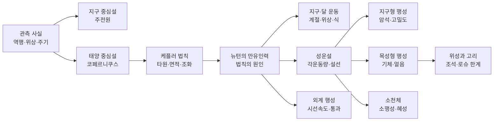
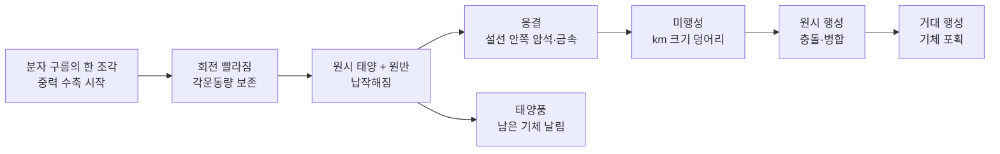

# 일반지구과학 10. 태양계 — 하늘의 규칙에서 행성계의 기원까지
<!-- prev: m1-07, earth-3, astro-1 -->
<!-- next: uearth-11 -->

> [!NOTE]
> **이 단원의 범위**
> - 고대에서 근대까지의 천문학: 지구 중심설과 태양 중심설, 케플러 법칙, 뉴턴의 만유인력
> - 지구의 자전·공전과 계절, 달의 위상과 식
> - 태양계의 형성(성운설)
> - 지구형 행성과 목성형 행성의 비교, 달과 주요 위성
> - 소행성, 혜성, 유성체, 왜소 행성
> - 외계 행성 탐사

**학습 목표**

1. 지구 중심설과 태양 중심설이 같은 관측 사실(역행, 금성의 위상)을 어떻게 설명하는지 비교하고, 케플러 법칙이 뉴턴의 만유인력으로부터 어떻게 유도되는지 보일 수 있다.
2. 지구의 자전과 공전의 증거를 들고, 자전축 경사로 계절과 남중 고도·일사량의 변화를 정량적으로 계산하며, 달의 위상과 식이 일어나는 조건을 궤도의 기하로 설명할 수 있다.
3. 성운설로 태양계의 관측 특징(공전 방향, 궤도면, 행성의 두 무리, 소천체의 분포)을 설명하고, 설선의 위치를 평형 온도로 어림할 수 있다.
4. 지구형 행성과 목성형 행성을 밀도·조성·대기·내부 구조로 비교하고, 탈출 속도와 분자의 열속력으로 대기의 유지 여부를 판단할 수 있다.
5. 달과 주요 위성, 소행성·혜성·유성체·왜소 행성의 특징을 궤도 역학(공명, 로슈 한계)과 연결하여 설명할 수 있다.
6. 외계 행성 탐사 방법의 원리와 한계를 이해하고, 관측 자료로 행성의 반지름·질량·궤도 반지름을 구할 수 있다.

**이 단원의 학습 사다리**

| 단계 | 무엇을 하나? |
|---|---|
| STEP 1. 이전 학습 다시 보기 | 중학교 「태양계」, 지구과학 「태양계 천체와 별과 우주의 진화」, 행성우주과학 「우주탐사와 행성계」에서 배운 것을 정리한다 |
| STEP 2. 기초 다지기 | 천구 좌표와 각도, 타원의 기하, 원운동과 중력, 회합 주기, 크기에 따른 비례 관계를 익힌다 |
| STEP 3. 핵심 개념 | 천문학의 역사와 케플러·뉴턴 → 자전·공전·계절 → 달의 위상과 식 → 성운설 → 행성의 비교 → 위성 → 소천체 → 외계 행성 |
| STEP 4. 오개념 바로잡기 | "계절은 태양과의 거리 때문이다", "달은 자전하지 않는다" 같은 착각을 바로잡는다 |
| STEP 5. 전공 맛보기 | 활력 방정식과 궤도 요소, 라그랑주 점, 궤도 공명과 행성 이동 |
| STEP 6. 생활·산업·진로 | 궤도 설계, 지구 방위, 행성 탐사, 외계 행성 대기 분광 |

---

## 🗺️ 단원 들어가기

화성은 대부분의 밤에 별들 사이를 서쪽에서 동쪽으로 천천히 움직이지만, 약 2년 2개월마다 몇 주 동안 멈춘 듯하다가 거꾸로 움직이고, 다시 멈춘 뒤 원래 방향으로 나아간다. 이 '고리 모양의 길'은 2000년 넘게 천문학자들의 숙제였다. 어떤 사람은 지구를 중심에 두고 원 위에 원을 겹쳐 이 길을 그려 냈고, 어떤 사람은 지구 자신이 움직인다고 보았다. 어느 쪽이 옳은지를 가른 것은 더 정밀한 관측과, 하늘과 땅에 같은 법칙이 적용된다는 생각이었다.

오늘날 우리는 같은 법칙으로 탐사선을 수십억 km 떨어진 혜성에 내려앉히고, 다른 별을 도는 행성의 질량을 별빛의 미세한 흔들림으로 잰다. 이 단원은 하늘의 규칙을 찾아낸 역사에서 출발하여, 지구와 달의 운동, 태양계가 생겨난 과정, 그 가족 구성원들의 특징을 거쳐 다른 별의 행성계로 시야를 넓힌다.

---

## STEP 1. 🔙 이전 학습 다시 보기

### 연계 개념표

| 이전 단원 | 그때 배운 것 | 이 단원에서 확장되는 것 |
|---|---|---|
| 중1 「태양계」 | 태양계 천체의 구성, 지구형·목성형 행성 구분, 지구 자전·공전에 따른 겉보기 운동, 달의 위상, 일식·월식 | 자전·공전의 **증거**, 남중 고도·일사량의 **정량 계산**, 항성월과 삭망월의 관계 |
| 지구과학 「태양계 천체와 별과 우주의 진화」 '식 현상', '행성의 겉보기 운동' | 본영·반영과 식의 종류, 지구 중심 모형과 태양 중심 모형, 내행성·외행성의 위치 관계 | 식이 일어나는 **교점 조건**과 식 계절, 회합 주기로 **항성 주기·궤도 반지름** 구하기 |
| 행성우주과학 「우주탐사와 행성계」 '케플러의 세 법칙' | 세 법칙의 의미, $a^3/T^2$로 중심 천체의 질량 재기 | 만유인력에서 **제3법칙 유도**, 각운동량 보존과 제2법칙, 이심률과 근일점·원일점 속력 |
| 행성우주과학 「우주탐사와 행성계」 '행성과 소천체', '외계 행성계 탐사' | 행성·왜소 행성의 정의, 소천체의 종류, 시선속도법·통과법의 원리, 생명가능지대 | 성운설로 소천체 **분포의 기원** 설명, 공명과 커크우드 간극, 탐사 자료로 **행성 질량·반지름** 계산 |

### 준비 운동 (사전 진단)

**Q1.** 북반구 중위도에서 여름이 더운 가장 중요한 까닭은 무엇인가? 지구가 태양에 가장 가까워지는 때는 언제인가?

**Q2.** 케플러 제3법칙 $T^2 \propto a^3$에서, 궤도 긴반지름이 4 AU인 소행성의 공전 주기는 몇 년인가?

**Q3.** 달이 상현달일 때 태양–지구–달이 이루는 각은 대략 몇 도인가? 상현달은 저녁 무렵 어느 하늘에 보이는가?

**Q4.** 목성형 행성의 평균 밀도가 지구형 행성보다 작은 까닭을 한 문장으로 쓰시오.

정답 및 해설

**Q1.** 자전축이 공전 궤도면의 수직 방향에 대해 약 $23.4^\circ$ 기울어 있어서 여름에는 태양의 남중 고도가 높고 낮이 길기 때문이다. 지구는 1월 초에 태양에 가장 가깝다(근일점). 거리는 계절의 주된 원인이 아니다.

**Q2.** 8년 — $T = a^{3/2} = 4^{1.5} = 8$년(태양 둘레 궤도, AU와 년 단위).

**Q3.** 약 $90^\circ$. 상현달은 해 질 무렵 남쪽 하늘에 보이고 자정 무렵 서쪽으로 진다.

**Q4.** 목성형 행성은 주로 수소·헬륨 같은 가벼운 기체와 얼음으로 이루어져 있고, 지구형 행성은 암석과 금속으로 이루어져 있기 때문이다.

---

## STEP 2. 🧱 기초 다지기

### ① 천구와 각도 — 하늘을 재는 좌표

지구에서 보면 모든 천체는 커다란 구면 위에 붙어 있는 것처럼 보인다. 이 가상의 구를 **천구(celestial sphere)** 라 한다. 지구 자전축을 연장한 곳이 천구의 북극·남극이고, 지구 적도를 넓힌 원이 **천구 적도**이다. 태양이 1년 동안 별들 사이를 지나가는 길은 **황도(ecliptic)** 이며, 황도는 천구 적도에 대해 약 $23.4^\circ$ 기울어 있다. 이 기울기가 곧 자전축의 경사이다.

| 좌표 | 기준 | 지구의 무엇에 해당하나 |
|---|---|---|
| 적위 $\delta$ | 천구 적도에서 남북으로 잰 각 ($-90^\circ$ ~ $+90^\circ$) | 위도 |
| 적경 $\alpha$ | 춘분점에서 동쪽으로 잰 각(시간 단위, 0h ~ 24h) | 경도 |
| 고도 $h$ | 지평선에서 위로 잰 각 | (관측자 기준) |

- 태양의 적위는 춘분·추분에 $0^\circ$, 하지에 약 $+23.4^\circ$, 동지에 약 $-23.4^\circ$이다.
- 각도의 단위: $1^\circ = 60'$, $1' = 60''$, 1 라디안 $\approx 57.3^\circ \approx 206{,}265''$
- **작은 각 근사**: 거리 $d$에 있는 지름 $D$인 천체의 각지름은 $\theta \approx D/d$ (라디안)

### ② 타원의 기하 — 궤도를 읽는 말

행성 궤도는 타원이다. 타원은 두 **초점**까지 거리의 합이 일정한 점들의 모임이다.

| 기호 | 이름 | 관계 |
|---|---|---|
| $a$ | 긴반지름 | 긴지름의 절반. 궤도의 '크기' |
| $e$ | 이심률 | 초점 사이 거리 $= 2ae$. $0$이면 원, $1$에 가까울수록 납작 |
| $b$ | 짧은반지름 | $b = a\sqrt{1 - e^2}$ |
| $q$ | 근일점 거리 | $q = a(1 - e)$ |
| $Q$ | 원일점 거리 | $Q = a(1 + e)$, $a = (q + Q)/2$ |

지구 궤도는 $e \approx 0.0167$이라 거의 원이다($b/a \approx 0.99986$). 반면 핼리 혜성은 $e \approx 0.97$로 매우 길쭉하다.

> [!TIP]
> 💡 **요령** — 이심률이 작은 궤도는 그림으로 그려 보면 원과 구별되지 않는다. 그러나 **태양이 중심에서 비켜나 있다**($ae$만큼)는 효과는 곧바로 드러난다. 지구의 경우 $ae \approx 250$만 km로, 근일점과 원일점의 거리 차는 약 500만 km이다.

### ③ 원운동과 중력 — 뉴턴 역학의 두 도구

반지름 $r$의 원을 속력 $v$로 도는 물체에는 중심 방향으로 **구심 가속도** $a_c = v^2/r = \omega^2 r$가 필요하다. 행성의 경우 그 힘을 태양의 중력이 제공한다.

$$
F = \frac{GMm}{r^2}, \qquad G = 6.674\times10^{-11}\ \mathrm{N\cdot m^2/kg^2}
$$

또 중심 방향의 힘만 받는 물체는 **각운동량** $L = mvr_\perp$이 보존된다. 이 두 도구로 케플러의 세 법칙을 모두 설명할 수 있다(STEP 3 ①).

### ④ 회합 주기 — 움직이는 관측자가 보는 주기

같은 방향으로 도는 두 천체가 같은 배치(예: 태양–지구–화성이 일직선)로 되돌아오는 데 걸리는 시간을 **회합 주기(synodic period)** $S$라 한다. 각속도의 차이가 한 바퀴($360^\circ$)를 채우는 시간이므로

$$
\frac{1}{S} = \left\lvert \frac{1}{P_1} - \frac{1}{P_2} \right\rvert
$$

이다($P$: 항성 기준 공전 주기). 지구에서 본 외행성은 $\dfrac{1}{S} = \dfrac{1}{P_\oplus} - \dfrac{1}{P}$, 내행성은 $\dfrac{1}{S} = \dfrac{1}{P} - \dfrac{1}{P_\oplus}$이다. 시계의 분침과 시침이 겹치는 간격(약 65.5분)을 구하는 것과 같은 계산이다.

### ⑤ 크기에 따른 비례 — 어림셈의 힘

천체의 성질은 크기에 따라 다른 비율로 변한다.

| 양 | 반지름 $R$과의 관계 | 반지름이 2배이면 |
|---|---|---|
| 표면적 | $\propto R^2$ | 4배 |
| 부피(같은 밀도면 질량) | $\propto R^3$ | 8배 |
| 표면 중력 $g = GM/R^2$ (같은 밀도) | $\propto R$ | 2배 |
| 탈출 속도 $\sqrt{2GM/R}$ (같은 밀도) | $\propto R$ | 2배 |
| 내부 열의 식는 시간(부피/표면적) | $\propto R$ | 약 2배 |

작은 천체일수록 빨리 식어 지질 활동이 일찍 멈추고, 중력이 약해 대기를 잃기 쉽다. 이 표는 STEP 3에서 달·화성·지구를 비교할 때 계속 쓰인다.

---

## STEP 3. 📘 핵심 개념

### ① 고대에서 근대까지의 천문학 — 하늘의 규칙을 찾아서

#### 고대의 관측과 지구 중심설

고대 그리스의 학자들은 맨눈 관측만으로 놀라운 결론에 이르렀다. 월식 때 달에 비친 지구 그림자가 언제나 둥글다는 것, 남쪽으로 여행할수록 남쪽 하늘의 별이 더 높이 뜬다는 것으로 지구가 둥글다는 것을 알았다. 기원전 3세기 에라토스테네스는 하짓날 정오에 한 도시에서는 해가 우물 바닥을 비추는데, 북쪽의 다른 도시에서는 막대 그림자가 약 $7.2^\circ$ 기운다는 사실로 지구 둘레를 구했다.

#### 예제 1 — 에라토스테네스의 측정

두 도시 사이의 남북 거리를 약 800 km, 정오 태양 고도의 차이를 $7.2^\circ$라 하자. 지구 둘레와 반지름을 구하시오.

**풀이**
- 식 세우기: 태양 광선은 평행하므로 고도 차이 $7.2^\circ$는 두 도시가 지구 중심에서 이루는 중심각과 같다. 둘레 $C = 800\ \mathrm{km}\times\dfrac{360^\circ}{7.2^\circ}$
- 대입: $C = 800\times50 = 4.0\times10^{4}\ \mathrm{km}$, 반지름 $R = C/2\pi \approx 6.4\times10^{3}\ \mathrm{km}$
- 의미: 실제 값(둘레 약 40,000 km)과 잘 맞는다. 측정에 쓰인 가정은 "태양이 매우 멀어 광선이 평행하다"는 것 하나뿐이다.

그러나 그리스의 주류 우주관은 **지구 중심설(geocentric model)** 이었다. 지구가 움직인다면 별의 위치가 1년 주기로 흔들려 보여야 하는데(연주시차), 그런 흔들림이 보이지 않았기 때문이다. 2세기 프톨레마이오스는 행성이 작은 원(**주전원**, epicycle)을 돌고, 그 주전원의 중심이 지구 둘레의 큰 원(**이심원**)을 도는 모형으로 역행 운동과 밝기 변화를 설명했다. 이 모형은 약 1400년 동안 행성 위치를 꽤 잘 예측했다.

> [!NOTE]
> 연주시차가 보이지 않았던 것은 지구가 정지해 있어서가 아니라 별이 너무 멀어서였다. 가장 가까운 별의 시차도 $0.77''$에 불과하여, 맨눈의 분해능(약 $60''$)보다 80배 가까이 작다. 연주시차는 1838년에야 망원경으로 처음 측정되었다. "관측되지 않음"이 "존재하지 않음"을 뜻하지는 않는다는 좋은 사례이다.

#### 태양 중심설과 망원경 관측

1543년 코페르니쿠스는 태양을 중심에 두고 지구가 다른 행성들과 함께 태양을 도는 **태양 중심설(heliocentric model)** 을 발표했다. 이 모형에서는 역행이 자연스럽게 설명된다. 안쪽 궤도의 지구가 바깥쪽 화성을 추월할 때, 마치 고속도로에서 느린 차를 앞지르면 그 차가 뒤로 가는 것처럼 보이듯 화성이 잠시 거꾸로 움직이는 것으로 보인다. 또 행성 배열 순서와 상대 거리(내행성의 최대 이각에서 궤도 반지름 구하기)가 처음으로 정해졌다.

<!-- fig:uearth-10-retrograde-models -->

다만 코페르니쿠스는 원 궤도를 고집했기 때문에 예측 정확도는 프톨레마이오스 모형보다 크게 낫지 않았다. 결정적인 증거는 1610년 무렵 **갈릴레이의 망원경 관측**에서 나왔다.

| 갈릴레이의 관측 | 무엇을 뜻하나 |
|---|---|
| 목성 둘레를 도는 네 위성 | 모든 천체가 지구를 도는 것은 아니다 |
| 금성의 위상이 초승달 모양~보름달 모양으로 모두 나타나고, 크기도 크게 변함 | 금성은 태양 둘레를 돈다. 프톨레마이오스 모형(금성이 늘 태양과 지구 사이)에서는 보름달 모양의 금성이 나올 수 없다 |
| 달 표면의 산과 크레이터, 태양의 흑점 | 천체도 지구처럼 불완전하고 변화한다 |
| 은하수가 무수한 별로 분해됨 | 우주는 훨씬 크고 별은 매우 멀다 |

#### 티코 브라헤와 케플러 — 자료가 이론을 고치다

16세기 말 티코 브라헤는 망원경 없이 약 $1'$ 정밀도로 행성 위치를 20여 년 동안 기록했다. 그의 조수였던 케플러는 이 자료, 특히 화성 자료에 원 궤도를 맞추려다 최대 $8'$의 오차가 남는 것을 발견했다. 티코의 자료가 그보다 정밀했으므로 케플러는 원 궤도를 버리고 다음의 세 법칙에 이르렀다(1609년, 1619년).

| 법칙 | 내용 | 무엇을 정하나 |
|---|---|---|
| 제1법칙(타원 궤도 법칙) | 행성은 태양을 한 초점으로 하는 타원 궤도를 돈다 | 궤도의 모양 |
| 제2법칙(면적 속도 일정 법칙) | 태양과 행성을 잇는 선분은 같은 시간에 같은 넓이를 쓸고 지나간다 | 궤도 위의 빠르기 |
| 제3법칙(조화 법칙) | 공전 주기의 제곱은 궤도 긴반지름의 세제곱에 비례한다: $P^2 \propto a^3$ | 궤도의 크기와 주기 |

#### 뉴턴의 만유인력 — 법칙의 '이유'

케플러의 법칙은 관측을 요약한 **경험 법칙**이었다. 1687년 뉴턴은 운동 법칙과 만유인력 법칙으로 세 법칙을 모두 유도했고, 사과를 떨어뜨리는 힘과 달을 붙잡는 힘이 같다는 것을 보였다.

**(1) 제2법칙 = 각운동량 보존.** 태양의 중력은 항상 태양 쪽을 향하는 **중심력**이므로 태양에 대한 토크가 0이고, 행성의 각운동량 $L = m r v_\perp$이 보존된다. 짧은 시간 $dt$ 동안 쓸고 지나가는 넓이는 $dA = \frac{1}{2} r\,v_\perp dt$이므로

$$
\frac{dA}{dt} = \frac{1}{2} r v_\perp = \frac{L}{2m} = \text{일정}
$$

이다. 즉 제2법칙은 중심력이기만 하면 성립하며, 힘이 거리의 제곱에 반비례한다는 사실과는 무관하다. 근일점과 원일점에서는 속도가 반지름에 수직이므로 $q\,v_q = Q\,v_Q$이다.

**(2) 제3법칙 = 중력이 구심력.** 원 궤도(반지름 $a$)를 가정하면

$$
\frac{GMm}{a^2} = m\frac{v^2}{a} = m\left(\frac{2\pi a}{P}\right)^2\frac{1}{a} \;\Rightarrow\; P^2 = \frac{4\pi^2}{GM}a^3
$$

이다. 두 천체가 공통 질량 중심을 돈다는 것까지 고려하면 $M$ 자리에 $M + m$이 들어간다(타원 궤도에서도 $a$를 긴반지름으로 하면 같은 식이 성립한다).

$$
P^2 = \frac{4\pi^2}{G(M + m)}a^3
$$

**(3) 제1법칙 = 역제곱 힘의 궤도.** 힘이 정확히 $1/r^2$에 비례할 때 묶인 궤도는 닫힌 타원이 된다(유도는 미분 방정식이 필요하여 STEP 5에서 맛본다). 에너지가 0 이상이면 포물선·쌍곡선 궤도가 되어 다시 돌아오지 않는다.

> [!IMPORTANT]
> 뉴턴의 형태 $P^2 = 4\pi^2a^3/G(M+m)$는 케플러 제3법칙을 **질량을 재는 저울**로 바꾸었다. 위성의 궤도 반지름과 주기만 알면 행성의 질량을, 행성의 궤도로 태양의 질량을, 쌍성의 궤도로 별의 질량을 잴 수 있다. 태양계 단위(AU, 년, 태양 질량)로는 $P^2 = a^3/(M + m)$으로 간단해진다.

#### 예제 2 — 지구 궤도로 태양의 질량 재기

지구의 궤도 긴반지름은 $1.496\times10^{11}\ \mathrm{m}$, 공전 주기는 $3.156\times10^{7}\ \mathrm{s}$이다. 태양의 질량을 구하시오($m \ll M$).

**풀이**
- 식 세우기: $M = \dfrac{4\pi^2a^3}{GP^2}$
- 대입: $M = \dfrac{4\pi^2(1.496\times10^{11})^3}{(6.674\times10^{-11})(3.156\times10^{7})^2}$
- 계산: $M \approx 1.99\times10^{30}\ \mathrm{kg}$ (유효 숫자 3자리)
- 의미: 지구 질량의 약 33만 배이다. 같은 방법으로 달의 궤도($a = 3.844\times10^{8}\ \mathrm{m}$, $P = 27.32$일)를 쓰면 지구+달의 질량 약 $6.0\times10^{24}\ \mathrm{kg}$가 나온다.

#### 예제 3 — 회합 주기로 화성의 궤도 구하기

화성의 회합 주기(충에서 다음 충까지)는 약 780일이다. 화성의 항성 주기와 궤도 긴반지름을 구하시오(지구의 공전 주기 365.25일).

**풀이**
- 식 세우기(외행성): $\dfrac{1}{P} = \dfrac{1}{365.25} - \dfrac{1}{780}$
- 계산: $P \approx 687$일 $\approx 1.88$년
- 제3법칙: $a = P^{2/3} = 1.88^{2/3} \approx 1.52\ \mathrm{AU}$
- 의미: 지상에서 잴 수 있는 회합 주기에서 출발해 화성까지의 거리를 지구 궤도 단위로 얻었다. 코페르니쿠스가 처음 행성의 상대 거리를 정한 것도 이런 기하학적 계산이었다.

#### 예제 4 — 핼리 혜성의 근일점과 원일점

핼리 혜성의 공전 주기는 약 76년, 근일점 거리는 약 0.59 AU이다. 궤도 긴반지름, 이심률, 원일점 거리, 근일점과 원일점에서의 속력의 비를 구하시오.

**풀이**
- $a = 76^{2/3} \approx 17.9\ \mathrm{AU}$
- $e = 1 - q/a = 1 - 0.59/17.9 \approx 0.967$
- $Q = 2a - q \approx 35.3\ \mathrm{AU}$ (해왕성 궤도보다 조금 바깥)
- 각운동량 보존 $q\,v_q = Q\,v_Q$ → $v_q/v_Q = Q/q \approx 60$
- 의미: 혜성은 근일점 부근을 매우 빨리 지나가고(약 55 km/s), 대부분의 시간을 원일점 부근에서 느리게(약 1 km/s) 보낸다. 76년 중 맨눈으로 보이는 기간이 몇 달뿐인 이유이다.

> [!TIP]
> 💡 **비유** — 피겨 스케이팅 선수가 팔을 몸에 붙이면 빨리 돌고, 팔을 펴면 느려진다. 회전축까지의 거리가 줄면 빨라지는 것, 그것이 각운동량 보존이고 케플러 제2법칙이다.

### ② 지구의 자전과 공전, 그리고 계절

#### 자전의 증거

| 증거 | 내용 |
|---|---|
| 푸코 진자 | 진동면이 북반구에서 시계 방향으로 회전한다. 위도 $\varphi$에서 한 바퀴 도는 시간은 $T = \dfrac{23.93\ \text{시간}}{\sin\varphi}$ |
| 전향력(코리올리 효과) | 북반구에서 움직이는 물체가 진행 방향의 오른쪽으로 휜다(대기·해양 순환) |
| 지구의 편평도 | 적도 반지름이 극 반지름보다 약 21 km 크다(원심 효과) |
| 인공위성 궤도와 위성 항법 | 지구 자전을 고려해야만 맞는다 |

#### 예제 5 — 서울에서 푸코 진자

위도 $37.5^\circ$N에서 푸코 진자의 진동면이 한 바퀴 도는 데 걸리는 시간을 구하시오.

**풀이** $T = \dfrac{23.93}{\sin 37.5^\circ} = \dfrac{23.93}{0.609} \approx 39.3$시간. 극에서는 약 24시간(엄밀히 항성일), 적도에서는 회전하지 않는다. 진자는 관성 기준틀에서 같은 면을 유지하려 하고, 그 아래의 땅이 돌아가는 것이다.

#### 공전의 증거

- **연주시차**: 가까운 별의 위치가 1년 주기로 작은 타원을 그린다(1838년 첫 측정).
- **광행차**: 지구의 공전 속도(약 30 km/s) 때문에 별빛이 오는 방향이 최대 약 $20.5''$ 기울어 보인다(1720년대 발견). 비 오는 날 달리면 빗줄기가 앞쪽에서 비스듬히 오는 것처럼 보이는 것과 같다.
- **별빛의 연주 도플러 이동**: 황도 근처 별의 시선속도가 1년 주기로 약 $\pm30\ \mathrm{km/s}$ 변한다.

#### 항성일과 태양일

지구는 자전하면서 공전도 하므로, 같은 별이 남중했다가 다시 남중하는 시간(**항성일**, 약 23시간 56분 4초)과 태양이 남중했다가 다시 남중하는 시간(**평균 태양일**, 24시간)이 다르다. 1년 동안 지구는 별에 대해 약 366.24번 돌지만 태양에 대해서는 365.24번 돈다. 공전 때문에 한 번이 '없어지는' 것이다.

$$
\frac{1}{\text{항성일}} = \frac{1}{\text{태양일}} + \frac{1}{365.24\ \text{태양일}} \;\Rightarrow\; \text{항성일} \approx 0.99727\ \text{태양일} \approx 86{,}164\ \mathrm{s}
$$

그래서 같은 별은 매일 약 4분씩 일찍 뜨고, 한 달이면 약 2시간 일찍 뜬다. 계절별 별자리가 바뀌는 까닭이다.

#### 계절의 원인 — 경사가 만드는 두 효과

자전축이 공전 궤도면의 수직 방향에 대해 약 $23.4^\circ$ 기울어 공간에서 같은 방향을 유지하기 때문에, 태양의 적위 $\delta$가 1년 동안 $-23.4^\circ$에서 $+23.4^\circ$ 사이를 오간다. 북위 $\varphi$에서 태양의 **남중 고도**는

$$
h = 90^\circ - \varphi + \delta
$$

이다. 남중 고도가 높으면 두 가지 효과가 겹친다.

1. **단위 면적당 일사량** ∝ $\sin h$: 비스듬한 빛은 같은 에너지를 더 넓은 면적에 퍼뜨린다.
2. **낮의 길이**: 여름에는 태양이 천구 적도 북쪽에서 더 긴 경로를 그리며 지평선 위에 오래 머문다.

<!-- sim:u-seasons -->

#### 예제 6 — 서울의 남중 고도와 일사량

위도 $37.5^\circ$N에서 하지와 동지의 태양 남중 고도를 구하고, 정오에 수평면 1 m²가 받는 일사량의 비(하지/동지)를 구하시오(대기에 의한 감쇠는 무시).

**풀이**
- 하지: $h = 90^\circ - 37.5^\circ + 23.4^\circ \approx 75.9^\circ$
- 동지: $h = 90^\circ - 37.5^\circ - 23.4^\circ \approx 29.1^\circ$
- 일사량 비: $\dfrac{\sin 75.9^\circ}{\sin 29.1^\circ} = \dfrac{0.970}{0.486} \approx 2.0$
- 의미: 정오의 순간 세기만으로 약 2배 차이가 나고, 서울의 낮 길이는 하지 약 14시간 반, 동지 약 9시간 반이다. 실제로는 고도가 낮을수록 빛이 대기를 더 길게 지나 감쇠되므로 차이는 더 커진다.

#### 거리 효과는 얼마나 될까?

지구는 1월 초에 근일점(약 1.471억 km), 7월 초에 원일점(약 1.521억 km)을 지난다. 받는 복사 에너지는 거리의 제곱에 반비례하므로

$$
\frac{S_{\text{근일점}}}{S_{\text{원일점}}} = \left(\frac{1.521}{1.471}\right)^2 \approx 1.07
$$

약 7 % 차이로, 경사 효과(예제 6의 약 2배)에 비해 훨씬 작다. 게다가 북반구와 남반구의 계절은 반대이므로 거리가 계절의 원인이라면 두 반구가 동시에 여름이어야 한다.

#### 세차 운동

지구는 적도 부분이 부풀어 있어 달과 태양의 조석력이 자전축을 세우려는 토크를 준다. 그 결과 자전축은 팽이처럼 약 2만 6천 년 주기로 원뿔을 그리며 돈다(**세차 운동**, precession). 지금의 북극성(폴라리스)은 언젠가 북극성이 아니게 되고, 약 1만 3천 년 뒤에는 직녀성 부근이 천구의 북극에 가까워진다. 세차 운동, 궤도 이심률의 변화, 경사각의 변화는 「기후와 기후 변화」에서 다루는 밀란코비치 주기의 바탕이다.

### ③ 달의 운동 — 위상과 식

#### 항성월과 삭망월

달은 별을 기준으로 **27.32일**(항성월)에 지구를 한 바퀴 돈다. 그런데 그동안 지구도 태양 둘레를 돌기 때문에 같은 위상(예: 삭에서 삭)으로 돌아오려면 조금 더 돌아야 한다. STEP 2 ④의 회합 주기 식으로

$$
\frac{1}{S} = \frac{1}{27.32} - \frac{1}{365.26} \;\Rightarrow\; S \approx 29.53\ \text{일 (삭망월)}
$$

이다. 음력의 한 달이 29일 또는 30일인 까닭이다.

#### 위상과 뜨고 지는 시각

달의 위상은 태양 빛을 받는 달의 반구 중 지구에서 보이는 부분의 비율로 정해진다. 태양에서 동쪽으로 잰 달의 이각을 $\psi$라 하면, 밝게 보이는 원반 비율은 대략 $\dfrac{1 - \cos\psi}{2}$이다.

| 위상 | 이각 $\psi$ | 밝은 비율 | 뜨는 시각(약) | 가장 높이 뜨는 때 |
|---|---|---|---|---|
| 삭 | $0^\circ$ | 0 | 해와 함께(6시) | 정오(보이지 않음) |
| 초승달 | $45^\circ$ | 약 0.15 | 9시 | 15시, 저녁 서쪽 하늘에 잠깐 |
| 상현 | $90^\circ$ | 0.5 | 12시 | 18시(남쪽) |
| 보름 | $180^\circ$ | 1 | 18시 | 자정 |
| 하현 | $270^\circ$ | 0.5 | 자정 | 6시(남쪽) |

달은 하루에 약 $360^\circ/29.53 \approx 12.2^\circ$씩 태양에 대해 동쪽으로 이동하므로 매일 약 50분씩 늦게 뜬다.

#### 동주기 자전과 칭동

달은 자전 주기와 공전 주기가 같아(**동주기 자전**, synchronous rotation) 늘 같은 면을 지구에 보인다. 이는 오랜 세월 지구의 조석력이 달의 자전을 늦춘 결과(**조석 고정**)이다. 다만 궤도가 타원이라 공전 속도가 바뀌고 궤도가 자전축에 대해 기울어 있어, 좌우·상하로 조금씩 흔들려 보이는 **칭동** 덕분에 지구에서 달 표면의 약 59 %를 볼 수 있다.

#### 식이 일어나는 조건 — 교점과 식 계절

달의 궤도면(백도)은 황도면에 대해 약 $5.1^\circ$ 기울어 있다. 그래서 대부분의 삭·망 때 달은 태양–지구를 잇는 선의 위나 아래로 비켜 지나간다. 식은 삭이나 망이 **두 궤도면이 만나는 선(교점선)** 근처에서 일어날 때만 생긴다.

- 태양이 교점 근처에 있는 시기(**식 계절**)는 약 반년(173일)마다 한 번씩, 매번 약 한 달 남짓 지속된다. 한 식 계절에 일식과 월식이 짝으로 일어나는 일이 흔하다.
- 교점선 자체가 약 18.6년 주기로 서쪽으로 돈다. 그래서 식 계절은 해마다 약 19일씩 앞당겨진다.
- 같은 모양의 식은 약 18년 11일(**사로스 주기**) 간격으로 되풀이된다.

<!-- fig:uearth-10-eclipse-nodes -->

#### 일식의 종류를 정하는 각지름

| 천체 | 지름 | 지구로부터의 거리 | 각지름 |
|---|---|---|---|
| 태양 | 139만 km | 1.471억~1.521억 km | 약 $0.524^\circ$~$0.542^\circ$ |
| 달 | 3475 km | 약 36.3만~40.6만 km | 약 $0.49^\circ$~$0.55^\circ$ |

태양과 달의 각지름이 우연히 거의 같아서, 달이 가까울 때(근지점 부근)는 태양을 완전히 가리는 **개기 일식**, 멀 때(원지점 부근)는 가장자리가 고리처럼 남는 **금환 일식**이 일어난다. 달의 본영이 지표에 닿는 폭은 최대 수백 km 정도라 개기 일식은 좁은 띠에서만 보인다. 월식은 지구 그림자 안에 달이 들어가는 것이므로 달이 지평선 위에 있는 밤의 반구 어디서나 동시에 보인다.

#### 예제 7 — 근지점과 원지점의 달

달의 지름을 3475 km라 할 때, 지구–달 거리가 36.3만 km일 때와 40.6만 km일 때의 각지름을 구하고, 태양의 각지름(약 $0.533^\circ$)과 비교하여 어떤 일식이 가능한지 판단하시오.

**풀이**
- $\theta_{\text{근}} = \dfrac{3475}{363{,}000}$ rad $\approx 0.00957$ rad $\approx 0.548^\circ$ → 태양보다 크므로 **개기 일식** 가능
- $\theta_{\text{원}} = \dfrac{3475}{406{,}000}$ rad $\approx 0.00856$ rad $\approx 0.490^\circ$ → 태양보다 작으므로 **금환 일식**
- 의미: 달은 조석 작용으로 1년에 약 3.8 cm씩 멀어지고 있다(달 표면 반사경에 쏜 레이저의 왕복 시간으로 측정). 먼 미래에는 개기 일식이 더 이상 일어나지 않게 된다.

> [!TIP]
> 💡 **비유** — 팔을 뻗은 손끝의 5밀리미터 크기 콩이 약 $0.5^\circ$로 보인다. 하늘의 해와 달은 모두 그 정도 크기의 '콩'이다. 보름달이 지평선에서 커 보이는 것은 착시이며, 실제 각지름은 거의 같다.

### ④ 태양계의 형성 — 성운설

#### 형성 이론이 설명해야 할 관측 사실

| 관측 사실 | 설명할 내용 |
|---|---|
| 모든 행성이 같은 방향(북쪽에서 보면 반시계 방향)으로 공전하고, 태양도 같은 방향으로 자전한다 | 하나의 회전하는 구름에서 생겼다 |
| 행성 궤도가 거의 한 평면(대부분 황도면에서 수 도 이내)에 있고 거의 원이다 | 납작한 원반에서 생겼다 |
| 안쪽은 작고 밀도 높은 암석 행성, 바깥쪽은 크고 가벼운 기체·얼음 행성 | 태양으로부터의 거리에 따라 응결한 물질이 달랐다 |
| 태양이 전체 질량의 99.8 %를 갖지만 각운동량은 대부분 행성(특히 목성)이 가진다 | 각운동량이 바깥으로 옮겨 가는 과정이 있었다 |
| 소행성대, 카이퍼 벨트, 오르트 구름에 남은 수많은 소천체 | 행성이 되다 남은 재료가 있다 |
| 가장 오래된 운석 성분의 나이가 약 45.7억 년으로 거의 같다 | 태양계 천체가 짧은 기간에 함께 생겼다 |

이 사실들을 가장 잘 설명하는 것이 **성운설(nebular hypothesis)** 이다. 18세기 칸트와 라플라스의 아이디어에서 출발하여, 오늘날에는 다른 별 둘레의 **원시 행성 원반(protoplanetary disk)** 관측으로 강하게 뒷받침된다.

#### 성운설의 단계

1. **붕괴와 회전**: 성간 분자 구름의 밀도가 높은 조각이 자체 중력으로 수축한다. 처음의 미미한 회전이 각운동량 보존($\omega \propto 1/r^2$) 때문에 크게 빨라진다.
2. **원반 형성**: 회전축 방향으로는 수축을 막는 것이 없지만, 회전면 방향으로는 원심 효과가 수축을 막는다. 그래서 구름은 중심의 원시 태양과 둘레의 납작한 원반이 된다.
3. **응결과 설선**: 원반이 식으면서 온도에 따라 고체가 응결한다. 안쪽(뜨거운 곳)에서는 금속과 규산염만, 바깥에서는 물·메탄·암모니아 얼음까지 응결한다. 물이 얼음이 되는 경계를 **설선(snow line, frost line)** 이라 한다.
4. **미행성과 원시 행성**: 먼지 알갱이가 서로 달라붙어 자라 수 km 크기의 **미행성(planetesimal)** 이 되고, 미행성들이 중력으로 충돌·병합해 달~화성 크기의 원시 행성이 된다.
5. **거대 행성의 기체 포획**: 설선 바깥에서는 고체 재료(얼음 포함)가 많아 원시 행성이 지구 질량의 약 10배 이상으로 빨리 자라고, 이 핵이 주변의 수소·헬륨 기체를 끌어모아 거대 행성이 된다.
6. **원반의 소멸**: 젊은 태양의 강한 태양풍과 복사가 남은 기체를 수백만 년 안에 날려 보낸다. 안쪽 행성들은 이후 수천만~1억 년 동안 거대 충돌을 거쳐 완성된다(달을 만든 충돌도 이 시기).

#### 예제 8 — 수축하는 구름의 회전

반지름 $10^4$ AU, 자전 주기 $10^6$년인 구름 조각이 각운동량을 잃지 않고 반지름 100 AU로 수축하면 회전 주기는 얼마가 되는가? (같은 질량 분포 모양을 유지한다고 가정)

**풀이**
- 식 세우기: $L = I\omega$, $I \propto Mr^2$ → $\omega \propto r^{-2}$, 즉 $P \propto r^2$
- 대입: $P' = 10^6 \times \left(\dfrac{100}{10^4}\right)^2 = 10^6\times10^{-4} = 100$년
- 의미: 반지름이 100분의 1이 되면 회전은 1만 배 빨라진다. 이렇게 빨라진 회전 때문에 구름은 공 모양으로 수축하지 못하고 원반이 된다.

#### 예제 9 — 설선은 어디에 있었을까?

원반의 먼지 알갱이가 흑체처럼 태양 복사를 흡수·방출한다고 하면, 거리 $r$(AU)에서 평형 온도는 $T \approx 278\ \mathrm{K}/\sqrt{r}$이다(지구 위치의 흑체 평형 온도 278 K). 물 얼음이 저압의 원반 속에서 안정해지는 온도를 약 170 K라 하면 설선은 몇 AU에 있는가?

**풀이**
- $\sqrt{r} = 278/170 \approx 1.64$ → $r \approx 2.7\ \mathrm{AU}$
- 의미: 소행성대 바깥쪽(약 2.7~3 AU)이다. 실제로 소행성대 안쪽에는 건조한 암석질 소행성이, 바깥쪽에는 물을 품은 탄소질 소행성이 많다. 젊은 태양의 밝기와 원반 내부 가열에 따라 실제 설선 위치는 시기별로 달랐을 것으로 보아, 값은 '약 3 AU 안팎'으로 이해한다.

<!-- fig:uearth-10-snow-line -->

#### 성운설의 증거와 남은 문제

- **원시 행성 원반의 영상**: 전파 간섭계로 찍은 젊은 별 둘레 원반에서 동심원 모양의 틈이 보이는데, 자라고 있는 행성이 쓸고 지나간 자리로 해석된다.
- **운석의 연대와 성분**: 운석 속 칼슘·알루미늄이 풍부한 포유물이 약 45.7억 년 전에 생긴 태양계 최초의 고체이다.
- **남은 문제**: 각운동량이 어떻게 태양에서 원반 바깥으로 옮겨졌는지(자기장, 원반의 점성), 거대 행성이 궤도를 바꾸며 이동했는지(외계 행성의 '뜨거운 목성'이 이 질문을 키웠다)는 지금도 연구 중이다.

### ⑤ 지구형 행성과 목성형 행성의 비교

#### 행성 자료

| 행성 | 긴반지름(AU) | 공전 주기(년) | 질량(지구=1) | 반지름(지구=1) | 평균 밀도($\mathrm{g/cm^3}$) | 자전 주기 | 주요 대기 |
|---|---|---|---|---|---|---|---|
| 수성 | 0.387 | 0.241 | 0.055 | 0.383 | 5.43 | 58.6일 | 거의 없음 |
| 금성 | 0.723 | 0.615 | 0.815 | 0.949 | 5.24 | 243일(역방향) | $\mathrm{CO_2}$(약 90기압) |
| 지구 | 1.000 | 1.000 | 1.000 | 1.000 | 5.51 | 23.93시간 | $\mathrm{N_2}$, $\mathrm{O_2}$ |
| 화성 | 1.524 | 1.881 | 0.107 | 0.532 | 3.93 | 24.6시간 | $\mathrm{CO_2}$(약 0.006기압) |
| 목성 | 5.20 | 11.86 | 317.8 | 11.21 | 1.33 | 9.9시간 | $\mathrm{H_2}$, He |
| 토성 | 9.54 | 29.46 | 95.2 | 9.45 | 0.69 | 10.7시간 | $\mathrm{H_2}$, He |
| 천왕성 | 19.19 | 84.0 | 14.5 | 4.01 | 1.27 | 17.2시간(역방향) | $\mathrm{H_2}$, He, $\mathrm{CH_4}$ |
| 해왕성 | 30.07 | 164.8 | 17.1 | 3.88 | 1.64 | 16.1시간 | $\mathrm{H_2}$, He, $\mathrm{CH_4}$ |

#### 두 무리의 비교

| 구분 | 지구형 행성 | 목성형 행성 |
|---|---|---|
| 위치 | 설선 안쪽(소행성대 안쪽) | 설선 바깥쪽 |
| 질량·반지름 | 작다 | 크다(지구의 15~318배 질량) |
| 평균 밀도 | 크다(약 4~5.5) | 작다(약 0.7~1.6) |
| 주성분 | 규산염 암석, 철·니켈 금속 | 수소·헬륨 기체(목성·토성), 물·메탄·암모니아 얼음(천왕성·해왕성) |
| 표면 | 단단한 고체 표면 | 뚜렷한 고체 표면이 없다 |
| 자전 | 느리다 | 빠르다(10~17시간), 그래서 편평하다 |
| 위성·고리 | 위성 적거나 없음, 고리 없음 | 위성이 많고 모두 고리가 있다 |
| 자기장 | 지구만 강함(수성은 약함) | 모두 강하다 |

천왕성과 해왕성은 수소·헬륨 외피가 상대적으로 얇고 얼음 성분이 많아 따로 **천왕성형 행성(얼음 거대 행성, ice giant)** 으로 부르기도 한다. 목성·토성은 **기체 거대 행성(gas giant)** 이다.

#### 밀도로 내부를 읽는다

지구의 평균 밀도 $5.51\ \mathrm{g/cm^3}$는 지표 암석(약 $2.7$~$3.3$)보다 훨씬 크다. 깊은 곳의 압축 효과와 함께, 밀도가 큰 철 핵이 있다는 증거이다. 압력에 의한 압축 효과를 빼고 비교한 밀도(**비압축 밀도**)는 수성이 가장 커서, 수성은 반지름의 약 80~85 %를 차지하는 거대한 철 핵을 가진 것으로 추정된다. 토성의 밀도는 물보다 작다. 목성 깊은 곳에서는 수백만 기압의 압력으로 수소가 전기를 통하는 **금속 수소**가 되어, 이것의 운동이 강한 자기장을 만든다.

#### 예제 10 — 천왕성의 평균 밀도

천왕성의 질량은 $8.68\times10^{25}\ \mathrm{kg}$, 반지름은 $2.54\times10^{7}\ \mathrm{m}$이다. 평균 밀도를 구하고 어느 무리에 속하는지 판단하시오.

**풀이**
- $\rho = \dfrac{M}{\frac{4}{3}\pi R^3} = \dfrac{8.68\times10^{25}}{\frac{4}{3}\pi(2.54\times10^{7})^3} \approx 1.27\times10^{3}\ \mathrm{kg/m^3} = 1.27\ \mathrm{g/cm^3}$
- 판단: 물보다 약간 크고 암석보다 훨씬 작으므로 얼음과 기체가 주성분인 목성형(얼음 거대) 행성이다.

#### 행성의 대기 — 무엇이 남고 무엇이 달아나는가

기체 분자의 제곱 평균 제곱근 속력은 $v_{\text{rms}} = \sqrt{3kT/m}$이다($k = 1.381\times10^{-23}\ \mathrm{J/K}$). 분자들의 속력은 분포를 이루므로 평균이 탈출 속도보다 작아도 빠른 꼬리 부분의 분자는 조금씩 달아난다. 경험적으로 **$v_{\text{esc}} \gtrsim 6\,v_{\text{rms}}$ 이면 그 기체를 태양계 나이 동안 붙잡아 둘 수 있다.** 이때 온도는 분자가 실제로 달아나는 대기 꼭대기(외기권)의 온도를 쓴다.

| 천체 | 탈출 속도(km/s) | 외기권 온도(약, K) | $\mathrm{H_2}$의 $v_{\text{rms}}$(km/s) | $\mathrm{N_2}$의 $v_{\text{rms}}$(km/s) | 판단 |
|---|---|---|---|---|---|
| 지구 | 11.2 | 1000 | 3.5 | 0.94 | $\mathrm{N_2}$ 유지, $\mathrm{H_2}$ 잃음 |
| 화성 | 5.0 | 210 | 1.6 | 0.43 | $\mathrm{N_2}$·$\mathrm{CO_2}$는 열적 탈출 기준으로는 유지, $\mathrm{H_2}$ 잃음 |
| 달 | 2.4 | 390(낮 표면) | 2.2 | 0.59 | 대기 유지 어려움 |
| 목성 | 60 | 165(구름 꼭대기) | 1.4 | 0.38 | 수소까지 유지 |

목성형 행성이 원시 성운의 수소·헬륨을 그대로 간직한 것은 질량이 커서 탈출 속도가 크고, 멀어서 차갑기 때문이다. 화성은 중력이 약하고 지구 자기장 같은 보호막이 없어, 태양풍이 대기 상층을 깎아 낸 것도 대기를 잃은 중요한 원인으로 여겨진다.

<!-- sim:u-atmosphere-escape -->

#### 행성의 평형 온도와 온실 효과

반사율(알베도) $A$인 행성이 거리 $r$(AU)에서 흡수한 태양 복사를 표면 전체에서 흑체로 다시 내보낸다면 평형 온도는

$$
T_{\text{eq}} = 278\ \mathrm{K}\times(1 - A)^{1/4}\,r^{-1/2}
$$

이다.

| 행성 | 알베도(약) | $T_{\text{eq}}$(계산) | 실제 평균 표면 온도(약) | 차이의 원인 |
|---|---|---|---|---|
| 금성 | 0.76 | 약 230 K | 약 737 K | 두꺼운 $\mathrm{CO_2}$ 대기의 **폭주 온실 효과** |
| 지구 | 0.30 | 약 255 K | 약 288 K | 수증기·$\mathrm{CO_2}$의 온실 효과(약 33 K) |
| 화성 | 0.25 | 약 210 K | 약 210 K | 대기가 희박해 온실 효과가 매우 작다 |

금성은 지구와 크기가 거의 같지만 태양에 조금 더 가까워 바다가 증발하고, 수증기가 온실 효과를 키워 더 많은 물이 증발하는 **양의 되먹임**이 폭주한 결과로 해석된다.

#### 행성별 특징 요약

| 행성 | 기억할 특징 |
|---|---|
| 수성 | 대기가 거의 없어 낮 약 430 °C, 밤 약 −180 °C. 크레이터가 많고, 식으며 수축해 생긴 긴 절벽이 있다. 자전과 공전이 3 : 2 공명 |
| 금성 | 짙은 황산 구름, 표면 약 90기압·460 °C. 역방향으로 매우 느리게 자전. 넓은 화산 평원 |
| 지구 | 판구조 운동, 액체 바다, 강한 자기장, 생명 |
| 화성 | 태양계 최대의 화산(올림푸스산)과 협곡, 극관(얼음+드라이아이스), 옛 물길과 퇴적암 흔적, 두 작은 위성 |
| 목성 | 대적점(수백 년 이상 지속된 거대 폭풍), 띠 무늬, 금속 수소층, 받는 에너지보다 많이 방출(내부 열) |
| 토성 | 밀도가 물보다 작음, 얼음 알갱이로 된 넓고 밝은 고리 |
| 천왕성 | 자전축이 약 $98^\circ$ 기울어 거의 누운 채 공전, 극지방이 42년씩 낮과 밤 |
| 해왕성 | 태양계에서 가장 빠른 바람(시속 2000 km 이상), 계산으로 위치를 먼저 예측해 발견(1846년) |

> [!NOTE]
> 해왕성의 발견은 뉴턴 역학의 승리였다. 천왕성의 궤도가 계산과 조금씩 어긋나자, 바깥에 보이지 않는 행성이 당긴다고 가정하고 그 위치를 계산한 뒤 망원경을 겨누어 찾아냈다. 같은 논리로 수성 근일점의 이상한 이동(100년에 약 $43''$)을 설명하려 '불칸'이라는 행성을 찾았지만 끝내 없었다. 이 어긋남은 일반 상대성 이론으로 설명되었다.

### ⑥ 달과 주요 위성

#### 달의 표면과 내부

| 지형 | 특징 | 해석 |
|---|---|---|
| 바다(maria) | 어둡고 평평한 현무암 평원, 주로 앞면에 분포 | 큰 충돌 분지를 약 30억~39억 년 전 현무암 용암이 채움 |
| 고지(highlands) | 밝고 크레이터가 빽빽함 | 사장석이 많은 초기 지각(마그마 바다에서 떠오른 광물) |
| 크레이터 | 충돌구. 중앙봉·방사상 줄무늬(광조) | 충돌 빈도가 높을수록 오래된 표면 → **크레이터 밀도로 상대 연령** |
| 표토(레골리스) | 미세한 충돌 파편 가루 | 바람·물 없이 미소 운석 충돌로 만들어짐 |

달의 평균 밀도는 약 $3.34\ \mathrm{g/cm^3}$로 지구 맨틀과 비슷하며, 철 핵은 작다(반지름의 약 20 % 정도로 추정). 아폴로 탐사로 가져온 암석과 지진계 자료가 이를 뒷받침한다.

#### 달의 기원 — 거대 충돌설

현재 가장 널리 받아들여지는 설명은 약 45억 년 전 화성 크기의 원시 행성이 원시 지구와 비스듬히 충돌하여, 튀어나온 맨틀 물질이 지구 둘레에 원반을 이루고 뭉쳐 달이 되었다는 **거대 충돌설(giant impact hypothesis)** 이다.

| 근거 | 설명 |
|---|---|
| 달의 철 핵이 작다 | 이미 분화한 두 천체의 맨틀 물질이 주로 튀어나갔다 |
| 달 암석과 지구 맨틀의 산소 동위 원소 비가 거의 같다 | 같은 재료 저장소에서 나왔다 |
| 달 암석에 휘발성 원소가 적다 | 충돌의 고온에서 증발했다 |
| 지구–달계의 큰 각운동량 | 비스듬한 충돌로 설명된다 |

#### 조석 작용과 달의 후퇴

지구의 바다에 생긴 조석 부풂은 지구 자전 때문에 달보다 약간 앞서 있다. 이 부풂이 달을 앞쪽으로 당겨 달의 궤도 에너지를 늘리고(달이 멀어짐), 반작용으로 지구의 자전을 늦춘다. 각운동량이 지구의 자전에서 달의 공전으로 옮겨 가는 것이다. 현재 달은 1년에 약 3.8 cm씩 멀어지고 있고, 하루는 100년에 약 2밀리초씩 길어진다. 약 4억 년 전 산호 화석의 성장선은 당시 1년이 약 400일이었음을 알려 준다.

#### 목성과 토성의 주요 위성

| 위성 | 모행성 | 특징 | 에너지원·핵심 원리 |
|---|---|---|---|
| 이오 | 목성 | 태양계에서 화산 활동이 가장 활발한 천체, 황 화합물로 노랗고 붉다 | 이심 궤도에서 목성의 조석력이 계속 변하며 내부를 주무르는 **조석 가열** |
| 유로파 | 목성 | 매끄러운 얼음 지각과 갈라진 줄무늬, 얼음 아래 액체 바다가 있을 가능성이 높다 | 조석 가열, 유도 자기장 관측이 짠 바다의 증거 |
| 가니메데 | 목성 | 태양계 최대의 위성(수성보다 큼), 자체 자기장 | 분화한 내부와 철 핵 |
| 칼리스토 | 목성 | 크레이터로 뒤덮인 오래된 표면 | 조석 가열이 약해 내부 분화가 덜 됨 |
| 타이탄 | 토성 | 지구보다 두꺼운 질소 대기(표면 약 1.5기압), 메탄·에탄의 호수와 비 | 약 −180 °C에서 메탄이 물의 역할을 하는 '순환' |
| 엔셀라두스 | 토성 | 남극의 균열에서 물기둥 분출, 토성 E 고리의 재료 | 조석 가열, 지하 바다 |
| 트리톤 | 해왕성 | 모행성의 자전과 반대 방향으로 공전(역행 궤도), 질소 간헐천 | 카이퍼 벨트 천체가 포획된 것으로 추정 |

이오·유로파·가니메데의 공전 주기는 약 1 : 2 : 4의 **궤도 공명**을 이룬다. 서로 주기적으로 같은 자리에서 당기므로 궤도 이심률이 0이 되지 못하고, 이 이심률이 조석 가열을 계속 유지한다.

#### 로슈 한계와 고리

위성이 행성에 너무 가까우면, 행성 쪽 면과 반대쪽 면이 받는 중력의 차이(**조석력**)가 위성 자신의 중력보다 커져 위성이 부서진다. 유체 위성이 부서지는 거리인 **로슈 한계(Roche limit)** 는

$$
d \approx 2.44\,R_p\left(\frac{\rho_p}{\rho_s}\right)^{1/3}
$$

이다($R_p$: 행성 반지름, $\rho_p$, $\rho_s$: 행성과 위성의 평균 밀도). 고체 위성은 물질 자체의 강도가 있어 이보다 조금 더 안쪽까지 버틸 수 있다.

#### 예제 11 — 토성의 고리는 왜 위성이 되지 못했나?

토성의 반지름은 58,200 km, 평균 밀도는 $0.69\ \mathrm{g/cm^3}$이다. 얼음 위성(밀도 $0.90\ \mathrm{g/cm^3}$)의 로슈 한계를 구하고, 주 고리(바깥 가장자리 약 137,000 km)와 비교하시오.

**풀이**
- $d \approx 2.44\times58{,}200\times\left(\dfrac{0.69}{0.90}\right)^{1/3} \approx 2.44\times58{,}200\times0.915 \approx 1.3\times10^{5}\ \mathrm{km}$
- 비교: 주 고리 대부분(약 67,000~137,000 km)이 로슈 한계 안쪽 또는 그 근처에 있다. 이 안쪽에서는 얼음 알갱이들이 서로 뭉쳐 큰 위성으로 자라지 못한다.
- 의미: 토성의 고리는 부서진 위성이나 혜성의 잔해, 또는 처음부터 뭉치지 못한 물질로 해석된다. 화성의 위성 포보스는 1세기에 약 2 m씩 화성에 다가가고 있어, 수천만 년 뒤 로슈 한계 안으로 들어가 고리가 될 것으로 예측된다.

### ⑦ 소행성, 혜성, 유성체, 왜소 행성

#### 행성과 왜소 행성의 정의

2006년 국제천문연맹(IAU)은 태양계 **행성**을 다음 세 조건을 모두 만족하는 천체로 정의했다.

1. 태양 둘레를 공전한다.
2. 자체 중력으로 거의 둥근 모양(정역학적 평형)을 이룰 만큼 질량이 크다.
3. 자기 궤도 주변의 다른 천체들을 깨끗이 치웠다(궤도 지배).

1, 2는 만족하지만 3을 만족하지 못하고 위성도 아닌 천체가 **왜소 행성(dwarf planet)** 이다. 현재 공식 인정된 것은 세레스(소행성대), 명왕성, 에리스, 하우메아, 마케마케(카이퍼 벨트와 그 바깥)이다. 명왕성은 카이퍼 벨트의 수많은 천체와 궤도를 공유하므로 3번 조건을 만족하지 못한다. 크기가 작아서가 아니라 **궤도를 지배하지 못해서** 행성에서 빠진 것이다.

#### 소행성 — 행성이 되지 못한 암석 조각

| 무리 | 위치 | 특징 |
|---|---|---|
| 소행성대 | 약 2.1~3.3 AU | 대부분의 소행성. 모두 합쳐도 달 질량의 약 3 % 정도. 목성의 섭동으로 미행성이 행성으로 뭉치지 못했다 |
| 트로이군 | 목성 궤도의 앞뒤 $60^\circ$ | 태양–목성과 정삼각형을 이루는 안정한 지점(라그랑주 점 L4, L5)에 모여 있다 |
| 근지구 천체 | 근일점 1.3 AU 이내 | 지구와 충돌할 수 있는 천체. 감시 대상 |

소행성은 반사 스펙트럼으로 분류한다. 탄소가 많아 어두운 **C형**(소행성대 바깥쪽에 많음), 규산염이 많은 **S형**(안쪽에 많음), 금속이 많은 **M형** 등이다. 이 분포는 STEP 3 ④의 설선과 원반의 온도 분포를 반영한다.

#### 커크우드 간극 — 공명이 만든 빈자리

소행성대의 공전 주기 분포를 보면 목성 주기와 간단한 정수비를 이루는 곳에 소행성이 거의 없는 **커크우드 간극(Kirkwood gap)** 이 있다. 예를 들어 목성이 1바퀴 돌 때 3바퀴 도는 소행성(3 : 1 공명)은 같은 위치에서 목성의 당김을 반복해서 받아 궤도 이심률이 커지고, 결국 화성이나 지구 궤도를 가로지르게 되어 소행성대에서 빠져나간다. 이렇게 튕겨 나온 조각들이 운석과 근지구 천체의 중요한 공급원이다.

#### 예제 12 — 커크우드 간극의 위치

목성의 궤도 긴반지름은 5.20 AU이다. 목성과 3 : 1, 5 : 2, 2 : 1 공명을 이루는 소행성의 궤도 긴반지름을 구하시오.

**풀이**
- 제3법칙에서 $a \propto P^{2/3}$이므로 $a = 5.20\times\left(\dfrac{P}{P_J}\right)^{2/3}$
- 3 : 1 ($P/P_J = 1/3$): $a = 5.20\times(1/3)^{2/3} \approx 2.50\ \mathrm{AU}$
- 5 : 2 ($P/P_J = 2/5$): $a \approx 2.82\ \mathrm{AU}$
- 2 : 1 ($P/P_J = 1/2$): $a \approx 3.28\ \mathrm{AU}$
- 의미: 관측된 간극의 위치(약 2.5, 2.8, 3.3 AU)와 일치한다. 2 : 1 공명 위치가 사실상 소행성대의 바깥 경계이다.

#### 혜성 — 태양계 바깥에서 온 얼음

| 구성 | 크기·특징 |
|---|---|
| 핵 | 수 km~수십 km의 '더러운 눈덩이'(얼음+먼지+유기물). 반사율이 매우 낮아 숯처럼 검다 |
| 코마 | 태양에 다가가 핵의 얼음이 승화하며 생긴 기체·먼지 대기. 지름 수십만 km |
| 이온 꼬리 | 태양풍에 밀려 태양 **반대쪽으로 곧게** 뻗는다. 일산화 탄소 이온 등으로 푸르게 빛난다 |
| 먼지 꼬리 | 복사압에 밀리지만 궤도 운동의 영향을 받아 **휘어진다**. 햇빛을 반사해 노랗게 보인다 |

혜성의 꼬리는 진행 방향 뒤로 끌리는 것이 아니라 **태양 반대쪽**을 향한다. 그래서 근일점을 지나 태양에서 멀어질 때는 꼬리가 혜성보다 앞쪽에 놓이기도 한다.

| 혜성의 저장소 | 위치 | 공급하는 혜성 |
|---|---|---|
| 카이퍼 벨트(산란 원반 포함) | 해왕성 궤도 바깥 약 30~50 AU의 납작한 띠 | 단주기 혜성(주기 200년 미만), 황도면 근처·순행 궤도 |
| 오르트 구름 | 수천~약 10만 AU의 공 모양 껍질(직접 관측되지 않음, 궤도 분포로 추론) | 장주기 혜성, 모든 방향에서 옴 |

#### 유성체, 유성, 운석

- **유성체(meteoroid)**: 행성 간 공간의 작은 암석·금속 조각(대개 1 m보다 작은 것).
- **유성(meteor)**: 유성체가 초속 11~72 km로 대기에 들어와 마찰·압축 가열로 빛나는 현상. 대부분 고도 80~120 km에서 타 버린다.
- **운석(meteorite)**: 다 타지 않고 지표에 떨어진 것. 석질 운석(대부분은 콘드라이트), 철질 운석, 석철질 운석으로 나눈다. 철질 운석은 분화한 소행성의 핵 조각이다.
- **유성우**: 혜성이 지나가며 궤도에 흩뿌린 먼지 띠를 지구가 해마다 같은 시기에 통과할 때 생긴다. 지구에서 보면 평행하게 들어오는 유성들이 원근 효과로 한 점(**복사점**)에서 퍼져 나오는 것처럼 보인다.

### ⑧ 외계 행성 탐사

1995년 태양과 비슷한 별(페가수스자리 51) 둘레에서 처음 외계 행성이 확인된 뒤, 2020년대 중반까지 확인된 외계 행성은 약 6000개에 이른다. 행성은 별보다 수십억 배 어둡고 별에 매우 가까이 붙어 보이기 때문에, 대부분 **별에 미치는 효과**로 간접 검출한다.

#### (1) 시선속도법 — 별의 흔들림

별과 행성은 공통 질량 중심을 돈다. 운동량 보존에서 $M_* v_* = m_p v_p$이므로, 행성이 있으면 별도 작은 궤도를 돌며 시선 방향으로 다가왔다 멀어졌다 한다. 스펙트럼선의 도플러 이동 $\dfrac{\Delta\lambda}{\lambda_0} = \dfrac{v_r}{c}$로 이 흔들림을 잰다.

$$
v_* = v_p\,\frac{m_p}{M_*}, \qquad v_p = \frac{2\pi a}{P}
$$

궤도면이 시선에 대해 기울기 $i$만큼 기울어 있으면 관측되는 진폭은 $v_*\sin i$이므로, 이 방법으로는 **질량의 하한값 $m_p\sin i$** 를 얻는다.

| 행성 | 태양이 흔들리는 속도(약) |
|---|---|
| 목성 | 12.5 m/s |
| 지구 | 0.09 m/s |

#### (2) 통과법 — 별빛의 그림자

행성의 궤도면이 시선과 거의 나란하면 행성이 별 앞을 지날 때마다 별빛이 조금 어두워진다. 감소 비율(**통과 깊이**)은 면적비이다.

$$
\frac{\Delta F}{F} \approx \left(\frac{R_p}{R_*}\right)^2
$$

| 태양 앞을 지나는 행성 | 통과 깊이(약) |
|---|---|
| 목성 | 1 % |
| 지구 | 0.0084 % (84 ppm) |

통과 주기로 공전 주기를, 깊이로 **반지름**을 얻는다. 시선속도법의 질량과 합치면(통과하므로 $i \approx 90^\circ$) **평균 밀도**를 구해 암석 행성인지 기체 행성인지 판단할 수 있다. 또 통과하는 동안 별빛이 행성 대기를 지나며 특정 파장이 흡수되는 **투과 분광**으로 대기 성분(수증기, $\mathrm{CO_2}$ 등)을 잰다.

#### (3) 그 밖의 방법

| 방법 | 원리 | 잘 찾는 행성 |
|---|---|---|
| 미세 중력 렌즈 | 앞쪽 별의 중력이 뒤쪽 별빛을 모아 밝게 할 때, 앞쪽 별의 행성이 짧은 추가 증광을 만든다 | 수 AU 거리의 행성, 먼 별의 행성(한 번만 관측) |
| 직접 촬영 | 코로나그래프·적응 광학으로 별빛을 가리고 행성의 빛(주로 적외선 열복사)을 찍는다 | 별에서 멀리 떨어진 젊고 뜨거운 거대 행성 |
| 위치 측정(천체 측정) | 별의 하늘 위치가 행성 때문에 작은 타원을 그리는 것을 잰다 | 긴 주기의 무거운 행성 |
| 통과 시각 변화 | 다른 행성의 당김으로 통과 시각이 앞당겨지거나 늦어진다 | 같은 계의 보이지 않는 행성 |

#### 관측 선택 효과

초기에 발견된 외계 행성 중에는 별에 매우 가까운 목성 질량의 행성(**뜨거운 목성**)이 많았다. 실제로 흔해서가 아니라 시선속도 진폭이 크고 공전 주기가 짧아 **가장 찾기 쉬웠기** 때문이다. 이처럼 탐사 방법이 특정 행성을 더 잘 찾는 경향을 **관측 선택 효과**라 하며, 행성의 실제 분포를 말하려면 이를 보정해야 한다. 그래도 뜨거운 목성의 존재 자체는 거대 행성이 설선 바깥에서 생겨 안쪽으로 **이동**할 수 있다는 것을 보여 주어 성운설을 수정하게 했다.

#### 생명가능지대

행성 표면에 액체 물이 있을 수 있는 거리 범위를 **생명가능지대(habitable zone)** 라 한다. 받는 복사 플럭스 $L/4\pi d^2$가 같아야 하므로 경계 거리는 $d \propto \sqrt{L}$이다. 태양계의 생명가능지대를 약 0.95~1.37 AU로 잡으면, 광도 $L$(태양=1)인 별에서는 약 $0.95\sqrt{L}$ ~ $1.37\sqrt{L}$ AU가 된다(경계 값은 모형에 따라 달라 '약'으로 쓴다).

#### 예제 13 — 외계 행성계 해석하기

질량 $0.80\,M_\odot$, 광도 $0.50\,L_\odot$인 별 앞을 250일마다 지나가는 행성이 있다.
(1) 행성의 궤도 긴반지름을 구하시오.
(2) 이 행성이 생명가능지대 안에 있는지 판단하시오.
(3) 이 행성의 질량이 목성과 같다면($1.90\times10^{27}\ \mathrm{kg}$) 별의 시선속도 진폭은 얼마인가? ($M_\odot = 1.99\times10^{30}\ \mathrm{kg}$, $1\ \mathrm{AU} = 1.496\times10^{11}\ \mathrm{m}$)

**풀이**
(1) $P = 250/365.25 = 0.684$년, $a = (M P^2)^{1/3} = (0.80\times0.684^2)^{1/3} \approx 0.72\ \mathrm{AU}$
(2) 생명가능지대 $0.95\sqrt{0.50} \approx 0.67$ ~ $1.37\sqrt{0.50} \approx 0.97\ \mathrm{AU}$ → 0.72 AU는 **안쪽 경계 부근의 생명가능지대 안**이다.
(3) $v_p = \dfrac{2\pi a}{P} = \dfrac{2\pi(0.72\times1.496\times10^{11})}{250\times86400} \approx 3.1\times10^{4}\ \mathrm{m/s}$
$v_* = v_p\dfrac{m_p}{M_*} = 3.1\times10^{4}\times\dfrac{1.90\times10^{27}}{0.80\times1.99\times10^{30}} \approx 37\ \mathrm{m/s}$
- 의미: 37 m/s는 현재 분광기로 충분히 잴 수 있다. 같은 자리에 지구 질량의 3배인 행성이 있다면 진폭은 약 0.35 m/s로 측정 한계 수준이 된다. 생명가능지대에 있다고 해서 생명체가 있다는 뜻은 아니다. 거대 기체 행성이라면 표면이 없으며, 다만 그 위성이 관심 대상이 될 수 있다.

---

## STEP 4. ⚠️ 오개념 바로잡기

| 흔한 오개념 | 올바른 개념 | 왜 그럴까? |
|---|---|---|
| 여름에는 지구가 태양에 가까워서 덥다 | 계절은 **자전축 경사**로 남중 고도와 낮 길이가 바뀌기 때문이다. 지구는 북반구의 겨울(1월 초)에 태양에 가장 가깝다 | 거리에 의한 일사량 차이는 약 7 %로, 경사 효과(정오 일사량 약 2배)보다 훨씬 작다. 두 반구의 계절이 반대인 것도 거리로는 설명되지 않는다 |
| 태양 중심설은 처음부터 지구 중심설보다 예측이 훨씬 정확했다 | 코페르니쿠스의 원 궤도 모형은 예측 정확도가 크게 낫지 않았다. 정확도는 **케플러의 타원 궤도**에서 크게 좋아졌다 | 과학 이론의 교체는 단순성·새 증거(금성의 위상)·정밀 자료가 함께 작용한 결과이다 |
| 달은 같은 면만 보이므로 자전하지 않는다 | 달은 공전 주기와 **같은 주기로 자전**한다(동주기 자전) | 자전하지 않는다면 한 달 동안 달의 모든 면이 지구를 향하게 된다 |
| 달의 뒷면은 늘 어둡다 | 뒷면도 앞면과 똑같이 낮과 밤을 겪는다. 삭일 때 뒷면은 대낮이다 | '뒷면'은 지구에서 보이지 않는 면이지 햇빛이 닿지 않는 면이 아니다 |
| 혜성의 꼬리는 진행 방향의 뒤로 끌린다 | 꼬리는 **태양 반대쪽**을 향한다 | 꼬리를 미는 것은 공기 저항이 아니라 태양풍과 복사압이다 |
| 소행성대는 바위가 빽빽해 탐사선이 지나가기 어렵다 | 소행성 사이의 평균 거리는 수십만~수백만 km로 매우 넓다 | 소행성 전체의 질량은 달의 수 %에 불과하고 공간은 엄청나게 넓다 |
| 명왕성은 너무 작아서 행성에서 빠졌다 | 행성 정의의 **궤도 지배** 조건을 만족하지 못해서이다 | 명왕성은 카이퍼 벨트의 수많은 천체와 궤도 공간을 함께 쓴다 |
| 외계 행성은 주로 뜨거운 목성이다 | 뜨거운 목성은 **가장 찾기 쉬웠던** 행성일 뿐 실제로는 드물다 | 시선속도법·통과법은 크고 가까운 행성에 유리한 관측 선택 효과가 있다 |

---

## STEP 5. 🎓 다음 단계로 한 걸음 더

> [!CAUTION]
> 여기부터는 일반 과목의 범위를 넘는 전공 과목 맛보기이다. 평가 대상이 아니며, 일반지구과학의 내용을 대학 전공 과목이 어떻게 확장하는지 보여 주기 위한 것이다.

### 전공 과목과의 연결

| 전공 과목 | 이어지는 내용 |
|---|---|
| 천체역학·궤도역학 | 궤도 요소, 케플러 방정식, 섭동 이론, 삼체 문제, 우주선 궤도 설계 |
| 행성과학 | 행성 내부 구조 모형, 충돌 크레이터 물리, 행성 표면 지질, 행성 자기장 |
| 행성 대기학 | 행성 대기의 복사 전달, 대기 탈출 과정, 온실 효과의 정량 모형 |
| 행성계 형성론·천체물리학 | 원시 행성 원반의 물리, 먼지의 성장, 행성 이동, 외계 행성 통계 |
| 우주생물학 | 생명가능지대 모형, 생명 지표 기체, 극한 환경 생물 |

### ① 활력 방정식 — 한 줄로 끝나는 궤도 속력

뉴턴 역학에서 묶인 궤도의 역학적 에너지는 긴반지름만으로 정해진다: $E = -\dfrac{GMm}{2a}$. 이를 운동 에너지와 퍼텐셜 에너지의 합으로 쓰면 **활력 방정식(vis-viva equation)** 이 나온다.

$$
v^2 = GM\left(\frac{2}{r} - \frac{1}{a}\right)
$$

$r = a$에서는 원 궤도 속력 $\sqrt{GM/a}$와 같고, $a \to \infty$이면 탈출 속도 $\sqrt{2GM/r}$이 된다. 지구($e = 0.0167$)는 근일점에서 약 30.3 km/s, 원일점에서 약 29.3 km/s로 움직인다. 우주선이 지구 궤도에서 화성 궤도로 가는 가장 경제적인 길(**호만 전이 궤도**)도 이 식 하나로 필요한 속도 변화를 계산한다. 전공 과목에서는 이심률·궤도 경사·승교점 경도 등 6개의 **궤도 요소**로 궤도를 완전히 기술하고, 시간에 따른 위치를 구하는 케플러 방정식을 푼다.

### ② 라그랑주 점 — 삼체 문제의 특별한 자리

태양–지구처럼 두 무거운 천체가 원 궤도를 돌 때, 그 둘과 함께 같은 주기로 돌면서 상대 위치를 유지할 수 있는 점이 다섯 개 있다(L1~L5). L1, L2는 두 천체를 잇는 직선 위 지구에서 약 150만 km 떨어진 곳에 있어, L1에는 태양 관측 위성, L2에는 적외선 우주 망원경이 머문다. L4, L5는 정삼각형 꼭짓점으로 안정하여 목성의 트로이 소행성이 모인다. 일반 삼체 문제는 해석적으로 풀리지 않으며, 전공 과목에서는 회전 좌표계의 유효 퍼텐셜과 수치 적분으로 다룬다.

### ③ 궤도 공명과 행성 이동

커크우드 간극, 이오–유로파–가니메데의 공명, 명왕성과 해왕성의 3 : 2 공명은 모두 같은 원리이다. 전공 과목에서는 공명이 궤도 요소를 어떻게 주기적으로 바꾸는지 섭동 이론으로 계산한다. 또 거대 행성들이 원반 기체·미행성과 각운동량을 주고받으며 궤도를 옮겼다는 **행성 이동 모형**은 카이퍼 벨트의 구조, 트로이 소행성, 후기 대폭격의 흔적을 함께 설명하려는 시도로 활발히 연구되고 있다.

### 일반 과목 vs 전공 과목

| 주제 | 일반지구과학 | 전공 과목 |
|---|---|---|
| 궤도 | 케플러 법칙, 원 궤도의 뉴턴 유도, 각운동량 보존 | 활력 방정식, 궤도 요소, 섭동, 삼체 문제, 수치 적분 |
| 계절·식 | 남중 고도, 일사량의 $\sin h$, 교점 조건 | 구면 천문학의 좌표 변환, 식의 정밀 예보 |
| 태양계 형성 | 성운설의 단계, 설선의 평형 온도 어림 | 원반의 점성·자기장, 먼지 성장의 물리, 수치 모의 실험 |
| 행성 | 밀도·조성 비교, 대기 탈출의 어림 기준, 평형 온도 | 내부 구조 방정식, 복사 전달, 대기 탈출의 미시 과정 |
| 외계 행성 | 시선속도·통과 깊이로 질량·반지름 계산 | 질량 함수, 광도곡선 모형 적합, 통계적 분포 보정 |

---

## STEP 6. 🏭 생활·산업·진로 연결

### 사례 1. 궤도 설계 — 케플러 법칙으로 길을 내다

- **원리** 탐사선은 대부분의 여정을 엔진을 끈 채 태양의 중력만 받으며 타원 궤도를 따라간다. 출발 시기는 회합 주기로 정해진다(지구–화성의 발사 기회는 약 26개월마다). 행성 근처를 스쳐 지나며 속도와 방향을 바꾸는 **중력 도움(스윙바이)** 은 행성의 공전 운동 에너지를 조금 빌려 오는 것이다.
- **어디에 쓰이나** 행성 탐사선, 달 궤도선, 정지 궤도 위성의 궤도 설계와 연료 계획. 우리나라의 달 궤도선도 연료를 아끼기 위해 태양 쪽으로 멀리 갔다가 돌아오는 긴 궤적을 택했다.

### 사례 2. 지구 방위 — 소천체 감시와 궤도 바꾸기

- **원리** 근지구 천체의 궤도를 정밀하게 정해 충돌 확률을 계산한다. 충돌 위험이 있으면 일찍 작은 속도 변화를 주어 궤도를 바꾼다. 2022년의 충돌 실험에서는 탐사선을 작은 소행성 위성에 부딪혀 공전 주기를 약 30분 줄이는 데 성공했다.
- **어디에 쓰이나** 전천 탐사 망원경의 자동 검출, 궤도 계산 소프트웨어, 국가 우주 위험 대응 체계.

### 사례 3. 행성 탐사와 자원

- **원리** 행성의 밀도·스펙트럼·지형 자료로 내부와 표면의 물질을 추론하고, 시료를 가져와 연대와 성분을 실험실에서 잰다. 소행성 시료 귀환 탐사는 태양계 형성 초기 물질과 유기물을 직접 보여 주었다.
- **어디에 쓰이나** 달 극지의 얼음(미래 탐사의 물·연료 자원), 소행성의 금속 자원, 원격 탐사 분광 기술(지구 관측 위성으로 이어짐).

### 사례 4. 외계 행성 대기 분광 — 생명의 흔적을 찾는 기술

- **원리** 통과하는 행성의 대기를 지난 별빛의 미세한 흡수선, 행성이 별 뒤로 숨을 때의 열복사 변화를 잰다. ppm(백만분율) 수준의 정밀 측광과 분광 기술이 필요하다.
- **어디에 쓰이나** 우주 망원경의 분광기, 극저온 적외선 검출기, 정밀 측광 자료의 잡음 제거 알고리즘. 이 기술은 의료 영상·원격 탐사 센서 개발로도 이어진다.

### 관련 전공과 진로

| 진로 | 하는 일 | 관련 전공 |
|---|---|---|
| 행성과학자 | 행성·위성의 내부·표면·대기 연구, 탐사 자료 분석 | 천문우주학, 지구과학, 지질학, 물리학 |
| 궤도·항법 엔지니어 | 탐사선·위성의 궤도 설계와 운용 | 항공우주공학, 기계공학, 수학 |
| 우주 위험 감시 연구원 | 소행성·우주 쓰레기 궤도 계산과 충돌 위험 평가 | 천문우주학, 항공우주공학, 컴퓨터공학 |
| 외계 행성 연구자 | 시선속도·통과 자료 분석, 대기 분광, 통계 연구 | 천문우주학, 물리학, 데이터 과학 |
| 우주생물학 연구자 | 생명가능 조건과 생명 지표 연구 | 생명과학, 화학, 천문학, 지구과학 |
| 과학 교사·과학 커뮤니케이터 | 천문 교육, 관측 프로그램 운영 | 과학교육, 천문학 |

---

## 🔬 탐구 활동

### 활동 A. 행성과 위성 자료로 케플러 제3법칙 검증하고 질량 재기

**목표** 태양계 행성과 목성 위성의 자료를 로그–로그 그래프로 그려 $P^2 \propto a^3$을 확인하고, 두 직선의 차이로 태양과 목성의 질량비를 구한다.

**준비물** 스프레드시트(또는 파이썬), STEP 3 ⑤의 행성 자료, 아래 목성 위성 자료

| 위성 | 궤도 반지름(km) | 공전 주기(일) |
|---|---|---|
| 이오 | 421,700 | 1.769 |
| 유로파 | 671,000 | 3.551 |
| 가니메데 | 1,070,400 | 7.155 |
| 칼리스토 | 1,882,700 | 16.689 |

**과정**
1. 행성 8개에 대해 $\log a$(AU)와 $\log P$(년)를 계산하고, 가로축 $\log a$, 세로축 $\log P$로 점을 찍는다.
2. 추세선을 그려 기울기를 구한다. 기울기가 1.5이면 $P \propto a^{3/2}$, 즉 $P^2 \propto a^3$이다.
3. 목성 위성 4개를 SI 단위(m, s)로 바꾸어 $\dfrac{4\pi^2a^3}{GP^2}$를 각각 계산한다($G = 6.674\times10^{-11}\ \mathrm{N\cdot m^2/kg^2}$).
4. 같은 계산을 지구 궤도($a = 1.496\times10^{11}\ \mathrm{m}$, $P = 3.156\times10^{7}\ \mathrm{s}$)로 해서 태양 질량을 구하고, 태양과 목성의 질량비를 구한다.

**결과 기록**

| 대상 | $a$ | $P$ | $\log a$ | $\log P$ | $4\pi^2a^3/GP^2$ (kg) |
|---|---|---|---|---|---|
| 이오 | | | | | |
| 유로파 | | | | | |
| 가니메데 | | | | | |
| 칼리스토 | | | | | |
| 지구(태양 둘레) | | | | | |

**생각해 보기**
1. 행성 자료와 위성 자료를 같은 로그–로그 그래프에 그리면 두 직선은 기울기가 같고 위아래로 평행 이동해 있다. 그 간격은 무엇을 뜻하는가?
2. 네 위성으로 구한 목성 질량이 거의 같다면, 그것은 어떤 가정이 옳다는 증거인가?
3. 목성 질량 계산에서 위성의 질량을 무시해도 되는 이유는 무엇인가?

### 활동 B. 통과 광도곡선으로 외계 행성의 성질 구하기

**목표** 가상의 통과 측광 자료를 분석하여 외계 행성의 공전 주기, 반지름, 궤도 반지름을 구하고 생명가능지대 여부를 판단한다.

**준비물** 스프레드시트, 아래 자료(중심별: 질량 $1.0\,M_\odot$, 반지름 $1.0\,R_\odot$, 광도 $1.0\,L_\odot$ 가정)

| 관측 시각(일) | 0.0 | 1.0 | 2.0 | 3.0 | 3.2 | 3.4 | 3.6 | 4.0 | 5.0 | … | 368.2 | 368.4 | 368.6 |
|---|---|---|---|---|---|---|---|---|---|---|---|---|---|
| 상대 밝기 | 1.0000 | 1.0000 | 1.0000 | 1.0000 | 0.9999 | 0.9999 | 1.0000 | 1.0000 | 1.0000 | … | 0.9999 | 0.9999 | 1.0000 |

(실제로는 측광 잡음이 있어 여러 번의 통과를 겹쳐 평균해야 0.0001 수준의 감소를 확인할 수 있다. 위 표는 겹쳐 평균한 결과라고 보자. 두 통과의 중심 시각은 약 3.3일과 368.3일이다.)

**과정**
1. 두 통과의 중심 시각 차이로 공전 주기를 구한다.
2. 통과 깊이 $\Delta F/F$로 $R_p = R_*\sqrt{\Delta F/F}$를 구하고 지구 반지름($R_\odot \approx 109\,R_\oplus$)과 비교한다.
3. 케플러 제3법칙으로 궤도 긴반지름을 구한다.
4. 생명가능지대(약 0.95~1.37 AU)와 비교한다.
5. 같은 별의 시선속도 진폭이 약 0.09 m/s로 측정되었다면 행성의 질량은 얼마인지, 그리고 평균 밀도는 얼마인지 어림한다.

**결과 기록**

| 공전 주기(일) | 통과 깊이 | 행성 반지름($R_\oplus$) | 궤도 긴반지름(AU) | 생명가능지대 여부 |
|---|---|---|---|---|
| | | | | |

**생각해 보기**
1. 같은 행성계를 다른 방향에서 보는 관측자는 왜 통과를 볼 수 없을 가능성이 높은가? 궤도 반지름이 클수록 통과가 보일 확률은 어떻게 변하는가?
2. 깊이가 0.01 %인 신호를 지상 망원경으로 찾기 어려운 까닭은 무엇인가?
3. 통과법과 시선속도법을 함께 써야 하는 이유를 '밀도'라는 말을 써서 설명해 보자.

---

## ✅ 개념 확인 문제

### 기본

**1.** 금성의 회합 주기는 약 584일이다. 금성의 항성 주기(일)와 궤도 긴반지름(AU)을 구하시오. (지구 공전 주기 365.25일)

정답 및 해설

**정답** 약 225일, 약 0.723 AU

내행성이므로 $\dfrac{1}{P} = \dfrac{1}{365.25} + \dfrac{1}{584}$ → $P \approx 225$일 $= 0.615$년. $a = 0.615^{2/3} \approx 0.723\ \mathrm{AU}$.

**2.** 북위 $35^\circ$인 곳에서 하지와 동지의 태양 남중 고도를 구하시오(자전축 경사 $23.4^\circ$).

정답 및 해설

**정답** 하지 약 $78.4^\circ$, 동지 약 $31.6^\circ$

$h = 90^\circ - \varphi + \delta$ → 하지 $90 - 35 + 23.4 = 78.4^\circ$, 동지 $90 - 35 - 23.4 = 31.6^\circ$.

**3.** 달의 항성월이 27.32일인데 삭망월이 29.53일로 더 긴 까닭을 설명하시오.

정답 및 해설

**예시 답안** 달이 지구 둘레를 한 바퀴(별 기준) 도는 동안 지구도 태양 둘레를 약 $27^\circ$ 공전하므로, 태양–지구–달이 같은 배치(같은 위상)로 돌아오려면 달이 그만큼 더 돌아야 하기 때문이다. $\dfrac{1}{S} = \dfrac{1}{27.32} - \dfrac{1}{365.26}$에서 $S \approx 29.53$일이다.

**4.** 다음 중 옳은 것을 **모두** 고르시오.
ㄱ. 혜성의 이온 꼬리는 항상 태양 반대쪽을 향한다.
ㄴ. 유성우는 지구가 혜성이 남긴 먼지 띠를 지날 때 일어난다.
ㄷ. 명왕성은 자체 중력으로 둥근 모양을 이루지 못해 왜소 행성으로 분류되었다.

정답 및 해설

**정답** ㄱ, ㄴ

ㄷ. 명왕성은 둥근 모양을 이룬다. 궤도 주변의 다른 천체를 치우지 못했다(궤도 지배를 하지 못함)는 조건 때문에 왜소 행성이 되었다.

**5.** 태양과 같은 별 앞을 지나는 행성 때문에 별빛이 1.0 % 어두워졌다. 행성의 반지름은 별 반지름의 몇 배이며, 약 몇 km인가? ($R_\odot = 6.96\times10^{5}\ \mathrm{km}$, 목성 반지름 약 70,000 km)

정답 및 해설

**정답** 0.10배, 약 $7.0\times10^{4}$ km (목성 정도의 크기)

$\dfrac{R_p}{R_*} = \sqrt{0.010} = 0.10$, $R_p = 0.10\times6.96\times10^{5} \approx 7.0\times10^{4}\ \mathrm{km}$.

### 응용

**6.** 유로파는 목성 중심에서 $6.71\times10^{5}\ \mathrm{km}$ 떨어진 거의 원 궤도를 3.551일에 한 바퀴 돈다. 목성의 질량을 구하시오. ($G = 6.674\times10^{-11}\ \mathrm{N\cdot m^2/kg^2}$)

정답 및 해설

**정답** 약 $1.90\times10^{27}\ \mathrm{kg}$

$a = 6.71\times10^{8}\ \mathrm{m}$, $P = 3.551\times86400 = 3.068\times10^{5}\ \mathrm{s}$
$M = \dfrac{4\pi^2a^3}{GP^2} = \dfrac{4\pi^2(6.71\times10^{8})^3}{6.674\times10^{-11}\times(3.068\times10^{5})^2} \approx 1.90\times10^{27}\ \mathrm{kg}$ (지구의 약 318배)

**7.** 어떤 혜성의 근일점 거리는 1.0 AU, 원일점 거리는 99 AU이다. (1) 궤도 긴반지름과 이심률, (2) 공전 주기, (3) 근일점 속력과 원일점 속력의 비를 구하시오.

정답 및 해설

**정답** (1) $a = 50\ \mathrm{AU}$, $e = 0.98$ (2) 약 354년 (3) 99배

(1) $a = (1.0 + 99)/2 = 50\ \mathrm{AU}$, $e = (Q - q)/(Q + q) = 98/100 = 0.98$
(2) $P = a^{3/2} = 50^{1.5} \approx 354$년
(3) 각운동량 보존 $q\,v_q = Q\,v_Q$ → $v_q/v_Q = Q/q = 99$

**8.** 목성(궤도 반지름 5.20 AU, 알베도 약 0.34)의 평형 온도를 $T_{\text{eq}} = 278\ \mathrm{K}\times(1-A)^{1/4}r^{-1/2}$로 구하시오. 관측된 목성의 유효 온도는 약 125 K이다. 차이는 무엇을 뜻하는가?

정답 및 해설

**정답** 약 110 K. 목성은 흡수하는 태양 에너지보다 많은 에너지를 내보내며, 내부에 열원이 있다.

$T_{\text{eq}} = 278\times0.66^{1/4}/\sqrt{5.20} = 278\times0.901/2.28 \approx 110\ \mathrm{K}$
유효 온도가 더 높으므로 방출 에너지는 $(125/110)^4 \approx 1.7$배이다. 형성 때 남은 열과 느린 중력 수축이 내부 열원으로 해석된다.

**9.** 태양과 질량이 같은 별의 시선속도가 4.23일 주기로 진폭 56 m/s만큼 변한다. 궤도면이 시선과 나란하다고 가정하고 (1) 행성의 궤도 긴반지름, (2) 행성의 공전 속력, (3) 행성의 질량을 목성 질량 단위로 구하시오. ($M_\odot = 1.99\times10^{30}\ \mathrm{kg}$, $M_J = 1.90\times10^{27}\ \mathrm{kg}$, $1\ \mathrm{AU} = 1.496\times10^{11}\ \mathrm{m}$)

정답 및 해설

**정답** (1) 약 0.051 AU (2) 약 132 km/s (3) 약 $0.45\,M_J$

(1) $P = 4.23/365.25 = 0.01158$년, $a = P^{2/3} \approx 0.0512\ \mathrm{AU}$
(2) $v_p = \dfrac{2\pi a}{P} = \dfrac{2\pi\times0.0512\times1.496\times10^{11}}{4.23\times86400} \approx 1.32\times10^{5}\ \mathrm{m/s}$
(3) $m_p = M_*\dfrac{v_*}{v_p} = 1.99\times10^{30}\times\dfrac{56}{1.32\times10^{5}} \approx 8.4\times10^{26}\ \mathrm{kg} \approx 0.45\,M_J$
수성 궤도보다 훨씬 안쪽(약 0.05 AU)을 도는 목성 절반 질량의 행성, 즉 뜨거운 목성이다.

### 융합·서술형

**10. [과학사·과학 철학 연계]** 17세기 초 지구 중심설 지지자들은 "지구가 움직인다면 별의 연주시차가 보여야 하는데 보이지 않는다"고 반박했다. (1) 이 반박이 당시에는 왜 합리적인 논증이었는지, (2) 무엇이 이 반박의 숨은 가정이었는지, (3) 금성의 위상 관측이 두 모형 중 어느 쪽을 지지하는지와 그 이유를 서술하시오.

정답 및 해설

**예시 답안**
(1) 태양 중심설에서 연주시차는 반드시 예측되는 현상인데, 당시 최고 정밀도(약 $1'$)의 관측에서도 나타나지 않았다. 예측된 현상이 관측되지 않으면 이론을 의심하는 것은 정당한 과학적 추론이다.
(2) 숨은 가정은 "별까지의 거리가 시차를 볼 수 있을 만큼 가깝다"는 것이었다. 실제로 가장 가까운 별의 시차도 약 $0.77''$로 당시 정밀도보다 80배 정도 작았다. 시차가 처음 측정된 1838년에 이 반박은 무너지고 오히려 지구 공전의 직접 증거가 되었다.
(3) 금성이 보름달 모양에 가까운 위상까지 모든 위상을 보이고 그때 크기가 가장 작다는 것은 금성이 태양의 먼 쪽(뒤쪽)까지 돈다는 뜻이다. 금성이 늘 지구와 태양 사이의 주전원에 있는 프톨레마이오스 모형으로는 설명할 수 없으므로 태양 중심 배치를 지지한다. (단, 금성이 태양을 도는 모든 모형—예: 태양이 지구를 돌고 행성은 태양을 도는 절충 모형—과는 모순되지 않으므로, 결정적인 판정에는 케플러 법칙과 뉴턴 역학이 더 필요했다.)

**채점 포인트** ① 예측–관측 불일치 논리 ② 거리 가정 지적과 수치 비교 ③ 금성 위상의 기하학적 의미와 한계

**11. [물리·생명과학 연계]** 화성은 한때 표면에 액체 물이 흘렀던 흔적이 있지만 지금은 대기압이 지구의 약 0.6 %에 불과하다. 다음 자료를 근거로 화성이 대기를 잃은 이유를 서술하고, 앞으로 생명가능지대 안의 외계 행성이 생명체를 품을 수 있는지 평가할 때 '궤도 위치' 외에 무엇을 고려해야 하는지 두 가지 이상 쓰시오.

| 자료 | 지구 | 화성 |
|---|---|---|
| 질량(지구=1) | 1 | 0.107 |
| 탈출 속도 | 11.2 km/s | 5.0 km/s |
| 전 지구 자기장 | 있음 | 없음(지각에 옛 자기의 흔적만) |
| 판구조 운동·화산 활동 | 현재 활발 | 오래전에 대부분 멈춤 |

정답 및 해설

**예시 답안**
화성은 질량이 작아 탈출 속도가 지구의 절반 이하이므로 대기 분자가 더 쉽게 달아난다. 또 크기가 작아 내부가 빨리 식으면서 핵의 대류가 멈춰 전 지구 자기장이 사라졌고, 그 뒤 태양풍이 대기 상층을 직접 깎아 냈다. 화산 활동도 멈춰 잃은 기체를 다시 보충하지 못했다. 대기가 얇아지자 온실 효과와 기압이 줄어 물이 액체로 있을 수 없게 되었다.
외계 행성 평가에서는 ① 행성의 질량(대기를 붙잡는 중력, 내부 열의 지속), ② 자기장의 유무(항성풍·항성 플레어로부터의 보호), ③ 판구조·화산 활동(탄소 순환으로 기후 조절), ④ 중심별의 활동성과 조석 고정 여부, ⑤ 대기의 실제 조성(투과 분광으로 확인) 등을 함께 고려해야 한다.

**채점 포인트** ① 탈출 속도와 대기 탈출 연결 ② 자기장 소멸과 태양풍 ③ 크기–냉각–지질 활동 연결 ④ 궤도 외 조건 두 가지 이상

---

## 📝 한눈에 정리

### 핵심 요약

- 지구 중심설(주전원)과 태양 중심설은 모두 역행을 설명했지만, **금성의 위상**과 정밀 관측 자료가 태양 중심 배치와 **케플러의 타원 궤도**를 지지했다.
- 케플러 제2법칙은 중심력에서의 **각운동량 보존**, 제3법칙은 **중력이 구심력**이라는 것에서 나온다: $P^2 = 4\pi^2a^3/G(M + m)$. 이 식은 천체의 질량을 재는 저울이다.
- 회합 주기 $1/S = \lvert 1/P_1 - 1/P_2 \rvert$로 항성 주기를 구한다. 항성일(23시간 56분)과 태양일, 항성월(27.32일)과 삭망월(29.53일)이 다른 것도 같은 원리이다.
- 계절은 자전축 경사($23.4^\circ$)로 남중 고도 $h = 90^\circ - \varphi + \delta$와 낮 길이가 바뀌어 생긴다. 근일점·원일점의 거리 효과는 약 7 %에 그친다.
- 식은 삭·망이 백도와 황도의 **교점 근처**에서 일어날 때만 생기며, 달과 태양의 각지름이 거의 같아 개기 일식과 금환 일식이 갈린다.
- **성운설**: 회전하는 구름 → 원반 → 설선에 따른 응결 → 미행성 → 원시 행성 → 거대 행성의 기체 포획. 공전 방향·궤도면·행성의 두 무리·소천체 분포를 설명한다.
- 지구형 행성은 작고 밀도가 높은 암석·금속 행성, 목성형 행성은 크고 가벼운 기체·얼음 행성이다. 대기 유지는 대략 $v_{\text{esc}} \gtrsim 6v_{\text{rms}}$로 판단한다.
- 위성의 활동은 **조석 가열**과 궤도 공명이 좌우하고, 고리는 **로슈 한계** 안쪽에 있다. 커크우드 간극은 목성과의 공명이 만든 빈자리이다.
- 외계 행성은 시선속도법(질량 하한 $m\sin i$)과 통과법(반지름 $R_p = R_*\sqrt{\Delta F/F}$)을 함께 써서 밀도까지 구하며, 관측 선택 효과를 고려해 해석한다.

| 주요 식 | 의미 |
|---|---|
| $P^2 = \dfrac{4\pi^2}{G(M+m)}a^3$ | 케플러 제3법칙(뉴턴의 형태) |
| $q\,v_q = Q\,v_Q$ | 근일점·원일점에서의 각운동량 보존 |
| $\dfrac{1}{S} = \left\lvert \dfrac{1}{P_1} - \dfrac{1}{P_2} \right\rvert$ | 회합 주기 |
| $h = 90^\circ - \varphi + \delta$ | 태양의 남중 고도 |
| $T_{\text{eq}} = 278\ \mathrm{K}\,(1-A)^{1/4}r^{-1/2}$ | 행성(먼지)의 평형 온도 |
| $d \approx 2.44R_p(\rho_p/\rho_s)^{1/3}$ | 로슈 한계 |
| $\Delta F/F \approx (R_p/R_*)^2$, $v_* = v_p m_p/M_*$ | 통과 깊이, 별의 반사 운동 |

### 핵심 용어

| 용어 | 뜻 |
|---|---|
| 주전원 | 지구 중심설에서 행성이 도는 작은 원. 그 중심이 지구 둘레의 큰 원을 돈다 |
| 케플러 법칙 | 타원 궤도, 면적 속도 일정, $P^2 \propto a^3$의 세 경험 법칙 |
| 이심률 | 타원이 원에서 벗어난 정도($0 \le e < 1$) |
| 회합 주기 | 두 천체가 같은 상대 배치로 돌아오는 데 걸리는 시간 |
| 항성일 | 별을 기준으로 지구가 한 번 자전하는 시간(약 23시간 56분 4초) |
| 세차 운동 | 지구 자전축이 약 2만 6천 년 주기로 원뿔을 그리며 도는 운동 |
| 삭망월 | 달의 위상이 한 바퀴 돌아오는 주기(약 29.53일) |
| 교점 | 달의 궤도면과 황도면이 만나는 선이 천구와 만나는 점. 식은 교점 근처에서만 일어난다 |
| 성운설 | 회전하는 성간 구름이 수축해 태양과 원반, 행성이 생겼다는 태양계 형성 이론 |
| 설선 | 원시 행성 원반에서 물이 얼음으로 응결할 수 있는 경계 거리 |
| 미행성 | 원반의 먼지가 자라 생긴 km 크기의 고체 덩어리. 행성의 재료 |
| 조석 가열 | 변하는 조석력이 천체 내부를 변형시키며 생기는 마찰열 |
| 로슈 한계 | 조석력 때문에 위성이 부서지는 행성으로부터의 거리 |
| 왜소 행성 | 태양을 돌고 둥글지만 궤도 주변을 지배하지 못한 천체 |

### 다음 단원으로

이 단원에서 태양계는 하나의 별, 태양의 중력과 빛이 지배하는 계라는 것을 보았다. 외계 행성을 찾을 때 썼던 도플러 효과와 별빛의 밝기 변화, 케플러 제3법칙으로 질량을 재는 방법은 다음 단원 「별과 은하, 우주」에서 별 자체를 연구하는 도구가 된다. 태양은 어떻게 45억 년 넘게 빛나 왔는지, 다른 별들은 어떻게 태어나 죽는지, 그리고 별들이 모인 은하와 우주 전체는 어떤 역사를 지녀 왔는지 알아보자.
