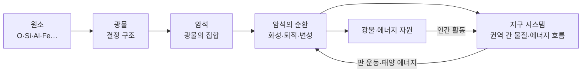
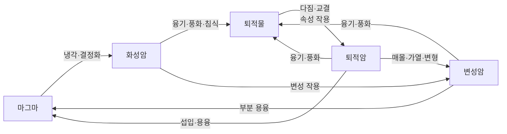

# 일반지구과학 1. 지구 시스템과 지구 물질 — 원자에서 산맥까지, 지구를 이루는 재료의 문법
<!-- prev: esys-1, 2-5, m2-02 -->
<!-- next: uearth-2, uearth-4, uearth-5 -->

> [!NOTE]
> **이 단원의 범위**
> - 지구 시스템 과학의 관점: 권역과 상호 작용, 저장소와 흐름, 시간 규모
> - 지구의 형성과 층상 구조(화학적 구분과 역학적 구분)
> - 광물의 정의와 물리적 성질, 규산염 광물의 구조와 분류
> - 암석의 순환, 화성암(조성·조직, 보엔 반응 계열), 퇴적암(쇄설성·화학적·유기적)과 퇴적 환경
> - 변성 작용과 변성암, 광물·에너지 자원

**학습 목표**

1. 지구를 저장소와 흐름으로 이루어진 시스템으로 보고, 체류 시간과 되먹임으로 권역 사이의 상호 작용과 시간 규모를 정량적으로 설명할 수 있다.
2. 지구의 층상 구조를 화학 조성에 따른 구분(지각·맨틀·핵)과 역학적 성질에 따른 구분(암석권·연약권 등)으로 나누어 설명하고, 그 근거를 제시할 수 있다.
3. 광물의 정의와 물리적 성질을 결정 구조와 화학 결합으로 설명하고, Si–O 사면체의 연결 방식에 따라 규산염 광물을 분류할 수 있다.
4. 화성암의 조성·조직과 보엔 반응 계열을, 퇴적암의 생성 과정과 종류를 퇴적 환경과 관련지어 설명할 수 있다.
5. 변성 작용의 요인과 종류, 변성암의 조직과 변성 등급을 설명하고, 암석의 순환 속에서 세 암석의 관계를 정리할 수 있다.
6. 광물·에너지 자원이 만들어지는 지질학적 조건을 설명하고, 품위·매장량 같은 자원 개념을 계산에 적용할 수 있다.

**이 단원의 학습 사다리**

| 단계 | 무엇을 하나? |
|---|---|
| STEP 1. 이전 학습 다시 보기 | 지구계, 광물과 암석, Si–O 사면체, 권역의 형성과 화성암을 다시 꺼낸다 |
| STEP 2. 기초 다지기 | 상자 모형과 체류 시간, 거듭제곱과 시간 규모, 몰 질량과 질량 백분율, 밀도·비중·암석 압력, 이온 반지름과 치환 |
| STEP 3. 핵심 개념 | 지구 시스템 → 층상 구조 → 광물 → 규산염 광물 → 암석의 순환 → 화성암 → 퇴적암 → 변성암 → 자원 |
| STEP 4. 오개념 바로잡기 | "광물과 암석은 같은 말이다?", "보엔 반응 계열은 마그마 하나에서 모든 암석이 나온다는 뜻이다?" |
| STEP 5. 전공 맛보기 | 광물학의 결정학, 상평형도와 암석학, 퇴적학의 유체 역학 |
| STEP 6. 생활·산업·진로 | 핵심 광물과 배터리, 시멘트와 건설 골재, 지하 탄소 저장, 지질 문화유산 |

---

## 🗺️ 단원 들어가기

손에 든 스마트폰 한 대에는 수십 가지 원소가 들어 있다. 화면 유리의 규소와 알루미늄, 배터리의 리튬·코발트·니켈, 회로의 구리와 금, 진동 모터의 희토류 원소. 이 원소들은 모두 어딘가의 **광물**에서 왔고, 그 광물은 어떤 **암석** 속에서, 어떤 **지질 과정**을 거쳐 한곳에 모였다. 리튬은 건조한 고원의 소금 호수에서, 구리는 섭입대 마그마가 남긴 뜨거운 물길에서, 철은 수십억 년 전 바다에 쌓인 줄무늬 암석에서 왔다.

고등학교에서는 지구가 어떻게 태어나 권역을 갖추었는지, 그리고 화산 활동이 암석을 만드는 과정을 배웠다. 이 단원에서는 한 걸음 더 들어가 **지구를 이루는 재료 자체**를 다룬다. 원자가 어떻게 배열되어 광물이 되고, 광물이 어떻게 모여 암석이 되며, 암석이 어떻게 모습을 바꾸며 순환하는지, 그리고 그 과정에서 인류가 쓰는 자원이 어떻게 만들어지는지를 지구 시스템이라는 큰 틀 안에서 정리한다.

---

## STEP 1. 🔙 이전 학습 다시 보기

### 연계 개념표

| 이전 단원 | 고등학교까지 배운 것 | 대학에서 이렇게 확장된다 |
|---|---|---|
| 중2 「지권의 변화」 '지구계와 지권의 층상 구조' | 지구계의 구성 요소, 지각·맨틀·외핵·내핵 | 화학적 구분과 **역학적 구분(암석권·연약권)** 을 나누어 보기, 층별 조성과 근거 |
| 중2 「지권의 변화」 '조암 광물과 광물의 특성' | 색, 조흔색, 굳기, 자성, 염산 반응으로 광물 구별 | 물리적 성질을 **결정 구조와 결합의 세기**로 설명, 고용체와 동질 이상 |
| 중2 「지권의 변화」 '암석의 분류와 순환' | 화성암·퇴적암·변성암과 암석의 순환 | 순환의 **에너지원·속도·경로**, 판 환경과의 연결 |
| 통합과학1 「지각과 생명체 구성 물질의 규칙성」 'Si–O 사면체' | 사면체가 연결되는 방식에 따라 광물이 달라진다 | 연결 방식별 **Si:O 비와 전하 균형**, 화학식으로 구조 읽기 |
| 통합과학1 「지구시스템의 구성과 상호작용」 | 권역의 구성, 물과 탄소의 순환 | **저장소–흐름 모형, 체류 시간, 되먹임**으로 정량화 |
| 지구시스템과학 「지구 탄생과 생동하는 지구」 '마그마 바다와 지권의 형성', '화산암과 심성암' | 응축·집적·분화, 마그마 성질과 화산체, 냉각 속도와 조직 | **보엔 반응 계열과 결정 분화**로 마그마 조성이 변하는 원리, 퇴적암·변성암으로 확장 |

### 준비 운동 (사전 진단)

**Q1.** 다음 중 광물이 **아닌** 것은? ㄱ. 석영 ㄴ. 화강암 ㄷ. 얼음(빙하의 얼음) ㄹ. 흑요석

**Q2.** 지구 지각에서 질량으로 가장 많은 원소 두 가지를 순서대로 쓰시오.

**Q3.** 현무암과 반려암은 성분이 비슷하지만 알갱이 크기가 다르다. 둘 중 깊은 곳에서 굳은 것은?

**Q4.** 셰일이 높은 온도와 압력을 받아 변하는 순서로 알맞게 나열하시오. (편암, 점판암, 편마암, 천매암)

정답 및 해설

**Q1. ㄴ, ㄹ** — 화강암은 석영·장석·운모 등 여러 광물이 모인 **암석**이다. 흑요석은 원자가 규칙적으로 배열되지 않은 화산 **유리**라서 광물이 아니다(이런 것을 준광물이라 부르기도 한다). 빙하의 얼음은 자연에서 생긴 결정질 고체이므로 광물이다.

**Q2. 산소, 규소** — 지각 질량의 약 47 %가 산소, 약 28 %가 규소이다. 그래서 지각 광물의 대부분이 규소와 산소로 이루어진 규산염 광물이다.

**Q3. 반려암** — 깊은 곳에서 천천히 식어 결정이 크게 자랐다.

**Q4.** 점판암 → 천매암 → 편암 → 편마암. 변성 정도가 높아질수록 광물 알갱이가 커지고 엽리가 뚜렷해진다.

---

## STEP 2. 🧱 기초 다지기

### ① 상자 모형 — 저장소, 흐름, 체류 시간

지구 시스템 과학에서는 물·탄소·암석 같은 물질이 머무는 곳을 **저장소(reservoir)**, 저장소 사이를 오가는 양을 **흐름(flux, 플럭스)** 으로 나타낸다. 욕조에 물을 틀어 두고 마개를 조금 열어 둔 상황을 생각하자. 들어오는 양과 나가는 양이 같으면 수위는 변하지 않는다. 이것이 **정상 상태(steady state)** 이다.

저장소의 양을 $M$, 들어오는 흐름을 $F_{\text{in}}$, 나가는 흐름을 $F_{\text{out}}$이라 하면

$$
\frac{dM}{dt} = F_{\text{in}} - F_{\text{out}}
$$

정상 상태에서 물질 한 덩이가 저장소에 평균적으로 머무는 시간인 **체류 시간(residence time)** 은

$$
\tau = \frac{M}{F}
$$

이다($F$는 정상 상태에서의 들어오거나 나가는 흐름). 체류 시간이 짧은 저장소는 변화에 빨리 반응하고, 긴 저장소는 느리게 반응한다. 대기의 수증기는 약 열흘, 바닷물은 수천 년, 석회암 속 탄소는 수억 년 동안 머문다.

### ② 거듭제곱과 시간 규모

지구 과학의 시간은 초(지진파의 진동)에서 수십억 년(대륙의 나이)까지 $10^{17}$배 이상 차이 난다. 이런 범위는 **10의 거듭제곱**으로 다루는 것이 편하다. 1년은 약 $3.16\times10^{7}$ s, 100만 년(1 Myr)은 약 $3.16\times10^{13}$ s이다. 서로 다른 과정을 비교할 때는 "몇 자릿수 차이인가"를 먼저 보는 습관을 들이자. 이를 **자릿수 어림(order-of-magnitude estimate)** 이라 한다.

### ③ 몰 질량과 질량 백분율 — 화학식으로 광물 읽기

광물의 화학식에서 각 성분의 **질량 백분율**을 구할 수 있다. 원자량은 Mg 24.31, Si 28.09, O 16.00, Fe 55.85, Ca 40.08, Al 26.98로 쓴다. 지질학에서는 암석의 조성을 원소 대신 **산화물의 질량 백분율**($\mathrm{SiO_2}$, $\mathrm{MgO}$, $\mathrm{FeO}$ …)로 나타내는 것이 관례이다. 화성암의 "$\mathrm{SiO_2}$ 52 %"라는 말은 암석을 모두 산화물로 바꾸었을 때 $\mathrm{SiO_2}$가 질량의 52 %라는 뜻이다.

### ④ 밀도, 비중, 그리고 암석이 누르는 압력

**비중(specific gravity)** 은 같은 부피의 물(4 °C)에 대한 질량의 비로, 단위가 없고 $\mathrm{g/cm^3}$ 단위의 밀도와 수치가 같다. 아르키메데스 원리를 쓰면 공기 중 무게 $W_{\text{공기}}$와 물속 무게 $W_{\text{물}}$로 비중을 구할 수 있다.

$$
\text{비중} = \frac{W_{\text{공기}}}{W_{\text{공기}} - W_{\text{물}}}
$$

깊이 $z$에서 위에 놓인 암석이 누르는 압력, 곧 **암석 정압(lithostatic pressure)** 은 유체의 정수압과 같은 식으로 어림한다.

$$
P = \rho g z
$$

지각 암석($\rho \approx 2700\ \mathrm{kg/m^3}$, $g = 9.8\ \mathrm{m/s^2}$)에서 깊이 10 km의 압력은 약 $2.6\times10^{8}\ \mathrm{Pa}$, 곧 약 260 MPa(약 2600기압)이다. 깊이 1 km마다 약 27 MPa씩 커진다.

### ⑤ 이온 반지름과 전하 — 누가 누구의 자리를 대신할까

광물 결정에서 한 이온의 자리를 다른 이온이 대신 차지하는 것을 **치환(substitution)** 이라 한다. 치환이 쉽게 일어나려면 ① 이온 반지름이 비슷하고(대략 15 % 이내) ② 전하가 같거나, 다르면 다른 자리에서 전하를 맞춰 주어야 한다.

| 이온 | 반지름(약, pm, 6배위) | 잘 치환하는 짝 |
|---|---|---|
| $\mathrm{Mg^{2+}}$ | 72 | $\mathrm{Fe^{2+}}$(78) — 감람석·휘석에서 자유롭게 치환 |
| $\mathrm{Na^{+}}$ | 102 | $\mathrm{Ca^{2+}}$(100) — 사장석에서 치환, 전하 차이는 $\mathrm{Al^{3+}}$와 $\mathrm{Si^{4+}}$의 치환으로 맞춤 |
| $\mathrm{K^{+}}$ | 138 | 크기가 커서 $\mathrm{Na^+}$, $\mathrm{Ca^{2+}}$ 자리에 잘 들어가지 못함 |
| $\mathrm{Si^{4+}}$ | 26(4배위) | $\mathrm{Al^{3+}}$(39, 4배위) — 장석·운모의 사면체 자리 |

> [!TIP]
> 💡 **비유** — 광물 결정은 크기가 정해진 좌석이 늘어선 극장이다. 같은 크기의 관객($\mathrm{Mg^{2+}}$와 $\mathrm{Fe^{2+}}$)은 자리를 바꿔 앉아도 문제가 없지만, 몸집이 큰 관객($\mathrm{K^+}$)은 작은 좌석에 앉지 못한다. 표를 산 사람 수(전하)도 맞아야 극장이 굴러간다.

---

## STEP 3. 📘 핵심 개념

### ① 지구 시스템 과학의 관점 — 권역, 상호 작용, 시간 규모

**지구 시스템 과학(Earth system science)** 은 지구를 서로 물질과 에너지를 주고받는 **권역(sphere)** 들의 집합으로 본다. 권역은 **기권, 수권, 지권, 생물권**이며, 얼음으로 덮인 부분을 따로 **빙권(cryosphere)** 으로 나누기도 한다. 각 권역은 서로 물질을 주고받는 열린 시스템이지만, 권역을 모두 합친 지구 시스템 전체는 물질에 대해서는 거의 **닫힌 시스템**(운석 유입과 대기 탈출은 매우 적다)이고, 에너지에 대해서는 **열린 시스템**(태양 복사가 들어오고 지구 복사가 나간다)이다.

| 에너지원 | 크기(약) | 주로 일으키는 일 |
|---|---|---|
| 태양 복사(지구가 흡수) | 약 $1.2\times10^{17}$ W | 대기·해양 순환, 물의 순환, 풍화·침식, 광합성 |
| 지구 내부 열(지표 열류량) | 약 $4.7\times10^{13}$ W | 판 운동, 화산 활동, 변성 작용, 산맥 형성 |
| 조석 에너지 소산 | 약 $3.7\times10^{12}$ W | 조류, 해양 혼합 |

태양 에너지는 지구 내부 열보다 2000배 이상 크지만, 지표 **바깥**의 과정(풍화·침식·퇴적)을 움직인다. 지구 내부 열은 작아도 수억 년 동안 쉬지 않고 판을 움직여 지권 **안쪽**의 과정을 움직인다. 암석의 순환은 이 두 엔진이 맞물려 돌아가는 대표적인 예이다.

#### 되먹임 — 시스템이 스스로를 조절하거나 증폭하는 방식

한 권역의 변화가 다른 권역을 거쳐 처음 변화를 **줄이면 음의 되먹임(negative feedback)**, **키우면 양의 되먹임(positive feedback)** 이다.

| 되먹임 | 고리 | 부호 |
|---|---|---|
| 규산염 풍화 온도 조절 | 기온 상승 → 화학적 풍화 활발 → 대기 $\mathrm{CO_2}$ 감소 → 기온 하강 | 음(안정화) |
| 얼음–반사율 되먹임 | 기온 하강 → 얼음 확장 → 반사율 증가 → 기온 더 하강 | 양(증폭) |
| 지각 평형과 침식 | 산이 높아짐 → 침식 증가 → 하중 감소로 융기 → 다시 침식 | 음의 성격(지형을 오래 유지) |

#### 시간 규모 — 같은 지구, 다른 시계

| 과정 | 대표 시간 규모 | 공간 규모 |
|---|---|---|
| 지진 단층 파열 | 수 초~수 분 | 수 km~수백 km |
| 화산 분화 | 수 시간~수 년 | 수 km~수십 km |
| 하천 지형의 변화 | 수십~수만 년 | 수 m~수백 km |
| 빙하기–간빙기 순환 | 약 10만 년 | 대륙 규모 |
| 해양 지각의 생성에서 섭입까지 | 약 1억~2억 년 | 대양 규모 |
| 초대륙 순환 | 약 3억~5억 년 | 지구 규모 |
| 대륙 지각의 성장 | 수십억 년 | 지구 규모 |

#### 예제 1 — 바닷물의 체류 시간

바닷물의 총질량은 약 $1.4\times10^{21}\ \mathrm{kg}$이고, 바다 표면에서 증발하는 물은 1년에 약 $4.2\times10^{17}\ \mathrm{kg}$이다. 정상 상태라 가정하고 바닷물 분자의 평균 체류 시간을 구하시오. 같은 방법으로 구한 대기 수증기의 체류 시간(약 9일)과 비교하여 의미를 쓰시오.

**풀이**

① 식 세우기: $\tau = M/F$

② 대입:

$$
\tau = \frac{1.4\times10^{21}\ \mathrm{kg}}{4.2\times10^{17}\ \mathrm{kg/년}} \approx 3.3\times10^{3}\ \text{년}
$$

③ 결과의 의미: 바닷물 분자 하나는 평균 약 3300년 동안 바다에 머문 뒤 증발한다. 대기 수증기(약 9일)보다 10만 배 이상 길다. 그래서 대기의 수분은 날씨처럼 빠르게 변하지만, 바다의 조성과 열은 천천히 변하며 기후를 붙잡아 두는 '관성' 역할을 한다. (흐름에 강물 유입을 더하면 체류 시간은 조금 짧아지지만 자릿수는 같다.)

> [!TIP]
> 💡 **요령** — 체류 시간은 "저장소가 흐름만으로 완전히 새로 채워지는 데 걸리는 시간"으로 읽으면 된다. 저장소가 크거나 흐름이 작을수록 길다.

#### ✔ 바로 확인

1. (O/X) 지구 시스템 전체는 물질과 에너지 모두에 대해 거의 닫힌 시스템이다.
2. 빈칸: 한 권역의 변화가 다른 권역을 거쳐 처음 변화를 키우면 (    ) 되먹임이다.
3. 저장량이 $6.0\times10^{3}$ 단위이고 흐름이 1년에 2.0 단위인 저장소의 체류 시간은?

정답

1. X — 물질에는 거의 닫혀 있지만 에너지에는 열려 있다(태양 복사가 들어오고 지구 복사가 나감).
2. 양의 — 얼음–반사율 되먹임이 대표적인 예이다.
3. $3.0\times10^{3}$년 — $\tau = M/F$.

### ② 지구의 형성과 층상 구조

#### (1) 형성 과정 요약

고등학교에서 배운 대로 지구는 약 45억 6천만 년 전 원시 태양계 성운에서 **응축 → 미행성 집적 → 마그마 바다와 분화**를 거쳐 층상 구조를 갖추었다. 대학 과정에서 덧붙일 점은 두 가지이다.

- **분화는 화학 조성에 따라 일어났다.** 철과 친한 원소(**친철 원소**: Ni, Co, Pt, Au 등)는 핵으로, 규산염과 친한 원소(**친석 원소**: Si, Al, Ca, Na, K, 희토류 등)는 맨틀과 지각으로 갔다. 그래서 지각에서 금·백금이 드물다.
- **분화는 지금도 조금씩 계속된다.** 맨틀이 부분적으로 녹으면 녹기 쉬운 성분(Si, Al, Na, K)이 마그마에 모여 위로 올라가므로, 수십억 년 동안 가벼운 대륙 지각이 맨틀에서 조금씩 추출되었다.

#### (2) 화학 조성에 따른 구분과 역학적 성질에 따른 구분

같은 지구 내부를 두 가지 기준으로 나눌 수 있다. 두 경계가 일치하지 않는다는 점이 중요하다.

| 화학 조성에 따른 구분 | 깊이(약) | 주된 물질 |
|---|---|---|
| 대륙 지각 | 0~35 km(산맥 아래 70 km까지) | 화강암질(평균 조성은 안산암질에 가까움), 밀도 약 $2.7\ \mathrm{g/cm^3}$ |
| 해양 지각 | 0~7 km(해저면 아래) | 현무암·반려암, 밀도 약 $3.0\ \mathrm{g/cm^3}$ |
| 맨틀 | 모호면~2891 km | 감람암(감람석·휘석), 깊이에 따라 고압 광물로 변함 |
| 핵 | 2891~6371 km | 철–니켈 합금 + 가벼운 원소(약 10 %) |

| 역학적 성질에 따른 구분 | 깊이(약) | 성질 |
|---|---|---|
| **암석권(lithosphere)** | 0~100 km(해령 부근은 더 얇고, 오래된 대륙 아래는 200 km 이상) | 지각 + 최상부 맨틀. 차갑고 단단하여 판을 이룸 |
| **연약권(asthenosphere)** | 약 100~350 km | 고체이지만 녹는점에 가까워 약하고 천천히 흐름. 지진파 저속도층 |
| 중간권(하부 맨틀 포함) | 약 350~2891 km | 압력이 커서 다시 단단해지지만 긴 시간에는 대류 |
| 외핵 | 2891~5150 km | **액체** 금속, 대류하며 자기장 생성 |
| 내핵 | 5150~6371 km | **고체** 금속 |

> [!IMPORTANT]
> **판은 지각이 아니라 암석권이다.** 판의 아랫부분은 맨틀 암석으로 되어 있다. 판과 연약권을 나누는 것은 조성이 아니라 **온도에 따른 강도 차이**이다. 같은 감람암이라도 차가우면 판(암석권), 뜨거우면 연약권이 된다.

<!-- fig:uearth-1-layers -->

#### (3) 층상 구조를 아는 근거

| 근거 | 알려 주는 것 |
|---|---|
| 지진파의 속도 변화와 그림자대 | 층의 경계 깊이, 외핵이 액체, 내핵이 고체 |
| 지구의 평균 밀도(약 $5.51\ \mathrm{g/cm^3}$)와 관성 모멘트 | 질량이 중심에 몰려 있다(밀도가 큰 핵) |
| 운석(콘드라이트, 철질 운석)의 조성 | 지구 전체의 원소 비율과 핵의 성분 |
| 맨틀 포획암(화산이 끌고 올라온 맨틀 조각), 오피올라이트 | 상부 맨틀과 해양 지각의 실제 암석 |
| 고압 실험 | 깊이별 광물의 상과 밀도 |

#### 예제 2 — 핵의 부피와 질량

핵의 반지름은 약 3480 km, 지구 반지름은 6371 km이다. 핵의 질량은 약 $1.94\times10^{24}\ \mathrm{kg}$, 지구 질량은 $5.97\times10^{24}\ \mathrm{kg}$이다. 핵이 지구 부피와 질량에서 차지하는 비율을 각각 구하고, 무엇을 알 수 있는지 쓰시오.

**풀이**

부피 비는 반지름 비의 세제곱이다.

$$
\frac{V_{\text{핵}}}{V_{\text{지구}}} = \left(\frac{3480}{6371}\right)^3 \approx 0.163
$$

$$
\frac{M_{\text{핵}}}{M_{\text{지구}}} = \frac{1.94\times10^{24}}{5.97\times10^{24}} \approx 0.325
$$

핵은 부피로 약 16 %에 불과하지만 질량으로 약 33 %를 차지한다. 핵의 평균 밀도가 지구 평균의 약 2배(약 $11\ \mathrm{g/cm^3}$)라는 뜻이며, 금속 철이 압축된 상태로 모여 있다는 추론과 맞는다.

#### ✔ 바로 확인

1. (O/X) 판(암석권)과 연약권의 경계는 모호면이다.
2. 빈칸: 외핵은 (    ) 상태이고 내핵은 (    ) 상태이다.
3. 금·백금 같은 친철 원소가 지각에 드문 까닭을 한 줄로 쓰시오.

정답

1. X — 암석권 바닥은 맨틀 안에 있다. 경계는 조성이 아니라 온도에 따른 강도 차이로 정해진다.
2. 액체, 고체 — S파가 외핵을 지나지 못한다.
3. 분화 때 철과 함께 핵으로 들어갔기 때문이다.

### ③ 광물의 정의와 물리적 성질

#### (1) 광물이란

**광물(mineral)** 은 다음 조건을 모두 만족하는 물질이다.

| 조건 | 뜻 | 이 조건 때문에 광물이 아닌 예 |
|---|---|---|
| 자연에서 생성 | 지질 과정으로 생김 | 실험실에서 만든 합성 다이아몬드(광물과 같은 물질이지만 광물로 분류하지 않음) |
| 고체 | 상온에서 고체 | 액체 수은(일반적으로 광물에서 제외) |
| 규칙적인 원자 배열(결정질) | 원자가 3차원으로 반복 배열 | 흑요석 같은 화산 유리 |
| 일정한 범위의 화학 조성 | 화학식으로 나타낼 수 있음(치환 범위 허용) | — |
| 대개 무기물 | 생물체 자체가 아님 | 석탄(유기물의 집합) — 단, 조개껍데기의 방해석은 광물 |

**암석(rock)** 은 하나 이상의 광물(또는 유리, 유기물)이 자연적으로 모인 덩어리이다. 지금까지 알려진 광물은 6000종이 넘지만, 암석의 대부분을 이루는 **조암 광물**은 수십 종에 불과하다.

#### (2) 결정 구조가 성질을 정한다 — 동질 이상과 고용체

같은 화학 조성이라도 원자 배열이 다르면 다른 광물이다. 이것을 **동질 이상(polymorphism)** 이라 한다.

| 화학식 | 동질 이상 광물 | 무엇이 다른가 |
|---|---|---|
| C | 흑연, 다이아몬드 | 흑연은 판상 구조(층 사이 약한 결합, 무름), 다이아몬드는 3차원 공유 결합(가장 단단함, 고압에서 생성) |
| $\mathrm{CaCO_3}$ | 방해석, 아라고나이트(아라고나이트석) | 결정계와 밀도가 다름. 조개껍데기에 둘 다 쓰임 |
| $\mathrm{Al_2SiO_5}$ | 홍주석, 남정석, 규선석 | 생기는 온도·압력이 달라 **변성 조건의 지표**로 쓰임(⑧에서 다시) |
| $\mathrm{SiO_2}$ | 석영, 크리스토발석, 코에사이트 등 | 코에사이트는 고압 상 — 운석 충돌이나 깊은 섭입의 증거 |

또 한 광물 안에서 비슷한 이온끼리 연속적으로 치환되어 조성이 연속적으로 변하는 것을 **고용체(solid solution)** 라 한다. 감람석은 $\mathrm{Mg_2SiO_4}$(고토감람석, 포스테라이트)부터 $\mathrm{Fe_2SiO_4}$(철감람석, 파얄라이트)까지 이어지는 고용체이며, 보통 $\mathrm{(Mg,Fe)_2SiO_4}$로 쓴다.

#### (3) 물리적 성질

| 성질 | 뜻 | 결정 구조·결합과의 관계 | 예 |
|---|---|---|---|
| **결정형** | 결정이 자유롭게 자랐을 때의 겉모양 | 원자 배열의 대칭성이 드러남 | 석영의 육각기둥, 황철석의 정육면체 |
| **쪼개짐(벽개)** | 특정 평면을 따라 매끈하게 갈라짐 | 결합이 약한 방향의 면 | 운모 1방향, 장석 2방향, 방해석 3방향(마름모꼴) |
| **깨짐** | 쪼개짐 없이 불규칙하게 깨짐 | 모든 방향의 결합 세기가 비슷 | 석영의 패각상(조개껍데기 모양) 깨짐 |
| **굳기** | 긁힘에 견디는 정도 | 결합의 세기와 밀집도 | 모스 굳기 1(활석)~10(다이아몬드) |
| **광택** | 표면이 빛을 반사하는 모습 | 금속 결합(금속광택) 또는 비금속 | 황철석 금속광택, 석영 유리광택 |
| **조흔색** | 초벌 자기판에 긁은 가루의 색 | 겉색보다 일정함(불순물 영향이 적음) | 적철석: 겉은 검거나 붉어도 조흔색은 적갈색 |
| **비중** | 같은 부피의 물에 대한 질량비 | 원자량과 원자 배열의 밀집도 | 석영 2.65, 방해석 2.71, 황철석 약 5.0, 방연석 약 7.5 |
| 기타 | 자성, 염산 반응, 복굴절, 형광 | — | 자철석 자성, 방해석 거품, 방해석 복굴절 |

**모스 굳기계**: 1 활석, 2 석고, 3 방해석, 4 형석, 5 인회석, 6 정장석, 7 석영, 8 황옥, 9 강옥, 10 다이아몬드. 손톱은 약 2.5, 유리판은 약 5.5이다. 모스 굳기는 **순서 척도**일 뿐 간격이 같지 않다. 절대적인 굳기로 재면 다이아몬드(10)는 강옥(9)보다 수 배 단단하고, 강옥과 활석의 차이는 수백 배에 이른다.

#### 예제 3 — 비중으로 광물 판별하기

흰 광물 시료 A는 공기 중에서 26.5 g중, 물속에서 16.5 g중으로 측정되었다. 금속광택이 나는 노란 시료 B는 공기 중 15.0 g중, 물속 12.0 g중이었다. 두 시료의 비중을 구하고, 각각 석영(2.65), 방해석(2.71), 황동석(약 4.2), 황철석(약 5.0) 중 무엇일 가능성이 큰지 쓰시오. A가 무엇인지 확실히 하려면 어떤 시험을 더 하면 좋은가?

**풀이**

$$
\text{A의 비중} = \frac{26.5}{26.5-16.5} = 2.65, \qquad \text{B의 비중} = \frac{15.0}{15.0-12.0} = 5.0
$$

A는 석영 또는 방해석, B는 황철석일 가능성이 크다. A의 비중 2.65는 석영과 일치하지만 방해석(2.71)과의 차이는 측정 오차 정도이므로, **묽은 염산 반응**(방해석은 거품) 또는 **굳기 시험**(석영은 유리를 긁지만 방해석은 못 긁음)으로 확인한다. 한 가지 성질만으로 결론 내리지 않고 여러 성질을 함께 보는 것이 광물 감정의 기본이다.

#### ✔ 바로 확인

1. (O/X) 실험실에서 만든 합성 다이아몬드는 광물로 분류한다.
2. 흑연과 다이아몬드처럼 화학 조성은 같고 원자 배열이 다른 관계를 무엇이라 하는가?
3. 공기 중 30.0 g중, 물속 18.0 g중인 광물의 비중은?

정답

1. X — 자연에서 생성되어야 광물이다.
2. 동질 이상 — $\mathrm{CaCO_3}$의 방해석·아라고나이트도 같은 예이다.
3. 2.5 — $30.0/(30.0-18.0)$.

### ④ 규산염 광물의 구조와 분류

#### (1) Si–O 사면체와 전하 균형

지각 질량의 약 75 %가 산소와 규소이므로 지각 광물의 90 % 이상이 **규산염 광물(silicate mineral)** 이다. 기본 단위는 규소 1개를 산소 4개가 둘러싼 **Si–O 사면체** $(\mathrm{SiO_4})^{4-}$이다. 사면체끼리 꼭짓점의 산소를 **공유**하면 Si 하나당 산소 수가 줄고, 남는 음전하도 줄어든다. 남은 음전하는 $\mathrm{Mg^{2+}}$, $\mathrm{Fe^{2+}}$, $\mathrm{Ca^{2+}}$, $\mathrm{Na^+}$, $\mathrm{K^+}$, $\mathrm{Al^{3+}}$ 같은 양이온이 채운다.

| 구조 | 공유하는 산소 수(사면체당) | 기본 단위 | Si:O | Si 1개당 음전하 | 대표 광물 |
|---|---|---|---|---|---|
| 독립형 | 0 | $(\mathrm{SiO_4})^{4-}$ | 1:4 | 4 | 감람석, 석류석 |
| 단사슬 | 2 | $(\mathrm{SiO_3})^{2-}$ | 1:3 | 2 | 휘석 |
| 복사슬 | 2와 3을 번갈아(평균 2.5) | $(\mathrm{Si_4O_{11}})^{6-}$ | 1:2.75 | 1.5 | 각섬석 |
| 판상 | 3 | $(\mathrm{Si_2O_5})^{2-}$ | 1:2.5 | 1 | 운모, 점토 광물, 녹니석 |
| 망상(3차원) | 4 | $\mathrm{SiO_2}$ | 1:2 | 0 | 석영, 장석(Si 일부를 Al이 치환) |

망상 구조인 석영은 음전하가 0이라 양이온이 필요 없다. 장석은 Si 자리 일부를 $\mathrm{Al^{3+}}$가 차지해 생긴 음전하를 $\mathrm{K^+}$, $\mathrm{Na^+}$, $\mathrm{Ca^{2+}}$가 채운다. 예를 들어 정장석 $\mathrm{KAlSi_3O_8}$은 $\mathrm{SiO_2}$ 4개 중 Si 하나가 Al로 바뀌고 K가 들어간 꼴이다.

<!-- fig:uearth-1-silicate -->

#### (2) 구조에서 성질로

- **연결이 많을수록** 결정이 생기는 온도가 대체로 낮아지고, Fe·Mg가 적어져 **색이 밝고 밀도가 작다.** 철·마그네슘이 많은 어두운 광물을 **고철질(mafic) 광물**, 밝은 광물(석영·장석·백운모)을 **규장질(felsic) 광물**이라 한다.
- **쪼개짐은 사면체 사이의 약한 결합을 따라 생긴다.** 사슬 구조는 사슬 방향을 따라 2방향으로 쪼개지고(휘석은 약 90°, 각섬석은 약 56°와 124°), 판상 구조는 판 사이로 1방향 쪼개진다. 모든 방향이 Si–O 공유 결합으로 이어진 석영은 쪼개짐이 없다.
- **풍화에 대한 저항**도 구조와 관련된다(「지표를 바꾸는 작용」에서 다시 다룬다). 대체로 높은 온도에서 생긴 감람석은 지표에서 쉽게 풍화되고, 낮은 온도에서 생긴 석영은 잘 견딘다.

<!-- sim:u-silicate-structures -->

#### (3) 주요 규산염 광물과 비규산염 광물

| 분류 | 광물(화학식) | 특징 |
|---|---|---|
| 규산염 | 사장석 $\mathrm{(Na,Ca)(Al,Si)_4O_8}$ | 지각에서 가장 흔한 광물 무리. Na 끝원(조장석)–Ca 끝원(회장석) 고용체 |
| 규산염 | 정장석 $\mathrm{KAlSi_3O_8}$ | 분홍빛 장석, 화강암의 주요 광물 |
| 규산염 | 석영 $\mathrm{SiO_2}$ | 굳기 7, 쪼개짐 없음, 풍화에 강함 |
| 규산염 | 흑운모·백운모 | 판상, 얇게 벗겨짐 |
| 규산염 | 점토 광물(고령석 등) | 장석의 화학적 풍화로 생김, 판상 |
| 탄산염 | 방해석 $\mathrm{CaCO_3}$, 백운석 $\mathrm{CaMg(CO_3)_2}$ | 석회암·대리암의 주성분, 염산과 반응 |
| 산화물 | 적철석 $\mathrm{Fe_2O_3}$, 자철석 $\mathrm{Fe_3O_4}$, 강옥 $\mathrm{Al_2O_3}$ | 철광석, 연마재·보석(루비·사파이어) |
| 황화물 | 황철석 $\mathrm{FeS_2}$, 황동석 $\mathrm{CuFeS_2}$, 방연석 $\mathrm{PbS}$ | 금속 광석 |
| 황산염 | 석고 $\mathrm{CaSO_4\cdot2H_2O}$ | 증발암, 건축 자재 |
| 할로젠화물 | 암염 $\mathrm{NaCl}$, 형석 $\mathrm{CaF_2}$ | 증발암, 제련용 융제 |
| 원소 광물 | 금, 구리, 흑연, 다이아몬드, 황 | 한 원소로 이루어짐 |

#### 예제 4 — 감람석의 조성과 밀도

고토감람석 $\mathrm{Mg_2SiO_4}$와 철감람석 $\mathrm{Fe_2SiO_4}$의 몰 질량과 $\mathrm{SiO_2}$의 질량 백분율을 각각 구하시오. 두 광물의 단위 세포 부피가 거의 같다고 할 때, 감람석에 철이 많을수록 밀도가 어떻게 변하는지 추론하시오. (원자량: Mg 24.31, Fe 55.85, Si 28.09, O 16.00)

**풀이**

$$
M(\mathrm{Mg_2SiO_4}) = 2(24.31) + 28.09 + 4(16.00) = 140.71\ \mathrm{g/mol}
$$

$$
M(\mathrm{Fe_2SiO_4}) = 2(55.85) + 28.09 + 4(16.00) = 203.79\ \mathrm{g/mol}
$$

$\mathrm{SiO_2}$의 몰 질량은 60.09 g/mol이므로

$$
\mathrm{SiO_2}\ \% = \frac{60.09}{140.71}\times100 \approx 42.7\ \%, \qquad \frac{60.09}{203.79}\times100 \approx 29.5\ \%
$$

부피가 거의 같은데 몰 질량이 약 1.45배이므로 밀도도 대략 그만큼 커진다(실제로 고토감람석 약 3.2, 철감람석 약 4.4 $\mathrm{g/cm^3}$). 이처럼 **고철질 광물에 철이 많을수록 무겁고**, 암석의 $\mathrm{SiO_2}$ 함량이 낮은 것은 이런 광물이 많기 때문이다.

> [!TIP]
> 💡 **비유** — 같은 레고 판(사면체 구조)에 가벼운 플라스틱 블록(Mg) 대신 같은 크기의 쇠 블록(Fe)을 끼우면 모양은 같아도 무게가 늘어난다. 고용체는 "모양은 그대로, 재료만 바꿔 끼우기"이다.

#### ✔ 바로 확인

1. 짝짓기: 독립형, 판상, 망상 구조를 각각 감람석, 운모, 석영과 짝지으시오.
2. 빈칸: 망상 구조는 사면체 하나가 산소 (    )개를 모두 공유하므로 Si:O = 1:(    )이다.
3. (O/X) 운모가 한 방향으로 얇게 벗겨지는 것은 판 사이 결합이 약하기 때문이다.

정답

1. 독립형–감람석, 판상–운모, 망상–석영.
2. 4, 2 — 남는 음전하가 0이라 양이온이 필요 없다.
3. O — 쪼개짐은 사면체 사이의 약한 결합을 따라 생긴다.

### ⑤ 암석의 순환 — 세 암석을 잇는 길

**암석의 순환(rock cycle)** 은 화성암·퇴적암·변성암이 지질 과정을 통해 서로 바뀌는 순환이다. 중학교에서 배운 그림을 대학 수준에서는 **에너지원, 판 환경, 속도**를 붙여 읽는다.

| 경로 | 에너지원 | 대표 판 환경 | 속도(약) |
|---|---|---|---|
| 풍화·침식·운반·퇴적 | 태양 에너지, 중력 | 산맥, 하천, 대륙 주변부 | 침식률 수 cm~수 m / 1000년 |
| 매몰과 속성 작용 | 중력(퇴적물의 하중), 지열 | 퇴적 분지, 대륙붕 | 퇴적률 수 cm~수 m / 1000년 |
| 변성 작용 | 지구 내부 열, 판 충돌의 압력 | 섭입대, 대륙 충돌대 | 수백만~수천만 년 |
| 용융과 결정화 | 지구 내부 열, 감압, 물 공급 | 해령, 섭입대, 열점 | 마그마 방 냉각 수천~수백만 년 |
| 융기 | 판의 운동, 지각 평형 | 조산대 | 수 mm/년 |

> [!IMPORTANT]
> 암석의 순환은 **판구조론의 다른 얼굴**이다. 해령에서 생긴 현무암은 판을 따라 이동해 해구에서 섭입하고, 섭입대에서 생긴 마그마는 대륙에 화강암과 화산암을 더한다. 대륙이 충돌하면 퇴적암이 변성암이 되고, 융기한 산은 다시 깎여 퇴적물이 된다. 판 운동이 없다면 순환은 풍화·침식 한쪽으로만 흘러 결국 멈출 것이다.

<!-- fig:uearth-1-rock-cycle-plates -->

순환에는 "정해진 순서"가 없다. 화성암이 퇴적암을 거치지 않고 바로 변성될 수도 있고, 변성암이 녹지 않고 다시 풍화될 수도 있다. 또 대륙 지각은 가벼워서 잘 섭입되지 않으므로 오래 살아남는다. 그래서 해양 지각은 2억 년보다 오래된 것이 거의 없지만, 대륙에는 40억 년 된 암석도 남아 있다.

#### ✔ 바로 확인

1. (O/X) 암석의 순환은 화성암 → 퇴적암 → 변성암의 정해진 순서로만 일어난다.
2. 풍화·침식을 움직이는 주된 에너지원과 변성 작용을 움직이는 주된 에너지원을 쓰시오.
3. 해양 지각은 약 2억 년보다 오래된 것이 거의 없는데 대륙에는 40억 년 된 암석이 남은 까닭은?

정답

1. X — 화성암이 바로 변성되거나 변성암이 다시 풍화되는 등 여러 경로가 있다.
2. 태양 에너지(와 중력), 지구 내부 열.
3. 해양 지각은 섭입되어 맨틀로 돌아가지만, 가벼운 대륙 지각은 잘 섭입되지 않기 때문이다.

### ⑥ 화성암 — 조성, 조직, 보엔 반응 계열

#### (1) 조성에 따른 분류

화성암은 $\mathrm{SiO_2}$ 함량과 광물 구성에 따라 네 무리로 나눈다. 고등학교의 '염기성–중성–산성암'이라는 말과 대학의 '고철질–중성–규장질'이라는 말을 함께 알아 두자.

| 무리 | $\mathrm{SiO_2}$(질량 %, 약) | 주요 광물 | 색 지수(유색 광물 %) | 분출암 / 심성암 |
|---|---|---|---|---|
| 초고철질(초염기성) | 45 미만 | 감람석, 휘석 | 90 이상 | (코마티아이트) / 감람암 |
| 고철질(염기성) | 45~52 | Ca가 많은 사장석, 휘석, 감람석 | 약 40~70 | 현무암 / 반려암 |
| 중성 | 52~63 | 중간 조성 사장석, 각섬석, 휘석 | 약 20~40 | 안산암 / 섬록암 |
| 규장질(산성) | 63 이상 | 석영, 정장석, Na가 많은 사장석, 흑운모 | 약 15 이하 | 유문암 / 화강암 |

'산성'이라는 이름은 옛 화학에서 $\mathrm{SiO_2}$를 '규산'으로 불렀던 데서 온 것이며, 용액의 pH와는 관계가 없다.

#### (2) 조직 — 냉각의 기록

| 조직 | 형성 조건 | 예 |
|---|---|---|
| 조립질(현정질) | 깊은 곳에서 천천히 냉각, 결정이 맨눈에 보임 | 화강암, 반려암 |
| 세립질(비현정질) | 지표 부근에서 빨리 냉각 | 현무암, 유문암 |
| 반상 | 두 단계 냉각: 큰 반정 + 작은 석기 | 반상 안산암 |
| 유리질 | 매우 빠른 냉각, 결정 없음 | 흑요석, 부석(기포가 많은 유리) |
| 다공질(기공) | 용암 속 기체가 빠져나간 구멍 | 다공질 현무암(제주 현무암) |
| 화성 쇄설성 | 폭발로 부서진 조각이 쌓여 굳음 | 응회암, 화산 각력암 |
| 페그마타이트 | 물이 많은 마지막 마그마에서 결정이 매우 크게 자람(수 cm 이상) | 거정질 화강암 — 리튬·베릴륨 등 희유 원소 광상 |

결정의 크기는 **핵 생성 속도**와 **결정 성장 속도**의 경쟁으로 정해진다. 빨리 식으면 과냉각이 커져 핵이 무수히 생기고, 각 핵이 자랄 시간이 없어 작은 결정이 많아진다. 천천히 식으면 핵이 적게 생기고 각 결정이 크게 자란다.

<!-- fig:uearth-1-igneous-chart -->

#### (3) 보엔 반응 계열 — 마그마가 식으며 결정이 생기는 순서

20세기 초 보엔은 현무암질 용융체를 여러 온도에서 식히는 실험을 거듭하여, 마그마가 식을 때 광물이 정해진 순서로 결정화된다는 것을 밝혔다. 이것이 **보엔 반응 계열(Bowen's reaction series)** 이다.

| 온도 | 불연속 계열(고철질 광물) | 연속 계열(사장석) |
|---|---|---|
| 높음(약 1200 °C) | 감람석 | Ca가 많은 사장석(회장석 쪽) |
| ↓ | 휘석 | ↓ |
| ↓ | 각섬석 | ↓ |
| ↓ | 흑운모 | Na가 많은 사장석(조장석 쪽) |
| 낮음(약 700 °C 안팎) | → 정장석 → 백운모 → 석영 (두 계열이 합쳐짐) | |

- **불연속 계열**: 먼저 생긴 광물이 남은 용융체와 반응하여 **구조가 다른** 새 광물로 바뀐다(감람석 → 휘석). 사면체의 연결이 독립형 → 단사슬 → 복사슬 → 판상으로 **점점 많아진다.**
- **연속 계열**: 사장석의 구조는 그대로이고 **조성만 연속적으로** Ca 쪽에서 Na 쪽으로 바뀐다. 천천히 식지 못하면 결정 속은 Ca, 바깥은 Na가 많은 **누대 구조**가 남는다.

<!-- fig:uearth-1-bowen -->

#### (4) 결정 분화와 마그마 조성의 변화

먼저 생긴 결정이 마그마에서 **분리**되면(가라앉거나 벽에 붙음) 남은 마그마의 조성이 바뀐다. 이것이 **결정 분화(fractional crystallization)** 이다. 감람석·휘석은 $\mathrm{SiO_2}$가 적고 Fe·Mg가 많으므로, 이들이 빠져나가면 남은 마그마는 $\mathrm{SiO_2}$가 많아진다. 마그마 조성을 바꾸는 다른 과정으로는 주변 암석을 녹여 받아들이는 **동화 작용(assimilation)**, 성질이 다른 두 마그마가 섞이는 **마그마 혼합(magma mixing)** 이 있다.

> [!WARNING]
> 보엔 반응 계열은 "현무암질 마그마 하나에서 모든 화성암이 나온다"는 뜻이 아니다. 결정 분화만으로 현무암질 마그마에서 만들 수 있는 화강암질 마그마는 처음 양의 10 % 정도에 불과하다. 대륙의 거대한 화강암체는 주로 **대륙 지각 자체가 부분 용융**되어 만들어진다. 보엔 반응 계열은 결정화 순서와 함께 **부분 용융 순서의 역순**(낮은 온도에서 석영·장석 성분이 먼저 녹음)을 알려 준다는 점에서 더 중요하다.

<!-- sim:u-fractional-crystallization -->

#### 예제 5 — 결정 분화로 마그마의 $\mathrm{SiO_2}$는 얼마나 변할까

$\mathrm{SiO_2}$ 50.0 %인 현무암질 마그마 100 kg에서 $\mathrm{SiO_2}$ 41 %인 감람석 30 kg이 결정화되어 바닥에 가라앉았다. 남은 마그마의 $\mathrm{SiO_2}$ 함량을 구하시오.

**풀이**

① 식 세우기(질량 보존): 처음 $\mathrm{SiO_2}$ 질량 = 감람석 속 $\mathrm{SiO_2}$ + 남은 마그마 속 $\mathrm{SiO_2}$

② 대입: 처음 $\mathrm{SiO_2}$ = 50.0 kg, 감람석 속 = $30\times0.41 = 12.3$ kg, 남은 마그마 70 kg

$$
x = \frac{50.0 - 12.3}{70} \times 100 \approx 53.9\ \%
$$

③ 의미: 감람석 30 %가 빠지자 $\mathrm{SiO_2}$가 50 %에서 약 54 %로 늘어 **현무암질(고철질) 범위를 벗어나 안산암질(중성) 쪽으로** 옮겨 갔다. 바닥에 쌓인 감람석은 감람석이 많은 집적암(누적암)이 된다.

#### ✔ 바로 확인

1. $\mathrm{SiO_2}$ 58 %이고 결정이 맨눈에 보이는 조립질 화성암의 이름은?
2. (O/X) 화성암의 '산성'이라는 이름은 용액의 pH가 낮다는 뜻이다.
3. 빈칸: 보엔 반응 계열의 연속 계열에서 사장석은 온도가 내려가며 (    )이 많은 쪽에서 (    )이 많은 쪽으로 바뀐다.
4. 반상 조직은 어떤 냉각 과정을 기록하는가?

정답

1. 섬록암 — 중성(52~63 %)이고 심성암이다.
2. X — 옛 화학에서 $\mathrm{SiO_2}$를 '규산'이라 부른 데서 온 이름이다.
3. Ca, Na.
4. 두 단계 냉각 — 깊은 곳에서 천천히 큰 반정이 자란 뒤 빨리 식어 작은 석기가 생겼다.

### ⑦ 퇴적암과 퇴적 환경

#### (1) 퇴적암이 만들어지는 과정

**풍화(weathering) → 침식·운반 → 퇴적(deposition) → 속성 작용(diagenesis)** 의 순서로 만들어진다. 속성 작용은 퇴적물이 묻힌 뒤 비교적 낮은 온도(약 200 °C 미만)에서 일어나는 물리·화학적 변화로, 핵심은 두 가지이다.

- **다짐(압밀, compaction)**: 위에 쌓인 퇴적물의 무게로 알갱이 사이 공간(공극)이 줄어든다. 진흙은 처음 공극률이 60~80 %에 이르러 많이 줄어든다.
- **교결(cementation)**: 공극을 흐르는 지하수에서 방해석, 석영, 산화 철 등이 침전하여 알갱이를 붙인다. 산화 철로 교결되면 붉은 사암이 된다.

#### (2) 쇄설성 퇴적암 — 알갱이 크기로 분류

**쇄설성 퇴적암(clastic sedimentary rock)** 은 기존 암석의 부스러기(쇄설물)가 쌓여 굳은 것이다. 알갱이 크기로 나눈다.

| 알갱이 | 지름(mm) | 퇴적물 | 퇴적암 |
|---|---|---|---|
| 자갈 | 2 이상 | 자갈 | 역암(둥근 자갈), 각력암(모난 자갈) |
| 모래 | 1/16~2 | 모래 | 사암 |
| 실트(가는 모래보다 고운 흙) | 1/256~1/16 | 실트 | 실트암 |
| 점토 | 1/256 미만(약 0.004 미만) | 점토 | 이암, 셰일(얇게 쪼개지는 이암) |

알갱이의 **분급(sorting, 크기가 고른 정도)** 과 **원마도(roundness, 둥근 정도)** 는 운반 거리와 환경을 알려 준다. 오래 멀리 운반될수록 분급과 원마도가 좋아지고, 무르고 잘 풍화되는 광물은 사라져 **석영 비율이 높아진다.** 반대로 산사태나 빙하 퇴적물은 크기가 뒤섞여 분급이 나쁘다.

#### 예제 6 — 진흙은 왜 조용한 물에만 쌓일까

작은 구형 알갱이가 물속에서 가라앉는 종단 속도는 **스토크스 법칙**으로 어림한다.

$$
v = \frac{2}{9}\frac{(\rho_s - \rho_f)\,g\,r^2}{\mu}
$$

($\rho_s = 2650\ \mathrm{kg/m^3}$: 석영 알갱이 밀도, $\rho_f = 1000\ \mathrm{kg/m^3}$: 물의 밀도, $\mu = 1.0\times10^{-3}\ \mathrm{Pa\cdot s}$: 물의 점성 계수, $g = 9.8\ \mathrm{m/s^2}$) 반지름 10 μm인 실트 알갱이와 반지름 1 μm인 점토 알갱이가 깊이 10 m의 고요한 호수 바닥까지 가라앉는 데 걸리는 시간을 각각 구하시오.

**풀이**

실트($r = 1.0\times10^{-5}\ \mathrm{m}$):

$$
v = \frac{2}{9}\times\frac{1650\times9.8\times(1.0\times10^{-5})^2}{1.0\times10^{-3}} \approx 3.6\times10^{-4}\ \mathrm{m/s}
$$

$$
t = \frac{10\ \mathrm{m}}{3.6\times10^{-4}\ \mathrm{m/s}} \approx 2.8\times10^{4}\ \mathrm{s} \approx 7.7\ \text{시간}
$$

점토($r = 1.0\times10^{-6}\ \mathrm{m}$): 속도는 $r^2$에 비례하므로 100분의 1인 $3.6\times10^{-6}\ \mathrm{m/s}$, 시간은 100배인 약 $2.8\times10^{6}$ s, 곧 **약 32일**이다.

의미: 점토는 물이 한 달 가까이 거의 움직이지 않아야 바닥에 쌓인다. 물살이 조금만 있어도 계속 떠다닌다. 그래서 셰일과 이암은 **호수 바닥, 깊은 바다, 석호 같은 에너지가 낮은 환경**을 가리킨다. (스토크스 법칙은 아주 작은 알갱이에서만 성립하고, 모래보다 큰 알갱이에는 맞지 않는다.)

#### (3) 화학적 퇴적암과 유기적(생화학적) 퇴적암

| 종류 | 생성 과정 | 퇴적암 | 대표 환경 |
|---|---|---|---|
| 화학적 — 증발암 | 바닷물·호숫물이 증발해 용해된 염이 침전(석고 → 암염 순) | 암염, 암석고 | 건조 기후의 얕은 만, 소금 호수 |
| 화학적 — 침전 | 온천수·동굴수에서 탄산 칼슘 침전 | 트래버틴, 석회화(종유석) | 온천, 석회 동굴 |
| 화학적 — 교대 | 석회암의 Ca 일부가 Mg로 바뀜 | 백운암 | 얕은 바다, 매몰 후 |
| 유기적 — 탄산염 | 산호·조개·유공충 등의 껍데기가 쌓임 | 석회암, 백악(코콜리스) | 따뜻하고 맑은 얕은 바다 |
| 유기적 — 규질 | 규조·방산충의 규질 껍데기 | 처트, 규조토 | 깊은 바다, 용승 해역 |
| 유기적 — 탄소질 | 식물 유해가 산소가 부족한 늪에 쌓여 탄화 | 석탄 | 늪, 습지 |

석회암은 무기적 침전으로도, 생물의 껍데기로도 만들어진다. 오늘날 바다의 석회암 대부분은 **생물이 만든 것**이다. 그래서 탄산염 퇴적은 「지구 탄생과 생동하는 지구」에서 배운 **탄소 순환**과 직접 이어진다.

#### (4) 퇴적 구조와 퇴적 환경

| 퇴적 구조 | 모습 | 알려 주는 것 |
|---|---|---|
| 층리 | 나란한 층 | 퇴적 조건의 변화 |
| 사층리 | 층 안의 비스듬한 엽층 | 물·바람의 흐름 방향(엽층이 기우는 쪽이 하류) |
| 점이 층리 | 아래는 굵고 위로 갈수록 가늘어짐 | 혼탁류 같은 한 번의 사건, 지층의 위아래 |
| 연흔 | 물결 자국 | 얕은 물, 대칭형은 파도, 비대칭형은 한 방향 흐름 |
| 건열 | 진흙이 말라 갈라진 다각형 | 물에 잠겼다 드러남(조간대, 범람원) |

<!-- fig:uearth-1-sed-structures -->

| 환경 | 세부 환경 | 대표 퇴적물·암석 |
|---|---|---|
| 대륙 | 하천(선상지, 범람원), 호수, 사막, 빙하 | 역암·사암(하천), 이암(호수), 사층리가 큰 사암(사막), 분급 나쁜 빙퇴석 |
| 전이(연안) | 삼각주, 해빈, 조간대, 석호 | 사암·이암 교호, 연흔·건열 |
| 해양 | 대륙붕, 대륙 사면과 해저 선상지, 심해저, 산호초 | 석회암(따뜻한 대륙붕), 혼탁류 퇴적층(사면), 적색 점토·처트(심해) |

#### 예제 7 — 진흙이 셰일이 되면 얼마나 얇아질까

공극률 60 %인 진흙층 100 m가 묻혀 공극률 10 %인 셰일이 되었다. 알갱이 자체의 부피는 변하지 않는다고 가정하고 셰일층의 두께를 구하시오(수평 방향 크기는 변하지 않는다).

**풀이** 알갱이 부피(단위 면적당) = 두께 × (1 − 공극률)이 보존된다.

$$
100 \times (1 - 0.60) = h \times (1 - 0.10) \quad\Rightarrow\quad h = \frac{40}{0.90} \approx 44\ \mathrm{m}
$$

진흙은 다짐으로 두께가 절반 이하로 줄어든다. 지층의 두께로 퇴적 기간을 어림할 때 다짐 효과를 고려해야 하는 이유이다.

#### ✔ 바로 확인

1. 지름 0.5 mm인 알갱이로 된 쇄설성 퇴적암의 이름은?
2. (O/X) 운반 거리가 멀수록 분급과 원마도가 좋아지고 석영 비율이 높아진다.
3. 아래는 굵고 위로 갈수록 가늘어지는 퇴적 구조의 이름과, 그것이 알려 주는 것 하나를 쓰시오.

정답

1. 사암 — 모래(1/16~2 mm).
2. O — 무르고 잘 풍화되는 광물이 먼저 사라진다.
3. 점이 층리 — 지층의 위아래(또는 혼탁류 같은 한 번의 사건).

### ⑧ 변성 작용과 변성암

#### (1) 변성 작용의 요인

**변성 작용(metamorphism)** 은 암석이 녹지 않은 **고체 상태**에서 온도·압력·화학적 환경이 바뀌어 광물과 조직이 변하는 것이다. 대략 200 °C 이상에서 시작하고, 암석이 녹기 시작하면(약 650~800 °C, 물이 있을 때) 변성의 영역을 벗어난다.

| 요인 | 하는 일 |
|---|---|
| **열** | 원자 이동을 빠르게 하여 재결정과 새 광물 생성을 일으킴. 출처는 지열 기울기에 따른 매몰, 마그마 관입 |
| **봉압(모든 방향으로 같은 압력)** | 광물을 더 치밀한 구조로 바꿈(부피 감소). 깊이에 따라 증가 |
| **차등 응력(방향에 따라 다른 압력)** | 광물을 응력에 수직인 방향으로 납작하게 배열 → **엽리** |
| **화학적 활성 유체(열수)** | 이온을 나르며 반응을 돕고, 조성 자체를 바꿈(교대 작용) |

#### (2) 변성 작용의 종류

| 종류 | 주요 요인 | 장소 | 대표 암석 |
|---|---|---|---|
| **접촉 변성** | 열(마그마 관입) | 관입암 둘레 수 m~수 km(접촉 변성대) | 혼펠스, 대리암, 규암 |
| **광역 변성** | 열 + 차등 응력, 넓은 지역 | 대륙 충돌대, 섭입대 위 조산대 | 점판암 → 천매암 → 편암 → 편마암 |
| 고압·저온 변성 | 높은 압력, 낮은 온도 | 차가운 판이 빠르게 섭입하는 곳 | 청색 편암, 에클로자이트 |
| 열수 변성 | 뜨거운 물과의 반응 | 해령, 마그마 주변 | 사문암, 녹색암 |
| 동력(파쇄) 변성 | 단층 운동의 전단 | 단층대 | 압쇄암 |
| 충격 변성 | 운석 충돌의 순간적 초고압 | 충돌 구덩이 | 코에사이트, 충격 석영을 포함한 암석 |

#### (3) 변성암의 조직

| 조직 | 특징 | 원암 → 변성암 |
|---|---|---|
| 점판 벽개(슬레이트 쪼개짐) | 아주 작은 운모가 배열, 얇은 판으로 쪼개짐 | 셰일 → 점판암 |
| 천매 구조 | 운모가 조금 자라 비단 같은 광택 | 점판암 → 천매암 |
| 편리 | 운모가 맨눈에 보일 만큼 자라 비늘 모양 배열 | → 편암 |
| 편마 구조 | 밝은 광물(석영·장석)과 어두운 광물이 줄무늬로 분리 | → 편마암(화강암에서도 생김) |
| 비엽리(입상 변정질) | 한 종류 광물이 재결정, 방향성 없음 | 석회암 → 대리암, 석영 사암 → 규암, 셰일 → 혼펠스(접촉 변성) |

엽리는 차등 응력이 있어야 생기므로, 엽리가 있는 변성암은 **조산 운동**의 증거이다. 대리암과 규암은 광역 변성을 받아도 엽리가 잘 생기지 않는데, 판상 광물이 거의 없기 때문이다.

#### (4) 변성 등급과 지표 광물

같은 셰일이라도 온도·압력이 높아질수록 새 광물이 차례로 나타난다. 처음 나타나는 광물을 **지표 광물(index mineral)** 이라 하고, 지표 광물의 출현 순서로 **변성 등급**을 매긴다.

| 변성 등급 | 대략의 온도 | 셰일 기원 변성암의 지표 광물 | 암석 |
|---|---|---|---|
| 저변성 | 약 200~400 °C | 녹니석 → 흑운모 | 점판암, 천매암 |
| 중변성 | 약 400~600 °C | 석류석 → 십자석 → 남정석 | 편암 |
| 고변성 | 약 600 °C 이상 | 규선석 | 편마암, 일부는 혼성암 |

$\mathrm{Al_2SiO_5}$의 세 동질 이상은 **어느 압력·온도 영역에서 안정한지**가 실험으로 정해져 있다. 홍주석은 낮은 압력, 남정석은 높은 압력, 규선석은 높은 온도에서 안정하고, 세 광물이 함께 안정한 **삼중점**은 약 0.4 GPa, 약 500 °C 부근이다. 따라서 암석에 홍주석이 있으면 "얕은 곳에서 가열된 접촉 변성", 남정석이 있으면 "깊이 묻힌 광역 변성"을 추론할 수 있다. 이렇게 광물 조합으로 변성 조건을 묶어 나눈 것을 **변성상(metamorphic facies)** 이라 한다.

#### 예제 8 — 편암은 얼마나 깊은 곳에서 만들어졌을까

지표 온도 15 °C, 지온 기울기 25 °C/km인 대륙 지각에서 석류석이 나타나는 온도인 500 °C에 이르는 깊이와 그 깊이의 암석 정압을 구하시오($\rho = 2800\ \mathrm{kg/m^3}$, $g = 9.8\ \mathrm{m/s^2}$). 지온 기울기가 10 °C/km인 섭입대에서 400 °C에 이르는 깊이와 비교하시오($\rho = 3000\ \mathrm{kg/m^3}$로 계산).

**풀이**

대륙 지각:

$$
z = \frac{500 - 15}{25} = 19.4\ \mathrm{km}, \qquad P = \rho g z = 2800\times9.8\times1.94\times10^{4} \approx 5.3\times10^{8}\ \mathrm{Pa} \approx 0.53\ \mathrm{GPa}
$$

섭입대:

$$
z = \frac{400 - 15}{10} = 38.5\ \mathrm{km}, \qquad P = 3000\times9.8\times3.85\times10^{4} \approx 1.1\ \mathrm{GPa}
$$

섭입대에서는 온도는 더 낮은데 압력은 2배 이상 높다. 이런 **고압·저온** 조건에서 청색 편암이 생긴다. 변성암의 광물 조합은 그 암석이 겪은 **지온 기울기**, 곧 판 환경을 기록한다.

> [!TIP]
> 💡 **비유** — 같은 반죽(셰일)도 오븐 온도(열)와 누르는 힘(압력)에 따라 비스킷이 되기도, 페이스트리가 되기도 한다. 결과물(광물 조합)을 보면 어떤 오븐에서 구웠는지 거꾸로 알 수 있다.

<!-- fig:uearth-1-metamorphic-pt -->

#### ✔ 바로 확인

1. (O/X) 변성 작용은 암석이 일부 녹은 상태에서 일어난다.
2. 석회암이 변성되면 어떤 암석이 되며, 엽리가 잘 생기지 않는 까닭은?
3. 셰일이 광역 변성 등급이 높아지는 순서대로 네 암석을 쓰시오.

정답

1. X — 녹지 않은 고체 상태에서 일어난다. 녹기 시작하면 변성의 영역을 벗어난다.
2. 대리암 — 판상 광물이 거의 없어 방향성 있게 배열될 광물이 없다.
3. 점판암 → 천매암 → 편암 → 편마암.

### ⑨ 광물·에너지 자원

#### (1) 자원과 매장량

**자원(resource)** 은 지각 속에 있어 언젠가 이용할 수 있는 유용 물질의 총량이고, **매장량(reserve)** 은 그중 **현재의 기술과 가격으로 경제성 있게 캘 수 있다고 확인된** 양이다. 그래서 매장량은 고정된 값이 아니라 가격·기술·환경 규제에 따라 늘거나 준다. 광석에서 유용 성분이 차지하는 비율을 **품위(grade)** 라 하고, 지각 평균 함량에 대한 광석 품위의 비를 **농집 계수**라 한다. 예를 들어 지각의 평균 구리 함량은 약 0.006 % 정도이지만 경제성 있는 구리 광석은 약 0.5 % 이상이므로 약 100배 가까이 농집되어야 한다.

#### (2) 광상이 만들어지는 과정

| 광상 종류 | 농집 원리 | 예 |
|---|---|---|
| 마그마 광상 | 마그마가 식을 때 무거운 광물이 가라앉아 모임 | 크로뮴철석, 백금족 원소 |
| 페그마타이트 광상 | 마지막 잔류 마그마에 큰 이온·희유 원소가 모임 | 리튬(리티아 휘석), 베릴륨, 탄탈럼 |
| **열수 광상** | 마그마나 지하 깊은 곳의 뜨거운 물이 금속을 녹여 나르다 식거나 반응하며 침전 | 반암 구리 광상(섭입대), 금·은 광맥, 해저 열수 분출공의 황화물 |
| 스카른 광상 | 마그마가 석회암을 만나 접촉 교대 | 텅스텐, 몰리브데넘(우리나라 상동 광산의 텅스텐) |
| 퇴적 광상 | 바닷물에서 화학 침전 | 호상철광층(철), 증발암(칼륨염, 리튬 염수) |
| 풍화 잔류 광상 | 열대의 강한 화학적 풍화로 녹는 성분이 빠지고 남음 | 보크사이트(알루미늄), 니켈 라테라이트 |
| 사광상 | 흐르는 물이 무거운 광물을 골라 쌓음 | 사금, 주석석, 다이아몬드 사광 |

판 환경과의 관계가 뚜렷하다. 섭입대에는 반암 구리·금 광상이, 해령에는 열수 황화물이, 오래된 안정 지괴(순상지)에는 호상철광층과 다이아몬드가 많다.

#### (3) 에너지 자원

| 자원 | 지질학적 생성 조건 |
|---|---|
| 석유·천연가스 | 유기물이 많은 **근원암**(흑색 셰일)이 묻혀 약 60~150 °C(이른바 '석유 생성 구간')에서 숙성 → 생성된 탄화수소가 공극이 큰 **저류암**(사암, 석회암)으로 이동 → 투수성이 낮은 **덮개암**(셰일, 암염)과 **트랩**(배사 구조, 단층, 암염 돔)에 갇힘 |
| 석탄 | 늪의 식물 → 이탄 → 갈탄 → 역청탄 → 무연탄. 매몰 깊이와 온도가 커질수록 탄소 함량과 발열량 증가(**석탄화 등급**) |
| 셰일 가스·셰일 오일 | 근원암 속에 그대로 남은 탄화수소. 수평 시추와 수압 파쇄로 생산 |
| 우라늄 | 산화 환경에서 녹아 이동하다 환원 환경(유기물 많은 사암 등)에서 침전 |
| 지열 | 마그마나 높은 지온 기울기 지역의 열수·고온 암체 |

<!-- fig:uearth-1-oil-trap -->

#### 예제 9 — 품위와 광석량

품위 0.60 %인 구리 광석에서 구리 1.0 t을 얻으려 한다. 제련 과정의 회수율이 90 %라면 광석이 몇 t 필요한지 구하시오. 같은 방법으로 품위 5 g/t인 금 광석에서 금 1 kg을 얻는 데 필요한 광석량도 구하시오(회수율 90 %).

**풀이**

$$
\text{구리 광석} = \frac{1.0\ \mathrm{t}}{0.0060\times0.90} \approx 1.9\times10^{2}\ \mathrm{t}
$$

$$
\text{금 광석} = \frac{1000\ \mathrm{g}}{5\ \mathrm{g/t}\times0.90} \approx 2.2\times10^{2}\ \mathrm{t}
$$

구리 1 t에 약 190 t, 금 1 kg에 약 220 t의 광석이 필요하다. 캐낸 광석의 99 % 이상은 버력과 광미(찌꺼기)가 되어 쌓인다. 광산 개발에서 **광미 관리와 산성 광산 배수**(황화물이 산화되며 황산이 생김)가 중요한 환경 문제가 되는 이유이다.

> [!NOTE]
> 자원은 인간의 시간 규모에서는 **재생되지 않는다.** 석유가 만들어지는 데 수백만~수억 년이 걸리지만 우리는 그것을 100~200년 만에 쓰고 있다. 이런 이유로 순환 경제(재활용), 대체 소재, 탐사 기술이 함께 연구된다.

#### ✔ 바로 확인

1. (O/X) 매장량은 지각에 있는 유용 물질의 총량으로 고정된 값이다.
2. 빈칸: 석유가 모이려면 근원암, 공극이 큰 (    ), 투수성이 낮은 덮개암과 트랩이 필요하다.
3. 품위 1.0 %인 광석 50 t에 들어 있는 금속의 양은?

정답

1. X — 현재 기술·가격으로 경제성 있게 캘 수 있는 양이라 가격·기술에 따라 바뀐다.
2. 저류암.
3. 0.50 t — $50\times0.010$.

---

## STEP 4. ⚠️ 오개념 바로잡기

| 흔한 오개념 | 올바른 개념 | 왜 그럴까? |
|---|---|---|
| 광물과 암석은 같은 말이다 | 광물은 일정한 조성과 결정 구조를 가진 고체, 암석은 광물(등)의 **집합**이다 | 화강암은 석영·장석·운모의 집합이다. 대리암처럼 한 광물로 된 암석도 '암석'이다 |
| 흑요석은 검은 광물이다 | 흑요석은 원자 배열이 불규칙한 **화산 유리**로, 광물이 아니라 암석(화산암)이다 | 결정 구조가 없으면 광물의 정의에 맞지 않는다 |
| 판은 지각이다 | 판은 지각과 맨틀 최상부를 합친 **암석권**이다 | 판과 연약권의 경계는 조성이 아니라 온도·강도로 정해진다 |
| 모스 굳기 8은 4보다 2배 단단하다 | 모스 굳기는 긁힘 **순서**만 나타낸다. 실제 굳기의 간격은 일정하지 않다 | 다이아몬드(10)는 강옥(9)보다 몇 배나 단단하다 |
| 보엔 반응 계열은 모든 화강암이 현무암 마그마의 결정 분화로 생긴다는 뜻이다 | 결정화 **순서**를 나타낼 뿐이며, 대부분의 화강암은 대륙 지각의 **부분 용융**으로 생긴다 | 결정 분화로 얻는 규장질 잔류 마그마는 처음 양의 일부에 불과하다 |
| 산성암은 산성 용액처럼 pH가 낮다 | '산성'은 $\mathrm{SiO_2}$(옛 이름 규산)가 많다는 뜻일 뿐 pH와 무관하다 | 그래서 대학에서는 '규장질'이라는 말을 더 많이 쓴다 |
| 변성암은 녹았다가 다시 굳은 암석이다 | 변성은 **고체 상태**에서 일어난다. 녹았다가 굳으면 화성암이다 | 엽리, 변형된 화석, 원래 층리의 흔적이 고체 상태 변화의 증거이다 |
| 매장량은 지구에 남아 있는 자원의 총량이다 | 매장량은 현재 기술과 가격으로 **경제성 있게** 캘 수 있는 양이다 | 가격이 오르거나 기술이 발전하면 같은 광상의 매장량이 늘어난다 |

---

## STEP 5. 🎓 다음 단계로 한 걸음 더

> [!CAUTION]
> 여기부터는 일반 과목의 범위를 넘는 전공 과목 맛보기이다. 평가 대상이 아니며, 지질학·지구환경과학 전공에서 이 단원의 내용이 어떻게 깊어지는지 보여 준다.

### 전공 과목과의 연결

| 전공 과목 | 이어지는 내용 |
|---|---|
| 광물학, 결정학 | 결정계와 점군·공간군, X선 회절로 결정 구조 결정, 광물의 열역학적 안정성 |
| 광학광물학 | 편광현미경에서 복굴절·간섭색·소광각으로 광물 감정 |
| 화성암석학 | 2성분·3성분 상평형도, 미량 원소와 동위 원소로 마그마의 기원 추적 |
| 퇴적학, 층서학 | 흐름과 퇴적물 운반의 유체 역학, 퇴적상 분석, 순차 층서 |
| 변성암석학 | 변성 반응의 열역학, 압력–온도–시간 경로, 지질 온도계·압력계 |
| 지구화학, 자원지질학 | 원소의 분배 계수, 광상 성인론, 유체 포유물 분석 |

### 맛보기 ① 상평형도로 읽는 결정화 — 사장석 고용체

사장석처럼 고용체를 이루는 광물은 **2성분 상평형도**로 다룬다. 가로축은 조성(조장석 $\mathrm{NaAlSi_3O_8}$ 100 % ~ 회장석 $\mathrm{CaAl_2Si_2O_8}$ 100 %), 세로축은 온도이다. 위쪽 곡선(**액상선**) 위에서는 모두 녹아 있고, 아래쪽 곡선(**고상선**) 아래에서는 모두 고체이다. 두 곡선 사이에서는 액체와 결정이 공존하는데, 이때 결정은 항상 액체보다 **Ca가 많은** 조성을 가진다. 온도가 내려가면 결정과 액체의 조성이 각각 곡선을 따라 Na 쪽으로 미끄러진다. 이것이 연속 반응 계열의 열역학적 정체이다. 공존하는 두 상의 양은 지렛대 원리로 구한다.

$$
\frac{m_{\text{결정}}}{m_{\text{액체}}} = \frac{X_{\text{액체}} - X_{\text{전체}}}{X_{\text{전체}} - X_{\text{결정}}}
$$

($X$: 각 상의 회장석 성분 비율) 이 식은 일반화학의 상평형 그림과 같은 사고방식이며, 대학 화성암석학의 출발점이다.

### 맛보기 ② 퇴적물은 언제 움직이기 시작할까

하천 바닥의 알갱이가 움직이기 시작하는 조건은 흐름이 바닥을 끄는 **전단 응력**과 알갱이 무게의 비(실즈 수)로 나타낸다. 모래는 비교적 약한 흐름에도 움직이지만, 아주 고운 점토는 오히려 서로 달라붙는 힘(응집력) 때문에 **모래보다 센 흐름이 있어야** 침식된다. 이 관계를 나타낸 실험 그래프(흔히 율스트룀 도표로 불림)는 "작은 알갱이일수록 쉽게 쓸려 간다"는 직관이 틀릴 수 있음을 보여 준다. 퇴적학은 이렇게 유체 역학을 퇴적 환경 해석에 연결한다.

### 일반 과목 vs 전공 과목

| 주제 | 일반지구과학 | 전공 과목 |
|---|---|---|
| 광물 | 정의, 물리적 성질, 사면체 구조 분류 | 공간군, X선 회절, 광물 열역학 |
| 화성암 | 조성·조직 분류, 보엔 반응 계열, 결정 분화의 질량 보존 | 상평형도, 미량 원소 모델링, 마그마 기원론 |
| 퇴적암 | 분류, 퇴적 구조와 환경, 스토크스 침강 | 퇴적 유체 역학, 퇴적상·층서 분석 |
| 변성암 | 요인·종류·조직, 지표 광물과 변성 등급 | 변성 반응 열역학, 압력–온도–시간 경로 |
| 자원 | 광상 종류, 품위·매장량 개념 | 광상 성인론, 지구화학 탐사, 자원 경제 |

---

## STEP 6. 🏭 생활·산업·진로 연결

### 사례 1. 배터리 속의 지질학 — 핵심 광물

- **원리** 리튬은 페그마타이트 광상(리티아 휘석)과 건조 고원의 소금 호수 염수에서, 니켈은 풍화 잔류 광상(라테라이트)과 마그마 광상에서, 코발트는 퇴적성 구리 광상 등에서 얻는다. ⑨의 광상 형성 원리가 곧 공급처의 지도이다.
- **어디에 쓰이나** 이차 전지, 전기차, 에너지 저장 장치. 매장 지역이 일부 나라에 몰려 있어 공급망 안정, 재활용(도시 광산), 대체 소재 연구가 산업·정책의 핵심 과제가 되었다.

### 사례 2. 시멘트와 골재 — 가장 많이 캐는 광물 자원

- **원리** 시멘트는 석회암($\mathrm{CaCO_3}$)과 점토를 약 1450 °C로 구워 만든다. 이때 $\mathrm{CaCO_3 \rightarrow CaO + CO_2}$ 반응으로 $\mathrm{CO_2}$가 나오므로 시멘트 산업은 큰 온실 기체 배출원이다. 콘크리트의 모래·자갈 골재는 사람이 가장 많이 캐는 지질 자원이다.
- **어디에 쓰이나** 건설. 골재의 광물 조성(예: 반응성 실리카)이 콘크리트 내구성에 영향을 주므로 골재 감정에 광물학이 쓰인다.

### 사례 3. 지하에 탄소를 되돌려 놓기 — 이산화 탄소 지중 저장

- **원리** 석유가 저류암–덮개암 구조에 수백만 년 갇혀 있었다는 것은 같은 구조에 $\mathrm{CO_2}$도 가둘 수 있다는 뜻이다. 또 현무암에 $\mathrm{CO_2}$를 녹인 물을 주입하면 Ca·Mg 규산염과 반응해 탄산염 광물로 굳는다(광물 탄산화). STEP 3 ①의 규산염 풍화 반응을 인공으로 빠르게 일으키는 셈이다.
- **어디에 쓰이나** 발전소·시멘트 공장의 탄소 배출 저감, 탄소 중립 기술.

### 사례 4. 석재 문화유산의 보존

- **원리** 화강암 석탑, 대리석 조각, 사암 건축물은 광물 조성과 조직에 따라 풍화 방식이 다르다. 대리석은 산성비에 녹고, 화강암은 장석이 점토로 바뀌며 표면이 푸석해진다.
- **어디에 쓰이나** 석조 문화재의 손상 진단, 보존 처리 재료 선택, 복원용 석재의 원산지 추적(광물 조성·동위 원소 비교).

### 관련 전공과 진로

| 진로 | 하는 일 | 관련 전공 |
|---|---|---|
| 자원 탐사 지질학자 | 광상 조사, 시추 자료 해석, 매장량 평가 | 지질학, 지구환경과학, 자원공학 |
| 광물·소재 연구원 | 광물 구조 분석, 세라믹·배터리 소재 원료 개발 | 광물학, 재료공학, 화학 |
| 석유·가스·탄소 저장 엔지니어 | 저류층 평가, $\mathrm{CO_2}$ 주입 설계 | 에너지자원공학, 지구물리학 |
| 지질 환경 컨설턴트 | 광산 복원, 산성 광산 배수 처리, 오염 부지 조사 | 지구환경과학, 환경공학 |
| 문화재 보존 과학자 | 석조 문화재 재질 분석과 보존 | 지질학, 보존과학 |
| 중등 지구과학 교사 | 광물·암석 실험 수업, 지질 답사 지도 | 지구과학교육 |

---

## 🔬 탐구 활동

### 활동 A. 물리적 성질 자료로 광물 감정표 만들기

**목표** 여러 물리적 성질을 조합하여 미지 광물을 감정하는 판별 순서(이분 검색표)를 직접 설계하고, 비중을 측정·계산한다.

**준비물** 광물 표본(석영, 정장석, 방해석, 흑운모, 각섬석, 자철석, 황철석, 형석 등), 초벌 자기판, 유리판, 못(쇠), 묽은 염산(약 0.1 M)과 스포이트, 막대자석, 용수철저울 또는 전자저울과 물이 담긴 비커, 실, 보호 안경

**과정**
1. 각 표본의 광택, 색, 조흔색을 관찰해 기록한다.
2. 손톱 → 동전 → 유리판 → 쇠못 순서로 긁어 굳기 범위를 정한다.
3. 쪼개짐의 방향 수(0, 1, 2, 3)와 깨짐 모양을 관찰한다.
4. 자석에 끌리는지, 묽은 염산에 거품이 생기는지 확인한다.
5. 실에 매단 표본의 공기 중 무게와 물속 무게를 재어 비중 = $W_{\text{공기}}/(W_{\text{공기}}-W_{\text{물}})$을 계산한다.
6. 가장 많은 표본을 한 번에 둘로 나누는 성질부터 시작하여 '예/아니요' 판별 순서를 설계한다.

**결과 기록**

| 표본 | 광택 | 조흔색 | 굳기 범위 | 쪼개짐 | 자성·염산 | 공기 중(g중) | 물속(g중) | 비중 | 판정 |
|---|---|---|---|---|---|---|---|---|---|
| 1 | | | | | | | | | |
| 2 | | | | | | | | | |
| 3 | | | | | | | | | |

**생각해 보기**
1. 가장 먼저 쓴 판별 기준은 무엇이며, 왜 그 기준이 효율적인가?
2. 비중 측정에서 표본이 작을수록 상대 오차가 커지는 까닭은? 오차를 줄이는 방법은?
3. 색이 판별 기준으로 믿을 만하지 않은 광물의 예를 들고 이유를 쓰시오.

> [!WARNING]
> **안전 수칙** 묽은 염산은 보호 안경을 쓰고 스포이트로 한두 방울만 떨어뜨린다. 피부에 묻으면 즉시 많은 물로 씻는다. 유리판으로 굳기를 시험할 때는 유리판을 책상에 평평하게 놓고 긁어 깨지지 않게 한다. 황철석 등 황화물 표본을 만진 뒤에는 손을 씻는다.

### 활동 B. 입도 분석 자료로 퇴적 환경 추정하기 (스프레드시트)

**목표** 체로 거른 퇴적물의 무게 자료로 누적 곡선을 그리고 분급 정도를 비교하여 퇴적 환경을 추정한다.

**자료** 세 지점에서 채취한 모래 시료(각 100 g)를 체로 걸렀다. 표는 각 체에 남은 질량(g)이다.

| 체 눈 크기(mm) | 2 이상 | 1~2 | 0.5~1 | 0.25~0.5 | 0.125~0.25 | 0.0625~0.125 | 0.0625 미만 |
|---|---|---|---|---|---|---|---|
| 시료 P(해빈) | 0 | 2 | 8 | 60 | 26 | 4 | 0 |
| 시료 Q(하천 상류) | 30 | 18 | 15 | 12 | 10 | 8 | 7 |
| 시료 R(사구) | 0 | 0 | 1 | 14 | 75 | 10 | 0 |

**과정**
1. 각 시료의 누적 질량 백분율을 굵은 쪽부터 차례로 더해 계산한다.
2. 가로축을 체 눈 크기(로그 눈금), 세로축을 누적 백분율로 하여 세 곡선을 그린다.
3. 누적 25 %와 75 %에 해당하는 알갱이 크기를 그래프에서 읽고, 그 비가 1에 가까울수록 분급이 좋다고 판단한다.
4. 가장 많은 질량이 모인 구간(최빈 크기)을 비교한다.

**결과 기록**

| 시료 | 최빈 크기 구간(mm) | 25 % 크기(mm) | 75 % 크기(mm) | 분급 판단 |
|---|---|---|---|---|
| P | | | | |
| Q | | | | |
| R | | | | |

예상 결과

P의 최빈 구간은 0.25~0.5 mm, R은 0.125~0.25 mm로 둘 다 한두 구간에 질량이 몰려 분급이 좋다(R이 가장 좋다). Q는 자갈부터 실트까지 고르게 퍼져 분급이 나쁘다. 바람은 물보다 밀도가 작아 고운 모래만 골라 나르므로 사구 모래가 가장 곱고 고르며, 파도가 같은 자리를 오래 씻어 내는 해빈 모래도 분급이 좋다. 하천 상류는 운반 거리가 짧고 홍수 때 여러 크기가 한꺼번에 쌓여 분급이 나쁘다.

**생각해 보기**
1. 같은 강에서 하류로 갈수록 입도 곡선의 모양은 어떻게 바뀔까?
2. 이 분석만으로 해빈과 사구를 확실히 구별하기 어려운 까닭은? 함께 보면 좋은 자료(사층리 규모, 알갱이 표면 등)를 제안하시오.

---

## ✅ 개념 확인 문제

### 기본

**1.** 지구의 역학적 층 구분에서 판에 해당하는 층의 이름을 쓰고, 그 층이 화학 조성에 따른 구분의 어떤 층들을 포함하는지 쓰시오.

정답 및 해설

**정답** 암석권. 지각 전체와 맨틀의 최상부를 포함한다.

암석권과 연약권의 경계는 조성이 아니라 온도에 따른 강도의 차이로 정해지므로, 맨틀 안에 있다.

**2.** 규산염 광물의 구조와 Si:O 비를 바르게 짝지은 것을 **모두** 고르시오.
ㄱ. 독립형 — 1:4 ㄴ. 단사슬 — 1:2 ㄷ. 판상 — 1:2.5 ㄹ. 망상 — 1:3

정답 및 해설

**정답 ㄱ, ㄷ**

단사슬은 사면체가 산소 2개를 공유하므로 1:3이고, 망상은 4개를 모두 공유하므로 1:2이다. ㄴ과 ㄹ은 서로 바뀌었다.

**3.** 보엔 반응 계열에서 불연속 계열과 연속 계열의 차이를 결정 구조의 관점에서 한 문장씩 쓰시오.

정답 및 해설

**정답** 불연속 계열은 온도가 내려가며 결정 **구조 자체가 다른** 광물(감람석 → 휘석 → 각섬석 → 흑운모)로 바뀐다. 연속 계열은 사장석의 **구조는 그대로이고 조성만** Ca가 많은 쪽에서 Na가 많은 쪽으로 연속적으로 바뀐다.

**4.** 다음 퇴적암을 쇄설성, 화학적, 유기적(생화학적) 퇴적암으로 분류하시오. 사암, 암염, 석탄, 셰일, 처트(방산충 기원), 트래버틴

정답 및 해설

**정답** 쇄설성: 사암, 셰일 / 화학적: 암염, 트래버틴 / 유기적: 석탄, 처트(방산충 기원)

처트는 무기적 침전으로 생기기도 하지만, 방산충 껍데기가 쌓인 것이라면 유기적 퇴적암이다.

**5.** 엽리가 있는 변성암이 '조산 운동의 증거'로 해석되는 까닭을 변성 요인과 관련지어 쓰시오.

정답 및 해설

**정답** 엽리는 판상 광물이 **차등 응력**에 수직인 방향으로 배열되어 생긴다. 넓은 지역에 강한 차등 응력이 작용하는 곳은 판이 충돌하거나 섭입하는 조산대이므로, 엽리가 있는 광역 변성암은 조산 운동의 기록이 된다.

### 응용

**6.** 대기 중 탄소의 양은 약 $8.5\times10^{2}$ Gt C이고, 광합성으로 육상 생물권에 흡수되는 탄소는 1년에 약 $1.2\times10^{2}$ Gt C이다. 광합성 흡수만 고려할 때 대기 중 탄소의 체류 시간을 구하시오. 같은 방법으로 석회암 속 탄소(약 $6\times10^{7}$ Gt C, 연간 흐름 약 0.2 Gt C)의 체류 시간과 비교하여 의미를 쓰시오.

정답 및 해설

**정답** 대기: 약 7년, 석회암: 약 $3\times10^{8}$년(3억 년)

$\tau = \dfrac{8.5\times10^{2}}{1.2\times10^{2}} \approx 7.1$년, $\tau = \dfrac{6\times10^{7}}{0.2} = 3\times10^{8}$년

대기의 탄소는 수년 만에 생물권과 교환되지만 석회암의 탄소는 수억 년 동안 갇혀 있다. 짧은 시간 규모의 탄소 순환(생물권–대기–해양)과 긴 시간 규모의 탄소 순환(지권–대기)은 서로 다른 '시계'로 움직이며, 화석 연료 연소는 긴 시계에 묶여 있던 탄소를 짧은 시계로 옮기는 일이다.

**7.** $\mathrm{SiO_2}$ 50.0 %인 현무암질 마그마 200 kg에서 $\mathrm{SiO_2}$ 41 %인 감람석 40 kg과 $\mathrm{SiO_2}$ 51 %인 휘석 40 kg이 결정화되어 분리되었다. 남은 마그마의 $\mathrm{SiO_2}$ 함량을 소수 첫째 자리까지 구하시오.

정답 및 해설

**정답** 약 52.7 %

처음 $\mathrm{SiO_2}$ = $200\times0.500 = 100.0$ kg, 분리된 $\mathrm{SiO_2}$ = $40\times0.41 + 40\times0.51 = 16.4 + 20.4 = 36.8$ kg, 남은 마그마 120 kg

$x = \dfrac{100.0 - 36.8}{120}\times100 \approx 52.7\ \%$

휘석은 $\mathrm{SiO_2}$가 마그마보다 조금 많은데도, 감람석과 함께 빠지면 남은 마그마의 $\mathrm{SiO_2}$는 늘어난다. 분리된 결정 전체의 평균 $\mathrm{SiO_2}$(46 %)가 마그마(50 %)보다 낮기 때문이다.

**8.** 한 퇴적층에서 아래에서 위로 ① 분급이 나쁜 역암 → ② 사층리가 발달한 사암 → ③ 연흔과 건열이 있는 사암·이암 교호층 → ④ 산호 화석이 있는 석회암이 차례로 쌓여 있다. 이 지역의 환경 변화를 해수면 변화와 관련지어 해석하시오.

정답 및 해설

**정답** 하천(육지) → 하천·삼각주 → 조간대(연안) → 따뜻하고 얕은 바다 순으로 환경이 바뀌었으므로, 시간이 지나며 **해수면이 상승**(또는 땅이 침강)하여 바다가 육지 쪽으로 들어온 **해침**이 일어났다.

①은 짧게 운반된 하천 퇴적물, ②는 한 방향 흐름이 있는 하천·삼각주, ③은 물에 잠겼다 드러나기를 반복한 조간대, ④는 맑고 따뜻한 얕은 바다의 생물 퇴적물이다.

**9.** 어느 변성암에서 남정석이, 다른 변성암에서 홍주석이 발견되었다. 두 암석 모두 원암이 셰일이고 최고 온도가 비슷했다면, 어느 쪽이 더 깊은 곳에서 변성되었는지 쓰고, 각각 어떤 변성 작용과 판 환경을 추론할 수 있는지 설명하시오.

정답 및 해설

**정답** 남정석을 포함한 암석이 더 깊은(압력이 높은) 곳에서 변성되었다.

$\mathrm{Al_2SiO_5}$ 동질 이상 중 남정석은 높은 압력, 홍주석은 낮은 압력에서 안정하다. 홍주석이 있는 암석은 얕은 곳에서 마그마의 열을 받은 **접촉 변성**(관입암 주변)을, 남정석이 있는 암석은 깊이 묻혀 압력과 열을 함께 받은 **광역 변성**(대륙 충돌대나 섭입대 위 조산대)을 추론할 수 있다.

### 융합·서술형

**10. [지구 시스템·자원]** 열대 지역에서 화강암이 오랫동안 강한 화학적 풍화를 받아 보크사이트(알루미늄 광석)가 생기는 과정을 다음 낱말을 모두 사용하여 서술하시오: 장석, 점토 광물, 용해, 잔류, 강수량. 또 이 과정이 지구 시스템의 어떤 권역들의 상호 작용인지 쓰시오.

정답 및 해설

**예시 답안**
화강암의 장석은 $\mathrm{CO_2}$가 녹은 빗물과 반응하여 Na·K·Ca 이온이 **용해**되어 빠져나가고 **점토 광물**(고령석)로 바뀐다. 강수량이 많고 기온이 높은 열대에서는 풍화가 계속되어 점토 광물의 규소까지 빠져나가고, 물에 잘 녹지 않는 알루미늄 수산화물이 **잔류**하여 모인다. 이것이 보크사이트이다. 기권(빗물과 $\mathrm{CO_2}$, 기온), 수권(지하수와 하천이 녹은 성분을 운반), 생물권(식생과 토양 생물이 만드는 유기산과 $\mathrm{CO_2}$), 지권(암석과 광물)이 함께 작용한 결과이다.

**채점 포인트** ① 장석 → 점토 광물의 화학적 풍화 ② 녹기 쉬운 성분은 빠지고 알루미늄이 잔류 ③ 강수량·기온이 풍화를 촉진 ④ 권역 간 상호 작용 제시

**11. [화학·지질]** 대리암과 규암은 모두 비엽리성 변성암이며 겉모습이 비슷할 때가 있다. (1) 두 암석을 현장에서 구별하는 방법을 두 가지 쓰고, 각각의 원리를 광물의 성질로 설명하시오. (2) 두 암석 중 산성비가 내리는 도시의 석조 건축 재료로 더 오래 견디는 것은 어느 것인지 화학 반응식을 써서 설명하시오.

정답 및 해설

**예시 답안**
(1) ① 묽은 염산을 떨어뜨리면 대리암(방해석)은 $\mathrm{CO_2}$ 거품이 생기고 규암(석영)은 반응하지 않는다. ② 쇠칼이나 유리판으로 긁으면 대리암(굳기 3)은 긁히지만 규암(굳기 7)은 오히려 유리를 긁는다.
(2) 규암. 대리암의 방해석은 산과 반응하여 녹는다: $\mathrm{CaCO_3 + 2H^+ \rightarrow Ca^{2+} + H_2O + CO_2}$. 석영은 Si–O 공유 결합이 3차원으로 이어져 산성비에 거의 녹지 않는다.

**채점 포인트** ① 염산 반응과 굳기의 차이 ② 방해석과 석영의 결합·구조 차이 ③ 반응식

### 실력 다지기

**12.** 두 화성암 시료를 관찰하였다. 시료 A: $\mathrm{SiO_2}$ 49 %, 휘석과 Ca가 많은 사장석의 결정이 맨눈에 보임. 시료 B: $\mathrm{SiO_2}$ 71 %, 석영·정장석의 작은 반정이 유리질 석기 속에 흩어져 있음. (1) 각 시료의 이름을 쓰시오. (2) 각 시료가 식은 환경을 조직의 근거와 함께 쓰시오. (3) 두 시료의 주요 광물 중 보엔 반응 계열에서 가장 높은 온도에서 정출되는 광물은 어느 시료에 있는가?

정답 및 해설

**정답** (1) A 반려암, B 유문암 (2) A는 깊은 곳에서 천천히 식음, B는 지표 부근에서 매우 빨리 식음 (3) 시료 A(휘석, Ca가 많은 사장석)

(1) A는 고철질(45~52 %)이고 조립질이므로 반려암, B는 규장질(63 % 이상)이고 세립질~유리질이므로 유문암이다.
(2) 결정이 크게 자랐다는 것은 핵 생성이 적고 성장 시간이 길었다는 뜻이다. B의 유리질 석기는 결정이 자랄 시간이 없을 만큼 빨리 식었다는 뜻이고, 작은 반정은 분출 전 마그마 방에서 먼저 자란 것이다(두 단계 냉각).
(3) 휘석과 Ca가 많은 사장석은 석영·정장석보다 높은 온도에서 정출된다.

**13.** 어느 변성암에서 홍주석과 규선석이 함께 안정하게 공존한다. 이 암석이 600 °C에서 변성되었고, 그림의 홍주석–규선석 경계가 600 °C에서 약 0.23 GPa라 하자. (1) 변성 당시의 깊이를 구하시오($\rho = 2800\ \mathrm{kg/m^3}$, $g = 9.8\ \mathrm{m/s^2}$). (2) 지표 온도를 15 °C라 할 때, 이 깊이에서 600 °C가 되려면 평균 지온 기울기가 얼마여야 하는가? (3) 이 결과로 추론할 수 있는 변성 작용의 종류를 쓰시오.

정답 및 해설

**정답** (1) 약 8.4 km (2) 약 70 °C/km (3) 접촉 변성

(1) $z = \dfrac{P}{\rho g} = \dfrac{0.23\times10^{9}}{2800\times9.8} \approx 8.4\times10^{3}\ \mathrm{m}$, 약 8.4 km
(2) $\dfrac{600 - 15}{8.4} \approx 70\ ^\circ\mathrm{C/km}$
(3) 보통 대륙 지각(약 25 °C/km)의 세 배 가까운 기울기이다. 얕은 곳에서 높은 온도에 이르려면 마그마 관입처럼 국지적인 열원이 있어야 하므로 접촉 변성(저압·고온)이다.

**14.** 한 노두에서 다음 구조를 관찰했다. ① 한 층 안에서 알갱이가 위쪽은 굵고 아래쪽으로 갈수록 가늘어진다. ② 진흙층의 다각형 틈이 위로 갈수록 좁아지고, 틈은 아래쪽 층의 물질로 채워져 있다. 이 지층은 원래 쌓인 상태 그대로인가, 뒤집혔는가? 두 구조를 모두 근거로 설명하시오.

정답 및 해설

**정답** 뒤집혔다.

① 점이 층리는 원래 아래가 굵고 위가 가늘다. 지금 위가 굵으므로 위아래가 바뀌었다. ② 건열의 틈은 원래 지표에서 아래로 좁아지고, 그 위에 쌓인 층의 물질이 틈을 메운다. 지금 틈이 위로 좁아지고 아래 층 물질로 채워져 있으므로 역시 뒤집혔다. 두 구조가 같은 결론을 주므로 해석의 신뢰도가 높다. 이런 지층의 역전은 횡와 습곡의 뒤집힌 날개 등에서 나타난다.

**채점 포인트** ① 점이 층리의 원래 모양 ② 건열 틈의 원래 모양과 메운 물질 ③ 결론

**15.** 현재 공극률 10 %, 두께 22 m인 셰일층이 있다. 이 셰일은 공극률 60 %인 진흙이 약 5만 년 동안 쌓여 다져진 것이다. 알갱이의 부피와 수평 넓이는 변하지 않는다고 할 때, (1) 쌓였을 당시 진흙층의 두께와 (2) 평균 퇴적 속도(mm/년)를 구하시오. (3) 셰일의 두께로 퇴적 속도를 계산하면 몇 배 작게 어림하게 되는가?

정답 및 해설

**정답** (1) 약 50 m (2) 약 1.0 mm/년 (3) 약 2.3배

(1) $22\times(1 - 0.10) = h\times(1 - 0.60)$에서 $h = \dfrac{19.8}{0.40} = 49.5\ \mathrm{m}$
(2) $\dfrac{49.5\ \mathrm{m}}{5.0\times10^{4}\ \text{년}} \approx 9.9\times10^{-4}\ \mathrm{m/년} \approx 1.0\ \mathrm{mm/년}$
(3) 셰일 두께로 계산하면 0.44 mm/년이 되어 $49.5/22 \approx 2.3$배 작게 어림한다. 다짐 보정이 필요한 까닭이다.

### 도전

**16.** $\mathrm{SiO_2}$ 50 %인 현무암질 마그마 100 kg에서 $\mathrm{SiO_2}$ 41 %인 감람석만 결정화되어 분리된다고 하자. (1) 남은 마그마가 중성(52 %)이 되려면 감람석이 몇 kg 분리되어야 하는가? (2) 규장질(63 %)이 되려면 몇 kg 분리되어야 하며, 그때 남은 마그마는 몇 kg인가? (3) 실제 마그마에서 (2)의 결과보다 훨씬 적은 양의 규장질 마그마만 생기는 까닭을 보엔 반응 계열과 관련지어 설명하고, 대륙의 거대한 화강암체의 기원에 대해 무엇을 알 수 있는지 쓰시오.

정답 및 해설

**정답** (1) 약 18 kg (2) 약 59 kg, 남은 마그마 약 41 kg (3) 해설 참고

(1) 분리량을 $X$라 하면 질량 보존에서 $\dfrac{50 - 0.41X}{100 - X} = 0.52$, $50 - 0.41X = 52 - 0.52X$, $0.11X = 2$, $X \approx 18$ kg
(2) $\dfrac{50 - 0.41X}{100 - X} = 0.63$에서 $0.22X = 13$, $X \approx 59$ kg, 남은 마그마 $\approx 41$ kg
(3) 감람석만 계속 정출되는 것이 아니라, 온도가 내려가면 휘석·각섬석과 사장석이 함께 정출된다. 이 광물들은 $\mathrm{SiO_2}$ 함량이 감람석보다 높고 사장석은 마그마와 비슷하거나 더 높아서, 같은 양이 빠져도 남은 마그마의 $\mathrm{SiO_2}$는 훨씬 조금만 늘어난다. 그래서 결정 분화만으로 생기는 규장질 마그마는 처음 양의 10 % 안팎에 불과하다. 따라서 대륙의 거대한 화강암체는 현무암질 마그마의 분화만으로는 설명되지 않으며, 주로 대륙 지각 자체의 부분 용융(가열 용융)으로 만들어졌다고 보아야 한다.

**채점 포인트** ① 질량 보존식 세우기 ② (1)(2) 계산 ③ 정출 광물의 $\mathrm{SiO_2}$와 분화 효율의 관계 ④ 지각의 부분 용융이라는 결론

**17.** 해수면 위 대륙의 넓이는 약 $1.5\times10^{14}\ \mathrm{m^2}$, 평균 고도는 약 840 m, 암석 밀도는 약 $2700\ \mathrm{kg/m^3}$이다. 강이 바다로 나르는 퇴적물(용존 물질 포함)은 1년에 약 $2\times10^{13}$ kg이다. (1) 해수면 위 암석이 이 속도로 모두 깎여 나가는 데 걸리는 시간을 구하시오. (2) 지각 평형을 고려하면 깎은 두께의 약 85 %($\rho_c/\rho_m$)만큼 땅이 다시 솟는다. 평균 고도를 0으로 낮추려면 깎아야 할 두께와 걸리는 시간은 어떻게 되는가? (3) 대륙이 40억 년 동안 바다 아래로 사라지지 않은 까닭을 암석의 순환과 판구조론으로 설명하시오.

정답 및 해설

**정답** (1) 약 $1.7\times10^{7}$년 (2) 약 5.6 km, 약 $1.1\times10^{8}$년 (3) 해설 참고

(1) 질량 $= 1.5\times10^{14}\times840\times2700 \approx 3.4\times10^{20}$ kg, 시간 $= \dfrac{3.4\times10^{20}}{2\times10^{13}} \approx 1.7\times10^{7}$년(약 1700만 년)
(2) 깎은 두께 $e$ 중 고도는 $e(1 - 0.85) \approx 0.15e$만 낮아지므로 $e = 840/0.15 \approx 5.6$ km. 필요한 시간도 약 6.6배인 약 $1.1\times10^{8}$년이다.
(3) 지각 평형을 고려해도 1억 년 남짓이면 대륙은 해수면 높이까지 깎여야 한다. 그런데도 대륙이 남아 있는 것은 판의 수렴(섭입대의 마그마 활동, 대륙 충돌에 따른 지각 두꺼워짐)이 계속 새 지각을 더하고 땅을 들어 올리기 때문이다. 깎인 퇴적물은 대륙 주변에 쌓였다가 다시 조산대에 말려 들어가 변성암·화강암이 되어 대륙에 되돌아온다. 곧 암석의 순환은 지구 내부 열이 움직이는 판 운동이 있어야 계속 돌아간다.

**채점 포인트** ① (1) 질량과 시간 계산 ② 지각 평형에 따른 6.6배 보정 ③ 침식 시간 ≪ 대륙의 나이라는 비교 ④ 판 운동에 의한 융기·지각 생성으로 설명

---

## 📝 한눈에 정리

### 핵심 요약

- 지구는 물질에는 거의 닫히고 에너지에는 열린 시스템이다. 저장소와 흐름으로 나타내며, 체류 시간 $\tau = M/F$와 되먹임으로 권역의 상호 작용과 시간 규모를 읽는다.
- 지구 내부는 화학 조성(지각·맨틀·핵)과 역학적 성질(암석권·연약권·중간권·외핵·내핵)로 나눈다. 판은 지각이 아니라 **암석권**이다.
- 광물은 자연에서 생긴 결정질 고체로 일정한 범위의 화학 조성을 가진다. 동질 이상과 고용체가 있으며, 쪼개짐·굳기·비중 같은 성질은 결정 구조와 결합의 세기에서 나온다.
- 규산염 광물은 Si–O 사면체의 공유 산소 수에 따라 독립형(1:4) → 단사슬(1:3) → 복사슬(1:2.75) → 판상(1:2.5) → 망상(1:2)으로 나뉜다.
- 암석의 순환은 태양 에너지(풍화·침식)와 지구 내부 열(용융·변성·융기)이 함께 움직이며, 판구조론과 맞물려 있다.
- 화성암은 $\mathrm{SiO_2}$에 따라 초고철질–고철질–중성–규장질로, 냉각 속도에 따라 조직으로 나눈다. 보엔 반응 계열과 결정 분화는 마그마 조성의 변화를 설명한다.
- 퇴적암은 풍화 → 운반 → 퇴적 → 속성 작용(다짐·교결)으로 생기며 쇄설성·화학적·유기적으로 나뉜다. 알갱이 크기·분급·퇴적 구조로 퇴적 환경을 해석한다.
- 변성 작용은 열·압력·차등 응력·유체로 고체 상태에서 일어난다. 엽리, 지표 광물, $\mathrm{Al_2SiO_5}$ 동질 이상이 변성 조건과 판 환경을 알려 준다.
- 광상은 마그마·열수·퇴적·풍화 잔류·사광 과정으로 농집되며, 매장량은 기술과 가격에 따라 변한다. 에너지 자원은 근원암–저류암–덮개암–트랩 같은 지질 조건에서 생긴다.

| 주요 식 | 뜻 |
|---|---|
| $\tau = M/F$ | 체류 시간(정상 상태) |
| $\text{비중} = W_{\text{공기}}/(W_{\text{공기}} - W_{\text{물}})$ | 아르키메데스 원리로 구한 비중 |
| $P = \rho g z$ | 암석 정압 |
| $v = \frac{2}{9}(\rho_s - \rho_f) g r^2/\mu$ | 스토크스 침강 속도 |
| 두께 × (1 − 공극률) = 일정 | 다짐 전후 알갱이 부피 보존 |

### 핵심 용어

| 용어 | 뜻 |
|---|---|
| 체류 시간 | 저장소의 양을 흐름으로 나눈 값. 물질이 저장소에 평균적으로 머무는 시간 |
| 암석권 | 지각과 맨틀 최상부를 합친 단단한 층. 판을 이룸 |
| 연약권 | 암석권 아래의 약하고 천천히 흐르는 고체 맨틀 층 |
| 동질 이상 | 화학 조성은 같고 결정 구조가 다른 관계(흑연–다이아몬드 등) |
| 고용체 | 비슷한 이온의 치환으로 조성이 연속적으로 변하는 광물(감람석, 사장석) |
| 쪼개짐(벽개) | 결합이 약한 면을 따라 일정한 방향으로 갈라지는 성질 |
| 규산염 광물 | Si–O 사면체를 기본 단위로 하는 광물. 지각 광물의 대부분 |
| 보엔 반응 계열 | 마그마가 식을 때 광물이 결정화되는 순서를 나타낸 계열 |
| 결정 분화 | 먼저 생긴 결정이 분리되어 남은 마그마의 조성이 변하는 과정 |
| 속성 작용 | 퇴적물이 다짐·교결 등으로 퇴적암이 되는 저온 변화 |
| 분급 | 퇴적물 알갱이 크기가 고른 정도 |
| 엽리 | 판상 광물이 차등 응력에 수직으로 배열된 변성암의 면 구조 |
| 지표 광물 | 변성 등급이 높아질 때 처음 나타나 변성 조건을 알려 주는 광물 |
| 품위 | 광석에서 유용 성분이 차지하는 비율 |

### 다음 단원으로

이 단원에서 암석의 순환이 판구조론과 맞물려 있다는 것을 보았다. 그렇다면 판은 정말 움직이는가, 무엇이 판을 움직이는가, 그리고 우리는 지구 속을 어떻게 들여다보는가? 다음 단원 「판구조론과 지구 내부」에서는 고지자기와 해저 자기 줄무늬로 판의 운동을 읽고, 지진파와 지각 평형으로 지구 내부를 정량적으로 살펴본다. 이 단원에서 다룬 암석의 밀도와 광물의 고압 상은 거기서 지각 평형과 맨틀 전이대를 이해하는 열쇠가 된다.
