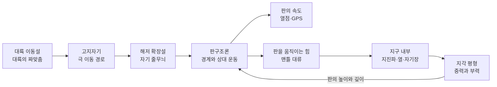

# 일반지구과학 2. 판구조론과 지구 내부 — 움직이는 껍데기와 보이지 않는 속을 숫자로 읽다
<!-- prev: 3-2, esys-1, uearth-1 -->
<!-- next: uearth-3, uearth-5 -->

> [!NOTE]
> **이 단원의 범위**
> - 대륙 이동설에서 해저 확장설, 판구조론으로 — 증거와 논증의 흐름
> - 고지자기와 해저 자기 줄무늬, 판 경계의 세 유형과 지형·지각 변동
> - 열점과 판의 운동 속도 측정, 판을 움직이는 힘과 맨틀 대류
> - 지진파로 본 지구 내부 구조, 지구의 열과 지구 자기장
> - 지각 평형

**학습 목표**

1. 대륙 이동설, 해저 확장설, 판구조론으로 이어진 과정을 각 단계의 증거와 반론, 그것을 해결한 새 관측으로 설명할 수 있다.
2. 고지자기의 원리와 해저 자기 줄무늬를 이용해 해저 확장 속도와 고위도를 계산할 수 있다.
3. 판 경계의 세 유형에서 나타나는 지형, 지진, 화산, 지각 변동을 비교하고, 열점 자취·오일러 극·GPS 자료로 판의 운동 속도를 구할 수 있다.
4. 판을 움직이는 힘의 종류와 크기를 어림하고, 맨틀 대류와의 관계를 설명할 수 있다.
5. 지진파의 속도 변화와 그림자대로 지구 내부 구조를 해석하고, 지구 내부 열의 근원과 지구 자기장의 생성(지구 발전기)을 설명할 수 있다.
6. 에어리 모형과 프랫 모형으로 지각 평형을 설명하고, 산의 뿌리·빙하 후퇴 뒤의 융기 등을 계산할 수 있다.

**이 단원의 학습 사다리**

| 단계 | 무엇을 하나? |
|---|---|
| STEP 1. 이전 학습 다시 보기 | 판의 경계, 해저 확장, 판을 움직이는 힘, 지진파와 그림자대를 다시 꺼낸다 |
| STEP 2. 기초 다지기 | 구면 위의 회전, 속도 벡터의 합성, 자기 쌍극자장과 복각, 부력, 탄성률과 파동 속도, 열전도 |
| STEP 3. 핵심 개념 | 판구조론의 성립 → 고지자기 → 판 경계 → 판 속도 측정 → 판을 움직이는 힘 → 지구 내부 구조 → 열과 자기장 → 지각 평형 |
| STEP 4. 오개념 바로잡기 | "연약권은 녹은 층이다?", "해저 자기 줄무늬는 해령에서 자기장이 바뀌어 생긴다?" |
| STEP 5. 전공 맛보기 | 해양 암석권의 냉각 모형, 레일리 수와 맨틀 대류 |
| STEP 6. 생활·산업·진로 | 위성 측지와 좌표계, 중력 탐사, 지열 에너지, 해저 지형 조사 |

---

## 🗺️ 단원 들어가기

1912년 대륙이 움직인다는 주장이 처음 체계적으로 나왔을 때, 그 주장을 가장 강하게 반대한 사람들은 물리학자들이었다. "단단한 대륙이 단단한 해저를 쟁기처럼 가르며 나아갈 수는 없다." 계산은 옳았다. 대륙은 정말로 해저를 가르며 나아가지 않는다. 그런데도 대륙은 움직인다. 반세기 뒤에 밝혀진 답은 **대륙과 해저가 함께 하나의 판으로 움직인다**는 것이었다.

오늘날 GPS 수신기를 땅에 박아 두면 하와이는 1년에 약 7 cm씩 북서쪽으로, 우리나라는 1년에 약 3 cm씩 동남동쪽으로 움직이는 것이 기록된다. 손톱이 자라는 속도와 비슷하다. 이 단원에서는 판이 움직인다는 사실이 어떤 증거와 계산으로 확립되었는지, 판을 움직이는 힘은 무엇인지, 그리고 아무도 가 본 적 없는 지구의 속을 지진파·열·자기장·중력이라는 네 가지 '창'으로 어떻게 들여다보는지를 정량적으로 살펴본다.

---

## STEP 1. 🔙 이전 학습 다시 보기

### 연계 개념표

| 이전 단원 | 고등학교까지 배운 것 | 대학에서 이렇게 확장된다 |
|---|---|---|
| 통합과학1 「판구조론과 지권의 변화」 '판구조론은 어떻게 탄생했나', '판과 판의 경계' | 대륙 이동설 → 해저 확장설 → 판구조론, 발산·수렴·보존형 경계 | 각 단계의 **반론과 해결**, 경계별 지진 깊이 분포·응력 상태, 삼중점 |
| 통합과학1 「판구조론과 지권의 변화」 '판을 움직이는 에너지' | 맨틀 대류와 지구 내부 에너지 | 판에 작용하는 힘의 **크기 어림**, 대류의 조건 |
| 지구시스템과학 「지구 탄생과 생동하는 지구」 '판구조론의 발달사', '판을 움직이는 힘과 플룸' | 섭입하는 판이 당기는 힘, 해령에서 미는 힘, 플룸과 열점, 열점으로 판의 속도 | **오일러 극**과 구면 위의 판 운동, GPS 벡터, 수심–나이 관계 |
| 지구시스템과학 「지구 탄생과 생동하는 지구」 '지진파로 지구 내부를 보다' | 불연속면, 그림자대, 교차 거리로 지각 두께, 지진파 단층 촬영 | 탄성률로 쓴 지진파 속도, 맨틀 전이대와 고압 광물, 절편 시간으로 지각 두께 |
| 일반지구과학 「지구 시스템과 지구 물질」 '층상 구조', '광물' | 암석권·연약권 구분, 동질 이상, 암석의 밀도 | 지진파 불연속면을 **광물의 상전이**로 해석, 밀도로 **지각 평형** 계산 |

### 준비 운동 (사전 진단)

**Q1.** 해령에서 멀어질수록 해양 지각의 나이와 해저 퇴적물의 두께는 각각 어떻게 변하는가?

**Q2.** 판의 경계 중 화산 활동이 거의 없는 경계는?

**Q3.** 진앙에서 각거리 120° 떨어진 관측소에서는 P파와 S파 중 무엇이 직접 도달하지 않는가?

**Q4.** 물에 뜬 얼음은 전체 부피의 약 몇 %가 물속에 잠기는가? (얼음 밀도 $0.92\ \mathrm{g/cm^3}$, 물 $1.00\ \mathrm{g/cm^3}$)

정답 및 해설

**Q1.** 나이는 많아지고 퇴적물은 두꺼워진다. 오래된 해저일수록 퇴적물이 쌓인 시간이 길기 때문이다.

**Q2.** 보존형 경계(변환 단층). 판이 생기지도 소멸하지도 않아 마그마가 만들어질 조건이 없다.

**Q3.** 둘 다 직접 도달하지 않는다. 120°는 P파 그림자대(약 103°~142°) 안이고, S파 그림자대(약 103° 이상) 안이기도 하다.

**Q4. 약 92 %** — 뜬 물체가 밀어낸 물의 무게 = 물체의 무게이므로 잠긴 부피 비 = 밀도 비 = 0.92이다. 이 원리가 STEP 3 ⑧의 지각 평형으로 이어진다.

---

## STEP 2. 🧱 기초 다지기

### ① 구면 위의 운동 — 오일러 극과 각속도

판은 평면이 아니라 **구면 위의 껍데기**이다. 구면 위의 단단한 조각이 움직이는 모든 운동은 지구 중심을 지나는 어떤 축을 중심으로 한 **회전**으로 나타낼 수 있다(오일러의 정리). 그 축이 지표와 만나는 점을 **오일러 극(Euler pole, 회전극)** 이라 한다. 각속도가 $\omega$일 때 오일러 극에서 각거리 $\Delta$만큼 떨어진 지점의 속력은

$$
v = \omega R \sin\Delta
$$

이다($R$: 지구 반지름). 오일러 극 바로 옆($\Delta \approx 0°$)에서는 거의 움직이지 않고, 극에서 90° 떨어진 '적도'에서 가장 빠르다. 회전하는 레코드판의 가운데와 가장자리 속력이 다른 것과 같다. 그래서 **한 판 안에서도 장소마다 속력이 다르다.**

<!-- fig:uearth-2-euler-pole -->

### ② 속도 벡터의 합성 — GPS 자료 읽기

GPS 관측소는 동쪽 속도 성분 $v_E$와 북쪽 속도 성분 $v_N$을 따로 기록한다. 실제 속력과 방향은 두 성분을 합성해 구한다.

$$
v = \sqrt{v_E^2 + v_N^2}, \qquad \text{방위각(북에서 시계 방향)} = \arctan\frac{v_E}{v_N}
$$

또 두 판의 **상대 속도**는 한 판의 속도에서 다른 판의 속도를 뺀 벡터이다. 경계에서 일어나는 일(벌어짐, 모임, 어긋남)은 절대 속도가 아니라 상대 속도가 정한다.

### ③ 자기 쌍극자장과 복각

지구 자기장은 지구 중심에 놓인 막대자석, 곧 **자기 쌍극자**의 자기장과 비슷하다. 자기장 방향이 수평면과 이루는 각을 **복각(inclination)** $I$라 하면, 쌍극자장에서는 위도 $\lambda$와 다음 관계가 있다.

$$
\tan I = 2\tan\lambda
$$

적도($\lambda = 0°$)에서 복각은 0°(수평), 극($\lambda = 90°$)에서 90°(수직)이다. 이 식은 암석에 기록된 복각에서 그 암석이 생길 때의 **위도(고위도)** 를 거꾸로 구하는 데 쓴다.

### ④ 부력과 뜨는 물체

밀도 $\rho_o$인 물체가 밀도 $\rho_f$인 유체에 떠 있으면 잠긴 깊이의 비율은 $\rho_o/\rho_f$이다. 바닷물($1.025\ \mathrm{g/cm^3}$)에 뜬 빙산($0.917\ \mathrm{g/cm^3}$)은 부피의 약 89 %가 물속에 있다. 지각은 맨틀 위에서 이와 비슷하게 '떠' 있다. 다만 맨틀은 액체가 아니라 아주 긴 시간에 걸쳐 흐르는 고체라서, 평형에 이르는 데 수천~수만 년이 걸린다.

### ⑤ 탄성률과 파동 속도

일반물리학에서 줄의 파동 속력이 $\sqrt{\text{장력}/\text{선밀도}}$였듯, 고체 속 파동의 속력은 '되돌리는 힘의 세기'(탄성률)와 '관성'(밀도)의 비로 정해진다.

$$
v_P = \sqrt{\frac{K + \frac{4}{3}\mu}{\rho}}, \qquad v_S = \sqrt{\frac{\mu}{\rho}}
$$

$K$는 **부피 탄성률**(압축에 대한 저항), $\mu$는 **전단 탄성률**(모양 변화에 대한 저항)이다. 액체는 $\mu = 0$이므로 S파가 없고, P파도 $\sqrt{K/\rho}$로 느려진다. 또 지진파는 경계에서 스넬 법칙 $\dfrac{\sin\theta_1}{v_1} = \dfrac{\sin\theta_2}{v_2}$에 따라 굴절한다.

### ⑥ 열전도 — 열은 온도 기울기를 따라 흐른다

단위 면적을 지나 단위 시간에 흐르는 열을 **열류량(heat flow)** $q$라 하면, 전도에서는 **푸리에 법칙**이 성립한다.

$$
q = k\frac{dT}{dz}
$$

($k$: 열전도도, 암석은 약 $2\sim3\ \mathrm{W/(m\cdot K)}$, $dT/dz$: 지온 기울기) 지구 과학에서 열류량은 보통 $\mathrm{mW/m^2}$ 단위로 쓴다.

---

## STEP 3. 📘 핵심 개념

### ① 대륙 이동설에서 해저 확장설, 판구조론으로

#### (1) 대륙 이동설 — 강한 증거, 약한 메커니즘

베게너는 대륙들이 한때 하나의 초대륙 **판게아(Pangaea)** 를 이루었다가 갈라졌다고 주장했다.

| 증거 | 내용 | 대학 수준의 보충 |
|---|---|---|
| 대륙의 짜맞춤 | 대서양 양쪽 해안선이 잘 맞음 | 해안선보다 **대륙붕 끝(수심 약 1000~2000 m 등심선)** 으로 맞추면 훨씬 잘 맞는다. 대륙의 진짜 가장자리이기 때문이다 |
| 화석 분포 | 민물·육상 파충류(메소사우루스, 리스트로사우루스 등)와 식물(글로소프테리스) 화석이 바다 건너 여러 대륙에서 발견 | 넓은 바다를 건널 수 없는 생물이라는 점이 핵심 |
| 지질 구조의 연속 | 북아메리카 애팔래치아산맥과 영국·스칸디나비아의 산맥이 이어짐 | 암석의 나이와 변형 시기까지 일치 |
| 고기후 | 오늘날 열대·아열대인 인도·아프리카 남부에 고생대 말 빙하 흔적, 극지방에 석탄층 | 빙하 긁힌 자국의 방향이 대륙을 모으면 한 중심에서 퍼져 나감 |

반론의 핵심은 **메커니즘**이었다. 베게너가 제안한 원동력(지구 자전에 따른 원심력, 조석력)은 계산해 보면 대륙을 움직이기에 턱없이 약했다. 또 대륙이 해양 지각을 뚫고 나아간다는 생각은 암석의 강도와 맞지 않았다.

#### (2) 고지자기와 맨틀 대류설 — 1950년대의 부활

1950년대에 암석의 **고지자기**를 측정하자, 같은 대륙의 암석에서 구한 옛 자극의 위치가 시대에 따라 이동한 경로, 곧 **겉보기 극 이동 경로(apparent polar wander path)** 가 나타났다. 자극은 하나뿐일 텐데 유럽과 북아메리카의 경로가 서로 다르게 나왔다. 그런데 **대서양을 닫아 두 대륙을 붙이면 두 경로가 하나로 겹쳤다.** 극이 움직인 것이 아니라 대륙이 움직였다는 강력한 정량적 증거였다. 한편 홈스는 방사성 열로 맨틀이 대류하여 대륙을 움직일 수 있다고 제안했으나, 당시에는 이를 확인할 관측이 없었다.

#### (3) 해저 확장설 — 바다 밑에서 답을 찾다

제2차 세계 대전 이후 음향 측심과 자력 탐사로 해저가 조사되면서 다음 사실이 쌓였다.

- 대양 한가운데에 길이 6만 km가 넘는 **해령**이 이어지고, 꼭대기에 **열곡**이 있으며 열류량이 높다.
- 해양 지각은 어디서도 약 2억 년보다 오래되지 않았고, 퇴적물은 해령에서 얇고 멀어질수록 두껍다.
- 해령과 나란하고 해령을 축으로 **대칭인 자기 줄무늬**가 있다.

헤스와 디츠는 1960년대 초 "해령에서 맨틀 물질이 올라와 새 해양 지각이 되고, 양쪽으로 퍼져 나가 해구에서 다시 맨틀로 들어간다"는 **해저 확장설**을 제안했다. 대륙은 해저를 가르는 것이 아니라 퍼져 나가는 해저 위에 **함께 실려** 움직인다. 1963년 바인–매슈스(와 몰리)는 자기 줄무늬를 해저 확장과 **지구 자기장 역전**의 결합으로 설명해 해저 확장설에 결정적 근거를 제공했다(②에서 계산한다).

#### (4) 판구조론 — 지구 표면 전체를 하나의 이론으로

1965년 윌슨은 해령이 어긋난 부분을 잇는 **변환 단층(transform fault)** 이라는 새로운 경계를 제안했고, 지진의 단층 운동 방향 분석이 그 예측을 확인했다. 1967~1968년 무렵에는 지구 표면을 십여 개의 단단한 판으로 나누고, 판의 운동을 구면 위의 회전으로 기술하는 **판구조론(plate tectonics)** 이 완성되었다. 이후 심해 시추로 얻은 해저 퇴적물 바로 아래 현무암의 나이가 해령에서 멀어질수록 규칙적으로 많아지는 것이 직접 확인되었다.

| 단계 | 핵심 주장 | 결정적 관측 | 남은 문제 |
|---|---|---|---|
| 대륙 이동설 | 대륙이 이동했다 | 짜맞춤, 화석, 지질 구조, 고기후 | 메커니즘 없음 |
| 고지자기 연구 | 대륙이 극에 대해 움직였다 | 대륙마다 다른 극 이동 경로 | 해저는 미지 |
| 해저 확장설 | 해령에서 생기고 해구에서 소멸 | 자기 줄무늬, 해저 나이·열류량 | 지구 전체의 운동 기술 |
| 판구조론 | 단단한 판들이 구면 위에서 상대 회전 | 지진대·변환 단층·진원 분포, 시추 | 판을 움직이는 힘의 크기 |

#### 예제 1 — 남대서양은 얼마나 빨리 열렸을까

남아메리카와 아프리카 사이 남대서양의 폭은 약 5000 km이고, 두 대륙이 갈라지기 시작한 것은 약 1억 3천만 년 전이다. 평균 확장 속도(두 대륙이 멀어지는 속도)를 cm/년으로 구하시오.

**풀이**

$$
v = \frac{5000\ \mathrm{km}}{1.3\times10^{8}\ \text{년}} = \frac{5.0\times10^{8}\ \mathrm{cm}}{1.3\times10^{8}\ \text{년}} \approx 3.8\ \mathrm{cm/년}
$$

1년에 약 4 cm, 사람의 일생 동안 약 3 m이다. 느려 보이지만 지질 시간으로는 대양 하나를 만들 만큼 충분하다. (해령 한쪽 판의 속도, 곧 **반확장 속도**는 그 절반인 약 1.9 cm/년이다.)

#### ✔ 바로 확인

1. 베게너의 대륙 이동설이 받아들여지지 않은 가장 큰 약점은 무엇이었나?
2. (O/X) 해저 확장설에서 대륙은 해양 지각을 뚫고 나아간다.
3. 폭 3000 km인 대양이 1억 년 동안 열렸다면 평균 확장 속도는 몇 cm/년인가?

정답

1. 대륙을 움직이는 메커니즘(원동력)을 설명하지 못했다.
2. X — 대륙은 퍼져 나가는 해저 위에 함께 실려 움직인다.
3. 3 cm/년 — $3.0\times10^{8}\ \mathrm{cm} / 1.0\times10^{8}$년.

### ② 고지자기와 해저 자기 줄무늬

#### (1) 암석은 어떻게 자기장을 기억하나

현무암 속 자철석 같은 자성 광물은 **퀴리 온도**(자철석은 약 580 °C) 위에서는 자성을 잃는다. 용암이 식어 퀴리 온도 아래로 내려가는 순간, 광물 속 자기 구역이 **그때의 지구 자기장 방향**으로 정렬된 채 굳는다. 이것을 **열 잔류 자화(thermoremanent magnetization)** 라 한다. 퇴적암에서는 가라앉는 자성 알갱이가 자기장 방향으로 정렬하여 약한 잔류 자화를 남긴다. 측정하는 양은 두 가지이다.

- **편각**: 잔류 자화가 가리키는 수평 방향 → 옛 자극 방향과 대륙의 **회전**
- **복각**: 수평면과의 각 → $\tan I = 2\tan\lambda$로 **고위도**

#### 예제 2 — 암석의 고위도

어느 대륙의 쥐라기 현무암에서 측정한 잔류 자화의 복각이 30°였다. 이 현무암이 생길 때의 위도를 구하시오. 오늘날 이 지점의 위도가 37°N이라면 지금 측정되는 자기장의 복각은 얼마이며, 무엇을 알 수 있는가?

**풀이**

$$
\tan\lambda = \frac{\tan30°}{2} = \frac{0.577}{2} \approx 0.289 \quad\Rightarrow\quad \lambda \approx 16°
$$

$$
\tan I = 2\tan37° \approx 2\times0.754 = 1.51 \quad\Rightarrow\quad I \approx 56°
$$

이 지점은 쥐라기에 위도 약 16°에 있었고 지금은 37°에 있으므로, 그 뒤 위도로 약 21°(약 2300 km) 북쪽으로 이동했다. 단, 복각은 경도 정보를 주지 않으므로 동서 이동은 알 수 없다.

#### (2) 지구 자기장의 역전과 지자기 연대표

같은 지역의 여러 시대 용암을 측정하면 자기장 방향이 지금과 같은 **정자극기**와 반대인 **역자극기**가 번갈아 나타난다. 용암의 방사성 연대와 결합하여 **지자기 역전 연대표**가 만들어졌다. 가장 최근의 역전은 약 78만 년 전(브뤼느–마투야마 경계)이며, 역전 간격은 수만~수천만 년으로 불규칙하다. 역전이 진행되는 기간은 수천 년 정도로 짧다.

#### (3) 바인–매슈스 가설 — 해저는 테이프 녹음기

해령 축에서 굳는 새 현무암은 그때의 자기장 방향을 기록하고, 해저 확장으로 양쪽으로 갈라져 멀어진다. 그동안 자기장이 역전하면 새로 굳는 현무암은 반대 방향을 기록한다. 그 결과 해령을 축으로 **대칭인 정·역 자화의 띠**가 생기고, 자력계로 측정한 자기장 세기에는 현재 자기장을 강화하는 띠(양의 이상)와 약화하는 띠(음의 이상)가 번갈아 나타난다.

| 관측 | 해석 |
|---|---|
| 줄무늬가 해령과 **나란하다** | 새 지각이 해령 축을 따라 선 모양으로 생긴다 |
| 해령 양쪽이 **거울 대칭** | 양쪽으로 같은 속도로 퍼진다(대체로) |
| 줄무늬 폭의 순서가 육상 용암의 **역전 연대표와 같다** | 줄무늬는 지구 자기장 역전의 시간 기록이다 |
| 해령마다 줄무늬 폭이 다르다 | 확장 속도가 다르다(폭 ∝ 속도) |

<!-- fig:uearth-2-stripes -->

#### 예제 3 — 자기 줄무늬로 반확장 속도 구하기

어느 해령에서 해령 축을 중심으로 하는 정자극기 띠(현재 정자극기)의 바깥 경계가 해령 축에서 양쪽으로 각각 19.5 km 떨어져 있다. 현재 정자극기가 시작된 것이 78만 년 전이라면 반확장 속도와 전확장 속도를 각각 cm/년으로 구하시오. 이 해령은 빠른 해령과 느린 해령 중 어느 쪽에 가까운가?

**풀이**

$$
v_{\text{반}} = \frac{19.5\ \mathrm{km}}{7.8\times10^{5}\ \text{년}} = \frac{1.95\times10^{6}\ \mathrm{cm}}{7.8\times10^{5}\ \text{년}} = 2.5\ \mathrm{cm/년}, \qquad v_{\text{전}} = 5.0\ \mathrm{cm/년}
$$

전확장 속도 5 cm/년은 대서양 중앙 해령(약 2~4 cm/년)보다 빠르고 동태평양 해팽(약 10~15 cm/년)보다 느린 중간 정도이다. 느린 해령은 꼭대기에 깊은 열곡이 있고 지형이 험하며, 빠른 해령은 열곡 없이 완만하게 솟은 모양을 이룬다.

> [!TIP]
> 💡 **비유** — 해령은 양쪽으로 감기는 녹음테이프의 녹음 헤드이다. 헤드(해령 축)에서 그 순간의 '소리'(자기장 방향)가 기록되고, 테이프(해양 지각)는 양쪽으로 감겨 나간다. 테이프 위의 무늬 간격을 재면 감긴 속도를 알 수 있다.

<!-- sim:u-seafloor-spreading -->

#### ✔ 바로 확인

1. 빈칸: 용암이 식어 (    ) 온도 아래로 내려가면 그때의 자기장 방향이 기록된다.
2. (O/X) 복각으로 암석이 생긴 당시의 경도도 알 수 있다.
3. 복각이 0°인 암석은 어느 위도에서 생겼는가?
4. 해령 양쪽 자기 줄무늬가 거울 대칭인 까닭을 한 줄로 쓰시오.

정답

1. 퀴리 — 자철석은 약 580 °C이다.
2. X — 복각은 위도만 알려 준다($\tan I = 2\tan\lambda$).
3. 적도(위도 0°) — $\tan\lambda = \tan 0°/2 = 0$.
4. 해령 축에서 생긴 지각이 양쪽으로 같은 속도로 퍼져 나가기 때문이다.

### ③ 판 경계의 세 유형과 지형·지각 변동

#### (1) 판 경계 한눈에 보기

| 유형 | 상대 운동 | 대표 지형 | 지진 | 화산 | 응력·단층 |
|---|---|---|---|---|---|
| **발산형** | 멀어짐 | 해령(열곡), 대륙 열곡대 | 얕은 지진(약 20 km 이내) | 현무암질(감압 용융) | 장력, 정단층 |
| **수렴형 — 섭입** | 모임, 한 판이 아래로 | 해구, 호상 열도, 대륙 연변 산맥 | 얕은 곳~약 700 km, 경사진 진원대 | 안산암질 위주(물 공급 용융) | 압축, 역단층·충상 단층 |
| **수렴형 — 충돌** | 대륙끼리 모임 | 거대한 습곡 산맥, 고원 | 얕은~중간 깊이, 넓은 지역 | 거의 없음 | 압축, 습곡·충상 단층 |
| **보존형** | 어긋남 | 변환 단층, 단열대 | 얕은 지진 | 거의 없음 | 전단, 주향 이동 단층 |

<!-- fig:uearth-2-plate-map -->

#### (2) 발산형 경계 — 대륙이 갈라져 대양이 되기까지

1. **대륙 열곡**: 대륙 암석권이 늘어나며 얇아지고 정단층으로 가운데가 내려앉아 열곡이 생긴다(동아프리카 열곡대).
2. **좁은 바다**: 열곡이 더 벌어지면 바닷물이 들어오고 해양 지각이 생기기 시작한다(홍해).
3. **대양**: 해저 확장이 계속되어 넓은 대양과 해령이 생긴다(대서양).

<!-- fig:uearth-2-rift-stages -->

해령은 주변 해저보다 2~3 km 높다. 해령 아래 암석권이 **뜨거워 밀도가 작고 부피가 크기** 때문이다. 해양 암석권은 해령에서 멀어지며 식어서 두꺼워지고 무거워져 가라앉는다. 그래서 해저의 수심은 해양 지각의 나이와 다음 관계를 대략 따른다(나이 약 8000만 년까지 잘 맞음).

$$
d(t) \approx 2500 + 350\sqrt{t}\quad(\mathrm{m},\ t:\ \text{백만 년})
$$

#### 예제 4 — 해저의 나이로 수심 어림하기

위 관계를 써서 나이가 0, 16, 64백만 년인 해저의 수심을 구하시오. 수심이 $\sqrt{t}$에 비례해 깊어지는 까닭을 설명하시오.

**풀이**

$$
d(0) = 2500\ \mathrm{m}, \quad d(16) = 2500 + 350\times4 = 3900\ \mathrm{m}, \quad d(64) = 2500 + 350\times8 = 5300\ \mathrm{m}
$$

해양 암석권은 위에서부터 열을 전도로 잃으며 식는다. 전도로 식는 층의 두께는 $\sqrt{\kappa t}$($\kappa$: 열확산도)에 비례하여 자라므로(STEP 5에서 다시), 수축하며 가라앉는 양도 $\sqrt{t}$에 비례한다. 해저 지형 자체가 **판이 식어 가는 기록**인 셈이다.

#### (3) 수렴형 경계 — 섭입대와 충돌대

**섭입대**에서는 무거운 해양판이 다른 판 아래로 들어간다. 섭입하는 판을 따라 진원이 경사진 면을 이루며 깊어지는데, 이를 **와다티–베니오프대**라 한다. 진원 깊이는 해구에서 대륙 쪽으로 갈수록 깊어지고 최대 약 700 km에 이른다. 섭입하는 판에서 약 100 km 깊이 부근에 이르면 함수 광물에서 물이 빠져나와 위쪽 맨틀 쐐기의 녹는점을 낮추어 마그마가 생기고, 해구와 나란한 **화산호**가 만들어진다.

<!-- fig:uearth-2-subduction -->

| 섭입 유형 | 예 | 특징 |
|---|---|---|
| 해양판–해양판 | 마리아나, 알류샨 | 해구 + 호상 열도, 호 뒤쪽에 **배호 분지**가 생기기도 함 |
| 해양판–대륙판 | 안데스, 일본(일부) | 해구 + 대륙 연변 화산 산맥, 큰 화강암체 |
| 대륙판–대륙판(충돌) | 히말라야–티베트, 알프스 | 대륙 지각은 가벼워 섭입하지 못하고 겹겹이 쌓여 두꺼워짐 |

동해는 일본 열도가 아시아 대륙에서 떨어져 나가며 약 2000만~1500만 년 전 무렵 열린 배호 분지로 해석된다.

#### (4) 보존형 경계 — 변환 단층과 단열대

해령은 직선이 아니라 수십~수백 km마다 어긋나 있다. 어긋난 두 해령 끝 사이의 구간에서는 양쪽 판이 반대 방향으로 미끄러져 지진이 일어나는 **변환 단층**이 된다. 그 바깥 구간은 같은 판끼리 같은 방향으로 움직이므로 지진이 거의 없고, 나이 차이로 생긴 높이 차이만 흉터처럼 남는데 이를 **단열대(fracture zone)** 라 한다. 육지에서는 북아메리카판과 태평양판 사이의 산안드레아스 단층이 대표적인 변환 단층이다.

> [!IMPORTANT]
> 변환 단층의 지진 분포는 **해령과 해령 사이에만** 나타난다. 이 예측은 해령이 원래 하나였다가 단순히 어긋난 것(그렇다면 단층 전체에서 지진)이라는 생각과 반대이며, 지진의 단층면 해석으로 판구조론의 예측이 맞다는 것이 확인되었다.

<!-- fig:uearth-2-transform -->

#### ✔ 바로 확인

1. 짝짓기: 해령, 해구, 변환 단층을 발산형, 수렴형, 보존형 경계와 짝지으시오.
2. (O/X) 섭입대의 화산호는 섭입판이 깊이 약 100 km에 이른 곳 위에 생긴다.
3. 단열대에서 지진이 거의 일어나지 않는 까닭은?
4. $d \approx 2500 + 350\sqrt{t}$에서 나이 25백만 년인 해저의 수심은?

정답

1. 해령–발산형, 해구–수렴형, 변환 단층–보존형.
2. O — 그곳에서 판에서 빠져나온 물이 맨틀 쐐기를 녹인다.
3. 단층 양쪽이 같은 판이라 같은 방향으로 움직이기 때문이다.
4. 4250 m — $2500 + 350\times5$.

### ④ 열점과 판의 운동 속도 측정

#### (1) 측정 방법

| 방법 | 무엇을 재나 | 시간 범위 |
|---|---|---|
| 해저 자기 줄무늬 | 해령에서의 상대 확장 속도 | 수백만 년 평균 |
| 변환 단층의 방향 | 상대 운동의 방향(변환 단층은 상대 운동과 나란함) | 수백만 년 |
| 지진의 단층면 해(미끄러짐 방향) | 경계에서의 상대 운동 방향 | 현재 |
| 열점 자취 | 열점(맨틀)에 대한 판의 '절대' 운동 | 수천만 년 |
| 위성 측지(GPS 등), 초장기선 전파 간섭계(VLBI), 위성 레이저 거리 측정 | 관측소의 실제 이동 | 수년~수십 년 |

지질학적 방법(수백만 년 평균)으로 구한 판 속도와 위성 측지(수십 년)로 구한 속도가 대부분 잘 일치한다. 이는 판 운동이 수백만 년 동안 **거의 일정한 속도로** 계속되어 왔다는 뜻이다.

#### (2) 열점과 절대 운동

맨틀 깊은 곳의 플룸이 만든 **열점(hot spot)** 은 판보다 훨씬 천천히 움직이므로, 열점 위를 지나간 판에 남는 화산섬·해산의 줄(**열점 자취**)로 판의 운동을 잴 수 있다. 화산섬의 나이는 열점에서 멀어질수록 많아지고, 오래된 섬일수록 침식되고 식어 가라앉아 해산이 된다. 다만 열점들끼리도 1년에 수 mm~1 cm 정도 서로 움직인다는 증거가 있어, 열점 기준틀은 '대략적인' 절대 기준이다.

<!-- fig:uearth-2-hawaii -->

#### 예제 5 — 오일러 극으로 판의 속도 구하기

어느 판이 오일러 극을 중심으로 백만 년에 0.50°의 각속도로 회전한다. 오일러 극에서 각거리 30°, 60°, 90°인 지점의 속력을 각각 cm/년으로 구하시오($R = 6371\ \mathrm{km}$).

**풀이**

① 각속도를 라디안으로: $\omega = 0.50° = 8.73\times10^{-3}\ \mathrm{rad}$ / 백만 년

② $\omega R = 8.73\times10^{-3}\times6.371\times10^{8}\ \mathrm{cm} \approx 5.56\times10^{6}\ \mathrm{cm}$ / 백만 년 $= 5.56\ \mathrm{cm/년}$

③ $v = \omega R\sin\Delta$:

| $\Delta$ | 30° | 60° | 90° |
|---|---|---|---|
| $v$(cm/년) | 2.8 | 4.8 | 5.6 |

같은 판 위에서도 속도가 2배 차이 난다. 해령의 확장 속도가 해령을 따라 달라지는 까닭이며, 판 운동을 '하나의 속도'가 아니라 '회전'으로 기술해야 하는 이유이다.

#### 예제 6 — GPS 관측소의 속도

어느 GPS 관측소가 10년 동안 동쪽으로 30 cm, 북쪽으로 40 cm 움직였다. 이 관측소의 평균 속력과 이동 방위각을 구하시오.

**풀이**

$v_E = 3.0\ \mathrm{cm/년}$, $v_N = 4.0\ \mathrm{cm/년}$

$$
v = \sqrt{3.0^2 + 4.0^2} = 5.0\ \mathrm{cm/년}, \qquad \arctan\frac{3.0}{4.0} \approx 37°
$$

북쪽에서 동쪽으로 약 37° 기운 방향(북동쪽)으로 연간 5.0 cm 움직인다. 지진이 일어나면 관측소가 순간적으로 크게 움직이므로, 판의 꾸준한 운동을 구할 때는 지진에 따른 순간 변위를 따로 빼 주어야 한다.

<!-- fig:uearth-2-q-gps-vector -->

#### ✔ 바로 확인

1. (O/X) 열점 자취의 화산은 열점에서 멀어질수록 나이가 많다.
2. 오일러 극에서 각거리 90°인 지점과 30°인 지점의 속력 비는?
3. GPS 관측소가 동쪽으로 연 4.0 cm, 북쪽으로 연 3.0 cm 움직인다. 속력은?

정답

1. O — 판이 열점 위를 지나가며 화산이 차례로 생기기 때문이다.
2. 2 : 1 — $v \propto \sin\Delta$이고 $\sin90° : \sin30° = 1 : 0.5$.
3. 5.0 cm/년 — $\sqrt{4.0^2 + 3.0^2}$.

### ⑤ 판을 움직이는 힘과 맨틀 대류

#### (1) 판에 작용하는 힘

| 힘 | 원리 | 대략의 크기(경계 길이 1 m당) |
|---|---|---|
| **섭입하는 판이 당기는 힘**(slab pull) | 식어 주변 맨틀보다 무거워진 판이 가라앉으며 당김 | 약 $10^{13}$ N/m 자릿수(대부분은 맨틀 저항과 상쇄) |
| **해령에서 미는 힘**(ridge push) | 높이 솟은 뜨거운 해령이 중력으로 양옆으로 미끄러짐. 사실은 판 전체에 퍼진 '높이 차의 압력' | 약 $2\sim3\times10^{12}$ N/m |
| 섭입판 흡입력(slab suction) | 가라앉는 판이 만든 맨틀 흐름이 위쪽 판을 해구 쪽으로 끔 | 작음 |
| 판 밑면의 끌림 | 판과 연약권의 상대 운동 | 대개 저항, 일부는 구동 |
| 섭입대 마찰, 변환 단층 마찰, 충돌 저항 | 경계의 마찰 | 저항 |

통계적으로 섭입대에 붙어 있는 둘레의 비율이 큰 판(태평양판, 나스카판, 코코스판)이 연 5~10 cm 이상으로 빠르고, 섭입대가 거의 없는 판(유라시아판, 아프리카판)은 연 1~2 cm 정도로 느리다. 대륙이 큰 판이 느린 경향도 있는데, 두꺼운 대륙 암석권의 뿌리가 저항을 키우기 때문으로 해석한다.

#### 예제 7 — 섭입하는 판이 당기는 힘 어림하기

두께 100 km인 섭입판이 맨틀 속으로 600 km 길이만큼 들어가 있다. 판과 주변 맨틀의 평균 밀도 차이가 약 $80\ \mathrm{kg/m^3}$라면, 해구 길이 1 m당 판에 작용하는 알짜 중력(음의 부력)의 크기를 어림하시오($g = 9.8\ \mathrm{m/s^2}$). 해령에서 미는 힘(약 $3\times10^{12}\ \mathrm{N/m}$)과 비교하시오.

**풀이**

해구 길이 1 m당 가라앉은 판의 부피는 $1.0\times10^{5}\ \mathrm{m}\times6.0\times10^{5}\ \mathrm{m}\times1\ \mathrm{m}$이다.

$$
F = \Delta\rho\, g\, h\, L = 80\times9.8\times(1.0\times10^{5})\times(6.0\times10^{5}) \approx 4.7\times10^{13}\ \mathrm{N/m}
$$

해령에서 미는 힘보다 한 자릿수 이상 크다. 실제로는 이 힘의 대부분이 가라앉는 판 주위 맨틀의 점성 저항과 섭입대 마찰로 상쇄되고 일부만 판을 당기는 데 쓰이지만, 섭입이 판 운동의 주된 동력이라는 해석을 뒷받침한다. (밀도 차이는 판의 온도 구조에 따라 달라지는 '약' 값이다.)

#### (2) 맨틀 대류와 판의 관계

맨틀은 고체이지만 수백만 년 규모에서 점성 유체처럼 흐른다(점성도 약 $10^{21}$ Pa·s 자릿수). 아래에서 데워지고 위에서 식는 두꺼운 유체층에서는 부력이 점성과 열 확산을 이기면 대류가 일어난다. 오늘날 이해는 다음과 같다.

- **판은 맨틀 대류의 차가운 윗경계층 그 자체이다.** 판이 식어 무거워져 섭입하는 것이 대류의 하강류이다.
- **상승류는 두 종류이다.** 해령 아래의 상승은 판이 벌어져서 생기는 **수동적** 상승(얕은 곳)이고, 플룸은 맨틀–핵 경계 부근에서 시작하는 **능동적** 상승이다.
- 지진파 단층 촬영에서 섭입판이 660 km 불연속면 부근에 잠시 머물다 하부 맨틀로 떨어지는 모습이 보여, 상부와 하부 맨틀이 완전히 분리되지 않은 **전 맨틀 대류**에 가깝다고 본다(세부는 연구 중).

> [!TIP]
> 💡 **비유** — 냄비의 된장국을 끓이면 표면에 얇은 막이 생기고, 막이 식어 가장자리에서 가라앉으며 국 전체를 휘젓는다. 판은 '뜨거운 국 위에 떠다니는 막'이 아니라 '가라앉으며 국을 휘젓는 막'이다.

#### ✔ 바로 확인

1. 판을 움직이는 힘 가운데 가장 큰 것으로 여겨지는 힘의 이름은?
2. (O/X) 판은 맨틀 대류 위에 수동적으로 떠다니는 뗏목일 뿐이다.
3. 섭입대를 많이 가진 판과 거의 없는 판 중 대체로 어느 쪽이 빠른가?

정답

1. 섭입하는 판이 당기는 힘(slab pull).
2. X — 판은 맨틀 대류의 차가운 윗경계층 그 자체이며, 가라앉으며 대류를 일으킨다.
3. 섭입대를 많이 가진 판(태평양판, 나스카판 등).

### ⑥ 지진파로 본 지구 내부 구조

#### (1) 지진파 속도는 무엇을 말하나

지진파 속도는 STEP 2 ⑤의 식처럼 매질의 **탄성률과 밀도**로 정해진다. 깊어질수록 압력이 커져 밀도도 커지지만, 탄성률이 그보다 더 빨리 커지므로 지구 내부에서 지진파는 대체로 깊을수록 빨라진다. 그래서 지진파의 경로는 아래로 볼록하게 휘어 다시 지표로 돌아온다. 반대로 같은 깊이에서 속도가 주변보다 느린 곳은 온도가 높거나(탄성률 감소) 액체가 조금 섞인 곳으로 해석한다. 속도가 **갑자기** 바뀌는 깊이에서는 조성이나 상태, 결정 구조가 바뀐다.

#### 예제 8 — 탄성률로 맨틀의 지진파 속도 구하기

최상부 맨틀 암석의 부피 탄성률 $K = 130\ \mathrm{GPa}$, 전단 탄성률 $\mu = 70\ \mathrm{GPa}$, 밀도 $\rho = 3300\ \mathrm{kg/m^3}$라 하자. P파와 S파 속도를 구하시오. 외핵의 $K \approx 650\ \mathrm{GPa}$, $\rho \approx 1.0\times10^{4}\ \mathrm{kg/m^3}$, $\mu = 0$일 때의 P파 속도와 비교하시오.

**풀이**

$$
v_P = \sqrt{\frac{130\times10^9 + \frac{4}{3}\times70\times10^9}{3300}} \approx 8.2\times10^{3}\ \mathrm{m/s}, \qquad v_S = \sqrt{\frac{70\times10^9}{3300}} \approx 4.6\times10^{3}\ \mathrm{m/s}
$$

$$
v_P(\text{외핵}) = \sqrt{\frac{650\times10^9}{1.0\times10^4}} \approx 8.1\times10^{3}\ \mathrm{m/s}
$$

최상부 맨틀의 P파 약 8.2 km/s, S파 약 4.6 km/s는 실제 관측값과 비슷하다. 외핵은 압력이 커서 $K$가 매우 크지만 $\mu = 0$이므로 S파가 없고, P파도 바로 위 최하부 맨틀(약 13.7 km/s)보다 크게 느린 약 8 km/s가 된다. 이 **급감**이 P파 그림자대를 만든다.

#### (2) 깊이에 따른 구조와 불연속면

| 깊이(약) | 경계·층 | 지진파의 특징 | 해석 |
|---|---|---|---|
| 5~70 km | 모호면 | P파 약 6~7 → 약 8 km/s로 증가 | 지각(현무암·화강암질) → 맨틀(감람암), **조성 경계** |
| 약 100~250 km | 저속도층 | 속도가 약간 감소, 감쇠 큼 | 녹는점에 가까운 연약권(극히 일부 부분 용융 가능) |
| 410 km | 410 km 불연속면 | 속도 급증 | 감람석이 더 치밀한 구조(와즐리아이트)로 바뀌는 **상전이** |
| 660 km | 660 km 불연속면 | 속도 급증 | 링우다이트 → 브리지머나이트 + 페리클레이스(**상전이**), 상부·하부 맨틀 경계 |
| 약 2600~2891 km | D″층 | 속도가 불균질, 거대한 저속도 영역 | 맨틀–핵 경계의 열경계층, 플룸의 뿌리 |
| 2891 km | 맨틀–핵 경계(구텐베르크 불연속면) | P파 급감, S파 사라짐 | 고체 규산염 → 액체 철, **조성·상태 경계** |
| 5150 km | 내핵 경계(레만 불연속면) | P파 증가, 내핵에서 약한 S파(변환파) | 액체 → 고체 철 |

**조성 경계**(모호면, 맨틀–핵 경계)와 **상전이 경계**(410, 660 km)를 구별하자. 410·660 km 불연속면은 맨틀 조성이 바뀌는 것이 아니라 같은 조성의 광물이 압력 때문에 더 치밀한 구조로 바뀌는 곳이다. 「지구 시스템과 지구 물질」의 동질 이상이 지구 규모로 나타난 것이다.

#### (3) 그림자대와 주시 곡선

진앙에서 각거리 약 103°까지는 P파와 S파가 맨틀만 지나 직접 도달한다. 외핵에서 P파 속도가 급감하면 P파가 안쪽으로 크게 굴절하여 약 103°~142°에는 직접 P파가 도달하지 않는다(**P파 그림자대**). S파는 액체 외핵을 지나지 못해 약 103° 이상 전체에서 직접 S파가 없다(**S파 그림자대**). 1936년 레만은 P파 그림자대 안에서 약한 P파가 관측되는 것을 단단한 내핵에서의 굴절로 설명했다.

<!-- fig:uearth-2-velocity-shadow -->

각 관측소의 도착 시간을 진앙 거리에 대해 그린 **주시 곡선(travel-time curve)** 에서 기울기는 그 거리에서 지진파가 지표를 따라 지나가는 겉보기 속도의 역수이다. 전 세계 수십만 개의 주시 자료에서 깊이별 속도를 거꾸로 구하는 작업(역산)으로 표준 지구 모형이 만들어졌다.

#### (4) 굴절법으로 지각 두께 구하기 — 절편 시간

「지구 탄생과 생동하는 지구」에서는 교차 거리로 지각 두께를 구했다. 주시 곡선의 굴절파 직선을 거리 0까지 연장해 세로축과 만나는 시간, 곧 **절편 시간** $t_i$로도 구할 수 있다. 굴절파는 모호면에 임계각 $\theta_c$($\sin\theta_c = v_1/v_2$)로 내려갔다 올라오므로 도착 시간은

$$
t = \frac{x}{v_2} + \frac{2h\cos\theta_c}{v_1} \quad\Rightarrow\quad t_i = \frac{2h\cos\theta_c}{v_1} = \frac{2h\sqrt{v_2^2 - v_1^2}}{v_1 v_2}
$$

이다. 따라서

$$
h = \frac{t_i\, v_1 v_2}{2\sqrt{v_2^2 - v_1^2}}
$$

<!-- fig:uearth-2-refraction -->

#### 예제 9 — 절편 시간으로 지각 두께 구하기

어느 지역의 굴절파 주시 곡선에서 $v_1 = 6.0\ \mathrm{km/s}$, $v_2 = 8.0\ \mathrm{km/s}$, 절편 시간 $t_i = 5.3\ \mathrm{s}$를 얻었다. 임계각과 지각의 두께, 교차 거리를 구하시오.

**풀이**

$$
\theta_c = \arcsin\frac{6.0}{8.0} \approx 48.6°
$$

$$
h = \frac{5.3\times6.0\times8.0}{2\sqrt{8.0^2 - 6.0^2}} = \frac{254.4}{2\times5.29} \approx 24\ \mathrm{km}
$$

교차 거리는 $x_c = 2h\sqrt{\dfrac{v_2+v_1}{v_2-v_1}} = 2\times24.0\times\sqrt{7} \approx 1.3\times10^{2}\ \mathrm{km}$이다. 절편 시간과 교차 거리는 같은 정보를 다른 방식으로 읽는 것이므로, 두 방법의 결과가 일치하는지 확인하면 해석을 검증할 수 있다.

#### ✔ 바로 확인

1. 전단 탄성률이 $\mu = 0$인 매질(액체)을 지나지 못하는 지진파는?
2. 빈칸: 410 km, 660 km 불연속면은 조성 경계가 아니라 (    ) 경계이다.
3. (O/X) S파 그림자대는 진앙 거리 약 103°~142°에만 나타난다.
4. $v_1 = 6.0$, $v_2 = 8.0$ km/s일 때 임계각은?

정답

1. S파 — 전단 탄성률이 0인 액체를 지나지 못한다.
2. 상전이 — 같은 조성의 광물이 압력 때문에 더 치밀한 구조로 바뀐다.
3. X — S파는 외핵을 지나지 못해 약 103° 너머 전체가 그림자대이다.
4. 약 48.6° — $\sin\theta_c = 6.0/8.0$.

### ⑦ 지구의 열과 지구 자기장

#### (1) 지구 내부 열의 근원과 흐름

| 열의 근원 | 내용 |
|---|---|
| 원시 열(축적열) | 미행성 충돌, 핵 형성 때 중력 위치 에너지가 바뀐 열이 아직 남아 있음 |
| 방사성 붕괴열 | $^{238}\mathrm{U}$, $^{235}\mathrm{U}$, $^{232}\mathrm{Th}$, $^{40}\mathrm{K}$의 붕괴. 대륙 지각(특히 화강암)에 많이 모여 있음 |
| 내핵의 결정화 | 외핵이 식으며 내핵이 자랄 때 나오는 숨은열(잠열)과 가벼운 원소의 분리 |

지구 표면 전체에서 빠져나가는 열은 약 47 TW($4.7\times10^{13}$ W)로 추정되며, 그중 방사성 붕괴열이 약 절반을 차지한다고 본다(지구 중성미자 관측 등으로 연구 중이며 불확실성이 크다). 나머지는 지구가 천천히 식으며 내놓는 열이다.

| 지역 | 평균 열류량(약) | 까닭 |
|---|---|---|
| 해양 | 약 100 $\mathrm{mW/m^2}$ | 젊은 해양 암석권이 식는 열, 해령 부근은 매우 높음 |
| 대륙 | 약 65 $\mathrm{mW/m^2}$ | 상당 부분이 지각 속 방사성 원소의 열 |
| 지구 평균 | 약 90 $\mathrm{mW/m^2}$ | — |

열은 암석권에서는 주로 **전도**로, 맨틀과 외핵에서는 주로 **대류**로 이동한다. 그래서 지온 기울기는 지각에서 크고(약 25~30 °C/km) 대류하는 맨틀에서는 매우 작다(단열 기울기 약 0.3~0.5 °C/km).

#### 예제 10 — 열류량 계산

열전도도 $2.5\ \mathrm{W/(m\cdot K)}$인 대륙 지각에서 지온 기울기가 25 °C/km이다. 열류량을 $\mathrm{mW/m^2}$로 구하시오. 또 지구 전체 열 방출 47 TW를 지구 표면적으로 나누어 평균 열류량을 구하고 비교하시오($R = 6.371\times10^{6}\ \mathrm{m}$).

**풀이**

$$
q = k\frac{dT}{dz} = 2.5\times\frac{25\ \mathrm{K}}{1000\ \mathrm{m}} = 6.25\times10^{-2}\ \mathrm{W/m^2} \approx 63\ \mathrm{mW/m^2}
$$

$$
\bar q = \frac{4.7\times10^{13}}{4\pi(6.371\times10^{6})^2} = \frac{4.7\times10^{13}}{5.10\times10^{14}} \approx 92\ \mathrm{mW/m^2}
$$

대륙 값은 전 지구 평균보다 작다. 전 지구 평균을 끌어올리는 것은 젊은 해양 암석권이 식으며 내는 큰 열이다. 즉, **지구는 주로 해저 확장과 섭입을 통해 열을 잃는다.** 판 운동이 곧 지구의 냉각 방식이다.

#### (2) 지구 자기장과 지구 발전기

| 특징 | 내용 |
|---|---|
| 모양 | 지표에서 약 90 %가 쌍극자장. 쌍극자 축이 자전축과 약 10° 기울어짐 |
| 세기 | 지표에서 약 25 μT(적도 부근)~65 μT(극 부근) |
| 영년 변화 | 수년~수백 년에 걸쳐 방향·세기가 조금씩 변하고, 일부 무늬는 서쪽으로 이동 |
| 역전 | 불규칙한 간격으로 극성이 뒤바뀜 |
| 자기권 | 태양풍의 대전 입자를 막아 대기와 생명을 보호 |

자기장의 근원은 영구 자석이 될 수 없다. 지구 내부 온도가 자성 광물의 퀴리 온도보다 훨씬 높고, 영구 자석이었다면 역전이나 영년 변화가 설명되지 않는다. 오늘날 받아들여지는 설명은 **지구 발전기(geodynamo)** 이다.

1. 액체 철로 된 외핵이 열과 조성(내핵 결정화로 남는 가벼운 원소)의 부력으로 **대류**한다.
2. 지구 자전의 코리올리 효과가 대류를 나선형 기둥 모양으로 만든다.
3. 전기 전도체(액체 철)가 이미 있는 자기장 속을 움직이면 전류가 유도되고(패러데이 법칙), 그 전류가 다시 자기장을 만들어 **스스로를 유지한다.**

이 과정은 비선형이라 쌍극자장이 가끔 불안정해져 역전이 일어난다. 컴퓨터 모의실험에서도 자발적인 역전이 재현된다.

#### ✔ 바로 확인

1. (O/X) 지구 내부 열은 모두 방사성 원소의 붕괴에서 나온다.
2. 열전도도 3.0 W/(m·K), 지온 기울기 20 °C/km일 때 열류량은 몇 $\mathrm{mW/m^2}$인가?
3. 지구 발전기가 작동하는 데 필요한 조건 두 가지를 쓰시오.

정답

1. X — 원시 열(축적열)과 내핵의 결정화 열도 있다. 방사성 붕괴열은 약 절반으로 본다.
2. 60 — $3.0\times0.020\ \mathrm{K/m} = 0.060\ \mathrm{W/m^2}$.
3. 전기 전도체인 액체 철의 대류, 지구 자전(코리올리 효과) — 이미 있는 자기장도 필요하다.

### ⑧ 지각 평형

#### (1) 지각 평형이란

19세기 중엽 인도에서 측량하던 사람들은 히말라야산맥이 추를 끌어당기는 양이 산의 질량으로 계산한 값보다 훨씬 작다는 것을 발견했다. 산 아래에 **질량이 부족한 부분**, 곧 가벼운 뿌리가 있다는 뜻이었다. 지각이 맨틀 위에 떠서 부력과 중력이 균형을 이룬 상태를 **지각 평형(isostasy)** 이라 한다. 지각 평형 상태에서는 어떤 깊이(**보상 깊이**) 아래에서 압력이 어디서나 같다. 곧 보상 깊이 위 기둥들의 단위 면적당 질량이 모두 같다.

| 모형 | 가정 | 산이 높은 까닭 | 비유 |
|---|---|---|---|
| **에어리 모형** | 지각 밀도는 일정, 두께가 다름 | 지각이 두꺼워 **뿌리**가 깊다 | 두께가 다른 같은 나무토막들이 물에 뜬 모습 |
| **프랫 모형** | 보상 깊이까지 바닥이 같고 밀도가 다름 | 그 아래 기둥의 **밀도가 작다** | 같은 깊이까지 잠긴 서로 다른 재질의 토막들 |

실제 지구에서 대륙과 산맥은 에어리 모형에 가깝고(두꺼운 지각 뿌리가 지진파로 확인됨), 해령은 뜨거워 밀도가 작은 맨틀 때문에 높으므로 프랫 모형에 가깝다.

<!-- fig:uearth-2-airy-pratt -->

#### (2) 에어리 모형의 식

높이 $h$인 산 아래 뿌리의 깊이를 $r$이라 하자. 보상 깊이에서 산 아래 기둥(지각 $h + T + r$)과 기준 기둥(지각 $T$ + 맨틀 $r$)의 압력이 같아야 한다.

$$
\rho_c(h + T + r) = \rho_c T + \rho_m r \quad\Rightarrow\quad r = \frac{\rho_c}{\rho_m - \rho_c}\,h
$$

$\rho_c = 2800$, $\rho_m = 3300\ \mathrm{kg/m^3}$이면 $r \approx 5.6h$이다. 산은 높이의 5~6배 깊이의 뿌리를 가진다.

#### 예제 11 — 산의 뿌리와 빙하 후퇴 뒤의 융기

(1) 평균 고도 3.0 km인 고원 아래 지각 뿌리의 깊이를 구하시오($\rho_c = 2800$, $\rho_m = 3300\ \mathrm{kg/m^3}$). 기준 지각 두께가 35 km라면 고원 아래 지각의 전체 두께는?
(2) 마지막 빙기에 두께 2.0 km의 빙상($\rho_i = 917\ \mathrm{kg/m^3}$)이 덮었던 지역은 평형 상태에서 얼마나 가라앉았겠는가? 빙상이 녹은 뒤에는 어떤 일이 일어나는가?

**풀이**

(1)

$$
r = \frac{2800}{3300 - 2800}\times3.0 = 5.6\times3.0 = 16.8\ \mathrm{km}
$$

전체 두께 $= 3.0 + 35 + 16.8 \approx 55\ \mathrm{km}$

(2) 얼음의 하중을 맨틀이 밀려나 보상한다고 보면 $\rho_i H = \rho_m d$이다.

$$
d = \frac{917\times2.0}{3300} \approx 0.56\ \mathrm{km}
$$

약 560 m 가라앉았다. 얼음이 녹으면 하중이 사라져 땅이 다시 솟아오른다. 맨틀의 점성 때문에 융기는 수천 년에 걸쳐 천천히 일어나며, 스칸디나비아와 캐나다 허드슨만 주변은 지금도 1년에 최대 약 1 cm씩 솟아오르고 있다. 이 융기 속도 자료로 **맨틀의 점성도**를 구한다.

#### (3) 침식과 융기 — 산은 왜 쉽게 사라지지 않나

산의 꼭대기가 침식으로 깎이면 하중이 줄어 지각 평형에 따라 땅 전체가 솟아오른다. 두께 $e$를 깎아 내면 지각이 $e\,\rho_c/\rho_m$만큼 다시 떠오르므로, 평균 고도는 $e(1 - \rho_c/\rho_m)$만큼만 낮아진다. $\rho_c/\rho_m \approx 0.85$이면 **암석 1 km를 깎아도 평균 고도는 약 150 m만 낮아진다.** 평균 고도를 1 km 낮추려면 약 6.6 km를 깎아 내야 한다. 깊은 곳에서 만들어진 변성암과 화강암이 산맥 한가운데 드러나는 것은 이렇게 침식과 융기가 오랫동안 함께 일어났기 때문이다.

<!-- sim:u-isostasy -->

#### (4) 중력 이상 — 지각 평형을 확인하는 방법

측정한 중력에서 위도·고도 효과를 보정한 뒤 남는 차이를 **중력 이상**이라 한다. 지형의 질량까지 보정한 **부게 이상**은 큰 산맥 위에서 크게 음(−)이 되는데, 산 아래에 가벼운 뿌리가 있기 때문이다. 고도만 보정한 **프리에어 이상**은 지각 평형을 이룬 넓은 지역에서 0에 가깝다. 반대로 해구처럼 판이 아래로 끌려 내려가 평형을 벗어난 곳에서는 큰 프리에어 이상이 나타난다.

> [!IMPORTANT]
> 지각 평형은 **넓은 지역(수십~수백 km 이상)** 과 **긴 시간**에서 성립한다. 작은 산 하나는 암석권의 강도로 떠받쳐질 수 있다. 판구조론에서 암석권이 '단단하다'는 말과 지각 평형이 '뜬다'는 말은 서로 다른 공간 규모의 이야기이다.

#### ✔ 바로 확인

1. 빈칸: 에어리 모형에서 산이 높은 것은 지각이 두꺼워 깊은 (    )가 있기 때문이다.
2. $\rho_c = 2800$, $\rho_m = 3300\ \mathrm{kg/m^3}$일 때 높이 2.0 km인 고원의 뿌리 깊이는?
3. (O/X) 큰 산맥 위에서 부게 이상은 크게 양(+)이다.

정답

1. 뿌리.
2. 11.2 km — $r = 5.6h$.
3. X — 산 아래 가벼운 뿌리 때문에 크게 음(−)이다.

---

## STEP 4. ⚠️ 오개념 바로잡기

| 흔한 오개념 | 올바른 개념 | 왜 그럴까? |
|---|---|---|
| 연약권은 녹은 마그마 층이다 | 연약권은 대부분 **고체**이며, 녹는점에 가까워 약하고 천천히 흐를 뿐이다 | 연약권에서도 S파가 전달된다. 부분 용융이 있더라도 아주 적은 양이다 |
| 대륙이 해양 지각을 뚫고 이동한다 | 대륙은 해양 암석권과 **같은 판**에 실려 함께 움직인다 | 베게너 시대의 반론이 바로 이 점이었다. 판구조론에서는 판 전체가 움직인다 |
| 자기 줄무늬는 해령에서 자기장이 줄무늬처럼 달라서 생긴다 | 같은 해령에서 **시간에 따라 자기장이 역전**되고, 그 기록이 해저 확장으로 퍼져 줄무늬가 된다 | 줄무늬 순서가 육상 용암의 역전 연대표와 일치한다 |
| 판의 속도는 판 안에서 어디나 같다 | 판은 오일러 극을 중심으로 **회전**하므로 극에서 멀수록 빠르다 | $v = \omega R\sin\Delta$ |
| 판은 맨틀 대류에 실려 수동적으로 움직인다 | 판 자신이 대류의 차가운 윗경계층이며, 섭입하는 판의 무게가 가장 큰 동력이다 | 섭입대 비율이 큰 판일수록 빠르다 |
| 410·660 km 불연속면은 다른 물질로 된 층의 경계이다 | 같은 조성의 감람석 계열 광물이 압력으로 **상전이**하는 곳이다 | 고압 실험에서 같은 압력에서 같은 상전이가 재현된다 |
| 지구 자기장은 핵이 커다란 영구 자석이기 때문에 생긴다 | 외핵의 액체 철이 대류하며 전류를 만들어 유지하는 **지구 발전기**이다 | 핵의 온도는 퀴리 온도보다 훨씬 높고, 자기장은 역전·영년 변화를 보인다 |
| 산은 단단한 지각이 높이 쌓인 것일 뿐이다 | 높은 산 아래에는 높이의 5배가 넘는 **가벼운 뿌리**가 있다(지각 평형) | 지진파로 본 산맥 아래 두꺼운 지각, 큰 음의 부게 이상 |

---

## STEP 5. 🎓 다음 단계로 한 걸음 더

> [!CAUTION]
> 여기부터는 일반 과목의 범위를 넘는 전공 과목 맛보기이다. 평가 대상이 아니며, 지구물리학·지구역학 전공에서 이 단원이 어떻게 깊어지는지 보여 준다.

### 전공 과목과의 연결

| 전공 과목 | 이어지는 내용 |
|---|---|
| 지구물리학 | 중력·자기·열류량 자료 해석, 퍼텐셜 이론, 지구 모양과 지오이드 |
| 지진학 | 파동 방정식, 주시 역산과 지진파 단층 촬영, 진원 메커니즘 |
| 지구역학(지구동역학) | 열전도 방정식과 암석권 냉각, 판의 휨, 맨틀 대류의 유체 역학 |
| 고지자기학 | 잔류 자화의 분리, 극 이동 경로로 대륙 복원 |
| 구조지질학, 지구조학 | 판 경계의 변형, 조산대와 분지의 형성 |
| 측지학 | 위성 측지 자료 처리, 지각 변형 속도장 |

### 맛보기 ① 해양 암석권은 어떻게 식나 — 열확산의 $\sqrt{t}$ 법칙

뜨거운 반무한 고체의 표면을 갑자기 차갑게 유지하면, 식는 층의 두께는 시간의 제곱근에 비례해 자란다. 열확산도 $\kappa$(암석은 약 $10^{-6}\ \mathrm{m^2/s}$)를 쓰면 암석권 두께는 대략

$$
L \approx 2.32\sqrt{\kappa t}
$$

로 어림된다(1차원 열전도 방정식 $\partial T/\partial t = \kappa\,\partial^2 T/\partial z^2$의 해에서 나온 값). $t = 1$억 년이면 $L \approx 2.32\sqrt{10^{-6}\times3.16\times10^{15}} \approx 130$ km, $t = 2500$만 년이면 약 65 km이다. 이 모형이 예제 4의 수심–나이 관계와 STEP 3 ⑦의 해저 열류량이 $1/\sqrt{t}$로 줄어드는 관측을 함께 설명한다. 대학 지구역학은 이렇게 **편미분 방정식 하나로 해저 지형·열류량·판 두께를 동시에** 설명한다.

### 맛보기 ② 맨틀은 왜 대류하나 — 레일리 수

아래에서 데워지는 유체층에서 대류가 일어날지는 부력과 저항(점성, 열확산)의 비인 **레일리 수**로 판단한다.

$$
Ra = \frac{\rho g \alpha \Delta T d^3}{\eta \kappa}
$$

($\alpha$: 열팽창 계수, $\Delta T$: 층 위아래 온도 차, $d$: 층 두께, $\eta$: 점성도) 대략 $Ra$가 1000을 넘으면 대류가 시작된다. 맨틀 값($\rho \approx 4500$, $\alpha \approx 3\times10^{-5}\ \mathrm{K^{-1}}$, $\Delta T \approx 2500$ K, $d \approx 2.9\times10^{6}$ m, $\eta \approx 10^{22}$ Pa·s)을 넣으면 $Ra \sim 10^{7}$으로, 맨틀은 점성이 엄청나게 큰데도 **활발히 대류할 수밖에 없다.** $d^3$의 효과가 그만큼 크기 때문이다.

### 일반 과목 vs 전공 과목

| 주제 | 일반지구과학 | 전공 과목 |
|---|---|---|
| 판 운동 | 오일러 극과 $v = \omega R\sin\Delta$, GPS 벡터 | 회전 벡터의 합성, 전 지구 판 운동 모형 |
| 해저 지형·열 | $d \propto \sqrt{t}$, $q = k\,dT/dz$ | 열전도 방정식의 해, 판 냉각 모형 비교 |
| 판에 작용하는 힘 | 자릿수 어림 | 응력장 모델링, 판의 휨 방정식 |
| 지구 내부 | 불연속면, 그림자대, 절편 시간 | 주시 역산, 3차원 단층 촬영, 고압 광물 물리 |
| 자기장 | 쌍극자, 복각–위도, 발전기의 정성적 설명 | 자기 유체 역학, 고지자기 통계 |
| 지각 평형 | 에어리·프랫 모형, 빙하 후퇴 뒤 융기 | 탄성 판의 휨, 점탄성 맨틀의 이완 |

---

## STEP 6. 🏭 생활·산업·진로 연결

### 사례 1. 움직이는 땅 위의 좌표 — 위성 측지와 국가 좌표계

- **원리** 판이 1년에 수 cm씩 움직이므로 고정된 위도·경도도 수십 년이면 m 단위로 어긋난다. 위성 측지는 ④의 GPS 속도를 꾸준히 관측해 좌표계를 갱신한다. 큰 지진이 나면 관측소가 한 번에 수십 cm~수 m 움직이기도 한다.
- **어디에 쓰이나** 정밀 지도, 측량, 자율 주행·드론의 위치 결정, 지진 뒤 지각 변형 조사. 2011년 동일본 대지진 때는 우리나라 관측소들도 수 cm 동쪽으로 이동했다.

### 사례 2. 중력과 자력으로 땅속을 보다 — 물리 탐사

- **원리** ⑧의 중력 이상과 ②의 자기 이상은 땅속 밀도·자화의 차이를 알려 준다. 밀도가 큰 광체 위에서는 중력이 조금 커지고, 자철석이 많은 암체 위에서는 자기장이 강해진다.
- **어디에 쓰이나** 광물 자원·지하수 탐사, 퇴적 분지와 단층의 위치 파악, 지하 공동 조사, 해저 지각 연구.

### 사례 3. 지열 에너지 — 땅속 열을 꺼내 쓰기

- **원리** ⑦의 지온 기울기를 이용해 깊은 곳의 열수나 뜨거운 암석에서 열을 얻는다. 판 경계(아이슬란드, 뉴질랜드)는 지온 기울기가 커서 발전에 유리하고, 판 내부에서는 깊이 시추하거나 얕은 땅속의 일정한 온도를 냉난방(지열 열펌프)에 쓴다.
- **어디에 쓰이나** 전력 생산, 지역 난방, 건물 냉난방. 깊은 지열 개발 과정에서 물을 주입하면 작은 지진이 유발될 수 있어 지진 감시가 함께 필요하다.

### 사례 4. 해저 지형 조사와 해양 영토

- **원리** 음향 측심(다중빔)과 위성 고도계(해수면 높이의 미세한 차이로 해저 지형 추정)는 해령, 해구, 해산을 지도에 담는다. 대륙붕이 어디까지 이어지는지를 지형·지질 자료로 입증해야 해양 관할권을 주장할 수 있다.
- **어디에 쓰이나** 해저 케이블 경로 설계, 쓰나미 모델링, 해저 자원 조사, 대륙붕 한계 설정.

### 관련 전공과 진로

| 진로 | 하는 일 | 관련 전공 |
|---|---|---|
| 지구물리학자 | 지진파·중력·자기 자료로 지구 내부 연구 | 지구물리학, 지구환경과학 |
| 측지 연구원 | GPS·위성 레이더로 지각 변형 측정, 좌표계 관리 | 측지학, 공간정보공학 |
| 물리 탐사 기술자 | 자원·지하수·지반 탐사 | 에너지자원공학, 지질학 |
| 해양 지질·지구물리학자 | 해저 지형·지각 조사, 해양 시추 | 해양학, 해양지질학 |
| 지열 에너지 엔지니어 | 지열 자원 평가, 시추·발전 설계 | 에너지자원공학, 기계공학 |

---

## 🔬 탐구 활동

### 활동 A. 해저 자기 이상 자료로 확장 속도와 비대칭성 분석하기

**목표** 해령을 가로지르는 자기 이상 자료와 지자기 역전 연대표를 대응시켜, 해령 양쪽의 반확장 속도를 구하고 비교한다.

**자료** 가상의 해령을 동서로 가로지르며 측정한 자기 이상 경계(정자극기와 역자극기가 바뀌는 지점)의 해령 축으로부터 거리이다. 역전 연대는 단순화한 값이다.

| 역전 경계의 나이(백만 년) | 0.78 | 2.6 | 3.6 | 5.2 |
|---|---|---|---|---|
| 해령 서쪽 거리(km) | 19 | 64 | 90 | 130 |
| 해령 동쪽 거리(km) | 23 | 75 | 105 | 152 |

**과정**
1. 스프레드시트에 자료를 입력하고, 가로축을 나이, 세로축을 거리로 하여 서쪽·동쪽 자료를 각각 점으로 찍는다.
2. 원점을 지나는 추세선을 그어 기울기(km/백만 년)를 구하고, cm/년으로 바꾼다(1 km/백만 년 = 0.1 cm/년).
3. 서쪽과 동쪽의 반확장 속도와 그 합(전확장 속도)을 구한다.
4. 기울기가 일정한지(점들이 직선 위에 있는지) 확인한다.

**결과 기록**

| 항목 | 서쪽 | 동쪽 |
|---|---|---|
| 반확장 속도(cm/년) | | |
| 전확장 속도(cm/년) | | |
| 직선에서 벗어난 점 | | |

예상 결과

서쪽 기울기 약 25 km/백만 년(약 2.5 cm/년), 동쪽 약 29 km/백만 년(약 2.9 cm/년), 전확장 속도 약 5.4 cm/년이다. 동쪽이 조금 더 빠른 **비대칭 확장**이다. 점들이 대체로 직선 위에 있어 지난 500만 년 동안 확장 속도가 거의 일정했음을 알 수 있다. 비대칭은 해령 축이 조금씩 한쪽으로 옮겨 가거나, 열점과 가까운 쪽에 마그마 공급이 많을 때 나타날 수 있다.

**생각해 보기**
1. 해령 양쪽 자료를 따로 분석해야 하는 까닭은 무엇인가?
2. 역전 연대표의 연대가 조금 틀렸다면 계산한 속도에는 어떤 영향이 생기는가?

### 활동 B. 나무토막으로 지각 평형 모형 실험하기

**목표** 밀도와 두께가 다른 토막을 물에 띄워 에어리 모형과 프랫 모형을 확인하고, 하중이 사라질 때의 '융기'를 관찰한다.

**준비물** 투명한 수조, 물, 같은 나무로 만든 두께가 다른 토막 3개, 밀도가 다른 재질(소나무, 참나무, 플라스틱 등)의 같은 두께 토막 3개, 자, 동전 여러 개, 기록지

**과정**
1. 같은 재질·다른 두께의 토막을 띄우고, 각각 수면 위 높이와 잠긴 깊이를 잰다.
2. 두꺼운 토막일수록 수면 위로 높이 솟고 더 깊이 잠기는지 확인한다(에어리 모형).
3. 같은 두께·다른 재질의 토막을 띄우고 수면 위 높이를 비교한다(프랫 모형과 비교).
4. 한 토막 위에 동전을 올려 가라앉은 깊이를 잰 뒤 동전을 치우고 떠오르는 높이를 잰다(빙상의 하중과 융기).
5. 잠긴 깊이 ÷ 전체 두께로 각 토막의 밀도(물에 대한 비)를 구한다.

**결과 기록**

| 토막 | 두께(cm) | 수면 위(cm) | 잠긴 깊이(cm) | 잠긴 비율 | 추정 밀도 비 |
|---|---|---|---|---|---|
| 1 | | | | | |
| 2 | | | | | |
| 3 | | | | | |

**생각해 보기**
1. 같은 재질 토막에서 '수면 위 높이 : 잠긴 깊이'의 비는 일정한가? 이 비를 에어리 모형의 식과 연결하시오.
2. 물 대신 꿀처럼 끈끈한 액체를 쓰면 4번 과정의 결과는 어떻게 달라질까? 이것은 실제 맨틀의 어떤 성질에 해당하는가?

> [!WARNING]
> **안전 수칙** 물이 담긴 수조는 무거우므로 책상 가운데에 두고 옮기지 않는다. 바닥에 흘린 물은 바로 닦아 미끄러지지 않게 한다. 토막을 자를 때는 교사가 미리 준비하고, 학생은 칼이나 톱을 쓰지 않는다.

---

## ✅ 개념 확인 문제

### 기본

**1.** 대륙 이동설이 처음 제안되었을 때 받아들여지지 않은 가장 큰 이유와, 판구조론이 그 문제를 어떻게 해결했는지 쓰시오.

정답 및 해설

**정답** 대륙을 움직이는 메커니즘(원동력)이 없었고, 단단한 대륙이 해양 지각을 뚫고 나아가는 것은 암석의 강도로 불가능했다. 판구조론에서는 대륙이 해양 암석권과 함께 하나의 판으로 움직이며, 판은 해령에서 생기고 해구에서 섭입하는 맨틀 대류의 일부로서 섭입판의 무게 등으로 움직인다.

**2.** 해저 자기 줄무늬가 해령을 축으로 대칭인 까닭을 '열 잔류 자화', '역전', '해저 확장'을 모두 써서 설명하시오.

정답 및 해설

**정답** 해령 축에서 새로 굳는 현무암은 퀴리 온도 아래로 식으며 그때의 자기장 방향을 **열 잔류 자화**로 기록한다. 이 지각은 **해저 확장**으로 양쪽에 같은 속도로 갈라져 멀어지고, 그동안 자기장이 **역전**되면 새 지각은 반대 방향을 기록한다. 그래서 같은 시기의 기록이 해령 양쪽에 같은 거리로 놓여 대칭 줄무늬가 된다.

**3.** 섭입대에서 진원의 깊이가 해구에서 멀어질수록 깊어지는 까닭을 쓰고, 이 진원대의 이름을 쓰시오.

정답 및 해설

**정답** 지진이 섭입하는 판을 따라 일어나는데, 섭입판이 비스듬히 맨틀 속으로 들어가므로 해구에서 대륙(또는 호) 쪽으로 갈수록 판이 깊어진다. 이 경사진 진원대를 와다티–베니오프대라 한다.

**4.** 410 km와 660 km 불연속면이 모호면과 성격이 다른 점을 쓰시오.

정답 및 해설

**정답** 모호면은 지각과 맨틀의 **조성**이 바뀌는 경계이고, 410·660 km 불연속면은 조성은 같고 감람석 계열 광물이 압력 때문에 더 치밀한 결정 구조로 바뀌는 **상전이** 경계이다.

**5.** 지구 자기장이 핵의 영구 자석 때문에 생긴다고 볼 수 없는 근거를 두 가지 쓰시오.

정답 및 해설

**정답** ① 핵의 온도가 자성 광물의 퀴리 온도보다 훨씬 높아 영구 자화를 유지할 수 없다. ② 자기장의 방향과 세기가 영년 변화를 보이고 극성이 역전되는데, 영구 자석으로는 설명할 수 없다. (외핵이 액체 금속이라 대류할 수 있다는 점도 지구 발전기의 근거이다.)

### 응용

**6.** 어느 해령에서 해령 축으로부터 260만 년 전 역전 경계까지의 거리가 서쪽으로 65 km였다. 반확장 속도를 cm/년으로 구하고, 이 해령이 대칭으로 확장한다면 1000만 년 동안 양쪽 판 위의 두 점이 얼마나 멀어지는지 km로 구하시오.

정답 및 해설

**정답** 반확장 속도 2.5 cm/년, 500 km

$v_{\text{반}} = \dfrac{65\ \mathrm{km}}{2.6\times10^{6}\ \text{년}} = \dfrac{6.5\times10^{6}\ \mathrm{cm}}{2.6\times10^{6}\ \text{년}} = 2.5\ \mathrm{cm/년}$, 전확장 속도 5.0 cm/년

$5.0\ \mathrm{cm/년}\times1.0\times10^{7}\ \text{년} = 5.0\times10^{7}\ \mathrm{cm} = 500\ \mathrm{km}$

**7.** 어느 대륙의 백악기 퇴적암에서 측정한 잔류 자화의 복각이 60°였다. 이 암석이 퇴적될 때의 위도를 구하시오. 현재 이 지점의 위도가 20°라면 그 뒤 위도로 몇 도 이동했는가?

정답 및 해설

**정답** 약 41°, 위도로 약 21° 이동(적도 쪽으로)

$\tan\lambda = \dfrac{\tan60°}{2} = \dfrac{1.732}{2} = 0.866 \Rightarrow \lambda \approx 40.9° \approx 41°$

복각이 양수이므로 같은 반구에 있었다고 보면, 41°에서 20°로 약 21° 적도 쪽으로 이동했다. (판 운동의 방향은 복각만으로는 동서 성분을 알 수 없다.)

**8.** 평균 고도 5.0 km인 고원이 에어리 모형의 지각 평형을 이룬다. $\rho_c = 2800$, $\rho_m = 3300\ \mathrm{kg/m^3}$, 기준 지각 두께 35 km일 때 (1) 지각 뿌리의 깊이 (2) 고원 아래 지각 전체 두께를 구하시오. (3) 이 고원의 표면을 침식으로 1.0 km 깎아 내면 지각 평형 회복 뒤 평균 고도는 몇 m 낮아지는가?

정답 및 해설

**정답** (1) 28 km (2) 68 km (3) 약 150 m

(1) $r = \dfrac{2800}{500}\times5.0 = 28\ \mathrm{km}$

(2) $5.0 + 35 + 28 = 68\ \mathrm{km}$

(3) 고도 감소 $= e\left(1 - \dfrac{\rho_c}{\rho_m}\right) = 1000\times\left(1 - \dfrac{2800}{3300}\right) \approx 152\ \mathrm{m}$, 약 150 m

1 km를 깎아도 약 850 m는 지각 평형에 따른 융기로 되돌아온다.

**9.** 굴절파 주시 곡선에서 $v_1 = 6.2\ \mathrm{km/s}$, $v_2 = 8.1\ \mathrm{km/s}$, 절편 시간 $t_i = 6.0\ \mathrm{s}$를 얻었다. 지각의 두께를 소수 첫째 자리까지 구하시오.

정답 및 해설

**정답** 약 28.9 km

$\sqrt{v_2^2 - v_1^2} = \sqrt{65.61 - 38.44} = \sqrt{27.17} \approx 5.212$

$h = \dfrac{6.0\times6.2\times8.1}{2\times5.212} = \dfrac{301.32}{10.425} \approx 28.9\ \mathrm{km}$

### 융합·서술형

**10. [물리·지구]** 해저의 수심이 해양 지각 나이의 제곱근에 비례하여 깊어진다는 관측($d \approx 2500 + 350\sqrt{t}$)과 해저 열류량이 나이가 많을수록 줄어든다는 관측을 하나의 물리적 그림으로 연결하여 설명하시오. 또 이 그림에서 나이 6400만 년인 해저가 0년인 해령보다 몇 m 깊은지 구하시오.

정답 및 해설

**예시 답안**
해령에서 생긴 뜨거운 해양 암석권은 해저면을 통해 열을 전도로 잃으며 식는다. 식은 층의 두께는 $\sqrt{\kappa t}$에 비례해 자라므로, 식은 층이 두꺼워질수록 표면의 온도 기울기가 작아져 **열류량은 줄어든다**($q \propto 1/\sqrt{t}$). 동시에 식은 암석은 열수축하여 밀도가 커지고, 지각 평형에 따라 판이 더 깊이 가라앉아 **수심이 $\sqrt{t}$에 비례해 깊어진다.** 두 관측 모두 '해양 암석권의 냉각'이라는 하나의 과정이 만든 결과이다.
$d(64) - d(0) = 350\times\sqrt{64} = 2800\ \mathrm{m}$ 깊다.

<!-- fig:uearth-2-q-depth-age -->

**채점 포인트** ① 전도 냉각과 $\sqrt{t}$ ② 열류량 감소 ③ 열수축·밀도 증가·지각 평형에 따른 침강 ④ 2800 m 계산

**11. [시스템·자료 해석]** 다음 세 판의 자료를 보고 판의 속도를 결정하는 주된 요인을 추론하고, 그 물리적 근거를 서술하시오. (값은 단순화한 것이다.)

| 판 | 둘레 중 섭입대 비율(%) | 판 면적 중 대륙 비율(%) | 평균 속도(cm/년) |
|---|---|---|---|
| X | 약 35 | 약 0 | 약 8 |
| Y | 약 5 | 약 40 | 약 2 |
| Z | 약 0 | 약 35 | 약 2 |

정답 및 해설

**예시 답안**
섭입대 비율이 큰 X가 가장 빠르고, 섭입대가 거의 없는 Y·Z는 느리다. 따라서 **섭입하는 판이 당기는 힘**이 판 속도를 정하는 주된 요인이다. 해령에서 식은 해양 암석권은 주변 맨틀보다 무거워 섭입대에서 가라앉으며, 섭입판의 음의 부력($\Delta\rho\,g\,h\,L$, 경계 1 m당 약 $10^{13}$ N 자릿수)은 해령에서 미는 힘보다 한 자릿수 이상 크다. 또 Y·Z처럼 대륙 비율이 큰 판은 두꺼운 대륙 암석권의 뿌리가 연약권과의 끌림 저항을 키워 더 느릴 수 있다.

**채점 포인트** ① 섭입대 비율과 속도의 관계 파악 ② 섭입판의 음의 부력 설명 ③ 해령에서 미는 힘과의 크기 비교 ④ 대륙 뿌리의 저항 언급

### 실력 다지기

**12.** 하와이–엠퍼러 열점 자취 그림의 자료를 쓴다. 자취를 따라 잰 거리는 킬라우에아(0)에서 미드웨이(2770만 년)까지 약 2450 km, 다이카쿠지(4700만 년)에서 디트로이트(약 8000만 년)까지 약 2180 km이다. (1) 두 구간에서 태평양판의 평균 이동 속도를 cm/년으로 구하시오. (2) 두 구간의 자취 방향이 다른 것은 무엇을 뜻하는가? (3) 열점 자체가 움직였을 가능성을 고려하면 이 속도를 어떻게 해석해야 하는가?

정답 및 해설

**정답** (1) 하와이 구간 약 8.8 cm/년, 엠퍼러 구간 약 6.6 cm/년 (2) 약 4700만 년 전 무렵 판의 운동 방향이 북북서에서 서북서로 바뀌었다 (3) 열점 기준의 '대략적인' 절대 속도로 보아야 한다

(1) $\dfrac{2450\ \mathrm{km}}{27.7\ \text{백만 년}} \approx 88\ \mathrm{km/백만\ 년} = 8.8\ \mathrm{cm/년}$, $\dfrac{2180}{33} \approx 66\ \mathrm{km/백만\ 년} = 6.6\ \mathrm{cm/년}$ (km/백만 년 = mm/년)
(2) 열점이 고정되어 있다면 자취의 방향은 판의 이동 방향과 반대이다. 자취가 꺾였으므로 판의 운동 방향(오일러 극)이 바뀌었다.
(3) 열점도 1년에 수 mm~1 cm 정도 움직일 수 있으므로, 구한 속도에는 열점의 운동이 섞여 있을 수 있다. 실제로 고지자기 연구는 엠퍼러 해산이 생길 때 하와이 열점이 남쪽으로 이동했음을 시사한다.

**13.** 섭입대 단면 그림에서 화산호는 해구에서 약 200 km 떨어져 있고, 그 아래 섭입판의 깊이는 약 100 km이다. (1) 해구에서 화산호까지 섭입판의 평균 경사각을 구하시오. (2) 다른 섭입대에서 판의 평균 경사가 45°라면 해구–화산호 거리는 얼마일 것으로 예상되는가? (3) 화산호의 위치가 섭입판의 깊이로 정해지는 까닭을 쓰시오.

정답 및 해설

**정답** (1) 약 27° (2) 약 100 km (3) 해설 참고

(1) $\tan\theta = 100/200 = 0.5$, $\theta \approx 27°$
(2) $100\ \mathrm{km}/\tan45° = 100$ km — 판이 가파르게 들어갈수록 화산호는 해구에 가까워진다.
(3) 섭입판의 함수 광물은 압력·온도가 일정 조건(깊이 약 100 km 부근)에 이르면 물을 내놓고, 이 물이 위쪽 맨틀 쐐기의 고상선을 낮추어 마그마를 만든다. 그래서 화산은 섭입판의 깊이가 약 100 km인 곳 바로 위에 해구와 나란히 늘어선다.

**14.** 그림과 같이 진앙에서 각거리 60°, 120°, 150°인 세 관측소 A, B, C가 있다. (1) 각 관측소에서 직접 P파, 직접 S파, 핵을 지나온 P파 중 무엇이 기록되는지 쓰시오. (2) 만약 외핵이 고체이고 P파 속도가 바로 위 맨틀과 같다면 B와 C의 기록은 어떻게 달라지겠는가?

<!-- fig:uearth-2-q-stations -->

정답 및 해설

**정답** (1) A: 직접 P파와 S파 / B: P파 그림자대라 직접 P파·S파가 없음(내핵에서 굴절·반사된 약한 P파만) / C: 핵을 지나온 P파만, S파 없음 (2) 해설 참고

(2) 외핵에서 P파 속도가 급감하지 않으면 P파가 크게 굴절하지 않아 P파 그림자대가 생기지 않고, 고체라 S파도 지날 수 있으므로 B, C에서도 P파와 S파가 모두 기록된다. 실제로 B·C에 S파가 없고 B에 P파가 거의 없다는 관측이 외핵이 액체이며 P파 속도가 급감한다는 증거이다.

**채점 포인트** ① 103°, 142° 기준으로 구분 ② S파는 외핵을 지나지 못함 ③ 그림자대가 생기는 원인(속도 급감, 액체)

**15.** 그림과 같이 해령 두 마디(A, B)가 100 km 어긋나 있고, 양쪽의 반확장 속도는 2.5 cm/년이다. (1) 변환 단층을 사이에 두고 맞닿은 해양 지각의 나이 차이를 구하시오. (2) $d \approx 2500 + 350\sqrt{t}$(m, $t$: 백만 년)를 쓰면, 해령 B의 끝 바로 옆(㉠, 나이 0과 4백만 년)과 해령에서 멀리 떨어진 단열대(㉡, 나이 20과 24백만 년)에서 양쪽 수심 차이는 각각 얼마인가? (3) 단열대가 '흉터'처럼 오래 남지만 점점 희미해지는 까닭을 쓰시오.

<!-- fig:uearth-2-q-ridge-offset -->

정답 및 해설

**정답** (1) 400만 년 (2) 약 700 m, 약 150 m (3) 해설 참고

(1) $\dfrac{100\ \mathrm{km}}{2.5\ \mathrm{cm/년}} = \dfrac{1.0\times10^{7}\ \mathrm{cm}}{2.5\ \mathrm{cm/년}} = 4.0\times10^{6}$년
(2) $350(\sqrt4 - \sqrt0) = 700$ m, $350(\sqrt{24} - \sqrt{20}) \approx 350\times0.43 \approx 150$ m
(3) 단열대 양쪽은 나이 차이가 늘 400만 년으로 같지만, 수심은 $\sqrt t$로 깊어지므로 나이가 많아질수록 같은 나이 차이에 대한 수심 차이가 작아진다. 높이 차는 남되 점점 작아진다.

### 도전

**16.** 맨틀 바닥의 P파 속도는 약 13.7 km/s, 외핵 맨 위의 P파 속도는 약 8.06 km/s이다. (1) 입사각 60°로 맨틀–핵 경계에 닿은 P파의 굴절각을 구하시오. (2) 이 결과로 P파 그림자대가 생기는 까닭을 설명하시오. (3) 만약 외핵의 P파 속도가 15 km/s로 맨틀보다 빨랐다면 어떤 일이 일어나겠는가? 입사각이 얼마 이상이면 P파가 핵으로 들어가지 못하는지 구하고, 이때 진앙 거리에 따른 관측이 어떻게 달라질지 추론하시오.

정답 및 해설

**정답** (1) 약 31° (2) 해설 참고 (3) 약 66° 이상에서 전반사

(1) 스넬 법칙 $\dfrac{\sin i}{v_1} = \dfrac{\sin r}{v_2}$: $\sin r = \dfrac{8.06}{13.7}\sin60° \approx 0.51$, $r \approx 31°$
(2) 핵으로 들어간 P파는 법선 쪽으로 크게 꺾여(60° → 31°) 핵을 가로질러 훨씬 먼 곳(142° 너머)에 나온다. 핵을 겨우 스치는 광선(약 103°)과 핵을 지나 가장 가까이 나오는 광선(약 142°) 사이에는 직접 P파가 도달하지 않는 영역이 생긴다.
(3) 빠른 매질로 들어가므로 법선에서 멀어지게 꺾이고, $\sin i_c = 13.7/15$에서 $i_c \approx 66°$ 이상이면 전반사되어 핵으로 들어가지 못한다. 핵을 비스듬히 스치는 P파는 반사되어 맨틀로 되돌아가고, 핵을 지난 파는 오히려 퍼지며 나오므로 지금 같은 103°~142°의 그림자대는 생기지 않는다. 관측된 그림자대는 외핵의 P파 속도가 맨틀보다 느리다는 증거이다.

<!-- fig:uearth-2-q-cmb-refraction -->

**채점 포인트** ① 스넬 법칙 적용 ② 굴절 방향과 그림자대의 관계 ③ 임계각 계산 ④ 관측과 연결한 결론

**17.** 한 대륙의 같은 지점에서 얻은 암석의 고지자기 자료이다. 1억 년 전 용암의 복각 49°, 5000만 년 전 용암의 복각 63°, 현재 이 지점의 위도는 45°N이다(편각 변화는 무시, 지구 자기장은 자전축과 나란한 쌍극자장이라 가정). (1) 두 시기의 고위도를 구하시오. (2) 1억 년 전~5000만 년 전 사이 대륙의 평균 북향 이동 속도를 cm/년으로 구하시오(위도 1° ≈ 111 km). (3) 구한 속도가 실제 이동 속도의 '최솟값'일 수밖에 없는 까닭을 쓰고, 이를 보완할 자료를 하나 제안하시오.

정답 및 해설

**정답** (1) 약 30°N, 약 45°N (2) 약 3.2 cm/년 (3) 해설 참고

(1) $\tan\lambda = \tan I/2$: $\tan49°/2 \approx 0.575 \Rightarrow \lambda \approx 30°$, $\tan63°/2 \approx 0.98 \Rightarrow \lambda \approx 44.5° \approx 45°$
(2) 위도 약 14.5° 이동 $\approx 14.5\times111 \approx 1.61\times10^{3}$ km, $\dfrac{1.61\times10^{8}\ \mathrm{cm}}{5.0\times10^{7}\ \text{년}} \approx 3.2\ \mathrm{cm/년}$. 5000만 년 전 이후로는 위도 변화가 거의 없다.
(3) 복각은 위도 변화만 알려 주므로 동서 방향(경도) 이동은 빠져 있다. 실제 이동은 남북 성분과 동서 성분을 합친 것이라 이 값보다 크거나 같다. 해저 자기 줄무늬와 변환 단층 방향으로 구한 상대 운동, 열점 자취 등을 함께 쓰면 동서 성분을 보완할 수 있다.

**채점 포인트** ① 복각–위도 식 적용 ② 거리·속도 계산과 단위 ③ 경도 정보가 없다는 점 ④ 보완 자료 제안

---

## 📝 한눈에 정리

### 핵심 요약

- 대륙 이동설은 증거는 강했으나 메커니즘이 없었고, 고지자기의 극 이동 경로, 해저 확장설과 자기 줄무늬, 변환 단층과 지진 자료가 더해져 판구조론으로 완성되었다.
- 암석은 퀴리 온도 아래에서 열 잔류 자화로 자기장을 기록한다. 복각에서 $\tan I = 2\tan\lambda$로 고위도를 구하고, 자기 줄무늬의 폭과 역전 연대로 확장 속도를 구한다.
- 발산형(해령·열곡, 정단층, 현무암질 화산), 수렴형(섭입대·충돌대, 와다티–베니오프대, 화산호), 보존형(변환 단층, 해령 사이에서만 지진)은 지형·지진·화산·응력이 다르다.
- 판의 운동은 오일러 극을 중심으로 한 회전($v = \omega R\sin\Delta$)이며, 자기 줄무늬·변환 단층·열점 자취·GPS로 측정한다. 지질학적 평균 속도와 위성 측지 속도가 잘 일치한다.
- 판은 맨틀 대류의 차가운 윗경계층이며, 섭입하는 판이 당기는 힘이 가장 큰 동력이고 해령에서 미는 힘이 그다음이다. 해저 수심은 $\sqrt{t}$에 비례해 깊어진다.
- 지진파 속도는 탄성률과 밀도로 정해지며($v_S = \sqrt{\mu/\rho}$), 모호면·410·660 km·맨틀–핵 경계·내핵 경계가 조성 경계와 상전이 경계로 나뉜다. 그림자대는 액체 외핵의 증거이다.
- 지구는 약 47 TW의 열을 내보내며 주로 해저 확장과 섭입으로 식는다. 지구 자기장은 외핵 액체 철의 대류와 자전이 만드는 지구 발전기로 유지된다.
- 지각 평형은 보상 깊이 위 기둥의 질량이 같다는 조건이다. 에어리 모형에서 뿌리 깊이 $r = \rho_c h/(\rho_m - \rho_c)$이며, 빙하 후퇴 뒤 융기와 침식–융기의 되먹임을 설명한다.

| 주요 식 | 뜻 |
|---|---|
| $\tan I = 2\tan\lambda$ | 복각과 위도(쌍극자장) |
| $v = \omega R\sin\Delta$ | 오일러 극에서 각거리 $\Delta$인 지점의 판 속력 |
| $d \approx 2500 + 350\sqrt{t}$ | 해저 수심(m)과 나이(백만 년) |
| $v_P = \sqrt{(K + \frac{4}{3}\mu)/\rho}$, $v_S = \sqrt{\mu/\rho}$ | 탄성률과 지진파 속도 |
| $h = t_i v_1 v_2 / (2\sqrt{v_2^2 - v_1^2})$ | 절편 시간으로 구한 지각 두께 |
| $q = k\,dT/dz$ | 열류량(푸리에 법칙) |
| $r = \rho_c h/(\rho_m - \rho_c)$ | 에어리 모형의 뿌리 깊이 |

### 핵심 용어

| 용어 | 뜻 |
|---|---|
| 판게아 | 고생대 말~중생대 초에 존재한 초대륙 |
| 겉보기 극 이동 경로 | 한 대륙의 암석에서 구한 옛 자극 위치를 시대순으로 이은 경로 |
| 열 잔류 자화 | 자성 광물이 퀴리 온도 아래로 식으며 그때의 자기장 방향을 기록한 자화 |
| 지자기 역전 | 지구 자기장의 극성이 뒤바뀌는 현상 |
| 해저 확장설 | 해령에서 새 해양 지각이 생겨 양쪽으로 퍼져 나간다는 이론 |
| 변환 단층 | 어긋난 해령 사이에서 판이 서로 미끄러지는 보존형 경계 |
| 와다티–베니오프대 | 섭입판을 따라 경사지게 분포하는 진원대 |
| 오일러 극 | 구면 위 판 운동의 회전축이 지표와 만나는 점 |
| 열점 | 맨틀 깊은 곳의 플룸이 판 아래에서 마그마를 공급하는 지점 |
| 섭입하는 판이 당기는 힘 | 섭입판의 음의 부력이 판을 끌어당기는 힘 |
| 상전이 | 같은 조성의 광물이 온도·압력에 따라 결정 구조를 바꾸는 것 |
| 열류량 | 단위 면적을 통해 단위 시간에 지표로 흘러나오는 열 |
| 지구 발전기 | 외핵 액체 철의 대류로 자기장을 스스로 유지하는 원리 |
| 지각 평형 | 지각이 맨틀 위에서 부력과 중력의 균형을 이룬 상태 |

### 다음 단원으로

판의 경계에서는 판끼리 밀고 당기고 어긋나며 엄청난 응력이 쌓인다. 그 응력이 한순간에 풀리면 지진이 되고, 섭입대와 열점에서 생긴 마그마가 지표로 나오면 화산이 되며, 판의 충돌이 수천만 년 이어지면 산맥이 솟는다. 다음 단원 「지진·화산·조산 운동」에서는 이 단원의 판 경계와 지각 평형을 바탕으로, 진앙과 규모를 계산하고 마그마의 분화 양식과 암석의 변형, 조산대의 형성을 다룬다.
