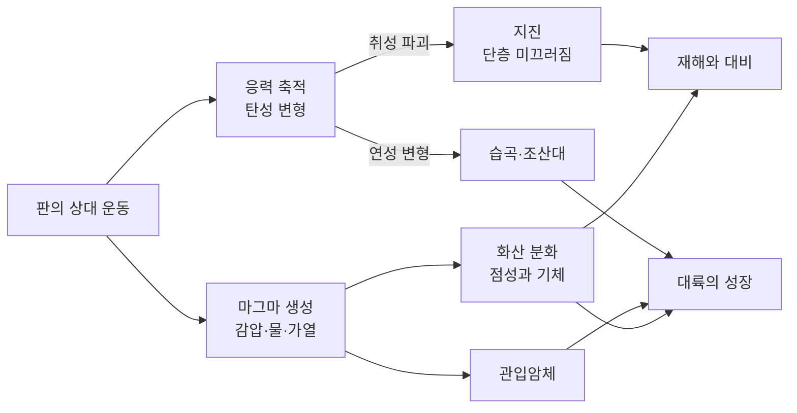

# 일반지구과학 3. 지진·화산·조산 운동 — 쌓이고, 터지고, 솟아오르는 땅의 역학
<!-- prev: esys-1, earth-2, m3-07, uearth-2 -->
<!-- next: uearth-4, uearth-5 -->

> [!NOTE]
> **이 단원의 범위**
> - 단층과 탄성 반발설, 지진파와 지진계, 진앙 결정
> - 규모와 진도, 지진 재해와 대비
> - 마그마의 생성과 성질, 분화 양식, 화산체와 화산 재해, 관입암체
> - 암석의 변형(응력과 변형, 습곡, 단층, 절리)
> - 조산대의 형성과 대륙의 성장

**학습 목표**

1. 탄성 반발설로 지진의 발생과 반복을 설명하고, 판의 운동 속도와 미끄러짐 양으로 지진의 재래 간격을 어림할 수 있다.
2. 지진계의 원리와 지진 기록을 이해하고, PS시와 세 관측소 자료로 진원 거리·진앙·진원 깊이를 결정할 수 있다.
3. 여러 규모(국지 규모, 모멘트 규모)와 진도의 차이를 설명하고, 규모–에너지 관계와 규모–빈도 관계를 계산에 적용하여 지진 재해 대비 방안을 제시할 수 있다.
4. 마그마가 생성되는 세 가지 조건과 마그마의 점성을 결정하는 요인을 설명하고, 이를 분화 양식, 화산체, 화산 재해와 연결할 수 있다.
5. 응력과 변형의 관계, 취성·연성 변형을 이해하고 습곡·단층·절리를 응력 상태와 관련지어 해석할 수 있다.
6. 판 경계 유형에 따른 조산 운동과 대륙 지각이 성장하는 과정을 지각 평형과 관련지어 설명할 수 있다.

**이 단원의 학습 사다리**

| 단계 | 무엇을 하나? |
|---|---|
| STEP 1. 이전 학습 다시 보기 | 지진파의 종류, PS시, 규모와 진도, 마그마와 화산체, 단층과 습곡, 재해 대비를 다시 꺼낸다 |
| STEP 2. 기초 다지기 | 응력과 변형률, 로그와 지수, 원의 방정식, 삼각함수, 이상 기체의 부피 |
| STEP 3. 핵심 개념 | 단층과 탄성 반발 → 지진계와 진앙 → 규모와 진도 → 지진 재해 → 마그마 → 분화 양식 → 화산체·재해·관입암체 → 암석의 변형 → 조산대와 대륙의 성장 |
| STEP 4. 오개념 바로잡기 | "규모 6은 규모 3의 2배이다?", "진도는 지진마다 하나다?", "용암이 화산 재해의 주범이다?" |
| STEP 5. 전공 맛보기 | 모어 원과 단층의 역학, 지진 위험도의 확률적 평가 |
| STEP 6. 생활·산업·진로 | 지진 조기 경보, 내진 설계와 지반 공학, 화산 감시, 지진 보험과 위험 평가 |

---

## 🗺️ 단원 들어가기

2016년 9월 경주에서 규모 5.8의 지진이 일어났다. 계기 관측 이래 우리나라에서 가장 큰 지진이었다. 그런데 기록을 들여다보면 같은 날 저녁 약 48분 앞서 규모 5.1의 지진이 먼저 있었고, 그 뒤 수백 차례의 여진이 이어졌다. 땅속 수 km 깊이의 단층은 왜 하필 그날 미끄러졌을까? 규모 5.8과 5.1의 차이는 숫자로는 0.7이지만, 에너지로는 몇 배일까? 같은 지진인데 왜 경주와 서울의 흔들림은 그렇게 달랐을까?

판의 경계는 지구 표면의 '이음매'이다. 이음매에는 응력이 쌓이고, 쌓인 응력은 지진으로 풀리며, 판이 녹여 낸 마그마는 화산으로 솟고, 수천만 년의 압축은 산맥을 일으킨다. 이 단원에서는 지진·화산·조산 운동을 각각의 현상이 아니라 **응력과 변형, 열과 압력이라는 하나의 역학**으로 묶어 정량적으로 살펴본다.

---

## STEP 1. 🔙 이전 학습 다시 보기

### 연계 개념표

| 이전 단원 | 고등학교까지 배운 것 | 대학에서 이렇게 확장된다 |
|---|---|---|
| 중3 「재해·재난과 안전」 '지진과 화산', '지진 조기 경보의 원리' | 지진·화산 재해의 유형, P파로 S파보다 먼저 경보 | 경보 가능 시간과 **경보 사각지대**의 계산, 지반 증폭과 공진 |
| 지구과학 「지구의 역사와 한반도의 암석」 '변동대의 마그마와 화성암', '변성작용, 지질 구조' | 마그마 생성의 세 가지 길, 마그마 조성과 화산 모양, 정단층·역단층·주향 이동 단층, 습곡, 절리 | 지온 곡선과 고상선으로 본 **용융 조건**, 점성의 정량 비교, 응력 상태와 단층 유형(앤더슨 이론) |
| 지구시스템과학 「지구 탄생과 생동하는 지구」 '화산 활동과 암석의 순환', '지진파의 종류와 특성' | 화산 분출물, 순상·성층 화산, PS시로 진원 거리, P·S·표면파 | 분화 양식과 화산 폭발 지수, **세 관측소로 진앙 결정**, 진원 깊이, 지진계의 원리 |
| 통합과학1 「판구조론과 지권의 변화」 '규모와 진도' | 규모는 에너지, 진도는 흔들림 정도, 규모 1 차이 ≈ 약 30배 에너지 | **모멘트 규모**의 정의, 규모–에너지 식, 구텐베르크–리히터 빈도 관계 |
| 일반지구과학 「판구조론과 지구 내부」 '판 경계', '지각 평형' | 경계별 응력, 섭입대 진원 분포, 에어리 모형 | 판 경계에서의 지진·화산 메커니즘, **조산대의 높이와 지각 두께** |

### 준비 운동 (사전 진단)

**Q1.** P파 속도 6.0 km/s, S파 속도 3.5 km/s인 지역에서 PS시가 5.0 s이면 진원 거리는 약 몇 km인가?

**Q2.** 규모 6.0인 지진은 규모 4.0인 지진보다 방출 에너지가 약 몇 배인가?

**Q3.** 상반이 단층면을 따라 아래로 내려간 단층의 이름과, 이 단층을 만든 힘의 종류를 쓰시오.

**Q4.** 현무암질 마그마와 유문암질 마그마 중 점성이 큰 것은? 그 까닭을 한 가지 쓰시오.

정답 및 해설

**Q1. 42 km** — $d = \dfrac{v_P v_S}{v_P - v_S}\Delta t = \dfrac{6.0\times3.5}{2.5}\times5.0 = 8.4\times5.0 = 42\ \mathrm{km}$

**Q2. 약 1000배** — 규모 1 차이가 약 $10^{1.5} \approx 32$배이므로, 2 차이는 $10^{3} = 1000$배이다.

**Q3. 정단층, 장력** — 양쪽으로 당기는 힘을 받아 생긴다.

**Q4. 유문암질 마그마** — $\mathrm{SiO_2}$가 많아 Si–O 사면체가 서로 많이 연결되고, 온도도 낮기 때문이다.

---

## STEP 2. 🧱 기초 다지기

### ① 응력과 변형률

**응력(stress)** 은 단위 면적에 작용하는 힘이다. 면에 수직인 성분을 **수직 응력**, 면에 나란한 성분을 **전단 응력**이라 한다.

$$
\sigma = \frac{F_\perp}{A}, \qquad \tau = \frac{F_\parallel}{A} \qquad (\text{단위: Pa} = \mathrm{N/m^2})
$$

**변형률(strain)** 은 물체가 변형된 정도를 나타내는 단위 없는 양이다. 길이 $L$이 $\Delta L$만큼 변하면 변형률은 $\varepsilon = \Delta L/L$이다. 작은 변형에서는 응력과 변형률이 비례한다(**훅 법칙**, $\sigma = E\varepsilon$, $E$: 영률). 암석의 영률은 수십 GPa 자릿수이므로, 1 MPa의 응력이 걸려도 변형률은 $10^{-5}$ 정도에 불과하다. 판 경계에서 수백 년 동안 쌓이는 변형률도 $10^{-4}$ 자릿수이다.

지구 과학에서 응력은 보통 **압축을 양(+)** 으로 쓴다. 깊이 $z$에서 위의 암석이 누르는 수직 응력은 $\sigma_v = \rho g z$(깊이 10 km에서 약 260 MPa)이다.

### ② 로그와 지수 — 규모의 언어

$y = \log_{10}x$는 "$x$는 10의 몇 제곱인가"를 뜻한다. $\log_{10}(ab) = \log_{10}a + \log_{10}b$이므로 곱셈이 덧셈으로 바뀐다. 진폭이 10배면 로그는 1 커지고, 100배면 2 커진다. 반대로 $\log_{10}E = 4.8 + 1.5M$이면 $E = 10^{4.8 + 1.5M}$이고, 두 지진의 에너지 비는

$$
\frac{E_1}{E_2} = 10^{1.5(M_1 - M_2)}
$$

로 규모의 **차이**만으로 정해진다.

### ③ 원의 방정식 — 진앙 찾기의 기하

중심이 $(a, b)$이고 반지름이 $d$인 원은 $(x - a)^2 + (y - b)^2 = d^2$이다. 세 원의 방정식에서 두 개씩 빼면 $x^2$, $y^2$항이 사라져 **일차 방정식**이 남는다. 이것이 세 관측소 자료로 진앙을 계산하는 원리이다.

### ④ 삼각함수와 경사

경사각 $\delta$인 단층면을 따라 거리 $s$만큼 미끄러지면, 수직 이동량(낙차)은 $s\sin\delta$, 수평 이동량은 $s\cos\delta$이다. 진원 거리 $D$, 진앙 거리 $\Delta$, 진원 깊이 $h$ 사이에는 피타고라스 관계 $D^2 = \Delta^2 + h^2$이 성립한다(짧은 거리에서 지표를 평면으로 볼 때).

### ⑤ 이상 기체 상태 방정식 — 거품은 얼마나 부풀까

$PV = nRT$($R = 8.314\ \mathrm{J/(mol\cdot K)}$). 같은 양의 기체는 압력이 낮아지면 부피가 커진다. 마그마 속 물은 깊은 곳의 높은 압력에서는 녹아 있다가, 마그마가 올라와 압력이 낮아지면 기체로 빠져나와 급격히 부푼다. 탄산음료 병뚜껑을 열 때와 같은 원리이다.

---

## STEP 3. 📘 핵심 개념

### ① 단층과 탄성 반발설

#### (1) 단층의 용어

**단층(fault)** 은 암석이 깨져 그 면을 따라 양쪽이 어긋난 구조이다. 단층면이 지표와 만나는 선의 방향을 **주향**, 단층면이 수평면과 이루는 각을 **경사**라 한다. 경사진 단층면 위쪽의 암반을 **상반**, 아래쪽을 **하반**이라 한다. 단층 운동이 처음 시작된 땅속 지점을 **진원(hypocenter)**, 그 바로 위 지표 지점을 **진앙(epicenter)** 이라 한다. 큰 지진에서는 진원에서 시작한 파열이 단층면을 따라 수십~수백 km 퍼져 나간다.

#### (2) 탄성 반발설

1906년 샌프란시스코 지진 뒤, 리드는 지진 전후의 측량 자료를 비교하여 **탄성 반발설(elastic rebound theory)** 을 제안했다.

1. 단층 양쪽의 판이 서로 반대 방향으로 천천히 움직이지만, 단층면은 마찰로 **잠겨** 있다.
2. 단층 주변 암석이 **탄성 변형**되며 변형 에너지가 쌓인다. 단층을 가로지르는 직선이 점점 휜다.
3. 응력이 단층면의 마찰 강도를 넘는 순간 단층이 갑자기 미끄러진다(**취성 파괴**).
4. 휘었던 암석이 원래 모양으로 **튕겨 돌아가며** 쌓였던 에너지 일부가 지진파로 방출된다. 지진 뒤에는 휘었던 직선이 끊어져 어긋난 채 다시 곧아진다.
5. 다시 잠기고 응력이 쌓이는 과정이 반복된다(**지진 주기**).

이렇게 천천히 쌓였다가 갑자기 미끄러지는 운동을 **고착–미끄러짐(stick-slip)** 이라 한다. 책상 위의 무거운 상자를 고무줄로 끌 때, 고무줄이 늘어나다가 상자가 갑자기 미끄러지고 다시 멈추는 것과 같다.

<!-- fig:uearth-3-rebound -->

| 지진 관련 현상 | 설명 |
|---|---|
| 전진 | 본진 전에 일어나는 작은 지진. 본진이 일어난 뒤에야 전진이었다고 판정할 수 있다 |
| 본진 | 일련의 지진 중 가장 큰 지진 |
| 여진 | 본진으로 바뀐 응력에 주변 단층이 반응해 일어나는 지진. 시간이 지날수록 빈도가 대략 $1/t$로 줄어든다(오모리 법칙) |
| 비지진성 미끄러짐(크리프) | 일부 단층 구간은 지진 없이 천천히 미끄러져 응력이 쌓이지 않는다 |

#### 예제 1 — 지진의 재래 간격 어림하기

어느 판 경계에서 두 판의 상대 속도가 3.5 cm/년이다. 이 경계의 단층이 큰 지진 때마다 평균 7.0 m씩 미끄러진다면, 큰 지진의 평균 재래 간격은 얼마인가? 이 단층의 마지막 큰 지진이 150년 전이었다면 무엇을 알 수 있는가?

**풀이**

① 식 세우기: 쌓인 변위(속도 × 시간) = 지진 때 한 번에 풀리는 미끄러짐

② 대입:

$$
T = \frac{7.0\ \mathrm{m}}{0.035\ \mathrm{m/년}} = 2.0\times10^{2}\ \text{년}
$$

③ 의미: 평균 약 200년마다 큰 지진이 일어난다. 150년이 지났다면 다음 지진을 일으킬 변형의 약 75 %가 이미 쌓인 셈이다. 그러나 실제 재래 간격은 지진마다 크게 흩어지므로 "50년 뒤에 일어난다"고 예측할 수는 없다. 이런 계산은 **확률적 장기 예측**의 출발점이 된다.

> [!TIP]
> 💡 **비유** — 탄성 반발은 활시위와 같다. 시위를 천천히 당기는 동안(응력 축적) 활은 휘어 에너지를 모으고, 손을 놓는 순간(파괴) 에너지가 화살(지진파)로 한꺼번에 나간다. 다만 지구의 '손'이 언제 놓일지는 정확히 알 수 없다.

#### ✔ 바로 확인

1. 빈칸: 단층 운동이 처음 시작된 땅속 지점은 (    ), 그 바로 위 지표 지점은 (    )이다.
2. (O/X) 탄성 반발설에 따르면 지진 뒤 단층을 가로지르던 직선은 어긋난 채 다시 곧아진다.
3. 상대 속도 2.0 cm/년인 경계에서 지진 때마다 4.0 m씩 미끄러진다면 평균 재래 간격은?

정답

1. 진원, 진앙.
2. O — 휘었던 암석이 튕겨 돌아가 변형이 풀린다.
3. 200년 — $4.0\ \mathrm{m}/0.020\ \mathrm{m/년}$.

### ② 지진파와 지진계, 진앙 결정

#### (1) 지진파 복습과 확장

| 파 | 진동 방향 | 지각 속도(약) | 지진 기록에서의 모습 |
|---|---|---|---|
| P파 | 진행 방향과 나란함(압축–팽창) | 5.5~7 km/s | 가장 먼저 도착, 진폭이 작고 주기가 짧음 |
| S파 | 진행 방향에 수직 | 3~4 km/s | 두 번째로 도착, 진폭이 큼 |
| 러브파 | 수평, 진행 방향에 수직 | S파보다 약간 느림 | 수평 성분에 크게 기록 |
| 레일리파 | 연직면 안에서 타원 운동 | 러브파보다 약간 느림 | 연직 성분에 크게, 긴 주기 |

표면파는 지표를 따라 2차원으로 퍼지므로 거리에 따라 덜 약해지고, 주기가 길어 높은 건물과 큰 구조물에 큰 피해를 준다.

#### (2) 지진계의 원리

지진계(seismometer)는 **관성**을 이용한다. 용수철이나 진자에 매달린 무거운 추는 땅이 빠르게 흔들려도 관성 때문에 제자리에 머물려 하고, 땅에 고정된 틀은 땅과 함께 움직인다. 추와 틀 사이의 **상대 운동**을 기록하면 땅의 운동을 알 수 있다.

| 구성 요소 | 하는 일 |
|---|---|
| 관성 추와 용수철(또는 진자) | 땅의 움직임과 상대 운동을 만든다. 추–용수철의 고유 주기보다 **짧은 주기**의 땅 진동을 잘 기록한다 |
| 감쇠 장치 | 추가 계속 출렁이지 않게 하여 땅의 실제 운동을 정확히 따라가게 한다 |
| 변환기 | 상대 운동을 전기 신호로 바꾼다(코일과 자석 등) |
| 3성분 | 동서·남북·연직 세 방향을 따로 기록한다 |

오늘날의 **광대역 지진계**는 추를 전자적으로 제자리에 붙잡아 두는 되먹임 장치를 써서 0.01초부터 수백 초 주기까지 기록한다. 기록된 그래프를 **지진 기록(seismogram)** 이라 한다.

#### (3) 진원 거리와 진앙 결정

PS시 $\Delta t$에서 진원 거리 $d$는

$$
d = \frac{v_P v_S}{v_P - v_S}\,\Delta t = k\,\Delta t
$$

이다. 비례 상수 $k$는 지역의 지각 구조에 따라 다르며, 경험적으로 정한 값을 쓴다(이 식을 흔히 오모리 공식이라 부른다). 관측소 한 곳에서는 거리만 알 수 있으므로 관측소를 중심으로 반지름 $d$인 원 위 어딘가에 진앙이 있다. **세 관측소의 원이 만나는 점**이 진앙이다(**삼각 측량**). 진원이 깊으면 세 원이 한 점에서 만나지 않고 작은 삼각형 영역에서 겹치는데, 그 삼각형의 공통 현들이 만나는 점을 진앙으로 잡고 겹치는 정도로 깊이를 어림한다. 실제 관측망에서는 수십 개 관측소의 도착 시간을 가장 잘 맞추는 진원 위치와 발생 시각을 컴퓨터로 구한다.

<!-- fig:uearth-3-travel-time -->

<!-- sim:u-epicenter -->

#### 예제 2 — 세 관측소로 진앙 계산하기

평면 좌표(km)에서 관측소 A는 $(0, 0)$, B는 $(72, 0)$, C는 $(0, 112)$에 있다. 이 지역에서 $k = 8.0\ \mathrm{km/s}$이고, 세 관측소의 PS시는 A 6.25 s, B 7.25 s, C 9.75 s였다. 진원이 매우 얕다고 가정하고 진앙의 좌표를 구하시오.

**풀이**

① 진원 거리: $d_A = 8.0\times6.25 = 50\ \mathrm{km}$, $d_B = 8.0\times7.25 = 58\ \mathrm{km}$, $d_C = 8.0\times9.75 = 78\ \mathrm{km}$

② 원의 방정식:

$$
x^2 + y^2 = 50^2, \qquad (x - 72)^2 + y^2 = 58^2, \qquad x^2 + (y - 112)^2 = 78^2
$$

③ 첫째 식에서 둘째 식을 빼면 $144x - 72^2 = 50^2 - 58^2$, 곧 $144x = 5184 - 864 = 4320$이므로 $x = 30$

첫째 식에서 셋째 식을 빼면 $224y - 112^2 = 50^2 - 78^2$, 곧 $224y = 12544 - 3584 = 8960$이므로 $y = 40$

④ 확인: $\sqrt{30^2 + 40^2} = 50$ ✓, $\sqrt{42^2 + 40^2} = 58$ ✓, $\sqrt{30^2 + 72^2} = 78$ ✓

진앙은 $(30, 40)$ km이다. 세 원이 정확히 한 점에서 만나므로 진원이 얕다는 가정과 맞는다.

#### 예제 3 — 진원 깊이

어느 관측소에서 PS시로 구한 진원 거리가 50 km이고, 다른 방법으로 구한 진앙까지의 거리(진앙 거리)가 40 km였다. 진원 깊이를 구하시오.

**풀이**

$$
h = \sqrt{D^2 - \Delta^2} = \sqrt{50^2 - 40^2} = 30\ \mathrm{km}
$$

진원 깊이 약 30 km이다. 진원 깊이 70 km 미만을 **천발 지진**, 70~300 km를 **중발 지진**, 300 km 이상을 **심발 지진**으로 나눈다. 같은 규모라면 천발 지진이 지표에 더 큰 피해를 준다.

#### ✔ 바로 확인

1. (O/X) 지진계의 추는 관성 때문에 땅이 흔들려도 제자리에 머물려 한다.
2. $k = 8.0$ km/s인 지역에서 PS시가 10 s이면 진원 거리는?
3. 진원 거리 25 km, 진앙 거리 20 km이면 진원 깊이는?
4. 진원 깊이 450 km인 지진은 천발·중발·심발 중 무엇인가?

정답

1. O — 추와 틀의 상대 운동으로 땅의 운동을 기록한다.
2. 80 km — $d = k\Delta t$.
3. 15 km — $\sqrt{25^2 - 20^2}$.
4. 심발 지진 — 300 km 이상.

### ③ 규모와 진도

#### (1) 규모 — 지진 자체의 크기

| 규모 | 정의의 바탕 | 특징 |
|---|---|---|
| **국지 규모** $M_L$ (리히터 규모) | 표준 지진계(우드–앤더슨형)로 진앙 거리 100 km에서 잰 최대 진폭의 상용로그. 거리 보정 포함 | 1935년 캘리포니아 지역 지진을 위해 정의. 근거리 중소 지진에 씀 |
| 표면파 규모 $M_s$ | 주기 약 20 s 표면파의 진폭 | 먼 거리의 얕은 지진 |
| 실체파 규모 $m_b$ | 주기 약 1 s P파의 진폭 | 깊은 지진, 핵실험 판별 |
| **모멘트 규모** $M_w$ | 단층의 물리량(지진 모멘트) | 큰 지진에서도 **포화되지 않음**. 오늘날 표준 |

진폭에 바탕을 둔 규모는 매우 큰 지진에서 **포화**된다. 큰 지진은 단층이 수백 km 파열되어 긴 주기의 파를 많이 내는데, 특정 주기의 진폭은 어느 크기 이상 커지지 않기 때문이다. 이 문제를 해결한 것이 모멘트 규모이다.

**지진 모멘트**는 단층 운동의 '크기'를 나타내는 물리량이다.

$$
M_0 = \mu A D
$$

($\mu$: 암석의 전단 탄성률, 지각에서 약 $3\times10^{10}$ Pa, $A$: 파열된 단층면의 넓이, $D$: 평균 미끄러짐 양, 단위 N·m) 모멘트 규모는

$$
M_w = \frac{2}{3}\left(\log_{10}M_0 - 9.1\right)
$$

로 정의된다. 계수 2/3과 상수 9.1은 $M_w$가 중간 크기 지진에서 기존 규모와 비슷한 값이 되도록 맞춘 것이다.

#### 예제 4 — 단층의 크기로 모멘트 규모 구하기

길이 40 km, 폭 15 km인 단층면이 평균 1.0 m 미끄러졌다($\mu = 3.0\times10^{10}$ Pa). 지진 모멘트와 모멘트 규모를 구하시오. 단층의 길이·폭·미끄러짐이 모두 10배인 지진의 규모는?

**풀이**

$$
M_0 = 3.0\times10^{10}\times(4.0\times10^{4})(1.5\times10^{4})\times1.0 = 1.8\times10^{19}\ \mathrm{N\cdot m}
$$

$$
M_w = \frac{2}{3}(\log_{10}1.8\times10^{19} - 9.1) = \frac{2}{3}(19.26 - 9.1) \approx 6.8
$$

길이·폭·미끄러짐이 모두 10배이면 $M_0$는 $10^3$배이므로 $M_w$는 $\frac{2}{3}\times3 = 2$ 커져 약 8.8이 된다. 규모 9급 지진은 수백 km 길이의 단층이 수십 m 미끄러져야 일어나며, 그만큼 긴 판 경계가 있는 **섭입대**에서만 가능하다.

#### (2) 규모와 에너지, 규모와 빈도

지진파로 방출되는 에너지 $E$(J)와 규모는 경험적으로

$$
\log_{10}E \approx 4.8 + 1.5M
$$

의 관계가 있다. 규모 1 차이는 약 32배, 2 차이는 1000배이다.

또 한 지역에서 규모 $M$ 이상인 지진의 연간 횟수 $N$은

$$
\log_{10}N = a - bM
$$

을 따른다(**구텐베르크–리히터 관계**). 전 세계적으로 $b \approx 1$이므로 **규모가 1 작은 지진은 약 10배 자주** 일어난다. 작은 지진은 아주 많지만 에너지의 대부분은 드문 큰 지진이 방출한다.

#### 예제 5 — 경주 지진의 전진과 본진

2016년 경주 지진의 전진은 규모 5.1, 본진은 규모 5.8이었다. (1) 본진의 에너지는 전진의 약 몇 배인가? (2) 본진의 에너지를 TNT 1 kt($4.18\times10^{12}$ J)로 환산하면? (3) $b = 1$인 지역에서 규모 5 이상 지진이 10년에 1번 일어난다면, 규모 3 이상 지진은 10년에 몇 번 일어날 것으로 기대되는가?

**풀이**

(1)

$$
\frac{E_{5.8}}{E_{5.1}} = 10^{1.5\times0.7} = 10^{1.05} \approx 11\ \text{배}
$$

(2)

$$
E_{5.8} = 10^{4.8 + 1.5\times5.8} = 10^{13.5} \approx 3.2\times10^{13}\ \mathrm{J} \approx \frac{3.2\times10^{13}}{4.18\times10^{12}} \approx 7.6\ \mathrm{kt}
$$

(3) 규모가 2 작으면 $10^{2} = 100$배 자주 일어나므로 10년에 약 100번이다.

숫자 0.7 차이가 에너지로는 약 11배이다. "규모 5.8과 5.1은 비슷하다"는 생각은 로그 눈금을 잊은 것이다.

#### (3) 진도 — 어떤 장소에서 흔들린 정도

**진도(intensity)** 는 특정 장소에서 사람이 느낀 정도, 물건과 건물의 피해 정도로 나타낸 흔들림의 크기이다. 우리나라 기상청은 **수정 메르칼리 진도**를 바탕으로 한 12단계(Ⅰ~Ⅻ) 진도를 쓰며, 계기로 잰 최대 지반 가속도·속도와 대응시켜 빠르게 발표한다.

| 진도 | 대략의 현상 |
|---|---|
| Ⅰ~Ⅱ | 대부분 느끼지 못하거나, 조용한 곳의 일부 사람만 느낌 |
| Ⅲ~Ⅳ | 실내에서 많은 사람이 느낌, 그릇·창문이 흔들림 |
| Ⅴ~Ⅵ | 거의 모든 사람이 느낌, 물건이 떨어지고 일부 벽에 금이 감 |
| Ⅶ~Ⅷ | 서 있기 어려움, 약한 건물에 상당한 피해 |
| Ⅸ 이상 | 튼튼한 건물도 크게 파손, 지표 갈라짐 |

| 진도를 크게 하는 요인 | 까닭 |
|---|---|
| 규모가 큼 | 방출 에너지가 큼 |
| 진원이 가까움, 진원이 얕음 | 거리에 따른 감쇠가 작음 |
| 연약한 지반(퇴적층, 매립지) | 지진파 속도가 느린 층에서 진폭이 커짐(**지반 증폭**) |
| 단층 파열 방향 쪽 | 파열이 진행하는 쪽으로 에너지가 집중(방향성 효과) |

#### ✔ 바로 확인

1. (O/X) 규모가 1 커지면 방출 에너지는 약 10배가 된다.
2. 지진 모멘트 $M_0 = \mu A D$에서 $A$와 $D$는 각각 무엇인가?
3. $b = 1$인 지역에서 규모 4 이상 지진이 1년에 20번이면, 규모 5 이상은 1년에 몇 번 기대되는가?
4. 규모와 진도 중 한 지진에 대해 장소마다 값이 다른 것은?

정답

1. X — 약 32배($10^{1.5}$)이다.
2. 파열된 단층면의 넓이, 평균 미끄러짐 양.
3. 2번 — 규모가 1 크면 약 10분의 1.
4. 진도.

### ④ 지진 재해와 대비

#### (1) 지진이 피해를 주는 방식

| 피해 | 원리 |
|---|---|
| 지반 진동 | 건물의 고유 주기와 지진파 주기가 비슷하면 **공진**으로 크게 흔들림. 대략 건물 고유 주기(s) ≈ 0.1 × 층수 |
| 지표 단층 파열 | 단층이 지표까지 끊어져 도로·관로가 어긋남 |
| **액상화** | 물로 포화된 느슨한 모래층이 흔들리면 알갱이 사이 물의 압력이 높아져 지반이 액체처럼 변함. 건물이 기울거나 모래가 솟음 |
| 산사태·낙석 | 경사면이 진동으로 불안정해짐 |
| **지진 해일(쓰나미)** | 해저 단층의 수직 운동이 바닷물 전체를 들어 올림 |
| 화재·2차 재해 | 가스관·전선 파손, 댐·원자력 시설 피해 |

지진 해일은 파장이 수심보다 훨씬 긴 **천해파**로 전파되므로 속도가 수심 $h$로만 정해진다.

$$
v = \sqrt{gh}
$$

#### 예제 6 — 지진 해일의 속도와 도달 시간

(1) 평균 수심 4000 m인 대양에서 지진 해일의 속도를 m/s와 km/h로 구하고, 1000 km를 건너는 데 걸리는 시간을 구하시오. (2) 해안 근처 수심 10 m에서의 속도는? 해안에 가까워지면 파고는 어떻게 되는가?

**풀이**

(1)

$$
v = \sqrt{9.8\times4000} \approx 198\ \mathrm{m/s} \approx 713\ \mathrm{km/h}, \qquad t = \frac{1.0\times10^{6}\ \mathrm{m}}{198\ \mathrm{m/s}} \approx 5.1\times10^{3}\ \mathrm{s} \approx 84\ \text{분}
$$

(2) $v = \sqrt{9.8\times10} \approx 9.9\ \mathrm{m/s}$(약 36 km/h)

대양에서는 여객기만큼 빠르지만 파고는 1 m 안팎이라 배 위에서는 잘 느끼지 못한다. 해안에 다가오면 속도가 줄어 뒤의 물이 앞의 물을 따라잡으므로 에너지가 좁은 구간에 몰려 **파고가 크게 높아진다.** 1983년 동해 중부 해역 지진(일본 아키타현 앞바다) 때는 지진 해일이 약 1~2시간 만에 우리나라 동해안에 도달해 피해를 냈다.

#### (2) 대비 — 예측, 경보, 설계

| 수단 | 내용 | 한계 |
|---|---|---|
| 장기 확률 예측 | 활성 단층 조사, 재래 간격, 구텐베르크–리히터 관계로 "30년 안에 규모 7 이상 지진이 일어날 확률" 같은 위험도 지도 작성 | 정확한 날짜·시각은 알 수 없음 |
| 단기 예보 | 전진, 지하수·지각 변형 이상 등 | 신뢰할 만한 방법이 아직 없음 |
| **지진 조기 경보** | 진앙 가까운 관측소가 P파를 감지하면 규모·위치를 추정해 S파 도착 전에 알림 | 진앙 가까운 곳은 경보가 늦음(**경보 사각지대**) |
| 내진·면진 설계 | 건물 강도와 연성 확보, 바닥에 고무 받침을 넣어 흔들림 차단(면진), 진동 흡수 장치(제진) | 비용, 오래된 건물 보강 |
| 토지 이용·대피 | 액상화 위험 지도, 지진 해일 대피로, 대피 훈련 | 주민 참여 필요 |

#### 예제 7 — 조기 경보로 얻는 시간

진앙에서 10 km 떨어진 관측소가 P파(6.0 km/s)를 감지한 뒤, 분석과 전파에 5.0 s가 걸려 경보가 나간다. (1) 진앙에서 100 km 떨어진 도시는 S파(3.5 km/s)가 도착하기 몇 초 전에 경보를 받는가? (2) 경보보다 S파가 먼저 도착하는 '경보 사각지대'의 반지름을 구하시오(진원은 얕다고 가정).

**풀이**

(1) 경보 발령 시각: $\dfrac{10}{6.0} + 5.0 \approx 6.7\ \mathrm{s}$, S파 도착: $\dfrac{100}{3.5} \approx 28.6\ \mathrm{s}$ → 약 **22 s** 전

(2) S파가 6.7 s 동안 가는 거리: $3.5\times6.67 \approx 23\ \mathrm{km}$

진앙에서 약 23 km 안쪽은 경보보다 S파가 먼저 온다. 사각지대를 줄이려면 관측소를 촘촘히 두어 감지를 빠르게 하고, 분석 시간을 줄여야 한다. 22 s는 짧아 보이지만 책상 밑으로 들어가고, 열차를 감속하고, 엘리베이터를 가까운 층에 세우기에 충분한 시간이다.

#### ✔ 바로 확인

1. 수심 1000 m인 바다에서 지진 해일의 속도는 약 몇 m/s인가($g = 9.8\ \mathrm{m/s^2}$)?
2. (O/X) 지진 조기 경보는 진앙에 가까운 곳일수록 더 많은 시간을 벌어 준다.
3. 물로 포화된 느슨한 모래층이 흔들려 액체처럼 변하는 현상은?

정답

1. 약 99 m/s — $\sqrt{9.8\times1000}$.
2. X — 진앙 가까운 곳은 경보보다 S파가 먼저 오는 경보 사각지대가 된다.
3. 액상화.

### ⑤ 마그마의 생성과 성질

#### (1) 마그마는 어떤 조건에서 생기나

맨틀은 대부분 고체이다. 깊이에 따른 실제 온도 곡선(**지온 곡선**)이 암석이 녹기 시작하는 온도 곡선(**고상선, 솔리더스**)보다 낮기 때문이다. 마그마가 생기려면 두 곡선이 만나야 하며, 방법은 세 가지이다.

| 방법 | 원리 | 장소 | 마그마 |
|---|---|---|---|
| **감압 용융** | 뜨거운 맨틀이 빠르게 상승하면 온도는 거의 그대로(단열 팽창에 따른 냉각은 1 km당 약 0.3~0.5 °C로 작음)인데 압력이 줄어 고상선이 낮아짐 | 해령, 열점, 대륙 열곡 | 현무암질 |
| **물 공급(융제 용융)** | 섭입판에서 빠져나온 물이 맨틀 쐐기 암석의 고상선을 수백 °C 낮춤 | 섭입대 | 현무암질 → 분화·혼합으로 안산암질 |
| **가열 용융** | 뜨거운 현무암질 마그마가 대륙 지각 아래에 고여 지각을 데움. 지각 암석은 녹는점이 낮음 | 섭입대 대륙 지각, 열점 아래 대륙 | 유문암질(화강암질) |

<!-- fig:uearth-3-melting -->

맨틀은 한꺼번에 녹지 않고 녹기 쉬운 성분부터 일부만 녹는다(**부분 용융**). 감람암이 10~20 % 정도 녹으면 $\mathrm{SiO_2}$가 원래 암석보다 많은 현무암질 마그마가 생긴다. 마그마는 주변 암석보다 밀도가 작아 부력으로 위로 올라간다.

<!-- fig:uearth-3-quake-volcano-map -->

#### 예제 8 — 상승하는 맨틀은 어디서 녹기 시작할까

단순화한 모형에서 상승하는 맨틀의 온도는 깊이 $z$(km)에 대해 $T = 1350 + 0.4z$(°C)이고, 마른 감람암의 고상선은 $T_s = 1100 + 4.0z$(°C)이다. 맨틀이 녹기 시작하는 깊이와 그때의 온도를 구하시오. (계산을 위해 단순화한 값이다.)

**풀이**

$$
1350 + 0.4z = 1100 + 4.0z \quad\Rightarrow\quad z = \frac{250}{3.6} \approx 69\ \mathrm{km}, \qquad T \approx 1350 + 0.4\times69 \approx 1380\ ^\circ\mathrm{C}
$$

깊이 약 70 km보다 얕아지면 상승하는 맨틀이 녹기 시작한다. 해령 아래 이 깊이에서부터 녹은 마그마가 모여 해양 지각(약 7 km 두께)을 만든다. 상승하는 맨틀이 더 뜨거운 열점에서는 더 깊은 곳에서 녹기 시작해 마그마가 더 많이 생기므로 아이슬란드처럼 두꺼운 지각이 생긴다.

#### (2) 마그마의 성질 — 점성과 휘발 성분

| 요인 | 점성에 미치는 영향 | 까닭 |
|---|---|---|
| $\mathrm{SiO_2}$ 함량 | 많을수록 **증가** | Si–O 사면체가 서로 연결된 사슬·그물(중합)이 많아짐 |
| 온도 | 높을수록 **감소** | 결합이 끊어지고 원자가 활발히 움직임 |
| 녹아 있는 물 | 많을수록 **감소** | 물이 Si–O–Si 연결을 끊음 |
| 결정·기포의 양 | 많을수록 대체로 **증가** | 흐름을 방해 |

| 마그마 | 온도(약, °C) | 점성(약, Pa·s) | 녹아 있는 기체(약, 질량 %) |
|---|---|---|---|
| 현무암질 | 1000~1200 | $10\sim10^{3}$ | 0.5~2 |
| 안산암질 | 800~1000 | $10^{3}\sim10^{5}$ | 2~4 |
| 유문암질 | 650~800 | $10^{6}$ 이상(최대 $10^{11}$ 정도) | 4~6 |

물의 점성이 약 $10^{-3}$ Pa·s, 꿀이 약 10 Pa·s이므로 현무암질 마그마는 꿀~케첩, 유문암질 마그마는 거의 고체에 가까운 끈끈함이다. 휘발 성분은 주로 $\mathrm{H_2O}$이고 $\mathrm{CO_2}$, $\mathrm{SO_2}$, $\mathrm{H_2S}$ 등이 있다.

#### 예제 9 — 마그마 속 물이 기체가 되면

질량 4.0 %의 물이 녹아 있는 마그마 1.0 kg(밀도 $2500\ \mathrm{kg/m^3}$)이 지표 가까이 올라와 물이 모두 1000 °C, 1기압($1.013\times10^{5}$ Pa)의 수증기가 되었다. 수증기의 부피를 이상 기체로 계산하고, 원래 마그마 부피와 비교하시오($R = 8.314\ \mathrm{J/(mol\cdot K)}$, 물의 몰 질량 18.0 g/mol).

**풀이**

$$
n = \frac{40\ \mathrm{g}}{18.0\ \mathrm{g/mol}} \approx 2.22\ \mathrm{mol}, \qquad V = \frac{nRT}{P} = \frac{2.22\times8.314\times1273}{1.013\times10^{5}} \approx 0.23\ \mathrm{m^3}
$$

$$
V_{\text{마그마}} = \frac{1.0\ \mathrm{kg}}{2500\ \mathrm{kg/m^3}} = 4.0\times10^{-4}\ \mathrm{m^3}, \qquad \frac{0.23}{4.0\times10^{-4}} \approx 6\times10^{2}
$$

수증기 부피가 마그마의 약 600배이다. 점성이 작은 마그마에서는 기포가 쉽게 빠져나가지만, 점성이 큰 마그마에서는 기포가 갇혀 부풀다가 마그마를 산산이 부수며(**파쇄**) 폭발한다. 폭발적 분화의 에너지원은 바로 **녹아 있던 기체의 팽창**이다.

#### ✔ 바로 확인

1. 짝짓기: 감압 용융, 물 공급, 가열 용융을 섭입대, 해령, 대륙 지각 아래와 짝지으시오.
2. (O/X) $\mathrm{SiO_2}$가 많을수록, 온도가 낮을수록 마그마의 점성은 커진다.
3. 폭발적 분화의 에너지원은 무엇인가?

정답

1. 감압 용융–해령, 물 공급–섭입대, 가열 용융–대륙 지각 아래.
2. O — Si–O 사면체의 연결(중합)이 많아지고 원자 운동이 둔해진다.
3. 녹아 있던 기체(주로 물)가 압력이 낮아지며 빠져나와 팽창하는 것.

### ⑥ 분화 양식

#### (1) 분출형 분화와 폭발형 분화

| 분화 양식 | 마그마 | 특징 | 예 |
|---|---|---|---|
| 하와이식 | 현무암질, 점성 작음 | 용암 분수, 용암류가 조용히 흐름, 틈새 분출 | 하와이 킬라우에아 |
| 스트롬볼리식 | 현무암질~안산암질 | 큰 기포가 터지며 짧은 폭발 반복, 화산탄 | 이탈리아 스트롬볼리 |
| 불카노식 | 안산암질 | 화도를 막은 마개가 강한 폭발로 깨짐, 화산재 | 일본의 여러 성층 화산 |
| 플리니식 | 유문암질·안산암질, 기체 많음 | 수십 km 높이의 분연주, 넓은 지역에 부석·화산재, 분연주가 무너지면 화쇄류 | 79년 베수비오, 1991년 피나투보 |
| 마그마 수증기 분화 | 마그마 + 지하수·바닷물 | 물이 순간적으로 끓어 강한 폭발, 응회환·마르 | 제주 수월봉, 성산일출봉 |

분화의 규모는 분출물의 부피와 분연주 높이로 정한 **화산 폭발 지수(VEI)** 로 나타낸다. 0~8 단계이며, 대체로 한 단계 올라갈 때마다 분출물 부피가 약 10배가 된다(VEI 2 이상부터).

#### (2) 용암과 화산 쇄설물

| 분출물 | 종류와 특징 |
|---|---|
| 용암류 | **파호이호이 용암**(표면이 매끄럽고 밧줄 모양, 점성 작음), **아아 용암**(표면이 거칠고 뾰족한 덩어리), **베개 용암**(물속 분출) |
| 화산 쇄설물 | 크기에 따라 화산재(2 mm 미만), 화산력(2~64 mm), 화산탄·화산 암괴(64 mm 이상). 부석은 기포가 많아 물에 뜨기도 함 |
| 화쇄류(화산 쇄설성 밀도류) | 뜨거운 화산재와 기체가 섞여 경사면을 시속 100 km 이상으로 흘러내림. 온도 수백 °C |
| 화산 가스 | $\mathrm{H_2O}$, $\mathrm{CO_2}$, $\mathrm{SO_2}$, $\mathrm{H_2S}$ 등 |

#### 예제 10 — 점성이 용암의 흐름을 정한다

경사 5°인 사면을 두께 2.0 m의 용암이 흐른다. 넓고 균일한 점성 유체층의 평균 흐름 속도는 근사적으로

$$
\bar v = \frac{\rho g \sin\theta\, H^2}{3\eta}
$$

이다($\rho = 2700\ \mathrm{kg/m^3}$, $g = 9.8\ \mathrm{m/s^2}$, $H$: 두께, $\eta$: 점성). 현무암질 용암($\eta = 1.0\times10^{3}$ Pa·s)과 유문암질 용암($\eta = 1.0\times10^{9}$ Pa·s)의 속도를 구하여 비교하시오.

**풀이**

$$
\rho g\sin\theta\,H^2 = 2700\times9.8\times\sin5°\times(2.0)^2 \approx 9.2\times10^{3}\ \mathrm{Pa\cdot m}
$$

현무암질: $\bar v = \dfrac{9.2\times10^{3}}{3\times1.0\times10^{3}} \approx 3.1\ \mathrm{m/s}$(약 11 km/h)

유문암질: $\bar v = \dfrac{9.2\times10^{3}}{3\times1.0\times10^{9}} \approx 3.1\times10^{-6}\ \mathrm{m/s}$(하루 약 0.27 m)

점성이 $10^6$배 차이 나므로 속도도 $10^6$배 차이 난다. 현무암질 용암은 사람이 뛰는 속도로 수십 km를 흘러 넓은 용암 대지와 순상 화산을 만들고, 유문암질 용암은 화구 주변에 쌓여 가파른 용암 돔을 만든다. (실제 용암은 식으며 점성이 커지고 표면이 굳으므로 이 식은 크기를 비교하는 어림이다.)

#### ✔ 바로 확인

1. 하와이식과 플리니식 분화 중 점성이 큰 유문암질 마그마와 관련된 것은?
2. 빈칸: 크기 2 mm 미만의 화산 쇄설물은 (    )이다.
3. (O/X) 점성이 $10^{3}$배 커지면 같은 조건에서 용암의 흐름 속도는 $10^{3}$분의 1이 된다.

정답

1. 플리니식.
2. 화산재.
3. O — $\bar v \propto 1/\eta$.

### ⑦ 화산체와 화산 재해, 관입암체

#### (1) 화산체의 종류

| 화산체 | 생성 | 모양과 크기 | 예 |
|---|---|---|---|
| **순상 화산** | 점성 작은 현무암질 용암이 여러 번 흘러 쌓임 | 경사 수 °의 넓은 방패 모양, 지름 수십~수백 km | 마우나로아 |
| **성층 화산** | 용암류와 화산 쇄설물이 번갈아 쌓임 | 경사 급한 원뿔, 높이 수 km | 후지산, 백두산의 원뿔부 |
| 분석구(스코리아 콘) | 한 번의 분화 기간에 화산력·스코리아가 쌓임 | 높이 수십~수백 m의 작은 원뿔 | 제주의 오름 다수 |
| 용암 돔(종상 화산) | 점성 큰 용암이 화구 위에 쌓임 | 가파른 돔 | 화산 활동 중에 성장하기도 함 |
| **칼데라** | 큰 분화로 마그마 방이 비자 꼭대기가 무너짐 | 지름 수~수십 km의 함몰 | 백두산 천지 |
| 마르, 응회환 | 마그마 수증기 분화 | 얕은 구덩이와 낮은 둘레 | 제주 산굼부리(마르로 해석), 수월봉 |
| 용암 대지(홍수 현무암) | 틈새에서 대량의 현무암 분출 | 수십만 $\mathrm{km^2}$에 걸친 평원 | 인도 데칸 고원, 한탄강 용암 대지(소규모) |

<!-- fig:uearth-3-volcano-types -->

#### (2) 화산 재해

| 재해 | 특징 | 대비 |
|---|---|---|
| 용암류 | 느려서 인명 피해는 비교적 적으나 재산 파괴 | 흐름 경로 예측 |
| **화쇄류** | 빠르고 뜨거워 가장 치명적 | 위험 구역 사전 대피 |
| **라하르(화산 이류)** | 화산재가 비·빙하 녹은 물과 섞여 계곡을 따라 흐르는 진흙 흐름. 화산에서 수십 km 떨어진 곳도 피해 | 하천 감시, 경보 체계 |
| 화산재 낙하 | 지붕 붕괴, 호흡기 질환, 농작물 피해, 항공기 엔진 정지 | 화산재 확산 예보, 항공로 조정 |
| 화산 가스 | $\mathrm{CO_2}$는 공기보다 무거워 낮은 곳에 고임(1986년 카메룬 니오스 호수에서 대량 질식 사고) | 가스 농도 감시 |
| 기후 영향 | $\mathrm{SO_2}$가 성층권에서 황산 에어로졸이 되어 햇빛 반사 | 1991년 피나투보 분화 뒤 1~2년간 전 지구 평균 기온이 약 0.5 °C 낮아짐 |
| 지진 해일, 산체 붕괴 | 화산섬의 붕괴나 해저 분화 | 연안 경보 |

화산 감시는 마그마가 올라올 때 나타나는 신호를 함께 본다. ① 작은 지진의 증가와 진원의 상승 ② 땅의 부풂(GPS, 위성 레이더 간섭) ③ $\mathrm{SO_2}$·$\mathrm{CO_2}$ 방출량 변화 ④ 지표 온도 상승.

#### 예제 11 — 화산재가 지붕에 쌓이면

두께 10 cm의 화산재가 평평한 지붕에 쌓였다. 마른 화산재의 겉보기 밀도가 $1000\ \mathrm{kg/m^3}$, 비에 젖으면 $1500\ \mathrm{kg/m^3}$라 할 때 지붕 1 m²가 받는 압력을 각각 구하시오.

**풀이**

$$
P_{\text{마름}} = \rho g h = 1000\times9.8\times0.10 \approx 9.8\times10^{2}\ \mathrm{Pa}, \qquad P_{\text{젖음}} = 1500\times9.8\times0.10 \approx 1.5\times10^{3}\ \mathrm{Pa}
$$

1 m²당 약 100 kg, 젖으면 약 150 kg이 얹히는 셈이다. 눈보다 훨씬 무겁고 녹지도 않으므로, 화산재가 쌓이면 빨리 치워야 지붕 붕괴를 막을 수 있다.

#### (3) 관입암체 — 땅속에서 굳은 마그마

| 관입암체 | 모양 | 특징 |
|---|---|---|
| **암맥(dike)** | 기존 지층을 **가로질러** 판 모양으로 관입 | 마그마의 이동 통로. 장력 방향에 수직으로 생김 |
| **암상(sill)** | 기존 지층과 **나란하게** 판 모양으로 관입 | 얕은 곳, 층리를 따라 벌어짐 |
| 병반(laccolith) | 암상처럼 들어가 위 지층을 돔 모양으로 밀어 올림 | 점성 큰 마그마 |
| **저반(batholith)** | 노출 면적 100 km² 이상의 거대한 심성암체 | 대부분 화강암질. 여러 번의 관입이 합쳐진 것 |
| 암주(stock) | 저반보다 작은 심성암체 | — |
| 화산 암경 | 화산의 화도에서 굳은 암석이 침식 뒤 기둥처럼 남음 | — |

<!-- fig:uearth-3-intrusions -->

관입암과 주변 암석의 관계는 상대 연령을 정하는 근거가 된다(관입한 암석이 더 젊다, 「지질 시대와 지구의 역사」에서 다룬다). 저반 주변에는 접촉 변성대가 생기고, 마그마가 남긴 열수가 광상을 만들기도 한다. 우리나라의 넓은 지역에 드러난 중생대 화강암은 섭입대에서 만들어진 저반이 침식으로 드러난 것이다.

#### ✔ 바로 확인

1. 경사가 수 °로 완만하고 지름이 수십 km 이상인 화산체는?
2. (O/X) 칼데라는 화구 위에 점성 큰 용암이 쌓여 생긴 돔이다.
3. 지층을 가로질러 판 모양으로 관입한 것과 지층에 나란하게 관입한 것의 이름을 쓰시오.
4. 화산 재해 중 가장 치명적인 것으로 꼽히는 빠르고 뜨거운 흐름은?

정답

1. 순상 화산.
2. X — 마그마 방이 비며 꼭대기가 무너진 함몰지이다. 설명은 용암 돔이다.
3. 암맥, 암상.
4. 화쇄류.

### ⑧ 암석의 변형 — 응력과 변형, 습곡, 단층, 절리

#### (1) 응력의 종류와 변형의 방식

| 응력 | 작용 | 주로 생기는 구조 | 판 경계 |
|---|---|---|---|
| 압축 응력 | 양쪽에서 밂 | 습곡, 역단층·충상 단층, 지각 두꺼워짐 | 수렴형 |
| 인장 응력(장력) | 양쪽으로 당김 | 정단층, 지구대, 지각 얇아짐 | 발산형 |
| 전단 응력 | 엇갈려 밂 | 주향 이동 단층 | 보존형 |

암석에 응력이 가해지면 처음에는 **탄성 변형**(힘을 없애면 원래대로)을 하다가, 한계를 넘으면 **영구 변형**을 한다. 영구 변형은 두 가지이다.

- **취성 변형(brittle)**: 깨져서 어긋남 → 단층, 절리. 낮은 온도, 낮은 봉압, 빠른 변형 속도에서.
- **연성 변형(ductile)**: 깨지지 않고 휘거나 흐름 → 습곡, 변성암의 엽리. 높은 온도, 높은 봉압, 느린 변형 속도에서.

| 변형 방식을 정하는 요인 | 연성 쪽으로 | 취성 쪽으로 |
|---|---|---|
| 온도 | 높음 | 낮음 |
| 봉압(깊이) | 큼 | 작음 |
| 변형 속도 | 느림 | 빠름 |
| 암석 종류 | 암염, 석고, 셰일, 대리암 | 화강암, 규암 |

대륙 지각에서는 깊이 약 10~15 km 아래로 가면 석영이 많은 암석이 연성으로 변형하기 시작한다(**취성–연성 전이대**). 그래서 대륙 내부의 지진 대부분은 이보다 얕은 곳에서 일어난다. 실온에서 망치로 치면 깨지는 캐러멜이 따뜻한 손에서 천천히 누르면 휘는 것과 같다.

#### (2) 습곡

| 용어 | 뜻 |
|---|---|
| 배사 | 위로 볼록하게 휜 습곡. 중심부에 **오래된** 지층 |
| 향사 | 아래로 오목하게 휜 습곡. 중심부에 **젊은** 지층 |
| 습곡축면, 습곡축 | 습곡의 양 날개를 대칭으로 나누는 면과 그 면이 지층과 만나는 선 |
| 정습곡, 경사 습곡, 횡와 습곡 | 축면이 수직 → 기울어짐 → 거의 수평(지층이 뒤집힘) |
| 침강 습곡 | 습곡축이 기울어져 지표에서 V자·U자 모양의 지층 분포 |
| 돔, 분지 | 사방으로 기운 배사형·향사형 구조. 돔은 석유 트랩이 되기도 함 |
| 단사 | 수평 지층이 한쪽만 계단처럼 굽은 구조. 아래 단층 운동이 원인인 경우가 많음 |

<!-- fig:uearth-3-folds -->

#### 예제 12 — 습곡이 기록한 단축량

원래 수평으로 10 km 길이였던 지층이 습곡되어 지금은 수평 폭 7.0 km 안에 놓여 있다(지층의 길이는 변하지 않았다고 가정). 수평 방향 변형률과 단축률을 구하시오. 이 단축이 300만 년 동안 일정하게 일어났다면 평균 단축 속도는 mm/년으로 얼마인가?

**풀이**

$$
\varepsilon = \frac{7.0 - 10}{10} = -0.30 \quad(\text{단축률 } 30\ \%)
$$

$$
\text{단축 속도} = \frac{3.0\ \mathrm{km}}{3.0\times10^{6}\ \text{년}} = \frac{3.0\times10^{6}\ \mathrm{mm}}{3.0\times10^{6}\ \text{년}} = 1.0\ \mathrm{mm/년}
$$

지층이 30 % 짧아졌다. 1 mm/년은 판 경계의 수렴 속도(수 cm/년)의 일부에 해당하며, 나머지는 다른 습곡·충상 단층이나 지각의 두꺼워짐으로 흡수되었다고 해석한다. 조산대의 단축량을 모두 더하면 판이 얼마나 수렴했는지 거꾸로 확인할 수 있다.

#### (3) 단층과 앤더슨 이론

지표 부근에서는 지표면에 전단 응력이 없으므로, 세 주응력 중 하나는 반드시 **연직**이다. 어느 응력이 연직이냐에 따라 단층 유형이 정해진다는 것이 **앤더슨 이론**이다($\sigma_1 > \sigma_2 > \sigma_3$, 압축이 양).

| 연직 주응력 | 단층 | 상반의 운동 | 단층면의 전형적 경사 | 응력 환경 |
|---|---|---|---|---|
| $\sigma_1$(최대 압축이 연직) | **정단층** | 아래로 | 약 60° | 수평 인장(열곡, 해령) |
| $\sigma_3$(최소 압축이 연직) | **역단층**(경사 45° 이하는 **충상 단층**) | 위로 | 약 30° | 수평 압축(섭입대, 충돌대) |
| $\sigma_2$(중간이 연직) | **주향 이동 단층** | 수평 이동(오른쪽 어긋남·왼쪽 어긋남) | 거의 수직 | 수평 전단(변환 단층) |

단층면이 최대 주응력 방향과 약 30° 기운 면에서 잘 생기는 것은 암석의 마찰 성질 때문이다. 정단층이 쌍으로 생겨 가운데가 내려앉으면 **지구(graben)**, 솟으면 **지루(horst)** 가 된다. 실제 단층은 수직 성분과 수평 성분이 섞인 **사교 단층**인 경우도 많다.

<!-- fig:uearth-3-anderson -->

> [!TIP]
> 💡 **판별 요령** — 주향 이동 단층의 방향은 단층의 한쪽에 서서 단층 너머를 바라볼 때 건너편 땅이 오른쪽으로 갔으면 '오른쪽 어긋남(우수향)', 왼쪽으로 갔으면 '왼쪽 어긋남(좌수향)'이다. 어느 쪽에 서서 보아도 같은 답이 나온다.

<!-- sim:u-fault-blocks -->

#### 예제 13 — 단층의 낙차

경사 60°인 정단층면을 따라 상반이 200 m 미끄러져 내려갔다. 수직 낙차와 수평 벌어짐을 구하시오. 같은 크기(200 m)로 경사 30°인 충상 단층이 움직였다면 수평 단축량은?

**풀이**

정단층: 낙차 $= 200\sin60° \approx 173\ \mathrm{m}$, 수평 벌어짐 $= 200\cos60° = 100\ \mathrm{m}$

충상 단층: 수평 단축 $= 200\cos30° \approx 173\ \mathrm{m}$(수직 상승은 $200\sin30° = 100$ m)

경사가 급한 정단층은 주로 땅을 **내려앉히고**, 경사가 완만한 충상 단층은 주로 땅을 **겹쳐 짧게** 만든다. 조산대에서 충상 단층이 지각을 겹겹이 쌓아 두껍게 만드는 까닭이다.

#### (4) 절리

**절리(joint)** 는 암석이 갈라졌지만 갈라진 면을 따라 어긋남이 거의 없는 틈이다.

| 절리 | 생성 원인 | 예 |
|---|---|---|
| 주상 절리 | 용암·뜨거운 화산재가 식으며 수축하여 다각형 기둥으로 갈라짐 | 제주 중문 대포 해안, 한탄강, 무등산 |
| 판상 절리 | 깊은 곳의 화강암이 위 암석이 깎여 압력이 줄며 팽창하여 양파 껍질처럼 갈라짐 | 북한산·설악산의 화강암 돔 |
| 구조 절리 | 지각 변동의 응력으로 규칙적인 방향의 틈이 생김 | 여러 방향 절리가 교차 |

절리는 물이 스며드는 통로가 되어 풍화를 촉진하고, 지하수·석유의 이동 통로가 되며, 터널·사면 공사에서 안정성을 좌우한다.

#### ✔ 바로 확인

1. (O/X) 온도가 높고 봉압이 크며 변형이 느릴수록 암석은 연성 변형을 한다.
2. 배사의 중심부에 드러나는 지층은 주변보다 오래되었는가, 젊은가?
3. 경사 30°인 충상 단층을 따라 400 m 미끄러졌을 때 수평 단축량은?
4. 최소 주응력 $\sigma_3$이 연직일 때 생기는 단층은?

정답

1. O — 깊은 곳에서 습곡과 엽리가 생기는 까닭이다.
2. 오래되었다 — 위로 볼록하게 휜 뒤 깎였기 때문이다.
3. 약 346 m — $400\cos30°$.
4. 역단층(충상 단층).

### ⑨ 조산대의 형성과 대륙의 성장

#### (1) 조산 운동의 유형

**조산 운동(orogeny)** 은 판의 수렴으로 지각이 변형되고 두꺼워지며 산맥이 만들어지는 과정이다. 조산대에는 습곡·충상 단층, 광역 변성암, 화강암 저반, 화산암이 함께 나타난다.

| 유형 | 과정 | 특징 | 예 |
|---|---|---|---|
| **해양판–대륙판 섭입형** | 해양판이 대륙 아래로 섭입하며 화산호·저반 형성, 대륙 쪽으로 습곡·충상 단층대 | 안산암질 화산, 화강암 저반, 고압 변성대와 고온 변성대가 나란히 | 안데스산맥 |
| **부가형** | 섭입대로 끌려온 해양 퇴적물, 해산, 호상 열도, 작은 대륙 조각(**지괴**)이 대륙 가장자리에 덧붙음 | 기원이 다른 지괴들이 단층으로 이어 붙은 모자이크 | 북아메리카 서부 산계 |
| **대륙–대륙 충돌형** | 섭입으로 대양이 닫힌 뒤 두 대륙이 충돌. 대륙 지각은 가벼워 섭입하지 않고 겹겹이 쌓임 | 가장 높은 산맥과 고원, 두께 60~70 km의 지각, 사라진 바다의 흔적(**봉합대**, 오피올라이트) | 히말라야–티베트, 알프스 |

<!-- fig:uearth-3-orogen -->

#### (2) 대륙 충돌의 단계 — 인도와 아시아

1. 인도 대륙을 실은 판이 북쪽으로 움직이며 테티스해의 해양판이 아시아 아래로 섭입했다(아시아 남쪽에 화산호).
2. 약 5000만 년 전 무렵 대양이 닫히고 인도 대륙이 아시아와 충돌하기 시작했다.
3. 대륙 지각은 섭입되지 못하고 충상 단층으로 겹쳐 쌓여 히말라야가 솟았고, 그 북쪽 티베트 고원의 지각이 두꺼워졌다.
4. 충돌은 지금도 계속된다. 인도는 아시아에 대해 1년에 약 4 cm씩 북쪽으로 다가오며, 그 일부는 산맥의 단축으로, 일부는 아시아 지각이 옆으로 밀려나는 주향 이동 단층 운동으로 흡수된다. 그 영향은 멀리 중국 내륙의 큰 지진으로도 나타난다.

#### 예제 14 — 지각이 두꺼워지면 얼마나 높아질까

두께 35 km인 대륙 지각이 충돌로 두께 70 km가 되었다. 에어리 모형의 지각 평형이 성립한다면 지표 고도는 처음보다 몇 km 높아지는가? ($\rho_c = 2800$, $\rho_m = 3300\ \mathrm{kg/m^3}$) 히말라야–티베트 지역에서 지난 5000만 년 동안 약 2000 km의 수렴이 일어났다면 평균 수렴 속도는?

**풀이**

두꺼워진 양 $\Delta T = 35$ km 중 맨틀 속으로 잠기는 비율은 $\rho_c/\rho_m$, 위로 솟는 비율은 $(\rho_m - \rho_c)/\rho_m$이다.

$$
\Delta e = \Delta T\,\frac{\rho_m - \rho_c}{\rho_m} = 35\times\frac{500}{3300} \approx 5.3\ \mathrm{km}
$$

$$
\text{수렴 속도} = \frac{2000\ \mathrm{km}}{5.0\times10^{7}\ \text{년}} = \frac{2.0\times10^{8}\ \mathrm{cm}}{5.0\times10^{7}\ \text{년}} = 4.0\ \mathrm{cm/년}
$$

지각이 2배 두꺼워지면 약 5 km 높아진다. 티베트 고원의 평균 고도가 약 5 km이고 지각 두께가 약 70 km라는 관측과 잘 맞는다. 지각을 이보다 더 두껍게 쌓으면 뿌리가 뜨거워지고 약해져 산이 자기 무게로 옆으로 퍼지는 **중력 붕괴**가 일어나므로, 산맥의 높이에는 한계가 있다.

#### (3) 대륙의 성장

대륙 지각은 가벼워서 섭입되지 않으므로 한번 만들어지면 오래 남는다. 대륙이 자라는 길은 다음과 같다.

| 과정 | 내용 |
|---|---|
| 섭입대 마그마 활동 | 맨틀에서 녹아 나온 마그마가 분화하여 $\mathrm{SiO_2}$가 많은 새 지각(화산호, 저반)을 만듦 |
| 부가 | 호상 열도, 해산, 지괴가 대륙 가장자리에 덧붙음 |
| 충돌 | 대륙 조각들이 모여 큰 대륙이 됨(초대륙 형성) |
| 하부 지각의 분리 | 두꺼워진 대륙 아래의 무거운 하부 지각이 맨틀로 떨어져 나가 대륙 전체의 조성이 더 규장질이 됨 |

오래된 대륙의 중심부에는 수십억 년 동안 큰 변형을 받지 않은 **순상지**(기반암이 드러난 곳)와 **탁상지**(얇은 퇴적층이 덮은 곳)가 있으며, 이를 합쳐 **강괴(크라톤)** 라 한다. 그 둘레를 점점 젊은 조산대가 둘러싸는 모습은 대륙이 바깥으로 자라 왔음을 보여 준다. 대륙이 모였다 흩어지는 이 리듬, 곧 **윌슨 주기**(대양의 열림 → 확장 → 섭입 시작 → 닫힘·충돌 → 다시 갈라짐)는 판구조론과 조산 운동을 지구 역사 전체로 잇는 틀이다. 한반도도 여러 지괴가 고생대 말~중생대의 충돌과 섭입으로 이어 붙고 그 뒤 화강암이 관입하여 만들어졌다(자세한 역사는 「지질 시대와 지구의 역사」에서 다룬다).

#### ✔ 바로 확인

1. 짝짓기: 안데스산맥, 히말라야산맥을 해양판–대륙판 섭입형, 대륙–대륙 충돌형과 짝지으시오.
2. (O/X) 대륙 지각은 가벼워서 충돌대에서도 깊이 섭입되지 않고 겹겹이 쌓인다.
3. 사라진 바다의 흔적으로 충돌대에 남는 해양 지각·맨틀 암석 조각을 무엇이라 하는가?

정답

1. 안데스–섭입형, 히말라야–충돌형.
2. O — 그래서 지각이 두꺼워지고 높은 산과 고원이 생긴다.
3. 오피올라이트(봉합대를 따라 나타남).

---

## STEP 4. ⚠️ 오개념 바로잡기

| 흔한 오개념 | 올바른 개념 | 왜 그럴까? |
|---|---|---|
| 규모 6은 규모 3보다 2배 큰 지진이다 | 규모는 로그 눈금이다. 3 차이는 진폭으로 $10^3$배, 에너지로 약 $10^{4.5} \approx 3\times10^{4}$배이다 | $\log_{10}E = 4.8 + 1.5M$ |
| 지진 하나에는 진도도 하나뿐이다 | 진도는 **장소마다** 다르다. 규모가 지진 하나에 하나이다 | 거리, 지반, 건물에 따라 흔들림이 달라진다 |
| 진앙은 지진이 일어난 땅속 지점이다 | 땅속 시작점은 **진원**, 진앙은 그 바로 위 **지표** 지점이다 | 진원 거리와 진앙 거리는 깊이만큼 다르다 |
| 리히터 규모가 오늘날 모든 지진의 표준이다 | 큰 지진에서는 진폭 규모가 포화되므로 **모멘트 규모** $M_w$를 쓴다 | $M_0 = \mu A D$는 단층의 물리량이다 |
| 지진은 조만간 날짜까지 예측할 수 있다 | 현재 신뢰할 수 있는 단기 예측 방법은 없고, **확률적 장기 예측**과 조기 경보를 쓴다 | 재래 간격의 흩어짐이 크고 파괴 과정이 비선형적이다 |
| 화산 재해의 주범은 흘러내리는 용암이다 | 인명 피해는 주로 **화쇄류, 라하르, 화산재·가스**에서 나온다 | 용암류는 대개 사람이 걸어서 피할 수 있을 만큼 느리다 |
| 맨틀은 원래 녹아 있어서 화산 아래에 늘 마그마가 있다 | 맨틀은 고체이며 **감압, 물 공급, 가열**이 있어야 부분적으로 녹는다 | 지온 곡선이 고상선보다 낮다 |
| 습곡은 약한 암석만, 단층은 강한 암석만 만든다 | 같은 암석도 온도·봉압·변형 속도에 따라 **연성(습곡)** 또는 **취성(단층)** 으로 변형한다 | 깊은 곳(고온·고압)에서는 단단한 화강암도 휜다 |

---

## STEP 5. 🎓 다음 단계로 한 걸음 더

> [!CAUTION]
> 여기부터는 일반 과목의 범위를 넘는 전공 과목 맛보기이다. 평가 대상이 아니며, 구조지질학·지진학·화산학 전공에서 이 단원이 어떻게 깊어지는지 보여 준다.

### 전공 과목과의 연결

| 전공 과목 | 이어지는 내용 |
|---|---|
| 구조지질학 | 응력 텐서와 모어 원, 변형률 해석, 습곡·단층의 기하학, 단면도 복원 |
| 지진학 | 진원 메커니즘(단층면 해), 파열 과정, 지진파 감쇠, 지반 운동 예측 |
| 화산학, 화성암석학 | 마그마 방의 열역학, 기포의 핵 생성과 파쇄, 분연주 역학 |
| 지구조학 | 조산대의 진화, 부가 지괴 분석, 대륙의 성장사 |
| 지진 공학, 지반 공학 | 내진 설계, 지반 증폭과 액상화 해석 |
| 재해 과학 | 확률적 지진 위험도 분석, 화산 위험 지도 |

### 맛보기 ① 모어 원과 마찰 — 단층은 언제, 어느 방향으로 깨지나

2차원에서 최대·최소 주응력 $\sigma_1$, $\sigma_3$가 작용할 때, **법선**이 $\sigma_1$ 방향과 각 $\theta$를 이루는 면(곧 $\sigma_1$과 $90° - \theta$를 이루는 면)에 걸리는 수직 응력 $\sigma_n$과 전단 응력 $\tau$는

$$
\sigma_n = \frac{\sigma_1 + \sigma_3}{2} + \frac{\sigma_1 - \sigma_3}{2}\cos2\theta, \qquad \tau = \frac{\sigma_1 - \sigma_3}{2}\sin2\theta
$$

이다. $(\sigma_n, \tau)$를 그리면 원이 되는데 이것이 **모어 원**이다. 단층이 미끄러지는 조건은 쿨롱 파괴 기준 $\tau = C + \mu_f(\sigma_n - P_f)$로 나타낸다($C$: 응집력, $\mu_f$: 마찰 계수 약 0.6~0.85, $P_f$: 공극 유체압). 모어 원이 이 직선에 닿는 면에서 파괴가 일어나며, 이 조건에서 단층면이 $\sigma_1$과 약 30°를 이룬다는 앤더슨 이론의 각이 나온다. 또 공극 유체압 $P_f$가 높아지면 같은 응력에서도 단층이 쉽게 미끄러진다. 지하에 물을 대량 주입할 때 지진이 유발될 수 있는 까닭이 이 식에 들어 있다.

### 맛보기 ② 확률로 말하는 지진 위험

지진이 무작위로(푸아송 과정) 연평균 $\lambda$번 일어난다면, $t$년 동안 적어도 한 번 일어날 확률은

$$
P = 1 - e^{-\lambda t}
$$

이다. 예를 들어 재래 간격 200년($\lambda = 0.005$/년)이면 30년 안에 일어날 확률은 $1 - e^{-0.15} \approx 14\ \%$이다. 실제 위험도 평가에서는 마지막 지진 이후 경과 시간을 반영하는 모형, 구텐베르크–리히터 관계, 거리에 따른 지반 운동 감쇠식을 결합하여 "50년 동안 이 지점의 최대 지반 가속도가 얼마 이상일 확률"을 지도로 그린다. 내진 설계 기준이 바로 이런 지도에서 나온다.

### 일반 과목 vs 전공 과목

| 주제 | 일반지구과학 | 전공 과목 |
|---|---|---|
| 지진 위치 | PS시, 세 원의 교점 | 다수 관측소 도착 시간의 최소 제곱 역산, 3차원 속도 모형 |
| 지진 크기 | $M_0 = \mu AD$, $M_w$, 에너지·빈도 식 | 파형 역산으로 단층면 해와 미끄러짐 분포 결정 |
| 마그마 | 세 가지 용융 조건, 점성 요인, 기체 팽창 어림 | 상평형 열역학, 기포 성장과 파쇄의 유체 역학 |
| 변형 | 응력 종류, 취성·연성, 앤더슨 이론 | 응력 텐서, 모어 원, 유한 변형률 해석 |
| 조산대 | 유형과 지각 평형 어림 | 단면 복원, 열–역학 모형, 지괴 분석 |
| 재해 | 조기 경보 시간, 지진 해일 속도 | 확률적 위험도 분석, 지반 응답 해석 |

---

## STEP 6. 🏭 생활·산업·진로 연결

### 사례 1. 지진 조기 경보 — 몇 초를 버는 기술

- **원리** ② 진앙 결정과 ③ 규모 추정을 P파 도착 후 몇 초 안에 해낸다. 예제 7처럼 진앙에서 멀수록 경보 시간이 길어지고, 관측망을 촘촘히 할수록 사각지대가 줄어든다.
- **어디에 쓰이나** 우리나라 기상청은 지진 조기 경보를 휴대 전화 재난 문자로 보낸다. 고속 열차 자동 감속, 반도체 공장 장비 보호, 엘리베이터 정지, 가스 밸브 차단에 연결된다.

### 사례 2. 내진·면진 설계와 지반 공학

- **원리** 건물의 고유 주기를 지진파의 주된 주기와 다르게 하거나(공진 회피), 바닥과 건물 사이에 적층 고무 받침을 넣어 흔들림 전달을 줄인다. ④의 액상화와 지반 증폭은 지반 조사로 미리 평가한다.
- **어디에 쓰이나** 학교·병원·교량·원자력 발전소 설계, 오래된 건물의 내진 보강. 경주·포항 지진 뒤 우리나라의 내진 설계 대상 건축물 범위가 넓어졌다.

### 사례 3. 화산 감시와 항공 안전

- **원리** ⑦의 감시 신호(지진, 땅의 부풂, 가스, 온도)를 종합해 분화 가능성을 평가하고, 분연주 높이와 바람 자료로 화산재의 확산을 예측한다.
- **어디에 쓰이나** 화산 주변 주민 대피 계획, 항공로 조정. 2010년 아이슬란드 에이야퍄들라이외퀴들 분화 때는 화산재 때문에 유럽 하늘길이 며칠 동안 크게 막혔다.

### 사례 4. 지진 위험도와 보험·도시 계획

- **원리** 구텐베르크–리히터 관계, 활성 단층 자료, 지반 운동 감쇠식으로 위험도 지도를 만든다(STEP 5 맛보기 ②).
- **어디에 쓰이나** 지진 보험료 산정, 주요 시설의 입지 선정, 도시 재개발 계획, 비상 대응 자원 배치.

### 관련 전공과 진로

| 진로 | 하는 일 | 관련 전공 |
|---|---|---|
| 지진학자·지진 분석관 | 지진 관측망 운영, 진원·규모 분석, 조기 경보 체계 개발 | 지구물리학, 지구환경과학 |
| 화산학자 | 화산 감시, 분화 이력 조사, 화산 위험 지도 작성 | 지질학, 지구물리학 |
| 구조지질학자 | 활성 단층 조사, 단층 위험 평가, 터널·댐 부지 조사 | 지질학, 지질공학 |
| 내진 설계 기술자 | 구조물 내진 설계와 보강 | 건축공학, 토목공학 |
| 재난 안전 전문가 | 재해 위험 분석, 대피 계획, 정책 수립 | 방재학, 도시공학, 지구과학 |

---

## 🔬 탐구 활동

### 활동 A. 지진 기록 자료로 진앙과 규모 결정하기 (스프레드시트)

**목표** 여러 관측소의 P파·S파 도착 시각으로 진원 거리를 구하고, 원의 교점으로 진앙을 찾아 결과를 검증한다.

**자료** 평면 좌표(km)에 놓인 관측소 네 곳에서 같은 지진의 P파·S파 도착 시각(발생 시각 기준 아님, 시계 시각의 초 부분)을 기록했다. 이 지역은 $v_P = 6.0\ \mathrm{km/s}$, $v_S = 3.5\ \mathrm{km/s}$이다.

| 관측소 | 좌표 $(x, y)$ | P파 도착(s) | S파 도착(s) |
|---|---|---|---|
| A | $(0, 0)$ | 15.33 | 21.29 |
| B | $(100, 0)$ | 18.18 | 26.17 |
| C | $(0, 80)$ | 17.67 | 25.29 |
| D | $(60, 90)$ | 17.54 | 25.07 |

**과정**
1. 각 관측소의 PS시를 구하고 $d = \dfrac{v_P v_S}{v_P - v_S}\Delta t$로 진원 거리를 계산한다.
2. 모눈종이에 관측소를 표시하고 각각 반지름 $d$인 원을 그려 교점을 찾는다.
3. 스프레드시트에서 A와 B, A와 C의 원의 방정식을 빼서 얻은 일차 방정식을 풀어 진앙 $(x, y)$를 계산한다.
4. 구한 진앙에서 D까지의 거리를 계산하여 D의 진원 거리와 비교한다(검증).
5. 진원 거리와 P파 도착 시각으로 지진 발생 시각을 거꾸로 구한다.

**결과 기록**

| 관측소 | PS시(s) | 진원 거리(km) | 진앙까지 계산 거리(km) | 차이(km) |
|---|---|---|---|---|
| A | | | | |
| B | | | | |
| C | | | | |
| D | | | | |

예상 결과

$k = \dfrac{6.0\times3.5}{2.5} = 8.4\ \mathrm{km/s}$이다. PS시는 A 5.96 s, B 7.99 s, C 7.62 s, D 7.53 s이고, 진원 거리는 각각 약 50, 67, 64, 63 km이다. A–B, A–C 식을 풀면 진앙은 약 $(40, 30)$ km이다. 이 점에서 D까지의 거리는 $\sqrt{20^2 + 60^2} \approx 63$ km로, PS시로 구한 값과 0.1 km 안팎에서 일치하므로 결과를 믿을 수 있다. 지진 발생 시각은 A의 P파 도착 15.33 s에서 $50/6.0 \approx 8.3$ s를 뺀 약 7.0 s이다. 관측소가 셋보다 많으면 이렇게 서로 검증할 수 있다. 만약 한 관측소만 크게 어긋난다면 그 근처의 지각 속도가 다르거나 S파 도착을 잘못 읽었을 가능성을 검토한다.

**생각해 보기**
1. 관측소 세 곳이 거의 한 직선 위에 있으면 진앙 결정이 왜 어려워지는가?
2. 진원이 깊으면 세 원은 어떻게 그려지는가? 그 모양에서 깊이를 어림하는 방법을 제안하시오.

### 활동 B. 모래 상자로 충상 단층과 습곡 만들기

**목표** 층층이 쌓은 모래·밀가루를 옆에서 밀어 압축 환경의 충상 단층과 습곡이 생기는 순서를 관찰하고 단축량을 잰다.

**준비물** 한쪽 벽을 움직일 수 있는 투명한 아크릴 상자(길이 약 40 cm), 마른 모래, 밀가루(또는 색 모래), 자, 판자(밀개), 사진 촬영 도구, 마스크, 보호 안경

**과정**
1. 상자 바닥에 모래와 밀가루를 약 5 mm씩 번갈아 6~8층 평평하게 쌓고, 처음 길이를 잰다.
2. 판자로 한쪽 벽을 1 cm씩 천천히 민다. 1 cm마다 옆면 사진을 찍는다.
3. 처음 생기는 충상 단층의 위치와 경사, 이후 새로운 단층이 생기는 위치(미는 쪽에서 가까운지 먼지)를 기록한다.
4. 마지막 길이와 처음 길이로 단축률을 구하고, 쌓인 더미의 최대 높이를 잰다.
5. 밀가루를 조금 적신 '연한' 층을 섞어 같은 실험을 하고 변형 모습을 비교한다.

**결과 기록**

| 민 거리(cm) | 새로 생긴 단층 수 | 단층 경사(약, °) | 더미 최대 높이(cm) | 단축률(%) |
|---|---|---|---|---|
| 2 | | | | |
| 4 | | | | |
| 6 | | | | |
| 8 | | | | |

**생각해 보기**
1. 새 충상 단층은 미는 벽에서 점점 멀어지는 쪽에 생기는가, 가까운 쪽에 생기는가? 실제 조산대(쐐기 모양 습곡–충상 단층대)와 비교하시오.
2. 마른 모래가 깨지듯(단층) 변형하고 젖은 층이 휘듯(습곡) 변형하는 차이를 취성·연성 변형과 연결하시오.

> [!WARNING]
> **안전 수칙** 모래와 밀가루 가루를 들이마시지 않도록 마스크를 쓰고, 가루가 눈에 들어가지 않게 보호 안경을 쓴다. 밀가루 가루가 공기 중에 많이 날리면 불꽃이 닿을 때 위험하므로 실험실에서 불을 쓰지 않는다. 바닥에 흘린 모래는 미끄러우니 바로 쓸어 낸다.

---

## ✅ 개념 확인 문제

### 기본

**1.** 탄성 반발설에 따라 지진이 일어나는 과정을 '탄성 변형', '마찰', '변형 에너지'를 모두 써서 세 단계로 설명하시오.

정답 및 해설

**정답** ① 판이 천천히 움직이지만 단층면은 **마찰**로 잠겨 있어 주변 암석이 **탄성 변형**된다. ② 그동안 암석에 **변형 에너지**가 쌓인다. ③ 응력이 마찰 강도를 넘으면 단층이 갑자기 미끄러지며 암석이 원래 모양으로 튕겨 돌아가고, 쌓인 에너지 일부가 지진파로 방출된다.

**2.** 진원, 진앙, 진원 거리, 진앙 거리의 관계를 쓰고, 진원 깊이 20 km, 진앙 거리 21 km일 때 진원 거리를 구하시오.

정답 및 해설

**정답** 진원은 단층 운동이 시작된 땅속 지점, 진앙은 그 바로 위 지표 지점이다. 진원 거리 $D$, 진앙 거리 $\Delta$, 진원 깊이 $h$ 사이에 $D^2 = \Delta^2 + h^2$이 성립한다(가까운 거리). $D = \sqrt{21^2 + 20^2} = \sqrt{841} = 29\ \mathrm{km}$

**3.** 큰 지진의 크기를 나타낼 때 국지 규모 대신 모멘트 규모를 쓰는 까닭을 '포화'라는 말을 넣어 설명하시오.

정답 및 해설

**정답** 국지 규모는 특정 주기 지진파의 최대 진폭으로 정하는데, 큰 지진에서는 단층이 길게 파열되어도 그 주기의 진폭이 더 커지지 않아 규모가 일정 값에서 멈춘다(**포화**). 모멘트 규모는 단층 넓이·미끄러짐 양·전단 탄성률의 곱인 지진 모멘트로 정의하므로 큰 지진에서도 포화되지 않는다.

**4.** 마그마가 생기는 세 가지 방법을 쓰고, 각각이 주로 일어나는 장소를 하나씩 쓰시오.

정답 및 해설

**정답** ① 감압 용융 — 해령(또는 열점) ② 물 공급에 따른 용융 — 섭입대의 맨틀 쐐기 ③ 가열 용융 — 섭입대 위 대륙 지각 하부(현무암질 마그마가 고인 곳)

**5.** 정단층, 역단층, 주향 이동 단층을 앤더슨 이론에 따라 연직 방향 주응력($\sigma_1$, $\sigma_2$, $\sigma_3$ 중 무엇)과 짝지으시오.

정답 및 해설

**정답** 정단층 — $\sigma_1$(최대 압축이 연직), 역단층 — $\sigma_3$(최소 압축이 연직), 주향 이동 단층 — $\sigma_2$(중간 주응력이 연직)

### 응용

**6.** 어느 지진에서 $v_P = 6.0\ \mathrm{km/s}$, $v_S = 3.5\ \mathrm{km/s}$인 지역의 관측소 PS시가 12.0 s였다. (1) 진원 거리를 구하시오. (2) 이 지진의 진원 깊이가 30 km라면 진앙 거리는? (유효 숫자 2자리)

정답 및 해설

**정답** (1) 약 101 km(약 $1.0\times10^{2}$ km) (2) 약 96 km

(1) $d = \dfrac{6.0\times3.5}{2.5}\times12.0 = 8.4\times12.0 = 100.8\ \mathrm{km}$

(2) $\Delta = \sqrt{100.8^2 - 30^2} = \sqrt{10161 - 900} = \sqrt{9261} \approx 96\ \mathrm{km}$

**7.** 길이 400 km, 폭 150 km인 단층면이 평균 10 m 미끄러졌다($\mu = 3.0\times10^{10}$ Pa). (1) 지진 모멘트와 모멘트 규모를 구하시오. (2) 이 지진은 규모 5.8인 지진보다 에너지가 약 몇 배인가?

정답 및 해설

**정답** (1) $M_0 = 1.8\times10^{22}$ N·m, $M_w \approx 8.8$ (2) 약 $3\times10^{4}$배(약 3만 배)

(1) $M_0 = 3.0\times10^{10}\times(4.0\times10^{5})(1.5\times10^{5})\times10 = 1.8\times10^{22}\ \mathrm{N\cdot m}$

$M_w = \dfrac{2}{3}(\log_{10}1.8\times10^{22} - 9.1) = \dfrac{2}{3}(22.26 - 9.1) \approx 8.8$

(2) $10^{1.5\times(8.8 - 5.8)} = 10^{4.5} \approx 3.2\times10^{4}$배

**8.** 평균 수심 2500 m인 바다에서 생긴 지진 해일이 1500 km 떨어진 해안에 도달하는 데 걸리는 시간을 분 단위로 구하시오($g = 9.8\ \mathrm{m/s^2}$, 전 구간 수심이 같다고 가정).

정답 및 해설

**정답** 약 160분(약 2시간 40분)

$v = \sqrt{9.8\times2500} = \sqrt{24500} \approx 156.5\ \mathrm{m/s}$

$t = \dfrac{1.5\times10^{6}\ \mathrm{m}}{156.5\ \mathrm{m/s}} \approx 9.58\times10^{3}\ \mathrm{s} \approx 160$분

**9.** 경사 45°인 역단층을 따라 상반이 단층면 방향으로 3.0 m 올라갔다. (1) 수직 융기량과 수평 단축량을 구하시오(소수 첫째 자리). (2) 이 단층이 판 경계에서 2.0 cm/년의 수렴 중 수평 성분을 모두 흡수한다면, 이런 지진이 평균 몇 년마다 일어나야 하는가?

정답 및 해설

**정답** (1) 수직 약 2.1 m, 수평 약 2.1 m (2) 약 110년

(1) $3.0\sin45° = 3.0\cos45° \approx 2.12\ \mathrm{m} \approx 2.1\ \mathrm{m}$

(2) $T = \dfrac{2.12\ \mathrm{m}}{0.020\ \mathrm{m/년}} \approx 106$년, 약 110년

### 융합·서술형

**10. [화학·지구]** 두 화산 X와 Y가 있다. X의 마그마는 $\mathrm{SiO_2}$ 50 %, 온도 1150 °C, 물 1 %이고, Y의 마그마는 $\mathrm{SiO_2}$ 72 %, 온도 750 °C, 물 5 %이다. (1) 두 마그마의 점성을 비교하고, 점성 차이를 만드는 요인을 분자 수준에서 설명하시오. (2) 두 화산의 분화 양식과 화산체 모양, 가장 주의해야 할 재해를 각각 예측하시오. (3) Y에서 물의 양이 많은 것이 폭발성에 어떻게 작용하는지 예제 9의 결과를 이용해 설명하시오.

정답 및 해설

**예시 답안**
(1) Y의 점성이 훨씬 크다. $\mathrm{SiO_2}$가 많으면 Si–O 사면체가 산소를 공유하며 긴 사슬과 그물(중합)을 이루어 흐름을 방해하고, 온도가 낮으면 결합이 덜 끊어지고 원자 운동이 둔해진다. (Y의 물은 점성을 낮추는 쪽으로 작용하지만 $\mathrm{SiO_2}$와 온도의 효과가 훨씬 크다.)
(2) X: 하와이식 분출, 넓고 완만한 순상 화산 또는 용암 대지, 주된 재해는 용암류(재산 피해). Y: 플리니식 등 폭발적 분화, 가파른 성층 화산·용암 돔과 분화 뒤 칼데라, 주된 재해는 화쇄류·화산재 낙하·라하르.
(3) 녹아 있던 물은 마그마가 올라와 압력이 낮아지면 기체가 되어 부피가 수백 배(1기압, 1000 °C에서 약 600배)로 늘어난다. 점성이 큰 Y에서는 기포가 빠져나가지 못해 압력이 쌓이다가 마그마를 파쇄하며 폭발한다. 물이 많을수록 팽창할 기체가 많아 폭발이 더 격렬하다.

**채점 포인트** ① 중합과 온도에 따른 점성 ② 분화 양식–화산체–재해의 일관된 연결 ③ 기체 팽창과 점성의 결합으로 폭발성 설명

**11. [시스템·재해 정책]** 판 내부에 있는 어느 도시 주변 활성 단층에 대해 다음 자료가 있다. 단층의 장기 미끄러짐 속도 0.20 mm/년, 큰 지진 1회 평균 미끄러짐 0.80 m, 마지막 큰 지진은 역사 기록상 약 1500년 전. (1) 평균 재래 간격을 구하고, 무작위 발생(푸아송 과정)을 가정하여 앞으로 50년 안에 큰 지진이 일어날 확률을 어림하시오($P = 1 - e^{-\lambda t}$). (2) 이 결과를 근거로 "판 경계가 아니니 내진 투자가 필요 없다"는 주장을 과학적으로 평가하고, 이 도시에 필요한 대비책을 두 가지 이상 제안하시오.

정답 및 해설

**예시 답안**
(1) 재래 간격 $T = \dfrac{0.80\ \mathrm{m}}{2.0\times10^{-4}\ \mathrm{m/년}} = 4000$년, $\lambda = 2.5\times10^{-4}$/년. $P = 1 - e^{-2.5\times10^{-4}\times50} = 1 - e^{-0.0125} \approx 1.2\ \%$
(2) 50년 확률은 약 1 %로 낮지만 0이 아니며, 마지막 지진 뒤 1500년이 지나 변형이 쌓이고 있다(경과 시간을 반영하는 모형에서는 확률이 달라질 수 있다). 판 내부 지진은 재래 간격이 길어 관측 기록이 짧은 지역에서 과소평가되기 쉽고, 한 번 일어나면 대비가 부족한 도시에 큰 피해를 준다. 위험은 확률 × 피해 규모이므로, 학교·병원·교량 같은 중요 시설과 대피 시설부터 내진 설계·보강을 하고, 활성 단층 정밀 조사와 지반 액상화 위험 지도 작성, 지진 조기 경보 체계와 대피 훈련을 갖추는 것이 합리적이다.

**채점 포인트** ① 재래 간격 4000년과 확률 약 1 % 계산 ② 낮은 확률과 큰 피해의 결합으로 위험 평가 ③ 판 내부 지진의 긴 재래 간격과 기록 부족 언급 ④ 구체적 대비책 2개 이상

### 실력 다지기

**12.** 주시 곡선 그림과 같은 지역($v_P = 6.0$ km/s, $k = 8.0$ km/s)에서 한 지진을 두 관측소가 기록했다. 관측소 X의 PS시는 15.0 s이고 P파가 10시 00분 20.0초에 도착했다. 관측소 Y의 PS시는 30.0 s였다. (1) 두 관측소의 진원 거리를 구하시오. (2) 지진의 발생 시각을 구하시오. (3) 관측소 Y에 P파가 도착한 시각을 예측하시오.

정답 및 해설

**정답** (1) X 120 km, Y 240 km (2) 10시 00분 00.0초 (3) 10시 00분 40.0초

(1) $d = k\Delta t$: $8.0\times15.0 = 120$ km, $8.0\times30.0 = 240$ km
(2) X까지 P파 주시 $= 120/6.0 = 20.0$ s이므로 발생 시각은 도착 시각에서 20.0 s 전
(3) Y까지 P파 주시 $= 240/6.0 = 40.0$ s → 10시 00분 40.0초. PS시가 2배면 거리와 주시도 2배이다(주시 곡선이 원점을 지나는 직선).

**13.** 예제 8의 단순화 모형에서 열점 아래 상승하는 맨틀은 보통보다 150 °C 뜨거워 온도가 $T = 1500 + 0.4z$라 하자(고상선은 그대로 $T_s = 1100 + 4.0z$). (1) 녹기 시작하는 깊이와 온도를 구하시오. (2) 보통 해령(약 69 km)과 비교하여, 이 차이가 지각의 두께에 어떤 영향을 주는지 까닭과 함께 설명하시오.

정답 및 해설

**정답** (1) 약 111 km, 약 1540 °C (2) 해설 참고

(1) $1500 + 0.4z = 1100 + 4.0z$에서 $z = 400/3.6 \approx 111$ km, $T \approx 1500 + 44 \approx 1544\ ^\circ\mathrm{C}$
(2) 상승하는 맨틀이 약 111 km부터 녹기 시작하므로 녹는 구간이 보통(약 69 km부터)보다 훨씬 길고, 같은 깊이에서 고상선을 넘는 온도 차도 커서 녹는 비율이 높다. 마그마가 더 많이 생기므로 아이슬란드처럼 해양 지각이 보통(약 7 km)보다 훨씬 두꺼워진다.

**14.** 한 지역에서 동서 방향으로 걸으며 지표에 드러난 지층을 기록했더니, 지층 번호(1이 가장 오래됨)가 서쪽부터 4, 3, 2, 1, 2, 3, 4, 5, 6, 5, 4 순서로 나타났다. 지층은 뒤집히지 않았다. (1) 배사축과 향사축은 각각 어느 지층이 드러난 곳에 있는가? (2) 서쪽에서 세 번째 지층(2)이 기운 방향(동쪽 또는 서쪽)을 쓰시오. (3) 이 습곡을 만든 응력의 종류와 그 방향을 쓰시오.

정답 및 해설

**정답** (1) 배사축: 지층 1, 향사축: 지층 6 (2) 서쪽 (3) 동서 방향의 수평 압축

(1) 가장 오래된 1이 가운데에 있고 양쪽으로 젊어지는 곳이 배사, 가장 젊은 6이 가운데에 있는 곳이 향사이다.
(2) 배사의 서쪽 날개이므로 지층은 배사축에서 멀어지는 쪽, 곧 서쪽으로 기운다(서쪽으로 갈수록 젊은 지층이 위에 놓임).
(3) 습곡축이 남북으로 뻗어 있으므로 이에 수직인 동서 방향의 압축 응력이 작용했다.

**15.** $b = 1$인 어느 지역에서 1년 동안 규모 5.0 지진이 100번, 규모 7.0 지진이 1번 일어났다고 하자. (1) 규모 7.0 지진 1번의 에너지는 규모 5.0 지진 1번의 몇 배인가? (2) 규모 5.0 지진 100번이 방출한 에너지의 합은 규모 7.0 지진 1번의 몇 배인가? (3) 작은 지진이 자주 일어나면 큰 지진의 에너지가 미리 풀려 큰 지진을 막아 준다는 주장을 평가하시오.

정답 및 해설

**정답** (1) 1000배 (2) 0.1배 (3) 해설 참고

(1) $10^{1.5\times(7.0-5.0)} = 10^{3} = 1000$배
(2) $100\times\dfrac{1}{1000} = 0.1$배 — 100번을 합쳐도 큰 지진 하나의 10분의 1이다.
(3) 구텐베르크–리히터 관계($b \approx 1$)에서 규모가 1 작아지면 횟수는 10배 늘지만 에너지는 약 32배 줄어든다. 따라서 에너지의 대부분은 드문 큰 지진이 방출하고, 작은 지진은 큰 지진에 쌓인 변형 에너지를 풀어 주기에는 턱없이 작다. 이 주장은 옳지 않다.

**채점 포인트** ① 에너지 비 계산 ② 횟수와 에너지의 비교 ③ 로그 관계를 근거로 한 평가

### 도전

**16.** 평면 좌표(km)에서 관측소 A(0, 0), B(80, 0), C(0, 60)의 PS시가 각각 5.48 s, 7.42 s, 6.99 s였다($k = 8.0$ km/s). 진원이 얕다고 가정하고 진앙을 구하려 했더니 세 원이 한 점에서 만나지 않았다. (1) 세 관측소의 진원 거리를 구하시오. (2) 진원의 좌표를 $(x, y, -h)$라 하고 세 구의 방정식을 세운 뒤, 두 식씩 빼서 $x$, $y$를 구하시오. (3) 진원 깊이 $h$를 구하고, 세 원이 한 점에서 만나지 않은 까닭을 설명하시오.

정답 및 해설

**정답** (1) 약 43.8 km, 59.4 km, 55.9 km (2) $x \approx 30$ km, $y \approx 20$ km (3) $h \approx 25$ km

(1) $d_A = 8.0\times5.48 = 43.84$, $d_B = 8.0\times7.42 = 59.36$, $d_C = 8.0\times6.99 = 55.92$ km
(2) $x^2 + y^2 + h^2 = d_A^2$, $(x-80)^2 + y^2 + h^2 = d_B^2$, $x^2 + (y-60)^2 + h^2 = d_C^2$. 첫째에서 둘째를 빼면 $160x - 6400 = d_A^2 - d_B^2$, $x = \dfrac{1922 - 3524 + 6400}{160} \approx 30$ km. 첫째에서 셋째를 빼면 $120y - 3600 = d_A^2 - d_C^2$, $y = \dfrac{1922 - 3127 + 3600}{120} \approx 20$ km. 빼는 과정에서 $h^2$도 사라지므로 깊이와 관계없이 진앙을 구할 수 있다.
(3) $h = \sqrt{d_A^2 - x^2 - y^2} \approx \sqrt{1922 - 900 - 400} \approx 25$ km. 각 관측소의 원(반지름 = 진원 거리)은 실제 진앙 거리보다 크므로, 진원이 깊으면 세 원이 한 점에서 만나지 않고 서로 겹친다. 두 원씩의 공통 현이 만나는 점이 진앙이며, 이 계산은 그 기하를 식으로 한 것이다.

**채점 포인트** ① 진원 거리 계산 ② 구의 방정식을 빼서 일차식 얻기 ③ $x, y, h$ 계산 ④ 원이 겹치는 까닭 설명

**17.** 폭 1000 km인 지역의 대륙 지각(두께 35 km)이 충돌로 두꺼워져 지금은 폭 1000 km, 두께 70 km의 고원이 되었다. 지각의 단면적은 보존되고 에어리 모형의 지각 평형이 성립한다고 하자($\rho_c = 2800$, $\rho_m = 3300\ \mathrm{kg/m^3}$). (1) 원래 이 지각의 폭은 얼마였으며, 수평 단축량은 얼마인가? (2) 이 단축이 5000만 년 동안 일어났다면 평균 단축 속도는? 인도–아시아 수렴 속도(약 4 cm/년)와 비교하여 나머지 수렴은 어떻게 흡수되었을지 추론하시오. (3) 고원 표면이 침식으로 2.0 km 깎이면 평균 고도는 얼마나 낮아지는가? 이 결과로 고원 한가운데 깊은 곳의 변성암이 드러나는 과정을 설명하시오.

정답 및 해설

**정답** (1) 원래 폭 2000 km, 단축량 1000 km (2) 2.0 cm/년 (3) 약 0.30 km

(1) $L_0\times35 = 1000\times70$에서 $L_0 = 2000$ km, 단축량 $= 2000 - 1000 = 1000$ km
(2) $\dfrac{1.0\times10^{8}\ \mathrm{cm}}{5.0\times10^{7}\ \text{년}} = 2.0\ \mathrm{cm/년}$. 수렴 속도의 절반 정도이므로, 나머지는 히말라야 앞쪽 충상 단층대의 단축, 지각이 옆(동쪽)으로 밀려나는 주향 이동 단층 운동, 대륙 하부 지각·맨틀 암석권의 섭입 등으로 흡수되었다고 볼 수 있다.
(3) 깎인 두께 중 $\rho_c/\rho_m \approx 0.85$만큼 다시 떠오르므로 고도는 $2.0\times(1 - 0.85) \approx 0.30$ km만 낮아진다. 고도는 거의 그대로인 채 깊은 곳의 암석이 계속 위로 올라오므로, 오랜 침식과 융기가 반복되면 깊은 곳에서 만들어진 변성암과 화강암이 지표에 드러난다.

**채점 포인트** ① 단면적 보존으로 단축량 계산 ② 속도 계산과 수렴 속도 비교·추론 ③ 지각 평형에 따른 고도 변화 ④ 침식–융기와 변성암 노출 연결

---

## 📝 한눈에 정리

### 핵심 요약

- 단층에는 판의 운동으로 탄성 변형 에너지가 쌓이고, 마찰 강도를 넘으면 갑자기 미끄러져 지진이 된다(탄성 반발설, 고착–미끄러짐). 재래 간격 ≈ 1회 미끄러짐 ÷ 판 상대 속도.
- 지진계는 관성 추와 땅의 상대 운동을 기록한다. 진원 거리 $d = k\Delta t$, 세 관측소의 원의 교점이 진앙이며, $D^2 = \Delta^2 + h^2$로 진원 깊이를 구한다.
- 규모는 지진 하나에 하나, 진도는 장소마다 다르다. 큰 지진은 $M_0 = \mu AD$로 정의한 모멘트 규모 $M_w$로 나타낸다. 규모 1 차이는 에너지 약 32배, 빈도 약 10배이다.
- 지진 피해는 지반 진동·공진·액상화·산사태·지진 해일($v = \sqrt{gh}$)로 나타나며, 확률적 장기 예측, 조기 경보, 내진·면진 설계, 토지 이용 계획으로 대비한다.
- 마그마는 감압 용융(해령·열점), 물 공급(섭입대), 가열(대륙 지각)로 부분 용융되어 생긴다. 점성은 $\mathrm{SiO_2}$가 많고 온도가 낮을수록 크다.
- 점성이 크고 기체가 많은 마그마는 기체 팽창으로 파쇄되어 폭발적으로 분화한다. 분화 양식에 따라 순상 화산·성층 화산·분석구·용암 돔·칼데라가 생기며, 가장 치명적인 재해는 화쇄류와 라하르이다.
- 관입암체에는 암맥·암상·병반·저반 등이 있으며, 우리나라의 넓은 화강암은 섭입대에서 만들어진 저반이 드러난 것이다.
- 암석은 온도·봉압·변형 속도에 따라 취성(단층·절리) 또는 연성(습곡) 변형을 한다. 앤더슨 이론에 따라 연직 주응력의 종류가 정단층·역단층·주향 이동 단층을 정한다.
- 조산대는 섭입형·부가형·충돌형으로 나뉘며, 지각이 두꺼워지면 지각 평형에 따라 높아진다. 대륙은 섭입대 마그마 활동, 부가, 충돌로 자라며 윌슨 주기를 따라 모였다 흩어진다.

| 주요 식 | 뜻 |
|---|---|
| $d = \dfrac{v_P v_S}{v_P - v_S}\Delta t$ | PS시로 구한 진원 거리 |
| $M_0 = \mu A D$, $M_w = \frac{2}{3}(\log_{10}M_0 - 9.1)$ | 지진 모멘트와 모멘트 규모 |
| $\log_{10}E \approx 4.8 + 1.5M$ | 규모와 지진파 에너지(J) |
| $\log_{10}N = a - bM$ | 구텐베르크–리히터 규모–빈도 관계 |
| $v = \sqrt{gh}$ | 지진 해일(천해파)의 속도 |
| $\varepsilon = \Delta L/L$ | 변형률 |
| $\Delta e = \Delta T(\rho_m - \rho_c)/\rho_m$ | 지각이 두꺼워질 때의 고도 증가(에어리) |

### 핵심 용어

| 용어 | 뜻 |
|---|---|
| 탄성 반발설 | 쌓인 탄성 변형이 단층의 갑작스러운 미끄러짐으로 풀리며 지진이 일어난다는 이론 |
| 진원·진앙 | 단층 운동이 시작된 땅속 지점과 그 바로 위 지표 지점 |
| 지진계 | 관성 추와 땅의 상대 운동으로 지반 운동을 기록하는 장치 |
| 지진 모멘트 | 전단 탄성률 × 단층 넓이 × 평균 미끄러짐. 지진의 물리적 크기 |
| 모멘트 규모 | 지진 모멘트로 정의한, 포화되지 않는 규모 |
| 진도 | 특정 장소에서의 흔들림과 피해 정도 |
| 구텐베르크–리히터 관계 | 규모가 1 작은 지진이 약 10배 자주 일어난다는 규모–빈도 관계 |
| 액상화 | 물로 포화된 느슨한 모래층이 진동으로 액체처럼 변하는 현상 |
| 감압 용융 | 상승하는 맨틀의 압력이 줄어 고상선이 낮아지며 녹는 것 |
| 화쇄류 | 뜨거운 화산재와 기체가 섞여 빠르게 흘러내리는 흐름 |
| 라하르 | 화산재와 물이 섞여 계곡을 따라 흐르는 화산 이류 |
| 저반 | 노출 면적 100 km² 이상의 거대한 심성암체 |
| 취성–연성 전이대 | 깨지는 변형에서 휘는 변형으로 바뀌는 깊이 구간 |
| 앤더슨 이론 | 연직 주응력의 종류로 단층 유형이 정해진다는 이론 |

### 다음 단원으로

조산 운동이 산을 솟게 하면, 물·얼음·바람은 곧바로 그 산을 깎기 시작한다. 이 단원에서 본 절리와 단층은 풍화의 통로가 되고, 지각 평형은 깎인 만큼 다시 땅을 들어 올린다. 다음 단원 「지표를 바꾸는 작용」에서는 태양 에너지와 중력이 움직이는 풍화·사면 이동·하천·지하수·빙하·바람·해안의 작용을 다룬다. 또 이 단원의 관입·단층·습곡 관계는 「지질 시대와 지구의 역사」에서 지층의 선후를 정하는 열쇠가 된다.
