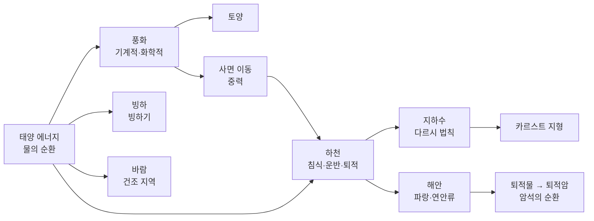

# 일반지구과학 4. 지표를 바꾸는 작용 — 물·얼음·바람이 깎고 나르고 쌓는 지구의 얼굴
<!-- prev: m2-02, 3-1, uearth-1 -->
<!-- next: uearth-5, uearth-6, uearth-9 -->

> [!NOTE]
> **이 단원의 범위**
> - 풍화(기계적·화학적)와 토양의 형성
> - 사면 이동
> - 물의 순환과 하천(유수의 작용, 하천 지형, 홍수)
> - 지하수(대수층, 지하수면, 다르시 법칙의 의미, 카르스트 지형, 지하수 문제)
> - 빙하와 빙하 지형, 빙하기
> - 건조 지역과 바람의 작용, 해안의 작용과 지형

**학습 목표**

1. 기계적 풍화와 화학적 풍화의 메커니즘을 반응식과 광물의 안정성으로 설명하고, 기후·지형·시간이 토양 단면을 어떻게 만드는지 해석할 수 있다.
2. 사면에 작용하는 힘을 구동력과 저항력으로 나누어 안전율을 계산하고, 물이 사면 붕괴를 촉발하는 까닭을 정량적으로 설명할 수 있다.
3. 하천의 유량과 물 수지를 계산하고, 유수의 침식·운반·퇴적 작용이 하천 지형과 홍수 위험을 만드는 과정을 설명할 수 있다.
4. 다르시 법칙으로 지하수의 유량과 실제 유속을 구하고, 카르스트 지형과 과잉 양수·해수 침입·오염 같은 지하수 문제를 해석할 수 있다.
5. 빙하의 질량 수지와 운동, 빙하 침식·퇴적 지형, 빙하기의 해수면 변화와 지각 평형 반등을 설명할 수 있다.
6. 건조 지역에서 물과 바람이 만드는 지형, 해안에서 파랑과 연안류가 만드는 침식·퇴적 지형을 비교할 수 있다.

**이 단원의 학습 사다리**

| 단계 | 무엇을 하나? |
|---|---|
| STEP 1. 이전 학습 다시 보기 | 중학교의 풍화와 토양, 통합과학의 물 순환, 앞 단원의 광물과 퇴적암을 다시 꺼낸다 |
| STEP 2. 기초 다지기 | 힘의 분해와 마찰각, 유량과 연속성, 기울기(경사)와 수두, 입자 크기 눈금, 비율과 확률 |
| STEP 3. 핵심 개념 | 풍화 → 토양 → 사면 이동 → 하천 → 홍수 → 지하수 → 카르스트·지하수 문제 → 빙하 → 빙하기 → 사막과 바람 → 해안 |
| STEP 4. 오개념 바로잡기 | "사막은 바람이 만든다?", "지하수는 땅속 강이다?" 같은 착각을 바로잡는다 |
| STEP 5. 전공 맛보기 | 하상 전단 응력과 실즈 조건, 지형 진화의 확산 모형 |
| STEP 6. 생활·산업·진로 | 산사태 경보, 지하수 관리, 홍수 예보와 하천 복원, 해안 침식 관리 |

---

## 🗺️ 단원 들어가기

여름 장마 끝에 산비탈이 한꺼번에 무너져 내리고, 같은 비가 며칠 뒤 하류의 도시를 물에 잠기게 한다. 강원도의 석회암 지대에서는 밭 한가운데가 둥글게 꺼진 웅덩이가 줄지어 있고, 제주도에서는 큰 비가 와도 하천이 금세 말라 버린다. 수만 년 전 마지막 빙기에는 지금의 황해 대부분이 걸어서 건널 수 있는 평야였다.

**산은 왜 낮아지고, 깎여 나간 물질은 어디로 가며, 그 길을 정하는 것은 무엇일까?** 앞 단원들에서 지구 내부의 에너지가 산맥과 화산을 **만드는** 과정을 보았다면, 이 단원에서는 태양 에너지와 중력이 움직이는 물·얼음·바람이 지표를 **깎고 나르고 쌓는** 과정을 다룬다. 지표의 모습은 이 두 힘이 겨루는 결과이다.

---

## STEP 1. 🔙 이전 학습 다시 보기

### 연계 개념표

| 이전 단원 | 그때 배운 것 | 이 단원에서 확장되는 것 |
|---|---|---|
| 중2 「지권의 변화」 '풍화와 토양의 생성' | 얼음·뿌리·빗물·산소에 의한 풍화, 표토–심토–모질물–기반암 | 풍화의 **반응식과 광물 안정성**, 토양 형성 요인과 토양 층위(O·A·E·B·C층) |
| 중3 「수권과 해수의 순환」 '자원으로서의 물' | 지하수의 장단점, 지반 침하·해수 침입 | **다르시 법칙**으로 지하수 흐름을 계산하고, 해수 침입을 밀도 균형으로 정량화 |
| 통합과학1 「지구시스템의 구성과 상호작용」 '물의 순환' | 증발·강수·유출, 저장소와 흐름, 물 수지 | 유역의 **물 수지와 유량**, 체류 시간, 하천·지하수·빙하 저장소의 역할 |
| 일반지구과학 「지구 시스템과 지구 물질」 | 규산염 광물, 보엔 반응 계열, 퇴적암과 퇴적 환경 | 광물의 **풍화 안정성**(보엔 계열의 거꾸로), 퇴적물이 만들어지는 **지표 과정** |
| 지구과학 「지구의 역사와 한반도의 암석」 '퇴적 구조' | 사층리·연흔·점이 층리 | 하천·사구·해안에서 이 구조들이 **어떤 흐름으로** 생기는지 |

고등학교까지는 "풍화가 일어나고, 흙이 생기고, 물이 흐르며 깎는다"를 **현상**으로 배웠다. 대학에서는 같은 현상을 **힘의 균형(사면), 질량 보존(유량·물 수지), 흐름 법칙(다르시 법칙), 화학 평형(용해·가수 분해)** 으로 다시 쓰고, 그 결과로 위험(산사태·홍수·지하수 고갈)을 예측하는 데까지 나아간다.

### 준비 운동 (사전 진단)

**Q1.** 화강암이 풍화되면 석영은 모래로 남고 장석은 점토로 변한다. 두 광물 가운데 보엔 반응 계열에서 더 높은 온도에서 정출하는 것은 무엇인가?

**Q2.** 폭 10 m, 깊이 2 m인 수로를 물이 평균 1.5 m/s로 흐른다. 1초 동안 단면을 지나는 물의 부피는?

**Q3.** 무게 $W$인 상자가 경사각 $\theta$인 빗면 위에 놓여 있다. 빗면을 따라 아래로 작용하는 중력의 성분과 빗면에 수직한 성분을 쓰시오.

**Q4.** 마지막 빙기에 해수면이 지금보다 낮았던 까닭을 물의 순환으로 설명하시오.

정답 및 해설

**Q1. 장석(특히 사장석·정장석 모두 석영보다 고온)** — 석영은 보엔 반응 계열의 가장 마지막(가장 낮은 온도)에 정출한다. 이 단원에서 보듯이 지표에서는 **늦게(낮은 온도에서) 정출한 광물일수록 풍화에 강하다.**

**Q2.** $Q = (10\times2)\times1.5 = 30\ \mathrm{m^3/s}$

**Q3.** 빗면 방향 $W\sin\theta$, 빗면 수직 방향 $W\cos\theta$. 이 두 성분이 사면 안정 해석의 출발점이다.

**Q4.** 바다에서 증발한 물이 눈으로 내려 대륙 위에 빙상으로 쌓이고 바다로 돌아오지 못했기 때문이다. 바다라는 저장소의 물이 빙하라는 저장소로 옮겨 갔다.

---

## STEP 2. 🧱 기초 다지기

### ① 힘의 분해와 마찰각

빗면 위의 물체(흙덩이, 바윗덩이)에 작용하는 중력 $W$는 빗면 방향 성분 $W\sin\theta$(미끄러지게 하는 **구동력**)와 빗면 수직 성분 $W\cos\theta$(빗면을 누르는 힘)로 나뉜다. 마찰 계수가 $\mu$이면 최대 정지 마찰력은 $\mu W\cos\theta$이다. 지반 공학에서는 $\mu = \tan\phi$로 놓고 $\phi$를 **내부 마찰각(angle of internal friction)** 이라 부른다. 미끄러지지 않을 조건은

$$
W\sin\theta \le W\cos\theta\tan\phi \quad\Longleftrightarrow\quad \theta \le \phi
$$

이다. 마른 모래를 부어 쌓을 때 저절로 생기는 가장 가파른 경사를 **안식각(angle of repose)** 이라 하며, 마른 모래·자갈에서 대략 $30^\circ\sim40^\circ$이다.

### ② 유량과 연속성

단면적 $A$를 평균 속력 $\bar v$로 지나는 흐름의 **유량(discharge)** 은

$$
Q = A\bar v \quad (\mathrm{m^3/s})
$$

이다. 물이 새거나 더해지지 않으면 하천의 어느 단면에서나 $Q$가 같다(질량 보존, 연속 방정식). 그래서 강폭이 좁아지거나 얕아지는 곳에서는 유속이 빨라진다.

### ③ 기울기와 수두

하천 바닥의 **경사(gradient)** 는 수평 거리당 높이 변화로, 흔히 $\mathrm{m/km}$로 나타낸다. 지하수에서는 높이 대신 **수리 수두(hydraulic head)** $h$, 즉 물이 가진 퍼텐셜 에너지를 높이로 나타낸 값을 쓴다. 우물 속 수면의 해발 고도가 곧 그 지점의 수두이다. 두 지점의 수두 차를 거리로 나눈 값 $i = \Delta h/L$을 **수리 경사(hydraulic gradient)** 라 한다. 물은 땅속에서 '높은 곳'이 아니라 **수두가 높은 곳에서 낮은 곳으로** 흐른다.

### ④ 비율과 확률 — 재현 기간

어떤 크기 이상의 홍수가 평균 $T$년에 한 번 일어난다면 그 홍수의 **재현 기간(recurrence interval)** 은 $T$년이고, 어느 한 해에 일어날 확률은 $p = 1/T$이다. 해마다 독립이라면 $n$년 동안 **한 번도 일어나지 않을** 확률은 $(1-p)^n$, **적어도 한 번 일어날** 확률은

$$
P = 1 - (1-p)^n
$$

이다. "100년 빈도 홍수"는 100년에 꼭 한 번 오는 홍수가 아니다.

---

## STEP 3. 📘 핵심 개념

### ① 풍화 — 기계적 풍화

**풍화(weathering)** 는 지표나 지표 가까이에서 암석이 대기·물·생물과 만나 **제자리에서** 부서지거나 화학적으로 변하는 과정이다. 부서진 물질이 물·얼음·바람·중력에 의해 다른 곳으로 옮겨지면 **침식(erosion)**, 옮겨진 물질이 쌓이면 **퇴적(deposition)** 이다. 깊은 곳에서 높은 온도·압력으로 만들어진 암석은 지표의 낮은 온도·압력·물이 많은 환경에서 안정하지 않으므로, 풍화는 암석이 **새 환경에 맞추어 평형을 찾아가는 과정**이다.

**기계적 풍화(mechanical weathering)** 는 화학 조성은 그대로 둔 채 암석을 더 작은 조각으로 쪼갠다.

| 종류 | 메커니즘 | 잘 일어나는 곳 |
|---|---|---|
| **동결 쐐기 작용**(frost wedging) | 틈의 물이 얼면 부피가 약 9 % 늘어 틈을 벌림, 얼고 녹기를 반복 | 0 °C 부근을 자주 오르내리는 고산·중위도 겨울 |
| **하중 제거와 박리**(unloading, exfoliation) | 깊은 곳의 암석(특히 화강암)이 위쪽 암석이 깎여 나가 압력이 줄면 팽창하여 표면과 나란한 판상 절리가 생김 | 화강암 돔(서울 북한산 인수봉, 설악산 울산바위 같은 화강암 봉우리) |
| **염 결정 성장** | 틈에 스며든 염수가 증발하며 염 결정이 자라 틈을 벌림 | 해안 절벽, 건조 지역(타포니라 불리는 벌집 모양 구멍) |
| **열팽창과 수축** | 낮과 밤의 큰 온도 차로 광물마다 다르게 팽창 | 건조 지역(단독 효과는 크지 않고 물과 함께 작용) |
| **생물 작용** | 뿌리의 성장, 굴을 파는 동물 | 식생이 있는 대부분의 지역 |

기계적 풍화의 가장 중요한 역할은 **표면적을 늘리는 것**이다. 한 변 1 m인 정육면체의 겉넓이는 $6\ \mathrm{m^2}$이다. 이것을 한 변 1 cm인 정육면체로 쪼개면 조각은 $10^6$개이고 겉넓이는 $10^6\times6\times(0.01)^2 = 600\ \mathrm{m^2}$, 즉 **100배**가 된다. 화학 반응은 표면에서 일어나므로 기계적 풍화는 화학적 풍화를 크게 빠르게 한다.

> [!NOTE]
> 암석에 원래 있던 **절리**(냉각·하중 제거·지각 변형으로 생긴 틈)는 물이 드나드는 길이 되어 풍화를 집중시킨다. 직교하는 절리로 나뉜 화강암 덩어리는 모서리와 꼭짓점이 세 방향에서 동시에 공격받아 더 빨리 풍화되므로 점점 둥글어진다. 이를 **구상 풍화(spheroidal weathering)** 라 하고, 그 결과 남은 둥근 바위를 핵석이라 부른다.

### ② 풍화 — 화학적 풍화와 광물의 안정성

**화학적 풍화(chemical weathering)** 는 물과 녹아 있는 산·산소가 광물과 반응하여 새로운 광물을 만들거나 이온으로 녹여 내는 과정이다. 빗물에는 대기의 이산화 탄소가 녹아 약한 탄산이 되므로 pH가 약 5.6이다.

$$
\mathrm{CO_2 + H_2O \rightleftharpoons H_2CO_3 \rightleftharpoons H^+ + HCO_3^-}
$$

| 반응 | 대표 반응식 | 결과 |
|---|---|---|
| **용해**(dissolution) | $\mathrm{CaCO_3 + H_2O + CO_2 \rightleftharpoons Ca^{2+} + 2HCO_3^-}$ | 석회암·대리암이 녹음 → 카르스트(⑨) |
| **가수 분해**(hydrolysis) | $\mathrm{2KAlSi_3O_8 + 2H_2CO_3 + 9H_2O \rightarrow Al_2Si_2O_5(OH)_4 + 2K^+ + 2HCO_3^- + 4H_4SiO_4}$ | 정장석 → 고령석(점토 광물), 칼륨 이온과 규산은 물에 녹아 빠져나감 |
| **산화**(oxidation) | 규산염 속 $\mathrm{Fe^{2+}}$ → $\mathrm{Fe^{3+}}$, 적철석($\mathrm{Fe_2O_3}$)·침철석($\mathrm{FeO(OH)}$) 생성 | 붉은색·누런색 흙, 감람석·휘석·흑운모가 잘 분해 |

가수 분해에서 $\mathrm{H^+}$가 광물 격자의 $\mathrm{K^+}$, $\mathrm{Na^+}$, $\mathrm{Ca^{2+}}$와 자리를 바꾸는 것이 핵심이다. 그래서 하천수에는 이 이온들과 탄산수소 이온, 규산이 녹아 있고, 결국 바다로 흘러가 해수의 염류가 된다(「해양」 단원).

#### 광물마다 풍화되는 속도가 다르다

화강암 속 광물을 비교하면 감람석·휘석·각섬석·흑운모·사장석은 비교적 빨리, 정장석·백운모는 느리게, 석영은 가장 느리게 풍화된다. 이 순서는 **보엔 반응 계열을 거꾸로** 놓은 것과 거의 같다(**골디치의 풍화 계열**). 높은 온도에서 정출한 광물일수록 지표 조건과의 차이가 크고, 규소–산소 사면체가 덜 연결된 구조(독립형 사면체인 감람석 등)여서 결합을 끊기 쉽기 때문이다.

| 정출 온도(보엔 계열) | 광물 | 풍화 안정성 |
|---|---|---|
| 높음 | 감람석, 칼슘 사장석 | 가장 불안정 |
| ↓ | 휘석, 각섬석, 흑운모, 나트륨 사장석 | 불안정 |
| ↓ | 정장석, 백운모 | 비교적 안정 |
| 낮음 | 석영 | 가장 안정 → 모래로 남음 |

그래서 화강암이 충분히 풍화된 곳에서는 석영 모래와 점토가 남고, 해빈의 모래는 대부분 석영이다.

풍화 속도는 **기후**(따뜻하고 습할수록 화학적 풍화가 빠르고, 춥고 습하면 동결 쐐기 작용이 우세), **암석의 종류**(광물 조성, 석회암은 습윤 기후에서 빨리 녹고 건조 기후에서는 절벽으로 남음), **절리와 표면적**, **생물**(유기산, 토양 속 높은 이산화 탄소), 풍화 산물이 씻겨 나가는 **지형**에 따라 달라진다.

### ③ 토양의 형성

**토양(soil)** 은 풍화된 광물 입자, 유기물, 물, 공기가 섞인 지표의 얇은 층으로, 식물이 자라는 바탕이다. 같은 기반암 위에서도 조건에 따라 전혀 다른 토양이 생기는데, 토양을 만드는 요인은 흔히 다섯 가지로 정리한다.

| 토양 형성 요인 | 내용 |
|---|---|
| **모재**(parent material) | 기반암이나 운반되어 온 퇴적물. 초기 토양의 조성을 정함 |
| **기후** | 기온과 강수량. 장기적으로는 모재보다 큰 영향(같은 모재라도 기후가 다르면 다른 토양) |
| **생물** | 식생 종류, 미생물·동물의 활동, 유기물 공급 |
| **지형** | 경사가 급하면 토양이 얇고, 낮은 곳에는 두껍고 습한 토양 |
| **시간** | 시간이 길수록 층위가 뚜렷하고 두꺼워짐 |

#### 토양 단면과 층위

충분히 발달한 토양을 수직으로 파 보면 성질이 다른 층이 차례로 나타난다. 이것을 **토양 단면(soil profile)** 이라 하고, 각 층을 **층위(horizon)** 라 한다. 중학교에서 배운 표토·심토·모질물·기반암을 대학에서는 다음처럼 더 세분한다.

| 층위 | 특징 | 중학교 용어 |
|---|---|---|
| O층 | 낙엽과 부식 중인 유기물 | 표토의 맨 위 |
| A층 | 유기물(부식)이 섞인 검은 광물질 층, 생물 활동 활발 | 표토 |
| E층 | 물이 아래로 빠지며 점토·철·알루미늄이 씻겨 나간(**용탈**) 밝은 층 | 표토 아래 |
| B층 | 위에서 씻겨 내려온 점토·철 산화물·탄산염이 쌓인(**집적**) 층 | 심토 |
| C층 | 부분적으로 풍화된 모재 | 모질물 |
| R층 | 풍화되지 않은 기반암 | 기반암 |

#### 기후에 따른 토양의 차이

| 기후 | 토양 | 특징 |
|---|---|---|
| 열대 우림(고온 다습) | **라테라이트**(laterite) | 강한 화학적 풍화와 용탈로 규산과 양이온까지 빠지고 철·알루미늄 산화물만 남은 붉은 토양, 비옥도가 낮음. 알루미늄이 농집되면 보크사이트(알루미늄 광석) |
| 냉온대 침엽수림(서늘하고 습윤) | **포드졸**(podzol) | 산성 낙엽에 의해 E층이 하얗게 용탈됨 |
| 온대 초원(반습윤) | 흑색 토양 | 두껍고 유기물이 많은 A층, 세계적 곡창 지대 |
| 건조·반건조 | **칼리치**(caliche)가 있는 토양 | 증발이 강해 녹은 탄산 칼슘이 B층에 단단한 층으로 침전 |

> [!IMPORTANT]
> 토양은 **재생에 매우 오래 걸리는 자원**이다. 토양이 기반암에서 만들어지는 속도는 대략 1년에 0.01~0.1 mm 정도로 추정되지만, 식생이 사라진 경작지나 개발지에서는 침식 속도가 그보다 훨씬 클 수 있다.

#### 예제 1 — 토양은 얼마나 버틸까

두께 30 cm의 표토가 있는 경작지에서 토양이 연 0.05 mm씩 새로 만들어지고 연 1.0 mm씩 침식된다. 이 상태가 계속되면 표토가 모두 사라지는 데 몇 년이 걸리는가?

**풀이** 알짜 손실 속도 $= 1.0 - 0.05 = 0.95\ \mathrm{mm/년}$. 걸리는 시간 $= \dfrac{300\ \mathrm{mm}}{0.95\ \mathrm{mm/년}} \approx 3.2\times10^2$년.
인간의 시간 규모로는 길어 보이지만, 그 토양이 만들어지는 데는 $300/0.05 = 6000$년이 걸렸다. 3백여 년 만에 6천 년의 축적을 잃는 셈이다. 등고선 경작, 피복 작물, 계단식 밭이 토양 보전에 쓰이는 까닭이다.

### ④ 사면 이동

**사면 이동(mass wasting, mass movement)** 은 풍화된 물질이나 암석이 **중력**에 의해 사면 아래로 직접 움직이는 현상이다. 하천이 골짜기 바닥을 깎으면 양쪽 사면은 사면 이동으로 무너져 내려 그 물질을 하천에 공급한다. 그래서 골짜기는 깊어지는 동시에 넓어진다.

#### 사면 안정의 역학

사면 위의 흙덩이에는 미끄러지게 하는 **구동력**(중력의 사면 방향 성분)과 이를 막는 **저항력**(마찰력과 입자 사이의 점착력, 뿌리의 지지력)이 작용한다. 둘의 비를 **안전율(factor of safety)** 이라 한다.

$$
F_s = \frac{\text{저항력}}{\text{구동력}}, \qquad F_s > 1\ \text{이면 안정},\quad F_s \le 1\ \text{이면 붕괴}
$$

점착력이 없는 마른 흙이 사면과 나란한 면을 따라 미끄러지는 경우(무한 사면 모형), STEP 2의 힘의 분해로부터

$$
F_s = \frac{W\cos\theta\tan\phi}{W\sin\theta} = \frac{\tan\phi}{\tan\theta}
$$

이다. 경사각이 내부 마찰각을 넘으면 붕괴한다.

#### 물은 사면을 어떻게 무너뜨리나

적당한 물기는 모래성을 세울 수 있게 하지만(모세관 힘에 의한 겉보기 점착력), 흙이 물로 **포화**되면 사정이 달라진다.

1. **간극 수압**: 입자 사이 빈틈(간극)을 채운 물의 압력이 입자를 서로 떼어 놓듯 밀어, 입자끼리 맞누르는 힘(**유효 응력**)이 줄어든다. 마찰력은 유효 응력에 비례하므로 저항력이 줄어든다.
2. **무게 증가**: 물을 머금은 흙은 무거워져 구동력이 커진다.
3. **점토의 성질 변화**: 일부 점토는 물을 머금으면 미끄러운 면을 만든다.

지하수면이 지표까지 올라오고 물이 사면과 나란히 흐르는 포화 무한 사면에서는 안전율이 근사적으로

$$
F_s \approx \frac{\gamma_{sat}-\gamma_w}{\gamma_{sat}}\cdot\frac{\tan\phi}{\tan\theta}
$$

로 줄어든다. 여기서 $\gamma_{sat}$는 포화된 흙의 단위 부피당 무게(약 $20\ \mathrm{kN/m^3}$), $\gamma_w$는 물의 단위 부피당 무게($9.8\ \mathrm{kN/m^3}$)이다. 앞의 분수는 약 0.5이므로, **포화되면 안전율이 대략 절반**으로 떨어진다.

#### 예제 2 — 장마가 사면을 무너뜨리는 원리

경사 30°인 사면의 흙은 내부 마찰각이 35°이고 점착력은 무시한다. ($\gamma_{sat} = 20\ \mathrm{kN/m^3}$, $\gamma_w = 9.8\ \mathrm{kN/m^3}$)
(1) 마른 상태의 안전율은? (2) 집중 호우로 지하수면이 지표까지 올라온 경우의 안전율은? (3) 포화 상태에서도 안전하려면 경사가 몇 도보다 완만해야 하는가?

**풀이**
(1) $F_s = \dfrac{\tan35^\circ}{\tan30^\circ} = \dfrac{0.700}{0.577} \approx 1.21$ → 안정
(2) $\dfrac{20-9.8}{20} = 0.51$이므로 $F_s \approx 0.51\times1.21 \approx 0.62$ → **붕괴**
(3) $0.51\times\dfrac{\tan35^\circ}{\tan\theta} = 1$ → $\tan\theta = 0.51\times0.700 = 0.357$ → $\theta \approx 20^\circ$

마른 날에는 멀쩡하던 30° 사면이 같은 흙인데도 비만으로 무너질 수 있다. 실제 사면에는 뿌리와 점토에 의한 점착력이 있어 이보다 안정하지만, 산사태의 대부분이 집중 호우 중이나 직후에 일어나는 까닭을 이 계산이 보여 준다.

#### 사면 이동의 분류

사면 이동은 **움직이는 방식**(낙하·미끄러짐·유동), **물질**(암석·토양), **속도**로 나눈다.

| 종류 | 움직이는 방식 | 속도 | 특징·예 |
|---|---|---|---|
| **낙석**(rockfall) | 가파른 절벽에서 암석이 자유 낙하·굴러떨어짐 | 매우 빠름 | 절벽 아래에 모난 암설이 쌓인 **애추**(talus, 너덜)를 만듦 |
| **암석 미끄러짐**(rockslide) | 층리·절리·단층면을 따라 암석 덩어리가 평면으로 미끄러짐 | 매우 빠름 | 미끄러지는 면이 사면 쪽으로 기울어진 곳에서 위험 |
| **슬럼프**(slump) | 오목한 곡면을 따라 덩어리가 회전하며 미끄러짐 | 느림~빠름 | 윗부분에 초승달 모양 급경사(단애), 아랫부분이 불룩 솟음 |
| **토석류**(debris flow) | 물에 포화된 흙·자갈·바위가 반죽처럼 계곡을 따라 흐름 | 빠름(초속 수 m 이상) | 집중 호우 때 산지 계곡에서 가장 위험, 계곡 출구에 부채꼴 퇴적 |
| **이류**(mudflow) | 점토·실트가 많은 물질이 흐름 | 빠름 | 화산재가 비와 섞인 화산 이류(라하르) |
| **포행**(creep) | 토양이 해마다 mm~cm씩 아주 느리게 내려감 | 매우 느림 | 기울어진 전봇대·담장, 아랫부분이 휘어 자란 나무 |

<!-- fig:uearth-4-mass-wasting -->

사면 이동을 **촉발**하는 것은 집중 호우·눈 녹음(간극 수압과 무게 증가), 사면 아래의 절개(도로 공사, 하천·파랑 침식), 식생 제거(뿌리의 점착력 상실), 지진(순간적인 수평 가속도), 사면 위의 하중이다. 대책으로는 배수 시설, 옹벽·앵커, 조림과 사방 사업, 강우량 기준 경보와 토지 이용 규제가 있다.

> [!WARNING]
> 우리나라는 국토의 대부분이 산지이고 여름철 집중 호우가 잦아 토석류 피해가 반복된다. 계곡 출구의 부채꼴 지형(과거 토석류가 쌓인 곳)은 겉보기에 평탄해 캠핑장·주택지로 쓰이기 쉽지만, 같은 곳에 다시 토석류가 내려올 가능성이 높다. 호우 특보 때 산지 계곡 주변에 머물지 않는다.

### ⑤ 물의 순환과 하천

#### 지구의 물 저장소

| 저장소 | 전체 물에서 차지하는 비율(약) | 평균 체류 시간(대략) |
|---|---|---|
| 해양 | 97 % | 수천 년 |
| 빙하·만년설 | 2 % | 수천 ~ 수십만 년 |
| 지하수 | 0.6 ~ 1.7 % | 수 주 ~ 수만 년(깊이에 따라) |
| 호수·하천 | 약 0.01 % | 수 주(하천) ~ 수십 년(큰 호수) |
| 대기 | 0.001 % | 약 9일 |

어떤 저장소의 **평균 체류 시간**은 (저장량)/(유입률 또는 유출률)이다. 대기의 수증기는 약 열흘마다 완전히 바뀌지만 깊은 지하수는 수만 년 동안 머물 수 있다. 담수 가운데 사람이 쉽게 쓸 수 있는 하천·호수의 물은 아주 적고, 액체 담수의 대부분은 **지하수**이다.

#### 유역의 물 수지

빗물이 모여 한 하천으로 흘러드는 영역을 **유역(drainage basin)**, 이웃 유역과의 경계를 **분수계(divide)** 라 한다. 유역을 하나의 저장소로 보면 질량 보존에 의해

$$
P = ET + R + \Delta S
$$

이다. $P$는 강수량, $ET$는 증발산량(증발 + 증산), $R$은 하천 유출량, $\Delta S$는 토양수·지하수 저장량의 변화이다. 여러 해를 평균하면 $\Delta S \approx 0$이다.

#### 예제 3 — 유역의 물 수지와 평균 유량

유역 면적이 $1000\ \mathrm{km^2}$인 하천에서 연평균 강수량은 1300 mm, 연평균 증발산량은 550 mm이다. 저장량 변화는 0으로 본다.
(1) 연간 하천 유출량(부피)은? (2) 하천 하구의 연평균 유량은? (3) 이 하천의 한 지점에서 폭 40 m, 평균 수심 2.5 m, 평균 유속 1.2 m/s로 측정되었다. 이날의 유량은 평균 유량의 몇 배인가?

**풀이**
(1) 유출 깊이 $= 1300 - 550 = 750\ \mathrm{mm} = 0.75\ \mathrm{m}$. 부피 $= 0.75\times1000\times10^6 = 7.5\times10^8\ \mathrm{m^3}$
(2) $Q = \dfrac{7.5\times10^8\ \mathrm{m^3}}{3.16\times10^7\ \mathrm{s}} \approx 24\ \mathrm{m^3/s}$
(3) $Q = 40\times2.5\times1.2 = 120\ \mathrm{m^3/s}$, 평균의 약 **5배**. 이날은 비가 온 뒤의 큰물이었을 것이다. 우리나라 하천은 여름 장마철에 연 유출량의 대부분이 몰려 평상시와 홍수 때의 유량 차이가 매우 크다(**하상 계수**가 크다).

#### 유수의 침식·운반·퇴적

하천은 위치 에너지를 가진 물이 중력으로 흘러 내려가며 그 에너지를 쓰는 장치이다. 에너지의 대부분은 마찰열로 흩어지지만 일부가 바닥과 기슭을 깎고(침식) 퇴적물을 나른다(운반).

| 운반 방식 | 무엇이 | 어떻게 |
|---|---|---|
| **용해 하중**(dissolved load) | 화학적 풍화로 녹은 이온 | 물과 함께 흐름, 유속과 무관 |
| **부유 하중**(suspended load) | 점토·실트·고운 모래 | 난류에 의해 떠서 이동(흙탕물의 색) |
| **소류 하중**(bed load) | 모래·자갈 | 바닥을 구르고 미끄러지거나 짧게 뛰어오르며(도약) 이동 |

하천이 운반할 수 있는 가장 큰 입자의 크기를 **역량(competence)**, 운반할 수 있는 퇴적물의 총량을 **수용력(capacity)** 이라 한다. 둘 다 유속과 유량이 커질수록 급격히 커지므로, 하천이 하는 지질학적 일의 대부분은 **홍수 때** 이루어진다.

#### 유속과 입자 크기 — 침식·운반·퇴적의 경계

| 입자 | 움직이기 시작하는 유속 | 멈추어 쌓이는 유속 | 해설 |
|---|---|---|---|
| 자갈 | 큼 | 비교적 큼 | 무거워서 빠른 흐름이 필요하고, 조금만 느려져도 쌓임 |
| 모래(약 0.1 ~ 0.5 mm) | **가장 작음** | 중간 | 가장 쉽게 침식되는 크기 |
| 점토·실트 | 오히려 큼 | **매우 작음** | 입자 사이 점착력 때문에 한번 굳으면 떼어 내기 어렵고, 한번 뜨면 거의 멈춘 물에서야 가라앉음 |

이 관계를 유속–입자 크기 그래프로 나타낸 것을 **휼스트룀 도표**라 한다. 점토가 모래보다 침식되기 어렵다는 점이 직관과 다르므로 꼭 기억해 두자. 그래서 하천은 입자 크기별로 퇴적물을 **분급(sorting)** 한다(자갈 2 mm 이상, 모래 1/16~2 mm, 실트 1/256~1/16 mm, 점토 1/256 mm 미만). 상류에는 자갈, 하류에는 모래, 하구와 범람원에는 진흙이 쌓인다.

<!-- sim:u-stream-transport -->

#### 하천의 종단면과 기준면

하천의 상류에서 하구까지 높이를 그린 **종단면**은 대개 상류에서 가파르고 하류에서 완만한 **오목한 곡선**이다. 하천이 더 이상 깎아 내려갈 수 없는 가장 낮은 높이를 **침식 기준면(base level)** 이라 하며, 바다로 흘러드는 하천에서는 해수면이 최종 기준면이다. 호수나 댐, 단단한 암석층은 상류 구간의 국지적 기준면이 된다.

| 기준면의 변화 | 하천의 반응 |
|---|---|
| 기준면 하강(해수면 하강, 땅의 융기) | 하천이 다시 깎아 내려감(**하각 작용** 강화) → 하안 단구, 감입 곡류 |
| 기준면 상승(해수면 상승, 댐 건설) | 유속 감소 → 상류 쪽으로 퇴적 → 댐 위쪽 저수지에 퇴적물이 쌓임, 댐 아래쪽은 퇴적물이 부족해 바닥이 깎임 |

<!-- fig:uearth-4-river-profile -->

### ⑥ 하천 지형

| 구간 | 지형 | 만들어지는 과정 |
|---|---|---|
| 상류(경사 급함, 하각 우세) | **V자곡** | 하천이 바닥을 깎는 동안 양쪽 사면은 사면 이동으로 무너져 V자 단면 |
| | 폭포와 급류 | 단단한 암석층이 국지적 기준면이 됨. 아래의 무른 층이 깎여 폭포가 상류 쪽으로 **후퇴** |
| | **망상 하천** | 퇴적물 공급이 너무 많아 여러 갈래로 갈라졌다 합쳐짐(빙하 하류, 건조 지역) |
| 중·하류(경사 완만, 측방 침식 우세) | **곡류**(meander) | 바깥쪽(**공격 사면**)은 빠른 흐름으로 깎여 절벽, 안쪽(**퇴적 사면**)은 느린 흐름으로 모래가 쌓인 **포인트 바** |
| | **우각호**(oxbow lake) | 곡류의 목이 홍수 때 잘려 남은 쇠뿔 모양 호수 |
| | **범람원**(floodplain) | 홍수 때 넘친 물이 퍼지며 쌓인 평지 |
| | **자연 제방**과 배후 습지 | 넘친 물이 강가에서 먼저 느려져 굵은 입자가 강가에 둑처럼 쌓임, 그 뒤는 낮고 습한 진흙 땅 |
| 산지와 평지의 경계 | **선상지**(alluvial fan) | 좁은 골짜기를 빠져나와 경사가 갑자기 완만해지고 흐름이 퍼지며 부채꼴로 퇴적 |
| 하구 | **삼각주**(delta) | 하천이 바다·호수로 들어가 유속이 급감하며 퇴적. 파랑·조류가 약하고 퇴적물이 많을수록 잘 발달 |
| 기준면 하강 후 | **하안 단구**, **감입 곡류** | 범람원이 다시 깎여 계단 모양 평탄면으로 남음, 곡류가 그대로 깊게 파고듦 |

<!-- fig:uearth-4-meander-floodplain -->

> [!NOTE]
> 강원도 영월·정선 일대의 동강과 서강은 깊은 골짜기 안에서 굽이치는 **감입 곡류**의 대표적인 예이다. 한반도 동쪽이 신생대에 비대칭적으로 융기하면서 하천이 원래의 곡류 모양을 유지한 채 깊이 파고들었다고 해석된다. 우리나라의 큰 강 하구에 삼각주가 크게 발달하지 않는 것은 조차가 커서 조류가 퇴적물을 흩어 놓기 때문이다(낙동강 하구의 삼각주는 예외적으로 발달해 있다).

### ⑦ 홍수

**홍수(flood)** 는 하천의 유량이 하도(물길)가 담을 수 있는 양을 넘어 물이 범람원으로 넘치는 현상이다. 범람원은 이름 그대로 **하천이 원래 넘치는 곳**이다. 하천은 대체로 1~2년에 한 번쯤은 하도를 가득 채우는 큰물을 겪는다.

#### 수문 곡선

강수와 하천 유량의 시간 변화를 함께 그린 그래프를 **수문 곡선(hydrograph)** 이라 한다.

수문 곡선에서 가장 큰 유량을 **첨두 유량**, 강수가 가장 많았던 때부터 첨두 유량까지 걸린 시간을 **지체 시간**, 비가 오지 않을 때도 지하수가 하천으로 흘러들어 유지되는 유량을 **기저 유출**이라 한다.

#### 도시화와 홍수

| 변화 | 원인 | 수문 곡선의 변화 |
|---|---|---|
| 불투수 면적 증가(아스팔트·콘크리트·지붕) | 빗물이 땅에 스며들지 못하고 바로 지표로 흐름 | 첨두 유량 **증가** |
| 우수관·배수로 정비 | 빗물이 빠르게 하천으로 모임 | 지체 시간 **감소** |
| 지하수 함양 감소 | 침투량 감소 | 맑은 날 기저 유출 **감소**(하천이 마름) |

도시가 생기면 같은 비에도 홍수는 더 빨리, 더 크게 오고, 맑은 날에는 하천이 더 쉽게 마른다. 빗물을 땅에 스며들게 하는 투수성 포장, 빗물 정원, 저류지·유수지가 이 변화를 줄이는 방법이다.

<!-- fig:uearth-4-hydrograph -->

#### 재현 기간과 홍수 확률

어느 관측소에서 $n$년 동안 해마다 가장 큰 유량(연 최대 유량)을 크기순으로 늘어놓아 $m$번째 순위를 매기면, 그 유량의 재현 기간은 흔히

$$
T = \frac{n+1}{m}
$$

으로 어림한다(탐구 활동 B). 기록 기간이 짧으면 큰 홍수의 재현 기간은 불확실하므로 통계 분포에 맞추어 외삽한다.

#### 예제 4 — "100년 빈도 홍수"의 진짜 의미

어느 도시의 제방은 100년 빈도 홍수에 견디도록 설계되었다.
(1) 어느 한 해에 이 제방을 넘는 홍수가 날 확률은? (2) 주택 담보 대출 기간 30년 동안 적어도 한 번 제방을 넘는 홍수가 날 확률은? (3) 100년 동안이라면?

**풀이**
(1) $p = 1/100 = 0.01$, 즉 1 %
(2) $P = 1 - (1-0.01)^{30} = 1 - 0.99^{30} \approx 1 - 0.740 = 0.26$ → 약 **26 %**
(3) $P = 1 - 0.99^{100} \approx 0.63$ → 약 **63 %**

100년 동안이라도 100년 빈도 홍수가 반드시 오는 것은 아니며(약 37 %는 한 번도 오지 않는다), 30년 안에 넷 중 한 번꼴로 온다. 또 기후 변화로 극한 강수가 잦아지면 과거 자료로 계산한 재현 기간은 실제보다 길게 평가될 수 있다.

#### 홍수 대책

제방·댐·유수지 같은 **구조적 대책**은 효과가 즉각적이지만 설계 규모를 넘는 홍수에는 오히려 큰 피해를 낳을 수 있다(제방 안쪽의 개발이 늘기 때문). 범람원 토지 이용 규제, 홍수 위험 지도, 예보·경보, 습지 복원 같은 **비구조적 대책**은 범람원의 자연적인 기능을 인정하고 함께 쓴다.

### ⑧ 지하수 — 대수층과 다르시 법칙

#### 지하수면과 대수층

빗물이 땅속으로 스며들면(**침투**) 처음에는 흙 알갱이 사이에 물과 공기가 함께 있는 **비포화대(통기대)** 를 지나고, 더 내려가면 빈틈이 모두 물로 찬 **포화대**에 이른다. 포화대의 윗면이 **지하수면(water table)** 이다. 지하수면은 평평하지 않고 지형을 완만하게 따라 언덕 아래에서 높고 골짜기 아래에서 낮다. 지하수면이 지표와 만나는 곳에서 샘이 솟고 하천과 호수가 유지된다.

| 성질 | 뜻 | 예 |
|---|---|---|
| **공극률**(porosity) | 전체 부피 중 빈틈이 차지하는 비율 → 물을 **얼마나 담을 수 있나** | 점토 40~70 %, 모래 25~40 %, 화강암(틈 없음) 1 % 미만 |
| **투수성**(permeability) | 빈틈이 서로 연결되어 물이 **얼마나 쉽게 흐르나** | 자갈·모래 큼, 점토는 빈틈이 많아도 너무 작아 매우 작음 |

공극률과 투수성은 다르다. 점토는 공극률이 높아도 물이 거의 흐르지 않는다. 물을 잘 저장하고 잘 내주는 지층(모래·자갈층, 틈이 많은 사암·석회암·현무암)을 **대수층(aquifer)**, 물이 잘 통하지 않는 지층(점토층, 셰일)을 **난대수층(aquitard)** 이라 한다.

위가 막혀 있지 않아 지하수면이 자유롭게 오르내리는 **자유면 대수층**은 지표 오염에 취약하다. 위아래가 난대수층에 갇혀 압력을 받는 **피압 대수층**에서는 우물 속 물이 대수층 윗면보다 높이 올라오며, 수두가 지표보다 높으면 저절로 솟는 **자분정**(artesian well)이 된다.

<!-- fig:uearth-4-groundwater-system -->

#### 다르시 법칙

19세기 프랑스의 기술자 다르시는 모래를 채운 관에 물을 흘리는 실험으로, 다공질 매질을 지나는 유량이 **수두 차에 비례하고 흐름 거리에 반비례**한다는 것을 발견했다.

$$
Q = K A \frac{\Delta h}{L} = K A\, i
$$

| 기호 | 뜻 | 단위 |
|---|---|---|
| $Q$ | 유량 | $\mathrm{m^3/s}$ |
| $K$ | **투수 계수**(hydraulic conductivity): 매질과 유체가 물을 통과시키는 능력 | $\mathrm{m/s}$ |
| $A$ | 흐름에 수직한 단면적(빈틈과 알갱이를 모두 포함) | $\mathrm{m^2}$ |
| $i = \Delta h/L$ | 수리 경사 | 무차원 |

이 식은 전기 회로의 옴의 법칙($I = V/R$), 열전도의 푸리에 법칙과 같은 꼴이다. 흐름(전류·열·물)이 '퍼텐셜의 기울기'(전위차·온도 차·수두 차)에 비례한다. 그래서 다르시 법칙의 의미는 **"지하수는 수두가 높은 곳에서 낮은 곳으로, 수두 경사에 비례하는 빠르기로 흐른다"** 는 것이다.

| 매질 | 투수 계수 $K$의 대략적인 범위($\mathrm{m/s}$) |
|---|---|
| 자갈 | $10^{-3} \sim 1$ |
| 깨끗한 모래 | $10^{-6} \sim 10^{-2}$ |
| 실트 | $10^{-9} \sim 10^{-5}$ |
| 점토 | $10^{-12} \sim 10^{-9}$ |
| 틈이 많은 암반, 카르스트 석회암 | 매우 넓음($10^{-8}$ 이하 ~ $10^{-2}$ 이상) |
| 틈이 거의 없는 화성암 | $10^{-10}$ 이하 |

투수 계수는 매질에 따라 **10의 열 몇 제곱**에 걸칠 만큼 차이가 커서 거의 모든 지구 물리량 가운데 가장 넓은 범위를 가진다.

#### 다르시 유속과 실제 유속

$Q/A$를 **다르시 유속**(비유량) $q$라 한다. 그러나 물은 단면 전체가 아니라 연결된 빈틈으로만 흐르므로, 물 입자가 실제로 움직이는 평균 속력(**실제 유속**, 선형 유속)은 유효 공극률 $n_e$로 나눈 값이다.

$$
q = \frac{Q}{A} = K i, \qquad v = \frac{q}{n_e} = \frac{K i}{n_e}
$$

오염 물질이 우물까지 도달하는 시간을 계산할 때는 $v$를 써야 한다.

<!-- sim:u-darcy -->

#### 예제 5 — 오염 물질은 언제 우물에 닿을까

어느 모래 대수층의 투수 계수는 $1.0\times10^{-4}\ \mathrm{m/s}$, 유효 공극률은 0.25이다. 1 km 떨어진 두 관측정의 지하수위 차는 5 m이다.
(1) 수리 경사와 다르시 유속은? (2) 지하수의 실제 유속을 m/일과 m/년으로 구하시오. (3) 상류의 오염원에서 500 m 떨어진 하류 우물까지 오염 물질이 지하수와 같은 속력으로 이동한다면 몇 년 뒤에 도달하는가? (4) 대수층의 폭이 100 m, 두께가 20 m라면 이 단면을 지나는 하루 유량은?

**풀이**
(1) $i = \dfrac{5}{1000} = 0.005$, $q = Ki = 1.0\times10^{-4}\times0.005 = 5.0\times10^{-7}\ \mathrm{m/s}$
(2) $v = \dfrac{q}{n_e} = \dfrac{5.0\times10^{-7}}{0.25} = 2.0\times10^{-6}\ \mathrm{m/s}$ → $\times86400 \approx 0.17\ \mathrm{m/일}$, $\approx 63\ \mathrm{m/년}$
(3) $t = \dfrac{500\ \mathrm{m}}{63\ \mathrm{m/년}} \approx 7.9$년
(4) $Q = qA = 5.0\times10^{-7}\times(100\times20) = 1.0\times10^{-3}\ \mathrm{m^3/s} \approx 86\ \mathrm{m^3/일}$

지하수는 하루에 수십 cm밖에 움직이지 않는다. 그래서 오늘 땅에 스민 오염 물질이 몇 년 뒤에야 우물에 나타나고, 한번 오염된 대수층을 정화하는 데는 수십 년이 걸릴 수 있다.

#### 우물과 지하수면 하강 원뿔

우물에서 물을 퍼 올리면 우물 주변의 지하수면이 깔때기 모양으로 내려앉는다. 이것을 **지하수면 하강 원뿔(cone of depression)** 이라 한다. 하강 원뿔이 생기면 수리 경사가 커져 주변의 지하수가 우물로 모여든다. 이웃한 우물들의 하강 원뿔이 겹치면 얕은 우물이 마르고, 하강 원뿔이 넓어지면 지하수 흐름의 방향 자체가 바뀌어 원래는 멀리 흘러가던 오염 물질이 우물로 끌려오기도 한다.

### ⑨ 카르스트 지형과 지하수 문제

#### 카르스트 지형

석회암 지대에서는 이산화 탄소가 녹은 빗물과 지하수가 절리와 층리면을 따라 석회암을 녹이며(용식) 독특한 지형을 만든다. 이를 **카르스트 지형(karst topography)** 이라 한다. 토양 속에서는 뿌리 호흡과 유기물 분해로 이산화 탄소 농도가 대기보다 수십 배 높아 지하수가 특히 석회암을 잘 녹인다.

| 지형 | 만들어지는 과정 |
|---|---|
| **돌리네**(doline, 싱크홀) | 지표의 빗물이 틈으로 모여 빠지며 녹이거나, 지하 동굴 천장이 무너져 생긴 깔때기 모양 와지 |
| 우발라 | 이웃한 돌리네가 합쳐진 더 큰 와지 |
| **석회 동굴** | 지하수면 부근을 흐르는 지하수가 석회암을 녹여 만든 동굴 |
| 종유석·석순·석주 | 동굴 천장에서 떨어지는 물방울이 동굴 공기 중으로 이산화 탄소를 잃으면 용해 반응이 거꾸로 일어나 방해석이 침전 |
| 탑 카르스트 | 고온 다습한 기후에서 용식이 오래 진행되어 남은 탑 모양 봉우리 |
| 사라지는 하천, 용천 | 하천이 돌리네로 빨려 들어가 땅속으로 흐르다가 다른 곳에서 솟아남 |

동굴 생성물이 만들어지는 반응은 용해 반응의 역반응이다.

$$
\mathrm{Ca^{2+} + 2HCO_3^- \rightarrow CaCO_3 + H_2O + CO_2\uparrow}
$$

같은 반응이 지하수의 이산화 탄소 농도가 높으면 오른쪽(용해)으로, 동굴 공기로 이산화 탄소가 빠져나가면 왼쪽(침전)으로 진행한다. 르샤틀리에 원리로 이해하면 된다.

> [!NOTE]
> 우리나라는 강원 남부(영월·정선·삼척·태백)와 충북 북부(단양) 일대에 고생대 전기의 석회암(조선 누층군)이 넓게 분포하여 돌리네와 석회 동굴이 많다. 단양 고수동굴, 삼척 환선굴 등이 잘 알려져 있다.

#### 지하수 문제

| 문제 | 원인과 메커니즘 | 대책 |
|---|---|---|
| **지하수 고갈** | 함양(빗물의 보충)보다 많이 양수 → 지하수면이 해마다 하강. 건조 지역의 큰 대수층에는 수천~수만 년 전에 채워진 '화석 지하수'도 있어 사실상 재생되지 않음 | 양수량 허가·감시, 인공 함양 |
| **지반 침하** | 지하수를 뽑아 점토층의 간극 수압이 낮아지면 점토층이 압밀되어 땅이 내려앉음. 점토층의 압밀은 대부분 되돌릴 수 없음 | 과잉 양수 제한, 지하수위 감시 |
| **해수 침입** | 해안 대수층에서 양수로 담수 수두가 낮아지면 아래의 해수가 올라와 우물이 짜짐 | 해안 양수 제한, 담수 주입 |
| **지하수 오염** | 매립지 침출수, 정화조, 비료·농약, 유류 탱크 누출 → 하류로 퍼지는 **오염운**(plume) | 오염원 관리, 양수 처리, 투과성 반응벽 |
| **싱크홀** | 카르스트 지역의 동굴 천장 붕괴, 도시에서는 낡은 상하수도관 누수로 흙이 쓸려 나간 빈 공간의 붕괴 | 지하 공간 탐사, 관로 정비 |

#### 해수 침입의 정량화 — 가이벤–헤르츠베르크 관계

해안이나 섬의 대수층에서 가벼운 담수(밀도 $\rho_f \approx 1000\ \mathrm{kg/m^3}$)는 무거운 해수($\rho_s \approx 1025\ \mathrm{kg/m^3}$) 위에 렌즈처럼 떠 있다. 담수–해수 경계면이 정역학 평형을 이룬다고 보면, 해수면 위로 $h$만큼 올라온 담수 기둥의 무게가 해수면 아래 $z$만큼의 '밀도 차'로 받쳐져야 하므로

$$
\rho_f(h+z) = \rho_s z \quad\Rightarrow\quad z = \frac{\rho_f}{\rho_s - \rho_f}h \approx 40h
$$

이다. 지하수면이 해수면보다 1 m 높으면 담수는 해수면 아래 약 40 m까지 있다. 거꾸로, 양수로 지하수면이 **1 m만 낮아져도 경계면은 약 40 m 올라온다.**

<!-- fig:uearth-4-freshwater-lens -->

#### 예제 6 — 섬의 우물이 짜지는 까닭

어느 섬의 해안 근처 지하수면은 해수면보다 1.5 m 높다.
(1) 담수–해수 경계면은 해수면 아래 몇 m에 있는가? (2) 과잉 양수로 지하수면이 0.5 m 낮아지면 경계면은 몇 m 올라오는가?

**풀이**
(1) $z = 40\times1.5 = 60\ \mathrm{m}$
(2) 새 경계면 $= 40\times1.0 = 40\ \mathrm{m}$ → **20 m 상승**. 해수면 아래 50 m까지 판 우물은 처음엔 담수를 뽑았지만 이제는 해수가 섞인 물을 뽑게 된다. 지하수면 0.5 m의 작은 변화가 40배로 증폭되어 나타난다.

> [!IMPORTANT]
> 제주도처럼 투수성이 큰 화산암(현무암)으로 된 섬은 빗물이 잘 스며들어 지하수가 풍부하지만, 담수가 해수 위에 렌즈 모양으로 떠 있는 구조라서 해안 가까운 곳의 과잉 양수에 매우 민감하다. 지하수 관리가 섬의 물 안보와 직결된다.

### ⑩ 빙하와 빙하의 운동

**빙하(glacier)** 는 눈이 쌓여 다져진 얼음 덩어리가 자체 무게로 **흐르는** 것이다. 해마다 내린 눈이 여름에 다 녹지 않고 남아야 생기므로, 고위도나 높은 산에서 만들어진다.

갓 내린 눈(밀도 약 $50\sim200\ \mathrm{kg/m^3}$)은 여름을 넘기며 재결정되어 알갱이 모양의 **만년설**(firn, 약 $400\sim830\ \mathrm{kg/m^3}$)이 되고, 더 눌리면 공기 통로가 닫혀 기포가 갇힌 빙하 얼음(약 $917\ \mathrm{kg/m^3}$에 가까움)이 된다.

얼음 속에 갇힌 기포는 그 당시 대기의 표본이므로, 빙하 얼음은 과거 대기의 기록 보관소이다(「기후와 기후 변화」 단원의 빙하 코어).

빙하는 산지의 골짜기를 따라 흐르는 **산악 빙하**(곡빙하)와 대륙을 덮고 중심에서 사방으로 흐르는 **대륙 빙하**(빙상, 남극·그린란드)로 나뉘며, 빙상이 바다로 흘러나가 떠 있는 부분을 빙붕이라 한다.

#### 빙하의 질량 수지

빙하 윗부분에는 녹는 양보다 쌓이는 눈이 많은 **축적 지역**, 아랫부분에는 녹거나 증발·빙산 분리로 잃는 양이 더 많은 **소모 지역**이 있고, 그 경계가 **평형선**(설선)이다. 빙하 전체의 질량 수지가

- 양(+)이면 빙하의 끝(말단)이 전진하고,
- 음(−)이면 말단이 후퇴한다.

> [!IMPORTANT]
> 빙하의 말단이 후퇴할 때도 빙하 얼음은 **계속 아래로 흐르고 있다.** 말단이 후퇴하는 것은 흘러 내려오는 양보다 녹는 양이 많기 때문이다. 에스컬레이터를 거꾸로 걸어 올라가는 사람처럼, 얼음의 이동 방향과 말단의 이동 방향은 다를 수 있다.

<!-- fig:uearth-4-glacier-budget -->

#### 빙하는 어떻게 흐를까

빙하는 두 방식으로 흐른다. 두께가 수십 m를 넘으면 얼음 결정이 압력을 받아 층층이 미끄러지는 **내부 소성 변형**이 일어나고, 바닥의 녹은 물이 윤활유 역할을 하면 빙하 전체가 미끄러지는 **기저 미끄러짐**이 더해진다. 위쪽 약 50 m 이내의 얼음은 잘 부서져 흐름이 빨라지거나 굽는 곳에서 **크레바스**로 갈라진다.

빙하의 속도는 보통 하루에 수 cm에서 수 m이고, 바다로 흘러드는 일부 빙하는 1년에 수 km 이상 흐르기도 한다. 빙하 중앙은 가장자리보다, 표면은 바닥보다 빠르다(하천과 같은 이유: 마찰).

#### 예제 7 — 빙하의 질량 수지

어느 산악 빙하의 축적 지역 넓이는 $6\ \mathrm{km^2}$이고 1년 동안 평균 1.2 m(물 환산)가 쌓였다. 소모 지역 넓이는 $4\ \mathrm{km^2}$이고 평균 2.0 m(물 환산)를 잃었다.
(1) 1년 동안 빙하 전체의 알짜 질량 변화(물 환산 부피)는? (2) 빙하 전체 면적에 대한 평균 질량 수지는? (3) 말단은 어떻게 변하겠는가?

**풀이**
(1) 축적 $6\times10^6\times1.2 = 7.2\times10^6\ \mathrm{m^3}$, 소모 $4\times10^6\times2.0 = 8.0\times10^6\ \mathrm{m^3}$. 알짜 $= -0.8\times10^6\ \mathrm{m^3}$
(2) $\dfrac{-0.8\times10^6}{10\times10^6} = -0.08\ \mathrm{m}$(물 환산)
(3) 질량 수지가 음이므로 이런 해가 계속되면 빙하가 얇아지고 말단이 **후퇴**한다. 실제로 지난 수십 년 동안 세계 대부분의 산악 빙하는 음의 질량 수지를 보이며 후퇴하고 있다.

### ⑪ 빙하 지형

빙하는 바닥에 얼어붙은 암석 조각을 사포처럼 문질러 기반암을 깎고(**마식**), 기반암 틈에 들어간 물이 얼어 암석 덩어리를 뜯어낸다(**굴식**, plucking). 빙하가 실어 나른 퇴적물은 크기와 관계없이 뒤섞여 쌓인다.

#### 침식 지형

| 지형 | 특징 |
|---|---|
| **U자곡** | V자곡을 빙하가 채워 바닥과 양옆을 깎아 넓고 깊게 만든 골짜기 |
| **권곡**(cirque) | 빙하가 시작되는 산꼭대기 부근의 반원형 움푹한 곳, 빙하가 녹으면 작은 호수 |
| **호른**(horn) | 여러 권곡이 사방에서 깎아 남은 뾰족한 봉우리 |
| 즐릉(아레트) | 이웃한 두 권곡이나 U자곡 사이의 칼날 같은 능선 |
| 현곡 | 지류 빙하의 얕은 골짜기가 본류의 깊은 U자곡 위에 걸린 것, 폭포가 생김 |
| **피오르**(fjord) | U자곡에 빙기 이후 바닷물이 들어온 좁고 깊은 만 |
| 빙하 찰흔과 양배암 | 기반암 표면의 긁힌 줄(빙하의 흐름 방향 기록), 위쪽은 매끈하고 아래쪽은 뜯겨 나간 비대칭 언덕 |

#### 퇴적 지형

빙하가 직접 내려놓은, 분급이 거의 안 된 퇴적물을 **빙력토(till)**, 녹은 물이 다시 운반하여 분급과 층리가 있는 퇴적물을 **빙하성 유수 퇴적물**이라 한다.

| 지형 | 특징 |
|---|---|
| **모레인**(빙퇴석, moraine) | 빙력토가 쌓인 둑. 말단(종퇴석), 양옆(측퇴석), 두 빙하가 합쳐진 가운데(중앙 퇴석) |
| 드럼린 | 빙하 흐름 방향으로 길쭉한 숟가락을 엎어 놓은 모양의 언덕 |
| 에스커 | 빙하 밑 터널을 흐르던 녹은 물의 퇴적물이 남은 구불구불한 둑 |
| 빙하 유수 평원(outwash plain) | 빙하 앞에 녹은 물이 펼쳐 놓은 모래·자갈 평원, 망상 하천 |
| **표석**(erratic) | 빙하가 먼 곳에서 실어 와 떨어뜨린, 주변과 다른 종류의 큰 바위 |

<!-- fig:uearth-4-glacial-landforms -->

### ⑫ 빙하기

#### 빙하기의 증거와 시간 규모

19세기에 알프스 빙하에서 멀리 떨어진 유럽 평원 곳곳의 표석·빙력토·찰흔이 과거의 거대한 빙상이 남긴 흔적임이 밝혀지면서 **빙하기**의 개념이 세워졌다. 지금은 해저 퇴적물과 빙하 코어의 산소 동위 원소 기록으로, 신생대 **제4기**(약 258만 년 전 이후) 동안 빙상이 커지는 **빙기**와 줄어드는 **간빙기**가 수십 차례 반복되었음을 안다. 약 80만 년 전 이후에는 대체로 **약 10만 년** 주기가 뚜렷하다.

| 시기 | 상태 |
|---|---|
| 최종 빙기 최성기(약 2만 년 전) | 북아메리카 북부와 북유럽이 두께 수 km의 빙상으로 덮임. 육지의 약 30 %가 얼음(현재는 약 10 %). 해수면이 지금보다 약 120 m 낮음 |
| 약 1만 1700년 전 이후 | 현재의 간빙기(홀로세) |

빙기와 간빙기가 바뀌는 근본 원인은 지구 공전 궤도와 자전축의 주기적 변화(**밀란코비치 주기**)이고, 온실 기체와 빙하의 반사율 변화가 이를 증폭한다. 이 원리는 「기후와 기후 변화」에서 자세히 다룬다. 제4기 빙하기보다 훨씬 오래전에도 지구는 여러 번 빙하 시대를 겪었다(「지질 시대와 지구의 역사」).

#### 예제 8 — 빙기의 해수면

마지막 빙기 최성기에 해수면이 120 m 낮았다. 바다의 넓이를 $3.61\times10^{14}\ \mathrm{m^2}$로 일정하게 보자.
(1) 바다에서 빠져나간 물의 부피는? (2) 이것이 모두 빙상의 얼음(밀도 $917\ \mathrm{kg/m^3}$)이 되었다면 얼음의 부피는 몇 $\mathrm{km^3}$인가? (3) 황해의 평균 수심은 약 44 m이다. 당시 황해는 어떤 모습이었겠는가?

**풀이**
(1) $V = 3.61\times10^{14}\times120 \approx 4.3\times10^{16}\ \mathrm{m^3}$
(2) 질량이 같으므로 $V_{ice} = V\times\dfrac{1000}{917} \approx 4.7\times10^{16}\ \mathrm{m^3} = 4.7\times10^{7}\ \mathrm{km^3}$. 지금의 남극 빙상(약 $2.7\times10^7\ \mathrm{km^3}$)보다 훨씬 많은 얼음이 북반구 대륙에 더 있었다는 뜻이다.
(3) 평균 수심이 해수면 하강량보다 훨씬 얕으므로 황해 대부분이 **육지**였고, 한반도와 중국 대륙이 이어진 평원 위로 하천이 흘렀다. 빙기가 끝나 해수면이 오르면서 이 골짜기들에 바닷물이 들어와 서해안과 남해안의 복잡한 해안선이 생겼다(⑭의 리아스 해안).

#### 빙하성 지각 평형 반등

두꺼운 빙상의 무게는 그 아래의 지각을 맨틀 속으로 눌러 내린다(지각 평형, 「판구조론과 지구 내부」). 얼음 두께 $H_{ice}$에 대해 평형 상태의 침강량 $d$는 대략

$$
d \approx \frac{\rho_{ice}}{\rho_{mantle}}H_{ice}
$$

이다. 두께 2500 m의 빙상이면 $d \approx \dfrac{917}{3300}\times2500 \approx 7\times10^2\ \mathrm{m}$이다. 빙상이 녹으면 지각은 맨틀이 천천히 흘러 들어오는 속도로 수천 년에 걸쳐 되올라온다. 스칸디나비아와 캐나다 허드슨만 일대는 지금도 1년에 약 1 cm 안팎의 속도로 솟아오르고 있으며, 그 결과 해안에는 계단 모양의 옛 해안선이 남아 있다.

> [!NOTE]
> 남극과 그린란드의 빙상이 모두 녹으면 해수면은 약 65 m 오를 것으로 추정된다. 다만 이것은 수천 년 이상의 시간 규모의 일이고, 지금 관측되는 해수면 상승(연간 수 mm)은 바닷물의 열팽창과 산악 빙하·빙상의 일부가 녹은 결과이다. 바다에 떠 있는 해빙이나 빙붕이 녹는 것은 해수면을 거의 올리지 않는다(아르키메데스 원리).

### ⑬ 건조 지역과 바람의 작용

**사막(desert)** 은 연 강수량이 대략 250 mm 이하이거나 증발 가능량이 강수량을 크게 넘는 곳이다. 덥다는 뜻이 아니라 **건조**하다는 뜻이므로 남극 내륙도 사막이다.

| 사막의 원인 | 원리 | 예 |
|---|---|---|
| 아열대 고압대 | 하강 기류가 단열 압축되어 건조 | 사하라, 아라비아, 오스트레일리아 |
| 비그늘(rain shadow) | 산맥을 넘으며 비를 뿌린 공기가 풍하 측에서 건조하게 하강 | 미국 서부 그레이트베이슨 |
| 대륙 내부 | 바다에서 멀어 수증기가 도달하지 못함 | 고비, 타클라마칸 |
| 한류 연안 | 찬 해수가 하층 공기를 식혀 대기가 안정, 비가 거의 없음 | 아타카마, 나미브 |

#### 건조 지역에서도 지형의 주인공은 물이다

비는 드물지만 한번 오면 식생이 없어 빗물이 땅에 스며들지 못하고 순식간에 흘러 **돌발 홍수(flash flood)** 가 된다. 그래서 건조 지역의 지형도 대부분 물이 만든다.

| 지형 | 특징 |
|---|---|
| 와디(wadi) | 평소에는 말라 있다가 비가 오면 물이 흐르는 하천 바닥 |
| 선상지와 바하다 | 산지 출구의 선상지가 옆으로 이어진 완만한 퇴적 사면 |
| 플라야(playa) | 바다로 나가지 못한 물이 모인 분지 바닥의 일시적 호수, 증발 후 소금·점토 평원 |
| 메사·뷰트 | 단단한 수평 지층이 뚜껑 역할을 하여 남은 탁자 모양 고원(메사)과 더 작아진 탑(뷰트) |
| 인젤베르크 | 평원 위에 섬처럼 남은 단단한 암석 언덕 |

#### 바람의 운반과 침식

공기는 물보다 밀도가 약 800분의 1이므로 같은 속력에서도 훨씬 작은 입자만 움직인다. 바람은 주로 모래 이하의 입자를 나른다.

| 운반 방식 | 입자 | 특징 |
|---|---|---|
| **도약**(saltation) | 모래 | 지표에서 튀어 올랐다 떨어지기를 반복, 대부분 지표 1 m 이내에서 이동 |
| 포행(지표 포행) | 굵은 모래 | 도약하는 알갱이에 부딪혀 굴러감 |
| **부유** | 실트·점토(먼지) | 높이 떠올라 수천 km까지 이동 → 황사 |

| 침식 작용 | 내용 | 결과 |
|---|---|---|
| **디플레이션**(deflation, 취식) | 바람이 고운 입자만 날려 보냄 | 움푹한 분지(취식 와지), 자갈만 남은 **사막 포도**(desert pavement) |
| **마식**(abrasion) | 도약하는 모래가 사포처럼 암석을 깎음, 높이 1 m 이내에서 가장 강함 | 바람 방향의 면이 깎인 **풍식력**(삼릉석), 아랫부분이 깎인 버섯바위 |

#### 사구

바람에 날린 모래가 장애물 뒤나 바람이 약해지는 곳에 쌓인 언덕을 **사구(sand dune)** 라 한다. 바람이 불어오는 쪽(풍상 측)은 완만하고(약 $5^\circ\sim15^\circ$), 모래가 넘어가 쏟아지는 쪽(풍하 측, 활락면)은 모래의 안식각인 약 $30^\circ\sim34^\circ$로 가파르다. 사구는 풍상 측의 모래가 깎여 풍하 측으로 넘어가며 **바람 방향으로 이동**하고, 활락면에 쌓인 모래층은 **사층리**로 남는다.

| 사구의 종류 | 조건 | 모양 |
|---|---|---|
| **바르한**(barchan) | 모래가 적고 바람 방향이 일정 | 뿔이 바람이 불어 가는 쪽(풍하 측)을 향한 초승달 |
| 횡사구 | 모래가 많고 바람 방향이 일정 | 바람에 수직한 긴 물결 모양 |
| 종사구(세이프) | 두 방향 바람 | 바람 방향과 나란한 긴 능선 |
| 성사구 | 여러 방향 바람 | 별 모양, 높고 이동이 적음 |
| 해안 사구 | 해빈 모래가 해풍에 날림 | 해안선을 따라 발달(충남 태안 신두리 해안 사구) |

<!-- fig:uearth-4-dunes -->

#### 뢰스와 황사

바람이 사막과 빙하 유수 평원에서 날려 보낸 실트가 멀리 쌓인 두꺼운 퇴적층을 **뢰스(loess)** 라 한다. 중국 황토 고원의 뢰스는 두께가 수십~수백 m에 이르며, 그 일부가 봄철 **황사**로 다시 날린다.

#### 예제 9 — 황사는 며칠 만에 오나

몽골·중국 북부의 사막에서 날아오른 먼지가 약 2000 km 떨어진 우리나라까지 평균 10 m/s의 상층 바람을 타고 온다면 며칠이 걸리는가? 또 모래(지름 0.3 mm)가 아니라 실트·점토 크기의 먼지만 이렇게 멀리 오는 까닭은?

**풀이** $t = \dfrac{2.0\times10^6\ \mathrm{m}}{10\ \mathrm{m/s}} = 2.0\times10^5\ \mathrm{s} \approx 2.3$일. 실제로 황사는 발원 후 2~3일 만에 도착하는 경우가 많다.
입자가 가라앉는 속력(종단 속도)은 입자 지름의 제곱에 비례할 만큼 크기에 민감하다. 모래는 빠르게 떨어져 도약으로 지표 가까이에서만 움직이지만, 수십 μm 이하의 먼지는 난류에 의해 떠 있는 시간이 길어 수천 km를 이동한다.

### ⑭ 해안의 작용과 지형

해안은 파랑, 연안류, 조석이 육지와 만나는 곳이다. 파랑 자체의 물리(심해파·천해파, 쇄파)는 「해양」 단원에서 다루고, 여기서는 그 에너지가 해안을 어떻게 깎고 쌓는지에 집중한다.

#### 파랑의 굴절과 에너지의 분배

파랑은 수심이 얕아지면 느려지므로, 해안에 비스듬히 다가오는 파랑의 마루는 얕은 쪽이 먼저 느려져 해안선과 나란해지도록 꺾인다(**파랑의 굴절**). 그 결과 바다로 튀어나온 **곶(headland)** 에는 파랑 에너지가 모이고, 움푹 들어간 **만(bay)** 에서는 에너지가 흩어진다. 그래서 오랜 시간이 지나면 곶은 깎이고 만은 메워져 해안선은 **곧게 다듬어지는** 경향이 있다.

#### 연안류와 연안 표류

굴절된 뒤에도 파랑은 해안선에 약간 비스듬히 부서진다. 그러면 해빈의 모래는 파도에 실려 비스듬히 올라갔다가(밀려 올라옴) 중력으로 해안선에 수직하게 내려오기를 반복하며 지그재그로 해안을 따라 이동한다. 쇄파대 안에서는 해안과 나란한 흐름인 **연안류(longshore current)** 도 생긴다. 이 둘이 함께 모래를 해안을 따라 운반하는 것을 **연안 표류(longshore drift)** 라 한다. 하천이 육지의 퇴적물을 바다로 나르는 컨베이어라면 연안 표류는 해안을 따라 모래를 옮기는 컨베이어이다.

<!-- fig:uearth-4-coastal-processes -->

#### 침식 지형과 퇴적 지형

| 침식 지형 | 특징 |
|---|---|
| **해식애** | 파랑이 아랫부분을 깎아 무너져 생긴 해안 절벽 |
| **파식대** | 해식애가 후퇴하며 그 앞에 남은 평탄한 암반면, 간조 때 드러남 |
| 해식동 → 시아치 → **시스택** | 곶의 약한 틈이 파여 동굴 → 양쪽이 뚫린 아치 → 아치가 무너져 남은 바위 기둥 |
| **해안 단구** | 파식대·해빈이 융기하거나 해수면이 낮아져 계단 모양으로 남은 평탄면(우리나라 동해안에 여러 단 발달) |

| 퇴적 지형 | 특징 |
|---|---|
| **해빈**(사빈, beach) | 파랑과 연안류가 쌓은 모래·자갈 해안 |
| **사취**(spit) | 연안 표류로 이동한 모래가 만 입구나 해안 끝에서 바다 쪽으로 길게 뻗은 모래 둑 |
| **사주**(bar)와 **석호**(lagoon) | 사취가 만을 가로막으면 사주가 되고 그 안쪽이 석호(강원 동해안의 경포호·화진포 등) |
| **육계사주·육계도** | 섬과 육지를 잇는 모래 둑과 그 섬 |
| **갯벌**(조간대 갯벌) | 조차가 크고 파랑이 약한 만에서 조류가 실어 온 진흙·모래가 쌓인 평탄한 땅(우리나라 서해안·남해안) |

#### 해빈의 계절 변화와 해안 구조물

해빈은 고정된 모래 더미가 아니라 끊임없이 움직이는 **모래의 흐름**이다. 겨울철이나 폭풍 때의 높고 가파른 파랑은 해빈의 모래를 앞바다의 수중 사주로 끌어내려 해빈이 좁아지고, 여름의 완만한 파랑은 모래를 다시 해빈으로 올려 놓는다.

| 구조물 | 목적 | 부작용 |
|---|---|---|
| 돌제(groin) | 해안에 수직하게 쌓아 연안 표류의 모래를 붙잡음 | 상류 쪽에는 쌓이지만 **하류 쪽은 모래가 부족해 침식** |
| 이안제·방파제 | 파랑을 막아 항구나 해빈 보호 | 뒤쪽에 퇴적, 주변 해안의 모래 공급 차단 |
| 호안·방조제 | 해식애나 해안 도로를 파랑으로부터 보호 | 파랑이 반사되어 앞쪽 해빈의 모래가 더 빨리 쓸려 나감 |
| 양빈(beach nourishment) | 다른 곳의 모래를 가져와 해빈에 보충 | 비용이 들고 주기적으로 반복해야 함 |

해빈에 모래를 공급하던 하천에 댐을 짓거나, 해안 사구를 깎아 건물을 지으면 해빈이 줄어드는 해안 침식이 일어난다. 한 곳의 구조물이 연안 표류의 하류 해안 전체에 영향을 준다는 점이 해안 관리의 핵심이다.

#### 해수면 변화와 해안의 유형

| 유형 | 원인 | 특징 | 예 |
|---|---|---|---|
| **침수 해안**(침강 해안) | 해수면 상승 또는 땅의 침강으로 골짜기가 물에 잠김 | 복잡한 해안선, 섬이 많음. 하천 골짜기가 잠기면 **리아스 해안**, 빙하 골짜기가 잠기면 **피오르** | 우리나라 남해안·서해안, 노르웨이 |
| **이수 해안**(융기 해안) | 땅의 융기 또는 해수면 하강으로 해저가 드러남 | 단조로운 해안선, 해안 단구 | 우리나라 동해안 일부 |

#### 예제 10 — 연안 표류와 돌제

해안선이 남북으로 뻗은 동해안의 해빈에서 파랑이 대체로 북동쪽에서 다가온다(해안선에 비스듬히).
(1) 연안 표류는 대체로 어느 쪽으로 일어나는가? (2) 이 해빈에 해안선과 수직한 돌제를 하나 세우면 돌제의 북쪽과 남쪽 중 어디에 모래가 쌓이고 어디가 깎이는가?

**풀이**
(1) 파랑이 북동쪽에서 와서 해안에 비스듬히 부서지므로 모래는 해안을 따라 **남쪽으로** 이동한다.
(2) 남쪽으로 흐르던 모래가 돌제에 막혀 돌제의 **북쪽(상류 쪽)에 쌓이고**, 모래 공급이 끊긴 **남쪽(하류 쪽)은 깎인다.** 그래서 돌제는 하나만 세우면 이웃 해빈의 침식을 일으키므로 여러 개를 줄지어 세우거나 양빈과 함께 쓴다.

---

## STEP 4. ⚠️ 오개념 바로잡기

| 흔한 오개념 | 올바른 개념 | 왜 그럴까? |
|---|---|---|
| 풍화와 침식은 같은 말이다 | 풍화는 **제자리**에서 부서지고 변하는 것, 침식은 그 물질을 **옮기는** 것이다 | 풍화된 물질이 그 자리에 남으면 토양이 되고, 옮겨지면 퇴적물이 된다 |
| 석영처럼 단단한 광물이 풍화에 강하니, 풍화 저항성은 굳기로 정해진다 | 화학적 풍화 저항성은 주로 **결정 구조와 정출 조건**(골디치 계열)으로 정해진다 | 감람석은 굳기가 석영과 비슷하지만 매우 빨리 풍화된다 |
| 점토는 고운 입자라 모래보다 쉽게 침식된다 | 굳은 점토는 **점착력** 때문에 모래보다 빠른 유속이 있어야 침식된다 | 휼스트룀 도표에서 침식 유속은 모래 크기에서 가장 작다 |
| 지하수는 땅속을 흐르는 강이나 호수이다 | 대부분의 지하수는 알갱이 사이·틈 사이를 하루 수 cm~수 m로 **스며 흐른다** | 다르시 법칙의 실제 유속 $v = Ki/n_e$를 계산하면 매우 느리다 |
| 공극률이 큰 지층일수록 좋은 대수층이다 | 물을 내주려면 빈틈이 **연결되어 있어야**(투수성) 한다 | 점토는 공극률이 높아도 투수 계수가 매우 작은 난대수층이다 |
| 100년 빈도 홍수는 100년에 한 번만 온다 | 해마다 1 %의 확률로 일어나는 홍수이며, 연달아 올 수도 있다 | 30년 동안 적어도 한 번 일어날 확률은 약 26 %이다 |
| 빙하 말단이 후퇴하면 빙하가 거꾸로 흐른다 | 빙하는 늘 아래로 흐르며, 녹는 양이 많으면 **말단만** 후퇴한다 | 말단의 위치는 흐름(공급)과 녹음(소모)의 균형으로 정해진다 |
| 사막의 지형은 대부분 바람이 만든다 | 건조 지역에서도 지형을 만드는 가장 큰 작용은 드물게 오는 **유수**이다 | 식생이 없어 돌발 홍수의 침식·퇴적이 매우 강하다 |

---

## STEP 5. 🎓 다음 단계로 한 걸음 더

> [!CAUTION]
> 여기부터는 일반 과목의 범위를 넘는 전공 과목 맛보기이다. 평가 대상이 아니며, 지형학·수문지질학·퇴적학·지반 공학으로 이 단원의 개념이 어떻게 이어지는지 보여 준다.

### 전공 과목과의 연결

| 전공 과목 | 이어지는 내용 |
|---|---|
| 지형학 | 지형 진화의 수학적 모형(확산 방정식, 하천의 스트림 파워 법칙), 연대 측정으로 침식률 구하기 |
| 수문지질학 | 지하수 흐름 방정식, 우물 수리학(양수 시험), 오염 물질 이동(이류·확산·흡착) |
| 퇴적학 | 흐름과 퇴적물 운반의 역학, 하상 형태(연흔·사구·평탄 하상), 퇴적 환경 해석 |
| 빙하학 | 얼음의 흐름 법칙, 빙상 모형, 빙하–기후 상호 작용 |
| 지반 공학·토질 역학 | 유효 응력 원리, 사면 안정 해석, 압밀 이론(지반 침하) |
| 해안 공학 | 연안 표사량 계산, 해안선 변화 모형 |

### ① 하상 전단 응력과 실즈 조건 — 언제 자갈이 움직일까

하천 바닥은 물에 의해 끌린다. 수심 $h$, 하상 경사 $S$인 넓은 하천에서 흐름 방향의 중력 성분과 바닥 마찰이 균형을 이룬다고 보면, 바닥의 **전단 응력**은

$$
\tau_b = \rho g h S
$$

이다. 퇴적물 입자(밀도 $\rho_s$, 지름 $D$)가 움직이기 시작하는 조건은 실험적으로

$$
\tau_b \ge \tau_c = \theta_c(\rho_s - \rho)gD, \qquad \theta_c \approx 0.03 \sim 0.06
$$

으로 정리되며, $\theta_c$를 **실즈 수**(임계값)라 한다. 예를 들어 수심 2 m, 경사 0.001(1 m/km)인 하천에서 $\tau_b = 1000\times9.8\times2\times0.001 = 19.6\ \mathrm{Pa}$이고, $\theta_c = 0.045$, $\rho_s = 2650\ \mathrm{kg/m^3}$으로 놓으면 움직일 수 있는 가장 큰 입자는 $D = \dfrac{19.6}{0.045\times1650\times9.8} \approx 0.027\ \mathrm{m}$, 즉 지름 약 3 cm의 자갈이다. 홍수로 수심이 두 배가 되면 이 크기도 두 배가 된다. 이 단원에서 말로 설명한 '역량'이 이렇게 계산된다.

### 일반 과목 vs 전공 과목

| 구분 | 일반지구과학 | 전공 과목 |
|---|---|---|
| 사면 | 무한 사면의 안전율(마찰각, 포화의 효과) | 유효 응력 원리, 곡면 활동 해석, 수치 해석 |
| 하천 | 유량, 물 수지, 침식·운반·퇴적의 정성적 경계 | 전단 응력·실즈 조건, 유사량 공식, 하천 진화 모형 |
| 지하수 | 다르시 법칙, 실제 유속, 가이벤–헤르츠베르크 관계 | 지하수 흐름 방정식, 양수 시험 해석, 오염 이동 모형 |
| 빙하 | 질량 수지, 흐름 방식, 지형 | 얼음의 비선형 흐름 법칙, 빙상 역학 |

---

## STEP 6. 🏭 생활·산업·진로 연결

### 사례 1. 산사태 조기 경보

- **원리** 사면의 안전율은 간극 수압에 크게 좌우되므로, 누적 강우량과 강우 강도, 토양의 함수량을 실시간으로 재면 붕괴 위험을 미리 판단할 수 있다. 지반의 미세한 변위를 재는 센서와 위성 레이더 간섭 기법(InSAR)으로 수 mm의 사면 움직임도 감지한다.
- **어디에 쓰이나** 산사태 위험 지역의 주민 대피 경보, 도로 절개 사면의 계측 관리, 산사태 위험 지도 작성.

### 사례 2. 지하수 관리와 물 안보

- **원리** 관측정 망으로 지하수위를 계속 재고, 다르시 법칙과 물 수지로 대수층의 함양량과 지속 가능한 양수량을 평가한다. 해안에서는 전기 전도도로 해수 침입을 감시한다.
- **어디에 쓰이나** 섬 지역과 농촌의 상수원 관리, 먹는 샘물 개발 허가, 지하수 오염 정화, 지열 냉난방 시스템 설계.

### 사례 3. 홍수 예보와 하천 복원

- **원리** 강우 레이더와 강우–유출 모형으로 수문 곡선을 예측해 하천 수위를 미리 알린다. 하천 복원은 직선으로 펴고 콘크리트로 덮었던 하도에 곡류와 범람원, 습지를 되돌려 홍수를 흡수하고 생태계를 살리는 일이다.
- **어디에 쓰이나** 홍수 특보, 댐 방류 결정, 도시 하천 복원 사업, 빗물 저류 시설 설계.

### 관련 전공과 진로

| 진로 | 하는 일 | 관련 전공 |
|---|---|---|
| 수문지질 전문가 | 지하수 탐사·관리, 오염 조사와 정화 | 지질학, 지구환경과학, 환경공학 |
| 지반·사면 엔지니어 | 산사태 위험 평가, 사면 보강 설계 | 토목공학, 지질공학 |
| 수자원 엔지니어 | 홍수 예보, 댐·하천 관리 | 토목공학(수자원), 수문학 |

---

## 🔬 탐구 활동

### 활동 A. 모래 기둥으로 다르시 법칙 확인하기

**목표** 모래를 채운 관에 물을 흘려 유량이 수두 차에 비례함을 확인하고 투수 계수를 구한다.

**준비물** 투명한 아크릴 관(안지름 10 cm, 길이 40 cm 정도), 아래를 막을 거름망과 고무마개(배수구 달린 것), 모래·가는 자갈, 수위를 일정하게 유지할 물통(넘침관 달린 것), 눈금 실린더, 초시계, 자, 스프레드시트

**과정**
1. 관 아래에 거름망을 대고 마른 모래를 30 cm 높이로 고르게 채운다. 모래를 조금씩 넣으며 관을 가볍게 두드려 빈 공간을 없앤다.
2. 관 위쪽에 물을 공급해 모래를 완전히 포화시킨 뒤, 위쪽 수면을 일정한 높이로 유지한다.
3. 위쪽 수면과 아래 배수구 사이의 높이 차 $\Delta h$를 재고, 60초 동안 흘러나온 물의 부피를 잰다.
4. 물통 높이를 바꾸어 $\Delta h$를 3~4가지로 하여 반복한다.
5. 모래 대신 가는 자갈, 모래와 점토를 섞은 것으로도 해 본다.

**결과 기록**

| 매질 | $\Delta h$(m) | 60초 동안 부피(mL) | $Q$($\mathrm{m^3/s}$) | $K = \dfrac{QL}{A\Delta h}$($\mathrm{m/s}$) |
|---|---|---|---|---|
| 모래 | | | | |
| 모래 | | | | |
| 가는 자갈 | | | | |
| 모래 + 점토 | | | | |

> [!NOTE]
> **예시 값** 모래 기둥 길이 $L = 0.30\ \mathrm{m}$, 안지름 0.10 m($A = 7.85\times10^{-3}\ \mathrm{m^2}$), $\Delta h = 0.15\ \mathrm{m}$에서 60초 동안 250 mL가 나왔다면 $Q = 4.2\times10^{-6}\ \mathrm{m^3/s}$, $K = \dfrac{4.2\times10^{-6}\times0.30}{7.85\times10^{-3}\times0.15} \approx 1.1\times10^{-3}\ \mathrm{m/s}$로 굵은 모래에 해당한다.

**생각해 보기**
1. 가로축을 $\Delta h$, 세로축을 $Q$로 한 그래프는 원점을 지나는 직선인가? 기울기는 무엇을 뜻하는가?
2. 점토를 섞었을 때 $K$는 몇 자릿수(10의 몇 제곱)나 줄었는가? 공극률도 그만큼 줄었을까?

> [!WARNING]
> **안전 수칙** 물을 쓰는 실험이므로 전기 기구를 멀리 두고 흘린 물은 바로 닦는다. 모래·점토 가루가 날리지 않도록 젖은 상태로 다루고, 사용한 모래는 하수구에 버리지 말고 따로 모은다.

### 활동 B. 연 최대 유량 자료로 홍수 재현 기간 구하기

**목표** 하천 관측소의 연 최대 유량 자료를 순위화하여 재현 기간과 홍수 확률을 계산한다.

**과정**
1. 다음은 어느 하천 관측소의 10년 동안 연 최대 유량이다(설명을 위한 가상의 자료).

| 연도 | 1 | 2 | 3 | 4 | 5 | 6 | 7 | 8 | 9 | 10 |
|---|---|---|---|---|---|---|---|---|---|---|
| 연 최대 유량($\mathrm{m^3/s}$) | 820 | 1450 | 610 | 2300 | 980 | 1210 | 760 | 1730 | 540 | 1100 |

2. 스프레드시트에서 유량을 큰 순서로 정렬하고 순위 $m$을 매긴다.
3. $T = (n+1)/m$으로 재현 기간을, $p = 1/T$로 연 초과 확률을 계산한다.
4. 가로축을 $T$(로그 눈금), 세로축을 유량으로 하여 점을 찍고 추세선을 그린다.

**결과 기록**

| 순위 $m$ | 유량($\mathrm{m^3/s}$) | 재현 기간 $T$(년) | 연 초과 확률 |
|---|---|---|---|
| 1 | 2300 | 11 | 0.09 |
| 2 | 1730 | 5.5 | 0.18 |
| 3 | | | |
| … | | | |

**생각해 보기**
1. 10년 자료로 100년 빈도 홍수의 유량을 추정하는 것은 얼마나 믿을 만한가? 왜 그런가?
2. 이 유역이 도시화되었다면 같은 강수에 대한 연 최대 유량은 어떻게 변하겠는가? 이 자료로 미래의 위험을 평가할 때 주의할 점은?

---

## ✅ 개념 확인 문제

### 기본

**1.** 다음을 기계적 풍화와 화학적 풍화로 분류하시오.
ㄱ. 화강암 돔 표면이 양파 껍질처럼 판상으로 떨어져 나감 ㄴ. 장석이 고령석으로 변함 ㄷ. 바위 틈의 물이 얼어 틈이 벌어짐 ㄹ. 흑운모 속 철이 산화되어 흙이 붉어짐 ㅁ. 석회암이 빗물에 녹아 동굴이 생김

정답 및 해설

**정답** 기계적 풍화: ㄱ, ㄷ / 화학적 풍화: ㄴ, ㄹ, ㅁ

ㄱ은 하중 제거에 의한 박리, ㄷ은 동결 쐐기 작용으로 조성이 변하지 않는다. ㄴ은 가수 분해, ㄹ은 산화, ㅁ은 용해로 새로운 물질이 생기거나 이온으로 녹아 나간다.

**2.** 폭 25 m, 평균 수심 1.6 m인 하천 단면을 평균 0.9 m/s로 물이 흐른다. 유량을 구하시오. 하류에서 폭이 18 m, 평균 수심이 2.0 m로 바뀌었다면(지류 유입 없음) 평균 유속은?

정답 및 해설

**정답** $36\ \mathrm{m^3/s}$, 1.0 m/s

$Q = 25\times1.6\times0.9 = 36\ \mathrm{m^3/s}$. 연속 방정식에 의해 하류에서도 $Q$가 같으므로 $\bar v = \dfrac{36}{18\times2.0} = 1.0\ \mathrm{m/s}$.

**3.** 점토층은 공극률이 50 %로 모래층(30 %)보다 크다. 그런데도 점토층이 대수층이 되지 못하는 까닭을 공극률과 투수성의 차이로 설명하시오.

정답 및 해설

**정답** 대수층이 되려면 물을 담을 뿐 아니라 **내보낼 수 있어야** 한다. 점토의 빈틈은 매우 작아 물 분자가 입자 표면에 붙잡히고 흐름에 대한 저항이 커서 투수 계수가 모래보다 수십만 배 이상 작다. 그래서 물을 많이 품고 있어도 우물로 거의 흘러들지 않는 **난대수층**이다.

**4.** 다음 지형을 빙하의 침식 지형과 퇴적 지형으로 나누시오. 권곡, 모레인, U자곡, 드럼린, 호른, 에스커, 피오르

정답 및 해설

**정답** 침식 지형: 권곡, U자곡, 호른, 피오르 / 퇴적 지형: 모레인, 드럼린, 에스커

피오르는 빙하가 깎은 U자곡에 빙기 후 바닷물이 들어온 것이므로 침식 지형에 속한다.

**5.** 바르한 사구에서 (1) 완만한 면과 가파른 면 중 바람이 불어오는 쪽은? (2) 초승달의 뿔은 어느 쪽을 향하는가? (3) 사구가 지층에 남긴 사층리로 과거의 바람 방향을 어떻게 알 수 있는가?

정답 및 해설

**정답** (1) 완만한 면 (2) 바람이 불어 가는 쪽(풍하 측) (3) 사층리는 가파른 활락면에 쌓인 층이므로, 층리가 **기울어 내려가는 방향**이 바람이 불어 간 방향이다.

### 응용

**6.** 투수 계수 $5.0\times10^{-5}\ \mathrm{m/s}$, 유효 공극률 0.20인 대수층에서 600 m 떨어진 두 관측정의 지하수위 차가 3.0 m이다. (1) 지하수의 실제 유속(m/일)을 구하시오. (2) 상류 지점에서 누출된 오염 물질이 300 m 하류의 우물에 도달하는 데 몇 년이 걸리는가? (오염 물질은 지하수와 같은 속력으로 이동한다.)

정답 및 해설

**정답** (1) 약 0.11 m/일 (2) 약 7.6년

(1) $i = 3.0/600 = 0.005$, $q = Ki = 2.5\times10^{-7}\ \mathrm{m/s}$, $v = q/n_e = 1.25\times10^{-6}\ \mathrm{m/s} \approx 0.108\ \mathrm{m/일}$
(2) $t = \dfrac{300}{1.25\times10^{-6}} = 2.4\times10^8\ \mathrm{s} \approx 7.6$년

**7.** 경사 26°인 사면의 흙은 내부 마찰각이 33°이고 점착력은 무시한다. (1) 마른 상태의 안전율을 구하시오. (2) 집중 호우로 완전히 포화되어 저항력이 마른 상태의 0.50배로 줄었다면 안전율은? 붕괴하는가?

정답 및 해설

**정답** (1) 약 1.33 (2) 약 0.67, 붕괴한다

(1) $F_s = \dfrac{\tan33^\circ}{\tan26^\circ} = \dfrac{0.649}{0.488} \approx 1.33$
(2) $F_s \approx 0.50\times1.33 \approx 0.67 < 1$이므로 붕괴한다. 간극 수압이 유효 응력을 줄여 마찰 저항이 약해졌기 때문이다.

**8.** 어느 하천 제방은 50년 빈도 홍수를 막도록 설계되었다. (1) 앞으로 20년 동안 이 제방을 넘는 홍수가 적어도 한 번 일어날 확률을 구하시오. (2) "작년에 50년 빈도 홍수가 났으니 앞으로 49년은 안전하다"는 주장이 틀린 까닭을 쓰시오.

정답 및 해설

**정답** (1) 약 33 % (2) 해설 참고

(1) $P = 1 - (1-0.02)^{20} = 1 - 0.98^{20} \approx 1 - 0.668 = 0.33$
(2) 재현 기간은 '평균적인 간격'일 뿐이고 해마다의 확률은 독립적으로 2 %이다. 작년의 홍수가 올해의 확률을 낮추지 않는다. 동전을 던져 앞면이 나왔다고 다음에 뒷면이 나올 확률이 커지지 않는 것과 같다.

**9.** 어느 섬의 해안 근처 지하수면은 해수면보다 0.8 m 높다. 이곳에서 해수면 아래 25 m까지 판 우물로 지하수를 쓰고 있다. (해수 밀도 $1025\ \mathrm{kg/m^3}$, 담수 밀도 $1000\ \mathrm{kg/m^3}$) (1) 현재 담수–해수 경계면의 깊이는? (2) 양수량이 늘어 지하수면이 0.3 m 낮아지면 이 우물은 어떻게 되는가?

정답 및 해설

**정답** (1) 해수면 아래 약 32 m (2) 경계면이 해수면 아래 약 20 m로 올라와 우물 바닥(25 m)보다 얕아지므로 우물에 해수가 섞여 들어온다

(1) $z = \dfrac{1000}{1025-1000}h = 40\times0.8 = 32\ \mathrm{m}$
(2) 새 지하수면 0.5 m → $z = 40\times0.5 = 20\ \mathrm{m}$. 지하수면이 0.3 m 낮아지는 동안 경계면은 12 m나 올라왔다.

### 융합·서술형

**10. [도시와 재해]** 하천 상류의 숲과 논이던 지역이 아파트 단지와 도로로 바뀌었다. (1) 이 하천의 수문 곡선에서 첨두 유량, 지체 시간, 기저 유출이 각각 어떻게 변하는지 원인과 함께 쓰시오. (2) 이 변화를 줄이기 위한 방법을 지하수 함양과 연결하여 두 가지 이상 제안하시오.

정답 및 해설

**예시 답안**
(1) 불투수 면적이 늘어 빗물이 땅에 스며들지 못하고 지표로 바로 흐르므로 **첨두 유량이 커진다.** 우수관과 포장된 도로로 빗물이 빠르게 모이므로 **지체 시간이 짧아진다.** 땅속으로 스며드는 물이 줄어 지하수 함양이 감소하므로 비가 오지 않을 때 하천을 유지하던 **기저 유출이 줄어** 하천이 쉽게 마른다.
(2) ① 투수성 포장과 빗물 정원·식생 수로로 빗물을 땅에 스며들게 한다. ② 저류지·유수지와 지하 빗물 저장 시설로 첨두 유량을 늦추고 줄인다. ③ 옥상 녹화와 빗물 이용 시설로 유출을 줄인다. ④ 범람원과 하천변 습지를 보전하여 홍수 때 물을 담아 두게 한다.

**채점 포인트** ① 세 요소의 변화 방향과 원인 ② 지하수 함양과 기저 유출의 연결 ③ 구체적 방안 두 가지 이상

**11. [빙하기와 지형]** 약 2만 년 전 마지막 빙기 최성기에서 현재까지의 변화를 다음 순서에 따라 설명하시오. (1) 해수면이 약 120 m 낮았던 까닭과 그때 황해(평균 수심 약 44 m)의 모습 (2) 해수면이 높아지면서 우리나라 서해안·남해안에 생긴 해안의 유형 (3) 그 시기 한반도 하천의 침식 기준면 변화와 하천 하류부의 반응

정답 및 해설

**예시 답안**
(1) 바다에서 증발한 물이 북반구 대륙에 빙상으로 쌓여 바다로 돌아오지 못했기 때문이다. 황해는 평균 수심이 해수면 하강량보다 훨씬 얕으므로 대부분 육지(평원)였고, 한반도와 중국이 이어져 있었다.
(2) 빙기 이후 해수면이 오르며 낮은 골짜기들에 바닷물이 들어와 해안선이 복잡하고 섬이 많은 **침수 해안(리아스 해안)** 이 생겼다.
(3) 빙기에는 기준면(해수면)이 낮아 하천이 하류부에서 골짜기를 깊게 **깎아 내려갔고**(하각), 해수면이 상승하자 기준면이 높아져 하류 골짜기에 **퇴적물이 쌓이며** 메워졌다. 그래서 큰 강 하류의 충적층 아래에는 빙기에 깎인 옛 골짜기가 묻혀 있다.

**채점 포인트** ① 물의 저장소 이동 ② 침수 해안 ③ 기준면 하강 → 하각, 상승 → 퇴적

---

## 📝 한눈에 정리

### 핵심 요약

- **풍화**는 제자리에서의 붕괴(기계적: 동결 쐐기, 하중 제거, 염 결정)와 화학 변화(용해·가수 분해·산화)이며, 기계적 풍화가 표면적을 늘려 화학적 풍화를 빠르게 한다. 광물의 풍화 안정성은 보엔 계열의 거꾸로(골디치 계열)이다.
- **토양**은 모재·기후·생물·지형·시간이 만들며 O·A·E·B·C·R 층위를 이룬다. 생성은 느리고 침식은 빠를 수 있다.
- **사면 이동**의 안정은 안전율 $F_s = $ 저항력/구동력으로 판단하며, 마른 무한 사면에서 $F_s = \tan\phi/\tan\theta$이다. 포화되면 간극 수압 때문에 안전율이 약 절반으로 준다.
- 유역의 물 수지 $P = ET + R + \Delta S$와 유량 $Q = A\bar v$로 하천을 정량화한다. 하천은 홍수 때 대부분의 일을 하며, 입자 크기별로 퇴적물을 분급한다.
- 하천 지형은 상류의 V자곡·폭포, 중·하류의 곡류·우각호·범람원·자연 제방, 경사 변환점의 선상지, 하구의 삼각주, 기준면 하강의 하안 단구·감입 곡류로 정리된다.
- **홍수**의 재현 기간 $T$는 연 확률 $1/T$을 뜻하며 $n$년 동안의 확률은 $1-(1-1/T)^n$이다. 도시화는 첨두 유량을 키우고 지체 시간을 줄인다.
- **다르시 법칙** $Q = KA\,\Delta h/L$: 지하수는 수두 경사에 비례하여 흐르고, 실제 유속은 $Ki/n_e$로 매우 느리다. 해안 대수층의 담수–해수 경계는 지하수면 높이의 약 40배 깊이에 있다.
- 석회암 지대의 용식은 **카르스트**(돌리네, 석회 동굴, 종유석·석순)를 만들고, 과잉 양수는 고갈·지반 침하·해수 침입을 일으킨다.
- **빙하**는 질량 수지에 따라 전진·후퇴하며 내부 변형과 기저 미끄러짐으로 흐르고, U자곡·권곡·호른·피오르와 모레인·드럼린·에스커를 만든다. 빙기에는 해수면이 약 120 m 낮았고, 빙상이 녹은 뒤 지각이 반등한다.
- 건조 지역에서도 지형의 주인공은 돌발 홍수이고, 바람은 디플레이션·마식·사구·뢰스를 만든다. 해안에서는 파랑의 굴절과 **연안 표류**가 곶을 깎고 만을 메우며, 해안 구조물은 하류 해안의 침식을 일으킬 수 있다.

### 핵심 용어

| 용어 | 뜻 |
|---|---|
| 기계적 풍화 | 조성 변화 없이 암석을 작은 조각으로 쪼개는 풍화 |
| 화학적 풍화 | 물·산·산소와의 반응으로 광물이 새 광물이나 이온으로 변하는 풍화 |
| 골디치 풍화 계열 | 보엔 반응 계열의 거꾸로, 고온 정출 광물일수록 풍화에 약하다는 순서 |
| 토양 층위 | 토양 단면에서 성질이 다른 층(O·A·E·B·C·R) |
| 안전율 | 사면의 저항력을 구동력으로 나눈 값, 1 이하이면 붕괴 |
| 간극 수압 | 흙 입자 사이 물의 압력, 클수록 유효 응력과 마찰 저항이 줄어듦 |
| 유량 | 단위 시간에 하천 단면을 지나는 물의 부피($Q = A\bar v$) |
| 침식 기준면 | 하천이 깎아 내려갈 수 있는 가장 낮은 높이(최종 기준면은 해수면) |
| 재현 기간 | 어떤 크기 이상의 사건이 평균적으로 일어나는 간격, 연 확률의 역수 |
| 대수층 | 물을 잘 저장하고 잘 내주는 투수성 지층 |
| 다르시 법칙 | 다공질 매질의 유량이 수리 경사에 비례한다는 법칙 $Q = KAi$ |
| 카르스트 지형 | 석회암의 용식으로 생긴 돌리네·석회 동굴 등의 지형 |
| 빙하 질량 수지 | 빙하의 축적량과 소모량의 차이 |
| 빙력토 | 빙하가 직접 쌓은, 분급이 나쁜 퇴적물 |
| 연안 표류 | 비스듬히 부서지는 파랑과 연안류가 모래를 해안을 따라 옮기는 작용 |

### 다음 단원으로

이 단원에서 지표의 물질이 깎이고 운반되어 하천 바닥·호수·해안·사막·빙하 앞에 쌓이는 과정을 보았다. 이렇게 쌓인 퇴적물은 굳어 지층이 되고, 그 안에 생물의 흔적을 품는다. 다음 단원 「지질 시대와 지구의 역사」에서는 지층과 화석, 방사성 동위 원소를 시계로 삼아 그 기록을 읽어 46억 년의 역사를 재구성한다. 해안에서 파랑이 어떻게 생기고 전파되는지는 「해양」에서, 빙기와 간빙기를 반복하게 한 원인은 「기후와 기후 변화」에서 이어진다.
