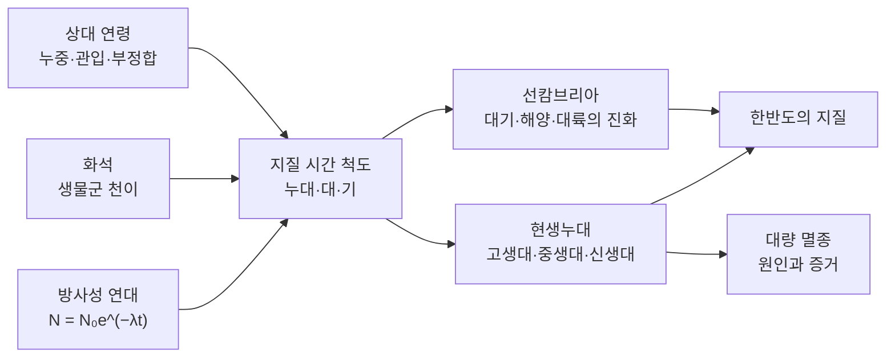

# 일반지구과학 5. 지질 시대와 지구의 역사 — 암석의 시계로 읽는 46억 년
<!-- prev: earth-2, 4-1, uearth-2 -->
<!-- next: uearth-9, ubio-8, uearth-10 -->

> [!NOTE]
> **이 단원의 범위**
> - 상대 연령을 정하는 원리(지층 누중, 관입, 부정합 등)와 지층 대비
> - 화석과 생물군 천이
> - 방사성 동위 원소 연대 측정
> - 지질 시대 구분
> - 선캄브리아 시대의 지구(대기·해양·대륙의 진화), 고생대·중생대·신생대의 환경과 생물, 대량 멸종
> - 한반도의 지질 개관

**학습 목표**

1. 상대 연령의 원리와 부정합을 이용해 지질 단면의 사건 순서를 복원하고, 암상·화석·열쇠층으로 떨어진 지층을 대비할 수 있다.
2. 화석의 보존 조건과 생물군 천이의 원리를 설명하고, 화석의 산출 범위로 지층의 시대를 좁힐 수 있다.
3. 방사성 붕괴의 지수 법칙에서 연령 식을 유도하고, U–Pb·K–Ar·탄소-14 자료로 절대 연령을 계산하며 그 가정과 한계를 설명할 수 있다.
4. 누대·대·기의 지질 시대 구분과 그 경계를 정하는 기준을 설명할 수 있다.
5. 선캄브리아 시대에 대기·해양·대륙·생명이 어떻게 함께 진화했는지 증거를 들어 설명하고, 현생누대의 환경 변화와 대량 멸종을 원인과 증거로 해석할 수 있다.
6. 한반도의 지체 구조와 주요 지층·화강암·화산암을 지질 시대 순서로 정리할 수 있다.

**이 단원의 학습 사다리**

| 단계 | 무엇을 하나? |
|---|---|
| STEP 1. 이전 학습 다시 보기 | 지사학 법칙, 반감기, 표준 화석, 기 수준의 지질 시대, 판구조론을 다시 꺼낸다 |
| STEP 2. 기초 다지기 | 지수 함수와 자연로그, 붕괴 상수와 반감기, 시간의 단위(Ma, Ga), 동위 원소 표기 |
| STEP 3. 핵심 개념 | 동일 과정설 → 상대 연령 → 지층 대비 → 화석 → 방사성 연대 → 지질 시간 척도 → 선캄브리아 → 고생대·중생대·신생대 → 대량 멸종 → 한반도 |
| STEP 4. 오개념 바로잡기 | "탄소-14로 공룡 뼈의 나이를 잰다?", "지질 시대는 같은 길이로 나뉜다?" |
| STEP 5. 전공 맛보기 | 등시선 연대 측정법, 일치 곡선(콘코디아) |
| STEP 6. 생활·산업·진로 | 자원 탐사의 층서, 고고학 연대, 지질 재해의 재발 주기, 지질 유산 |

---

## 🗺️ 단원 들어가기

강원도 태백의 석회암 속에는 삼엽충이, 경남 고성의 바닷가 암반에는 공룡 발자국이 찍혀 있다. 삼엽충이 살던 바다와 공룡이 걷던 호숫가 사이에는 2억 년이 넘는 시간이 놓여 있다. 그런데 우리는 그 시간이 '2억 년'이라는 것을 어떻게 알까? 그리고 이 땅이 바다였다가 호숫가가 되기까지 지구 전체에서는 무슨 일이 있었을까?

**암석은 스스로 시계를 품고 있다.** 쌓인 순서는 '어느 것이 먼저인가'를, 화석은 '어느 시대인가'를, 방사성 원소는 '몇 년 전인가'를 알려 준다. 이 단원에서는 이 세 시계를 맞추어 46억 년 지구의 역사, 즉 대기와 바다와 대륙과 생명이 서로를 바꾸어 온 이야기를 재구성한다.

---

## STEP 1. 🔙 이전 학습 다시 보기

### 연계 개념표

| 이전 단원 | 그때 배운 것 | 이 단원에서 확장되는 것 |
|---|---|---|
| 통합과학2 「지질시대의 환경 변화와 생물다양성」 | 화석과 지층, 표준 화석·시상 화석, 대 수준의 지질 시대, 대멸종과 생물 다양성 | 생물군 천이를 **화석 산출 범위**로 정량적으로 쓰기, 대량 멸종의 원인 가설을 **증거로 평가** |
| 지구과학 「지구의 역사와 한반도의 암석」 '지사학 법칙과 상대 연령', '방사성 동위 원소와 절대 연령' | 지사학 법칙, 부정합 3종, 반감기 횟수로 연령 구하기, 기 수준의 지질 시대, 한반도 지질 개요 | 연령 식 $t = \frac{1}{\lambda}\ln(1 + D/N)$의 **유도**, 붕괴 계열별 특성, 측정의 가정과 오차, 누대 수준의 지구 진화 |
| 일반지구과학 「판구조론과 지구 내부」 | 고지자기 줄무늬, 판의 운동, 초대륙 | 고지자기 층서, **초대륙 주기**와 생물·기후 변화의 연결 |

고등학교에서는 "반감기가 두 번 지났으니 2억 6천만 년"처럼 반감기의 정수배로 연령을 구했다. 대학에서는 붕괴를 미분 방정식으로 쓰고, 반감기의 정수배가 아닌 임의의 비율에서도 연령을 계산하며, 연령이 **언제 시계가 0으로 맞추어졌는지**에 따라 무엇을 뜻하는지 따진다.

### 준비 운동 (사전 진단)

**Q1.** 지층 A 위에 B가 쌓여 있고, 화강암 C가 A와 B를 모두 뚫고 관입했다. A, B, C를 오래된 것부터 쓰시오.

**Q2.** 반감기가 1억 년인 원소의 모원소가 처음 양의 12.5 % 남아 있다. 연령은?

**Q3.** 삼엽충, 암모나이트, 화폐석을 표준 화석으로 하는 대를 각각 쓰시오.

**Q4.** 퇴적암 속 모래 알갱이의 방사성 연령으로 그 퇴적암이 쌓인 시기를 알 수 없는 까닭은?

정답 및 해설

**Q1.** A → B → C (지층 누중, 관입의 법칙)

**Q2.** $0.125 = (1/2)^3$ → 반감기 3번 → **3억 년**

**Q3.** 삼엽충: 고생대, 암모나이트: 중생대, 화폐석: 신생대

**Q4.** 모래 알갱이는 더 오래된 암석이 풍화되어 생긴 것이므로, 그 연령은 알갱이가 **처음 결정으로 만들어진 시기**(원래 암석의 연령)를 가리킨다. 퇴적된 시기는 그보다 나중이다.

---

## STEP 2. 🧱 기초 다지기

### ① 지수 감소와 자연로그

어떤 양이 줄어드는 속도가 **그 순간의 양에 비례**하면, 그 양은 지수 함수로 줄어든다. 방사성 원자핵 $N$개가 있을 때 단위 시간에 붕괴하는 수는 $N$에 비례한다.

$$
\frac{dN}{dt} = -\lambda N \quad\Rightarrow\quad N(t) = N_0 e^{-\lambda t}
$$

$\lambda$는 **붕괴 상수**(decay constant, 단위 $\mathrm{년^{-1}}$)로, 원자핵 하나가 단위 시간에 붕괴할 확률이다. 양변에 자연로그를 취하면 $\ln(N/N_0) = -\lambda t$, 즉 $\ln N$과 $t$는 직선 관계이다.

### ② 반감기와 붕괴 상수

$N = N_0/2$가 되는 시간이 **반감기**(half-life) $t_{1/2}$이다.

$$
\frac{1}{2} = e^{-\lambda t_{1/2}} \quad\Rightarrow\quad t_{1/2} = \frac{\ln 2}{\lambda} \approx \frac{0.693}{\lambda}
$$

| 경과 시간 | $t_{1/2}$ | $2t_{1/2}$ | $3t_{1/2}$ | $4t_{1/2}$ | $5t_{1/2}$ |
|---|---|---|---|---|---|
| 남은 모원소 $N/N_0$ | 0.5 | 0.25 | 0.125 | 0.0625 | 0.031 |
| 자원소/모원소 $D^*/N$ | 1 | 3 | 7 | 15 | 31 |

반감기는 원자핵의 성질로 정해지며, 온도·압력·화학 결합에 거의 영향을 받지 않는다. 이것이 방사성 원소가 지질 시계가 될 수 있는 근거이다.

### ③ 시간의 단위와 동위 원소 표기

| 표기 | 뜻 | 예 |
|---|---|---|
| ka | 1000년 전(kilo-annum) | 20 ka = 2만 년 전 |
| Ma | 100만 년 전(mega-annum) | 66 Ma = 6600만 년 전 |
| Ga | 10억 년 전(giga-annum) | 2.4 Ga = 24억 년 전 |
| $^{238}\mathrm{U}$ | 질량수 238인 우라늄 동위 원소 | 양성자 92개, 중성자 146개 |

같은 원소의 동위 원소는 화학적 성질이 거의 같아 광물 속에서 함께 행동하지만, 원자핵이 달라 붕괴하는 것과 붕괴하지 않는 것이 있다. 질량 분석기로 동위 원소의 비율을 아주 정밀하게 잴 수 있다(「전류·회로와 자기장」의 질량 분석기).

> [!TIP]
> 💡 **요령** — 지질학의 숫자는 크기가 수십만 배씩 다르다. 46억 년을 1년으로 줄인 달력에서 하루는 약 1260만 년이다. 큰 수를 다룰 때는 지수 표기와 'Ma, Ga'를 습관처럼 쓰고, 계산 끝에 이런 비유로 결과를 감각적으로 확인해 보자.

---

## STEP 3. 📘 핵심 개념

### ① 동일 과정설과 지질학적 시간

18세기 말 영국의 허턴은 오늘날 하천이 모래를 쌓고 바다가 해안을 깎는 느린 과정을 관찰하고, 같은 과정이 아주 오랜 시간 동안 작용하면 두꺼운 지층과 산맥도 만들 수 있다고 보았다. "현재는 과거를 여는 열쇠"라는 **동일 과정설(uniformitarianism)** 이다. 이 생각은 지구의 나이가 수천 년이 아니라 상상하기 어려울 만큼 길다는 **깊은 시간(deep time)** 의 개념을 열었다.

현대 지질학은 동일 과정설을 두 가지로 다듬어 쓴다.

| 구분 | 내용 |
|---|---|
| 법칙의 동일성 | 물리·화학 법칙은 과거에도 같았다(이것은 지켜진다) |
| 과정 속도의 동일성 | 과정의 빠르기와 규모는 과거에 달랐을 수 있다. 대기 조성, 판의 운동 속도, 지구의 열 흐름은 변해 왔다 |
| 드문 사건의 인정 | 소행성 충돌, 거대 화산 분출, 초대형 홍수처럼 드물지만 큰 사건도 지질 기록을 만든다 |

#### ✔ 바로 확인

1. (O/X) 현대 지질학은 지질 과정의 빠르기와 규모도 과거와 늘 같았다고 가정한다.
2. 빈칸: "현재는 과거를 여는 열쇠"로 요약되는 (    )을 제안한 18세기 학자는 (    )이다.
3. 현대의 동일 과정설이 인정하는 '드물지만 큰 사건'의 예를 하나 쓰시오.

정답

1. X — 법칙은 같지만 과정의 속도와 규모는 달랐을 수 있다.
2. 동일 과정설, 허턴
3. 소행성 충돌, 거대 화산 분출, 초대형 홍수 가운데 하나

### ② 상대 연령을 정하는 원리

**상대 연령(relative age)** 은 사건의 **순서**이다. 17세기 덴마크의 스테노가 처음 정리한 원리들과 그 뒤에 더해진 원리들은 다음과 같다.

| 원리 | 내용 | 해석에서의 쓰임 |
|---|---|---|
| **지층 누중의 법칙** | 뒤집히지 않은 지층에서는 아래층이 먼저 쌓였다 | 기본 순서 |
| **수평 퇴적의 원리** | 퇴적물은 처음에 거의 수평으로 쌓인다 | 기울거나 휜 지층은 퇴적 **후** 변형되었다 |
| **측방 연속의 원리** | 지층은 끝이 얇아지며 사라질 때까지 옆으로 이어진다 | 골짜기 양쪽의 같은 지층을 이음 |
| **관입·절단의 원리** | 다른 암석을 자르는 관입암·단층·침식면은 잘린 암석보다 나중이다 | 관입암 주변의 접촉 변성, 단층의 시기 |
| **포획물의 원리** | 암석 속에 들어 있는 다른 암석 조각은 그 암석보다 먼저 있었다 | 관입암 속 포획암, 역암 속 자갈 |
| **생물군 천이의 원리** | 화석 생물군은 정해진 순서로 나타나고 사라진다 | 시대 판정, 먼 지층의 대비(③, ④) |

> [!IMPORTANT]
> **지층의 위아래 판정** — 습곡으로 지층이 뒤집혔을 수 있으므로 누중의 법칙을 쓰기 전에 퇴적 구조(점이 층리, 사층리, 연흔, 건열)로 지층의 **위쪽**을 먼저 확인한다. 점이 층리에서 굵은 입자가 위에 있다면 지층이 뒤집힌 것이다.

#### 부정합 — 기록이 빠진 시간

**부정합(unconformity)** 은 퇴적이 멈추고 침식이 일어나 지층 기록의 일부가 사라진 면이다. 부정합면 하나에 수백만~수억 년이 숨어 있을 수 있다.

| 종류 | 모습 | 복원되는 역사 |
|---|---|---|
| **경사 부정합**(angular unconformity) | 아래 지층은 기울거나 습곡되어 있고 위 지층은 수평 | 퇴적 → 변형(습곡·경사) → 융기 → 침식 → 침강 → 퇴적 |
| **평행 부정합**(disconformity) | 위아래 지층이 나란하고 사이에 울퉁불퉁한 침식면, 기저 역암 | 퇴적 → 변형 없이 융기 → 침식 → 침강 → 퇴적 |
| **난정합**(nonconformity) | 아래가 화성암·변성암, 위가 퇴적층 | 깊은 곳의 암석 형성 → 큰 융기와 두꺼운 침식 → 그 위에 퇴적 |

<!-- fig:uearth-5-unconformities -->

위아래 지층이 나란하고 침식면도 거의 보이지 않아 화석의 시대 차이로만 알아낼 수 있는 부정합(**준정합**)도 있다. 이런 경우 화석이 결정적인 증거가 된다.

> [!NOTE]
> 미국 그랜드캐니언의 협곡 벽에는 원생누대의 변성암·화성암과 그 위를 덮은 고생대 지층 사이의 난정합, 기울어진 원생누대 지층과 수평한 캄브리아기 지층 사이의 경사 부정합이 함께 드러나 있다. 이곳에서는 부정합면 하나가 수억 년의 공백을 품고 있다.

<!-- sim:u-relative-dating -->

#### 예제 1 — 지질 단면의 사건 순서

어느 지역의 단면을 글로 나타내면 다음과 같다.
- 맨 아래에 편마암 G가 있고, 그 윗면은 울퉁불퉁한 침식면이다.
- 침식면 위에 역암 1, 사암 2, 셰일 3이 차례로 쌓여 있고, 세 층은 서쪽으로 30° 기울어 있다.
- 단층 F가 G와 1~3을 자르고, 기울어진 3과 F는 함께 평탄한 침식면에 잘려 있다.
- 그 위에 수평한 석회암 4가 있다. 4의 맨 아래에는 셰일 3의 조각이 든 역암이 얇게 있다.
- 현무암 암맥 D가 G부터 4까지 모두 뚫고 올라가 4의 위쪽 표면까지 닿아 있고, D 주변의 4는 구워져 있다.

<!-- fig:uearth-5-section-example -->

(1) 사건의 순서를 쓰시오. (2) 이 단면에 있는 부정합 두 개의 종류를 쓰시오.

**풀이**
(1) G 형성(깊은 곳에서 변성) → 융기·침식 → 침강, 1·2·3 퇴적 → 기울어짐(변형) → 단층 F → 융기·침식(평탄면) → 침강, 4 퇴적 → D 관입.
(2) G와 1 사이: 변성암 위의 퇴적층이므로 **난정합**. 3·F와 4 사이: 기울어진 지층 위의 수평층이므로 **경사 부정합**. 4의 맨 아래 역암 속 셰일 3 조각은 포획물의 원리로 3이 4보다 먼저였음을 다시 확인해 준다.

#### ✔ 바로 확인

1. 짝짓기: (가) 관입암은 그것이 자르는 지층보다 나중이다 (나) 역암 속 자갈은 역암보다 먼저 있었다 (다) 기울어진 지층은 퇴적 뒤에 변형되었다 — ㄱ. 수평 퇴적의 원리 ㄴ. 관입·절단의 원리 ㄷ. 포획물의 원리
2. 점이 층리에서 굵은 입자가 위쪽에 있다면 이 지층은 어떤 상태인가?
3. 아래가 화강암이고 그 위에 사암층이 침식면을 사이에 두고 놓여 있다. 이 부정합의 종류는?

정답

1. (가)–ㄴ, (나)–ㄷ, (다)–ㄱ
2. 뒤집혀 있다 — 점이 층리는 원래 아래가 굵고 위로 갈수록 가늘다.
3. 난정합

### ③ 지층 대비

떨어진 지역의 지층이 같은 시기의 것인지 맞추어 보는 것을 **지층 대비(correlation)** 라 한다. 한 지역에서는 지층이 일부만 남아 있으므로, 여러 지역의 단면을 이어 붙여야 긴 기록이 완성된다.

| 방법 | 근거 | 장점과 한계 |
|---|---|---|
| **암상 대비** | 암석의 종류·색·조직, 특정한 층의 순서 | 가까운 지역에 유용. 같은 암상이 다른 시기에 생길 수 있어 먼 거리에는 부정확 |
| **열쇠층(건층)** | 짧은 시간에 넓게 쌓인 특이한 층(화산재가 굳은 응회암, 운석 충돌층) | 사실상 같은 시각을 가리키는 '시간면'. 화산재는 방사성 연대도 잴 수 있음 |
| **화석 대비** | 같은 표준 화석, 같은 화석군 | 대륙 사이의 먼 거리도 대비 가능 |
| **고지자기 층서** | 지층에 기록된 지구 자기장의 정상·역전 순서 | 화석이 없는 지층도 대비, 전 지구적으로 동시에 일어난 사건 |
| 화학 층서 | 탄소·산소·스트론튬 동위 원소 비의 시간 변화 | 해양 퇴적물과 석회암의 정밀 대비 |

지층은 지역에 따라 이름을 붙여 정리한다. 지도에 그릴 수 있을 만큼 특징이 뚜렷한 기본 단위를 **층**(formation)이라 하고, 여러 층을 묶은 큰 단위를 **층군**, 더 큰 단위를 **누층군**이라 한다(예: 조선 누층군, 경상 누층군).

<!-- fig:uearth-5-correlation -->

#### ✔ 바로 확인

1. (O/X) 암석의 색과 종류로 맞추는 암상 대비는 먼 대륙 사이의 대비에 가장 믿을 만하다.
2. 열쇠층으로 좋은 층의 조건을 한 줄로 쓰고, 대표적인 예를 하나 드시오.
3. 빈칸: 지도에 그릴 수 있을 만큼 특징이 뚜렷한 지층의 기본 단위를 (    )이라 한다.

정답

1. X — 같은 암상이 다른 시기에 생길 수 있어 먼 거리에는 화석·고지자기 대비가 낫다.
2. 짧은 시간에 넓은 지역에 쌓인 특이한 층 — 화산재가 굳은 응회암(또는 운석 충돌층)
3. 층(formation)

### ④ 화석과 생물군 천이

**화석(fossil)** 은 지층 속에 남은 과거 생물의 유해나 흔적이다. 죽은 생물의 대부분은 분해되거나 먹혀 사라지므로 화석이 되는 것은 아주 드문 일이다.

| 화석이 되기 쉬운 조건 | 까닭 |
|---|---|
| 뼈·껍데기·이빨 같은 **단단한 부분** | 분해에 강함 |
| 죽은 뒤 **빠른 매몰** | 청소동물·미생물·산소로부터 보호 |
| 산소가 적은 환경(호수 바닥, 무산소 해저) | 분해가 느림, 부드러운 조직까지 보존되기도 함 |
| 개체 수가 많고 오래 산 생물 | 확률적으로 남을 기회가 많음 |

| 보존 방식 | 내용 | 예 |
|---|---|---|
| 원래 물질 보존 | 원래의 뼈·껍데기, 얼음·호박 속 생물 | 동토층 매머드, 호박 속 곤충 |
| 치환(석화) | 지하수의 광물이 원래 물질을 바꾸거나 빈틈을 채움 | 규화목, 대부분의 공룡 뼈 |
| 몰드와 캐스트 | 껍데기가 녹아 빈 틀(몰드), 그 틀을 다른 광물이 채움(캐스트) | 조개 화석 |
| 탄화 | 휘발 성분이 빠지고 탄소 막으로 남음 | 셰일 속 고사리 잎 |
| **생흔 화석** | 생물의 활동 흔적 | 발자국, 기어간 자국, 굴, 배설물 화석 |

#### 생물군 천이와 표준 화석

19세기 초 영국의 측량 기술자 스미스는 운하를 파며 지층마다 특정한 화석 무리가 정해진 순서로 나타남을 발견했다. 이것이 **생물군 천이(faunal succession)** 이다. 생물은 진화하며 한번 멸종한 종은 다시 나타나지 않으므로, 화석 생물군의 순서는 시간의 순서가 된다. 다윈의 진화론보다 먼저 경험적으로 발견된 원리이지만, 진화가 그 원인을 설명한다.

| 화석의 종류 | 조건 | 쓰임 | 예 |
|---|---|---|---|
| **표준 화석** | 생존 기간이 **짧고**, 분포가 **넓고**, 개체 수가 **많음** | 지층의 시대 결정, 대비 | 삼엽충·필석(고생대), 방추충(고생대 후기), 암모나이트(중생대), 화폐석(신생대 전기), 유공충·코노돈트 같은 미화석 |
| **시상 화석** | 특정 환경에서만 살고 생존 기간이 길어도 됨 | 과거 환경(수온, 수심, 기후) 추정 | 산호(따뜻하고 얕은 바다), 고사리(따뜻하고 습함) |

#### 산출 범위로 시대 좁히기

각 화석 종이 처음 나타나는 층부터 마지막으로 나타나는 층까지를 그 종의 **산출 범위**라 한다. 여러 종의 산출 범위가 겹치는 구간을 찾으면 지층의 시대를 하나의 종만 쓸 때보다 훨씬 좁게 정할 수 있다.

<!-- fig:uearth-5-fossil-ranges -->

#### 예제 2 — 화석 산출 범위의 겹침

어느 지역의 한 셰일층에서 화석 종 P, Q, R이 함께 나왔다. 다른 지역의 연구로 알려진 각 종의 생존 기간은 다음과 같다.

| 종 | 생존 기간 |
|---|---|
| P | 4억 4천만 년 전 ~ 4억 2천만 년 전 |
| Q | 4억 3천만 년 전 ~ 4억 1천만 년 전 |
| R | 4억 2천5백만 년 전 ~ 4억 년 전 |

이 셰일층이 쌓인 시기를 가장 좁게 쓰시오.

**풀이** 세 종이 함께 살았던 시기는 세 범위의 공통 부분이다. 시작은 가장 늦게 나타난 R의 4억 2천5백만 년 전, 끝은 가장 먼저 사라진 P의 4억 2천만 년 전이다. 따라서 **4억 2천5백만 년 전 ~ 4억 2천만 년 전**의 약 500만 년 동안이다. 각각 2천만 년 넘게 살았던 종들을 조합하여 범위를 4분의 1 이하로 좁혔다.

#### ✔ 바로 확인

1. 좋은 표준 화석의 조건 세 가지를 쓰시오.
2. 어느 지층에서 산호 화석이 나왔다. 이 지층이 쌓인 환경은?
3. 화석 산출 범위 그림에서 종 '나'와 '라'가 함께 나오는 지층은 언제 쌓였는가?

정답

1. 생존 기간이 짧고, 분포가 넓고, 개체 수가 많다.
2. 따뜻하고 얕은 바다 — 산호는 시상 화석이다.
3. '라'가 처음 나타난 뒤부터 '나'가 사라지기 전까지 — 두 막대가 겹치는 구간이다.

### ⑤ 방사성 동위 원소 연대 측정

#### 연령 식의 유도

광물이 결정으로 굳는 순간, 그 안에 모원소는 들어가고 자원소는 (거의) 들어가지 않는다고 하자. 이후 광물이 원자를 잃거나 얻지 않는 **닫힌계**로 남는다면, 붕괴한 모원소의 수만큼 방사성 기원 자원소 $D^*$가 쌓인다.

$$
D^* = N_0 - N = N e^{\lambda t} - N = N\left(e^{\lambda t}-1\right)
$$

따라서 지금 측정한 $D^*/N$로부터 연령은

$$
t = \frac{1}{\lambda}\ln\left(1 + \frac{D^*}{N}\right) = \frac{t_{1/2}}{\ln 2}\ln\left(1 + \frac{D^*}{N}\right)
$$

이다. $D^*/N = 1$이면 $t = t_{1/2}$, $D^*/N = 3$이면 $t = 2t_{1/2}$로 STEP 2의 표와 맞는다. 이 식은 반감기의 정수배가 아닌 임의의 비율에도 쓸 수 있다.

<!-- fig:uearth-5-decay-curve -->

#### 주요 연대 측정 방법

| 모원소 → 자원소 | 반감기(약) | 주 측정 대상 | 적용 범위 |
|---|---|---|---|
| $^{238}\mathrm{U} \rightarrow {}^{206}\mathrm{Pb}$ | 44.7억 년 | 지르콘(저어콘) 등 | 약 100만 년 ~ 지구 나이 |
| $^{235}\mathrm{U} \rightarrow {}^{207}\mathrm{Pb}$ | 7.04억 년 | 지르콘 등 | 위와 함께 써서 서로 검증 |
| $^{40}\mathrm{K} \rightarrow {}^{40}\mathrm{Ar}$ | 12.5억 년 | 화산암, 운모·장석 | 수만 년 ~ 수십억 년 |
| $^{87}\mathrm{Rb} \rightarrow {}^{87}\mathrm{Sr}$ | 약 490억 년 | 오래된 화성암·변성암 | 수천만 년 이상 |
| $^{147}\mathrm{Sm} \rightarrow {}^{143}\mathrm{Nd}$ | 약 1060억 년 | 오래된 암석, 운석 | 수억 년 이상 |
| $^{14}\mathrm{C} \rightarrow {}^{14}\mathrm{N}$ | 5730년 | 나무, 숯, 뼈, 조개껍데기 | 약 5만 년 이내 |

| 방법 | 특징 |
|---|---|
| U–Pb 법 | 지르콘은 결정이 될 때 우라늄은 받아들이고 납은 거의 받아들이지 않으며 풍화·변성에 매우 강하다. 두 우라늄 계열이 독립된 두 시계가 되어 결과를 스스로 검증할 수 있어 가장 정밀한 방법이다 |
| K–Ar 법 | $^{40}\mathrm{K}$은 대부분(약 89 %)이 $^{40}\mathrm{Ca}$로, 일부(약 11 %)만 $^{40}\mathrm{Ar}$로 붕괴한다(**분기 붕괴**). 아르곤은 기체라서 용암이 녹아 있을 때 빠져나가므로 굳은 순간 시계가 0으로 맞추어지는 장점이 있지만, 가열되면 다시 빠져나가 연령이 작게 나올 수 있다 |
| 탄소-14 법 | 대기 상층에서 우주선이 질소로부터 $^{14}\mathrm{C}$를 계속 만든다. 살아 있는 생물은 대기와 탄소를 교환하여 대기와 같은 비율을 유지하다가, 죽으면 교환이 끊겨 $^{14}\mathrm{C}$가 줄어든다. 나이테 등으로 보정한 곡선을 써서 연대를 정밀하게 맞춘다 |

> [!IMPORTANT]
> **연령은 '시계가 0으로 맞추어진 사건'의 시각이다.** 화성암에서는 마그마가 굳은 때, 변성암에서는 변성 작용으로 원소가 재배치된 때, 생물 시료에서는 생물이 죽은 때이다. 측정이 믿을 만하려면 ① 처음 자원소가 없었거나 그 양을 보정할 수 있어야 하고, ② 그 뒤로 모원소·자원소가 드나들지 않아야(닫힌계) 한다. 시료가 가열·변질되면 이 가정이 깨진다.

#### 예제 3 — 지르콘의 U–Pb 연령

어느 화강암 속 지르콘에서 방사성 기원 $^{206}\mathrm{Pb}$와 $^{238}\mathrm{U}$의 원자 수 비가 0.50으로 측정되었다. ($^{238}\mathrm{U}$의 반감기 $4.47\times10^9$년)
(1) 붕괴 상수를 구하시오. (2) 이 화강암의 연령을 구하시오. (3) 반감기 횟수로 어림한 값과 비교하시오.

**풀이**
(1) $\lambda = \dfrac{0.693}{4.47\times10^9} \approx 1.55\times10^{-10}\ \mathrm{년^{-1}}$
(2) $t = \dfrac{1}{\lambda}\ln(1 + 0.50) = \dfrac{0.405}{1.55\times10^{-10}} \approx 2.61\times10^9$년, 약 **26억 년**
(3) $D^*/N = 0.5$이면 남은 모원소 비율은 $N/N_0 = 1/1.5 = 0.67$로 반감기 1회(0.5)에 못 미친다. 반감기의 약 0.58배이므로 $0.58\times44.7\text{억} \approx 26\text{억}$ 년으로 일치한다. 반감기의 정수배가 아닐 때는 로그 식을 써야 한다.

#### 예제 4 — 분기 붕괴를 고려한 K–Ar 연령

어느 현무암에서 방사성 기원 $^{40}\mathrm{Ar}$과 $^{40}\mathrm{K}$의 원자 수 비가 0.0050이다. $^{40}\mathrm{K}$의 전체 붕괴 상수는 $\lambda = 5.54\times10^{-10}\ \mathrm{년^{-1}}$이고, 그중 $^{40}\mathrm{Ar}$로 가는 몫은 $\lambda_e/\lambda = 0.105$이다. 연령을 구하시오.

**풀이** 붕괴한 $^{40}\mathrm{K}$ 가운데 0.105만 $^{40}\mathrm{Ar}$이 되었으므로 붕괴한 전체 $^{40}\mathrm{K}$은 $\mathrm{Ar}/0.105$이다. 따라서 $D^*/N$ 자리에 $\dfrac{\mathrm{Ar}}{\mathrm{K}}\times\dfrac{\lambda}{\lambda_e}$를 넣는다.

$$
t = \frac{1}{\lambda}\ln\left(1 + \frac{\lambda}{\lambda_e}\cdot\frac{\mathrm{Ar}}{\mathrm{K}}\right) = \frac{1}{5.54\times10^{-10}}\ln(1 + 9.52\times0.0050) \approx 8.4\times10^7\ \text{년}
$$

약 **8400만 년**(84 Ma), 중생대 백악기 후기이다. 분기 붕괴를 무시하고 $\ln(1+0.0050)$을 쓰면 약 900만 년으로 열 배쯤 작게 나와 크게 틀린다.

#### 예제 5 — 탄소-14 연대와 측정 한계

(1) 어느 유적의 숯에 남은 $^{14}\mathrm{C}$의 비율이 살아 있는 나무의 12 %이다. 연대를 구하시오. (2) 5만 년 된 시료에는 $^{14}\mathrm{C}$가 처음의 몇 %가 남는가? 이것으로 공룡 뼈의 연대를 잴 수 없는 까닭을 설명하시오.

**풀이**
(1) $t = \dfrac{5730}{0.693}\ln\dfrac{1}{0.12} = 8268\times2.12 \approx 1.75\times10^4$년, 약 **1만 7500년 전**(마지막 빙기 후반)
(2) $\left(\dfrac{1}{2}\right)^{50000/5730} = 0.5^{8.7} \approx 0.0024$, 약 **0.2 %**. 그보다 오래되면 남은 양이 측정 한계에 묻힌다. 공룡은 6600만 년 전 이전의 생물이므로 반감기의 1만 배가 넘는 시간이 흘러 $^{14}\mathrm{C}$가 사실상 남아 있지 않다. 공룡 화석의 연대는 위아래 화산재층의 U–Pb·Ar–Ar 연령으로 정한다.

#### ✔ 바로 확인

1. 반감기가 3번 지나면 남은 모원소의 비율과 자원소/모원소 비 $D^*/N$은?
2. 반감기가 1.0억 년인 계열에서 $D^*/N = 3$이면 연령은?
3. (O/X) 방사성 원소의 반감기는 온도가 높아지면 짧아진다.

정답

1. 1/8, 7
2. 2.0억 년 — $D^*/N = 3$은 반감기 2회에 해당한다($t = t_{1/2}\ln(1+3)/\ln2 = 2t_{1/2}$).
3. X — 반감기는 원자핵의 성질로 온도·압력·화학 결합에 거의 영향을 받지 않는다.

### ⑥ 상대 연령과 절대 연령을 엮기

퇴적암은 직접 방사성 연대를 재기 어렵다. 그래서 퇴적층 사이에 끼인 **응회암(화산재층)**, 퇴적층을 자르는 관입암이나 덮는 용암의 연령으로 퇴적층의 연령 **범위**를 정한다. 이렇게 상대 연령의 순서에 절대 연령의 눈금을 붙인 것이 **지질 시간 척도**이다.

| 연대를 정하는 다른 방법 | 원리 | 범위 |
|---|---|---|
| 나이테 연대학 | 해마다 한 겹씩 생기는 나이테의 폭 패턴을 이어 붙임 | 약 1만 년 남짓 |
| 호상 점토(빙호 점토) | 빙하 호수에 해마다 한 쌍씩 쌓인 줄무늬 | 수천~수만 년 |
| 빙하 코어의 연층 | 계절마다 달라지는 얼음층의 화학 성분과 먼지 | 수만 년(깊어질수록 얇아져 다른 방법과 함께) |
| 고지자기 역전 기록 | 해저 자기 줄무늬와 지층의 역전 순서를 연대가 정해진 역전 연표에 맞춤 | 수억 년 |

#### 예제 6 — 퇴적 속도와 화석층의 연령

어느 해성 셰일 지층에서 두 응회암층 사이의 두께가 30 m이다. 아래 응회암은 145.2 Ma, 위 응회암은 144.0 Ma로 측정되었다. 아래 응회암보다 12 m 위에 암모나이트 화석층이 있다.
(1) 평균 퇴적 속도를 m/백만 년과 mm/년으로 구하시오. (2) 화석층의 연령을 어림하시오. (3) 이 계산에 깔린 가정은?

**풀이**
(1) $\dfrac{30\ \mathrm{m}}{1.2\ \text{백만 년}} = 25\ \mathrm{m/백만\ 년} = 0.025\ \mathrm{mm/년}$
(2) 12 m 쌓이는 데 $12/25 = 0.48$백만 년 → $145.2 - 0.48 \approx 144.7\ \mathrm{Ma}$
(3) 퇴적 속도가 일정했고, 두 응회암 사이에 부정합(퇴적 중단·침식)이 없으며, 다짐 정도가 층마다 같다는 가정이다. 실제 지층은 짧은 시간에 두껍게 쌓인 층과 오랫동안 거의 쌓이지 않은 시간이 섞여 있으므로 어림값이다.

> [!TIP]
> 💡 **비유** — 상대 연령은 책장을 넘기는 순서, 화석은 각 장의 제목, 방사성 연대는 몇몇 쪽에 찍힌 날짜 도장이다. 도장이 찍힌 쪽 사이의 쪽들은 도장 사이에 끼워 날짜를 짐작한다.

#### ✔ 바로 확인

1. 어느 셰일층의 바로 아래 응회암은 100.0 Ma, 바로 위 응회암은 98.0 Ma이다. 셰일층의 연령 범위는?
2. 6000만 년 전에 굳은 관입암이 지층 A를 자르고, 지층 B는 그 관입암을 깎은 침식면 위에 쌓였다. A와 B는 각각 6000만 년보다 오래되었는가, 젊은가?
3. (O/X) 나이테 연대학으로 수억 년 전 지층의 연대를 정할 수 있다.

정답

1. 100.0~98.0 Ma 사이
2. A는 더 오래되었고 B는 더 젊다 — 관입·절단의 원리
3. X — 나이테를 이어 붙일 수 있는 범위는 약 1만 년 남짓이다.

### ⑦ 지질 시대 구분

지질 시대는 큰 단위부터 **누대(eon) → 대(era) → 기(period) → 세(epoch)** 로 나눈다. 경계는 같은 길이로 자른 것이 아니라 **생물계의 큰 변화**(대량 멸종, 새로운 생물군의 출현)를 기준으로 정했기 때문에 길이가 제각각이다.

| 누대 | 기간(약) | 특징 |
|---|---|---|
| **명왕누대**(Hadean) | 46억 ~ 40억 년 전 | 지구 형성, 마그마 바다, 남아 있는 암석이 거의 없음 |
| **시생누대**(Archean) | 40억 ~ 25억 년 전 | 최초의 대륙 지각, 원핵생물, 산소가 거의 없는 대기 |
| **원생누대**(Proterozoic) | 25억 ~ 5.39억 년 전 | 대기 산소 증가, 진핵생물, 초대륙, 눈덩이 지구, 다세포 생물 |
| **현생누대**(Phanerozoic) | 5.39억 년 전 ~ 현재 | 단단한 껍데기를 가진 동물이 번성 → 화석이 풍부 |

명왕누대·시생누대·원생누대를 합쳐 흔히 **선캄브리아 시대**라 부르며, 지구 역사의 약 88 %를 차지한다. 현생누대는 고생대, 중생대, 신생대로 나뉜다.

| 대 | 기 | 시작(약, 백만 년 전) |
|---|---|---|
| 고생대 | 캄브리아기 / 오르도비스기 / 실루리아기 / 데본기 / 석탄기 / 페름기 | 539 / 487 / 444 / 419 / 359 / 299 |
| 중생대 | 트라이아스기 / 쥐라기 / 백악기 | 252 / 201 / 145 |
| 신생대 | 팔레오기 / 네오기 / 제4기 | 66 / 23 / 2.58 |

경계의 숫자는 국제 층서 위원회가 펴내는 **국제 지질 시간 척도**에 실리며, 새로운 연대 측정 결과에 따라 조금씩 고쳐진다. 각 경계는 세계 한 곳의 표준 지층 단면에 특정 화석의 첫 출현 등을 기준으로 정하는데, 이 지점을 흔히 '황금 못(GSSP)'이라 부른다.

<!-- fig:uearth-5-time-scale -->

> [!NOTE]
> 인간 활동의 흔적(플라스틱, 핵실험 낙진, 콘크리트 등)이 지층에 남는 현재를 '인류세'라는 새 세로 정하자는 제안이 있었으나, 2024년 국제 지질 과학계의 공식 심사에서 채택되지 않았다. 다만 인간이 지구 시스템을 바꾸는 힘이 지질학적 규모에 이르렀다는 점은 널리 인정된다.

<!-- sim:u-earth-timeline -->

#### 예제 7 — 지구 역사 달력

46억 년을 1년(1월 1일 0시 ~ 12월 31일 자정)으로 줄일 때, (1) 대기의 산소가 크게 늘기 시작한 약 24억 년 전, (2) 페름기 말 대량 멸종(약 2.52억 년 전), (3) 백악기 말 대량 멸종(6600만 년 전)은 각각 언제쯤인가?

**풀이** 하루 = $\dfrac{46\text{억 년}}{365.25} \approx 1260$만 년. 사건 시각은 연말에서 $\dfrac{t}{46\text{억}}\times365.25$일 전이다.
(1) $\dfrac{24}{46}\times365.25 \approx 191$일 전 → 연초부터 약 175일째 → **6월 24일 무렵**
(2) $\dfrac{2.52}{46}\times365.25 \approx 20$일 전 → **12월 11일 무렵**
(3) $\dfrac{0.66}{46}\times365.25 \approx 5.2$일 전 → **12월 26일 저녁 무렵**
산소가 많은 대기는 '한여름'에야 생겼고, 공룡의 멸종은 크리스마스 다음 날이다.

#### ✔ 바로 확인

1. 다음 누대를 오래된 것부터 늘어놓으시오: 원생누대, 명왕누대, 현생누대, 시생누대
2. 중생대의 세 기를 오래된 것부터 쓰시오.
3. 현생누대가 5.39억 년 전에 시작했다면 선캄브리아 시대는 46억 년 지구 역사의 약 몇 %인가?
4. (O/X) 지질 시대의 경계는 시간을 같은 길이로 나누어 정했다.

정답

1. 명왕누대 → 시생누대 → 원생누대 → 현생누대
2. 트라이아스기 → 쥐라기 → 백악기
3. 약 88 % — $(46-5.39)/46 \approx 0.88$
4. X — 대량 멸종 같은 생물계의 큰 변화를 기준으로 정해 길이가 제각각이다.

### ⑧ 선캄브리아 시대 Ⅰ — 지구의 탄생과 초기 지구

#### 지구의 나이와 형성

운석 속 가장 오래된 고체 알갱이의 연령은 약 **45.67억 년**으로, 이것이 태양계가 생긴 시각으로 쓰인다. 지구는 그 뒤 수천만 년에 걸쳐 미행성이 충돌·합체하며 자랐고, 그 무렵 화성만 한 천체와의 **거대 충돌**로 달이 생긴 것으로 해석된다. 충돌 에너지와 방사성 원소의 붕괴열로 지구 바깥은 한때 **마그마 바다**였고, 무거운 철이 가라앉아 핵이, 가벼운 물질이 떠올라 맨틀과 원시 지각이 생겼다(「지구 시스템과 지구 물질」).

| 기록 | 연령(약) | 의미 |
|---|---|---|
| 운석의 가장 오래된 고체 | 45.67억 년 | 태양계의 나이 |
| 가장 오래된 지구 광물(서오스트레일리아의 지르콘 알갱이) | 44억 년 | 일찍부터 지각이 있었음. 일부 지르콘의 산소 동위 원소는 **액체 물**과의 반응을 시사 |
| 가장 오래된 지구 암석(캐나다 북서부의 편마암) | 40억 년 | 대륙 지각의 존재 |
| 가장 오래된 확실한 생명의 흔적(스트로마톨라이트 화석) | 35억 년 | 미생물 매트가 쌓은 층상 구조 |

#### 초기 대기와 해양

| 단계 | 대기 | 근거·과정 |
|---|---|---|
| 1차 대기 | 원시 태양계 성운의 수소·헬륨 | 지구 중력이 약하고 초기 태양풍이 강해 대부분 빠져나감 |
| 2차 대기 | 수증기, 이산화 탄소, 질소(산소는 거의 없음) | 화산 활동으로 내부 기체가 빠져나옴(**탈기체**), 혜성·소행성이 물을 더함 |
| 해양 형성 | 지표가 식어 수증기가 응결 → 비 → 바다 | 44억~40억 년 전에 이미 액체 물이 있었다는 증거 |
| 이산화 탄소 감소 | 바다에 녹은 $\mathrm{CO_2}$가 칼슘과 만나 탄산염 암석으로 저장 | 그래서 지금 대기에는 $\mathrm{CO_2}$가 적고 질소가 주성분 |

> [!NOTE]
> **희미한 젊은 태양의 역설** — 별의 진화 이론에 따르면 40억 년 전 태양의 밝기는 지금의 약 70~75 %였다. 지금의 대기라면 지구 전체가 얼었어야 하지만, 시생누대의 지층에는 액체 물의 흔적이 가득하다. 당시 대기에 이산화 탄소·메테인 같은 온실 기체가 훨씬 많았기 때문이라는 해석이 유력하다. 장기적으로는 **탄소–규산염 순환**(따뜻해지면 풍화가 빨라져 $\mathrm{CO_2}$를 더 많이 제거하고, 추워지면 반대)이 지구의 온도 조절기 역할을 해 왔다.

#### ✔ 바로 확인

1. 지금까지 알려진 가장 오래된 지구 광물은 무엇이며 약 몇 년 전의 것인가?
2. 화산 탈기체로 생긴 2차 대기의 주성분이 아닌 것은? 수증기, 이산화 탄소, 질소, 산소
3. 초기 대기에 많던 이산화 탄소는 주로 어디로 옮겨 갔는가?

정답

1. 서오스트레일리아의 지르콘 알갱이, 약 44억 년 전
2. 산소 — 초기 대기에는 자유 산소가 거의 없었다.
3. 바다에 녹아 칼슘과 만나 탄산염 암석으로 저장되었다.

### ⑨ 선캄브리아 시대 Ⅱ — 대기·해양·대륙·생명의 공진화

#### 산소 혁명

시생누대의 대기에는 자유 산소가 거의 없었다. 약 27억 년 전 무렵에는 광합성으로 산소를 내는 **남세균**(시아노박테리아)이 있었던 것으로 보이지만, 처음 만들어진 산소는 바닷물에 녹아 있던 $\mathrm{Fe^{2+}}$와 화산 기체 같은 환원성 물질과 반응하여 대부분 소비되었다. 이 '산소 흡수원'이 채워진 뒤 약 **24억~23억 년 전**에 대기 산소가 처음 크게 늘어났는데, 이를 **대산화 사건**(Great Oxidation Event)이라 한다.

| 증거 | 산소가 없을 때 | 산소가 늘어난 뒤 |
|---|---|---|
| **호상 철광층**(BIF) | 바다에 녹은 $\mathrm{Fe^{2+}}$가 산소를 만나 산화 철로 침전 → 철이 많은 층과 처트층이 번갈아 쌓임. 약 25억~18억 년 전에 가장 많음 | 깊은 바다까지 산화되어 녹은 철이 사라지자 대부분 끝남 |
| 쇄설성 황철석·우라니나이트 | 산소가 있으면 쉽게 산화되는 광물이 하천 퇴적물 속에 알갱이로 남음 | 이런 광물이 퇴적물에서 사라짐 |
| **적색층**(red beds) | 거의 없음 | 육상 퇴적물이 산화 철로 붉게 물듦 |
| 황 동위 원소의 특이 분별 | 산소·오존이 없어 자외선 광화학 반응이 남긴 독특한 신호 | 약 24억 년 전 이후 사라짐 → 대기 산소 증가의 가장 결정적 증거 |

산소가 늘어나자 성층권에 **오존층**이 생기기 시작해 자외선을 막았고, 산소 호흡으로 더 많은 에너지를 얻는 생물이 가능해졌다. 핵을 가진 **진핵생물**의 확실한 화석은 약 18억~16억 년 전 무렵부터 나타난다. 대기 산소는 원생누대 동안 낮은 수준에 머물다가, 원생누대 말(약 8억~5.4억 년 전)에 다시 늘어 오늘날 수준에 가까워진 것으로 해석된다.

<!-- fig:uearth-5-oxygen-history -->

#### 눈덩이 지구와 다세포 동물

원생누대 말에는 적도 부근의 당시 해수면 높이 지층에서도 빙하 퇴적물이 나타난다. 이를 바탕으로 지구 전체가 얼음으로 덮였다는 **눈덩이 지구(snowball Earth)** 가설이 제안되었다(대표적으로 약 7.2억~6.6억 년 전, 약 6.5억~6.35억 년 전의 두 차례).

| 단계 | 과정 |
|---|---|
| 얼어붙음 | 얼음이 저위도까지 내려오면 반사율이 커져 더 추워지는 되먹임이 폭주 |
| 유지 | 바다가 얼어 풍화·광합성이 거의 멈춤, 화산 $\mathrm{CO_2}$는 계속 쌓임 |
| 해빙 | $\mathrm{CO_2}$가 매우 많아져 강한 온실 효과로 갑자기 녹음 → 빙하 퇴적물 바로 위에 따뜻한 바다의 **덮개 탄산염암** |
| 그 뒤 | 호상 철광층의 짧은 재출현, 산소 증가, **에디아카라 생물군**(약 5.75억 년 전~)의 부드러운 몸을 가진 다세포 동물 |

#### 대륙의 성장과 초대륙 주기

| 시기 | 대륙의 변화 |
|---|---|
| 시생누대 | 작은 원시 대륙 조각(크라톤의 핵)이 생김. 오늘날 대륙의 가장 안정한 오래된 중심부 |
| 시생누대 말 ~ 원생누대 | 섭입대의 마그마 활동과 충돌로 대륙 지각이 빠르게 성장 |
| 원생누대 | 초대륙의 형성과 분열이 반복(약 18억 년 전 무렵의 컬럼비아, 약 10억 년 전 무렵의 로디니아) |
| 고생대 말 | 판게아 형성(약 3억 년 전) |

초대륙이 모이면 해안선과 얕은 바다가 줄고 내륙이 건조해지며, 갈라지면 얕은 바다가 넓어지고 해령 활동으로 해수면이 높아진다. 초대륙 주기는 기후, 해수면, 생물 다양성의 긴 리듬을 만든다.

#### ✔ 바로 확인

1. 대산화 사건은 약 몇 년 전에 일어났는가?
2. (O/X) 호상 철광층은 바다에 녹아 있던 $\mathrm{Fe^{2+}}$가 산소를 만나 산화 철로 침전한 것이다.
3. 눈덩이 지구가 끝날 때 빙하 퇴적물 바로 위에 쌓인 암석은?
4. 대기 산소의 역사 그림에서 적색층이 흔해지는 시기는 대산화 사건의 앞인가, 뒤인가?

정답

1. 약 24억~23억 년 전
2. O
3. 덮개 탄산염암 — 매우 많아진 $\mathrm{CO_2}$의 온실 효과로 갑자기 따뜻해진 바다에서 쌓였다.
4. 뒤 — 산소가 있어야 육상 퇴적물의 철이 산화되어 붉어진다.

### ⑩ 고생대 — 껍데기를 가진 동물과 육상 생태계

| 기 | 환경 | 생물 |
|---|---|---|
| 캄브리아기 | 대륙이 흩어져 있고 얕은 바다가 넓음, 온난 | 대부분의 동물 문이 짧은 기간에 화석으로 나타남(**캄브리아기 대폭발**), 삼엽충 번성, 부드러운 몸까지 보존된 화석 산지(약 5.2억~5.1억 년 전) |
| 오르도비스기 | 해수면 높음, 말기에 남반구 곤드와나 대륙에 빙하 | 해양 생물의 큰 다양화, 필석·앵무조개류, 무악어류, 초기 육상 식물(포자). 말기 대량 멸종 |
| 실루리아기 | 온난, 빙하 후퇴 | 산호초, 관다발 식물의 육상 진출, 턱이 있는 어류 |
| 데본기 | 대륙 충돌 시작 | '어류의 시대', 최초의 숲, 사지동물(양서류의 조상)이 물에서 육지로. 후기 대량 멸종 |
| 석탄기 | 거대한 습지 숲, 후기에 남반구 빙하 | 거대 양치식물·석송류 숲이 묻혀 **석탄**, 대기 산소 농도가 지금보다 높았다고 추정(약 30 % 안팎), 거대 곤충, 파충류(양막류) 출현 |
| 페름기 | **판게아** 완성, 내륙 사막 | 겉씨식물·파충류 확산, 방추충. 말기 사상 최대의 대량 멸종 |

> [!TIP]
> 💡 **생각의 연결** — 고생대의 육상 진출은 지구 시스템을 바꾸었다. 뿌리가 깊은 식물은 화학적 풍화를 빠르게 하여 대기 $\mathrm{CO_2}$를 줄였고, 묻힌 유기물(석탄)은 탄소를 지권에 가두고 산소를 대기에 남겼다. 석탄기 후기의 빙하기는 이 변화와 관련이 있다고 해석된다. 생물권이 기권과 지권을 바꾼 예이다.

#### ✔ 바로 확인

1. 짝짓기: (가) 대부분의 동물 문이 짧은 기간에 화석으로 나타남 (나) 거대한 습지 숲이 묻혀 석탄이 됨 (다) 판게아 완성 — 석탄기, 페름기, 캄브리아기
2. (O/X) 사지동물이 물에서 육지로 올라온 것은 데본기이다.
3. 육상 식물이 대기의 이산화 탄소를 줄인 방법 두 가지를 쓰시오.

정답

1. (가) 캄브리아기, (나) 석탄기, (다) 페름기
2. O
3. 화학적 풍화를 빠르게 했다, 유기물(석탄)을 땅에 묻어 탄소를 가두었다.

### ⑪ 중생대 — 공룡과 온실 지구

| 기 | 환경 | 생물 |
|---|---|---|
| 트라이아스기 | 판게아, 덥고 건조한 내륙 | 대멸종 이후 회복, 공룡(약 2.3억 년 전)과 포유류형 동물 출현, 겉씨식물. 말기 대량 멸종 |
| 쥐라기 | 판게아가 갈라지며 **대서양이 열리기 시작**, 얕은 바다 확대 | 공룡의 번성, 암모나이트, 시조새(약 1.5억 년 전, 깃털 달린 공룡과 새의 연결) |
| 백악기 | **온실 기후**: 극지방에도 큰 빙상이 없음, 해수면이 지금보다 100 m 이상 높아 대륙 안쪽까지 바다 | 속씨식물(꽃식물) 출현과 확산, 꽃가루 매개 곤충, 공룡·암모나이트 번성, 플랑크톤의 석회질 껍데기가 쌓인 백악. 말기 대량 멸종 |

백악기의 온실 기후는 활발한 해령 활동과 거대 화산 분출로 대기 $\mathrm{CO_2}$가 지금보다 몇 배 많았기 때문으로 해석된다. 해령이 활발하면 따뜻하고 부피가 큰 젊은 해양 지각이 많아져 바다 바닥이 얕아지므로 해수면도 높아진다.

#### ✔ 바로 확인

1. 대서양이 열리기 시작한 기는?
2. 꽃식물(속씨식물)이 나타나 퍼진 기는?
3. 백악기의 해수면이 지금보다 100 m 이상 높았던 까닭을 해령과 연결해 쓰시오.

정답

1. 쥐라기
2. 백악기
3. 해령 활동이 활발해 따뜻하고 부피가 큰 젊은 해양 지각이 많아져 바다 바닥이 얕아졌기 때문이다.

### ⑫ 신생대 — 포유류와 빙하 지구로의 전환

| 시기 | 환경 | 생물 |
|---|---|---|
| 팔레오기 | 초기에 매우 따뜻함. 약 5600만 년 전 탄소가 대량 방출되며 짧은 기간에 전 지구 기온이 약 5 °C 이상 오른 **팔레오세–에오세 극열기** | 포유류의 빠른 다양화(영장류, 말·고래의 조상), 화폐석 |
| 팔레오기 후기 | 약 3400만 년 전 **남극 빙상**이 생기기 시작, 기후 한랭화 | 초원과 초식 포유류 |
| 네오기 | 인도–아시아 충돌로 히말라야·티베트 고원 융기 → 풍화 증가 | 초원 확대, 약 700만~600만 년 전 무렵 사람과 침팬지 계통의 분기 |
| 제4기 | 약 260만 년 전부터 북반구 대륙 빙상의 형성, **빙기–간빙기 반복**(「지표를 바꾸는 작용」) | 매머드 등 대형 포유류, 약 30만 년 전 현생 인류, 마지막 빙기 말 대형 포유류의 상당수 멸종 |

신생대 전체로 보면 지구는 따뜻한 온실 지구에서 양극에 빙상이 있는 **빙실 지구**로 바뀌었다. 대기 $\mathrm{CO_2}$의 점진적 감소, 남극 주위를 도는 해류의 형성(남극 대륙이 다른 대륙에서 떨어져 고립), 산맥 융기에 따른 풍화 증가가 함께 작용한 것으로 해석된다.

#### ✔ 바로 확인

1. 남극 빙상이 생기기 시작한 것은 약 몇 년 전인가?
2. (O/X) 신생대 동안 지구는 빙실 지구에서 온실 지구로 바뀌었다.
3. 히말라야와 티베트 고원을 솟아오르게 한 사건은?

정답

1. 약 3400만 년 전
2. X — 반대로 온실 지구에서 빙실 지구로 바뀌었다.
3. 인도 대륙과 아시아 대륙의 충돌

### ⑬ 대량 멸종

**대량 멸종(mass extinction)** 은 지질학적으로 짧은 기간에 전 지구의 많은 생물군이 동시에 사라지는 사건이다. 평상시에도 종은 꾸준히 멸종하지만(배경 멸종), 대량 멸종은 그 비율이 갑자기 크게 높아진 것이다. 현생누대에는 다섯 번의 큰 대량 멸종이 있었다.

| 시기(약) | 해양 생물 종의 멸종 비율(추정, 약) | 유력한 원인 |
|---|---|---|
| 오르도비스기 말(4.45억 년 전) | 85 % | 곤드와나 빙하 형성에 따른 급랭과 해수면 하강 |
| 데본기 후기(3.72억 년 전) | 75 % | 바다의 무산소화, 기후 변화(여러 차례의 위기) |
| **페름기 말**(2.52억 년 전) | 90 % 이상 | **시베리아 트랩**의 거대 현무암 분출 → $\mathrm{CO_2}$ 방출, 급격한 온난화, 해양 산성화와 무산소화 |
| 트라이아스기 말(2.01억 년 전) | 75 ~ 80 % | 판게아 분열과 함께 일어난 대서양 중앙부의 거대 화산 활동 |
| **백악기 말**(6600만 년 전) | 75 % | 멕시코 유카탄반도의 **소행성 충돌**, 인도 데칸 트랩 분출 |

#### 백악기 말 대량 멸종의 증거

| 증거 | 내용 | 무엇을 뜻하나 |
|---|---|---|
| **이리듐 이상** | 백악기–팔레오기 경계의 얇은 점토층에 이리듐이 주변보다 수십 배 많음(1980년 발표) | 이리듐은 지각에 드물고 운석에 많음 → 외계 물질의 유입 |
| 충격 석영과 유리구슬 | 엄청난 충격 압력에서만 생기는 변형 구조, 녹았다 굳은 작은 유리 알갱이 | 거대 충돌 |
| 충돌구 | 유카탄반도 지하에 묻힌 지름 약 180 km의 충돌구(연령 약 6600만 년) | 충돌 지점 |
| 화석 기록 | 경계에서 암모나이트·공룡·많은 플랑크톤이 함께 사라지고, 바로 위에 양치식물 포자가 급증 | 식생 붕괴 뒤 개척 식물의 회복 |
| 데칸 트랩 | 같은 시기 인도의 거대 현무암 분출 | 충돌 전후의 환경 스트레스를 더했을 가능성 |

충돌로 생긴 먼지와 황산염 에어로졸이 햇빛을 가려 광합성이 멈추고 기온이 급락한 '충돌 겨울'이 먹이 사슬을 무너뜨린 것으로 해석된다.

> [!IMPORTANT]
> 대량 멸종은 생명의 역사에서 **끝이자 시작**이었다. 페름기 말 멸종 뒤에 공룡과 포유류형 동물이, 백악기 말 멸종 뒤에 포유류가 비어 있는 생태적 지위를 채우며 크게 다양해졌다. 지질 시대의 경계가 대량 멸종에 놓인 것도 이 때문이다. 또 여러 대량 멸종이 급격한 탄소 방출과 온난화·산성화와 관련되어 있다는 점은 오늘날의 기후 변화를 이해하는 데 중요한 교훈이다.

#### 예제 8 — 멸종률 계산

어느 해역의 화석 자료에서 페름기 말 직전의 지층에서 산출된 완족동물 속(屬)은 120개이고, 그중 트라이아스기 초 지층에서도 산출되는 속은 18개이다. (설명을 위한 가상의 자료이다.)
(1) 속 수준의 멸종률은? (2) 종 수준의 멸종률이 속 수준보다 대체로 높게 추정되는 까닭은?

**풀이**
(1) $\dfrac{120-18}{120} = 0.85$ → **85 %**
(2) 한 속에는 여러 종이 있으므로, 속이 살아남으려면 그 속의 종이 **하나만** 살아남아도 된다. 그래서 같은 사건에서도 종의 멸종률이 속보다 높다. 또 화석으로 종을 구별하기 어려워 대량 멸종의 규모는 흔히 속이나 과 수준의 자료로 계산한 뒤 종 수준으로 어림한다.

#### ✔ 바로 확인

1. 짝짓기: (가) 페름기 말 대량 멸종 (나) 백악기 말 대량 멸종 — ㄱ. 유카탄반도의 소행성 충돌 ㄴ. 시베리아 트랩의 거대 현무암 분출
2. 백악기–팔레오기 경계 점토층의 이리듐 이상은 무엇을 뜻하는가?
3. 어느 해역에서 멸종 직전 지층의 속 50개 가운데 20개만 다음 지층에서도 나온다. 속 수준의 멸종률은?

정답

1. (가)–ㄴ, (나)–ㄱ
2. 외계 물질(운석)의 유입 — 이리듐은 지각에 드물고 운석에 많다.
3. 60 % — $(50-20)/50$

### ⑭ 한반도의 지질 개관

#### 지체 구조

한반도의 기반은 선캄브리아 시대의 변성암으로 된 **육괴**(massif)들과, 그 사이에 고생대·중생대 지층이 쌓이고 변형된 **분지·습곡대**로 이루어진다.

| 지체 구조 단위 | 위치 | 특징 |
|---|---|---|
| 낭림 육괴 | 북부 | 선캄브리아 시대 편마암·편암 |
| 평남 분지 | 평안남도 일대 | 고생대 지층(조선·평안 누층군) |
| 임진강대 | 임진강 일대 | 고생대 지층이 변형·변성된 띠 |
| **경기 육괴** | 경기도·강원 서부 | 선캄브리아 시대 편마암(서울 주변 기반암) |
| **옥천대** | 충청 북부 ~ 전라 북부, 북동–남서 방향의 띠 | 변성 퇴적암, 고생대 석회암(태백산 분지 포함) |
| **영남 육괴** | 경상 북부 · 지리산 일대 | 선캄브리아 시대 편마암 |
| **경상 분지** | 경상도 일대 | 백악기 육성 퇴적층과 화산암 |

<!-- fig:uearth-5-korea-tectonics -->

#### 한반도의 지질 역사

| 시대 | 지층·암석 | 환경과 사건 |
|---|---|---|
| 선캄브리아 시대 | 육괴의 편마암·편암(대부분 원생누대 초기 무렵, 약 25억~18억 년 전 형성) | 깊은 곳에서 변성, 한반도의 기반 |
| 고생대 전기(캄브리아기~오르도비스기) | **조선 누층군**: 석회암·셰일 | 얕은 바다, 삼엽충·완족류 화석, 석회 동굴과 시멘트 원료(강원 남부·충북 북부) |
| 고생대 중기(오르도비스기 중기~석탄기 전기) | 지층 없음(**대결층**) | 오랫동안 육지로 드러나 침식 → 조선 누층군과 평안 누층군 사이의 **평행 부정합** |
| 고생대 후기~중생대 초 | **평안 누층군**: 사암·셰일·석탄층 | 바다와 육지가 번갈아 나타남, 무연탄(강원 태백·삼척 일대 탄전) |
| 중생대 트라이아스기 | 송림 변동 | 지각 변동 |
| 중생대 쥐라기 | **대동 누층군**(하천·호수 퇴적층) | 쥐라기 중기 이후의 **대보 조산 운동**으로 습곡·단층, 대규모 **대보 화강암** 관입(서울 북한산·관악산 등) |
| 중생대 백악기 | **경상 누층군**: 호수·하천 퇴적층과 화산암 | 큰 호수 분지, **공룡 발자국·알·뼈 화석**(경남 고성, 전남 해남·화순·보성 등), 활발한 화산 활동, 말기에 **불국사 화강암** 관입 |
| 신생대 팔레오기~네오기 | 동해안 일부의 해성층(포항 분지 등), 독도 화산체(약 460만~250만 년 전) | 동해가 열리며(약 2300만~1500만 년 전 무렵) 생긴 분지, 해양 생물 화석 |
| 신생대 제4기 | 제주도·울릉도·한탄강 일대의 현무암, 백두산 | 화산 활동, 해안 단구, 빙기의 해수면 하강과 황해의 육지화 |

<!-- fig:uearth-5-korea-history -->

> [!NOTE]
> 우리나라에서 고생대의 석회암·석탄층과 중생대의 공룡 화석, 신생대의 화산섬을 모두 볼 수 있는 것은 이처럼 여러 시대의 지층이 비교적 좁은 땅에 모여 있기 때문이다. 다만 중생대의 대보 조산 운동과 불국사 화강암의 관입으로 오래된 지층이 많이 변형·변성되어 있어 해석이 어려운 곳도 많다.

#### 예제 9 — 한반도 지층의 순서 추론

강원 남부의 한 지역에서 아래부터 (가) 삼엽충 화석이 나오는 석회암, (나) 석탄층이 끼인 사암·셰일, (다) 이 두 지층을 뚫은 화강암이 관찰된다. (가)와 (나)는 나란하고 경계에 침식면과 자갈층이 있다.
(1) (가), (나)의 누층군 이름을 쓰시오. (2) (가)와 (나) 사이의 부정합 종류와 그것이 뜻하는 한반도의 사건은? (3) (다)가 쥐라기에 관입했다면 어떤 화강암으로 분류되는가?

**풀이**
(1) (가) 조선 누층군, (나) 평안 누층군
(2) 위아래 지층이 나란하고 사이에 침식면이 있으므로 **평행 부정합**이다. 고생대 중기에 한반도가 오랫동안 육지로 드러나 퇴적이 일어나지 않은 **대결층**을 뜻한다.
(3) 쥐라기의 대보 조산 운동과 함께 관입한 **대보 화강암**

#### ✔ 바로 확인

1. 한반도 지체 구조 지도에서 경상 분지는 어디에 있으며, 어느 시대의 지층으로 이루어지는가?
2. 조선 누층군과 평안 누층군 사이의 부정합 종류와, 그것이 가리키는 시간의 공백을 무엇이라 하는가?
3. 짝짓기: (가) 대보 화강암 (나) 불국사 화강암 — ㄱ. 백악기 말 ㄴ. 쥐라기

정답

1. 한반도 남동부(경상도 일대), 중생대 백악기
2. 평행 부정합, 대결층
3. (가)–ㄴ, (나)–ㄱ

---

## STEP 4. ⚠️ 오개념 바로잡기

| 흔한 오개념 | 올바른 개념 | 왜 그럴까? |
|---|---|---|
| 탄소-14로 공룡 뼈나 수억 년 된 암석의 나이를 잴 수 있다 | 탄소-14는 반감기가 5730년이라 약 5만 년 이내의 생물 시료에만 쓴다 | 5만 년이면 처음 양의 약 0.2 %만 남아 측정 한계에 이른다 |
| 반감기 두 번이 지나면 모원소가 모두 없어진다 | 반감기마다 **남은 양의** 절반이 붕괴하므로 두 번 뒤에 25 %가 남는다 | 붕괴 속도가 남은 양에 비례하는 지수 함수이다 |
| 퇴적암의 연령은 그 속 광물의 방사성 연령이다 | 쇄설성 광물의 연령은 **원래 암석의 연령**이다. 퇴적 시기는 끼인 화산재층 등으로 범위를 정한다 | 시계가 0으로 맞추어지는 사건이 퇴적이 아니라 결정화이기 때문이다 |
| 지질 시대는 같은 길이로 나뉜다 | 경계는 생물계의 큰 변화로 정해져 길이가 제각각이다 | 선캄브리아 시대만 지구 역사의 약 88 %이다 |
| 지구 초기부터 대기에 산소가 많았다 | 시생누대 대기에는 자유 산소가 거의 없었고 약 24억 년 전 이후에야 늘었다 | 호상 철광층, 적색층, 황 동위 원소 기록이 그 증거이다 |
| 대량 멸종은 모두 소행성 충돌 때문이다 | 충돌이 확실한 것은 백악기 말이고, 다른 대량 멸종은 거대 화산 분출·빙하·무산소화가 유력하다 | 이리듐 이상·충돌구 같은 충돌 증거가 다른 경계에서는 뚜렷하지 않다 |
| 공룡과 사람은 같은 시대에 잠깐이라도 함께 살았다 | 비조류 공룡은 6600만 년 전에 멸종했고 현생 인류는 약 30만 년 전에 나타났다 | 두 사건 사이에는 6500만 년 이상의 간격이 있다(새는 살아남은 공룡의 후손이다) |

---

## STEP 5. 🎓 다음 단계로 한 걸음 더

> [!CAUTION]
> 여기부터는 일반 과목의 범위를 넘는 전공 과목 맛보기이다. 평가 대상이 아니며, 층서학·고생물학·동위 원소 지구화학으로 이 단원의 개념이 어떻게 이어지는지 보여 준다.

### 전공 과목과의 연결

| 전공 과목 | 이어지는 내용 |
|---|---|
| 층서학·퇴적학 | 순차 층서(해수면 변화와 지층 쌓임새), 고지자기·화학 층서 |
| 고생물학 | 미화석 생층서, 생물 다양성 곡선의 통계, 멸종과 방산의 정량 분석 |
| 동위 원소 지구화학·지구 연대학 | 등시선법, U–Pb 일치 곡선, 폐쇄 온도와 열사(열 역사) 해석 |
| 지사학·지구 시스템 진화 | 대기 산소의 역사, 초대륙 주기, 장기 탄소 순환 모형 |
| 지체 구조학 | 한반도와 동아시아 대륙 조각들의 충돌·봉합 역사 |

### ① 등시선법 — 처음 자원소의 양을 모를 때

⑤의 연령 식은 처음에 자원소가 없었다고 가정했다. Rb–Sr 계에서는 광물이 굳을 때 이미 $^{87}\mathrm{Sr}$이 들어 있다. 그래서 붕괴하지 않는 동위 원소 $^{86}\mathrm{Sr}$로 나눈 비를 쓴다.

$$
\left(\frac{^{87}\mathrm{Sr}}{^{86}\mathrm{Sr}}\right)_{지금} = \left(\frac{^{87}\mathrm{Sr}}{^{86}\mathrm{Sr}}\right)_{처음} + \left(\frac{^{87}\mathrm{Rb}}{^{86}\mathrm{Sr}}\right)_{지금}\left(e^{\lambda t}-1\right)
$$

한 암석 속 여러 광물은 같은 시각에 같은 처음 Sr 비를 가지고 굳었지만 Rb 함량은 서로 다르다. 가로축에 $^{87}\mathrm{Rb}/^{86}\mathrm{Sr}$, 세로축에 $^{87}\mathrm{Sr}/^{86}\mathrm{Sr}$을 찍으면 점들이 한 직선(**등시선**) 위에 놓이고, 기울기가 $e^{\lambda t}-1$, 세로축 절편이 처음 비이다. 예를 들어 기울기가 0.0142이고 $\lambda = 1.42\times10^{-11}\ \mathrm{년^{-1}}$이면

$$
t = \frac{\ln(1.0142)}{1.42\times10^{-11}} \approx 9.9\times10^{8}\ \text{년}
$$

이다. 처음 자원소의 양을 몰라도 연령을 구할 수 있고, 점들이 직선에 잘 놓이는지가 닫힌계 가정의 검증이 된다.

### ② U–Pb 일치 곡선

$^{238}\mathrm{U}\rightarrow{}^{206}\mathrm{Pb}$와 $^{235}\mathrm{U}\rightarrow{}^{207}\mathrm{Pb}$는 반감기가 다른 두 시계이다. 닫힌계였던 지르콘은 두 시계가 같은 연령을 가리키므로, 두 비를 축으로 한 그래프에서 **일치 곡선**(콘코디아) 위에 놓인다. 나중에 납을 잃은 지르콘은 곡선에서 벗어난 직선 위에 놓이는데, 이 직선이 곡선과 만나는 두 점이 결정화 연령과 납을 잃은 사건의 연령을 함께 알려 준다. 이 방법으로 수십억 년 된 지르콘의 연령을 0.1 % 안팎의 정밀도로 정한다.

### 일반 과목 vs 전공 과목

| 구분 | 일반지구과학 | 전공 과목 |
|---|---|---|
| 상대 연령 | 지사학 원리, 부정합, 단면 해석 | 순차 층서, 분지 해석, 3차원 지하 구조 해석 |
| 절대 연령 | 연령 식, 분기 붕괴, 탄소-14 | 등시선, 일치 곡선, 폐쇄 온도, 오차 전파 |
| 화석 | 생물군 천이, 표준·시상 화석, 산출 범위 | 정량적 생층서, 다양성 통계, 고생태 |
| 지구의 역사 | 누대별 대기·해양·대륙·생명의 변화, 대량 멸종 | 지구화학적 대리 지표로 환경 복원, 탄소 순환 모형 |

---

## STEP 6. 🏭 생활·산업·진로 연결

### 사례 1. 자원 탐사와 미화석 층서

- **원리** 시추공에서 나온 작은 암석 조각 속 유공충·꽃가루 같은 미화석으로 지층의 시대를 정하고, 여러 시추공의 지층을 대비해 석유·가스가 모인 지층과 덮개 지층의 분포를 찾는다.
- **어디에 쓰이나** 해저 유전·가스전 탐사, 이산화 탄소 지중 저장 후보지의 지층 평가, 지하수 대수층의 연속성 평가.

### 사례 2. 고고학과 문화유산의 연대 측정

- **원리** 유적의 숯·뼈·조개껍데기의 탄소-14 연대, 토기를 구운 시점을 재는 발광 연대 측정, 나이테 연대학으로 사람이 살았던 시기를 정한다.
- **어디에 쓰이나** 선사 유적의 연대 결정, 목조 문화재의 건축 시기 추정, 기후 변화와 인류 이동의 관계 연구.

### 사례 3. 활성 단층과 지질 재해의 재발 주기

- **원리** 단층을 가로질러 판 도랑(트렌치)에서 단층에 잘린 지층과 덮은 지층의 순서를 읽고(관입·절단의 원리), 그 지층의 연대를 측정하여 과거 지진이 언제 반복되었는지 밝힌다.
- **어디에 쓰이나** 원자력 발전소·댐 같은 주요 시설의 부지 안전성 평가, 지진 위험 지도 작성.

### 사례 4. 지질 유산과 지질 공원

- **원리** 지층·화석·부정합·화산 지형은 지구의 역사를 직접 보여 주는 기록이므로 보전 가치가 크다.
- **어디에 쓰이나** 국가 지질 공원과 유네스코 세계 지질 공원 지정, 공룡 화석 산지 보전, 지역 교육·관광 프로그램 개발.

### 관련 전공과 진로

| 진로 | 하는 일 | 관련 전공 |
|---|---|---|
| 지질 조사·층서 연구자 | 지질도 작성, 지층 대비, 지질 시대 결정 | 지질학, 지구시스템과학 |
| 고생물학자 | 화석 발굴·분류, 멸종과 진화 연구 | 지질학, 생명과학 |
| 연대 측정 전문가 | 동위 원소 분석 장비 운용, 연대 자료 해석 | 지구화학, 화학, 물리학 |
| 자원 탐사 지질학자 | 석유·광물 자원 탐사, 시추 자료 해석 | 지질학, 에너지자원공학 |
| 지질 유산 해설가·학예사 | 지질 공원·자연사 박물관 운영과 교육 | 지구과학교육, 지질학 |

---

## 🔬 탐구 활동

### 활동 A. 주사위로 방사성 붕괴 흉내 내기

**목표** 무작위 붕괴가 모여 지수 함수가 됨을 확인하고, 자료로부터 반감기와 연령을 구한다.

**준비물** 주사위 100개(또는 한 면에 표시한 정육면체 블록), 상자, 스프레드시트

**과정**
1. 주사위 100개를 '모원소'로 정하고 상자에 넣어 흔든 뒤 쏟는다.
2. 1이 나온 주사위는 '붕괴'한 것으로 보고 따로 빼 '자원소' 더미에 둔다(한 번 던질 때 붕괴 확률 $p = 1/6$).
3. 남은 주사위로 2를 반복하며, 매회 남은 모원소 수 $N$과 자원소 수 $D$를 기록한다(15회 정도).
4. 스프레드시트에서 $N$과 $\ln N$을 던진 횟수에 대해 그래프로 그린다.
5. 이론값 $N = 100(5/6)^n$과 비교하고, $\ln N$ 그래프의 기울기로 붕괴 상수를, $t_{1/2} = 0.693/\lambda$로 반감기(던진 횟수 단위)를 구한다.

**결과 기록**

| 던진 횟수 $n$ | 0 | 1 | 2 | 3 | 4 | 5 | … |
|---|---|---|---|---|---|---|---|
| 남은 모원소 $N$ | 100 | | | | | | |
| 자원소 $D$ | 0 | | | | | | |
| 이론값 $100(5/6)^n$ | 100 | 83 | 69 | 58 | 48 | 40 | |

**생각해 보기**
1. 이론적인 반감기는 $\ln2/(-\ln(5/6)) \approx 3.8$회이다. 측정한 반감기와 비교하고, 차이가 생긴 까닭을 주사위 수와 관련지어 설명해 보자.
2. 모둠의 결과 $D/N$ 하나만 주고 "몇 번 던졌을까?"를 다른 모둠이 맞히게 해 보자. 이것이 연령 측정과 어떻게 같은가?
3. 처음에 '자원소' 주사위 10개를 섞어 두고 시작했다면 연령은 어떻게 잘못 계산될까?

### 활동 B. 지구 역사 줄자 만들기

**목표** 지질 시대와 주요 사건을 하나의 축척으로 나타내어 시간의 비율을 감각적으로 이해한다.

**과정**
1. 4.6 m 길이의 종이 띠(1 mm = 100만 년)를 준비한다.
2. 아래 사건의 위치를 계산하여 현재 쪽 끝에서부터 표시한다.

| 사건 | 연대(약) | 현재 끝에서의 거리 |
|---|---|---|
| 가장 오래된 지르콘 | 44억 년 전 | 4.4 m |
| 가장 오래된 생명의 흔적 | 35억 년 전 | |
| 대산화 사건 | 24억 년 전 | |
| 진핵생물 화석 | 18억 년 전 무렵 | |
| 캄브리아기 시작 | 5.39억 년 전 | |
| 페름기 말 대량 멸종 | 2.52억 년 전 | |
| 백악기 말 대량 멸종 | 6600만 년 전 | |
| 현생 인류 | 30만 년 전 | |

3. 종이 띠를 복도에 펼치고, 현생누대가 차지하는 부분과 선캄브리아 시대가 차지하는 부분을 비교한다.

**생각해 보기**
1. 현생 인류가 나타난 뒤의 시간은 종이 띠에서 몇 mm인가? 인간이 수십 년 만에 바꾼 대기 조성이 지구 역사에서 어떤 의미인지 토론해 보자.
2. 지질 시대 구분의 이름이 현생누대에 몰려 있는 까닭은 무엇일까?

---

## ✅ 개념 확인 문제

### 기본

**1.** 다음 관찰에 쓰인 상대 연령의 원리를 각각 쓰시오.
(1) 화강암 속에 주변 셰일 조각이 들어 있다. (2) 기울어진 지층은 퇴적 뒤에 변형되었다. (3) 계곡 양쪽에 같은 사암층이 같은 높이로 나타난다. (4) 단층이 지층 A, B를 자르고 지층 C는 자르지 않는다.

정답 및 해설

**정답** (1) 포획물의 원리(셰일이 화강암보다 먼저) (2) 수평 퇴적의 원리 (3) 측방 연속의 원리 (4) 관입·절단의 원리(단층은 A, B보다 나중, C보다 먼저)

**2.** 경사 부정합, 평행 부정합, 난정합 가운데 (1) 아래 암석이 깊은 곳에서 만들어졌음을 뜻하는 것과 (2) 아래 지층이 횡압력을 받아 변형되었음을 뜻하는 것을 쓰시오.

정답 및 해설

**정답** (1) 난정합 (2) 경사 부정합

난정합은 깊은 곳에서 생긴 화성암·변성암이 큰 융기와 침식으로 드러난 뒤 그 위에 퇴적층이 쌓인 것이다. 경사 부정합은 아래 지층이 습곡·경사된 뒤 침식되었음을 보여 준다.

**3.** 좋은 표준 화석이 되기 위한 조건 세 가지를 쓰고, 산호 화석이 표준 화석보다 시상 화석으로 더 유용한 까닭을 쓰시오.

정답 및 해설

**정답** 생존 기간이 짧을 것, 분포 지역이 넓을 것, 개체 수가 많을 것. 산호는 오랜 기간 존재해 시대를 좁히기 어렵지만, 따뜻하고 얕고 맑은 바다라는 **특정 환경**에서만 살기 때문에 과거 환경을 알려 준다.

**4.** 어느 광물에서 방사성 기원 자원소와 모원소의 원자 수 비가 7 : 1이다. 처음에 자원소가 없었다면 반감기의 몇 배가 지났는가? 반감기가 7.04억 년이라면 연령은?

정답 및 해설

**정답** 반감기의 3배, 약 21억 년

남은 모원소 비율 $= \dfrac{1}{1+7} = \dfrac{1}{8} = \left(\dfrac{1}{2}\right)^3$. 연령 $= 3\times7.04\text{억} \approx 21.1\text{억}$ 년. 식으로도 $t = \dfrac{t_{1/2}}{\ln2}\ln(1+7) = 3t_{1/2}$이다.

**5.** 다음을 오래된 것부터 순서대로 쓰시오.
ㄱ. 대산화 사건 ㄴ. 캄브리아기 대폭발 ㄷ. 가장 오래된 지구 광물 ㄹ. 판게아 완성 ㅁ. 남극 빙상의 형성 시작 ㅂ. 에디아카라 생물군

정답 및 해설

**정답** ㄷ(약 44억 년 전) → ㄱ(약 24억 년 전) → ㅂ(약 5.75억 년 전~) → ㄴ(약 5.3억~5.2억 년 전 무렵) → ㄹ(약 3억 년 전) → ㅁ(약 3400만 년 전)

### 응용

**6.** 어느 변성암 속 지르콘의 방사성 기원 $^{206}\mathrm{Pb}/^{238}\mathrm{U}$ 비가 0.30이다. ($^{238}\mathrm{U}$의 반감기 $4.47\times10^9$년) (1) 이 지르콘의 연령을 구하시오. (2) 이 연령이 변성 작용의 시기인지 원래 화성암의 시기인지 판단하려면 무엇을 더 알아야 하는가?

정답 및 해설

**정답** (1) 약 16.9억 년 (2) 해설 참고

(1) $t = \dfrac{4.47\times10^9}{0.693}\ln(1.30) = 6.45\times10^9\times0.262 \approx 1.69\times10^9$년
(2) 지르콘의 그 부분이 언제 **시계가 0으로 맞추어졌는지**를 알아야 한다. 결정 내부의 성장 구조(변성 때 새로 자란 테두리인지 원래의 중심부인지)를 관찰하고, 부분별로 연령을 재거나 $^{235}\mathrm{U}$–$^{207}\mathrm{Pb}$ 연령과 일치하는지 확인한다.

**7.** 그림과 같이 어느 지역에서 아래부터 사암 A, 응회암 T, 셰일 B가 차례로 쌓여 있고, 현무암 암맥 D가 A, T, B를 모두 뚫고 있다. T의 연령은 1억 2천만 년, D의 연령은 9천만 년으로 측정되었다. (1) 셰일 B가 쌓인 시기의 범위는? (2) 사암 A의 연령에 대해 말할 수 있는 것은?

<!-- fig:uearth-5-q-tuff-dike -->

정답 및 해설

**정답** (1) 1억 2천만 년 전 ~ 9천만 년 전 사이 (2) 1억 2천만 년보다 오래되었다는 것만 알 수 있다

B는 누중의 법칙으로 T보다 나중, 관입·절단의 원리로 D보다 먼저 쌓였다. A는 T보다 먼저 쌓였으므로 1억 2천만 년이라는 최소 연령만 정해지고, 얼마나 더 오래되었는지(최대 연령)는 정할 수 없다. 최대 연령을 정하려면 A 아래의 다른 연대 자료가 필요하다.

**8.** 어느 유적의 나무 기둥 시료에 남은 $^{14}\mathrm{C}$의 비율이 살아 있는 나무의 40 %이다. (1) 연대를 구하시오(반감기 5730년). (2) 이 기둥이 나무 줄기의 가장 안쪽 나이테에서 채취한 것이라면, 측정 연대는 유적이 만들어진 시기보다 앞서는가 뒤지는가?

정답 및 해설

**정답** (1) 약 7600년 전 (2) 앞선다(실제보다 오래된 연대)

(1) $t = \dfrac{5730}{0.693}\ln\dfrac{1}{0.40} = 8268\times0.916 \approx 7.57\times10^3$년
(2) 나이테는 만들어진 해에 대기와의 탄소 교환이 끝나므로 안쪽 나이테는 나무가 베어진 때보다 수십~수백 년 전에 '시계가 시작'되었다. 그래서 유적 연대보다 오래된 값이 나온다.

**9.** 한 지층 단면에서 아래 응회암 X(72.4 Ma)와 그보다 40 m 위의 응회암 Y(71.6 Ma)가 있다. X보다 15 m 위에 공룡 알 화석층이 있다. 퇴적 속도가 일정했다고 보고 (1) 평균 퇴적 속도와 (2) 화석층의 연령을 구하시오.

정답 및 해설

**정답** (1) 50 m/백만 년(0.05 mm/년) (2) 약 72.1 Ma

(1) $\dfrac{40\ \mathrm{m}}{0.8\ \text{백만 년}} = 50\ \mathrm{m/백만\ 년}$
(2) $15/50 = 0.3$백만 년 → $72.4 - 0.3 = 72.1\ \mathrm{Ma}$(백악기 후기)

### 융합·서술형

**10. [지구 시스템의 공진화]** 호상 철광층은 약 25억~18억 년 전에 가장 많이 쌓였고 그 뒤 거의 사라졌으며, 적색층은 약 22억 년 전 무렵부터 흔해진다. (1) 이 두 기록을 대기·해양의 산소 농도 변화로 설명하시오. (2) 이 변화가 생물권에 준 영향을 두 가지 쓰시오.

정답 및 해설

**예시 답안**
(1) 산소가 거의 없던 바다에는 $\mathrm{Fe^{2+}}$가 녹아 있었다. 남세균의 광합성으로 생긴 산소가 이 철을 산화시켜 산화 철로 침전시킨 것이 호상 철광층이다. 대기 산소가 늘어 깊은 바다까지 산화되자 바다에 녹은 철이 사라져 호상 철광층이 끝났다. 한편 대기 산소가 늘자 육상 퇴적물 속 철이 산화되어 붉은 적색층이 흔해졌다.
(2) ① 산소로부터 성층권 오존층이 생겨 자외선을 막았다(이후 육상 진출의 바탕). ② 산소 호흡으로 많은 에너지를 얻는 생물, 특히 진핵생물과 다세포 생물이 나타날 수 있었다. ③ 산소에 약한 혐기성 생물은 산소가 없는 환경으로 밀려났다.

**채점 포인트** ① 철의 산화와 침전 ② 대기 산소와 적색층 ③ 생물권 영향 두 가지

**11. [대량 멸종과 현재]** 페름기 말 대량 멸종의 유력한 원인과 백악기 말 대량 멸종의 원인을 비교하고, 두 사건의 공통점 가운데 오늘날의 인위적 기후 변화와 관련지어 생각할 점을 근거를 들어 서술하시오.

정답 및 해설

**예시 답안**
페름기 말 대량 멸종은 시베리아 트랩의 거대 현무암 분출이 막대한 $\mathrm{CO_2}$를 방출하여 급격한 온난화, 해양 산성화, 바다의 무산소화를 일으킨 것이 유력한 원인이다. 백악기 말 대량 멸종은 이리듐 이상, 충격 석영, 유카탄반도의 충돌구가 보여 주듯 소행성 충돌로 햇빛이 가려져 광합성과 먹이 사슬이 무너진 것이 주원인이며, 데칸 트랩 분출이 함께 작용했을 수 있다.
공통점은 **지구 시스템이 짧은 시간에 급격히 바뀌어 생물이 적응할 시간이 없었다**는 점이다. 특히 페름기 말처럼 탄소가 빠르게 방출되어 온난화·산성화·무산소화가 함께 일어난 사건은, 오늘날 화석 연료로 지권의 탄소를 수백 년 만에 대기로 꺼내는 일과 메커니즘이 닮았다. 방출 속도가 생물의 적응 속도보다 빠를 때 위험하다는 것이 지질 기록의 교훈이다.

**채점 포인트** ① 두 원인과 증거 ② 급격한 변화라는 공통점 ③ 탄소 방출 속도와 현재의 연결

### 실력 다지기

**12.** 어느 화강암에서 두 가지 방법으로 연령을 쟀다. 지르콘의 방사성 기원 $^{206}\mathrm{Pb}/^{238}\mathrm{U} = 0.0160$, 흑운모의 방사성 기원 $^{40}\mathrm{Ar}/^{40}\mathrm{K} = 0.00400$이다. ($^{238}\mathrm{U}$의 반감기 $4.47\times10^9$년, $^{40}\mathrm{K}$의 전체 붕괴 상수 $5.54\times10^{-10}\ \mathrm{년^{-1}}$, $\lambda/\lambda_e = 9.52$) (1) 두 연령을 각각 구하시오. (2) 두 값이 다른 까닭을 각 방법의 특징으로 설명하고, 이 화강암의 역사를 추론하시오.

정답 및 해설

**정답** (1) U–Pb 약 1.02억 년, K–Ar 약 6700만 년 (2) 해설 참고

(1) $\lambda_{238} = 0.693/4.47\times10^9 = 1.55\times10^{-10}\ \mathrm{년^{-1}}$, $t = \ln(1.0160)/1.55\times10^{-10} \approx 1.02\times10^8$년
K–Ar: $t = \dfrac{1}{5.54\times10^{-10}}\ln(1 + 9.52\times0.00400) = \dfrac{0.0374}{5.54\times10^{-10}} \approx 6.7\times10^7$년
(2) 지르콘의 U–Pb 시계는 풍화·변성에 매우 강해 마그마가 굳은 때(약 1.02억 년 전, 백악기)를 가리킨다. 아르곤은 기체라서 암석이 다시 가열되면 빠져나가 K–Ar 시계가 다시 0으로 맞추어진다. 따라서 화강암은 약 1.02억 년 전에 굳었고, 약 6700만 년 전 무렵 근처의 관입이나 변성으로 다시 가열되었다고 해석할 수 있다(닫힌계 가정이 K–Ar에서 깨짐).

**채점 포인트** ① 두 연령 계산(분기 붕괴 반영) ② 아르곤 손실·재가열로 해석 ③ 어느 연령이 결정 시기인지 판단

**13.** 네 화석 종의 특징이 다음과 같다.

| 종 | 생존 기간 | 분포 | 산출 빈도 |
|---|---|---|---|
| A | 약 8000만 년 | 전 세계 바다 | 많음 |
| B | 약 200만 년 | 전 세계 바다 | 많음 |
| C | 약 150만 년 | 한 호수 분지 | 드묾 |
| D | 약 300만 년 | 전 세계 얕은 바다 | 많음 |

(1) 표준 화석으로 가장 알맞은 종을 고르고, 나머지가 덜 알맞은 까닭을 각각 쓰시오. (2) B는 1억 2000만~1억 1800만 년 전, D는 1억 1900만~1억 1600만 년 전에 살았다. 두 종이 함께 나오는 지층의 시기와 그 길이를 쓰시오.

정답 및 해설

**정답** (1) B (2) 1억 1900만~1억 1800만 년 전, 약 100만 년

(1) B는 생존 기간이 짧고 분포가 넓으며 많이 나온다. A는 생존 기간이 너무 길어 시대를 좁히지 못하고, C는 분포가 좁고 드물어 먼 지역과 대비할 수 없으며, D도 쓸 만하지만 B보다 생존 기간이 길다.
(2) 공통 구간은 늦게 나타난 D의 출현(1억 1900만 년 전)부터 먼저 사라진 B의 소멸(1억 1800만 년 전)까지로 약 100만 년이다.

**14.** 백악기–팔레오기 경계가 드러난 어느 단면에서 깊이별로 이리듐 농도와 꽃가루·포자 가운데 양치식물 포자의 비율을 쟀다(경계 점토층은 두께 1 cm). 아래 그림은 표의 값을 위치 순서대로 나타낸 것이다.

| 위치 | 이리듐(ppb) | 양치식물 포자(%) |
|---|---|---|
| 경계 위 30 cm | 0.4 | 30 |
| 경계 위 2 cm | 1.2 | 90 |
| 경계 점토층 | 9.0 | 2 |
| 경계 아래 5 cm | 0.4 | 14 |
| 경계 아래 30 cm | 0.3 | 15 |

(1) 이 자료에서 일어난 일을 시간 순서로 해석하시오. (2) 이 자료는 소행성 충돌 가설과 데칸 트랩 분출 가설 가운데 어느 쪽을 더 직접 지지하는가? 까닭과 함께, 이 자료만으로는 판단하기 어려운 점도 쓰시오.

<!-- fig:uearth-5-q-kpg-profile -->

정답 및 해설

**정답 및 해설**
(1) 경계 아래에서는 이리듐이 낮고 양치식물 포자가 15 % 정도로 평상시 식생이 이어졌다. 경계 점토층에서 이리듐이 주변의 20~30배로 급증하고 포자·꽃가루가 거의 없어(식생 붕괴) 외계 물질이 갑자기 쌓였다. 바로 위에서 양치식물 포자가 90 %로 급증해 개척 식물이 먼저 돌아왔고, 더 위로 가며 30 %로 줄어 다른 식물이 회복되었다.
(2) 얇은 층에 갑자기 몰린 이리듐 이상은 충돌 가설을 직접 지지한다. 다만 이 자료에는 충격 석영이나 충돌구 연대 같은 증거가 없고, 데칸 트랩 분출이 충돌 전후의 환경 스트레스를 더했을 가능성은 이 자료만으로 배제할 수 없다.

**채점 포인트** ① 이리듐 이상과 식생 붕괴·회복의 순서 ② 충돌 가설과의 연결 ③ 자료의 한계 지적

**15.** 그림과 같이 강원 남부의 한 단면에서 아래부터 (가) 삼엽충이 나오는 석회암(최상부 약 4.6억 년), (나) 침식면과 자갈층, (다) 석탄층이 끼인 사암·셰일(최하부 약 3.3억 년), (라) (다)를 비스듬히 깎은 침식면 위에 수평하게 놓인, 공룡 발자국이 있는 호수 퇴적층, (마) 모든 지층을 뚫은 화강암이 있다. (가)와 (다)는 나란하고, (다)는 습곡되어 있다. (1) (가), (다), (라)의 누층군 이름을 쓰시오. (2) (나)와 (라) 아래 침식면의 부정합 종류를 각각 쓰고, (나)에 숨은 시간을 구하시오. (3) (마)가 (라)를 뚫었다면 (마)는 대보 화강암과 불국사 화강암 가운데 무엇일 가능성이 큰가?

<!-- fig:uearth-5-q-gangwon-section -->

정답 및 해설

**정답** (1) 조선 누층군, 평안 누층군, 경상 누층군 (2) 평행 부정합(약 1.3억 년), 경사 부정합 (3) 불국사 화강암

(1) 삼엽충 석회암은 고생대 전기의 조선 누층군, 석탄층이 끼인 지층은 평안 누층군, 공룡 발자국이 있는 호수 퇴적층은 백악기의 경상 누층군이다.
(2) (가)와 (다)는 나란하고 사이에 침식면과 자갈층이 있으므로 평행 부정합이다(대결층). 숨은 시간은 $4.6 - 3.3 = 1.3$억 년이다. (라)는 습곡된 (다) 위에 수평하게 놓이므로 경사 부정합이다.
(3) 백악기 지층인 경상 누층군을 뚫었으므로 그보다 나중인 백악기 말의 불국사 화강암일 가능성이 크다. 쥐라기의 대보 화강암은 경상 누층군보다 먼저이다.

### 도전

**16. [두 우라늄 시계로 검증하기]** 지르콘 두 알갱이의 방사성 기원 동위 원소 비를 쟀다. ($^{238}\mathrm{U}$ 반감기 $4.47\times10^9$년, $^{235}\mathrm{U}$ 반감기 $7.04\times10^8$년)

| 알갱이 | $^{206}\mathrm{Pb}/^{238}\mathrm{U}$ | $^{207}\mathrm{Pb}/^{235}\mathrm{U}$ |
|---|---|---|
| Z1 | 0.40 | 7.47 |
| Z2 | 0.30 | 5.00 |

(1) 각 알갱이에서 두 계열의 연령을 구하시오. (2) 어느 알갱이의 연령을 믿을 수 있는지 판단하고, 다른 알갱이에서 무슨 일이 일어났을지 연령 식의 가정과 연결해 추론하시오. (3) $^{235}\mathrm{U}$ 계열의 비가 $^{238}\mathrm{U}$ 계열보다 훨씬 큰 까닭을 설명하시오.

정답 및 해설

**정답** (1) Z1: 두 계열 모두 약 21.7억 년 / Z2: 약 16.9억 년과 약 18.2억 년 (2) Z1 (3) 해설 참고

(1) $\lambda_{238} = 1.551\times10^{-10}$, $\lambda_{235} = 9.85\times10^{-10}\ \mathrm{년^{-1}}$
Z1: $t_{238} = \ln1.40/\lambda_{238} = 0.3365/1.551\times10^{-10} \approx 2.17\times10^9$년, $t_{235} = \ln8.47/\lambda_{235} = 2.137/9.85\times10^{-10} \approx 2.17\times10^9$년
Z2: $t_{238} = \ln1.30/\lambda_{238} \approx 1.69\times10^9$년, $t_{235} = \ln6.00/\lambda_{235} \approx 1.82\times10^9$년

<!-- fig:uearth-5-q-concordia -->

(2) Z1은 서로 독립된 두 시계가 같은 값을 주므로 닫힌계가 유지된 믿을 만한 연령(약 21.7억 년)이다. Z2는 두 값이 1억 년 이상 어긋나므로 닫힌계 가정이 깨졌다. 두 연령이 모두 실제보다 젊게 나왔다면, 나중의 가열·변질로 납 일부가 빠져나가 두 비가 함께 작아진 것으로 해석할 수 있다(같은 비율로 납을 잃어도 두 계열의 연령은 같은 양만큼 줄지 않아 어긋난다).
(3) $^{235}\mathrm{U}$의 반감기가 약 6.3배 짧아 같은 시간 동안 훨씬 많이 붕괴했기 때문이다. 21.7억 년은 $^{235}\mathrm{U}$ 반감기의 약 3.1배여서 $D^*/N \approx 2^{3.1}-1 \approx 7.5$가 된다.

**채점 포인트** ① 네 연령 계산 ② 일치·불일치로 닫힌계 판단 ③ 납 손실 해석 ④ 반감기 차이로 비의 크기 설명

**17. [측정의 함정 찾기]** 한 학생이 "탄소-14로 5만 년쯤 된 것으로 보이는 시료를 재었더니 약 3만 6천 년이 나왔으니, 그 시료는 사실 3만 6천 년 된 것이다"라고 말했다. 조사해 보니 시료에 현대 탄소가 질량으로 1 % 섞여 있었다. (반감기 5730년) (1) 실제 연령이 5만 년인 시료에 현대 탄소 1 %가 섞이면 측정되는 $^{14}\mathrm{C}$ 비율과 겉보기 연령은 얼마인가? (2) 같은 1 % 오염이 5000년 된 시료에서는 연령을 얼마나 바꾸는지 어림하고, 오래된 시료일수록 오염에 민감한 까닭을 설명하시오. (3) 이 학생의 결론에서 잘못된 점을 쓰시오.

정답 및 해설

**정답** (1) 약 1.2 %, 약 3만 6천 년 (2) 약 70년 젊어짐 (3) 해설 참고

(1) 실제 남은 비율 $0.5^{50000/5730} \approx 0.0024$. 섞인 뒤 $0.99\times0.0024 + 0.01\times1 \approx 0.0123$. 겉보기 연령 $= \dfrac{5730}{0.693}\ln\dfrac{1}{0.0123} \approx 8268\times4.40 \approx 3.6\times10^4$년
(2) 5000년 시료: 실제 비율 $0.5^{5000/5730} \approx 0.546$, 섞인 뒤 $0.99\times0.546+0.01 \approx 0.551$ → 겉보기 연령 $8268\times\ln(1/0.551) \approx 4.93\times10^3$년, 약 70년 젊게 나온다(약 1.4 %). 오래된 시료는 남은 $^{14}\mathrm{C}$가 아주 적어(0.2 %) 1 %의 현대 탄소가 그 몇 배가 되어 측정값을 지배하기 때문이다.
(3) 측정값이 측정 한계(약 5만 년) 가까이에서 작은 오염에 크게 좌우된다는 점을 무시했다. 시료 전처리로 오염을 없애고, 다른 방법(위아래 화산재의 Ar–Ar 연대 등)으로 교차 검증해야 한다. 현대 탄소가 섞이면 연령은 늘 젊게 나오므로, "3만 6천 년"은 실제 연령이 아니라 오염 때문에 생긴 겉보기 연령이며 실제 연령은 이보다 많을 수 있다(최소 연령으로만 볼 수 있다).

**채점 포인트** ① 혼합 비율과 겉보기 연령 계산 ② 젊은 시료와의 비교 ③ 측정 한계·오염·교차 검증 언급

**18. [단면에 숨은 시간과 사건]** 그림과 같이 어느 해성층 단면을 아래에서 위로 보면, 응회암 A(250.0 Ma) 위에 셰일 40 m, 응회암 B(248.0 Ma), 그 위에 사암 20 m가 있고, 울퉁불퉁한 침식면을 사이에 두고 나란한 석회암이 놓인다. 석회암 속 침식면에서 5 m 위의 응회암 C는 200.0 Ma이다. (1) 셰일의 평균 퇴적 속도를 구하시오. (2) 사암도 같은 속도로 쌓였고 석회암은 10 m/백만 년으로 쌓였다고 할 때, 침식면 바로 아래와 바로 위 지층의 연령을 어림하고 침식면에 숨은 시간을 구하시오. (3) 이 단면에서 페름기 말과 트라이아스기 말 대량 멸종의 기록을 찾을 수 있는지 판단하시오. (4) (2)의 값이 실제 '퇴적이 멈춘 시간'과 다를 수 있는 까닭을 쓰시오.

<!-- fig:uearth-5-q-column-hiatus -->

정답 및 해설

**정답** (1) 20 m/백만 년 (2) 247.0 Ma, 200.5 Ma, 약 4650만 년 (3) 둘 다 찾을 수 없다 (4) 해설 참고

(1) $40\ \mathrm{m}/2.0\ \text{백만 년} = 20\ \mathrm{m/백만\ 년}$
(2) 사암 20 m는 1.0백만 년 → 침식면 아래 $248.0 - 1.0 = 247.0$ Ma. 석회암 5 m는 0.5백만 년 → 침식면 위 $200.0 + 0.5 = 200.5$ Ma. 숨은 시간 $= 247.0 - 200.5 = 46.5$백만 년
(3) 페름기 말(약 252 Ma)은 응회암 A(250.0 Ma)보다 오래되어 이 단면 아래에 있고, 트라이아스기 말(약 201 Ma)은 247.0~200.5 Ma 사이, 곧 부정합면 속에 들어 있어 기록이 남지 않았다. 따라서 둘 다 이 단면에서는 볼 수 없다(트라이아스기 말 경계는 석회암 바닥 바로 아래 공백에 있을 가능성이 크다).
(4) 사암의 윗부분이 침식으로 깎여 나갔다면 침식면 아래 지층의 실제 퇴적 기간은 더 길었고, 퇴적 속도가 일정하다는 가정도 근사이다. 또 공백 동안 퇴적과 침식이 번갈아 일어났을 수 있으므로 46.5백만 년은 '기록이 빠진 시간'이지 퇴적이 멈춘 시간과 같지 않다.

**채점 포인트** ① 퇴적 속도와 연령 내삽·외삽 ② 부정합의 공백 계산 ③ 경계 연대와 공백의 비교 ④ 침식·속도 가정의 한계

---

## 📝 한눈에 정리

### 핵심 요약

- **동일 과정설**은 현재의 과정으로 과거를 해석하는 원리이며, 현대에는 드문 격변 사건도 함께 인정한다.
- 상대 연령은 지층 누중·수평 퇴적·측방 연속·관입 절단·포획물·생물군 천이의 원리로 정하고, **부정합**(경사·평행·난정합)은 기록이 빠진 시간을 알려 준다.
- **지층 대비**는 암상, 열쇠층(응회암), 화석, 고지자기 층서로 하며, 여러 화석의 **산출 범위가 겹치는 구간**으로 시대를 좁힌다.
- 방사성 붕괴는 $N = N_0e^{-\lambda t}$, $t_{1/2} = \ln2/\lambda$를 따르고, 연령은 $t = \dfrac{1}{\lambda}\ln(1 + D^*/N)$이다. K–Ar은 분기 붕괴를 보정하고, 탄소-14는 약 5만 년 이내에만 쓴다.
- 연령은 **시계가 0으로 맞추어진 사건**(결정화, 변성, 죽음)의 시각이며, 닫힌계와 처음 자원소에 대한 가정이 필요하다.
- 지질 시대는 명왕·시생·원생·현생누대로, 현생누대는 고생대·중생대·신생대로 나뉘며 경계는 생물계의 큰 변화로 정한다.
- 선캄브리아 시대에 바다와 대륙이 생기고, 약 24억 년 전 **대산화 사건**(호상 철광층·적색층·황 동위 원소 증거) 뒤 진핵생물, 눈덩이 지구, 에디아카라 생물군이 이어졌다.
- 고생대는 캄브리아기 대폭발과 육상 진출·석탄 숲·판게아, 중생대는 공룡과 온실 기후·대서양 형성·속씨식물, 신생대는 포유류의 다양화와 빙실 지구로의 전환이 특징이다.
- 다섯 번의 **대량 멸종** 중 페름기 말이 가장 컸고(거대 화산과 탄소 방출), 백악기 말은 소행성 충돌(이리듐 이상, 충돌구)이 주원인이다.
- 한반도는 선캄브리아 육괴(경기·영남·낭림) 위에 조선 누층군 → 대결층 → 평안 누층군 → 대동 누층군·대보 화강암 → 경상 누층군·불국사 화강암 → 신생대 화산암 순으로 기록이 쌓였다.

### 핵심 용어

| 용어 | 뜻 |
|---|---|
| 동일 과정설 | 현재 작용하는 과정이 과거에도 작용했다는 지질학의 기본 원리 |
| 상대 연령 | 지질 사건들의 선후 순서 |
| 부정합 | 퇴적 중단과 침식으로 지층 기록의 일부가 빠진 면 |
| 지층 대비 | 떨어진 지역의 지층이 같은 시기의 것인지 맞추는 일 |
| 열쇠층 | 짧은 시간에 넓게 쌓여 대비의 기준이 되는 층(예: 응회암) |
| 생물군 천이 | 화석 생물군이 정해진 순서로 나타나고 사라지는 원리 |
| 표준 화석 | 생존 기간이 짧고 분포가 넓어 지층의 시대를 알려 주는 화석 |
| 붕괴 상수 | 원자핵이 단위 시간에 붕괴할 확률($\lambda = \ln2/t_{1/2}$) |
| 절대 연령 | 방사성 동위 원소 등으로 구한, 사건이 일어난 뒤 흐른 시간 |
| 분기 붕괴 | 한 모원소가 두 종류 이상의 자원소로 붕괴하는 것(예: $^{40}\mathrm{K}$) |
| 누대 | 지질 시대의 가장 큰 단위(명왕·시생·원생·현생누대) |
| 대산화 사건 | 약 24억~23억 년 전 대기 산소가 처음 크게 늘어난 사건 |
| 호상 철광층 | 산화 철이 많은 층과 처트층이 번갈아 쌓인 선캄브리아 시대의 퇴적층 |
| 대량 멸종 | 짧은 기간에 전 지구의 많은 생물군이 동시에 사라진 사건 |

### 다음 단원으로

지층과 화석, 동위 원소로 읽은 지구의 역사는 기후가 끊임없이 바뀌어 왔음을 보여 준다. 온실 지구와 빙실 지구, 빙기와 간빙기가 무엇 때문에 바뀌는지는 「기후와 기후 변화」에서 고기후 자료와 밀란코비치 주기로 이어서 다룬다. 생물군 천이와 대량 멸종 뒤의 방산은 일반생명과학의 「진화의 원리」에서 진화의 메커니즘으로, 지구와 달의 형성은 「태양계」에서 행성 형성 이론으로 다시 만난다. 바로 다음 단원 「해양」에서는 이 단원에서 여러 번 등장한 바다 자체, 즉 해저 지형과 해수의 성질과 운동을 다룬다.
