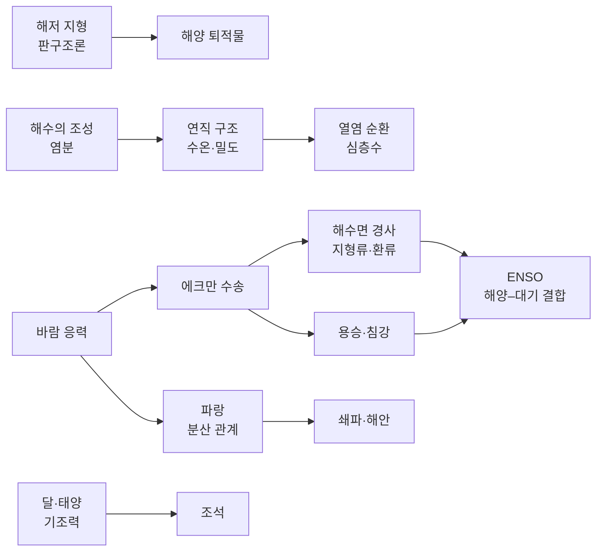

# 일반지구과학 6. 해양 — 바닥의 모양에서 바람과 달이 움직이는 물까지
<!-- prev: esys-2, earth-1, m3-03 -->
<!-- next: uearth-7, uearth-8, uearth-9 -->

> [!NOTE]
> **이 단원의 범위**
> - 해저 지형과 해양 퇴적물
> - 해수의 조성과 염분, 수온·밀도의 연직 구조
> - 표층 해류와 환류(에크만 수송, 지형류), 용승과 침강
> - 심층 순환(열염 순환)
> - 파도(심해파·천해파, 쇄파)와 해안, 조석
> - 해양과 대기의 상호 작용(엘니뇨·남방 진동)

**학습 목표**

1. 음향 측심과 위성 자료로 밝혀진 대륙 주변부와 심해저의 지형을 판구조론과 연결하고, 해양 퇴적물의 기원과 분포를 탄산염 보상 심도로 설명할 수 있다.
2. 해수 염류의 기원과 체류 시간, 염분의 측정과 분포를 설명하고, 상태 방정식으로 수온·염분이 밀도의 연직 구조를 정하는 방식을 해석할 수 있다.
3. 바람 응력에서 에크만 수송량을 계산하고, 에크만 수송이 만든 해수면 경사와 지형류, 환류·서안 강화·용승과 침강을 하나의 과정으로 설명할 수 있다.
4. 수괴의 형성과 열염 순환의 경로를 설명하고, 심층수의 갱신 시간을 어림할 수 있다.
5. 분산 관계로 심해파·천해파의 속력과 군속도, 파랑 에너지를 계산하고, 쇄파와 해안의 변화를 설명할 수 있다.
6. 기조력의 식을 유도하여 조석의 주기·사리와 조금·지역차를 설명하고, 엘니뇨·남방 진동을 비에르크네스 되먹임과 적도 파동으로 해석할 수 있다.

**이 단원의 학습 사다리**

| 단계 | 무엇을 하나? |
|---|---|
| STEP 1. 이전 학습 다시 보기 | 수온·염분 분포, 표층·심층 순환, 에크만 수송과 지형류, 해파와 조석, ENSO를 다시 꺼낸다 |
| STEP 2. 기초 다지기 | 정역학 압력, 전향 인자, 수송량과 스베르드럽 단위, 파수와 각진동수, 거리의 세제곱 법칙 |
| STEP 3. 핵심 개념 | 해저 지형 → 해양 퇴적물 → 해수의 조성 → 연직 구조 → 에크만 수송 → 지형류와 환류 → 용승·침강 → 열염 순환 → 파랑 → 쇄파와 해안 → 조석 → 해양–대기 상호 작용 |
| STEP 4. 오개념 바로잡기 | "깊은 바다의 물은 그대로 고여 있다?", "파도의 마루를 따라 에너지가 간다?" |
| STEP 5. 전공 맛보기 | 회전 좌표계의 운동 방정식과 로스비 변형 반지름, 스베르드럽 관계 |
| STEP 6. 생활·산업·진로 | 해양 관측망, 해양 에너지, 수산업과 용승, 해저 탐사 |

---

## 🗺️ 단원 들어가기

지구 표면의 약 71 %는 바다이고, 평균 깊이는 약 3.7 km이다. 그런데 사람이 해저면 전체를 지도로 그린 정밀도는 아직도 화성 표면보다 낮은 부분이 많다. 그 바닷속에서는 1년에 몇 m밖에 움직이지 않는 깊은 물이 천 년 넘게 지구를 돌고, 표층에서는 초속 1 m가 넘는 해류가 열을 극으로 나르며, 하루 두 번 달이 바다 전체를 들어 올린다. 적도 태평양의 바다 온도가 몇 도 바뀌면 지구 반대편의 비와 가뭄이 달라진다.

**바다는 어떤 그릇에 담겨 있고, 그 물은 무엇으로 되어 있으며, 무엇이 그것을 움직이는가?** 지구과학과 지구시스템과학에서 현상과 원리를 하나씩 배웠다면, 이 단원에서는 해저 지형·해수의 성질·해류·파랑·조석·기후를 한 시스템으로 엮고, 각 과정을 정량적으로 계산한다.

---

## STEP 1. 🔙 이전 학습 다시 보기

### 연계 개념표

| 이전 단원 | 그때 배운 것 | 이 단원에서 확장되는 것 |
|---|---|---|
| 중3 「수권과 해수의 순환」 | 수온의 층 구조, 염분, 대기 대순환과 표층 순환 | 상태 방정식으로 **밀도 구조**를 계산, 수온 약층·염분 약층·밀도 약층의 구분 |
| 지구과학 「대기와 해양의 상호작용」 | 염분비 일정 법칙, T–S도, 심층 순환의 수괴, 용승·침강, 엘니뇨·남방 진동 | 염류의 **기원과 체류 시간**, 열염 순환의 갱신 시간, ENSO의 **비에르크네스 되먹임**과 적도 파동 |
| 지구시스템과학 「해수의 운동」 | 에크만 수송과 지형류(대수식), 심해파·천해파 속력, 기조력과 평형 조석 | **바람 응력에서 수송량 계산**, 에크만 펌핑, **분산 관계와 군속도**, 기조력의 **유도**, 조석 공명 |

고등학교에서는 "에크만 수송은 바람의 오른쪽 90°", "심해파는 $c = \sqrt{gL/2\pi}$"처럼 결과를 배웠다. 대학에서는 그 결과가 어디서 나오는지(힘의 균형, 분산 관계, 기조력의 테일러 전개)를 보고, 그 식으로 수송량·도달 시간·공명 주기를 계산해 실제 바다의 현상을 예측한다.

### 준비 운동 (사전 진단)

**Q1.** 북반구의 대륙 서해안에서 해안과 나란히 북풍이 계속 분다. 표층 해수의 알짜 이동 방향과 그 결과 연안에서 일어나는 현상은?

**Q2.** 수온 20 °C·염분 36 psu인 해수와 수온 5 °C·염분 34 psu인 해수 가운데 어느 것이 더 무거운가?

**Q3.** 수심 4000 m 바다에서 파장 200 km인 쓰나미는 심해파인가 천해파인가? 속력은?

**Q4.** 만조가 하루에 두 번 나타나는 까닭을 달의 기조력으로 설명하시오.

정답 및 해설

**Q1.** 북풍은 남쪽을 향해 부는 바람이므로 에크만 수송은 그 오른쪽인 **서쪽(먼바다 쪽)** 이다. 표층수가 빠져나간 연안에서는 깊은 곳의 찬물이 올라오는 **연안 용승**이 일어난다.

**Q2.** 5 °C·34 psu 해수(약 $1026.9\ \mathrm{kg/m^3}$)가 20 °C·36 psu 해수(약 $1025.5\ \mathrm{kg/m^3}$)보다 무겁다. 이 범위에서는 수온의 효과가 염분보다 크다.

**Q3.** 수심이 파장의 1/20(10 km)보다 훨씬 얕으므로 **천해파**이다. $c = \sqrt{gh} = \sqrt{9.8\times4000} \approx 198\ \mathrm{m/s}$.

**Q4.** 달 쪽의 해수는 지구 중심보다 강하게, 반대쪽 해수는 약하게 당겨져 지구의 **양쪽이 함께 부풀고**, 지구가 자전하면서 한 지점이 하루에 두 번 부풂을 지나기 때문이다.

---

## STEP 2. 🧱 기초 다지기

### ① 정역학 압력

깊이 $z$에서의 수압은 $P = P_0 + \rho g z$이다. 해수의 밀도를 $1025\ \mathrm{kg/m^3}$로 두면 깊이 10 m마다 약 1기압($\approx 10^5\ \mathrm{Pa}$)씩 커지므로, 수심 4000 m의 압력은 약 400기압이다. 압력은 해수를 조금 압축하므로 깊은 곳의 밀도를 비교할 때는 압력의 효과를 뺀 **잠재 밀도**를 쓰기도 한다.

### ② 전향 인자와 회전하는 지구

회전하는 지구 위에서 수평으로 움직이는 물체에는 단위 질량당 크기 $fv$의 전향력이 운동 방향에 수직으로(북반구에서 오른쪽) 작용한다. $f = 2\Omega\sin\varphi$를 **전향 인자**(코리올리 매개 변수), $\Omega = 7.29\times10^{-5}\ \mathrm{s^{-1}}$를 지구 자전 각속도라 한다.

| 위도 | 10° | 20° | 30° | 40° | 60° |
|---|---|---|---|---|---|
| $f\ (\times10^{-5}\ \mathrm{s^{-1}})$ | 2.53 | 4.99 | 7.29 | 9.37 | 12.6 |

$1/f$은 수 시간 정도이다. 전향력은 이보다 오래 지속되는 흐름(해류, 큰 바람)에서 중요하고, 몇 초짜리 파랑이나 욕조의 소용돌이에서는 무시할 수 있다.

### ③ 수송량과 스베르드럽 단위

해류가 단위 시간에 나르는 물의 부피를 **수송량**이라 한다. 해류는 규모가 매우 크므로 해양학에서는

$$
1\ \mathrm{Sv}\ (\text{스베르드럽}) = 10^6\ \mathrm{m^3/s}
$$

를 쓴다. 세계의 모든 강이 바다로 흘려보내는 물을 합해도 약 1 Sv이다. 걸프 해류는 수십 Sv 이상을 나른다.

### ④ 파수와 각진동수

파동 $\eta = a\cos(kx - \omega t)$에서 **파수** $k = 2\pi/L$, **각진동수** $\omega = 2\pi/T$이다. 위상 속력은 $c = L/T = \omega/k$이다. $\omega$와 $k$의 관계식을 **분산 관계**라 하는데, 이 관계에 따라 파장이 다른 파가 다른 속력으로 퍼져 나가는(분산되는) 정도가 정해진다.

### ⑤ 거리의 세제곱 법칙과 테일러 근사

$x$가 1보다 훨씬 작을 때 $(1 \pm x)^{-2} \approx 1 \mp 2x$이다. 이 근사로 인력 $GM/d^2$이 거리 $d$에서 조금 벗어난 곳에서 얼마나 달라지는지 계산할 수 있으며, 그 차이가 $d^3$에 반비례한다는 것이 기조력의 핵심이다(⑪).

> [!TIP]
> 💡 **요령** — 해양의 정량 문제는 대부분 "어떤 두 힘이 균형을 이루는가?"로 시작한다. 정역학 평형(중력–수압 경도력), 에크만 평형(바람 응력–전향력), 지형류 평형(수압 경도력–전향력). 균형을 이루는 두 힘을 먼저 찾자.

---

## STEP 3. 📘 핵심 개념

### ① 해저 지형

#### 해저를 어떻게 재나

**음향 측심(echo sounding)** 은 배에서 음파를 쏘아 해저에서 반사되어 돌아오는 시간을 재는 방법이다. 바닷속 음속은 약 $1500\ \mathrm{m/s}$이므로 수심은 $d = vt/2$이다. 오늘날에는 배 아래 넓은 띠를 한꺼번에 재는 **다중빔 음향 측심**을 쓴다. 넓은 바다 전체는 **인공위성 고도계**로 간접적으로 잰다. 해산처럼 무거운 지형 위에서는 중력이 조금 커져 해수면이 수 m 볼록하게 솟으므로, 해수면 높이 지도에서 해저 지형을 거꾸로 추정한다.

#### 예제 1 — 음향 측심

배에서 쏜 음파가 6.0초 뒤에 돌아왔다. (음속 $1500\ \mathrm{m/s}$) (1) 수심은? (2) 이 배가 서쪽으로 이동하며 잰 왕복 시간이 6.0 s → 4.0 s → 0.3 s로 줄었다면, 배는 어떤 지형을 지나 어디에 다가가고 있는가?

**풀이**
(1) $d = \dfrac{1500\times6.0}{2} = 4.5\times10^3\ \mathrm{m}$
(2) 수심이 4500 m → 3000 m → 약 225 m로 얕아졌다. 심해저 평원에서 대륙대와 대륙 사면을 지나 **대륙붕 끝(대륙붕단)** 에 다가가고 있다.

#### 대륙 주변부

| 지형 | 특징(대략) |
|---|---|
| **대륙붕**(continental shelf) | 대륙의 연장, 경사 0.1° 정도로 매우 완만, 끝(대륙붕단)의 수심 평균 약 130 m. 빙기에는 대부분 육지 |
| **대륙 사면**(continental slope) | 대륙붕단에서 심해저로 이어지는 급한 사면(평균 수 도), 대륙 지각과 해양 지각의 경계 부근 |
| **해저 협곡**(submarine canyon) | 대륙 사면을 깊게 파고든 골짜기. 퇴적물이 섞인 무거운 흐름인 **저탁류**(turbidity current)가 깎음 |
| **대륙대**(continental rise) | 대륙 사면 아래에 저탁류 퇴적물이 부채꼴로 쌓인 완만한 사면, 점이 층리를 가진 **저탁암** |

대륙 주변부는 판의 경계와의 관계에 따라 두 가지로 나뉜다.

| 구분 | **비활동형(수동형) 주변부** | **활동형(능동형) 주변부** |
|---|---|---|
| 위치 | 판의 경계에서 먼 대륙 가장자리 | 섭입대가 있는 대륙 가장자리 |
| 지형 | 넓은 대륙붕, 뚜렷한 대륙대 | 좁은 대륙붕, 대륙대 대신 **해구** |
| 지각 변동 | 거의 없음 | 지진·화산 활발 |
| 예 | 대서양 양쪽 해안 | 태평양 동쪽의 남아메리카 서해안 |

#### 심해저

| 지형 | 특징 | 판구조론과의 관계 |
|---|---|---|
| **심해저 평원** | 수심 약 4000~6000 m, 지구에서 가장 평평한 곳 | 해양 지각의 기복을 퇴적물이 덮음 |
| **중앙 해령** | 대양을 잇는 총길이 약 6만 km 이상의 해저 산맥, 중심에 열곡 | 발산 경계, 새 해양 지각 생성, 열수 분출공 |
| 변환 단층·균열대 | 해령을 엇갈리게 자르는 단층과 그 연장 | 보존 경계 |
| **해구** | 가장 깊은 곳(마리아나 해구 약 1만 1천 m) | 섭입대 |
| 해산·기요 | 해저 화산, 꼭대기가 평평하게 깎인 해산(기요) | 열점·해령의 화산이 판을 따라 이동하며 가라앉음 |

해령에서 멀어질수록 해양 지각은 늙고 식어 수축하므로 수심이 깊어진다(「판구조론과 지구 내부」). 그래서 가장 오래된 해양 지각도 약 1억 8천만 년 정도에 불과하며, 대양은 해령에서 태어나 해구에서 사라진다.

<!-- fig:uearth-6-seafloor-profile -->

### ② 해양 퇴적물

해저에는 해양 지각을 덮는 퇴적물이 대양 중앙에서는 수백 m, 대륙 주변부에서는 수 km 두께로 쌓여 있다. 기원에 따라 네 가지로 나눈다.

| 기원 | 내용 | 주로 쌓이는 곳 |
|---|---|---|
| **육성 기원**(암설성) | 하천·바람·빙하가 나른 육지의 풍화 산물(모래·실트·점토) | 대륙 주변부(두꺼움), 심해저의 **원양성 점토**(바람이 나른 먼지, 적갈색) |
| **생물 기원** | 플랑크톤의 껍데기. 껍데기가 30 % 이상인 퇴적물을 **연니**(ooze)라 함 | 석회질 연니(유공충·원석조류의 $\mathrm{CaCO_3}$), 규질 연니(규조류·방산충의 $\mathrm{SiO_2}$) |
| **수성 기원**(화학적) | 바닷물에서 직접 침전 | 망가니즈 단괴(매우 느리게 자람), 열수 분출공 주변의 금속 황화물, 증발암 |
| 우주 기원 | 우주 먼지, 운석 조각 | 어디에나 아주 조금 |

#### 탄산염 보상 심도

깊은 바닷물은 차갑고 압력이 크며 $\mathrm{CO_2}$를 많이 품고 있어 탄산 칼슘을 잘 녹인다. 가라앉는 석회질 껍데기가 공급되는 속도와 녹는 속도가 같아지는 깊이를 **탄산염 보상 심도(CCD)** 라 하며, 대양에 따라 약 4~5 km이다.

| 해저의 위치 | 쌓이는 퇴적물 |
|---|---|
| CCD보다 얕은 해령·해산 | 석회질 연니 |
| CCD보다 깊은 심해저 | 원양성 점토, 규질 연니(규산은 깊은 곳에서 덜 녹음) |
| 생산성이 높은 적도·남극 주변 | 규질 연니가 많음 |
| 대륙 주변부 | 육성 기원 퇴적물이 압도적 |

해령에서 생긴 지각은 처음엔 얕아 석회질 연니가 쌓이다가, 판을 따라 멀어지며 깊어져 CCD 아래로 내려가면 그 위에 점토가 쌓인다. 그래서 심해 시추 코어에서는 흔히 아래에 석회질 연니, 위에 점토가 놓인다.

#### 예제 2 — 퇴적 속도로 읽는 해저의 시간

원양성 점토는 1000년에 약 1 mm, 석회질 연니는 1000년에 약 2 cm쯤 쌓인다고 하자. (1) 가장 오래된 해양 지각(약 1억 8천만 년) 위에 점토만 쌓였다면 두께는? (2) 같은 두께의 석회질 연니가 쌓이는 데 걸리는 시간은?

**풀이**
(1) $1\ \mathrm{mm/천\ 년}\times180{,}000\ \text{천 년} = 180\ \mathrm{m}$
(2) $\dfrac{180\ \mathrm{m}}{0.02\ \mathrm{m/천\ 년}} = 9000$천 년 $= 900$만 년

심해저 퇴적물은 매우 느리게 쌓여 수 cm 안에 수만 년의 기록이 담긴다. 이 퇴적물 속 유공충 껍데기의 산소 동위 원소가 빙기·간빙기의 기록이 된다(「기후와 기후 변화」).

### ③ 해수의 조성과 염분

#### 염류는 어디서 왔나

| 성분 | 비율(염류 중, 약) | 주된 기원 |
|---|---|---|
| 염화 이온 $\mathrm{Cl^-}$ | 55 % | 화산 기체(염화 수소)의 탈기체 |
| 나트륨 이온 $\mathrm{Na^+}$ | 31 % | 암석의 화학적 풍화 → 하천 |
| 황산 이온 $\mathrm{SO_4^{2-}}$ | 8 % | 화산 기체, 황화물의 산화 |
| 마그네슘 이온 $\mathrm{Mg^{2+}}$ | 4 % | 풍화 → 하천 |
| 칼슘·칼륨 이온 등 | 2 % | 풍화, 해저 열수 |

양이온은 주로 대륙 암석의 풍화(「지표를 바꾸는 작용」의 가수 분해)에서, 음이온의 상당 부분은 지구 내부의 탈기체에서 왔다. 바닷물이 짠 까닭은 하천이 날라 온 이온은 쌓이는데 물만 증발해 빠져나가기 때문이다. 동시에 이온은 증발암, 생물의 껍데기, 점토 광물과의 반응, 해령의 열수 순환으로 제거되므로, 바다의 조성은 수억 년 동안 거의 **정상 상태**를 유지해 왔다.

어떤 성분의 **체류 시간**은 (바다 속 총량)/(유입률)이다. 나트륨·염화 이온은 수천만 년 이상으로 매우 길어 바다 전체에 고르게 섞이고(**염분비 일정 법칙**의 근거), 철·알루미늄처럼 반응성이 큰 원소는 수백 년 이하로 짧아 지역마다 농도가 크게 다르다.

#### 예제 3 — 물 분자의 체류 시간

바다의 부피는 약 $1.34\times10^9\ \mathrm{km^3}$이고, 바다에서 1년에 증발하는 물은 약 $4.25\times10^5\ \mathrm{km^3}$이다. 바닷물 분자의 평균 체류 시간은?

**풀이** $\tau = \dfrac{1.34\times10^9}{4.25\times10^5} \approx 3.2\times10^3$년. 바닷물 분자는 평균 약 3천 년마다 한 번 증발해 대기로 나간다. 나트륨 이온의 체류 시간(수천만 년 이상)보다 수만 배 짧으므로, 물은 들락날락하는 동안 염류는 바다에 남아 쌓인다.

#### 염분의 정의와 측정

**염분**(salinity)은 해수 1 kg에 녹은 염류의 질량(g)이다. 평균은 약 35 g/kg이다. 실제로는 염분을 하나하나 재지 않고 **전기 전도도**를 정밀하게 재어 표준 해수와 비교한 **실용 염분**(단위 없이 쓰거나 psu로 표기)을 쓴다. 이온이 많을수록 전기가 잘 통하기 때문이다.

| 표층 염분을 정하는 요인 | 염분 ↑ | 염분 ↓ |
|---|---|---|
| 증발 − 강수 | 증발이 많은 아열대(위도 20~30°) | 강수가 많은 적도 수렴대, 중고위도 |
| 하천·빙하 | — | 큰 강 하구, 빙하가 녹는 곳 |
| 해빙 | 해수가 얼 때 염류가 빠져나와 남은 물이 짜짐 | 해빙이 녹을 때 |

#### 용존 기체와 해양의 탄소

해수에는 산소, 질소, 이산화 탄소가 녹아 있다. 기체는 찬물에 더 잘 녹으므로 고위도 표층이 기체를 많이 흡수한다. 특히 이산화 탄소는 물에 녹으면 탄산, 탄산수소 이온, 탄산 이온으로 바뀌어 저장되므로 바다는 대기보다 약 50배 많은 탄소를 품고 있다. 바다는 인간이 배출한 이산화 탄소의 약 4분의 1을 흡수해 왔고, 그 결과 표층 해수의 pH가 산업 혁명 이전보다 약 0.1 낮아졌다(**해양 산성화**).

### ④ 수온·밀도의 연직 구조

#### 세 층과 세 가지 '약층'

| 층 | 깊이(대략, 중저위도) | 특징 |
|---|---|---|
| **혼합층** | 수십 ~ 200 m | 바람과 냉각에 의한 대류로 수온·염분이 거의 균일 |
| **수온 약층**(thermocline) | 혼합층 아래 ~ 약 1000 m | 깊어질수록 수온이 급격히 낮아짐 |
| **심해층** | 약 1000 m 이하 | 수온 약 0~4 °C로 거의 일정, 바다 부피의 대부분 |

수온이 급변하는 층을 수온 약층, 염분이 급변하는 층을 **염분 약층**(halocline), 밀도가 급변하는 층을 **밀도 약층**(pycnocline)이라 한다. 중저위도에서는 수온이 밀도를 주로 정하므로 세 층이 거의 겹치지만, 담수가 표층을 덮은 고위도에서는 염분 약층이 밀도 약층을 만든다. 밀도 약층은 위아래 물의 섞임을 막는 '뚜껑'이어서 표층의 열과 산소가 깊은 곳으로, 깊은 곳의 영양염이 표층으로 이동하는 것을 막는다.

| 위도 | 연직 구조 |
|---|---|
| 저위도 | 표층이 매우 따뜻해 얕고 강한 수온 약층이 1년 내내 있음 |
| 중위도 | 여름에 얕은 **계절 수온 약층**이 생기고 겨울에는 냉각과 강한 바람으로 혼합층이 수백 m까지 깊어짐 |
| 고위도 | 표층도 차가워 수온 약층이 거의 없음 → 깊은 대류가 가능(⑧의 심층수 형성) |

<!-- fig:uearth-6-latitude-profiles -->

#### 상태 방정식

해수의 밀도는 수온 $T$, 염분 $S$, 압력의 함수이다. 기준 상태 근처에서는 선형으로 근사할 수 있다.

$$
\rho \approx \rho_0\left[1 - \alpha(T - T_0) + \beta(S - S_0)\right]
$$

| 계수 | 뜻 | 대략적인 값 |
|---|---|---|
| $\alpha$ | 열팽창 계수: 수온이 1 °C 오를 때 밀도가 줄어드는 비율 | $2\times10^{-4}\ \mathrm{K^{-1}}$ 정도(차가울수록 작아짐) |
| $\beta$ | 염분 수축 계수: 염분이 1 오를 때 밀도가 늘어나는 비율 | $7.6\times10^{-4}$ 정도 |

$\alpha$가 수온에 따라 달라 차가운 물에서는 수온의 영향이 약해진다. 그래서 고위도의 찬 바다에서는 염분이 밀도를 정하는 데 상대적으로 더 중요해진다. 또 해수는 염분이 약 25를 넘으면 어는점(약 $-1.9\ ^\circ\mathrm{C}$)에 이를 때까지 계속 무거워진다(담수처럼 4 °C에서 최대 밀도가 되지 않는다).

#### 예제 4 — 선형 상태 방정식으로 밀도 비교

$\rho_0 = 1027\ \mathrm{kg/m^3}$($T_0 = 10\ ^\circ\mathrm{C}$, $S_0 = 35$), $\alpha = 2.0\times10^{-4}\ \mathrm{K^{-1}}$, $\beta = 7.6\times10^{-4}$로 둔다.
(1) 표층수 A(25 °C, 35)와 심층수 B(2 °C, 34.9)의 밀도를 구하시오. (2) 이 바다는 안정한가?

**풀이**
(1) A: $1027[1 - 2.0\times10^{-4}\times15] = 1027\times0.997 \approx 1023.9\ \mathrm{kg/m^3}$
B: $1027[1 + 2.0\times10^{-4}\times8 - 7.6\times10^{-4}\times0.1] = 1027\times1.001524 \approx 1028.6\ \mathrm{kg/m^3}$
(2) 아래의 B가 A보다 약 $4.7\ \mathrm{kg/m^3}$ 무거우므로 **안정**하다. 표층수를 심층까지 섞으려면 그만큼의 위치 에너지를 바람이 공급해야 하므로 혼합층은 깊어지기 어렵다.

> [!NOTE]
> 바닷속 음속은 수온이 낮을수록 느려지고 압력이 클수록 빨라져, 중위도에서는 수심 약 1000 m 부근에서 음속이 가장 느린 층이 생긴다. 이 층에서 낸 소리는 위아래로 굴절되어 갇힌 채 수천 km를 간다. 이를 **소파 채널**(SOFAR channel)이라 하며, 해저 지진·고래 소리 관측과 해양 온도 측정에 쓰인다.

### ⑤ 바람이 미는 바다 — 에크만 수송

#### 바람 응력

바람은 해수면에 마찰로 힘을 준다. 단위 면적당 이 힘을 **바람 응력**(wind stress) $\tau$라 하며, 경험적으로 풍속의 제곱에 비례한다.

$$
\tau = \rho_a C_D U^2
$$

$\rho_a \approx 1.2\ \mathrm{kg/m^3}$는 공기의 밀도, $C_D \approx 1.3\times10^{-3}$는 끌림 계수, $U$는 해수면 10 m 높이의 풍속이다.

#### 에크만 수송량의 유도

바람이 수십 m 깊이의 **에크만 층** 전체를 끌 때, 층 전체에 작용하는 수평 힘은 바람 응력과 전향력뿐이다(층 아래의 마찰은 무시). 정상 상태에서는 두 힘이 균형을 이룬다. 단위 면적의 수주에 대해 바람 응력은 $\tau$, 전향력은 (층 전체의 질량 수송) × $f$이다. 단위 폭당 부피 수송량을 $U_E$($\mathrm{m^2/s}$)라 하면 질량 수송은 $\rho U_E$이므로

$$
\rho f U_E = \tau \quad\Rightarrow\quad U_E = \frac{\tau}{\rho f}
$$

이다. 전향력이 바람 응력과 **반대 방향**이어야 하고, 전향력은 운동의 오른쪽 직각(북반구)이므로 운동은 바람의 **오른쪽 직각**이다. 남반구에서는 왼쪽 직각이다. 수송량은 바람의 세기에 비례하고 $f$에 반비례하므로, 같은 바람이라도 저위도일수록 크다. 적도($f = 0$)에서는 이 식을 쓸 수 없다.

> [!IMPORTANT]
> 에크만 층 **각 깊이**의 흐름은 표층에서 바람의 오른쪽 약 45°로 시작해 깊어질수록 더 오른쪽으로 돌며 약해지는 **에크만 나선**을 이룬다. 하지만 층 전체를 **적분한 수송**은 정확히 바람의 오른쪽 90°이다. 이 결과는 나선의 세부 모양(물의 점성을 어떻게 가정하든)과 관계없이 힘의 균형만으로 나온다.

<!-- sim:u-ekman -->

#### 예제 5 — 바람이 옮기는 바닷물의 양

북위 30°의 바다에서 풍속 10 m/s의 바람이 계속 분다.
(1) 바람 응력을 구하시오. (2) 단위 폭당 에크만 수송량을 구하시오($\rho = 1025\ \mathrm{kg/m^3}$). (3) 이 바람이 해안선 1000 km를 따라 해안과 나란히 분다면, 해안에서 먼바다로(또는 해안으로) 옮겨지는 물은 몇 Sv인가?

**풀이**
(1) $\tau = 1.2\times1.3\times10^{-3}\times10^2 \approx 0.16\ \mathrm{N/m^2}$
(2) $f = 7.29\times10^{-5}\ \mathrm{s^{-1}}$, $U_E = \dfrac{0.156}{1025\times7.29\times10^{-5}} \approx 2.1\ \mathrm{m^2/s}$
(3) $2.1\ \mathrm{m^2/s}\times1.0\times10^6\ \mathrm{m} = 2.1\times10^6\ \mathrm{m^3/s} \approx 2.1\ \mathrm{Sv}$

세계의 모든 강을 합한 것보다 많은 물이 바람 하나로 옮겨진다.

### ⑥ 지형류와 환류

#### 지형류 평형

에크만 수송이 물을 한곳으로 모으거나 흩어 놓으면 해수면이 기울어진다. 해수면이 거리 $\Delta x$에서 $\Delta\eta$만큼 높아지면 같은 깊이에서 수평 압력 차가 생겨 단위 질량당 $g\,\Delta\eta/\Delta x$의 수압 경도력이 작용한다. 마찰이 없는 에크만 층 아래에서는 이 힘이 전향력과 균형을 이루는 **지형류**(geostrophic current)가 흐른다.

$$
f v = g\frac{\Delta\eta}{\Delta x} \quad\Rightarrow\quad v = \frac{g}{f}\frac{\Delta\eta}{\Delta x}
$$

지형류는 해수면 등고선을 따라 흐르며, 북반구에서는 흐름의 오른쪽에 해수면이 높은 쪽이 있다. 대양의 해수면 높이 차는 1 m 정도에 불과하지만 위성 고도계는 이를 cm 단위로 재어 전 세계의 표층 해류를 계산한다.

> [!NOTE]
> 실제 바다는 밀도가 깊이에 따라 다르므로, 해수면 경사에 의한 수압 경도력이 밀도 차에 의한 경사(밀도 약층의 기울기)로 깊어질수록 상쇄되어 지형류는 대개 깊어질수록 약해진다(**경압** 흐름). 해양학자들은 수온·염분의 연직 분포만으로 지형류를 계산하는 이 방법(역학 계산)을 오랫동안 써 왔다.

#### 예제 6 — 해류를 가로지르는 해수면 경사

북위 37°의 어느 해류를 가로질러 80 km 사이에서 해수면이 0.8 m 차이 나며, 남쪽이 높다. (1) 지형류의 속력은? (2) 해류는 어느 쪽으로 흐르는가?

**풀이**
(1) $f = 2\times7.29\times10^{-5}\times\sin37^\circ \approx 8.8\times10^{-5}\ \mathrm{s^{-1}}$, $v = \dfrac{9.8}{8.8\times10^{-5}}\times\dfrac{0.8}{8.0\times10^4} \approx 1.1\ \mathrm{m/s}$
(2) 북반구에서 높은 쪽(남쪽)을 오른쪽에 두려면 **동쪽**으로 흘러야 한다. 아열대 순환의 북쪽 가장자리에서 동쪽으로 흐르는 해류에 해당한다.

#### 환류와 서안 강화

| 환류 | 바람 | 회전 방향(북반구) | 해수면 |
|---|---|---|---|
| **아열대 환류** | 남쪽의 무역풍(동풍)과 북쪽의 편서풍 → 에크만 수송이 위도 30° 부근으로 **수렴** | 시계 방향 | 가운데가 볼록(약 1 m 높음) |
| **아한대 환류** | 편서풍과 극동풍 → 에크만 수송이 **발산** | 시계 반대 방향 | 가운데가 오목 |
| 남극 순환류 | 남극 대륙 주위를 막힘없이 부는 강한 편서풍 | 서 → 동으로 지구를 한 바퀴 | — |

세계의 대양에는 북태평양·남태평양·북대서양·남대서양·인도양의 **다섯 개 아열대 환류**가 있고, 남반구의 환류는 시계 반대 방향으로 돈다. 남극 순환류는 대륙에 막히지 않아 세계에서 수송량이 가장 많은 해류(100 Sv 이상)이다.

아열대 환류의 해류는 대칭이 아니다. 대양 **서쪽 가장자리**의 해류(쿠로시오, 걸프 해류)는 폭 100 km 남짓으로 좁고, 초속 1~2 m로 빠르며, 깊다. 동쪽 가장자리의 해류(캘리포니아 해류, 카나리아 해류)는 폭이 넓고 느리다. 이를 **서안 강화**라 하며, 전향 인자가 위도에 따라 커지는 효과(베타 효과)로 설명된다(STEP 5).

### ⑦ 용승과 침강

수평 방향의 에크만 수송이 한곳에서 갈라지면(**발산**) 아래의 물이 올라와 채우는 **용승**(upwelling)이, 한곳으로 모이면(**수렴**) 물이 아래로 내려가는 **침강**(downwelling)이 일어난다.

| 종류 | 메커니즘 | 예 |
|---|---|---|
| **연안 용승** | 해안과 나란한 바람의 에크만 수송이 표층수를 먼바다로 → 연안에서 용승 | 캘리포니아, 페루–칠레, 카나리아, 벵겔라 연안(대양의 동쪽 가장자리), 여름철 우리나라 동해안 냉수대 |
| **적도 용승** | 무역풍(동풍)의 에크만 수송이 적도 북쪽은 북쪽, 남쪽은 남쪽으로 → 적도에서 발산 | 적도 동태평양의 찬 혀 모양 수온대 |
| **에크만 펌핑** | 저기압성 바람(북반구 시계 반대 방향)은 에크만 수송이 바깥으로 발산 → 중심에서 용승. 고기압성 바람은 반대로 침강 | 태풍이 지나간 자리의 수온 하강, 아열대 환류 중심의 침강 |
| 연안 침강 | 해안 쪽 에크만 수송 → 해수가 쌓여 아래로 | 해안 해수면 상승 |

#### 예제 7 — 연안 용승의 속도

북위 35°의 대륙 서해안을 따라 풍속 10 m/s의 북풍이 분다. 바람 응력은 $0.156\ \mathrm{N/m^2}$이다. 먼바다로 빠져나가는 에크만 수송이 해안에서 20 km 폭의 띠에서 올라오는 물로 채워진다고 할 때 용승 속도를 m/일로 구하시오.

**풀이** $f(35^\circ) = 8.36\times10^{-5}\ \mathrm{s^{-1}}$, $U_E = \dfrac{0.156}{1025\times8.36\times10^{-5}} \approx 1.8\ \mathrm{m^2/s}$
해안선 단위 길이당 수송 $U_E$를 폭 $W$에서 연직으로 공급해야 하므로 $w = \dfrac{U_E}{W} = \dfrac{1.8}{2.0\times10^4} \approx 9\times10^{-5}\ \mathrm{m/s} \approx 8\ \mathrm{m/일}$

해류(초속 수십 cm)에 비하면 아주 느리지만, 며칠이면 수십 m 아래의 찬물이 표층에 닿는다. 용승은 수온 약층 아래의 **영양염**(질산염·인산염·규산염)을 빛이 닿는 표층으로 올려 식물 플랑크톤을 번성시킨다. 대양 동쪽 가장자리의 연안 용승 해역은 넓이로는 바다의 아주 작은 부분이지만 세계 어획량의 상당 부분(약 5분의 1로 추정)을 차지한다.

> [!TIP]
> 💡 **비유** — 에크만 펌핑은 물이 담긴 대야를 숟가락으로 휘저을 때와 비슷한 면이 있다. 물을 바깥으로 밀어내는 회전(발산)이면 가운데로 아래의 물이 올라오고, 안쪽으로 모으는 회전(수렴)이면 가운데의 물이 아래로 눌린다. 바다에서는 그 회전 방향과 발산·수렴을 전향력이 정한다.

### ⑧ 심층 순환(열염 순환)

#### 수괴와 그 형성

바다 부피의 대부분을 차지하는 깊은 물은 바람이 아니라 **밀도 차**로 움직인다. 이 흐름을 **열염 순환**(thermohaline circulation)이라 한다. 깊은 물은 극히 일부 해역의 표층에서 만들어진다.

| 수괴 | 형성 해역 | 형성 과정 | 위치 |
|---|---|---|---|
| **북대서양 심층수** | 그린란드 주변·래브라도해 | 북대서양 해류가 나른 짜고 따뜻한 물이 겨울에 강하게 냉각 | 대서양 약 1500~4000 m, 남쪽으로 흐름 |
| **남극 저층수** | 남극 대륙 주변(웨델해·로스해) | 해빙이 생길 때 빠져나온 염류로 짜진 매우 찬 물(**결빙 시 염분 배출**) | 가장 무거워 대양 바닥을 따라 북쪽으로 |
| 남극 중층수 | 남위 50~60° 부근 | 비교적 덜 짜고 찬 표층수가 가라앉음 | 약 1000 m 부근 |

한번 표층을 떠난 수괴는 수온과 염분이 거의 바뀌지 않으므로, T–S도에서 그 '지문'을 따라 기원과 이동 경로를 추적할 수 있다. 깊은 물에 녹아 있는 산소는 그 물이 표층에서 대기와 접했던 마지막 기록이며, 표층을 떠난 지 오래될수록 생물의 호흡으로 산소는 줄고 분해된 유기물의 **영양염과 이산화 탄소는 늘어난다.**

#### 해양 컨베이어 벨트

북대서양에서 가라앉은 물은 대서양을 남하하여 남극 순환류에 합류하고, 인도양과 태평양으로 퍼진 뒤 넓은 바다에서 서서히 올라오거나(약한 연직 혼합), 남극해에서 바람에 의해 끌어 올려진다. 올라온 물은 표층 해류를 타고 대서양 북쪽으로 돌아온다. 대서양에서 북쪽으로 표층수가 가고 남쪽으로 심층수가 가는 이 뒤집힘 흐름을 **대서양 자오면 순환**(AMOC)이라 하며, 북위 26° 부근에서 측정한 수송량은 약 17 Sv이다.

<!-- fig:uearth-6-overturning -->

#### 예제 8 — 심층수가 한 번 바뀌는 데 걸리는 시간

수심 약 1000 m 아래 심층의 부피를 약 $1\times10^{18}\ \mathrm{m^3}$, 세계의 심층수 형성량을 합해 약 20 Sv로 두자. 심층수 전체가 한 번 갱신되는 데 걸리는 시간을 어림하시오.

**풀이** $\tau = \dfrac{1\times10^{18}\ \mathrm{m^3}}{2\times10^7\ \mathrm{m^3/s}} = 5\times10^{10}\ \mathrm{s} \approx 1.6\times10^3$년

심층수는 평균 약 천수백 년 동안 표층과 떨어져 있다. 실제로 북태평양 깊은 물의 탄소-14 연대는 1000년이 넘는다(「지질 시대와 지구의 역사」의 탄소-14). 그래서 오늘 심층으로 들어간 열과 이산화 탄소는 수백~천 년 뒤에야 다시 표층으로 돌아온다.

| 구분 | 표층 순환 | 심층 순환 |
|---|---|---|
| 원동력 | 바람 응력(에크만 수송 → 지형류) | 고위도 표층의 냉각·결빙에 의한 밀도 증가 |
| 깊이 | 수백 m 이내 | 약 1000 m 이하 |
| 속력 | 초속 수 cm ~ 2 m | 하루 수 km 이하(초속 수 cm 이하) |
| 시간 규모 | 수년 ~ 수십 년 | 수백 ~ 천여 년 |
| 기후에서의 역할 | 저위도 → 고위도 열 수송 | 열·탄소·산소를 심해로 저장, 장기 기후 조절 |

> [!WARNING]
> 지구 온난화로 그린란드 빙상이 녹은 담수가 북대서양 표층을 가볍게 만들면 심층수 형성이 약해져 AMOC가 느려질 수 있다. 기후 모형들은 이번 세기에 AMOC가 약해질 가능성이 높다고 전망하지만, 갑자기 멈출 가능성과 그 시기에 대해서는 불확실성이 크다. 과장된 시나리오와 관측·모형이 보여 주는 범위를 구분해 판단해야 한다.

### ⑨ 파랑 — 분산 관계와 군속도

#### 분산 관계

수심 $h$인 바다의 작은 진폭의 표면 중력파는 유체 역학의 방정식으로부터 다음 분산 관계를 따른다.

$$
\omega^2 = gk\tanh(kh), \qquad c = \frac{\omega}{k} = \sqrt{\frac{g}{k}\tanh(kh)}
$$

$\tanh x$는 $x$가 작을 때 $x$에 가깝고, $x$가 크면 1에 가까운 함수이다(대략 $x > 3$이면 0.99 이상).

| 구분 | 조건 | 근사 | 위상 속력 | 군속도 |
|---|---|---|---|---|
| **심해파** | $h > L/2$ ($kh > \pi$) | $\tanh(kh)\approx1$ | $c = \sqrt{\dfrac{gL}{2\pi}} = \dfrac{gT}{2\pi}$ | $c_g = \dfrac{c}{2}$ |
| **천해파** | $h < L/20$ ($kh < \pi/10$) | $\tanh(kh)\approx kh$ | $c = \sqrt{gh}$ | $c_g = c$ |
| 전이파 | 그 사이 | 근사 없이 계산 | 수심과 파장에 모두 의존 | $c/2 < c_g < c$ |

심해파는 파장(주기)이 길수록 빠른 **분산성** 파동이어서, 폭풍 해역에서 생긴 여러 주기의 파가 달리는 동안 주기별로 갈라진다. 천해파는 수심에만 의존하는 **비분산성** 파동이다.

#### 군속도 — 에너지는 어떤 빠르기로 오나

파의 마루 하나하나가 움직이는 속력이 위상 속력 $c$이고, 여러 파가 겹친 **파군**(묶음)과 그 에너지가 움직이는 속력이 **군속도** $c_g = d\omega/dk$이다. 심해파에서는 $c_g = c/2$여서, 파군 안에서 마루가 뒤에서 생겨나 앞으로 달려가 앞쪽 끝에서 사라진다. 너울이 해안에 도착하는 시각을 예측할 때는 군속도를 써야 한다.

<!-- sim:u-wave-group -->

#### 예제 9 — 너울의 도착 시각과 수심에 따른 변화

(1) 주기 10초인 심해파의 위상 속력, 파장, 군속도를 구하시오. (2) 3000 km 떨어진 폭풍 해역에서 주기 16초와 10초인 너울이 동시에 출발했다면 해안에 각각 몇 시간 뒤에 도착하는가? (3) 주기 10초인 파가 수심 5 m에 들어왔을 때 분산 관계를 수치로 풀면 파장은 약 67.6 m이다. 이때의 위상 속력을 구하고 $\sqrt{gh}$와 비교하시오.

**풀이**
(1) $c = \dfrac{9.8\times10}{2\pi} \approx 15.6\ \mathrm{m/s}$, $L = cT \approx 156\ \mathrm{m}$, $c_g = 7.8\ \mathrm{m/s}$
(2) 16초: $c_g = \dfrac{9.8\times16}{4\pi} \approx 12.5\ \mathrm{m/s}$ → $\dfrac{3.0\times10^6}{12.5} \approx 2.4\times10^5\ \mathrm{s} \approx 67$시간. 10초: $\dfrac{3.0\times10^6}{7.8} \approx 3.8\times10^5\ \mathrm{s} \approx 107$시간. 주기가 긴 너울이 **약 40시간 먼저** 도착한다.
(3) $c = 67.6/10 \approx 6.8\ \mathrm{m/s}$, $\sqrt{9.8\times5} = 7.0\ \mathrm{m/s}$. $h/L \approx 0.074$로 천해파 경계(0.05)보다 조금 크므로 천해파 근사는 약 3 % 크게 나온다.

#### 파랑 에너지와 파랑의 성장

파고 $H$인 파의 단위 수면적당 에너지(운동 에너지 + 위치 에너지)는

$$
E = \frac{1}{8}\rho g H^2
$$

이고, 단위 폭당 에너지 수송률(파랑 에너지 플럭스)은 $E c_g$이다. 파고가 2배이면 에너지는 4배이다. 예를 들어 파고 2 m, 주기 10초인 심해파는 $E \approx 5.0\times10^3\ \mathrm{J/m^2}$, 에너지 플럭스는 약 $5.0\times10^3\times7.8 \approx 3.9\times10^4\ \mathrm{W/m}$, 즉 파봉 1 m당 약 40 kW를 나른다(파력 발전의 근거).

바람이 만드는 파랑은 **풍속**, **취송 거리**(바람이 바다 위를 불어 가는 거리), **취송 시간**이 클수록 커진다. 셋이 충분하면 바람이 주는 에너지와 쇄파로 잃는 에너지가 균형을 이룬 **완전 발달한 바다**가 된다. 실제 바다의 파랑은 여러 주기·방향의 파가 겹친 것이므로 통계적으로 다루며, 큰 쪽 3분의 1 파고의 평균을 **유의 파고**라 한다.

### ⑩ 쇄파와 해안

#### 천수 변형과 쇄파

파가 얕은 곳으로 들어오면 주기는 그대로이지만 속력과 파장이 줄어든다. 에너지 플럭스 $Ec_g$는 (마찰을 무시하면) 보존되므로, $c_g$가 줄어든 만큼 $E$, 즉 파고가 커진다(**천수 변형**). 파가 너무 가팔라지면 마루가 무너지며 부서지는데, 이를 **쇄파**(breaking)라 한다.

| 쇄파 조건(경험적) | 내용 |
|---|---|
| 깊은 바다 | 파형 경사 $H/L$이 약 1/7을 넘으면 부서짐(흰 파도) |
| 얕은 바다 | 파고가 수심의 약 0.8배(0.78배)에 이르면 부서짐 |

| 쇄파의 형태 | 해저 경사 | 모습 |
|---|---|---|
| 붕괴형(spilling) | 완만함 | 마루가 거품을 일으키며 서서히 흘러내림 |
| 권파형(plunging) | 중간 | 마루가 말려 터널을 만들며 앞으로 내리꽂힘(파도타기) |
| 쇄기형(surging) | 가파름 | 거의 부서지지 않고 해안으로 밀려 올라갔다 되돌아옴 |

예를 들어 수심 3 m인 곳에서는 파고 약 $0.78\times3 \approx 2.3\ \mathrm{m}$ 이상의 파가 부서진다.

#### 굴절·연안류·이안류

파는 얕은 쪽이 먼저 느려지므로 해안선과 나란해지도록 꺾인다. 빛의 굴절과 같은 원리로 $\dfrac{\sin\theta}{c} = $ 일정(스넬 법칙)이 성립한다. 그 결과 곶에 에너지가 모이고 만에서 흩어진다. 비스듬히 부서지는 파는 해안을 따라 흐르는 **연안류**와 모래의 연안 표류를 만들고, 쇄파로 해안에 쌓인 물은 좁은 통로로 빠르게 되돌아가는 **이안류**가 된다. 이것이 만드는 해안 지형은 「지표를 바꾸는 작용」에서 다루었다.

> [!WARNING]
> 이안류의 폭은 대개 수십 m이고 속도는 초속 1~2 m에 이르기도 한다. 휩쓸리면 해안 쪽으로 거슬러 헤엄치지 말고 해안과 나란히 헤엄쳐 흐름의 옆으로 빠져나온 뒤 돌아온다. 파도가 부서지지 않고 잔잔해 보이는 띠, 거품과 부유물이 바다 쪽으로 줄지어 나가는 곳이 이안류일 수 있다.

### ⑪ 조석

#### 기조력의 유도

질량 $M$인 천체(달)가 지구 중심에서 거리 $d$에 있다. 지구 중심이 받는 단위 질량당 인력은 $GM/d^2$이고, 지구는 이 인력으로 지구–달의 공통 질량 중심 둘레를 돈다. 지구 중심에서 볼 때 달을 향한 지표(거리 $d-R$)의 해수가 받는 '여분의' 힘은

$$
\frac{GM}{(d-R)^2} - \frac{GM}{d^2} = \frac{GM}{d^2}\left[\left(1-\frac{R}{d}\right)^{-2} - 1\right] \approx \frac{GM}{d^2}\cdot\frac{2R}{d} = \frac{2GMR}{d^3}
$$

이다(STEP 2의 근사, $R/d \approx 1/60$). 반대쪽(거리 $d+R$)에서도 크기가 거의 같고 방향이 **달 반대쪽**인 힘이 남는다. 이것이 **기조력**(tide-generating force)이며, 지구의 양쪽을 바깥으로 늘이고 그 사이 90° 지점은 안쪽으로 누른다.

| 비교 | 달 | 태양 |
|---|---|---|
| 질량(kg) | $7.35\times10^{22}$ | $1.99\times10^{30}$ |
| 거리(m) | $3.84\times10^8$ | $1.50\times10^{11}$ |
| 지구 중심이 받는 인력 | 태양의 약 1/180 | 1 |
| 기조력 $2GMR/d^3$ ($\mathrm{m/s^2}$) | $1.1\times10^{-6}$ | $5.0\times10^{-7}$ |

기조력은 거리의 **세제곱**에 반비례하므로, 인력은 태양이 훨씬 크지만 기조력은 달이 태양의 약 **2.2배**이다. 기조력의 크기는 중력 가속도의 약 1000만 분의 1에 불과하지만, 수평 방향 성분이 바다 전체에 작용하여 물을 옮긴다.

#### 평형 조석과 주기

바다가 기조력에 즉시 반응한다고 가정한 **평형 조석**에서, 달에 의한 해수면의 최고–최저 차는 약 0.5 m, 태양에 의한 차는 약 0.25 m이다. 지구가 자전하는 동안 달도 공전하므로, 달이 같은 자오선에 다시 오는 **태음일**은 약 24시간 50분이고, 반일주조의 주기는 그 절반인 약 12시간 25분이다.

| 주요 분조 | 기호 | 주기 | 원인 |
|---|---|---|---|
| 주태음 반일주조 | $M_2$ | 12.42시간 | 달 |
| 주태양 반일주조 | $S_2$ | 12.00시간 | 태양 |
| 일주조 | $K_1$, $O_1$ | 약 24시간 안팎 | 달·태양의 적위(일조부등의 원인) |

#### 사리와 조금은 맥놀이이다

$M_2$와 $S_2$는 주기가 조금 다른 두 진동이므로, 둘이 겹치면 진동수의 차이만큼의 주기로 세기가 커졌다 작아지는 **맥놀이**가 생긴다.

$$
T_{사리–조금} = \frac{1}{\dfrac{1}{12.00\ \mathrm{h}} - \dfrac{1}{12.42\ \mathrm{h}}} \approx 354\ \mathrm{h} \approx 14.8\ \text{일}
$$

두 분조의 마루가 겹치는 때가 **사리**(삭·망 무렵, 조차 최대), 마루와 골이 겹치는 때가 **조금**(상현·하현 무렵, 조차 최소)이다. 평형 조석으로 보면 사리의 조차는 $0.5 + 0.25$, 조금의 조차는 $0.5 - 0.25$에 비례하여 약 3배 차이 난다.

#### 동적 조석 — 실제 바다의 조석

실제 조석은 평형 조석보다 훨씬 복잡하다. 조석파의 파장은 수천 km이므로 바다에서는 늘 **천해파**($c = \sqrt{gh}$)이고, 평균 수심 4 km 바다에서도 약 200 m/s로 달려 지구 자전에 따라가지 못한다. 그래서 조석은 각 대양 분지 안에서 해안을 따라 회전하며 전파되는 파동이 된다. 조차가 거의 0인 **무조점**(amphidromic point)을 중심으로 만조가 북반구에서 대개 시계 반대 방향으로 돌고, 무조점에서 멀어질수록 조차가 커진다.

만이나 연해의 자연 진동 주기가 조석의 주기에 가까우면 **공명**으로 조차가 크게 증폭된다. 한쪽이 막히고 한쪽이 열린 길이 $L$, 수심 $h$인 만의 기본 진동 주기는 대략

$$
T_n \approx \frac{4L}{\sqrt{gh}}
$$

이다(관 한쪽이 막힌 관악기의 정상파와 같은 원리, 「파동과 소리」).

#### 예제 10 — 조석 공명

(1) 길이 250 km, 평균 수심 50 m인 만의 자연 진동 주기를 구하고, $M_2$ 분조와 비교하시오. (2) 길이가 150 km, 평균 수심이 40 m인 만이라면 어떠한가?

**풀이**
(1) $\sqrt{gh} = \sqrt{9.8\times50} \approx 22.1\ \mathrm{m/s}$, $T_n = \dfrac{4\times2.5\times10^5}{22.1} \approx 4.5\times10^4\ \mathrm{s} \approx 12.5$시간. $M_2$(12.42시간)와 거의 같아 **공명**하므로 조차가 크게 증폭된다. 캐나다 펀디만처럼 조차가 15 m를 넘는 곳들이 이런 조건에 가깝다.
(2) $\sqrt{9.8\times40} \approx 19.8\ \mathrm{m/s}$, $T_n = \dfrac{6.0\times10^5}{19.8} \approx 3.0\times10^4\ \mathrm{s} \approx 8.4$시간. $M_2$와 차이가 커서 공명에 의한 증폭은 작다.

| 해역 | 조석의 특징 |
|---|---|
| 우리나라 서해 | 넓고 얕은 대륙붕(평균 수심 약 44 m), 굴곡이 심하고 안쪽으로 좁아지는 만 → 조석파가 증폭, 경기만 일대는 사리 때 조차가 8 m를 넘음. 여러 무조점을 중심으로 회전 |
| 남해 | 서쪽은 조차가 크고 동쪽으로 갈수록 작아짐 |
| 동해 | 깊고 좁은 해협으로만 조석파가 들어와 조차가 수십 cm 정도 |

> [!NOTE]
> **조석 마찰** — 조석의 흐름이 얕은 바다에서 마찰로 에너지를 잃으면서 지구 자전이 조금씩 느려진다(하루의 길이가 100년에 약 2 ms씩 길어지는 정도). 각운동량 보존에 따라 그만큼 달은 지구에서 멀어져, 레이저 거리 측정으로 1년에 약 3.8 cm씩 멀어지는 것이 관측된다. 고생대 산호의 일일 성장선은 당시 1년이 400일 가까이였음을 보여 준다.

### ⑫ 해양과 대기의 상호 작용 — 엘니뇨·남방 진동

#### 바다는 기후의 거대한 열 저장고

물은 비열이 크고 바다는 양이 많아서, 바다는 대기보다 훨씬 많은 열을 담을 수 있다. 얼마나 큰 차이인지 먼저 어림해 보자.

#### 예제 11 — 바다 몇 m가 대기 전체와 같을까

대기 전체의 질량은 약 $5.1\times10^{18}\ \mathrm{kg}$, 공기의 비열은 약 $1004\ \mathrm{J/(kg\cdot K)}$이다. 해수의 비열은 약 $3990\ \mathrm{J/(kg\cdot K)}$, 밀도는 $1025\ \mathrm{kg/m^3}$, 바다 넓이는 $3.61\times10^{14}\ \mathrm{m^2}$이다. 바다 표층 몇 m의 열용량이 대기 전체의 열용량과 같은가?

**풀이** 대기: $5.1\times10^{18}\times1004 \approx 5.1\times10^{21}\ \mathrm{J/K}$
바다 1 m 층: $3.61\times10^{14}\times1\times1025\times3990 \approx 1.5\times10^{21}\ \mathrm{J/K}$
깊이 $= \dfrac{5.1\times10^{21}}{1.5\times10^{21}} \approx 3.5\ \mathrm{m}$

바다 위 3~4 m의 물만으로 대기 전체만큼의 열을 담는다. 그래서 바다는 계절과 해마다의 기후 변동을 늦추고 완화하며, 지구 온난화로 기후 시스템에 더해진 열의 90 % 이상이 바다에 저장되었다. 바다와 대기는 **현열**(온도 차에 의한 전도·난류 수송)과 **숨은열**(증발한 수증기가 대기에서 응결하며 내놓는 열), 그리고 운동량(바람 응력)과 물질($\mathrm{CO_2}$, 수증기)을 끊임없이 주고받는다.

#### 평상시의 적도 태평양과 워커 순환

| 위치 | 해양 | 대기 |
|---|---|---|
| 서태평양 | 무역풍이 밀어 놓은 따뜻한 물이 두껍게 쌓임(해수면이 동쪽보다 수십 cm 높음), 수온 약층이 깊음 | 상승 기류, 저기압, 많은 비 |
| 동태평양 | 적도 용승·연안 용승으로 찬물, 수온 약층이 얕음 | 하강 기류, 고기압, 건조 |
| 상층 대기 | — | 서쪽에서 올라 동쪽에서 내려오는 **워커 순환** |

#### 비에르크네스 되먹임

동서의 수온 차가 무역풍을 만들고, 무역풍이 다시 수온 차를 키우는 **양의 되먹임**이 해양과 대기를 묶는다. 1960년대에 이 연결을 처음 정리한 기상학자의 이름을 따 **비에르크네스 되먹임**이라 한다.

이 고리가 따뜻한 쪽으로 돌면 **엘니뇨**, 찬 쪽으로 돌면(무역풍 강화 → 용승 강화 → 동쪽 냉각 → 무역풍 더 강화) **라니냐**이다. 바다의 변화(엘니뇨·라니냐)와 대기의 변화(동서 기압의 시소인 **남방 진동**)를 합쳐 **엘니뇨·남방 진동**(ENSO)이라 한다.

| 지표 | 엘니뇨 | 라니냐 |
|---|---|---|
| 적도 중·동태평양(니뇨 3.4 해역) 해수면 온도 편차 | 대략 +0.5 °C 이상이 몇 달 이상 지속 | 대략 −0.5 °C 이하가 지속 |
| 남방 진동 지수(타히티 − 다윈 기압 편차) | 음(−) | 양(+) |
| 동태평양 수온 약층 | 깊어짐 | 얕아짐 |
| 강수 중심 | 중앙·동태평양으로 이동 | 서쪽으로 치우침 |

<!-- sim:el-nino -->

#### 무엇이 엘니뇨를 끝내고 되돌리나 — 적도 파동

양의 되먹임만 있다면 한쪽 상태에 머물러야 한다. 실제로 ENSO가 2~7년 간격으로 오가는 것은 적도에서 동서로 전파되는 바다의 파동 때문이다. 서태평양에서 무역풍이 약해지면 수온 약층을 아래로 누르는 신호가 **적도 켈빈파**로 동쪽으로 달려가 동태평양의 수온 약층을 깊게 하고 용승한 물을 데운다. 한편 서쪽으로 가는 **로스비파**는 대양 서쪽 경계에서 반사되어 시간이 지난 뒤 반대 부호의 신호로 돌아와 엘니뇨를 끝내는 방향으로 작용한다(지연 진동자 모형).

적도 켈빈파는 밀도 약층의 기울기가 전파되는 **내부파**로, 위아래 층의 밀도 차가 작아 유효 중력 $g' = g\,\Delta\rho/\rho$가 작다. 속력은 $c = \sqrt{g'H}$이다($H$는 위층 두께).

#### 예제 12 — 켈빈파가 태평양을 건너는 시간

적도 태평양에서 수온 약층 위·아래의 밀도 차의 비 $\Delta\rho/\rho = 0.003$, 위층 두께 $H = 150\ \mathrm{m}$이다. (1) 켈빈파의 속력은? (2) 폭 15000 km인 태평양을 건너는 데 며칠 걸리는가?

**풀이**
(1) $g' = 9.8\times0.003 \approx 0.029\ \mathrm{m/s^2}$, $c = \sqrt{0.029\times150} \approx 2.1\ \mathrm{m/s}$
(2) $t = \dfrac{1.5\times10^7}{2.1} \approx 7.1\times10^6\ \mathrm{s} \approx 83$일

서태평양의 바람 변화가 두세 달 뒤에 동태평양의 수온을 바꾼다. 이 시간 지연 덕분에 해양 관측망(적도 부이, ARGO, 위성 해수면 고도)으로 엘니뇨를 몇 달 앞서 예측할 수 있다. 같은 계산에서 표면 중력파($c = \sqrt{gh}$, 약 200 m/s)는 하루도 안 걸린다는 점과 비교해 보자.

#### ENSO의 영향과 다른 변동

엘니뇨 해에는 인도네시아·오스트레일리아에 가뭄과 산불, 페루 연안에 홍수와 어획량 감소가 나타나고, 대기를 통한 **원격 상관**으로 세계 곳곳의 기온·강수 패턴이 바뀐다. 엘니뇨가 강한 해에는 바다가 대기로 열을 많이 내놓아 전 지구 평균 기온이 일시적으로 더 오른다. 우리나라에 대한 영향은 계절과 사례마다 달라 확률적으로 해석한다. 이 밖에도 수십 년 주기의 **태평양 수십 년 진동**, 인도양의 동서 수온 차인 **인도양 쌍극자** 같은 해양–대기 결합 변동이 있다.

---

## STEP 4. ⚠️ 오개념 바로잡기

| 흔한 오개념 | 올바른 개념 | 왜 그럴까? |
|---|---|---|
| 깊은 바다의 물은 움직이지 않고 고여 있다 | 심층수도 열염 순환으로 천천히 움직이며 약 천수백 년마다 갱신된다 | 심해에 산소가 있고, 수괴를 T–S도와 탄소-14로 추적할 수 있다 |
| 해양 퇴적물은 어디서나 같은 속도로 쌓인다 | 대륙 주변부는 빠르고 심해저 점토는 1000년에 약 1 mm로 매우 느리다 | 육성 기원 물질의 공급이 거리에 따라 크게 다르다 |
| 에크만 수송은 표층수가 바람의 오른쪽 90°로 흐르는 것이다 | 표층수는 약 45°, 층 전체를 **적분한** 알짜 수송이 90°이다 | 깊이마다 방향이 돌아가는 에크만 나선의 합이다 |
| 해류는 바람이 직접 밀어서 바람 방향으로 흐른다 | 큰 해류는 에크만 수송이 만든 해수면 경사에서 생기는 **지형류**이다 | 수압 경도력과 전향력이 균형을 이룬다 |
| 파도의 에너지는 마루가 움직이는 속력으로 전달된다 | 에너지는 **군속도**로 전달되며 심해파에서는 위상 속력의 절반이다 | 마루는 파군 안에서 생겨나 앞으로 지나가 사라진다 |
| 태양은 달보다 훨씬 무거우니 조석에 미치는 영향도 크다 | 기조력은 $d^3$에 반비례하여 달이 태양의 약 2.2배이다 | 기조력은 인력 자체가 아니라 지구 양쪽 인력의 **차이**이다 |
| 엘니뇨는 바다만의 현상이다 | 바다(수온)와 대기(무역풍·기압)가 서로 강화하는 **결합 현상**이다 | 비에르크네스 되먹임이 둘을 묶는다 |

---

## STEP 5. 🎓 다음 단계로 한 걸음 더

> [!CAUTION]
> 여기부터는 일반 과목의 범위를 넘는 전공 과목 맛보기이다. 평가 대상이 아니며, 해양물리학·지구유체역학·해양화학으로 이 단원의 개념이 어떻게 이어지는지 보여 준다.

### 전공 과목과의 연결

| 전공 과목 | 이어지는 내용 |
|---|---|
| 해양물리학·지구유체역학 | 회전 좌표계의 운동 방정식, 와도와 퍼텐셜 와도, 스베르드럽 관계와 서안 강화, 적도 파동 이론 |
| 해양파랑학·해안공학 | 파랑 스펙트럼, 비선형 파랑, 쇄파대 역학, 연안 표사 |
| 조석학 | 조화 분석, 조석 수치 모형, 내부 조석과 혼합 |
| 해양화학·해양생지화학 | 탄산계 평형, 생물 펌프와 탄소 순환, 영양염 순환 |
| 해양지질학 | 해저 퇴적 과정, 고해양학, 해저 자원 |
| 기후역학 | ENSO 이론과 예측, 해양–대기 결합 모형 |

### ① 회전 좌표계의 운동 방정식과 로스비 변형 반지름

마찰과 가속도가 작은 큰 규모의 해양 흐름에서 수평 운동 방정식은 다음 균형으로 근사된다.

$$
-fv = -\frac{1}{\rho}\frac{\partial p}{\partial x}, \qquad fu = -\frac{1}{\rho}\frac{\partial p}{\partial y}
$$

이것이 지형류 평형의 미분 꼴이다. 회전의 효과가 중력파의 전파와 맞먹게 되는 길이 규모를 **로스비 변형 반지름** $R_d = c/f$라 한다. 예제 12의 내부파 속력 $c \approx 2.1\ \mathrm{m/s}$를 북위 30°에 적용하면 $R_d \approx 2.1/(7.29\times10^{-5}) \approx 29\ \mathrm{km}$이다. 해양의 중규모 소용돌이(지름 수십~수백 km)와 해류의 폭이 이 규모로 정해지며, 대기(수백~천 km)보다 훨씬 작다. 바다의 '날씨'가 대기보다 작고 촘촘한 까닭이다.

### ② 스베르드럽 관계와 서안 강화

전향 인자의 남북 변화율 $\beta = df/dy$를 고려하면, 대양 내부의 남북 수송 $V$는 바람 응력의 회전(컬)과 다음처럼 연결된다.

$$
\beta V = \frac{1}{\rho}\,\mathrm{curl}\,\boldsymbol{\tau}
$$

아열대 해역에서는 바람 응력의 컬이 음수여서 대양 내부 전체에서 물이 적도 쪽으로 천천히 흐르고, 이 물이 돌아가는 길은 질량 보존과 와도 균형을 만족시키려면 대양의 **서쪽 가장자리**의 좁고 빠른 해류여야 한다. 이것이 쿠로시오와 걸프 해류가 강한 까닭이다. 이 단원에서 말로 설명한 서안 강화가 미분 방정식의 해로 나온다.

### 일반 과목 vs 전공 과목

| 구분 | 일반지구과학 | 전공 과목 |
|---|---|---|
| 해류 | 에크만 수송량 $U_E = \tau/\rho f$, 지형류, 환류의 정성적 설명 | 회전 유체의 운동 방정식, 퍼텐셜 와도, 스베르드럽 이론 |
| 연직 구조 | 선형 상태 방정식, 약층 | 비선형 상태 방정식(TEOS-10), 부력 진동수, 혼합 이론 |
| 파랑 | 분산 관계, 군속도, 에너지, 쇄파 조건 | 파랑 스펙트럼, 비선형 상호 작용, 수치 파랑 모형 |
| 조석 | 기조력의 유도, 맥놀이, 공명 | 라플라스 조석 방정식, 조화 분석, 내부 조석 |
| ENSO | 비에르크네스 되먹임, 켈빈파의 시간 지연 | 결합 모형, 지연 진동자 이론, 예측 가능성 |

---

## STEP 6. 🏭 생활·산업·진로 연결

### 사례 1. 전 지구 해양 관측망

- **원리** 약 4000개의 ARGO 플로트가 10일마다 약 2000 m까지 오르내리며 수온·염분을 재고, 위성 고도계·해수면 온도 센서·적도 계류 부이가 표층을 감시한다. 이 자료를 수치 모형에 동화하여 해류와 수온 약층을 날마다 분석한다.
- **어디에 쓰이나** 엘니뇨 예측, 해양 열용량과 해수면 상승 감시, 태풍 강도 예보(해양 열 함량), 수색·구조와 기름 유출 확산 예측.

### 사례 2. 해양 에너지 — 조력·조류·파력

- **원리** 조차가 큰 만을 방조제로 막아 수위 차로 발전하는 조력 발전, 빠른 조류로 수차를 돌리는 조류 발전, 파랑 에너지 플럭스 $Ec_g$를 이용하는 파력 발전이 있다. 조석은 수십 년 뒤까지 정확히 예측되어 발전량 예측이 쉽다.
- **어디에 쓰이나** 우리나라 서해안의 시화호 조력 발전소(설비 용량 254 MW)가 대표적이며, 울돌목의 조류 발전 실험 등이 있다. 갯벌 생태계와 해수 교환에 미치는 영향 평가가 함께 필요하다.

### 사례 3. 수산업과 용승·전선

- **원리** 용승 해역과 서로 다른 수괴가 만나는 해양 전선(조경 수역)은 영양염이 풍부해 플랑크톤과 어류가 모인다. 위성으로 해수면 온도와 엽록소 농도를 재어 어장을 예측한다.
- **어디에 쓰이나** 어장 정보 서비스, 동해안 냉수대 예보와 양식장 피해 예방, ENSO에 따른 어획량 변동 대비.

### 사례 4. 해저 지형 조사와 해저 자원

- **원리** 다중빔 음향 측심과 해저 지층 탐사로 해저 지형과 퇴적층을 조사하고, 망가니즈 단괴·열수 광상 같은 해저 광물 자원의 분포를 파악한다.
- **어디에 쓰이나** 해저 케이블·파이프라인 경로 설계, 해상 풍력 단지 부지 조사, 대륙붕 경계 설정, 해저 자원 탐사와 그 환경 영향 평가.

### 관련 전공과 진로

| 진로 | 하는 일 | 관련 전공 |
|---|---|---|
| 해양 연구원 | 해류·수괴·파랑·조석 관측과 수치 모형 | 해양학, 해양물리학 |
| 기후·해양 예보관 | 엘니뇨·해양 열파 예측, 해양 기상 정보 | 해양학, 대기과학 |
| 해양 환경·화학 연구원 | 해양 산성화, 오염, 탄소 순환 연구 | 해양화학, 환경과학 |
| 해양 공학 기술자 | 항만·해양 구조물, 해양 에너지 설비 설계 | 해양공학, 조선해양공학, 토목공학 |
| 수로 측량·해양 지질 전문가 | 해저 지형 측량, 해도 제작, 해저 자원 조사 | 해양지질학, 측지학 |

---

## 🔬 탐구 활동

### 활동 A. CTD 자료로 해수의 연직 구조와 안정도 분석하기

**목표** 깊이별 수온·염분 자료에서 밀도를 계산하여 혼합층·밀도 약층을 찾고, 지역에 따른 차이를 해석한다.

**준비물** 스프레드시트, 공개된 ARGO 플로트나 해양 관측선의 CTD(전기 전도도–수온–깊이) 자료(또는 아래의 예시 자료)

**과정**
1. 다음 예시 자료(중위도 여름, 설명을 위한 가상의 자료)를 스프레드시트에 입력한다.

| 깊이(m) | 0 | 20 | 40 | 60 | 100 | 200 | 500 | 1000 |
|---|---|---|---|---|---|---|---|---|
| 수온(°C) | 24.0 | 23.8 | 18.0 | 14.0 | 11.5 | 9.0 | 6.0 | 3.5 |
| 염분 | 34.2 | 34.2 | 34.4 | 34.5 | 34.5 | 34.4 | 34.3 | 34.5 |

2. 예제 4의 선형 상태 방정식으로 깊이별 밀도를 계산한다.
3. 수온·염분·밀도를 깊이에 대해 그래프로 그린다(깊이를 세로축 아래 방향으로).
4. 수온이 표층과 거의 같은 층(혼합층)의 두께와, 밀도가 가장 급하게 변하는 깊이(밀도 약층)를 찾는다.
5. 같은 위치의 겨울 자료나 고위도·적도 자료를 내려받아 비교한다.

**결과 기록**

| 자료 | 혼합층 두께(m) | 밀도 약층 깊이(m) | 표층–1000 m 밀도 차($\mathrm{kg/m^3}$) | 밀도를 주로 정하는 요인 |
|---|---|---|---|---|
| 중위도 여름(예시) | | | | |
| 중위도 겨울 | | | | |
| 고위도 | | | | |

**생각해 보기**
1. 여름과 겨울의 혼합층 두께 차이를 바람과 냉각으로 설명해 보자.
2. 고위도 자료에서 밀도를 주로 정하는 것은 수온과 염분 중 무엇이었나? 선형 상태 방정식의 $\alpha$가 수온에 따라 달라진다는 사실과 연결해 보자.
3. 밀도 약층이 강한 바다에서 표층의 식물 플랑크톤이 영양염 부족을 겪는 까닭은?

### 활동 B. 두 분조를 겹쳐 사리와 조금 만들기

**목표** 주기가 다른 두 조석 분조의 합이 사리–조금의 맥놀이를 만드는 것을 스프레드시트로 확인하고, 실제 조위 자료와 비교한다.

**과정**
1. A열에 시간 $t$를 0부터 720시간(30일)까지 0.5시간 간격으로 만든다.
2. B열에 $M_2$ 분조 $\eta_1 = 1.0\cos(2\pi t/12.42)$, C열에 $S_2$ 분조 $\eta_2 = 0.46\cos(2\pi t/12.00)$(단위 m)을 계산한다.
3. D열에 합 $\eta = \eta_1 + \eta_2$를 계산하고 그래프로 그린다.
4. 그래프에서 조차가 가장 큰 때 사이의 간격을 재어 맥놀이 공식의 값(약 14.8일)과 비교한다.
5. 국립해양조사원의 실제 조위 자료(서해안 관측소 한 곳, 30일)와 같은 축척으로 겹쳐 본다.

**결과 기록**

| 항목 | 합성 자료 | 실제 자료 |
|---|---|---|
| 사리 사이 간격(일) | | |
| 사리 조차 / 조금 조차 | | |
| 하루 두 만조의 높이 차(일조부등) | | |

**생각해 보기**
1. 합성 자료에서 사리 조차와 조금 조차의 비는 이론값 $(1.0+0.46)/(1.0-0.46) \approx 2.7$과 맞는가?
2. 실제 자료에만 나타나는 일조부등을 합성 자료로 재현하려면 어떤 분조를 더해야 할까?
3. 실제 사리가 삭·망 날보다 하루이틀 늦게 나타난다면, 이는 평형 조석과 동적 조석 중 어느 관점으로 설명되는가?

---

## ✅ 개념 확인 문제

### 기본

**1.** 음향 측심기로 잰 왕복 시간이 7.4초이다(음속 $1500\ \mathrm{m/s}$). 수심을 구하고, 이 깊이에서 흔히 볼 수 있는 해저 지형을 쓰시오.

정답 및 해설

**정답** 5550 m, 심해저 평원(또는 깊은 대양저)

$d = \dfrac{1500\times7.4}{2} = 5550\ \mathrm{m}$. 심해저 평원의 수심(약 4000~6000 m)에 해당한다. 해구는 대개 이보다 깊다.

**2.** 탄산염 보상 심도(CCD)가 약 4500 m인 대양에서 (1) 수심 2500 m의 해령 비탈, (2) 수심 5500 m의 심해저 평원에 주로 쌓이는 생물 기원·육성 기원 퇴적물을 쓰고, 그 까닭을 설명하시오.

정답 및 해설

**정답** (1) 석회질 연니 (2) 원양성 점토(생산성이 높은 해역이면 규질 연니)

CCD보다 얕은 곳에서는 석회질 껍데기가 다 녹기 전에 쌓이지만, CCD보다 깊은 곳에서는 탄산 칼슘이 녹아 버려 녹지 않는 점토나 규질 껍데기가 남는다.

**3.** 혼합층, 수온 약층, 심해층의 특징을 각각 쓰고, 고위도 바다에 수온 약층이 잘 나타나지 않는 까닭을 설명하시오.

정답 및 해설

**정답** 혼합층: 바람과 대류로 섞여 수온이 거의 균일. 수온 약층: 깊어질수록 수온이 급격히 낮아지는 안정한 층. 심해층: 약 0~4 °C로 차고 수온이 거의 일정. 고위도는 표층도 차가워 표층과 심층의 수온 차가 작기 때문이다.

**4.** 남반구에 있는 남아메리카 대륙의 서해안(페루 연안)을 따라 남풍(남쪽에서 북쪽으로 부는 바람)이 분다. 에크만 수송의 방향과 연안에서 일어나는 현상을 쓰시오.

정답 및 해설

**정답** 서쪽(먼바다 쪽), 연안 용승

남반구에서 에크만 수송은 바람이 향하는 방향의 **왼쪽** 직각이다. 북쪽을 향하는 바람의 왼쪽은 서쪽이므로 표층수가 먼바다로 빠져나가고 연안에서 찬물이 올라온다. 이 용승이 페루 연안의 큰 어장을 만든다.

**5.** 사리와 조금이 나타날 때의 달의 위상을 각각 쓰고, 사리–조금 주기가 약 14.8일이 되는 까닭을 두 분조의 주기로 설명하시오.

정답 및 해설

**정답** 사리: 삭·망, 조금: 상현·하현. 주기 12.42시간인 $M_2$와 12.00시간인 $S_2$가 겹쳐 맥놀이를 일으키므로, 주기는 $1/(1/12.00 - 1/12.42) \approx 354$시간 $\approx 14.8$일이다.

### 응용

**6.** 북위 40°의 대륙 서해안을 따라 풍속 15 m/s의 북풍이 해안선 500 km 구간에 계속 분다. ($\rho_a = 1.2\ \mathrm{kg/m^3}$, $C_D = 1.3\times10^{-3}$, $\rho = 1025\ \mathrm{kg/m^3}$, $f = 9.37\times10^{-5}\ \mathrm{s^{-1}}$) (1) 바람 응력과 단위 폭당 에크만 수송량을 구하시오. (2) 이 구간에서 먼바다로 옮겨지는 물은 몇 Sv인가?

정답 및 해설

**정답** (1) 약 $0.35\ \mathrm{N/m^2}$, 약 $3.7\ \mathrm{m^2/s}$ (2) 약 1.8 Sv

(1) $\tau = 1.2\times1.3\times10^{-3}\times15^2 \approx 0.351\ \mathrm{N/m^2}$, $U_E = \dfrac{0.351}{1025\times9.37\times10^{-5}} \approx 3.65\ \mathrm{m^2/s}$
(2) $3.65\times5.0\times10^5 \approx 1.8\times10^6\ \mathrm{m^3/s} = 1.8\ \mathrm{Sv}$. 풍속이 1.5배가 되면 응력과 수송량은 약 2.25배가 된다.

**7.** 북위 40°에서 해류를 가로질러 100 km 사이에 해수면이 0.5 m 차이 나며, 북쪽이 높다. ($f = 9.37\times10^{-5}\ \mathrm{s^{-1}}$) (1) 지형류의 속력은? (2) 흐름의 방향은?

정답 및 해설

**정답** (1) 약 0.52 m/s (2) 서쪽

(1) $v = \dfrac{9.8}{9.37\times10^{-5}}\times\dfrac{0.5}{1.0\times10^5} \approx 0.52\ \mathrm{m/s}$
(2) 북반구에서는 흐름의 오른쪽에 높은 해수면이 있다. 북쪽을 오른쪽에 두려면 서쪽으로 흘러야 한다.

**8.** 2000 km 떨어진 태풍 해역에서 주기 12초인 너울이 생겼다. ($g = 9.8\ \mathrm{m/s^2}$) (1) 심해에서 이 너울의 위상 속력, 파장, 군속도를 구하시오. (2) 너울의 에너지가 해안에 도착하는 데 걸리는 시간은? (3) 마루의 속력으로 계산하면 몇 시간이 나오며, 어느 쪽이 맞는가?

정답 및 해설

**정답** (1) 약 18.7 m/s, 약 225 m, 약 9.4 m/s (2) 약 59시간 (3) 약 30시간, 군속도로 계산한 (2)가 맞다

(1) $c = \dfrac{9.8\times12}{2\pi} \approx 18.7\ \mathrm{m/s}$, $L = cT \approx 225\ \mathrm{m}$, $c_g = c/2 \approx 9.4\ \mathrm{m/s}$
(2) $\dfrac{2.0\times10^6}{9.36} \approx 2.1\times10^5\ \mathrm{s} \approx 59$시간
(3) $\dfrac{2.0\times10^6}{18.7} \approx 1.1\times10^5\ \mathrm{s} \approx 30$시간. 에너지(파군)는 군속도로 전달되므로 실제 너울은 (2)의 시각 무렵에 도착한다.

**9.** 수심 4 m인 해안에 파고 2.0 m인 파가 다가오고 있다. (1) 이 파는 수심 4 m에서 부서지는가? (2) 파가 수심 2 m인 곳에 이르렀을 때는? (3) 해저 경사가 완만한 해빈이라면 어떤 형태로 부서지겠는가?

정답 및 해설

**정답** (1) 부서지지 않는다 (2) 부서진다 (3) 붕괴형

(1) 쇄파 기준 파고 $0.78\times4 \approx 3.1\ \mathrm{m} > 2.0\ \mathrm{m}$이므로 아직 부서지지 않는다(천수 변형으로 파고가 조금 커지며 진행).
(2) $0.78\times2 \approx 1.6\ \mathrm{m} < 2.0\ \mathrm{m}$이므로 그 전에 이미 부서진다(대략 수심 2.6 m 부근).
(3) 경사가 완만하면 마루가 거품을 일으키며 서서히 흘러내리는 붕괴형 쇄파가 된다.

### 융합·서술형

**10. [해양–대기 결합]** 어느 해 봄 서태평양에서 무역풍이 크게 약해지는 현상이 관측되었다. (1) 비에르크네스 되먹임에 따라 그 뒤 적도 태평양의 수온·바람·강수가 어떻게 변해 갈지 단계적으로 쓰시오. (2) 적도 켈빈파의 속력을 2.0 m/s로 보고, 서태평양의 신호가 1만 5천 km 떨어진 동태평양에 도달하는 시간을 어림하시오. (3) 이 시간 지연이 엘니뇨 예측에 주는 의미를 쓰시오.

정답 및 해설

**예시 답안**
(1) 무역풍이 약해지면 서쪽에 쌓였던 따뜻한 물이 동쪽으로 퍼지고 적도 용승이 약해져 동태평양 수온이 오른다 → 동서 수온·기압 차가 줄어 무역풍이 더 약해진다 → 상승 기류와 강수 중심이 중앙·동태평양으로 옮겨 가 서태평양(인도네시아·오스트레일리아)은 건조해지고 동태평양(페루)은 비가 늘어난다. 양의 되먹임으로 엘니뇨가 발달한다.
(2) $t = \dfrac{1.5\times10^7}{2.0} = 7.5\times10^6\ \mathrm{s} \approx 87$일, 약 3개월
(3) 서태평양의 바람·수온 약층 변화를 관측하면 수개월 뒤 동태평양에서 일어날 수온 변화를 미리 알 수 있다. 그래서 적도 부이·ARGO·위성 해수면 고도 자료를 결합 모형에 넣어 엘니뇨를 몇 달 앞서 예측한다.

**채점 포인트** ① 되먹임 고리의 단계 ② 켈빈파 시간 계산 ③ 시간 지연과 예측의 연결

**11. [바다와 기후 변화]** (1) 바다 표층 약 3.5 m의 열용량이 대기 전체와 같다는 계산(예제 11)을 바탕으로, 지구 온난화로 더해진 열의 대부분이 바다에 저장되는 까닭을 설명하시오. (2) 표층에 저장된 열과 이산화 탄소가 심층으로 들어가는 경로와, 그 시간 규모가 기후 변화의 '지연'과 '관성'에 주는 의미를 열염 순환과 연결하여 서술하시오.

정답 및 해설

**예시 답안**
(1) 물은 비열이 크고 바다는 질량이 매우 커서, 같은 열을 받아도 온도가 훨씬 적게 오르며 많은 열을 담을 수 있다. 바다 수 m만으로 대기 전체의 열용량과 같으니, 바다 전체(평균 수심 약 3.7 km)의 열용량은 대기의 약 천 배이다. 그래서 온실 효과로 더해진 열의 90 % 이상이 바다에 저장되었고, 대기의 온도 상승은 그만큼 늦추어졌다.
(2) 고위도에서 표층수가 냉각·결빙으로 무거워져 가라앉을 때(심층수 형성), 그리고 아열대 환류 중심의 침강과 연직 혼합으로 열과 이산화 탄소가 깊은 곳으로 들어간다. 심층수는 약 천수백 년마다 갱신되므로, 바다는 지금 배출의 영향을 천천히 받아들이며 기온 상승을 늦추는 **지연** 효과를 주지만, 일단 바다에 쌓인 열은 배출을 멈춘 뒤에도 수백 년 이상 해수면 상승(열팽창)과 기후에 영향을 주는 **관성**으로 작용한다. 또 온난화로 성층이 강해지거나 AMOC가 약해지면 심층으로 들어가는 열·탄소의 양 자체가 바뀔 수 있다.

**채점 포인트** ① 비열과 질량에 의한 열용량 ② 심층수 형성·침강 경로 ③ 시간 규모와 지연·관성

---

## 📝 한눈에 정리

### 핵심 요약

- 해저는 대륙붕–대륙 사면–대륙대(또는 해구)의 **대륙 주변부**와 심해저 평원·중앙 해령·해구·해산의 **심해저**로 이루어지며, 판구조론이 그 배치를 설명한다. 음향 측심은 $d = vt/2$이다.
- 해양 퇴적물은 육성·생물·수성·우주 기원이 있고, **탄산염 보상 심도**(약 4~5 km)보다 깊은 곳에는 석회질 연니 대신 점토·규질 연니가 쌓인다.
- 해수의 양이온은 주로 풍화, 음이온은 주로 탈기체에서 왔으며, 체류 시간이 긴 주성분 때문에 **염분비가 일정**하다. 염분은 전기 전도도로 재고 증발−강수로 분포가 정해진다.
- 혼합층–수온 약층–심해층의 구조와 **밀도 약층**이 섞임을 막는다. 밀도는 $\rho \approx \rho_0[1-\alpha(T-T_0)+\beta(S-S_0)]$로 근사한다.
- 바람 응력 $\tau = \rho_aC_DU^2$와 전향력의 균형에서 **에크만 수송** $U_E = \tau/(\rho f)$가 바람의 오른쪽 90°(북반구)로 일어난다.
- 에크만 수송의 수렴·발산이 해수면 경사를 만들고, 그 수압 경도력과 전향력의 균형인 **지형류** $v = (g/f)\Delta\eta/\Delta x$가 아열대·아한대 **환류**를 이룬다. 서쪽 가장자리 해류는 좁고 빠르다(서안 강화).
- 발산은 **용승**(연안·적도·에크만 펌핑), 수렴은 **침강**을 일으키며, 용승은 영양염을 올려 좋은 어장을 만든다.
- **열염 순환**은 고위도 표층의 냉각·결빙으로 생긴 북대서양 심층수·남극 저층수가 이끌며, 심층수는 약 천수백 년마다 갱신된다.
- 파랑은 $\omega^2 = gk\tanh(kh)$를 따르고, 심해파 $c = gT/2\pi$, $c_g = c/2$, 천해파 $c = c_g = \sqrt{gh}$이다. 에너지는 $E = \rho gH^2/8$이 군속도로 전달되며, 파고가 수심의 약 0.8배이면 부서진다.
- 기조력 $2GMR/d^3$에서 달이 태양의 약 2.2배이고, $M_2$·$S_2$의 맥놀이가 약 14.8일의 사리–조금을 만든다. 실제 조석은 무조점 둘레를 도는 천해파이며 공명하는 만에서 크게 증폭된다. **ENSO**는 비에르크네스 되먹임과 적도 켈빈파·로스비파의 시간 지연이 만드는 해양–대기 결합 변동이다.

### 핵심 용어

| 용어 | 뜻 |
|---|---|
| 대륙 주변부 | 대륙붕·대륙 사면·대륙대(또는 해구)로 이루어진 대륙과 심해저의 경계 지역 |
| 탄산염 보상 심도 | 탄산 칼슘의 공급과 용해가 같아져 그보다 깊으면 석회질 퇴적물이 쌓이지 않는 깊이 |
| 연니 | 생물 껍데기가 30 % 이상인 심해 퇴적물 |
| 체류 시간 | 저장량을 유입률로 나눈, 물질이 저장소에 평균적으로 머무는 시간 |
| 밀도 약층 | 깊이에 따라 밀도가 급격히 변하는 층 |
| 바람 응력 | 바람이 해수면에 주는 단위 면적당 마찰력 |
| 에크만 수송 | 바람 응력과 전향력의 균형으로 생기는 에크만 층 전체의 알짜 수송 |
| 지형류 | 수압 경도력과 전향력이 균형을 이룬 해류 |
| 서안 강화 | 대양 서쪽 가장자리의 해류가 좁고 빠르게 강해지는 현상 |
| 에크만 펌핑 | 바람의 회전이 일으키는 에크만 수송의 발산·수렴에 의한 용승·침강 |
| 열염 순환 | 수온·염분에 의한 밀도 차로 일어나는 심층 순환 |
| 군속도 | 파군과 파랑 에너지가 전달되는 속력 |
| 기조력 | 천체 인력의 지점별 차이로 생기는, 조석을 일으키는 힘 |
| 무조점 | 조차가 거의 0이고 만조가 그 둘레를 회전하는 점 |
| 비에르크네스 되먹임 | 적도 태평양의 동서 수온 차와 무역풍이 서로 강화하는 양의 되먹임 |

### 다음 단원으로

바다에서 다룬 정역학 평형, 전향력과 지형류 평형, 숨은열에 의한 에너지 수송은 대기에서도 거의 그대로 되풀이된다. 다음 단원 「대기의 구조와 에너지·수분」에서는 대기의 연직 구조와 복사 수지, 수증기의 단열 변화를 다루고, 「대기의 운동과 날씨」에서 지균풍과 대기 대순환, 열대 저기압을 바다와 같은 원리로 이해한다. 바다가 열과 탄소를 저장해 기후를 조절하는 역할과 ENSO 같은 변동은 「기후와 기후 변화」에서 기후 시스템 전체 속에서 다시 만난다.
