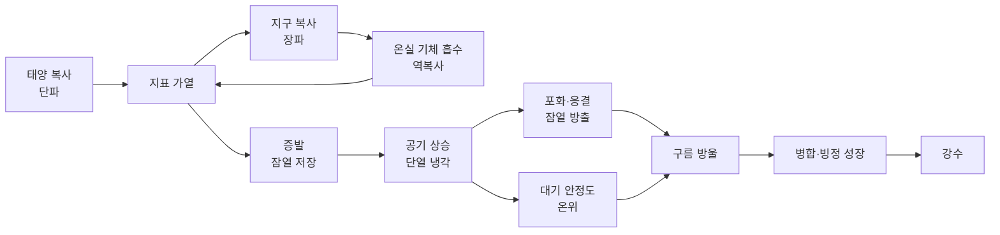

# 일반지구과학 7. 대기의 구조와 에너지·수분 — 공기 기둥 속을 흐르는 빛과 열과 물
<!-- prev: esys-3, m3-02, 5-3 -->
<!-- next: uearth-8, uearth-9 -->

> [!NOTE]
> **이 단원의 범위**
> - 대기의 조성과 연직 구조(기압의 연직 분포, 층 두께 공식)
> - 태양 복사와 지구 복사, 지구의 열수지와 온실 효과(한 층 대기 모형)
> - 기온 분포를 정하는 요인
> - 수증기와 습도(수증기압, 혼합비, 상대 습도, 이슬점, 클라우지우스–클라페이롱 관계)
> - 단열 변화와 대기 안정도(건조·습윤 단열 감률, 온위)
> - 구름과 안개의 형성과 분류, 강수 과정(병합설, 빙정설)과 강수 형태

**학습 목표**

1. 대기의 조성과 기온에 따른 연직 구조를 설명하고, 정역학 평형과 이상 기체 법칙으로 기압의 연직 분포와 층 두께를 계산할 수 있다.
2. 플랑크·빈·슈테판–볼츠만 법칙과 거리 역제곱·입사각 효과로 지구에 들어오는 태양 복사와 나가는 지구 복사를 정량적으로 다룰 수 있다.
3. 복사 평형 온도와 한 층 대기 모형으로 온실 효과를 유도하고, W/m² 단위의 전 지구 열수지를 해석할 수 있다.
4. 위도·수륙 분포·해류·고도 등 기온 분포를 정하는 요인을 열용량과 에너지 수지로 설명할 수 있다.
5. 수증기압·혼합비·상대 습도·이슬점을 서로 바꾸어 계산하고, 클라우지우스–클라페이롱 관계로 포화 수증기압의 온도 의존성을 설명할 수 있다.
6. 열역학 제1법칙에서 건조 단열 감률과 온위를 유도해 대기 안정도를 판정하고, 구름 방울의 생성(켈빈 효과)과 강수 과정을 정량적으로 분석할 수 있다.

**이 단원의 학습 사다리**

| 단계 | 무엇을 하나? |
|---|---|
| STEP 1. 이전 학습 다시 보기 | 고등학교에서 배운 대기권의 층, 복사 평형, 열수지, 단열 감률과 안정도, 병합설·빙정설을 다시 꺼낸다 |
| STEP 2. 기초 다지기 | 지수·로그 함수, 공기의 이상 기체 법칙, 단위 질량당 열역학 제1법칙, 변화율과 네제곱 법칙의 민감도 |
| STEP 3. 핵심 개념 | 조성·연직 구조 → 복사 법칙 → 열수지·온실 효과 → 기온 분포 → 습도 → 단열 변화·안정도 → 구름·안개 → 강수 |
| STEP 4. 오개념 바로잡기 | "공기가 수증기를 품는다", "상대 습도가 높으면 수증기가 많다" 같은 착각을 바로잡는다 |
| STEP 5. 전공 맛보기 | 대기복사학의 복사 전달, 대기열역학의 단열선도와 CAPE, 구름물리학의 쾰러 곡선 |
| STEP 6. 생활·산업·진로 | 기상 위성 원격 탐사, 안개 예보와 교통, 실내 습도 관리, 구름 씨 뿌리기 |

---

## 🗺️ 단원 들어가기

겨울날 난방이 잘된 방에서 입술이 트고 정전기가 자주 일어난다. 바깥 공기는 습도가 80 %인데도 말이다. 반대로 한여름 새벽, 맑은 하늘 아래에서 차 유리에 이슬이 맺히고 강가에는 안개가 피어오른다. 이 두 장면은 모두 **포화 수증기압이 온도에 따라 지수적으로 변한다**는 한 가지 사실로 설명된다.

또 하나의 질문을 던져 보자. 지구는 태양으로부터 $1\ \mathrm{m^2}$당 평균 약 $340\ \mathrm{W}$를 받는다. 그런데 지표는 $1\ \mathrm{m^2}$당 약 $400\ \mathrm{W}$의 적외선을 내보낸다. 받는 것보다 더 많이 내보내는데 어떻게 지표가 식지 않을까? 답은 대기가 지표로 되돌려 보내는 **역복사**에 있고, 이것이 온실 효과의 정량적인 모습이다.

이 단원에서는 고등학교에서 '규칙'으로 배운 감률 10 °C/km, 상승 응결 고도 $125(T-T_d)$ m, 대기의 창 같은 값들이 **어디에서 나오는지** 물리 법칙으로 유도하고, 그 값으로 실제 대기를 계산해 본다.

---

## STEP 1. 🔙 이전 학습 다시 보기

### 연계 개념표

| 이전 단원 | 그때 배운 것 | 대학에서 확장되는 것 |
|---|---|---|
| 중3 「날씨와 기후변화」 '대기권의 구조' | 기온 변화로 나눈 4개 층 | 각 층의 기온 구조가 생기는 **에너지 원인**, 기압의 지수 감소와 **층 두께 공식** |
| 중3 「날씨와 기후변화」 '복사 평형' | 받은 만큼 내보내는 평형 | $\sigma T^4$를 이용한 **복사 평형 온도** 계산 |
| 통합과학2 「지구온난화와 기후변화」 '지구 열수지' | 100 단위로 나타낸 열수지 표 | $\mathrm{W/m^2}$ 단위 열수지, **한 층 대기 모형**으로 온실 효과 유도 |
| 지구시스템과학 「강수 과정과 대기의 운동」 '선택적 흡수체' | 기체별 흡수 파장, 대기의 창 | **플랑크 분포**와 흡수대의 관계, 키르히호프 법칙 |
| 지구시스템과학 「강수 과정과 대기의 운동」 '단열 변화와 안정도' | 감률 10 °C/km·5 °C/km, $125(T-T_d)$ | 제1법칙에서 $\Gamma_d = g/c_p$ 유도, **온위**, 습윤 단열 감률의 온도 의존성 |
| 지구시스템과학 「강수 과정과 대기의 운동」 '강수 과정' | 병합설·빙정설(정성적) | **켈빈 효과**, 종단 속도(스토크스 법칙), 과포화도 계산 |
| 일반물리학 「열과 열역학」 | 열역학 제1법칙, 이상 기체, 단열 과정 | 공기 덩어리에 적용한 단열 과정과 정역학 평형의 결합 |

> 고등학교에서는 감률과 응결 고도를 **주어진 값**으로 썼다. 대학에서는 그 값을 **유도**하고, 유도할 때 들어간 **근사가 언제 깨지는지**까지 따진다.

### 준비 운동 (사전 진단)

**Q1.** 대류권에서는 높이 올라갈수록 기온이 내려가지만, 성층권에서는 올라간다. 성층권의 기온을 높이는 에너지는 무엇인가?

**Q2.** 지표 기온이 25 °C, 이슬점이 17 °C인 공기가 상승할 때 구름 밑면의 높이를 고등학교 공식으로 어림하시오.

**Q3.** 기온 감률이 7 °C/km인 대기의 안정도를 건조 단열 감률 10 °C/km, 습윤 단열 감률 5 °C/km와 비교해 판정하시오.

**Q4.** 같은 −10 °C에서 물과 얼음 중 포화 수증기압이 더 작은 쪽은? 그 결과 빙정설에서 무엇이 일어나는가?

정답 및 해설

**Q1.** 오존이 태양 자외선을 흡수하여 얻는 에너지이다. 오존 농도는 약 20~25 km에서 가장 크지만, 공기 밀도가 작아 단위 질량당 가열은 더 높은 곳에서 크므로 기온은 성층권 계면(약 50 km)에서 가장 높다.

**Q2.** $125\times(25-17) = 1000\ \mathrm{m}$.

**Q3.** $5 < 7 < 10$이므로 **조건부 불안정**이다.

**Q4.** 얼음. 물에는 불포화이고 얼음에는 과포화인 상태가 되어 물방울은 증발하고 빙정은 자란다.

---

## STEP 2. 🧱 기초 다지기

### ① 지수 함수와 자연로그 — "일정한 비율로 줄어든다"

어떤 양이 자기 크기에 비례하는 빠르기로 줄어들면 $\dfrac{dy}{dx} = -\dfrac{y}{H}$이고, 그 해는 $y = y_0 e^{-x/H}$이다. $H$는 $y$가 $1/e$(약 37 %)로 줄어드는 거리이다. 거꾸로 $x = H\ln(y_0/y)$로 '몇 배가 될 때까지 걸리는 거리'를 구한다.

| 계산 | 값 |
|---|---|
| $\ln 2$ | 0.693 |
| $\ln 10$ | 2.303 |
| $e^{-1}$ | 0.368 |
| 작은 $x$에서 $e^{x}$ | $\approx 1 + x$ |

대기에서는 **기압**(높이에 따라), **포화 수증기압**(온도에 따라), **복사의 감쇠**(경로에 따라)가 모두 지수 함수를 따른다.

### ② 공기의 상태 방정식

이상 기체 방정식 $PV = nRT$를 단위 질량으로 바꾸면 대기과학에서 쓰는 꼴이 된다.

$$
P = \rho R_d T, \qquad R_d = \frac{R}{M_d} = \frac{8.314\ \mathrm{J/(mol\cdot K)}}{0.02897\ \mathrm{kg/mol}} \approx 287\ \mathrm{J/(kg\cdot K)}
$$

예를 들어 $P = 101325\ \mathrm{Pa}$, $T = 288\ \mathrm{K}$이면 $\rho = 101325/(287\times288) \approx 1.23\ \mathrm{kg/m^3}$이다. 수증기는 몰질량이 $0.018\ \mathrm{kg/mol}$이라 기체 상수가 $R_v \approx 461.5\ \mathrm{J/(kg\cdot K)}$로 더 크다. 두 값의 비 $\varepsilon = R_d/R_v \approx 0.622$는 습도 계산에 계속 나온다.

### ③ 단위 질량당 열역학 제1법칙

공기 $1\ \mathrm{kg}$에 열 $\delta q$를 주면 일부는 온도를 올리고 일부는 팽창하는 일에 쓰인다. 기압이 변하는 대기에서는 정압 비열 $c_p$를 쓴 꼴이 편리하다.

$$
\delta q = c_p\,dT - \frac{1}{\rho}\,dP, \qquad c_p \approx 1004\ \mathrm{J/(kg\cdot K)}\ (\text{건조 공기})
$$

단열($\delta q = 0$)이면 $c_p\,dT = \dfrac{1}{\rho}dP$ — **기압이 내려가면 온도가 내려간다.** 이 한 줄이 STEP 3 ⑥의 출발점이다.

### ④ 변화율과 네제곱 법칙의 민감도

$E = \sigma T^4$에서 양변의 로그를 미분하면

$$
\frac{dE}{E} = 4\,\frac{dT}{T}
$$

288 K에서 온도가 1 K 오르면 방출 복사는 $4\times1/288 \approx 1.4\ \%$ 늘어난다. 이런 '상대 변화율' 계산은 열수지와 기후 민감도(「기후와 기후 변화」)에서 핵심 도구이다.

### ⑤ 그래프 읽기 — 세로축이 높이(또는 기압)인 그래프

대기의 연직 분포 그래프는 **가로축이 기온, 세로축이 높이**이다. 기울기가 수학 그래프와 거꾸로 읽힌다는 점에 주의하자. 기온 감률 $\Gamma = -\dfrac{dT}{dz}$가 클수록 선은 **더 눕는다**(높이 조금 올라도 기온이 많이 내려감). 세로축을 기압으로 그릴 때는 대개 **로그 눈금**을 써서 높이에 거의 비례하게 만든다.

---

## STEP 3. 📘 핵심 개념

### ① 대기의 조성과 연직 구조

#### (1) 조성 — 고르게 섞인 기체와 변하는 기체

| 성분 | 부피 비율(건조 공기, 약) | 성질 |
|---|---|---|
| 질소 $\mathrm{N_2}$ | 78.08 % | 거의 반응하지 않음, 체류 시간 매우 김 |
| 산소 $\mathrm{O_2}$ | 20.95 % | 광합성으로 생성, 호흡·연소로 소비 |
| 아르곤 Ar | 0.93 % | 칼륨-40의 붕괴로 생긴 비활성 기체 |
| 이산화 탄소 $\mathrm{CO_2}$ | 약 0.042 %(약 420 ppm) | 해마다 증가, 온실 기체 |
| 네온·헬륨·메테인·크립톤 등 | 합해 0.003 % 미만 | 메테인은 강한 온실 기체 |
| 수증기 $\mathrm{H_2O}$ | 0~약 4 %(변함) | 시간·장소에 따라 크게 변함, 가장 큰 온실 기체 |
| 오존 $\mathrm{O_3}$ | 성층권에서도 최대 약 10 ppm | 자외선 흡수 |
| 에어로졸 | 질량은 매우 작음 | 응결핵, 햇빛 산란·흡수 |

약 80 km 아래에서는 바람과 난류가 공기를 계속 섞으므로 주요 기체의 비율이 높이에 관계없이 거의 일정하다. 이 영역을 **균질권(homosphere)**, 그 위에서 무거운 기체가 아래, 가벼운 기체가 위로 갈라지는 영역을 **비균질권(heterosphere)** 이라 한다. 건조 공기의 평균 몰질량이 $28.97\ \mathrm{g/mol}$이라는 값은 균질권에서만 쓸 수 있다.

#### (2) 기온으로 나눈 네 층 — 왜 그런 모양인가

| 층 | 높이(약) | 기온 변화 | 원인 |
|---|---|---|---|
| **대류권(troposphere)** | 0 ~ 약 12 km(적도 약 16~18 km, 극 약 8 km) | 높이에 따라 하강(평균 약 6.5 °C/km) | 지표가 데워지고 대류·잠열로 열이 위로 운반됨 |
| **성층권(stratosphere)** | 대류권 계면 ~ 약 50 km | 대체로 상승 | 오존의 자외선 흡수 |
| **중간권(mesosphere)** | 약 50 ~ 85 km | 하강(약 −90 °C까지) | 오존이 적어 가열원이 약하고 $\mathrm{CO_2}$의 적외선 냉각 |
| **열권(thermosphere)** | 약 85 km 이상 | 급상승(수백~1000 °C 이상) | 산소·질소 분자의 극자외선·X선 흡수, 공기가 매우 희박 |

대류권 계면이 적도에서 높은 까닭은 강한 가열로 대류가 높이까지 일어나기 때문이다. 열권의 '기온'이 1000 °C여도 사람이 뜨겁게 느끼지 않는 것은 분자의 **평균 운동 에너지**는 크지만 **분자 수가 너무 적어** 전달되는 열량이 매우 작기 때문이다. 기온은 열량이 아니라 분자 운동의 세기라는 점을 기억하자.

#### (3) 기압의 연직 분포 — 정역학 평형과 이상 기체의 결합

두께 $dz$인 얇은 공기층에 작용하는 연직 힘의 균형은 $dP = -\rho g\,dz$이다(**정역학 평형**). 여기에 $\rho = P/(R_dT)$를 넣으면

$$
\frac{dP}{P} = -\frac{g}{R_d T}\,dz
$$

$T$가 일정하면 적분하여 $P = P_0 e^{-z/H}$, **규모 높이** $H = R_dT/g$이다. $T = 250\ \mathrm{K}$(대류권 평균에 가까움)이면 $H = 287\times250/9.8 \approx 7.3\ \mathrm{km}$, $T = 288\ \mathrm{K}$이면 약 8.4 km이다.

기온이 높이에 따라 변하는 실제 대기에서는 두 기압면 사이의 평균 기온 $\bar T$를 써서 두께를 구한다. 이것이 **층 두께 공식(hypsometric equation)** 이다.

$$
\Delta z = z_2 - z_1 = \frac{R_d\bar T}{g}\ln\frac{P_1}{P_2}
$$

> [!IMPORTANT]
> 두 기압면 사이의 두께는 **평균 기온에만 비례**한다. 따뜻한 공기 기둥은 두껍고 찬 공기 기둥은 얇다. 「대기의 운동과 날씨」에서 이 사실이 상층의 기압 경도, 제트류, 해륙풍을 설명하는 열쇠가 된다.

#### 예제 1 — 대기의 질량과 절반 높이

지표 평균 기압 $1.013\times10^5\ \mathrm{Pa}$, 지구 반지름 $6.371\times10^6\ \mathrm{m}$, $g = 9.8\ \mathrm{m/s^2}$로 (1) 대기 전체의 질량을 구하고, (2) 규모 높이를 8 km로 둘 때 대기 질량의 절반이 몇 km 아래에 있는지 구하시오.

**풀이**

(1) **식 세우기** 지표 기압은 단위 면적 위 공기 기둥의 무게이므로 $M = P_0\cdot 4\pi R^2/g$.
**대입** $M = 1.013\times10^5\times4\pi(6.371\times10^6)^2/9.8 \approx 5.3\times10^{18}\ \mathrm{kg}$.
**의미** 지구 질량($6.0\times10^{24}\ \mathrm{kg}$)의 약 100만분의 1이다. 대기는 지구를 감싼 아주 얇은 막이다.

(2) 어떤 높이 위에 있는 질량은 그 높이의 기압에 비례하므로, 기압이 절반이 되는 높이를 찾는다. $z = H\ln2 = 8\times0.693 \approx 5.5\ \mathrm{km}$. 에베레스트 산(약 8.8 km) 꼭대기보다 낮은 곳에 대기 질량의 절반이 있다.

#### 예제 2 — 따뜻한 기둥은 두껍다

1000 hPa 면과 500 hPa 면 사이의 평균 기온이 (가) 250 K인 곳과 (나) 270 K인 곳에서 두 면 사이의 두께를 각각 구하시오. ($R_d = 287\ \mathrm{J/(kg\cdot K)}$, $g = 9.81\ \mathrm{m/s^2}$)

**풀이** $\Delta z = \dfrac{R_d\bar T}{g}\ln 2$
(가) $\dfrac{287\times250}{9.81}\times0.693 \approx 5.07\times10^3\ \mathrm{m}$ (나) $\dfrac{287\times270}{9.81}\times0.693 \approx 5.48\times10^3\ \mathrm{m}$
평균 기온이 20 K 높으면 500 hPa 면이 약 400 m 높다. 일기 예보에서 '1000–500 hPa 층 두께 5400 m 선'을 비와 눈의 경계 어림으로 쓰는 까닭이 여기에 있다(두께가 얇을수록 찬 공기 → 눈 가능성 증가).

> [!TIP]
> 💡 **비유** — 기압면을 '공기 이불의 층'이라 생각하자. 같은 무게(같은 기압 차)의 이불이라도 데우면 부풀어 두꺼워지고 식히면 납작해진다.

---

### ② 태양 복사와 지구 복사

#### (1) 흑체 복사의 세 법칙

**흑체(blackbody)** 는 들어오는 모든 복사를 흡수하고, 온도만으로 정해지는 복사를 내는 이상적 물체이다. 파장 $\lambda$에서 내는 복사의 세기는 **플랑크 법칙(Planck's law)** 이 준다.

$$
B_\lambda(T) = \frac{2hc^2}{\lambda^5}\,\frac{1}{e^{hc/(\lambda k_B T)} - 1}
$$

이 식에서 두 가지 결과가 나온다.

| 법칙 | 식 | 의미 |
|---|---|---|
| **빈 변위 법칙** | $\lambda_{\max} = \dfrac{2898\ \mu\mathrm{m\cdot K}}{T}$ | 뜨거울수록 최대 세기 파장이 짧다 |
| **슈테판–볼츠만 법칙** | $F = \sigma T^4$, $\sigma = 5.67\times10^{-8}\ \mathrm{W/(m^2\cdot K^4)}$ | 단위 면적당 총 방출량은 $T^4$에 비례 |
| **키르히호프 법칙** | 같은 파장에서 흡수율 = 방출률 | 잘 흡수하는 파장에서 잘 방출한다 |

태양 표면(약 5800 K)은 약 0.5 μm에서, 지표(약 288 K)는 약 10 μm에서 가장 강하게 복사한다. 두 분포는 약 4 μm를 경계로 거의 겹치지 않으므로 4 μm보다 짧은 쪽을 **단파 복사**(태양 복사), 긴 쪽을 **장파 복사**(지구 복사)로 나누어 따로 다룰 수 있다.

**키르히호프 법칙의 의미** 온실 기체가 15 μm 적외선을 잘 흡수한다면 그 파장에서 잘 방출하기도 한다. 그래서 온실 기체가 있는 대기층은 지표 복사를 흡수하는 동시에 **자기 온도에 맞는 적외선을 위아래로 방출**한다. 아래로 향하는 것이 **대기 역복사**이다.

#### (2) 대기의 흡수 스펙트럼

| 파장 영역 | 대기의 투과 | 주된 흡수체 |
|---|---|---|
| 0.1~0.3 μm(자외선) | 거의 불투과 | $\mathrm{O_2}$(0.24 μm 이하), $\mathrm{O_3}$(0.2~0.31 μm) |
| 0.3~0.7 μm(가시광선) | 대부분 투과 | 오존의 약한 흡수, 산란이 주로 작용 |
| 0.7~4 μm(근적외선) | 부분 투과 | 수증기의 여러 흡수대 |
| 5~8 μm | 거의 불투과 | 수증기(6.3 μm) |
| 8~12 μm | **대기의 창** | 9.6 μm 부근 오존 흡수만 약하게 |
| 13~17 μm | 거의 불투과 | $\mathrm{CO_2}$(15 μm) |
| 20 μm 이상 | 거의 불투과 | 수증기 회전 흡수대 |

$\mathrm{CO_2}$의 15 μm 흡수대가 지구 복사의 최대 세기(약 10 μm) 근처에 있다는 점이 중요하다. 흡수대 한가운데는 이미 거의 불투과(포화)이므로 $\mathrm{CO_2}$가 늘면 주로 흡수대의 **가장자리**가 넓어진다. 이 때문에 $\mathrm{CO_2}$의 효과는 농도에 비례하지 않고 **농도의 로그**에 비례하게 된다(「기후와 기후 변화」).

#### (3) 지구에 들어오는 태양 복사 — 거리와 각도

태양 광도 $L_\odot = 4\pi R_\odot^2\sigma T_\odot^4$가 반지름 $d$인 구면 전체에 퍼지므로 지구 궤도에서 태양에 수직한 면이 받는 복사는

$$
S = \sigma T_\odot^4\left(\frac{R_\odot}{d}\right)^2
$$

이다. 이 값을 **태양 상수(solar constant)** 라 하며 위성 관측값은 약 $1361\ \mathrm{W/m^2}$이다.

수평한 지면에는 햇빛이 비스듬히 들어오므로 단위 면적이 받는 양은 $S\cos\theta_z$($\theta_z$: 천정각)로 줄어든다. 위도, 계절, 시각에 따라 $\theta_z$가 달라지는 것이 기온 분포의 1차 원인이다(④).

#### 예제 3 — 태양 상수를 계산으로 얻기

태양 표면 온도 5772 K, 태양 반지름 $6.957\times10^8\ \mathrm{m}$, 태양–지구 거리 $1.496\times10^{11}\ \mathrm{m}$를 써서 태양 상수를 구하시오.

**풀이**
**식** $S = \sigma T_\odot^4(R_\odot/d)^2$
**대입** $\sigma T_\odot^4 = 5.67\times10^{-8}\times5772^4 \approx 6.29\times10^7\ \mathrm{W/m^2}$, $(R_\odot/d)^2 = (4.65\times10^{-3})^2 \approx 2.16\times10^{-5}$
**결과** $S \approx 1.36\times10^3\ \mathrm{W/m^2}$
**의미** 태양 표면 $1\ \mathrm{m^2}$에서 나온 에너지가 지구까지 오는 동안 약 4만 6천분의 1로 묽어진다. 태양을 흑체로 본 계산이 위성 관측값과 잘 맞는다.

#### 예제 4 — 남중 고도와 일사

태양 상수 $1361\ \mathrm{W/m^2}$일 때, 대기의 영향을 무시하고 천정각이 0°, 30°, 60°인 수평면이 받는 순간 일사를 구하시오.

**풀이** $S\cos\theta_z$로 각각 $1361$, $1361\times0.866 \approx 1179$, $1361\times0.5 \approx 681\ \mathrm{W/m^2}$이다. 같은 햇빛이 비스듬히 들어오면 넓은 면적에 퍼져 단위 면적당 에너지가 줄어든다. 게다가 비스듬한 햇빛은 대기를 더 길게 통과하므로 실제로는 산란·흡수로 더 많이 줄어든다.

> [!NOTE]
> 하루 평균으로 보면 춘·추분의 적도는 $S/\pi \approx 433\ \mathrm{W/m^2}$(대기 꼭대기)를 받는다. 지구 전체 평균은 그보다 작은 $S/4 \approx 340\ \mathrm{W/m^2}$이다. $\frac14$은 '햇빛을 받는 단면적 $\pi R^2$ ÷ 전체 표면적 $4\pi R^2$'에서 나온다.

---

### ③ 지구의 열수지와 온실 효과

#### (1) 복사 평형 온도

지구가 흡수하는 태양 복사와 방출하는 지구 복사가 같다고 놓으면

$$
\frac{S(1-\alpha)}{4} = \sigma T_e^4 \quad\Rightarrow\quad T_e = \left[\frac{S(1-\alpha)}{4\sigma}\right]^{1/4}
$$

$\alpha$는 행성 반사율(알베도, 약 0.30)이다. $S = 1361\ \mathrm{W/m^2}$이면 $T_e \approx 255\ \mathrm{K}$(약 −18 °C)로, 실제 지표 평균 약 288 K보다 33 K 낮다. $T_e$는 **우주에서 본 지구의 '복사 온도'** 이며, 실제로는 대류권 중층(약 5 km) 기온에 가깝다. 즉 지구는 우주로 '지표에서가 아니라 대기 중간쯤에서' 열을 내보낸다.

#### (2) 한 층 대기 모형 — 온실 효과의 유도

대기를 **단파는 모두 통과시키고 장파는 모두 흡수**하는 한 겹의 층(온도 $T_a$)으로 단순화하자. 대기층은 키르히호프 법칙에 따라 위와 아래로 각각 $\sigma T_a^4$를 방출한다. 단위 면적당 평균 흡수 태양 복사를 $Q = S(1-\alpha)/4$라 하면

| 위치 | 들어옴 | 나감 | 평형 식 |
|---|---|---|---|
| 대기 꼭대기 | $Q$ | $\sigma T_a^4$ | $Q = \sigma T_a^4$ |
| 대기층 | $\sigma T_s^4$(지표 복사) | $2\sigma T_a^4$(위·아래) | $\sigma T_s^4 = 2\sigma T_a^4$ |
| 지표 | $Q + \sigma T_a^4$ | $\sigma T_s^4$ | $\sigma T_s^4 = Q + \sigma T_a^4$ |

첫 줄에서 $T_a = T_e$, 둘째 줄에서 $T_s = 2^{1/4}T_e \approx 1.19\times255 \approx 303\ \mathrm{K}$이다. **지표는 태양 복사 $Q$에 더해 대기 역복사 $\sigma T_a^4$를 받으므로** 복사 평형 온도보다 따뜻해진다. 이것이 온실 효과이다.

실제 대기는 장파를 일부만 흡수한다. 대기층의 장파 흡수율(= 방출률)을 $\varepsilon$이라 하면 같은 방법으로

$$
T_s = T_e\left(\frac{2}{2-\varepsilon}\right)^{1/4}
$$

를 얻는다. $\varepsilon = 0$이면 $T_s = T_e$(온실 효과 없음), $\varepsilon = 1$이면 $2^{1/4}T_e$이다.

#### 예제 5 — 실제 지구에 맞는 흡수율

지표 평균 기온 288 K, $T_e = 255\ \mathrm{K}$가 되려면 한 층 대기 모형의 장파 흡수율 $\varepsilon$은 얼마여야 하는가?

**풀이**
**식 변형** $\left(\dfrac{T_e}{T_s}\right)^4 = \dfrac{2-\varepsilon}{2}$ → $\varepsilon = 2 - 2\left(\dfrac{T_e}{T_s}\right)^4$
**대입** $(255/288)^4 \approx 0.615$ → $\varepsilon \approx 2 - 1.23 = 0.77$
**의미** 대기가 지표 장파 복사의 약 77 %를 흡수하는 것처럼 행동한다는 뜻이다. 그러나 이 모형은 대류와 잠열에 의한 열 수송을 빠뜨렸으므로 '정답'이 아니라 **온실 효과의 원리를 보여 주는 첫 근사**이다. 실제 대기에서는 지표에서 위로 갈수록 온도가 낮아지는 구조(기온 감률)가 있어야 온실 효과가 생긴다는 점도 이 모형이 보여 주지 못한다.

#### (3) 전 지구 평균 열수지 ($\mathrm{W/m^2}$)

위성 관측과 지상 관측을 종합한 대표값이다(자료마다 몇 $\mathrm{W/m^2}$씩 다르며, 모두 '약'이다).

| 구분 | 항목 | 값(약, $\mathrm{W/m^2}$) |
|---|---|---|
| 대기 꼭대기 | 들어오는 태양 복사 | 340 |
| | 반사(구름·대기·지표) | 100 |
| | 나가는 장파 복사 | 239 |
| | 알짜 흡수(에너지 불균형) | 약 0.5~1 |
| 단파 흡수 | 대기 | 80 |
| | 지표 | 160 |
| 지표 | 지표 장파 방출 | 398 |
| | 대기 역복사 | 342 |
| | 잠열(증발) | 82 |
| | 현열(전도·대류) | 21 |

지표 수지: 들어오는 $160 + 342 = 502$, 나가는 $398 + 82 + 21 = 501$(차이 약 1은 반올림과 불균형). **지표가 받는 에너지의 3분의 2 이상이 대기 역복사**이다. 고등학교의 '100 단위' 표는 이 값을 340으로 나누어 100으로 맞춘 것이다($82/340 \approx 24$ ↔ 잠열 23 등).

현열과 잠열의 비를 **보웬 비(Bowen ratio)** $B = \dfrac{\text{현열}}{\text{잠열}}$라 한다. 전 지구 평균은 $21/82 \approx 0.26$이다. 바다나 숲에서는 0.1~0.5로 작고, 사막에서는 5 이상으로 크다. 젖은 땅은 햇빛 에너지의 대부분을 **증발**에 쓰므로 덜 뜨거워진다.

#### 예제 6 — 지표의 알짜 열 출입

위 표로 지표가 장파 복사로 잃는 **알짜** 에너지와, 지표가 흡수한 태양 복사 160을 대기로 넘기는 방법별 비율을 구하시오.

**풀이** 알짜 장파 $= 398 - 342 = 56\ \mathrm{W/m^2}$. 지표가 잃는 것: 잠열 82, 알짜 장파 56, 현열 21(합 159 ≈ 160). 비율은 잠열 약 52 %, 알짜 장파 약 35 %, 현열 약 13 %이다. **지표의 열을 대기로 옮기는 가장 큰 통로는 증발(잠열)** 이다. 이 잠열은 구름 속에서 응결할 때 대기에 풀려나 ⑥~⑧의 과정을 움직인다.

> [!TIP]
> 💡 **비유** — 지표는 월급(태양 복사 160)보다 훨씬 큰 금액을 매달 주고받는 통장이다. 지출 398과 수입 342가 대부분 서로 상쇄되고, 실제 '순지출'은 56뿐이다. 온실 기체가 늘면 수입(역복사)이 늘어 잔고(기온)가 올라간다.

---

### ④ 기온 분포를 정하는 요인

| 요인 | 작용 | 예 |
|---|---|---|
| **위도** | 태양 고도와 낮의 길이 → 일사량 | 적도에서 극으로 갈수록 연평균 기온 하강 |
| **수륙 분포(열용량)** | 물은 비열이 크고 열이 깊이 섞임 → 천천히 데워지고 식음 | 해안은 연교차·일교차가 작고 대륙 내부는 큼 |
| **해류** | 난류는 열을 고위도로 운반, 한류는 냉각 | 같은 위도에서 서유럽은 동아시아보다 겨울이 따뜻함 |
| **고도** | 대류권에서 평균 약 6.5 °C/km 하강 | 고산 도시의 서늘한 기후 |
| **지리적 위치·탁월풍** | 바다에서 오는 바람이냐 대륙에서 오는 바람이냐 | 대륙 동안(우리나라)은 겨울에 대륙 바람으로 추움 |
| **구름·지표 반사율** | 구름은 낮에 햇빛을 막고 밤에 역복사로 보온, 눈은 반사율이 큼 | 흐린 날 일교차 감소, 눈 덮인 땅의 냉각 |

#### 열용량의 차이를 수치로

맑은 날 낮 12시간 동안 평균 $100\ \mathrm{W/m^2}$의 알짜 에너지가 지표에 들어왔다고 하자. 에너지를 받아들이는 깊이가 바다는 혼합층 약 50 m(밀도 $1025\ \mathrm{kg/m^3}$, 비열 $3990\ \mathrm{J/(kg\cdot K)}$), 육지는 약 0.2 m(단위 부피 열용량 약 $2.0\times10^6\ \mathrm{J/(m^3\cdot K)}$)라 하면

$$
\Delta T_{\text{바다}} = \frac{100\times43200}{1025\times3990\times50} \approx 0.02\ \mathrm{K}, \qquad \Delta T_{\text{육지}} = \frac{100\times43200}{2.0\times10^6\times0.2} \approx 11\ \mathrm{K}
$$

바다는 물이 섞이고 햇빛이 깊이 투과하며 비열도 커서, 같은 에너지를 받아도 온도가 수백 배 덜 변한다. 이 차이가 해안과 내륙의 일교차, 그리고 「대기의 운동과 날씨」의 해륙풍과 계절풍을 만든다.

#### 예제 7 — 고도와 기온

해발 0 m의 해안 도시와 해발 1500 m의 고원 도시가 같은 위도에 있다. 해안 도시의 연평균 기온이 15 °C이고 평균 기온 감률을 6.5 °C/km로 볼 때 고원 도시의 연평균 기온을 어림하시오. 이 어림이 맞지 않을 수 있는 이유도 한 가지 쓰시오.

**풀이** $15 - 6.5\times1.5 \approx 5.3\ ^\circ\mathrm{C}$. 다만 고원 지표는 같은 높이의 자유 대기보다 햇빛을 직접 받아 낮에는 더 데워지고, 맑은 밤에는 더 식으므로 일교차가 크다. 또 6.5 °C/km는 평균값이라 계절·지역에 따라 다르다.

---

### ⑤ 수증기와 습도

#### (1) 습도를 나타내는 여러 방법

| 양 | 기호·식 | 단위 | 의미 |
|---|---|---|---|
| **수증기압** | $e$ | hPa | 공기 중 수증기가 차지하는 부분 압력 |
| **포화 수증기압** | $e_s(T)$ | hPa | 평평한 물 표면과 평형일 때의 수증기압(온도만의 함수) |
| **혼합비** | $w = \dfrac{\varepsilon e}{P - e} \approx 0.622\dfrac{e}{P}$ | g/kg | 건조 공기 1 kg당 수증기 질량 |
| **비습** | $q = \dfrac{\varepsilon e}{P - (1-\varepsilon)e}$ | g/kg | 습윤 공기 1 kg당 수증기 질량($w$와 거의 같음) |
| **상대 습도** | $RH = \dfrac{e}{e_s(T)}\times100$ | % | 포화에 얼마나 가까운가 |
| **이슬점** | $e_s(T_d) = e$인 $T_d$ | °C | 기압·수증기량 일정하게 식혔을 때 포화되는 온도 |

혼합비와 비습은 공기 덩어리가 상승·하강해도 응결이나 증발이 없으면 **변하지 않는 보존량**이다. 반면 상대 습도는 수증기량이 그대로여도 **기온만 바뀌면 변한다.** 그래서 공기의 '수증기 양'을 말할 때는 상대 습도가 아니라 혼합비나 이슬점을 쓴다.

> [!WARNING]
> "공기가 수증기를 품는다", "따뜻한 공기는 수증기를 더 많이 담을 수 있다"는 표현은 편리하지만 정확하지 않다. 포화 수증기압은 **공기와 무관하게** 물과 수증기 사이의 평형으로 정해진다(진공 속에서도 같다). 공기가 수증기를 '담는 그릇'이 아니라, **온도가 높을수록 물 분자가 액체에서 빠져나오기 쉬워지는 것**이다.

#### (2) 클라우지우스–클라페이롱 관계

물과 수증기의 상평형 곡선의 기울기는 열역학에서 다음과 같이 유도된다(일반화학 「분자 간 힘과 액체·고체·용액」의 증기 압력 식과 같다).

$$
\frac{de_s}{dT} = \frac{L_v e_s}{R_v T^2} \quad\Rightarrow\quad e_s(T) \approx e_s(T_0)\exp\left[\frac{L_v}{R_v}\left(\frac{1}{T_0} - \frac{1}{T}\right)\right]
$$

$L_v = 2.5\times10^6\ \mathrm{J/kg}$, $R_v = 461.5\ \mathrm{J/(kg\cdot K)}$, $T_0 = 273.15\ \mathrm{K}$에서 $e_s = 6.11\ \mathrm{hPa}$이다. 288 K 부근에서 상대 변화율은

$$
\frac{1}{e_s}\frac{de_s}{dT} = \frac{L_v}{R_vT^2} = \frac{2.5\times10^6}{461.5\times288^2} \approx 0.065\ \mathrm{K^{-1}}
$$

즉 **기온이 1 K 오를 때마다 포화 수증기압은 약 6~7 %씩 늘어난다.** 이 비율은 지구 온난화 때 대기 중 수증기와 극한 강수가 늘어나는 정도를 어림하는 데 쓰인다(「기후와 기후 변화」).

실무에서는 잠열의 온도 의존성까지 반영한 근사식(마그누스 형태)을 쓴다. 이 단원의 계산에서는 다음 식을 사용한다($T$는 °C).

$$
e_s(T) = 6.112\exp\left(\frac{17.67\,T}{T + 243.5}\right)\ \mathrm{hPa}
$$

| 기온(°C) | −20 | −10 | 0 | 10 | 20 | 25 | 30 | 35 |
|---|---|---|---|---|---|---|---|---|
| $e_s$(물, hPa) | 1.26 | 2.87 | 6.11 | 12.3 | 23.4 | 31.7 | 42.5 | 56.3 |
| $e_s$(얼음, hPa) | 1.03 | 2.60 | 6.11 | — | — | — | — | — |

#### 예제 8 — 한여름 오후의 공기

기온 30 °C, 상대 습도 60 %, 기압 1000 hPa인 공기의 (1) 수증기압, (2) 이슬점, (3) 혼합비를 구하시오.

**풀이**
(1) $e = 0.60\times e_s(30) = 0.60\times42.5 \approx 25.5\ \mathrm{hPa}$
(2) 마그누스 식을 거꾸로 풀면 $T_d = \dfrac{243.5\,x}{17.67 - x}$, $x = \ln(e/6.112) = \ln(4.17) \approx 1.428$ → $T_d \approx \dfrac{243.5\times1.428}{16.24} \approx 21.4\ ^\circ\mathrm{C}$
(3) $w = 622\times\dfrac{25.5}{1000-25.5} \approx 16.3\ \mathrm{g/kg}$
**의미** 이 공기는 21 °C 아래로 식으면 응결한다. 밤사이 지표 기온이 21 °C 근처까지 내려가면 이슬이나 안개가 생긴다. 열대야와 끈적한 더위는 상대 습도보다 **높은 이슬점**(20 °C 이상)에서 온다.

#### 예제 9 — 겨울 실내가 건조한 이유

바깥 기온 0 °C, 상대 습도 80 %인 공기를 그대로 들여와 20 °C로 데웠다. 수증기를 더하지 않았다면 실내 상대 습도는 얼마인가?

**풀이** 바깥 수증기압 $e = 0.80\times6.11 \approx 4.89\ \mathrm{hPa}$. 데워도 $e$는 그대로이므로 $RH = 4.89/23.4\times100 \approx 21\ \%$이다. 수증기량은 같은데 포화 수증기압이 약 4배 커져 상대 습도가 4분의 1로 떨어졌다. 그래서 겨울 난방 실내는 가습이 필요하다.

---

### ⑥ 단열 변화와 대기 안정도

#### (1) 건조 단열 감률의 유도

공기 덩어리가 주변과 열을 주고받지 않고 상승하면 STEP 2 ③에서 $c_p\,dT = \dfrac{1}{\rho}dP$이다. 공기 덩어리의 기압은 주변 기압과 같고, 주변은 정역학 평형 $dP = -\rho g\,dz$를 만족하므로

$$
c_p\,dT = -g\,dz \quad\Rightarrow\quad \Gamma_d = -\frac{dT}{dz} = \frac{g}{c_p} = \frac{9.8}{1004} \approx 9.8\ \mathrm{K/km}
$$

고등학교의 '10 °C/km'는 이 값을 반올림한 것이다. 유도에서 쓴 가정은 (가) 단열, (나) 공기 덩어리 기압 = 주변 기압, (다) 정역학 평형, (라) 응결 없음이다.

#### (2) 온위 — 높이가 달라도 비교할 수 있는 온도

$c_p\,dT = \dfrac{R_dT}{P}dP$를 정리해 적분하면 $T P^{-R_d/c_p}$가 일정하다(일반물리학의 단열 과정 $TP^{(1-\gamma)/\gamma}$ = 일정과 같다). 기준 기압 1000 hPa로 단열 이동시켰을 때의 온도를 **온위(potential temperature)** $\theta$라 한다.

$$
\theta = T\left(\frac{1000\ \mathrm{hPa}}{P}\right)^{R_d/c_p}, \qquad \frac{R_d}{c_p} \approx 0.286
$$

건조 단열 과정에서 $\theta$는 **보존**된다. 그래서 온위로 안정도를 판정하면 기압 차이를 신경 쓸 필요가 없다.

| 주변 대기의 온위 분포 | 안정도(불포화 공기) |
|---|---|
| $d\theta/dz > 0$(위로 갈수록 온위 증가) | 안정 |
| $d\theta/dz = 0$ | 중립 |
| $d\theta/dz < 0$ | 불안정 |

#### (3) 습윤 단열 감률 — 왜 '약 5'가 아니라 온도에 따라 변하나

포화된 공기가 상승하면 응결로 잠열 $L_v\,dw_s$를 내놓아 냉각을 줄인다. 이를 넣어 정리한 **습윤(포화) 단열 감률**은

$$
\Gamma_s = g\,\frac{1 + \dfrac{L_v w_s}{R_d T}}{c_p + \dfrac{\varepsilon L_v^2 w_s}{R_d T^2}}
$$

이다. 포화 혼합비 $w_s$가 클수록(따뜻할수록) 응결할 수증기가 많아 감률이 작아진다.

| 기온·기압 | 25 °C, 1000 hPa | 10 °C, 1000 hPa | 0 °C, 1000 hPa | −20 °C, 500 hPa |
|---|---|---|---|---|
| $\Gamma_s$(약, K/km) | 3.8 | 5.3 | 6.5 | 7.7 |

열대의 하층에서는 약 4 K/km, 차가운 상층에서는 건조 단열 감률에 가까워진다. 고등학교의 '5 °C/km'는 중위도 하층의 대표값이다.

#### (4) 상승 응결 고도와 공기 덩어리의 부력

불포화 공기 덩어리는 $\Gamma_d$로 식고, 혼합비가 보존되므로 이슬점은 약 1.8 K/km로 천천히 내려간다(기압이 낮아져 수증기압이 줄기 때문). 둘의 차가 약 8 K/km씩 줄어 만나는 높이가 **상승 응결 고도(LCL)** 이다.

$$
z_{\mathrm{LCL}} \approx \frac{T - T_d}{8\ \mathrm{K/km}} \approx 125\,(T - T_d)\ \mathrm{m}
$$

들어 올린 공기 덩어리가 주변보다 $\Delta T$만큼 따뜻하면 단위 질량당 부력 가속도는 아르키메데스 원리로

$$
a = g\,\frac{\rho_e - \rho_p}{\rho_p} \approx g\,\frac{T_p - T_e}{T_e}
$$

이다. 280 K 대기에서 1 K 더 따뜻하면 $a \approx 9.8/280 \approx 0.035\ \mathrm{m/s^2}$ — 작아 보이지만 수 km를 오르면 수 m/s~수십 m/s의 상승 기류가 된다. 이를 높이로 적분한 양이 「대기의 운동과 날씨」의 **대류 가용 잠재 에너지(CAPE)** 이다.

#### (5) 안정도의 판정과 기온 역전

| 기온 감률 $\Gamma$ | 판정 | 대표적 상황 |
|---|---|---|
| $\Gamma > \Gamma_d$ | 절대 불안정 | 한여름 낮 지표 바로 위의 얇은 층 |
| $\Gamma_s < \Gamma < \Gamma_d$ | 조건부 불안정 | 대류권의 평균 상태(6.5 K/km) |
| $\Gamma < \Gamma_s$ | 절대 안정 | 고기압권의 하강 기류 |
| $\Gamma < 0$ | 기온 역전(매우 안정) | 복사 역전, 침강 역전, 전선 역전 |

> [!IMPORTANT]
> 대기의 평균 감률 6.5 K/km는 **조건부 불안정**이다. 불포화 공기에게는 안정하지만, 공기가 포화될 만큼 들어 올려지면 그 위로는 스스로 상승할 수 있다. 그래서 '무엇이 공기를 처음 들어 올리는가'(전선, 지형, 수렴, 가열)가 날씨를 결정한다.

#### 예제 10 — 온위로 비교하기

(가) 850 hPa, 15 °C인 공기와 (나) 500 hPa, −15 °C인 공기 가운데 온위가 높은 것은? 두 공기층이 이 순서로 위아래에 놓여 있다면(나가 위) 이 층은 안정한가?

**풀이**
(가) $\theta = 288.15\times(1000/850)^{0.286} \approx 302\ \mathrm{K}$(약 29 °C) (나) $\theta = 258.15\times(1000/500)^{0.286} \approx 315\ \mathrm{K}$(약 42 °C)
실제 기온은 (가)가 30 °C 높지만 온위는 (나)가 13 K 높다. 위로 갈수록 온위가 증가하므로 이 층은 불포화 공기에 대해 **안정**하다. (나)를 850 hPa까지 끌어내리면 압축되어 (가)보다 훨씬 뜨거워진다.

#### 예제 11 — 산을 넘는 공기(습윤 단열 감률을 바꾸어 계산)

해발 0 m에서 기온 26 °C, 이슬점 18 °C인 공기가 높이 2500 m 산을 넘는다. 응결한 물은 모두 바람받이 쪽에 내린다고 하고, $\Gamma_d = 10$, 이슬점 감률 2, 응결 후 $\Gamma_s = 5\ \mathrm{K/km}$로 계산하시오. (1) 구름 밑면 높이, (2) 산꼭대기 기온, (3) 반대편 해발 0 m 기온, (4) 열대 바다 위처럼 $\Gamma_s = 4\ \mathrm{K/km}$라면 (3)은 어떻게 달라지는가?

**풀이**
(1) $125\times8 = 1000\ \mathrm{m}$, 이때 기온 16 °C
(2) $16 - 5\times1.5 = 8.5\ ^\circ\mathrm{C}$
(3) $8.5 + 10\times2.5 = 33.5\ ^\circ\mathrm{C}$ — 처음보다 7.5 °C 높다.
(4) 꼭대기 $16 - 4\times1.5 = 10\ ^\circ\mathrm{C}$, 반대편 $10 + 25 = 35\ ^\circ\mathrm{C}$. 응결이 많을수록(잠열 방출이 클수록) 바람의지 쪽이 더 뜨거워진다. 바람의지 쪽이 더워진 열의 출처는 **바람받이 쪽에 내린 비가 남긴 잠열**이다.

> [!TIP]
> 💡 **비유** — 온위는 '해발 0 m로 환산한 몸값'이다. 산꼭대기의 5 °C 공기와 바닷가의 25 °C 공기를 비교하려면, 둘 다 같은 기준 높이로 데려와 보아야 공정하다.

---

### ⑦ 구름과 안개의 형성과 분류

#### (1) 왜 응결핵이 필요한가 — 켈빈 효과

작은 물방울의 표면은 곡률이 커서 물 분자가 빠져나가기 쉽다. 반지름 $r$인 순수한 물방울과 평형을 이루는 수증기압은 평평한 수면보다 크다(**켈빈 효과**, 곡률 효과).

$$
\frac{e_s(r)}{e_s(\infty)} = \exp\left(\frac{2\sigma_w}{\rho_w R_v T\,r}\right)
$$

$\sigma_w \approx 0.072\ \mathrm{N/m}$(표면 장력), $\rho_w = 1000\ \mathrm{kg/m^3}$, $T = 273\ \mathrm{K}$를 넣으면 지수 안은 $\dfrac{1.14\times10^{-9}\ \mathrm{m}}{r}$이다.

| 물방울 반지름 | 0.01 μm | 0.1 μm | 1 μm | 10 μm |
|---|---|---|---|---|
| 평형에 필요한 과포화도(약) | 12 % | 1.1 % | 0.11 % | 0.01 % |

실제 구름 속 과포화도는 대개 1 % 미만이다. 그러므로 분자 몇 개가 모여 순수한 물방울을 '처음부터' 만드는 것은 거의 불가능하다. 대신 소금·황산염처럼 **물에 녹는 입자**(흡습성 응결핵)가 있으면, 녹은 물질이 수증기압을 낮추는 **용질 효과**(라울 법칙)가 곡률 효과를 상쇄하여 상대 습도 100 % 근처, 심지어 그 이하에서도 물방울이 생긴다. 두 효과를 합친 곡선을 **쾰러 곡선**이라 한다(STEP 5).

#### (2) 구름을 만드는 냉각 방법

| 방법 | 과정 | 결과 |
|---|---|---|
| 단열 상승(가장 중요) | 대류, 지형, 전선, 수렴으로 상승 → 단열 팽창 | 대부분의 구름 |
| 복사 냉각 | 맑은 밤 지표·공기가 장파 복사로 식음 | 복사 안개, 층운 |
| 접촉(이류) 냉각 | 따뜻하고 습한 공기가 찬 표면 위로 이동 | 이류 안개(해무) |
| 혼합 | 온도가 다른 두 습한 공기가 섞임 | 겨울 입김, 증발 안개 |
| 수증기 공급 | 찬 공기가 따뜻한 물 위로 지나며 증발 수증기를 받음 | 증발 안개(김 안개), 전선 안개 |

#### (3) 구름의 국제 분류 — 10가지 기본 운형

구름은 **높이**(상층·중층·하층)와 **모양**(층운형·적운형), 그리고 비를 내리는지에 따라 10가지로 나눈다. 높이는 중위도 기준 대략값이다.

| 무리 | 높이(중위도, 약) | 운형 | 특징 |
|---|---|---|---|
| 상층운 | 6 km 이상 | 권운(Ci) | 빙정으로 된 새털 모양, 비를 내리지 않음 |
| | | 권적운(Cc) | 작은 흰 조각이 물결처럼 배열 |
| | | 권층운(Cs) | 얇은 막, 해·달 둘레에 **무리**(햇무리·달무리) |
| 중층운 | 2~6 km | 고적운(Ac) | 덩어리진 회백색 구름 |
| | | 고층운(As) | 회색 막, 해가 흐릿하게 비침 |
| 하층운 | 2 km 이하 | 층적운(Sc) | 낮게 덩어리져 넓게 덮음 |
| | | 층운(St) | 안개처럼 고른 회색 층, 이슬비 |
| | | 난층운(Ns) | 두껍고 어두운 비구름, 넓고 지속적인 비·눈 |
| 수직으로 발달 | 밑면 하층 ~ 꼭대기 대류권 계면 | 적운(Cu) | 밑면이 평평한 솜 모양(밑면 = LCL) |
| | | 적란운(Cb) | 꼭대기가 모루처럼 퍼짐, 소나기·뇌우·우박 |

구름 이름에서 '권(cirro-)'은 높은, '고(alto-)'는 중간의, '층(strato-)'은 층 모양, '적(cumulo-)'은 쌓인, '난(nimbo-)'은 비를 뜻한다. 적운의 밑면이 평평한 것은 그 높이가 바로 상승 응결 고도이기 때문이다.

#### (4) 안개

안개는 지표에 닿은 구름으로, 가시거리가 1 km 미만이 된 상태이다(1 km 이상이면 **박무**). 생기는 방식은 '냉각형'과 '수증기 공급형'으로 나뉜다.

| 종류 | 형성 | 잘 생기는 조건 |
|---|---|---|
| 복사 안개 | 지표 복사 냉각 | 맑고 바람이 약하며 습한 밤, 분지·하천 |
| 이류 안개 | 따뜻하고 습한 공기가 찬 수면 위로 이동 | 봄~초여름 서해·남해, 한류 해역 |
| 활승 안개 | 산 사면을 따라 상승하며 단열 냉각 | 산악 지역 |
| 증발 안개 | 찬 공기가 따뜻한 수면 위로 이동 | 늦가을~겨울 호수·강 |
| 전선 안개 | 전선의 따뜻한 비가 찬 공기 속에서 증발 | 온난 전선 앞 |

#### 예제 12 — 복사 안개 예보

저녁 기온 15 °C, 상대 습도 70 %이고 밤새 맑고 바람이 약하다. 새벽 최저 기온이 9 °C로 예보될 때 안개가 생길 가능성을 판단하시오(밤사이 수증기량은 변하지 않는다고 가정).

**풀이** $e = 0.70\times e_s(15) = 0.70\times17.0 \approx 11.9\ \mathrm{hPa}$, 이를 마그누스 식으로 거꾸로 풀면 $T_d \approx 9.6\ ^\circ\mathrm{C}$. 최저 기온 9 °C가 이슬점보다 낮으므로 새벽에 포화에 이르러 **복사 안개가 생길 가능성이 크다.** 실제 예보에서는 이슬이 맺히면서 수증기가 줄어 이슬점이 조금 낮아지는 효과, 바람의 세기(약한 혼합이 있어야 안개층이 두꺼워짐)도 함께 고려한다.

---

### ⑧ 강수 과정과 강수 형태

#### (1) 구름 방울은 왜 떠 있나 — 종단 속도

작은 구 모양 물방울이 공기 속을 떨어질 때 끌림힘이 중력과 같아지는 **종단 속도**는 반지름 약 40 μm 이하에서 **스토크스 법칙**으로 어림할 수 있다.

$$
6\pi\eta r v_t = \frac43\pi r^3\rho_w g \quad\Rightarrow\quad v_t = \frac{2\rho_w g r^2}{9\eta}
$$

공기의 점성 계수 $\eta \approx 1.8\times10^{-5}\ \mathrm{Pa\cdot s}$이면 반지름 10 μm 구름 방울은 $v_t \approx 0.012\ \mathrm{m/s}$이다. 상승 기류가 수 cm/s만 되어도 떠 있고, 구름 밑으로 떨어져도 금방 증발한다. 빗방울(반지름 약 1 mm)은 수 m/s로 떨어진다(이 크기에서는 스토크스 법칙이 맞지 않는다).

| 입자 | 반지름(약) | 종단 속도(약) |
|---|---|---|
| 응결핵 | 0.1 μm | 매우 작음 |
| 구름 방울 | 10 μm | 1 cm/s |
| 큰 구름 방울 | 50 μm | 0.3 m/s |
| 이슬비 방울 | 0.1~0.25 mm | 0.7~2 m/s |
| 빗방울 | 1 mm | 약 6.5 m/s |

반지름이 100배 커지려면 부피는 $10^6$배, 즉 구름 방울 **약 100만 개**가 합쳐져야 한다. 응결만으로는 성장이 반지름에 반비례해 느려지므로($dr/dt \propto 1/r$) 빗방울 크기까지 가는 데 너무 오래 걸린다. 그래서 다른 성장 과정이 필요하다.

#### (2) 병합설(충돌–병합 과정)

크기가 다른 물방울은 떨어지는 속력이 다르므로 큰 물방울이 작은 물방울을 따라잡아 **충돌**하고 합쳐진다(**병합**). 큰 물방울일수록 빨리 떨어지고 더 많이 쓸어 담으므로 성장이 **가속**된다.

- 잘 일어나는 조건: 바다 위처럼 응결핵이 적고 커서 처음부터 큰 물방울(반지름 약 20 μm 이상)이 섞여 있을 때, 구름이 두껍고 오래 유지될 때
- 주된 무대: 구름 전체가 0 °C보다 따뜻한 **따뜻한 구름**(열대, 여름철 하층 구름)
- 오염된 대륙 공기는 응결핵이 너무 많아 작은 물방울만 많이 생기므로 병합이 늦어진다(에어로졸의 간접 효과).

#### (3) 빙정설(베르게론 과정)

0 °C 아래에서도 순수한 작은 물방울은 쉽게 얼지 않아 **과냉각 물방울**로 남는다(빙정핵이 없으면 약 −40 °C까지). 빙정핵이 있는 곳에서 생긴 빙정과 과냉각 물방울이 섞여 있으면, 같은 온도에서 얼음의 포화 수증기압이 물보다 작으므로 수증기가 물방울에서 빙정으로 옮겨 간다.

| 온도 | $e_s$(물) | $e_s$(얼음) | 물 포화 공기의 얼음 과포화도 |
|---|---|---|---|
| −10 °C | 2.87 hPa | 2.60 hPa | 약 10 % |
| −15 °C | 1.92 hPa | 1.65 hPa | 약 16 % |
| −20 °C | 1.26 hPa | 1.03 hPa | 약 22 % |

두 포화 수증기압의 **차이**는 약 −12 °C 부근에서 가장 크다. 그래서 빙정은 대략 −10~−20 °C 층에서 가장 빨리 자란다. 자란 빙정은 서로 엉겨 **눈송이**가 되거나(응집), 과냉각 물방울과 부딪혀 표면에 얼어붙어(**결착**) 싸락눈·우박으로 커진다.

#### 예제 13 — 구름 방울이 떨어지는 시간과 빙정의 과포화

(1) 반지름 10 μm 구름 방울이 고요한 공기 속에서 2 km를 떨어지는 데 걸리는 시간을 스토크스 법칙으로 구하시오. (2) −10 °C에서 물에 대해 막 포화된 공기는 얼음에 대해 몇 % 과포화인가?

**풀이**
(1) $v_t = \dfrac{2\times1000\times9.8\times(1.0\times10^{-5})^2}{9\times1.8\times10^{-5}} \approx 1.2\times10^{-2}\ \mathrm{m/s}$ → $t = 2000/0.012 \approx 1.7\times10^5\ \mathrm{s} \approx 46$시간
(2) $(2.87/2.60 - 1)\times100 \approx 10\ \%$
**의미** 구름 방울은 그대로는 사실상 떨어지지 않는다. 반면 빙정 표면은 10 % 과포화 상태에 놓여 빠르게 자란다 — 구름 속 과포화도(1 % 미만)와 비교하면 엄청난 차이이다.

#### (4) 강수 형태 — 떨어지는 길의 기온이 정한다

중위도의 비는 대부분 상층에서 **눈으로 시작**한다. 지표에 무엇이 떨어지는지는 내려오는 동안 지나는 층의 기온이 결정한다.

| 강수 형태 | 연직 기온 구조 | 특징 |
|---|---|---|
| **비**(rain) | 0 °C 이상 층이 두꺼움 | 지름 0.5 mm 이상 |
| **이슬비**(drizzle) | 층운·안개에서 | 지름 0.5 mm 미만, 매우 촘촘함 |
| **눈**(snow) | 지표까지 대체로 0 °C 이하 | 지표 기온이 1~2 °C여도 습도가 낮으면 눈으로 내릴 수 있음 |
| **진눈깨비** | 지표 부근에 얕은 0 °C 이상 층 | 비와 눈이 섞이거나 반쯤 녹은 눈 |
| **얼음싸라기**(ice pellets) | 상층 녹는 층 + 지표 부근 두꺼운 영하층 | 녹았던 방울이 다시 얼어 작은 얼음 알갱이로 |
| **어는비**(freezing rain) | 상층 녹는 층 + 지표 부근 **얇은** 영하층 | 과냉각된 빗방울이 지면·물체에 닿는 순간 얼어 **우빙**(유리 같은 얼음 막) |
| **싸락눈**(graupel) | 과냉각 물방울이 많은 구름 | 빙정에 물방울이 얼어붙은 불투명한 알갱이 |
| **우박**(hail) | 강한 상승 기류의 적란운 | 상승·하강을 되풀이하며 층층이 자란 얼음덩이, 지름 5 mm 이상 |

> [!WARNING]
> 어는비는 도로와 전선에 얇고 투명한 얼음을 덮어 사고와 정전을 일으킨다. 겨울철 '도로 살얼음(블랙 아이스)'은 어는비뿐 아니라 녹은 눈·이슬이 다시 얼어서도 생기므로, 기온이 0 °C 근처인 맑은 새벽에는 다리 위·그늘진 도로를 특히 조심해야 한다.

#### 강수량과 잠열

강수량 10 mm는 넓이 $1\ \mathrm{m^2}$에 물 10 L(10 kg)가 내렸다는 뜻이다. 넓이 $100\ \mathrm{km^2}$에 10 mm가 내리면 물 $10^6\ \mathrm{m^3}$($10^9\ \mathrm{kg}$)이고, 이것이 응결할 때 대기에 내놓은 잠열은 $10^9\times2.5\times10^6 = 2.5\times10^{15}\ \mathrm{J}$이다. 이는 대형 발전소(1 GW) 한 기가 약 29일 동안 생산하는 에너지와 맞먹는다. **비구름은 거대한 열기관**이며, 이 에너지가 「대기의 운동과 날씨」의 뇌우와 태풍을 움직인다.

---

## STEP 4. ⚠️ 오개념 바로잡기

| 흔한 오개념 | 올바른 개념 | 왜 그럴까? |
|---|---|---|
| 따뜻한 공기가 수증기를 '담는 그릇'이 커서 수증기를 더 품는다 | 포화 수증기압은 **물의 온도만으로** 정해지며 공기의 존재와 무관하다 | 증발과 응결의 평형은 물 분자의 운동 에너지 분포가 정한다(클라우지우스–클라페이롱) |
| 상대 습도가 높으면 수증기가 많다 | 겨울 새벽의 습도 90 % 공기가 여름 오후의 습도 50 % 공기보다 수증기가 **훨씬 적을** 수 있다 | 상대 습도는 기온에 따라 변하는 비율이다. 수증기량은 혼합비·이슬점으로 비교한다 |
| 열권은 1000 °C가 넘으므로 우주선이 녹는다 | 열권은 기온은 높지만 공기가 극히 희박하여 **전달되는 열량이 매우 작다** | 기온은 분자의 평균 운동 에너지이고, 열 전달은 분자 수에도 비례한다 |
| 온실 효과는 대기가 열을 '가두어' 우주로 못 나가게 한다 | 지구는 받은 만큼(약 239 W/m²) 우주로 **내보낸다.** 다만 더 높은(더 차가운) 층에서 내보내게 되어 지표가 더 따뜻해야 균형이 맞는다 | 한 층 모형에서 대기 꼭대기의 평형 $Q = \sigma T_a^4$는 그대로이고, 지표가 역복사를 추가로 받는다 |
| 공기가 상승할 때 높은 곳이 차가워서 식는다 | 공기 덩어리는 주변과 열을 주고받지 않아도 **팽창하며 일을 해서** 식는다($\Gamma_d = g/c_p$) | 주변 기온은 공기 덩어리의 냉각 속도에 들어가지 않는다 |
| 습윤 단열 감률은 언제나 5 °C/km이다 | 따뜻할수록 작고(열대 하층 약 4 K/km), 차가울수록 건조 단열 감률에 가깝다 | 응결할 수 있는 수증기량이 온도에 따라 지수적으로 변한다 |
| 0 °C 아래의 구름은 모두 얼음이다 | −10~−20 °C 구름에도 **과냉각 물방울**이 많다 | 작은 순수 물방울은 빙정핵 없이는 약 −40 °C까지 얼지 않는다 |
| 지표 기온이 영상이면 눈이 올 수 없다 | 지표 기온 1~2 °C에서도 공기가 건조하거나 녹는 층이 얕으면 눈이 내린다 | 떨어지는 눈의 승화·증발 냉각과 연직 기온 구조가 강수 형태를 결정한다 |

---

## STEP 5. 🎓 다음 단계로 한 걸음 더

> [!CAUTION]
> 여기부터는 일반 과목의 범위를 넘는 전공 과목 맛보기이다. 대기과학과의 대기복사학, 대기열역학, 구름물리학에서 이 단원의 개념이 어떻게 깊어지는지 보여 준다.

### 전공 과목과의 연결

| 전공 과목 | 이어지는 내용 |
|---|---|
| 대기복사학 | 복사 전달 방정식, 비어–람베르트 법칙, 흡수선의 모양, 다층 복사 모형, 위성 원격 탐사의 역산 |
| 대기열역학 | 습윤 공기의 열역학, 상당 온위·가온위, 단열선도(스큐-T 로그-P), CAPE와 CIN |
| 구름물리학 | 쾰러 이론, 구름 방울 크기 분포, 충돌 효율, 빙정의 핵 생성과 성장 형태 |
| 경계층 기상학 | 현열·잠열 플럭스의 난류 이론, 보웬 비 측정, 야간 역전층 |
| 대기화학 | 오존 생성·파괴의 광화학(채프먼 기작), 에어로졸 생성 |

### 맛보기 ① 비어–람베르트 법칙과 '가중 함수'

복사가 흡수 기체 속을 지나면 세기가 지수적으로 줄어든다: $I = I_0 e^{-\tau}$, 광학 두께 $\tau = \int k\rho\,dz$. 위성이 어떤 파장에서 받는 복사는 대기 꼭대기에서 아래로 $\tau \approx 1$이 되는 높이 부근에서 주로 나온다. 흡수가 강한 파장(예: $\mathrm{CO_2}$ 15 μm 중심)은 높은 층을, 약한 파장(흡수대 가장자리)은 낮은 층을 '본다.' 여러 파장의 복사를 동시에 재면 **기온의 연직 분포를 거꾸로 계산**할 수 있다. 이것이 기상 위성의 연직 탐측 원리이다. 같은 원리로 $\mathrm{CO_2}$가 늘면 $\tau = 1$인 방출 높이가 올라가 더 차가운 층에서 방출하므로 지구 복사가 줄어든다 — 온실 효과 강화의 정확한 설명이다.

### 맛보기 ② 쾰러 곡선

용질 효과까지 넣으면 물방울 평형 포화비는 대략

$$
S(r) \approx 1 + \frac{a}{r} - \frac{b}{r^3}
$$

꼴이 된다($a/r$: 곡률 효과, $b/r^3$: 녹은 용질의 양에 비례하는 효과). 이 곡선에는 최댓값(**임계 과포화도**)이 있어, 환경의 과포화도가 이를 넘으면 물방울이 계속 자라는 '활성화'가 일어난다. 큰 응결핵일수록 임계 과포화도가 낮아 먼저 활성화된다. 오염 공기에서 구름 방울 수가 많아지고 크기가 작아져 구름이 더 밝아지는 현상(에어로졸–구름 상호 작용)은 기후 모형의 큰 불확실성 가운데 하나이다.

### 일반 과목 vs 전공 과목

| 주제 | 일반지구과학 | 대기과학 전공 |
|---|---|---|
| 복사 | 흑체 법칙, 한 층 대기 모형 | 복사 전달 방정식, 선 단위 계산, 다층 모형 |
| 열수지 | 전 지구 평균 표 해석 | 위성 자료와 지역·계절별 열수지, 난류 플럭스 |
| 습도 | 마그누스 식, 혼합비, 이슬점 | 습윤 공기 열역학, 가온위, 상당 온위 |
| 안정도 | 감률 비교, 온위 | 단열선도, CAPE·CIN, 부력 진동수 |
| 구름·강수 | 켈빈 효과, 병합설·빙정설, 스토크스 | 쾰러 이론, 미세 물리 모수화, 레이더 기상학 |

---

## STEP 6. 🏭 생활·산업·진로 연결

### 사례 1. 기상 위성의 원격 탐사

- **원리** 가시 채널은 구름·지표가 반사한 햇빛(반사율), 적외 채널(대기의 창 10~12 μm)은 구름 꼭대기·지표의 온도($\sigma T^4$와 플랑크 법칙의 역산), 수증기 채널(6~7 μm)은 상층 수증기의 방출을 본다. 여러 $\mathrm{CO_2}$ 흡수 채널로 기온의 연직 분포를 계산한다.
- **어디에 쓰이나** 정지 궤도 기상 위성의 구름 감시와 태풍 추적, 수치 예보 모형의 초기 자료.

### 사례 2. 안개 예보와 교통 안전

- **원리** 저녁의 이슬점과 밤사이 예상 최저 기온, 바람·구름량을 비교한다(예제 12). 강·호수 주변 도로와 공항은 복사 안개, 해안은 이류 안개에 취약하다.
- **어디에 쓰이나** 공항의 저시정 운영, 고속도로 안개 경보, 선박 운항 통제.

### 사례 3. 실내 공기와 건물 결로

- **원리** 실내 공기의 이슬점보다 차가운 벽·창 표면에서 결로가 생긴다. 겨울 난방 실내는 상대 습도가 낮고(예제 9), 단열이 나쁜 벽은 표면 온도가 이슬점 아래로 떨어져 곰팡이가 생긴다.
- **어디에 쓰이나** 건축 설비(단열, 환기, 제습·가습), 반도체·제약 공장의 항온 항습 설계, 박물관 유물 보존.

### 사례 4. 구름 씨 뿌리기와 인공 강우 연구

- **원리** 과냉각 구름에 빙정핵(요오드화 은)을 뿌려 빙정설을 촉진하거나, 따뜻한 구름에 흡습성 입자를 뿌려 큰 물방울을 만들어 병합을 촉진한다.
- **어디에 쓰이나** 가뭄 대응, 공항 안개 소산, 산불 예방 연구. 효과 검증이 어려워 통계적 실험 설계가 중요하다.

### 관련 전공·진로

| 진로 | 하는 일 | 관련 전공 |
|---|---|---|
| 기상 예보관 | 관측·위성·모형 자료로 예보와 특보 발표 | 대기과학, 지구환경과학 |
| 위성 원격 탐사 연구원 | 복사 자료 처리, 기온·수증기·구름 산출 | 대기과학, 원격탐사, 물리학 |
| 건축 환경·설비 기술자 | 결로·습도·열부하 설계 | 건축공학, 기계공학 |
| 구름물리 연구원 | 구름 씨 뿌리기 실험, 미세 물리 모형 | 대기과학, 화학공학 |
| 대기 환경 연구원 | 역전층과 오염 물질 확산 분석 | 환경공학, 대기과학 |

---

## 🔬 탐구 활동 — 스프레드시트 습도 계산기 만들기 / 페트병 구름 만들기

### 활동 A. 스프레드시트로 습도 계산기와 '응결 고도 계산기' 만들기

**목표** 마그누스 식으로 포화 수증기압을 계산하고, 관측 자료(기온, 상대 습도)에서 수증기압·이슬점·혼합비·상승 응결 고도를 자동으로 구하는 표를 만든다.

**준비물** 스프레드시트 프로그램, 기상청 방재 기상 관측 자료(또는 아래 표)

**과정**
1. A열에 기온 $T$(°C), B열에 상대 습도(%)를 입력한다.
2. C열에 $e_s$ = `6.112*EXP(17.67*A2/(A2+243.5))`, D열에 $e$ = `B2/100*C2`를 넣는다.
3. E열에 이슬점 = `243.5*LN(D2/6.112)/(17.67-LN(D2/6.112))`를 넣는다.
4. F열에 혼합비(g/kg) = `622*D2/(1000-D2)`, G열에 상승 응결 고도(m) = `125*(A2-E2)`를 넣는다.
5. 하루 동안 1시간 간격 자료를 넣고 기온·상대 습도·이슬점을 같은 그래프에 그린다.

**자료(예시, 맑은 날 어느 도시)**

| 시각 | 03시 | 06시 | 09시 | 12시 | 15시 | 18시 | 21시 |
|---|---|---|---|---|---|---|---|
| 기온(°C) | 14 | 12 | 17 | 23 | 26 | 22 | 17 |
| 상대 습도(%) | 85 | 95 | 72 | 50 | 41 | 52 | 73 |

**결과 기록**

| 시각 | 이슬점(°C) | 혼합비(g/kg) | 상승 응결 고도(m) |
|---|---|---|---|
| 06시 | | | |
| 15시 | | | |

예상 결과

06시: $e = 0.95\times14.0 \approx 13.3$ hPa, 이슬점 약 11.2 °C, 혼합비 약 8.4 g/kg, 응결 고도 약 100 m. 15시: $e = 0.41\times33.6 \approx 13.8$ hPa, 이슬점 약 11.7 °C, 혼합비 약 8.7 g/kg, 응결 고도 약 1800 m. 하루 동안 상대 습도는 41~95 %로 크게 변하지만 **이슬점과 혼합비는 거의 일정**하다. 상대 습도의 변화는 대부분 기온 변화 때문이다. 오후에는 응결 고도가 높아져 적운이 생긴다면 밑면이 약 1.8 km에 있을 것이다.

**생각해 보기**
1. 이슬점이 낮 동안 조금 오르내린다면 그 원인은 무엇일까(증발, 바람에 의한 공기 교체 등)?
2. 상승 응결 고도의 $125$라는 계수를 마그누스 식과 이슬점 감률로 직접 확인해 보자.

### 활동 B. 페트병 속에 구름 만들기(단열 팽창과 응결핵)

**목표** 기압을 갑자기 낮추어 단열 팽창으로 구름이 생기는 것을 관찰하고, 응결핵의 역할을 확인한다.

**준비물** 투명한 1.5 L 페트병, 미지근한 물 조금, 펌프식 마개(또는 손으로 누르기), 디지털 온도계(병 안에 넣을 수 있는 것), 성냥 또는 향(교사가 다룸)

**과정**
1. 페트병 안쪽을 물로 적시고 물을 조금(약 30 mL) 남긴 뒤 마개를 닫는다.
2. 병을 세게 눌렀다가(또는 펌프로 공기를 넣었다가) 갑자기 놓아 압력을 낮춘다. 변화를 관찰한다.
3. 교사가 향을 피워 연기를 병 안에 조금 넣은 뒤 같은 실험을 반복한다.
4. 가능하면 병 안 온도계로 압축·팽창 때의 온도 변화를 기록한다.

**결과 기록**

| 조건 | 팽창 직후 구름 | 온도 변화 |
|---|---|---|
| 연기 없음 | | |
| 연기 있음 | | |

**생각해 보기**
1. 연기를 넣었을 때 구름이 훨씬 뚜렷한 까닭을 켈빈 효과로 설명하시오.
2. 병 안 온도 변화가 이론값($\theta$ 보존)보다 작게 측정되는 까닭은 무엇일까?

> [!WARNING]
> **안전 수칙** 성냥·향은 교사가 다루고, 불씨가 꺼진 것을 확인한 뒤 버린다. 펌프로 공기를 넣을 때는 탄산음료용 병처럼 압력에 견디는 병을 쓰고, 지나치게 압력을 높이지 않는다. 병 입구를 얼굴 쪽으로 향하지 않는다.

---

## ✅ 개념 확인 문제

### 기본

**1.** 성층권과 열권에서 높이에 따라 기온이 올라가는 까닭을 각각 쓰고, 열권의 높은 기온에도 인공위성이 녹지 않는 까닭을 설명하시오.

정답 및 해설

**정답** 성층권: 오존이 태양 자외선을 흡수한다. 열권: 산소·질소 분자가 극자외선·X선을 흡수한다. 열권은 공기가 극히 희박해 분자의 평균 운동 에너지(기온)는 크지만 위성에 전달되는 열량은 매우 작다.

**2.** 화성은 태양에서 1.524 AU 떨어져 있고 반사율은 약 0.25이다. 지구의 태양 상수 $1361\ \mathrm{W/m^2}$를 써서 화성의 복사 평형 온도를 구하시오. ($\sigma = 5.67\times10^{-8}\ \mathrm{W/(m^2\cdot K^4)}$)

정답 및 해설

**정답** 약 210 K

화성 궤도의 태양 복사: $1361/1.524^2 \approx 586\ \mathrm{W/m^2}$. $T_e = \left[\dfrac{586\times0.75}{4\times5.67\times10^{-8}}\right]^{1/4} \approx 210\ \mathrm{K}$(약 −63 °C). 화성의 대기는 얇아 실제 평균 표면 온도(약 −60 °C)가 이 값과 비슷하다.

**3.** 기온 20 °C인 공기의 수증기압이 14.0 hPa이다. 상대 습도와 이슬점을 구하시오. ($e_s(20\ ^\circ\mathrm{C}) = 23.4\ \mathrm{hPa}$, 마그누스 식 사용)

정답 및 해설

**정답** 상대 습도 약 60 %, 이슬점 약 12 °C

$RH = 14.0/23.4\times100 \approx 60\ \%$. $x = \ln(14.0/6.112) \approx 0.829$, $T_d = \dfrac{243.5\times0.829}{17.67-0.829} \approx 12.0\ ^\circ\mathrm{C}$.

**4.** 700 hPa에서 기온이 0 °C인 공기의 온위를 켈빈과 섭씨로 구하시오. ($R_d/c_p = 0.286$)

정답 및 해설

**정답** 약 302 K(약 29 °C)

$\theta = 273.15\times(1000/700)^{0.286} \approx 302\ \mathrm{K}$. 이 공기를 1000 hPa까지 단열 압축하면 약 29 °C가 된다.

**5.** 다음 구름의 특징에 맞는 운형을 쓰시오.
(1) 해 둘레에 무리가 생기는 얇은 상층의 막 (2) 넓은 지역에 오래 비를 내리는 두꺼운 회색 구름 (3) 꼭대기가 모루 모양으로 퍼지고 뇌우·우박을 동반

정답 및 해설

**정답** (1) 권층운 (2) 난층운 (3) 적란운

권층운은 빙정으로 이루어져 빛이 굴절되어 무리가 생긴다. 난층운은 안정한 대기에서 넓게 상승할 때, 적란운은 불안정한 대기에서 강한 상승 기류로 생긴다.

### 응용

**6.** 한 층 대기 모형에서 대기의 장파 흡수율이 $\varepsilon = 0.60$이라면 지표 온도는 몇 K인가? ($T_e = 255\ \mathrm{K}$) 흡수율이 0.77에서 0.60으로 줄면 지표 온도는 얼마나 달라지는가?

정답 및 해설

**정답** 약 279 K, 약 9 K 낮아짐

$T_s = 255\times\left(\dfrac{2}{1.4}\right)^{1/4} = 255\times1.093 \approx 279\ \mathrm{K}$. $\varepsilon = 0.77$일 때 약 288 K였으므로 약 9 K 낮아진다. 온실 기체가 줄어 흡수율이 작아지면 지표가 받는 역복사가 줄기 때문이다.

**7.** 해발 0 m에서 기온 24 °C, 이슬점 16 °C인 공기가 높이 2000 m의 산을 넘어 반대편 해발 0 m로 내려간다. 응결된 물은 모두 바람받이 사면에 내린다. $\Gamma_d = 10$, 이슬점 감률 2, $\Gamma_s = 6\ \mathrm{K/km}$로 계산하시오.
(1) 구름 밑면 높이 (2) 산꼭대기 기온 (3) 반대편 해발 0 m의 기온과 이슬점

정답 및 해설

**정답** (1) 1000 m (2) 8 °C (3) 기온 28 °C, 이슬점 12 °C

(1) $125\times(24-16) = 1000\ \mathrm{m}$, 이때 기온·이슬점 14 °C
(2) $14 - 6\times1 = 8\ ^\circ\mathrm{C}$(이슬점도 8 °C)
(3) 기온 $8 + 10\times2 = 28\ ^\circ\mathrm{C}$, 이슬점 $8 + 2\times2 = 12\ ^\circ\mathrm{C}$. 처음보다 4 °C 더 덥고 이슬점은 4 °C 낮아 건조하다.

**8.** 반지름 50 μm인 큰 구름 방울의 종단 속도를 스토크스 법칙으로 구하고, 반지름 10 μm 구름 방울과 비교하시오. ($\eta = 1.8\times10^{-5}\ \mathrm{Pa\cdot s}$, $g = 9.8\ \mathrm{m/s^2}$) 이 차이가 병합설에서 왜 중요한가?

정답 및 해설

**정답** 약 0.30 m/s, 10 μm 방울(약 0.012 m/s)의 25배

$v_t = \dfrac{2\times1000\times9.8\times(5.0\times10^{-5})^2}{9\times1.8\times10^{-5}} \approx 0.30\ \mathrm{m/s}$. 종단 속도는 $r^2$에 비례하므로 $(50/10)^2 = 25$배이다. 큰 방울이 작은 방울보다 훨씬 빨리 떨어지며 따라잡아 충돌·병합하므로, 처음에 큰 방울이 조금이라도 섞여 있으면 병합이 빠르게 진행된다.

**9.** 바깥 기온 −5 °C, 상대 습도 70 %인 공기를 실내로 들여와 22 °C로 데웠다. 실내 상대 습도를 40 %로 맞추려면 공기 1 kg당 수증기를 몇 g 더해야 하는가? (기압 1000 hPa, $e_s(-5\ ^\circ\mathrm{C}) = 4.22\ \mathrm{hPa}$, $e_s(22\ ^\circ\mathrm{C}) = 26.4\ \mathrm{hPa}$, $w \approx 622e/(P-e)$ g/kg)

정답 및 해설

**정답** 약 4.8 g

바깥 $e = 0.70\times4.22 \approx 2.95\ \mathrm{hPa}$ → $w_1 = 622\times2.95/997.0 \approx 1.84\ \mathrm{g/kg}$. 목표 $e = 0.40\times26.4 \approx 10.6\ \mathrm{hPa}$ → $w_2 = 622\times10.6/989.4 \approx 6.64\ \mathrm{g/kg}$. 더할 양은 $6.64 - 1.84 \approx 4.8\ \mathrm{g}$이다. 데우기만 하면 실내 상대 습도는 $2.95/26.4 \approx 11\ \%$에 불과하다.

### 융합·서술형

**10. [기후와 극한 강수]** 어느 지역의 여름철 이슬점이 지구 온난화로 2 °C 높아졌다. 클라우지우스–클라페이롱 관계(1 K당 약 6.5 %)로 대기 중 수증기량이 대략 몇 % 늘어나는지 어림하고, 이것이 집중 호우에 미치는 영향을 잠열과 연결하여 설명하시오.

정답 및 해설

**예시 답안** 이슬점이 2 K 오르면 수증기압은 약 $e^{0.065\times2} \approx 1.14$배, 즉 약 13~14 % 늘어난다(단순 합으로 어림하면 13 %). 상승 기류가 같은 비구름이라도 응결할 수 있는 수증기가 많아지므로 강수량이 늘고, 응결로 방출되는 잠열도 늘어 상승 기류가 더 강해질 수 있다(양의 되먹임). 그래서 평균 강수량보다 **짧은 시간 강한 비**가 더 크게 늘어나는 경향이 있다.

**채점 포인트** ① 지수적 증가의 어림(약 13~14 %) ② 수증기 증가 → 응결량 증가 ③ 잠열 방출 → 상승 강화의 연결

**11. [열수지 해석]** 전 지구 평균 열수지(W/m²)에서 지표는 태양 복사 160과 대기 역복사 342를 흡수하고, 장파 398·잠열 82·현열 21을 내보낸다. 
(1) 이 지표가 사막처럼 매우 건조해져 잠열이 20으로 줄고, 다른 흡수량은 그대로라고 하자. 줄어든 잠열만큼을 현열과 장파 방출이 나누어 맡는다면 지표 온도는 오를지 내릴지 판단하고, 그 까닭을 쓰시오.
(2) 보웬 비가 사막에서 크고 바다에서 작은 까닭을 설명하시오.

정답 및 해설

**예시 답안**
(1) 잠열로 내보내던 62 W/m²를 다른 방법으로 내보내야 한다. 현열과 장파 방출이 늘려면 지표 온도가 올라가야 하므로(현열은 지표–공기 온도 차에, 장파 방출은 $T^4$에 비례) **지표 온도는 오른다.** 예를 들어 그 절반인 31 W/m²를 장파가 맡는다면 $398\to429$이고, $(429/398)^{1/4} \approx 1.019$이므로 약 5 K 오른다.
(2) 바다·숲은 물이 충분해 흡수 에너지를 대부분 증발(잠열)에 쓰므로 보웬 비가 작다. 사막은 증발할 물이 없어 에너지를 현열로 내보내므로 보웬 비가 크고 낮 기온이 매우 높다.

**채점 포인트** ① 에너지 보존으로 다른 경로 증가 ② 다른 경로가 늘려면 온도 상승 필요 ③ 물의 유무와 보웬 비의 연결

**12. [강수 형태 추론]** 겨울날 아침 관측에서 상공 1.5~2.5 km에 기온이 +3 °C인 따뜻한 층이 있고, 그 아래 지표까지는 −2 °C인 얇은 층(두께 약 300 m)이 있다. 상층 구름에서는 눈이 만들어지고 있다. 지표에 어떤 강수가 내릴지 추론하고, 이때 필요한 대비를 쓰시오. 아래 찬 층이 1.5 km로 두껍다면 어떻게 달라지는가?

정답 및 해설

**예시 답안** 눈이 따뜻한 층을 지나며 녹아 빗방울이 되고, 얇은 영하층에서는 얼 시간이 부족해 **과냉각 빗방울**로 지표에 닿는다. 닿는 순간 얼어붙어 **어는비(우빙)** 가 된다. 도로 결빙, 전선·나뭇가지에 얼음이 쌓여 끊어지는 피해에 대비해 제설제 살포, 운행 감속, 전력 설비 점검이 필요하다. 찬 층이 두꺼우면 녹은 방울이 떨어지는 동안 다시 얼어 **얼음싸라기**가 된다.

---

## 📝 한눈에 정리

### 핵심 요약

- 균질권의 조성은 $\mathrm{N_2}$ 78 %, $\mathrm{O_2}$ 21 %, Ar 0.9 %이며, 수증기·$\mathrm{CO_2}$·오존은 양이 적지만 복사에 결정적이다. 기온 구조로 대류권·성층권·중간권·열권을 나누고, 각 층의 기온 구조는 가열원(지표, 오존, 고에너지 복사)으로 설명된다.
- 정역학 평형과 $P = \rho R_dT$를 결합하면 기압은 지수적으로 줄고($H = R_dT/g \approx 7\sim8$ km), 두 기압면의 두께는 평균 기온에 비례한다(층 두께 공식).
- 흑체 복사의 플랑크·빈·슈테판–볼츠만·키르히호프 법칙으로 단파(태양)와 장파(지구) 복사를 나눈다. 태양 상수 약 $1361\ \mathrm{W/m^2}$, 지구 평균 입사 약 $340\ \mathrm{W/m^2}$.
- 복사 평형 온도 $T_e \approx 255\ \mathrm{K}$, 한 층 대기 모형 $T_s = T_e[2/(2-\varepsilon)]^{1/4}$. 지표는 역복사 약 $342\ \mathrm{W/m^2}$를 받으며, 지표의 열을 대기로 옮기는 가장 큰 통로는 잠열이다.
- 기온 분포는 위도(일사), 수륙 분포(열용량), 해류, 고도, 위치·탁월풍, 구름·반사율이 정한다.
- 포화 수증기압은 온도만의 함수로 1 K당 약 6~7 % 증가한다(클라우지우스–클라페이롱). 수증기량은 혼합비·이슬점, 포화 정도는 상대 습도로 나타낸다.
- $\Gamma_d = g/c_p \approx 9.8$ K/km, $\Gamma_s$는 따뜻할수록 작다(약 4~7 K/km). 온위는 건조 단열에서 보존되며, $d\theta/dz > 0$이면 안정하다. 평균 대기는 조건부 불안정이다.
- 구름 방울은 켈빈 효과 때문에 응결핵이 있어야 생기며, 구름은 높이와 모양으로 10운형으로 나눈다. 안개는 냉각형(복사·이류·활승)과 수증기 공급형(증발·전선)이 있다.
- 구름 방울(약 10 μm)은 종단 속도가 약 1 cm/s라 떨어지지 못하고, 병합(따뜻한 구름)과 빙정 성장(찬 구름, −10~−20 °C에서 가장 빠름)을 거쳐 강수가 된다. 강수 형태는 떨어지는 길의 연직 기온 구조가 정한다.

### 핵심 용어

| 용어 | 뜻 |
|---|---|
| 규모 높이 | 기압이 $1/e$로 줄어드는 높이, $H = R_dT/g$ |
| 층 두께 공식 | 두 기압면 사이의 두께가 평균 기온과 기압비의 로그에 비례한다는 식 |
| 태양 상수 | 지구 궤도에서 태양에 수직한 면이 받는 태양 복사, 약 $1361\ \mathrm{W/m^2}$ |
| 키르히호프 법칙 | 같은 파장에서 물체의 흡수율과 방출률이 같다는 법칙 |
| 복사 평형 온도 | 흡수 태양 복사와 방출 지구 복사가 같아지는 온도(지구 약 255 K) |
| 대기 역복사 | 대기가 지표 쪽으로 방출하는 장파 복사 |
| 보웬 비 | 현열 플럭스 ÷ 잠열 플럭스 |
| 혼합비 | 건조 공기 1 kg당 수증기의 질량 |
| 이슬점 | 기압과 수증기량을 그대로 두고 냉각할 때 포화되는 온도 |
| 클라우지우스–클라페이롱 관계 | 포화 수증기압의 온도 변화율을 잠열로 나타낸 식 |
| 건조 단열 감률 | 불포화 공기가 단열 상승할 때의 냉각률 $g/c_p$ |
| 온위 | 1000 hPa로 건조 단열 이동시켰을 때의 온도 |
| 켈빈 효과 | 곡률이 큰 작은 물방울일수록 평형 수증기압이 큰 현상 |
| 과냉각 물방울 | 0 °C 아래에서도 얼지 않은 액체 물방울 |

### 다음 단원으로

이 단원에서 대기가 에너지를 받고 물을 순환시키는 '열역학'을 배웠다. 「대기의 운동과 날씨」에서는 층 두께와 기압 차가 만드는 **힘**으로 바람과 대기 대순환, 전선과 저기압, 뇌우와 태풍을 다룬다. 또 복사 평형과 온실 효과, 클라우지우스–클라페이롱 관계는 「기후와 기후 변화」에서 **복사 강제력과 기후 되먹임**을 계산하는 도구가 된다.
