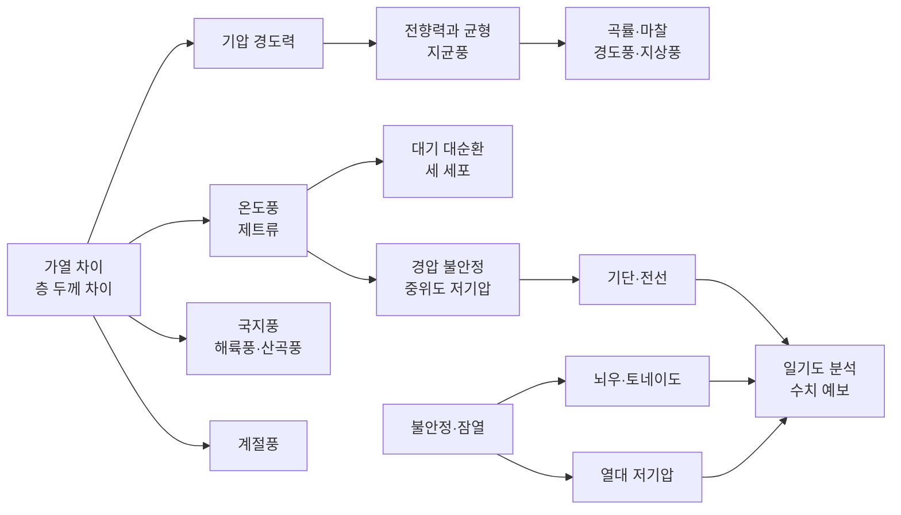

# 일반지구과학 8. 대기의 운동과 날씨 — 회전하는 지구 위에서 공기가 움직이는 법칙
<!-- prev: esys-3, earth-1, uearth-7 -->
<!-- next: uearth-9 -->

> [!NOTE]
> **이 단원의 범위**
> - 기압과 바람에 작용하는 힘(기압 경도력, 전향력, 마찰력)과 로스비 수
> - 지균풍·경도풍·지상풍, 그리고 온도풍
> - 대기 대순환과 제트류, 계절풍 · 국지풍
> - 기단과 전선, 중위도 저기압의 일생
> - 뇌우, 토네이도, 열대 저기압 · 일기도 분석과 일기 예보

**학습 목표**

1. 기압 경도력·전향력·마찰력을 벡터로 나타내고, 로스비 수로 어떤 힘이 중요한지 판단할 수 있다.
2. 힘의 균형에서 지균풍·경도풍·선형풍·지상풍의 식을 유도하여 속력을 계산하고, 온도풍 관계로 제트류를 설명할 수 있다.
3. 각운동량 보존과 열 수송의 관점에서 대기 대순환의 세 세포와 제트류, 계절풍을 설명할 수 있다.
4. 층 두께의 차이로 해륙풍·산곡풍 같은 국지풍의 원리를 정량적으로 설명할 수 있다.
5. 기단의 분류와 변질, 전선의 구조, 중위도 저기압의 일생을 상층 흐름과 연결하여 설명할 수 있다.
6. CAPE와 연직 바람 시어로 뇌우의 종류를 구분하고, 토네이도와 열대 저기압의 구조·에너지원을 설명하며, 일기도와 수치 예보 자료로 날씨를 예측하고 예보를 검증할 수 있다.

**이 단원의 학습 사다리**

| 단계 | 무엇을 하나? |
|---|---|
| STEP 1. 이전 학습 다시 보기 | 고등학교의 지균풍·경도풍·지상풍, 대기 대순환, 기단·전선, 태풍, 일기도 해석을 다시 꺼낸다 |
| STEP 2. 기초 다지기 | 기울기(경도) 벡터, 회전 좌표계와 전향 가속도, 각운동량 보존, 크기 어림(규모 분석) |
| STEP 3. 핵심 개념 | 힘 → 균형 바람(지균풍·경도풍·지상풍·온도풍) → 대순환·제트류·계절풍 → 국지풍 → 기단·전선·저기압 → 뇌우·토네이도·태풍 → 일기도와 예보 |
| STEP 4. 오개념 바로잡기 | "전향력이 욕조 물의 회전 방향을 정한다", "바람은 기압이 높은 곳에서 낮은 곳으로 곧장 분다" 같은 착각 |
| STEP 5. 전공 맛보기 | 대기역학의 운동 방정식과 와도, 준지균 이론, 혼돈과 예측 가능성 |
| STEP 6. 생활·산업·진로 | 수치 예보, 풍력 발전 입지, 항공 기상, 재해 경보 |

---

## 🗺️ 단원 들어가기

여름 바닷가에서는 오후가 되면 바다에서 시원한 바람이 불어오고, 밤이 되면 바람이 방향을 바꾼다. 같은 원리가 대륙과 대양 규모로 커지면 한 계절 동안 이어지는 **계절풍**이 되고, 지구 규모로 커지면 무역풍과 편서풍이 된다. 그런데 바람이 수천 km를 흐르는 동안 지구는 자전한다. 그 결과 큰 규모의 바람은 기압이 높은 곳에서 낮은 곳으로 곧장 불지 않고 **등압선을 따라** 분다.

이 단원에서는 공기 1 kg에 작용하는 힘을 뉴턴 법칙으로 따져, 바람의 방향과 속력을 계산하는 데서 출발한다. 그다음 그 힘들이 만드는 대기 대순환과 제트류, 국지풍, 전선과 저기압, 뇌우와 태풍을 차례로 설명하고, 마지막으로 이 모든 것을 컴퓨터로 풀어 내일의 날씨를 계산하는 **수치 예보**까지 따라가 본다.

---

## STEP 1. 🔙 이전 학습 다시 보기

### 연계 개념표

| 이전 단원 | 그때 배운 것 | 대학에서 확장되는 것 |
|---|---|---|
| 중3 「날씨와 기후변화」 '기압과 바람', '기단과 전선' | 바람은 기압 차로 분다, 우리나라의 기단, 전선의 종류 | 힘을 **벡터**와 운동 방정식으로, 기단의 **분류 기호와 변질** |
| 지구과학 「대기와 해양의 상호작용」 '중위도 저기압', '태풍과 악기상' | 저기압 통과 때 날씨 변화, 태풍의 구조와 위험 반원, 위성·레이더 영상 | 저기압의 **에너지원**(경압 불안정), 태풍을 **열기관**으로 보기, 뇌우의 CAPE와 시어 |
| 지구시스템과학 「강수 과정과 대기의 운동」 '바람에 작용하는 힘' | 지균풍·경도풍·지상풍의 힘의 균형 | 경도풍의 **이차 방정식 풀이**, 선형풍, **로스비 수**, 에크만 경계층 |
| 지구시스템과학 「강수 과정과 대기의 운동」 '제트류와 편서풍 파동' | 남북 기온 차가 제트류를 만든다 | **온도풍 관계**로 제트류의 세기 계산, 각운동량 보존과 해들리 순환 |
| 「대기의 구조와 에너지·수분」 '층 두께 공식', '안정도' | 따뜻한 기둥은 두껍다, 조건부 불안정 | 층 두께 차이로 **해륙풍의 기압 차** 계산, CAPE로 뇌우의 상승 속도 어림 |
| 일반물리학 「뉴턴 법칙과 그 응용」 '비관성 기준틀' | 관성력, 원심력 | 회전하는 지구 위의 **전향력** |

> 고등학교에서는 힘의 **방향**으로 바람을 설명했다. 대학에서는 힘의 **크기**를 계산하고, 어떤 힘을 무시해도 되는지를 수(로스비 수)로 판단한다.

### 준비 운동 (사전 진단)

**Q1.** 북반구 상층에서 지균풍을 등지고 서면 저기압은 어느 쪽에 있는가?

**Q2.** 같은 기압 경도에서 저기압 둘레의 경도풍, 지균풍, 고기압 둘레의 경도풍을 속력이 빠른 순서로 쓰시오.

**Q3.** 한랭 전선과 온난 전선 가운데 전선면의 기울기가 급한 것은? 그 전선에서 주로 생기는 구름은?

**Q4.** 태풍의 진행 방향 오른쪽 반원이 '위험 반원'인 까닭은?

정답 및 해설

**Q1.** 왼쪽.

**Q2.** 고기압 경도풍 > 지균풍 > 저기압 경도풍.

**Q3.** 한랭 전선. 적운형 구름(적란운).

**Q4.** 북반구 태풍은 시계 반대 방향으로 회전하므로, 진행 방향 오른쪽에서는 회전 바람과 태풍의 이동 방향이 같아 두 속도가 더해지기 때문이다.

---

## STEP 2. 🧱 기초 다지기

### ① 기울기(경도) 벡터 — 가장 가파르게 오르는 방향

등고선 지도에서 물은 등고선에 수직으로, 가장 가파른 내리막 방향으로 흐른다. 기압 $P(x,y)$가 위치에 따라 변할 때, 기압이 가장 빨리 커지는 방향과 그 변화율을 나타낸 벡터가 **기압 경도** $\nabla P = \left(\dfrac{\partial P}{\partial x}, \dfrac{\partial P}{\partial y}\right)$이다. 이 벡터는 언제나 **등압선에 수직이고 고기압 쪽**을 향한다. 일기도에서 크기는 '등압선 간격 $\Delta n$ 사이의 기압 차 $\Delta P$', 즉 $\Delta P/\Delta n$으로 읽는다.

| 일기도의 모습 | 기압 경도 |
|---|---|
| 등압선 간격이 좁다 | 크다 → 바람이 강하다 |
| 등압선 간격이 넓다 | 작다 → 바람이 약하다 |

### ② 회전 좌표계에서 보이는 힘 — 전향 가속도

회전하는 원판 위의 관찰자에게는 직선으로 날아가는 공이 휘어 보인다. 각속도 $\vec\Omega$로 회전하는 좌표계에서 속도 $\vec v$로 움직이는 물체에는 단위 질량당

$$
\vec a_{\text{전향}} = -2\vec\Omega\times\vec v
$$

의 겉보기 가속도가 나타난다(**코리올리 가속도**, 고등학교 용어 '전향력'). 지구에서 수평 운동에 작용하는 성분만 남기면 크기는 $fv$, 방향은 북반구에서 운동 방향의 **오른쪽 직각**이다. 여기서

$$
f = 2\Omega\sin\varphi, \qquad \Omega = 7.292\times10^{-5}\ \mathrm{s^{-1}}
$$

를 **코리올리 매개 변수**(전향 인자)라 한다. $\Omega$는 항성일(약 23시간 56분) 기준 각속도이다.

| 위도 | 0° | 10° | 30° | 37°(서울 부근) | 45° | 60° | 90° |
|---|---|---|---|---|---|---|---|
| $f$($10^{-4}\ \mathrm{s^{-1}}$) | 0 | 0.25 | 0.73 | 0.88 | 1.03 | 1.26 | 1.46 |

전향력은 운동 방향에 항상 수직이므로 **일을 하지 않는다.** 속력은 바꾸지 못하고 방향만 바꾼다.

### ③ 각운동량 보존

지구 자전축에 대해 공기 1 kg이 가진 각운동량은 $M = (\Omega a\cos\varphi + u)\,a\cos\varphi$이다($a$: 지구 반지름, $u$: 동서 방향 바람, 동쪽이 +). 토크가 없으면 $M$이 보존되므로 공기가 극 쪽으로 움직여 자전축에 가까워지면($a\cos\varphi$ 감소) 피겨 선수가 팔을 오므릴 때처럼 **동쪽으로 더 빨리** 돈다. ③의 해들리 순환과 아열대 제트를 설명하는 열쇠이다.

### ④ 크기 어림(규모 분석)

방정식의 각 항에 대표적인 크기를 넣어 비교하면 어떤 항이 중요한지 알 수 있다. 예를 들어 중위도 저기압에서 $U \approx 10\ \mathrm{m/s}$, 규모 $L \approx 10^6\ \mathrm{m}$, $f \approx 10^{-4}\ \mathrm{s^{-1}}$이면 가속 항 $U^2/L \approx 10^{-4}\ \mathrm{m/s^2}$, 전향 항 $fU \approx 10^{-3}\ \mathrm{m/s^2}$로 전향 항이 10배 크다. 이런 비를 차원 없는 수로 정리한 것이 ①의 **로스비 수**이다.

### ⑤ 국소 변화와 이류

어느 관측소의 기온이 오르는 까닭은 두 가지이다. 그 자리의 공기가 데워지거나(가열), 따뜻한 공기가 바람에 실려 오거나(**이류**, advection). 남풍이 불면 기온이 오르는 것은 대개 이류 때문이다. 일기도 분석에서 '온난 이류', '한랭 이류'는 기온 변화의 주된 원인이다.

---

## STEP 3. 📘 핵심 개념

### ① 기압과 바람에 작용하는 힘

#### (1) 기압과 해면 기압

**기압**은 단위 면적 위 공기 기둥의 무게로, 관측소에서 잰 값(현지 기압)은 관측소 높이에 따라 크게 다르다. 일기도에서 비교하려면 모든 관측소의 기압을 해발 0 m로 환산한 **해면 기압**으로 바꾼다. 환산에는 「대기의 구조와 에너지·수분」의 층 두께 공식을 거꾸로 쓴다.

$$
P_{\text{해면}} = P_{\text{현지}}\exp\left(\frac{g z}{R_d\bar T}\right)
$$

예를 들어 해발 300 m 관측소에서 980 hPa, 가상 기둥의 평균 기온 285 K이면 $P_{\text{해면}} = 980\times\exp\left(\dfrac{9.8\times300}{287\times285}\right) \approx 1016\ \mathrm{hPa}$이다. 해면 기압의 평균은 약 1013 hPa이며, 큰 저기압 중심은 약 950~990 hPa, 강한 대륙 고기압은 약 1040~1060 hPa까지 된다.

#### (2) 바람에 작용하는 수평 힘(단위 질량당)

| 힘 | 식(벡터) | 크기 | 방향 |
|---|---|---|---|
| **기압 경도력**(pressure gradient force) | $-\dfrac{1}{\rho}\nabla P$ | $\dfrac{1}{\rho}\dfrac{\Delta P}{\Delta n}$ | 등압선에 수직, 고기압 → 저기압 |
| **전향력**(코리올리 힘) | $-f\hat k\times\vec v$ | $fv$ | 북반구: 운동 방향 오른쪽 직각, 남반구: 왼쪽 |
| **마찰력** | $-k\vec v$(단순 모형) | 속력에 비례(대략) | 운동 방향 반대(대기 경계층) |
| 원심력(곡선 운동의 겉보기 힘) | — | $\dfrac{v^2}{r}$ | 곡률 중심 반대쪽 |

이 힘들을 뉴턴 제2법칙에 모으면 수평 운동 방정식이 된다.

$$
\frac{d\vec v}{dt} = -\frac{1}{\rho}\nabla P - f\hat k\times\vec v + \vec F_{\text{마찰}}
$$

연직 방향은 「대기의 구조와 에너지·수분」의 정역학 평형이 매우 좋은 근사로 성립한다.

#### (3) 로스비 수 — 전향력이 얼마나 중요한가

가속 항과 전향 항의 비를 **로스비 수(Rossby number)** 라 한다.

$$
Ro = \frac{U^2/L}{fU} = \frac{U}{fL}
$$

| 현상 | $U$ | $L$ | $Ro$(약, $f = 10^{-4}\ \mathrm{s^{-1}}$) | 균형 |
|---|---|---|---|---|
| 중위도 저기압·고기압 | 10 m/s | 1000 km | 0.1 | 지균풍에 가까움 |
| 해륙풍 | 5 m/s | 20 km | 2.5 | 전향력은 일부만 영향 |
| 토네이도 | 50 m/s | 100 m | 5000 | 전향력 무시, 기압 경도력 = 원심력 |
| 욕조 배수구 | 0.1 m/s | 0.1 m | $10^4$ | 전향력 무시 |

$Ro \ll 1$이면 전향력이 지배하고, $Ro \gg 1$이면 전향력을 무시해도 된다. 그래서 **욕조의 소용돌이 방향은 지구 자전이 아니라 물을 받을 때 남은 회전과 욕조 모양이 정한다.**

#### 예제 1 — 전향 가속도의 크기

위도 37°에서 10 m/s로 부는 바람의 전향 가속도를 구하고, 이 가속도만으로 1시간 동안 바람에 수직한 방향으로 얼마나 휘어지는지 어림하시오. 또 기압 경도력이 없을 때 이 공기가 원을 그리며 한 바퀴 도는 시간(관성 주기)을 구하시오.

**풀이**
(1) $f = 2\times7.292\times10^{-5}\times\sin37^\circ \approx 8.8\times10^{-5}\ \mathrm{s^{-1}}$, $a = fv \approx 8.8\times10^{-4}\ \mathrm{m/s^2}$
(2) 처음 1시간을 등가속도로 어림하면 $\frac12 at^2 = \frac12\times8.8\times10^{-4}\times3600^2 \approx 5.7\times10^3\ \mathrm{m}$ — 약 6 km 휘어진다. 그동안 속도의 방향은 $ft = 8.8\times10^{-5}\times3600 \approx 0.32\ \mathrm{rad}$, 약 18° 돌아간다.
(3) 전향력만 받으면 등속 원운동을 하므로 $v^2/r = fv$, 주기 $T = 2\pi/f \approx 7.2\times10^4\ \mathrm{s} \approx 20$시간이다(**관성 진동**). 해양에서 실제로 관측된다.
**의미** 하루 규모의 운동에서는 전향 효과가 결정적이지만, 몇 분짜리 운동(공 던지기)에는 거의 영향이 없다.

> [!TIP]
> 💡 **비유** — 전향력은 회전목마 위에서 공을 굴릴 때 '공이 저절로 휘는 것처럼 보이는' 효과이다. 바깥 땅에서 보면 공은 곧게 가는데, 회전목마가 그 아래에서 돌아가 버린 것이다.

#### ✔ 바로 확인

1. (O/X) 기압 경도력은 등압선에 수직으로, 고기압에서 저기압 쪽으로 작용한다.
2. 고르기: 북반구에서 전향력은 운동 방향의 (오른쪽 / 왼쪽) 직각으로 작용한다.
3. $U = 10\ \mathrm{m/s}$, $L = 10\ \mathrm{km}$, $f = 10^{-4}\ \mathrm{s^{-1}}$인 운동의 로스비 수는?
4. (O/X) 북반구의 욕조 배수구 소용돌이는 지구 자전 때문에 항상 반시계 방향이다.

정답

1. O
2. 오른쪽
3. 10 — $Ro = U/(fL) = 10/(10^{-4}\times10^4)$. 1보다 커서 전향력의 영향이 작다.
4. X — 로스비 수가 매우 커서 전향력은 무시된다.

---

### ② 지균풍·경도풍·지상풍, 그리고 온도풍

#### (1) 지균풍 — 기압 경도력과 전향력의 균형

$Ro \ll 1$이고 마찰이 없으면 가속 항을 버리고 $0 = -\dfrac{1}{\rho}\nabla P - f\hat k\times\vec v_g$이다. 크기만 쓰면

$$
v_g = \frac{1}{\rho f}\frac{\Delta P}{\Delta n}
$$

상층 일기도는 일정한 기압면의 **높이** $Z$로 그리므로, 정역학 평형 $\Delta P = \rho g\Delta Z$를 넣으면 밀도가 사라진다.

$$
v_g = \frac{g}{f}\frac{\Delta Z}{\Delta n}
$$

이 식은 밀도를 몰라도 되어 상층 일기도에서 바람을 바로 읽을 수 있게 해 준다. 적도 부근($f \to 0$)에서는 지균풍 근사가 성립하지 않는다.

#### 예제 2 — 지상 일기도와 500 hPa 일기도의 지균풍

위도 37°에서 (1) 지상 일기도의 등압선이 200 km에 4 hPa 간격이고 공기 밀도가 $1.2\ \mathrm{kg/m^3}$일 때, (2) 500 hPa 일기도의 등고선이 300 km에 60 m 차이 날 때 지균풍 속력을 구하시오.

**풀이**
(1) **식** $v_g = \dfrac{1}{\rho f}\dfrac{\Delta P}{\Delta n}$ **대입** $\dfrac{1}{1.2\times8.78\times10^{-5}}\times\dfrac{400\ \mathrm{Pa}}{2.0\times10^5\ \mathrm{m}} \approx 19\ \mathrm{m/s}$
(2) $v_g = \dfrac{9.8}{8.78\times10^{-5}}\times\dfrac{60}{3.0\times10^5} \approx 22\ \mathrm{m/s}$
**의미** 지상에서는 마찰 때문에 실제 바람이 이 값의 약 50~70 %이다. 상층은 마찰이 없어 지균풍과 실제 바람이 거의 같다.

#### (2) 경도풍 — 곡선 등압선과 원심력

등압선이 반지름 $r$인 원이면 구심 가속도 $v^2/r$가 필요하다. 힘의 균형(북반구)을 쓰면

| 구분 | 균형 식 | 해 |
|---|---|---|
| 저기압성(반시계) | $\dfrac{v^2}{r} + fv = fv_g$ | $v = \dfrac{-fr + \sqrt{(fr)^2 + 4frv_g}}{2}$ |
| 고기압성(시계) | $-\dfrac{v^2}{r} + fv = fv_g$ | $v = \dfrac{fr - \sqrt{(fr)^2 - 4frv_g}}{2}$ |

여기서 $fv_g = \dfrac{1}{\rho}\dfrac{\Delta P}{\Delta n}$는 기압 경도력이다. 고기압의 해는 근호 안이 0 이상이어야 존재하므로 $v_g \le fr/4$, 즉 **고기압 중심 부근의 기압 경도에는 상한이 있다.** 그래서 고기압 중심은 등압선이 성기고 바람이 약하며, 저기압 중심은 등압선이 조밀하고 바람이 강할 수 있다.

<!-- sim:u-gradient-wind -->

#### 예제 3 — 경도풍 계산

$f = 1.0\times10^{-4}\ \mathrm{s^{-1}}$, 곡률 반지름 600 km, 같은 기압 경도에서 지균풍 속력이 12 m/s일 때 저기압과 고기압 둘레의 경도풍 속력을 구하시오. 또 이 반지름에서 고기압이 가질 수 있는 최대 $v_g$는?

**풀이** $fr = 1.0\times10^{-4}\times6.0\times10^5 = 60\ \mathrm{m/s}$
저기압: $v = \dfrac{-60 + \sqrt{3600 + 4\times60\times12}}{2} = \dfrac{-60 + 80.5}{2} \approx 10\ \mathrm{m/s}$
고기압: $v = \dfrac{60 - \sqrt{3600 - 2880}}{2} = \dfrac{60 - 26.8}{2} \approx 17\ \mathrm{m/s}$
최대 $v_g = fr/4 = 15\ \mathrm{m/s}$
**의미** 같은 등압선 간격이라도 저기압 둘레는 지균풍보다 약 15 % 느리고 고기압 둘레는 약 40 % 빠르다. 지균풍만으로 바람을 읽으면 곡률이 큰 곳에서 오차가 커진다.

#### (3) 선형풍 — 토네이도처럼 작은 소용돌이

$Ro \gg 1$인 소용돌이에서는 전향력을 버리고 기압 경도력과 원심력만 균형을 이룬다(**선형풍**, cyclostrophic wind).

$$
\frac{v^2}{r} = \frac{1}{\rho}\frac{\Delta P}{\Delta r} \quad\Rightarrow\quad v = \sqrt{\frac{r}{\rho}\frac{\Delta P}{\Delta r}}
$$

전향력이 없으므로 회전 방향은 시계·반시계 둘 다 가능하다(실제 토네이도는 모체 뇌우의 회전을 이어받아 대부분 반시계 방향이다). 중심과 바깥의 기압 차를 $\Delta P$, $\Delta r \approx r$로 어림하면 $v \approx \sqrt{\Delta P/\rho}$이다.

#### (4) 지상풍과 대기 경계층

지표에서 약 1 km 아래 **대기 경계층**에서는 난류 마찰이 바람을 약하게 한다. 속력이 줄면 전향력($fv$)도 줄어 기압 경도력과 전향력의 균형이 깨지므로, 바람은 **저기압 쪽으로 기울어** 등압선을 가로지른다. 세 힘(기압 경도력, 전향력, 마찰력)의 합이 0이 되는 바람이 **지상풍**이다.

| 지표 | 등압선과 이루는 각(약) | 지균풍에 대한 속력 비(약) |
|---|---|---|
| 바다 | 10°~20° | 70~80 % |
| 평탄한 육지 | 25°~35° | 50~60 % |
| 도시·산지 | 35°~45° 이상 | 40 % 이하 |

경계층 안에서는 높이에 따라 마찰이 줄어 바람이 세지면서 방향이 오른쪽으로 돌아, 경계층 꼭대기에서 지균풍에 가까워진다. 이 나선 모양 구조를 **에크만 나선**이라 한다(「해양」의 에크만 수송과 같은 원리). 지상풍이 저기압 쪽으로 가로질러 불어 들어가는 것(**마찰 수렴**)이 저기압의 상승 기류와 구름을 만들고, 고기압에서 불어 나가는 것(**마찰 발산**)이 하강 기류와 맑은 날씨를 만든다.

<!-- fig:uearth-8-balanced-winds -->

#### (5) 온도풍 — 높이에 따라 서풍이 강해지는 이유

「대기의 구조와 에너지·수분」에서 두 기압면 사이의 두께는 평균 기온에 비례했다. 남쪽이 따뜻하고 북쪽이 차가우면 남쪽의 기압면은 위로 갈수록 점점 더 높아져, **위로 갈수록 남북 기압면의 높이 차가 커진다.** 그러면 지균풍(서풍)도 위로 갈수록 커진다. 두 높이 사이 지균풍의 차를 **온도풍(thermal wind)** 이라 한다. 대략

$$
\frac{\Delta v_g}{\Delta z} \approx \frac{g}{fT}\frac{\Delta T}{\Delta n}
$$

이고 온도풍은 **찬 공기를 왼쪽에 두고 등온선과 나란히** 분다(북반구).

#### 예제 4 — 제트류의 세기 어림

위도 40°($f = 9.4\times10^{-5}\ \mathrm{s^{-1}}$)에서 대류권 평균 기온 250 K, 남북으로 1000 km에 10 K의 기온 차가 있다. 지표의 바람이 거의 0일 때 높이 9 km의 서풍 속력을 어림하시오.

**풀이**
**식** $\Delta v_g = \dfrac{g}{fT}\dfrac{\Delta T}{\Delta n}\Delta z$
**대입** $\dfrac{9.8}{9.4\times10^{-5}\times250}\times\dfrac{10}{1.0\times10^6}\times9.0\times10^3 \approx 38\ \mathrm{m/s}$
**의미** 남북 기온 차만으로 제트류 규모(30 m/s 이상)의 서풍이 설명된다. 겨울에 남북 기온 차가 커지면 제트류도 강해진다. 대류권 계면 위 성층권에서는 남북 기온 차가 반대가 되어 서풍이 다시 약해지므로, 제트류의 중심은 **대류권 계면 바로 아래**에 있다.

> [!IMPORTANT]
> 지균풍은 '기압(기압면 높이)의 수평 분포', 온도풍은 '기온의 수평 분포'가 정한다. 상층의 바람은 결국 **아래 공기 기둥의 기온 분포**로 정해진다. 그래서 대기의 운동은 대기의 에너지(열수지)와 떼려야 뗄 수 없다.

#### ✔ 바로 확인

1. 빈칸: 지균풍은 (    )과 (    )이 균형을 이룬 바람이다.
2. $\rho = 1.2\ \mathrm{kg/m^3}$, $f = 1.0\times10^{-4}\ \mathrm{s^{-1}}$, 등압선이 100 km에 2 hPa 간격일 때 지균풍 속력은?
3. (O/X) 같은 기압 경도라면 고기압 둘레의 경도풍이 저기압 둘레보다 빠르다.
4. 빈칸: 지상풍은 마찰 때문에 등압선을 가로질러 (    ) 쪽으로 기울어 분다.
5. 빈칸: 북반구의 온도풍은 찬 공기를 (    )쪽에 두고 등온선과 나란히 분다.

정답

1. 기압 경도력, 전향력
2. 약 17 m/s — $\dfrac{200/10^5}{1.2\times10^{-4}}$.
3. O
4. 저기압
5. 왼

---

### ③ 대기 대순환과 제트류, 계절풍

#### (1) 왜 하나의 거대한 순환이 아닐까 — 각운동량의 제약

적도에서 데워진 공기가 상층에서 극으로 간다고 하자. 적도에서 지표에 대해 정지($u = 0$)한 공기가 각운동량을 보존하며 위도 $\varphi$에 이르면 STEP 2 ③에서

$$
u = \Omega a\frac{\sin^2\varphi}{\cos\varphi}
$$

이다. 위도 30°에서는 $u = 7.292\times10^{-5}\times6.371\times10^6\times\dfrac{0.25}{0.866} \approx 134\ \mathrm{m/s}$의 서풍이 된다. 이렇게 강한 서풍은 불안정해져 맴돌이(소용돌이)로 부서지므로 순환은 더 극 쪽으로 가지 못한다. 이것이 **해들리 순환**이 위도 약 30°에서 끝나고, 그 끝 상공에 **아열대 제트**가 생기는 까닭이다. 실제 아열대 제트(약 30~50 m/s)는 맴돌이가 각운동량을 나누어 가져 이보다 약하다.

#### (2) 세 세포와 지상의 기압대

| 구분 | 위도(약) | 지상 기압 | 지상 바람(북반구) | 날씨 |
|---|---|---|---|---|
| 적도 저압대(열대 수렴대, ITCZ) | 0°~10° | 낮음 | 무역풍이 모여 수렴 | 상승, 적란운, 많은 비 |
| 해들리 순환 | 0°~30° | — | 북동 무역풍 | — |
| 아열대 고압대 | 약 30° | 높음 | 발산 | 하강, 건조(대규모 사막) |
| 페렐 순환 | 30°~60° | — | 편서풍 | 저기압·고기압이 번갈아 지남 |
| 한대 전선대(아한대 저압대) | 약 60° | 낮음 | 수렴 | 전선, 저기압 발생 |
| 극순환 | 60°~90° | — | 극동풍 | 춥고 건조 |
| 극 고압대 | 90° | 높음 | 발산 | 하강 |

해들리 순환과 극순환은 따뜻한 곳에서 오르고 찬 곳에서 내려앉는 **직접 순환**이다. 페렐 순환은 평균을 내면 나타나는 **간접 순환**으로, 실제로 중위도에서 열과 각운동량을 나르는 것은 편서풍 파동과 이동성 저기압·고기압(맴돌이)이다.

<!-- fig:uearth-8-circulation-section -->

> [!NOTE]
> 지표가 지구에서 얻거나 잃는 각운동량의 수지도 맞아야 한다. 무역풍(동풍) 지역에서는 지표 마찰이 공기에 서쪽 방향 운동량을 빼앗기고 동쪽 운동량을 공급받으며, 편서풍 지역에서는 반대로 공기가 지표에 동쪽 운동량을 돌려준다. 그 사이를 맴돌이가 이어 준다. 대기 대순환은 **열 수송과 각운동량 수송**을 함께 해결하는 구조이다.

<!-- fig:uearth-8-pressure-belts-map -->

#### (3) 제트류

| 구분 | 아열대 제트 | 한대 전선 제트 |
|---|---|---|
| 위치 | 위도 약 25°~35°, 약 12~13 km | 위도 약 35°~65°, 약 9~11 km |
| 원인 | 해들리 순환 상층의 각운동량 수송 | 한대 전선대의 큰 남북 기온 차(온도풍) |
| 변동 | 비교적 일정 | 크게 굽이치고 위치·세기가 자주 변함 |
| 날씨와의 관계 | 겨울 동아시아에서 특히 강함 | 중위도 저기압의 발생·이동 경로를 이끔 |

겨울에는 남북 기온 차가 커서 두 제트 모두 강해지고 남쪽으로 내려온다. 우리나라와 일본 상공은 겨울철 두 제트가 가까워져 지구에서 가장 강한 제트(최대 약 70~100 m/s)가 나타나는 곳 가운데 하나이다.

<!-- fig:uearth-8-jet-waves -->

#### (4) 계절풍

**계절풍(monsoon)** 은 계절에 따라 탁월풍의 방향이 거의 반대로 바뀌는 바람이다. 원인은 두 가지로 볼 수 있다.

1. **대륙과 해양의 가열 차이**(④의 해륙풍을 대륙 규모로 키운 것): 여름에는 대륙이 빨리 데워져 대륙 위가 상대적 저압, 겨울에는 대륙이 빨리 식어 강한 고압이 된다.
2. **열대 수렴대의 계절 이동**: 태양을 따라 ITCZ가 남북으로 이동하면, 적도를 건너는 무역풍이 전향력 때문에 방향을 바꾼다(예: 인도양의 남동 무역풍이 적도를 넘으면 남서 계절풍이 됨).

| 지역 | 여름 | 겨울 |
|---|---|---|
| 동아시아(우리나라) | 남동·남서풍, 고온 다습, 장마와 집중 호우 | 북서풍, 시베리아 고기압의 한랭 건조한 바람 |
| 남아시아(인도) | 남서 계절풍, 우기 | 북동 계절풍, 건기 |

동아시아의 여름 계절풍은 북태평양 고기압의 가장자리를 따라 수증기를 실어 오며, 그 북쪽 경계에 **장마 전선**(정체 전선)이 생긴다. 겨울에는 시베리아 고기압과 알류샨 저기압 사이의 큰 기압 차로 강한 북서 계절풍이 불고, 고기압이 강해졌다 약해지며 **삼한사온**과 같은 주기적 변화가 나타나기도 한다.

<!-- fig:uearth-8-monsoon-map -->

#### 예제 5 — 각운동량 보존의 결과

적도에서 지표에 대해 정지한 공기가 각운동량을 보존하며 위도 25°까지 이동하면 동서 방향 바람은 몇 m/s인가? ($\Omega = 7.292\times10^{-5}\ \mathrm{s^{-1}}$, $a = 6.371\times10^6\ \mathrm{m}$) 실제 아열대 제트보다 큰 까닭도 쓰시오.

**풀이** $u = \Omega a\sin^2\varphi/\cos\varphi = 464.6\times\dfrac{0.1786}{0.9063} \approx 92\ \mathrm{m/s}$(서풍). 실제 상층 바람은 맴돌이(소용돌이)와의 혼합으로 각운동량을 잃어 이보다 약하다. 그래도 이 계산은 해들리 순환 상층에 서풍이 강해질 수밖에 없음을 보여 준다.

#### ✔ 바로 확인

1. 짝짓기(북반구 지상): 0°~30°, 30°~60°, 60°~90° — 편서풍, 극동풍, 북동 무역풍
2. (O/X) 페렐 순환은 따뜻한 곳에서 오르는 직접 순환이다.
3. 위도 약 30° 지상에 생기는 기압대와 그곳의 대표적 날씨는?
4. 우리나라 겨울 계절풍의 풍향과 이를 만드는 두 기압 배치는?

정답

1. 0°~30° 북동 무역풍, 30°~60° 편서풍, 60°~90° 극동풍
2. X — 평균으로 나타나는 간접 순환이다.
3. 아열대 고압대 — 하강 기류로 건조하여 대규모 사막이 많다.
4. 북서풍 — 시베리아 고기압과 알류샨 저기압

---

### ④ 국지풍

국지풍은 수 km~수백 km 규모, 하루 이내 주기의 바람으로 대개 **지표 가열의 차이**가 만든다. 원리는 공통적으로 '가열 차 → 층 두께 차 → 상층 기압 차 → 순환'이다.

#### (1) 해륙풍의 원리 — 층 두께로 계산하기

맑은 낮에 육지가 바다보다 빨리 데워져, 1000 hPa에서 900 hPa까지 공기층의 평균 기온이 육지 쪽에서 5 K 높아졌다고 하자. 두 지역의 층 두께 차는

$$
\Delta(\Delta z) = \frac{R_d\,\Delta\bar T}{g}\ln\frac{1000}{900} = \frac{287\times5}{9.8}\times0.105 \approx 15\ \mathrm{m}
$$

즉 900 hPa 면이 육지 위에서 약 15 m 높다. 같은 높이에서 보면 육지 상공의 기압이 $\rho g\Delta z \approx 1.1\times9.8\times15 \approx 170\ \mathrm{Pa}$(약 1.7 hPa) 높다. 그래서 **상층에서는 육지 → 바다로**, 그 보상으로 **지표에서는 바다 → 육지로**(해풍) 바람이 불고, 육지에서 상승·바다에서 하강하는 순환이 생긴다. 밤에는 반대로 육지가 빨리 식어 육풍이 분다.

| 국지풍 | 낮 | 밤 | 원인 |
|---|---|---|---|
| 해륙풍 | 해풍(바다 → 육지) | 육풍(육지 → 바다) | 해수와 육지의 열용량 차이 |
| 산곡풍 | 곡풍(골짜기 → 산 사면 위로) | 산풍(산 사면 → 골짜기로) | 사면 공기와 같은 높이 골짜기 공기의 가열·냉각 차이 |
| 활강풍(카타바틱) | — | 빙상·고원에서 찬 공기가 중력으로 흘러내림 | 무거운 찬 공기의 낙하, 남극 대륙에서 특히 강함 |

<!-- sim:u-sea-breeze -->

해풍은 대개 해안에서 수십 km 안쪽까지 들어오며, 해풍과 내륙 공기가 만나는 **해풍 전선**에서는 상승 기류로 오후 소나기가 생기기도 한다. 해륙풍의 로스비 수는 1보다 조금 큰 정도(표에서 약 2.5)라 전향력을 무시할 수 없으므로, 오후로 갈수록 전향력 때문에 해풍의 방향이 조금씩 오른쪽(북반구)으로 돈다.

#### (2) 푄(높새바람)과 산을 넘는 바람

공기가 산을 넘으며 바람받이 쪽에 비를 내리면 바람의지 쪽은 고온 건조해진다(「대기의 구조와 에너지·수분」 예제 11). 우리나라에서는 늦봄~초여름 오호츠크해 기단의 북동풍이 태백산맥을 넘어 영서 지방에 부는 **높새바람**이 대표적이다. 봄철 영동 지방의 **양간지풍**(양양–간성 사이)은 남서풍이 태백산맥을 넘으며 강하게 내려 부는 바람으로, 산맥 위 역전층이 뚜껑 역할을 해 바람이 산 사면을 따라 가속되는 것으로 설명되며 대형 산불을 키우는 원인이 된다.

#### (3) 도시가 만드는 바람

도시는 포장면과 건물이 열을 저장하고, 증발이 적으며(보웬 비가 큼), 인공 열을 내놓아 주변보다 따뜻한 **열섬(heat island)** 이 된다. 밤에 특히 뚜렷하며, 바람이 약할 때 교외에서 도심으로 불어 드는 약한 **열섬 순환**이 생긴다. 건물 사이로 바람이 모여 강해지는 '빌딩풍'은 가열이 아니라 지형(건물)에 의한 흐름의 수렴이다.

#### 예제 6 — 해풍의 기압 차

1000 hPa과 950 hPa 사이 층의 평균 기온이 육지에서 바다보다 8 K 높다. 950 hPa 면의 높이 차와, 그 높이에서 수평 기압 차를 어림하시오. ($R_d = 287\ \mathrm{J/(kg\cdot K)}$, $g = 9.8\ \mathrm{m/s^2}$, 공기 밀도 $1.15\ \mathrm{kg/m^3}$)

**풀이** $\Delta(\Delta z) = \dfrac{287\times8}{9.8}\times\ln\dfrac{1000}{950} = 234\times0.0513 \approx 12\ \mathrm{m}$. 수평 기압 차 $\approx 1.15\times9.8\times12 \approx 1.4\times10^2\ \mathrm{Pa} \approx 1.4\ \mathrm{hPa}$. 지상 일기도의 등압선 간격(4 hPa)보다 작은 차이지만, 거리가 수십 km로 짧아 기압 경도는 종관 규모 저기압과 맞먹는다.

#### ✔ 바로 확인

1. 맑은 날 낮 해안에서 부는 바람의 이름과 방향은?
2. (O/X) 산풍은 밤에 산 사면을 따라 골짜기로 내려오는 바람이다.
3. 빈칸: 늦봄~초여름 오호츠크해 기단의 북동풍이 태백산맥을 넘어 (    ) 지방에 부는 고온 건조한 바람을 높새바람이라 한다.
4. 열섬 순환에서 지상의 약한 바람은 어느 쪽에서 어느 쪽으로 부는가?

정답

1. 해풍 — 바다에서 육지로
2. O
3. 영서
4. 교외 → 도심

---

### ⑤ 기단과 전선, 중위도 저기압의 일생

#### (1) 기단의 분류와 변질

넓은 지역에 오래 머문 공기가 그 지표의 성질을 닮아 수평으로 기온·습도가 고른 큰 공기 덩어리를 **기단(air mass)** 이라 한다. 발원지가 대륙(c)이냐 해양(m)이냐, 극(P)·북극(A)·열대(T)·적도(E) 중 어디냐로 기호를 붙인다.

| 기단(우리나라 이름) | 기호 | 성질 | 영향 시기 |
|---|---|---|---|
| 시베리아 기단 | cP | 한랭 건조 | 겨울 |
| 오호츠크해 기단 | mP | 한랭 다습 | 초여름(장마 초기, 높새바람) |
| 북태평양 기단 | mT | 고온 다습 | 여름 |
| 양쯔강 기단(이동성 고기압) | cT에 가까운 변질 기단 | 온난 건조 | 봄·가을 |
| 적도 기단 | mE | 고온 다습 | 여름~가을(태풍과 함께) |

<!-- fig:uearth-8-air-masses-map -->

기단은 이동하면서 지나가는 지표와 열·수증기를 주고받아 성질이 바뀐다(**기단의 변질**). 겨울에 시베리아 기단이 따뜻한 서해 위를 지나면 아래에서 데워지고 수증기를 공급받아 **불안정해지고**, 줄지어 생긴 적운이 서해안과 호남 지방에 **폭설**을 내린다. 반대로 따뜻한 공기가 찬 바다 위를 지나면 아래에서 식어 **안정해지고**, 이류 안개나 층운이 생긴다.

| 변질 | 아래에서 | 안정도 변화 | 날씨 |
|---|---|---|---|
| 찬 기단이 따뜻한 표면 위로 | 가열·수증기 공급 | 불안정해짐 | 적운, 소나기·눈, 시정 양호 |
| 따뜻한 기단이 찬 표면 위로 | 냉각 | 안정해짐 | 층운, 안개, 이슬비, 시정 불량 |

#### (2) 전선의 구조

| 전선 | 전선면 기울기(약) | 이동 | 구름과 강수 |
|---|---|---|---|
| 한랭 전선 | 1/50~1/100 | 빠름(약 30~50 km/h) | 전선 부근 좁은 띠의 적란운, 소나기·돌풍·뇌우 |
| 온난 전선 | 1/100~1/200 | 느림(약 15~30 km/h) | 전선 앞 수백 km에 권운 → 권층운 → 고층운 → 난층운, 넓고 지속적인 비 |
| 폐색 전선 | — | — | 두 전선의 특징이 섞임 |
| 정체 전선 | — | 거의 정지 | 긴 비(장마 전선) |

전선은 밀도가 다른 두 공기의 경계이며, 전선을 가로질러 기온·이슬점·풍향이 급변하고, 기압은 전선에서 **골**(가장 낮음)을 이룬다. 그래서 일기도의 등압선은 전선에서 꺾인다.

<!-- fig:uearth-8-fronts-section -->

#### 예제 7 — 온난 전선의 앞에서 보이는 구름

온난 전선면의 기울기가 1/150이고 전선면 위 약 9 km에 권운이 있다. 지상 관측소에서 권운이 처음 보일 때 지상 온난 전선은 얼마나 떨어져 있는가? 전선이 시속 30 km로 다가온다면 몇 시간 뒤에 통과하겠는가?

**풀이** 수평 거리 $= 9\ \mathrm{km}\times150 = 1350\ \mathrm{km}$. 시간 $= 1350/30 = 45$시간. 지상 전선보다 수백 km 앞에서 비가 시작되므로, 권운이 보이면 하루~이틀 뒤에 비가 시작될 수 있다는 옛 날씨 속담('햇무리·달무리가 지면 비가 온다')의 과학적 근거이다. 권층운의 무리 다음에 고층운, 난층운이 차례로 낮아지며 다가온다.

#### (3) 중위도 저기압의 일생 — 노르웨이 모형과 상층 흐름

20세기 초 노르웨이 학자들이 지상 관측으로 정리한 **노르웨이 저기압 모형**은 다음 단계를 따른다.

| 단계 | 지상의 모습 | 상층과 에너지 |
|---|---|---|
| ① 발생 | 정체 전선 위에 작은 파동 | 상층 기압골이 다가와 그 앞(동쪽)에 상층 발산 |
| ② 발달 | 저기압 중심, 동쪽에 온난 전선, 남서쪽에 한랭 전선, 그 사이 **온난 구역** | 따뜻한 공기 상승·찬 공기 하강 → 위치 에너지가 운동 에너지로 전환, 잠열 방출로 강화 |
| ③ 성숙·폐색 | 한랭 전선이 온난 전선을 따라잡아 폐색 전선 | 중심이 가장 깊음, 저기압 중심이 상층 저기압 바로 아래로 옴(축이 곧게 섬) |
| ④ 소멸 | 따뜻한 공기가 모두 위로 밀려남 | 기온 차가 없어져 에너지원이 사라짐, 마찰로 약화 |

저기압의 에너지원은 남북 기온 차, 즉 찬 공기와 따뜻한 공기가 나란히 놓인 상태가 가진 **가용 위치 에너지**이다. 따뜻한 공기가 올라가고 찬 공기가 내려가면 무게 중심이 낮아지며 위치 에너지가 바람의 운동 에너지로 바뀐다. 남북 기온 차가 큰 대기가 이런 파동에 대해 불안정한 성질을 **경압 불안정**이라 하며, 가장 빨리 자라는 파동의 파장이 수천 km라는 것이 이론으로 설명된다. 발달하는 저기압의 중심축은 높이에 따라 **서쪽으로 기울어져** 상층 기압골의 앞쪽(동쪽)에 지상 저기압이 놓인다(「강수 과정과 대기의 운동」 ⑭).

<!-- fig:uearth-8-cyclone-life -->

> [!TIP]
> 💡 **비유** — 수조 한쪽에 찬 물, 다른 쪽에 따뜻한 물을 칸막이로 나누어 두었다가 칸막이를 빼면, 찬 물은 바닥으로 미끄러져 들어가고 따뜻한 물은 위로 올라탄다. 중위도 저기압은 지구가 이 '칸막이 빼기'를 회전하는 행성 위에서 끊임없이 되풀이하는 과정이다. 회전 때문에 곧장 섞이지 못하고 소용돌이를 그리며 섞인다.

#### ✔ 바로 확인

1. 기호 mT의 뜻과, 이에 해당하는 우리나라 주변 기단은?
2. (O/X) 찬 기단이 따뜻한 바다 위를 지나면 아래에서 데워져 안정해진다.
3. 온난 전선이 다가올 때 구름이 나타나는 순서를 쓰시오.
4. 고르기: 전선면 기울기가 더 가파르고 좁은 띠의 소나기를 내리는 것은 (한랭 / 온난) 전선이다.

정답

1. 해양성 열대 — 북태평양 기단
2. X — 불안정해져 적운과 소나기·눈이 생긴다.
3. 권운 → 권층운 → 고층운 → 난층운
4. 한랭

---

### ⑥ 뇌우, 토네이도, 열대 저기압

#### (1) 뇌우와 CAPE

**뇌우(thunderstorm)** 는 번개와 천둥을 동반하는 적란운이다. 생기려면 ① 습한 하층 공기, ② 조건부 불안정한 대기, ③ 공기를 처음 들어 올리는 계기(가열, 전선, 지형, 수렴)가 필요하다.

공기 덩어리가 주변보다 따뜻해지는 높이(**자유 대류 고도**)부터 다시 같아지는 높이(**평형 고도**)까지 부력이 한 일을 **대류 가용 잠재 에너지(CAPE)** 라 한다.

$$
\mathrm{CAPE} = \int_{\mathrm{LFC}}^{\mathrm{EL}} g\,\frac{T_p - T_e}{T_e}\,dz
$$

이 에너지가 모두 운동 에너지로 바뀐다면 최대 상승 속도는 $w_{\max} = \sqrt{2\,\mathrm{CAPE}}$이다. 실제로는 주변 공기와의 혼합, 물방울의 무게 때문에 이 값의 절반 정도가 된다.

| CAPE($\mathrm{J/kg}$, 약) | 대류 가능성 |
|---|---|
| 1000 미만 | 약한 대류 |
| 1000~2500 | 보통~강한 뇌우 가능 |
| 2500 이상 | 매우 강한 뇌우, 우박·돌풍 가능 |

#### 예제 8 — 뇌우의 상승 기류

공기 덩어리가 자유 대류 고도부터 8 km 두께 층에서 평균 4 K만큼 주변(평균 260 K)보다 따뜻하다. CAPE와 이론적 최대 상승 속도를 구하시오.

**풀이**
**식** $\mathrm{CAPE} \approx g\dfrac{\overline{\Delta T}}{\bar T_e}\Delta z$
**대입** $9.8\times\dfrac{4}{260}\times8000 \approx 1.2\times10^3\ \mathrm{J/kg}$
$w_{\max} = \sqrt{2\times1200} \approx 49\ \mathrm{m/s}$
**의미** 실제 상승 기류는 약 20~30 m/s 정도이다. 이렇게 강한 상승 기류는 우박을 공중에 오래 붙들어 두어 크게 키운다.

#### (2) 뇌우의 일생과 종류

| 단계 | 연직 운동 | 특징 |
|---|---|---|
| 적운 단계 | 상승 기류만 | 구름이 빠르게 솟음, 아직 비 없음 |
| 성숙 단계 | 상승 + 하강 기류 공존 | 강한 비·우박·번개, 강수에 끌려 내려온 찬 하강 기류가 지표에서 퍼지며 **돌풍 전선** |
| 소멸 단계 | 하강 기류만 | 찬 하강 기류가 상승 기류의 수증기 공급을 끊음 |

| 종류 | 연직 바람 시어(높이에 따른 바람 변화) | 특징 |
|---|---|---|
| 단일 세포 뇌우 | 약함 | 수명 약 1시간, 여름 오후의 소나기 |
| 다중 세포 뇌우 | 보통 | 돌풍 전선이 새 세포를 계속 만들어 수 시간 지속 |
| 스콜선 | 보통~강함 | 한랭 전선 앞 등에서 뇌우가 줄지어 늘어섬, 강한 돌풍 |
| 슈퍼셀 | 강함(높이에 따라 방향도 회전) | 회전하는 상승 기류(**메소사이클론**), 큰 우박·강한 토네이도 |

바람 시어가 있으면 상승 기류가 기울어져 하강 기류(강수)가 상승 기류를 막지 않으므로 뇌우가 오래 산다. 따라서 **CAPE(연료)와 시어(구조)** 가 뇌우의 형태를 정한다. 뇌우 아래의 강한 하강 기류가 지면에 부딪혀 퍼지는 **다운버스트**는 항공기 이착륙에 매우 위험하다.

**번개** 적란운 속에서 싸락눈과 빙정이 과냉각 물방울이 있는 곳에서 부딪히며 전하가 분리되어, 대개 구름 위쪽에 양전하, 중간·아래쪽에 음전하가 모인다. 전위차가 공기의 절연 한계를 넘으면 방전이 일어나고, 방전 통로가 순간적으로 약 30000 K 가까이 가열되어 공기가 폭발적으로 팽창하는 소리가 **천둥**이다. 빛과 소리의 도착 시간 차(초) × 약 340 m/s로 번개까지의 거리를 어림한다.

#### (3) 토네이도

**토네이도(tornado)** 는 적란운 밑에서 지면까지 이어진 지름 수십~수백 m의 격렬한 소용돌이이다. 대부분 슈퍼셀의 메소사이클론에서 생긴다. 지표 부근에서 높이에 따라 바람이 변하면 수평축 회전이 생기고, 이것이 상승 기류에 의해 세워져 연직 회전이 되며, 상승 기류가 회전을 늘여 좁히면(각운동량 보존) 회전이 매우 빨라진다.

| 등급(개량 후지타 척도, EF) | 순간 풍속(약) | 피해 |
|---|---|---|
| EF0 | 29~38 m/s | 나뭇가지·간판 |
| EF2 | 50~61 m/s | 지붕 날아감, 큰 나무 뽑힘 |
| EF5 | 89 m/s 초과 | 튼튼한 건물도 기초만 남음 |

등급은 바람을 직접 재기 어려워 **피해 상태로 추정**한다. 북아메리카 대평원은 멕시코만의 따뜻하고 습한 하층 공기, 로키산맥을 넘어온 건조한 중층 공기, 강한 제트가 겹쳐 토네이도가 가장 많다. 우리나라에서는 드물지만 바다 위의 **용오름**(물기둥)이 가끔 관측된다.

#### 예제 9 — 토네이도의 풍속 어림

토네이도 중심의 기압이 바깥보다 40 hPa 낮다. 공기 밀도 $1.2\ \mathrm{kg/m^3}$로 선형풍 균형을 가정하여 최대 풍속을 어림하시오.

**풀이** $v \approx \sqrt{\Delta P/\rho} = \sqrt{4000/1.2} \approx 58\ \mathrm{m/s}$. EF2~EF3 정도이다. 로스비 수가 수천이므로 전향력은 무시해도 된다. 기압이 짧은 거리에서 급격히 떨어지므로 건물 안팎의 기압 차도 피해를 키운다.

#### (4) 열대 저기압 — 바다가 연료인 열기관

**열대 저기압(tropical cyclone)** 은 열대 바다에서 생겨 전선이 없고 거의 원형 등압선을 가진 강한 저기압이다. 북서태평양에서는 **태풍**, 대서양과 북동태평양에서는 **허리케인**, 인도양과 남태평양에서는 **사이클론**이라 부른다.

| 발생 조건 | 물리적 의미 |
|---|---|
| 해수면 온도 약 26.5 °C 이상, 따뜻한 층이 약 50 m 이상 깊음 | 증발로 많은 잠열 공급, 바람에 섞여도 차가운 물이 올라오지 않음 |
| 위도 약 5° 이상 | 회전을 만들 전향력($f$)이 필요 |
| 연직 바람 시어가 작음 | 따뜻한 중심(난심)이 기울지 않고 위로 쌓임 |
| 중층이 습하고 하층에 약한 저기압성 회전(편동풍 파동 등) | 씨앗 교란과 대류 유지 |

**구조** 중심의 **눈**(지름 수십 km, 약한 하강 기류, 맑음), 그 바깥의 **눈벽**(가장 강한 상승 기류·바람·비), 바깥쪽 **나선형 강우대**로 이루어진다. 하층에서는 공기가 반시계 방향으로 불어 들어가고, 상층(약 12~15 km)에서는 시계 방향으로 불어 나간다. 중심부는 잠열 방출로 주변보다 따뜻한 **난심** 구조이며, 이 때문에 위로 갈수록 저기압이 약해진다(온도풍 관계).

<!-- fig:uearth-8-typhoon -->

**에너지원과 열기관** 열대 저기압은 따뜻한 해면(약 300 K)에서 열(잠열)을 받아 차가운 상층(약 200 K)에서 복사로 열을 버리는 **열기관**처럼 볼 수 있다. 카르노 효율에 해당하는 $(T_{\text{해면}} - T_{\text{상층}})/T_{\text{해면}} \approx 1/3$ 정도가 바람의 운동 에너지로 바뀌고, 그 에너지는 대부분 해면 마찰로 소모된다. 해수면 온도가 높을수록 도달할 수 있는 최대 강도도 커진다.

**강도 분류(우리나라 기상청 기준, 중심 최대 풍속, 약)**

| 구분 | 최대 풍속 |
|---|---|
| 열대 저압부 | 17 m/s 미만 |
| 태풍 — 중 | 25~33 m/s |
| 태풍 — 강 | 33~44 m/s |
| 태풍 — 매우 강 | 44~54 m/s |
| 태풍 — 초강력 | 54 m/s 이상 |

(최대 풍속 17~25 m/s인 태풍은 강도 등급을 따로 붙이지 않는다.)

**피해의 세 가지 원인** 강풍(진행 방향 오른쪽 위험 반원에서 더 강함), 호우(습한 공기의 지형 상승과 결합), **폭풍 해일**(저기압에 의한 해수면 상승 + 강풍이 바닷물을 해안으로 미는 효과 + 만조)이다. 기압이 1 hPa 낮아지면 해수면은 약 1 cm 올라간다(**역기압 효과**, $\Delta h = \Delta P/(\rho_w g)$).

#### 예제 10 — 위험 반원과 해일

중심 부근 회전 풍속이 40 m/s인 태풍이 북쪽으로 10 m/s로 이동한다. (1) 진행 방향 오른쪽과 왼쪽에서 지면에 대한 풍속을 어림하시오. (2) 중심 기압이 950 hPa이고 주변 기압이 1010 hPa일 때 역기압 효과에 의한 해수면 상승을 구하시오. ($\rho_w = 1025\ \mathrm{kg/m^3}$)

**풀이**
(1) 오른쪽(동쪽): 회전 바람이 북쪽 성분 → $40 + 10 = 50\ \mathrm{m/s}$, 왼쪽(서쪽): $40 - 10 = 30\ \mathrm{m/s}$
(2) $\Delta h = \dfrac{6000\ \mathrm{Pa}}{1025\times9.8} \approx 0.60\ \mathrm{m}$

<!-- fig:uearth-8-q-danger-semicircle -->

**의미** 역기압 효과만으로 약 60 cm이고, 얕은 해안에서 강풍이 바닷물을 밀어붙이는 효과가 더해지면 수 m에 이를 수 있다. 만조와 겹치면 피해가 특히 커진다.

#### ✔ 바로 확인

1. CAPE가 $1800\ \mathrm{J/kg}$일 때 이론적 최대 상승 속도는?
2. (O/X) 열대 저기압은 전향력이 없는 적도 바로 위에서 가장 잘 생긴다.
3. 태풍의 눈에서 날씨가 맑은 까닭은?
4. 중심 기압이 주변보다 20 hPa 낮을 때 역기압 효과에 의한 해수면 상승은?

정답

1. 60 m/s — $\sqrt{2\times1800}$.
2. X — 위도 약 5° 이상이어야 회전이 생긴다.
3. 약한 하강 기류가 있기 때문이다.
4. 약 20 cm — 1 hPa당 약 1 cm.

---

### ⑦ 일기도 분석과 일기 예보

#### (1) 관측 — 대기의 '현재'를 재기

| 관측 | 무엇을 재나 | 특징 |
|---|---|---|
| 지상 관측(유인·자동 기상 관측 장비) | 기압, 기온, 습도, 바람, 강수, 구름, 시정 | 정해진 시각(세계 공통, 협정 세계시 기준)에 동시에 관측 |
| 고층 관측(라디오존데) | 높이별 기온, 습도, 바람 | 하루 2회(00, 12 UTC) 세계 동시 관측 |
| 기상 위성 | 가시·적외·수증기 영상, 연직 탐측 | 넓은 지역을 고르게, 바다 위 정보 |
| 기상 레이더 | 강수 강도와 이동, 도플러 바람 | 짧은 시간 예보(초단기)에 핵심 |
| 항공기·선박·부이·윈드 프로파일러 | 항로·해상 자료 | 관측 공백을 메움 |

#### (2) 지상 일기도 읽기

| 항목 | 표기(일반적) | 읽는 법 |
|---|---|---|
| 등압선 | 4 hPa 간격(1000, 1004, …) | 간격이 좁을수록 바람이 강함 |
| 고기압·저기압 | H(고), L(저)와 중심 기압 | — |
| 전선 | 한랭(삼각형), 온난(반원), 폐색(삼각형+반원 같은 쪽), 정체(삼각형과 반원 반대쪽) | 기호가 향하는 쪽으로 이동 |
| 관측소 모형 | 원 둘레에 기온·이슬점·기압·풍향·풍속·구름량 | 기압은 끝 세 자리(예: 132 → 1013.2 hPa, 985 → 998.5 hPa) |
| 바람 깃 | 깃대가 바람이 **불어오는** 방향을 가리킴, 짧은 깃 5 kt, 긴 깃 10 kt, 삼각기 50 kt | 1 kt ≈ 0.51 m/s |

<!-- fig:uearth-8-station-model -->

**상층 일기도**

| 일기도 | 높이(약) | 주로 보는 것 |
|---|---|---|
| 850 hPa | 1.5 km | 기온·이슬점(온난·한랭 이류, 수증기 유입, 비·눈 구분) |
| 700 hPa | 3 km | 중층 습윤 구역, 연직 운동 |
| 500 hPa | 5.5 km | 기압골·기압 마루, 편서풍 파동, 와도 |
| 300·200 hPa | 9~12 km | 제트류, 상층 발산 |

#### (3) 분석의 순서 — 하나의 이야기로 엮기

1. **지상 일기도**: 고기압·저기압·전선 위치, 등압선 간격으로 바람 세기 파악
2. **850 hPa**: 등온선과 바람을 겹쳐 온난·한랭 이류 확인(바람이 따뜻한 쪽에서 불면 온난 이류)
3. **500 hPa**: 기압골 위치 — 기압골 앞(동쪽)은 상승, 뒤(서쪽)는 하강
4. **300 hPa**: 제트 위치와 저기압의 진로
5. **위성·레이더**: 실제 구름과 강수의 위치·이동으로 분석 확인
6. **단열선도**: 안정도, CAPE로 뇌우 가능성 판단

#### (4) 수치 예보 — 방정식으로 미래를 계산하다

**수치 예보(numerical weather prediction)** 는 운동 방정식(①), 연속 방정식(질량 보존), 열역학 방정식, 수증기 보존 방정식, 상태 방정식을 지구를 덮는 격자(수 km~수십 km 간격) 위에서 컴퓨터로 시간에 따라 적분하는 것이다.

| 단계 | 내용 |
|---|---|
| 자료 동화 | 관측(불규칙한 위치·시각)과 이전 예보를 최적으로 결합해 격자 위의 '초기장'을 만듦 |
| 모형 적분 | 수 분 간격의 시간 단계로 방정식을 풀어 나감 |
| 모수화 | 격자보다 작은 과정(구름, 난류, 복사, 강수)을 격자 값으로 어림해 넣음 |
| 후처리 | 모형 출력을 지점 예보로 보정(통계 보정, 지형 효과) |

#### (5) 혼돈과 예측 가능성, 앙상블 예보

대기는 **초기 조건에 민감한 계**(혼돈계)이다. 아무리 작은 초기 오차도 시간이 지나면 지수적으로 커진다. 예를 들어 오차가 약 2일마다 2배가 된다면, 1 %의 초기 오차가 100 %가 되기까지 $2\times\log_2 100 \approx 13$일이 걸린다. 그래서 일 단위 날씨의 결정론적 예측에는 약 2주의 한계가 있다고 본다.

이 불확실성을 정량화하려고, 초기 조건이나 모형을 조금씩 바꾼 여러 예보(**앙상블**)를 함께 계산한다. 50개 구성원 중 30개가 비를 예측하면 '강수 확률 60 %'로 나타낼 수 있다. 구성원들이 비슷하면 예보 신뢰도가 높고, 크게 갈라지면 낮다.

#### (6) 예보의 검증

'비 온다/안 온다' 같은 예보는 분할표로 검증한다.

| | 실제로 옴 | 실제로 안 옴 |
|---|---|---|
| 온다고 예보 | 적중 $a$ | 헛경보 $b$ |
| 안 온다고 예보 | 놓침 $c$ | 맞은 무강수 $d$ |

| 지표 | 식 | 의미 |
|---|---|---|
| 탐지율(POD) | $\dfrac{a}{a+c}$ | 실제 강수 중 맞힌 비율 |
| 헛경보율(FAR) | $\dfrac{b}{a+b}$ | 비 온다고 한 것 중 틀린 비율 |
| 임계 성공 지수(CSI) | $\dfrac{a}{a+b+c}$ | 드문 현상의 예보 능력(맞은 무강수 제외) |
| 정확도 | $\dfrac{a+d}{a+b+c+d}$ | 전체 적중률(드문 현상에서는 과대평가) |

#### 예제 11 — 예보 검증

어느 해 200일 동안의 강수 예보가 적중 40일, 헛경보 20일, 놓침 10일, 맞은 무강수 130일이었다. POD, FAR, CSI, 정확도를 구하고, 정확도만으로 예보를 평가하면 안 되는 까닭을 쓰시오.

**풀이** POD $= 40/50 = 0.80$, FAR $= 20/60 \approx 0.33$, CSI $= 40/70 \approx 0.57$, 정확도 $= 170/200 = 0.85$. 비가 드문 지역에서 "매일 비 안 옴"이라고만 예보해도 정확도는 높게 나온다. 그래서 드문 현상(호우·폭설)은 POD·FAR·CSI를 함께 본다. 헛경보를 줄이려 하면 놓침이 늘어나는 맞바꿈이 있으며, 재해 예보는 대개 놓침을 더 피하는 쪽을 택한다.

#### ✔ 바로 확인

<!-- fig:uearth-8-q-station-model -->

1. 위 그림의 관측소 모형에서 기압 표기 024는 몇 hPa인가?
2. 위 그림처럼 바람 깃이 긴 깃 1개와 짧은 깃 1개이면 풍속은?
3. (O/X) 초기 관측을 충분히 정확하게 하면 일 단위 날씨를 몇 달 뒤까지 결정론적으로 예측할 수 있다.
4. 적중 20, 헛경보 5, 놓침 5일 때 임계 성공 지수(CSI)는?

정답

1. 1002.4 hPa
2. 15 kt(약 7.7 m/s)
3. X — 혼돈 때문에 약 2주의 한계가 있다.
4. 약 0.67 — $20/30$.

---

## STEP 4. ⚠️ 오개념 바로잡기

| 흔한 오개념 | 올바른 개념 | 왜 그럴까? |
|---|---|---|
| 전향력 때문에 북반구 세면대의 물은 반시계 방향으로 빠진다 | 세면대 규모($Ro \sim 10^4$)에서 전향력은 무시할 만하며, 회전 방향은 물에 남은 회전과 용기 모양이 정한다 | 전향 가속도($\sim10^{-5}\ \mathrm{m/s^2}$)가 다른 힘에 비해 너무 작다 |
| 전향력은 바람을 빠르게 하거나 느리게 한다 | 전향력은 운동 방향에 수직이라 **일을 하지 않고** 방향만 바꾼다 | $-2\vec\Omega\times\vec v$는 $\vec v$에 항상 수직이다 |
| 바람은 고기압에서 저기압으로 곧장 분다 | 상층의 큰 규모 바람은 등압선과 나란히(지균풍), 지표에서는 비스듬히 가로질러 분다 | 기압 경도력이 전향력과 균형을 이루기 때문이다 |
| 제트류는 지표 바람이 위로 갈수록 마찰이 줄어 강해진 것이다 | 제트류는 **남북 기온 차**(온도풍)와 각운동량 수송으로 생긴다 | 마찰의 영향은 경계층(약 1 km)에서 끝난다 |
| 저기압은 공기가 모자라 계속 빨아들인다 | 지상 수렴과 **상층 발산**이 짝을 이루며, 상층 발산이 더 커야 저기압이 깊어진다 | 수렴만 있으면 공기가 쌓여 저기압이 메워진다 |
| 태풍의 눈에서는 바람이 없으니 태풍이 끝난 것이다 | 눈이 지나가면 반대 방향의 강풍을 동반한 **눈벽**이 다시 온다 | 눈은 회전하는 눈벽에 둘러싸인 좁은 영역일 뿐이다 |
| 토네이도와 태풍은 크기만 다른 같은 현상이다 | 토네이도는 뇌우에서 생기는 $Ro \gg 1$의 선형풍, 태풍은 바다의 잠열로 유지되는 $Ro \lesssim 1$의 대규모 저기압이다 | 규모, 균형, 에너지원이 모두 다르다 |
| 일기 예보는 컴퓨터가 계산하니 성능이 좋아지면 한 달 뒤 날씨도 맞힐 수 있다 | 초기 오차가 지수적으로 커져 일 단위 날씨의 예측 한계는 약 2주이다 | 대기는 혼돈계이다. 그 이상은 평균·확률(기후 예측)로만 말할 수 있다 |

---

## STEP 5. 🎓 다음 단계로 한 걸음 더

> [!CAUTION]
> 여기부터는 일반 과목의 범위를 넘는 전공 과목 맛보기이다. 대기과학과의 대기역학, 종관 기상학, 중규모 기상학, 수치 예보에서 이 단원의 내용이 어떻게 깊어지는지 보여 준다.

### 전공 과목과의 연결

| 전공 과목 | 이어지는 내용 |
|---|---|
| 대기역학 | 회전 좌표계 운동 방정식, 기압 좌표계, 와도 방정식, 준지균 이론, 로스비파, 경압 불안정 |
| 종관 기상학 | 일기도 분석 기법, 와도·온도 이류에 의한 연직 운동 진단, 전선 발생론 |
| 중규모 기상학 | 뇌우·스콜선·슈퍼셀의 역학, 해풍 전선, 산악파 |
| 열대 기상학 | 열대 저기압의 발생과 강도 이론, 몬순, 매든–줄리언 진동 |
| 수치 예보·자료 동화 | 유한 차분·스펙트럼 방법, 변분·칼만 필터 자료 동화, 앙상블 예보 |

### 맛보기 ① 와도 — 회전을 하나의 수로

바람장의 국소적 회전 정도를 **와도**(소용돌이도) $\zeta = \dfrac{\partial v}{\partial x} - \dfrac{\partial u}{\partial y}$로 나타낸다. 북반구 저기압은 $\zeta > 0$이다. 지구 자전 자체의 회전 $f$를 더한 **절대 와도** $\zeta + f$를 공기층 두께 $h$로 나눈 값은 마찰이 없으면 보존된다(**위치 소용돌이도 보존**).

$$
\frac{\zeta + f}{h} = \text{일정}
$$

공기 기둥이 늘어나면($h$ 증가) 회전이 빨라지고(토네이도가 좁아지며 빨라지는 것), 북쪽으로 가서 $f$가 커지면 $\zeta$가 줄어 남쪽으로 되돌아 휜다(로스비파). 이 하나의 보존 법칙이 이 단원의 많은 현상을 꿰뚫는다.

### 맛보기 ② 로렌즈와 나비 효과

1960년대 기상학자 로렌즈는 단순화한 대류 방정식을 컴퓨터로 풀다가, 초기값을 소수점 아래 몇 자리에서 반올림하자 결과가 완전히 달라지는 것을 발견했다. 이것이 **혼돈 이론**의 출발점이 되었다. 결정론적인 방정식도 장기 예측이 불가능할 수 있다는 이 발견 때문에, 현대 예보는 하나의 '정답'이 아니라 **확률**로 미래를 말한다.

### 일반 과목 vs 전공 과목

| 주제 | 일반지구과학 | 대기과학 전공 |
|---|---|---|
| 힘과 균형 | 힘의 크기 계산, 지균풍·경도풍·선형풍 | 벡터 운동 방정식, 기압 좌표계, 규모 분석 |
| 제트류 | 온도풍 어림, 각운동량 보존 | 온도풍 방정식, 에디 운동량 플럭스 |
| 저기압 | 노르웨이 모형, 상층 발산 | 준지균 오메가 방정식, 경압 불안정 이론 |
| 뇌우·태풍 | CAPE, 시어, 열기관 비유 | 중규모 역학, 잠재 강도 이론 |
| 예보 | 일기도 분석, 앙상블, 검증 지표 | 수치 해법, 자료 동화, 확률 예보 검증 |

---

## STEP 6. 🏭 생활·산업·진로 연결

### 사례 1. 수치 예보와 슈퍼컴퓨터

- **원리** 운동·열역학 방정식을 수 km 격자로 적분하고, 전 세계 관측을 자료 동화로 결합한다. 최근에는 과거 재분석 자료로 학습한 인공지능 예보 모형도 함께 쓰인다.
- **어디에 쓰이나** 국가 기상 기관의 단기·중기 예보, 호우·태풍 특보, 에너지 수요 예측.

### 사례 2. 풍력 발전 입지와 출력 예측

- **원리** 바람의 운동 에너지 플럭스는 $\frac12\rho v^3$에 비례하므로 풍속이 조금만 커져도 출력이 크게 는다. 마찰이 작은 해상과 경계층 위쪽(높은 탑)이 유리하고, 해륙풍·산곡풍 같은 국지풍의 하루 변화가 출력 변동을 만든다.
- **어디에 쓰이나** 해상 풍력 단지 설계, 전력망 운영을 위한 풍력 출력 예보.

### 사례 3. 항공 기상

- **원리** 제트류(온도풍)를 타는 항로로 연료를 아끼고, 제트 주변 시어에서 생기는 맑은 하늘 난류와 뇌우의 다운버스트를 피한다. 공항 도플러 레이더와 바람 시어 경보 장치가 하강 돌풍을 감시한다.
- **어디에 쓰이나** 항로 계획, 이착륙 안전 관리, 항공 기상 특보.

### 사례 4. 태풍·호우 재해 경보

- **원리** 앙상블 예보로 태풍 진로의 불확실성 범위(진로 확률 원)를 제시하고, 폭풍 해일은 기압(역기압 효과)·바람·조석을 결합한 해일 모형으로 예측한다.
- **어디에 쓰이나** 해안 대피 결정, 댐·하천 수위 관리, 재난 문자 발송.

### 관련 전공·진로

| 진로 | 하는 일 | 관련 전공 |
|---|---|---|
| 예보관 | 일기도·위성·레이더·모형 분석과 특보 | 대기과학 |
| 수치 모형 개발자 | 예보 모형, 자료 동화, 인공지능 예보 | 대기과학, 응용수학, 컴퓨터공학 |
| 풍력 자원 분석가 | 바람 자원 평가, 출력 예보 | 대기과학, 기계공학, 에너지공학 |
| 항공 기상 전문가 | 항로·공항 기상 지원 | 대기과학, 항공운항학 |
| 방재 연구원 | 태풍·호우·해일 위험 평가 | 대기과학, 토목·해양공학 |

---

## 🔬 탐구 활동 — 일기도에서 바람 계산하기 / 해륙풍 자료 분석하기

### 활동 A. 지상·상층 일기도로 바람을 계산하고 실제 바람과 비교하기

**목표** 일기도의 등압선(등고선) 간격에서 지균풍을 계산하고, 관측된 바람과 비교해 마찰과 곡률의 효과를 확인한다.

**준비물** 같은 시각의 지상 일기도와 500 hPa 일기도(기상청 공개 자료 또는 교사가 준비한 인쇄본), 자, 계산기 또는 스프레드시트

**과정**
1. 지상 일기도에서 우리나라 부근 세 지점(바다 위, 평지, 산지)을 고른다. 각 지점에서 등압선에 수직으로 이웃 등압선까지 거리 $\Delta n$을 축척으로 잰다(4 hPa 간격).
2. $v_g = \dfrac{1}{\rho f}\dfrac{\Delta P}{\Delta n}$로 지균풍을 계산한다($\rho = 1.2\ \mathrm{kg/m^3}$, 위도에 맞는 $f$).
3. 관측소 모형의 바람 깃에서 실제 풍속(kt → m/s)과 풍향을 읽고, 등압선과 이루는 각도를 각도기로 잰다.
4. 500 hPa 일기도에서 같은 방법으로 $v_g = \dfrac{g}{f}\dfrac{\Delta Z}{\Delta n}$(60 m 간격)를 계산하고 관측 바람과 비교한다. 기압골 안쪽과 기압 마루 근처를 따로 비교한다.

**결과 기록**

| 지점 | $\Delta n$(km) | 지균풍(m/s) | 관측 풍속(m/s) | 관측/지균 | 등압선과의 각 |
|---|---|---|---|---|---|
| 바다 | | | | | |
| 평지 | | | | | |
| 산지 | | | | | |
| 500 hPa 기압골 | | | | | — |
| 500 hPa 기압 마루 | | | | | — |

**생각해 보기**
1. 관측/지균 비율과 등압선과의 각도는 지표 종류에 따라 어떻게 달라졌는가? 에크만 경계층과 연결해 설명하시오.
2. 500 hPa 기압골과 기압 마루에서 관측 바람이 지균풍보다 각각 느리거나 빠르게 나왔다면 그 까닭은?

### 활동 B. 해안 관측소 자료로 해륙풍 찾기

**목표** 해안 관측소의 시간별 풍향·풍속·기온 자료에서 해륙풍의 하루 주기를 찾아내고, 날씨 조건에 따른 차이를 분석한다.

**준비물** 해안 자동 기상 관측 장비의 1시간 자료(맑고 바람이 약한 날 3일, 흐리거나 바람이 강한 날 3일), 스프레드시트

**과정**
1. 각 시각의 풍향을 해안선 방향에 대해 '바다 → 육지'(해풍) 성분과 '육지 → 바다'(육풍) 성분으로 나눈다. (해안선에 수직한 단위 벡터와 바람 벡터의 내적을 계산한다.)
2. 해안선 수직 성분과 기온을 시간에 따라 그래프로 그린다.
3. 해풍이 시작·최대·종료되는 시각과, 육지 기온이 가장 높은 시각을 비교한다.
4. 맑은 날과 흐린 날의 해풍 세기를 비교한다.

**결과 기록**

| 날짜 | 날씨 | 해풍 시작 | 해풍 최대(시각, m/s) | 해풍 종료 | 최고 기온 시각 |
|---|---|---|---|---|---|
| | | | | | |

**생각해 보기**
1. 해풍이 최고 기온 시각보다 일찍 또는 늦게 최대가 되는 까닭은?
2. 오후로 갈수록 해풍의 방향이 시계 방향으로 도는지 확인하고, 그 원인을 전향력과 로스비 수로 설명하시오.
3. 종관 규모의 강한 바람이 부는 날에는 왜 해륙풍이 잘 나타나지 않을까?

> [!WARNING]
> **안전 수칙** 해안에서 직접 바람을 관측할 때는 갯벌·방파제에서 밀물 시각을 미리 확인하고, 강풍·뇌우 예보가 있는 날에는 야외 관측을 하지 않는다. 천둥이 들리면 즉시 건물 안으로 대피한다.

---

## ✅ 개념 확인 문제

### 기본

**1.** 위도 30°와 위도 60°에서 기압 경도가 100 km에 2 hPa로 같고 공기 밀도가 $1.2\ \mathrm{kg/m^3}$일 때, 두 곳의 지균풍 속력을 각각 구하시오. ($\Omega = 7.292\times10^{-5}\ \mathrm{s^{-1}}$)

정답 및 해설

**정답** 30°: 약 23 m/s, 60°: 약 13 m/s

$f(30^\circ) = 7.29\times10^{-5}\ \mathrm{s^{-1}}$, $f(60^\circ) = 1.26\times10^{-4}\ \mathrm{s^{-1}}$. $v_g = \dfrac{1}{1.2f}\times\dfrac{200}{1.0\times10^5}$이므로 30°에서 약 23 m/s, 60°에서 약 13 m/s. 같은 기압 경도라도 저위도일수록 바람이 강하다.

**2.** 500 hPa 일기도에서 위도 45°($f = 1.03\times10^{-4}\ \mathrm{s^{-1}}$)의 등고선이 400 km에 80 m 차이 난다. 지균풍 속력은? ($g = 9.8\ \mathrm{m/s^2}$)

정답 및 해설

**정답** 약 19 m/s

$v_g = \dfrac{9.8}{1.03\times10^{-4}}\times\dfrac{80}{4.0\times10^5} \approx 19\ \mathrm{m/s}$.

**3.** 다음 현상의 로스비 수를 어림하고 전향력이 중요한지 판단하시오. ($f = 10^{-4}\ \mathrm{s^{-1}}$)
(1) 풍속 20 m/s, 규모 2000 km인 편서풍 파동 (2) 풍속 30 m/s, 규모 1 km인 뇌우의 상승 기류 회전

정답 및 해설

**정답** (1) $Ro = 20/(10^{-4}\times2\times10^6) = 0.1$ → 전향력이 중요(지균풍 근사 성립) (2) $Ro = 30/(10^{-4}\times10^3) = 300$ → 전향력 무시 가능

**4.** 대기 대순환에서 위도 30° 부근 지상에 고압대가 생기고 사막이 많은 까닭을 해들리 순환과 각운동량 보존으로 설명하시오.

정답 및 해설

**정답** 적도에서 상승한 공기가 상층에서 극 쪽으로 가면 각운동량 보존으로 강한 서풍이 되어 위도 약 30°보다 더 가지 못하고 쌓였다가 하강한다. 하강하는 공기는 단열 압축으로 데워지고 상대 습도가 낮아져 구름이 생기기 어려우므로 지상에 고압대와 건조 기후(사막)가 생긴다.

**5.** 겨울에 시베리아 기단이 서해를 지날 때 서해안에 폭설이 내리는 까닭을 기단의 변질과 안정도로 설명하시오.

정답 및 해설

**정답** 한랭 건조한 기단이 상대적으로 따뜻한 해수면 위를 지나면 아래에서 가열되고 수증기를 공급받아 하층 기온 감률이 커져 **불안정**해진다. 그 결과 적운형 구름이 줄지어 발달하고, 바람을 따라 서해안·호남 지방으로 들어와 많은 눈을 내린다.

### 응용

**6.** 곡률 반지름 400 km인 등압선을 따라 부는 바람이 있다. $f = 9.0\times10^{-5}\ \mathrm{s^{-1}}$이고 같은 기압 경도의 지균풍 속력이 15 m/s이다.
(1) 이 등압선이 저기압 둘레일 때 경도풍 속력을 구하시오. (2) 고기압 둘레라면 이 기압 경도가 가능한지 판단하시오.

정답 및 해설

**정답** (1) 약 11 m/s (2) 불가능

$fr = 9.0\times10^{-5}\times4.0\times10^5 = 36\ \mathrm{m/s}$.
(1) $v = \dfrac{-36 + \sqrt{36^2 + 4\times36\times15}}{2} = \dfrac{-36 + 58.8}{2} \approx 11\ \mathrm{m/s}$
(2) 고기압 해가 존재하려면 $v_g \le fr/4 = 9\ \mathrm{m/s}$이어야 하는데 15 m/s는 이를 넘는다. 고기압 중심 부근에서는 이렇게 큰 기압 경도가 유지될 수 없다.

**7.** 위도 40°($f = 9.4\times10^{-5}\ \mathrm{s^{-1}}$)에서 대류권 평균 기온 250 K, 남북으로 1000 km에 15 K 기온 차가 있는 겨울철 대기가 있다. 지표 바람이 0이라면 9 km 높이의 서풍은 얼마로 어림되는가? 예제 4(10 K)와 비교하여 계절에 따른 제트류의 세기 변화를 설명하시오.

정답 및 해설

**정답** 약 56 m/s

$\Delta v = \dfrac{9.8}{9.4\times10^{-5}\times250}\times\dfrac{15}{1.0\times10^6}\times9.0\times10^3 \approx 56\ \mathrm{m/s}$. 온도풍은 남북 기온 차에 비례하므로 기온 차가 1.5배이면 제트도 1.5배(38 → 56 m/s)가 된다. 겨울에 남북 기온 차가 커서 제트류가 강해지는 까닭이다.

**8.** 온난 전선면의 기울기가 1/200이고, 권층운이 전선면 위 약 8 km에 나타났다. 관측소에서 권층운이 처음 보일 때 지상 온난 전선까지의 거리와, 전선이 시속 30 km로 다가올 때 통과까지 걸리는 시간을 구하시오. 같은 높이의 구름이 한랭 전선(기울기 1/80)에 딸린 것이라면 그 거리는?

정답 및 해설

**정답** 1600 km, 약 53시간 / 640 km

온난 전선: $8\times200 = 1600\ \mathrm{km}$, $1600/30 \approx 53$시간. 한랭 전선: $8\times80 = 640\ \mathrm{km}$. 다만 한랭 전선면 위의 구름은 전선의 **뒤쪽**(찬 공기 쪽)에 놓이므로, 관측소에서 그 구름이 보일 때는 이미 전선이 지나간 뒤이다. 온난 전선은 전선 앞쪽에 넓은 구름대를 만들어 미리 예고하지만 한랭 전선은 그렇지 않다.

**9.** 어느 도시의 1년(200일) 호우 주의보 판단을 분할표로 정리하니 적중 30일, 헛경보 10일, 놓침 20일, 맞은 무강수 140일이었다. 탐지율(POD), 헛경보율(FAR), 임계 성공 지수(CSI)를 구하고, 이 예보 체계의 약점과 개선 방향을 쓰시오.

정답 및 해설

**정답** POD 0.60, FAR 0.25, CSI 0.50

POD $= 30/50 = 0.60$, FAR $= 10/40 = 0.25$, CSI $= 30/60 = 0.50$. 헛경보는 비교적 적지만 실제 호우의 40 %를 놓친다. 재해를 줄이려면 놓침을 줄여야 하므로 경보 기준을 조금 낮추거나(헛경보가 늘어나는 것을 감수), 레이더 기반 초단기 예보와 앙상블 확률을 함께 써서 탐지율을 높인다.

### 융합·서술형

**10. [태풍과 해일]** 그림과 같이 중심 기압 940 hPa, 주변 기압 1010 hPa인 태풍이 만조 시각에 남해안에 상륙할 것으로 예보되었다. 회전 풍속은 45 m/s, 이동 속도는 북북동으로 12 m/s이다. (1) 역기압 효과에 의한 해수면 상승을 구하시오($\rho_w = 1025\ \mathrm{kg/m^3}$). (2) 태풍 진로의 동쪽 해안과 서쪽 해안 가운데 해일과 강풍 피해가 클 곳을 고르고 근거를 쓰시오. (3) 해일 피해를 줄이기 위한 대비를 두 가지 제시하시오.

<!-- fig:uearth-8-q-typhoon-coast -->

정답 및 해설

**예시 답안**
(1) $\Delta h = \dfrac{7000}{1025\times9.8} \approx 0.70\ \mathrm{m}$
(2) 진로의 **동쪽**(진행 방향 오른쪽) 해안. 회전 바람과 이동 속도가 더해져 풍속이 약 $45 + 12 = 57\ \mathrm{m/s}$로 강하고, 이 지역에서는 바람이 남쪽(바다)에서 육지 쪽으로 불어 바닷물을 해안으로 밀어붙인다. 서쪽은 약 33 m/s이고 바람이 육지에서 바다 쪽으로 불어 해일이 상대적으로 작다.
(3) 만조 전 저지대 주민 대피와 선박 결박, 방조제·차수벽 점검, 지하 공간 출입 통제, 해일 모형에 의한 침수 예상 지도 공개 등.

**채점 포인트** ① 역기압 효과 계산 ② 위험 반원과 바람 방향(바다 → 육지)의 결합 ③ 만조와의 중첩 고려

**11. [저기압과 일기도 종합]** 그림은 겨울철 어느 날의 일기도를 요약한 것이다. 겨울철 어느 날 지상 일기도에서 우리나라 서쪽에 저기압이 있고, 500 hPa 일기도에서는 그 서쪽에 기압골이 있으며 300 hPa에서 강한 제트가 우리나라 남쪽을 지난다. 850 hPa에서는 저기압 동쪽으로 남서풍이 따뜻하고 습한 공기를 실어 오고 있다. 앞으로 24시간 동안 이 저기압이 발달할지 판단하고, 우리나라의 날씨 변화(구름, 강수 형태, 기온, 풍향)를 순서대로 예측하시오.

<!-- fig:uearth-8-q-weather-chart -->

정답 및 해설

**예시 답안** 지상 저기압이 500 hPa 기압골의 앞(동쪽)에 있어 상층 발산이 지상 수렴보다 클 수 있고, 850 hPa의 온난 이류와 수증기 유입으로 상승 기류·잠열 방출이 더해지므로 **발달할 가능성이 크다.** 저기압이 제트를 따라 동쪽(또는 북동쪽)으로 이동하면 우리나라는 먼저 온난 전선 앞의 층운형 구름과 넓은 강수 구역에 들고(기온이 낮으면 눈, 850 hPa이 영상이면 비나 진눈깨비), 남동~남풍이 분다. 온난 전선이 지나면 남서풍과 함께 기온이 오르고, 이어 한랭 전선이 지나며 적운형 구름의 강한 소나기·눈이 내린 뒤 **북서풍으로 바뀌고 기온이 크게 떨어진다.** 이후 시베리아 고기압이 확장하며 맑아지고 서해안에는 기단 변질에 의한 눈이 올 수 있다.

**채점 포인트** ① 상층 기압골과 지상 저기압의 위치 관계 ② 온난 이류·잠열 ③ 전선 통과에 따른 풍향·기온·강수 형태의 순서

**12. [예측 가능성]** 어떤 예보 모형에서 초기 오차가 평균 1.5일마다 2배가 된다. 초기 오차가 대기 변동 크기의 0.5 %라면, 오차가 변동 크기와 같아지는(예보 가치가 사라지는) 데 며칠이 걸리는지 어림하시오. 관측을 개선해 초기 오차를 절반으로 줄이면 예보 가능 기간은 며칠 늘어나는가? 이 결과가 주는 의미를 쓰시오.

정답 및 해설

**정답** 약 11.5일, 1.5일 늘어남

$1.5\times\log_2(100/0.5) = 1.5\times\log_2 200 \approx 1.5\times7.64 \approx 11.5$일. 초기 오차를 절반으로 줄이면 2배가 되는 데 한 번의 '배가 시간'이 더 필요하므로 1.5일만 늘어난다. 오차가 지수적으로 자라기 때문에 관측을 크게 개선해도 예측 한계는 조금씩만 늘어난다. 그래서 결정론적 예보에는 근본적 한계가 있고, 앙상블과 확률 예보가 필요하다.

### 실력 다지기

**13.** 그림과 같이 위도 37°의 지상 일기도에서 고기압 쪽 관측소 A의 해면 기압이 1020 hPa, 등압선에 수직으로 400 km 떨어진 저기압 쪽 관측소 B가 1012 hPa이다. (1) 공기 밀도 $1.2\ \mathrm{kg/m^3}$로 지균풍 속력을 구하시오. (2) A–B 사이가 평탄한 육지라면 실제 지상 바람의 속력과 방향은 어떠할지 본문의 표를 이용해 어림하시오. ($\Omega = 7.292\times10^{-5}\ \mathrm{s^{-1}}$)

<!-- fig:uearth-8-q-isobars-ab -->

정답 및 해설

**정답** (1) 약 19 m/s (2) 약 10~11 m/s, 등압선과 약 25°~35° 각을 이루며 저기압(B) 쪽으로 기울어 분다

(1) $f = 2\Omega\sin37^\circ \approx 8.78\times10^{-5}\ \mathrm{s^{-1}}$, $v_g = \dfrac{1}{\rho f}\dfrac{\Delta P}{\Delta n} = \dfrac{800/(4.0\times10^5)}{1.2\times8.78\times10^{-5}} \approx 19\ \mathrm{m/s}$
(2) 평탄한 육지에서 지상풍은 지균풍의 약 50~60 %이므로 약 9.5~11 m/s이다. 마찰로 속력이 줄어 전향력도 줄어들므로 기압 경도력 쪽(저기압 쪽)으로 기운다. 북반구에서 지균풍은 저기압을 왼쪽에 두고 부므로, 실제 바람은 그 방향에서 B 쪽으로 약 30° 꺾인다.

**14.** 위도 45°($f = 1.03\times10^{-4}\ \mathrm{s^{-1}}$)에서 남쪽 지점의 1000–500 hPa 층 평균 기온이 265 K, 1500 km 북쪽 지점은 245 K이다. 두 지점의 1000 hPa 면 높이는 같다고 하자. (1) 두 지점의 500 hPa 면 높이 차를 구하시오. (2) 500 hPa 면에서의 지균풍 속력과 방향을 구하시오. ($R_d = 287\ \mathrm{J/(kg\cdot K)}$, $g = 9.81\ \mathrm{m/s^2}$)

정답 및 해설

**정답** (1) 약 406 m(남쪽이 높음) (2) 약 26 m/s의 서풍

(1) $\Delta(\Delta z) = \dfrac{R_d\,\Delta\bar T}{g}\ln2 = \dfrac{287\times20}{9.81}\times0.693 \approx 406\ \mathrm{m}$
(2) $v_g = \dfrac{g}{f}\dfrac{\Delta Z}{\Delta n} = \dfrac{9.81}{1.03\times10^{-4}}\times\dfrac{406}{1.5\times10^6} \approx 26\ \mathrm{m/s}$. 높은 쪽(남쪽)을 오른쪽에 두고 부는 바람이므로 서풍이다. 지상에서 바람이 없어도 남북 기온 차만으로 상층에 강한 서풍이 생긴다(온도풍).

**채점 포인트** ① 층 두께 공식으로 높이 차 계산 ② 등고선 지균풍 식 ③ 방향을 높은 쪽·찬 공기 위치로 판단

**15.** 두 예보 시스템 A, B의 1년(200일) 호우 예보 결과이다. 탐지율(POD), 헛경보율(FAR), 임계 성공 지수(CSI), 정확도를 각각 구하고, 인명 피해를 막는 호우 경보에 어느 시스템이 더 알맞은지 근거를 들어 판단하시오.

| 시스템 | 적중 $a$ | 헛경보 $b$ | 놓침 $c$ | 맞은 무강수 $d$ |
|---|---|---|---|---|
| A | 30 | 30 | 10 | 130 |
| B | 22 | 8 | 18 | 152 |

정답 및 해설

**정답** A: POD 0.75, FAR 0.50, CSI 약 0.43, 정확도 0.80 / B: POD 0.55, FAR 약 0.27, CSI 약 0.46, 정확도 0.87

정확도와 CSI는 B가 조금 높지만, B는 실제 호우 40일 가운데 18일을 놓쳤다. 인명 피해를 막는 경보에서는 놓침의 대가가 헛경보보다 훨씬 크므로 탐지율이 높은 A가 더 알맞다고 판단할 수 있다. 다만 A는 헛경보가 절반이라 경보에 대한 신뢰(양치기 소년 효과)가 떨어질 수 있으므로, 앙상블 확률을 함께 제공하는 등의 보완이 필요하다.

**채점 포인트** ① 네 지표의 정확한 계산 ② 정확도만으로 판단하지 않음 ③ 놓침과 헛경보의 맞바꿈을 근거로 판단

### 도전

**16. [고기압 중심의 한계]** $f = 1.0\times10^{-4}\ \mathrm{s^{-1}}$인 곳에서 어떤 고기압 둘레의 등압선 간격으로 계산한 지균풍 속력이 10 m/s이다.
(1) 곡률 반지름이 300 km인 곳에서 이 기압 경도가 유지될 수 있는지 경도풍 식으로 판단하시오.
(2) 곡률 반지름이 600 km인 곳이라면 경도풍 속력은 얼마인가? 같은 조건의 저기압 둘레와 비교하시오.
(3) 이 결과로 지상 일기도에서 고기압과 저기압 중심 부근 등압선 간격의 차이를 설명하시오.

정답 및 해설

**예시 답안**
(1) 고기압의 해가 존재하려면 $v_g \le fr/4$이다. $fr/4 = 1.0\times10^{-4}\times3.0\times10^5/4 = 7.5\ \mathrm{m/s}$ < 10 m/s이므로 균형을 이루는 바람이 없다. 이런 기압 경도는 오래 유지될 수 없다.
(2) $fr = 60\ \mathrm{m/s}$. 고기압: $v = \dfrac{60 - \sqrt{3600 - 2400}}{2} \approx 12.7\ \mathrm{m/s}$. 저기압: $v = \dfrac{-60 + \sqrt{3600 + 2400}}{2} \approx 8.7\ \mathrm{m/s}$. 같은 기압 경도에서 고기압 둘레가 약 1.5배 빠르다.
(3) 고기압 중심 부근(곡률 반지름이 작은 곳)에서는 기압 경도가 $\rho f^2 r/4$보다 클 수 없으므로 등압선이 성기고 바람이 약하다. 저기압에는 이런 상한이 없어 중심 부근 등압선이 조밀하고 바람이 강할 수 있다.

**채점 포인트** ① $v_g \le fr/4$ 조건 적용 ② 두 경도풍 해 계산 ③ 일기도 모습과 연결

**17. [관측 자료로 전선 추리]** 어느 관측소에서 하루 동안 3시간마다 관측한 자료이다.

| 시각 | 기압(hPa) | 기온(°C) | 이슬점(°C) | 풍향 | 날씨 |
|---|---|---|---|---|---|
| 00시 | 1012 | 8 | 5 | 남동 | 권층운, 달무리 |
| 03시 | 1009 | 9 | 7 | 남동 | 고층운 |
| 06시 | 1006 | 10 | 9 | 남동 | 약한 비 |
| 09시 | 1004 | 15 | 14 | 남서 | 흐림 |
| 12시 | 1003 | 16 | 14 | 남서 | 흐림 |
| 15시 | 1007 | 7 | 0 | 북서 | 소나기 뒤 갬 |
| 18시 | 1011 | 5 | −3 | 북서 | 맑음 |

(1) 이 관측소를 지나간 전선의 종류와 통과 시간대를 근거와 함께 쓰시오.
(2) 저기압 중심은 관측소의 북쪽과 남쪽 가운데 어느 쪽을 지나갔는가?
(3) 한랭 전선이 시속 40 km로 움직이고 전선면 기울기가 1/80이라면, 지상 한랭 전선이 지나고 3시간 뒤 관측소 바로 위의 전선면 높이는 얼마인가?

정답 및 해설

<!-- fig:uearth-8-q-cold-front-3h -->

**예시 답안**
(1) 06~09시 **온난 전선** 통과: 권층운 → 고층운 → 비의 순서로 구름이 낮아졌고, 통과 뒤 기온·이슬점이 크게 오르고 풍향이 남동 → 남서로 바뀌었다. 12~15시 **한랭 전선** 통과: 기온이 9 °C, 이슬점이 14 °C 급강하하고 풍향이 남서 → 북서로 바뀌었으며, 기압이 가장 낮았다가(골) 다시 오르기 시작했고 소나기가 내렸다.
(2) 따뜻하고 습한 남서풍의 **온난 구역**을 지났으므로 관측소는 저기압의 남쪽을 지났고, 중심은 **북쪽**을 지나갔다.
(3) 3시간 동안 전선은 $40\times3 = 120\ \mathrm{km}$ 이동했다. 전선면은 찬 공기 쪽(뒤쪽)으로 기울어 있으므로 관측소 위 전선면 높이는 $120\ \mathrm{km}\times\dfrac{1}{80} = 1.5\ \mathrm{km}$이다.

**채점 포인트** ① 기온·이슬점·풍향·기압·구름 변화로 두 전선을 구분 ② 온난 구역 통과 → 중심은 북쪽 ③ 이동 거리 × 기울기 계산

---

## 📝 한눈에 정리

### 핵심 요약

- 바람에 작용하는 수평 힘은 기압 경도력 $-\frac1\rho\nabla P$, 전향력 $fv$($f = 2\Omega\sin\varphi$, 북반구에서 오른쪽, 일을 하지 않음), 마찰력이며, 로스비 수 $Ro = U/(fL)$로 전향력의 중요성을 판단한다.
- 지균풍 $v_g = \frac{1}{\rho f}\frac{\Delta P}{\Delta n} = \frac{g}{f}\frac{\Delta Z}{\Delta n}$, 경도풍은 이차 방정식의 해로 저기압에서 느리고 고기압에서 빠르며 고기압 중심의 기압 경도에는 상한($v_g \le fr/4$)이 있다. 토네이도는 선형풍 $v \approx \sqrt{\Delta P/\rho}$.
- 지상풍은 마찰 때문에 등압선을 가로질러 저기압 쪽으로 불어 마찰 수렴·발산을 만든다(에크만 경계층).
- 온도풍 $\Delta v_g/\Delta z \approx \frac{g}{fT}\frac{\Delta T}{\Delta n}$ — 남북 기온 차가 높이에 따라 서풍을 강하게 해 한대 전선 제트를 만든다.
- 각운동량 보존 때문에 해들리 순환은 약 30°에서 끝나고 아열대 제트가 생긴다. 지상에는 적도 저압대·아열대 고압대·한대 전선대·극 고압대가 생기며, 대륙–해양 가열 차와 ITCZ 이동이 계절풍을 만든다.
- 국지풍(해륙풍·산곡풍·활강풍)은 '가열 차 → 층 두께 차 → 기압 차 → 순환'으로 설명되고, 푄은 잠열이 바람의지 쪽을 데운 결과이다.
- 기단은 발원지(c/m, A/P/T/E)로 분류되고 이동 중 변질된다. 한랭 전선은 급하고 빠르며 적운형, 온난 전선은 완만하고 넓은 층운형 구름을 만든다. 중위도 저기압은 경압 불안정으로 가용 위치 에너지를 운동 에너지로 바꾸며 발생–발달–폐색–소멸한다.
- 뇌우는 CAPE(연료)와 연직 시어(구조)로 단일 세포·다중 세포·스콜선·슈퍼셀이 되고, 토네이도는 슈퍼셀의 회전이 좁아지며 생긴다. 열대 저기압은 따뜻한 해면의 잠열로 움직이는 열기관이며 강풍·호우·폭풍 해일(1 hPa당 약 1 cm)을 일으킨다.
- 예보는 관측 → 자료 동화 → 수치 모형 적분 → 후처리로 만들어지며, 대기의 혼돈성 때문에 일 단위 예측 한계는 약 2주이다. 앙상블로 확률을 제시하고 POD·FAR·CSI로 검증한다.

### 핵심 용어

| 용어 | 뜻 |
|---|---|
| 기압 경도력 | 기압 차 때문에 고기압에서 저기압 쪽으로 작용하는 힘 |
| 코리올리 매개 변수 | $f = 2\Omega\sin\varphi$, 전향 효과의 크기를 정하는 값 |
| 로스비 수 | 가속 항과 전향 항의 비 $U/(fL)$ |
| 지균풍 | 기압 경도력과 전향력이 균형을 이룬 바람 |
| 경도풍 | 기압 경도력·전향력·원심력이 균형을 이룬 곡선 등압선 위의 바람 |
| 선형풍 | 기압 경도력과 원심력만 균형을 이룬 작은 소용돌이의 바람 |
| 에크만 경계층 | 마찰로 바람이 높이에 따라 나선 모양으로 변하는 지표 부근 약 1 km 층 |
| 온도풍 | 수평 기온 경도 때문에 생기는 두 높이 사이 지균풍의 차 |
| 해들리 순환 | 적도에서 상승해 위도 약 30°에서 하강하는 열대의 직접 순환 |
| 계절풍 | 계절에 따라 탁월풍 방향이 거의 반대로 바뀌는 바람 |
| 기단의 변질 | 기단이 이동하며 지표와 열·수증기를 주고받아 성질이 바뀌는 것 |
| 경압 불안정 | 남북 기온 차가 큰 대기가 파동을 키워 저기압을 만드는 성질 |
| CAPE | 공기 덩어리가 부력으로 얻을 수 있는 단위 질량당 에너지 |
| 앙상블 예보 | 초기 조건·모형을 조금씩 바꾼 여러 예보로 불확실성을 나타내는 방법 |

### 다음 단원으로

이 단원에서 하루~일주일 규모의 날씨를 만드는 대기의 운동을 배웠다. 날씨를 수십 년 동안 평균하고 그 변동까지 함께 보면 **기후**가 된다. 「기후와 기후 변화」에서는 대기 대순환과 계절풍이 만드는 세계의 기후 구분, 그리고 예보 모형과 같은 방정식을 수백 년 동안 적분하는 **기후 모형**으로 미래의 기후를 전망하는 방법을 다룬다.
