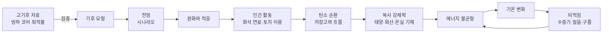

# 일반지구과학 9. 기후와 기후 변화 — 지구의 에너지 장부를 읽고 미래를 계산하다
<!-- prev: 5-3, earth-1, uearth-7, uearth-8 -->
<!-- next: ubio-13 -->

> [!NOTE]
> **이 단원의 범위**
> - 기후 시스템의 구성 요소와 되먹임(복사 강제력, 기후 민감도)
> - 세계의 기후 구분(쾨펜 기후 구분)
> - 고기후를 알아내는 방법(빙하 코어, 나이테, 해저 퇴적물, 산호, 꽃가루 등)
> - 자연적 기후 변화 요인(밀란코비치 주기, 화산, 태양 활동, 판의 운동)
> - 인간 활동과 온실 기체, 탄소 순환 · 관측된 변화와 영향 · 기후 모형과 전망, 완화와 적응

**학습 목표**

1. 기후 시스템의 다섯 권역과 그 시간 규모를 설명하고, 복사 강제력·되먹임 매개 변수·기후 민감도로 기온 변화를 정량적으로 어림할 수 있다.
2. 쾨펜 기후 구분의 기준을 적용하여 관측 자료로 기후형을 판정하고, 기후 분포를 대기 대순환과 연결할 수 있다.
3. 빙하 코어·해저 퇴적물·나이테 등의 고기후 대리 자료가 무엇을 기록하는지, 산소 동위 원소 비($\delta^{18}\mathrm{O}$)를 어떻게 해석하는지 설명할 수 있다.
4. 밀란코비치 주기·화산·태양 활동·판의 운동을 시간 규모와 복사 강제력의 크기로 비교할 수 있다.
5. 탄소 순환의 저장고와 흐름, 인위적 배출의 행방을 정량적으로 설명하고, 관측된 기후 변화의 증거와 영향을 해석할 수 있다.
6. 에너지 수지 모형과 기후 모형으로 미래를 전망하는 원리와 한계를 이해하고, 탄소 예산을 이용해 완화와 적응 전략을 평가할 수 있다.

**이 단원의 학습 사다리**

| 단계 | 무엇을 하나? |
|---|---|
| STEP 1. 이전 학습 다시 보기 | 복사 평형, 온실 효과 강화, 기후 변화의 자연적·인위적 요인, 탄소 중립을 다시 꺼낸다 |
| STEP 2. 기초 다지기 | 로그와 복사 강제력, 되먹임 고리의 증폭, 동위 원소 비와 δ 표기, 시간 상수와 지수 접근 |
| STEP 3. 핵심 개념 | 기후 시스템과 되먹임 → 기후 구분 → 고기후 복원 → 자연적 요인 → 온실 기체와 탄소 순환 → 관측된 변화와 영향 → 기후 모형과 전망, 완화와 적응 |
| STEP 4. 오개념 바로잡기 | "날씨가 추우니 온난화는 없다", "$\mathrm{CO_2}$는 양이 적어 영향이 없다" 같은 착각 |
| STEP 5. 전공 맛보기 | 기후역학의 에너지 수지 모형, 탄소 순환 모형, 탐지와 원인 규명 |
| STEP 6. 생활·산업·진로 | 기후 서비스, 탄소 회계, 재생 에너지와 전력망, 기후 적응 설계 |

---

## 🗺️ 단원 들어가기

약 2만 년 전, 지금의 서해는 대부분 육지였다. 해수면이 지금보다 약 120 m 낮아 한반도와 중국 대륙이 이어져 있었고, 북아메리카와 북유럽은 두께 수 km의 빙상에 덮여 있었다. 그때 지구 평균 기온은 지금보다 약 5~7 °C 낮았을 뿐이다. **겨우 몇 도의 차이**가 대륙의 모습을 바꾼 것이다.

지금 지구는 산업화 이전보다 약 1.1 °C 이상 따뜻해졌고, 그 속도는 빙하기에서 간빙기로 넘어갈 때보다 훨씬 빠르다. 과학자들은 이 사실을 어떻게 알아냈고, 원인이 인간이라고 어떻게 판단하며, 앞으로 얼마나 더 따뜻해질지를 어떻게 계산할까?

이 단원에서는 「대기의 구조와 에너지·수분」의 복사 평형을 출발점으로, 기후를 **에너지 장부**로 읽는 방법을 배운다. 들어오는 에너지가 조금 달라지면(복사 강제력) 지구가 어떻게 반응하는지(되먹임), 과거의 장부(고기후)는 어떻게 읽는지, 그리고 그 장부를 미래로 연장하는 도구(기후 모형)까지 따라가 본다.

---

## STEP 1. 🔙 이전 학습 다시 보기

### 연계 개념표

| 이전 단원 | 그때 배운 것 | 대학에서 확장되는 것 |
|---|---|---|
| 중3 「날씨와 기후변화」 '온실효과와 지구온난화' | 복사 평형, 온실 효과, 지구 온난화의 개념 | 복사 강제력과 **기후 민감도**로 온난화 크기를 계산 |
| 통합과학2 「지구온난화와 기후변화」 | 열수지 표, ppm, 온실 효과 강화, 엘니뇨·사막화, 완화와 적응 | 되먹임의 **증폭 공식**, 탄소 예산과 누적 배출량 |
| 지구과학 「대기와 해양의 상호작용」 '기후변화의 원인과 해결' | 밀란코비치의 세 요소, 화산·태양 활동, 인위적 요인, 탄소 중립 | 요인별 **강제력 크기와 시간 규모** 비교, 탄소 순환의 정량적 수지 |
| 지구과학 「지구의 역사와 한반도의 암석」 | 지질 시대의 환경, 화석 | 고기후 대리 자료의 **동위 원소 해석** |
| 「대기의 구조와 에너지·수분」 | 복사 평형 온도, 한 층 모형, 클라우지우스–클라페이롱 관계 | 플랑크 되먹임($4\sigma T^3$), 수증기 되먹임 |
| 「대기의 운동과 날씨」 | 대기 대순환, 계절풍, 수치 예보와 혼돈 | 기후 구분의 원인, 기후 모형과 예보 모형의 차이 |

> 고등학교에서는 기후 변화의 **원인과 결과를 분류**했다. 대학에서는 각 요인이 에너지 수지를 **몇 W/m²** 바꾸고 그것이 **몇 °C**의 변화로 이어지는지를 계산한다.

### 준비 운동 (사전 진단)

**Q1.** 지구의 반사율이 지금보다 커지면 복사 평형 온도는 어떻게 되는가?

**Q2.** 밀란코비치 이론의 세 가지 천문학적 요인과 각각의 대략적인 주기를 쓰시오.

**Q3.** 대기 중 이산화 탄소 농도가 산업화 이전 약 280 ppm에서 약 420 ppm이 되었다. 몇 % 증가했는가?

**Q4.** 기후 변화 대응에서 '완화'와 '적응'의 차이를 예를 들어 설명하시오.

정답 및 해설

**Q1.** 흡수하는 태양 복사가 줄어 복사 평형 온도가 **낮아진다.**

**Q2.** 이심률(약 10만 년), 자전축 경사각(약 4만 1천 년), 세차 운동(약 2만 6천 년, 기후에 영향을 주는 주기는 약 2만 년 안팎).

**Q3.** $(420-280)/280\times100 = 50\ \%$.

**Q4.** 완화는 원인(온실 기체 배출)을 줄이는 것(예: 재생 에너지, 조림), 적응은 이미 일어나는 변화의 피해를 줄이는 것(예: 폭염 대비 도시 설계, 내건성 작물)이다.

---

## STEP 2. 🧱 기초 다지기

### ① 로그 함수와 '배로 늘 때마다 같은 효과'

$y = A\ln(x/x_0)$이면 $x$가 2배가 될 때마다 $y$는 $A\ln2$만큼 늘어난다. 280 → 560 ppm과 560 → 1120 ppm이 같은 효과를 낸다는 뜻이다. 처음 140 ppm이 늘 때의 효과($A\ln1.5$)가 다음 140 ppm(420 → 560, $A\ln(4/3)$)보다 크지만, 효과가 '사라지지는' 않는다.

### ② 되먹임 고리의 증폭

처음 변화 $\Delta T_0$가 생기면, 되먹임이 그 $f$배를 다시 더하고, 그것이 또 $f$배를 더하는 식으로 이어진다. 등비급수로

$$
\Delta T = \Delta T_0(1 + f + f^2 + \cdots) = \frac{\Delta T_0}{1 - f} \qquad (0 \le f < 1)
$$

$f = 0.5$이면 2배, $f = 0.6$이면 2.5배로 증폭된다. $f$가 1에 가까우면 작은 불확실성이 결과를 크게 바꾼다. 기후 민감도의 불확실성이 큰 까닭이 여기에 있다. ($f < 0$이면 변화가 줄어드는 **음의 되먹임**)

### ③ 동위 원소 비와 δ 표기

같은 원소라도 질량수가 다른 **동위 원소**는 증발·응결·생물 반응에서 조금씩 다르게 행동한다(무거운 동위 원소는 덜 증발하고 먼저 응결한다). 비율의 아주 작은 차이를 표준 물질에 대한 천분율(‰, 퍼밀)로 나타낸다.

$$
\delta^{18}\mathrm{O} = \left(\frac{R_{\text{시료}}}{R_{\text{표준}}} - 1\right)\times1000\ \text{‰}, \qquad R = \frac{^{18}\mathrm{O}}{^{16}\mathrm{O}}
$$

시료의 비율이 표준보다 3.5 % 작으면 $\delta^{18}\mathrm{O} = -35$ ‰이다. 탄소에서도 같은 방식으로 $\delta^{13}\mathrm{C}$를 쓴다.

### ④ 시간 상수 — 새로운 평형에 다가가는 빠르기

열용량 $C$인 계에 일정한 강제력 $F$가 가해지고 되먹임 매개 변수가 $\lambda$이면 $C\dfrac{dT}{dt} = F - \lambda T$이고, 해는

$$
T(t) = \frac{F}{\lambda}\left(1 - e^{-t/\tau}\right), \qquad \tau = \frac{C}{\lambda}
$$

이다. $t = \tau$에서 최종 변화의 약 63 %, $3\tau$에서 약 95 %에 이른다. 열용량이 큰 바다 때문에 기후는 강제력에 **늦게** 반응한다.

### ⑤ 단위 감각 — Gt, ppm, W/m²

| 양 | 관계 |
|---|---|
| 1 Gt(기가톤) | $10^9$ t $= 10^{12}$ kg |
| 탄소 1 GtC | $\mathrm{CO_2}$ 3.664 Gt(분자량 비 44/12) |
| 대기 $\mathrm{CO_2}$ 1 ppm | 약 2.12 GtC |
| 지구 표면적 | 약 $5.1\times10^{14}\ \mathrm{m^2}$ |
| 1년 | 약 $3.16\times10^7$ s |

---

## STEP 3. 📘 핵심 개념

### ① 기후 시스템의 구성 요소와 되먹임

#### (1) 다섯 권역과 시간 규모

**기후(climate)** 는 보통 30년 이상의 날씨의 평균과 변동(극값, 빈도 포함)이다. 기후를 정하는 **기후 시스템**은 서로 에너지·물·탄소를 주고받는 다섯 권역으로 이루어진다.

| 권역 | 구성 | 기후에서의 역할 | 반응 시간(약) |
|---|---|---|---|
| 기권 | 대기 | 열·수증기 운반, 온실 효과 | 수일~1개월 |
| 수권 | 해양, 호수, 하천 | 거대한 열 저장고, 열 운반(해류) | 표층 수년, 심층 수백~천 년 |
| 빙권 | 빙상, 빙하, 해빙, 눈, 영구 동토 | 높은 반사율, 해수면 조절 | 해빙 수년, 빙상 수천 년 |
| 지권 | 지표·암석 | 지형·반사율, 화산, 장기 탄소 순환(풍화) | 수천~수백만 년 |
| 생물권 | 육상·해양 생물 | 광합성·호흡으로 탄소 교환, 증산 | 수년~수천 년 |

해양의 상층 약 2.5 m만으로도 대기 전체와 같은 열용량을 가진다. 그래서 바다가 기후 변화의 **속도**를 정하고, 빙상과 심층 해양은 변화가 수백~수천 년 동안 이어지게 한다.

#### (2) 복사 강제력

어떤 요인이 대기 꼭대기의 에너지 수지를 바꾼 크기를 **복사 강제력(radiative forcing)** $\Delta F$($\mathrm{W/m^2}$)라 한다. 양(+)이면 데우고 음(−)이면 식힌다. 이산화 탄소에 대해서는 흡수대 포화 때문에 로그 꼴의 근사식이 널리 쓰인다.

$$
\Delta F_{\mathrm{CO_2}} \approx 5.35\ln\frac{C}{C_0}\ \mathrm{W/m^2}
$$

농도가 2배가 되면 $5.35\ln2 \approx 3.7\ \mathrm{W/m^2}$이다. 태양이나 반사율의 변화는 $\Delta F = \dfrac{\Delta S(1-\alpha)}{4}$ 또는 $\Delta F = -\dfrac{S\,\Delta\alpha}{4}$로 바꾸어 비교한다.

<!-- fig:uearth-9-forcing -->

#### (3) 되먹임과 기후 민감도

강제력이 생기면 지구는 기온을 바꾸어 다시 균형을 찾는다. 평형에서 $\Delta F = \lambda\Delta T$, $\lambda$를 **기후 되먹임 매개 변수**($\mathrm{W/(m^2\cdot K)}$)라 한다.

**플랑크 되먹임(기본 반응)** 지구가 따뜻해지면 $\sigma T^4$로 더 많이 방출한다. $\dfrac{d(\sigma T^4)}{dT} = 4\sigma T_e^3 = 4\times5.67\times10^{-8}\times255^3 \approx 3.8\ \mathrm{W/(m^2\cdot K)}$. 실제 대기 구조를 넣은 기후 모형에서는 약 $3.2\ \mathrm{W/(m^2\cdot K)}$이다. 이 값만 있다면 $\mathrm{CO_2}$ 2배의 온난화는 $3.7/3.2 \approx 1.2\ \mathrm{K}$이다.

| 되먹임 | 과정 | 부호 | 크기(약, 최근 평가의 대표값) |
|---|---|---|---|
| 플랑크 | 따뜻할수록 장파 방출 증가 | 음(안정화) | $-3.2\ \mathrm{W/(m^2\cdot K)}$ |
| 수증기 + 기온 감률 | 따뜻할수록 수증기 증가(1 K당 약 7 %) → 온실 효과 강화. 상층이 더 데워져 방출이 느는 효과가 일부 상쇄 | 양 | $+1.3$ |
| 지표 반사율(얼음–알베도) | 눈·얼음이 녹아 어두운 지표 노출 → 흡수 증가 | 양 | $+0.35$ |
| 구름 | 낮은 구름 감소(햇빛 반사 감소), 높은 구름 고도 상승 | 양(불확실성 가장 큼) | $+0.4$ |
| 합계 | — | 음(전체로는 안정) | 약 $-1.2$ |

합계가 음수이므로 기후는 폭주하지 않고 새 평형에 도달하지만, 양의 되먹임 때문에 플랑크 반응만 있을 때보다 훨씬 크게 변한다.

<!-- fig:uearth-9-feedbacks -->

**평형 기후 민감도(ECS)** 는 $\mathrm{CO_2}$ 농도가 2배가 된 뒤 새로운 평형에 이르렀을 때의 지구 평균 기온 상승이다. 최근 종합 평가의 최적 추정값은 **약 3 °C**, 가능성 높은 범위는 **약 2.5~4 °C**이다. 이는 관측된 온난화, 고기후(빙하기의 강제력과 기온), 기후 모형, 되먹임 이론을 함께 써서 좁혀 온 값이다.

#### 예제 1 — 되먹임으로 증폭되는 온난화

$\mathrm{CO_2}$ 2배의 강제력 $3.7\ \mathrm{W/m^2}$, 플랑크 되먹임 $3.2\ \mathrm{W/(m^2\cdot K)}$, 평형 기후 민감도 3 °C일 때 (1) 되먹임이 없을 때의 온난화, (2) 전체 되먹임 매개 변수 $\lambda$, (3) STEP 2 ②의 증폭 인자 $f$를 구하시오.

**풀이**
(1) $\Delta T_0 = 3.7/3.2 \approx 1.2\ \mathrm{K}$
(2) $\lambda = \Delta F/\mathrm{ECS} = 3.7/3 \approx 1.2\ \mathrm{W/(m^2\cdot K)}$
(3) $3 = 1.16/(1-f)$ → $f \approx 0.61$
**의미** 되먹임이 플랑크 반응만 있을 때의 온난화를 약 2.5배로 키운다. $f$가 0.5~0.7 범위에서 변하면 ECS는 약 2.3~3.9 °C로 변한다 — 되먹임(특히 구름)의 작은 불확실성이 민감도의 큰 범위가 된다.

> [!TIP]
> 💡 **비유** — 플랑크 되먹임은 '방이 더워지면 창문으로 열이 더 많이 빠져나가는 것', 수증기·얼음 되먹임은 '더워지면 커튼이 저절로 두꺼워지는 것'이다. 창문 덕분에 방이 한없이 뜨거워지지는 않지만, 커튼 때문에 처음 예상보다 훨씬 더워진다.

#### 예제 2 — 반사율이 1 % 포인트만 변해도

지구 반사율이 0.30에서 0.31로 커지면 복사 강제력은 얼마인가? 이를 $\mathrm{CO_2}$ 2배의 강제력과 비교하시오. ($S = 1361\ \mathrm{W/m^2}$)

**풀이** $\Delta F = -S\Delta\alpha/4 = -1361\times0.01/4 \approx -3.4\ \mathrm{W/m^2}$. $\mathrm{CO_2}$ 2배($+3.7$)와 크기가 거의 같다. 구름량이 조금만 변해도 기후가 크게 바뀔 수 있는 까닭이며, 구름 되먹임이 가장 불확실한 이유이다.

#### ✔ 바로 확인

1. 빈칸: 기후는 보통 (    )년 이상의 날씨의 평균과 변동이다.
2. $\mathrm{CO_2}$ 농도가 산업화 이전의 4배가 될 때 복사 강제력은? ($\Delta F = 5.35\ln(C/C_0)$)
3. 짝짓기(되먹임의 부호): 플랑크, 수증기, 얼음–반사율 — 양, 음
4. (O/X) 되먹임 매개 변수의 합계가 음(안정)이면 양의 되먹임이 있어도 기후는 폭주하지 않고 새 평형에 이른다.

정답

1. 30
2. 약 $7.4\ \mathrm{W/m^2}$ — 2배마다 3.7씩 더해진다.
3. 플랑크 음, 수증기 양, 얼음–반사율 양
4. O

---

### ② 세계의 기후 구분

#### (1) 쾨펜 기후 구분

20세기 초 쾨펜(Köppen)은 **식생 분포**가 기후를 가장 잘 요약한다고 보고, 월평균 기온과 강수량으로 기후를 나누었다. 오늘날 널리 쓰이는 기준(쾨펜–가이거)을 정리하면 다음과 같다(최한월 기준은 0 °C 또는 −3 °C를 쓰며, 여기서는 0 °C를 쓴다).

| 기후군 | 기준 | 대표 식생 |
|---|---|---|
| **A** 열대 | 최한월 평균 기온 18 °C 이상 | 열대 우림, 사바나 |
| **B** 건조 | 연강수량 < 건조 한계(아래 식) | 사막, 스텝(초원) |
| **C** 온대 | 최난월 10 °C 이상, 최한월 0~18 °C | 상록·낙엽 활엽수림 |
| **D** 냉대(아한대) | 최난월 10 °C 이상, 최한월 0 °C 이하 | 침엽수림(타이가) |
| **E** 한대 | 최난월 10 °C 미만 | 툰드라(ET, 0~10 °C), 빙설(EF, 0 °C 미만) |

**건조 한계** 연평균 기온을 $t$(°C)라 할 때 $P_{\text{th}} = 2t + 28$(강수의 70 % 이상이 여름 반년), $2t$(70 % 이상이 겨울 반년), $2t + 14$(그 밖). 연강수량(mm)이 $10P_{\text{th}}$보다 작으면 B, 그중 $5P_{\text{th}}$보다 작으면 사막(BW), 아니면 스텝(BS)이다. 기온이 높을수록 증발이 많아 같은 강수량이라도 더 건조하므로 한계가 기온에 비례한다.

| 둘째 글자 | 뜻 |
|---|---|
| f | 연중 습윤 |
| s | 여름 건조(지중해성) |
| w | 겨울 건조 |
| m | 짧은 건기가 있는 계절풍형(열대) |
| 셋째 글자 a / b / c | 최난월 22 °C 이상 / 22 °C 미만이며 10 °C 이상인 달이 4개월 이상 / 그보다 짧은 여름 |

#### (2) 기후 분포의 원인 — 대기 대순환과 다시 연결하기

| 기후형 | 분포 | 원인(「대기의 운동과 날씨」) |
|---|---|---|
| Af 열대 우림 | 적도 부근 | 열대 수렴대의 연중 상승 기류 |
| Aw 사바나 | Af의 남북 | ITCZ가 계절에 따라 오가며 우기·건기 |
| BW 사막 | 위도 20°~30° 대륙 서안·내부 | 아열대 고압대의 하강 기류, 한류(대륙 서안), 대륙 내부·비그늘 |
| Cs 지중해성 | 위도 30°~40° 대륙 서안 | 여름에 아열대 고압대, 겨울에 편서풍과 저기압 |
| Cf·Cw 온대 | 중위도 | 편서풍과 이동성 저기압, 대륙 동안은 계절풍 |
| Df·Dw 냉대 | 북반구 위도 40°~65° 대륙 | 대륙성(큰 연교차). 남반구에는 이 위도에 큰 대륙이 없어 거의 없음 |
| ET·EF 한대 | 극지·고산 | 일사 부족, 극 고압대 |

<!-- fig:uearth-9-koppen-map -->

우리나라는 여름에 덥고 습하며 겨울에 춥고 건조한 **계절풍 기후**로, 남부 해안은 온대(C) 기후, 중부·북부 내륙은 냉대(D) 기후에 해당한다. 중부 지방은 최한월 평균 기온이 0 °C와 −3 °C 사이에 걸치는 곳이 많아 **어느 기준을 쓰느냐에 따라 C와 D가 갈린다.** 기후 구분은 자연의 경계가 아니라 사람이 정한 기준이라는 점을 보여 준다. 또 기온이 오르면서 같은 지점의 기후형이 바뀌기도 한다(예: 온대 기후의 북상).

> [!NOTE]
> 쾨펜 구분은 단순한 월평균 자료로 전 세계를 비교할 수 있다는 장점이 있지만, 강수의 강도·증발량·바람 같은 요소는 반영하지 못한다. 그래서 증발산량을 넣은 손스웨이트 구분, 기단의 영향을 중심으로 한 기후 구분 등도 함께 쓰인다.

#### 예제 3 — 기후형 판정

다음 세 관측소(가상)의 기후형을 쾨펜 기준(최한월 0 °C 기준)으로 판정하시오.

| 관측소 | 최난월(°C) | 최한월(°C) | 연평균(°C) | 연강수량(mm) | 강수 특징 |
|---|---|---|---|---|---|
| 가 | 33 | 15 | 24 | 250 | 70 % 이상 여름 |
| 나 | 25 | −8 | 9 | 1300 | 여름 집중, 겨울 최소월이 여름 최다월의 $\frac{1}{10}$ 미만 |
| 다 | 7 | −25 | −10 | 200 | 고르게 |

**풀이**
가: 건조 한계 $P_{\text{th}} = 2\times24 + 28 = 76$ → $10P_{\text{th}} = 760$ mm > 250 mm이므로 **B**. $5P_{\text{th}} = 380$ mm보다도 적으므로 사막(BW), 연평균 18 °C 이상이므로 **BWh**(더운 사막).
나: 최난월 > 10 °C, 최한월 < 0 °C → D. 겨울 건조 → w, 최난월 ≥ 22 °C → a. **Dwa**.
다: 최난월 < 10 °C이고 0 °C 이상 → **ET**(툰드라). (E는 B보다 먼저 판정한다.)

#### ✔ 바로 확인

1. 최한월 평균 기온이 18 °C 이상이면 어느 기후군인가?
2. 최난월 8 °C, 최한월 −20 °C인 곳의 기후형은?
3. (O/X) 남반구에도 위도 40°~65°에 냉대(D) 기후가 넓게 나타난다.
4. 아열대 고압대의 하강 기류가 만드는 대표적 기후군은?

정답

1. A(열대)
2. ET(툰드라) — 최난월이 10 °C 미만이고 0 °C 이상
3. X — 그 위도에 큰 대륙이 없다.
4. B(건조) — 사막

---

### ③ 고기후를 알아내는 방법

전 지구 규모의 기기 관측은 1850년 무렵부터, 약 170년 남짓에 불과하다. 그보다 앞선 기후는 기후의 영향을 받아 남은 흔적, 즉 **대리 자료(proxy)** 로 복원한다.

| 대리 자료 | 무엇을 기록하나 | 시간 범위(약) | 해상도 |
|---|---|---|---|
| **빙하 코어** | 얼음의 $\delta^{18}\mathrm{O}$·$\delta\mathrm{D}$(기온), 공기 방울(과거 대기의 $\mathrm{CO_2}$·$\mathrm{CH_4}$), 화산재·먼지 | 남극 약 80만 년, 그린란드 약 12만 년 | 연~수십 년 |
| **해저 퇴적물** | 유공충 껍데기의 $\delta^{18}\mathrm{O}$(빙하 부피 + 수온), 미화석 종 구성, 빙하가 떨어뜨린 암설 | 수천만 년 이상 | 수백~수천 년 |
| **나이테** | 나이테의 폭·밀도(생장기 기온·강수) | 수천 년 | 1년 |
| **산호** | 골격의 $\delta^{18}\mathrm{O}$, Sr/Ca 비(해수면 온도) | 수백 년(화석 산호는 더 김) | 월~년 |
| **꽃가루(화분)** | 호수·습지 퇴적물 속 식생 구성 | 수만~수십만 년 | 수십~수백 년 |
| **동굴 생성물(종유석·석순)** | $\delta^{18}\mathrm{O}$(강수·계절풍 세기), 우라늄 계열 연대 | 수십만 년 | 수년~수십 년 |
| 호수의 연층(호상점토) | 해마다 쌓인 밝고 어두운 층 | 수만 년 | 1년 |
| 역사 기록 | 꽃 피는 날, 강의 결빙, 흉작 기록 | 수백~수천 년 | 일~년 |

#### 산소 동위 원소는 어떻게 기온을 알려 주나

바다에서 증발한 수증기는 가벼운 $^{16}\mathrm{O}$가 많다. 수증기가 극지방으로 가며 비·눈으로 빠질 때 무거운 $^{18}\mathrm{O}$가 먼저 떨어지므로, 극지방 눈은 $\delta^{18}\mathrm{O}$가 매우 낮다. **기온이 낮을수록** 이 과정이 더 진행되어 눈의 $\delta^{18}\mathrm{O}$가 **더 낮아진다.** 그래서 빙하 코어에서는 '$\delta^{18}\mathrm{O}$가 낮은 층 = 추웠던 시기'이다.

해저 퇴적물에서는 반대로 읽는다. 빙하기에는 $^{16}\mathrm{O}$가 많은 눈이 대륙 빙상에 갇혀 바닷물에 $^{18}\mathrm{O}$가 상대적으로 많아지고, 수온도 낮아 유공충 껍데기의 $\delta^{18}\mathrm{O}$가 **높아진다.** 즉 '유공충의 $\delta^{18}\mathrm{O}$가 높은 층 = 빙하가 컸던 시기'이다.

<!-- fig:uearth-9-oxygen-isotope -->

| 자료 | 빙하기(추운 시기)의 $\delta^{18}\mathrm{O}$ | 까닭 |
|---|---|---|
| 극지 빙하 얼음 | 낮다 | 낮은 기온에서 $^{18}\mathrm{O}$가 더 많이 먼저 빠짐 |
| 해양 유공충 껍데기 | 높다 | 가벼운 물이 빙상에 저장 + 낮은 수온 |

#### 예제 4 — δ 값으로 기온 변화 어림하기

어느 그린란드 빙하 코어에서 마지막 빙기 층의 $\delta^{18}\mathrm{O}$가 −40 ‰, 현재 간빙기 층이 −35 ‰이다. 이 지역에서 $\delta^{18}\mathrm{O}$와 기온의 관계가 약 0.67 ‰/°C라 하면 기온 차는 얼마로 어림되는가? 이 어림의 한계도 한 가지 쓰시오.

**풀이** $\Delta T \approx \dfrac{5\ \text{‰}}{0.67\ \text{‰/°C}} \approx 7.5\ ^\circ\mathrm{C}$. 빙기가 약 7~8 °C 추웠다는 어림이다. 그러나 수증기 발원지의 수온, 눈이 내리는 계절, 빙상 높이가 바뀌면 같은 기울기가 성립하지 않는다. 실제로 시추공 온도 측정 등 다른 방법으로 보정하면 그린란드의 빙기는 이보다 더 추웠던 것으로 복원된다. 대리 자료는 **여러 방법을 교차 검증**해야 한다.

#### 고기후가 알려 준 사실

- 남극 빙하 코어의 약 80만 년 기록에서 기온과 $\mathrm{CO_2}$는 함께 오르내렸다. 빙기에는 약 180 ppm, 간빙기에는 약 280~300 ppm이었다. 오늘날 약 420 ppm 이상은 이 범위를 크게 벗어난다.
- 빙기–간빙기 순환은 지난 약 100만 년 동안 대략 10만 년 주기였고, 그 이전에는 약 4만 1천 년 주기가 우세했다.
- 마지막 최대 빙하기(약 2만 1천 년 전)에는 지구 평균 기온이 지금보다 약 5~7 °C 낮았고 해수면은 약 120 m 낮았다.
- 그린란드 코어에는 수십 년 만에 수 °C씩 급변한 사건들이 기록되어 있다. 기후가 언제나 천천히 변하는 것은 아니다.

<!-- fig:uearth-9-ice-core -->

#### ✔ 바로 확인

1. (O/X) 빙하 코어에서 $\delta^{18}\mathrm{O}$가 낮은 층은 따뜻했던 시기이다.
2. 해양 유공충 껍데기의 $\delta^{18}\mathrm{O}$가 높은 층은 빙상이 (컸던 / 작았던) 시기이다.
3. 나이테 자료의 시간 해상도는?
4. 빈칸: 남극 빙하 코어에서 빙기의 $\mathrm{CO_2}$는 약 (    ) ppm, 간빙기는 약 280~300 ppm이었다.

정답

1. X — 추웠던 시기이다.
2. 컸던 — 가벼운 물이 빙상에 갇혔기 때문이다.
3. 1년
4. 180

---

### ④ 자연적 기후 변화 요인

#### (1) 밀란코비치 주기

| 요소 | 변화 범위(약) | 주기(약) | 무엇을 바꾸나 |
|---|---|---|---|
| 이심률 | 0.005~0.058(현재 약 0.017) | 10만 년, 40만 년 | 근일점·원일점의 일사 차이(연평균 일사는 거의 불변) |
| 자전축 경사각 | 22.1°~24.5°(현재 약 23.4°, 감소 중) | 4만 1천 년 | 계절 대비, 고위도 여름 일사 |
| 세차(근일점 계절의 이동) | — | 약 1만 9천~2만 3천 년 | 근일점에서 맞는 계절 |

이 요소들은 1년 동안 지구 전체가 받는 에너지는 거의 바꾸지 않고, **위도와 계절에 따른 분배**를 바꾼다. 핵심은 **북반구 고위도(약 65°N)의 여름 일사**이다. 여름이 서늘하면 겨울에 쌓인 눈이 다 녹지 않고 해마다 쌓여 빙상이 자란다. 북반구에 대륙이 많아 빙상이 자랄 땅이 있기 때문에 북반구 여름이 중요하다.

다만 일사 변화 자체는 작아서, 빙기–간빙기의 큰 기온 차는 **얼음–알베도 되먹임**과 **$\mathrm{CO_2}$ 되먹임**(바다가 차가워지고 순환이 바뀌어 탄소를 더 저장)이 증폭한 결과이다. 남극 기록에서 $\mathrm{CO_2}$가 기온보다 약간 늦게 변하는 구간이 있는 것은 '궤도가 방아쇠를 당기고 $\mathrm{CO_2}$가 증폭했다'는 해석과 일치한다.

<!-- sim:u-milankovitch -->

#### 예제 5 — 이심률과 근일점 일사

그림과 같이 이심률 $e$일 때 근일점 거리 $a(1-e)$, 원일점 거리 $a(1+e)$이다. 일사가 거리의 제곱에 반비례함을 이용하여 현재($e = 0.0167$)와 이심률이 가장 클 때($e = 0.058$) 근일점과 원일점의 일사 비를 구하시오.

<!-- fig:uearth-9-q-orbit-eccentricity -->

**풀이** 비 $= \left(\dfrac{1+e}{1-e}\right)^2$
현재: $\left(\dfrac{1.0167}{0.9833}\right)^2 \approx 1.07$(약 7 % 차이)
최대: $\left(\dfrac{1.058}{0.942}\right)^2 \approx 1.26$(약 26 % 차이)
**의미** 이심률이 크면 세차의 효과(근일점이 여름이냐 겨울이냐)가 크게 나타난다. 그래서 세차 주기의 영향은 이심률 주기에 맞추어 커졌다 작아졌다 한다. 반면 연평균 일사는 $1/\sqrt{1-e^2}$에 비례해 최대 이심률에서도 약 0.2 %만 변한다.

#### (2) 화산 활동

큰 폭발성 분화는 이산화 황을 성층권까지 올려 보낸다. 이것이 **황산염 에어로졸**이 되어 1~3년 동안 머물며 햇빛을 반사하므로 지표가 식는다. 대류권에만 머문 화산재는 비에 씻겨 몇 주 안에 사라져 기후 효과가 작다.

| 사례 | 영향(약) |
|---|---|
| 1815년 탐보라 화산(인도네시아) | 이듬해 북반구 곳곳에 '여름 없는 해', 흉작 |
| 1991년 피나투보 화산(필리핀) | 1~2년 동안 지구 평균 기온 약 0.5 °C 하강 |

화산이 내뿜는 $\mathrm{CO_2}$는 현재 인간 배출량의 약 1 % 정도로 작다. 다만 수백만 년 규모에서는 대규모 현무암 분출(범람 현무암)이 많은 $\mathrm{CO_2}$를 내놓아 대량 멸종과 온난화에 관여했다(「지질 시대와 지구의 역사」).

#### (3) 태양 활동

태양의 총복사량은 약 11년 흑점 주기에 따라 약 0.1 %(약 $1\ \mathrm{W/m^2}$) 변한다. 지구 전체 평균 강제력으로 바꾸면 $\Delta F = \dfrac{1\times(1-0.3)}{4} \approx 0.18\ \mathrm{W/m^2}$로, 산업화 이후 온실 기체 강제력(수 $\mathrm{W/m^2}$)보다 훨씬 작다. 1645~1715년경 흑점이 거의 없던 **마운더 극소기**는 유럽의 추운 시기(소빙기의 일부)와 겹치지만, 같은 시기의 화산 활동도 함께 영향을 준 것으로 본다. 1950년대 이후 태양 활동은 뚜렷한 증가 추세가 없는데 지구는 계속 따뜻해졌다.

#### (4) 판의 운동 — 수백만 년의 기후 조절

| 과정 | 기후 효과 |
|---|---|
| 대륙의 위치 | 극에 대륙이 있어야 빙상이 자랄 수 있음(남극 대륙의 극 위치) |
| 해로의 열림·닫힘 | 남극 주변 해로(드레이크 해협 등)가 열려 남극 순환류가 생기며 남극이 고립·냉각, 파나마 지협이 닫히며 대서양 순환 변화(약 300만 년 전 전후) |
| 산맥의 융기 | 대기 흐름·계절풍 변화, 새로 드러난 암석의 **풍화**로 $\mathrm{CO_2}$ 소비 |
| 화산·해령 활동 | 장기적인 $\mathrm{CO_2}$ 공급 |

**규산염 풍화의 온도 조절 장치** 빗물에 녹은 $\mathrm{CO_2}$가 규산염 암석을 풍화시키면 탄소가 결국 해양의 탄산염 암석으로 묻힌다. 따뜻하고 비가 많을수록 풍화가 빨라져 $\mathrm{CO_2}$를 더 빨리 없애므로, 수십만~수백만 년 규모에서 기후를 안정시키는 **음의 되먹임**이다. 그러나 너무 느려 인간 활동의 변화를 막아 주지 못한다.

#### 자연적 요인의 비교

| 요인 | 시간 규모 | 강제력의 크기(약) | 최근 100여 년 온난화의 설명력 |
|---|---|---|---|
| 판의 운동 | 수백만 년 이상 | (간접적, 탄소 순환을 통해) | 없음 |
| 밀란코비치 주기 | 2만~10만 년 | 전 지구 평균은 작음, 고위도 여름 수십 $\mathrm{W/m^2}$ | 없음(지금은 서서히 냉각 방향) |
| 태양 활동 | 11년~수백 년 | 약 0.1~0.2 $\mathrm{W/m^2}$ | 매우 작음 |
| 화산 | 1~3년 | 큰 분화 직후 수 $\mathrm{W/m^2}$의 냉각 | 일시적 냉각만 |
| 내부 변동(ENSO 등) | 수년~수십 년 | 강제력이 아니라 열의 재분배 | 해마다의 오르내림 |

#### ✔ 바로 확인

1. 자전축 경사각 변화의 주기는 약 몇 년인가?
2. (O/X) 밀란코비치 주기는 지구 전체가 1년 동안 받는 태양 에너지를 크게 바꾼다.
3. 큰 화산 분화 뒤 1~3년 동안 지표가 식는 주된 원인은?
4. 태양 총복사량이 $1\ \mathrm{W/m^2}$ 변하면 전 지구 평균 강제력은 약 얼마인가? (반사율 0.3)

정답

1. 약 4만 1천 년
2. X — 주로 위도·계절에 따른 분배를 바꾼다.
3. 성층권에 올라간 황산염 에어로졸이 햇빛을 반사하기 때문
4. 약 $0.18\ \mathrm{W/m^2}$ — $1\times0.7/4$

---

### ⑤ 인간 활동과 온실 기체, 탄소 순환

#### (1) 주요 온실 기체

| 기체 | 산업화 이전(약) | 최근(약, 2020년대) | 대기 체류 시간(약) | 100년 지구 온난화 지수(GWP, 약) | 주요 인위적 배출원 |
|---|---|---|---|---|---|
| $\mathrm{CO_2}$ | 280 ppm | 420 ppm 이상 | 단일 값 없음(일부는 수천 년 이상 잔류) | 1 | 화석 연료, 시멘트, 삼림 파괴 |
| $\mathrm{CH_4}$ | 0.72 ppm | 1.9 ppm | 약 12년 | 약 27~30 | 가축, 논, 매립지, 화석 연료 채굴 |
| $\mathrm{N_2O}$ | 0.27 ppm | 0.33 ppm | 약 110년 | 약 270 | 질소 비료, 산업 |
| 할로카본(CFC 등) | 0 | ppt 수준 | 수십~수백 년 | 수천~수만 | 냉매(오존층 보호 협약으로 감축 중) |

**지구 온난화 지수(GWP)** 는 같은 질량의 $\mathrm{CO_2}$에 비해 일정 기간(보통 100년) 동안 일으키는 복사 강제력의 누적 비이다. 메테인은 분자당 효과가 크지만 수명이 짧아, 배출을 줄이면 수십 년 안에 효과가 나타난다.

**에어로졸** 황산염 등 인위적 에어로졸은 햇빛을 반사하고 구름을 밝게 하여 **음의 강제력**을 낸다. 온실 기체 온난화의 일부를 가려 왔으며, 대기 오염을 줄이면 이 냉각 효과가 줄어든다.

#### (2) 탄소 순환 — 저장고와 흐름

| 저장고 | 탄소량(약, GtC) |
|---|---|
| 대기 | 약 870(산업화 이전 약 590) |
| 육상 식생 | 약 450~650 |
| 토양 | 약 1500~2400 |
| 영구 동토 | 약 1400~1700 |
| 해양(대부분 심층의 용존 무기 탄소) | 약 38000 |
| 화석 연료 매장량 | 약 1000~2000 |
| 퇴적암(탄산염·유기 탄소) | 수천만 |

| 흐름 | 크기(약, GtC/년) |
|---|---|
| 육상 광합성(총 1차 생산) | 약 120 |
| 육상 호흡·분해 | 약 120(광합성과 거의 상쇄) |
| 대기–해양 교환 | 각 방향 약 80 |
| 인위적 배출(화석 연료 + 토지 이용, 2010년대) | 약 11 |

자연의 흐름은 인간 배출보다 10배 이상 크지만 **들어오고 나가는 양이 거의 균형**을 이루어 왔다. 인간 배출은 작아 보여도 한쪽으로만 더해지는 흐름이라 해마다 쌓인다.

<!-- fig:uearth-9-carbon-cycle -->

**인위적 탄소의 행방(2010년대 평균, 약)** 배출된 탄소의 약 45 %가 대기에 남고(**대기 잔류율**), 약 25 %는 해양, 약 30 %는 육상 생태계가 흡수한다. 해양에 녹은 $\mathrm{CO_2}$는 탄산이 되어 **해양 산성화**를 일으킨다. 표층 해수의 pH는 산업화 이후 약 0.1 낮아졌는데, 로그 척도이므로 수소 이온 농도로는 약 26 % 증가에 해당한다.

#### 예제 6 — 배출량에서 농도 증가로

한 해에 화석 연료와 토지 이용으로 약 11 GtC가 배출되고 그중 45 %가 대기에 남는다. 대기 $\mathrm{CO_2}$ 농도는 1년에 몇 ppm 증가하는가? ($1\ \mathrm{ppm} = 2.12\ \mathrm{GtC}$) 또 이 배출량을 $\mathrm{CO_2}$ 질량으로 바꾸시오.

**풀이**
**대입** $11\times0.45/2.12 \approx 2.3\ \mathrm{ppm/년}$
$\mathrm{CO_2}$로는 $11\times3.664 \approx 40\ \mathrm{Gt\ CO_2/년}$
**의미** 마우나로아 관측소에서 최근 측정되는 증가율(1년에 약 2~3 ppm)과 잘 맞는다. 배출량과 농도 증가가 '장부'로 맞아떨어지는 것은 증가의 원인이 인간 배출이라는 강력한 증거이다.

#### (3) 증가한 $\mathrm{CO_2}$가 화석 연료에서 왔다는 증거

| 증거 | 내용 |
|---|---|
| 양의 수지 | 누적 배출량의 약 절반이 대기 증가량과 맞음(예제 6) |
| $\delta^{13}\mathrm{C}$ 감소 | 식물 기원 탄소(화석 연료 포함)는 $^{13}\mathrm{C}$가 적다. 대기 $\mathrm{CO_2}$의 $\delta^{13}\mathrm{C}$가 꾸준히 낮아짐 |
| $^{14}\mathrm{C}$ 희석 | 화석 연료는 수백만 년 묵어 $^{14}\mathrm{C}$가 없다. 대기 중 $^{14}\mathrm{C}$ 비율이 묽어짐(수에스 효과) |
| 산소 감소 | 연소가 산소를 쓰므로 대기 $\mathrm{O_2}$ 농도가 연소량에 맞게 미세하게 감소 |
| 남북 차이 | 배출원이 많은 북반구의 농도가 남반구보다 약간 높음 |
| 해양 흡수 | 해양의 탄소가 늘고 pH가 낮아짐 → 해양은 배출원이 아니라 흡수원 |

#### 예제 7 — 현재까지의 복사 강제력

$\mathrm{CO_2}$ 농도가 280 ppm에서 420 ppm이 되었을 때의 복사 강제력을 구하고, 같은 크기의 강제력을 태양 상수 변화로 만들려면 태양 상수가 얼마나 커져야 하는지 구하시오. (반사율 0.3)

**풀이** $\Delta F = 5.35\ln(420/280) = 5.35\times0.405 \approx 2.2\ \mathrm{W/m^2}$. $\Delta S(1-0.3)/4 = 2.2$에서 $\Delta S \approx 12.4\ \mathrm{W/m^2}$, 즉 태양 상수가 약 0.9 % 커져야 한다. 11년 주기의 변화(약 0.1 %)의 약 9배이다.

#### ✔ 바로 확인

1. $1\ \mathrm{GtC}$는 $\mathrm{CO_2}$ 몇 Gt에 해당하는가?
2. 10 GtC를 배출하고 대기 잔류율이 45 %이면 대기 $\mathrm{CO_2}$ 농도는 약 몇 ppm 오르는가? ($1\ \mathrm{ppm} = 2.12\ \mathrm{GtC}$)
3. (O/X) 대기 $\mathrm{CO_2}$의 $\delta^{13}\mathrm{C}$ 감소는 늘어난 탄소가 화석 연료에서 왔다는 증거의 하나이다.
4. 고르기: 같은 질량이면 100년 동안의 온난화 효과가 더 큰 기체는 ($\mathrm{CO_2}$ / $\mathrm{CH_4}$)이다.

정답

1. 약 3.66 Gt — 질량비 44/12
2. 약 2.1 ppm — $4.5/2.12$
3. O
4. $\mathrm{CH_4}$ — GWP 약 27~30

---

### ⑥ 관측된 변화와 영향

#### (1) 관측된 변화(최근 종합 평가의 대표값, 약)

| 지표 | 관측된 변화 |
|---|---|
| 지구 평균 지표 기온 | 2011~2020년이 1850~1900년보다 약 1.1 °C 높음(육지 약 1.6 °C, 해양 약 0.9 °C). 최근 해마다 관측 최고 기록이 경신되는 경향 |
| 해양 열 함량 | 기후 시스템에 쌓인 추가 에너지의 약 90 %를 해양이 흡수 |
| 해수면 | 1901~2018년 약 0.20 m 상승, 최근 상승 속도는 연 약 3~4 mm로 빨라짐(열팽창 + 빙하·빙상 융해) |
| 북극 해빙 | 9월(최소기) 면적이 1979년 위성 관측 시작 이후 10년에 약 13 % 비율로 감소 |
| 빙하·빙상 | 세계 산악 빙하의 동시적 후퇴, 그린란드·남극 빙상의 질량 손실 |
| 극한 현상 | 폭염의 빈도·강도 증가, 많은 지역에서 극한 강수 증가 |
| 우리나라 | 기상청 분석에 따르면 20세기 초 이후 약 100여 년 동안 연평균 기온이 약 1.6 °C 상승, 여름은 길어지고 겨울은 짧아짐 |

**북극 증폭** 북극은 지구 평균보다 약 2~4배 빠르게 따뜻해지고 있다. 해빙이 녹으면 어두운 바다가 드러나 햇빛을 더 흡수하는 얼음–알베도 되먹임, 극지 하층의 안정한 대기 구조 등이 원인이다.

#### (2) '인간 때문'이라는 판단 — 탐지와 원인 규명

| 근거 | 내용 |
|---|---|
| 에너지 수지 | 대기 꼭대기의 에너지 불균형(약 $0.5\sim1\ \mathrm{W/m^2}$)이 위성과 해양 열 함량으로 확인됨 |
| 지문(fingerprint) | 대류권은 따뜻해지고 **성층권은 식음**(태양 원인이라면 둘 다 따뜻해져야 함), 낮보다 밤 기온이 더 오름 |
| 모형 실험 | 자연적 강제력만 넣은 모형은 20세기 후반 온난화를 재현하지 못하고, 인위적 강제력을 넣어야 재현됨 |
| 고기후 맥락 | 최근 수십 년의 온난화 속도는 지난 2000년 동안 유례없는 수준 |

이런 근거를 종합해 국제 과학 평가는 "인간의 영향이 대기·해양·육지를 온난화시켰다는 것은 명백하다"고 결론지었다.

#### 예제 8 — 바다가 받는 열

지구 에너지 불균형이 $0.7\ \mathrm{W/m^2}$일 때 1년 동안 기후 시스템에 쌓이는 에너지를 구하시오. 이 에너지의 90 %가 해양 상층 2000 m(해양 면적은 지구 표면의 약 71 %)를 데운다면 1년에 몇 °C 오르는가? ($\rho c = 1025\times3990\ \mathrm{J/(m^3\cdot K)}$)

**풀이**
**에너지** $0.7\times5.1\times10^{14}\times3.16\times10^7 \approx 1.1\times10^{22}\ \mathrm{J/년}$
**해양 상층의 승온** 단위 해양 면적당 $\dfrac{0.9\times0.7}{0.71}\ \mathrm{W/m^2}$이므로 $\Delta T = \dfrac{0.887\times3.16\times10^7}{1025\times3990\times2000} \approx 3.4\times10^{-3}\ \mathrm{K/년}$
**의미** 1년에 수천분의 1 °C로 아주 작아 보이지만, 에너지로는 인류의 연간 1차 에너지 소비(약 $6\times10^{20}$ J)의 약 20배이다. 바다의 거대한 열용량이 온난화를 '늦추고' 있으며, 동시에 그 열은 쉽게 되돌릴 수 없다.

#### (3) 영향

| 영역 | 영향(예) |
|---|---|
| 물 | 극한 강수와 가뭄의 동시 증가(클라우지우스–클라페이롱: 1 K당 수증기 약 7 %), 눈·빙하에 의존하는 수자원 감소 |
| 생태계 | 서식지의 고위도·고지대 이동, 개화·산란 시기 변화, 산호 백화, 해양 산성화로 껍데기 생물 피해 |
| 식량 | 고온·가뭄 스트레스로 작물 생산성 변화, 재배 적지의 북상 |
| 건강 | 폭염 사망, 매개 감염병의 분포 변화 |
| 해안 | 해수면 상승으로 폭풍 해일·침수 위험 증가 |
| 사회 | 피해가 취약 계층·지역에 집중되는 불평등 |

**티핑 요소** 일정 문턱을 넘으면 스스로 변화가 이어져 되돌리기 어려운 하위 시스템(그린란드·서남극 빙상, 대서양 자오면 순환, 아마존 열대 우림, 영구 동토 등)이 있다. 문턱의 정확한 온도는 불확실하지만, 온난화가 클수록 위험이 커진다는 점은 분명하다.

#### ✔ 바로 확인

1. 기후 시스템에 쌓인 추가 에너지의 약 90 %를 흡수한 권역은?
2. (O/X) 성층권이 식고 대류권이 따뜻해지는 것은 태양 활동 증가로 설명된다.
3. 북극이 지구 평균보다 빠르게 따뜻해지는 까닭 하나를 쓰시오.
4. 해수면 상승의 두 가지 주된 원인은?

정답

1. 해양
2. X — 온실 기체 증가의 지문이다. 태양이 원인이면 둘 다 따뜻해져야 한다.
3. 해빙이 녹아 어두운 바다가 햇빛을 더 흡수하는 얼음–반사율 되먹임(또는 극지 하층의 안정한 대기 구조)
4. 바닷물의 열팽창, 빙하·빙상의 융해

---

### ⑦ 기후 모형과 전망, 완화와 적응

#### (1) 기후 모형의 계층

| 모형 | 내용 | 쓰임 |
|---|---|---|
| 0차원 에너지 수지 모형 | $C\,dT/dt = F - \lambda T$ | 강제력·민감도·시간 지연의 개념 |
| 1차원 복사–대류 모형 | 연직 기온 구조와 복사 전달 | 온실 효과·기온 감률 연구 |
| 대기–해양 대순환 모형(GCM) | 「대기의 운동과 날씨」의 수치 예보 방정식 + 해양·해빙·지면 | 지역별 기온·강수 전망 |
| 지구 시스템 모형(ESM) | GCM + 탄소 순환·식생·대기 화학 | 배출량에서 농도까지 계산 |

**예보 모형과 기후 모형의 차이** 수치 예보는 **초기 조건**의 문제라 약 2주가 한계이다(혼돈). 기후 전망은 **강제력(경계 조건)** 에 따른 통계(평균과 분포)의 변화를 묻는 문제라 수십~수백 년을 다룰 수 있다. 내일 비가 올지는 모르지만 "7월이 1월보다 덥다"는 확실히 말할 수 있는 것과 같다.

**모형의 검증** 20세기 기후의 재현, 피나투보 화산 뒤의 냉각, 빙하기 기후(고기후)의 재현 등으로 검증한다. 격자보다 작은 구름·난류는 **모수화**로 다루어 불확실성이 남는다. 그래서 여러 기관의 모형 결과를 비교하는 국제 공동 실험을 하고, 그 범위를 불확실성으로 제시한다.

<!-- sim:u-climate-model -->

#### 예제 9 — 바다가 만드는 시간 지연

깊이 100 m 혼합층(밀도 $1025\ \mathrm{kg/m^3}$, 비열 $3990\ \mathrm{J/(kg\cdot K)}$)의 단위 면적당 열용량과, $\lambda = 1.2\ \mathrm{W/(m^2\cdot K)}$일 때의 시간 상수를 구하시오. 강제력이 갑자기 $3.7\ \mathrm{W/m^2}$ 생기면 10년 뒤와 30년 뒤의 기온 상승은?

**풀이**
$C = 1025\times3990\times100 \approx 4.1\times10^8\ \mathrm{J/(m^2\cdot K)}$, $\tau = C/\lambda \approx 3.4\times10^8\ \mathrm{s} \approx 11$년
평형 변화 $F/\lambda = 3.7/1.2 \approx 3.1\ \mathrm{K}$
10년 뒤 $3.1\times(1 - e^{-10/11}) \approx 1.8\ \mathrm{K}$, 30년 뒤 $3.1\times(1 - e^{-30/11}) \approx 2.9\ \mathrm{K}$

<!-- fig:uearth-9-q-mixed-layer-response -->

**의미** 실제로는 심층 해양이 열을 더 천천히 받아들여 마지막 수십 %의 상승에 수백 년이 걸린다. 그래서 배출을 멈추어도 이미 쌓인 강제력만큼의 온난화가 일부 '예약'되어 있고, 해수면 상승은 수백 년 이상 이어진다.

#### (2) 시나리오와 전망

미래 배출은 사회·경제의 선택에 달려 있으므로 **시나리오**로 나누어 전망한다. 최근 종합 평가는 공통 사회경제 경로(SSP)를 쓴다. 2081~2100년 지구 평균 기온 상승(1850~1900년 대비)의 최적 추정값은 대략 다음과 같다.

| 시나리오 | 성격 | 기온 상승(약) | 2100년 해수면 상승(1995~2014년 대비, 가능성 높은 범위, 약) |
|---|---|---|---|
| SSP1-1.9 | 매우 낮은 배출, 21세기 중반 순배출 0 | 1.4 °C | 0.3~0.6 m |
| SSP1-2.6 | 낮은 배출 | 1.8 °C | 0.3~0.6 m |
| SSP2-4.5 | 중간 배출 | 2.7 °C | 0.4~0.8 m |
| SSP3-7.0 | 높은 배출 | 3.6 °C | 0.6~0.9 m |
| SSP5-8.5 | 매우 높은 배출 | 4.4 °C | 0.6~1.0 m |

모든 시나리오에서 가까운 미래(2021~2040년)에 1.5 °C에 이를 가능성이 50 % 이상(배출이 많은 시나리오일수록 더 높음)으로 평가되었다. 어느 시나리오를 따르느냐는 21세기 후반에 크게 갈린다.

#### (3) 누적 배출량과 탄소 예산

여러 모형의 공통 결과로, 지구 온난화는 **누적 $\mathrm{CO_2}$ 배출량에 거의 비례**한다. 1000 Gt $\mathrm{CO_2}$당 약 0.45 °C(가능성 높은 범위 약 0.27~0.63 °C)이다. 1850~2019년 누적 배출량 약 2400 Gt $\mathrm{CO_2}$에 이 비율을 곱하면 약 1.1 °C로 관측과 맞는다.

이 비례 관계 때문에 목표 기온을 정하면 앞으로 배출할 수 있는 총량, 즉 **남은 탄소 예산**이 정해진다. 2020년 초 기준 1.5 °C를 50 % 확률로 넘지 않기 위한 남은 예산은 약 500 Gt $\mathrm{CO_2}$로 평가되었다.

<!-- fig:uearth-9-carbon-budget -->

#### 예제 10 — 탄소 예산은 몇 년 치인가

남은 탄소 예산이 2020년 초 기준 500 Gt $\mathrm{CO_2}$이고 해마다 약 40 Gt $\mathrm{CO_2}$를 배출한다면, 예산은 언제 바닥나는가? 배출량을 지금부터 해마다 일정량씩 줄여 직선으로 0까지 감소시킨다면, 0에 도달해야 하는 해는?

**풀이**
일정 배출: $500/40 = 12.5$년 → 2030년대 초반
직선 감소: 삼각형 넓이 $\dfrac12\times40\times t = 500$ → $t = 25$년 → 2045년 무렵 순배출 0
**의미** '2050년 탄소 중립'은 대략 1.5~2 °C 목표와 연결된 시간표이다. 감축이 늦어질수록 더 가파르게 줄여야 한다. 또 $\mathrm{CO_2}$ 외의 기체(메테인 등)와 에어로졸 감소 효과에 따라 예산은 달라진다.

#### (4) 완화와 적응

| 구분 | 전략 | 원리·예 |
|---|---|---|
| 완화 — 배출 감소 | 전력의 재생 에너지·저탄소 전환, 수송·난방의 전기화, 에너지 효율 | 화석 연료 연소 감소 |
| 완화 — 비 $\mathrm{CO_2}$ | 메테인 누출 차단, 논·축산 관리, 냉매 전환 | 수명이 짧은 기체는 효과가 빨리 나타남 |
| 완화 — 제거 | 조림·습지·갯벌 보전, 토양 탄소, 직접 공기 포집과 지중 저장 | 대기에서 $\mathrm{CO_2}$를 꺼내 장기 저장 |
| 적응 — 물·재해 | 홍수 방어, 빗물 저류, 조기 경보, 해안 방재 | 이미 일어나는 극한 현상 대비 |
| 적응 — 도시·건강 | 그늘·녹지, 쿨루프(반사율 높은 지붕), 폭염 쉼터 | 열섬 완화, 취약 계층 보호 |
| 적응 — 농업·생태 | 품종·재배 시기 조정, 생태 통로 | 변화에 맞춘 이동·조정 |

완화와 적응은 서로를 대신할 수 없다. 완화가 늦을수록 필요한 적응의 규모와 비용이 커지고, 어떤 영향(빙상 손실, 생물 멸종)은 적응으로 되돌릴 수 없다. 2015년 파리 협정은 지구 평균 기온 상승을 산업화 이전 대비 2 °C보다 훨씬 아래로 유지하고 1.5 °C로 제한하도록 노력하는 것을 목표로 한다.

> [!IMPORTANT]
> 기후 변화의 과학은 세 문장으로 정리된다. ① 온실 기체가 늘면 에너지 불균형이 생긴다(복사 물리). ② 되먹임이 그 효과를 증폭한다(약 2.5배). ③ 온난화는 누적 배출량에 비례하므로, 온난화를 멈추려면 **순배출을 0**으로 만들어야 한다.

#### ✔ 바로 확인

1. 혼합층 열용량 $C = 4.1\times10^8\ \mathrm{J/(m^2\cdot K)}$, $\lambda = 1.3\ \mathrm{W/(m^2\cdot K)}$일 때 시간 상수 $\tau = C/\lambda$는 약 몇 년인가?
2. (O/X) 기후 전망도 초기 조건 문제이므로 2주 이상은 의미가 없다.
3. 누적 $\mathrm{CO_2}$ 배출 1000 Gt당 약 0.45 °C라면 앞으로 2000 Gt를 더 배출할 때 추가 온난화는?
4. 짝짓기: 재생 에너지 전환, 폭염 쉼터 — 완화, 적응

정답

1. 약 10년 — $3.2\times10^8\ \mathrm{s}$
2. X — 기후 전망은 강제력(경계 조건)에 따른 통계의 변화를 다룬다.
3. 약 0.9 °C
4. 재생 에너지 전환 완화, 폭염 쉼터 적응

---

## STEP 4. ⚠️ 오개념 바로잡기

| 흔한 오개념 | 올바른 개념 | 왜 그럴까? |
|---|---|---|
| 올겨울이 유난히 추웠으니 지구 온난화는 틀렸다 | 한 지역·한 계절의 날씨는 기후 추세보다 변동이 훨씬 크다. 기후는 30년 이상, 전 지구 평균으로 판단한다 | 날씨의 변동(수 °C)이 추세(10년에 약 0.2 °C)를 가린다 |
| $\mathrm{CO_2}$는 대기의 0.04 %뿐이라 영향이 없다 | 대기의 99 %인 $\mathrm{N_2}$·$\mathrm{O_2}$는 적외선을 거의 흡수하지 않는다. 적은 양의 온실 기체가 온실 효과 전체를 만든다 | 효과는 양의 비율이 아니라 **흡수 능력**이 결정한다 |
| 수증기가 가장 큰 온실 기체이니 $\mathrm{CO_2}$는 중요하지 않다 | 수증기는 기온에 따라 수일 만에 조절되는 **되먹임**이고, $\mathrm{CO_2}$는 수백 년 남는 **강제력**이다 | 기온을 정하는 것은 $\mathrm{CO_2}$, 수증기는 그 효과를 증폭한다 |
| 최근 온난화는 태양 활동이나 지구 궤도 변화 때문이다 | 태양 활동은 1950년대 이후 증가하지 않았고, 궤도 변화는 수만 년 규모이다 | 성층권 냉각 같은 지문은 태양 원인과 맞지 않는다 |
| 오존층 구멍이 지구 온난화의 원인이다 | 오존층 파괴와 온난화는 원인과 과정이 다른 문제이다(관련은 있지만 별개) | 오존층 문제는 자외선, 온난화는 적외선 흡수 기체의 문제이다 |
| 배출을 멈추면 기온이 곧바로 내려간다 | 순배출 0이 되면 온난화가 대체로 **멈추지만** 내려가지는 않으며, 해수면은 수백 년 더 오른다 | $\mathrm{CO_2}$가 오래 남고, 바다·빙상이 느리게 반응하기 때문이다 |
| 기후 모형은 날씨도 못 맞히는데 100년 뒤를 어떻게 아나 | 기후 전망은 초기 조건이 아니라 **강제력에 따른 통계의 변화**를 계산한다 | 예측 한계(혼돈)는 개별 날씨에 적용되고 평균에는 덜 적용된다 |
| 빙하 코어에서 $\mathrm{CO_2}$가 기온보다 늦게 오르는 구간이 있으니 $\mathrm{CO_2}$는 원인이 아니다 | 궤도 변화가 방아쇠, $\mathrm{CO_2}$는 증폭기로 작용했다. 오늘날은 $\mathrm{CO_2}$가 먼저 바뀌는 경우이다 | 원인–결과가 서로를 키우는 되먹임 관계이다 |

---

## STEP 5. 🎓 다음 단계로 한 걸음 더

> [!CAUTION]
> 여기부터는 일반 과목의 범위를 넘는 전공 과목 맛보기이다. 대기과학·해양학·지질학·환경공학의 기후 관련 전공 과목에서 이 단원의 내용이 어떻게 깊어지는지 보여 준다.

### 전공 과목과의 연결

| 전공 과목 | 이어지는 내용 |
|---|---|
| 기후역학 | 에너지 수지 모형, 되먹임 분석, 해양 열 흡수와 과도 기후 반응, 기후 변동성(ENSO, 북극 진동) |
| 고기후학·동위 원소 지구화학 | 동위 원소 분별의 이론, 연대 측정, 대리 자료의 보정과 통합 |
| 생지화학(탄소 순환) | 해양 탄산염 화학(완충 계수), 육상 생태계 모형, 영구 동토 탄소 |
| 기후 모델링 | 결합 모형의 구성, 모수화, 지역 기후 상세화, 앙상블 해석 |
| 기후 정책·환경경제 | 탄소 가격, 감축 경로, 위험 평가와 적응 계획 |

### 맛보기 ① 이층 에너지 수지 모형과 '과도 기후 반응'

혼합층(열용량 $C$)과 심층 해양(열용량 $C_d$)을 나누어

$$
C\frac{dT}{dt} = F - \lambda T - \gamma(T - T_d), \qquad C_d\frac{dT_d}{dt} = \gamma(T - T_d)
$$

로 쓰면, 온난화가 수년~수십 년의 빠른 반응과 수백 년의 느린 반응으로 나뉜다. $\mathrm{CO_2}$를 해마다 1 %씩 늘려 2배가 되는 시점의 온난화를 **과도 기후 반응(TCR)** 이라 하며, 심층 해양이 열을 빼앗아 평형 민감도보다 작다(약 1.8 °C 안팎). 이 모형은 '왜 지금의 온난화가 평형값보다 작은가'를 설명한다.

### 맛보기 ② 해양 탄산염 화학과 레벨 인자

$\mathrm{CO_2}$가 바닷물에 녹으면 $\mathrm{CO_2 + H_2O \rightleftharpoons H^+ + HCO_3^-}$, $\mathrm{CO_3^{2-} + H^+ \rightleftharpoons HCO_3^-}$의 평형으로 대부분 탄산수소 이온이 된다(일반화학 「산·염기와 수용액 평형」). 그런데 대기 $\mathrm{CO_2}$가 10 % 늘어도 해수의 총 용존 무기 탄소는 약 1 %만 는다. 이 비율(약 10)을 **레벨 인자**라 하며, $\mathrm{CO_2}$가 늘수록 커져 해양의 흡수 능력이 점점 떨어진다. 바다가 '무한한 흡수원'이 아닌 이유이다.

### 일반 과목 vs 전공 과목

| 주제 | 일반지구과학 | 전공 과목 |
|---|---|---|
| 되먹임 | $\Delta T = \Delta F/\lambda$, 증폭 인자 | 커널 방법의 되먹임 분해, 상태 의존성 |
| 기후 구분 | 쾨펜 기준 적용 | 기후 분류의 통계적 방법, 미래 기후형 이동 |
| 고기후 | δ 표기, 대리 자료의 종류 | 분별 계수의 열역학, 연대 모형, 자료 동화 |
| 탄소 순환 | 저장고·흐름, 대기 잔류율 | 탄산염 평형, 생태계 모형, 탄소–기후 되먹임 |
| 전망 | 시나리오 표, 탄소 예산 | 결합 모형 실험 설계, 불확실성 정량화 |

---

## STEP 6. 🏭 생활·산업·진로 연결

### 사례 1. 기후 서비스와 기후 위험 공시

- **원리** 기후 모형의 전망을 지역 규모로 상세화하고(통계적·역학적 상세화), 폭염 일수·극한 강수 같은 지표로 바꾼다.
- **어디에 쓰이나** 지방 정부의 기후 변화 적응 계획, 기업의 기후 관련 재무 위험 공시, 보험의 재해 위험 산정.

### 사례 2. 탄소 회계와 배출 감축 검증

- **원리** 연료 사용량 × 배출 계수로 배출량을 계산하고, 지상·위성의 $\mathrm{CO_2}$·$\mathrm{CH_4}$ 관측과 역산 모형으로 실제 배출을 '위에서' 확인한다. 메테인 누출 지점은 위성 분광 관측으로 찾아낸다.
- **어디에 쓰이나** 국가 온실가스 인벤토리, 배출권 거래제, 기업의 감축 목표 관리.

### 사례 3. 재생 에너지와 전력망의 기상 의존성

- **원리** 태양광은 구름·에어로졸(일사), 풍력은 기압 경도와 경계층(바람)에 따라 출력이 변한다. 계절·연 단위의 기후 변동이 발전량을 좌우한다.
- **어디에 쓰이나** 발전 단지 입지 선정, 출력 예보와 전력 저장 계획, 냉난방 수요 예측.

### 사례 4. 적응 설계 — 도시와 해안

- **원리** 극한 강수의 증가(1 K당 약 7 %)를 반영해 배수 설계 기준을 높이고, 해수면 상승 시나리오로 해안 시설의 높이를 정한다. 녹지와 반사율 높은 지붕으로 열섬을 줄인다.
- **어디에 쓰이나** 도시 계획, 하수도·제방 설계, 항만·발전소 입지.

### 관련 전공·진로

| 진로 | 하는 일 | 관련 전공 |
|---|---|---|
| 기후 모델러 | 기후 모형 개발·실험, 전망 자료 생산 | 대기과학, 해양학, 응용수학 |
| 고기후 연구원 | 빙하 코어·퇴적물 분석, 동위 원소 측정 | 지질학, 지구화학, 해양학 |
| 탄소 관리 전문가 | 배출량 산정·검증, 감축 사업 평가 | 환경공학, 화학공학, 대기과학 |
| 기후 적응 계획가 | 지역 위험 평가와 적응 정책 수립 | 도시공학, 토목공학, 환경정책 |
| 기후 금융·위험 분석가 | 기후 위험의 재무 영향 분석 | 경제학, 통계학, 대기과학 |

---

## 🔬 탐구 활동 — 0차원 기후 모형 만들기 / 관측 자료로 기후 변화 읽기

### 활동 A. 스프레드시트로 에너지 수지 기후 모형 만들기

**목표** $C\,dT/dt = F(t) - \lambda T$를 한 해 단위로 차분하여 계산하고, 강제력 시나리오와 기후 민감도에 따라 기온이 어떻게 변하는지 탐구한다.

**준비물** 스프레드시트 프로그램

**과정**
1. A열에 연도(1850~2100), B열에 $\mathrm{CO_2}$ 농도를 넣는다. 1850년 280 ppm에서 출발해 2020년에 약 413 ppm이 되도록 매년 일정 비율로 늘리고(연 약 0.23 %), 2021년 이후는 시나리오별로 정한다(예: 연 2.5 ppm 증가 / 2050년까지 직선으로 증가율 0 / 2030년부터 감소).
2. C열에 강제력 $F = 5.35\ln(C/280)$을 계산한다.
3. D열에 기온 편차를 계산한다: $T_{n+1} = T_n + \dfrac{\Delta t}{C}\left(F_n - \lambda T_n\right)$, $\Delta t = 3.16\times10^7$ s, $C = 4.1\times10^8\ \mathrm{J/(m^2\cdot K)}$, $\lambda = 1.2$.
4. $\lambda$를 0.9, 1.2, 1.8로 바꾸어(각각 ECS 약 4.1, 3.1, 2.1 °C) 2100년 기온을 비교한다.
5. 1991년에 강제력 $-3\ \mathrm{W/m^2}$를 1년만 더해 피나투보 화산의 효과를 흉내 내 본다.

**결과 기록**

| 시나리오 | $\lambda$ | 2020년 기온 편차 | 2100년 기온 편차 |
|---|---|---|---|
| 증가 지속 | 1.2 | | |
| 증가율 0으로 | 1.2 | | |
| 증가 지속 | 0.9 | | |
| 증가 지속 | 1.8 | | |

**생각해 보기**
1. 이 모형의 2020년 기온 편차가 관측(약 1.1 °C)보다 크게 나왔다면, 빠진 요인(에어로졸의 음의 강제력, 심층 해양의 열 흡수)은 무엇인가?
2. 농도 증가를 멈춘 뒤에도 기온이 한동안 오르는 까닭은?
3. $\lambda$의 작은 차이가 2100년 결과에 얼마나 큰 차이를 만드는가?

### 활동 B. 관측 자료로 기후 변화 읽기 — 이동 평균과 추세

**목표** 우리나라 관측소의 장기 기온 자료(기상청 기상자료개방포털)와 마우나로아 $\mathrm{CO_2}$ 자료(공개 자료)로 추세와 변동을 구분한다.

**준비물** 한 관측소의 100년 안팎 연평균 기온 자료, 월별 $\mathrm{CO_2}$ 자료, 스프레드시트

**과정**
1. 연평균 기온을 그래프로 그리고 10년 이동 평균을 겹쳐 그린다.
2. 앞쪽 30년과 최근 30년의 평균을 비교하고, 선형 추세(10년당 °C)를 구한다.
3. 월별 $\mathrm{CO_2}$ 자료에서 12개월 이동 평균으로 계절 변동을 제거하고, 연간 증가율(ppm/년)을 10년 단위로 비교한다.
4. 계절 변동의 진폭(5월 최고, 9~10월 최저)을 구하고 그 원인을 탄소 순환으로 설명한다.

**결과 기록**

| 항목 | 값 |
|---|---|
| 앞쪽 30년 평균 기온(°C) | |
| 최근 30년 평균 기온(°C) | |
| 기온 추세(°C/10년) | |
| 1960년대 $\mathrm{CO_2}$ 증가율(ppm/년) | |
| 2010년대 $\mathrm{CO_2}$ 증가율(ppm/년) | |
| $\mathrm{CO_2}$ 계절 진폭(ppm) | |

**생각해 보기**
1. 해마다의 기온 변동과 장기 추세 가운데 어느 것이 더 큰가? '추운 해'가 있어도 추세가 유지되는 것을 설명하시오.
2. 도시 관측소라면 열섬 효과가 추세에 섞일 수 있다. 이를 확인하려면 어떤 비교를 하면 될까?
3. $\mathrm{CO_2}$ 계절 변동의 진폭이 남반구 관측소에서 더 작은 까닭은?

---

## ✅ 개념 확인 문제

### 기본

**1.** 기후 시스템의 다섯 권역을 쓰고, 기후 변화의 '속도'를 늦추는 데 가장 큰 역할을 하는 권역과 그 까닭을 쓰시오.

정답 및 해설

**정답** 기권, 수권, 빙권, 지권, 생물권. 수권(해양) — 열용량이 매우 커서(상층 약 2.5 m가 대기 전체와 같은 열용량) 강제력에 대한 기온 반응을 늦춘다.

**2.** 플랑크 되먹임 매개 변수 $4\sigma T_e^3$를 $T_e = 255\ \mathrm{K}$로 계산하고, 되먹임이 이것뿐일 때 $\mathrm{CO_2}$ 2배(강제력 $3.7\ \mathrm{W/m^2}$)의 온난화를 구하시오.

정답 및 해설

**정답** 약 $3.8\ \mathrm{W/(m^2\cdot K)}$, 약 1.0 K

$4\times5.67\times10^{-8}\times255^3 \approx 3.76$. $\Delta T = 3.7/3.76 \approx 0.98 \approx 1.0\ \mathrm{K}$. (실제 대기 구조를 넣은 값 3.2를 쓰면 약 1.2 K)

**3.** 다음 관측소(가상)의 쾨펜 기후형을 판정하시오(최한월 0 °C 기준). 최한월 26 °C, 최난월 28 °C, 연강수량 2500 mm, 모든 달 강수량 60 mm 이상.

정답 및 해설

**정답** Af(열대 우림 기후)

최한월이 18 °C 이상이므로 A, 건조 한계($P_{\text{th}} = 2\times27 + 14 = 68$, $10P_{\text{th}} = 680$ mm)보다 강수량이 훨씬 많아 B가 아니며, 모든 달이 60 mm 이상으로 연중 습윤하므로 f이다.

**4.** 빙하 코어 얼음과 해양 유공충 껍데기에서 빙하기 층의 $\delta^{18}\mathrm{O}$는 각각 높은가 낮은가? 까닭을 쓰시오.

정답 및 해설

**정답** 빙하 코어: 낮다. 유공충: 높다.

추울수록 수증기가 극으로 가는 동안 $^{18}\mathrm{O}$가 더 많이 먼저 빠져 극지 눈의 $\delta^{18}\mathrm{O}$가 낮아진다. 반면 빙하기에는 $^{16}\mathrm{O}$가 많은 물이 빙상에 저장되어 바닷물의 $\delta^{18}\mathrm{O}$가 높아지고 수온도 낮아, 유공충 껍데기의 $\delta^{18}\mathrm{O}$가 높아진다.

**5.** 태양의 총복사량이 11년 주기 동안 약 $1.0\ \mathrm{W/m^2}$ 변한다. 반사율 0.3일 때 전 지구 평균 복사 강제력의 변화를 구하고, $\mathrm{CO_2}$ 280 → 420 ppm의 강제력(약 $2.2\ \mathrm{W/m^2}$)과 비교하시오.

정답 및 해설

**정답** 약 $0.18\ \mathrm{W/m^2}$, $\mathrm{CO_2}$ 강제력의 약 8 %

$\Delta F = 1.0\times0.7/4 \approx 0.18\ \mathrm{W/m^2}$. $0.18/2.2 \approx 0.08$.

### 응용

**6.** $\mathrm{CO_2}$ 농도가 420 ppm에서 560 ppm이 될 때의 추가 강제력을 구하고, 280 → 420 ppm(같은 140 ppm 증가)의 강제력과 비교하시오. 평형 기후 민감도가 3 °C라면 560 ppm에서의 평형 온난화(산업화 이전 대비)는? ($\mathrm{CO_2}$만 고려)

정답 및 해설

**정답** 약 $1.5\ \mathrm{W/m^2}$(280 → 420의 약 0.7배), 평형 온난화 3 °C

$5.35\ln(560/420) = 5.35\times0.288 \approx 1.54\ \mathrm{W/m^2}$, 280 → 420은 $5.35\ln1.5 \approx 2.17\ \mathrm{W/m^2}$. 같은 양이 늘어도 로그 때문에 효과가 줄어든다. 560 ppm은 정확히 2배이므로 평형 온난화는 ECS = 3 °C이다.

**7.** 그림과 같이 어느 해 화석 연료로 9.6 GtC, 토지 이용 변화로 1.2 GtC가 배출되었고, 해양이 2.8 GtC, 육상 생태계가 3.2 GtC를 흡수했다. (1) 대기에 남은 탄소와 대기 잔류율은? (2) 대기 $\mathrm{CO_2}$ 증가량(ppm)은? ($1\ \mathrm{ppm} = 2.12\ \mathrm{GtC}$)

<!-- fig:uearth-9-q-carbon-flows -->

정답 및 해설

**정답** (1) 4.8 GtC, 약 44 % (2) 약 2.3 ppm

(1) 배출 $9.6 + 1.2 = 10.8$, 흡수 $2.8 + 3.2 = 6.0$, 남은 양 $4.8\ \mathrm{GtC}$, $4.8/10.8 \approx 0.44$. (2) $4.8/2.12 \approx 2.3\ \mathrm{ppm}$.

**8.** 1991년 피나투보 분화 뒤 전 지구 평균 강제력이 약 $-3\ \mathrm{W/m^2}$로 1년 동안 유지되었다고 하자. 혼합층 열용량 $C = 4.1\times10^8\ \mathrm{J/(m^2\cdot K)}$에서 되먹임을 무시하고 1년 동안의 냉각을 어림하시오. 실제 관측된 냉각(약 0.5 °C)과 비교하여 차이의 까닭을 쓰시오.

정답 및 해설

**정답** 약 0.23 K

$\Delta T = F\Delta t/C = 3\times3.16\times10^7/(4.1\times10^8) \approx 0.23\ \mathrm{K}$. 관측(약 0.5 °C, 육지와 대기 중심의 최대 냉각)과의 차이는 강제력이 처음 몇 달 더 컸던 점, 육지는 열용량이 작아 더 빨리 식는 점, 실제로는 혼합층 전체가 즉시 반응하지 않는 점 등 단순 모형의 가정에서 온다. 크기의 '자릿수'가 맞는다는 점이 이 모형의 가치이다.

**9.** 남은 탄소 예산이 2020년 초 기준 약 500 Gt $\mathrm{CO_2}$이다. 2020~2025년에 해마다 40 Gt $\mathrm{CO_2}$를 배출했다면 2026년 초에 남은 예산은? 2026년부터 직선으로 줄여 예산을 정확히 다 쓰는 순간 순배출 0에 이르려면 몇 년 뒤에 0이 되어야 하는가?

정답 및 해설

**정답** 260 Gt $\mathrm{CO_2}$, 13년 뒤(2039년 무렵)

6년 동안 $6\times40 = 240$을 써서 $500 - 240 = 260$. 직선 감소: $\frac12\times40\times t = 260$ → $t = 13$년. 예제 10(25년)과 비교하면, 감축을 6년 미루자 남은 시간이 절반 가까이 줄었다. 이 계산은 1.5 °C 목표의 시간표가 얼마나 빠듯한지 보여 준다.

### 융합·서술형

**10. [빙하기와 되먹임]** 마지막 최대 빙하기와 산업화 이전을 비교하면, 빙상·식생 변화로 인한 반사율 변화와 낮은 온실 기체 농도를 합한 강제력 차이가 약 $-8\ \mathrm{W/m^2}$이고 기온 차이는 약 −6 °C였다고 하자.
(1) 이 자료로 되먹임 매개 변수 $\lambda$와 $\mathrm{CO_2}$ 2배($3.7\ \mathrm{W/m^2}$)에 대한 기후 민감도를 어림하시오.
(2) 빙하기의 반사율 변화와 $\mathrm{CO_2}$ 변화를 '강제력'으로 취급하는 것과 '되먹임'으로 보는 것의 차이를, 밀란코비치 주기와 연결하여 설명하시오.

정답 및 해설

**예시 답안**
(1) $\lambda = 8/6 \approx 1.3\ \mathrm{W/(m^2\cdot K)}$, 민감도 $= 3.7/1.33 \approx 2.8\ ^\circ\mathrm{C}$. 현대의 다른 방법으로 얻은 약 3 °C와 비슷하다. (강제력과 기온 차의 불확실성 때문에 범위는 넓다.)
(2) 빙하기 순환의 '원인'은 궤도 변화에 따른 고위도 여름 일사의 재분배이며, 빙상(반사율)과 $\mathrm{CO_2}$는 그 결과로 바뀌면서 변화를 증폭한 **되먹임**이다. 그러나 수천 년 규모로 천천히 바뀌는 빙상과 $\mathrm{CO_2}$를 '주어진 값(강제력)'으로 놓으면, 빠른 되먹임(수증기·구름·해빙)만의 민감도를 구할 수 있어 현대의 민감도 추정에 쓸 수 있다. 무엇을 강제력으로 볼지는 **관심 있는 시간 규모**에 따라 달라진다.

**채점 포인트** ① $\lambda$와 민감도 계산 ② 궤도 = 방아쇠, 빙상·$\mathrm{CO_2}$ = 증폭이라는 구분 ③ 시간 규모에 따른 강제력/되먹임 구분

**11. [증거와 판단]** 한 친구가 "지구 온난화는 태양이 뜨거워진 탓"이라고 주장한다. 이 단원에서 배운 정량적 자료와 관측 증거를 세 가지 이상 들어 이 주장을 평가하고, 과학적 결론을 쓰시오.

정답 및 해설

**예시 답안**
① **크기**: 태양 총복사량의 11년 주기 변동은 약 0.1 %(강제력 약 $0.18\ \mathrm{W/m^2}$)이고, 장기 증가 추세도 뚜렷하지 않다. 반면 $\mathrm{CO_2}$만으로 약 $2.2\ \mathrm{W/m^2}$이다. 이만한 강제력을 태양이 만들려면 총복사량이 약 0.9 % 커져야 하는데 위성 관측에서 그런 증가는 없다.
② **시기**: 1950년대 이후 태양 활동은 증가하지 않았지만 기온은 가장 빠르게 올랐다.
③ **지문**: 태양이 원인이면 대기 전층이 따뜻해져야 하는데, 관측은 대류권 온난화와 **성층권 냉각**을 보인다. 이는 온실 기체 증가의 특징이다. 또 낮보다 밤 기온이 더 빨리 오른다.
④ **탄소의 출처**: $\delta^{13}\mathrm{C}$ 감소와 $^{14}\mathrm{C}$ 희석, 산소 감소는 늘어난 $\mathrm{CO_2}$가 화석 연료에서 왔음을 보여 준다.
결론: 관측된 온난화의 주된 원인은 태양이 아니라 인간이 배출한 온실 기체이다.

**채점 포인트** ① 강제력 크기의 정량 비교 ② 시기의 불일치 ③ 성층권 냉각 등 지문 ④ 동위 원소 증거

**12. [완화와 적응의 설계]** 해안 도시의 기후 대응 계획을 세우려 한다. (1) 2100년 해수면 상승을 SSP1-2.6과 SSP5-8.5 시나리오로 제시할 때 각각 어떤 범위를 쓰는 것이 좋은지, 불확실성과 빙상의 위험을 고려해 설명하시오. (2) 완화와 적응 대책을 각각 두 가지씩 제안하고, 둘 중 하나만으로는 부족한 까닭을 쓰시오.

정답 및 해설

**예시 답안**
(1) SSP1-2.6은 약 0.3~0.6 m, SSP5-8.5는 약 0.6~1.0 m를 '가능성 높은 범위'로 쓰되, 빙상의 급격한 붕괴처럼 가능성은 낮지만 영향이 매우 큰 경우(1 m 이상)도 함께 검토한다. 수명이 긴 시설(방조제, 발전소)은 높은 쪽 값을 기준으로 하거나 나중에 높일 수 있게 설계한다. 해수면은 2100년 이후에도 계속 오른다는 점도 반영한다.
(2) 완화: 도시 건물·교통의 전기화와 재생 에너지 전환, 갯벌·염습지 보전(탄소 흡수 + 해일 완충). 적응: 해일 침수 예상 지도와 조기 경보, 방조제·저류지와 저지대 개발 제한. 완화만으로는 이미 정해진 해수면 상승과 극한 현상을 막을 수 없고, 적응만으로는 온난화가 계속되어 피해와 비용이 끝없이 커지고 되돌릴 수 없는 영향이 생긴다.

### 실력 다지기

**13.** 대기 $\mathrm{CO_2}$ 농도가 420 ppm에서 600 ppm으로 늘어난다고 하자. (1) 420 → 600 ppm의 추가 강제력과, 산업화 이전(280 ppm) 대비 전체 강제력을 구하시오. (2) $\lambda = 1.2\ \mathrm{W/(m^2\cdot K)}$일 때 600 ppm에서의 평형 온난화(산업화 이전 대비)를 구하시오. (3) 실제 2100년 온난화가 (2)의 값보다 작게 나타날 수 있는 까닭과 클 수 있는 까닭을 하나씩 쓰시오.

정답 및 해설

**정답** (1) 약 $1.9\ \mathrm{W/m^2}$, 약 $4.1\ \mathrm{W/m^2}$ (2) 약 3.4 °C (3) 아래 해설

(1) $5.35\ln(600/420) \approx 1.91$, $5.35\ln(600/280) \approx 4.08\ \mathrm{W/m^2}$
(2) $\Delta T = \Delta F/\lambda = 4.08/1.2 \approx 3.4\ ^\circ\mathrm{C}$
(3) 작아지는 까닭: 바다의 큰 열용량 때문에 평형에 이르기까지 수십~수백 년이 걸려 2100년에는 평형값에 못 미친다. 에어로졸의 음의 강제력도 일부를 가린다. 커지는 까닭: 메테인·아산화 질소 같은 다른 온실 기체의 강제력이 더해지고, 대기 오염이 줄면 에어로졸의 냉각이 사라진다.

**14.** 아래 표와 그림은 어느 관측소(가상)의 월평균 기온과 강수량이다. 쾨펜 기후형을 판정하시오(최한월 0 °C 기준). 같은 연강수량 500 mm가 여름 반년(4~9월)에 70 % 이상 내렸다면 판정이 어떻게 달라지는가?

| 월 | 1 | 2 | 3 | 4 | 5 | 6 | 7 | 8 | 9 | 10 | 11 | 12 |
|---|---|---|---|---|---|---|---|---|---|---|---|---|
| 기온(°C) | 9 | 10 | 12 | 15 | 19 | 23 | 26 | 26 | 23 | 19 | 14 | 10 |
| 강수량(mm) | 85 | 70 | 55 | 35 | 20 | 5 | 2 | 5 | 20 | 50 | 70 | 83 |

<!-- fig:uearth-9-q-climograph -->

정답 및 해설

**정답** Csa(지중해성 기후), 여름 집중이면 BSk(스텝)

연평균 기온 $206/12 \approx 17.2\ ^\circ\mathrm{C}$, 연강수량 500 mm, 겨울 반년(10~3월) 강수 413 mm(약 83 %)이므로 $P_{\text{th}} = 2t \approx 34.3$, $10P_{\text{th}} \approx 343\ \mathrm{mm}$ < 500 mm → B가 아니다. 최한월 9 °C(0~18 °C), 최난월 26 °C → C. 여름 건조 → s, 최난월 22 °C 이상 → a. **Csa**.
여름 집중이면 $P_{\text{th}} = 2t + 28 \approx 62.3$, $10P_{\text{th}} \approx 623\ \mathrm{mm}$ > 500 mm → B, $5P_{\text{th}} \approx 312$ mm보다 많으므로 스텝(BS)이고, 연평균이 18 °C 미만이므로(예제 3의 h 기준에 못 미침) **BSk**이다. 여름에 비가 오면 증발이 많아 같은 강수량이라도 더 건조하다는 기준의 뜻을 보여 준다.

**15.** 마지막 최대 빙하기에 해수면은 지금보다 약 120 m 낮았다. 해양 면적을 지구 표면적($5.1\times10^{14}\ \mathrm{m^2}$)의 71 %로 하자. (1) 빙상에 갇혀 있던 물의 부피를 구하시오. (2) 이 물이 밀도 $917\ \mathrm{kg/m^3}$의 얼음으로 면적 합 $3\times10^{13}\ \mathrm{m^2}$의 빙상을 이루었다면 평균 두께는? (3) 이때 해양 유공충 껍데기의 $\delta^{18}\mathrm{O}$는 높아졌을지 낮아졌을지 까닭과 함께 쓰시오.

정답 및 해설

**정답** (1) 약 $4.3\times10^{16}\ \mathrm{m^3}$ (2) 약 1.6 km (3) 높아졌다

(1) $0.71\times5.1\times10^{14}\times120 \approx 4.3\times10^{16}\ \mathrm{m^3}$
(2) 물의 질량 $4.3\times10^{19}\ \mathrm{kg}$ → 얼음 부피 $4.3\times10^{19}/917 \approx 4.7\times10^{16}\ \mathrm{m^3}$ → 두께 $\approx 4.7\times10^{16}/(3\times10^{13}) \approx 1.6\times10^3\ \mathrm{m}$
(3) 빙상의 눈은 $^{16}\mathrm{O}$가 많으므로 그만큼 바닷물에 $^{18}\mathrm{O}$가 상대적으로 많아지고, 수온도 낮아 유공충 껍데기의 $\delta^{18}\mathrm{O}$가 높아진다.

### 도전

**16. [에너지 불균형과 해수면]** 지구 에너지 불균형이 $0.7\ \mathrm{W/m^2}$로 10년 동안 이어지고, 그 에너지의 90 %가 해양 상층 2000 m(해양 면적은 지구 표면의 71 %)를 고르게 데운다고 하자. ($\rho c = 1025\times3990\ \mathrm{J/(m^3\cdot K)}$, 1년 $= 3.16\times10^7\ \mathrm{s}$, 지구 표면적 $5.1\times10^{14}\ \mathrm{m^2}$)
(1) 10년 동안 기후 시스템에 쌓인 에너지와 해양 상층의 평균 승온을 구하시오.
(2) 바닷물의 부피 팽창 계수를 $2\times10^{-4}\ \mathrm{K^{-1}}$로 보면 열팽창에 의한 해수면 상승은 1년에 몇 mm인가?
(3) 최근 관측된 해수면 상승 속도(연 약 3~4 mm)와 비교하고, 차이를 설명하시오.

정답 및 해설

**예시 답안**
(1) $E = 0.7\times5.1\times10^{14}\times3.16\times10^8 \approx 1.1\times10^{23}\ \mathrm{J}$. 해양 단위 면적당 $\dfrac{0.9\times0.7}{0.71} \approx 0.89\ \mathrm{W/m^2}$이므로 $\Delta T = \dfrac{0.89\times3.16\times10^8}{1025\times3990\times2000} \approx 0.034\ \mathrm{K}$
(2) 높이 2000 m의 물기둥이 $\Delta T$만큼 데워지면 $\Delta h = \beta\Delta T H = 2\times10^{-4}\times0.034\times2000 \approx 0.014\ \mathrm{m}$(10년) → 1년에 약 1.4 mm
(3) 열팽창은 관측된 상승의 절반이 안 된다. 나머지는 산악 빙하와 그린란드·남극 빙상의 융해로 바다에 더해진 물이 설명한다(관측된 변화 표). 에너지 불균형이 크지 않아 보여도 해수면으로는 측정 가능한 변화가 나타나며, 열이 깊은 바다로 퍼지는 동안 상승은 수백 년 이어진다.

**채점 포인트** ① 에너지와 승온의 단계별 계산 ② 열팽창 식 적용과 단위 환산 ③ 빙하·빙상 융해로 차이를 설명

**17. [탄소 예산의 불확실성]** 1850~2019년 누적 배출량 약 2400 Gt $\mathrm{CO_2}$로 약 1.1 °C가 올랐다. 목표를 2 °C로 하고, $\mathrm{CO_2}$ 외의 요인(메테인 등)이 앞으로 0.2 °C를 더 올린다고 하자.
(1) 누적 배출 1000 Gt $\mathrm{CO_2}$당 온난화를 최적 추정 0.45 °C, 범위의 양 끝 0.27 °C와 0.63 °C로 할 때 남은 탄소 예산을 각각 구하시오.
(2) 연간 40 Gt $\mathrm{CO_2}$를 그대로 배출하는 경우와 지금부터 직선으로 줄여 0으로 만드는 경우, 최적 추정의 예산은 각각 몇 년 만에 바닥나는가(또는 몇 년 안에 0에 이르러야 하는가)?
(3) (1)의 범위가 정책 결정에 주는 의미를 쓰시오.

정답 및 해설

**예시 답안**
(1) 남은 온난화 여유 $2 - 1.1 - 0.2 = 0.7\ ^\circ\mathrm{C}$. 0.45일 때 $0.7/0.45\times1000 \approx 1.6\times10^3$ Gt, 0.27일 때 약 $2.6\times10^3$ Gt, 0.63일 때 약 $1.1\times10^3$ Gt.
(2) 그대로 배출: $1556/40 \approx 39$년. 직선 감소: $\frac12\times40\times t = 1556$ → $t \approx 78$년 안에 순배출 0.
(3) 같은 목표라도 예산이 약 1100~2600 Gt로 두 배 넘게 차이 나므로, 최적 추정만 믿고 늦게 줄이면 목표를 넘을 위험이 크다. 위험을 줄이려면 작은 예산 쪽을 고려해 일찍, 빠르게 줄이고, 관측으로 민감도가 좁혀지면 계획을 고치는 방식이 필요하다. 또 $\mathrm{CO_2}$ 외 기체를 줄이면 예산이 늘어난다.

**채점 포인트** ① 남은 여유 0.7 °C 설정 ② 세 경우의 예산 계산 ③ 삼각형 넓이로 기간 계산 ④ 불확실성을 위험 관리로 해석

---

## 📝 한눈에 정리

### 핵심 요약

- 기후 시스템은 기권·수권·빙권·지권·생물권으로 이루어지고, 해양과 빙상의 큰 열용량·느린 반응이 기후 변화의 속도와 지속 시간을 정한다.
- 복사 강제력 $\Delta F$(예: $\mathrm{CO_2}$ $5.35\ln(C/C_0)$, 2배에 약 $3.7\ \mathrm{W/m^2}$)에 대해 평형 기온 변화는 $\Delta T = \Delta F/\lambda$이다. 플랑크 되먹임만 있으면 약 1.2 K, 수증기·얼음–알베도·구름의 양의 되먹임으로 평형 기후 민감도는 약 3 °C(약 2.5~4 °C)가 된다.
- 쾨펜 구분은 최한·최난월 기온과 건조 한계로 A·B·C·D·E를 나누며, 기후 분포는 대기 대순환·수륙 분포·해류로 설명된다.
- 고기후는 빙하 코어(δ¹⁸O, 공기 방울의 $\mathrm{CO_2}$), 해저 퇴적물(유공충 δ¹⁸O), 나이테, 산호, 꽃가루, 동굴 생성물로 복원하며, 여러 자료의 교차 검증이 필수이다.
- 밀란코비치 주기(이심률·경사각·세차)는 고위도 여름 일사를 바꾸어 빙기–간빙기를 일으키고, 얼음과 $\mathrm{CO_2}$ 되먹임이 이를 증폭한다. 화산은 1~3년 냉각, 태양 활동의 변화는 작으며, 판의 운동은 수백만 년 규모로 기후를 바꾼다.
- 탄소 순환의 자연 흐름은 크지만 균형을 이루어 왔고, 인간 배출(약 11 GtC/년)의 약 45 %가 대기에 남아 해마다 약 2~3 ppm씩 $\mathrm{CO_2}$가 늘고 있다. 동위 원소·산소·수지 증거가 그 출처를 확인한다.
- 지구는 산업화 이전보다 약 1.1 °C 따뜻해졌고(2011~2020년), 추가 에너지의 약 90 %를 해양이 흡수했으며 해수면 상승, 해빙·빙하 감소, 극한 현상 증가가 관측된다. 성층권 냉각 등의 지문과 모형 실험이 인간의 영향을 확인한다.
- 기후 모형은 강제력에 따른 통계의 변화를 계산하며, SSP 시나리오에 따라 21세기 말 약 1.4~4.4 °C 상승이 전망된다.
- 온난화는 누적 $\mathrm{CO_2}$ 배출량에 비례(1000 Gt $\mathrm{CO_2}$당 약 0.45 °C)하므로 탄소 예산이 정해지고, 온난화를 멈추려면 순배출 0이 필요하다. 완화와 적응은 함께 추진해야 한다.

### 핵심 용어

| 용어 | 뜻 |
|---|---|
| 기후 시스템 | 기권·수권·빙권·지권·생물권이 상호 작용하는 계 |
| 복사 강제력 | 어떤 요인이 대기 꼭대기의 에너지 수지를 바꾼 크기($\mathrm{W/m^2}$) |
| 기후 되먹임 매개 변수 | 기온 1 K 변화당 에너지 수지의 회복량 $\lambda$ |
| 평형 기후 민감도 | $\mathrm{CO_2}$ 2배 후 새 평형에서의 지구 평균 기온 상승 |
| 얼음–알베도 되먹임 | 얼음이 녹아 반사율이 줄고 흡수가 늘어 온난화가 증폭되는 과정 |
| 쾨펜 기후 구분 | 월평균 기온과 강수량으로 식생에 대응시킨 기후 분류 |
| 대리 자료 | 과거 기후의 영향을 기록한 자연의 흔적(빙하 코어, 나이테 등) |
| δ¹⁸O | 표준에 대한 ¹⁸O/¹⁶O 비의 천분율 편차 |
| 밀란코비치 주기 | 이심률·자전축 경사각·세차의 변화에 따른 일사 분배의 주기적 변화 |
| 대기 잔류율 | 인위적으로 배출된 $\mathrm{CO_2}$ 가운데 대기에 남는 비율 |
| 해양 산성화 | 해양이 $\mathrm{CO_2}$를 흡수하여 pH가 낮아지는 현상 |
| 북극 증폭 | 북극이 지구 평균보다 훨씬 빠르게 따뜻해지는 현상 |
| 탄소 예산 | 목표 기온을 넘지 않기 위해 앞으로 배출할 수 있는 $\mathrm{CO_2}$ 총량 |
| 완화와 적응 | 원인(배출)을 줄이는 대응과 영향(피해)을 줄이는 대응 |

### 다음 단원으로

이 단원에서 기후를 지구의 에너지 장부로 읽고, 인간 활동이 그 장부를 어떻게 바꾸는지 계산했다. 기후 변화는 생물의 분포, 개체군, 생태계의 물질 순환에 직접 영향을 준다. 일반생명과학 「생태학」에서는 탄소·질소 순환을 생태계의 관점에서 다시 보고, 보전 생물학과 지구적 환경 변화에 생물이 어떻게 반응하는지를 다룬다. 또 「태양계」에서는 금성과 화성의 대기를 지구와 비교하며 온실 효과와 기후의 행성 과학적 의미를 넓혀 볼 수 있다.
