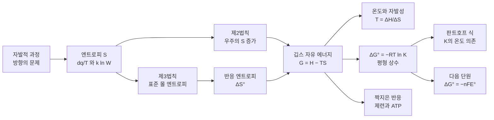

# 일반화학 10. 화학 열역학 — 엔트로피와 자유 에너지가 정하는 반응의 방향
<!-- prev: matter-3, uchem-3, uchem-8 -->
<!-- next: uchem-11, ubio-3 -->

> [!NOTE]
> **이 단원의 범위**
> - 자발적 과정과 가역·비가역 과정
> - 엔트로피의 열역학적 정의와 통계적 의미(미시 상태, 볼츠만 식)
> - 열역학 제2법칙과 제3법칙, 표준 몰 엔트로피와 반응 엔트로피
> - 깁스 자유 에너지와 자발성, 자발성의 온도 의존
> - 표준 자유 에너지 변화와 평형 상수($\Delta G^\circ = -RT\ln K$), 평형 상수의 온도 의존
> - 짝지은 반응(제련, 생체 에너지)

**학습 목표**

1. 자발적 과정과 비자발적 과정, 가역 과정과 비가역 과정을 구별하고, 엔탈피만으로 자발성을 판단할 수 없는 까닭을 설명할 수 있다.
2. 엔트로피를 $dS = dq_\text{가역}/T$와 $S = k_\mathrm{B}\ln W$의 두 방식으로 정의하고, 등온 팽창·가열·상전이의 엔트로피 변화를 적분으로 계산할 수 있다.
3. 열역학 제2법칙($\Delta S_\text{우주} > 0$)과 제3법칙을 설명하고, 표준 몰 엔트로피로 반응 엔트로피를 계산할 수 있다.
4. 깁스 자유 에너지 $G = H - TS$를 유도하고, $\Delta H$와 $\Delta S$의 부호와 온도로 자발성을 정량적으로 예측할 수 있다.
5. $\Delta G = \Delta G^\circ + RT\ln Q$와 $\Delta G^\circ = -RT\ln K$로 평형 상수를 계산하고, 판트호프 식으로 평형 상수의 온도 의존을 다룰 수 있다.
6. 짝지은 반응의 원리로 금속 제련과 ATP를 이용한 생체 반응을 설명할 수 있다.

**이 단원의 학습 사다리**

| 단계 | 무엇을 하나? |
|---|---|
| STEP 1. 이전 학습 다시 보기 | 엔탈피·헤스 법칙, 정성적 엔트로피, 평형 상수와 반응 지수 |
| STEP 2. 기초 다지기 | 자연로그와 지수 함수, $\int dx/x$, 경우의 수, 상태 함수와 경로 함수 |
| STEP 3. 핵심 개념 | 자발성 → 엔트로피(열역학·통계) → 제2법칙 → 제3법칙과 $S^\circ$ → 깁스 자유 에너지 → $\Delta G^\circ$와 $K$ → 짝지은 반응 |
| STEP 4. 오개념 바로잡기 | "자발적이면 빠르다", "$\Delta G^\circ > 0$이면 반응이 전혀 안 일어난다" 같은 착각 |
| STEP 5. 전공으로 | 물리화학의 화학 퍼텐셜, 깁스–헬름홀츠 식, 통계 열역학의 분배 함수 |
| STEP 6. 생활·산업·진로 | 암모니아 공정, 제련, 생체 에너지, 연료 전지와 열기관의 효율 |

---

## 🗺️ 단원 들어가기

뜨거운 커피는 저절로 식지만, 식은 커피가 방의 열을 모아 저절로 뜨거워지는 일은 없다. 잉크 한 방울은 물 전체로 퍼지지만, 퍼진 잉크가 다시 한 방울로 모이지는 않는다. 두 과정 모두 에너지는 보존된다. 그러니 열역학 제1법칙은 이 비대칭을 설명하지 못한다. 자연에는 에너지 보존과는 다른, **방향을 정하는 규칙**이 하나 더 있다.

고등학교 「화학 변화의 자발성」에서 우리는 이 규칙을 '흩어짐'이라는 말로 만났다. 얼음이 녹고 질산 암모늄이 녹으며 차가워지는 것은 열을 흡수하는데도 흩어짐이 커지기 때문이었다. 대학 화학에서는 이 흩어짐을 **숫자로 잰다.** 엔트로피에 단위($\mathrm{J/K}$)가 붙고, 반응마다 표준 엔트로피 변화를 계산하며, 마침내 엔탈피와 엔트로피를 하나로 묶은 **깁스 자유 에너지**로 반응이 어느 쪽으로, 어디까지 가는지(평형 상수)를 계산한다.

이 단원을 마치면 열역학 자료표 한 장으로 "이 반응은 25 ℃에서 일어나는가? 몇 도 이상에서 일어나는가? 평형 상수는 얼마인가?"에 답할 수 있다. 그리고 이 결론이 다음 단원 「전기화학」의 전지 전위, 생명과학의 ATP와 직접 이어진다.

---

## STEP 1. 🔙 이전 학습 다시 보기

### 연계 개념표

| 이전 단원 | 그때 배운 것 | 이 단원에서 확장되는 것 |
|---|---|---|
| 고등학교 「물질과 에너지」 '화학 변화의 자발성' | 엔탈피, 헤스 법칙, 엔트로피는 '흩어짐의 정도'(정성적), $\Delta H$와 $\Delta S$ 부호에 따른 네 경우 | 엔트로피를 $\mathrm{J/K}$로 **계산**, $\Delta G = \Delta H - T\Delta S$로 네 경우를 하나의 식으로, 전환 온도 계산 |
| 일반화학 「열화학」 | 상태 함수, 내부 에너지와 엔탈피, 표준 생성 엔탈피, 열량 측정 | 엔트로피와 자유 에너지도 상태 함수, 표준 생성 자유 에너지 $\Delta G_\mathrm{f}^\circ$ |
| 일반화학 「화학 평형」 | $K_c$, $K_p$, 반응 지수 $Q$와 반응 방향, 르샤틀리에 원리 | $Q$와 $K$의 비교가 사실은 $\Delta G$의 부호라는 것, $K$를 열역학 자료로 **예측**, 온도에 따른 $K$의 변화를 정량화 |
| 일반물리학 「열과 열역학」 | 열역학 제1법칙, 등온·단열 과정의 일, 카르노 기관, $\Delta S = \int dq/T$ | 같은 엔트로피를 화학 반응에 적용, 표준 몰 엔트로피 표 |
| 고등학교 「화학 반응의 세계」 '산화·환원 반응' | 표준 환원 전위로 자발성 판단 | 다음 단원에서 $\Delta G^\circ = -nFE^\circ$로 연결 |

### 준비 운동 (사전 진단)

**Q1.** $\mathrm{CaCO_3(s) \rightarrow CaO(s) + CO_2(g)}$에서 계의 엔트로피는 커지는가, 작아지는가? 그 이유는?

**Q2.** 헤스 법칙이 성립하는 근본 이유를 '상태 함수'라는 말을 써서 한 문장으로 설명하시오.

**Q3.** 어떤 반응의 평형 상수가 $K = 1.0\times10^{-3}$이다. 반응 지수 $Q = 1.0\times10^{-5}$인 혼합물은 어느 방향으로 반응이 진행되는가?

**Q4.** $\ln x$와 $\log x$(상용로그)의 관계를 쓰고, $\ln 2$의 값을 소수 둘째 자리까지 쓰시오.

정답 및 해설

**Q1.** 커진다. 고체 1 mol에서 고체 1 mol과 기체 1 mol이 생기므로 기체 분자가 늘어난다. 기체는 고체보다 훨씬 많은 배치·운동 방식을 가진다.

**Q2.** 엔탈피는 처음과 나중 상태만으로 값이 정해지는 상태 함수이므로, 어떤 경로(가상의 경로 포함)를 거쳐도 $\Delta H$가 같다.

**Q3.** $Q < K$이므로 정반응 쪽(생성물이 늘어나는 쪽)으로 진행한다. STEP 3 ⑧에서 이 판단이 $\Delta G = RT\ln(Q/K) < 0$과 같은 말임을 보인다.

**Q4.** $\ln x = 2.303\log x$ (정확히는 $\ln 10 \approx 2.3026$을 곱한다). $\ln 2 \approx 0.69$.

---

## STEP 2. 🧱 기초 다지기

### 디딤돌 1. 자연로그와 지수 함수 — 열역학의 언어

열역학 식에는 $\ln$과 $e^x$가 끊임없이 나온다. 다음 성질만 확실히 해 두자.

| 성질 | 식 | 열역학에서 쓰이는 곳 |
|---|---|---|
| 곱은 합으로 | $\ln(ab) = \ln a + \ln b$ | 독립된 두 계의 미시 상태 수를 곱하면 엔트로피는 더해진다 |
| 거듭제곱은 곱으로 | $\ln a^n = n\ln a$ | $\ln 2^{N} = N\ln 2$ (기체 팽창의 엔트로피) |
| 역함수 | $e^{\ln x} = x$ | $K = e^{-\Delta G^\circ/RT}$ |
| 상용로그로 바꾸기 | $\ln x = \ln 10 \cdot \log x \approx 2.303\log x$ | $\Delta G^\circ = -2.303RT\log K$ |
| 미분 | $\dfrac{d}{dx}\ln x = \dfrac{1}{x}$ | 적분 $\int dx/x$의 근거 |

25 ℃(298.15 K)에서 자주 쓰는 수를 미리 계산해 두면 편하다. ($R = 8.314\ \mathrm{J/(mol\cdot K)}$)

$$
RT = 8.314 \times 298.15 = 2479\ \mathrm{J/mol} \approx 2.48\ \mathrm{kJ/mol}, \qquad 2.303RT \approx 5.71\ \mathrm{kJ/mol}
$$

즉 25 ℃에서 $\Delta G^\circ$가 $5.71\ \mathrm{kJ/mol}$ 작아질 때마다 $K$는 10배씩 커진다. 이 '5.7 kJ 규칙'은 어림셈에 아주 쓸모 있다.

### 디딤돌 2. $\int dx/x = \ln x$ — 엔트로피 계산의 핵심 적분

엔트로피 변화는 작은 열 $dq$를 그때의 온도 $T$로 나눈 것을 더해(적분해) 얻는다. 화학에서 만나는 거의 모든 경우가 다음 꼴의 적분으로 정리된다.

$$
\int_{x_1}^{x_2} \frac{dx}{x} = \ln x_2 - \ln x_1 = \ln\frac{x_2}{x_1}
$$

| 과정 | $dq_\text{가역}$ | 적분 결과 |
|---|---|---|
| 일정 압력에서 가열 ($C_p$ 일정) | $C_p\,dT$ | $\Delta S = \displaystyle\int_{T_1}^{T_2}\frac{C_p\,dT}{T} = C_p\ln\frac{T_2}{T_1}$ |
| 이상 기체의 등온 팽창 | $P\,dV = \dfrac{nRT}{V}dV$ | $\Delta S = \displaystyle\int_{V_1}^{V_2}\frac{nR\,dV}{V} = nR\ln\frac{V_2}{V_1}$ |
| 일정 온도의 상전이 | $q = \Delta H_\text{전이}$ (온도 일정) | $\Delta S = \dfrac{\Delta H_\text{전이}}{T_\text{전이}}$ |

> [!TIP]
> 💡 **요령** — "$T$가 2배가 되면" 또는 "$V$가 2배가 되면" 엔트로피는 $\ln 2$에 비례해 늘어난다. 엔트로피는 **비율**에 반응한다. 10 K에서 20 K로 데우는 것과 200 K에서 400 K로 데우는 것은(열용량이 같다면) 같은 엔트로피 증가를 준다. 차가운 물체일수록 같은 열에 '흔들리는 정도'가 크다는 고등학교의 비유가 바로 이 $1/T$이다.

### 디딤돌 3. 경우의 수 — 미시 상태를 세는 법

$N$개의 구별되는 입자를 두 칸에 나누어 넣는 방법을 생각하자. 각 입자는 왼쪽·오른쪽 두 가지 선택이 있으므로 전체 배치는 $2^N$가지이다. 이 가운데 왼쪽에 정확히 $n$개가 들어가는 배치의 수는 조합 수이다.

$$
W(n) = \binom{N}{n} = \frac{N!}{n!\,(N-n)!}
$$

| $N$ | 모두 왼쪽 ($n = N$) | 반반 ($n = N/2$) | 반반 배치가 모두 왼쪽 배치의 몇 배인가 |
|---|---|---|---|
| 4 | 1 | 6 | 6 |
| 10 | 1 | 252 | 252 |
| 100 | 1 | 약 $1.0\times10^{29}$ | 약 $10^{29}$ |
| $6.0\times10^{23}$ | 1 | 상상할 수 없을 만큼 크다 | — |

입자 수가 많아질수록 '고르게 퍼진' 배치가 압도적으로 많아진다. 자연이 퍼진 쪽으로 가는 것은 어떤 힘이 미는 것이 아니라 **그쪽 경우의 수가 비교할 수 없이 많기 때문**이다.

### 디딤돌 4. 상태 함수와 경로 함수

| 구분 | 상태 함수 | 경로 함수 |
|---|---|---|
| 뜻 | 현재 상태(온도, 압력, 조성)만으로 값이 정해진다 | 어떤 경로로 변했는지에 따라 값이 달라진다 |
| 예 | $U$, $H$, $S$, $G$, $T$, $P$, $V$ | 열 $q$, 일 $w$ |
| 계산 요령 | 실제 경로가 복잡해도 **계산하기 쉬운 가상 경로**로 바꾸어 계산해도 된다 | 실제 경로를 따라 계산해야 한다 |

엔트로피는 상태 함수이지만, 그 정의에는 **가역 경로의 열** $q_\text{가역}$이 들어간다. 그래서 비가역 과정의 $\Delta S$를 구할 때는 같은 처음·나중 상태를 잇는 가역 경로를 하나 '설계'해서 계산한다. STEP 3 ④의 과냉각된 물이 어는 예가 그 전형이다.

---

## STEP 3. 📘 핵심 개념

### ① 자발적 과정 — 방향은 있고 속도는 없다

**자발적 과정(spontaneous process)** 은 외부에서 계속 일을 해 주지 않아도 저절로 일어나는 과정이다. 그 역과정은 **비자발적**이며, 외부에서 일을 해 주어야만 일어난다.

| 자발적 과정 | 역과정(비자발적) | 역과정을 일으키는 방법 |
|---|---|---|
| 뜨거운 물체에서 차가운 물체로 열 이동 | 차가운 쪽에서 뜨거운 쪽으로 열 이동 | 냉장고(전기로 일을 해 준다) |
| 기체가 진공으로 퍼짐 | 퍼진 기체가 한쪽으로 모임 | 피스톤으로 압축 |
| 철이 녹슨다 | 녹이 철로 돌아간다 | 용광로에서 탄소로 환원 |
| 수소와 산소가 물이 된다 | 물이 수소와 산소로 분해 | 전기 분해 |
| 25 ℃에서 얼음이 녹는다 | 25 ℃에서 물이 언다 | 불가능(온도를 0 ℃ 아래로 낮춰야 한다) |

> [!IMPORTANT]
> **자발적 ≠ 빠르다.** 열역학은 "갈 수 있는가"를 알려 줄 뿐 "얼마나 빨리 가는가"는 알려 주지 않는다. 25 ℃에서 다이아몬드 → 흑연의 $\Delta G^\circ$는 약 $-2.90\ \mathrm{kJ/mol}$로 자발적이지만, 활성화 에너지가 매우 커서 사실상 일어나지 않는다. 속도는 「화학 반응 속도론」의 영역이다.

#### 가역 과정과 비가역 과정

**가역 과정(reversible process)** 은 계와 주위가 매 순간 평형에 무한히 가까운 상태를 지나며, 조건을 아주 조금 바꾸면 방향이 뒤집히는 이상화된 과정이다. 실제 과정은 모두 유한한 차이(온도 차, 압력 차, 농도 차) 때문에 일어나는 **비가역 과정(irreversible process)** 이다.

- 가역 과정: 0 ℃, 1 atm에서 얼음과 물의 공존. 열을 아주 조금 넣으면 녹고, 빼면 언다.
- 비가역 과정: 25 ℃ 방에 놓인 얼음이 녹는 것. 열을 조금 뺀다고 다시 얼지 않는다.

같은 처음·나중 상태 사이에서 **가역 과정은 계가 할 수 있는 최대의 일**을 한다(일반물리학 「열과 열역학」의 등온 팽창 비교). 이 '최대 일'이 ⑦에서 깁스 자유 에너지의 물리적 의미가 된다.

#### 엔탈피만으로는 부족하다

19세기에는 "발열 반응은 자발적이다"라는 생각(톰센–베르틀로 원리)이 널리 받아들여졌다. 그러나 다음 반례가 있다.

| 과정 (25 ℃, 1 bar) | $\Delta H$ | 자발적인가? |
|---|---|---|
| $\mathrm{H_2O(s) \rightarrow H_2O(l)}$ | $+6.01\ \mathrm{kJ/mol}$ (흡열) | 예 |
| $\mathrm{NH_4NO_3(s) \rightarrow NH_4^+(aq) + NO_3^-(aq)}$ | $+25.7\ \mathrm{kJ/mol}$ (흡열) | 예 (냉각 팩) |
| 이상 기체가 진공으로 퍼짐 | $0$ | 예 |
| $\mathrm{H_2O(l) \rightarrow H_2O(s)}$ (−10 ℃) | 발열 | 예 |
| $\mathrm{H_2O(l) \rightarrow H_2O(s)}$ (+10 ℃) | 발열 | 아니요 |

같은 발열 과정(물의 응고)이 온도에 따라 자발적이기도 하고 아니기도 하다. 자발성을 정하는 데에는 엔탈피 외에 **온도에 민감한 또 하나의 양**이 필요하다. 그것이 엔트로피이다.

#### ✔ 바로 확인

1. (O/X) 자발적 과정은 빠르게 일어난다.
2. 빈칸: 계와 주위가 매 순간 평형에 무한히 가까운 상태를 지나며, 조건을 아주 조금 바꾸면 방향이 뒤집히는 이상화된 과정을 (    ) 과정이라 한다.
3. 고르기: 흡열 과정인데도 자발적인 것을 모두 고르시오. (가) 25 ℃에서 얼음의 융해 (나) +10 ℃에서 물의 응고 (다) 질산 암모늄의 물에 대한 용해

정답

1. X — 다이아몬드 → 흑연은 자발적이지만 활성화 에너지가 커서 사실상 일어나지 않는다. 열역학은 방향만 알려 준다.
2. 가역
3. (가), (다) — (나)는 발열이지만 0 ℃보다 높은 온도에서는 자발적이지 않다. 엔탈피만으로는 자발성을 판단할 수 없다.

### ② 엔트로피의 열역학적 정의

클라우지우스는 가역 과정에서 계가 흡수한 열을 그때의 절대 온도로 나눈 양이 상태 함수가 된다는 것을 발견하고, 이를 **엔트로피(entropy)** $S$라 불렀다.

$$
dS = \frac{dq_\text{가역}}{T}, \qquad \Delta S = \int_\text{처음}^\text{나중} \frac{dq_\text{가역}}{T}
$$

단위는 $\mathrm{J/K}$, 1 mol당이면 $\mathrm{J/(mol\cdot K)}$이다. 열 $q$는 경로 함수이지만 $1/T$를 곱하면 상태 함수가 된다는 점이 핵심이다(수학적으로 $1/T$는 '적분 인자'이다).

#### 유도 1 — 이상 기체의 등온 팽창

이상 기체의 내부 에너지는 온도에만 의존하므로 등온 과정에서 $\Delta U = 0$, 따라서 $q_\text{가역} = -w_\text{가역} = \int P\,dV$이다. $P = nRT/V$를 넣으면

$$
\Delta S = \frac{1}{T}\int_{V_1}^{V_2}\frac{nRT}{V}dV = nR\ln\frac{V_2}{V_1}
$$

부피가 커지면($V_2 > V_1$) 엔트로피가 증가한다. 진공으로의 자유 팽창은 실제로는 열도 일도 없는 비가역 과정이지만, $S$는 상태 함수이므로 같은 처음·나중 상태를 잇는 가역 등온 팽창으로 계산한 값이 그대로 정답이다.

#### 유도 2 — 일정 압력에서의 가열

$dq_\text{가역} = C_p\,dT$이므로, $C_p$가 온도 범위에서 거의 일정하면

$$
\Delta S = \int_{T_1}^{T_2}\frac{C_p}{T}dT = C_p\ln\frac{T_2}{T_1}
$$

#### 유도 3 — 상전이

녹는점이나 끓는점에서는 온도가 일정한 채 열이 출입하므로 적분이 바로 나눗셈이 된다.

$$
\Delta S_\text{융해} = \frac{\Delta H_\text{융해}}{T_\mathrm{m}}, \qquad \Delta S_\text{증발} = \frac{\Delta H_\text{증발}}{T_\mathrm{b}}
$$

| 물질 | $T_\mathrm{b}$ (K) | $\Delta H_\text{증발}$ (kJ/mol, 약) | $\Delta S_\text{증발}$ (J/(mol·K)) |
|---|---|---|---|
| 벤젠 | 353 | 30.7 | 87 |
| 사염화 탄소 | 350 | 30.0 | 86 |
| 사이클로헥세인 | 354 | 30.0 | 85 |
| 물 | 373 | 40.7 | 109 |
| 에탄올 | 351 | 38.6 | 110 |

많은 액체의 몰 증발 엔트로피가 약 $85\sim88\ \mathrm{J/(mol\cdot K)}$로 비슷하다(**트루턴 규칙**). 액체가 기체가 될 때 늘어나는 '자유'가 물질과 관계없이 비슷하기 때문이다. 물과 에탄올이 유난히 큰 것은 액체 속의 **수소 결합**이 분자 배치를 붙들어 액체의 엔트로피가 낮기 때문이다(일반화학 「분자 간 힘과 액체·고체·용액」).

#### 예제 1 — 세 가지 엔트로피 변화

(1) 이상 기체 1.00 mol이 25 ℃에서 10.0 L에서 20.0 L로 등온 팽창할 때 $\Delta S$를 구하시오.
(2) 물 100. g을 25.0 ℃에서 75.0 ℃로 가열할 때 $\Delta S$를 구하시오. (물의 비열 $4.184\ \mathrm{J/(g\cdot K)}$, 일정)
(3) 물 1.00 mol이 100 ℃에서 증발할 때 $\Delta S$를 구하시오. ($\Delta H_\text{증발} = 40.7\ \mathrm{kJ/mol}$)

**풀이**
(1) 식 세우기: $\Delta S = nR\ln(V_2/V_1)$. 대입: $1.00 \times 8.314 \times \ln 2 = 5.76\ \mathrm{J/K}$.
(2) $\Delta S = mc\ln(T_2/T_1) = 100. \times 4.184 \times \ln\dfrac{348.15}{298.15} = 64.9\ \mathrm{J/K}$. 온도는 반드시 **켈빈**으로 넣는다. 섭씨로 넣으면 $\ln 3$이 되어 완전히 틀린다.
(3) $\Delta S = \dfrac{40\,700\ \mathrm{J}}{373.15\ \mathrm{K}} = 109\ \mathrm{J/K}$.

**의미** 같은 1 mol 규모에서도 상전이(109 J/K)가 기체의 두 배 팽창(5.76 J/K)보다 훨씬 큰 엔트로피 변화를 준다. 액체 → 기체에서 부피가 약 1700배로 늘어나는 것($R\ln 1700 \approx 62\ \mathrm{J/(mol\cdot K)}$)에 분자 사이의 인력에서 풀려나는 효과가 더해진 결과이다.

#### ✔ 바로 확인

1. 이상 기체 1.00 mol이 일정한 온도에서 부피가 3배로 팽창할 때 $\Delta S$는? ($R = 8.314\ \mathrm{J/(mol\cdot K)}$)
2. (O/X) 진공으로의 자유 팽창은 열 출입이 없으므로 기체의 $\Delta S = 0$이다.
3. 0 ℃에서 얼음 1.00 mol이 녹을 때 $\Delta S$는? ($\Delta H_\text{융해} = 6.01\ \mathrm{kJ/mol}$)
4. 빈칸: 많은 액체의 몰 증발 엔트로피가 약 $85\sim88\ \mathrm{J/(mol\cdot K)}$로 비슷하다는 경험 규칙을 (    ) 규칙이라 한다.

정답

1. $+9.13\ \mathrm{J/K}$ — $\Delta S = nR\ln(V_2/V_1) = 8.314\times\ln 3$.
2. X — $S$는 상태 함수이므로 같은 처음·나중 상태를 잇는 가역 등온 팽창으로 계산한 $nR\ln(V_2/V_1) > 0$이 정답이다.
3. $+22.0\ \mathrm{J/K}$ — 상전이는 온도가 일정하므로 $\Delta S = 6010/273.15$.
4. 트루턴 — 수소 결합이 있는 물·에탄올은 예외적으로 크다.

### ③ 엔트로피의 통계적 의미 — 미시 상태와 볼츠만 식

열역학적 정의는 엔트로피를 '재는 법'을 주지만, 엔트로피가 '무엇인지'는 말해 주지 않는다. 볼츠만은 그 답을 분자 수준에서 찾았다.

- **거시 상태(macrostate)**: 온도, 압력, 부피처럼 우리가 측정하는 상태
- **미시 상태(microstate)**: 각 분자의 위치와 에너지까지 모두 정한 하나하나의 배치
- 하나의 거시 상태에는 보통 엄청나게 많은 미시 상태가 대응한다. 그 수를 $W$라 한다.

$$
S = k_\mathrm{B}\ln W, \qquad k_\mathrm{B} = \frac{R}{N_\mathrm{A}} = 1.381\times10^{-23}\ \mathrm{J/K}
$$

이것이 **볼츠만 식**이다. 엔트로피는 '그 거시 상태를 실현하는 방법의 수'의 로그이다. 로그를 쓰는 까닭은 두 계를 합치면 $W$는 곱해지지만($W = W_1W_2$) 엔트로피는 더해져야(크기 성질) 하기 때문이다.

<!-- fig:uchem-10-microstates -->

#### 유도 — 볼츠만 식으로 기체 팽창의 엔트로피 구하기

$N$개의 분자가 부피 $V$인 용기에 있다가 칸막이를 열어 $2V$로 퍼졌다고 하자. 분자 하나가 들어갈 수 있는 '자리'의 수는 부피에 비례하므로 2배가 된다. 분자 $N$개가 서로 독립이면 미시 상태 수는 $2^N$배가 된다.

$$
\Delta S = k_\mathrm{B}\ln\frac{W_2}{W_1} = k_\mathrm{B}\ln 2^N = Nk_\mathrm{B}\ln 2 = nR\ln 2
$$

($Nk_\mathrm{B} = nN_\mathrm{A}k_\mathrm{B} = nR$) 이 값은 ②에서 클라우지우스의 정의로 구한 $nR\ln(V_2/V_1)$과 정확히 같다. 열을 온도로 나눈 '거시적인 양'과 배치의 수를 센 '미시적인 양'이 같은 것을 가리킨다는 놀라운 결론이다.

#### 위치뿐 아니라 에너지의 배치도 센다

미시 상태는 분자가 **어디에** 있는가(위치)뿐 아니라 에너지를 **어떻게 나누어 갖는가**도 포함한다. 분자의 에너지는 병진·회전·진동 운동의 양자화된 준위에 나뉘어 들어간다.

| 엔트로피를 키우는 요인 | 미시 상태가 많아지는 이유 |
|---|---|
| 온도 상승 | 분자들이 차지할 수 있는 에너지 준위가 많아진다 |
| 부피 증가 | 병진 운동의 에너지 준위 간격이 좁아지고, 위치의 선택지가 많아진다 |
| 고체 → 액체 → 기체 | 위치·회전의 자유가 차례로 풀린다 |
| 분자가 크고 복잡해짐 | 회전·진동의 방식이 많아진다 |
| 입자 수 증가(분해, 기체 몰수 증가) | 독립적으로 배치될 입자가 많아진다 |
| 혼합 | 서로 다른 입자가 섞이는 배치의 수가 늘어난다 |

> [!TIP]
> 💡 **비유** — 엔트로피는 '정돈 상태'라기보다 **'선택지의 수'** 이다. 강의실에 학생 10명이 있을 때, 지정 좌석제(고체)라면 앉는 방법이 1가지뿐이지만, 자유석(액체)이면 수천 가지, 강의실 밖 캠퍼스 전체로 흩어질 수 있다면(기체) 사실상 무한하다. 온도는 학생들의 '기운'이다. 기운이 넘치면 위층·아래층(높은 에너지 준위)까지 돌아다닐 수 있어 선택지가 더 늘어난다.

#### 예제 2 — 작은 계로 확률 감각 기르기

상자의 왼쪽 절반에 분자 10개가 모두 모여 있을 확률을 구하시오. 분자가 1.0 mol이라면 그 확률은 대략 얼마인가?

**풀이**
각 분자가 왼쪽에 있을 확률은 $1/2$이고 독립이므로 $(1/2)^{10} = 1/1024 \approx 9.8\times10^{-4}$이다. 1.0 mol이면 $(1/2)^{6.0\times10^{23}} = 10^{-1.8\times10^{23}}$이다($6.0\times10^{23}\times\log 2 \approx 1.8\times10^{23}$). 소수점 아래에 0이 $10^{23}$개 붙는 수로, 우주의 나이 동안 기다려도 관측할 수 없다.

**의미** 거시적 계에서 제2법칙이 '절대 법칙'처럼 보이는 것은 그것이 압도적인 확률의 법칙이기 때문이다.

#### 잔류 엔트로피 — 볼츠만 식의 실험적 증거

일산화 탄소 결정에서 CO 분자는 거의 대칭적이어서 CO와 OC 두 방향 중 어느 쪽으로도 쉽게 놓인다. 낮은 온도에서 이 무작위한 방향이 그대로 얼어붙으면, 0 K에서도 분자마다 2가지 선택이 남는다.

$$
S_0 = k_\mathrm{B}\ln 2^{N_\mathrm{A}} = R\ln 2 = 5.76\ \mathrm{J/(mol\cdot K)}
$$

열량 측정으로 얻은 CO의 엔트로피와 분광학 자료로 계산한 엔트로피를 비교하면 실제로 약 $4.6\ \mathrm{J/(mol\cdot K)}$의 차이(**잔류 엔트로피**)가 나타난다. 이론값보다 조금 작은 것은 방향이 완전히 무작위하지는 않기 때문이다. 미시 상태를 '세는' 볼츠만 식이 열량계 측정과 맞아떨어지는 사례이다.

#### ✔ 바로 확인

1. (O/X) 미시 상태 수 $W$가 2배가 되면 엔트로피도 2배가 된다.
2. 위의 미시 상태 그림에서 구별되는 분자 4개를 상자 양쪽에 나누는 거시 상태 가운데 미시 상태가 가장 많은 것은 무엇이고, 그 수는 전체 16가지 중 몇 가지인가?
3. 고르기: 엔트로피가 더 큰 쪽은? (1) 25 ℃의 $\mathrm{H_2O(l)}$ 1 mol과 $\mathrm{H_2O(g)}$ 1 mol (2) 같은 압력에서 300 K의 $\mathrm{N_2}$ 1 mol과 400 K의 $\mathrm{N_2}$ 1 mol
4. 빈칸: 0 K에서도 CO 분자마다 놓이는 방향이 2가지 남으면 잔류 엔트로피는 $R\ln(\quad)$이다.

정답

1. X — $S = k_\mathrm{B}\ln W$이므로 $k_\mathrm{B}\ln 2$만큼 **더해질** 뿐이다.
2. 2 : 2 상태, 6가지 — $_4\mathrm{C}_2 = 6$. 고르게 나뉜 상태가 가장 많은 방법으로 실현된다.
3. (1) $\mathrm{H_2O(g)}$ (2) 400 K — 위치의 자유가 크고, 온도가 높으면 차지할 수 있는 에너지 준위가 많다.
4. 2 — $S_0 = k_\mathrm{B}\ln 2^{N_\mathrm{A}} = R\ln 2$.

### ④ 열역학 제2법칙 — 우주의 엔트로피는 증가한다

> [!IMPORTANT]
> **열역학 제2법칙(second law of thermodynamics)**
> 고립계에서 자발적 과정이 일어나면 엔트로피가 증가한다. 계와 주위를 합친 '우주'를 고립계로 보면
> $$
> \Delta S_\text{우주} = \Delta S_\text{계} + \Delta S_\text{주위} \; \begin{cases} > 0 & \text{자발적(비가역)} \\ = 0 & \text{가역(평형)} \\ < 0 & \text{일어나지 않는다} \end{cases}
> $$

#### 주위의 엔트로피 변화

주위(실험실, 대기, 항온조)는 계에 비해 매우 커서, 계와 열을 주고받아도 온도가 거의 변하지 않는 '열 저장고'로 볼 수 있다. 큰 저장고는 열을 받는 방식과 관계없이 늘 평형에 가깝게(가역적으로) 열을 받으므로

$$
\Delta S_\text{주위} = \frac{q_\text{주위}}{T} = -\frac{q_\text{계}}{T} = -\frac{\Delta H_\text{계}}{T} \quad (\text{일정 압력})
$$

- 발열 반응($\Delta H < 0$)은 주위의 엔트로피를 높인다.
- 같은 열이라도 $T$가 낮을수록 $\lvert \Delta S_\text{주위} \rvert$가 크다.

고등학교에서 "발열 반응이 자발적이기 쉬운 이유"라고 배운 것이 이 식으로 정량화된다. **엔탈피는 주위의 엔트로피를 통해 자발성에 기여한다.**

#### 예제 3 — 과냉각된 물이 −10 ℃에서 어는 과정

1 atm, −10.0 ℃에서 과냉각된 물 1.00 mol이 갑자기 얼어 −10.0 ℃의 얼음이 되었다. $\Delta S_\text{계}$, $\Delta S_\text{주위}$, $\Delta S_\text{우주}$를 구하시오.
($C_p$(물) $= 75.3\ \mathrm{J/(mol\cdot K)}$, $C_p$(얼음) $= 37.7\ \mathrm{J/(mol\cdot K)}$, 0 ℃에서 $\Delta H_\text{융해} = 6.01\ \mathrm{kJ/mol}$, 주위는 −10.0 ℃로 일정)

**풀이**
이 과정은 비가역이므로 그대로는 $q_\text{가역}$을 쓸 수 없다. 같은 처음·나중 상태를 잇는 **가역 경로 세 단계**를 설계한다.

<!-- fig:uchem-10-supercooled-path -->

| 단계 | 과정 | $\Delta S$ (J/K) | $\Delta H$ (J) |
|---|---|---|---|
| ㉠ | 물을 263.15 K → 273.15 K로 가열 | $75.3\ln\dfrac{273.15}{263.15} = +2.81$ | $75.3\times10.0 = +753$ |
| ㉡ | 273.15 K에서 가역적으로 응고 | $-\dfrac{6010}{273.15} = -22.00$ | $-6010$ |
| ㉢ | 얼음을 273.15 K → 263.15 K로 냉각 | $37.7\ln\dfrac{263.15}{273.15} = -1.41$ | $37.7\times(-10.0) = -377$ |
| 합 | | $\Delta S_\text{계} = -20.6$ | $\Delta H_\text{계} = -5634$ |

$$
\Delta S_\text{주위} = -\frac{\Delta H_\text{계}}{T} = \frac{5634\ \mathrm{J}}{263.15\ \mathrm{K}} = +21.4\ \mathrm{J/K}
$$

$$
\Delta S_\text{우주} = -20.6 + 21.4 = +0.8\ \mathrm{J/K} > 0 \quad \Rightarrow \text{자발적}
$$

**의미** 계의 엔트로피는 줄었지만(액체 → 고체) 방출된 열이 차가운 주위의 엔트로피를 그보다 더 많이 늘렸다. 같은 계산을 +10 ℃에서 하면 $\Delta S_\text{우주} < 0$이 되어 물이 얼지 않는다. 0 ℃ 근처에서 $\Delta S_\text{우주}$가 작은 값(+0.8 J/K)인 것은 이 과정이 평형(0 ℃)에서 멀지 않다는 뜻이다.

#### 제2법칙의 여러 얼굴

| 표현 | 내용 | 관련 단원 |
|---|---|---|
| 클라우지우스 표현 | 다른 변화 없이 차가운 물체에서 뜨거운 물체로 열이 저절로 흐르지 않는다 | 일반물리학 「열과 열역학」 |
| 켈빈–플랑크 표현 | 한 열원에서 열을 받아 모두 일로 바꾸는 순환 기관은 없다 | 열기관의 효율 한계 |
| 엔트로피 표현 | 고립계의 엔트로피는 줄지 않는다 | 이 단원 |
| 통계적 표현 | 계는 미시 상태 수가 압도적으로 많은 거시 상태로 간다 | ③ 볼츠만 식 |

> [!NOTE]
> 생명체는 질서 정연한 구조(단백질, DNA, 세포)를 스스로 만든다. 이것은 제2법칙에 어긋나지 않는다. 생명체는 열린계로, 음식(낮은 엔트로피의 화학 에너지)을 받아들이고 열과 $\mathrm{CO_2}$, $\mathrm{H_2O}$(높은 엔트로피)를 내보내어 **주위의 엔트로피를 훨씬 더 크게** 늘린다. 개념 확인 문제 10에서 직접 계산해 본다.

#### ✔ 바로 확인

1. (O/X) 계의 엔트로피가 감소하는 과정은 자발적일 수 없다.
2. 25 ℃, 일정한 압력에서 반응계가 주위로 열 10.0 kJ를 내놓았다. $\Delta S_\text{주위}$는?
3. 빈칸: 같은 양의 열이라도 주위의 온도가 (    )을수록 $\lvert \Delta S_\text{주위} \rvert$가 크다.

정답

1. X — 과냉각된 물이 어는 과정(예제 3)처럼 $\Delta S_\text{계} < 0$이어도 $\Delta S_\text{주위}$가 더 크면 $\Delta S_\text{우주} > 0$이다.
2. $+33.5\ \mathrm{J/K}$ — $\Delta S_\text{주위} = -\Delta H_\text{계}/T = 10\,000/298.15$.
3. 낮 — $\Delta S_\text{주위} = q_\text{주위}/T$에서 $T$가 분모에 있다.

### ⑤ 열역학 제3법칙과 표준 몰 엔트로피

엔탈피는 절댓값을 알 수 없어 '생성 엔탈피'라는 상대적 기준을 썼다. 엔트로피는 다르다. 절대적인 기준점이 있다.

> [!IMPORTANT]
> **열역학 제3법칙(third law of thermodynamics)**
> 완전한 결정의 엔트로피는 절대 영도(0 K)에서 0이다.
> (완전한 결정: 모든 입자가 하나의 배치에 놓여 $W = 1$, 따라서 $S = k_\mathrm{B}\ln 1 = 0$)

#### 절대 엔트로피를 구하는 법

0 K에서 출발해 원하는 온도까지 가역적으로 데우며 $C_p/T$를 적분하고, 상전이마다 $\Delta H/T$를 더한다.

$$
S(T) = \int_0^{T_\mathrm{m}}\frac{C_p(\text{s})}{T}dT + \frac{\Delta H_\text{융해}}{T_\mathrm{m}} + \int_{T_\mathrm{m}}^{T_\mathrm{b}}\frac{C_p(\text{l})}{T}dT + \frac{\Delta H_\text{증발}}{T_\mathrm{b}} + \int_{T_\mathrm{b}}^{T}\frac{C_p(\text{g})}{T}dT
$$

실험적으로는 $C_p/T$를 $T$에 대해 그린 그래프의 넓이를 구하는 일이다. 아주 낮은 온도(수 K 이하)는 측정이 어려워, 고체의 열용량이 $T^3$에 비례한다는 이론(STEP 5)으로 외삽한다. 이렇게 1 bar, 25 ℃에서 1 mol의 엔트로피를 정한 것이 **표준 몰 엔트로피(standard molar entropy)** $S^\circ$이다.

<!-- fig:uchem-10-third-law-entropy -->

| 물질 | $S^\circ$ (J/(mol·K), 25 ℃) | 물질 | $S^\circ$ (J/(mol·K), 25 ℃) |
|---|---|---|---|
| C(다이아몬드) | 2.38 | $\mathrm{H_2(g)}$ | 130.7 |
| C(흑연) | 5.74 | $\mathrm{N_2(g)}$ | 191.6 |
| Cu(s) | 33.2 | $\mathrm{O_2(g)}$ | 205.1 |
| CaO(s) | 39.8 | $\mathrm{NH_3(g)}$ | 192.5 |
| $\mathrm{H_2O(l)}$ | 69.9 | $\mathrm{CO(g)}$ | 197.7 |
| NaCl(s) | 72.1 | $\mathrm{CO_2(g)}$ | 213.7 |
| $\mathrm{CaCO_3(s)}$ | 92.9 | $\mathrm{CH_4(g)}$ | 186.3 |
| $\mathrm{Cu_2O(s)}$ | 93.1 | $\mathrm{H_2O(g)}$ | 188.8 |
| $\mathrm{Br_2(l)}$ | 152.2 | $\mathrm{Br_2(g)}$ | 245.5 |
| $\mathrm{NH_4NO_3(s)}$ | 151.1 | $\mathrm{NO_2(g)}$ | 240.1 |
| $\mathrm{Na^+(aq)}$ | 59.0 | $\mathrm{N_2O_4(g)}$ | 304.3 |
| $\mathrm{Cl^-(aq)}$ | 56.5 | $\mathrm{NH_4^+(aq)}$ | 113.4 |
| $\mathrm{NO_3^-(aq)}$ | 146.4 | $\mathrm{Mg^{2+}(aq)}$ | 약 −138 |

#### 표에서 읽어 내는 경향

| 경향 | 예 | 이유 |
|---|---|---|
| 기체 ≫ 액체 > 고체 | $\mathrm{Br_2}$: 액체 152.2 → 기체 245.5 | 위치와 운동의 자유 |
| 같은 상이면 분자가 클수록 크다 | $\mathrm{NO_2}$ 240.1 < $\mathrm{N_2O_4}$ 304.3 | 원자 수가 많아 진동·회전 방식이 많다 |
| 단단한 결합망일수록 작다 | 다이아몬드 2.38 < 흑연 5.74 | 다이아몬드의 3차원 공유 결합은 원자의 진동을 강하게 억제한다 |
| 원소의 $S^\circ$도 0이 아니다 | $\mathrm{O_2(g)}$ 205.1 | 0 K가 아니라 298 K의 값이므로. (생성 엔탈피와 달리 원소의 기준값이 0이 아니다) |
| 수용 이온은 음수일 수 있다 | $\mathrm{Mg^{2+}(aq)}$ 약 −138 | 수용 이온의 값은 $\mathrm{H^+(aq)} = 0$을 기준으로 한 상대값이다. 전하 밀도가 큰 이온은 주변 물 분자를 강하게 붙잡아 정렬시킨다 |

> [!WARNING]
> 표준 생성 엔탈피는 원소가 0이지만, **표준 몰 엔트로피는 원소도 0이 아니다.** 반응 엔트로피를 계산할 때 $\mathrm{O_2}$, $\mathrm{H_2}$, $\mathrm{N_2}$의 $S^\circ$를 빠뜨리는 실수가 매우 흔하다.

#### ✔ 바로 확인

1. (O/X) 표준 상태에 있는 원소의 표준 몰 엔트로피는 0이다.
2. 표준 몰 엔트로피가 큰 것부터 순서대로 쓰시오: $\mathrm{Br_2(l)}$, $\mathrm{Br_2(g)}$, C(다이아몬드)
3. 빈칸: 완전한 결정의 엔트로피는 (    ) K에서 0이다.

정답

1. X — 0 K가 아니라 298 K의 값이므로 원소도 0이 아니다(예: $\mathrm{O_2(g)}$ 205.1 J/(mol·K)). 0인 것은 원소의 표준 생성 엔탈피이다.
2. $\mathrm{Br_2(g)}$ (245.5) > $\mathrm{Br_2(l)}$ (152.2) > C(다이아몬드) (2.38) — 기체 ≫ 액체 > 단단한 공유 결정.
3. 0 — 열역학 제3법칙. 이 기준이 있어 엔트로피는 절댓값을 정할 수 있다.

### ⑥ 반응 엔트로피 — 표준 몰 엔트로피로 계산하기

엔트로피는 상태 함수이므로, 표준 반응 엔트로피는 생성물과 반응물의 표준 몰 엔트로피 차로 구한다.

$$
\Delta S^\circ_\text{반응} = \sum n_\mathrm{p}\,S^\circ(\text{생성물}) - \sum n_\mathrm{r}\,S^\circ(\text{반응물})
$$

#### 예제 4 — 암모니아 합성의 반응 엔트로피

$\mathrm{N_2(g) + 3H_2(g) \rightarrow 2NH_3(g)}$의 $\Delta S^\circ$를 구하고, 부호를 분자 수준에서 해석하시오.

**풀이**

$$
\Delta S^\circ = 2(192.45) - [191.61 + 3(130.68)] = 384.90 - 583.65 = -198.75 \approx -198.8\ \mathrm{J/K}
$$

**의미** 기체 4 mol이 2 mol로 줄어 독립적으로 움직이는 입자가 절반이 된다. 기체 몰수 변화 $\Delta n_\text{기체} = -2$가 부호를 결정하며, 기체 1 mol이 줄 때마다 대략 $-100\ \mathrm{J/K}$ 정도로 어림할 수 있다.

#### 예제 5 — 같은 기체 몰수인데도 부호를 정하는 것

다음 반응의 $\Delta S^\circ$를 계산하시오.
(1) $\mathrm{CaCO_3(s) \rightarrow CaO(s) + CO_2(g)}$
(2) $\mathrm{CH_4(g) + 2O_2(g) \rightarrow CO_2(g) + 2H_2O(l)}$
(3) $\mathrm{NH_4NO_3(s) \rightarrow NH_4^+(aq) + NO_3^-(aq)}$

**풀이**
(1) $39.75 + 213.74 - 92.9 = +160.6\ \mathrm{J/K}$ — 기체가 생긴다.
(2) $213.74 + 2(69.91) - [186.26 + 2(205.14)] = -243.0\ \mathrm{J/K}$ — 기체 3 mol이 기체 1 mol과 액체로 바뀐다. 생성물의 물이 **액체**인지 기체인지에 따라 값이 크게 달라진다.
(3) $113.4 + 146.4 - 151.08 = +108.7\ \mathrm{J/K}$ — 결정이 무너져 이온이 퍼진다.

| 빠른 부호 판단 | $\Delta S^\circ$의 부호 |
|---|---|
| $\Delta n_\text{기체} > 0$ | 대체로 + |
| $\Delta n_\text{기체} < 0$ | 대체로 − |
| $\Delta n_\text{기체} = 0$ | 작다. 표로 계산해야 한다 |
| 고체가 녹아 이온이 됨 | 대체로 + (이온의 전하가 크면 − 도 가능) |

#### ✔ 바로 확인

1. $\mathrm{2CO(g) + O_2(g) \rightarrow 2CO_2(g)}$의 $\Delta S^\circ$ 부호를 예측하고, 표의 값($\mathrm{CO}$ 197.7, $\mathrm{O_2}$ 205.1, $\mathrm{CO_2}$ 213.7 J/(mol·K))으로 확인하시오.
2. 25 ℃에서 $\mathrm{H_2O(l) \rightarrow H_2O(g)}$의 $\Delta S^\circ$를 표준 몰 엔트로피 표로 구하시오.
3. (O/X) $\Delta n_\text{기체} = 0$인 반응은 $\Delta S^\circ$가 정확히 0이다.

정답

1. − 부호, $-173.1\ \mathrm{J/K}$ — 기체 3 mol → 2 mol. $2(213.7) - [2(197.7) + 205.1] = -173.1$.
2. $+118.9\ \mathrm{J/K}$ — $188.8 - 69.9$.
3. X — 크기가 작을 뿐이며, 부호와 값은 표로 계산해야 한다.

### ⑦ 깁스 자유 에너지와 자발성

$\Delta S_\text{우주}$로 판단하려면 늘 주위까지 따져야 해서 번거롭다. 일정한 온도와 압력이라는 화학 실험의 일반적 조건에서는 **계의 양만으로** 판단할 수 있는 함수를 만들 수 있다.

#### 유도 — $\Delta S_\text{우주}$에서 $\Delta G$로

일정한 $T$, $P$에서 $\Delta S_\text{주위} = -\Delta H/T$이므로

$$
\Delta S_\text{우주} = \Delta S - \frac{\Delta H}{T}
$$

양변에 $-T$를 곱하면

$$
-T\Delta S_\text{우주} = \Delta H - T\Delta S
$$

여기서 **깁스 자유 에너지(Gibbs free energy)** 를 $G = H - TS$로 정의하면, 일정한 $T$에서 $\Delta G = \Delta H - T\Delta S$이므로

$$
\boxed{\;\Delta G = -T\Delta S_\text{우주}\;}
$$

$T > 0$이므로 $\Delta S_\text{우주} > 0 \Leftrightarrow \Delta G < 0$이다.

| $\Delta G$ (일정 $T$, $P$) | 의미 |
|---|---|
| $\Delta G < 0$ | 자발적 |
| $\Delta G = 0$ | 평형 |
| $\Delta G > 0$ | 비자발적(역반응이 자발적) |

> [!NOTE]
> **'자유' 에너지라는 이름의 뜻** — 일정한 $T$, $P$에서 계가 할 수 있는 **팽창 일 이외의 최대 일**(전기적 일, 근육의 일, 화학 합성의 일)은 $-\Delta G$이다. $\Delta H$ 가운데 $T\Delta S$만큼은 열로 주위와 주고받아야 해서 일로 '자유롭게' 꺼낼 수 없다. 연료 전지가 낼 수 있는 최대 전기 에너지, 세포가 ATP 한 분자에서 꺼낼 수 있는 일의 상한이 모두 $\Delta G$이다.

#### 표준 생성 자유 에너지

엔탈피와 같은 방식으로, 표준 상태의 원소에서 화합물 1 mol을 만들 때의 $\Delta G^\circ$를 **표준 생성 자유 에너지** $\Delta G_\mathrm{f}^\circ$라 한다(원소는 0).

$$
\Delta G^\circ_\text{반응} = \sum n_\mathrm{p}\Delta G_\mathrm{f}^\circ(\text{생성물}) - \sum n_\mathrm{r}\Delta G_\mathrm{f}^\circ(\text{반응물}) \quad \text{또는} \quad \Delta G^\circ = \Delta H^\circ - T\Delta S^\circ
$$

| 물질 | $\Delta H_\mathrm{f}^\circ$ (kJ/mol) | $\Delta G_\mathrm{f}^\circ$ (kJ/mol) | 물질 | $\Delta H_\mathrm{f}^\circ$ (kJ/mol) | $\Delta G_\mathrm{f}^\circ$ (kJ/mol) |
|---|---|---|---|---|---|
| $\mathrm{H_2O(l)}$ | −285.83 | −237.13 | $\mathrm{CaCO_3(s)}$ | −1206.9 | −1128.8 |
| $\mathrm{H_2O(g)}$ | −241.82 | −228.57 | CaO(s) | −635.1 | −604.0 |
| $\mathrm{CO_2(g)}$ | −393.51 | −394.36 | $\mathrm{NH_3(g)}$ | −46.11 | −16.45 |
| CO(g) | −110.53 | −137.17 | $\mathrm{NO_2(g)}$ | 33.18 | 51.31 |
| $\mathrm{CH_4(g)}$ | −74.81 | −50.72 | $\mathrm{N_2O_4(g)}$ | 9.16 | 97.89 |
| $\mathrm{Cu_2O(s)}$ | −168.6 | −146.0 | C(다이아몬드) | 1.895 | 2.900 |

(이 단원의 예제에서는 $\mathrm{N_2 + 3H_2 \rightarrow 2NH_3}$의 $\Delta H^\circ$를 $-92.22\ \mathrm{kJ}$로 쓴다.)

#### 자발성의 온도 의존 — 네 가지 경우를 하나의 식으로

$\Delta H$와 $\Delta S$가 온도에 크게 의존하지 않는다고 근사하면, $\Delta G$는 $T$에 대한 **직선**이다. 기울기는 $-\Delta S$, 세로축 절편은 $\Delta H$이다.

| $\Delta H$ | $\Delta S$ | $\Delta G = \Delta H - T\Delta S$ | 자발성 | 예 |
|---|---|---|---|---|
| − | + | 항상 − | 모든 온도에서 자발적 | $\mathrm{2H_2O_2 \rightarrow 2H_2O + O_2}$ |
| + | − | 항상 + | 모든 온도에서 비자발적 | $\mathrm{3O_2 \rightarrow 2O_3}$ |
| − | − | 낮은 $T$에서 − | $T < \Delta H/\Delta S$에서 자발적 | 암모니아 합성, 물의 응고 |
| + | + | 높은 $T$에서 − | $T > \Delta H/\Delta S$에서 자발적 | $\mathrm{CaCO_3}$ 분해, 얼음의 융해 |

두 효과가 균형을 이루는 **전환 온도**는 $\Delta G = 0$에서

$$
T^* = \frac{\Delta H}{\Delta S}
$$

<!-- fig:uchem-10-gibbs-four-cases -->

#### 예제 6 — 브로민의 끓는점 예측

$\mathrm{Br_2(l) \rightarrow Br_2(g)}$의 $\Delta H^\circ = 30.91\ \mathrm{kJ/mol}$이다. 표준 몰 엔트로피 표를 써서 브로민의 정상 끓는점을 예측하시오.

**풀이**
$\Delta S^\circ = 245.5 - 152.2 = 93.3\ \mathrm{J/(mol\cdot K)}$
$T_\mathrm{b} = \dfrac{\Delta H^\circ}{\Delta S^\circ} = \dfrac{30\,910}{93.3} = 331\ \mathrm{K}$ (약 58 ℃)

**의미** 실측값은 58.8 ℃(332 K)이다. 25 ℃의 자료만으로 끓는점을 1 K 이내로 맞혔다. $\Delta H$와 $\Delta S$가 온도에 따라 조금씩 변하지만, 그 변화가 $\Delta G = \Delta H - T\Delta S$에서 상당 부분 서로 상쇄되기 때문에 이 근사가 잘 맞는다. (엄밀히는 1 bar 기준의 끓는점이다.)

#### 예제 7 — 석회 가마의 온도

$\mathrm{CaCO_3(s) \rightarrow CaO(s) + CO_2(g)}$에 대하여 (1) 25 ℃에서 $\Delta G^\circ$를 두 방법으로 구하고, (2) $\Delta G^\circ = 0$이 되는 온도를 구하시오.

**풀이**
(1) 방법 ①: $\Delta H^\circ = -635.1 - 393.51 - (-1206.9) = +178.3\ \mathrm{kJ}$, $\Delta S^\circ = +160.6\ \mathrm{J/K}$(예제 5)
$\Delta G^\circ = 178.3 - 298.15\times0.1606 = +130.4\ \mathrm{kJ}$
방법 ②: $\Delta G^\circ = -604.0 - 394.36 - (-1128.8) = +130.4\ \mathrm{kJ}$ — 두 방법이 일치한다.
(2) $T^* = \dfrac{178\,300}{160.6} = 1.11\times10^3\ \mathrm{K}$ (약 840 ℃)

**의미** 이 온도 이상에서는 $\Delta G^\circ < 0$, 즉 $\mathrm{CO_2}$의 평형 압력이 1 bar를 넘는다(⑧에서 확인). 실제 석회 가마가 900 ℃ 안팎에서 운전되는 근거이다. 시멘트 산업이 많은 $\mathrm{CO_2}$를 배출하는 이유도 이 반응 자체가 $\mathrm{CO_2}$를 내놓고, 높은 온도를 유지하려 연료를 태우기 때문이다.

#### 예제 8 — 단백질의 변성 온도

어떤 단백질이 접힌 상태 ⇌ 풀린 상태로 바뀌는 과정의 $\Delta H = +200\ \mathrm{kJ/mol}$, $\Delta S = +0.620\ \mathrm{kJ/(mol\cdot K)}$라고 하자(가상의 값). (1) 37 ℃에서 $\Delta G$를 구하고 (2) 변성 온도(접힌 것과 풀린 것이 반반인 온도)를 구하시오.

**풀이**
(1) $\Delta G = 200 - 310.15\times0.620 = +7.7\ \mathrm{kJ/mol}$ → 37 ℃에서는 접힌 상태가 안정하다.
(2) $T_\mathrm{m} = 200/0.620 = 323\ \mathrm{K}$ (약 50 ℃)

**의미** 단백질을 풀면 사슬이 자유롭게 움직여 엔트로피가 크게 늘어나고, 접힌 상태를 붙드는 수소 결합 등을 끊는 데 열이 든다. 두 큰 수의 **작은 차이**가 생명을 지탱한다. 체온보다 10~20 ℃만 높아도 많은 단백질이 변성되는 까닭이다(일반생명과학 「생명의 화학」).

> [!TIP]
> 💡 **비유** — $\Delta G = \Delta H - T\Delta S$는 '에너지 절약'과 '자유 추구' 사이의 줄다리기이다. $\Delta H$ 쪽 선수는 에너지를 낮추려(결합을 만들려) 하고, $\Delta S$ 쪽 선수는 흩어지려 한다. 온도 $T$는 엔트로피 선수에게 주어지는 **확성기**이다. 온도가 높을수록 흩어지려는 쪽의 목소리가 커진다.

#### ✔ 바로 확인

1. 어떤 반응의 $\Delta H = -100\ \mathrm{kJ}$, $\Delta S = -200\ \mathrm{J/K}$이다(온도에 무관). 자발적인 온도 범위는?
2. 빈칸: 일정한 $T$, $P$에서 $\Delta G = -T\,(\quad)$이다.
3. 빈칸: 일정한 $T$, $P$에서 계가 할 수 있는 팽창 일 이외의 최대 일은 (    )이다.
4. 위의 네 가지 경우 그림에서 직선이 가로축($\Delta G = 0$)과 만나지 않는 두 경우의 $\Delta H$, $\Delta S$ 부호를 쓰시오.

정답

1. $T < 500\ \mathrm{K}$ — $T^* = \Delta H/\Delta S = 100\,000/200$. 둘 다 음수이므로 낮은 온도에서 자발적이다.
2. $\Delta S_\text{우주}$ — 그래서 $\Delta G < 0 \Leftrightarrow \Delta S_\text{우주} > 0$.
3. $-\Delta G$ — $T\Delta S$만큼은 열로 주고받아야 해서 일로 꺼낼 수 없다.
4. ($\Delta H < 0$, $\Delta S > 0$)과 ($\Delta H > 0$, $\Delta S < 0$) — 각각 모든 온도에서 자발적, 모든 온도에서 비자발적이다.

### ⑧ 표준 자유 에너지 변화와 평형 상수

$\Delta G^\circ$는 '모든 물질이 표준 상태(기체 1 bar, 용액 1 M)일 때'의 값이다. 실제 반응 혼합물은 표준 상태가 아니다. 임의의 조성에서의 자유 에너지 변화는 다음과 같다.

$$
\Delta G = \Delta G^\circ + RT\ln Q
$$

($Q$는 반응 지수. 기체는 부분 압력을 bar로, 용질은 몰 농도를 M으로 나눈 **무차원** 값을 넣는다. 순수한 고체·액체는 1이다.)

#### 유도의 실마리 — 이상 기체의 자유 에너지와 압력

이상 기체 1 mol을 등온에서 압력 $P^\circ$에서 $P$로 바꾸면 $\Delta H = 0$이고, $\Delta S = R\ln(V/V^\circ) = -R\ln(P/P^\circ)$이므로

$$
G(P) = G^\circ + RT\ln\frac{P}{P^\circ}
$$

반응 $a\mathrm{A} + b\mathrm{B} \rightarrow c\mathrm{C} + d\mathrm{D}$에서 각 물질의 $G$를 이 식으로 쓰고 생성물에서 반응물을 빼면, 로그 항들이 모여 $RT\ln Q$가 된다.

$$
\Delta G = \Delta G^\circ + RT\ln\frac{(P_\mathrm{C}/P^\circ)^c(P_\mathrm{D}/P^\circ)^d}{(P_\mathrm{A}/P^\circ)^a(P_\mathrm{B}/P^\circ)^b}
$$

#### 평형에서는 $\Delta G = 0$

반응이 진행되면 $Q$가 변하고 $\Delta G$도 변한다. 반응은 $\Delta G$가 0이 될 때, 즉 $G$가 최소가 되는 조성에서 멈춘다. 이때 $Q = K$이므로

$$
0 = \Delta G^\circ + RT\ln K \quad\Longrightarrow\quad \boxed{\;\Delta G^\circ = -RT\ln K, \qquad K = e^{-\Delta G^\circ/RT}\;}
$$

두 식을 합치면 $\Delta G = RT\ln(Q/K)$이다. 「화학 평형」에서 배운 '$Q < K$이면 정반응'이 바로 '$\Delta G < 0$이면 자발적'과 같은 말이다.

| $\Delta G^\circ$ (kJ/mol, 25 ℃) | $K$ | 평형의 모습 |
|---|---|---|
| −100 | $3\times10^{17}$ | 사실상 완결 |
| −10 | 56 | 생성물 쪽 우세 |
| 0 | 1 | 비슷 |
| +10 | 0.018 | 반응물 쪽 우세 |
| +100 | $3\times10^{-18}$ | 사실상 일어나지 않음 |

<!-- sim:u-free-energy-curve -->

> [!IMPORTANT]
> $\Delta G^\circ$의 부호는 **표준 상태에서 출발했을 때**의 방향과 평형 상수의 크기를 알려 준다. 실제 혼합물이 어느 쪽으로 갈지는 $\Delta G$(즉 $Q$와 $K$의 비교)가 정한다. $\Delta G^\circ > 0$인 반응도 생성물이 아주 적은 조건에서는 정반응이 자발적이며, $K$만큼은 생성물이 생긴다.

#### 예제 9 — 자유 에너지 자료로 증기 압력 구하기

25 ℃에서 $\mathrm{H_2O(l) \rightarrow H_2O(g)}$의 $\Delta G^\circ$를 구하고, 이를 이용해 25 ℃에서 물의 증기 압력을 구하시오.

**풀이**
$\Delta G^\circ = -228.57 - (-237.13) = +8.56\ \mathrm{kJ/mol}$
평형 상수는 $K = P_{\mathrm{H_2O}}/P^\circ$이다.

$$
K = \exp\!\left(-\frac{8560}{8.314\times298.15}\right) = e^{-3.453} = 0.0317
$$

$P_{\mathrm{H_2O}} = 0.0317\ \mathrm{bar}$ (약 3.17 kPa, 23.8 mmHg)

**의미** 실측 증기 압력(약 3.17 kPa)과 일치한다. $\Delta G^\circ > 0$이라고 물이 증발하지 않는 것이 아니다. 수증기 압력이 1 bar가 되도록 증발하지는 않는다는 뜻이며, 0.0317 bar까지는 저절로 증발한다.

#### 예제 10 — 같은 반응, 다른 조성

$\mathrm{N_2O_4(g) \rightleftharpoons 2NO_2(g)}$에 대하여 (1) 25 ℃에서 $\Delta G^\circ$와 $K_p$를 구하고, (2) $P_{\mathrm{N_2O_4}} = 1.0\ \mathrm{bar}$, $P_{\mathrm{NO_2}} = 0.10\ \mathrm{bar}$인 혼합물에서 $\Delta G$를 구하여 반응 방향을 판단하시오.

**풀이**
(1) $\Delta G^\circ = 2(51.31) - 97.89 = +4.73\ \mathrm{kJ}$, $K_p = e^{-4730/(8.314\times298.15)} = 0.148$
(2) $Q = (0.10)^2/1.0 = 0.010$
$\Delta G = 4730 + 8.314\times298.15\times\ln 0.010 = 4730 - 11\,416 = -6.69\times10^3\ \mathrm{J} \approx -6.7\ \mathrm{kJ}$
$\Delta G < 0$이므로 정반응($\mathrm{NO_2}$ 생성) 쪽으로 진행한다. $Q (0.010) < K (0.148)$과 같은 결론이다.

#### 예제 11 — 암모니아 합성의 평형 상수와 온도

(1) 25 ℃에서 $\mathrm{N_2 + 3H_2 \rightleftharpoons 2NH_3}$의 $K_p$를 구하시오. (2) $\Delta H^\circ = -92.22\ \mathrm{kJ}$, $\Delta S^\circ = -198.75\ \mathrm{J/K}$가 일정하다고 보고 700 K에서의 $K_p$를 구하시오.

**풀이**
(1) $\Delta G^\circ = 2(-16.45) = -32.90\ \mathrm{kJ}$, $K_p = e^{32\,900/(8.314\times298.15)} = e^{13.27} = 5.8\times10^5$
(2) $\Delta G^\circ(700\ \mathrm{K}) = -92.22 + 700\times0.19875 = +46.9\ \mathrm{kJ}$
$K_p = e^{-46\,900/(8.314\times700)} = e^{-8.06} = 3.2\times10^{-4}$

**의미** 25 ℃에서는 평형이 압도적으로 생성물 쪽이지만 반응이 너무 느리다. 공장에서는 속도를 위해 온도를 높이는데, 그러면 $K$가 약 $10^9$배나 작아진다. 그래서 수백 기압의 높은 압력으로 평형을 생성물 쪽으로 밀고, 촉매로 속도를 보충한다. 르샤틀리에 원리로 정성적으로 말하던 것을 숫자로 확인하였다.

#### 평형 상수의 온도 의존 — 판트호프 식

$\ln K = -\Delta G^\circ/RT$에 $\Delta G^\circ = \Delta H^\circ - T\Delta S^\circ$를 넣으면

$$
\ln K = -\frac{\Delta H^\circ}{R}\cdot\frac{1}{T} + \frac{\Delta S^\circ}{R}
$$

$\ln K$를 $1/T$에 대해 그리면 기울기가 $-\Delta H^\circ/R$, 절편이 $\Delta S^\circ/R$인 직선이다(**판트호프 그래프**). 두 온도에서의 값을 빼면

$$
\ln\frac{K_2}{K_1} = -\frac{\Delta H^\circ}{R}\left(\frac{1}{T_2} - \frac{1}{T_1}\right)
$$

| 반응의 종류 | 온도를 올리면 | 르샤틀리에 원리와의 관계 |
|---|---|---|
| 흡열($\Delta H^\circ > 0$) | $K$ 증가 | 열을 흡수하는 쪽으로 이동 |
| 발열($\Delta H^\circ < 0$) | $K$ 감소 | 열을 내놓는 반대쪽으로 이동 |

<!-- fig:uchem-10-vant-hoff -->

이 식은 「분자 간 힘과 액체·고체·용액」의 클라우지우스–클라페이롱 식(증기 압력의 온도 의존)과 똑같은 꼴이다. 증발도 $K = P/P^\circ$인 '반응'이기 때문이다. 또 「화학 반응 속도론」의 아레니우스 식 $\ln k = -E_\mathrm{a}/RT + \ln A$와도 닮았다. 평형 상수는 정·역반응 속도 상수의 비($K = k_\text{정}/k_\text{역}$)이므로, $\Delta H^\circ = E_\mathrm{a,정} - E_\mathrm{a,역}$이 된다.

<!-- sim:u-gibbs -->

#### 예제 12 — CaCO₃ 분해의 평형 압력

예제 7의 반응에서 $K_p = P_{\mathrm{CO_2}}/P^\circ$이다. 1000 K와 1200 K에서 $\mathrm{CO_2}$의 평형 압력을 구하시오. ($\Delta H^\circ = 178.3\ \mathrm{kJ}$, $\Delta S^\circ = 160.6\ \mathrm{J/K}$로 일정하다고 본다.)

**풀이**
1000 K: $\Delta G^\circ = 178.3 - 1000\times0.1606 = +17.7\ \mathrm{kJ}$ → $K_p = e^{-17\,700/8314} = 0.12$ → $P_{\mathrm{CO_2}} \approx 0.12\ \mathrm{bar}$
1200 K: $\Delta G^\circ = 178.3 - 1200\times0.1606 = -14.4\ \mathrm{kJ}$ → $K_p = e^{14\,400/(8.314\times1200)} = 4.2$ → $P_{\mathrm{CO_2}} \approx 4.2\ \mathrm{bar}$

**의미** 온도를 200 K 올렸을 뿐인데 평형 압력이 약 35배 커진다. 지수 함수의 위력이다. 공기 중 $\mathrm{CO_2}$ 분압(약 0.0004 bar)보다 평형 압력이 크면 분해가 진행되므로, 실제로는 840 ℃보다 낮은 온도에서도 공기 중에서 천천히 분해가 일어난다.

#### ✔ 바로 확인

1. 25 ℃에서 $\Delta G^\circ = 0$인 반응의 평형 상수는?
2. 25 ℃에서 $K = 10$인 반응의 $\Delta G^\circ$는? ($RT = 2.479\ \mathrm{kJ/mol}$)
3. (O/X) $\Delta G^\circ > 0$인 반응에서는 생성물이 전혀 생기지 않는다.
4. 빈칸: $Q < K$이면 $\Delta G$의 부호는 (    )이고, 반응은 (    ) 방향으로 진행한다.

정답

1. 1 — $K = e^{0} = 1$.
2. $-5.71\ \mathrm{kJ/mol}$ — $-2.479\times\ln 10$.
3. X — $K$만큼은 생성물이 생긴다(예제 9: 물은 0.0317 bar까지 증발한다).
4. 음(−), 정반응 — $\Delta G = RT\ln(Q/K)$.

### ⑨ 짝지은 반응 — 오르막을 내리막에 묶기

$\Delta G > 0$인 반응을 일으키고 싶을 때, $\Delta G$가 크게 음수인 다른 반응과 **공통 중간체**를 통해 묶으면 전체 $\Delta G$를 음수로 만들 수 있다. 자유 에너지는 상태 함수이므로 반응식을 더하면 $\Delta G$도 더해진다. 이것을 **짝지은 반응(coupled reactions)** 이라 한다.

> [!IMPORTANT]
> 짝짓기는 반응식을 종이 위에서 더하는 것만으로는 일어나지 않는다. 실제로 두 반응이 **같은 물질을 주고받는 구체적인 경로**(공통 중간체, 효소의 결합 자리, 같은 반응 용기 안의 기체)가 있어야 한다.

#### 예 1 — 금속 제련: 산화 구리(I)의 탄소 환원

산화 구리(I)를 그냥 가열해 분해하는 것은 25 ℃에서 매우 비자발적이다.

$$
\mathrm{Cu_2O(s) \rightarrow 2Cu(s) + \tfrac{1}{2}O_2(g)} \qquad \Delta G^\circ_{298} = +146.0\ \mathrm{kJ}
$$

여기에 탄소의 산화를 짝지으면 생긴 산소를 탄소가 바로 가져간다(공통 물질 $\mathrm{O_2}$, 실제로는 C와 CO가 직접 산소를 떼어 간다).

$$
\mathrm{C(s) + \tfrac{1}{2}O_2(g) \rightarrow CO(g)} \qquad \Delta G^\circ_{298} = -137.2\ \mathrm{kJ}
$$

#### 예제 13 — 짝지은 반응의 전환 온도

두 반응을 더한 $\mathrm{Cu_2O(s) + C(s) \rightarrow 2Cu(s) + CO(g)}$에 대하여 $\Delta H^\circ$, $\Delta S^\circ$, 25 ℃의 $\Delta G^\circ$, 자발적이 되는 최저 온도를 구하시오.

**풀이**

| 반응 | $\Delta H^\circ$ (kJ) | $\Delta S^\circ$ (J/K) |
|---|---|---|
| $\mathrm{Cu_2O \rightarrow 2Cu + \frac{1}{2}O_2}$ | +168.6 | $2(33.15) + \frac{1}{2}(205.14) - 93.14 = +75.7$ |
| $\mathrm{C + \frac{1}{2}O_2 \rightarrow CO}$ | −110.53 | $197.67 - 5.74 - \frac{1}{2}(205.14) = +89.4$ |
| 합 | +58.1 | +165.1 |

$\Delta G^\circ_{298} = 58.1 - 298.15\times0.1651 = +8.8\ \mathrm{kJ}$ (각각의 $\Delta G^\circ$의 합 $146.0 - 137.2 = 8.8$과 일치)
$T^* = 58\,070/165.1 = 352\ \mathrm{K}$ (약 79 ℃) 이상에서 자발적이다.

**의미** 탄소가 환원제로 좋은 까닭은 CO가 생기면서 **기체가 늘어나** $\Delta S$가 크게 양수이기 때문이다. 온도가 높을수록 C → CO 반응의 $\Delta G$가 더 음수가 되어, 거의 모든 금속 산화물을 충분히 높은 온도에서 환원할 수 있다. 여러 금속 산화물의 생성 $\Delta G^\circ$를 온도에 대해 그린 그림(엘링엄 도표)은 제련 공정 설계의 기본 도구이다(STEP 5).

#### 예 2 — 생체 에너지: ATP와 짝지은 반응

세포 속의 많은 합성 반응은 그 자체로는 비자발적이다. 포도당을 인산화하여 포도당-6-인산을 만드는 해당 과정의 첫 단계가 그 예이다. 생화학에서는 pH 7을 기준으로 한 표준값 $\Delta G^{\circ\prime}$을 쓴다.

| 반응 (37 ℃, pH 7) | $\Delta G^{\circ\prime}$ (kJ/mol, 약) |
|---|---|
| 포도당 + 인산 → 포도당-6-인산 + $\mathrm{H_2O}$ | +13.8 |
| ATP + $\mathrm{H_2O}$ → ADP + 인산 | −30.5 |
| 합: 포도당 + ATP → 포도당-6-인산 + ADP | **−16.7** |

효소(헥소키네이스)는 ATP의 인산기를 물에 넘기지 않고 포도당에 **직접** 옮긴다. 그래서 두 반응이 실제로 짝지어진다. 전체의 평형 상수는

$$
K = e^{16\,700/(8.314\times310.15)} \approx 6\times10^{2}
$$

로, 인산화가 사실상 한쪽으로 진행된다. 짝짓기 전 $K = e^{-13\,800/(8.314\times310.15)} \approx 5\times10^{-3}$과 비교하면 약 $10^5$배 차이이다. ATP는 세포의 '자유 에너지 화폐'이며, 그 화폐를 만드는 일은 세포호흡이 맡는다(일반생명과학 「물질대사·세포호흡·광합성」).

<!-- fig:uchem-10-coupled-reactions -->

> [!TIP]
> 💡 **비유** — 짝지은 반응은 **도르래에 묶인 두 물체**와 같다. 무거운 물체(ATP 가수 분해, $\Delta G \ll 0$)가 내려가면 줄에 묶인 가벼운 물체(포도당 인산화, $\Delta G > 0$)가 끌려 올라간다. 줄(효소, 공통 중간체)이 없으면 무거운 물체만 혼자 떨어지고 가벼운 물체는 그대로이다.

#### ✔ 바로 확인

1. (O/X) 두 반응식을 종이 위에서 더하기만 하면 비자발적 반응도 짝지어 일어난다.
2. $\Delta G^\circ = +20\ \mathrm{kJ}$인 반응을 $\Delta G^\circ = -35\ \mathrm{kJ}$인 반응과 공통 중간체로 짝지으면 전체 $\Delta G^\circ$는?
3. 짝지은 반응 그림에서 짝짓기 전후 포도당 인산화의 평형 상수는 대략 몇 배 커지는가?

정답

1. X — 공통 중간체나 효소의 결합 자리처럼 두 반응이 실제로 물질을 주고받는 경로가 있어야 한다.
2. $-15\ \mathrm{kJ}$ — 자유 에너지는 상태 함수이므로 반응식을 더하면 $\Delta G^\circ$도 더해진다.
3. 약 $10^5$배 — $5\times10^{-3}$에서 $6\times10^2$으로.

---

## STEP 4. ⚠️ 오개념 바로잡기

| 흔한 오개념 | 올바른 개념 | 왜 그럴까? |
|---|---|---|
| 자발적인 반응은 빠르게 일어난다 | 자발성은 **방향**, 속도는 **활성화 에너지**가 정한다 | 다이아몬드 → 흑연은 $\Delta G^\circ < 0$이지만 실온에서 사실상 일어나지 않는다 |
| $\Delta G^\circ > 0$이면 반응이 전혀 일어나지 않는다 | $\Delta G^\circ > 0$이면 $K < 1$일 뿐, $Q < K$인 조건에서는 정반응이 자발적이다 | 25 ℃ 물의 $\Delta G^\circ_\text{증발} = +8.56\ \mathrm{kJ}$이지만 물은 0.0317 bar까지 증발한다 |
| 계의 엔트로피가 줄면 비자발적이다 | **우주**의 엔트로피(또는 계의 $G$)로 판단한다 | −10 ℃에서 물이 얼 때 $\Delta S_\text{계} < 0$이지만 $\Delta S_\text{우주} > 0$ |
| 원소의 표준 몰 엔트로피는 0이다 | 0 K 완전 결정의 엔트로피가 0이다. 25 ℃ 원소의 $S^\circ$는 양수이다 | 생성 엔탈피(원소 = 0)의 규약과 혼동한 것이다 |
| $\Delta S = q/T$는 어떤 과정에서나 성립한다 | **가역 경로의 열**에만 성립한다. 비가역 과정은 가역 경로를 설계해 계산한다 | 진공으로의 자유 팽창은 $q = 0$이지만 $\Delta S = nR\ln(V_2/V_1) > 0$ |
| 엔트로피 계산에 섭씨 온도를 넣어도 된다 | 반드시 **켈빈 온도** | $\ln(T_2/T_1)$과 $\Delta H/T$는 절대 온도의 비율과 크기에 의존한다 |
| $\Delta G^\circ = -RT\ln K$의 $K$에는 단위가 있다 | 열역학적 $K$는 표준 상태로 나눈 **무차원** 값이다 | 로그 안에 단위가 들어갈 수 없다. 기체는 bar, 용액은 M 기준으로 나눈다 |
| 생명체는 질서를 만들므로 제2법칙의 예외이다 | 생명체는 열린계로, 주위의 엔트로피를 더 크게 늘린다 | 대사 열과 분해 산물의 방출이 엔트로피를 수출한다 |

---

## STEP 5. 🎓 다음 단계로 한 걸음 더

> [!CAUTION]
> 여기부터는 일반 과목의 범위를 넘는 전공 과목 맛보기이다. 물리화학과 통계 열역학에서 이 단원의 개념이 어떻게 더 일반적인 틀로 확장되는지 보여 주기 위한 것으로, 평가 대상이 아니다.

### 전공 과목과의 연결

| 전공 과목 | 이어지는 내용 |
|---|---|
| 물리화학(열역학) | 열역학 기본 관계식 $dG = V\,dP - S\,dT$, 맥스웰 관계식, 화학 퍼텐셜 $\mu_i$, 활동도와 퓨개시티 |
| 통계 열역학 | 볼츠만 분포, 분배 함수 $q$로 $S$, $G$, $K$를 분자 자료에서 계산 |
| 화학공학 열역학 | 실제 기체·용액의 상평형, 공정의 엑서지(유효 에너지) 분석 |
| 생화학 | 막전위와 화학 퍼텐셜, 대사 경로의 실제 $\Delta G$, 단백질 접힘의 열역학 |
| 재료·금속공학 | 엘링엄 도표, 상태도(상평형 그림)의 열역학적 해석 |

### 맛보기 ① 깁스–헬름홀츠 식과 화학 퍼텐셜

$G$를 $T$와 $P$의 함수로 보면 $\left(\partial G/\partial T\right)_P = -S$이다. 이것을 정리하면

$$
\left(\frac{\partial (G/T)}{\partial T}\right)_P = -\frac{H}{T^2}
$$

(**깁스–헬름홀츠 식**)이 되고, 여기에 $\Delta G^\circ = -RT\ln K$를 넣으면 판트호프 식 $d\ln K/dT = \Delta H^\circ/RT^2$이 엄밀하게 나온다. STEP 3에서 "$\Delta H^\circ$가 일정하다"고 근사한 부분을 전공에서는 $\Delta H^\circ(T)$를 열용량으로 보정해 적분한다.

혼합물에서는 성분 $i$ 1 mol당 자유 에너지인 **화학 퍼텐셜** $\mu_i = \mu_i^\circ + RT\ln a_i$($a_i$는 활동도)를 쓴다. 평형 조건은 '모든 성분의 화학 퍼텐셜이 반응식에 맞게 균형을 이루는 것'이며, 상평형·용해 평형·막 수송·전기화학 평형이 모두 이 한 조건으로 통일된다.

### 맛보기 ② 분배 함수 — 분자 자료로 엔트로피 계산하기

분자가 에너지 $\varepsilon_i$인 상태에 있을 확률은 $e^{-\varepsilon_i/k_\mathrm{B}T}$에 비례한다(**볼츠만 분포**). 이 인자를 모든 상태에 대해 더한 것이 **분배 함수** $q = \sum_i e^{-\varepsilon_i/k_\mathrm{B}T}$이다. 분광학으로 측정한 분자의 질량·결합 길이·진동수만 있으면 $q$를 계산할 수 있고, 거기서 $S^\circ$와 $K$를 열량 측정 없이 얻는다. ③의 CO 잔류 엔트로피는 이렇게 '계산한 엔트로피'와 '열량계로 잰 엔트로피'의 차이였다.

또 0 K 근처의 고체 열용량이 $C \propto T^3$이라는 **데바이 법칙**도 격자 진동의 양자화로 유도된다. 이것이 ⑤에서 표준 몰 엔트로피를 구할 때 쓰는 저온 외삽의 근거이다.

### 맛보기 ③ 엘링엄 도표

여러 금속 산화물의 생성 반응($\mathrm{2M + O_2 \rightarrow 2MO}$)의 $\Delta G^\circ$를 $T$에 대해 그리면 대부분 기울기가 양수인 직선이 된다(기체 $\mathrm{O_2}$가 소모되어 $\Delta S < 0$). 반면 $\mathrm{2C + O_2 \rightarrow 2CO}$는 기울기가 음수이다. 두 직선이 만나는 온도 위에서는 탄소가 그 금속 산화물을 환원할 수 있다. 예제 13을 모든 금속에 대해 한 장의 그림으로 정리한 것이다.

### 지금 vs 전공

| 주제 | 일반화학 (이 단원) | 전공(물리화학·통계 열역학) |
|---|---|---|
| 엔트로피 | $dS = dq_\text{가역}/T$, $S = k_\mathrm{B}\ln W$, 표준 몰 엔트로피 표 | 분배 함수로 계산, 혼합 엔트로피, 정보 엔트로피 |
| 자유 에너지 | $\Delta G = \Delta H - T\Delta S$, $\Delta H$·$\Delta S$ 일정 근사 | 기본 관계식, 깁스–헬름홀츠 식, 열용량 보정 |
| 평형 | $\Delta G^\circ = -RT\ln K$, 농도·압력으로 $Q$ | 화학 퍼텐셜과 활동도, 비이상 용액·실제 기체 |
| 온도 의존 | 판트호프 식(두 온도) | $\Delta C_p$를 포함한 적분, 상평형 그림 |
| 응용 | 짝지은 반응, 전환 온도 | 엘링엄 도표, 생체막 수송, 상전이 이론 |

---

## STEP 6. 🏭 생활·산업·진로 연결

### 사례 1. 암모니아 공정 — 열역학과 속도론의 타협

- **원리** $\Delta H^\circ < 0$, $\Delta S^\circ < 0$이라 낮은 온도에서 $K$가 크지만 속도가 느리다(예제 11).
- **어디에 쓰이나** 비료 생산을 위한 암모니아 공정은 수백 ℃, 수백 기압, 철 기반 촉매를 쓴다. 높은 압력은 기체 몰수가 줄어드는 쪽으로 평형을 밀어 낮아진 $K$를 보완한다. 최근에는 재생 에너지로 만든 수소를 쓰는 공정, 더 낮은 온도에서 작동하는 촉매 연구가 활발하다. 암모니아는 수소를 액체로 운반하는 '수소 운반체'로도 연구되고 있다.

### 사례 2. 금속 제련과 탄소 중립

- **원리** 짝지은 반응과 전환 온도(예제 13, 엘링엄 도표).
- **어디에 쓰이나** 용광로는 코크스(탄소)와 CO로 철광석을 환원한다. 이 과정이 막대한 $\mathrm{CO_2}$를 내놓으므로, 탄소 대신 수소로 환원하는 '수소 환원 제철'이 연구되고 있다. $\mathrm{Fe_2O_3 + 3H_2 \rightarrow 2Fe + 3H_2O}$는 흡열 반응이어서 열역학적 조건(온도)과 수소 공급 비용이 핵심 과제이다.

### 사례 3. 생체 에너지와 신약 설계

- **원리** ATP와의 짝지은 반응, 단백질 접힘의 $\Delta H$·$\Delta S$ 균형(예제 8).
- **어디에 쓰이나** 약물이 표적 단백질에 결합하는 세기(결합 상수)는 $\Delta G^\circ_\text{결합} = -RT\ln K_\text{결합}$으로 표현된다. 제약 연구에서는 등온 적정 열량계로 결합의 $\Delta H$와 $\Delta S$를 따로 재어 '엔탈피형' 약물과 '엔트로피형' 약물을 구별하며 분자를 개량한다.

### 사례 4. 연료 전지와 열기관 — 효율의 상한이 다르다

- **원리** 연료 전지의 최대 일은 $-\Delta G$, 열기관의 최대 효율은 카르노 효율 $1 - T_\mathrm{c}/T_\mathrm{h}$이다.
- **어디에 쓰이나** 수소 연료 전지의 이론 효율은 $\Delta G^\circ/\Delta H^\circ = 237.1/285.8 \approx 83\ \%$로, 온도 차에 묶이지 않는다. 다음 단원 「전기화학」에서 이 $\Delta G$가 전압 1.23 V로 바뀌는 것을 보게 된다.

### 관련 전공과 진로

| 진로 | 하는 일 | 관련 학과 |
|---|---|---|
| 화학공정 엔지니어 | 반응기 온도·압력 최적화, 에너지 수지·평형 계산 | 화학공학과, 화학과 |
| 금속·재료 엔지니어 | 제련·열처리 공정 설계, 상태도 해석 | 신소재공학과, 금속공학과 |
| 에너지 연구원 | 연료 전지·수전해·열 저장 소재의 열역학 평가 | 에너지공학과, 화학공학과 |
| 생물물리·신약 연구원 | 단백질 안정성, 약물 결합 열역학 측정 | 화학과, 생명과학과, 약학과 |
| 계산화학자 | 분자 시뮬레이션으로 자유 에너지 계산 | 화학과, 물리학과 |
| 환경·기후 정책 연구원 | 공정별 에너지·탄소 배출 분석 | 환경공학과, 화학공학과 |

---

## 🔬 탐구 활동

### 활동 A. (계산 실습) 스프레드시트로 $\Delta G^\circ(T)$와 $K(T)$ 그리기

**목표** 열역학 자료표로 반응의 전환 온도와 평형 상수의 온도 의존을 직접 계산하고 그래프로 확인한다.

**준비물** 스프레드시트 프로그램, STEP 3의 $\Delta H_\mathrm{f}^\circ$·$S^\circ$ 표

**과정**
1. A열에 온도 300 K부터 1500 K까지 100 K 간격으로 입력한다.
2. $\mathrm{CaCO_3}$ 분해의 $\Delta H^\circ = 178.3\ \mathrm{kJ}$, $\Delta S^\circ = 0.1606\ \mathrm{kJ/K}$를 고정 셀에 넣고, B열에 $\Delta G^\circ = \Delta H^\circ - T\Delta S^\circ$를 계산한다.
3. C열에 $K = \exp(-\Delta G^\circ\times1000/(8.314\,T))$를, D열에 $\ln K$, E열에 $1/T$를 계산한다.
4. ① $\Delta G^\circ$–$T$ 그래프, ② $\ln K$–$1/T$ 그래프를 그린다. ②의 추세선 기울기와 절편을 읽는다.
5. 같은 작업을 암모니아 합성($\Delta H^\circ = -92.22\ \mathrm{kJ}$, $\Delta S^\circ = -0.19875\ \mathrm{kJ/K}$)에 대해 반복한다.

**결과 기록**

| 반응 | 전환 온도 (K) | $\ln K$–$1/T$ 기울기 | 기울기로 구한 $\Delta H^\circ$ (kJ) | 절편으로 구한 $\Delta S^\circ$ (J/K) |
|---|---|---|---|---|
| $\mathrm{CaCO_3}$ 분해 | | | | |
| 암모니아 합성 | | | | |

**생각해 보기**
1. 두 반응에서 $\ln K$–$1/T$ 기울기의 부호가 반대인 까닭을 $\Delta H^\circ$로 설명해 보자.
2. 공기 중 $\mathrm{CO_2}$ 분압을 0.00042 bar라 할 때, $\mathrm{CaCO_3}$가 공기 중에서 분해되기 시작하는 온도를 표에서 찾아보자.
3. $\Delta H^\circ$와 $\Delta S^\circ$가 일정하다는 가정이 어느 온도 범위에서 가장 의심스러울지 토의해 보자.

### 활동 B. (실험) 질산 칼륨의 용해도로 용해의 $\Delta H^\circ$와 $\Delta S^\circ$ 구하기

**목표** 여러 온도에서 포화 용액의 농도를 측정하여 $\mathrm{KNO_3(s) \rightleftharpoons K^+(aq) + NO_3^-(aq)}$의 평형 상수 $K \approx [\mathrm{K^+}][\mathrm{NO_3^-}] = s^2$를 구하고, 판트호프 그래프로 $\Delta H^\circ$와 $\Delta S^\circ$를 얻는다.

**준비물** 질산 칼륨, 큰 시험관, 눈금 실린더(10 mL), 온도계(또는 온도 센서), 물중탕(비커와 가열판), 전자저울, 유리 막대, 보안경, 내열 장갑

**과정**
1. 질산 칼륨 약 8 g을 정확히 재어 큰 시험관에 넣고 증류수 5.0 mL를 넣는다.
2. 물중탕에서 저으며 데워 고체를 모두 녹이고, 용액의 부피를 눈금으로 읽는다.
3. 시험관을 꺼내 저으며 식히다가 결정이 처음 나타나는 순간의 온도를 기록한다(그 온도에서 포화).
4. 물을 1.0 mL씩 더 넣어 2~3을 4~5회 반복한다(부피가 늘면 결정이 생기는 온도가 낮아진다).
5. 각 경우 몰 농도 $s$(mol/L)를 계산하고, $\ln(s^2)$와 $1/T$를 표로 만든 뒤 그래프를 그린다.

**결과 기록**

| 회차 | 용액 부피 (mL) | 결정 생성 온도 (℃) | $T$ (K) | $s$ (M) | $\ln K$ | $1/T$ (K⁻¹) |
|---|---|---|---|---|---|---|
| 1 | | | | | | |
| 2 | | | | | | |
| 3 | | | | | | |
| 4 | | | | | | |
| 5 | | | | | | |

**생각해 보기**
1. 그래프 기울기로 구한 $\Delta H^\circ$의 부호는? 질산 칼륨을 물에 녹이면 용액이 차가워지는 관찰과 맞는가?
2. 실온에서 $\Delta G^\circ$를 구하고, 흡열인데도 많이 녹는 까닭을 $\Delta S^\circ$로 설명해 보자.
3. 진한 용액에서 $K = s^2$로 놓는 근사(활동도 = 농도)가 왜 오차를 만드는지 생각해 보자.

> [!WARNING]
> **안전 수칙** 보안경과 실험복을 착용한다. 질산 칼륨은 산화제이므로 종이·유기물·가연성 물질과 함께 가열하지 않는다. 뜨거운 시험관은 내열 장갑이나 시험관 집게로 다루고, 가열판 주변에 손을 두지 않는다. 실험이 끝난 용액은 지정된 폐액 용기에 모은다.

---

## ✅ 개념 확인 문제

### 기본

**1.** 다음 과정에서 계의 엔트로피 변화의 부호를 쓰시오.
(1) 설탕이 물에 녹는다. (2) $\mathrm{2SO_2(g) + O_2(g) \rightarrow 2SO_3(g)}$ (3) 수증기가 차가운 유리창에 이슬로 맺힌다. (4) 질소 기체를 300 K에서 400 K로 가열한다.

정답 및 해설

**정답** (1) + (2) − (3) − (4) +

(1) 결정 속의 분자가 용액 전체로 퍼진다. (2) 기체 3 mol → 2 mol. (3) 기체 → 액체. (4) 온도가 올라가면 차지할 수 있는 에너지 준위가 많아진다. 정량적으로는 $\Delta S = nC_p\ln(400/300) > 0$.

**2.** 이상 기체 2.00 mol이 일정한 온도에서 5.00 L에서 25.0 L로 팽창하였다. 계의 엔트로피 변화를 구하시오. ($R = 8.314\ \mathrm{J/(mol\cdot K)}$)

정답 및 해설

**정답** $+26.8\ \mathrm{J/K}$

$\Delta S = nR\ln(V_2/V_1) = 2.00\times8.314\times\ln 5.00 = 26.8\ \mathrm{J/K}$. 팽창이 가역이든 진공으로의 자유 팽창이든 계의 $\Delta S$는 같다(상태 함수). 다만 자유 팽창이면 주위의 엔트로피 변화가 0이어서 $\Delta S_\text{우주} = +26.8\ \mathrm{J/K}$이고, 가역 팽창이면 주위가 같은 양만큼 줄어 $\Delta S_\text{우주} = 0$이다.

**3.** 표준 몰 엔트로피 표를 써서 $\mathrm{2H_2(g) + O_2(g) \rightarrow 2H_2O(l)}$의 $\Delta S^\circ$를 구하시오. ($S^\circ$: $\mathrm{H_2}$ 130.68, $\mathrm{O_2}$ 205.14, $\mathrm{H_2O(l)}$ 69.91 J/(mol·K))

정답 및 해설

**정답** $-326.7\ \mathrm{J/K}$

$\Delta S^\circ = 2(69.91) - [2(130.68) + 205.14] = 139.82 - 466.50 = -326.68\ \mathrm{J/K}$. 기체 3 mol이 모두 액체로 바뀌므로 크게 음수이다. 원소인 $\mathrm{H_2}$, $\mathrm{O_2}$의 $S^\circ$를 빠뜨리지 않아야 한다.

**4.** 볼츠만 식 $S = k_\mathrm{B}\ln W$에 대하여 답하시오. (1) 분자 1개의 계에서 분자가 갈 수 있는 위치가 2배가 되면 엔트로피 변화는 몇 J/K인가? (2) 분자 1.00 mol이면 몇 J/K인가? ($k_\mathrm{B} = 1.381\times10^{-23}\ \mathrm{J/K}$, $N_\mathrm{A} = 6.022\times10^{23}\ \mathrm{mol^{-1}}$)

정답 및 해설

**정답** (1) $9.57\times10^{-24}\ \mathrm{J/K}$ (2) $5.76\ \mathrm{J/K}$

(1) $\Delta S = k_\mathrm{B}\ln 2 = 1.381\times10^{-23}\times0.6931 = 9.57\times10^{-24}\ \mathrm{J/K}$
(2) 미시 상태 수가 $2^{N_\mathrm{A}}$배이므로 $\Delta S = N_\mathrm{A}k_\mathrm{B}\ln 2 = R\ln 2 = 5.76\ \mathrm{J/K}$. 열역학적 정의로 구한 $nR\ln(V_2/V_1)$과 같다.

**5.** 25 ℃에서 어떤 반응의 평형 상수가 $K = 1.0\times10^{-5}$이다. 이 반응의 $\Delta G^\circ$를 구하시오.

정답 및 해설

**정답** $+28.5\ \mathrm{kJ/mol}$

$\Delta G^\circ = -RT\ln K = -8.314\times298.15\times\ln(1.0\times10^{-5}) = -2479\times(-11.51) = +2.85\times10^4\ \mathrm{J}$. 어림셈으로도 $K$가 1에서 $10^{-5}$로 다섯 자릿수 작아졌으므로 $5\times5.71 \approx 28.5\ \mathrm{kJ}$이다.

### 응용

**6.** 예제 10의 반응 $\mathrm{N_2O_4(g) \rightleftharpoons 2NO_2(g)}$에서 $\Delta H^\circ = +57.2\ \mathrm{kJ}$, $\Delta S^\circ = +175.8\ \mathrm{J/K}$이다. (1) $K_p = 1$이 되는 온도를 구하시오. (2) 이 반응을 담은 유리관을 뜨거운 물에 넣으면 기체의 색(N₂O₄ 무색, NO₂ 적갈색)이 어떻게 변하는지 $\Delta G^\circ$의 변화로 설명하시오.

정답 및 해설

**정답** (1) 약 325 K (52 ℃) (2) 적갈색이 진해진다.

(1) $K_p = 1 \Leftrightarrow \Delta G^\circ = 0$이므로 $T = 57\,200/175.8 = 325\ \mathrm{K}$.
(2) $\Delta S^\circ > 0$이므로 온도가 높아질수록 $\Delta G^\circ = \Delta H^\circ - T\Delta S^\circ$가 작아지고 $K_p$가 커진다. 평형이 $\mathrm{NO_2}$ 쪽으로 이동해 적갈색이 진해진다. 흡열 반응이므로 판트호프 식(르샤틀리에 원리)과도 일치한다.

**7.** 어떤 반응의 평형 상수가 300 K에서 $2.5\times10^{-3}$, 350 K에서 $4.0\times10^{-2}$이다. $\Delta H^\circ$와 $\Delta S^\circ$가 일정하다고 보고 (1) $\Delta H^\circ$, (2) $\Delta S^\circ$를 구하시오.

정답 및 해설

**정답** (1) $+48.4\ \mathrm{kJ}$ (2) $+112\ \mathrm{J/K}$

(1) $\ln\dfrac{K_2}{K_1} = \ln 16 = 2.773 = -\dfrac{\Delta H^\circ}{R}\left(\dfrac{1}{350} - \dfrac{1}{300}\right) = \dfrac{\Delta H^\circ}{8.314}\times4.762\times10^{-4}$
$\Delta H^\circ = 2.773\times8.314/4.762\times10^{-4} = 4.84\times10^4\ \mathrm{J}$
(2) $\ln K_1 = -\dfrac{\Delta H^\circ}{RT_1} + \dfrac{\Delta S^\circ}{R}$에서 $\Delta S^\circ = R\ln K_1 + \dfrac{\Delta H^\circ}{T_1} = 8.314\times(-5.991) + \dfrac{48\,410}{300} = -49.81 + 161.4 = 111.5 \approx 112\ \mathrm{J/K}$.
온도가 오를 때 $K$가 커졌으므로 흡열 반응이라는 결론과도 맞는다.

**8.** $\mathrm{CaCO_3}$ 분해(예제 7)에서 $P_{\mathrm{CO_2}} = 1.0\ \mathrm{bar}$를 만드는 온도는 약 1110 K였다. 같은 근사에서 $P_{\mathrm{CO_2}} = 0.10\ \mathrm{bar}$가 되는 온도를 구하시오. ($\Delta H^\circ = 178.3\ \mathrm{kJ}$, $\Delta S^\circ = 160.6\ \mathrm{J/K}$)

정답 및 해설

**정답** 약 $9.9\times10^2\ \mathrm{K}$ (약 720 ℃)

$K_p = 0.10$이므로 $-RT\ln 0.10 = \Delta H^\circ - T\Delta S^\circ$
$T(\Delta S^\circ - R\ln 0.10) = \Delta H^\circ$ → $T = \dfrac{178\,300}{160.6 + 8.314\times2.303} = \dfrac{178\,300}{179.7} = 992\ \mathrm{K}$.
평형 압력을 10분의 1로 낮추면 필요한 온도가 약 120 K 내려간다.

**9.** 간에서 글루탐산과 암모늄 이온으로 글루타민을 만드는 반응의 $\Delta G^{\circ\prime}$은 약 $+14.2\ \mathrm{kJ/mol}$이다. 이 반응이 ATP 가수 분해($\Delta G^{\circ\prime} = -30.5\ \mathrm{kJ/mol}$)와 짝지어질 때 (1) 전체 $\Delta G^{\circ\prime}$을 구하고, (2) 짝짓기가 실제로 일어나려면 무엇이 필요한지 쓰시오.

정답 및 해설

**정답** (1) $-16.3\ \mathrm{kJ/mol}$ (2) 두 반응이 공통 중간체를 통해 연결되어야 한다.

(1) $14.2 + (-30.5) = -16.3\ \mathrm{kJ/mol}$
(2) 실제로는 효소(글루타민 합성 효소)가 ATP의 인산기를 글루탐산에 먼저 옮겨 반응성이 큰 인산화 중간체를 만들고, 이 중간체가 암모니아와 반응한다. ATP가 단순히 물과 반응해 버리면 에너지는 열로 흩어질 뿐 글루타민은 생기지 않는다.

### 융합·서술형

**10. [생명과학·물리학 연계]** 휴식 중인 성인은 약 100 W의 열을 체온 37 ℃로 주위에 내보낸다. 주위(공기)의 온도도 대략 이 정도라고 할 때 (1) 하루 동안 이 열 방출로 생기는 주위의 엔트로피 증가를 구하고, (2) 몸이 단백질과 DNA처럼 질서 있는 구조를 만들어도 제2법칙에 어긋나지 않는 까닭을 서술하시오.

정답 및 해설

**정답** (1) 약 $2.8\times10^4\ \mathrm{J/K}$

(1) 하루 방출 열 $q = 100\ \mathrm{J/s}\times86\,400\ \mathrm{s} = 8.64\times10^6\ \mathrm{J}$. $\Delta S_\text{주위} = q/T = 8.64\times10^6/310 = 2.79\times10^4\ \mathrm{J/K}$.
(2) **예시 답안** 몸은 열린계이다. 음식 분자처럼 엔트로피가 낮고 자유 에너지가 큰 물질을 받아들여, 엔트로피가 큰 $\mathrm{CO_2}$와 $\mathrm{H_2O}$ 그리고 열로 바꾸어 내보낸다. 몸 안에서 질서 있는 구조를 만드는 데 따르는 엔트로피 감소는 하루 수만 J/K에 이르는 주위의 엔트로피 증가에 비하면 매우 작으므로, 계와 주위를 합친 우주의 엔트로피는 증가한다.

**채점 포인트** ① 열린계임을 지적 ② $\Delta S_\text{주위} = q/T$ 계산 ③ 계의 감소보다 주위의 증가가 큼을 근거로 $\Delta S_\text{우주} > 0$

**11. [에너지·물리학 연계]** 수소 1 mol을 태워 액체 물을 만드는 반응의 $\Delta H^\circ = -285.8\ \mathrm{kJ}$, $\Delta G^\circ = -237.1\ \mathrm{kJ}$이다. (1) 이 수소를 연료 전지에 쓸 때 얻을 수 있는 최대 전기 에너지와 이론 효율($-\Delta G^\circ/-\Delta H^\circ$)을 구하시오. (2) 같은 수소를 태워 800 K의 고온 열원과 300 K의 저온 열원 사이에서 작동하는 이상적인 열기관을 돌릴 때의 최대 효율을 구하시오. (3) 두 값이 다른 까닭을 '열'과 '자유 에너지'의 관점에서 서술하시오.

정답 및 해설

**정답** (1) 237.1 kJ, 약 83 % (2) 62.5 % (3) 서술

(1) 최대 비팽창 일 $= -\Delta G^\circ = 237.1\ \mathrm{kJ}$, 효율 $= 237.1/285.8 = 0.830$
(2) 카르노 효율 $= 1 - 300/800 = 0.625$
(3) **예시 답안** 열기관은 화학 에너지를 먼저 **열**로 바꾼 뒤 그 일부를 일로 바꾸므로, 제2법칙에 따라 저온 열원에 열을 버려야 하고 효율이 두 열원의 온도로 제한된다. 연료 전지는 화학 에너지를 열을 거치지 않고 전자의 흐름으로 직접 바꾸므로, 상한이 온도 차가 아니라 $\Delta G^\circ$로 정해진다. 이때도 $T\Delta S^\circ$(약 49 kJ)만큼은 열로 주고받아야 하므로 100 %가 될 수는 없다.

**채점 포인트** ① 두 효율의 정확한 계산 ② 열을 거치는가의 차이 ③ $T\Delta S$ 부분은 일로 바꿀 수 없음

**12. [지구과학·환경 연계]** 25 ℃에서 물의 증발에 대해 $\Delta H^\circ = +44.0\ \mathrm{kJ/mol}$, $\Delta S^\circ = +118.9\ \mathrm{J/(mol\cdot K)}$이다. (1) 이 값으로 25 ℃의 증기 압력을 구하고 예제 9와 비교하시오. (2) 기온이 오르면 대기가 품을 수 있는 수증기의 양이 늘어나는 까닭을 판트호프 식으로 설명하시오.

정답 및 해설

**정답** (1) 약 0.032 bar (2) 서술

(1) $\Delta G^\circ = 44.0 - 298.15\times0.1189 = +8.55\ \mathrm{kJ}$, $K = e^{-8550/2479} = 0.0318$, 즉 약 0.032 bar로 예제 9(0.0317 bar)와 같다(반올림 차이).
(2) **예시 답안** 증발은 흡열($\Delta H^\circ > 0$)이므로 판트호프 식 $\ln(K_2/K_1) = -(\Delta H^\circ/R)(1/T_2 - 1/T_1)$에서 온도가 오르면 $K$, 즉 포화 수증기 압력이 지수적으로 커진다. 그래서 기온이 오르면 대기 중 포화 수증기량이 늘고, 수증기 자체가 온실 기체이므로 온난화를 키우는 되먹임이 생긴다. 계산하면 25 ℃ 근처에서 1 ℃ 오를 때마다 포화 증기 압력이 약 6 %씩 늘어난다.

**채점 포인트** ① $\Delta G^\circ$에서 $K$를 구하는 과정 ② 흡열 → $T$ 상승 시 $K$ 증가 ③ 기후와의 연결

### 실력 다지기

**13.** 어떤 비극성 액체의 정상 끓는점은 350 K이다. (1) 트루턴 규칙($\Delta S_\text{증발} \approx 87\ \mathrm{J/(mol\cdot K)}$)으로 몰 증발 엔탈피를 어림하시오. (2) $\Delta H_\text{증발}$과 $\Delta S_\text{증발}$이 온도에 무관하다고 보고, 300 K에서 이 액체의 증기 압력(bar)을 구하시오.

정답 및 해설

**정답** (1) 약 $30.5\ \mathrm{kJ/mol}$ (2) 약 0.17 bar

(1) 끓는점에서는 액체와 기체가 평형이므로 $\Delta G = 0$, $\Delta H_\text{증발} = T_\mathrm{b}\Delta S_\text{증발} = 350\times87 = 3.05\times10^4\ \mathrm{J/mol}$
(2) $\Delta G^\circ(300\ \mathrm{K}) = 30\,450 - 300\times87 = +4350\ \mathrm{J/mol}$
$K = P/P^\circ = \exp\!\left(-\dfrac{4350}{8.314\times300}\right) = e^{-1.744} = 0.175$ → 약 0.17 bar
끓는점보다 50 K 낮으면 증기 압력이 1 bar의 약 6분의 1로 떨어진다. (끓는점을 1 bar 기준으로 보았다.)

**14.** 어떤 기체 반응의 $\Delta G^\circ$를 여러 온도에서 구해 다음 표를 얻었다.

| $T$ (K) | 300 | 500 | 700 | 900 |
|---|---|---|---|---|
| $\Delta G^\circ$ (kJ) | +54.0 | +30.0 | +6.0 | −18.0 |

(1) 이 반응의 $\Delta H^\circ$와 $\Delta S^\circ$를 구하시오. (2) $K = 1$이 되는 온도를 구하시오. (3) 이 반응에서 기체의 몰수는 늘어날 가능성이 큰가, 줄어들 가능성이 큰가? 근거를 쓰시오.

정답 및 해설

**정답** (1) $\Delta H^\circ = +90.0\ \mathrm{kJ}$, $\Delta S^\circ = +120\ \mathrm{J/K}$ (2) 750 K (3) 늘어날 가능성이 크다.

(1) $\Delta G^\circ = \Delta H^\circ - T\Delta S^\circ$는 $T$에 대한 직선이다. 기울기 $= \dfrac{-18.0 - 54.0}{900 - 300} = -0.120\ \mathrm{kJ/K}$이므로 $\Delta S^\circ = +120\ \mathrm{J/K}$. 세로축 절편 $\Delta H^\circ = 54.0 + 300\times0.120 = 90.0\ \mathrm{kJ}$ (네 점이 모두 한 직선 위에 있다).
(2) $K = 1 \Leftrightarrow \Delta G^\circ = 0$: $T = 90\,000/120 = 750\ \mathrm{K}$
(3) $\Delta S^\circ$가 크게 양수(기체 1 mol이 늘 때 대략 +100 J/K)이므로 기체 몰수가 늘어나는 반응일 가능성이 크다. 흡열이고 엔트로피가 늘어나는 분해 반응형이다.

**15.** 25 ℃에서 1.00 L 용기 두 개에 이상 기체 A와 B가 각각 1.00 mol씩 들어 있다. 사이의 마개를 열어 두 기체가 2.00 L 전체에 고르게 섞였다. (1) 계의 $\Delta S$를 구하시오. (2) 혼합의 $\Delta H$와 $\Delta G$를 구하시오. (3) 두 용기에 **같은** 기체 A가 1.00 mol씩 들어 있었다면 $\Delta S$는 얼마인지 쓰고, (1)과 다른 까닭을 미시 상태로 설명하시오.

정답 및 해설

**정답** (1) $+11.5\ \mathrm{J/K}$ (2) $\Delta H = 0$, $\Delta G = -3.44\ \mathrm{kJ}$ (3) 0

(1) 각 기체는 1.00 L에서 2.00 L로 등온 팽창한 것과 같다. $\Delta S = 2\times nR\ln 2 = 2\times8.314\times0.6931 = 11.5\ \mathrm{J/K}$
(2) 이상 기체는 분자 사이 힘이 없고 온도가 일정하므로 $\Delta H = 0$. $\Delta G = \Delta H - T\Delta S = -298.15\times11.53 = -3.44\times10^3\ \mathrm{J}$
(3) 처음과 나중 모두 '2.00 L에 같은 분자 2.00 mol, 같은 온도'라는 같은 거시 상태이므로 $\Delta S = 0$이다. 같은 분자끼리는 서로 자리를 바꾸어도 새로운 배치가 되지 않아 미시 상태 수가 늘지 않는다. 다른 분자가 섞일 때만 '어느 분자가 어디에 있는가'의 선택지가 늘어난다.
혼합의 자발성은 열이 아니라 순전히 엔트로피(미시 상태 수의 증가)에서 나온다.

**채점 포인트** ① 각 기체의 부피 2배로 계산 ② $\Delta H = 0$이므로 $\Delta G = -T\Delta S$ ③ 같은 기체일 때 거시 상태가 같음을 근거로 0

**16. [생명과학 연계]** 근육 세포 안(37 ℃)의 농도가 [ATP] = 5.0 mM, [ADP] = 0.50 mM, [인산] = 5.0 mM이다. ATP 가수 분해의 $\Delta G^{\circ\prime} = -30.5\ \mathrm{kJ/mol}$일 때 (1) 세포 안에서 실제 $\Delta G$를 구하시오(농도는 1 M 기준의 무차원 값으로 넣는다). (2) 세포가 ATP/ADP 비를 평형보다 훨씬 높게 유지하는 것이 어떤 이점이 있는지 짝지은 반응과 관련지어 쓰시오.

정답 및 해설

**정답** (1) 약 $-50\ \mathrm{kJ/mol}$ (2) 서술

(1) $Q = \dfrac{[\mathrm{ADP}][\mathrm{P_i}]}{[\mathrm{ATP}]} = \dfrac{(5.0\times10^{-4})(5.0\times10^{-3})}{5.0\times10^{-3}} = 5.0\times10^{-4}$
$\Delta G = \Delta G^{\circ\prime} + RT\ln Q = -30.5 + \dfrac{8.314\times310.15}{1000}\ln(5.0\times10^{-4}) = -30.5 - 19.6 = -50.1\ \mathrm{kJ/mol}$
(2) **예시 답안** 생성물(ADP, 인산)이 적고 반응물(ATP)이 많아 $Q \ll K$이므로, ATP 가수 분해가 표준 조건보다 훨씬 큰 자유 에너지(약 50 kJ/mol)를 내놓는다. 그래서 $\Delta G^{\circ\prime}$이 +30 kJ/mol을 넘는 오르막 반응도 ATP와 짝지어 진행시킬 수 있다. 세포호흡이 ADP를 계속 ATP로 되돌려 이 '평형에서 먼 상태'를 유지한다.

**채점 포인트** ① $Q$를 바르게 세움 ② $\Delta G = \Delta G^{\circ\prime} + RT\ln Q$ 계산 ③ 평형에서 멀수록 꺼낼 수 있는 일이 커짐을 짝지은 반응과 연결

### 도전

**17. [실험 설계·오차 분석]** $\mathrm{N_2O_4(g) \rightleftharpoons 2NO_2(g)}$의 열역학 값을 압력 측정으로 구하려 한다. 진공 플라스크(부피 일정)에 $\mathrm{N_2O_4}$를 넣고 밀봉했는데, 해리가 전혀 없다면 298.15 K에서 압력이 $P_0 = 0.500\ \mathrm{bar}$가 될 양이다. 평형에서 측정한 전체 압력은 298.15 K에서 0.618 bar, 350.0 K에서 1.011 bar였다.
(1) 해리도를 $\alpha$라 할 때 전체 압력이 $P_0(1 + \alpha)$이고 $K_p = \dfrac{4\alpha^2 P_0}{1 - \alpha}$임을 보이고, 두 온도의 $K_p$를 구하시오. (2) $\Delta H^\circ$와 $\Delta S^\circ$를 구하시오. (3) 한 학생이 350.0 K에서도 $P_0 = 0.500\ \mathrm{bar}$를 그대로 썼다. 어떤 결과가 나오며, 이 실수를 어떻게 알아챌 수 있는가? (4) 압력계가 늘 0.010 bar씩 높게 읽는다면 $\Delta H^\circ$는 실제보다 크게 나오는가, 작게 나오는가?

정답 및 해설

**정답** (1) $K_p(298.15\ \mathrm{K}) \approx 0.146$, $K_p(350.0\ \mathrm{K}) \approx 4.4$ (2) $\Delta H^\circ \approx +57\ \mathrm{kJ}$, $\Delta S^\circ \approx +175\ \mathrm{J/K}$ (3) $\alpha > 1$ (4) 작게 나온다.

(1) $\mathrm{N_2O_4}$의 분압이 $P_0(1-\alpha)$, $\mathrm{NO_2}$가 $2\alpha P_0$이므로 전체는 $P_0(1+\alpha)$, $K_p = \dfrac{(2\alpha P_0)^2}{P_0(1-\alpha)} = \dfrac{4\alpha^2P_0}{1-\alpha}$ (압력은 bar 단위의 무차원 값).
298.15 K: $\alpha = 0.618/0.500 - 1 = 0.236$, $K_p = \dfrac{4(0.236)^2(0.500)}{0.764} = 0.146$
350.0 K: 부피가 일정하므로 $P_0$도 절대 온도에 비례한다. $P_0 = 0.500\times\dfrac{350.0}{298.15} = 0.587\ \mathrm{bar}$, $\alpha = 1.011/0.587 - 1 = 0.722$, $K_p = \dfrac{4(0.722)^2(0.587)}{0.278} = 4.4$
(2) $\Delta H^\circ = \dfrac{R\ln(K_2/K_1)}{1/T_1 - 1/T_2} = \dfrac{8.314\times\ln(4.42/0.146)}{1/298.15 - 1/350.0} = 5.7\times10^4\ \mathrm{J}$
$\Delta S^\circ = R\ln K_1 + \dfrac{\Delta H^\circ}{T_1} = 8.314\ln 0.146 + \dfrac{57\,100}{298.15} = -16.0 + 191.5 = +175\ \mathrm{J/K}$
(응용 문제 6의 값 $+57.2\ \mathrm{kJ}$, $+175.8\ \mathrm{J/K}$와 잘 맞는다.)
(3) $\alpha = 1.011/0.500 - 1 = 1.02$가 되어 해리도가 1을 넘는, 물리적으로 불가능한 값이 나온다(분모 $1 - \alpha$가 음수). 밀봉한 용기에서는 같은 몰수라도 온도에 비례해 압력이 커진다는 점(이상 기체 법칙)을 빠뜨린 것이다.
(4) 참 압력은 0.608 bar와 1.001 bar이므로 참 $K_p$는 0.119와 3.97이다. 0.010 bar의 같은 오차가 $\alpha$가 작은 저온 쪽 $K_p$를 약 22 %, 고온 쪽을 약 11 % 키워 $K_2/K_1$이 실제보다 작아진다. 따라서 측정값($57\ \mathrm{kJ}$)은 참값(약 $59\ \mathrm{kJ}$)보다 작게 나온다.

**채점 포인트** ① $P_0$를 온도에 비례해 보정 ② 판트호프 식으로 $\Delta H^\circ$, $\Delta S^\circ$ 계산 ③ $\alpha > 1$이라는 비물리적 결과로 오류 판별 ④ 오차가 두 $K$에 주는 상대 크기를 비교해 편향 방향 판단

**18. [통계적 해석]** 얼음 결정에서 각 산소 원자는 이웃 산소 4개와 수소 결합을 하며, 수소 원자는 산소 사이마다 한쪽에 치우쳐 하나씩 놓인다. 폴링은 다음과 같이 어림하였다. 물 분자 하나가 이웃 4개 쪽으로 두 수소를 향하게 놓는 방법은 $_4\mathrm{C}_2 = 6$가지이다. 그런데 한 수소 결합에는 수소가 정확히 하나만 있어야 하므로, 각 결합이 이 규칙을 만족할 확률이 $1/2$이고 분자 하나당 맡는 결합이 2개이므로 $(1/2)^2$을 곱한다.
(1) 얼음 1 mol의 미시 상태 수 $W$를 $N_\mathrm{A}$로 나타내고, 0 K에 남는 잔류 엔트로피를 구하시오. (2) CO의 잔류 엔트로피 이론값($R\ln 2$)보다 작은 까닭을 미시 상태로 설명하시오. (3) 0 K에서 얼음의 엔트로피를 0으로 놓고 열량 측정만으로 $S^\circ(\mathrm{H_2O(l)})$를 정하면, $\mathrm{2H_2(g) + O_2(g) \rightarrow 2H_2O(l)}$의 $\Delta S^\circ$(기본 문제 3의 값 $-326.7\ \mathrm{J/K}$)는 얼마나, 어느 쪽으로 틀리게 되는가?

정답 및 해설

**정답** (1) $W = (3/2)^{N_\mathrm{A}}$, $S_0 = R\ln 1.5 = 3.37\ \mathrm{J/(mol\cdot K)}$ (2) 서술 (3) 약 6.7 J/K 더 음수로(약 2 %)

(1) 분자 하나당 $6\times(1/2)^2 = 3/2$가지이므로 $W = (3/2)^{N_\mathrm{A}}$. $S_0 = k_\mathrm{B}\ln W = N_\mathrm{A}k_\mathrm{B}\ln 1.5 = 8.314\times0.4055 = 3.37\ \mathrm{J/(mol\cdot K)}$. 실측 잔류 엔트로피(약 $3.4\ \mathrm{J/(mol\cdot K)}$)와 잘 맞는다.
(2) CO는 분자마다 두 방향을 서로 독립적으로 고를 수 있지만, 얼음은 이웃 분자끼리 '한 결합에 수소 하나'라는 제약으로 묶여 있어 분자 하나가 고를 수 있는 실질적인 선택지가 2보다 작은 1.5이다. 제약이 미시 상태 수를 줄인다.
(3) 0 K의 엔트로피를 0으로 놓으면 측정한 $S^\circ(\mathrm{H_2O})$가 실제보다 $3.37\ \mathrm{J/(mol\cdot K)}$ 작아진다. 생성물에 물 2 mol이 있으므로 $\Delta S^\circ$가 $2\times3.37 = 6.7\ \mathrm{J/K}$만큼 더 음수(약 −333 J/K)로 계산된다. 상대 오차는 약 2 %이다. (표준 몰 엔트로피 표의 값은 분광학 자료와 잔류 엔트로피를 반영해 이 오차를 바로잡은 것이다.)

**채점 포인트** ① 분자당 선택지 $6\times1/4$ ② $S_0 = R\ln(3/2)$ 계산 ③ 제약이 미시 상태 수를 줄인다는 해석 ④ 오차의 방향과 크기(생성물 계수 2 반영)

---

## 📝 한눈에 정리

### 핵심 요약

- **자발적 과정**은 외부의 계속된 일 없이 일어나는 과정이며, 자발성은 방향만 알려 주고 속도와는 무관하다. 엔탈피만으로는 자발성을 판단할 수 없다.
- **엔트로피**는 $dS = dq_\text{가역}/T$로 정의되는 상태 함수이며, 통계적으로는 $S = k_\mathrm{B}\ln W$(미시 상태 수의 로그)이다. 두 정의는 기체 팽창에서 같은 $nR\ln(V_2/V_1)$을 준다.
- 가열은 $C_p\ln(T_2/T_1)$, 상전이는 $\Delta H/T$, 등온 팽창은 $nR\ln(V_2/V_1)$로 계산한다. 비가역 과정은 가역 경로를 설계해 계산한다.
- **제2법칙**: 자발적 과정에서 $\Delta S_\text{우주} = \Delta S_\text{계} + \Delta S_\text{주위} > 0$, 일정 압력에서 $\Delta S_\text{주위} = -\Delta H/T$.
- **제3법칙**: 0 K 완전 결정의 $S = 0$. 이를 기준으로 **표준 몰 엔트로피**를 정하며, 원소의 $S^\circ$도 0이 아니다.
- $\Delta S^\circ_\text{반응} = \sum S^\circ(\text{생성물}) - \sum S^\circ(\text{반응물})$, 부호는 주로 기체 몰수 변화가 정한다.
- **깁스 자유 에너지** $G = H - TS$, $\Delta G = -T\Delta S_\text{우주}$. 일정 $T$, $P$에서 $\Delta G < 0$이면 자발적이며, $-\Delta G$는 꺼낼 수 있는 최대 비팽창 일이다. 전환 온도 $T^* = \Delta H/\Delta S$.
- $\Delta G = \Delta G^\circ + RT\ln Q$, 평형에서 $\Delta G^\circ = -RT\ln K$. 25 ℃에서 $\Delta G^\circ$가 5.71 kJ 작아질 때마다 $K$는 10배.
- **판트호프 식** $\ln K = -\Delta H^\circ/RT + \Delta S^\circ/R$: 흡열 반응은 온도가 오르면 $K$가 커진다.
- **짝지은 반응**은 공통 중간체를 통해 $\Delta G < 0$인 반응으로 $\Delta G > 0$인 반응을 끌고 간다(탄소 환원 제련, ATP).

| 주요 식 | 쓰임 |
|---|---|
| $\Delta S = \int dq_\text{가역}/T$ | 엔트로피의 열역학적 정의 |
| $S = k_\mathrm{B}\ln W$ | 엔트로피의 통계적 정의 |
| $\Delta S = nR\ln(V_2/V_1)$, $\Delta S = C_p\ln(T_2/T_1)$, $\Delta S = \Delta H_\text{전이}/T$ | 팽창·가열·상전이 |
| $\Delta S_\text{주위} = -\Delta H_\text{계}/T$ | 주위의 엔트로피 |
| $\Delta G = \Delta H - T\Delta S$ | 자발성 판단, 전환 온도 |
| $\Delta G = \Delta G^\circ + RT\ln Q$ | 임의 조성에서의 방향 |
| $\Delta G^\circ = -RT\ln K$ | 평형 상수 계산 |
| $\ln(K_2/K_1) = -(\Delta H^\circ/R)(1/T_2 - 1/T_1)$ | 평형 상수의 온도 의존 |

### 핵심 용어

| 용어 | 뜻 |
|---|---|
| 자발적 과정 | 외부에서 계속 일을 해 주지 않아도 저절로 일어나는 과정 |
| 가역 과정 | 매 순간 평형에 무한히 가까워, 조건을 조금 바꾸면 방향이 뒤집히는 이상적 과정 |
| 엔트로피(entropy) | 가역 열을 절대 온도로 나눈 양을 적분한 상태 함수, 미시 상태 수의 로그에 비례 |
| 미시 상태(microstate) | 모든 입자의 위치와 에너지를 정한 하나의 구체적 배치 |
| 볼츠만 식 | $S = k_\mathrm{B}\ln W$ |
| 트루턴 규칙 | 많은 액체의 몰 증발 엔트로피가 약 85~88 J/(mol·K)로 비슷하다는 경험 규칙 |
| 열역학 제2법칙 | 자발적 과정에서 우주(고립계)의 엔트로피는 증가한다 |
| 열역학 제3법칙 | 0 K 완전 결정의 엔트로피는 0이다 |
| 표준 몰 엔트로피 | 1 bar, 지정 온도(보통 25 ℃)에서 물질 1 mol의 절대 엔트로피 $S^\circ$ |
| 잔류 엔트로피 | 0 K에서도 배치의 무질서가 남아 생기는 엔트로피(예: CO 결정) |
| 깁스 자유 에너지 | $G = H - TS$, 일정 $T$, $P$에서 자발성과 최대 비팽창 일을 알려 주는 상태 함수 |
| 표준 생성 자유 에너지 | 표준 상태의 원소에서 화합물 1 mol을 만들 때의 $\Delta G^\circ$ |
| 판트호프 식 | 평형 상수의 온도 의존을 $\Delta H^\circ$로 나타낸 식 |
| 짝지은 반응 | 공통 중간체를 통해 비자발적 반응을 자발적 반응과 묶어 전체를 자발적으로 만든 것 |

### 다음 단원으로

$-\Delta G$는 '꺼낼 수 있는 최대의 비팽창 일'이었다. 그 일을 전자의 흐름, 즉 **전기적 일**로 꺼내는 장치가 전지이다. 전자 $n$ mol이 전위차 $E$를 지나며 하는 일은 $nFE$이므로 $\Delta G = -nFE$가 된다. 다음 단원 「전기화학」에서는 이 식 하나로 이 단원의 $\Delta G^\circ = -RT\ln K$와 $\Delta G = \Delta G^\circ + RT\ln Q$를 전압의 언어(표준 환원 전위, 네른스트 식)로 옮기고, 실용 전지·부식·전기 분해까지 계산해 본다.
