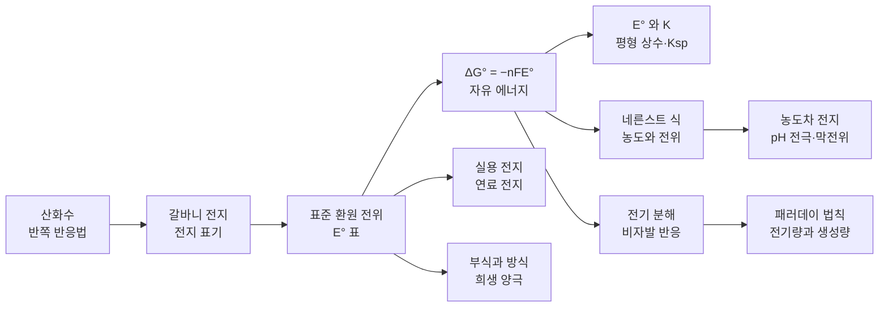

# 일반화학 11. 전기화학 — 전압으로 읽는 자유 에너지
<!-- prev: rxn-2, 4-3, uchem-10 -->
<!-- next: ubio-3, ubio-12 -->

> [!NOTE]
> **이 단원의 범위**
> - 산화수와 산화–환원 반응식 완성(산성·염기성 용액의 반쪽 반응법)
> - 갈바니 전지의 구성과 전지 표기, 표준 환원 전위와 표준 전지 전위
> - 전지 전위와 자유 에너지·평형 상수($\Delta G^\circ = -nFE^\circ$)
> - 네른스트 식과 농도차 전지
> - 실용 전지와 연료 전지, 부식과 방식
> - 전기 분해와 패러데이 법칙

**학습 목표**

1. 산성·염기성 수용액에서 반쪽 반응법으로 산화–환원 반응식을 완성하고, 불균등화 반응을 분석할 수 있다.
2. 갈바니 전지의 구성 요소를 전지 표기로 나타내고, 표준 환원 전위로 표준 전지 전위와 자발성을 구할 수 있다.
3. $\Delta G^\circ = -nFE^\circ$와 $E^\circ = (RT/nF)\ln K$를 유도하고, 전위로 자유 에너지·평형 상수·용해도곱을 계산할 수 있다.
4. 네른스트 식으로 비표준 조건의 전지 전위를 계산하고, 농도차 전지와 pH 측정, 생체막 전위의 원리를 설명할 수 있다.
5. 실용 전지·연료 전지의 전극 반응과 성능 지표를 계산하고, 부식의 전기화학적 원리와 방식법을 설명할 수 있다.
6. 패러데이 법칙으로 전기 분해 생성물의 양, 필요한 전기량과 에너지를 계산할 수 있다.

**이 단원의 학습 사다리**

| 단계 | 무엇을 하나? |
|---|---|
| STEP 1. 이전 학습 다시 보기 | 산화수, 산성 용액의 반쪽 반응식, 표준 환원 전위의 차, 전기 분해의 전극 반응 |
| STEP 2. 기초 다지기 | 전하·전류·전위의 단위, 패러데이 상수, 상용로그와 0.0592 V, 전극 부호 규약 |
| STEP 3. 핵심 개념 | 반응식 완성 → 갈바니 전지 → 표준 환원 전위 → $E$와 $\Delta G$·$K$ → 네른스트 식 → 실용 전지 → 부식 → 전기 분해 |
| STEP 4. 오개념 바로잡기 | "반쪽 전위도 더할 수 있다", "농도가 같으면 전지가 안 된다" 같은 착각 |
| STEP 5. 전공으로 | 전극 반응 속도론(버틀러–볼머 식), 과전압, 순환 전압 전류법 |
| STEP 6. 생활·산업·진로 | 이차 전지, 수전해와 연료 전지, 방식 공학, 전기화학 센서 |

---

## 🗺️ 단원 들어가기

스마트폰 배터리에는 "3.7 V, 4000 mAh"라고 적혀 있다. 이 두 숫자는 화학에서 무엇을 뜻할까? 3.7 V는 전자 1 C이 전지를 한 번 지나갈 때 얻는 에너지(J/C)이고, 이는 전극 반응의 **자유 에너지 변화**를 전자의 전하로 나눈 값이다. 4000 mAh는 전극 물질이 내줄 수 있는 **전자의 몰수**이다. 화학 열역학과 화학량론이 배터리 라벨 한 줄에 들어 있는 셈이다.

고등학교 「산화·환원 반응」에서는 표준 환원 전위의 차로 전지 전위를 구하고 자발성을 판단하였다. 그러나 실제 전지는 표준 상태가 아니며, 쓸수록 전압이 떨어지고, 끝내 '다 닳는다'. 바다 위의 선박은 왜 아연 덩어리를 매달고 다닐까? 혈당 측정기와 pH 미터는 어떻게 농도를 전압으로 읽을까? 신경 세포는 어떻게 −70 mV의 전압을 유지할까?

이 단원에서는 앞 단원의 $\Delta G$를 **전압**으로 옮기는 하나의 식 $\Delta G = -nFE$를 출발점으로, 전지 전위의 농도 의존(네른스트 식), 실용 전지와 부식, 전기 분해의 정량적 계산을 차례로 다룬다.

---

## STEP 1. 🔙 이전 학습 다시 보기

### 연계 개념표

| 이전 단원 | 그때 배운 것 | 이 단원에서 확장되는 것 |
|---|---|---|
| 통합과학2 「산화와 환원」 | 산소·전자의 이동, 금속의 반응성 순서 | 반응성 순서를 표준 환원 전위로, 다시 자유 에너지로 정량화 |
| 고등학교 「화학 반응의 세계」 '산화·환원 반응' | 산화수 규칙, **산성** 용액의 반쪽 반응식, 다니엘 전지, $E^\circ_\text{전지} = E^\circ_\text{환원} - E^\circ_\text{산화}$, 전기 분해의 전극 반응과 전자 몰수 | **염기성** 용액과 불균등화, 반쪽 전위의 결합, $\Delta G^\circ = -nFE^\circ$, 네른스트 식, 패러데이 법칙의 정량 계산(전류·시간·에너지) |
| 일반화학 「화학 열역학」 | $\Delta G = \Delta G^\circ + RT\ln Q$, $\Delta G^\circ = -RT\ln K$, 최대 비팽창 일 $= -\Delta G$ | 같은 식을 전위로: $E = E^\circ - (RT/nF)\ln Q$ |
| 일반화학 「산·염기와 수용액 평형」 | pH, 용해도곱 $K_\mathrm{sp}$, 착이온 평형 | pH 전극의 원리, 전위로 $K_\mathrm{sp}$ 측정 |
| 일반물리학 「전류·회로와 자기장」 | 전류 $I = dQ/dt$, 기전력, 전력 $P = IV$ | 전지의 기전력과 내부 저항, 전기 분해에 드는 에너지 |

### 준비 운동 (사전 진단)

**Q1.** $\mathrm{K_2Cr_2O_7}$에서 Cr의 산화수와 $\mathrm{H_2O_2}$에서 O의 산화수를 쓰시오.

**Q2.** $E^\circ(\mathrm{Ag^+/Ag}) = +0.80\ \mathrm{V}$, $E^\circ(\mathrm{Ni^{2+}/Ni}) = -0.26\ \mathrm{V}$일 때 두 전극으로 만든 전지의 표준 전지 전위와 산화 전극을 쓰시오.

**Q3.** 황산 구리(II) 수용액을 전기 분해하여 전자 0.40 mol이 흘렀다. 석출되는 구리는 몇 mol인가?

**Q4.** 25 ℃에서 $\Delta G^\circ = -RT\ln K$이다. $\Delta G^\circ < 0$이면 $K$는 1보다 큰가, 작은가?

정답 및 해설

**Q1.** Cr: +6 ($2(+1) + 2x + 7(-2) = 0$), O: −1 (과산화물)

**Q2.** $E^\circ = 0.80 - (-0.26) = 1.06\ \mathrm{V}$. $E^\circ$가 작은 니켈이 산화되므로 니켈이 산화 전극(−극)이다.

**Q3.** $\mathrm{Cu^{2+} + 2e^- \rightarrow Cu}$이므로 0.20 mol.

**Q4.** 크다. $\ln K = -\Delta G^\circ/RT > 0$.

---

## STEP 2. 🧱 기초 다지기

### 디딤돌 1. 전하·전류·전위 — 단위로 이해하기

| 양 | 기호 | 단위 | 관계 |
|---|---|---|---|
| 전하량 | $Q$ | 쿨롱(C) | 전자 1개의 전하 $e = 1.602\times10^{-19}\ \mathrm{C}$ |
| 전류 | $I$ | 암페어(A) $= \mathrm{C/s}$ | $I = dQ/dt$, 일정하면 $Q = It$ |
| 전위차(전압) | $E$, $V$ | 볼트(V) $= \mathrm{J/C}$ | 전하 1 C이 이동할 때 하는 일 |
| 전기적 일 | $w$ | 줄(J) | $w = QE$ |
| 전력 | $P$ | 와트(W) $= \mathrm{J/s}$ | $P = IE$ |
| 전기 에너지 | — | $\mathrm{W\cdot h}$ | $1\ \mathrm{W\cdot h} = 3600\ \mathrm{J}$ |
| 전지 용량 | — | $\mathrm{A\cdot h}$, mAh | $1\ \mathrm{A\cdot h} = 3600\ \mathrm{C}$ |

### 디딤돌 2. 패러데이 상수 — 전자의 몰과 쿨롱을 잇는 다리

전자 1 mol의 전하량을 **패러데이 상수(Faraday constant)** 라 한다.

$$
F = N_\mathrm{A}e = (6.022\times10^{23}\ \mathrm{mol^{-1}})(1.602\times10^{-19}\ \mathrm{C}) = 96\,485\ \mathrm{C/mol}
$$

| 변환 | 식 | 예 |
|---|---|---|
| 전류·시간 → 전자 몰수 | $n_\mathrm{e} = \dfrac{It}{F}$ | 1.00 A로 1.00 h → $3600/96\,485 = 0.0373\ \mathrm{mol}$ |
| 전자 몰수 × 전위 → 에너지 | $w = n_\mathrm{e}FE$ | 전자 1 mol이 1 V를 지나면 96.5 kJ |
| 1 eV(전자 하나)와 kJ/mol | $1\ \mathrm{eV}\times N_\mathrm{A} = 96.5\ \mathrm{kJ/mol}$ | 전지 전위 1 V는 '전자 1 mol당 96.5 kJ'과 같다 |

> [!TIP]
> 💡 **요령** — "1 V ≈ 96.5 kJ/mol(전자당)"을 기억해 두면, 전지 전위를 보자마자 반응의 자유 에너지 규모를 어림할 수 있다. 1.10 V의 다니엘 전지는 전자 2 mol이 오가므로 약 $2\times96.5\times1.10 \approx 212\ \mathrm{kJ}$이다.

### 디딤돌 3. $\ln$에서 $\log$로 — 0.0592 V의 정체

네른스트 식에 나오는 상수 $RT/F$를 25 ℃에서 계산하면

$$
\frac{RT}{F} = \frac{8.314\times298.15}{96\,485} = 0.02569\ \mathrm{V}, \qquad \frac{RT\ln 10}{F} = 0.05916\ \mathrm{V}
$$

그래서 25 ℃에서 $\dfrac{RT}{nF}\ln Q = \dfrac{0.0592\ \mathrm{V}}{n}\log Q$이다. 즉 **전자 1개가 오가는 반응에서 농도비가 10배 바뀌면 전위가 약 59 mV 바뀐다.** 체온(37 ℃)에서는 이 값이 약 61.5 mV가 된다($\propto T$).

### 디딤돌 4. 전극의 이름과 부호 — 헷갈리지 않는 규칙

| 전극 이름 | 정의 (항상 성립) | 갈바니 전지(방전)에서 | 전해 전지(전기 분해·충전)에서 |
|---|---|---|---|
| 산화 전극(anode) | **산화**가 일어나는 전극 | (−)극 | 전원의 (+)극에 연결 |
| 환원 전극(cathode) | **환원**이 일어나는 전극 | (+)극 | 전원의 (−)극에 연결 |

> [!IMPORTANT]
> 부호는 장치마다 바뀌지만 **"산화는 산화 전극에서, 환원은 환원 전극에서"** 는 변하지 않는다. 전자는 언제나 외부 도선을 따라 산화 전극에서 환원 전극으로 흐른다. 배터리 산업에서 쓰는 '양극재·음극재'는 방전 기준의 (+)극·(−)극 소재를 가리키는 말이다.

---

## STEP 3. 📘 핵심 개념

### ① 산화수와 산화–환원 반응식 완성 — 반쪽 반응법

산화수 규칙(고등학교 「산화·환원 반응」)으로 산화된 원자와 환원된 원자를 찾은 뒤, 반응을 두 **반쪽 반응**으로 나누어 각각 질량과 전하를 맞추고 더한다. 대학에서는 산성 용액뿐 아니라 **염기성 용액**, 같은 원소가 산화와 환원을 동시에 겪는 **불균등화**까지 다룬다.

#### 반쪽 반응법의 절차

| 단계 | 산성 용액 | 염기성 용액 |
|---|---|---|
| 1 | 산화·환원 반쪽으로 나눈다 | 같음 |
| 2 | O, H 외의 원자 수를 맞춘다 | 같음 |
| 3 | O는 $\mathrm{H_2O}$로 맞춘다 | 같음 |
| 4 | H는 $\mathrm{H^+}$로 맞춘다 | 같음(일단 $\mathrm{H^+}$로) |
| 5 | 전하를 $\mathrm{e^-}$로 맞춘다 | 같음 |
| 6 | 전자 수를 같게 하여 더한다 | 같음 |
| 7 | — | 양변에 $\mathrm{H^+}$ 수만큼 $\mathrm{OH^-}$를 더해 $\mathrm{H^+ + OH^- \rightarrow H_2O}$로 바꾸고, 양변의 물을 정리한다 |
| 확인 | 원자 수와 전하가 양변에서 같은가? | 같음 |

#### 예제 1 — 산성 용액: 옥살산의 과망가니즈산 적정

$\mathrm{MnO_4^- + H_2C_2O_4 \rightarrow Mn^{2+} + CO_2}$ (산성)

**풀이**
환원: Mn +7 → +2. $\mathrm{MnO_4^- + 8H^+ + 5e^- \rightarrow Mn^{2+} + 4H_2O}$
산화: C +3 → +4(탄소 2개이므로 전자 2개). $\mathrm{H_2C_2O_4 \rightarrow 2CO_2 + 2H^+ + 2e^-}$
전자 10개로 맞춘다(환원 × 2, 산화 × 5). 양변의 $\mathrm{H^+}$를 정리하면 ($16 - 10 = 6$)

$$
\mathrm{2MnO_4^-(aq) + 5H_2C_2O_4(aq) + 6H^+(aq) \rightarrow 2Mn^{2+}(aq) + 10CO_2(g) + 8H_2O(l)}
$$

**확인** 전하: 왼쪽 $-2 + 6 = +4$, 오른쪽 $+4$. O: 왼쪽 $8 + 20 = 28$, 오른쪽 $20 + 8 = 28$.
**의미** 옥살산 나트륨은 순수하게 얻기 쉬워 과망가니즈산 칼륨 용액의 정확한 농도를 정하는 표준 물질로 쓰인다. 몰수비 $\mathrm{MnO_4^-} : \mathrm{H_2C_2O_4} = 2 : 5$가 적정 계산의 핵심이다.

#### 예제 2 — 염기성 용액: 과망가니즈산 이온과 아황산 이온

$\mathrm{MnO_4^- + SO_3^{2-} \rightarrow MnO_2 + SO_4^{2-}}$ (염기성)

**풀이**
환원: Mn +7 → +4. $\mathrm{MnO_4^- \rightarrow MnO_2 + 2H_2O}$ → $\mathrm{MnO_4^- + 4H^+ \rightarrow MnO_2 + 2H_2O}$ → $\mathrm{MnO_4^- + 4H^+ + 3e^- \rightarrow MnO_2 + 2H_2O}$
산화: S +4 → +6. $\mathrm{SO_3^{2-} + H_2O \rightarrow SO_4^{2-} + 2H^+ + 2e^-}$
전자 6개로 맞춘다(환원 × 2, 산화 × 3)고 더하면

$$
\mathrm{2MnO_4^- + 3SO_3^{2-} + 2H^+ \rightarrow 2MnO_2 + 3SO_4^{2-} + H_2O}
$$

염기성이므로 양변에 $\mathrm{2OH^-}$를 더해 왼쪽의 $\mathrm{2H^+ + 2OH^-}$를 $\mathrm{2H_2O}$로 바꾸고 물을 정리한다.

$$
\mathrm{2MnO_4^-(aq) + 3SO_3^{2-}(aq) + H_2O(l) \rightarrow 2MnO_2(s) + 3SO_4^{2-}(aq) + 2OH^-(aq)}
$$

**확인** 전하: 왼쪽 $-2 - 6 = -8$, 오른쪽 $-6 - 2 = -8$. O: 왼쪽 $8 + 9 + 1 = 18$, 오른쪽 $4 + 12 + 2 = 18$.
**의미** 같은 $\mathrm{MnO_4^-}$라도 산성에서는 $\mathrm{Mn^{2+}}$(전자 5개), 중성·염기성에서는 갈색 앙금 $\mathrm{MnO_2}$(전자 3개)가 된다. 생성물과 계수는 **용액의 액성**에 따라 달라진다.

#### 불균등화 반응

같은 원소의 일부는 산화되고 나머지는 환원되는 반응을 **불균등화(disproportionation)** 라 한다. 염소를 수산화 나트륨 수용액에 통하면 표백제(차아염소산 나트륨)가 생긴다.

$$
\mathrm{Cl_2(g) + 2OH^-(aq) \rightarrow Cl^-(aq) + ClO^-(aq) + H_2O(l)}
$$

Cl의 산화수가 0 → −1(환원)과 0 → +1(산화)로 동시에 바뀐다. 산화수가 중간값인 화학종(염소 0, $\mathrm{Cu^+}$의 +1, $\mathrm{H_2O_2}$의 산소 −1)이 불균등화의 후보이다. ③에서 전위로 불균등화가 일어날지 예측한다.

#### ✔ 바로 확인

1. 빈칸: $\mathrm{MnO_4^-}$에서 Mn의 산화수는 (    )이다.
2. (O/X) 염기성 용액에서 반쪽 반응식을 맞출 때는 처음부터 $\mathrm{OH^-}$로 수소를 맞춰야 한다.
3. 산성 용액에서 $\mathrm{Cr_2O_7^{2-} \rightarrow Cr^{3+}}$ 반쪽 반응식을 완성하고, 오가는 전자 수를 쓰시오.
4. 고르기: 불균등화 반응은? (가) $\mathrm{2H_2O_2 \rightarrow 2H_2O + O_2}$ (나) $\mathrm{Zn + Cu^{2+} \rightarrow Zn^{2+} + Cu}$

정답

1. +7 — $x + 4(-2) = -1$.
2. X — 산성처럼 일단 $\mathrm{H^+}$로 맞춘 뒤, 마지막에 양변에 같은 수의 $\mathrm{OH^-}$를 더해 물로 바꾼다.
3. $\mathrm{Cr_2O_7^{2-} + 14H^+ + 6e^- \rightarrow 2Cr^{3+} + 7H_2O}$, 전자 6개 — Cr 2개가 각각 +6 → +3.
4. (가) — 산소의 산화수가 −1에서 −2(환원)와 0(산화)으로 동시에 바뀐다.

### ② 갈바니 전지와 전지 표기

자발적 산화–환원 반응의 자유 에너지를 전기적 일로 바꾸는 장치를 **갈바니 전지(galvanic cell)** 또는 볼타 전지라 한다. 핵심은 **산화제와 환원제를 떼어 놓고, 전자는 외부 도선으로, 이온은 염다리(또는 분리막)로 다니게 하는 것**이다.

| 구성 요소 | 역할 | 다니엘 전지의 예 |
|---|---|---|
| 산화 전극 | 환원제가 전자를 내놓는다 | $\mathrm{Zn(s) \rightarrow Zn^{2+}(aq) + 2e^-}$ |
| 환원 전극 | 산화제가 전자를 받는다 | $\mathrm{Cu^{2+}(aq) + 2e^- \rightarrow Cu(s)}$ |
| 외부 도선 | 전자의 통로, 여기서 일을 한다 | 아연판 → 전구 → 구리판 |
| 염다리·분리막 | 이온의 통로, 전하 균형 유지 | $\mathrm{KNO_3}$ 젤: 음이온은 산화 전극 쪽, 양이온은 환원 전극 쪽으로 |
| 비활성 전극 | 반응에 참여하지 않고 전자만 전달 | 반쪽 반응에 고체 금속이 없을 때 백금·흑연을 쓴다 |

#### 전지 표기법

$$
\underbrace{\mathrm{Zn(s)\,\vert\,Zn^{2+}(1.0\ M)}}_{\text{산화 전극(왼쪽)}}\;\Vert\;\underbrace{\mathrm{Cu^{2+}(1.0\ M)\,\vert\,Cu(s)}}_{\text{환원 전극(오른쪽)}}
$$

| 기호 | 뜻 |
|---|---|
| 한 줄 세로선 | 상의 경계(고체/용액, 기체/용액) |
| 두 줄 세로선 | 염다리 |
| 쉼표 | 같은 상에 함께 있는 화학종 |
| 괄호 안 | 농도·압력 |

비활성 전극을 쓰는 예: 수소 전극과 $\mathrm{Fe^{3+}/Fe^{2+}}$ 전극으로 만든 전지

$$
\mathrm{Pt(s)\,\vert\,H_2(g, 1\ bar)\,\vert\,H^+(1\ M)\;\Vert\;Fe^{3+}(1\ M),\,Fe^{2+}(1\ M)\,\vert\,Pt(s)}
$$

> [!NOTE]
> 전지 표기는 "왼쪽에서 오른쪽으로 전자가 흐르도록" 쓰는 약속이다. 이렇게 쓰면 $E_\text{전지} = E_\text{오른쪽} - E_\text{왼쪽}$이 되고, 그 값이 양수이면 표기한 방향의 반응이 자발적이다. 거꾸로 쓰면 음수가 나오며, 그것은 '반대 방향이 자발적'이라는 뜻이다.

#### 화학 에너지가 전기 에너지가 되는 미시적 그림

아연 금속을 $\mathrm{Zn^{2+}}$ 용액에 담그면 극히 일부의 아연이 이온으로 녹아 나가고 전자가 금속에 남아, 금속 쪽이 음으로 대전된 **전기 이중층**이 생긴다. 이 전하 분리가 금속과 용액 사이의 전위차를 만들며, 금속마다 그 크기가 다르다. 두 금속을 도선으로 이으면 전위가 낮은 쪽(아연)에서 높은 쪽(구리)으로 전자가 흐른다. 하나의 전극 전위만 따로 측정할 수는 없어 기준 전극이 필요하다.

#### ✔ 바로 확인

1. 빈칸: 갈바니 전지에서 산화가 일어나는 전극을 (    ) 전극이라 하고, 그 전극의 부호는 (    )이다.
2. 전지 $\mathrm{Zn(s)\,\vert\,Zn^{2+}\,\Vert\,Ag^+\,\vert\,Ag(s)}$에서 외부 도선의 전자는 어느 전극에서 어느 전극으로 흐르는가?
3. (O/X) 염다리 속 음이온은 환원 전극 쪽으로 이동한다.
4. 전지 표기에서 두 줄 세로선 $\Vert$는 무엇을 뜻하는가?

정답

1. 산화, (−) — 환원제가 전자를 내놓아 전극에 전자가 남는다.
2. Zn 전극 → Ag 전극 — 전지 표기는 왼쪽(산화 전극)에서 오른쪽으로 전자가 흐르도록 쓴다.
3. X — 양이온이 생겨 양전하가 쌓이는 산화 전극 쪽으로 이동해 전하 균형을 맞춘다.
4. 염다리(이온의 통로).

### ③ 표준 환원 전위와 표준 전지 전위

#### 기준: 표준 수소 전극

$$
\mathrm{2H^+(aq, 1\ M) + 2e^- \rightleftharpoons H_2(g, 1\ bar)} \qquad E^\circ \equiv 0\ \mathrm{V}\ (\text{모든 온도에서})
$$

모든 반쪽 반응을 **환원 방향**으로 쓰고 표준 수소 전극에 대한 전위를 잰 것이 **표준 환원 전위** $E^\circ$이다(표준 상태: 용질 1 M, 기체 1 bar, 순수한 고체·액체. 표는 25 ℃ 값).

<!-- fig:uchem-11-she -->

| 환원 반쪽 반응 | $E^\circ$ (V) |
|---|---|
| $\mathrm{F_2(g) + 2e^- \rightarrow 2F^-}$ | +2.87 |
| $\mathrm{PbO_2(s) + 4H^+ + SO_4^{2-} + 2e^- \rightarrow PbSO_4(s) + 2H_2O}$ | +1.69 |
| $\mathrm{MnO_4^- + 8H^+ + 5e^- \rightarrow Mn^{2+} + 4H_2O}$ | +1.51 |
| $\mathrm{Cl_2(g) + 2e^- \rightarrow 2Cl^-}$ | +1.36 |
| $\mathrm{Cr_2O_7^{2-} + 14H^+ + 6e^- \rightarrow 2Cr^{3+} + 7H_2O}$ | +1.33 |
| $\mathrm{O_2(g) + 4H^+ + 4e^- \rightarrow 2H_2O}$ | +1.23 |
| $\mathrm{Br_2(l) + 2e^- \rightarrow 2Br^-}$ | +1.07 |
| $\mathrm{NO_3^- + 4H^+ + 3e^- \rightarrow NO(g) + 2H_2O}$ | +0.96 |
| $\mathrm{Ag^+ + e^- \rightarrow Ag(s)}$ | +0.80 |
| $\mathrm{Fe^{3+} + e^- \rightarrow Fe^{2+}}$ | +0.77 |
| $\mathrm{I_2(s) + 2e^- \rightarrow 2I^-}$ | +0.54 |
| $\mathrm{Cu^+ + e^- \rightarrow Cu(s)}$ | +0.52 |
| $\mathrm{O_2(g) + 2H_2O + 4e^- \rightarrow 4OH^-}$ | +0.40 |
| $\mathrm{Cu^{2+} + 2e^- \rightarrow Cu(s)}$ | +0.34 |
| $\mathrm{AgCl(s) + e^- \rightarrow Ag(s) + Cl^-}$ | +0.22 |
| $\mathrm{Cu^{2+} + e^- \rightarrow Cu^+}$ | +0.15 |
| $\mathrm{2H^+ + 2e^- \rightarrow H_2(g)}$ | 0 (기준) |
| $\mathrm{Pb^{2+} + 2e^- \rightarrow Pb(s)}$ | −0.13 |
| $\mathrm{Ni^{2+} + 2e^- \rightarrow Ni(s)}$ | −0.26 |
| $\mathrm{PbSO_4(s) + 2e^- \rightarrow Pb(s) + SO_4^{2-}}$ | −0.36 |
| $\mathrm{Cd^{2+} + 2e^- \rightarrow Cd(s)}$ | −0.40 |
| $\mathrm{Fe^{2+} + 2e^- \rightarrow Fe(s)}$ | −0.44 |
| $\mathrm{Zn^{2+} + 2e^- \rightarrow Zn(s)}$ | −0.76 |
| $\mathrm{2H_2O + 2e^- \rightarrow H_2(g) + 2OH^-}$ | −0.83 |
| $\mathrm{Al^{3+} + 3e^- \rightarrow Al(s)}$ | −1.66 |
| $\mathrm{Mg^{2+} + 2e^- \rightarrow Mg(s)}$ | −2.37 |
| $\mathrm{Na^+ + e^- \rightarrow Na(s)}$ | −2.71 |
| $\mathrm{Li^+ + e^- \rightarrow Li(s)}$ | −3.04 |

$$
E^\circ_\text{전지} = E^\circ_\text{환원 전극} - E^\circ_\text{산화 전극}
$$

$E^\circ$는 전하 1 C당 에너지이므로 **세기 성질**이다. 반쪽 반응식에 계수를 곱해도 $E^\circ$는 그대로이다.

#### 예제 3 — 마그네슘–은 전지

$\mathrm{Mg(s)}$와 $\mathrm{Ag^+(aq)}$로 만든 표준 전지의 (1) 전지 표기, (2) 전체 반응식, (3) 표준 전지 전위를 구하시오.

**풀이**
(1) $E^\circ$가 작은 Mg가 산화 전극: $\mathrm{Mg(s)\,\vert\,Mg^{2+}(1\ M)\,\Vert\,Ag^+(1\ M)\,\vert\,Ag(s)}$
(2) $\mathrm{Mg(s) + 2Ag^+(aq) \rightarrow Mg^{2+}(aq) + 2Ag(s)}$
(3) $E^\circ = 0.80 - (-2.37) = 3.17\ \mathrm{V}$

#### 반쪽 전위는 그냥 더하지 않는다 — 자유 에너지로 결합하기

두 **반쪽 반응**을 더해 새로운 **반쪽 반응**을 만들 때는 전자가 지워지지 않으므로 $E^\circ$를 그냥 더하면 안 된다. 더해지는 것은 자유 에너지 $\Delta G^\circ = -nFE^\circ$이다.

#### 예제 4 — $\mathrm{Fe^{3+}/Fe}$의 표준 환원 전위

$E^\circ(\mathrm{Fe^{3+}/Fe^{2+}}) = +0.77\ \mathrm{V}$, $E^\circ(\mathrm{Fe^{2+}/Fe}) = -0.44\ \mathrm{V}$로부터 $\mathrm{Fe^{3+} + 3e^- \rightarrow Fe}$의 $E^\circ$를 구하시오.

**풀이**

| 반쪽 반응 | $n$ | $\Delta G^\circ = -nFE^\circ$ |
|---|---|---|
| $\mathrm{Fe^{3+} + e^- \rightarrow Fe^{2+}}$ | 1 | $-F(0.77)$ |
| $\mathrm{Fe^{2+} + 2e^- \rightarrow Fe}$ | 2 | $-2F(-0.44) = +0.88F$ |
| 합: $\mathrm{Fe^{3+} + 3e^- \rightarrow Fe}$ | 3 | $-0.77F + 0.88F = +0.11F$ |

$$
E^\circ = \frac{\Delta G^\circ}{-3F} = \frac{0.11F}{-3F} = -0.037 \approx -0.04\ \mathrm{V}
$$

**의미** 그냥 더했다면 $0.77 + (-0.44) = 0.33\ \mathrm{V}$라는 엉뚱한 값이 나온다. 전위는 '전자 하나당' 값이므로 전자 수로 가중 평균해야 한다: $E^\circ = (n_1E_1^\circ + n_2E_2^\circ)/(n_1 + n_2)$.

#### 예제 5 — 구리(I) 이온은 물에서 안정할까?

$E^\circ(\mathrm{Cu^+/Cu}) = +0.52\ \mathrm{V}$, $E^\circ(\mathrm{Cu^{2+}/Cu^+}) = +0.15\ \mathrm{V}$이다. $\mathrm{2Cu^+ \rightarrow Cu^{2+} + Cu}$의 $E^\circ$를 구하고 판단하시오.

**풀이**
$\mathrm{Cu^+}$의 일부는 환원되어 Cu가 되고(환원 전극, +0.52 V), 일부는 산화되어 $\mathrm{Cu^{2+}}$가 된다(산화 전극, +0.15 V).
$E^\circ = 0.52 - 0.15 = +0.37\ \mathrm{V} > 0$ → 불균등화가 자발적이다.
**의미** 그래서 수용액에서 구리는 주로 $\mathrm{Cu^{2+}}$로 존재하고, $\mathrm{Cu^+}$는 앙금($\mathrm{CuCl}$, $\mathrm{Cu_2O}$)이나 착이온으로 붙잡혀야 안정하다. 또 이 두 값의 가중 평균 $(0.52 + 0.15)/2 = 0.335 \approx 0.34\ \mathrm{V}$가 표의 $E^\circ(\mathrm{Cu^{2+}/Cu})$와 일치함을 확인하자.

> [!TIP]
> 💡 **비유** — 표준 환원 전위 표는 **전자에 대한 '사다리'** 이다. 위쪽 칸에 있는 화학종일수록 전자를 강하게 끌어당긴다. 전자는 사다리의 아래 칸(강한 환원제, 예: Li, Zn)에서 위 칸(강한 산화제, 예: $\mathrm{F_2}$, $\mathrm{MnO_4^-}$)으로 '떨어지며' 일을 한다. 떨어지는 높이가 전지 전위이다.

<!-- fig:uchem-11-potential-ladder -->

#### ✔ 바로 확인

1. 빈칸: 표준 수소 전극의 $E^\circ$는 약속에 따라 (    ) V이다.
2. Ni와 Cu로 만든 표준 전지의 $E^\circ$는? ($E^\circ$: $\mathrm{Ni^{2+}/Ni}$ −0.26 V, $\mathrm{Cu^{2+}/Cu}$ +0.34 V)
3. (O/X) 반쪽 반응식의 계수를 2배로 하면 $E^\circ$도 2배가 된다.
4. 고르기: 다음 중 가장 강한 산화제는? $\mathrm{Ag^+}$, $\mathrm{Zn^{2+}}$, $\mathrm{Cl_2}$, $\mathrm{Fe^{2+}}$

정답

1. 0 — 모든 온도에서 0으로 정한 기준이다.
2. +0.60 V — $0.34 - (-0.26)$. $E^\circ$가 작은 Ni가 산화 전극이다.
3. X — $E^\circ$는 전하 1 C당 에너지인 세기 성질이다.
4. $\mathrm{Cl_2}$ — 표준 환원 전위가 +1.36 V로 가장 높아 전자를 가장 강하게 끌어당긴다.

### ④ 전지 전위와 자유 에너지·평형 상수

#### 유도 — $\Delta G = -nFE$

전지 반응 1 mol당 전자 $n$ mol이 전위차 $E$를 지나면 외부에 하는 최대 전기적 일은 $w_\text{전기,최대} = nFE$이다. 「화학 열역학」에서 일정 $T$, $P$에서 꺼낼 수 있는 최대 비팽창 일은 $-\Delta G$였다. 따라서 (전류가 거의 흐르지 않는 가역 조건에서)

$$
\boxed{\;\Delta G = -nFE, \qquad \Delta G^\circ = -nFE^\circ\;}
$$

$E > 0 \Leftrightarrow \Delta G < 0$(자발적)이다. 여기에 $\Delta G^\circ = -RT\ln K$를 함께 쓰면

$$
\boxed{\;E^\circ = \frac{RT}{nF}\ln K = \frac{0.0592\ \mathrm{V}}{n}\log K \quad (25\ ℃)\;}
$$

| 측정·계산 가능한 양 | 서로 바꾸는 식 |
|---|---|
| $E^\circ$ → $\Delta G^\circ$ | $\Delta G^\circ = -nFE^\circ$ |
| $\Delta G^\circ$ → $K$ | $K = e^{-\Delta G^\circ/RT}$ |
| $E^\circ$ → $K$ | $\log K = nE^\circ/0.0592$ |

| $E^\circ$ (V, $n = 2$) | $\Delta G^\circ$ (kJ) | $K$ | 의미 |
|---|---|---|---|
| +1.10 | −212 | $1.5\times10^{37}$ | 사실상 완결 |
| +0.10 | −19.3 | $2.4\times10^{3}$ | 생성물 우세 |
| 0 | 0 | 1 | 비슷 |
| −0.10 | +19.3 | $4.2\times10^{-4}$ | 반응물 우세 |

전위 0.1 V의 차이만으로 $K$가 수천 배 달라진다. 전위는 평형 상수를 매우 예민하게 재는 '로그 자'이다.

#### 예제 6 — $\mathrm{Fe^{3+}}$와 $\mathrm{I^-}$의 반응

$\mathrm{2Fe^{3+}(aq) + 2I^-(aq) \rightarrow 2Fe^{2+}(aq) + I_2(s)}$의 $E^\circ$, $\Delta G^\circ$, $K$를 구하시오.

**풀이**
$E^\circ = 0.77 - 0.54 = +0.23\ \mathrm{V}$, $n = 2$
$\Delta G^\circ = -2\times96\,485\times0.23 = -4.4\times10^4\ \mathrm{J} = -44\ \mathrm{kJ}$
$\log K = 2\times0.23/0.0592 = 7.78$ → $K = 6.0\times10^7$

**의미** 전자 2개로 쓴 반응식이므로 $n = 2$이다. 반응식을 $\mathrm{Fe^{3+} + I^- \rightarrow Fe^{2+} + \tfrac{1}{2}I_2}$로 쓰면 $n = 1$, $\Delta G^\circ = -22\ \mathrm{kJ}$, $K = 7.7\times10^3$($= \sqrt{6.0\times10^7}$)이 된다. $E^\circ$는 그대로이지만 $\Delta G^\circ$와 $K$는 반응식의 계수를 따른다.

#### 예제 7 — 전위로 용해도곱 구하기

$\mathrm{AgCl(s) + e^- \rightarrow Ag(s) + Cl^-}$ ($E^\circ = +0.2223\ \mathrm{V}$), $\mathrm{Ag^+ + e^- \rightarrow Ag(s)}$ ($E^\circ = +0.7996\ \mathrm{V}$)로부터 25 ℃에서 AgCl의 $K_\mathrm{sp}$를 구하시오.

**풀이**
첫째 식에서 둘째 식을 빼면 $\mathrm{AgCl(s) \rightarrow Ag^+(aq) + Cl^-(aq)}$이 된다(산화–환원 반응이 아니지만 두 반쪽 반응의 조합으로 쓸 수 있다).
$E^\circ = 0.2223 - 0.7996 = -0.5773\ \mathrm{V}$, $n = 1$
$\log K_\mathrm{sp} = -0.5773/0.05916 = -9.759$ → $K_\mathrm{sp} = 1.74\times10^{-10}$

**의미** 용해도가 매우 작아 농도를 직접 재기 어려운 앙금의 $K_\mathrm{sp}$를 전압계로 정밀하게 잴 수 있다. 소수점 넷째 자리까지의 전위가 유효 숫자 세 자리의 $K_\mathrm{sp}$를 준다.

#### ✔ 바로 확인

1. $n = 2$, $E^\circ = +0.50\ \mathrm{V}$인 반응의 $\Delta G^\circ$는? ($F = 96\,485\ \mathrm{C/mol}$)
2. 빈칸: $E^\circ > 0$이면 $\Delta G^\circ$ (    ) 0이고, $K$ (    ) 1이다.
3. 25 ℃에서 $n = 1$, $E^\circ = 0.0592\ \mathrm{V}$인 반응의 평형 상수는?
4. (O/X) 반응식의 계수를 모두 2배로 하면 $E^\circ$와 $K$가 모두 바뀐다.

정답

1. $-96.5\ \mathrm{kJ}$ — $-2\times96\,485\times0.50$.
2. <, > — $\Delta G^\circ = -nFE^\circ = -RT\ln K$.
3. 10 — $\log K = nE^\circ/0.0592 = 1$.
4. X — $E^\circ$는 그대로이고, $\Delta G^\circ$는 2배, $K$는 제곱이 된다.

### ⑤ 네른스트 식과 농도차 전지

#### 유도

「화학 열역학」의 $\Delta G = \Delta G^\circ + RT\ln Q$의 양변을 $-nF$로 나누면

$$
\boxed{\;E = E^\circ - \frac{RT}{nF}\ln Q = E^\circ - \frac{0.0592\ \mathrm{V}}{n}\log Q \quad (25\ ℃)\;}
$$

이것이 **네른스트 식(Nernst equation)** 이다.

| 상황 | $Q$와 $K$ | $E$ |
|---|---|---|
| 표준 상태 | $Q = 1$ | $E = E^\circ$ |
| 반응 초기(반응물이 많다) | $Q < 1$ | $E > E^\circ$ |
| 방전이 진행됨 | $Q$ 증가 | $E$ 감소 |
| 평형(전지가 '다 닳음') | $Q = K$ | $E = 0$ |

네른스트 식에 $E = 0$, $Q = K$를 넣으면 $E^\circ = (0.0592/n)\log K$가 다시 나온다. 다 닳은 전지는 화학 평형에 도달한 전지이다.

<!-- sim:u-nernst -->

#### 예제 8 — 비표준 다니엘 전지

$\mathrm{Zn\,\vert\,Zn^{2+}(0.0010\ M)\,\Vert\,Cu^{2+}(1.0\ M)\,\vert\,Cu}$의 전지 전위를 구하시오(25 ℃).

**풀이**
$Q = [\mathrm{Zn^{2+}}]/[\mathrm{Cu^{2+}}] = 0.0010/1.0 = 1.0\times10^{-3}$ (고체는 1)
$E = 1.10 - \dfrac{0.0592}{2}\log(1.0\times10^{-3}) = 1.10 + 0.0888 = 1.19\ \mathrm{V}$

**의미** 생성물($\mathrm{Zn^{2+}}$)이 적고 반응물이 많으면 반응이 더 '밀려' 전위가 커진다. 반대로 사용이 진행되어 $[\mathrm{Zn^{2+}}] = 1.90\ \mathrm{M}$, $[\mathrm{Cu^{2+}}] = 0.10\ \mathrm{M}$이 되면 $E = 1.10 - 0.0296\log 19 = 1.06\ \mathrm{V}$로 낮아진다. 그래도 전압은 로그로만 줄기 때문에, 전지는 수명 대부분 동안 거의 일정한 전압을 낸다.

#### 농도차 전지

두 전극이 **같은 물질**이고 농도만 다르면 $E^\circ = 0$이지만 전지는 작동한다. 묽은 쪽이 진해지고 진한 쪽이 묽어지는 방향, 즉 농도가 같아지려는 '흩어짐'이 일을 하는 셈이다.

$$
\mathrm{Cu\,\vert\,Cu^{2+}(0.010\ M)\,\Vert\,Cu^{2+}(1.0\ M)\,\vert\,Cu} \qquad E = 0 - \frac{0.0592}{2}\log\frac{0.010}{1.0} = +0.0592\ \mathrm{V}
$$

묽은 쪽 전극이 산화 전극(구리가 녹아 $\mathrm{Cu^{2+}}$가 늘어남), 진한 쪽이 환원 전극(구리가 석출되어 $\mathrm{Cu^{2+}}$가 줄어듦)이다.

<!-- fig:uchem-11-concentration-cell -->

#### pH 측정 — 수소 이온의 농도차 전지

수소 전극을 미지 용액에 담그고 표준 수소 전극과 짝지으면

$$
E = 0 - \frac{0.0592}{2}\log\frac{[\mathrm{H^+}]_\text{미지}^2}{1^2} = 0.0592\,\mathrm{pH}\ (\mathrm{V})
$$

pH가 1 커질 때마다 전위가 59.2 mV씩 변한다. 실제 **pH 미터**는 다루기 번거로운 수소 전극 대신, 안팎의 $\mathrm{H^+}$ 농도 차에 따라 전위가 생기는 얇은 **유리막 전극**과 전위가 일정한 기준 전극(은–염화 은 전극)을 한 몸에 넣은 복합 전극이다. 같은 원리로 특정 이온에만 반응하는 막을 쓰면 $\mathrm{Na^+}$, $\mathrm{K^+}$, $\mathrm{F^-}$, $\mathrm{Ca^{2+}}$ 등을 재는 **이온 선택성 전극**이 된다.

#### 예제 9 — 신경 세포막의 칼륨 평형 전위

신경 세포 안쪽의 $[\mathrm{K^+}]$는 약 140 mM, 바깥쪽은 약 5 mM이다. 세포막이 $\mathrm{K^+}$만 통과시킨다면, 체온 37 ℃에서 막 안쪽의 전위(바깥 기준)는 얼마가 되는가?

**풀이**
막을 사이에 둔 농도차 전지로 본다. 평형에서 $\mathrm{K^+}$의 이동 경향(농도 차)과 전기적 힘이 균형을 이룬다($n = 1$).

$$
E_\mathrm{K} = \frac{RT}{F}\ln\frac{[\mathrm{K^+}]_\text{밖}}{[\mathrm{K^+}]_\text{안}} = \frac{8.314\times310.15}{96\,485}\ln\frac{5}{140} = 0.02673\times(-3.332) = -0.089\ \mathrm{V}
$$

**의미** 약 −89 mV로, 실제 휴지 전위(약 −70 mV)에 가깝다. 차이는 막이 $\mathrm{Na^+}$도 조금 통과시키기 때문이다($\mathrm{Na^+}$의 평형 전위는 약 +67 mV). 신경의 활동 전위는 $\mathrm{Na^+}$ 통로가 열리며 막전위가 $E_\mathrm{Na}$ 쪽으로 치솟는 현상이다(일반생명과학 「동물의 구조와 기능 Ⅱ」).

#### ✔ 바로 확인

1. 빈칸: 다 닳은 전지에서는 $E = (\quad)$이고 $Q = (\quad)$이다.
2. 25 ℃에서 $\mathrm{Zn\,\vert\,Zn^{2+}(1.0\ M)\,\Vert\,Cu^{2+}(0.010\ M)\,\vert\,Cu}$의 전지 전위는? ($E^\circ = 1.10\ \mathrm{V}$)
3. (O/X) 농도차 전지에서는 진한 쪽 전극이 산화 전극이 된다.
4. pH 미터의 전위는 pH가 1 커질 때마다 25 ℃에서 몇 mV씩 변하는가?

정답

1. 0, $K$ — 다 닳은 전지는 화학 평형에 도달한 전지이다.
2. 1.04 V — $1.10 - (0.0592/2)\log(1.0/0.010) = 1.10 - 0.0592$.
3. X — 묽은 쪽 전극이 녹아 농도가 커지는 산화 전극, 진한 쪽이 환원 전극이다.
4. 59.2 mV — $E = 0.0592\,\mathrm{pH}$ (V).

### ⑥ 실용 전지와 연료 전지

#### 실용 전지의 성능 지표

| 지표 | 정의 | 무엇이 정하나 |
|---|---|---|
| 전압 (V) | 작동 중 두 극의 전위차 | 전극 물질의 $E^\circ$ 차, 농도, 내부 저항 |
| 용량 (A·h) | 꺼낼 수 있는 전하량 | 활물질의 양(몰수)과 반응 전자 수 |
| 에너지 (W·h) | 용량 × 평균 전압 | 둘 다 |
| 에너지 밀도 (W·h/kg) | 질량당 에너지 | 가볍고 전자를 많이 내주는 물질, 큰 전압 |
| 출력 (W) | 단위 시간에 낼 수 있는 에너지 | 전극 반응 속도, 이온 이동 속도, 내부 저항 |
| 수명 (회) | 충·방전 반복 가능 횟수 | 전극 구조의 안정성, 부반응 |

#### 대표 전지의 전극 반응

| 전지 | 산화 전극(방전) | 환원 전극(방전) | 전압(약) | 특징 |
|---|---|---|---|---|
| 알칼리 망가니즈 전지(1차) | $\mathrm{Zn + 2OH^- \rightarrow ZnO + H_2O + 2e^-}$ | $\mathrm{2MnO_2 + H_2O + 2e^- \rightarrow Mn_2O_3 + 2OH^-}$ | 1.5 V | 전해질 KOH, 값싸고 저장 수명이 길다 |
| 납축전지(2차) | $\mathrm{Pb + SO_4^{2-} \rightarrow PbSO_4 + 2e^-}$ | $\mathrm{PbO_2 + 4H^+ + SO_4^{2-} + 2e^- \rightarrow PbSO_4 + 2H_2O}$ | 2.0 V | 큰 순간 전류, 무겁다 |
| 니켈–수소 전지(2차) | $\mathrm{MH + OH^- \rightarrow M + H_2O + e^-}$ | $\mathrm{NiOOH + H_2O + e^- \rightarrow Ni(OH)_2 + OH^-}$ | 1.2 V | M은 수소 저장 합금 |
| 리튬 이온 전지(2차) | $\mathrm{LiC_6 \rightarrow C_6 + Li^+ + e^-}$ | $\mathrm{Li_{1-x}MO_2 + xLi^+ + xe^- \rightarrow LiMO_2}$ (M: Co, Ni, Mn 등) | 3.6~3.7 V | 리튬 이온이 두 극 사이를 오가는 '흔들의자'형, 유기 전해질 |

<!-- fig:uchem-11-li-ion -->

#### 예제 10 — 납축전지의 전압과 에너지

(1) 표의 $E^\circ$로 납축전지 한 칸의 표준 전지 전위를 구하시오. (2) 이 반응($\mathrm{Pb + PbO_2 + 2H_2SO_4 \rightarrow 2PbSO_4 + 2H_2O}$) 1 mol의 $\Delta G^\circ$를 구하시오. (3) 자동차용 12 V 전지는 몇 칸을 직렬로 이은 것인가?

**풀이**
(1) $E^\circ = 1.69 - (-0.36) = 2.05\ \mathrm{V}$
(2) $n = 2$, $\Delta G^\circ = -2\times96\,485\times2.05 = -3.96\times10^5\ \mathrm{J} = -396\ \mathrm{kJ}$
(3) $12/2.0 = 6$칸

**의미** 물을 전해질로 쓰는데도 물의 분해 전압(1.23 V)보다 큰 2 V를 낼 수 있는 것은 전극에서 수소·산소가 생기는 반응이 매우 느리기 때문이다(과전압, STEP 5). 방전되면 황산이 소모되어 전해질의 밀도가 줄어든다.

#### 예제 11 — 스마트폰 배터리의 화학량론

정격 3.7 V, 3000 mAh인 리튬 이온 전지에 대하여 (1) 저장된 에너지(W·h, kJ), (2) 한 번 완전히 방전할 때 이동하는 전자의 몰수와, 이에 해당하는 리튬의 질량을 구하시오. (Li 6.94 g/mol)

**풀이**
(1) $3.0\ \mathrm{A\cdot h}\times3.7\ \mathrm{V} = 11\ \mathrm{W\cdot h}$, $11.1\times3600 = 4.0\times10^4\ \mathrm{J} = 40\ \mathrm{kJ}$
(2) $Q = 3.0\ \mathrm{A}\times3600\ \mathrm{s} = 1.08\times10^4\ \mathrm{C}$, $n_\mathrm{e} = 1.08\times10^4/96\,485 = 0.112\ \mathrm{mol}$
리튬 1 mol당 전자 1 mol이므로 리튬 $0.112\times6.94 = 0.78\ \mathrm{g}$

**의미** 1 g도 안 되는 리튬 이온이 오가며 하루를 버틴다. 리튬은 가장 가볍고 $E^\circ$가 가장 낮은 금속이어서 질량당 에너지가 크다. 다만 실제 전지의 질량은 흑연, 금속 산화물, 전해질, 분리막, 집전체, 케이스가 대부분을 차지한다.

#### 연료 전지 — 반응물을 계속 공급하는 전지

연료 전지는 전극 물질이 소모되는 대신 **연료와 산소를 바깥에서 계속 공급**한다. 양성자 교환막 연료 전지(산성 전해질)의 반응은 다음과 같다.

$$
\text{산화 전극: } \mathrm{2H_2 \rightarrow 4H^+ + 4e^-} \qquad \text{환원 전극: } \mathrm{O_2 + 4H^+ + 4e^- \rightarrow 2H_2O}
$$

$\mathrm{H_2(g) + \tfrac{1}{2}O_2(g) \rightarrow H_2O(l)}$의 $\Delta G^\circ = -237.1\ \mathrm{kJ}$, $n = 2$에서

$$
E^\circ = \frac{-\Delta G^\circ}{nF} = \frac{237\,100}{2\times96\,485} = 1.229\ \mathrm{V}
$$

이론 효율 $\Delta G^\circ/\Delta H^\circ = 237.1/285.8 = 83\ \%$로, 열기관의 카르노 한계를 받지 않는다(「화학 열역학」 문제 11). 실제로는 전극 반응의 과전압과 내부 저항 때문에 작동 전압이 0.6~0.8 V 정도이고, 효율도 그만큼 낮아진다. 산소 환원 반응이 느려 **백금 촉매**가 필요하다는 것이 비용의 큰 걸림돌이다.

<!-- fig:uchem-11-pem-fuel-cell -->

> [!TIP]
> 💡 **비유** — 1차 전지는 **일회용 도시락**, 2차 전지는 **다시 채워 쓰는 도시락통**, 연료 전지는 **배식구가 달린 식당**이다. 식당은 재료(연료와 산소)가 들어오는 한 계속 음식(전기)을 낸다.

#### ✔ 바로 확인

1. 짝짓기: 1차 전지·2차 전지·연료 전지 — (가) 양성자 교환막 전지 (나) 알칼리 망가니즈 전지 (다) 리튬 이온 전지
2. 용량 2.0 A·h, 평균 전압 1.5 V인 전지에 저장된 에너지는 몇 W·h인가?
3. (O/X) 리튬 이온 전지가 방전할 때 $\mathrm{Li^+}$는 흑연 전극에서 금속 산화물 전극 쪽으로 이동한다.
4. 수소–산소 연료 전지의 표준 전지 전위는 약 몇 V인가?

정답

1. 1차 — (나), 2차 — (다), 연료 전지 — (가)
2. 3.0 W·h — 에너지 = 용량 × 평균 전압.
3. O — 전자는 바깥 도선으로, $\mathrm{Li^+}$는 전해질로 같은 방향(흑연 → 금속 산화물)으로 간다. 충전 때는 반대이다.
4. 1.23 V — $E^\circ = -\Delta G^\circ/nF = 237\,100/(2\times96\,485)$.

### ⑦ 부식과 방식 — 원하지 않는 갈바니 전지

**부식(corrosion)** 은 금속이 환경과의 산화–환원 반응으로 산화되는 현상이다. 철의 녹은 철 표면 위에 저절로 만들어진 작은 갈바니 전지의 결과이다.

#### 철이 녹스는 전기화학적 과정

| 위치 | 반응 | 설명 |
|---|---|---|
| 산화 영역(물방울 중심, 산소가 적은 곳, 긁힌 곳·응력이 걸린 곳) | $\mathrm{Fe(s) \rightarrow Fe^{2+}(aq) + 2e^-}$ | 철이 녹아 구멍이 생긴다(점식) |
| 전자의 이동 | 철 금속 내부를 통해 이동 | 철 자체가 '도선' |
| 환원 영역(물방울 가장자리, 산소가 많은 곳) | $\mathrm{O_2(g) + 4H^+(aq) + 4e^- \rightarrow 2H_2O(l)}$ 또는 중성에서 $\mathrm{O_2 + 2H_2O + 4e^- \rightarrow 4OH^-}$ | 산소가 전자를 받는다 |
| 이온의 이동 | 물방울(전해질)을 통해 | 소금이 녹아 있으면 전도도가 커져 빨라진다 |
| 녹의 생성 | $\mathrm{Fe^{2+}}$가 더 산화되어 $\mathrm{Fe_2O_3\cdot xH_2O}$ | 녹은 산화 영역이 아니라 이온이 만나는 곳에 쌓인다 |

$E^\circ = 1.23 - (-0.44) = 1.67\ \mathrm{V}$(산성 표준 조건)으로 철의 산화는 강하게 자발적이다. 산소 전극의 전위는 pH에 따라 $E = 1.23 - 0.0592\,\mathrm{pH}$로 변하므로, 산성비나 바닷물처럼 산성이거나 이온이 많은 환경에서 부식이 빨라진다.

> [!NOTE]
> 알루미늄은 $E^\circ = -1.66\ \mathrm{V}$로 철보다 훨씬 산화되기 쉬운데도 잘 부식되지 않는다. 표면에 생긴 얇고 치밀한 $\mathrm{Al_2O_3}$ 막이 더 이상의 산화를 막기 때문이다(**부동태**). 스테인리스강은 크로뮴이 같은 역할을 하는 산화 크로뮴 막을 만든다. 열역학적으로 자발적이어도 **속도**가 느리면 실용적으로는 안정하다.

#### 방식(부식 방지)의 방법

| 방법 | 원리 | 예 |
|---|---|---|
| 피복 | 금속과 물·산소의 접촉 차단 | 페인트, 기름, 플라스틱 코팅 |
| 아연 도금(함석) | 아연($E^\circ = -0.76\ \mathrm{V}$)이 철보다 먼저 산화된다. 긁혀도 아연이 희생된다 | 함석지붕, 가드레일, 자동차 강판 |
| 주석 도금(양철) | 주석이 철을 덮어 차단. 그러나 긁히면 철($-0.44$)이 주석($-0.14$)보다 먼저 산화되어 오히려 부식이 빨라진다 | 통조림 깡통의 안쪽 |
| 희생 양극법 | 더 활발한 금속(Mg, Zn, Al 합금)을 도선으로 연결해 그것이 대신 산화되게 함 | 선박 바닥, 지하 배관, 온수 탱크 |
| 외부 전원법(음극 방식) | 외부 전원으로 철을 환원 전극 상태로 유지 | 교량, 해양 구조물, 대형 배관 |
| 부동태 합금 | 치밀한 산화막을 만드는 원소 첨가 | 스테인리스강(Cr), 내후성 강 |

<!-- fig:uchem-11-corrosion -->

#### 예제 12 — 희생 양극의 수명

지하 강철 배관에 마그네슘 희생 양극을 연결하였다. 평균 방식 전류가 0.50 A라면 1년(365.25일) 동안 소모되는 마그네슘의 질량은? (Mg 24.31 g/mol, 전류는 모두 Mg의 산화에서 나온다고 가정)

**풀이**
$Q = 0.50\ \mathrm{A}\times(365.25\times86\,400\ \mathrm{s}) = 1.58\times10^7\ \mathrm{C}$
$n_\mathrm{e} = 1.58\times10^7/96\,485 = 164\ \mathrm{mol}$, $\mathrm{Mg \rightarrow Mg^{2+} + 2e^-}$이므로 Mg 81.8 mol
질량 $= 81.8\times24.31 = 1.99\times10^3\ \mathrm{g} \approx 2.0\ \mathrm{kg}$

**의미** 희생 양극은 '닳아 없어지도록 설계된' 소모품이다. 배관 관리자는 이 계산으로 교체 주기를 정한다.

#### ✔ 바로 확인

1. (O/X) 녹은 철이 녹아 나가는 산화 영역에 녹이 가장 많이 쌓인다.
2. 고르기: 강철 배관의 희생 양극으로 쓸 수 있는 금속을 모두 고르시오. Mg, Cu, Zn, Ag
3. 빈칸: 알루미늄은 표면의 치밀한 $\mathrm{Al_2O_3}$ 막 때문에 잘 부식되지 않는다. 이런 상태를 (    )라 한다.
4. 양철(주석 도금 강판)이 깊게 긁히면 철과 주석 가운데 어느 것이 먼저 산화되는가?

정답

1. X — 녹은 $\mathrm{Fe^{2+}}$와 $\mathrm{OH^-}$가 만나는 곳(물방울 가장자리 쪽)에 쌓인다.
2. Mg, Zn — 철($-0.44\ \mathrm{V}$)보다 표준 환원 전위가 낮아 먼저 산화된다.
3. 부동태
4. 철 — $E^\circ$가 철($-0.44$ V)이 주석($-0.14$ V)보다 낮아, 긁힌 곳에서는 철이 산화 전극이 된다.

### ⑧ 전기 분해와 패러데이 법칙

#### 전해 전지

**전해 전지(electrolytic cell)** 는 외부 전원으로 $\Delta G > 0$($E_\text{전지} < 0$)인 반응을 일으킨다. 필요한 최소 전압은 그 반응의 $\lvert E_\text{전지} \rvert$이다.

| 비교 | 갈바니 전지 | 전해 전지 |
|---|---|---|
| $\Delta G$ | < 0 | > 0 (외부에서 전기적 일을 해 준다) |
| 에너지 전환 | 화학 → 전기 | 전기 → 화학 |
| 산화 전극의 부호 | (−) | (+) (전원의 + 극에 연결) |
| 예 | 방전 중인 배터리 | 충전, 전기 도금, 제련, 수전해 |

<!-- fig:uchem-11-galvanic-electrolytic -->

#### 무엇이 먼저 반응할까 — 물과의 경쟁과 과전압

수용액을 전기 분해할 때 환원 전극에서는 **가장 쉽게 환원되는 것**(가장 높은 $E$), 산화 전극에서는 **가장 쉽게 산화되는 것**이 반응한다. 이때 물도 후보이다.

| 전극 | 후보 | 결론 |
|---|---|---|
| 환원 전극 | $\mathrm{Na^+}$(−2.71 V) vs 물(중성에서 약 −0.41 V) | 물이 환원되어 $\mathrm{H_2}$ 발생 |
| 환원 전극 | $\mathrm{Cu^{2+}}$(+0.34 V) vs 물 | 구리 석출 |
| 산화 전극 | $\mathrm{Cl^-}$(1.36 V) vs 물(중성에서 약 0.82 V) | 전위만 보면 물(산소)이 먼저이지만, 진한 NaCl 용액에서는 실제로 $\mathrm{Cl_2}$가 주로 나온다 |

마지막 줄의 까닭은 **과전압(overpotential)** 이다. 산소 발생은 전자 4개가 오가는 여러 단계의 느린 반응이어서, 열역학적 전위보다 수백 mV 더 큰 전압을 걸어야 실제로 빠르게 일어난다. 반면 염소 발생은 과전압이 작다. 전기 분해의 생성물은 열역학(전위)과 속도론(과전압)이 함께 정한다.

#### 패러데이 법칙

> [!IMPORTANT]
> **패러데이 법칙(Faraday's laws of electrolysis)**
> 전극에서 반응하는 물질의 양은 통과한 전하량에 비례한다.
> $$
> n_\text{물질} = \frac{It}{zF}, \qquad m = \frac{ItM}{zF}
> $$
> ($z$: 물질 1 mol당 오가는 전자 수, $M$: 몰질량)

<!-- sim:u-electrolysis -->

#### 예제 13 — 니켈 도금 두께

넓이 50.0 cm²인 강철판에 2.50 A의 전류로 30.0분 동안 니켈을 도금하였다. 전류 효율이 100 %라면 도금층의 두께는? (Ni 58.69 g/mol, 밀도 8.91 g/cm³)

**풀이**
식 세우기: $m = ItM/(zF)$, $z = 2$($\mathrm{Ni^{2+} + 2e^- \rightarrow Ni}$)
대입: $m = \dfrac{2.50\times1800\times58.69}{2\times96\,485} = 1.37\ \mathrm{g}$
부피 $= 1.37/8.91 = 0.154\ \mathrm{cm^3}$, 두께 $= 0.154/50.0 = 3.07\times10^{-3}\ \mathrm{cm} = 30.7\ \mathrm{\mu m}$

**의미** 머리카락 굵기의 절반 정도이다. 실제로는 수소 발생 같은 부반응으로 전류 효율이 100 %보다 낮아, 같은 두께를 얻으려면 시간을 더 들인다.

#### 예제 14 — 알루미늄 1 t을 만드는 데 드는 전기

용융염 전기 분해로 알루미늄 1.00 t($1.00\times10^6\ \mathrm{g}$)을 만들 때 필요한 전하량과, 전해조 전압이 4.5 V일 때의 전기 에너지(MW·h)를 구하시오. (Al 26.98 g/mol)

**풀이**
$n_\mathrm{Al} = 1.00\times10^6/26.98 = 3.71\times10^4\ \mathrm{mol}$, 전자는 3배인 $1.11\times10^5\ \mathrm{mol}$
$Q = 1.11\times10^5\times96\,485 = 1.07\times10^{10}\ \mathrm{C}$
에너지 $= QV = 1.07\times10^{10}\times4.5 = 4.8\times10^{10}\ \mathrm{J}$, $1\ \mathrm{MW\cdot h} = 3.6\times10^9\ \mathrm{J}$이므로 약 13 MW·h

**의미** 가정 한 곳이 1년 넘게 쓰는 전기에 해당하는 양이 알루미늄 1 t에 들어간다. 재활용 알루미늄은 이미 환원된 금속을 녹이기만 하면 되므로 이 에너지의 대부분을 아낄 수 있다.

#### 염소–알칼리 공정과 수전해

| 공정 | 전체 반응 | 최소 전압(열역학, 약) | 실제 운전 전압(약) |
|---|---|---|---|
| 염소–알칼리(이온 교환막) | $\mathrm{2NaCl + 2H_2O \rightarrow 2NaOH + H_2 + Cl_2}$ | 2.2 V | 3 V 내외 |
| 물의 전기 분해 | $\mathrm{2H_2O \rightarrow 2H_2 + O_2}$ | 1.23 V | 1.7~2.0 V |

열역학적 최소 전압과 실제 전압의 차이(과전압 + 저항 손실)는 모두 열로 버려진다. 수전해에서 이 차이를 줄이는 촉매와 막을 개발하는 것이 '그린 수소' 기술의 핵심 과제이다(개념 확인 문제 12).

#### ✔ 바로 확인

1. 빈칸: 전해 전지의 산화 전극은 전원의 (    )극에 연결된다.
2. $\mathrm{Ag^+}$ 용액에 1.00 A의 전류를 965 s 동안 흘리면 석출되는 은은 몇 g인가? (Ag 107.9 g/mol)
3. 진한 NaCl 수용액이 아닌 묽은 $\mathrm{Na_2SO_4}$ 수용액을 전기 분해할 때 환원 전극에서 생기는 물질은?
4. (O/X) 같은 전하량을 흘리면 석출되는 은의 몰수는 알루미늄 몰수의 3배이다.

정답

1. (+) — 갈바니 전지와 반대로 산화 전극이 (+)이다.
2. 1.08 g — $Q = 965\ \mathrm{C}$, 전자 0.0100 mol, $z = 1$이므로 은 0.0100 mol.
3. 수소 기체 — $\mathrm{Na^+}$(−2.71 V)보다 물(중성에서 약 −0.41 V)이 훨씬 쉽게 환원된다.
4. O — $n = It/(zF)$에서 $z$가 1과 3이다.

---

## STEP 4. ⚠️ 오개념 바로잡기

| 흔한 오개념 | 올바른 개념 | 왜 그럴까? |
|---|---|---|
| 반쪽 반응을 더해 새 반쪽 반응을 만들 때 $E^\circ$도 더한다 | **$\Delta G^\circ = -nFE^\circ$를 더한 뒤** 전자 수로 나눈다 | $E^\circ$는 전자 1개당 에너지(세기 성질)이다. $\mathrm{Fe^{3+}/Fe}$는 0.33 V가 아니라 −0.04 V이다 |
| 반응식 계수를 2배 하면 $E^\circ$, $\Delta G^\circ$, $K$가 모두 2배 | $E^\circ$는 그대로, $\Delta G^\circ$는 2배, $K$는 **제곱**이 된다 | $\Delta G^\circ$는 크기 성질, $K$는 지수 함수 관계이다 |
| 두 전극의 물질이 같으면 전지가 되지 않는다 | **농도가 다르면** $E^\circ = 0$이어도 전지가 작동한다 | 네른스트 식의 $\log Q$ 항이 전위를 만든다(농도차 전지, 막전위) |
| 전지 전위가 크면 반응도 빠르다 | 전위는 열역학(얼마나 자발적인가), 전류는 속도론(얼마나 빨리)을 나타낸다 | 수소 연료 전지는 1.23 V이지만 백금 촉매 없이는 전류가 거의 흐르지 않는다 |
| 전기 분해에서 $E^\circ$가 가장 큰 이온이 항상 먼저 나온다 | 농도와 **과전압**까지 고려해야 한다 | 진한 소금물의 산화 전극에서는 산소보다 염소가 주로 나온다 |
| 녹은 철이 산화되는 바로 그 자리에 생긴다 | 산화 영역과 환원 영역이 떨어져 있고, 녹은 이온이 만나는 곳에 쌓인다 | 철 자체가 도선, 물방울이 전해질인 갈바니 전지이다 |
| 다 쓴 전지는 반응물이 하나도 남지 않은 상태이다 | 다 쓴 전지는 **평형**($E = 0$, $Q = K$)에 도달한 상태이거나, 실용 전압 아래로 떨어진 상태이다 | 네른스트 식에서 $E = 0$이 되는 지점이 평형이다 |

---

## STEP 5. 🎓 다음 단계로 한 걸음 더

> [!CAUTION]
> 여기부터는 일반 과목의 범위를 넘는 전공 과목 맛보기이다. 전기화학 전공에서 전극 반응의 **속도**를 어떻게 다루는지, 전지와 센서를 어떻게 분석하는지 소개한다. 평가 대상이 아니다.

### 전공 과목과의 연결

| 전공 과목 | 이어지는 내용 |
|---|---|
| 물리화학·전기화학 | 전기 이중층 구조, 버틀러–볼머 식, 타펠 식, 활동도와 이온 세기(데바이–휘켈 이론) |
| 분석화학 | 전위차 적정, 순환 전압 전류법, 이온 선택성 전극, 전기화학 바이오센서 |
| 재료·에너지공학 | 이차 전지 전극 소재, 고체 전해질, 수전해·연료 전지 촉매 |
| 부식 공학 | 부식 속도의 정량화, 푸르베 도표(전위–pH 도표), 방식 설계 |
| 생화학·신경과학 | 전자 전달계 단백질의 환원 전위, 골드먼 식과 막전위 |

### 맛보기 ① 전극 반응 속도 — 과전압과 버틀러–볼머 식

전극에서 전류(반응 속도)를 얻으려면 평형 전위보다 전위를 조금 더 밀어 주어야 한다. 그 추가분 $\eta$가 **과전압**이다. 전류 밀도 $j$와 과전압의 관계는 근사적으로

$$
j = j_0\left[e^{\alpha_\mathrm{a}F\eta/RT} - e^{-\alpha_\mathrm{c}F\eta/RT}\right]
$$

(**버틀러–볼머 식**)이다. $j_0$(교환 전류 밀도)가 큰 전극은 작은 과전압으로도 큰 전류를 낸다. 백금 위의 수소 발생은 $j_0$가 크고, 대부분 전극 위의 산소 발생은 매우 작다. 촉매 연구는 결국 $j_0$를 키우는 일이다. 이 식은 「화학 반응 속도론」의 아레니우스 식을 전위로 활성화 에너지를 조절하는 형태로 바꾼 것으로 볼 수 있다.

### 맛보기 ② 순환 전압 전류법

전극 전위를 일정한 속도로 앞뒤로 훑으며 전류를 기록하면 산화·환원 봉우리가 나타난다. 봉우리의 위치에서 $E^\circ$를, 봉우리의 크기와 모양에서 확산 계수와 전자 전달 속도를 읽는다. 신약 후보 분자의 산화 안정성, 전지 소재의 반응 전위, 효소 전극의 성능 평가에 널리 쓰인다.

### 맛보기 ③ 전위–pH 도표

여러 화학종의 안정 영역을 전위($E$)와 pH의 2차원 평면에 나눠 그린 그림이다. 예를 들어 철의 도표에서는 Fe(면역 영역), $\mathrm{Fe^{2+}}$(부식 영역), $\mathrm{Fe_2O_3}$(부동태 영역)이 구분된다. 네른스트 식에서 $\mathrm{H^+}$가 관여하는 반쪽 반응의 전위가 $-0.0592\times(\text{H}^+\text{ 계수}/n)\times\mathrm{pH}$만큼 기울어진 직선이 되는 것이 바탕이다.

### 지금 vs 전공

| 주제 | 일반화학 (이 단원) | 전공(전기화학·분석화학) |
|---|---|---|
| 전위 | 표준 환원 전위, 네른스트 식(농도) | 활동도, 형식 전위, 접합 전위 |
| 속도 | 과전압의 정성적 의미 | 버틀러–볼머·타펠 식, 물질 전달 한계 전류 |
| 측정 | 전압계로 $E$, $K$, $K_\mathrm{sp}$ | 순환 전압 전류법, 임피던스 분광법 |
| 전지 | 전극 반응, 용량·에너지 계산 | 전극 계면 설계, 열화 메커니즘, 안전성 해석 |
| 부식 | 갈바니 전지 모형, 방식법 | 부식 속도 측정, 전위–pH 도표 |

---

## STEP 6. 🏭 생활·산업·진로 연결

### 사례 1. 이차 전지 — 전기 자동차와 에너지 저장 장치

- **원리** 리튬 이온의 산화–환원과 이동(⑥), 용량·에너지 계산(예제 11).
- **어디에 쓰이나** 전기 자동차, 스마트 기기, 재생 에너지 저장 장치. 니켈 비율을 높인 양극재, 실리콘을 섞은 음극재로 에너지 밀도를 높이고, 화재 위험을 줄이려 고체 전해질을 연구한다. 리튬 대신 자원이 풍부한 나트륨을 쓰는 전지도 개발되고 있다.

### 사례 2. 그린 수소 — 수전해와 연료 전지

- **원리** 물의 전기 분해(⑧)와 그 역반응인 연료 전지(⑥). 최소 전압 1.23 V와 실제 전압의 차이가 손실이다.
- **어디에 쓰이나** 재생 에너지 전기로 물을 분해해 수소를 만들고, 연료 전지 자동차·발전에 쓴다. 귀금속(백금, 이리듐) 촉매를 줄이거나 대체하는 연구, 음이온 교환막 수전해 등이 활발하다.

### 사례 3. 부식 관리와 사회 기반 시설

- **원리** 갈바니 전지로서의 부식, 희생 양극, 외부 전원 방식(⑦).
- **어디에 쓰이나** 교량, 선박, 해상 풍력 구조물, 가스·수도관. 부식으로 인한 경제적 손실은 여러 나라에서 국내 총생산의 수 % 규모로 추산될 만큼 크다.

### 사례 4. 전기화학 센서 — 혈당 측정기

- **원리** 효소가 포도당을 산화시키고, 그때 나온 전자를 전극이 전류로 읽는다. 전류가 포도당 농도에 비례한다.
- **어디에 쓰이나** 휴대용·연속 혈당 측정기, 수질의 중금속 센서, 음주 측정기의 연료 전지형 센서.

### 관련 전공과 진로

| 진로 | 하는 일 | 관련 학과 |
|---|---|---|
| 이차 전지 연구·개발자 | 전극·전해질 소재 합성, 셀 설계와 수명 평가 | 화학과, 화학공학과, 신소재공학과 |
| 수소·연료 전지 엔지니어 | 수전해 장치·연료 전지 스택과 촉매 개발 | 화학공학과, 에너지공학과, 기계공학과 |
| 부식·방식 엔지니어 | 구조물 진단, 희생 양극·외부 전원 방식 설계 | 재료공학과, 조선해양공학과, 토목공학과 |
| 도금·표면 처리 엔지니어 | 반도체 배선 도금, 내식·장식 도금 공정 | 화학공학과, 금속공학과 |
| 전기화학 센서 개발자 | 바이오·환경 센서 설계 | 화학과, 의공학과, 전자공학과 |
| 분석 화학자 | 전위차·전압 전류 분석법 개발 | 화학과 |

---

## 🔬 탐구 활동

### 활동 A. (실험) 농도를 바꾸며 네른스트 식 확인하기

**목표** 구리 농도차 전지와 아연–구리 전지의 전위를 농도를 바꾸어 측정하고, 네른스트 식의 기울기(약 29.6 mV/자릿수, $n = 2$)를 확인한다.

**준비물** 1.0 M 황산 구리(II) 수용액, 1.0 M 황산 아연 수용액, 증류수, 눈금 피펫과 부피 플라스크(희석용), 구리판 2장, 아연판 1장(사포로 손질), 1 M 질산 칼륨 수용액에 적신 거름종이 띠(염다리), 50 mL 비커, 디지털 멀티미터, 집게 전선, 보안경, 실험용 장갑

**과정**
1. 1.0 M 황산 구리(II) 용액을 10배씩 희석하여 0.10 M, 0.010 M, 0.0010 M 용액을 만든다.
2. 한 비커에 1.0 M 황산 구리(II) 용액과 구리판, 다른 비커에 희석한 용액과 구리판을 넣고 염다리로 잇는다. 전압을 측정한다(농도차 전지).
3. 희석 농도를 바꾸어 2를 반복한다.
4. 1.0 M 황산 아연–아연판과 여러 농도의 황산 구리(II)–구리판으로 다니엘 전지를 만들어 전압을 측정한다.
5. 전압을 $\log[\mathrm{Cu^{2+}}]$에 대해 그래프로 그리고 기울기를 구한다.

**결과 기록**

| 묽은 쪽 $[\mathrm{Cu^{2+}}]$ (M) | 농도차 전지 예측 (V) | 측정 (V) | 다니엘 전지 예측 (V) | 측정 (V) |
|---|---|---|---|---|
| 0.10 | 0.030 | | 1.07 | |
| 0.010 | 0.059 | | 1.04 | |
| 0.0010 | 0.089 | | 1.01 | |

(다니엘 전지 예측값은 $[\mathrm{Zn^{2+}}] = 1.0\ \mathrm{M}$, 구리 쪽 농도가 표의 값일 때 $E = 1.10 - 0.0296\log(1.0/[\mathrm{Cu^{2+}}])$이다.)

**생각해 보기**
1. 측정한 기울기가 29.6 mV보다 작거나 크다면 그 까닭은 무엇일까? (온도, 활동도와 농도의 차이, 전극 표면 상태)
2. 농도차 전지에서 어느 구리판의 질량이 늘어날지 예측하고, 오래 연결해 두었을 때 무슨 일이 생길지 설명해 보자.
3. 전압계 대신 작은 저항을 연결하면 측정 전압이 왜 낮아질까? (내부 저항)

### 활동 B. (실험) 패러데이 상수 측정하기 — 구리 전량계

**목표** 일정한 전류로 구리를 전기 분해하여 질량 변화와 통과한 전하량으로 패러데이 상수를 구한다.

**준비물** 0.5 M 황산 구리(II) 수용액(묽은 황산 소량 첨가), 구리판 2장, 직류 전원 장치, 전류계(또는 멀티미터), 초시계, 전자저울(0.001 g), 에탄올(건조용), 비커

**과정**
1. 두 구리판을 사포로 닦고 씻어 말린 뒤 질량을 잰다.
2. 두 판을 용액에 마주 보게 담그고, 전원을 연결해 전류를 약 0.30 A로 맞춘다.
3. 정확히 20분 동안 전류를 흘리며 전류값을 2분마다 기록한다.
4. 판을 꺼내 물로 살살 씻고 에탄올로 헹궈 말린 뒤 질량을 잰다.
5. $F = \dfrac{ItM}{z\,\Delta m}$로 패러데이 상수를 계산하고 문헌값(96 485 C/mol)과 비교한다.

**결과 기록**

| 전극 | 처음 질량 (g) | 나중 질량 (g) | $\Delta m$ (g) |
|---|---|---|---|
| 환원 전극 | | | |
| 산화 전극 | | | |
| 평균 전류 (A) | 시간 (s) | 계산한 $F$ (C/mol) | 오차율 (%) |
| | 1200 | | |

**생각해 보기**
1. 0.30 A로 20분이면 이론적으로 구리가 몇 g 석출되는가? (약 0.119 g)
2. 환원 전극의 증가량과 산화 전극의 감소량 중 어느 쪽으로 $F$를 구하는 것이 더 정확할까?
3. 석출된 구리가 거칠게 붙어 떨어져 나가면 $F$는 크게 나올까, 작게 나올까?

> [!WARNING]
> **안전 수칙** 보안경, 실험복, 장갑을 착용한다. 황산 구리(II)와 묽은 황산은 피부와 눈에 해로우므로 묻으면 즉시 많은 물로 씻는다. 전원을 켠 상태에서 두 전극이 닿거나 집게가 용액에 잠기지 않게 한다(단락, 집게 부식). 에탄올은 불꽃 근처에서 쓰지 않는다. 구리 이온 폐액은 하수구에 버리지 않고 중금속 폐액 용기에 모은다.

---

## ✅ 개념 확인 문제

### 기본

**1.** 뜨거운 수산화 나트륨 수용액에 염소를 통하면 염화 이온과 염소산 이온($\mathrm{ClO_3^-}$)이 생긴다. 반쪽 반응법으로 염기성 용액의 반응식을 완성하시오.
$\mathrm{Cl_2 \rightarrow Cl^- + ClO_3^-}$ (염기성)

정답 및 해설

**정답** $\mathrm{3Cl_2 + 6OH^- \rightarrow 5Cl^- + ClO_3^- + 3H_2O}$

환원: $\mathrm{Cl_2 + 2e^- \rightarrow 2Cl^-}$
산화: Cl 0 → +5. $\mathrm{Cl_2 + 6H_2O \rightarrow 2ClO_3^- + 12H^+ + 10e^-}$
환원 × 5 + 산화 × 1: $\mathrm{6Cl_2 + 6H_2O \rightarrow 10Cl^- + 2ClO_3^- + 12H^+}$
염기성: 양변에 $\mathrm{12OH^-}$를 더하면 $\mathrm{6Cl_2 + 12OH^- \rightarrow 10Cl^- + 2ClO_3^- + 6H_2O}$, 2로 나누어 정답.
확인: 전하 −6 = −5 − 1, O 6 = 3 + 3. 같은 원소가 산화·환원되는 불균등화이다.

**2.** 니켈과 은으로 만든 표준 전지에 대하여 (1) 전지 표기를 쓰고 (2) 표준 전지 전위와 (3) 질량이 늘어나는 전극을 쓰시오.

정답 및 해설

**정답** (1) $\mathrm{Ni(s)\,\vert\,Ni^{2+}(1\ M)\,\Vert\,Ag^+(1\ M)\,\vert\,Ag(s)}$ (2) 1.06 V (3) 은 전극

$E^\circ = 0.80 - (-0.26) = 1.06\ \mathrm{V}$. 은 이온이 환원되어 은 전극에 석출된다. 니켈 전극은 녹아 나가 질량이 준다.

**3.** $\mathrm{2Fe^{3+} + 2I^- \rightarrow 2Fe^{2+} + I_2}$에서 $E^\circ = 0.23\ \mathrm{V}$이다. (1) $\Delta G^\circ$와 (2) 25 ℃의 $K$를 구하시오.

정답 및 해설

**정답** (1) $-44\ \mathrm{kJ}$ (2) $6.0\times10^7$

(1) $\Delta G^\circ = -nFE^\circ = -2\times96\,485\times0.23 = -4.4\times10^4\ \mathrm{J}$
(2) $\log K = 2\times0.23/0.0592 = 7.78$, $K = 6.0\times10^7$. $E^\circ$의 유효 숫자가 두 자리이므로 $K$도 두 자리로 쓴다(지수의 소수 부분이 유효 숫자를 정한다).

**4.** 25 ℃에서 $\mathrm{Zn\,\vert\,Zn^{2+}(0.10\ M)\,\Vert\,Cu^{2+}(0.0010\ M)\,\vert\,Cu}$의 전지 전위를 구하시오. ($E^\circ = 1.10\ \mathrm{V}$)

정답 및 해설

**정답** 1.04 V

$Q = 0.10/0.0010 = 100$, $E = 1.10 - (0.0592/2)\log 100 = 1.10 - 0.0592 = 1.04\ \mathrm{V}$. 반응물($\mathrm{Cu^{2+}}$)이 적고 생성물이 많아 표준 상태보다 전위가 낮다.

**5.** 황산 구리(II) 수용액에 1.50 A의 전류를 1.00시간 흘렸다. 환원 전극에 석출되는 구리의 질량을 구하시오. (Cu 63.55 g/mol)

정답 및 해설

**정답** 1.78 g

$Q = 1.50\times3600 = 5400\ \mathrm{C}$, $n_\mathrm{e} = 5400/96\,485 = 0.0560\ \mathrm{mol}$, Cu $= 0.0280\ \mathrm{mol}$, $0.0280\times63.55 = 1.78\ \mathrm{g}$.

### 응용

**6.** 은 농도차 전지 $\mathrm{Ag\,\vert\,Ag^+(x\ M)\,\Vert\,Ag^+(0.100\ M)\,\vert\,Ag}$의 전위가 25 ℃에서 0.177 V였다. 미지 용액의 $[\mathrm{Ag^+}]$를 구하시오.

정답 및 해설

**정답** $1.0\times10^{-4}\ \mathrm{M}$

전체 반응: $\mathrm{Ag^+(0.100\ M) \rightarrow Ag^+(x\ M)}$, $n = 1$, $E^\circ = 0$
$0.177 = -0.0592\log(x/0.100)$ → $\log(x/0.100) = -2.99$ → $x = 0.100\times10^{-2.99} = 1.0\times10^{-4}\ \mathrm{M}$
이처럼 농도차 전지는 매우 묽은 이온 농도를 재는 데 쓰인다. 미지 용액에 $\mathrm{Cl^-}$를 넣어 두면 이 값으로 $K_\mathrm{sp}$도 구할 수 있다.

**7.** $E^\circ(\mathrm{Cu^{2+}/Cu^+}) = +0.15\ \mathrm{V}$, $E^\circ(\mathrm{Cu^+/Cu}) = +0.52\ \mathrm{V}$이다. (1) $E^\circ(\mathrm{Cu^{2+}/Cu})$를 구하시오. (2) 수용액에서 $\mathrm{Cu^+}$의 불균등화 반응 $\mathrm{2Cu^+ \rightleftharpoons Cu^{2+} + Cu}$의 25 ℃ 평형 상수를 구하시오.

정답 및 해설

**정답** (1) +0.34 V (2) 약 $1.8\times10^6$

(1) $\Delta G^\circ$의 합: $-1F(0.15) - 1F(0.52) = -0.67F$. $E^\circ = -\Delta G^\circ/(2F) = 0.335 \approx 0.34\ \mathrm{V}$
(2) $E^\circ = 0.52 - 0.15 = 0.37\ \mathrm{V}$, $n = 1$, $\log K = 0.37/0.0592 = 6.25$, $K \approx 1.8\times10^6$
$K = [\mathrm{Cu^{2+}}]/[\mathrm{Cu^+}]^2$이 매우 크므로 수용액에서 $\mathrm{Cu^+}$는 거의 남지 않는다.

**8.** 산성 용액에서 $\mathrm{MnO_4^-/Mn^{2+}}$의 $E^\circ = 1.51\ \mathrm{V}$이다. $[\mathrm{MnO_4^-}] = [\mathrm{Mn^{2+}}] = 1.0\ \mathrm{M}$이고 pH가 3.00일 때 이 반쪽 반응의 전위를 구하고, 과망가니즈산 칼륨 적정을 강한 산성에서 하는 까닭을 설명하시오.

정답 및 해설

**정답** 약 1.23 V

$\mathrm{MnO_4^- + 8H^+ + 5e^- \rightarrow Mn^{2+} + 4H_2O}$, $Q = \dfrac{[\mathrm{Mn^{2+}}]}{[\mathrm{MnO_4^-}][\mathrm{H^+}]^8} = \dfrac{1}{(10^{-3})^8} = 10^{24}$
$E = 1.51 - \dfrac{0.0592}{5}\times24 = 1.51 - 0.284 = 1.23\ \mathrm{V}$
$\mathrm{H^+}$가 8개나 관여하므로 pH가 높아지면 산화력이 크게 줄고, 중성·염기성에서는 반응 생성물마저 $\mathrm{MnO_2}$로 바뀌어 전자 수가 달라진다. 산화력을 크게 하고 몰수비(전자 5개)를 일정하게 하려면 강한 산성이 필요하다.

**9.** 알루미늄 1.00 t을 얻는 데 전하량 $1.07\times10^{10}\ \mathrm{C}$이 필요하다(예제 14). 한 전해조에 $3.0\times10^5\ \mathrm{A}$의 전류를 흘린다면 하루에 몇 kg의 알루미늄을 생산할 수 있는가? (전류 효율 95 %)

정답 및 해설

**정답** 약 $2.3\times10^3\ \mathrm{kg}$

하루 전하량 $= 3.0\times10^5\times86\,400 = 2.59\times10^{10}\ \mathrm{C}$, 유효 전하량 $= 0.95\times2.59\times10^{10} = 2.46\times10^{10}\ \mathrm{C}$
알루미늄 $= \dfrac{2.46\times10^{10}}{3\times96\,485}\times26.98 = 2.29\times10^6\ \mathrm{g} \approx 2.3\ \mathrm{t}$
수십만 암페어의 전류가 흐르는 거대한 전해조가 수백 개씩 늘어선 것이 알루미늄 제련 공장이다.

### 융합·서술형

**10. [생명과학 연계]** 포유류 근육 세포 안팎의 $\mathrm{Na^+}$ 농도는 안쪽 약 12 mM, 바깥쪽 약 145 mM이다. (1) 37 ℃에서 $\mathrm{Na^+}$의 평형 전위(바깥 기준 안쪽 전위)를 구하시오. (2) 세포가 휴지 상태에서 이 농도 차를 유지하려면 에너지가 필요한 까닭을 '농도차 전지'와 '자유 에너지'를 써서 서술하시오.

정답 및 해설

**정답** (1) 약 +67 mV

(1) $E_\mathrm{Na} = \dfrac{RT}{F}\ln\dfrac{[\mathrm{Na^+}]_\text{밖}}{[\mathrm{Na^+}]_\text{안}} = 0.02673\times\ln\dfrac{145}{12} = 0.02673\times2.49 = 0.067\ \mathrm{V}$
(2) **예시 답안** 세포막 안팎은 농도가 다른 두 반쪽 전지와 같아서, $\mathrm{Na^+}$는 농도가 낮은 안쪽으로, 휴지 전위(약 −70 mV)에서는 전기적으로도 안쪽으로 끌린다. 즉 $\mathrm{Na^+}$가 들어오는 방향의 $\Delta G$가 음수이므로, 통로가 조금만 새어도 농도 차가 줄어든다. 이 차이를 유지하려면 $\Delta G > 0$인 방향으로 $\mathrm{Na^+}$를 퍼내야 하므로, ATP 가수 분해와 짝지어진 나트륨–칼륨 펌프가 계속 일을 해야 한다.

**채점 포인트** ① 네른스트 식의 정확한 적용(37 ℃) ② 농도 차와 전위가 모두 유입 방향 ③ 짝지은 반응(ATP)으로 유지

**11. [재료·환경 연계]** 함석(아연 도금 강판)과 양철(주석 도금 강판)에 각각 깊은 흠집이 났다. (1) 두 경우 흠집 부위에서 일어나는 산화–환원을 표준 환원 전위($\mathrm{Zn^{2+}/Zn}$ −0.76 V, $\mathrm{Fe^{2+}/Fe}$ −0.44 V, $\mathrm{Sn^{2+}/Sn}$ −0.14 V)로 설명하고, (2) 바닷가 철제 구조물의 방식에 어느 원리를 써야 할지 근거와 함께 제안하시오.

정답 및 해설

**예시 답안**
(1) 함석: 흠집에서 철과 아연이 물방울로 연결되면 $E^\circ$가 더 낮은 아연이 산화 전극이 되어 대신 녹아 나가고, 철은 환원 전극(산소가 환원되는 곳)이 되어 보호된다. 양철: 철이 주석보다 $E^\circ$가 낮으므로 철이 산화 전극이 된다. 넓은 주석 표면이 환원 전극 역할을 하여 좁은 흠집의 철에 산화가 집중되므로 흠집이 없는 철판보다도 빨리 녹슬 수 있다.
(2) 바닷물은 이온이 많아 전해질로서 전도도가 크므로 갈바니 부식이 빠르다. 철보다 $E^\circ$가 낮은 아연·마그네슘·알루미늄 합금을 희생 양극으로 연결하거나, 외부 전원으로 구조물을 환원 전극 상태로 유지하는 방법이 알맞다. 희생 양극은 소모량(패러데이 법칙)을 계산해 주기적으로 교체해야 한다.

**채점 포인트** ① 두 경우의 산화 전극 판정 ② 양철의 흠집이 오히려 위험한 까닭 ③ 바닷물의 전해질 효과와 희생 양극·외부 전원 방식 제안

**12. [에너지 정책 연계]** 물의 전기 분해로 수소 1.00 kg을 만들 때 (1) 열역학적 최소 전압 1.23 V와 (2) 실제 운전 전압 1.80 V에서 필요한 전기 에너지를 각각 kW·h로 구하시오. (3) 수소 1.00 kg을 태울 때 나오는 열(고위 발열량)이 약 39.4 kW·h라면, 1.80 V 운전의 에너지 효율은 얼마이며 손실은 어디로 가는지 서술하시오. ($\mathrm{H_2}$ 2.016 g/mol)

정답 및 해설

**정답** (1) 약 32.7 kW·h (2) 약 47.9 kW·h (3) 약 82 %, 서술

$n_{\mathrm{H_2}} = 1000/2.016 = 496\ \mathrm{mol}$, 전자 992 mol, $Q = 992\times96\,485 = 9.57\times10^7\ \mathrm{C}$
(1) $9.57\times10^7\times1.23 = 1.18\times10^8\ \mathrm{J} = 32.7\ \mathrm{kW\cdot h}$ (이는 수소 1 kg의 $\Delta G^\circ$와 같다)
(2) $9.57\times10^7\times1.80 = 1.72\times10^8\ \mathrm{J} = 47.9\ \mathrm{kW\cdot h}$
(3) 효율 $= 39.4/47.9 = 0.82$
**예시 답안** 1.23 V를 넘는 0.57 V만큼의 에너지는 전극의 과전압(특히 산소 발생)과 전해질·막의 전기 저항 때문에 **열**로 흩어진다. 그 일부는 물의 분해에 필요한 $T\Delta S$ 몫의 열(1.48 V − 1.23 V에 해당)을 대신 공급하므로, 발열량 기준 효율은 1.48/1.80 ≈ 82 %가 된다. 효율을 높이려면 과전압이 작은 촉매와 저항이 작은 막이 필요하다.

**채점 포인트** ① 패러데이 법칙으로 전하량 계산 ② 전압 × 전하량 = 에너지 ③ 과전압·저항 손실과 $\Delta G$, $\Delta H$의 구분

### 실력 다지기

**13.** 철광석 시료 0.500 g을 산에 녹여 철을 모두 $\mathrm{Fe^{2+}}$로 만든 뒤, 0.0200 M 다이크로뮴산 칼륨 용액으로 적정하였더니 24.6 mL가 들었다. (1) 산성 용액에서 $\mathrm{Cr_2O_7^{2-}}$와 $\mathrm{Fe^{2+}}$의 알짜 이온 반응식을 반쪽 반응법으로 완성하시오. (2) 시료 속 철의 질량 백분율을 구하시오. (Fe 55.85 g/mol) (3) 표준 환원 전위 표로 이 반응의 $E^\circ$와 $\log K$를 구하고, 적정에 쓸 수 있는 까닭을 쓰시오.

정답 및 해설

**정답** (1) $\mathrm{Cr_2O_7^{2-} + 6Fe^{2+} + 14H^+ \rightarrow 2Cr^{3+} + 6Fe^{3+} + 7H_2O}$ (2) 33.0 % (3) $E^\circ = 0.56\ \mathrm{V}$, $\log K \approx 57$

(1) 환원: $\mathrm{Cr_2O_7^{2-} + 14H^+ + 6e^- \rightarrow 2Cr^{3+} + 7H_2O}$, 산화: $\mathrm{Fe^{2+} \rightarrow Fe^{3+} + e^-}$을 6배 하여 더한다. 확인: 전하 왼쪽 $-2 + 12 + 14 = +24$, 오른쪽 $+6 + 18 = +24$.
(2) $\mathrm{Cr_2O_7^{2-}}$: $0.0200\times0.0246 = 4.92\times10^{-4}\ \mathrm{mol}$ → $\mathrm{Fe^{2+}}$: $\times6 = 2.95\times10^{-3}\ \mathrm{mol}$ → $2.95\times10^{-3}\times55.85 = 0.165\ \mathrm{g}$ → $0.165/0.500 = 33.0\ \%$
(3) $E^\circ = 1.33 - 0.77 = 0.56\ \mathrm{V}$, $n = 6$, $\log K = 6\times0.56/0.0592 = 56.8$. 평형 상수가 엄청나게 커서 당량점까지 반응이 사실상 완결되므로 정량 분석에 쓸 수 있다.

**14.** 인쇄 회로 기판을 만들 때 염화 철(III) 용액으로 필요 없는 구리를 녹여 낸다. (1) $\mathrm{Cu(s) + 2Fe^{3+}(aq) \rightarrow Cu^{2+}(aq) + 2Fe^{2+}(aq)}$의 $E^\circ$, $\Delta G^\circ$, $K$를 구하시오. (2) 같은 용액으로 은을 녹일 수 있는지 표준 상태에서 판단하시오. (3) (2)의 결론이 실제로는 염화 이온이 많은 용액에서 달라질 수 있는 까닭을 표의 $\mathrm{AgCl/Ag}$ 전위를 써서 설명하시오.

정답 및 해설

**정답** (1) $E^\circ = 0.43\ \mathrm{V}$, $\Delta G^\circ = -83\ \mathrm{kJ}$, $K \approx 3\times10^{14}$ (2) 녹이지 못한다($E^\circ = -0.03\ \mathrm{V}$). (3) 서술

(1) $E^\circ = 0.77 - 0.34 = 0.43\ \mathrm{V}$, $n = 2$, $\Delta G^\circ = -2\times96\,485\times0.43 = -8.3\times10^4\ \mathrm{J}$, $\log K = 2\times0.43/0.0592 = 14.5$ → $K = 3\times10^{14}$
(2) $\mathrm{Ag + Fe^{3+} \rightarrow Ag^+ + Fe^{2+}}$: $E^\circ = 0.77 - 0.80 = -0.03\ \mathrm{V} < 0$ → 표준 상태에서는 자발적이지 않다.
(3) **예시 답안** 염화 이온이 있으면 은이 $\mathrm{Ag^+}$가 아니라 앙금 AgCl로 산화된다. $\mathrm{AgCl + e^- \rightarrow Ag + Cl^-}$의 $E^\circ = +0.22\ \mathrm{V}$이므로 $E^\circ = 0.77 - 0.22 = +0.55\ \mathrm{V} > 0$이 되어 은도 녹는다. 생성물(은 이온)을 앙금으로 붙잡아 농도를 극히 낮추면($Q$ 감소) 산화가 쉬워진다.

**채점 포인트** ① 세 양의 정확한 변환 ② 은의 경우 $E^\circ < 0$ 판단 ③ 염화 이온이 반쪽 반응 자체를 바꾸어 전위가 낮아짐을 설명

**15.** 납축전지(전해질: 5.0 M 황산 0.500 L)에서 50 A·h를 방전하였다. (1) 전체 반응 $\mathrm{Pb + PbO_2 + 2H_2SO_4 \rightarrow 2PbSO_4 + 2H_2O}$에서 소모된 황산의 몰수와 질량을 구하시오. ($\mathrm{H_2SO_4}$ 98.08 g/mol) (2) 부피 변화를 무시하고 방전 뒤 황산의 농도를 구하시오. (3) 방전이 진행될수록 전지 전압이 조금씩 낮아지는 까닭을 네른스트 식으로 설명하시오.

정답 및 해설

**정답** (1) 1.87 mol, 183 g (2) 약 1.3 M (3) 서술

(1) $Q = 50\ \mathrm{A}\times3600\ \mathrm{s} = 1.80\times10^5\ \mathrm{C}$, 전자 $1.80\times10^5/96\,485 = 1.87\ \mathrm{mol}$. 반응식 1회에 전자 2 mol, 황산 2 mol이므로 황산도 1.87 mol, $1.87\times98.08 = 183\ \mathrm{g}$
(2) 처음 $5.0\times0.500 = 2.50\ \mathrm{mol}$ → $2.50 - 1.87 = 0.63\ \mathrm{mol}$ → $0.63/0.500 = 1.3\ \mathrm{M}$
(3) 이온으로 쓰면 $\mathrm{Pb + PbO_2 + 4H^+ + 2SO_4^{2-} \rightarrow 2PbSO_4 + 2H_2O}$이고 $Q = \dfrac{1}{[\mathrm{H^+}]^4[\mathrm{SO_4^{2-}}]^2}$이다. 방전으로 황산이 줄면 $Q$가 커져 $E = E^\circ - \dfrac{0.0592}{2}\log Q$가 작아진다. 그래서 전해질의 밀도(황산 농도)를 재면 충전 상태를 알 수 있다.

**채점 포인트** ① 전자 몰수 = 황산 몰수 ② 농도 계산 ③ $Q$의 꼴과 증가 방향

**16.** $\mathrm{Ag^+}$ 0.10 M과 $\mathrm{Cu^{2+}}$ 0.10 M이 함께 녹아 있는 용액을 환원 전극의 전위를 서서히 낮추며 전기 분해한다(25 ℃). (1) 어느 금속이 먼저 석출되는가? (2) 두 번째 금속이 석출되기 시작하는 순간의 전극 전위를 구하시오. (3) 그 순간 용액에 남은 $[\mathrm{Ag^+}]$를 구하고, 두 금속을 분리할 수 있는지 판단하시오.

정답 및 해설

**정답** (1) 은 (2) 약 +0.31 V (3) 약 $5\times10^{-9}\ \mathrm{M}$, 분리할 수 있다.

(1) 처음 전위: 은 $0.80 + 0.0592\log 0.10 = 0.74\ \mathrm{V}$, 구리 $0.34 + 0.0296\log 0.10 = 0.31\ \mathrm{V}$. 환원 전위가 높은(더 쉽게 환원되는) 은이 먼저 석출된다.
(2) 구리는 전극 전위가 $0.34 + \dfrac{0.0592}{2}\log 0.10 = 0.31\ \mathrm{V}$까지 내려가야 석출되기 시작한다.
(3) 그때 은 전극 반응도 같은 전위에 있으므로 $0.80 + 0.0592\log[\mathrm{Ag^+}] = 0.31$ → $\log[\mathrm{Ag^+}] = -8.27$ → $[\mathrm{Ag^+}] = 5\times10^{-9}\ \mathrm{M}$. 처음 양의 $10^{-7}$ 수준만 남으므로, 전위를 0.31 V보다 조금 높게 유지하면 은만 거의 완전히 석출해 분리할 수 있다.

**채점 포인트** ① 두 반쪽 반응의 실제 전위를 네른스트 식으로 비교 ② 구리 석출 시작 전위 ③ 같은 전위에서 남은 은 이온 농도 계산과 판단

### 도전

**17. [실험 설계·자료 분석]** 미지 금속 M의 $\mathrm{M^{n+}/M}$ 표준 환원 전위와 $n$을 정하려고 25 ℃에서 전지 $\mathrm{M\,\vert\,M^{n+}}(c)\,\Vert\,\mathrm{Cu^{2+}(1.00\ M)\,\vert\,Cu}$의 전위를 고전압계로 쟀다.

| $c$ (M) | 1.0×10⁻³ | 1.0×10⁻² | 1.0×10⁻¹ | 1.00 |
|---|---|---|---|---|
| $E$ (V) | 0.828 | 0.800 | 0.769 | 0.741 |

(1) $E$를 $\log c$에 대해 그렸을 때의 기울기와 절편이 무엇을 뜻하는지 네른스트 식으로 밝히시오. (2) 자료로 $n$과 $E^\circ(\mathrm{M^{n+}/M})$를 구하고, 표에서 M에 해당하는 금속을 고르시오. (3) 다른 학생이 내부 저항이 작은 값싼 전압계를 써서 전류가 흐르는 상태로 재었더니 모든 값이 약 0.03 V씩 작게 나왔다. 이 학생이 얻는 $n$과 $E^\circ$는 어떻게 달라지는가? (4) 실험실 온도가 실제로는 35 ℃였는데 25 ℃로 알고 분석했다면 $n$은 얼마로 나오며, 그 오차는 어느 정도인가?

정답 및 해설

**정답** (1) 서술 (2) $n = 2$, $E^\circ \approx -0.40\ \mathrm{V}$, 카드뮴 (3) $n$은 그대로, $E^\circ$가 약 0.03 V 크게(덜 음수로) 나온다. (4) 약 2.1 (오차 약 3 %)

(1) 전지 반응 $\mathrm{M + \tfrac{n}{2}Cu^{2+} \rightarrow M^{n+} + \tfrac{n}{2}Cu}$에서 $[\mathrm{Cu^{2+}}] = 1$이므로 $E = (0.34 - E^\circ_\mathrm{M}) - \dfrac{0.0592}{n}\log c$. 기울기 $= -0.0592/n$, 절편($c = 1$) $= 0.34 - E^\circ_\mathrm{M}$이다.
(2) 최소 제곱 직선: 기울기 $-0.0292\ \mathrm{V}$, 절편 $0.741\ \mathrm{V}$. $n = 0.0592/0.0292 = 2.03 \approx 2$, $E^\circ_\mathrm{M} = 0.34 - 0.741 = -0.40\ \mathrm{V}$ → 표의 $\mathrm{Cd^{2+}/Cd}$(−0.40 V)
(3) 전류가 흐르면 내부 저항과 전극의 과전압 때문에 측정 전압이 가역 전위보다 작아진다. 모든 점이 같은 만큼 내려가면 기울기는 그대로이므로 $n$은 같고, 절편이 0.03 V 작아져 $E^\circ_\mathrm{M} = 0.34 - 0.711 = -0.37\ \mathrm{V}$로 실제보다 크게 나온다. 전지 전위는 전류가 거의 흐르지 않게(고저항 전압계로) 재야 한다.
(4) 35 ℃에서 실제 기울기는 $\dfrac{RT\ln 10}{nF} = \dfrac{0.0612}{n}$ V이다. 이것을 25 ℃의 0.0592로 나누면 $n = 2\times0.0612/0.0592 = 2.07$로 나온다. 약 3 % 오차로 정수 2와 구별할 수는 있지만, $n$이 큰 이온일수록 정수 판별이 어려워진다. 측정 온도를 반드시 기록하고 그 온도의 $RT\ln 10/F$를 써야 한다.

**채점 포인트** ① 기울기·절편의 의미 유도 ② $n$과 $E^\circ$ 계산 및 금속 판정 ③ 일정한 오차는 절편만 바꾼다는 판단 ④ 온도가 기울기에 들어감을 정량적으로 보임

**18. [에너지·종합]** 직접 메탄올 연료 전지(산성 전해질)의 전체 반응은 $\mathrm{CH_3OH(l) + \tfrac{3}{2}O_2(g) \rightarrow CO_2(g) + 2H_2O(l)}$이다. ($\mathrm{CH_3OH(l)}$의 $\Delta H_\mathrm{f}^\circ = -238.66\ \mathrm{kJ/mol}$, $\Delta G_\mathrm{f}^\circ = -166.27\ \mathrm{kJ/mol}$, 나머지는 「화학 열역학」의 표)
(1) 산화 전극과 환원 전극의 반쪽 반응식을 쓰고, 메탄올 1 mol당 오가는 전자 수를 구하시오. (2) 표준 전지 전위와 이론 효율($\Delta G^\circ/\Delta H^\circ$)을 구하시오. (3) 이 전지를 0.50 V, 2.0 A로 1.0시간 작동시켰다. 소모된 메탄올의 질량과, 메탄올의 연소열(−$\Delta H^\circ$) 대비 실제 얻은 전기 에너지의 비율을 구하시오. (4) (3)의 효율이 (2)보다 훨씬 낮은 까닭을 두 가지 쓰시오.

정답 및 해설

**정답** (1) 6개 (2) $E^\circ = 1.21\ \mathrm{V}$, 약 97 % (3) 0.40 g, 약 40 % (4) 서술

(1) 산화 전극: $\mathrm{CH_3OH + H_2O \rightarrow CO_2 + 6H^+ + 6e^-}$ (탄소 −2 → +4), 환원 전극: $\mathrm{\tfrac{3}{2}O_2 + 6H^+ + 6e^- \rightarrow 3H_2O}$. 전자 6개.
(2) $\Delta G^\circ = -394.36 + 2(-237.13) - (-166.27) = -702.4\ \mathrm{kJ}$, $E^\circ = \dfrac{702\,400}{6\times96\,485} = 1.21\ \mathrm{V}$
$\Delta H^\circ = -393.51 + 2(-285.83) - (-238.66) = -726.5\ \mathrm{kJ}$, 이론 효율 $= 702.4/726.5 = 0.967$
(3) $Q = 2.0\times3600 = 7200\ \mathrm{C}$, 전자 0.0746 mol, 메탄올 $0.0746/6 = 0.01244\ \mathrm{mol}$ → $0.01244\times32.04 = 0.40\ \mathrm{g}$
전기 에너지 $= QV = 7200\times0.50 = 3.6\ \mathrm{kJ}$, 연소열 $= 0.01244\times726.5 = 9.04\ \mathrm{kJ}$ → 비율 $= 0.40$ (전압 효율 $0.50/1.21$과 이론 효율 0.967의 곱과 같다)
(4) **예시 답안** ① 전극 반응, 특히 메탄올 산화와 산소 환원이 느려 큰 과전압이 필요하다. ② 전해질과 전극의 내부 저항에서 $I^2R$ 열이 생긴다. (그 밖에 메탄올이 막을 건너가 환원 전극에서 직접 타 버리는 손실도 있다.) 잃은 에너지는 모두 열로 나온다.

**채점 포인트** ① 반쪽 반응과 $n = 6$ ② $\Delta G^\circ$, $E^\circ$, 이론 효율 ③ 패러데이 법칙으로 메탄올 양, 에너지 비율 ④ 과전압·저항 손실

---

## 📝 한눈에 정리

### 핵심 요약

- 반쪽 반응법: 원자 → O($\mathrm{H_2O}$) → H($\mathrm{H^+}$) → 전하($\mathrm{e^-}$) → 전자 수 맞추기. 염기성 용액에서는 마지막에 $\mathrm{OH^-}$를 더해 $\mathrm{H^+}$를 물로 바꾼다. 같은 원소가 산화·환원되는 것은 불균등화이다.
- 갈바니 전지는 산화제와 환원제를 떼어 놓고 전자는 도선으로, 이온은 염다리로 다니게 한다. 전지 표기는 왼쪽 산화 전극, 오른쪽 환원 전극.
- 표준 환원 전위는 표준 수소 전극(0 V) 기준이며 세기 성질이다. $E^\circ_\text{전지} = E^\circ_\text{환원} - E^\circ_\text{산화}$. 반쪽 전위를 결합할 때는 $\Delta G^\circ$로 더한다.
- $\Delta G^\circ = -nFE^\circ$, $E^\circ = (0.0592/n)\log K$(25 ℃): 전위로 자유 에너지, 평형 상수, 용해도곱을 구한다.
- **네른스트 식** $E = E^\circ - (0.0592/n)\log Q$. 방전이 진행되면 $E$가 줄고 평형에서 $E = 0$. 농도만 다른 **농도차 전지**도 전위를 만든다(pH 전극, 막전위).
- 실용 전지는 전압·용량·에너지 밀도·출력·수명으로 평가한다. 연료 전지는 반응물을 계속 공급하며 이론 효율이 $\Delta G/\Delta H$이다.
- **부식**은 금속 표면의 갈바니 전지이며, 피복·아연 도금·희생 양극·외부 전원·부동태로 막는다.
- **전기 분해**는 전기적 일로 $\Delta G > 0$인 반응을 일으키며, 생성물은 전위와 과전압이 함께 정한다. **패러데이 법칙** $n = It/(zF)$.

| 주요 식 | 쓰임 |
|---|---|
| $E^\circ_\text{전지} = E^\circ_\text{환원 전극} - E^\circ_\text{산화 전극}$ | 표준 전지 전위 |
| $\Delta G^\circ = -nFE^\circ$, $\Delta G = -nFE$ | 전위와 자유 에너지 |
| $E^\circ = \dfrac{RT}{nF}\ln K = \dfrac{0.0592}{n}\log K$ | 전위와 평형 상수 |
| $E = E^\circ - \dfrac{0.0592}{n}\log Q$ | 네른스트 식(25 ℃) |
| $E^\circ_{1+2} = \dfrac{n_1E_1^\circ + n_2E_2^\circ}{n_1 + n_2}$ | 반쪽 전위의 결합 |
| $n = \dfrac{It}{zF}$, $m = \dfrac{ItM}{zF}$ | 패러데이 법칙 |
| 에너지 $= QE$, $1\ \mathrm{W\cdot h} = 3600\ \mathrm{J}$ | 전지 에너지, 전기 분해 에너지 |

### 핵심 용어

| 용어 | 뜻 |
|---|---|
| 반쪽 반응법 | 산화–환원 반응을 두 반쪽 반응으로 나누어 질량·전하를 맞추고 더하는 방법 |
| 불균등화 | 같은 원소의 일부는 산화, 일부는 환원되는 반응 |
| 갈바니 전지 | 자발적 산화–환원 반응으로 전기적 일을 하는 전지 |
| 전지 표기 | 산화 전극을 왼쪽, 환원 전극을 오른쪽에 쓰고 상 경계와 염다리를 세로선으로 나타낸 표기 |
| 표준 수소 전극 | 표준 환원 전위의 기준(0 V)이 되는 전극 |
| 표준 환원 전위 | 표준 상태의 반쪽 반응이 환원되려는 경향을 표준 수소 전극에 대해 나타낸 전위 |
| 패러데이 상수 | 전자 1 mol의 전하량, 96 485 C/mol |
| 네른스트 식 | 전지 전위와 반응 지수의 관계식 |
| 농도차 전지 | 같은 전극 물질이 농도만 달라 생기는 전지 |
| 연료 전지 | 연료와 산화제를 계속 공급받아 전기를 만드는 전지 |
| 부식 | 금속이 환경과의 산화–환원 반응으로 산화되는 현상 |
| 희생 양극 | 보호할 금속보다 산화되기 쉬운 금속을 연결해 대신 산화되게 하는 방식 |
| 과전압 | 전극 반응을 실제 속도로 일으키기 위해 평형 전위보다 더 걸어야 하는 전압 |
| 패러데이 법칙 | 전극 반응량이 통과한 전하량에 비례한다는 법칙 |

### 다음 단원으로

이 단원에서 전자가 옮겨 가는 반응을 다루었다면, 일반화학의 마지막 단원 「핵화학·배위 화학·유기화학 개관」에서는 화학의 세 갈래 끝을 맛본다. 전자가 아니라 **원자핵**이 바뀌는 반응, 전이 금속 이온이 리간드와 전자쌍을 나누며 만드는 **배위 화합물**(혈액의 헤모글로빈, 전지 양극재의 전이 금속), 그리고 생명의 뼈대인 **탄소 화합물**이다. 특히 이 단원의 $\mathrm{Fe^{2+}/Fe^{3+}}$, $\mathrm{Co^{3+}/Co^{4+}}$처럼 산화수가 여러 개인 전이 금속이 왜 색을 띠고 자성을 가지는지가 다음 단원의 결정장 이론으로 설명된다.
