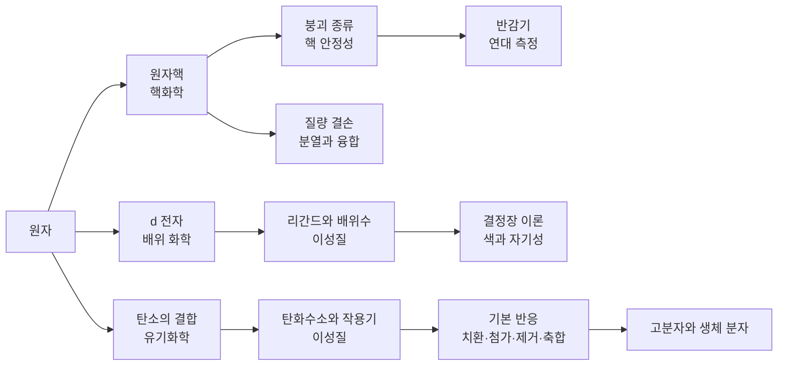

# 일반화학 12. 핵화학·배위 화학·유기화학 개관 — 원자핵에서 금속 착물, 탄소 골격까지
<!-- prev: rxn-3, 2-2, uchem-5 -->
<!-- next: ubio-1, uearth-5 -->

> [!NOTE]
> **이 단원의 범위**
> - 방사성 붕괴의 종류와 핵 반응식, 핵 안정성(중성자–양성자 비, 마법수)
> - 붕괴 속도와 반감기, 방사성 연대 측정
> - 질량 결손과 핵결합 에너지, 핵분열과 핵융합
> - 전이 금속과 배위 화합물(리간드, 배위수와 구조, 이성질)
> - 결정장 이론으로 보는 색과 자기성
> - 탄화수소와 작용기, 유기 화합물의 이성질, 기본 유기 반응, 고분자와 생체 분자

**학습 목표**

1. 알파·베타·양전자 붕괴, 전자 포획, 감마 방출의 핵 반응식을 완성하고, 중성자–양성자 비로 붕괴 방식을 예측할 수 있다.
2. 방사성 붕괴를 1차 반응 속도식으로 다루어 반감기·방사능을 계산하고, 탄소-14와 우라늄–납 연대 측정을 할 수 있다.
3. 질량 결손에서 핵결합 에너지를 계산하고, 핵자당 결합 에너지 곡선으로 핵분열과 핵융합이 에너지를 내는 까닭을 설명할 수 있다.
4. 배위 화합물의 중심 금속 산화수·배위수·구조를 정하고, 구조 이성질과 입체 이성질(기하·광학)을 구별할 수 있다.
5. 결정장 갈라짐으로 전이 금속 착물의 색, 고스핀·저스핀, 홀전자 수와 자기성을 설명할 수 있다.
6. 탄화수소와 주요 작용기를 분류·명명하고, 이성질체와 기본 유기 반응(치환·첨가·제거·축합·산화–환원)을 예측하며, 고분자와 생체 분자의 결합을 설명할 수 있다.

**이 단원의 학습 사다리**

| 단계 | 무엇을 하나? |
|---|---|
| STEP 1. 이전 학습 다시 보기 | 별 속의 핵융합, 동위 원소, 1차 반응, 루이스 구조와 혼성, 작용기와 중합 |
| STEP 2. 기초 다지기 | 핵종 표기와 보존 법칙, 지수 붕괴와 로그, $E = mc^2$와 단위, d 오비탈의 모양 |
| STEP 3. 핵심 개념 | 핵화학(붕괴·안정성·속도·연대·결합 에너지·분열/융합) → 배위 화학(착물·이성질·결정장) → 유기화학(탄화수소·작용기·이성질·반응·고분자·생체 분자) |
| STEP 4. 오개념 바로잡기 | "반감기 두 번이면 모두 사라진다", "착물의 색은 흡수한 빛의 색이다" 같은 착각 |
| STEP 5. 전공으로 | 핵물리·방사화학, 무기화학의 리간드장 이론, 유기화학의 반응 메커니즘 |
| STEP 6. 생활·산업·진로 | 핵의학, 원자력과 핵융합, 항암제와 촉매, 신약·고분자 산업 |

---

## 🗺️ 단원 들어가기

병원의 PET 검사에서는 플루오린-18이 들어간 포도당을 몸에 넣는다. 이 원자핵은 약 110분마다 절반씩 붕괴하며 양전자를 내고, 양전자는 곧 전자와 만나 사라지며 감마선 두 줄기를 정반대 방향으로 쏜다. 장비는 그 감마선을 거꾸로 추적해 암세포가 포도당을 많이 쓰는 곳을 그린다. 같은 병원의 항암 주사실에서는 백금 원자 하나에 암모니아 두 분자와 염화 이온 두 개가 붙은 작은 분자(시스플라틴)가 DNA에 달라붙어 암세포의 분열을 막는다. 그리고 그 약을 녹인 수액 봉지는 탄소 사슬이 수만 번 이어진 고분자로 만들어졌다.

지금까지 일반화학은 **원자가 전자**가 움직이는 화학을 다루었다. 이 단원은 그 바깥의 세 갈래를 한꺼번에 둘러본다. 원자핵 자체가 바뀌는 **핵화학**, d 오비탈을 가진 전이 금속이 리간드와 결합하는 **배위 화학**, 탄소가 수백만 가지 분자를 만드는 **유기화학**이다. 각각은 대학 2학년 이후 독립된 전공 과목이 되므로, 여기서는 일반화학에서 배운 도구(1차 속도식, 전자 배치, 혼성 오비탈, 분자 간 힘)로 각 분야의 핵심 원리를 정량적으로 잡아 두는 것을 목표로 한다.

---

## STEP 1. 🔙 이전 학습 다시 보기

### 연계 개념표

| 이전 단원 | 그때 배운 것 | 이 단원에서 확장되는 것 |
|---|---|---|
| 통합과학1 「별의 진화와 원소의 생성」 | 별 중심부의 수소 핵융합, 철까지의 원소 생성, 초신성과 무거운 원소(정성적) | 핵 반응식의 정량적 완성, 질량 결손으로 결합 에너지·반응 에너지 계산, 핵자당 결합 에너지 곡선 |
| 고등학교 「화학 반응의 세계」 '탄소 화합물과 반응' | 알코올·알데하이드·카복실산 등 작용기 분류, 알코올의 산화, 에스터화, 첨가·축합 중합 | 탄화수소의 체계적 명명, 구조·기하·광학 이성질, 반응을 치환·첨가·제거·축합으로 분류, 생체 분자까지 |
| 일반화학 「화학 결합과 분자 구조」 | 루이스 구조, VSEPR, 혼성 오비탈, σ·π 결합, 분자 오비탈과 자기성 | 탄소의 $sp^3$·$sp^2$·$sp$ 혼성으로 유기 분자의 모양과 반응성, 금속–리간드의 배위 결합, d 오비탈의 갈라짐 |
| 일반화학 「원자의 전자 구조와 주기성」 | d 오비탈의 모양, 전이 금속의 전자 배치, 훈트 규칙 | 리간드장 속 d 전자 배치(고스핀·저스핀), 홀전자 수와 자기 모멘트 |
| 일반화학 「화학 반응 속도론」 | 1차 반응의 적분 속도식, 반감기 $t_{1/2} = \ln 2/k$ | 방사성 붕괴는 완벽한 1차 과정, 연대 측정 |
| 일반화학 「산·염기와 수용액 평형」 | 루이스 산·염기, 착이온 평형 | 리간드(루이스 염기)와 금속 이온(루이스 산)의 배위 결합 |

### 준비 운동 (사전 진단)

**Q1.** 탄소-12와 탄소-14는 무엇이 같고 무엇이 다른가?

**Q2.** 1차 반응의 반감기가 10분이다. 30분 뒤에 남는 반응물의 비율은?

**Q3.** $\mathrm{Fe^{2+}}$의 바닥 상태 전자 배치를 쓰고, 홀전자 수를 구하시오. (Fe의 원자 번호 26)

**Q4.** 에탄올($\mathrm{C_2H_5OH}$)과 다이메틸 에터($\mathrm{CH_3OCH_3}$)는 분자식이 같다. 끓는점이 훨씬 높은 쪽과 그 이유는?

정답 및 해설

**Q1.** 양성자 수(6, 원자 번호)와 화학적 성질이 같고, 중성자 수(6과 8)와 질량수가 다르다. 동위 원소이다.

**Q2.** 반감기 3번이므로 $(1/2)^3 = 1/8 = 12.5\ \%$.

**Q3.** $[\mathrm{Ar}]3d^6$. 전이 금속은 4s 전자를 먼저 잃는다. d 오비탈 5개에 훈트 규칙으로 채우면 홀전자 4개.

**Q4.** 에탄올(약 78 ℃, 다이메틸 에터는 약 −24 ℃). 에탄올은 $\mathrm{-OH}$로 분자 사이에 수소 결합을 한다. 이처럼 분자식이 같고 구조가 다른 것이 ⑫의 구조 이성질체이다.

---

## STEP 2. 🧱 기초 다지기

### 디딤돌 1. 핵종 표기와 두 가지 보존 법칙

원자핵 하나하나의 종류를 **핵종(nuclide)** 이라 하고 $^{A}_{Z}\mathrm{X}$로 쓴다. $A$는 질량수(양성자 + 중성자), $Z$는 원자 번호(양성자 수), 중성자 수는 $N = A - Z$이다.

| 입자 | 기호 | 질량수 $A$ | 전하수 $Z$ |
|---|---|---|---|
| 양성자 | $^{1}_{1}\mathrm{p}$ 또는 $^{1}_{1}\mathrm{H}$ | 1 | +1 |
| 중성자 | $^{1}_{0}\mathrm{n}$ | 1 | 0 |
| 전자(베타 입자) | $^{\;\,0}_{-1}\mathrm{e}$ 또는 $\beta^-$ | 0 | −1 |
| 양전자 | $^{0}_{+1}\mathrm{e}$ 또는 $\beta^+$ | 0 | +1 |
| 알파 입자 | $^{4}_{2}\mathrm{He}$ 또는 $\alpha$ | 4 | +2 |
| 감마선 | $^{0}_{0}\gamma$ | 0 | 0 |

> [!IMPORTANT]
> 핵 반응식에서는 **질량수의 합**과 **전하수(원자 번호)의 합**이 양변에서 같아야 한다. 화학 반응식처럼 원소의 종류를 보존하는 것이 아니다. 원소가 바뀌는 것이 핵반응의 본질이다.

### 디딤돌 2. 지수 붕괴와 로그

「화학 반응 속도론」의 1차 반응을 그대로 쓴다. 단위 시간에 붕괴하는 핵의 수는 남아 있는 핵의 수 $N$에 비례한다.

$$
-\frac{dN}{dt} = \lambda N \;\Longrightarrow\; \int_{N_0}^{N}\frac{dN}{N} = -\lambda\int_0^t dt \;\Longrightarrow\; \ln\frac{N}{N_0} = -\lambda t, \quad N = N_0e^{-\lambda t}
$$

$N = N_0/2$를 넣으면 $t_{1/2} = \ln 2/\lambda = 0.693/\lambda$이다. 남은 비율은 $N/N_0 = (1/2)^{t/t_{1/2}}$로도 쓸 수 있다.

| 경과 시간 | $t_{1/2}$ | $2t_{1/2}$ | $3t_{1/2}$ | $5t_{1/2}$ | $10t_{1/2}$ |
|---|---|---|---|---|---|
| 남은 비율 | 50 % | 25 % | 12.5 % | 3.1 % | 0.098 % |

> [!TIP]
> 💡 **요령** — 반감기 10번이 지나면 약 1000분의 1($2^{10} = 1024$)이 남는다. 방사성 폐기물이나 의료용 동위 원소의 '안전해지는 시간'을 어림할 때 쓰는 기준이다.

### 디딤돌 3. 질량과 에너지 — $E = mc^2$와 핵의 에너지 단위

핵반응에서는 반응 전후 질량의 합이 측정 가능할 만큼 달라지고, 그 차이가 에너지로 나온다.

| 단위·환산 | 값 |
|---|---|
| 원자 질량 단위 | $1\ \mathrm{u} = 1.66054\times10^{-27}\ \mathrm{kg}$ |
| 1 u의 에너지 | $1\ \mathrm{u}\times c^2 = 931.5\ \mathrm{MeV}$ |
| 전자볼트 | $1\ \mathrm{MeV} = 1.602\times10^{-13}\ \mathrm{J}$ |
| 원자 질량(중성 원자) | $^{1}\mathrm{H}$ 1.007825 u, 중성자 1.008665 u, $^{4}\mathrm{He}$ 4.002603 u |

화학 반응의 에너지는 분자 하나당 수 eV, 핵반응은 핵 하나당 수 MeV이다. **약 100만 배** 차이가 원자력의 위력이다.

### 디딤돌 4. d 오비탈 다섯 개의 방향

배위 화학의 핵심은 d 오비탈이 공간에서 **어느 방향을 향하는가**이다.

| 오비탈 | 전자 밀도가 큰 방향 | 무리 |
|---|---|---|
| $d_{x^2-y^2}$ | $x$, $y$ 축 위 | $e_g$ (축을 향함) |
| $d_{z^2}$ | $z$ 축 위(와 $xy$ 평면의 고리) | $e_g$ (축을 향함) |
| $d_{xy}$, $d_{yz}$, $d_{xz}$ | 두 축 **사이**(대각선 방향) | $t_{2g}$ (축 사이) |

고립된 금속 이온에서 다섯 d 오비탈의 에너지는 같다(**겹침**, 축퇴). 리간드가 축 방향에서 다가오면 축을 향한 두 오비탈만 더 크게 반발을 받아 에너지가 올라간다. 이것이 ⑨ 결정장 이론의 출발점이다.

---

## STEP 3. 📘 핵심 개념

### ① 방사성 붕괴의 종류와 핵 반응식

불안정한 원자핵이 입자나 전자기파를 내며 더 안정한 핵으로 바뀌는 것을 **방사성 붕괴(radioactive decay)** 라 한다.

| 붕괴 | 핵 속에서 일어나는 일 | $A$ 변화 | $Z$ 변화 | 예 |
|---|---|---|---|---|
| 알파 붕괴 | $^{4}_{2}\mathrm{He}$ 덩어리 방출 | −4 | −2 | $^{226}_{88}\mathrm{Ra} \rightarrow\, ^{222}_{86}\mathrm{Rn} + \,^{4}_{2}\mathrm{He}$ |
| 베타 붕괴($\beta^-$) | $\mathrm{n \rightarrow p + e^- + \bar{\nu}}$ | 0 | +1 | $^{14}_{6}\mathrm{C} \rightarrow\, ^{14}_{7}\mathrm{N} + \,^{\;\,0}_{-1}\mathrm{e}$ |
| 양전자 방출($\beta^+$) | $\mathrm{p \rightarrow n + e^+ + \nu}$ | 0 | −1 | $^{18}_{9}\mathrm{F} \rightarrow\, ^{18}_{8}\mathrm{O} + \,^{0}_{+1}\mathrm{e}$ |
| 전자 포획 | 안쪽 전자를 핵이 잡아 $\mathrm{p + e^- \rightarrow n}$ | 0 | −1 | $^{40}_{19}\mathrm{K} + \,^{\;\,0}_{-1}\mathrm{e} \rightarrow\, ^{40}_{18}\mathrm{Ar}$ |
| 감마 방출 | 들뜬 핵이 바닥 상태로(핵종 그대로) | 0 | 0 | $^{99m}_{43}\mathrm{Tc} \rightarrow\, ^{99}_{43}\mathrm{Tc} + \gamma$ |

($\nu$, $\bar{\nu}$은 중성미자·반중성미자로, 질량수와 전하가 0이어서 핵 반응식에서는 보통 생략한다.)

| 방사선 | 정체 | 투과력 | 막는 물질(대략) | 몸 밖에 있을 때 / 몸 안에 들어왔을 때 |
|---|---|---|---|---|
| 알파선 | 헬륨 원자핵 | 가장 약함 | 종이 한 장, 피부 각질층 | 거의 무해 / 매우 위험(좁은 범위에 에너지를 집중) |
| 베타선 | 전자·양전자 | 중간 | 수 mm의 알루미늄, 플라스틱 | 피부 손상 가능 / 위험 |
| 감마선 | 고에너지 광자 | 가장 강함 | 두꺼운 납, 콘크리트 | 몸 전체 투과 / 위험 |

#### 예제 1 — 핵 반응식 완성하기

빈칸의 핵종 또는 입자를 쓰시오.
(1) $^{238}_{92}\mathrm{U} \rightarrow\, ^{4}_{2}\mathrm{He} + \,\square$ (2) $^{131}_{53}\mathrm{I} \rightarrow\, ^{131}_{54}\mathrm{Xe} + \,\square$ (3) $^{14}_{7}\mathrm{N} + \,^{4}_{2}\mathrm{He} \rightarrow\, ^{17}_{8}\mathrm{O} + \,\square$

**풀이**
(1) $A$: $238 - 4 = 234$, $Z$: $92 - 2 = 90$ → $^{234}_{90}\mathrm{Th}$
(2) $A$: 0, $Z$: $53 - 54 = -1$ → $^{\;\,0}_{-1}\mathrm{e}$ (베타 붕괴)
(3) $A$: $14 + 4 - 17 = 1$, $Z$: $7 + 2 - 8 = 1$ → $^{1}_{1}\mathrm{H}$ (양성자)

**의미** (3)은 1919년 러더퍼드가 처음으로 한 원소를 다른 원소로 인공적으로 바꾼 **핵변환** 반응이다. 오늘날 가속기와 원자로에서 의료용 동위 원소와 초우라늄 원소를 이렇게 만든다.

#### 붕괴 계열

우라늄-238은 한 번의 붕괴로 끝나지 않고 알파·베타 붕괴를 14번 거듭해 안정한 납-206에 이른다(**붕괴 계열**). 알파 붕괴만 질량수를 바꾸므로 알파 붕괴 횟수는 $(238 - 206)/4 = 8$번이다. 8번의 알파 붕괴로 원자 번호가 16 줄어 $92 - 16 = 76$이 되므로, 82(납)에 이르려면 베타 붕괴가 $82 - 76 = 6$번 필요하다. 이 계열 중간에 기체 라돈-222가 생겨, 화강암 지대 건물의 실내 라돈이 문제가 된다.

### ② 핵 안정성 — 어떤 핵이 붕괴할까

약 3000종 넘게 알려진 핵종 가운데 안정한 것은 약 250종뿐이다. 이들을 중성자 수–양성자 수 평면에 찍으면 좁은 띠(**안정 띠**)를 이룬다.

| 영역 | 특징 | 예상 붕괴 | 이유 |
|---|---|---|---|
| $Z \le 20$ | 안정 핵은 $N/Z \approx 1$ | — | 양성자 사이의 전기적 반발이 작다 |
| $Z$가 커질수록 | 안정 핵의 $N/Z$가 1.5 정도까지 증가 | — | 전기 반발을 이기려면 핵력만 주는 중성자가 더 필요 |
| 띠의 위쪽(중성자 과잉) | $N/Z$가 너무 크다 | $\beta^-$ (n → p) | $N/Z$를 줄인다 (예: $^{14}\mathrm{C}$) |
| 띠의 아래쪽(양성자 과잉) | $N/Z$가 너무 작다 | $\beta^+$ 또는 전자 포획 (p → n) | $N/Z$를 키운다 (예: $^{11}\mathrm{C}$, $^{18}\mathrm{F}$) |
| $Z > 83$ | 안정 핵이 없다 | 주로 $\alpha$ | 핵이 너무 커서 한꺼번에 크기를 줄인다 |

**안정성을 높이는 요인**
- **짝수–짝수 규칙**: 양성자와 중성자가 모두 짝수인 핵이 안정 핵종의 절반 이상을 차지하고, 둘 다 홀수인 안정 핵은 $^{2}\mathrm{H}$, $^{6}\mathrm{Li}$, $^{10}\mathrm{B}$, $^{14}\mathrm{N}$ 정도뿐이다. 핵자도 전자처럼 쌍을 이룰 때 안정하다.
- **마법수**: 양성자나 중성자 수가 2, 8, 20, 28, 50, 82, 126인 핵이 특히 안정하다. 원자의 닫힌 껍질(비활성 기체)처럼 핵에도 껍질 구조가 있다는 증거이다. $^{4}_{2}\mathrm{He}$, $^{16}_{8}\mathrm{O}$, $^{40}_{20}\mathrm{Ca}$, $^{208}_{82}\mathrm{Pb}$($N = 126$)은 '이중 마법수' 핵이다.

> [!TIP]
> 💡 **비유** — 원자핵은 **서로 밀어내는 양성자**들을 **접착제(핵력)** 로 붙여 놓은 덩어리이다. 중성자는 밀어내지 않고 접착제만 더해 주는 '완충재'이다. 작은 덩어리는 완충재가 양성자만큼이면 충분하지만, 덩어리가 커지면 먼 곳의 양성자끼리도 밀어내므로 완충재를 더 넣어야 한다. 너무 커지면 아무리 넣어도 버티지 못하고 조각(알파 입자)을 떼어 낸다.

#### 예제 2 — 붕괴 방식 예측

다음 핵종이 어떤 방식으로 붕괴할지 예측하시오. (1) $^{32}_{15}\mathrm{P}$ (안정 동위 원소 $^{31}\mathrm{P}$) (2) $^{11}_{6}\mathrm{C}$ (3) $^{210}_{84}\mathrm{Po}$

**풀이**
(1) $N/Z = 17/15$로 안정한 $^{31}\mathrm{P}$($16/15$)보다 중성자가 많다 → $\beta^-$ ($^{32}\mathrm{S}$ 생성)
(2) $N/Z = 5/6 < 1$, 양성자 과잉 → $\beta^+$ ($^{11}\mathrm{B}$ 생성, PET 검사에 쓰인다)
(3) $Z = 84 > 83$ → $\alpha$ ($^{206}\mathrm{Pb}$ 생성)

### ③ 붕괴 속도와 반감기

방사성 붕괴는 온도·압력·화학 결합 상태에 거의 영향을 받지 않는 **완벽한 1차 과정**이다. 붕괴 상수 $\lambda$는 핵종마다 고유하다.

| 핵종 | 반감기(약) | 붕괴 | 쓰임 |
|---|---|---|---|
| $^{18}\mathrm{F}$ | 110분 | $\beta^+$ | PET 영상 |
| $^{99m}\mathrm{Tc}$ | 6.0시간 | $\gamma$ | 뼈·심장 영상 |
| $^{131}\mathrm{I}$ | 8.02일 | $\beta^-$ | 갑상샘 질환 치료 |
| $^{60}\mathrm{Co}$ | 5.27년 | $\beta^-$, $\gamma$ | 방사선 치료, 식품·의료 기구 멸균 |
| $^{90}\mathrm{Sr}$ | 28.8년 | $\beta^-$ | 핵분열 생성물(뼈에 축적) |
| $^{14}\mathrm{C}$ | 5730년 | $\beta^-$ | 유기물 연대 측정 |
| $^{40}\mathrm{K}$ | $1.25\times10^9$년 | $\beta^-$, 전자 포획 | 암석 연대 측정 |
| $^{238}\mathrm{U}$ | $4.47\times10^9$년 | $\alpha$ | 암석·지구 연대 측정 |

#### 방사능

**방사능(activity)** $A$는 단위 시간당 붕괴 수이다. SI 단위는 **베크렐**(Bq, 1초에 1번 붕괴)이고, 옛 단위 퀴리(Ci)는 라듐 1 g의 방사능에서 유래했다($1\ \mathrm{Ci} = 3.7\times10^{10}\ \mathrm{Bq}$).

$$
A = -\frac{dN}{dt} = \lambda N, \qquad A = A_0e^{-\lambda t}
$$

같은 수의 원자라면 **반감기가 짧을수록 방사능이 강하다.**

#### 예제 3 — 코발트-60 선원의 방사능

$^{60}\mathrm{Co}$ 1.00 μg의 방사능을 구하시오. 10.0년 뒤에는 처음의 몇 %가 남는가? ($t_{1/2} = 5.27$년, 1년 $= 3.156\times10^7\ \mathrm{s}$, 몰질량 59.93 g/mol)

**풀이**
$\lambda = \dfrac{0.6931}{5.27\times3.156\times10^7\ \mathrm{s}} = 4.17\times10^{-9}\ \mathrm{s^{-1}}$
$N = \dfrac{1.00\times10^{-6}}{59.93}\times6.022\times10^{23} = 1.00\times10^{16}$
$A = \lambda N = 4.19\times10^7\ \mathrm{Bq}$ (약 1.1 mCi)
10.0년 뒤: $(1/2)^{10.0/5.27} = 0.268$ → 약 26.8 %

**의미** 눈에 보이지도 않는 1 μg이 1초에 4천만 번 붕괴한다. 방사선 치료기의 코발트 선원은 수 년마다 교체해야 하는데, 반감기가 그 주기를 정한다.

### ④ 방사성 연대 측정

붕괴 속도가 환경에 영향을 받지 않으므로, 방사성 핵종은 정확한 '시계'가 된다.

#### 탄소-14 연대 측정

1. 대기 상층에서 우주선의 중성자가 질소와 반응해 $^{14}\mathrm{C}$가 계속 만들어진다: $^{14}_{7}\mathrm{N} + \,^{1}_{0}\mathrm{n} \rightarrow\, ^{14}_{6}\mathrm{C} + \,^{1}_{1}\mathrm{H}$
2. $^{14}\mathrm{C}$는 $\mathrm{CO_2}$가 되어 광합성과 먹이 사슬로 생물에 들어간다. 살아 있는 동안 생물 속 $^{14}\mathrm{C}/^{12}\mathrm{C}$ 비는 대기와 같다(탄소 1 g당 약 0.23 Bq).
3. 생물이 죽으면 공급이 끊기고 $^{14}\mathrm{C}$만 줄어든다.

$$
t = \frac{t_{1/2}}{\ln 2}\ln\frac{A_0}{A} = \frac{5730\ \text{년}}{0.6931}\ln\frac{A_0}{A}
$$

반감기의 약 10배(약 5만 년)까지 측정할 수 있다. 실제로는 과거 대기의 $^{14}\mathrm{C}$ 농도 변화를 나이테 자료 등으로 **보정**한다.

#### 예제 4 — 목탄의 나이

고대 유적의 목탄에서 탄소 1 g당 방사능이 현재 살아 있는 나무의 80.0 %였다. 목탄의 나이는?

**풀이**
$t = \dfrac{5730}{0.6931}\ln\dfrac{1}{0.800} = 8267\times0.2231 = 1.84\times10^3$년 (약 1840년)

#### 우라늄–납 연대 측정

긴 반감기의 핵종은 지구와 암석의 나이를 잰다. 광물이 처음 결정화될 때 납이 없었다면, 지금 있는 $^{206}\mathrm{Pb}$는 모두 $^{238}\mathrm{U}$가 붕괴한 것이다. 처음 우라늄 수 $N_0 = N_\mathrm{U} + N_\mathrm{Pb}$이므로

$$
t = \frac{t_{1/2}}{\ln 2}\ln\left(1 + \frac{N_\mathrm{Pb}}{N_\mathrm{U}}\right)
$$

#### 예제 5 — 오래된 지르콘

한 지르콘 결정에서 $^{206}\mathrm{Pb}/^{238}\mathrm{U}$의 원자 수 비가 0.500이었다. 이 결정의 나이는? ($t_{1/2} = 4.47\times10^9$년)

**풀이**
$t = \dfrac{4.47\times10^9}{0.6931}\ln 1.500 = 2.61\times10^9$년

**의미** 지르콘은 결정이 될 때 우라늄은 받아들이지만 납은 거의 받아들이지 않아 이 가정이 잘 맞는다. 지구에서 가장 오래된 광물 연대(약 44억 년)도 지르콘에서 나왔다. 서로 다른 계열($^{235}\mathrm{U} \rightarrow\, ^{207}\mathrm{Pb}$)의 결과를 교차 확인해 신뢰도를 높인다(일반지구과학 「지질 시대와 지구의 역사」).

| 방법 | 반감기 | 측정 대상 | 측정 범위(대략) |
|---|---|---|---|
| $^{14}\mathrm{C}$ | 5730년 | 나무, 뼈, 섬유 등 유기물 | 수백 년 ~ 5만 년 |
| $^{40}\mathrm{K}$–$^{40}\mathrm{Ar}$ | 12.5억 년 | 화산암 | 수십만 년 ~ 수십억 년 |
| $^{238}\mathrm{U}$–$^{206}\mathrm{Pb}$ | 44.7억 년 | 지르콘 등 광물 | 수백만 년 ~ 지구의 나이 |

### ⑤ 질량 결손과 핵결합 에너지

원자핵의 질량은 그것을 이루는 양성자와 중성자의 질량을 더한 것보다 **항상 작다.** 이 차이를 **질량 결손(mass defect)** $\Delta m$이라 하며, 핵자들이 모여 핵이 될 때 에너지 $\Delta mc^2$를 내놓았기 때문이다. 거꾸로 핵을 낱낱의 핵자로 떼어 내는 데 필요한 에너지가 **핵결합 에너지(nuclear binding energy)** 이다.

$$
\Delta m = Z\,m(^{1}\mathrm{H}) + N\,m_\mathrm{n} - m(\text{원자}), \qquad E_\text{결합} = \Delta m\,c^2 = \Delta m(\mathrm{u})\times931.5\ \mathrm{MeV}
$$

(중성 원자 질량을 쓰면 전자 질량이 양쪽에서 상쇄되도록 양성자 대신 $^{1}\mathrm{H}$ 원자 질량을 쓴다.)

#### 예제 6 — 헬륨-4의 결합 에너지

$^{4}\mathrm{He}$의 원자 질량은 4.002603 u이다. 핵결합 에너지와 핵자당 결합 에너지를 구하시오.

**풀이**
$\Delta m = 2(1.007825) + 2(1.008665) - 4.002603 = 0.030377\ \mathrm{u}$
$E_\text{결합} = 0.030377\times931.5 = 28.30\ \mathrm{MeV}$, 핵자당 $28.30/4 = 7.07\ \mathrm{MeV}$
1 mol로 환산하면 $28.30\times1.602\times10^{-13}\times6.022\times10^{23} = 2.73\times10^{12}\ \mathrm{J/mol}$

**의미** 헬륨 1 mol(4 g)을 만들 때 나오는 에너지가 약 $2.7\times10^{9}\ \mathrm{kJ}$으로, 메테인 1 mol의 연소열(약 890 kJ)의 약 300만 배이다. 질량 결손은 전체 질량의 약 0.76 %이다.

#### 핵자당 결합 에너지 곡선

| 핵종 | 핵자당 결합 에너지 (MeV, 약) |
|---|---|
| $^{2}\mathrm{H}$ | 1.11 |
| $^{4}\mathrm{He}$ | 7.07 |
| $^{12}\mathrm{C}$ | 7.68 |
| $^{16}\mathrm{O}$ | 7.98 |
| $^{56}\mathrm{Fe}$ | 8.79 |
| $^{62}\mathrm{Ni}$ | 8.79 (가장 큰 값 근처) |
| $^{235}\mathrm{U}$ | 7.59 |
| $^{238}\mathrm{U}$ | 7.57 |

- 가벼운 핵에서는 질량수가 커질수록 핵자당 결합 에너지가 급격히 커진다. 이 가운데 $^{4}\mathrm{He}$, $^{12}\mathrm{C}$, $^{16}\mathrm{O}$가 이웃보다 튀어나와 있다.
- 철·니켈 근처(질량수 약 56~62)에서 최대(약 8.8 MeV)이다. **가장 단단히 묶인 핵**이다.
- 그보다 무거워지면 양성자 사이의 전기 반발이 커져 서서히 줄어든다.

> [!IMPORTANT]
> 핵자당 결합 에너지가 **커지는 방향**으로 핵이 바뀌면 에너지가 나온다. 그래서 가벼운 핵은 **합쳐서(핵융합)**, 무거운 핵은 **쪼개서(핵분열)** 철 쪽으로 다가갈 때 에너지를 낸다. 별 속 핵융합이 철에서 멈추는 까닭(통합과학1 「별의 진화와 원소의 생성」)도 이 곡선으로 설명된다.

### ⑥ 핵분열과 핵융합

#### 핵분열

우라늄-235는 느린 중성자를 흡수하면 들뜬 $^{236}\mathrm{U}$가 되어 두 조각으로 쪼개지고, 중성자 2~3개와 큰 에너지를 낸다. 쪼개지는 방식은 여러 가지이며, 그중 하나는 다음과 같다.

$$
^{1}_{0}\mathrm{n} + \,^{235}_{92}\mathrm{U} \rightarrow\, ^{141}_{56}\mathrm{Ba} + \,^{92}_{36}\mathrm{Kr} + 3\,^{1}_{0}\mathrm{n}
$$

#### 예제 7 — 핵분열 한 번의 에너지

원자 질량 $^{235}\mathrm{U}$ 235.043930 u, $^{141}\mathrm{Ba}$ 140.914411 u, $^{92}\mathrm{Kr}$ 91.926156 u, 중성자 1.008665 u를 써서 위 반응의 에너지를 구하시오.

**풀이**
$\Delta m = (235.043930 + 1.008665) - (140.914411 + 91.926156 + 3\times1.008665) = 0.186033\ \mathrm{u}$
$E = 0.186033\times931.5 = 173\ \mathrm{MeV}$

**의미** 여기에 생성된 조각들이 이어서 베타 붕괴하며 내는 에너지 등을 더하면 핵분열 한 번에 약 200 MeV가 나온다. 우라늄-235 1 kg이 모두 분열하면 $200\ \mathrm{MeV}\times(1000/235)\times6.022\times10^{23} \approx 8\times10^{13}\ \mathrm{J}$로, 석탄 1 kg의 연소열(약 $3\times10^7\ \mathrm{J}$)의 약 300만 배이다.

| 개념 | 설명 |
|---|---|
| 연쇄 반응 | 분열에서 나온 중성자가 다른 $^{235}\mathrm{U}$를 분열시킨다 |
| 임계 질량 | 연쇄 반응이 스스로 유지되는 데 필요한 최소 질량. 작으면 중성자가 밖으로 빠져나간다 |
| 원자로의 감속재 | 물·흑연 등으로 빠른 중성자를 느리게 하여 $^{235}\mathrm{U}$에 잘 흡수되게 한다 |
| 제어봉 | 붕소·카드뮴 등 중성자를 흡수하는 물질로 연쇄 반응의 속도를 조절한다 |
| 핵연료 | 천연 우라늄 속 $^{235}\mathrm{U}$는 약 0.7 %. 경수로는 3~5 %로 농축해 쓴다 |
| 사용 후 핵연료 | 반감기가 긴 분열 생성물과 초우라늄 원소를 포함하여 장기 관리가 필요하다 |

#### 핵융합

가벼운 핵이 합쳐지는 반응이다. 태양은 수소 4개를 헬륨 1개로 바꾸는 일련의 반응(양성자–양성자 연쇄)으로 빛나며, 이때 질량의 약 0.7 %가 에너지(26.7 MeV)로 바뀐다. 지구에서 연구하는 핵융합로는 중수소–삼중수소 반응을 쓴다.

$$
^{2}_{1}\mathrm{H} + \,^{3}_{1}\mathrm{H} \rightarrow\, ^{4}_{2}\mathrm{He} + \,^{1}_{0}\mathrm{n} \qquad E = 17.6\ \mathrm{MeV}
$$

($\Delta m = 2.014102 + 3.016049 - 4.002603 - 1.008665 = 0.018883\ \mathrm{u}$)

| 비교 | 핵분열 | 핵융합 |
|---|---|---|
| 연료 | $^{235}\mathrm{U}$, $^{239}\mathrm{Pu}$ | 중수소(바닷물), 삼중수소(리튬에서 생산) |
| 질량당 에너지 | 매우 크다 | 더 크다(D–T 연료 1 kg당 약 $3\times10^{14}\ \mathrm{J}$) |
| 반응 조건 | 느린 중성자, 상온에서도 | 약 1억 K 이상의 플라스마. 전기 반발을 이기고 핵이 충분히 가까워져야 한다 |
| 방사성 폐기물 | 장수명 폐기물이 생긴다 | 장수명 폐기물이 적다. 중성자에 의해 구조재가 방사화된다 |
| 현황 | 상용 발전 | 연구·실증 단계 |

### ⑦ 전이 금속과 배위 화합물

#### 전이 금속의 공통 성질

d 오비탈이 부분적으로 채워진 전이 금속은 주족 원소와 다른 성질을 보인다.

| 성질 | 원인 | 예 |
|---|---|---|
| 여러 산화 상태 | 4s와 3d의 에너지가 비슷해 잃는 전자 수가 다양 | Mn: +2, +4, +7 |
| 화합물이 색을 띤다 | d 오비탈 사이의 전자 전이가 가시광선 에너지 | 푸른 $\mathrm{CuSO_4\cdot5H_2O}$, 분홍색 $\mathrm{CoCl_2\cdot6H_2O}$ |
| 상자기성 화합물이 많다 | 홀전자 | $\mathrm{FeCl_3}$, $\mathrm{CuSO_4}$ |
| 촉매 작용 | 산화수 변화, 빈 d 오비탈에 분자가 결합 | 암모니아 합성의 철, 자동차 촉매의 백금·팔라듐·로듐 |
| 착이온 형성 | 빈 오비탈이 리간드의 전자쌍을 받는다 | $\mathrm{[Cu(NH_3)_4]^{2+}}$, $\mathrm{[Fe(CN)_6]^{4-}}$ |

#### 배위 화합물의 구성

**배위 화합물(coordination compound)** 은 중심 금속 원자·이온에 **리간드(ligand)** 가 비공유 전자쌍을 내주어 **배위 결합**한 착이온(또는 중성 착물)을 포함한 화합물이다. 금속은 루이스 산, 리간드는 루이스 염기이다.

$$
\underbrace{[\mathrm{Co}(\mathrm{NH_3})_5\mathrm{Cl}]}_{\text{배위권(착이온)}}{}^{2+}\ \underbrace{\mathrm{2Cl^-}}_{\text{상대 이온}} \quad\Longrightarrow\quad [\mathrm{Co(NH_3)_5Cl}]\mathrm{Cl_2}
$$

| 용어 | 뜻 | 예 |
|---|---|---|
| 리간드 | 금속에 전자쌍을 주는 분자·이온 | $\mathrm{H_2O}$, $\mathrm{NH_3}$, $\mathrm{Cl^-}$, $\mathrm{CN^-}$, CO |
| 주개 원자 | 리간드에서 실제로 전자쌍을 주는 원자 | $\mathrm{NH_3}$의 N, $\mathrm{CN^-}$의 C |
| 배위수 | 금속에 결합한 주개 원자의 수 | $\mathrm{[Co(NH_3)_6]^{3+}}$: 6 |
| 한자리 리간드 | 주개 원자 1개 | $\mathrm{NH_3}$, $\mathrm{Cl^-}$ |
| 여러자리 리간드(킬레이트) | 주개 원자 2개 이상이 집게처럼 금속을 문다 | 에틸렌다이아민(en, 두자리), 옥살산 이온(두자리), EDTA(여섯자리) |

> [!NOTE]
> 여러자리 리간드가 만든 착물은 같은 수의 한자리 리간드 착물보다 훨씬 안정하다(**킬레이트 효과**). 리간드 하나가 물 분자 여러 개를 밀어내므로 입자 수가 늘어 **엔트로피가 증가**하기 때문이다(「화학 열역학」). EDTA는 납·수은 중독 치료, 경수의 칼슘 이온 제거, 식품의 금속 이온 봉쇄에 쓰인다. 헤모글로빈의 헴, 엽록소도 금속(철, 마그네슘)을 고리 모양 리간드가 둘러싼 킬레이트이다.

#### 배위수와 구조

| 배위수 | 구조 | 예 | 흔한 금속 이온 |
|---|---|---|---|
| 2 | 선형 | $\mathrm{[Ag(NH_3)_2]^+}$ | $\mathrm{Ag^+}$, $\mathrm{Cu^+}$, $\mathrm{Au^+}$ |
| 4 | 사면체 | $\mathrm{[Zn(NH_3)_4]^{2+}}$, $\mathrm{[CoCl_4]^{2-}}$ | $\mathrm{Zn^{2+}}$, 할로젠화 착물 |
| 4 | 평면 사각형 | $\mathrm{[Pt(NH_3)_2Cl_2]}$, $\mathrm{[Ni(CN)_4]^{2-}}$ | $d^8$ 이온($\mathrm{Pt^{2+}}$, $\mathrm{Pd^{2+}}$, $\mathrm{Ni^{2+}}$의 일부) |
| 6 | 팔면체 | $\mathrm{[Co(NH_3)_6]^{3+}}$, $\mathrm{[Fe(H_2O)_6]^{2+}}$ | 대부분의 3d 금속 이온 |

#### 이름 짓기(기초)

1. 양이온을 음이온보다 나중에 읽는다(우리말 이름: 음이온 이름 + 양이온 이름. 예: 염화 ○○).
2. 착물 안에서는 리간드를 알파벳 순서로 먼저, 금속을 나중에 쓰고, 금속의 산화수를 로마 숫자로 붙인다.
3. 리간드 이름: $\mathrm{NH_3}$ 암민, $\mathrm{H_2O}$ 아쿠아, $\mathrm{Cl^-}$ 클로로, $\mathrm{CN^-}$ 사이아노, CO 카보닐. 개수는 다이·트라이·테트라·펜타·헥사.
4. 착음이온이면 금속 이름 뒤에 '-산'을 붙인다.

| 화학식 | 이름 |
|---|---|
| $\mathrm{[Co(NH_3)_6]Cl_3}$ | 염화 헥사암민코발트(III) |
| $\mathrm{[Co(NH_3)_5Cl]Cl_2}$ | 염화 펜타암민클로로코발트(III) |
| $\mathrm{K_4[Fe(CN)_6]}$ | 헥사사이아노철(II)산 칼륨 |
| $\mathrm{[Pt(NH_3)_2Cl_2]}$ | 다이암민다이클로로백금(II) |

#### 예제 8 — 베르너의 실험 다시 보기

19세기 말 베르너는 조성이 $\mathrm{CoCl_3\cdot}n\mathrm{NH_3}$인 화합물들을 질산 은 용액과 반응시켜, 화합물 1 mol당 바로 침전되는 AgCl의 몰수를 측정했다.

| 조성 | 색 | 즉시 침전되는 AgCl (mol) | 착물 구조 |
|---|---|---|---|
| $\mathrm{CoCl_3\cdot6NH_3}$ | 노란색 | 3 | $\mathrm{[Co(NH_3)_6]Cl_3}$ |
| $\mathrm{CoCl_3\cdot5NH_3}$ | 자주색 | 2 | $\mathrm{[Co(NH_3)_5Cl]Cl_2}$ |
| $\mathrm{CoCl_3\cdot4NH_3}$ | 초록색과 보라색 두 가지 | 1 | $\mathrm{[Co(NH_3)_4Cl_2]Cl}$ (트랜스·시스) |

$\mathrm{CoCl_3\cdot5NH_3}$ 0.0100 mol을 과량의 질산 은과 반응시키면 생기는 AgCl의 질량은?

**풀이**
배위권 밖의 $\mathrm{Cl^-}$만 바로 침전한다. 2 × 0.0100 = 0.0200 mol, 0.0200 × 143.32 g/mol = 2.87 g

**의미** 코발트에 직접 결합한 염소는 '이온'이 아니어서 은 이온과 바로 반응하지 않는다. 베르너는 이 자료와 이성질체의 수로부터, 중심 금속이 **일정한 배위수(6)** 와 **팔면체 구조**를 가진다는 배위 이론을 세웠다(1913년 노벨 화학상). 마지막 조성에 색이 다른 두 화합물이 있다는 사실은 ⑧의 시스·트랜스 이성질로 설명된다.

#### 예제 9 — 중심 금속의 산화수와 d 전자 수

(1) $\mathrm{K_3[Fe(CN)_6]}$ (2) $\mathrm{[Cu(NH_3)_4]SO_4}$ (3) $\mathrm{[Ni(CO)_4]}$의 중심 금속 산화수와 d 전자 수를 구하시오.

**풀이**
(1) $3(+1) + x + 6(-1) = 0$ → Fe +3, $d^5$ (Fe: $[\mathrm{Ar}]3d^64s^2$에서 전자 3개 제거)
(2) $x + 4(0) + (-2) = 0$ → Cu +2, $d^9$
(3) CO는 중성 → Ni 0, $d^{10}$ (금속 원자의 4s 전자까지 d로 센다고 보는 관례)

### ⑧ 배위 화합물의 이성질

같은 조성인데 원자의 연결이나 공간 배열이 다른 화합물을 **이성질체(isomer)** 라 한다.

| 무리 | 종류 | 무엇이 다른가 | 예 |
|---|---|---|---|
| 구조 이성질 | 이온화 이성질 | 어떤 음이온이 배위권 안에 있는가 | $\mathrm{[Co(NH_3)_5Br]SO_4}$와 $\mathrm{[Co(NH_3)_5SO_4]Br}$ |
| 구조 이성질 | 결합 이성질 | 리간드의 어느 원자로 결합하는가 | $\mathrm{-NO_2}$(N 결합, 노란색)와 $\mathrm{-ONO}$(O 결합, 붉은색) |
| 입체 이성질 | 기하 이성질(시스·트랜스) | 같은 리간드가 이웃(시스, 90°)인가 맞은편(트랜스, 180°)인가 | 평면 사각형 $\mathrm{[Pt(NH_3)_2Cl_2]}$, 팔면체 $\mathrm{[Co(NH_3)_4Cl_2]^+}$ |
| 입체 이성질 | 광학 이성질(거울상) | 거울상과 겹쳐지지 않는다(카이랄) | $\mathrm{[Co(en)_3]^{3+}}$의 두 거울상 |

#### 시스플라틴 — 기하 이성질이 생사를 가른다

평면 사각형 $\mathrm{[Pt(NH_3)_2Cl_2]}$의 시스형(**시스플라틴**)은 강력한 항암제이지만 트랜스형은 효과가 거의 없다. 시스형은 몸 안에서 두 $\mathrm{Cl^-}$이 물로 바뀐 뒤, 바로 이웃한 두 자리로 DNA의 이웃한 구아닌 두 개를 붙잡아 DNA를 구부린다. 트랜스형은 두 자리가 180° 떨어져 있어 이런 결합을 만들지 못한다. 분자의 **기하 구조**가 생물학적 기능을 정한다.

> [!TIP]
> 💡 **비유** — 광학 이성질체는 **오른손과 왼손 장갑**과 같다. 재료도 모양도 똑같지만 아무리 돌려도 겹쳐지지 않는다. 그리고 오른손에는 오른손 장갑만 맞듯, 몸속 효소와 수용체(이들도 한쪽 손잡이를 가진 분자)는 한쪽 거울상과만 잘 맞는다.

> [!NOTE]
> 사면체 착물 $\mathrm{[MA_2B_2]}$에는 기하 이성질체가 없다. 사면체의 네 꼭짓점은 서로 모두 이웃이어서 '맞은편'이 없기 때문이다. 그래서 $\mathrm{[Pt(NH_3)_2Cl_2]}$에 두 이성질체가 존재한다는 사실이 이 착물이 평면 사각형이라는 증거가 된다.

### ⑨ 결정장 이론 — 색과 자기성

**결정장 이론(crystal field theory)** 은 리간드를 음전하(또는 쌍극자의 음극)로 보고, 그 전기장이 금속의 d 오비탈 에너지를 어떻게 갈라놓는지로 착물의 색과 자기성을 설명한다.

#### 팔면체 결정장

리간드 6개가 $\pm x$, $\pm y$, $\pm z$ 축에서 다가오면

- 축을 향한 $d_{x^2-y^2}$, $d_{z^2}$($e_g$)는 리간드와 정면으로 마주쳐 에너지가 **올라간다.**
- 축 사이를 향한 $d_{xy}$, $d_{yz}$, $d_{xz}$($t_{2g}$)는 반발이 적어 상대적으로 **내려간다.**

두 무리의 에너지 차이를 **결정장 갈라짐 에너지** $\Delta_\mathrm{o}$라 한다. 평균 에너지가 유지되도록 $t_{2g}$는 $-0.4\Delta_\mathrm{o}$, $e_g$는 $+0.6\Delta_\mathrm{o}$에 놓인다.

| 결정장 | 갈라짐 | 크기 |
|---|---|---|
| 팔면체 | $t_{2g}$(3개, 아래) / $e_g$(2개, 위) | $\Delta_\mathrm{o}$ |
| 사면체 | $e$(2개, 아래) / $t_2$(3개, 위) — 팔면체와 거꾸로 | $\Delta_\mathrm{t} \approx \frac{4}{9}\Delta_\mathrm{o}$ (리간드가 적고 축을 직접 향하지 않음) |
| 평면 사각형 | $d_{x^2-y^2}$가 홀로 크게 위로 | 가장 크다. $d^8$ 이온이 이 구조를 좋아한다 |

#### 분광 화학 계열

같은 금속 이온이라도 리간드에 따라 $\Delta_\mathrm{o}$가 달라진다. 실험으로 정한 순서는 다음과 같다.

$$
\mathrm{I^- < Br^- < Cl^- < F^- < OH^- < H_2O < NH_3 < en < NO_2^- < CN^- < CO}
$$

왼쪽은 **약한장 리간드**(작은 $\Delta_\mathrm{o}$), 오른쪽은 **강한장 리간드**(큰 $\Delta_\mathrm{o}$)이다. 또 금속 이온의 전하가 클수록, 같은 족에서 아래(4d, 5d)로 갈수록 $\Delta_\mathrm{o}$가 커진다.

#### 색 — 흡수한 빛의 보색

d 전자가 $t_{2g}$에서 $e_g$로 올라가며 $\Delta_\mathrm{o}$에 해당하는 빛을 흡수한다. 우리 눈에는 **흡수되지 않고 남은 빛**, 대략 흡수한 빛의 **보색**이 보인다.

$$
\Delta_\mathrm{o} = h\nu = \frac{hc}{\lambda}, \qquad \Delta_\mathrm{o}(\mathrm{kJ/mol}) = \frac{hcN_\mathrm{A}}{\lambda} = \frac{1.196\times10^5}{\lambda(\mathrm{nm})}
$$

| 흡수하는 빛 (nm, 약) | 흡수색 | 보이는 색(보색) |
|---|---|---|
| 400~430 | 보라 | 노랑 |
| 430~490 | 파랑 | 주황 |
| 490~560 | 초록 | 빨강–자주 |
| 560~590 | 노랑 | 보라 |
| 590~650 | 주황 | 파랑 |
| 650~750 | 빨강 | 청록 |

#### 예제 10 — 타이타늄(III) 착물의 갈라짐 에너지

$\mathrm{[Ti(H_2O)_6]^{3+}}$($d^1$)은 약 500 nm의 빛을 가장 강하게 흡수하여 보라색으로 보인다. $\Delta_\mathrm{o}$를 kJ/mol로 구하시오.

**풀이**
$\Delta_\mathrm{o} = \dfrac{(6.626\times10^{-34})(2.998\times10^8)}{500\times10^{-9}}\times6.022\times10^{23} = 2.39\times10^5\ \mathrm{J/mol} = 239\ \mathrm{kJ/mol}$

**의미** d 전자가 하나뿐이어서 해석이 가장 단순한 예이다. 초록색 근처의 빛을 흡수하므로 빨강과 파랑이 섞인 보라색이 보인다. 결정장 에너지는 화학 결합 에너지(수백 kJ/mol)와 같은 규모이다.

#### 자기성 — 고스핀과 저스핀

$d^4$~$d^7$ 팔면체 착물에서는 네 번째 전자부터 두 가지 선택이 있다.

- $\Delta_\mathrm{o}$가 **작으면**(약한장) 전자가 쌍을 이루는 에너지(짝지음 에너지 $P$)를 아끼려 위의 $e_g$로 올라간다 → **고스핀**, 홀전자 많음
- $\Delta_\mathrm{o}$가 **크면**(강한장, $\Delta_\mathrm{o} > P$) 아래 $t_{2g}$에서 쌍을 이룬다 → **저스핀**, 홀전자 적음

| 착물 | 금속 이온 | 리간드 | 배치 | 홀전자 | 자기성 |
|---|---|---|---|---|---|
| $\mathrm{[Fe(H_2O)_6]^{2+}}$ | $\mathrm{Fe^{2+}}$, $d^6$ | $\mathrm{H_2O}$ (약한장) | $t_{2g}^4e_g^2$ 고스핀 | 4 | 상자기성 |
| $\mathrm{[Fe(CN)_6]^{4-}}$ | $\mathrm{Fe^{2+}}$, $d^6$ | $\mathrm{CN^-}$ (강한장) | $t_{2g}^6$ 저스핀 | 0 | 반자기성 |
| $\mathrm{[CoF_6]^{3-}}$ | $\mathrm{Co^{3+}}$, $d^6$ | $\mathrm{F^-}$ (약한장) | $t_{2g}^4e_g^2$ 고스핀 | 4 | 상자기성 |
| $\mathrm{[Co(NH_3)_6]^{3+}}$ | $\mathrm{Co^{3+}}$, $d^6$ | $\mathrm{NH_3}$ | $t_{2g}^6$ 저스핀 | 0 | 반자기성 |

홀전자 $n$개인 착물의 자기 모멘트는 스핀만 고려하면 $\mu = \sqrt{n(n+2)}\ \mu_\mathrm{B}$(보어 마그네톤)로 어림할 수 있다. 자기 모멘트를 측정하면 홀전자 수, 나아가 고스핀·저스핀을 판별할 수 있다.

| 홀전자 수 $n$ | 1 | 2 | 3 | 4 | 5 |
|---|---|---|---|---|---|
| $\mu$ ($\mu_\mathrm{B}$) | 1.73 | 2.83 | 3.87 | 4.90 | 5.92 |

#### 결정장 안정화 에너지(CFSE)

d 전자를 $t_{2g}$(−0.4Δ)와 $e_g$(+0.6Δ)에 넣은 에너지의 합이다. 예: $d^6$ 저스핀 $6\times(-0.4\Delta_\mathrm{o}) = -2.4\Delta_\mathrm{o}$(짝지음 에너지 별도), 고스핀 $4(-0.4) + 2(0.6) = -0.4\Delta_\mathrm{o}$. 이 안정화 에너지는 전이 금속 이온의 수화 엔탈피, 이온 반지름의 '울퉁불퉁한' 주기적 경향을 설명한다.

#### 예제 11 — 자기성으로 구조 판단하기

$\mathrm{[Mn(H_2O)_6]^{2+}}$의 자기 모멘트는 약 5.9 $\mu_\mathrm{B}$, $\mathrm{[Mn(CN)_6]^{4-}}$는 약 1.8 $\mu_\mathrm{B}$이다. 각 착물의 홀전자 수와 d 전자 배치를 쓰고, 두 착물의 색이 진한 정도를 비교해 보시오.

**풀이**
$\mathrm{Mn^{2+}}$는 $d^5$이다. 5.9 $\mu_\mathrm{B}$ → 홀전자 5개 → $t_{2g}^3e_g^2$ 고스핀(물은 약한장). 1.8 $\mu_\mathrm{B}$ → 홀전자 1개 → $t_{2g}^5$ 저스핀($\mathrm{CN^-}$는 강한장).

**의미** $d^5$ 고스핀에서는 모든 오비탈에 전자가 하나씩 같은 스핀으로 들어 있어, 전자가 $e_g$로 올라가려면 스핀을 뒤집어야 한다. 이런 전이는 일어나기 어려워(스핀 금지) $\mathrm{[Mn(H_2O)_6]^{2+}}$는 아주 옅은 분홍색이다. 결정장 이론은 색의 '종류'뿐 아니라 '진하기'의 단서도 준다.

### ⑩ 탄화수소 — 유기 분자의 뼈대

탄소는 원자가 전자 4개로 네 개의 공유 결합을 만들고, 탄소끼리 단일·이중·삼중 결합으로 사슬과 고리를 무한히 이을 수 있다. C–C 결합(약 350 kJ/mol)과 C–H 결합(약 410 kJ/mol)이 강하고 극성이 작아 골격이 안정하다.

| 무리 | 결합 | 혼성·구조 | 일반식(사슬) | 대표 물질 | 특징 반응 |
|---|---|---|---|---|---|
| 알케인 | C–C 단일 | $sp^3$, 사면체(109.5°) | $\mathrm{C_nH_{2n+2}}$ | 메테인, 프로페인, 옥테인 | 연소, 빛에 의한 할로젠 치환 |
| 알켄 | C=C 이중 | $sp^2$, 평면(120°) | $\mathrm{C_nH_{2n}}$ | 에텐(에틸렌), 프로펜 | 첨가 반응, 첨가 중합 |
| 알카인 | C≡C 삼중 | $sp$, 선형(180°) | $\mathrm{C_nH_{2n-2}}$ | 에타인(아세틸렌) | 첨가 반응 |
| 방향족 | 벤젠 고리(비편재 π 전자) | $sp^2$, 평면 육각형 | — | 벤젠, 톨루엔 | 치환 반응(고리 유지) |
| 사이클로알케인 | 고리 모양 단일 결합 | $sp^3$ | $\mathrm{C_nH_{2n}}$ | 사이클로헥세인 | 알케인과 비슷 |

#### 이름 짓기(IUPAC 기초)

| 탄소 수 | 1 | 2 | 3 | 4 | 5 | 6 | 7 | 8 |
|---|---|---|---|---|---|---|---|---|
| 어근 | 메트- | 에트- | 프로프- | 뷰트- | 펜트- | 헥스- | 헵트- | 옥트- |
| 알케인 | 메테인 | 에테인 | 프로페인 | 뷰테인 | 펜테인 | 헥세인 | 헵테인 | 옥테인 |

1. 가장 긴 탄소 사슬을 찾아 어미를 정한다(알케인 -에인, 알켄 -엔, 알카인 -아인).
2. 이중·삼중 결합이나 곁가지에 작은 번호가 오도록 사슬에 번호를 매긴다.
3. 곁가지(메틸, 에틸 …)의 위치와 개수를 앞에 붙인다. 예: $\mathrm{CH_3CH(CH_3)CH_2CH_3}$ → 2-메틸뷰테인, $\mathrm{CH_2{=}CHCH_2CH_3}$ → 1-뷰텐

#### 분자 간 힘과 끓는점

| 화합물 | 분자식 | 끓는점 (℃, 약) | 해석 |
|---|---|---|---|
| 펜테인(곧은 사슬) | $\mathrm{C_5H_{12}}$ | 36 | 접촉 면적이 넓어 분산력이 크다 |
| 2-메틸뷰테인 | $\mathrm{C_5H_{12}}$ | 28 | 곁가지로 조금 둥글어짐 |
| 2,2-다이메틸프로페인 | $\mathrm{C_5H_{12}}$ | 10 | 공 모양, 접촉 면적 최소 |

분자식이 같아도 모양에 따라 분산력이 달라진다(「분자 간 힘과 액체·고체·용액」). 휘발유의 성분 설계, 윤활유의 점성 조절이 이런 구조 차이에서 출발한다.

### ⑪ 작용기 — 반응의 무대

탄화수소 골격에 붙은 **작용기(functional group)** 가 분자의 성질과 반응을 정한다. 고등학교에서 배운 알코올·알데하이드·카복실산을 넓혀 정리하자(R은 탄화수소 부분).

| 작용기 | 구조 | 화합물 무리 | 예(관용명) | 특징 |
|---|---|---|---|---|
| 할로젠 | R–X | 할로젠화 알킬 | 클로로메테인 | 치환·제거 반응의 출발 물질 |
| 하이드록시기 | R–OH | 알코올 | 에탄올 | 수소 결합, 산화되어 알데하이드·케톤 |
| 에터 결합 | R–O–R′ | 에터 | 다이에틸 에터 | 수소 결합 주개 없음, 끓는점 낮음, 용매 |
| 폼일기 | R–CHO | 알데하이드 | 에탄알(아세트알데하이드) | 쉽게 산화(은거울 반응) |
| 카보닐기 | R–CO–R′ | 케톤 | 프로판온(아세톤) | 극성 용매, 잘 산화되지 않음 |
| 카복실기 | R–COOH | 카복실산 | 에탄산(아세트산) | 약산($K_\mathrm{a} \approx 10^{-5}$) |
| 에스터 결합 | R–COO–R′ | 에스터 | 에틸 에타노에이트(아세트산 에틸) | 과일 향, 가수 분해 |
| 아미노기 | R–NH₂ | 아민 | 메틸아민 | 약염기(질소의 비공유 전자쌍) |
| 아마이드 결합 | R–CO–NH–R′ | 아마이드 | 아세트아마이드 | 단백질의 펩타이드 결합, 나일론 |

#### 예제 12 — 작용기 찾기

진통제 아세트아미노펜은 벤젠 고리의 한쪽에 $\mathrm{-OH}$, 맞은편에 $\mathrm{-NH{-}CO{-}CH_3}$가 붙은 분자이다. 이 분자의 작용기를 모두 쓰고, 산성을 띠는 부분을 고르시오.

**풀이**
벤젠 고리(방향족), 하이드록시기(벤젠 고리에 직접 붙은 –OH, 페놀), 아마이드 결합. 산성을 띠는 부분은 페놀의 –OH이다. 벤젠 고리가 음이온의 전하를 비편재화로 안정시켜 알코올보다 산성이 크다(그래도 카복실산보다는 훨씬 약하다).

### ⑫ 유기 화합물의 이성질

| 종류 | 무엇이 다른가 | 예 | 성질의 차이 |
|---|---|---|---|
| 사슬(골격) 이성질 | 탄소 골격의 가지 | 펜테인 / 2-메틸뷰테인 / 2,2-다이메틸프로페인 | 끓는점 |
| 위치 이성질 | 작용기의 위치 | 1-프로판올 / 2-프로판올 | 산화 생성물(알데하이드 / 케톤) |
| 작용기 이성질 | 작용기의 종류 | 에탄올 / 다이메틸 에터 | 끓는점, 반응성 모두 |
| 기하 이성질(시스·트랜스) | 이중 결합 양쪽 치환기의 배치. C=C는 회전할 수 없다 | 시스-2-뷰텐 / 트랜스-2-뷰텐 | 녹는점, 극성 |
| 광학 이성질(거울상) | 네 가지 서로 다른 원자단이 붙은 탄소(**카이랄 중심**)의 배치 | (R)-/(S)-젖산, 2-뷰탄올 | 편광면 회전 방향, 생체 반응 |

> [!IMPORTANT]
> **카이랄 중심** 찾는 법: $sp^3$ 탄소에 붙은 네 원자단이 **모두 다른가?** 젖산 $\mathrm{CH_3{-}CH(OH){-}COOH}$의 가운데 탄소에는 $\mathrm{-CH_3}$, $\mathrm{-H}$, $\mathrm{-OH}$, $\mathrm{-COOH}$가 붙어 있으므로 카이랄 중심이다. 거울상 이성질체는 녹는점·끓는점이 같지만 편광면을 반대 방향으로 돌리고, 효소·수용체와는 다르게 결합한다.

#### 예제 13 — 이성질체의 수

(1) $\mathrm{C_4H_{10}}$, (2) $\mathrm{C_4H_8}$ 중 사슬 모양 알켄의 구조식을 모두 그리고 이름을 쓰시오.

**풀이**
(1) 뷰테인 $\mathrm{CH_3CH_2CH_2CH_3}$, 2-메틸프로페인 $\mathrm{CH_3CH(CH_3)CH_3}$ → 2가지
(2) 1-뷰텐 $\mathrm{CH_2{=}CHCH_2CH_3}$, 2-뷰텐 $\mathrm{CH_3CH{=}CHCH_3}$(시스와 트랜스 두 가지), 2-메틸프로펜 $\mathrm{CH_2{=}C(CH_3)_2}$ → 4가지
(1-뷰텐과 2-메틸프로펜은 이중 결합의 한쪽 탄소에 같은 원자(H 2개 또는 $\mathrm{CH_3}$ 2개)가 붙어 있어 기하 이성질체가 없다.)

**의미** 탄소 수가 늘어날수록 이성질체의 수는 폭발적으로 늘어난다. 알케인만 해도 $\mathrm{C_{10}H_{22}}$는 75가지, $\mathrm{C_{20}H_{42}}$는 36만 가지가 넘는다. 유기 화합물이 수천만 종에 이르는 까닭이다.

### ⑬ 기본 유기 반응

유기 반응은 대부분 **극성 결합이나 π 결합**에서 일어난다. 반응을 결과에 따라 분류하면 다음과 같다.

| 반응 유형 | 무엇이 일어나나 | 예 | 조건 |
|---|---|---|---|
| 치환 | 원자(단)가 다른 원자(단)로 바뀐다 | $\mathrm{CH_4 + Cl_2 \rightarrow CH_3Cl + HCl}$ | 빛(라디칼 연쇄) |
| 치환(친핵성) | 전자쌍이 풍부한 것이 탄소를 공격 | $\mathrm{CH_3Br + OH^- \rightarrow CH_3OH + Br^-}$ | 수용액 |
| 방향족 치환 | 벤젠 고리의 H가 바뀐다(고리 유지) | $\mathrm{C_6H_6 + HNO_3 \rightarrow C_6H_5NO_2 + H_2O}$ | 진한 황산 촉매 |
| 첨가 | π 결합이 끊기고 두 원자(단)가 붙는다 | $\mathrm{CH_2{=}CH_2 + Br_2 \rightarrow CH_2BrCH_2Br}$ | 상온(브로민수 탈색 → 불포화 확인) |
| 첨가(수소화) | | $\mathrm{CH_2{=}CH_2 + H_2 \rightarrow CH_3CH_3}$ | Ni, Pt 촉매 (식물성 기름의 경화) |
| 첨가(수화) | | $\mathrm{CH_2{=}CH_2 + H_2O \rightarrow CH_3CH_2OH}$ | 산 촉매 (공업용 에탄올) |
| 제거 | 이웃 탄소에서 작은 분자가 빠지며 π 결합 생성 | $\mathrm{CH_3CH_2OH \rightarrow CH_2{=}CH_2 + H_2O}$ | 진한 황산, 약 170 ℃ |
| 축합 | 두 분자가 작은 분자(물 등)를 내며 결합 | $\mathrm{CH_3COOH + C_2H_5OH \rightleftharpoons CH_3COOC_2H_5 + H_2O}$ | 산 촉매, 가역 |
| 산화 | C–H를 잃거나 C–O를 얻는다(탄소의 산화수 증가) | 1차 알코올 → 알데하이드 → 카복실산, 2차 알코올 → 케톤 | $\mathrm{Cr_2O_7^{2-}}$, $\mathrm{MnO_4^-}$ |
| 환원 | C–H를 얻는다 | 알데하이드·케톤 → 알코올 | $\mathrm{H_2}$/촉매, 수소화 붕소 나트륨 |

#### 마르코브니코프 규칙

비대칭 알켄에 HX가 첨가될 때, **H는 수소가 더 많이 붙은 탄소에** 붙고 X는 다른 탄소에 붙는 생성물이 주로 생긴다.

$$
\mathrm{CH_3{-}CH{=}CH_2 + HBr \rightarrow CH_3{-}CHBr{-}CH_3}\ (\text{주생성물, 2-브로모프로페인})
$$

까닭은 반응 중간에 생기는 양이온(탄소 양이온) 중 **더 많은 탄소에 둘러싸인 쪽(2차)이 더 안정**하기 때문이다. 이웃 탄소들이 전자를 밀어 주어 양전하를 분산시킨다. 반응 결과를 외우는 대신 **중간체의 안정성**으로 예측하는 것이 유기화학의 사고방식이다(STEP 5).

#### 예제 14 — 반응 생성물 예측

다음 반응의 주생성물과 반응 유형을 쓰시오.
(1) 1-프로판올을 산성 다이크로뮴산 칼륨으로 충분히 산화 (2) 2-프로판올을 같은 조건에서 산화 (3) 프로펜 + $\mathrm{H_2O}$(산 촉매) (4) 아세트산 + 메탄올(산 촉매)

**풀이**
(1) 프로판산 $\mathrm{CH_3CH_2COOH}$ (산화, 알데하이드를 거쳐)
(2) 프로판온(아세톤) $\mathrm{CH_3COCH_3}$ (산화, 2차 알코올 → 케톤에서 멈춤)
(3) 2-프로판올 $\mathrm{CH_3CH(OH)CH_3}$ (첨가, 마르코브니코프 규칙)
(4) 아세트산 메틸 $\mathrm{CH_3COOCH_3}$ + 물 (축합, 에스터화)

### ⑭ 고분자

**고분자(polymer)** 는 작은 **단위체(monomer)** 수백~수만 개가 공유 결합으로 이어진 거대 분자이다.

| 중합 방식 | 단위체의 조건 | 빠지는 분자 | 예 | 쓰임 |
|---|---|---|---|---|
| 첨가 중합 | C=C 이중 결합 | 없음 | 폴리에틸렌(에텐), 폴리프로필렌(프로펜), PVC(염화 비닐), 폴리스타이렌(스타이렌) | 포장재, 용기, 배관, 단열재 |
| 축합 중합 | 작용기 두 개(양 끝) | 물 등 작은 분자 | 나일론-6,6(다이아민 + 다이카복실산), PET(다이올 + 다이카복실산) | 섬유, 음료병 |
| 천연 고분자 | — | 물 | 녹말·셀룰로스(포도당), 단백질(아미노산), DNA(뉴클레오타이드) | 생명 |

#### 구조와 성질

| 구조 요인 | 영향 |
|---|---|
| 사슬 길이(중합도) | 길수록 사슬이 엉켜 강도·녹는점이 커진다 |
| 곁가지 | 많으면 사슬이 빽빽이 쌓이지 못해 부드럽고 투명(저밀도 폴리에틸렌), 적으면 단단하고 불투명(고밀도 폴리에틸렌) |
| 사슬 사이 힘 | 나일론은 아마이드 사이 수소 결합으로 질기다 |
| 가교(사슬 사이 공유 결합) | 열을 가해도 녹지 않는다(열경화성: 에폭시, 가황 고무) |

#### 예제 15 — 중합도 계산

평균 몰질량이 $2.8\times10^5\ \mathrm{g/mol}$인 폴리에틸렌 사슬 하나에는 에텐 단위가 평균 몇 개 들어 있는가? ($\mathrm{C_2H_4}$ 28.05 g/mol)

**풀이**
$n = 2.8\times10^5/28.05 = 1.0\times10^4$ (약 1만 개, 첨가 중합이므로 반복 단위의 몰질량 = 단위체의 몰질량)

### ⑮ 생체 분자 — 생명의 유기화학

생명체의 4대 분자는 모두 이 단원의 작용기와 반응으로 읽을 수 있다.

| 생체 분자 | 단위체 | 연결 결합(축합) | 핵심 작용기 | 화학적 특징 |
|---|---|---|---|---|
| 탄수화물 | 단당류(포도당 $\mathrm{C_6H_{12}O_6}$) | 글리코사이드 결합(에터 꼴) | 여러 개의 –OH, 고리 속 알데하이드 유래 구조 | 포도당이 α형으로 이어지면 녹말(소화 가능), β형이면 셀룰로스(사람은 소화 불가) |
| 지질(중성 지방) | 글리세롤 + 지방산 3개 | 에스터 결합 | 긴 탄화수소 사슬 | 비극성, 물에 녹지 않음. 지방산의 시스 이중 결합이 많으면 액체(기름) |
| 단백질 | 아미노산 20종 | 펩타이드(아마이드) 결합 | –NH₂, –COOH, 곁사슬 R | 글리신을 뺀 아미노산은 카이랄(대부분 L형). 접힘이 기능을 정한다 |
| 핵산 | 뉴클레오타이드(당 + 인산 + 염기) | 인산다이에스터 결합 | 인산기, 질소 염기 | 염기쌍의 수소 결합(A–T 2개, G–C 3개)이 정보를 저장 |

> [!NOTE]
> 생체 고분자는 모두 **축합**으로 만들어지고 **가수 분해**로 분해된다. 소화는 녹말·단백질·지방을 물로 끊는 가수 분해이고, 이 반응들은 「화학 열역학」의 기준으로 자발적이지만 효소 없이는 매우 느리다. 반대로 고분자를 만드는 축합은 비자발적이어서 ATP와 짝지어진다.

#### 예제 16 — 다이펩타이드

글리신($\mathrm{H_2N{-}CH_2{-}COOH}$)과 알라닌($\mathrm{H_2N{-}CH(CH_3){-}COOH}$)이 축합하여 만들 수 있는 다이펩타이드는 몇 가지이며, 각각의 분자식은?

**풀이**
글리신의 카복실기와 알라닌의 아미노기가 결합한 Gly–Ala, 그 반대인 Ala–Gly → 2가지. 둘 다 분자식은 $\mathrm{C_2H_5NO_2} + \mathrm{C_3H_7NO_2} - \mathrm{H_2O} = \mathrm{C_5H_{10}N_2O_3}$이다.

**의미** 같은 분자식이라도 연결 순서가 다르면 다른 분자이다. 아미노산 20종으로 길이 100인 사슬을 만들면 $20^{100}$가지가 가능하다. 단백질의 다양성은 **서열**에서 나온다(일반생명과학 「생명의 화학」).

---

## STEP 4. ⚠️ 오개념 바로잡기

| 흔한 오개념 | 올바른 개념 | 왜 그럴까? |
|---|---|---|
| 반감기가 두 번 지나면 방사성 물질이 모두 사라진다 | 반감기마다 **남은 양의 절반**이 줄어 $1/4$이 남는다 | 1차 과정의 지수 감소이다. 0에 다가갈 뿐 정확히 0이 되지 않는다 |
| 방사성 핵종은 가열하거나 화합물로 만들면 반감기가 바뀐다 | 반감기는 화학 환경에 거의 영향을 받지 않는다 | 핵 내부의 과정이며 전자 껍질의 에너지 규모보다 훨씬 크다 |
| 베타 붕괴의 전자는 원자의 전자 껍질에서 나온다 | **핵 속 중성자**가 양성자로 바뀌며 생긴 전자이다 | 그래서 원자 번호가 1 커진다 |
| 핵분열과 핵융합은 질량이 사라지는 반응이라 질량 보존 법칙의 예외이다 | 질량–에너지가 함께 보존된다. 줄어든 정지 질량이 에너지로 나온다 | $E = mc^2$. 화학 반응에서도 원리상 같지만 너무 작아 측정되지 않는다 |
| 착물의 색은 흡수한 빛의 색이다 | 우리가 보는 색은 흡수하고 **남은 빛**, 대략 흡수색의 보색이다 | $\mathrm{[Ti(H_2O)_6]^{3+}}$는 초록 근처를 흡수해 보라색으로 보인다 |
| 배위 화합물 속 염소는 모두 염화 이온으로 행동한다 | 배위권 **안**의 염소는 금속과 결합해 있어 바로 침전하지 않는다 | 베르너의 AgCl 침전 실험 |
| 시스·트랜스 이성질체는 같은 물질이다 | C=C나 평면 사각형 착물에서는 회전이 불가능해 **다른 물질**이다 | 시스플라틴과 트랜스플라틴의 약효 차이 |
| 거울상 이성질체는 모든 성질이 같으니 구별할 필요가 없다 | 편광과 **카이랄한 환경(효소, 수용체)** 에서는 다르게 행동한다 | 약물의 한쪽 거울상만 효과가 있거나 부작용을 낼 수 있다 |

---

## STEP 5. 🎓 다음 단계로 한 걸음 더

> [!CAUTION]
> 여기부터는 일반 과목의 범위를 넘는 전공 과목 맛보기이다. 이 단원의 세 갈래가 각각 어떤 전공 과목으로 독립하는지 보여 주기 위한 것으로, 평가 대상이 아니다.

### 전공 과목과의 연결

| 전공 과목 | 이어지는 내용 |
|---|---|
| 핵·방사화학, 원자핵물리 | 핵의 껍질 모형과 액체 방울 모형(결합 에너지 공식), 핵반응 단면적, 방사성 동위 원소 표지 합성 |
| 무기화학 | 리간드장 이론과 분자 오비탈, 다나베–스기노 도표, 유기 금속 화학과 18전자 규칙, 균일계 촉매 |
| 유기화학 | 반응 메커니즘(굽은 화살표), 친핵성 치환($\mathrm{S_N1}$, $\mathrm{S_N2}$)과 제거($\mathrm{E1}$, $\mathrm{E2}$), 입체화학, 합성 설계 |
| 고분자화학 | 중합 속도론, 분자량 분포, 사슬 형태와 유리 전이 |
| 생화학 | 효소 반응 메커니즘, 대사 경로의 유기 반응, 금속 단백질 |
| 의학물리·핵의학 | 방사선량 계산, 영상 장비, 표적 방사선 치료 |

### 맛보기 ① 굽은 화살표로 반응 읽기 — $\mathrm{S_N2}$ 반응

유기화학 전공에서는 반응을 **전자쌍의 이동**으로 그린다. 브로모메테인과 수산화 이온의 반응에서 $\mathrm{OH^-}$의 비공유 전자쌍이 탄소의 뒤쪽에서 공격하고, 동시에 C–Br 결합의 전자쌍이 브로민 쪽으로 떠난다. 한 단계로 일어나며, 속도는 두 반응물 농도의 곱에 비례하고($\mathrm{rate} = k[\mathrm{CH_3Br}][\mathrm{OH^-}]$), 카이랄 탄소라면 우산이 뒤집히듯 입체 배치가 반전된다. 반대로 3차 할로젠화 알킬은 먼저 탄소 양이온을 만든 뒤 반응하는 $\mathrm{S_N1}$ 경로를 따른다. 「화학 반응 속도론」의 반응 메커니즘과 속도 법칙이 그대로 유기 반응을 분류하는 도구가 된다.

### 맛보기 ② 리간드장 이론과 18전자 규칙

결정장 이론은 리간드를 점전하로 보지만, 실제로는 금속과 리간드의 오비탈이 겹쳐 분자 오비탈을 만든다(**리간드장 이론**). 이렇게 보면 CO나 $\mathrm{CN^-}$가 강한장 리간드인 까닭(금속의 d 전자를 리간드의 빈 π* 오비탈로 되돌려 주는 **역결합**)이 설명된다. 유기 금속 화합물에서는 금속의 원자가 전자 수가 18일 때 안정하다는 **18전자 규칙**이 쓰이며, $\mathrm{[Ni(CO)_4]}$($10 + 4\times2 = 18$)가 그 예이다. 이 원리는 의약품·고분자 생산에 쓰이는 균일계 촉매 설계의 기초이다.

### 맛보기 ③ 반경험적 질량 공식

핵을 액체 방울처럼 보면 결합 에너지를 부피 항, 표면 항, 전기 반발 항, 대칭 항, 짝지음 항의 합으로 어림할 수 있다. 이 식 하나로 핵자당 결합 에너지 곡선의 모양, 철 근처의 최댓값, 무거운 핵의 핵분열 가능성, 안정 띠의 휘어짐($N/Z$ 증가)이 함께 설명된다.

### 지금 vs 전공

| 주제 | 일반화학 (이 단원) | 전공 |
|---|---|---|
| 핵화학 | 붕괴 종류, 1차 붕괴, 질량 결손 | 핵 모형, 핵반응 단면적, 방사선과 물질의 상호 작용 |
| 배위 화학 | 결정장 갈라짐, 고·저스핀, 이성질 | 리간드장·분자 오비탈, 전자 스펙트럼 해석, 반응 메커니즘 |
| 유기 반응 | 결과에 따른 분류, 마르코브니코프 규칙 | 굽은 화살표 메커니즘, 입체화학, 다단계 합성 |
| 고분자·생체 분자 | 중합 방식, 결합 종류 | 중합 속도론, 단백질 구조 결정, 효소 메커니즘 |

---

## STEP 6. 🏭 생활·산업·진로 연결

### 사례 1. 핵의학 — 진단과 치료

- **원리** 양전자 방출과 쌍소멸(PET), 감마 방출(영상), 베타 방출(치료), 반감기 설계(③).
- **어디에 쓰이나** $^{18}\mathrm{F}$-포도당 PET로 암의 위치를 찾고, $^{99m}\mathrm{Tc}$로 뼈·심장을 영상화하며, $^{131}\mathrm{I}$로 갑상샘 질환을 치료한다. 반감기가 너무 길면 환자의 피폭이 늘고, 너무 짧으면 만들어 옮기는 사이에 사라진다. 최근에는 암세포에만 달라붙는 분자에 방사성 핵종을 붙인 '표적 방사선 치료'가 주목받는다.

### 사례 2. 원자력 발전과 핵융합 연구

- **원리** 핵분열 연쇄 반응과 핵자당 결합 에너지(⑤, ⑥).
- **어디에 쓰이나** 원자력 발전은 탄소 배출이 적은 대규모 전원이지만, 사용 후 핵연료 관리와 안전이 큰 과제이다. 핵융합은 초고온 플라스마를 자기장으로 가두는 장치에서 연구 중이며, 우리나라도 초전도 핵융합 연구 장치로 고온 플라스마를 오래 유지하는 연구에 참여하고 있다.

### 사례 3. 금속 착물 — 항암제, 촉매, 영상

- **원리** 배위 결합과 기하 이성질(⑦, ⑧), 결정장과 자기성(⑨).
- **어디에 쓰이나** 백금 항암제(시스플라틴 계열), 자동차 배기가스 촉매(백금·팔라듐·로듐), MRI 조영제(홀전자가 7개인 $\mathrm{Gd^{3+}}$ 킬레이트), 이차 전지 양극재의 전이 금속 산화물, 유기 발광 다이오드의 이리듐 착물.

### 사례 4. 신약과 고분자 산업

- **원리** 작용기, 카이랄성, 유기 반응과 중합(⑪~⑮).
- **어디에 쓰이나** 신약 개발은 작용기를 바꾸어 약효·흡수·부작용을 조절하는 일이고, 거울상 이성질체 중 하나만 골라 만드는 '비대칭 합성'이 중요하다. 고분자 산업은 섬유·포장재·반도체 감광재·의료 소재를 만들며, 사용 후 플라스틱을 다시 단위체로 되돌리는 화학적 재활용이 연구되고 있다.

### 관련 전공과 진로

| 진로 | 하는 일 | 관련 학과 |
|---|---|---|
| 핵의학·방사선 전문가 | 방사성 의약품 제조, 영상 판독, 방사선 치료 계획 | 의학과, 방사선학과, 원자핵공학과 |
| 원자력·핵융합 연구원 | 원자로·핵융합 장치 설계, 핵연료·폐기물 관리 | 원자핵공학과, 물리학과 |
| 무기·촉매 화학자 | 금속 착물 촉매, 전지 소재, 발광 소재 개발 | 화학과, 화학공학과, 신소재공학과 |
| 의약화학자 | 신약 후보 물질 설계·합성 | 화학과, 약학과 |
| 고분자 엔지니어 | 플라스틱·섬유·반도체 소재 개발, 재활용 공정 | 고분자공학과, 화학공학과 |
| 연대 측정·고고 과학 연구원 | 방사성 연대 측정, 유물 분석 | 지질학과, 고고학과, 화학과 |

---

## 🔬 탐구 활동

### 활동 A. (모의 실험·자료 분석) 주사위로 방사성 붕괴 흉내 내기

**목표** 무작위 과정의 집합이 지수 붕괴를 따른다는 것을 확인하고, 그래프에서 반감기와 붕괴 상수를 구한다.

**준비물** 정육면체 주사위 100개(또는 스프레드시트의 난수 함수), 상자, 모눈종이 또는 스프레드시트

**과정**
1. 주사위 100개를 상자에 던진다. 1의 눈이 나온 주사위는 '붕괴'한 것으로 보고 꺼낸다.
2. 남은 주사위 수를 기록하고, 남은 것만 다시 던진다. 이를 15회 반복한다.
3. 스프레드시트로 하려면 `=IF(RAND()<1/6,0,1)`을 100칸에 넣고 다시 계산하며 1의 개수를 센다.
4. 던진 횟수 $t$에 대해 남은 수 $N$과 $\ln N$을 그래프로 그린다.
5. $\ln N$–$t$ 그래프의 기울기로 붕괴 상수 $\lambda$를, 이로부터 '반감기'(던지는 횟수)를 구한다.

**결과 기록**

| 던진 횟수 $t$ | 0 | 1 | 2 | 3 | 4 | 5 | 6 | 8 | 10 | 15 |
|---|---|---|---|---|---|---|---|---|---|---|
| 남은 주사위 $N$ | 100 | | | | | | | | | |
| 이론값 $100(5/6)^t$ | 100 | 83 | 69 | 58 | 48 | 40 | 33 | 23 | 16 | 6.5 |
| $\ln N$ | 4.61 | | | | | | | | | |

**생각해 보기**
1. 이론적인 반감기는 $\ln 2/[-\ln(5/6)] \approx 3.8$회이다. 측정값과 비교해 보자.
2. 주사위 개수가 10개일 때와 1000개일 때 그래프의 '매끄러움'은 어떻게 다를까? 실제 시료의 원자 수($10^{20}$개 이상)에서는 어떨지 추론해 보자.
3. 특정한 주사위 하나가 언제 '붕괴'할지 예측할 수 있는가? 이것이 개별 원자핵의 붕괴와 어떻게 닮았는가?

### 활동 B. (실험) 리간드를 바꾸며 착이온의 색 변화 관찰하기

**목표** 같은 금속 이온에 리간드를 바꾸면 흡수하는 빛(결정장 갈라짐)이 달라짐을 관찰하고, 분광 화학 계열과 연결한다.

**준비물** 0.1 M 황산 구리(II) 수용액, 6 M 암모니아수, 진한 염산(교사 지도), 0.1 M 염화 코발트(II) 수용액, 시험관, 스포이트, 흰 종이, (가능하면) 간이 분광기나 스마트폰 분광 앱

**과정**
1. 시험관 두 개에 황산 구리(II) 용액을 2 mL씩 넣는다. 하나는 비교용으로 둔다.
2. 다른 시험관에 암모니아수를 한 방울씩 넣으며 관찰한다. 처음에 생긴 옅은 푸른 앙금($\mathrm{Cu(OH)_2}$)이 다시 녹으며 짙은 남색($\mathrm{[Cu(NH_3)_4]^{2+}}$)이 되는 것을 확인한다.
3. 염화 코발트(II) 용액 2 mL에 진한 염산을 조금씩(교사가) 넣어 분홍색($\mathrm{[Co(H_2O)_6]^{2+}}$)이 파란색($\mathrm{[CoCl_4]^{2-}}$)으로 변하는 것을 관찰한다. 물을 넣으면 다시 분홍색으로 돌아오는지 확인한다.
4. 분광기가 있으면 각 용액의 흡수 극대 파장을 기록한다.

**결과 기록**

| 착이온 | 리간드 | 구조 | 보이는 색 | 흡수 극대 파장 (nm) | 추정 흡수색 |
|---|---|---|---|---|---|
| $\mathrm{[Cu(H_2O)_6]^{2+}}$ | $\mathrm{H_2O}$ | 팔면체(일그러짐) | | | |
| $\mathrm{[Cu(NH_3)_4]^{2+}}$ | $\mathrm{NH_3}$ | 평면 사각형에 가까움 | | | |
| $\mathrm{[Co(H_2O)_6]^{2+}}$ | $\mathrm{H_2O}$ | 팔면체 | | | |
| $\mathrm{[CoCl_4]^{2-}}$ | $\mathrm{Cl^-}$ | 사면체 | | | |

**생각해 보기**
1. 구리 착물에서 $\mathrm{H_2O}$를 $\mathrm{NH_3}$로 바꾸었을 때 흡수 파장은 길어졌는가, 짧아졌는가? 분광 화학 계열과 맞는가?
2. 코발트 착물의 색 변화를 리간드의 세기와 **구조(팔면체 → 사면체)** 의 두 가지 효과로 설명해 보자.
3. 물을 넣으면 다시 분홍색이 되는 것을 르샤틀리에 원리로 설명해 보자.

> [!WARNING]
> **안전 수칙** 보안경, 실험복, 장갑을 착용한다. 진한 암모니아수와 진한 염산은 증기가 자극적이므로 후드 안이나 환기가 잘 되는 곳에서 다루고, 진한 염산은 교사가 다룬다. 코발트 화합물은 독성과 피부 과민 반응이 있으므로 피부에 닿지 않게 한다. 구리·코발트 폐액은 하수구에 버리지 않고 중금속 폐액 용기에 모은다.

---

## ✅ 개념 확인 문제

### 기본

**1.** 다음 핵 반응식을 완성하시오.
(1) $^{210}_{84}\mathrm{Po} \rightarrow\, ^{4}_{2}\mathrm{He} + \,\square$ (2) $^{90}_{38}\mathrm{Sr} \rightarrow\, \square + \,^{\;\,0}_{-1}\mathrm{e}$ (3) $^{11}_{6}\mathrm{C} \rightarrow\, ^{11}_{5}\mathrm{B} + \,\square$ (4) $^{59}_{27}\mathrm{Co} + \,^{1}_{0}\mathrm{n} \rightarrow\, \square$

정답 및 해설

**정답** (1) $^{206}_{82}\mathrm{Pb}$ (2) $^{90}_{39}\mathrm{Y}$ (3) $^{0}_{+1}\mathrm{e}$ (양전자) (4) $^{60}_{27}\mathrm{Co}$

질량수와 원자 번호의 합을 양변에서 맞춘다. (4)는 원자로에서 중성자를 쬐어 방사선원 코발트-60을 만드는 반응이다.

**2.** 갑상샘 치료에 쓰는 아이오딘-131($t_{1/2} = 8.02$일)은 30.0일 뒤에 처음 양의 몇 %가 남는가?

정답 및 해설

**정답** 약 7.5 %

$(1/2)^{30.0/8.02} = (1/2)^{3.74} = 0.0748$. 반감기의 약 3.7배이므로 1/8(12.5 %)보다 조금 적게 남는다.

**3.** 착물 $\mathrm{[Co(NH_3)_4Cl_2]Cl}$에 대하여 (1) 중심 금속의 산화수, (2) 배위수와 구조, (3) 기하 이성질체의 수를 쓰시오.

정답 및 해설

**정답** (1) +3 (2) 6, 팔면체 (3) 2가지(시스, 트랜스)

(1) $x + 4(0) + 2(-1) + (-1) = 0$ → +3 (2) $\mathrm{NH_3}$ 4개와 $\mathrm{Cl^-}$ 2개가 배위 (3) 두 $\mathrm{Cl^-}$이 90°(시스, 보라색) 또는 180°(트랜스, 초록색). 베르너가 관찰한 두 가지 색의 정체이다.

**4.** 다음 화합물이 속한 무리(작용기)를 쓰시오.
(1) $\mathrm{CH_3COCH_3}$ (2) $\mathrm{CH_3OCH_3}$ (3) $\mathrm{CH_3CH_2NH_2}$ (4) $\mathrm{CH_3CONH_2}$ (5) $\mathrm{HCOOCH_3}$

정답 및 해설

**정답** (1) 케톤 (2) 에터 (3) 아민 (4) 아마이드 (5) 에스터(폼산 메틸)

(5)는 $\mathrm{-COO-}$ 양쪽에 H와 $\mathrm{CH_3}$가 있는 에스터이다. 카복실산 $\mathrm{CH_3COOH}$와 분자식이 같은 작용기 이성질체이다.

**5.** $\mathrm{C_5H_{12}}$의 구조 이성질체를 모두 쓰고, 끓는점이 가장 낮은 것을 고르시오.

정답 및 해설

**정답** 펜테인, 2-메틸뷰테인, 2,2-다이메틸프로페인. 끓는점이 가장 낮은 것은 2,2-다이메틸프로페인(약 10 ℃).

곁가지가 많아 공 모양에 가까울수록 분자 사이의 접촉 면적이 줄어 분산력이 작아진다.

### 응용

**6.** 우라늄-238은 붕괴 계열을 거쳐 납-206이 된다. (1) 알파 붕괴와 베타 붕괴의 횟수를 구하시오. (2) 어떤 암석의 $^{206}\mathrm{Pb}/^{238}\mathrm{U}$ 원자 수 비가 1.00이라면 암석의 나이는? ($t_{1/2} = 4.47\times10^9$년, 처음에 납이 없었다고 가정)

정답 및 해설

**정답** (1) 알파 8번, 베타 6번 (2) $4.47\times10^9$년

(1) 질량수 감소 $238 - 206 = 32 = 4\times8$ → 알파 8번. 원자 번호는 알파로 16 감소하여 76, 납(82)이 되려면 베타 6번.
(2) $N_\mathrm{Pb}/N_\mathrm{U} = 1$이면 처음 우라늄의 절반이 붕괴한 것이므로 정확히 반감기 1번. $t = (t_{1/2}/\ln 2)\ln 2 = t_{1/2}$.

**7.** 산소-16의 원자 질량은 15.994915 u이다. 핵결합 에너지와 핵자당 결합 에너지를 구하시오. ($^{1}\mathrm{H}$ 1.007825 u, 중성자 1.008665 u, 1 u = 931.5 MeV)

정답 및 해설

**정답** 127.6 MeV, 핵자당 7.98 MeV

$\Delta m = 8(1.007825) + 8(1.008665) - 15.994915 = 0.137005\ \mathrm{u}$
$E = 0.137005\times931.5 = 127.6\ \mathrm{MeV}$, $127.6/16 = 7.98\ \mathrm{MeV}$
이웃한 질소-14(약 7.48 MeV), 플루오린-19(약 7.78 MeV)보다 크다. 양성자·중성자가 모두 마법수 8인 이중 마법수 핵이기 때문이다.

**8.** $\mathrm{[Fe(H_2O)_6]^{2+}}$와 $\mathrm{[Fe(CN)_6]^{4-}}$에 대하여 (1) 각각의 d 전자 배치($t_{2g}$, $e_g$)와 홀전자 수, (2) 스핀만 고려한 자기 모멘트, (3) 결정장 안정화 에너지(짝지음 에너지 제외)를 $\Delta_\mathrm{o}$로 나타내시오.

정답 및 해설

**정답**

| 착물 | 배치 | 홀전자 | $\mu$ ($\mu_\mathrm{B}$) | CFSE |
|---|---|---|---|---|
| $\mathrm{[Fe(H_2O)_6]^{2+}}$ | $t_{2g}^4e_g^2$ (고스핀) | 4 | 4.90 | $-0.4\Delta_\mathrm{o}$ |
| $\mathrm{[Fe(CN)_6]^{4-}}$ | $t_{2g}^6$ (저스핀) | 0 | 0 | $-2.4\Delta_\mathrm{o}$ |

$\mathrm{Fe^{2+}}$는 $d^6$. 물은 약한장 리간드로 $\Delta_\mathrm{o} < P$, 사이아노는 강한장 리간드로 $\Delta_\mathrm{o} > P$이다. 고스핀 CFSE $= 4(-0.4) + 2(0.6) = -0.4$, 저스핀 $= 6(-0.4) = -2.4$ ($\Delta_\mathrm{o}$ 단위). $\sqrt{4\times6} = 4.90$.

**9.** 다음 반응의 주생성물을 쓰고 반응 유형(치환·첨가·제거·축합·산화)을 밝히시오.
(1) 프로펜 + HBr (2) 2-브로모프로페인 + 진한 KOH 에탄올 용액, 가열(HBr이 빠짐) (3) 에탄올 + 아세트산(진한 황산 촉매) (4) 벤젠 + 브로민($\mathrm{FeBr_3}$ 촉매)

정답 및 해설

**정답**
(1) 2-브로모프로페인, 첨가(마르코브니코프 규칙: 2차 탄소 양이온이 더 안정)
(2) 프로펜, 제거
(3) 아세트산 에틸 + 물, 축합(에스터화)
(4) 브로모벤젠 + HBr, 치환(방향족 치환)

(1)과 (2)는 서로 반대 방향의 반응이다. (4)에서 벤젠은 알켄과 달리 첨가 대신 치환을 하는데, 고리의 비편재화된 π 전자 구조(방향족 안정성)를 지키는 쪽이 에너지상 유리하기 때문이다.

### 융합·서술형

**10. [의학 연계]** PET 검사용 $^{18}\mathrm{F}$($t_{1/2} = 110$분)-포도당을 아침 8시에 방사능 10.0 GBq로 만들어 10시에 환자에게 주사한다. (1) 주사 시점의 방사능을 구하시오. (2) $^{18}\mathrm{F}$의 붕괴 방식과, 이것이 몸속에서 영상 신호를 만드는 과정을 서술하시오. (3) 반감기가 수 년인 핵종이 PET에 알맞지 않은 까닭을 쓰시오.

정답 및 해설

**정답** (1) 약 4.7 GBq

(1) $10.0\times(1/2)^{120/110} = 10.0\times0.469 = 4.7\ \mathrm{GBq}$
(2) **예시 답안** $^{18}_{9}\mathrm{F}$는 양성자가 많아 양전자를 방출하며 $^{18}_{8}\mathrm{O}$가 된다. 양전자는 몸속에서 1 mm 정도 움직이다 전자를 만나 쌍소멸하며, 질량이 에너지로 바뀌어 511 keV 감마선 두 개를 거의 정반대 방향으로 낸다. 몸을 둘러싼 검출기가 두 감마선을 동시에 잡아 그 선 위에서 붕괴가 일어났음을 알아내고, 많은 선을 겹쳐 포도당이 많이 모인 곳(대사가 활발한 암 조직)의 3차원 영상을 만든다.
(3) 같은 원자 수에서 방사능 $A = \lambda N$이 매우 작아 영상에 필요한 신호를 얻으려면 많은 양이 필요하고, 검사 후에도 몸속에 오래 남아 불필요한 피폭이 계속된다.

**채점 포인트** ① 지수 감소 계산 ② 양전자 방출 → 쌍소멸 → 감마선 동시 검출 ③ 반감기와 방사능·피폭의 관계

**11. [의약·화학 연계]** 시스플라틴 $\mathrm{[Pt(NH_3)_2Cl_2]}$에 대하여 (1) 백금의 산화수와 d 전자 수를 구하고, 이 착물이 평면 사각형 구조이며 반자기성인 까닭을 결정장 이론으로 설명하시오. (2) 시스형만 항암 효과가 있는 까닭을 구조로 서술하시오.

정답 및 해설

**예시 답안**
(1) $x + 2(0) + 2(-1) = 0$ → Pt +2, $d^8$($[\mathrm{Xe}]4f^{14}5d^8$). 평면 사각형 결정장에서는 $d_{x^2-y^2}$ 하나만 매우 높이 올라가고 나머지 네 오비탈은 낮다. $d^8$이면 전자 8개가 낮은 네 오비탈을 모두 쌍으로 채우고 가장 높은 오비탈은 비워 큰 안정화를 얻는다. 5d 금속은 갈라짐이 커서 이 배치가 특히 유리하며, 홀전자가 없으므로 반자기성이다.
(2) 시스형은 두 염화 이온이 이웃(90°)해 있어, 몸속에서 이들이 떨어져 나간 두 자리가 DNA의 이웃한 두 염기(구아닌)를 동시에 붙잡는다. 이 결합이 DNA를 구부려 복제·전사를 방해하고 암세포를 죽게 한다. 트랜스형은 두 자리가 반대 방향(180°)이어서 이웃한 염기를 동시에 붙잡을 수 없다.

**채점 포인트** ① Pt(II), $d^8$ ② 평면 사각형에서 가장 높은 오비탈이 비어 홀전자 0 ③ 이웃한 두 결합 자리와 DNA 가교

**12. [환경·생명 연계]** 나일론-6,6은 헥사메틸렌다이아민과 아디프산의 축합 중합체로, 반복 단위 $\mathrm{C_{12}H_{22}N_2O_2}$(226.32 g/mol)마다 물 2분자가 빠진다. (1) 평균 몰질량 $2.0\times10^4\ \mathrm{g/mol}$인 사슬에는 반복 단위가 약 몇 개인가? (2) 나일론 1.0 kg을 만들 때 빠져나오는 물은 약 몇 g인가? (3) 나일론과 단백질의 공통 결합을 쓰고, 둘 다 질긴 섬유를 만들 수 있는 까닭과, 플라스틱이 자연에서 잘 분해되지 않는 까닭을 함께 서술하시오.

정답 및 해설

**정답** (1) 약 88개 (2) 약 160 g

(1) $2.0\times10^4/226.32 = 88$
(2) 반복 단위 1 mol(226.32 g)당 물 2 mol(36.03 g) → $1000\times36.03/226.32 = 159 \approx 1.6\times10^2\ \mathrm{g}$ (사슬 끝의 보정은 무시)
(3) **예시 답안** 둘 다 **아마이드(펩타이드) 결합**으로 이어진 고분자이다. 아마이드의 N–H와 C=O가 이웃 사슬과 수소 결합을 많이 만들어 사슬이 단단히 붙잡히므로 질기고 강한 섬유가 된다(비단, 머리카락, 나일론 스타킹). 단백질은 생물이 가진 가수 분해 효소가 그 구조를 알아보아 분해하지만, 합성 고분자는 자연의 효소가 맞지 않는 구조이거나 물이 스며들기 어려운 결정 구조여서 분해가 매우 느리다. 그래서 분해 효소를 설계하거나 화학적으로 단위체로 되돌리는 재활용 기술이 연구된다.

**채점 포인트** ① 중합도와 물의 양 계산 ② 아마이드 결합과 수소 결합 ③ 효소 특이성과 분해 속도

---

## 📝 한눈에 정리

### 핵심 요약

- 방사성 붕괴: 알파($A - 4$, $Z - 2$), 베타($Z + 1$), 양전자 방출·전자 포획($Z - 1$), 감마(변화 없음). 핵 반응식은 **질량수와 원자 번호의 합**을 맞춘다.
- 안정 핵은 $N/Z$가 가벼운 핵에서 약 1, 무거운 핵에서 약 1.5인 띠에 놓인다. 중성자 과잉 → $\beta^-$, 양성자 과잉 → $\beta^+$·전자 포획, $Z > 83$ → $\alpha$. 짝수–짝수, 마법수 핵이 안정하다.
- 붕괴는 1차 과정: $N = N_0e^{-\lambda t}$, $t_{1/2} = \ln 2/\lambda$, 방사능 $A = \lambda N$(Bq). 탄소-14(5730년)와 우라늄–납 연대 측정에 쓰인다.
- 질량 결손 $\Delta m$이 핵결합 에너지 $\Delta mc^2$(1 u = 931.5 MeV)이다. 핵자당 결합 에너지는 철·니켈 근처에서 최대이므로 가벼운 핵은 융합, 무거운 핵은 분열로 에너지를 낸다.
- 배위 화합물은 루이스 산인 금속에 루이스 염기인 리간드가 배위 결합한 것이다. 배위수 2(선형), 4(사면체·평면 사각형), 6(팔면체). 킬레이트는 엔트로피 효과로 안정하다.
- 이성질: 구조(이온화·결합) 이성질과 입체(시스·트랜스, 거울상) 이성질. 시스플라틴은 기하 구조가 기능을 정한 예이다.
- 결정장 이론: 팔면체에서 $t_{2g}$(아래)와 $e_g$(위)가 $\Delta_\mathrm{o}$만큼 갈라진다. 착물의 색은 흡수한 빛의 보색, 강한장 리간드는 저스핀·약한장 리간드는 고스핀을 만든다.
- 탄화수소(알케인 $sp^3$, 알켄 $sp^2$, 알카인 $sp$, 방향족)와 작용기(알코올·에터·알데하이드·케톤·카복실산·에스터·아민·아마이드)가 성질을 정한다. 이성질은 사슬·위치·작용기·기하·광학 이성질.
- 기본 반응은 치환·첨가·제거·축합·산화–환원이며, 비대칭 알켄의 첨가는 더 안정한 탄소 양이온을 거친다(마르코브니코프 규칙).
- 고분자는 첨가 중합(C=C)과 축합 중합(작용기 2개)으로 만들고, 탄수화물·지질·단백질·핵산은 축합으로 이어지고 가수 분해로 끊어진다.

| 주요 식 | 쓰임 |
|---|---|
| $N = N_0e^{-\lambda t}$, $N/N_0 = (1/2)^{t/t_{1/2}}$ | 남은 핵의 수 |
| $t_{1/2} = \ln 2/\lambda$, $A = \lambda N$ | 반감기와 방사능 |
| $t = \dfrac{t_{1/2}}{\ln 2}\ln\dfrac{A_0}{A}$ | 탄소-14 연대 |
| $t = \dfrac{t_{1/2}}{\ln 2}\ln\left(1 + \dfrac{N_\mathrm{Pb}}{N_\mathrm{U}}\right)$ | 우라늄–납 연대 |
| $E = \Delta m\,c^2$, 1 u = 931.5 MeV | 결합 에너지, 반응 에너지 |
| $\Delta_\mathrm{o} = hcN_\mathrm{A}/\lambda$ | 흡수 파장과 결정장 갈라짐 |
| $\mu = \sqrt{n(n+2)}\ \mu_\mathrm{B}$ | 홀전자 수와 자기 모멘트 |

### 핵심 용어

| 용어 | 뜻 |
|---|---|
| 핵종 | 양성자 수와 중성자 수로 구별되는 원자핵의 종류 |
| 방사성 붕괴 | 불안정한 핵이 입자나 전자기파를 내며 다른 핵으로 바뀌는 현상 |
| 전자 포획 | 핵이 안쪽 껍질 전자를 흡수해 양성자가 중성자로 바뀌는 붕괴 |
| 마법수 | 핵을 특히 안정하게 하는 양성자·중성자 수(2, 8, 20, 28, 50, 82, 126) |
| 반감기 | 방사성 핵의 수가 절반으로 줄어드는 데 걸리는 시간 |
| 방사능 | 단위 시간당 붕괴 수, 단위는 베크렐(Bq) |
| 질량 결손 | 핵자 질량의 합과 실제 핵 질량의 차 |
| 핵결합 에너지 | 핵을 낱낱의 핵자로 떼어 내는 데 필요한 에너지 |
| 배위 화합물 | 중심 금속에 리간드가 배위 결합한 착물을 포함한 화합물 |
| 리간드·배위수 | 금속에 전자쌍을 주는 분자·이온과, 금속에 결합한 주개 원자의 수 |
| 킬레이트 | 여러자리 리간드가 금속을 집게처럼 문 착물 |
| 결정장 갈라짐 에너지 | 리간드의 전기장으로 갈라진 d 오비탈 무리 사이의 에너지 차 |
| 고스핀·저스핀 | 갈라짐이 작아 홀전자가 많은 배치와, 커서 전자가 쌍을 이룬 배치 |
| 카이랄 중심 | 서로 다른 네 원자단이 붙어 거울상 이성질을 만드는 탄소 |

### 다음 단원으로

이로써 일반화학의 여정이 끝난다. 측정과 몰에서 출발해 기체, 열화학, 원자와 결합, 분자 간 힘, 반응 속도와 평형, 산·염기, 열역학과 전기화학을 거쳐 원자핵과 금속 착물, 탄소 화합물에 이르렀다. 이 단원의 생체 분자는 일반생명과학 「생명의 화학」에서 탄소 골격과 작용기, 단백질의 접힘으로 다시 만나고, 방사성 연대 측정은 일반지구과학 「지질 시대와 지구의 역사」에서 지구 46억 년을 재는 시계가 된다. 화학의 언어는 이제 생명과 지구를 읽는 도구로 쓰인다.
