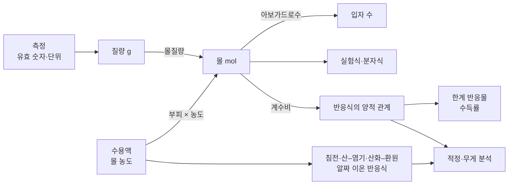

# 일반화학 1. 물질과 화학량론 — 원자를 세고, 재고, 맞추는 화학의 회계
<!-- prev: chem-1, chem-4, m3-01 -->
<!-- next: uchem-2, uchem-3, uchem-9, uchem-11 -->

> [!NOTE]
> **이 단원의 범위**
> - 측정의 불확실성과 유효 숫자, 차원 분석
> - 원자·분자·이온, 동위 원소와 평균 원자량, 무기 화합물 명명법의 기초
> - 몰과 몰질량, 조성 백분율, 연소 분석으로 실험식·분자식 결정
> - 화학 반응식과 양적 관계, 한계 반응물과 수득률
> - 수용액 반응(침전, 산–염기, 산화–환원)과 알짜 이온 반응식
> - 몰 농도, 희석, 적정과 무게 분석 계산

**학습 목표**

1. 측정값의 불확실성을 유효 숫자로 표현하고, 계산 결과를 알맞은 유효 숫자로 반올림할 수 있다.
2. 동위 원소의 존재 비율로 평균 원자량을 계산하고, 이온 화합물과 분자 화합물의 이름과 화학식을 서로 바꿀 수 있다.
3. 질량·몰·입자 수를 몰질량과 아보가드로수로 환산하고, 연소 분석 자료로 실험식과 분자식을 결정할 수 있다.
4. 반응식을 완성하고, 한계 반응물을 찾아 이론적 수득량과 퍼센트 수득률을 계산할 수 있다.
5. 침전·산–염기·산화–환원 반응을 구별하고 알짜 이온 반응식으로 나타낼 수 있다.
6. 몰 농도, 희석, 적정 자료로 용액 속 물질의 양을 계산할 수 있다.

**이 단원의 학습 사다리**

| 단계 | 무엇을 하나? |
|---|---|
| STEP 1. 이전 학습 다시 보기 | 몰, 화학 반응식, 몰 농도와 중화 적정을 고등학교에서 어디까지 했는지 확인한다 |
| STEP 2. 기초 다지기 | SI 단위와 접두어, 차원 분석(단위 소거법), 과학적 표기법을 도구로 익힌다 |
| STEP 3. 핵심 개념 | 측정 → 원자와 명명법 → 몰 → 실험식 → 반응식과 한계 반응물 → 수용액 반응 3종 → 농도와 적정 |
| STEP 4. 오개념 바로잡기 | "계수비는 질량비이다", "많이 넣은 쪽이 남는다" 같은 착각을 바로잡는다 |
| STEP 5. 전공 맛보기 | 분석화학의 오차 전파, 질량 분석법으로 분자식 정하기 |
| STEP 6. 생활·산업·진로 | 의약품 합성 공정, 수질 분석, 녹색 화학의 원자 경제성 |

---

## 🗺️ 단원 들어가기

약국에서 파는 철분 보충제 한 알에 "철 100 mg"이라고 적혀 있다. 제약 회사는 이 숫자를 어떻게 보증할까? 알약을 녹여 그 속의 철 이온과 정확히 반응하는 시약의 부피를 0.01 mL 단위로 읽으면 된다. 반응식의 계수, 시약의 몰 농도, 뷰렛 눈금 하나하나가 모두 "철 원자를 세는" 일에 쓰인다.

화학자는 원자를 직접 셀 수 없다. 대신 **질량과 부피를 재서 개수로 바꾸는** 방법을 쓴다. 그 다리가 몰이고, 그 셈법이 **화학량론(stoichiometry)** 이다. 고등학교에서 배운 몰과 화학 반응식을 대학에서는 측정의 불확실성, 실제 실험 자료(연소 분석, 적정, 무게 분석), 수용액 속 이온의 언어로 넓힌다. 이 단원은 일반화학 전체에서 계속 쓰는 '계산의 문법'을 다진다.

---

## STEP 1. 🔙 이전 학습 다시 보기

### 연계 개념표

| 이전 단원 | 고등학교에서는 여기까지 | 대학에서는 이렇게 확장 |
|---|---|---|
| 중3 「화학 반응의 규칙성」 | 질량 보존, 일정 성분비, 기체 반응 법칙, 계수비 = 입자 수의 비 | 원자 수준의 회계로 반응식을 맞추고, 질량 백분율로 화합물을 분석한다 |
| 고등학교 「화학」 '화학의 언어' | 몰, 몰질량, 아보가드로 법칙, 화학 반응식의 양적 관계, 한계 반응물(간단한 경우) | 유효 숫자를 지키는 계산, 연소 분석으로 실험식 결정, 퍼센트 수득률, 다단계 계산 |
| 고등학교 「화학」 '역동적인 화학 반응' | 몰 농도, 용액 만들기, 중화 반응의 양적 관계, 중화 적정 | 희석, 이온의 농도, 역적정, 산화–환원 적정, 무게 분석 |
| 통합과학 「산화와 환원」 | 산소·전자의 이동으로 본 산화–환원 | 산화수로 산화제·환원제를 판단하고 금속의 반응성 순서로 반응을 예측한다 |
| 중2 「물질의 구성」 | 원자, 분자, 이온의 모형과 이온식 | 동위 원소와 평균 원자량, 다원자 이온, 무기 화합물 명명법 |

### 준비 운동 (사전 진단)

**Q1.** 물($\mathrm{H_2O}$) 9.0 g은 몇 mol이며, 그 속의 수소 원자는 몇 개인가? (H = 1.0, O = 16)

**Q2.** $\mathrm{\_\,C_2H_6 + \_\,O_2 \rightarrow \_\,CO_2 + \_\,H_2O}$의 계수를 가장 작은 정수로 맞추시오.

**Q3.** 0.10 M 수산화 나트륨 수용액 250 mL에 녹아 있는 NaOH는 몇 g인가? (NaOH = 40)

**Q4.** 0.20 M 염산 25 mL를 완전히 중화하는 데 필요한 0.10 M 수산화 나트륨 수용액의 부피는?

정답 및 해설

**Q1.** 0.50 mol, $6.0\times10^{23}$개. 몰질량이 18 g/mol이므로 $9.0\div18 = 0.50\ \mathrm{mol}$, 수소 원자는 분자당 2개이므로 $2\times0.50\times6.02\times10^{23} \approx 6.0\times10^{23}$개이다.

**Q2.** $\mathrm{2C_2H_6 + 7O_2 \rightarrow 4CO_2 + 6H_2O}$. 탄소, 수소를 먼저 맞추면 산소가 $7/2$이 되므로 전체를 2배 한다.

**Q3.** 1.0 g. $0.10\times0.250 = 0.025\ \mathrm{mol}$, $0.025\times40 = 1.0\ \mathrm{g}$

**Q4.** 50 mL. $\mathrm{H^+}$의 몰수 $0.20\times25 = 5.0\ \mathrm{mmol}$ = $\mathrm{OH^-}$의 몰수 → $5.0\div0.10 = 50\ \mathrm{mL}$

---

## STEP 2. 🧱 기초 다지기

### ① SI 단위와 접두어

과학의 측정값은 **숫자 + 단위**이다. 단위 없는 "25"는 아무 정보도 주지 않는다. 화학에서 자주 쓰는 SI 기본 단위는 다음과 같다.

| 물리량 | SI 기본 단위 | 기호 | 화학에서 자주 쓰는 단위 |
|---|---|---|---|
| 질량 | 킬로그램 | kg | g, mg |
| 길이 | 미터 | m | cm, nm, pm |
| 시간 | 초 | s | min, h |
| 온도 | 켈빈 | K | °C ($T/\mathrm{K} = t/^\circ\mathrm{C} + 273.15$) |
| 물질의 양 | 몰 | mol | mmol |
| 부피(유도 단위) | 세제곱미터 | $\mathrm{m^3}$ | L = $\mathrm{dm^3}$, mL = $\mathrm{cm^3}$ |

| 접두어 | 기호 | 배수 | 예 |
|---|---|---|---|
| 킬로 | k | $10^{3}$ | 1 kJ = 1000 J |
| 센티 | c | $10^{-2}$ | 1 cm = 0.01 m |
| 밀리 | m | $10^{-3}$ | 1 mL = $10^{-3}$ L |
| 마이크로 | μ | $10^{-6}$ | 1 μg = $10^{-6}$ g |
| 나노 | n | $10^{-9}$ | 1 nm = $10^{-9}$ m |
| 피코 | p | $10^{-12}$ | 원자 반지름은 수십~수백 pm |

### ② 차원 분석 — 단위를 곱하고 지우기

**차원 분석(dimensional analysis)** 또는 단위 소거법은, 값이 1인 **환산 인자(conversion factor)** 를 곱해 원하는 단위만 남기는 방법이다. $1\ \mathrm{in} = 2.54\ \mathrm{cm}$이면 $\dfrac{2.54\ \mathrm{cm}}{1\ \mathrm{in}}$과 $\dfrac{1\ \mathrm{in}}{2.54\ \mathrm{cm}}$이 모두 1과 같다.

예: 밀도가 $0.789\ \mathrm{g/mL}$인 에탄올 2.00 L의 질량을 kg으로 구하면

$$
2.00\ \mathrm{L}\times\frac{1000\ \mathrm{mL}}{1\ \mathrm{L}}\times\frac{0.789\ \mathrm{g}}{1\ \mathrm{mL}}\times\frac{1\ \mathrm{kg}}{1000\ \mathrm{g}} = 1.58\ \mathrm{kg}
$$

> [!TIP]
> 💡 **요령** — 화학량론 문제는 대부분 "g → mol → mol → g" 같은 단위의 사슬이다. 식을 외우기보다 **단위가 지워지는지** 확인하면서 환산 인자를 이어 붙이면 실수가 줄어든다. 마지막에 남은 단위가 묻는 단위와 다르면 어딘가 틀린 것이다.

### ③ 과학적 표기법

아주 크거나 작은 수는 $a\times10^{n}$ ($1 \le a < 10$)으로 쓴다. 이 표기는 유효 숫자를 분명히 하는 장점도 있다. 예를 들어 "1200 g"은 유효 숫자가 2개인지 4개인지 모호하지만 $1.2\times10^{3}\ \mathrm{g}$(2개), $1.200\times10^{3}\ \mathrm{g}$(4개)는 분명하다.

### ④ 백분율과 비

화학에서 "질량 백분율"은 부분의 질량을 전체 질량으로 나누어 100을 곱한 것이다. 비율을 다룰 때는 **무엇을 무엇으로 나누었는지(분자·분모의 단위)** 를 꼭 적어 둔다. "% (질량)"인지 "% (몰)"인지에 따라 값이 크게 다르다.

---

## STEP 3. 📘 핵심 개념

### ① 측정과 유효 숫자

모든 측정에는 **불확실성(uncertainty)** 이 있다. 눈금이 0.1 mL 간격인 뷰렛은 눈금 사이를 어림해 0.01 mL 자리까지 읽는다. 이때 마지막 자리는 어림한 값이므로 불확실하다. 확실한 숫자들과 불확실한 마지막 한 자리를 합친 것을 **유효 숫자(significant figures)** 라고 한다.

<!-- fig:uchem-1-burette-reading -->

#### 정확도와 정밀도

| 용어 | 뜻 | 무엇이 결정하나 | 예 |
|---|---|---|---|
| **정확도(accuracy)** | 측정값이 참값에 얼마나 가까운가 | 계통 오차(보정 안 된 저울, 잘못된 방법) | 늘 0.20 g 무겁게 재는 저울은 정밀해도 부정확하다 |
| **정밀도(precision)** | 반복 측정값이 서로 얼마나 가까운가 | 우연 오차(읽기, 진동, 온도 요동) | 10.1, 10.9, 9.6 g은 정밀도가 낮다 |

> [!TIP]
> 💡 **비유** — 과녁에 화살 다섯 발을 쏘았다. 다섯 발이 한곳에 모였지만 중심에서 벗어났다면 정밀하지만 부정확하다. 중심 주변에 흩어졌지만 평균이 중심이라면 정확하지만 정밀하지 않다. 좋은 실험은 둘 다 갖춘다.

<!-- fig:uchem-1-accuracy-precision -->

#### 유효 숫자 세기 규칙

| 규칙 | 예 | 유효 숫자 |
|---|---|---|
| 0이 아닌 숫자는 모두 유효 | 4.56 | 3개 |
| 0이 아닌 숫자 사이의 0은 유효 | 1.007 | 4개 |
| 앞에 오는 0(자리 표시)은 유효하지 않다 | 0.0045 | 2개 |
| 소수점이 있는 수에서 끝의 0은 유효 | 2.500, 0.004050 | 4개, 4개 |
| 소수점 없는 정수 끝의 0은 모호 → 과학적 표기로 밝힌다 | 1200 | 2~4개(모호) |
| **정확한 수**(세어서 얻은 수, 정의된 환산)는 유효 숫자 무한 | 분자 12개, 1 in = 2.54 cm, 1 L = 1000 mL | 제한 없음 |

#### 계산 결과의 유효 숫자

| 연산 | 규칙 | 예 |
|---|---|---|
| 곱셈·나눗셈 | 결과는 **유효 숫자가 가장 적은** 값에 맞춘다 | $25.34\ \mathrm{g}\div12.6\ \mathrm{mL} = 2.01\ \mathrm{g/mL}$ (3개) |
| 덧셈·뺄셈 | 결과는 **소수 자리가 가장 적은** 값에 맞춘다 | $15.2 + 0.035 + 3.47 = 18.705 \rightarrow 18.7$ |
| 로그 | $\log x$의 **소수 자리 수** = $x$의 유효 숫자 수 | $[\mathrm{H^+}] = 2.5\times10^{-4}$ → pH = 3.60 |
| 여러 단계 | 중간 값은 한두 자리 더 두고 **마지막에 한 번만** 반올림 | 중간에 반올림하면 오차가 쌓인다 |

#### 예제 1 — 유효 숫자를 지키는 계산

(1) 비커의 질량이 52.137 g이고 액체를 넣은 뒤 질량이 63.4 g이다. 액체의 질량은?
(2) 그 액체의 부피가 9.25 mL라면 밀도는?

**풀이**
① 식 세우기: (1)은 뺄셈, (2)는 나눗셈이다.
② 대입: (1) $63.4 - 52.137 = 11.263$ → 소수 첫째 자리까지만 의미가 있으므로 **11.3 g**
(2) $11.263\div9.25 = 1.2176\cdots$ → 중간값 11.263을 쓰되, 유효 숫자는 11.3(3개)과 9.25(3개) 중 적은 쪽에 맞추어 **1.22 g/mL**
③ 결과의 의미: 덧셈·뺄셈은 '자리', 곱셈·나눗셈은 '개수'로 판단한다는 차이를 기억한다. 첫 저울이 0.1 g 단위였다는 사실이 최종 밀도의 정밀도를 결정했다.

#### ✔ 바로 확인

1. 0.004050의 유효 숫자는 몇 개인가?
2. (O/X) 늘 0.20 g 무겁게 재는 저울은 정밀도가 높을 수는 있어도 정확도는 낮다.
3. $12.47 + 3.1$을 알맞은 유효 숫자로 쓰시오.
4. 그림의 뷰렛 읽기 20.27 mL에서 어림한 숫자는 어느 것인가?

정답

1. 4개 — 앞의 0 세 개는 자리 표시이고, 소수점 뒤 끝의 0은 유효하다.
2. O — 계통 오차는 정확도를 떨어뜨리고, 반복값이 모여 있으면 정밀도는 높다.
3. 15.6 — 덧셈은 소수 자리가 가장 적은 3.1(소수 첫째 자리)에 맞춘다.
4. 마지막 7 — 0.1 mL 눈금 사이를 어림한 0.01 mL 자리이다.

### ② 원자, 동위 원소, 평균 원자량

원자는 양성자와 중성자로 된 **원자핵**과 그 주위의 전자로 이루어진다. 원소의 종류는 **원자 번호 $Z$(양성자 수)** 가 정하고, 양성자 수와 중성자 수의 합을 **질량수 $A$** 라고 한다. 원자 번호는 같고 질량수가 다른 원자를 **동위 원소(isotope)** 라 하며 $^{A}_{Z}\mathrm{X}$로 나타낸다.

| 입자 | 상대 전하 | 질량(kg) | 질량(u) |
|---|---|---|---|
| 양성자 | +1 | $1.6726\times10^{-27}$ | 1.00728 |
| 중성자 | 0 | $1.6749\times10^{-27}$ | 1.00866 |
| 전자 | −1 | $9.109\times10^{-31}$ | 0.000549 |

원자의 질량은 **원자 질량 단위(u, Da)** 로 나타낸다. $1\ \mathrm{u}$는 $^{12}\mathrm{C}$ 원자 1개 질량의 정확히 $\tfrac{1}{12}$이다.

#### 평균 원자량은 가중 평균이다

자연의 원소는 여러 동위 원소의 혼합물이다. 주기율표에 적힌 원자량은 각 동위 원소의 질량에 **자연 존재 비율**을 곱해 더한 **가중 평균**이다. 동위 원소의 질량과 비율은 **질량 분석기(mass spectrometer)** 로 측정한다. 이온화한 원자를 전기장으로 가속하고 자기장으로 휘게 하면, 질량 대 전하의 비($m/z$)에 따라 휘는 정도가 달라져 동위 원소가 나뉘어 검출된다.

$$
\bar{M} = \sum_i x_i M_i \qquad (x_i\text{: 존재 비율, } \textstyle\sum x_i = 1)
$$

<!-- fig:uchem-1-chlorine-mass-spectrum -->

#### 예제 2 — 염소의 평균 원자량

염소는 $^{35}\mathrm{Cl}$(34.969 u, 75.76 %)과 $^{37}\mathrm{Cl}$(36.966 u, 24.24 %)로 이루어진다. 평균 원자량을 구하시오.

**풀이**
$\bar{M} = 0.7576\times34.969 + 0.2424\times36.966 = 26.493 + 8.960 = 35.45\ \mathrm{u}$

존재 비율이 유효 숫자 4개이므로 결과도 4개로 쓴다. 평균은 35와 37 사이에서 더 많은 $^{35}\mathrm{Cl}$ 쪽에 가깝다. 실제로 질량이 35.45 u인 염소 원자는 하나도 없다는 점에 주의하자.

#### ✔ 바로 확인

1. 빈칸: $^{37}_{17}\mathrm{Cl}$의 중성자 수는 (    )개이다.
2. (O/X) 염소의 원자량 35.45 u는 염소 원자 하나하나의 질량이다.
3. 붕소는 $^{10}\mathrm{B}$(10.013 u, 19.9 %)와 $^{11}\mathrm{B}$(11.009 u, 80.1 %)로 이루어진다. 평균 원자량은?
4. 그림의 질량 분석기에서 자기장 속에서 더 크게 휘는 이온은 $^{35}\mathrm{Cl^+}$와 $^{37}\mathrm{Cl^+}$ 중 어느 것인가?

정답

1. 20 — 질량수 37 − 양성자 수 17
2. X — 35.45 u는 가중 평균이며, 그 질량의 염소 원자는 없다.
3. 10.81 u — $0.199\times10.013 + 0.801\times11.009$
4. $^{35}\mathrm{Cl^+}$ — 전하가 같으면 가벼운 이온이 더 많이 휜다.

### ③ 분자·이온과 무기 화합물 명명법의 기초

| 구분 | 분자 화합물 | 이온 화합물 |
|---|---|---|
| 구성 | 주로 비금속 원소끼리 공유 결합 | 금속 양이온 + 비금속(또는 다원자) 음이온 |
| 기본 단위 | 분자($\mathrm{H_2O}$, $\mathrm{CO_2}$) | 화학식 단위($\mathrm{NaCl}$은 1 : 1 비율을 나타냄) |
| 화학식이 뜻하는 것 | 분자 하나의 원자 수(분자식) | 이온의 가장 간단한 정수비(실험식) |
| 질량 | 분자량 | 화학식량 |

#### 자주 쓰는 다원자 이온

| 이온 | 이름 | 이온 | 이름 |
|---|---|---|---|
| $\mathrm{NH_4^+}$ | 암모늄 이온 | $\mathrm{OH^-}$ | 수산화 이온 |
| $\mathrm{NO_3^-}$ | 질산 이온 | $\mathrm{NO_2^-}$ | 아질산 이온 |
| $\mathrm{SO_4^{2-}}$ | 황산 이온 | $\mathrm{SO_3^{2-}}$ | 아황산 이온 |
| $\mathrm{CO_3^{2-}}$ | 탄산 이온 | $\mathrm{HCO_3^-}$ | 탄산수소 이온 |
| $\mathrm{PO_4^{3-}}$ | 인산 이온 | $\mathrm{CH_3COO^-}$ | 아세트산 이온 |
| $\mathrm{MnO_4^-}$ | 과망가니즈산 이온 | $\mathrm{Cr_2O_7^{2-}}$ | 다이크로뮴산 이온 |
| $\mathrm{ClO_4^-}$ | 과염소산 이온 | $\mathrm{ClO^-}$ | 하이포아염소산 이온 |
| $\mathrm{CN^-}$ | 사이안화 이온 | $\mathrm{O_2^{2-}}$ | 과산화 이온 |

산소 수가 다른 짝은 많은 쪽이 '-산', 적은 쪽이 '아-산'이다(질산/아질산, 황산/아황산). 산소가 더 많으면 '과-', 더 적으면 '하이포아-'를 붙인다.

#### 이름 붙이는 규칙

| 종류 | 규칙(우리말) | 예 |
|---|---|---|
| 이온 화합물 | 음이온 이름(‘-화’) + 양이온 이름 | $\mathrm{NaCl}$ 염화 나트륨, $\mathrm{CaF_2}$ 플루오린화 칼슘, $\mathrm{(NH_4)_2SO_4}$ 황산 암모늄 |
| 여러 전하를 갖는 금속 | 금속 이름 뒤에 로마 숫자로 전하 | $\mathrm{FeCl_2}$ 염화 철(Ⅱ), $\mathrm{FeCl_3}$ 염화 철(Ⅲ), $\mathrm{Cu_2O}$ 산화 구리(Ⅰ) |
| 두 원소로 된 분자 화합물 | 수를 나타내는 접두어(일·이·삼·사·오·육…) | $\mathrm{CO}$ 일산화 탄소, $\mathrm{N_2O_5}$ 오산화 이질소, $\mathrm{SF_6}$ 육플루오린화 황 |
| 산소산 | 중심 원소 + '산' | $\mathrm{HNO_3}$ 질산, $\mathrm{H_2SO_4}$ 황산, $\mathrm{H_3PO_4}$ 인산 |
| 두 원소로 된 산(수용액) | 'X화 수소산' 또는 관용명 | $\mathrm{HCl(aq)}$ 염산, $\mathrm{HF(aq)}$ 플루오린화 수소산 |
| 수화물 | 화학식 + 'n수화물' | $\mathrm{CuSO_4\cdot5H_2O}$ 황산 구리(Ⅱ) 오수화물 |

> [!IMPORTANT]
> 이온 화합물의 화학식은 **전하의 합이 0**이 되도록 쓴다. $\mathrm{Al^{3+}}$과 $\mathrm{SO_4^{2-}}$은 최소공배수 6을 맞추어 $\mathrm{Al_2(SO_4)_3}$이다. 이온 화합물에는 '이·삼' 같은 수 접두어를 쓰지 않는다($\mathrm{MgCl_2}$는 '이염화 마그네슘'이 아니라 염화 마그네슘).

#### ✔ 바로 확인

1. $\mathrm{Mg^{2+}}$과 $\mathrm{PO_4^{3-}}$으로 된 이온 화합물의 화학식은?
2. $\mathrm{CuCl_2}$의 이름을 쓰시오.
3. (O/X) $\mathrm{Na_2SO_4}$의 이름은 '이황산 나트륨'이다.
4. $\mathrm{NO_2^-}$와 $\mathrm{NO_3^-}$ 중 아질산 이온은?

정답

1. $\mathrm{Mg_3(PO_4)_2}$ — 최소공배수 6으로 전하 합을 0으로 맞춘다.
2. 염화 구리(Ⅱ) — 구리는 여러 전하를 가지므로 로마 숫자로 밝힌다.
3. X — 이온 화합물에는 수 접두어를 쓰지 않는다. 황산 나트륨이다.
4. $\mathrm{NO_2^-}$ — 산소가 적은 쪽이 '아-산'이다.

### ④ 몰과 몰질량

**몰(mole, mol)** 은 SI 기본 단위로, 2019년부터 **정확히 $6.022\,140\,76\times10^{23}$개**의 기본 입자로 정의된다. 이 수가 **아보가드로수**이고, 단위를 붙인 $N_\mathrm{A} = 6.022\times10^{23}\ \mathrm{mol^{-1}}$를 **아보가드로 상수(Avogadro constant)** 라고 한다.

**몰질량(molar mass, $M$)** 은 물질 1 mol의 질량(g/mol)이며, 수치는 원자량·분자량·화학식량과 같다. 1 u 질량의 입자 $N_\mathrm{A}$개가 약 1 g이 되도록 두 단위가 맞물려 있기 때문이다.

$$
n = \frac{m}{M}, \qquad N = n\,N_\mathrm{A}
$$

| 물질 | 화학식 | 몰질량(g/mol) | 1 mol이 뜻하는 것 |
|---|---|---|---|
| 탄소 | C | 12.01 | 탄소 원자 $6.022\times10^{23}$개 |
| 물 | $\mathrm{H_2O}$ | 18.02 | 물 분자 $6.022\times10^{23}$개(H 원자 $1.204\times10^{24}$개) |
| 염화 나트륨 | NaCl | 58.44 | 화학식 단위 $6.022\times10^{23}$개($\mathrm{Na^+}$와 $\mathrm{Cl^-}$ 각각 그만큼) |
| 카페인 | $\mathrm{C_8H_{10}N_4O_2}$ | 194.2 | 카페인 분자 $6.022\times10^{23}$개 |

같은 1 mol이라도 물질마다 질량과 부피는 다르다. 아래 사진은 여러 원소를 원자 1 mol씩 덜어 놓은 것이다.

<!-- photo:uchem-1-one-mole-samples -->

이 단원에서 쓰는 원자량: H 1.008, C 12.01, N 14.01, O 16.00, Na 22.99, Mg 24.31, Al 26.98, S 32.07, Cl 35.45, K 39.10, Ca 40.08, Fe 55.85, Cu 63.55, Ag 107.87, I 126.90, Ba 137.33, Pb 207.2

#### 예제 3 — 커피 한 잔의 카페인 분자

커피 한 잔에 카페인($\mathrm{C_8H_{10}N_4O_2}$) 95 mg이 들어 있다. 카페인 분자는 몇 개이며, 그 속의 질소 원자는 몇 개인가?

**풀이**
① 몰질량: $8(12.01) + 10(1.008) + 4(14.01) + 2(16.00) = 194.2\ \mathrm{g/mol}$
② 몰수: $n = \dfrac{0.095\ \mathrm{g}}{194.2\ \mathrm{g/mol}} = 4.89\times10^{-4}\ \mathrm{mol}$
③ 분자 수: $4.89\times10^{-4}\times6.022\times10^{23} = 2.9\times10^{20}$개
④ 질소 원자: 분자당 4개이므로 $4\times2.95\times10^{20} = 1.2\times10^{21}$개

질량 95 mg이 유효 숫자 2개이므로 결과도 2개로 쓴다. 작은 한 모금에도 $10^{20}$개가 넘는 분자가 들어 있다.

#### ✔ 바로 확인

1. 물 36.04 g은 몇 mol인가? ($\mathrm{H_2O}$ 18.02 g/mol)
2. (O/X) NaCl 1 mol 속 이온의 총수는 $6.022\times10^{23}$개이다.
3. $\mathrm{CO_2}$ 0.500 mol 속 분자 수는?

정답

1. 2.000 mol — $36.04\div18.02$
2. X — $\mathrm{Na^+}$와 $\mathrm{Cl^-}$가 각각 그만큼이므로 모두 $1.204\times10^{24}$개이다.
3. $3.011\times10^{23}$개 — $N = nN_\mathrm{A}$

### ⑤ 조성 백분율과 실험식·분자식

화합물에서 각 원소의 **질량 백분율(mass percent)** 은

$$
\text{원소 X의 질량 \%} = \frac{(\text{화학식 속 X의 원자 수})\times M_\mathrm{X}}{M_{\text{화합물}}}\times100
$$

이다. 거꾸로 질량 백분율에서 원자 수의 **가장 간단한 정수비**, 곧 **실험식(empirical formula)** 을 얻을 수 있다. 실험식에 몰질량 정보를 더하면 **분자식(molecular formula)** 이 정해진다.

| 화합물 | 분자식 | 실험식 | 분자식 ÷ 실험식 |
|---|---|---|---|
| 포도당 | $\mathrm{C_6H_{12}O_6}$ | $\mathrm{CH_2O}$ | 6 |
| 벤젠 | $\mathrm{C_6H_6}$ | CH | 6 |
| 과산화 수소 | $\mathrm{H_2O_2}$ | HO | 2 |
| 아세트산 에틸 | $\mathrm{C_4H_8O_2}$ | $\mathrm{C_2H_4O}$ | 2 |

#### 실험식을 구하는 순서

1. 시료 100 g으로 가정하면 질량 백분율이 곧 질량(g)이다.
2. 각 원소의 질량을 원자량으로 나누어 몰수로 바꾼다.
3. 가장 작은 몰수로 모두 나눈다.
4. 1.50, 1.33, 1.25처럼 정수에 가깝지 않으면 2, 3, 4를 곱해 정수로 만든다(1.50 × 2 = 3, 1.33 × 3 = 4).

#### 연소 분석 — 원소를 산화물로 바꿔 잰다

C, H, O로 된 유기 화합물을 산소 기류 속에서 완전히 태우면 C는 모두 $\mathrm{CO_2}$로, H는 모두 $\mathrm{H_2O}$로 바뀐다. 생성된 물은 과염소산 마그네슘 같은 건조제 관에, 이산화 탄소는 수산화 나트륨을 입힌 흡수관에 차례로 흡수시켜 각 관의 질량 증가를 잰다. O의 질량은 시료 질량에서 C와 H의 질량을 빼서 구한다(산소는 연소에 넣어 준 $\mathrm{O_2}$에서도 오므로 직접 잴 수 없다).

<!-- fig:uchem-1-combustion-analysis -->

#### 예제 4 — 과일 향 성분의 분자식

C, H, O로 된 과일 향 액체 0.2500 g을 완전 연소시켰더니 $\mathrm{CO_2}$ 0.4995 g과 $\mathrm{H_2O}$ 0.2045 g이 생겼다. 다른 실험에서 몰질량이 약 88 g/mol로 측정되었다. 실험식과 분자식을 구하시오.

**풀이**
① C의 질량: $0.4995\ \mathrm{g}\times\dfrac{12.01}{44.01} = 0.1363\ \mathrm{g}$ → $0.1363\div12.01 = 0.01135\ \mathrm{mol}$
② H의 질량: $0.2045\ \mathrm{g}\times\dfrac{2(1.008)}{18.02} = 0.02288\ \mathrm{g}$ → $0.02288\div1.008 = 0.02270\ \mathrm{mol}$
③ O의 질량: $0.2500 - 0.1363 - 0.02288 = 0.0908\ \mathrm{g}$ → $0.0908\div16.00 = 0.005675\ \mathrm{mol}$
④ 가장 작은 값(0.005675)으로 나누면 C : H : O = 2.00 : 4.00 : 1.00 → 실험식 $\mathrm{C_2H_4O}$ (실험식량 44.05)
⑤ $88\div44.05 \approx 2$ → 분자식 $\mathrm{C_4H_8O_2}$

결과의 의미: $\mathrm{C_4H_8O_2}$에는 아세트산 에틸, 뷰탄산 등 여러 **이성질체**가 있다. 연소 분석은 원소의 비율만 알려 줄 뿐 원자의 연결 방식은 알려 주지 않는다. 구조를 정하려면 분광학(STEP 5)이 필요하다.

#### ✔ 바로 확인

1. 물에서 수소의 질량 백분율은? (H 1.008, $\mathrm{H_2O}$ 18.02)
2. 빈칸: 포도당 $\mathrm{C_6H_{12}O_6}$의 실험식은 (    )이다.
3. 몰수비가 C : H = 1 : 1.33으로 나왔다. 실험식은?
4. (O/X) 연소 분석에서 O의 질량은 생성된 $\mathrm{CO_2}$와 $\mathrm{H_2O}$ 속 산소의 질량을 더해 구한다.

정답

1. 11.2 % — $2(1.008)\div18.02\times100$
2. $\mathrm{CH_2O}$ — 원자 수를 6으로 나눈 가장 간단한 정수비
3. $\mathrm{C_3H_4}$ — 1.33 × 3 ≈ 4이므로 전체에 3을 곱한다.
4. X — 산소는 넣어 준 $\mathrm{O_2}$에서도 오므로, 시료 질량에서 C와 H의 질량을 빼서 구한다.

### ⑥ 화학 반응식과 양적 관계

화학 반응식은 **원자 수와 전하가 양쪽에서 같도록** 맞춘다. 계수는 바꿔도 되지만 화학식의 아래 첨자는 바꾸면 안 된다(다른 물질이 된다).

#### 반응식을 맞추는 요령

1. 가장 복잡한 물질의 계수를 1로 두고 시작한다.
2. 한 화합물에만 나오는 원소부터 맞춘다. 홑원소 물질($\mathrm{O_2}$, $\mathrm{H_2}$, Fe)은 마지막에 맞춘다.
3. 분수가 나오면 전체에 정수를 곱해 없앤다.
4. 다원자 이온이 반응 전후에 그대로 있으면 한 덩어리로 센다.
5. 끝으로 원소별 원자 수와 전하를 다시 센다.

복잡한 반응은 계수를 미지수 $a, b, c, \dots$로 두고 원소마다 연립 방정식을 세워 풀 수도 있다(대수적 방법). 산화–환원 반응식은 다음 단원들에서 반쪽 반응법으로 체계적으로 맞춘다(「일반화학 11. 전기화학」).

#### 화학량론의 사슬

$$
\text{질량(A)} \xrightarrow{\;\div M_\mathrm{A}\;} \text{몰(A)} \xrightarrow{\;\times\frac{\text{계수 B}}{\text{계수 A}}\;} \text{몰(B)} \xrightarrow{\;\times M_\mathrm{B}\;} \text{질량(B)}
$$

반응식의 계수비는 **몰수비**이지 질량비가 아니다. 몰은 사슬의 한가운데에 반드시 들어간다. 출발점이 질량이 아니라 용액의 부피(× 몰 농도)이거나 기체의 부피(이상 기체 방정식, 「일반화학 2. 기체」)여도 몰을 거친다는 점은 같다.

#### 예제 5 — 프로페인 1 kg이 내놓는 이산화 탄소

캠핑용 가스통의 프로페인($\mathrm{C_3H_8}$) 1.00 kg이 완전 연소할 때 필요한 산소와 생성되는 이산화 탄소의 질량을 구하시오.

**풀이**
① 반응식: $\mathrm{C_3H_8(g) + 5O_2(g) \rightarrow 3CO_2(g) + 4H_2O(l)}$
② 프로페인의 몰수: $1.00\times10^{3}\ \mathrm{g}\div44.09\ \mathrm{g/mol} = 22.7\ \mathrm{mol}$
③ $\mathrm{O_2}$: $22.7\times5 = 113\ \mathrm{mol}$ → $113\times32.00 = 3.63\times10^{3}\ \mathrm{g} = 3.63\ \mathrm{kg}$
④ $\mathrm{CO_2}$: $22.7\times3 = 68.0\ \mathrm{mol}$ → $68.0\times44.01 = 2.99\times10^{3}\ \mathrm{g} = 2.99\ \mathrm{kg}$

결과의 의미: 연료 1 kg이 이산화 탄소 약 3 kg을 만든다. 연료의 수소는 물로, 탄소는 공기 중 산소와 결합해 무거워지기 때문이다. 질량 보존을 확인하면 반응물 4.63 kg = 생성물(2.99 kg + 물 1.63 kg)이다.

#### ✔ 바로 확인

1. $\mathrm{\_\,Al + \_\,O_2 \rightarrow \_\,Al_2O_3}$의 계수를 가장 작은 정수로 맞추시오.
2. (O/X) 원자 수를 맞추기 위해 화학식의 아래 첨자를 바꿔도 된다.
3. $\mathrm{CH_4 + 2O_2 \rightarrow CO_2 + 2H_2O}$에서 메테인 16.04 g이 완전 연소하면 $\mathrm{CO_2}$는 몇 g 생기는가?
4. $\mathrm{2H_2 + O_2 \rightarrow 2H_2O}$에서 $\mathrm{H_2}$ 4.0 g과 $\mathrm{O_2}$ 4.0 g의 질량비는 계수비 2 : 1과 같은가?

정답

1. 4, 3, 2 — O를 맞추면 $\tfrac{3}{2}$이 나오므로 전체를 2배 한다.
2. X — 아래 첨자를 바꾸면 다른 물질이 된다. 계수만 바꾼다.
3. 44.01 g — 메테인 1.000 mol → $\mathrm{CO_2}$ 1.000 mol
4. 아니다 — 계수비는 몰수비이다. 4.0 g은 $\mathrm{H_2}$ 약 2.0 mol, $\mathrm{O_2}$ 0.13 mol이다.

### ⑦ 한계 반응물과 수득률

실제 반응에서는 반응물을 계수비대로 정확히 넣는 경우가 드물다. 먼저 다 소모되어 생성물의 양을 결정하는 반응물을 **한계 반응물(limiting reactant)**, 남는 반응물을 **과잉 반응물(excess reactant)** 이라고 한다.

#### 한계 반응물을 찾는 두 방법

| 방법 | 절차 | 장점 |
|---|---|---|
| 몰수 ÷ 계수 비교 | 각 반응물의 몰수를 반응식의 계수로 나누어 가장 작은 쪽이 한계 반응물 | 반응물이 셋 이상이어도 빠르다 |
| 생성물 계산 비교 | 각 반응물이 모두 반응했다고 가정하고 생성물의 양을 계산해 가장 작은 값을 택한다 | 이론적 수득량이 바로 나온다 |

> [!TIP]
> 💡 **비유** — 자전거 한 대에 바퀴 2개와 몸체 1개가 필요하다. 바퀴 50개와 몸체 30개가 있다면 몸체가 더 적어 보여도 바퀴가 먼저 떨어진다(바퀴로 25대, 몸체로 30대). **'적게 넣은 것'이 아니라 '계수로 나눈 값이 작은 것'** 이 한계 반응물이다.

<!-- fig:uchem-1-limiting-reactant -->

#### 수득률

한계 반응물이 모두 반응했을 때 계산상 얻을 수 있는 생성물의 양을 **이론적 수득량(theoretical yield)**, 실제로 얻은 양을 **실제 수득량(actual yield)** 이라 한다.

$$
\text{퍼센트 수득률} = \frac{\text{실제 수득량}}{\text{이론적 수득량}}\times100\ \%
$$

수득률이 100 %에 못 미치는 이유: 반응이 끝까지 가지 않음(평형), 부반응, 거르기·재결정 과정의 손실, 불순물. 100 %가 넘으면 생성물이 덜 마르거나 불순물이 섞인 것이다.

#### 예제 6 — 아스피린 합성

살리실산($\mathrm{C_7H_6O_3}$, 138.12 g/mol) 2.00 g에 아세트산 무수물($\mathrm{C_4H_6O_3}$, 102.09 g/mol, 밀도 1.08 g/mL) 5.00 mL를 반응시켰다.

$$
\mathrm{C_7H_6O_3 + C_4H_6O_3 \rightarrow C_9H_8O_4 + CH_3COOH}
$$

아스피린($\mathrm{C_9H_8O_4}$, 180.16 g/mol) 2.10 g을 얻었다면 퍼센트 수득률은?

**풀이**
① 살리실산: $2.00\div138.12 = 0.01448\ \mathrm{mol}$
② 아세트산 무수물: $5.00\ \mathrm{mL}\times1.08\ \mathrm{g/mL} = 5.40\ \mathrm{g}$ → $5.40\div102.09 = 0.0529\ \mathrm{mol}$
③ 계수가 1 : 1이므로 살리실산이 한계 반응물이다.
④ 이론적 수득량: $0.01448\times180.16 = 2.61\ \mathrm{g}$
⑤ 수득률: $\dfrac{2.10}{2.61}\times100 = 80.5\ \%$

결과의 의미: 값싼 아세트산 무수물을 일부러 과잉으로 넣어 비싼 살리실산이 최대한 반응하게 한 것이다. 산업에서는 **비싸거나 제거하기 어려운 반응물을 한계 반응물로** 설계한다.

#### ✔ 바로 확인

1. $\mathrm{N_2 + 3H_2 \rightarrow 2NH_3}$에 $\mathrm{N_2}$ 2.0 mol, $\mathrm{H_2}$ 3.0 mol을 넣었다. 한계 반응물과 생기는 $\mathrm{NH_3}$의 몰수는?
2. 이론적 수득량이 10.0 g인데 8.5 g을 얻었다. 퍼센트 수득률은?
3. (O/X) 퍼센트 수득률이 100 %를 넘었다면 반응이 특히 잘 일어난 것이다.
4. 그림에서 $\mathrm{H_2}$를 6개가 아니라 10개 넣었다면 한계 반응물은 무엇인가? ($\mathrm{O_2}$는 4개 그대로)

정답

1. $\mathrm{H_2}$, 2.0 mol — 몰수 ÷ 계수가 $\mathrm{N_2}$ 2.0, $\mathrm{H_2}$ 1.0이다.
2. 85 %
3. X — 생성물이 덜 말랐거나 불순물이 섞인 것이다.
4. $\mathrm{O_2}$ — 개수 ÷ 계수가 $\mathrm{H_2}$ 10 ÷ 2 = 5, $\mathrm{O_2}$ 4 ÷ 1 = 4이다.

### ⑧ 수용액과 전해질, 침전 반응

#### 전해질

물에 녹아 이온을 내는 물질을 **전해질(electrolyte)** 이라 한다.

| 구분 | 물속에서 | 예 | 전기 전도성 |
|---|---|---|---|
| 강전해질 | 거의 전부 이온으로 해리 | NaCl, $\mathrm{HCl}$, NaOH, 대부분의 가용성 염 | 크다 |
| 약전해질 | 일부만 이온화(대부분 분자로 존재) | $\mathrm{CH_3COOH}$, $\mathrm{NH_3}$ | 작다 |
| 비전해질 | 분자 상태로 녹음 | 설탕, 에탄올 | 거의 없다 |

<!-- fig:uchem-1-electrolytes -->

#### 용해도 규칙(25 °C, 물)

| 대체로 잘 녹는 것 | 예외 |
|---|---|
| 1족 금속 이온($\mathrm{Na^+}$, $\mathrm{K^+}$ …)과 $\mathrm{NH_4^+}$의 염 | 거의 없음 |
| 질산염($\mathrm{NO_3^-}$), 아세트산염 | 거의 없음 |
| 염화물·브로민화물·아이오딘화물 | $\mathrm{Ag^+}$, $\mathrm{Pb^{2+}}$, $\mathrm{Hg_2^{2+}}$의 염 |
| 황산염 | $\mathrm{Ba^{2+}}$, $\mathrm{Pb^{2+}}$, $\mathrm{Sr^{2+}}$, ($\mathrm{Ca^{2+}}$는 조금 녹음) |

| 대체로 잘 안 녹는 것 | 예외(잘 녹음) |
|---|---|
| 수산화물 | 1족, $\mathrm{Ba^{2+}}$ ($\mathrm{Ca^{2+}}$, $\mathrm{Sr^{2+}}$은 조금) |
| 탄산염, 인산염 | 1족, $\mathrm{NH_4^+}$ |
| 황화물 | 1족, 2족, $\mathrm{NH_4^+}$ |

#### 세 가지 반응식

질산 은 수용액과 염화 나트륨 수용액을 섞으면 흰 앙금이 생긴다. 같은 반응을 세 수준으로 쓸 수 있다.

| 종류 | 반응식 | 특징 |
|---|---|---|
| 분자 반응식 | $\mathrm{AgNO_3(aq) + NaCl(aq) \rightarrow AgCl(s) + NaNO_3(aq)}$ | 실제 사용한 시약이 보인다 |
| 완전 이온 반응식 | $\mathrm{Ag^+ + NO_3^- + Na^+ + Cl^- \rightarrow AgCl(s) + Na^+ + NO_3^-}$ | 강전해질은 이온으로 쓴다 |
| **알짜 이온 반응식(net ionic equation)** | $\mathrm{Ag^+(aq) + Cl^-(aq) \rightarrow AgCl(s)}$ | 실제로 변한 입자만 남긴다 |

양쪽에 그대로 있는 $\mathrm{Na^+}$, $\mathrm{NO_3^-}$은 반응에 참여하지 않으므로 **구경꾼 이온(spectator ion)** 이라 한다. 알짜 이온 반응식은 "어떤 염화물 용액과 어떤 은 이온 용액을 섞어도 같은 반응이 일어난다"는 일반성을 보여 준다.

<!-- fig:uchem-1-net-ionic -->

> [!IMPORTANT]
> 알짜 이온 반응식을 쓸 때 **이온으로 쪼개 쓰는 것은 '물에 녹은 강전해질'뿐**이다. 앙금(s), 기체(g), 물과 같은 액체(l), 약전해질(아세트산, 암모니아)은 화학식 그대로 쓴다. 그리고 양쪽의 **원자 수와 전하**가 모두 같아야 한다.

실제로 앙금이 생기는 모습과, 생긴 앙금을 걸러 내는 과정은 아래와 같다.

<!-- photo:uchem-1-precipitate-filtration -->

#### 예제 7 — 무게 분석으로 황산 이온 정량

비료 시료 0.5000 g을 물에 녹이고 염화 바륨 수용액을 충분히 넣었더니 황산 바륨 앙금 0.4320 g을 얻었다(거르고 말려서 잰 값). 시료 속 황산 이온의 질량 백분율은? ($\mathrm{BaSO_4}$ 233.4 g/mol, $\mathrm{SO_4^{2-}}$ 96.07 g/mol)

**풀이**
① 알짜 이온 반응식: $\mathrm{Ba^{2+}(aq) + SO_4^{2-}(aq) \rightarrow BaSO_4(s)}$
② $\mathrm{BaSO_4}$: $0.4320\div233.4 = 1.851\times10^{-3}\ \mathrm{mol}$ = $\mathrm{SO_4^{2-}}$의 몰수
③ $\mathrm{SO_4^{2-}}$의 질량: $1.851\times10^{-3}\times96.07 = 0.1778\ \mathrm{g}$
④ 백분율: $0.1778\div0.5000\times100 = 35.56\ \%$

$\mathrm{Ba^{2+}}$를 과잉으로 넣어 **황산 이온이 한계 반응물**이 되게 한 것이 핵심이다. 앙금이 거의 녹지 않아야 이 방법이 정확하다. 이렇게 앙금의 질량으로 정량하는 방법을 **무게 분석(gravimetric analysis)** 이라 한다.

#### ✔ 바로 확인

1. $\mathrm{KNO_3}$, $\mathrm{NH_3}$, 에탄올을 강전해질·약전해질·비전해질로 분류하시오.
2. $\mathrm{BaSO_4}$, KCl, $\mathrm{CaCO_3}$ 중 물에 잘 녹지 않는 것을 모두 고르시오.
3. 염화 바륨 수용액과 황산 나트륨 수용액을 섞을 때의 알짜 이온 반응식은?
4. (O/X) 그림에서 설탕 수용액에 전구가 켜지지 않는 것은 설탕이 물에 녹지 않기 때문이다.

정답

1. 강전해질 $\mathrm{KNO_3}$, 약전해질 $\mathrm{NH_3}$, 비전해질 에탄올
2. $\mathrm{BaSO_4}$, $\mathrm{CaCO_3}$ — 황산염의 예외($\mathrm{Ba^{2+}}$)와 탄산염
3. $\mathrm{Ba^{2+}(aq) + SO_4^{2-}(aq) \rightarrow BaSO_4(s)}$ — $\mathrm{Na^+}$, $\mathrm{Cl^-}$는 구경꾼 이온
4. X — 설탕은 잘 녹지만 분자 상태로 녹아 이온이 없다.

### ⑨ 산–염기 반응

일반화학에서는 산과 염기를 우선 두 가지 정의로 본다(자세한 것은 「일반화학 9. 산·염기와 수용액 평형」).

| 정의 | 산 | 염기 |
|---|---|---|
| 아레니우스 | 물에서 $\mathrm{H^+}$(실제로는 $\mathrm{H_3O^+}$)를 내놓는 물질 | 물에서 $\mathrm{OH^-}$를 내놓는 물질 |
| 브뢴스테드–로리 | 양성자($\mathrm{H^+}$)를 주는 물질 | 양성자를 받는 물질 |

| 강산 | 강염기 | 대표적 약산 | 대표적 약염기 |
|---|---|---|---|
| HCl, HBr, HI, $\mathrm{HNO_3}$, $\mathrm{H_2SO_4}$(1단계), $\mathrm{HClO_4}$ | 1족 수산화물, $\mathrm{Ca(OH)_2}$, $\mathrm{Ba(OH)_2}$ | $\mathrm{CH_3COOH}$, HF, $\mathrm{H_2CO_3}$, $\mathrm{H_3PO_4}$ | $\mathrm{NH_3}$, 아민 |

#### 알짜 이온 반응식으로 보는 중화

| 반응 | 알짜 이온 반응식 |
|---|---|
| 강산 + 강염기 ($\mathrm{HNO_3 + KOH}$) | $\mathrm{H^+(aq) + OH^-(aq) \rightarrow H_2O(l)}$ |
| 약산 + 강염기 ($\mathrm{CH_3COOH + NaOH}$) | $\mathrm{CH_3COOH(aq) + OH^-(aq) \rightarrow CH_3COO^-(aq) + H_2O(l)}$ |
| 강산 + 약염기 ($\mathrm{HCl + NH_3}$) | $\mathrm{H^+(aq) + NH_3(aq) \rightarrow NH_4^+(aq)}$ |
| 기체 발생: 탄산염 + 강산 | $\mathrm{CaCO_3(s) + 2H^+(aq) \rightarrow Ca^{2+}(aq) + H_2O(l) + CO_2(g)}$ |

탄산염과 산의 반응은 생성된 탄산($\mathrm{H_2CO_3}$)이 물과 이산화 탄소로 분해되면서 기체가 빠져나가 반응이 끝까지 진행된다. 제산제가 위산을 중화하고, 석회석이 산성비에 녹는 반응이 이것이다.

#### ✔ 바로 확인

1. 질산과 수산화 칼륨 수용액의 중화를 알짜 이온 반응식으로 쓰시오.
2. (O/X) 아세트산과 NaOH의 알짜 이온 반응식에서 아세트산은 $\mathrm{CH_3COO^-}$와 $\mathrm{H^+}$로 쪼개 쓴다.
3. $\mathrm{NH_3 + H_2O \rightarrow NH_4^+ + OH^-}$에서 브뢴스테드–로리 염기로 작용한 것은?

정답

1. $\mathrm{H^+(aq) + OH^-(aq) \rightarrow H_2O(l)}$
2. X — 약산이므로 분자 $\mathrm{CH_3COOH(aq)}$로 쓴다.
3. $\mathrm{NH_3}$ — 물에게서 양성자를 받았다.

### ⑩ 산화–환원 반응과 산화수

전자를 잃는 것이 **산화(oxidation)**, 얻는 것이 **환원(reduction)** 이다. 공유 결합 물질에서도 전자의 이동을 추적하기 위해 **산화수(oxidation number)** 를 쓴다. 산화수는 "결합 전자를 모두 전기 음성도가 큰 원자에 몰아준다면 각 원자가 가질 가상의 전하"이다.

#### 산화수를 정하는 규칙(위에 있는 규칙이 우선)

| 순서 | 규칙 | 예 |
|---|---|---|
| 1 | 홑원소 물질의 원자는 0 | $\mathrm{O_2}$, Fe, $\mathrm{Cl_2}$ |
| 2 | 단원자 이온은 그 전하 | $\mathrm{Fe^{3+}}$은 +3 |
| 3 | 화합물의 산화수 합 = 0, 다원자 이온의 합 = 이온의 전하 | $\mathrm{SO_4^{2-}}$: $x + 4(-2) = -2$ → S는 +6 |
| 4 | 플루오린은 항상 −1, 1족 금속 +1, 2족 금속 +2 | $\mathrm{OF_2}$의 O는 +2 |
| 5 | 수소는 보통 +1(금속 수소화물에서는 −1) | NaH의 H는 −1 |
| 6 | 산소는 보통 −2(과산화물에서는 −1) | $\mathrm{H_2O_2}$의 O는 −1 |

산화수가 **증가**하면 산화, **감소**하면 환원이다. 상대를 산화시키고 자신은 환원되는 물질이 **산화제(oxidizing agent)**, 상대를 환원시키고 자신은 산화되는 물질이 **환원제(reducing agent)** 이다.

#### 예제 8 — 과망가니즈산 이온과 철(Ⅱ) 이온

$$
\mathrm{MnO_4^-(aq) + 5Fe^{2+}(aq) + 8H^+(aq) \rightarrow Mn^{2+}(aq) + 5Fe^{3+}(aq) + 4H_2O(l)}
$$

(1) 각 원소의 산화수 변화를 밝히고 산화제와 환원제를 고르시오. (2) 이 반응식이 전하 균형을 이루는지 확인하시오.

**풀이**
(1) Mn: $x + 4(-2) = -1$ → +7에서 +2로 감소(환원, 전자 5개 얻음). Fe: +2에서 +3으로 증가(산화, 전자 1개씩 잃음). 산화제는 $\mathrm{MnO_4^-}$, 환원제는 $\mathrm{Fe^{2+}}$이다.
(2) 왼쪽 전하: $(-1) + 5(+2) + 8(+1) = +17$, 오른쪽 전하: $(+2) + 5(+3) = +17$. 전하가 같고, Mn이 얻은 전자 5개 = Fe 5개가 잃은 전자 5개로 전자 수도 맞는다.

#### 금속의 활동도 계열과 치환 반응

금속은 산화되기 쉬운 순서(이온화 경향)로 늘어놓을 수 있다. 위에 있는 금속은 아래 금속의 이온을 환원시킨다.

| 산화되기 쉬움 → 어려움 |
|---|
| Li > K > Ca > Na > Mg > Al > Zn > Fe > Ni > Sn > Pb > (H) > Cu > Ag > Pt > Au |

- $\mathrm{Zn(s) + Cu^{2+}(aq) \rightarrow Zn^{2+}(aq) + Cu(s)}$: 일어난다(Zn이 Cu보다 위).
- $\mathrm{Cu(s) + 2H^+(aq) \rightarrow}$: 일어나지 않는다(Cu는 H보다 아래). 구리가 묽은 염산에 녹지 않는 이유이다.
- 이 순서의 정량적 근거가 「일반화학 11. 전기화학」의 **표준 환원 전위**이다.

#### 세 가지 수용액 반응의 판별

| 질문 | 예이면 |
|---|---|
| 녹지 않는 생성물(앙금)이 생기는가? | 침전 반응 |
| $\mathrm{H^+}$가 이동하는가(물·약산 짝염기·기체 생성)? | 산–염기 반응 |
| 산화수가 변하는 원자가 있는가? | 산화–환원 반응 |

한 반응이 둘 이상에 해당할 수도 있다. 예를 들어 금속과 산의 반응 $\mathrm{Mg + 2H^+ \rightarrow Mg^{2+} + H_2}$는 산이 관여하지만 산화수가 변하므로 산화–환원 반응이다.

#### ✔ 바로 확인

1. $\mathrm{Cr_2O_7^{2-}}$에서 Cr의 산화수는?
2. $\mathrm{Zn + Cu^{2+} \rightarrow Zn^{2+} + Cu}$에서 산화제는?
3. (O/X) 은 조각을 황산 구리(Ⅱ) 수용액에 넣으면 구리가 석출된다.
4. $\mathrm{H_2O_2}$에서 산소의 산화수는?

정답

1. +6 — $2x + 7(-2) = -2$
2. $\mathrm{Cu^{2+}}$ — 자신은 환원되며(+2 → 0) Zn을 산화시킨다.
3. X — Ag는 활동도 계열에서 Cu보다 아래이므로 $\mathrm{Cu^{2+}}$를 환원시키지 못한다.
4. −1 — 과산화물이다.

### ⑪ 몰 농도와 희석

**몰 농도(molarity, M)** 는 용액 1 L에 녹아 있는 용질의 몰수이다.

$$
c = \frac{n_{\text{용질}}}{V_{\text{용액}}}\ (\mathrm{mol/L} = \mathrm{M}), \qquad n = cV
$$

분모가 **용매가 아니라 용액의 부피**라는 점이 중요하다. 그래서 정확한 농도의 용액은 부피 플라스크에 용질을 넣고 녹인 뒤 **눈금선까지** 물을 채워 만든다.

<!-- fig:uchem-1-volumetric-flask -->

이온 화합물이 녹으면 이온의 농도는 화학식의 비를 따른다. 0.10 M $\mathrm{CaCl_2}$ 용액에서 $[\mathrm{Ca^{2+}}] = 0.10\ \mathrm{M}$, $[\mathrm{Cl^-}] = 0.20\ \mathrm{M}$이다(대괄호는 몰 농도).

#### 희석

물을 더해도 용질의 몰수는 변하지 않는다.

$$
c_1V_1 = c_2V_2
$$

#### 예제 9 — 용액 만들기와 희석

(1) 0.1500 M 황산 구리(Ⅱ) 용액 250.0 mL를 황산 구리(Ⅱ) 오수화물($\mathrm{CuSO_4\cdot5H_2O}$, 249.7 g/mol)로 만들려면 몇 g이 필요한가?
(2) 진한 염산(12.0 M)으로 0.250 M 염산 500.0 mL를 만들려면 진한 염산 몇 mL가 필요한가?

**풀이**
(1) $n = 0.1500\ \mathrm{M}\times0.2500\ \mathrm{L} = 0.03750\ \mathrm{mol}$ → $0.03750\times249.7 = 9.364\ \mathrm{g}$. 결정수 5개의 질량까지 포함한 몰질량을 써야 한다.
(2) $V_1 = \dfrac{0.250\times500.0}{12.0} = 10.4\ \mathrm{mL}$. 물 약 400 mL에 진한 산 10.4 mL를 **천천히 넣은 뒤** 눈금선까지 채운다(산에 물을 붓지 않는다).

#### ✔ 바로 확인

1. NaOH 2.00 g을 녹여 250.0 mL 용액을 만들었다. 몰 농도는? (NaOH 40.00 g/mol)
2. 1.0 M 용액 10.0 mL를 물로 묽혀 100.0 mL로 만들었다. 농도는?
3. 0.15 M $\mathrm{Al_2(SO_4)_3}$ 용액의 $[\mathrm{SO_4^{2-}}]$는?
4. (O/X) 0.100 M 용액 1 L는 용질 0.100 mol에 물 1.000 L를 부어 만든다.

정답

1. 0.200 M — 0.0500 mol ÷ 0.2500 L
2. 0.10 M — $c_1V_1 = c_2V_2$
3. 0.45 M — 화학식 단위 하나가 황산 이온 3개를 낸다.
4. X — 그림처럼 부피 플라스크에서 용액 전체가 1 L가 되도록 눈금선까지 채운다.

### ⑫ 적정과 용액의 화학량론

**적정(titration)** 은 농도를 아는 **표준 용액**을 뷰렛으로 조금씩 넣어, 분석할 물질과 화학량론적으로 꼭 맞게 반응한 지점(**당량점, equivalence point**)까지의 부피를 재는 방법이다. 실제로 관찰하는 것은 지시약의 색이 변하는 **종말점(end point)** 이며, 좋은 지시약은 종말점이 당량점과 거의 같다.

| 적정 | 반응 | 종말점 확인 |
|---|---|---|
| 산–염기 적정 | $\mathrm{H^+ + OH^- \rightarrow H_2O}$ 등 | 페놀프탈레인(무색 → 분홍), pH 측정기 |
| 산화–환원 적정 | $\mathrm{MnO_4^-}$ + $\mathrm{Fe^{2+}}$ 등 | 과망가니즈산 이온 자체의 보라색(스스로 지시약) |
| 침전 적정 | $\mathrm{Ag^+ + Cl^- \rightarrow AgCl}$ | 크로뮴산 이온 등(붉은 앙금) |

실제 적정 장치와 뷰렛의 눈금은 아래 사진과 같다.

<!-- photo:uchem-1-titration-setup -->

#### 표준화 — 표준 용액의 농도부터 정확히

수산화 나트륨은 공기 중의 수분과 이산화 탄소를 흡수하므로, 질량을 재서 녹여도 정확한 농도가 되지 않는다. 그래서 순수하고 안정한 **1차 표준 물질**로 농도를 먼저 정한다. 대표적인 것이 프탈산 수소 칼륨(KHP, $\mathrm{KHC_8H_4O_4}$, 204.22 g/mol)이며, 산성 수소를 1개 가진다.

<!-- sim:u-titration-lab -->

#### 예제 10 — NaOH의 표준화

KHP 0.5105 g을 물에 녹여 NaOH 용액으로 적정했더니 종말점까지 24.85 mL가 들었다. NaOH의 몰 농도는?

**풀이**
① 반응: $\mathrm{HC_8H_4O_4^-(aq) + OH^-(aq) \rightarrow C_8H_4O_4^{2-}(aq) + H_2O(l)}$ (1 : 1)
② KHP의 몰수: $0.5105\div204.22 = 2.500\times10^{-3}\ \mathrm{mol}$
③ $c_\mathrm{NaOH} = \dfrac{2.500\times10^{-3}\ \mathrm{mol}}{0.02485\ \mathrm{L}} = 0.1006\ \mathrm{M}$

라벨에 "0.1 M"이라 적힌 용액도 실제로는 0.1006 M이었다. 이 차이를 무시하면 이후 모든 적정에 0.6 %의 계통 오차가 생긴다.

#### 예제 11 — 철분 보충제의 산화–환원 적정

철분 보충제 한 알을 묽은 황산에 녹여 모든 철을 $\mathrm{Fe^{2+}}$로 만든 뒤, 0.02000 M $\mathrm{KMnO_4}$ 용액으로 적정했더니 18.45 mL에서 연한 보라색이 사라지지 않았다. 알약 속 철의 질량(mg)은? (예제 8의 반응식 이용)

**풀이**
① $\mathrm{MnO_4^-}$의 몰수: $0.02000\times0.01845 = 3.690\times10^{-4}\ \mathrm{mol}$
② 계수비 $\mathrm{MnO_4^-} : \mathrm{Fe^{2+}} = 1 : 5$ → $\mathrm{Fe^{2+}}$: $1.845\times10^{-3}\ \mathrm{mol}$
③ 철의 질량: $1.845\times10^{-3}\times55.85 = 0.1030\ \mathrm{g} = 103.0\ \mathrm{mg}$

라벨의 "철 100 mg"과 3 % 이내에서 맞는다. 계수비 1 : 5를 빠뜨리면 답이 5배 틀린다. 적정 계산의 핵심은 언제나 **"부피 × 농도 = 몰수"와 "계수비"** 두 단계이다.

> [!TIP]
> 💡 **요령** — 묽은 용액을 다룰 때는 mL와 mmol을 그대로 쓰면 편하다. $c\ (\mathrm{mol/L}) = c\ (\mathrm{mmol/mL})$이므로, $0.02000\ \mathrm{M}\times18.45\ \mathrm{mL} = 0.3690\ \mathrm{mmol}$처럼 바로 계산할 수 있다.

#### ✔ 바로 확인

1. 0.100 M NaOH 20.00 mL로 염산 25.00 mL가 중화되었다. 염산의 농도는?
2. 빈칸: 지시약의 색이 변하는 지점은 (    ), 반응물이 화학량론적으로 꼭 맞게 반응한 지점은 (    )이다.
3. (O/X) 고체 NaOH의 질량을 정확히 재서 녹이면 바로 표준 용액이 된다.
4. $\mathrm{MnO_4^-}$ 1.00 mmol과 반응하는 $\mathrm{Fe^{2+}}$는 몇 mmol인가?

정답

1. 0.0800 M — 2.000 mmol ÷ 25.00 mL
2. 종말점, 당량점
3. X — 수분과 $\mathrm{CO_2}$를 흡수하므로 KHP 같은 1차 표준 물질로 표준화한다.
4. 5.00 mmol — 계수비 1 : 5

---

## STEP 4. ⚠️ 오개념 바로잡기

| 흔한 오개념 | 올바른 개념 | 왜 그럴까? |
|---|---|---|
| 계산기에 나온 숫자를 모두 쓰면 더 정확하다 | 결과는 **측정의 정밀도**를 넘을 수 없다 | 2.011111…은 0.1 g 단위로 잰 질량이 갖지 않은 정보를 지어낸 것이다 |
| 반응식의 계수비는 질량비이다 | 계수비는 **몰수비**(입자 수의 비)이다 | $\mathrm{2H_2 + O_2}$에서 질량비는 4 : 32이다 |
| 적게 넣은 반응물이 한계 반응물이다 | **몰수를 계수로 나눈 값**이 작은 반응물이 한계 반응물이다 | 계수가 큰 반응물은 많이 넣어도 먼저 떨어질 수 있다 |
| 몰 농도의 부피는 넣은 물의 부피이다 | **용액 전체의 부피**이다 | 용질이 녹으면 부피가 변하므로 부피 플라스크로 맞춘다 |
| $\mathrm{CaCl_2}$ 0.1 M 용액의 $\mathrm{Cl^-}$ 농도도 0.1 M이다 | 화학식 비에 따라 **0.2 M**이다 | 화학식 단위 하나가 $\mathrm{Cl^-}$ 2개를 낸다 |
| 알짜 이온 반응식에서는 모든 물질을 이온으로 쓴다 | **녹은 강전해질만** 이온으로 쓴다 | 앙금·기체·물·약산은 실제로 이온으로 존재하지 않는다 |
| 산화수는 원자의 실제 전하이다 | 전자 이동을 추적하기 위한 **가상의 전하**이다 | $\mathrm{CH_4}$의 C(−4)가 실제로 전자 4개를 더 가진 것은 아니다 |
| 실험식이 같으면 같은 물질이다 | 분자식과 구조가 다를 수 있다 | $\mathrm{CH_2O}$는 폼알데하이드, 아세트산($\mathrm{C_2H_4O_2}$), 포도당($\mathrm{C_6H_{12}O_6}$)의 공통 실험식이다 |

---

## STEP 5. 🎓 다음 단계로 한 걸음 더

> [!CAUTION]
> 여기부터는 일반 과목의 범위를 넘는 전공 과목 맛보기이다. 일반화학에서는 유효 숫자 규칙으로 불확실성을 어림하고, 연소 분석·적정으로 조성을 구하는 데까지 다룬다. 아래 내용은 분석화학·유기화학에서 본격적으로 배운다.

### 전공 과목과의 연결

| 전공 과목 | 이 단원에서 이어지는 내용 |
|---|---|
| 분석화학 | 통계적 오차 분석(표준 편차, 신뢰 구간, 오차 전파), 적정 곡선, 무게 분석·기기 분석 |
| 기기 분석 | 질량 분석법, 원소 분석기, 원자 흡수·방출 분광법으로 미량 원소 정량 |
| 유기화학 | 분자식에서 불포화도 계산, 분광학(IR, NMR)으로 구조 결정 |
| 무기화학 | 명명법의 체계(IUPAC 규칙), 배위 화합물의 명명 |
| 화학공학 | 물질 수지(mass balance), 반응기 설계와 전화율·선택도 |

### 맛보기 ① 불확실성은 어떻게 전파될까

유효 숫자 규칙은 사실 **오차 전파(propagation of uncertainty)** 의 어림 버전이다. 곱셈·나눗셈에서는 **상대 불확실성**이 제곱의 합의 제곱근으로 더해진다.

$$
\frac{s_y}{y} = \sqrt{\left(\frac{s_a}{a}\right)^2 + \left(\frac{s_b}{b}\right)^2} \qquad (y = a/b)
$$

예제 10에서 KHP 질량 $0.5105 \pm 0.0002\ \mathrm{g}$, 부피 $24.85 \pm 0.03\ \mathrm{mL}$라면 상대 불확실성은 $\sqrt{(0.039\%)^2 + (0.12\%)^2} \approx 0.13\ \%$이다. 농도는 $0.1006 \pm 0.0001\ \mathrm{M}$으로 쓸 수 있다. 뷰렛 읽기가 정밀도를 결정한다는 것을 숫자로 확인할 수 있다.

### 맛보기 ② 질량 분석법으로 분자식을 한 번에

고분해능 질량 분석기는 분자 이온의 질량을 소수 넷째 자리까지 잰다. $\mathrm{C_4H_8O_2}$(88.0524 u)와 $\mathrm{C_5H_{12}O}$(88.0888 u)는 '분자량 88'로는 같지만, 정밀 질량으로는 구별된다. 동위 원소의 질량이 정수가 아니기 때문이다($^{1}\mathrm{H}$ 1.00783 u, $^{16}\mathrm{O}$ 15.99491 u). 예제 4의 연소 분석에 질량 분석을 더하면 분자식이 확정되고, 분광학이 구조를 알려 준다.

### 일반 과목 vs 전공 과목

| 주제 | 일반화학(이 단원) | 전공 과목 |
|---|---|---|
| 측정 | 유효 숫자 규칙, 정확도·정밀도 | 표준 편차, 신뢰 구간, 오차 전파, 검출 한계 |
| 조성 결정 | 연소 분석 → 실험식, 몰질량 → 분자식 | 고분해능 질량 분석, 원소 분석기, NMR로 구조 결정 |
| 반응의 양 | 한계 반응물, 퍼센트 수득률 | 전화율·선택도, 반응 속도와 평형을 고려한 공정 설계 |
| 적정 | 당량점까지의 부피로 농도 계산 | 적정 곡선의 정량 해석, 전위차 적정, 착물 적정 |

---

## STEP 6. 🏭 생활·산업·진로 연결

### 사례 1. 의약품 합성 공정 — 몰로 설계하는 수득률

- **원리** 약 한 알의 유효 성분은 여러 단계 반응을 거쳐 만들어진다. 단계마다 수득률이 곱해지므로, 다섯 단계가 각각 90 %여도 전체는 $0.90^5 \approx 59\ \%$이다.
- **어디에 쓰이나** 공정 화학자는 한계 반응물을 고르고(비싼 중간체를 한계 반응물로), 과잉 시약의 양과 정제 방법을 조정해 전체 수득률을 높인다. 수득률 1 %가 연간 생산 비용을 크게 바꾼다.

### 사례 2. 수질 분석 — 적정과 무게 분석

- **원리** 먹는 물의 경도(칼슘·마그네슘 이온), 염화 이온, 화학적 산소 요구량(COD) 같은 지표는 적정과 무게 분석으로 측정한다. COD는 물속 유기물을 산화시키는 데 든 강한 산화제(과망가니즈산 칼륨 등)의 양으로 오염 정도를 나타낸다.
- **어디에 쓰이나** 정수장, 하수 처리장, 환경 감시 기관의 정기 검사. 모든 결과는 "몇 mg/L"로 보고되며, 그 바탕은 몰 농도와 계수비이다.

### 사례 3. 녹색 화학 — 원자 경제성

- **원리** 수득률이 100 %여도 부산물이 많으면 버려지는 원자가 많다. **원자 경제성**은 원하는 생성물의 몰질량을 모든 반응물 몰질량의 합으로 나눈 값이다. 예제 6의 아스피린 합성은 $\dfrac{180.16}{138.12 + 102.09}\times100 \approx 75\ \%$이다(나머지 25 %는 아세트산).
- **어디에 쓰이나** 부산물이 적은 반응 경로의 개발, 촉매 공정, 폐기물을 줄이는 제약·정밀화학 산업.

### 사례 4. 임상 검사 — 혈액 속 농도

- **원리** 혈당, 콜레스테롤, 나트륨 이온 등은 mg/dL 또는 mmol/L로 보고된다. 같은 수치를 단위에 따라 바꾸려면 몰질량이 필요하다(포도당 90 mg/dL ≈ 5.0 mmol/L).
- **어디에 쓰이나** 진단 검사 의학, 임상 병리, 약물 투여량 계산.

### 관련 전공과 진로

| 진로 | 하는 일 | 관련 학과 |
|---|---|---|
| 분석 화학자·품질 관리 연구원 | 원료·제품의 성분과 순도 분석, 표준 시험법 개발 | 화학과, 응용화학과 |
| 공정 화학자 | 반응 경로와 수득률 최적화, 생산 규모 확대 | 화학과, 화학공학과 |
| 환경 분석 전문가 | 수질·대기·토양 시료의 오염 물질 정량 | 환경공학과, 화학과 |
| 임상 병리사·약사 | 검체 분석, 약물 농도와 용량 계산 | 임상병리학과, 약학과 |
| 화학 교사 | 화학량론과 실험 지도 | 화학교육과 |

---

## 🔬 탐구 활동

### 활동 A. 제산제 속 탄산 칼슘의 양 구하기 — 역적정

**목표** 녹는 속도가 느린 고체 염기를 정량하기 위해, 과잉의 산과 반응시킨 뒤 남은 산을 염기로 적정하는 **역적정(back titration)** 을 수행한다.

**준비물** 탄산 칼슘이 주성분인 제산제 정제, 막자사발, 전자저울(0.001 g), 0.500 M 염산(표준화된 것), 0.200 M 수산화 나트륨 수용액(표준화된 것), 페놀프탈레인, 뷰렛, 피펫(50 mL), 삼각 플라스크, 가열판, 보안경, 장갑

**과정**
1. 제산제 한 알의 질량을 재고 막자사발에서 곱게 간다.
2. 가루 전부를 삼각 플라스크에 넣고 0.500 M 염산 50.00 mL를 피펫으로 넣는다.
3. 이산화 탄소 기포가 그칠 때까지 저은 뒤, 잠시 가열해 녹아 있는 이산화 탄소를 내보내고 식힌다.
4. 페놀프탈레인 2~3방울을 넣고 0.200 M NaOH로 연한 분홍색이 30초 이상 유지될 때까지 적정한다.
5. 같은 과정을 세 번 반복하고 평균과 범위를 구한다.

**결과 기록 표**

| 회 | 정제 질량(g) | 넣은 HCl(mmol) | 적정에 든 NaOH(mL) | 남은 HCl(mmol) | 반응한 HCl(mmol) | $\mathrm{CaCO_3}$(g) |
|---|---|---|---|---|---|---|
| 1 | | 25.00 | | | | |
| 2 | | 25.00 | | | | |
| 3 | | 25.00 | | | | |

**계산 방법**: 반응한 HCl = 넣은 HCl − NaOH의 몰수, $\mathrm{CaCO_3}$의 몰수 = 반응한 HCl ÷ 2 ($\mathrm{CaCO_3 + 2H^+ \rightarrow Ca^{2+} + H_2O + CO_2}$)

**생각해 보기**
1. 이산화 탄소를 내보내지 않으면 결과가 커질까 작아질까? (힌트: 녹은 $\mathrm{CO_2}$는 약산이다)
2. 왜 탄산 칼슘을 염산으로 직접 적정하지 않고 역적정을 쓸까?
3. 정제의 결합제 같은 다른 성분이 산과 반응한다면 결과는 어떻게 달라질까?

> [!WARNING]
> **안전 수칙** 보안경과 장갑을 착용한다. 수산화 나트륨 용액은 눈에 들어가면 심한 손상을 주므로 즉시 흐르는 물로 15분 이상 씻는다. 가열할 때 플라스크 입구를 사람 쪽으로 향하지 않는다. 남은 산·염기는 중화한 뒤 실험실 폐액 기준에 따라 처리한다.

### 활동 B. 스프레드시트로 유효 숫자와 반올림 오차 확인하기

**목표** 같은 측정 자료를 (가) 단계마다 반올림한 경우와 (나) 마지막에 한 번만 반올림한 경우로 계산해 차이를 비교한다.

**과정**
1. 예제 4의 연소 분석 자료($\mathrm{CO_2}$ 0.4995 g, $\mathrm{H_2O}$ 0.2045 g, 시료 0.2500 g)를 셀에 입력한다.
2. (가) 열에서는 C, H, O의 질량과 몰수를 매 단계 유효 숫자 2개로 반올림해 다음 단계에 넣는다(`ROUND` 함수 활용).
3. (나) 열에서는 반올림 없이 계산하고 마지막 원자 수 비만 반올림한다.
4. 두 결과의 C : H : O 비를 비교하고, 측정값 하나($\mathrm{H_2O}$ 질량)를 ±0.0005 g 바꾸어 결과가 얼마나 흔들리는지 확인한다.

| 계산 방식 | C 몰수 | H 몰수 | O 몰수 | C : H : O |
|---|---|---|---|---|
| (가) 단계별 반올림 | | | | |
| (나) 마지막에 반올림 | | | | |

**생각해 보기** O의 질량은 뺄셈으로 구하기 때문에 불확실성이 특히 크다. 그 이유를 STEP 3 ①의 덧셈·뺄셈 규칙으로 설명해 보자.

---

## ✅ 개념 확인 문제

### 기본

**1.** 다음 계산 결과를 알맞은 유효 숫자로 쓰시오.
(1) $4.184\times25.0\times(31.62 - 22.4)$  (2) $\dfrac{0.08206\times298.15}{1.5}$  (3) $1.0034 + 12.1 - 0.457$

정답 및 해설

**정답** (1) $9.6\times10^{2}$ (2) 16 (3) 12.6

(1) 괄호 안 뺄셈: $31.62 - 22.4 = 9.22$ → 소수 첫째 자리까지 의미가 있으므로 9.2(유효 숫자 2개). 곱셈 결과는 가장 적은 2개에 맞추어 $4.184\times25.0\times9.22 = 964.4 \rightarrow 9.6\times10^{2}$ (중간값은 반올림하지 않고 계산한다).
(2) $24.466\cdots\div1.5 = 16.31$ → 1.5가 2개이므로 16.
(3) $12.6464$ → 소수 자리가 가장 적은 12.1에 맞추어 12.6.

**2.** 마그네슘은 $^{24}\mathrm{Mg}$(23.985 u, 78.99 %), $^{25}\mathrm{Mg}$(24.986 u, 10.00 %), $^{26}\mathrm{Mg}$(25.983 u, 11.01 %)로 이루어져 있다. 마그네슘의 평균 원자량을 구하시오.

정답 및 해설

**정답** 24.31 u

$0.7899\times23.985 + 0.1000\times24.986 + 0.1101\times25.983 = 18.946 + 2.499 + 2.861 = 24.31\ \mathrm{u}$

**3.** 다음 화합물의 이름 또는 화학식을 쓰시오.
(1) $\mathrm{Fe_2(SO_4)_3}$ (2) $\mathrm{N_2O_4}$ (3) 탄산수소 나트륨 (4) 질산 구리(Ⅱ) (5) $\mathrm{Na_2HPO_4}$

정답 및 해설

**정답** (1) 황산 철(Ⅲ) (2) 사산화 이질소 (3) $\mathrm{NaHCO_3}$ (4) $\mathrm{Cu(NO_3)_2}$ (5) 인산수소 나트륨

(1) 황산 이온 3개의 전하 −6을 철 2개가 맞추므로 철은 +3이다. (2)는 분자 화합물이므로 수 접두어를 쓴다. (5)는 $\mathrm{HPO_4^{2-}}$(인산수소 이온)의 나트륨염이다.

**4.** 탄소 85.63 %, 수소 14.37 %로 이루어진 탄화수소의 몰질량이 56.1 g/mol이다. 실험식과 분자식을 구하시오.

정답 및 해설

**정답** 실험식 $\mathrm{CH_2}$, 분자식 $\mathrm{C_4H_8}$

100 g 기준: C $85.63\div12.01 = 7.130\ \mathrm{mol}$, H $14.37\div1.008 = 14.26\ \mathrm{mol}$ → 비 1 : 2.000 → $\mathrm{CH_2}$(실험식량 14.03). $56.1\div14.03 = 4.00$ → $\mathrm{C_4H_8}$

**5.** 다음 반응의 알짜 이온 반응식을 쓰고, 구경꾼 이온을 고르시오.
(1) 질산 납(Ⅱ) 수용액 + 아이오딘화 칼륨 수용액 (2) 아세트산 수용액 + 수산화 칼륨 수용액

정답 및 해설

**정답**
(1) $\mathrm{Pb^{2+}(aq) + 2I^-(aq) \rightarrow PbI_2(s)}$, 구경꾼 이온: $\mathrm{K^+}$, $\mathrm{NO_3^-}$
(2) $\mathrm{CH_3COOH(aq) + OH^-(aq) \rightarrow CH_3COO^-(aq) + H_2O(l)}$, 구경꾼 이온: $\mathrm{K^+}$

(1) 아이오딘화물은 $\mathrm{Pb^{2+}}$와 앙금(노란색)을 만든다. (2) 아세트산은 약산이므로 분자로 쓴다.

### 응용

**6.** 알루미늄 10.0 g과 염소 기체 30.0 g을 반응시켜 염화 알루미늄을 만든다. $\mathrm{2Al(s) + 3Cl_2(g) \rightarrow 2AlCl_3(s)}$
(1) 한계 반응물은? (2) 생성되는 $\mathrm{AlCl_3}$의 최대 질량은? (3) 반응 후 남는 반응물은 몇 g인가? ($\mathrm{AlCl_3}$ 133.33 g/mol)

정답 및 해설

**정답** (1) $\mathrm{Cl_2}$ (2) 37.6 g (3) Al 2.39 g

Al: $10.0\div26.98 = 0.3706\ \mathrm{mol}$, $\mathrm{Cl_2}$: $30.0\div70.90 = 0.4231\ \mathrm{mol}$. 몰수 ÷ 계수: Al $0.1853$, $\mathrm{Cl_2}$ $0.1410$ → $\mathrm{Cl_2}$가 한계 반응물(Al을 다 쓰려면 $\mathrm{Cl_2}$ 0.556 mol이 필요하다).
$\mathrm{AlCl_3}$: $0.4231\times\tfrac{2}{3} = 0.2821\ \mathrm{mol}$ → $0.2821\times133.33 = 37.6\ \mathrm{g}$
반응한 Al: 0.2821 mol → 남은 Al $0.3706 - 0.2821 = 0.0885\ \mathrm{mol}$ → $0.0885\times26.98 = 2.39\ \mathrm{g}$

**7.** 0.150 M 질산 납(Ⅱ) 수용액 50.0 mL와 0.250 M 아이오딘화 칼륨 수용액 40.0 mL를 섞었다. 생성되는 $\mathrm{PbI_2}$(461.0 g/mol) 앙금의 최대 질량은?

정답 및 해설

**정답** 2.31 g

$\mathrm{Pb^{2+}}$: $0.150\times0.0500 = 7.50\times10^{-3}\ \mathrm{mol}$, $\mathrm{I^-}$: $0.250\times0.0400 = 1.00\times10^{-2}\ \mathrm{mol}$. $\mathrm{Pb^{2+} + 2I^- \rightarrow PbI_2}$에서 $\mathrm{Pb^{2+}}$를 다 쓰려면 $\mathrm{I^-}$ 0.0150 mol이 필요하므로 $\mathrm{I^-}$가 한계 반응물이다. $\mathrm{PbI_2}$ $= 5.00\times10^{-3}\ \mathrm{mol}$ → $5.00\times10^{-3}\times461.0 = 2.31\ \mathrm{g}$

**8.** 0.200 M $\mathrm{CaCl_2}$ 용액 50.0 mL와 0.100 M NaCl 용액 25.0 mL를 섞었다(부피는 더해진다고 가정). 혼합 용액 속 $\mathrm{Ca^{2+}}$, $\mathrm{Na^+}$, $\mathrm{Cl^-}$의 몰 농도를 구하시오.

정답 및 해설

**정답** $[\mathrm{Ca^{2+}}] = 0.133\ \mathrm{M}$, $[\mathrm{Na^+}] = 0.0333\ \mathrm{M}$, $[\mathrm{Cl^-}] = 0.300\ \mathrm{M}$

전체 부피 75.0 mL. $\mathrm{Ca^{2+}}$ 10.0 mmol, $\mathrm{Na^+}$ 2.50 mmol, $\mathrm{Cl^-}$ $2\times10.0 + 2.50 = 22.5\ \mathrm{mmol}$. 각각 75.0 mL로 나눈다. 전하 균형 확인: $2(0.133) + 0.0333 = 0.300$ ✓

**9.** 농도를 모르는 황산 25.00 mL를 0.1050 M NaOH로 적정했더니 32.40 mL가 들었다. 황산의 몰 농도는?

정답 및 해설

**정답** 0.06804 M

$\mathrm{H_2SO_4 + 2NaOH \rightarrow Na_2SO_4 + 2H_2O}$. NaOH $0.1050\times32.40 = 3.402\ \mathrm{mmol}$ → $\mathrm{H_2SO_4}$ $1.701\ \mathrm{mmol}$ → $1.701\div25.00 = 0.06804\ \mathrm{M}$. 황산은 $\mathrm{H^+}$를 2개 내놓으므로 계수비 1 : 2를 반드시 넣는다.

### 융합·서술형

**10. [생활 연계]** 탄산 칼슘이 주성분인 제산제 한 알을 0.500 M 염산 50.00 mL에 완전히 녹인 뒤, 남은 염산을 0.200 M NaOH로 적정했더니 15.60 mL가 들었다. (1) 정제 속 탄산 칼슘의 질량을 구하고, (2) 이 방법(역적정)을 쓴 이유를 설명하시오. ($\mathrm{CaCO_3}$ 100.09 g/mol)

정답 및 해설

**정답** (1) 1.09 g

(1) 넣은 HCl: $0.500\times50.00 = 25.0\ \mathrm{mmol}$, 남은 HCl = NaOH: $0.200\times15.60 = 3.12\ \mathrm{mmol}$, 반응한 HCl: $25.0 - 3.12 = 21.88 \approx 21.9\ \mathrm{mmol}$. $\mathrm{CaCO_3 + 2H^+ \rightarrow Ca^{2+} + H_2O + CO_2}$이므로 $\mathrm{CaCO_3}$ $= 21.88\div2 = 10.94\ \mathrm{mmol}$ → $10.94\times100.09 = 1094.98\ \mathrm{mg}$ → 유효 숫자 3개로 1.09 g (중간값 21.88 mmol은 반올림하지 않고 계산한다)

<!-- fig:uchem-1-q-back-titration-bar -->

(2) **예시 답안** 탄산 칼슘은 물에 잘 녹지 않아 산과 천천히 반응하므로, 직접 적정하면 종말점에서 반응이 끝났는지 판단하기 어렵다. 과잉의 산으로 먼저 완전히 반응시키고, 남은 산을 빠르게 반응하는 강염기로 적정하면 종말점이 분명해진다. 또 발생하는 이산화 탄소를 가열로 제거한 뒤 적정할 수 있다.

**채점 포인트** ① 반응한 산 = 넣은 산 − 남은 산 ② 계수비 1 : 2 ③ 느린 반응·불용성 고체라는 이유

**11. [환경·진로 연계]** 아스피린 합성(예제 6)의 수득률은 80.5 %였고, 원자 경제성은 약 75 %이다. (1) 수득률과 원자 경제성이 각각 무엇을 평가하는 지표인지 비교하고, (2) 수득률이 100 %인 반응도 '녹색'이 아닐 수 있는 이유를 쓰시오. (3) 수득률을 낮추는 실험 과정의 요인 두 가지를 들고 개선 방법을 제안하시오.

정답 및 해설

**예시 답안**
(1) 수득률은 한계 반응물로부터 계산한 이론량 중 실제로 얻은 비율로, **실험·공정의 손실**을 평가한다. 원자 경제성은 반응식 자체에서 반응물 원자 중 원하는 생성물에 들어가는 비율로, **반응 경로의 설계**를 평가한다.
(2) 수득률이 100 %여도 반응식에 부산물(아세트산)이 있으면 반응물 원자의 일부는 반드시 폐기물이 된다. 과잉 반응물, 용매, 정제 과정의 폐기물도 수득률에는 드러나지 않는다.
(3) 예: ① 재결정할 때 생성물 일부가 용매에 녹아 남는다 → 차가운 용매를 최소량만 쓴다. ② 거름종이·용기에 묻어 손실된다 → 소량의 차가운 용매로 헹궈 모은다. ③ 반응이 끝까지 진행되지 않는다 → 반응 시간·온도·촉매(산 촉매)를 조절한다.

**채점 포인트** ① 두 지표의 기준(실제량/이론량 vs 생성물/반응물 질량) ② 부산물·폐기물 언급 ③ 구체적 요인과 개선책

### 실력 다지기

**12.** 황산 구리(Ⅱ) 수화물 $\mathrm{CuSO_4\cdot}x\mathrm{H_2O}$ 2.500 g을 도가니에서 일정한 질량이 될 때까지 가열했더니 무수 황산 구리(Ⅱ) 1.598 g이 남았다. (1) $x$를 구하시오. (2) 가열이 덜 되어 물이 조금 남은 채로 무게를 쟀다면 $x$는 참값보다 크게 나올까 작게 나올까? ($\mathrm{CuSO_4}$ 159.62, $\mathrm{H_2O}$ 18.02 g/mol)

정답 및 해설

**정답** (1) $x = 5$ (2) 작게 나온다

(1) 잃은 물: $2.500 - 1.598 = 0.902\ \mathrm{g}$ → $0.902\div18.02 = 0.05006\ \mathrm{mol}$. 무수물: $1.598\div159.62 = 0.01001\ \mathrm{mol}$. 몰수비 $0.05006 : 0.01001 = 5.00 : 1$ → $\mathrm{CuSO_4\cdot5H_2O}$
(2) 남은 질량이 커지면 '잃은 물'이 작게, '무수물'이 크게 계산되므로 비가 작아진다. 그래서 무게가 더 줄지 않을 때까지(항량) 가열을 반복한다.

**13.** NaCl과 KCl만으로 된 혼합물 1.000 g을 물에 녹이고 질산 은 수용액을 충분히 넣었더니 AgCl 앙금 2.150 g을 얻었다. 혼합물 속 NaCl의 질량 백분율을 구하시오. (NaCl 58.44, KCl 74.55, AgCl 143.32 g/mol)

정답 및 해설

**정답** 42.9 %

① AgCl: $2.150\div143.32 = 1.500\times10^{-2}\ \mathrm{mol}$ = 혼합물 속 $\mathrm{Cl^-}$의 몰수
② NaCl을 $m$ g이라 하면 $\dfrac{m}{58.44} + \dfrac{1.000 - m}{74.55} = 1.500\times10^{-2}$
③ 풀면 $m = 0.429\ \mathrm{g}$ → 42.9 %

두 물질이 모두 $\mathrm{Cl^-}$를 1개씩 내므로 '질량의 합'과 '$\mathrm{Cl^-}$ 몰수의 합' 두 식으로 두 미지수를 정한다. 몰질량이 서로 다르기 때문에 이 방법이 가능하다.

**14.** 0.200 M 질산 은 수용액 50.0 mL와 0.100 M 염화 칼슘 수용액 40.0 mL를 섞었다(부피는 더해진다고 가정). (1) 생기는 AgCl의 질량은? (2) 반응 후 용액에 남은 각 이온의 몰 농도를 구하고 전하 균형으로 확인하시오. (AgCl 143.32 g/mol)

정답 및 해설

**정답** (1) 1.15 g (2) $[\mathrm{Ag^+}] = 0.0222\ \mathrm{M}$, $[\mathrm{NO_3^-}] = 0.111\ \mathrm{M}$, $[\mathrm{Ca^{2+}}] = 0.0444\ \mathrm{M}$, $[\mathrm{Cl^-}] \approx 0$

(1) $\mathrm{Ag^+}$ 10.0 mmol, $\mathrm{Cl^-}$ $2\times4.00 = 8.00\ \mathrm{mmol}$. $\mathrm{Ag^+ + Cl^- \rightarrow AgCl}$(1 : 1)에서 $\mathrm{Cl^-}$가 한계 반응물 → AgCl 8.00 mmol → $8.00\times143.32 = 1147\ \mathrm{mg} \approx 1.15\ \mathrm{g}$
(2) 전체 90.0 mL. 남은 $\mathrm{Ag^+}$ 2.00 mmol, 구경꾼 $\mathrm{NO_3^-}$ 10.0 mmol, $\mathrm{Ca^{2+}}$ 4.00 mmol을 각각 90.0 mL로 나눈다. 전하 균형: $0.0222 + 2(0.0444) = 0.111$ ✓

<!-- fig:uchem-1-q-agcl-ion-model -->

**15. [자료 해석]** 0.100 M 질산 납(Ⅱ) 수용액 20.0 mL에 0.100 M 아이오딘화 칼륨 수용액을 부피를 바꾸어 넣고, 생긴 $\mathrm{PbI_2}$ 앙금을 거르고 말려 질량을 쟀다.

| 넣은 KI 용액(mL) | 10.0 | 20.0 | 30.0 | 40.0 | 50.0 | 60.0 |
|---|---|---|---|---|---|---|
| $\mathrm{PbI_2}$ 질량(g) | 0.231 | 0.461 | 0.692 | 0.922 | 0.922 | 0.922 |

(1) 앙금의 질량이 더 늘지 않기 시작하는 KI 용액의 부피는? (2) 이 자료로 $\mathrm{Pb^{2+}}$와 $\mathrm{I^-}$가 1 : 2로 반응함을 보이시오. (3) 30.0 mL를 넣었을 때 한계 반응물은 무엇이며, 50.0 mL 이후 질량이 일정한 까닭은?

정답 및 해설

**정답** (1) 40.0 mL (2) 해설 참고 (3) 30.0 mL에서는 $\mathrm{I^-}$, 50.0 mL 이후에는 $\mathrm{Pb^{2+}}$가 모두 소모되었기 때문

(1) 40.0 mL까지는 10.0 mL마다 0.231 g씩 늘고, 그 뒤로는 일정하다. 질량–부피 그래프의 두 직선이 40.0 mL에서 꺾인다.

<!-- fig:uchem-1-q-pbi2-mass-graph -->

(2) 꺾이는 점에서 $\mathrm{Pb^{2+}}$: $0.100\times20.0 = 2.00\ \mathrm{mmol}$, $\mathrm{I^-}$: $0.100\times40.0 = 4.00\ \mathrm{mmol}$ → 1 : 2. 또 최대 질량 0.922 g ÷ 461.0 g/mol = 2.00 mmol로 $\mathrm{Pb^{2+}}$의 몰수와 같다.
(3) 30.0 mL에서는 $\mathrm{I^-}$ 3.00 mmol이 $\mathrm{Pb^{2+}}$ 1.50 mmol과만 반응하므로 $\mathrm{I^-}$가 한계 반응물이다. 40.0 mL를 넘으면 $\mathrm{Pb^{2+}}$가 한계 반응물이 되어 KI를 더 넣어도 앙금이 늘지 않는다.

**채점 포인트** ① 꺾이는 점 찾기 ② 몰수비 1 : 2 계산 ③ 한계 반응물이 바뀌는 지점의 의미

### 도전

**16. [실험 오차 분석]** 예제 10처럼 KHP로 NaOH 용액을 표준화하는 실험(장치는 아래 그림과 같다)에서 다음 실수가 있었다. 각 실수가 계산한 NaOH 농도를 참값보다 크게 하는지, 작게 하는지, 영향이 없는지 판단하고 이유를 쓰시오.
(가) 말리지 않아 물기를 머금은 KHP의 질량을 쟀다.
(나) 적정 전 뷰렛 끝에 있던 공기 방울이 적정 중에 빠져나갔다.
(다) 종말점을 지나쳐 진한 분홍색이 될 때까지 적정했다.
(라) KHP를 녹이기 전 삼각 플라스크에 증류수가 조금 남아 있었다.
또, (가)의 NaOH 용액으로 농도를 모르는 산을 적정하면 산의 농도는 어떻게 계산되는가?

<!-- fig:uchem-1-q-titration-setup -->

정답 및 해설

**정답** (가) 크게 (나) 작게 (다) 작게 (라) 영향 없음, 산의 농도도 크게 계산된다

계산식은 $c_\mathrm{NaOH} = \dfrac{m_\mathrm{KHP}/M_\mathrm{KHP}}{V_\mathrm{NaOH}}$이다.
(가) 잰 질량 속 실제 KHP가 적어 필요한 NaOH 부피 $V$가 작게 나오는데, 몰수는 잰 질량으로 크게 계산되므로 농도가 크게 나온다.
(나) 공기 방울이 빠진 부피만큼 눈금은 내려갔지만 용액은 나가지 않았다. 읽은 $V$가 실제보다 커서 농도가 작게 나온다.
(다) 당량점보다 많은 부피를 기록하므로 농도가 작게 나온다.
(라) 물은 KHP의 몰수를 바꾸지 않는다. 적정은 몰수를 세는 것이므로 영향이 없다.
(가)의 NaOH 농도를 실제보다 크게 기록하면, 산을 적정할 때 $n = cV$로 계산한 산의 몰수도 그 비율만큼 크게 나온다. 표준화의 계통 오차는 이후 모든 결과로 그대로 옮겨 간다.

**채점 포인트** ① 계산식에서 어느 변수가 어떻게 바뀌는지 ② 네 경우 모두 옳은 방향 ③ 계통 오차의 전파

**17.** 철광석 시료 0.8000 g을 산에 녹여 모든 철을 $\mathrm{Fe^{2+}}$로 만든 뒤, 0.02000 M $\mathrm{KMnO_4}$ 용액으로 적정했더니 26.50 mL가 들었다(반응식은 예제 8).
(1) 시료 속 철의 질량 백분율을 구하시오.
(2) 철이 모두 $\mathrm{Fe_2O_3}$(159.70 g/mol)로 들어 있다면 $\mathrm{Fe_2O_3}$의 질량 백분율은?
(3) 나중에 확인해 보니 $\mathrm{KMnO_4}$ 용액의 실제 농도는 0.02040 M이었다. (1)의 결과는 몇 % 틀렸으며, 올바른 값은 얼마인가?

정답 및 해설

**정답** (1) 18.50 % (2) 26.45 % (3) 2.0 % 작게 나왔다, 올바른 값 18.87 %

(1) $\mathrm{MnO_4^-}$: $0.02000\times26.50 = 0.5300\ \mathrm{mmol}$ → $\mathrm{Fe^{2+}}$: $5\times0.5300 = 2.650\ \mathrm{mmol}$ → $2.650\times55.85 = 148.0\ \mathrm{mg}$ → $148.0\div800.0\times100 = 18.50\ \%$
(2) $\mathrm{Fe_2O_3}$ 하나에 Fe 2개 → $\mathrm{Fe_2O_3}$ 1.325 mmol × 159.70 = 211.6 mg → 26.45 %
(3) 철의 양은 $\mathrm{KMnO_4}$ 농도에 비례하므로 참값은 $18.50\times\dfrac{0.02040}{0.02000} = 18.87\ \%$이다. 처음 결과는 $\dfrac{0.02000 - 0.02040}{0.02040}\times100 = -2.0\ \%$, 곧 약 2 % 작게 나왔다.

**채점 포인트** ① 계수비 1 : 5 ② Fe → $\mathrm{Fe_2O_3}$ 환산(2 : 1) ③ 농도 오차가 결과에 비례해 전파됨

**18.** 메테인($\mathrm{CH_4}$)과 에테인($\mathrm{C_2H_6}$)만으로 된 혼합 기체 1.000 g을 완전 연소시켰더니 $\mathrm{CO_2}$ 2.860 g이 생겼다.
(1) 혼합물 속 메테인의 질량 백분율을 구하시오.
(2) 이때 생기는 물의 질량을 예측하시오.
(3) 같은 실험에서 $\mathrm{CO_2}$ 질량에 0.010 g의 측정 오차가 있으면 메테인의 질량은 얼마나 달라지는가? 물의 질량에 같은 0.010 g의 오차가 있을 때와 비교해, 조성을 정하는 데 어느 측정이 더 믿을 만한지 판단하시오. ($\mathrm{CH_4}$ 16.04, $\mathrm{C_2H_6}$ 30.07, $\mathrm{CO_2}$ 44.01, $\mathrm{H_2O}$ 18.02 g/mol)

정답 및 해설

**정답** (1) 36.6 % (2) 1.96 g (3) $\mathrm{CO_2}$ 오차로는 약 0.055 g, 물 오차로는 약 0.022 g 달라진다. 물의 질량이 더 믿을 만하다.

(1) 메테인 $m$ g: $\mathrm{CO_2} = \dfrac{m}{16.04}(44.01) + \dfrac{1.000 - m}{30.07}(2\times44.01) = 2.744m + 2.927(1.000 - m) = 2.860$ → $m = 0.366\ \mathrm{g}$ → 36.6 %
(2) $\mathrm{H_2O} = \dfrac{0.366}{16.04}(2\times18.02) + \dfrac{0.634}{30.07}(3\times18.02) = 0.823 + 1.140 = 1.96\ \mathrm{g}$
(3) $\mathrm{CO_2}$ 질량은 $m$이 1 g 늘 때 $2.744 - 2.927 = -0.183\ \mathrm{g}$만 변하므로, 0.010 g의 오차는 $0.010\div0.183 \approx 0.055\ \mathrm{g}$(5.5 %p)의 메테인 오차가 된다. 물은 $m$이 1 g 늘 때 $2.247 - 1.798 = 0.449\ \mathrm{g}$ 변하므로 오차가 $0.010\div0.449 \approx 0.022\ \mathrm{g}$이다. 두 성분의 탄소 질량 백분율(74.9 %, 79.9 %)은 비슷하고 수소 질량 백분율(25.1 %, 20.1 %)은 상대적으로 크게 달라서, 물의 질량이 조성에 더 민감하게 반응한다.

**채점 포인트** ① 질량과 생성물 두 식으로 미지수 결정 ② 물 질량 예측 ③ 민감도(기울기)로 측정 오차의 영향을 비교하고 결론

---

## 📝 한눈에 정리

### 핵심 요약

- 측정값의 마지막 자리는 어림한 값이다. 곱셈·나눗셈은 **유효 숫자 개수**, 덧셈·뺄셈은 **소수 자리**로 결과를 맞추고, 반올림은 마지막에 한 번만 한다.
- 원자량은 동위 원소 질량의 **가중 평균**이며 질량 분석기로 측정한다.
- 이온 화합물은 전하의 합이 0이 되게 쓰고 '음이온 + 양이온' 순으로 이름 붙인다. 분자 화합물은 수 접두어를 쓴다.
- **몰**은 정확히 $6.022\,140\,76\times10^{23}$개이다. 질량·입자 수·용액 부피·기체 부피는 모두 몰을 거쳐 환산한다.
- 연소 분석(→ $\mathrm{CO_2}$, $\mathrm{H_2O}$)으로 **실험식**을, 몰질량을 더해 **분자식**을 정한다.
- 반응식의 계수비는 **몰수비**이다. **몰수 ÷ 계수**가 가장 작은 반응물이 한계 반응물이며, 이론적 수득량을 정한다.
- 수용액 반응은 침전·산–염기·산화–환원으로 나뉘고, 녹은 강전해질만 이온으로 쓴 **알짜 이온 반응식**으로 나타낸다.
- 산화수가 증가하면 산화, 감소하면 환원이다. 산화제는 자신이 환원되고 환원제는 자신이 산화된다.
- 적정은 "부피 × 농도 = 몰수"와 "계수비"의 두 단계로 계산하고, 표준 용액은 1차 표준 물질로 표준화한다.

| 주요 식 | 뜻 |
|---|---|
| $n = m/M$, $N = nN_\mathrm{A}$ | 질량 ↔ 몰 ↔ 입자 수 |
| $\bar{M} = \sum x_iM_i$ | 평균 원자량 |
| 질량 % $= \dfrac{(\text{원자 수})M_\mathrm{X}}{M}\times100$ | 조성 백분율 |
| 수득률 $= \dfrac{\text{실제}}{\text{이론}}\times100\ \%$ | 퍼센트 수득률 |
| $c = n/V$, $c_1V_1 = c_2V_2$ | 몰 농도와 희석 |
| $c_\mathrm{A}V_\mathrm{A}\times\dfrac{b}{a} = c_\mathrm{B}V_\mathrm{B}$ | 적정($a\mathrm{A} + b\mathrm{B}$ 반응) |

### 핵심 용어

| 용어 | 뜻 |
|---|---|
| 유효 숫자 | 측정에서 확실한 숫자와 어림한 마지막 한 자리 |
| 정확도와 정밀도 | 참값에 가까운 정도와 반복 측정값끼리 가까운 정도 |
| 동위 원소 | 원자 번호는 같고 질량수가 다른 원자 |
| 몰질량 | 물질 1 mol의 질량(g/mol) |
| 아보가드로 상수 | $6.022\,140\,76\times10^{23}\ \mathrm{mol^{-1}}$ |
| 실험식 | 화합물을 이루는 원자 수의 가장 간단한 정수비 |
| 분자식 | 분자 하나에 들어 있는 원자의 실제 수 |
| 한계 반응물 | 먼저 다 소모되어 생성물의 양을 결정하는 반응물 |
| 퍼센트 수득률 | 실제 수득량 ÷ 이론적 수득량 × 100 |
| 강전해질 | 물에서 거의 전부 이온으로 해리하는 물질 |
| 알짜 이온 반응식 | 실제로 반응에 참여한 입자만 나타낸 반응식 |
| 산화수 | 전자 이동을 추적하기 위해 원자에 매긴 가상의 전하 |
| 몰 농도 | 용액 1 L에 녹아 있는 용질의 몰수 |
| 당량점 | 적정에서 반응물이 화학량론적으로 꼭 맞게 반응한 지점 |

### 다음 단원으로

이 단원에서는 질량과 용액의 부피를 몰로 바꾸어 반응을 계산했다. 그런데 화학 반응에는 기체가 많이 등장하고, 기체는 질량보다 부피·압력·온도로 다루는 편이 훨씬 쉽다. 다음 단원 「일반화학 2. 기체」에서는 이상 기체 방정식으로 기체의 몰을 세고, 기체 분자 운동론으로 압력과 온도의 미시적 의미를 유도하며, 실제 기체가 이상 기체에서 벗어나는 이유를 살핀다. 반응에 따르는 열의 출입은 「일반화학 3. 열화학」에서 같은 화학량론의 언어로 계산한다.
