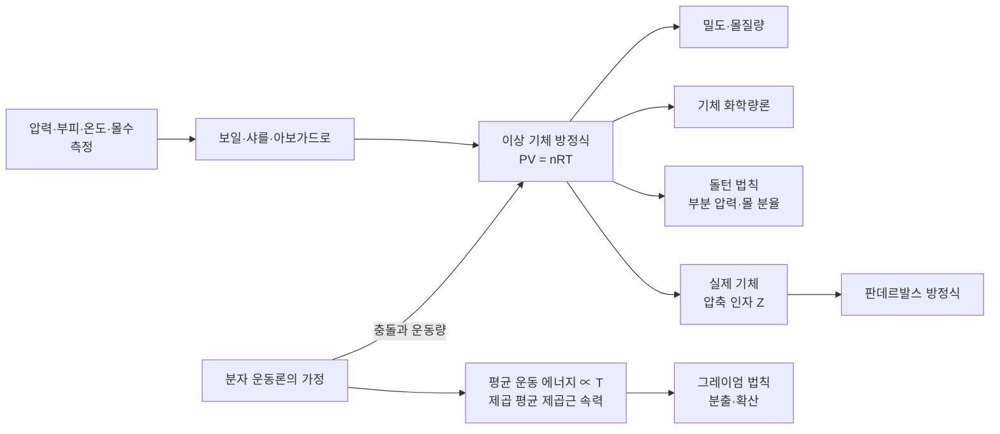

# 일반화학 2. 기체 — 보이지 않는 분자들의 충돌이 만드는 법칙
<!-- prev: matter-1, m1-06, chem-1, uchem-1 -->
<!-- next: uchem-3, uchem-6, uchem-7, uchem-8 -->

> [!NOTE]
> **이 단원의 범위**
> - 압력과 그 측정, 보일·샤를·아보가드로 법칙
> - 이상 기체 방정식과 그 응용(밀도, 몰질량), 기체 반응의 양적 관계
> - 돌턴의 부분 압력 법칙과 몰 분율, 물 위에서 모은 기체
> - 기체 분자 운동론(압력의 유도, 평균 운동 에너지, 제곱 평균 제곱근 속력, 속력 분포)
> - 분출과 확산(그레이엄 법칙)
> - 실제 기체: 압축 인자와 판데르발스 방정식

**학습 목표**

1. 압력의 여러 단위를 서로 환산하고, 기압계와 압력계의 측정값을 해석할 수 있다.
2. 개별 기체 법칙에서 이상 기체 방정식을 이끌어 내고, 기체의 밀도와 몰질량을 계산할 수 있다.
3. 이상 기체 방정식을 화학량론과 결합해 기체가 관여하는 반응의 양을 계산할 수 있다.
4. 부분 압력과 몰 분율의 관계를 이용해 혼합 기체와 물 위에서 모은 기체를 분석할 수 있다.
5. 기체 분자 운동론의 가정에서 압력식을 유도하고, 온도와 분자 속력의 관계, 그레이엄 법칙을 설명할 수 있다.
6. 압축 인자로 실제 기체의 벗어남을 판단하고, 판데르발스 방정식의 두 보정항의 의미를 설명할 수 있다.

**이 단원의 학습 사다리**

| 단계 | 무엇을 하나? |
|---|---|
| STEP 1. 이전 학습 다시 보기 | 중학교 입자 모형, 고등학교 이상 기체 방정식과 부분 압력이 어디까지였는지 확인한다 |
| STEP 2. 기초 다지기 | 압력과 운동량, 절대 온도, 그래프의 직선화, 제곱 평균 제곱근을 도구로 익힌다 |
| STEP 3. 핵심 개념 | 압력 측정 → 기체 법칙 → 이상 기체 방정식과 응용 → 기체 화학량론 → 부분 압력 → 분자 운동론 → 분출·확산 → 실제 기체 |
| STEP 4. 오개념 바로잡기 | "온도가 같으면 모든 분자의 속력이 같다" 같은 착각을 바로잡는다 |
| STEP 5. 전공 맛보기 | 평균 자유 경로와 충돌 빈도, 비리얼 전개와 임계점 |
| STEP 6. 생활·산업·진로 | 에어백, 잠수용 혼합 기체, 우라늄 농축, 기체 저장 |

---

## 🗺️ 단원 들어가기

자동차가 충돌하면 0.03초 남짓 사이에 에어백이 부풀어 오른다. 그 짧은 순간에 고체 약품 100 g 남짓이 분해해 질소 기체 수십 L를 만든다. 공학자는 "몇 g을 넣어야 몇 L가 되는가"를 어떻게 미리 계산할까? 또 산소 분자는 실온에서 초속 약 480 m, 소리보다 빠르게 움직이는데, 왜 방 한쪽에서 연 향수 냄새는 몇 초가 지나서야 퍼질까?

기체는 물질의 세 상태 가운데 가장 단순한 규칙을 따른다. 종류에 상관없이 압력·부피·온도·몰수가 하나의 식으로 묶이기 때문이다. 고등학교에서는 이 식을 실험 법칙으로 받아들였다면, 대학에서는 **분자들의 충돌로부터 이 식을 유도**하고, 식이 언제 틀리는지까지 따진다.

---

## STEP 1. 🔙 이전 학습 다시 보기

### 연계 개념표

| 이전 단원 | 고등학교까지는 여기까지 | 대학에서는 이렇게 확장 |
|---|---|---|
| 중1 「기체의 성질」 | 압력은 입자의 충돌, 압력–부피·온도–부피 관계를 입자 모형으로 정성적으로 설명 | 충돌의 운동량 변화로부터 압력식을 **유도**한다 |
| 고등학교 「화학」 '화학의 언어' | 0 °C, 1 atm에서 기체 1 mol은 22.4 L, 기체 부피와 몰 | 임의의 조건에서 $PV = nRT$로 몰을 세고 반응식과 결합한다 |
| 고등학교 「물질과 에너지」 '물질의 세 가지 상태' | 이상 기체 방정식, 몰질량 측정, 부분 압력과 몰 분율, 실제 기체의 벗어남(정성), 반데르발스 식(맛보기) | 압축 인자로 벗어남을 정량화하고, 판데르발스 식으로 실제 압력을 계산한다 |
| 고등학교 「물리학」·「역학과 에너지」 | 운동량과 충격량, 평균 운동 에너지와 온도 | 분자 운동론에서 $\overline{E_k} = \tfrac{3}{2}k_\mathrm{B}T$, $u_\mathrm{rms} = \sqrt{3RT/M}$을 얻는다 |
| 「일반화학 1. 물질과 화학량론」 | 몰, 한계 반응물, 유효 숫자 | 기체 부피를 몰로 바꾸어 같은 화학량론 사슬에 넣는다 |

### 준비 운동 (사전 진단)

**Q1.** 27 °C는 몇 K인가? 섭씨 온도를 2배로 하면 절대 온도도 2배가 되는가?

**Q2.** 일정한 온도에서 2.0 atm, 3.0 L인 기체의 압력을 6.0 atm으로 높이면 부피는?

**Q3.** 질소 0.80 mol과 산소 0.20 mol을 섞은 기체의 전체 압력이 1.0 atm이다. 산소의 부분 압력은?

**Q4.** 같은 온도에서 헬륨 원자와 질소 분자 중 평균 운동 에너지가 더 큰 것은? 평균 속력이 더 큰 것은?

정답 및 해설

**Q1.** 300 K. 아니다. 27 °C → 54 °C는 300 K → 327 K로, 절대 온도는 약 1.09배가 될 뿐이다. 기체 법칙의 비례 관계는 절대 온도에서만 성립한다.

**Q2.** 1.0 L. $P_1V_1 = P_2V_2$에서 $2.0\times3.0 = 6.0\times V_2$

**Q3.** 0.20 atm. 산소의 몰 분율이 0.20이므로 $0.20\times1.0\ \mathrm{atm}$

**Q4.** 평균 운동 에너지는 같다(온도에만 의존). 평균 속력은 질량이 작은 헬륨이 더 크다.

---

## STEP 2. 🧱 기초 다지기

### ① 압력, 그리고 힘과 운동량

**압력(pressure)** 은 단위 넓이에 수직으로 작용하는 힘이다.

$$
P = \frac{F}{A}, \qquad 1\ \mathrm{Pa} = 1\ \mathrm{N/m^2} = 1\ \mathrm{kg/(m\cdot s^2)}
$$

뉴턴 운동 법칙에 따르면 힘은 **운동량의 시간 변화율**이다($F = \Delta p/\Delta t$). 벽에 부딪쳐 튕겨 나오는 분자는 운동량이 바뀌므로 벽에 힘을 준다. 기체의 압력은 이런 충돌 수없이 많은 것의 평균이다. 이 생각이 STEP 3 ⑦의 출발점이다.

| 단위 | 정의·관계 | 주로 쓰는 곳 |
|---|---|---|
| 파스칼(Pa) | $\mathrm{N/m^2}$ (SI) | 과학 전반, kPa로 많이 씀 |
| 바(bar) | $10^5\ \mathrm{Pa}$ (정확히) | 표준 상태의 기준(1 bar), 기상 |
| 기압(atm) | $101\,325\ \mathrm{Pa}$ (정확히) | 화학 계산, 해수면 평균 기압 |
| 밀리미터 수은(mmHg) | 수은 기둥 1 mm의 압력, 1 atm = 760 mmHg | 혈압, 기압계 |
| 토르(torr) | 1 atm의 $\tfrac{1}{760}$ (≈ 1 mmHg) | 진공 기술 |

### ② 절대 온도

기체 법칙의 온도는 언제나 **켈빈 온도(절대 온도)** 이다. $T/\mathrm{K} = t/^\circ\mathrm{C} + 273.15$. 섭씨 온도는 물의 어는점을 임의로 0으로 정한 척도이므로, 섭씨 온도에 비례하는 물리량은 없다.

### ③ 그래프를 직선으로 바꾸기

$V \propto 1/P$ 같은 반비례는 $V$–$P$ 그래프에서 곡선(쌍곡선)이라 비례 상수를 읽기 어렵다. $V$를 $1/P$에 대해 그리면 **원점을 지나는 직선**이 되고 기울기가 비례 상수이다. 실험 자료가 법칙을 따르는지 판단할 때는 이렇게 변수를 바꿔 **직선이 되는지** 확인하는 것이 표준 방법이다. 직선을 바깥으로 연장하는 것을 **외삽(extrapolation)** 이라 한다.

### ④ 평균에도 종류가 있다 — 제곱 평균 제곱근

네 분자의 속력이 1, 2, 3, 4 m/s라고 하자.

| 평균의 종류 | 계산 | 값 |
|---|---|---|
| 산술 평균 $\bar{u}$ | $(1+2+3+4)/4$ | 2.50 m/s |
| **제곱 평균 제곱근** $u_\mathrm{rms}$ | $\sqrt{(1+4+9+16)/4}$ | 2.74 m/s |

운동 에너지는 속력의 **제곱**에 비례하므로, 분자 집단의 평균 운동 에너지와 연결되는 것은 $\overline{u^2}$, 곧 **제곱 평균 제곱근(root-mean-square, rms)** 속력이다. 큰 값에 더 큰 가중치를 주므로 $u_\mathrm{rms}$는 산술 평균보다 항상 크거나 같다.

---

## STEP 3. 📘 핵심 개념

### ① 압력과 그 측정

#### 기압계

1643년 토리첼리는 한쪽 끝이 막힌 유리관에 수은을 채워 수은 그릇에 거꾸로 세웠다. 수은 기둥은 약 760 mm 높이에서 멈추고, 위쪽에는 진공이 남았다. 기둥의 무게가 만드는 압력과 대기압이 균형을 이룬 것이다.

$$
P = \rho g h
$$

수은 대신 물(밀도가 약 13.6배 작음)을 쓰면 기둥 높이는 $0.760\ \mathrm{m}\times13.6 \approx 10.3\ \mathrm{m}$가 된다. 펌프로 물을 약 10 m보다 높이 빨아올릴 수 없는 이유이다.

#### 압력계(마노미터)

용기 속 기체의 압력은 U자관에 액체를 넣은 **압력계(manometer)** 로 잰다.

| 종류 | 구조 | 기체 압력 |
|---|---|---|
| 열린 관 압력계 | 한쪽은 기체, 다른 쪽은 대기에 열려 있다 | 대기 쪽 수은 면이 $h$만큼 높으면 $P_\text{기체} = P_\text{대기} + h$, 낮으면 $P_\text{대기} - h$ |
| 닫힌 관 압력계 | 다른 쪽 끝이 진공으로 막혀 있다 | $P_\text{기체} = h$ (높이 차가 곧 압력) |

#### 예제 1 — 열린 관 압력계 읽기

대기압이 752 mmHg인 날, 열린 관 압력계의 대기 쪽 수은 면이 기체 쪽보다 38 mm 높았다. 기체의 압력을 mmHg, atm, kPa로 나타내시오.

**풀이**
① 대기 쪽 면이 높다는 것은 기체가 수은을 더 세게 밀고 있다는 뜻이다: $P = 752 + 38 = 790\ \mathrm{mmHg}$
② $790\div760 = 1.04\ \mathrm{atm}$
③ $790\times133.32\ \mathrm{Pa} = 1.05\times10^{5}\ \mathrm{Pa} = 105\ \mathrm{kPa}$

어느 쪽 면이 높은지 그림 없이 헷갈리면 "기체가 수은을 밀어 올린다"를 떠올린다. 기체 압력이 클수록 반대쪽 면이 올라간다.

### ② 기체 법칙 — 실험에서 얻은 네 관계

| 법칙(발견 연도) | 일정하게 둔 것 | 관계 | 식 | 입자 모형 해석 |
|---|---|---|---|---|
| **보일 법칙**(1662) | $n$, $T$ | $V \propto 1/P$ | $P_1V_1 = P_2V_2$ | 부피가 줄면 같은 분자가 벽에 더 자주 부딪친다 |
| **샤를 법칙**(1787경) | $n$, $P$ | $V \propto T$ | $V_1/T_1 = V_2/T_2$ | 온도가 오르면 분자가 빨라져 더 세게 부딪치므로, 같은 압력을 유지하려면 부피가 커진다 |
| **게이뤼삭 법칙**(1802경) | $n$, $V$ | $P \propto T$ | $P_1/T_1 = P_2/T_2$ | 같은 공간에서 더 빠른 분자가 더 세고 잦게 부딪친다 |
| **아보가드로 법칙**(1811) | $P$, $T$ | $V \propto n$ | $V_1/n_1 = V_2/n_2$ | 분자 수가 많을수록 충돌이 많다 |

#### 절대 영도는 외삽으로 찾았다

여러 기체의 부피를 일정한 압력에서 온도에 따라 재어 그래프를 그리면 모두 직선이며, 연장하면 **같은 온도에서 부피 0**에 모인다. 예를 들어 어떤 기체가 0 °C에서 1.000 L, 100 °C에서 1.366 L라면 1 °C당 0.003 66 L씩 늘어나므로, 부피가 0이 되는 온도는

$$
t = 0 - \frac{1.000}{0.003\,66} \approx -273\ ^\circ\mathrm{C}
$$

이다. 실제 기체는 그 전에 액화하지만, 이 공통의 외삽점이 **절대 영도(0 K = −273.15 °C)** 이다. 켈빈 경(윌리엄 톰슨)은 이를 바탕으로 절대 온도 척도를 제안했다.

### ③ 이상 기체 방정식

네 법칙을 합치면 $V \propto \dfrac{nT}{P}$이고, 비례 상수를 $R$로 두면

$$
PV = nRT
$$

이다. 이 식을 정확히 따르는 가상의 기체를 **이상 기체(ideal gas)** 라 하고, $R$을 **기체 상수(gas constant)** 라고 한다.

| $R$의 값 | 단위 | 쓰는 경우 |
|---|---|---|
| 0.082 06 | $\mathrm{L\cdot atm/(mol\cdot K)}$ | 압력 atm, 부피 L |
| 8.314 | $\mathrm{J/(mol\cdot K)} = \mathrm{Pa\cdot m^3/(mol\cdot K)}$ | SI 단위, 에너지 계산, 분자 운동론 |
| 0.083 14 | $\mathrm{L\cdot bar/(mol\cdot K)}$ | 압력 bar |
| 62.36 | $\mathrm{L\cdot torr/(mol\cdot K)}$ | 압력 torr(mmHg) |

> [!IMPORTANT]
> $R$의 값은 **단위에 맞춰** 고른다. 단위가 맞지 않는 $R$을 넣는 것이 기체 계산 오답의 가장 흔한 원인이다. 계산 전에 $P$, $V$, $T$의 단위를 모두 적어 두고 $R$의 단위와 대조하자.

#### 기준 조건과 몰 부피

| 조건 | 온도 | 압력 | 이상 기체 1 mol의 부피 |
|---|---|---|---|
| 고등학교에서 쓴 표준 상태(STP, 옛 정의) | 0 °C (273.15 K) | 1 atm | 22.41 L |
| IUPAC 표준 온도·압력(현재) | 0 °C | 1 bar | 22.71 L |
| 25 °C, 1 atm | 298.15 K | 1 atm | 24.47 L |

STP의 정의가 책·분야마다 다르므로 "22.4 L"를 외워 쓰기보다 **매번 $PV = nRT$로 계산하는 습관**을 들인다.

#### 상태가 바뀌는 경우 — 결합 기체 법칙

몰수가 일정한 기체가 한 상태에서 다른 상태로 바뀌면 $\dfrac{PV}{T}$ $(= nR)$가 일정하다.

$$
\frac{P_1V_1}{T_1} = \frac{P_2V_2}{T_2}
$$

### ④ 이상 기체 방정식의 응용 — 밀도와 몰질량

$n = m/M$을 대입하면 기체의 밀도 $d = m/V$와 몰질량이 연결된다.

$$
d = \frac{PM}{RT}, \qquad M = \frac{dRT}{P} = \frac{mRT}{PV}
$$

| 결론 | 예 |
|---|---|
| 같은 $T$, $P$에서 기체의 밀도는 몰질량에 비례한다 | $\mathrm{CO_2}$(44)는 공기(평균 약 29)보다 무거워 낮은 곳에 고인다 |
| 같은 기체는 온도가 높을수록 밀도가 작다 | 열기구의 원리 |
| 기체의 밀도와 $T$, $P$를 재면 몰질량을 알 수 있다 | 미지 액체의 증기로 몰질량 결정(뒤마법) |

25 °C, 1.00 atm에서 이산화 탄소의 밀도는 $\dfrac{1.00\times44.01}{0.082\,06\times298.15} = 1.80\ \mathrm{g/L}$, 건조 공기는 약 1.18 g/L이다.

#### 예제 2 — 증기 밀도로 몰질량 구하기(뒤마법)

부피 250.0 mL인 플라스크에 휘발성 액체를 조금 넣고 끓는 물(100.0 °C)에 담가 모두 증발시키면, 남는 공기와 넘치는 증기는 작은 구멍으로 빠져나가고 플라스크는 대기압(0.9868 atm)의 증기로만 채워진다. 식혀서 응축된 액체의 질량을 쟀더니 0.6943 g이었다. 이 액체의 몰질량은? 이 물질이 알케인($\mathrm{C}_n\mathrm{H}_{2n+2}$)이라면 무엇인가?

**풀이**
① 식: $M = \dfrac{mRT}{PV}$
② 대입: $M = \dfrac{0.6943\times0.082\,06\times373.15}{0.9868\times0.2500} = 86.18\ \mathrm{g/mol}$
③ 알케인의 몰질량 $14.03n + 2.016 = 86.18$ → $n = 6.00$ → 헥세인 $\mathrm{C_6H_{14}}$
④ 결과의 의미: 100 °C에서 증기가 이상 기체처럼 행동한다고 가정했다. 실제 증기는 끓는점에 가까워 분자 사이 인력이 있으므로 약간의 오차(보통 몇 %)가 생긴다(STEP 3 ⑨).

### ⑤ 기체 반응의 양적 관계

「일반화학 1」의 화학량론 사슬에서 기체는 $n = PV/RT$로 몰에 들어오고 나간다.

$$
V_\mathrm{A}\ \xrightarrow{\;PV/RT\;}\ n_\mathrm{A}\ \xrightarrow{\;\text{계수비}\;}\ n_\mathrm{B}\ \xrightarrow{\;\times M\;}\ m_\mathrm{B}
$$

**같은 온도·압력**에서 기체끼리라면 몰수비가 곧 부피비이므로(아보가드로 법칙) $PV/RT$를 거치지 않아도 된다. 게이뤼삭의 기체 반응 법칙(중3 「화학 반응의 규칙성」)이 바로 이것이다.

#### 예제 3 — 에어백에 넣을 아자이드화 나트륨

에어백은 충돌 신호에 따라 아자이드화 나트륨을 순간적으로 분해해 질소를 만든다. $\mathrm{2NaN_3(s) \rightarrow 2Na(s) + 3N_2(g)}$
25 °C에서 압력 1.10 atm으로 60.0 L를 채우려면 $\mathrm{NaN_3}$(65.02 g/mol)이 몇 g 필요한가?

**풀이**
① 필요한 $\mathrm{N_2}$: $n = \dfrac{PV}{RT} = \dfrac{1.10\times60.0}{0.082\,06\times298.15} = 2.70\ \mathrm{mol}$
② $\mathrm{NaN_3}$: $2.70\times\dfrac{2}{3} = 1.80\ \mathrm{mol}$
③ 질량: $1.80\times65.02 = 117\ \mathrm{g}$

결과의 의미: 100 g 남짓의 고체가 60 L의 기체가 된다. 고체와 기체의 몰 부피 차이(약 1000배)가 에어백의 원리이다. 실제 에어백은 생성되는 반응성 큰 나트륨을 다른 물질과 반응시켜 처리하고, 최근에는 독성이 덜한 기체 발생제를 많이 쓴다.

### ⑥ 돌턴의 부분 압력 법칙

서로 반응하지 않는 기체를 섞으면, 각 기체는 **혼자서 그 용기를 다 차지한 것처럼** 압력을 낸다. 이 압력을 **부분 압력(partial pressure)** 이라 하고, 전체 압력은 부분 압력의 합이다(**돌턴 법칙**, 1801).

$$
P_\text{전체} = P_\mathrm{A} + P_\mathrm{B} + \cdots, \qquad P_\mathrm{A} = \frac{n_\mathrm{A}RT}{V}
$$

두 식을 나누면 **몰 분율(mole fraction)** $x_\mathrm{A} = n_\mathrm{A}/n_\text{전체}$와 부분 압력이 이어진다.

$$
P_\mathrm{A} = x_\mathrm{A}\,P_\text{전체}
$$

이상 기체에서는 분자의 종류와 관계없이 **분자 수만** 압력을 정하기 때문이다.

| 해수면의 건조 공기 성분 | 몰 분율(약) | 부분 압력(1.00 atm일 때) |
|---|---|---|
| $\mathrm{N_2}$ | 0.781 | 0.781 atm |
| $\mathrm{O_2}$ | 0.209 | 0.209 atm |
| Ar | 0.009 | 0.009 atm |
| $\mathrm{CO_2}$ | 약 0.0004 | 약 0.0004 atm |

#### 물 위에서 모은 기체

물에 잘 녹지 않는 기체($\mathrm{H_2}$, $\mathrm{O_2}$, $\mathrm{N_2}$)는 수상 치환으로 모은다. 이때 모은 기체에는 **수증기가 섞여 있으므로** 그 온도의 물의 증기 압력을 빼야 순수한 기체의 부분 압력이 된다.

| 온도(°C) | 15 | 20 | 25 | 30 | 37 |
|---|---|---|---|---|---|
| 물의 증기 압력(torr) | 12.8 | 17.5 | 23.8 | 31.8 | 47.1 |

#### 예제 4 — 아연과 염산에서 모은 수소

아연 조각을 묽은 염산에 넣어 발생한 수소를 25.0 °C에서 물 위로 모았더니 245 mL였다. 눈금 실린더 안팎의 수면을 맞추었을 때 대기압은 755.0 torr였다. 반응한 아연의 질량은? ($\mathrm{Zn + 2HCl \rightarrow ZnCl_2 + H_2}$, Zn 65.38 g/mol)

**풀이**
① 수소의 부분 압력: $755.0 - 23.8 = 731.2\ \mathrm{torr} = 0.9621\ \mathrm{atm}$
② 수소의 몰수: $n = \dfrac{0.9621\times0.245}{0.082\,06\times298.15} = 9.63\times10^{-3}\ \mathrm{mol}$
③ 아연: 계수비 1 : 1 → $9.63\times10^{-3}\times65.38 = 0.630\ \mathrm{g}$

수면을 맞추는 이유는 실린더 속 기체의 전체 압력을 대기압과 같게 만들기 위해서이다. 증기 압력을 빼지 않으면 아연의 질량이 약 3 % 크게 나온다.

> [!TIP]
> 💡 **비유** — 돌턴 법칙은 '각자 낸 회비의 합'과 같다. 한 방에 질소 손님 78명, 산소 손님 21명이 있으면 벽을 두드리는 횟수도 78 : 21로 나뉜다. 손님의 덩치(분자량)는 상관없다. 덩치가 큰 손님은 느리게 움직이지만 한 번 부딪칠 때 더 세게 미는데, 같은 온도에서는 이 두 효과가 정확히 상쇄된다(STEP 3 ⑦).

### ⑦ 기체 분자 운동론

이상 기체 방정식은 실험 법칙이다. 왜 기체는 종류와 관계없이 이 식을 따를까? 19세기 중엽 클라우지우스, 맥스웰, 볼츠만은 단순한 분자 모형에서 이 식을 이끌어 냈다. 이것이 **기체 분자 운동론(kinetic molecular theory)** 이다.

#### 가정

| 가정 | 내용 | 실제 기체에서 깨지는 조건 |
|---|---|---|
| 1 | 기체는 끊임없이 무작위로 움직이는 수많은 분자로 되어 있다 | — |
| 2 | 분자 자체의 부피는 용기 부피에 비해 무시할 만큼 작다(점 입자) | 고압 |
| 3 | 분자 사이에는 충돌할 때 말고는 힘이 작용하지 않는다 | 저온, 고압 |
| 4 | 충돌은 완전 탄성 충돌이다(운동 에너지 총합 보존) | — |
| 5 | 분자의 평균 운동 에너지는 절대 온도에 비례한다(유도 결과로 확인) | — |

#### 압력의 유도

한 변이 $L$인 정육면체 상자에 질량 $m$인 분자 $N$개가 있다. 한 분자의 속도의 $x$ 성분을 $u_x$라 하자.

1. 오른쪽 벽($x = L$)에 부딪쳐 튕겨 나오면 $x$ 방향 운동량이 $mu_x$에서 $-mu_x$로 바뀐다. 분자의 운동량 변화는 $-2mu_x$, 벽이 받는 충격량은 $+2mu_x$이다.
2. 이 분자가 같은 벽에 다시 오기까지 왕복 거리 $2L$을 가야 하므로 충돌 간격은 $\Delta t = 2L/u_x$이다.
3. 이 분자가 벽에 주는 평균 힘: $F = \dfrac{2mu_x}{2L/u_x} = \dfrac{mu_x^2}{L}$
4. $N$개 분자에 대해 더하면 $F = \dfrac{Nm\overline{u_x^2}}{L}$, 압력은 $P = \dfrac{F}{L^2} = \dfrac{Nm\overline{u_x^2}}{V}$
5. 운동이 무작위이므로 세 방향이 동등하다: $\overline{u^2} = \overline{u_x^2} + \overline{u_y^2} + \overline{u_z^2} = 3\overline{u_x^2}$

$$
PV = \frac{1}{3}Nm\overline{u^2} = \frac{2}{3}N\left(\frac{1}{2}m\overline{u^2}\right) = \frac{2}{3}N\,\overline{E_k}
$$

분자 사이 충돌은 무시했지만, 충돌이 있어도 운동량과 에너지가 보존되므로 평균값은 바뀌지 않아 결과는 같다.

#### 온도의 미시적 의미

이 결과를 실험식 $PV = nRT$와 비교하면($N = nN_\mathrm{A}$)

$$
\overline{E_k} = \frac{3}{2}\frac{R}{N_\mathrm{A}}T = \frac{3}{2}k_\mathrm{B}T, \qquad (\text{1 mol당}) \ \ \frac{3}{2}RT
$$

$k_\mathrm{B} = R/N_\mathrm{A} = 1.381\times10^{-23}\ \mathrm{J/K}$를 **볼츠만 상수(Boltzmann constant)** 라 한다. **절대 온도는 분자 병진 운동 에너지의 평균에 비례하는 양**이며, 분자의 종류와 관계없다. 25 °C에서 분자 하나의 평균 병진 운동 에너지는 $6.17\times10^{-21}\ \mathrm{J}$, 1 mol당 3.72 kJ이다.

#### 제곱 평균 제곱근 속력

$\tfrac{1}{2}m\overline{u^2} = \tfrac{3}{2}k_\mathrm{B}T$에서 $m N_\mathrm{A} = M$(kg/mol)을 쓰면

$$
u_\mathrm{rms} = \sqrt{\overline{u^2}} = \sqrt{\frac{3RT}{M}}
$$

> [!WARNING]
> 이 식에서 $R = 8.314\ \mathrm{J/(mol\cdot K)}$, $M$은 **kg/mol** 단위이다($\mathrm{J = kg\cdot m^2/s^2}$이므로 결과가 m/s가 된다). $M$에 g/mol 값을 그대로 넣으면 속력이 $\sqrt{1000} \approx 31.6$배 작게 나온다.

#### 예제 5 — 공기 분자는 얼마나 빠른가

25 °C에서 $\mathrm{N_2}$(28.02 g/mol)와 $\mathrm{H_2}$(2.016 g/mol)의 $u_\mathrm{rms}$를 구하고 비교하시오.

**풀이**
① $\mathrm{N_2}$: $u_\mathrm{rms} = \sqrt{\dfrac{3\times8.314\times298.15}{0.028\,02}} = 515\ \mathrm{m/s}$
② $\mathrm{H_2}$: $u_\mathrm{rms} = \sqrt{\dfrac{3\times8.314\times298.15}{0.002\,016}} = 1.92\times10^{3}\ \mathrm{m/s}$
③ 비: $\sqrt{28.02/2.016} = 3.73$

결과의 의미: 공기 분자는 소리(약 340 m/s)보다 빠르다. 소리는 분자 충돌로 전달되므로 음속이 분자 속력과 같은 크기라는 것은 자연스럽다. 수소는 질소의 약 3.7배 빠르다. 같은 온도에서 가벼운 분자는 빠르고 무거운 분자는 느려, **운동 에너지의 평균은 같다.**

#### 맥스웰–볼츠만 속력 분포

같은 온도에서도 분자들의 속력은 제각각이다. 맥스웰과 볼츠만은 속력이 $u$ 근처인 분자의 비율이

$$
f(u) = 4\pi\left(\frac{M}{2\pi RT}\right)^{3/2}u^2\exp\!\left(-\frac{Mu^2}{2RT}\right)
$$

로 분포한다는 것을 보였다. 그래프는 0에서 시작해 한 번 솟았다가 오른쪽으로 긴 꼬리를 끌며 줄어드는 비대칭 종 모양이다. $u^2$ 인자는 "빠른 속력을 낼 수 있는 방향의 조합이 많다"는 효과, 지수 인자는 "에너지가 큰 상태일수록 드물다"는 효과이다.

| 대표 속력 | 식 | 25 °C의 $\mathrm{N_2}$ | 의미 |
|---|---|---|---|
| 최빈 속력 $u_\mathrm{mp}$ | $\sqrt{2RT/M}$ | 421 m/s | 분포의 꼭대기 |
| 평균 속력 $\bar{u}$ | $\sqrt{8RT/\pi M}$ | 475 m/s | 산술 평균 |
| 제곱 평균 제곱근 속력 $u_\mathrm{rms}$ | $\sqrt{3RT/M}$ | 515 m/s | 평균 운동 에너지와 연결 |

비는 언제나 $u_\mathrm{mp} : \bar{u} : u_\mathrm{rms} = 1 : 1.128 : 1.225$이다.

| 조건 변화 | 분포 곡선의 변화 |
|---|---|
| 온도 상승 | 꼭대기가 오른쪽(빠른 쪽)으로 이동하고 낮아지며 넓게 퍼진다(곡선 아래 넓이는 1로 일정) |
| 몰질량 증가 | 꼭대기가 왼쪽(느린 쪽)으로 이동하고 높고 좁아진다 |

> [!TIP]
> 💡 **연결** — 분포의 오른쪽 꼬리, 곧 **아주 빠른 분자의 비율**은 온도가 조금만 올라도 크게 늘어난다. 반응을 일으킬 만큼 큰 에너지를 가진 분자가 꼬리에 있으므로, 이 성질이 「일반화학 7. 화학 반응 속도론」에서 온도가 반응 속도를 크게 바꾸는 이유(아레니우스 식)가 된다. 또 지구 대기에서 수소와 헬륨이 우주로 빠져나간 것도 가벼운 분자의 꼬리가 탈출 속도(약 11 km/s)에 닿기 때문이다.

### ⑧ 분출과 확산 — 그레이엄 법칙

| 현상 | 뜻 | 예 |
|---|---|---|
| **분출(effusion)** | 기체가 아주 작은 구멍을 통해 진공(또는 낮은 압력) 쪽으로 빠져나가는 것 | 헬륨 풍선이 하루 만에 쭈그러든다 |
| **확산(diffusion)** | 기체 분자가 다른 기체 속으로 퍼져 섞이는 것 | 향수 냄새가 방에 퍼진다 |

1846년 그레이엄은 같은 조건에서 기체의 분출 속도가 몰질량의 제곱근에 반비례함을 실험으로 찾았다.

$$
\frac{\text{속도}_\mathrm{A}}{\text{속도}_\mathrm{B}} = \sqrt{\frac{M_\mathrm{B}}{M_\mathrm{A}}} = \frac{t_\mathrm{B}}{t_\mathrm{A}}\quad(\text{같은 양이 빠져나가는 데 걸린 시간 } t)
$$

분자 운동론으로 보면 당연하다. 구멍에 닿는 분자의 빈도는 평균 속력에 비례하고, 평균 속력은 $\sqrt{T/M}$에 비례하기 때문이다.

#### 확산은 왜 느릴까

25 °C, 1 atm의 공기 속에서 분자 하나는 1초에 수십억 번 다른 분자와 부딪치고, 한 번 충돌한 뒤 다음 충돌까지 평균 약 70 nm(분자 지름의 수백 배)밖에 가지 못한다. 이 거리를 **평균 자유 경로(mean free path)** 라 한다. 분자는 빠르지만 지그재그로 갈팡질팡하므로(무작위 걸음), 실제로 퍼지는 거리는 시간의 제곱근에 비례해 아주 느리게 늘어난다. 방 안의 냄새가 몇 초 만에 퍼지는 것은 주로 공기의 흐름(대류) 덕분이다.

#### 예제 6 — 암모니아와 염화 수소의 만남

길이 1.00 m인 유리관의 한쪽 끝에 진한 암모니아수를, 다른 쪽 끝에 진한 염산을 적신 솜을 동시에 넣었다. 두 기체가 만나면 흰 연기($\mathrm{NH_4Cl}$)의 고리가 생긴다. 그레이엄 법칙만으로 예측하면 고리는 암모니아 쪽 끝에서 얼마나 떨어진 곳에 생기는가? ($\mathrm{NH_3}$ 17.03, HCl 36.46 g/mol)

**풀이**
① 같은 시간 동안 이동한 거리의 비 = 속도의 비: $\dfrac{d_{\mathrm{NH_3}}}{d_\mathrm{HCl}} = \sqrt{\dfrac{36.46}{17.03}} = 1.463$
② $d_{\mathrm{NH_3}} + d_\mathrm{HCl} = 1.00\ \mathrm{m}$ → $d_{\mathrm{NH_3}} = \dfrac{1.463}{2.463}\times1.00 = 0.594\ \mathrm{m}$

결과의 의미: 고리는 염산 쪽에 더 가까운 곳(암모니아 쪽에서 약 59 cm)에 생긴다. 실제 실험에서는 관 속 공기 분자와의 충돌, 솜에서 기체가 나오는 속도 차이 때문에 위치가 조금 다르게 나오기도 한다. 그레이엄 법칙은 엄밀히는 진공으로의 분출에 대한 법칙이고, 공기 속 확산은 근사적으로만 따른다.

### ⑨ 실제 기체와 판데르발스 방정식

#### 압축 인자로 벗어남 재기

실제 기체가 이상 기체에서 얼마나 벗어나는지는 **압축 인자(compressibility factor)** 로 나타낸다.

$$
Z = \frac{PV}{nRT} \qquad (\text{이상 기체는 언제나 } Z = 1)
$$

| $Z$ | 뜻 | 주된 원인 | 잘 나타나는 조건 |
|---|---|---|---|
| $Z < 1$ | 이상 기체보다 압축되기 쉽다 | 분자 사이 **인력**이 벽에 부딪치는 힘을 줄인다 | 중간 압력(수십~수백 atm), 낮은 온도, 인력이 큰 분자($\mathrm{CO_2}$, $\mathrm{NH_3}$) |
| $Z > 1$ | 이상 기체보다 압축되기 어렵다 | 분자 자체의 **부피**(반발력) | 매우 높은 압력, 작은 분자($\mathrm{H_2}$, He) |

$Z$를 압력에 대해 그리면, 대부분의 기체는 압력이 올라감에 따라 처음에는 1보다 작아졌다가(인력 우세) 아주 높은 압력에서 1보다 커진다(부피 우세). 온도가 높을수록 인력의 효과가 상대적으로 작아져 곡선이 1에 가까워진다. **이상 기체 근사는 "높은 온도, 낮은 압력"에서 잘 맞는다.**

#### 판데르발스 방정식

1873년 판데르발스(반데르발스, van der Waals)는 이상 기체 방정식에 두 가지 보정을 넣었다.

$$
\left(P + \frac{an^2}{V^2}\right)(V - nb) = nRT
$$

| 보정 | 무엇을 고치나 | 근거 |
|---|---|---|
| $V - nb$ | 분자가 움직일 수 있는 공간은 용기 부피에서 분자들이 차지한 부피를 뺀 것 | $b$: 분자 1 mol이 실제로 차지하는 배제 부피 |
| $P + an^2/V^2$ | 측정되는 압력은 인력 때문에 이상 기체보다 작다. 이를 더해 '이상적인 압력'으로 되돌린다 | 벽 근처 분자를 안쪽으로 당기는 힘은 (벽에 오는 분자의 밀도) × (당기는 분자의 밀도)에 비례 → $(n/V)^2$ |

| 기체 | $a$ ($\mathrm{L^2\cdot atm/mol^2}$) | $b$ ($\mathrm{L/mol}$) | 해석 |
|---|---|---|---|
| He | 0.0341 | 0.0237 | 인력이 매우 약하다 |
| $\mathrm{H_2}$ | 0.244 | 0.0266 | |
| $\mathrm{N_2}$ | 1.39 | 0.0391 | |
| $\mathrm{O_2}$ | 1.36 | 0.0318 | |
| $\mathrm{CH_4}$ | 2.25 | 0.0428 | |
| $\mathrm{CO_2}$ | 3.59 | 0.0427 | 쉽게 액화한다 |
| $\mathrm{NH_3}$ | 4.17 | 0.0371 | 수소 결합으로 인력이 크다 |
| $\mathrm{H_2O}$ | 5.46 | 0.0305 | 인력이 가장 크다 |

$a$는 분자 사이 인력이 클수록(극성이 크거나 전자가 많을수록) 크고, 끓는점이 높은 물질일수록 크다. $b$는 분자가 클수록 크다. 압력을 구하는 꼴로 정리하면

$$
P = \frac{nRT}{V - nb} - \frac{an^2}{V^2}
$$

#### 예제 7 — 압축된 이산화 탄소

이산화 탄소 1.00 mol이 1.00 L 용기에 들어 있다(300 K). 이상 기체 방정식과 판데르발스 방정식으로 압력을 각각 구하고 압축 인자를 구하시오.

**풀이**
① 이상 기체: $P = \dfrac{1.00\times0.082\,06\times300}{1.00} = 24.6\ \mathrm{atm}$
② 판데르발스: $P = \dfrac{1.00\times0.082\,06\times300}{1.00 - 0.0427} - \dfrac{3.59\times1.00^2}{1.00^2} = 25.7 - 3.59 = 22.1\ \mathrm{atm}$
③ $Z = \dfrac{22.1\times1.00}{1.00\times0.082\,06\times300} = 0.899$

결과의 의미: 부피 보정은 압력을 약 1.1 atm 올리지만, 인력 보정이 3.6 atm 낮추어 결과적으로 이상 기체보다 약 10 % 작다. 이 조건에서는 **인력이 우세**하다($Z < 1$). 판데르발스 식도 근사식이어서, 측정값과 비교하면 이 영역에서는 몇 % 안에서 맞는다(약).

> [!NOTE]
> 판데르발스 식은 실제 기체를 완벽히 기술하지는 않지만, **기체가 액화하는 이유**(인력)와 **액체가 거의 압축되지 않는 이유**(분자의 부피)를 하나의 식으로 보여 준다는 데 큰 의미가 있다. 분자 사이 힘의 종류와 크기는 「일반화학 6. 분자 간 힘과 액체·고체·용액」에서 자세히 다룬다.

---

## STEP 4. ⚠️ 오개념 바로잡기

| 흔한 오개념 | 올바른 개념 | 왜 그럴까? |
|---|---|---|
| 기체 법칙에 섭씨 온도를 넣어도 된다 | 반드시 **켈빈 온도**를 쓴다 | 평균 운동 에너지가 절대 온도에 비례하기 때문이다. 섭씨 0 °C에서 부피가 0이 되는 모순이 생긴다 |
| 같은 온도에서 모든 분자의 속력은 같다 | 속력은 넓게 **분포**하며, 같은 것은 **평균 운동 에너지**이다 | 분자들은 끊임없이 충돌하며 에너지를 주고받는다 |
| 같은 온도·압력에서 무거운 기체는 압력이 더 크다 | 압력은 **분자 수**에만 의존한다 | 무거운 분자는 느리게 움직여 충돌 빈도가 줄고, 한 번의 충격은 커져 효과가 상쇄된다 |
| 22.4 L는 기체 1 mol의 부피이다 | 0 °C, 1 atm에서만 그렇다 | 25 °C, 1 atm에서는 24.5 L, 0 °C, 1 bar에서는 22.7 L이다 |
| 물 위에서 모은 기체의 압력은 대기압과 같다 | 대기압은 **기체 + 수증기**의 전체 압력이다 | 그 온도에서의 물의 증기 압력을 빼야 한다 |
| 분자의 속력이 크므로 확산도 순식간이다 | 충돌 때문에 **무작위 걸음**을 하여 확산은 느리다 | 평균 자유 경로가 약 70 nm로 매우 짧다 |
| 실제 기체는 언제나 이상 기체보다 압력이 작다 | 인력이 우세하면 $Z<1$, 분자 부피가 우세하면 $Z>1$이다 | 매우 높은 압력에서는 분자 자체의 부피가 중요해진다 |
| $u_\mathrm{rms}$ 식에 몰질량을 g/mol로 넣는다 | **kg/mol**로 넣는다 | $R$이 J 단위이고 J = kg·m²/s²이기 때문이다 |

---

## STEP 5. 🎓 다음 단계로 한 걸음 더

> [!CAUTION]
> 여기부터는 일반 과목의 범위를 넘는 전공 과목 맛보기이다. 일반화학에서는 분자 운동론으로 압력과 평균 속력을 유도하고, 판데르발스 식으로 실제 기체를 어림하는 데까지 다룬다. 아래 내용은 물리화학·화학공학 열역학에서 본격적으로 배운다.

### 전공 과목과의 연결

| 전공 과목 | 이어지는 내용 |
|---|---|
| 물리화학(열역학) | 상태 방정식, 비리얼 전개, 임계점과 대응 상태의 원리, 퓨개시티 |
| 물리화학(통계 역학) | 맥스웰–볼츠만 분포의 유도, 분배 함수, 에너지 등분배 |
| 물리화학(속도론) | 충돌 빈도, 평균 자유 경로, 충돌 이론과 반응 속도 상수 |
| 화학공학 열역학 | 실제 기체의 상태 방정식(레들리히–퀑 등)으로 공정 설계 |
| 대기과학 | 높이에 따른 기압 변화(정역학 평형), 기체의 탈출 |

### 맛보기 ① 평균 자유 경로와 충돌 빈도

지름 $d$인 분자가 수 밀도 $N/V$인 기체 속을 움직일 때, 평균 자유 경로는

$$
\lambda = \frac{k_\mathrm{B}T}{\sqrt{2}\,\pi d^2 P}
$$

이다. $\mathrm{N_2}$($d \approx 0.37\ \mathrm{nm}$)를 25 °C, 1 atm에 넣으면 $\lambda \approx 6.7\times10^{-8}\ \mathrm{m}$(약 70 nm)이다. 평균 속력 475 m/s를 이 거리로 나누면 분자 하나의 충돌 빈도는 1초에 약 $7\times10^{9}$번이다. 압력을 $10^{-9}$ atm 정도로 낮춘 초고진공에서는 $\lambda$가 수십 m가 되어, 반도체 증착 장비 속 원자들이 거의 충돌 없이 기판까지 날아간다.

### 맛보기 ② 비리얼 전개와 임계점

압축 인자를 몰 부피 $V_\mathrm{m}$의 역수에 대한 급수로 쓰면

$$
Z = 1 + \frac{B(T)}{V_\mathrm{m}} + \frac{C(T)}{V_\mathrm{m}^2} + \cdots
$$

이를 **비리얼 전개**라 하고, $B(T)$는 두 분자 사이의 상호 작용에서 계산할 수 있다. 판데르발스 식을 전개하면 $B = b - \dfrac{a}{RT}$이다. $B = 0$이 되는 **보일 온도** $T_\mathrm{B} = a/(Rb)$에서는 기체가 꽤 넓은 압력 범위에서 이상 기체처럼 행동한다. 또 판데르발스 식은 어떤 온도 이하에서 기체–액체 공존을 예측하는데, 그 경계가 되는 **임계 온도** $T_\mathrm{c} = \dfrac{8a}{27Rb}$보다 높으면 아무리 압축해도 액화하지 않는다. $\mathrm{CO_2}$의 실제 임계 온도는 약 31 °C이며, 그 위의 **초임계 유체**는 커피의 카페인 제거 등에 쓰인다.

### 일반 과목 vs 전공 과목

| 주제 | 일반화학(이 단원) | 전공 과목 |
|---|---|---|
| 상태 방정식 | $PV = nRT$, 판데르발스 식 | 비리얼 전개, 여러 3차 상태 방정식, 대응 상태의 원리 |
| 분자 운동론 | 압력의 유도, $\tfrac{3}{2}k_\mathrm{B}T$, $u_\mathrm{rms}$ | 속력 분포의 유도, 에너지 등분배, 분배 함수 |
| 수송 현상 | 그레이엄 법칙, 평균 자유 경로의 의미 | 확산 계수·점성·열전도의 분자론적 계산 |
| 실제 기체 | 압축 인자의 부호 해석 | 퓨개시티, 임계 현상, 초임계 유체 공정 |

---

## STEP 6. 🏭 생활·산업·진로 연결

### 사례 1. 에어백과 기체 발생제

- **원리** 고체가 분해해 짧은 시간에 많은 몰수의 기체를 만들면, 이상 기체 방정식에 따라 큰 부피가 생긴다(예제 3).
- **어디에 쓰이나** 자동차 에어백, 항공기 비상 탈출 슬라이드. 설계자는 필요한 부피·압력에서 기체 몰수를 계산하고, 반응 속도와 생성물의 안전성(독성, 온도)을 함께 고려해 발생제를 고른다.

### 사례 2. 잠수용 혼합 기체

- **원리** 물속 10 m마다 압력이 약 1 atm씩 커진다. 공기를 그대로 마시면 깊은 곳에서 산소와 질소의 부분 압력이 함께 커진다. 산소 부분 압력이 약 1.4 atm을 넘으면 산소 중독 위험이, 질소 부분 압력이 커지면 질소 마취가 생긴다.
- **어디에 쓰이나** 깊은 잠수에는 산소 비율을 낮추고 질소 대신 헬륨을 섞은 혼합 기체(헬리옥스, 트라이믹스)를 쓴다. 모두 돌턴 법칙 $P_\mathrm{A} = x_\mathrm{A}P$로 설계한다. 의료용 고압 산소 치료도 같은 원리이다.

### 사례 3. 우라늄 농축 — 그레이엄 법칙의 산업

- **원리** 천연 우라늄에는 핵분열하는 $^{235}\mathrm{U}$가 약 0.72 %뿐이다. 우라늄을 기체인 육플루오린화 우라늄($\mathrm{UF_6}$)으로 바꾸면 $^{235}\mathrm{UF_6}$(349.03)와 $^{238}\mathrm{UF_6}$(352.04)의 분출 속도 비는 $\sqrt{352.04/349.03} = 1.0043$에 불과하다.
- **어디에 쓰이나** 다공성 막을 수백 단 통과시키는 기체 확산법이 20세기 중반 원자력 발전 연료 생산에 쓰였다. 지금은 에너지 효율이 훨씬 높은 원심 분리법이 주로 쓰인다. 같은 원리로 질량이 다른 동위 원소를 분리할 수 있다.

### 사례 4. 기체의 저장과 수송

- **원리** 수소·천연가스는 상온에서 기체라 부피가 크다. 고압 압축(수백 atm)에서는 이상 기체 근사가 맞지 않아 $Z$를 고려해 탱크 용량을 계산해야 하고, 액화하려면 임계 온도 아래로 냉각해야 한다.
- **어디에 쓰이나** 수소 연료 전지 차량의 700 bar 탱크, 액화 천연가스(LNG, 약 −162 °C) 운반선, 의료용 산소 실린더.

### 관련 전공과 진로

| 진로 | 하는 일 | 관련 학과 |
|---|---|---|
| 화학공정 엔지니어 | 기체 반응기·분리 공정 설계, 압력 용기 계산 | 화학공학과, 화학과 |
| 반도체 공정 엔지니어 | 진공 증착·식각 장비의 기체 흐름과 압력 제어 | 신소재공학과, 전자공학과, 화학공학과 |
| 대기 환경 연구원 | 대기 오염 기체의 농도·확산 분석 | 대기과학과, 환경공학과 |
| 잠수·고압 의학 전문가 | 혼합 기체 설계, 감압병 예방 | 의학, 해양학, 체육학 |
| 원자력 연료 기술자 | 동위 원소 분리, 핵연료 공정 | 원자핵공학과, 화학공학과 |

---

## 🔬 탐구 활동

### 활동 A. 마그네슘과 염산으로 기체 상수 $R$ 구하기

**목표** 질량을 아는 마그네슘에서 발생한 수소의 부피·온도·압력을 재어 기체 상수를 실험으로 구한다.

**준비물** 마그네슘 리본(0.030~0.040 g, 0.0001 g 저울로 측정), 3 M 염산, 기체 측정관(50 mL 눈금, 뷰렛으로 대신 가능), 구리선, 큰 비커 또는 물통, 온도계, 기압계(또는 기상청 현재 기압 자료), 보안경, 장갑

**과정**
1. 마그네슘 리본의 질량을 정확히 재고 구리선으로 감아 우리 모양으로 만든다.
2. 기체 측정관에 3 M 염산 약 10 mL를 넣고, 나머지를 물로 천천히 채운다(산과 물이 크게 섞이지 않게).
3. 마그네슘을 관 입구에 걸고 손가락으로 막아 물통에 거꾸로 세운다. 무거운 산이 내려가 마그네슘과 반응한다.
4. 반응이 끝나면 관을 위아래로 움직여 관 안팎의 수면을 맞추고 기체 부피를 읽는다. 물의 온도와 대기압을 기록한다.
5. 수소의 부분 압력(대기압 − 물의 증기 압력)과 마그네슘의 몰수(= 수소의 몰수)로 $R = PV/nT$를 계산한다.

**결과 기록 표**

| 회 | Mg 질량(g) | $n_{\mathrm{H_2}}$(mol) | $V$(L) | 물 온도(K) | 대기압(atm) | 물의 증기 압력(atm) | $P_{\mathrm{H_2}}$(atm) | $R$($\mathrm{L\cdot atm/(mol\cdot K)}$) |
|---|---|---|---|---|---|---|---|---|
| 1 | | | | | | | | |
| 2 | | | | | | | | |
| 3 | | | | | | | | |

**생각해 보기**
1. 수증기 압력을 빼지 않으면 $R$은 커질까 작아질까? 몇 % 정도 달라지는가?
2. 마그네슘 표면에 산화막이 있으면 결과는 어느 쪽으로 치우칠까?
3. 세 번의 결과로 평균과 상대 편차를 구하고, 가장 큰 오차 원인을 하나 고르시오.

> [!WARNING]
> **안전 수칙** 보안경과 장갑을 착용한다. 3 M 염산은 피부와 눈을 손상시키므로 흘리면 즉시 많은 물로 씻는다. 수소는 가연성이므로 실험 중 불꽃을 쓰지 않는다. 반응이 끝난 용액은 중화한 뒤 지정된 폐액통에 버린다.

### 활동 B. 스프레드시트로 실제 기체의 압축 인자 그리기

**목표** 이상 기체 방정식과 판데르발스 식으로 압력을 계산해 압축 인자 $Z$가 조건에 따라 어떻게 달라지는지 확인한다.

**과정**
1. A열에 몰 부피 $V_\mathrm{m}$를 0.05 L부터 10 L까지 넣는다(간격을 로그 척도로 잡으면 좋다).
2. B열에 $T = 300\ \mathrm{K}$에서 $\mathrm{CO_2}$의 판데르발스 압력 $P = \dfrac{RT}{V_\mathrm{m} - b} - \dfrac{a}{V_\mathrm{m}^2}$을 계산한다.
3. C열에 $Z = \dfrac{PV_\mathrm{m}}{RT}$를 계산하고, $P$(가로축)–$Z$(세로축) 그래프를 그린다.
4. 같은 계산을 $\mathrm{N_2}$, He와 $T = 600\ \mathrm{K}$에 대해 반복해 한 그래프에 겹쳐 그린다.

| 기체·온도 | $Z$의 최솟값 | 그때의 압력(atm) | $Z = 1$로 돌아오는 압력(atm) |
|---|---|---|---|
| $\mathrm{CO_2}$, 300 K | | | |
| $\mathrm{N_2}$, 300 K | | | |
| He, 300 K | | | |
| $\mathrm{CO_2}$, 600 K | | | |

**생각해 보기** He의 곡선은 왜 처음부터 1보다 위로 올라갈까? 온도를 높이면 $\mathrm{CO_2}$의 곡선이 어떻게 바뀌는지, $a$와 $b$의 의미로 설명해 보자. (주의: 300 K의 $\mathrm{CO_2}$는 임계 온도 근처라서 몰 부피가 작은 영역에서 판데르발스 식이 비물리적인 굴곡을 보일 수 있다. 그 영역은 실제로는 액화가 일어나는 곳이다.)

---

## ✅ 개념 확인 문제

### 기본

**1.** 어느 날의 기압이 745 mmHg이다. 이 값을 atm, kPa, bar로 나타내시오.

정답 및 해설

**정답** 0.980 atm, 99.3 kPa, 0.993 bar

$745\div760 = 0.980\ \mathrm{atm}$, $745\times133.32\ \mathrm{Pa} = 9.93\times10^{4}\ \mathrm{Pa} = 99.3\ \mathrm{kPa}$, $1\ \mathrm{bar} = 100\ \mathrm{kPa}$이므로 0.993 bar

**2.** 지상(1.00 atm, 20 °C)에서 부피가 10.0 L인 기상 관측 풍선이 상공(0.30 atm, −40 °C)으로 올라갔다. 풍선의 부피는? (풍선의 탄성은 무시한다)

정답 및 해설

**정답** 약 27 L

$V_2 = V_1\times\dfrac{P_1}{P_2}\times\dfrac{T_2}{T_1} = 10.0\times\dfrac{1.00}{0.30}\times\dfrac{233.15}{293.15} = 26.5 \approx 27\ \mathrm{L}$ (0.30이 유효 숫자 2개). 압력 감소로 커지는 효과가 온도 감소로 줄어드는 효과보다 크다.

**3.** 어떤 홑원소 기체의 밀도가 0 °C, 1.00 atm에서 1.25 g/L이다. 이 기체의 몰질량을 구하고 무엇인지 쓰시오.

정답 및 해설

**정답** 28.0 g/mol, 질소($\mathrm{N_2}$)

$M = \dfrac{dRT}{P} = \dfrac{1.25\times0.082\,06\times273.15}{1.00} = 28.0\ \mathrm{g/mol}$. 몰질량 28인 홑원소 물질 기체는 $\mathrm{N_2}$뿐이다(CO, $\mathrm{C_2H_4}$도 28이지만 화합물이다).

**4.** 5.00 L 용기에 헬륨 2.00 g과 산소 8.00 g을 넣었다(25 °C). 각 기체의 부분 압력, 전체 압력, 헬륨의 몰 분율을 구하시오. (He 4.003, $\mathrm{O_2}$ 32.00 g/mol)

정답 및 해설

**정답** $P_\mathrm{He} = 2.44\ \mathrm{atm}$, $P_{\mathrm{O_2}} = 1.22\ \mathrm{atm}$, $P_\text{전체} = 3.67\ \mathrm{atm}$, $x_\mathrm{He} = 0.667$

He 0.4996 mol, $\mathrm{O_2}$ 0.2500 mol. $RT/V = 0.082\,06\times298.15\div5.00 = 4.893\ \mathrm{atm/mol}$. $P_\mathrm{He} = 0.4996\times4.893 = 2.44\ \mathrm{atm}$, $P_{\mathrm{O_2}} = 1.22\ \mathrm{atm}$. $x_\mathrm{He} = 0.4996\div0.7496 = 0.667$. 질량은 산소가 4배 많지만 몰수는 헬륨이 2배이다.

**5.** (1) 같은 온도에서 헬륨 원자의 $u_\mathrm{rms}$는 $\mathrm{CO_2}$ 분자의 몇 배인가? (2) 산소 분자의 $u_\mathrm{rms}$가 25 °C의 수소 분자와 같아지려면 온도가 몇 K이어야 하는가? (He 4.003, $\mathrm{CO_2}$ 44.01, $\mathrm{H_2}$ 2.016, $\mathrm{O_2}$ 32.00 g/mol)

정답 및 해설

**정답** (1) 3.32배 (2) $4.73\times10^{3}\ \mathrm{K}$

(1) $\sqrt{44.01/4.003} = 3.32$
(2) $u_\mathrm{rms} \propto \sqrt{T/M}$이므로 $T/M$이 같아야 한다: $T = 298.15\times\dfrac{32.00}{2.016} = 4.73\times10^{3}\ \mathrm{K}$

### 응용

**6.** 염소산 칼륨을 이산화 망가니즈 촉매와 함께 가열해 산소를 만든다. $\mathrm{2KClO_3(s) \rightarrow 2KCl(s) + 3O_2(g)}$
$\mathrm{KClO_3}$(122.55 g/mol) 1.226 g이 완전히 분해할 때 생긴 산소를 20.0 °C에서 물 위로 모았다. 대기압이 752.0 torr이면 모은 기체의 부피는 몇 mL인가? (20 °C에서 물의 증기 압력 17.5 torr)

정답 및 해설

**정답** 374 mL

$\mathrm{KClO_3}$ $1.226\div122.55 = 1.0004\times10^{-2}\ \mathrm{mol}$ → $\mathrm{O_2}$ $1.501\times10^{-2}\ \mathrm{mol}$. $P_{\mathrm{O_2}} = 752.0 - 17.5 = 734.5\ \mathrm{torr} = 0.9664\ \mathrm{atm}$. $V = \dfrac{1.501\times10^{-2}\times0.082\,06\times293.15}{0.9664} = 0.374\ \mathrm{L}$. 모은 기체(산소 + 수증기)의 부피가 374 mL이다.

**7.** 같은 장치에서 같은 몰수의 기체가 작은 구멍으로 빠져나가는 데 산소는 52.0 s, 미지 기체는 77.4 s가 걸렸다. 미지 기체의 몰질량은? 이 기체가 할로젠 원소의 홑원소 물질이라면 무엇인가?

정답 및 해설

**정답** 70.9 g/mol, $\mathrm{Cl_2}$

시간은 속도에 반비례하므로 $\dfrac{t_x}{t_{\mathrm{O_2}}} = \sqrt{\dfrac{M_x}{M_{\mathrm{O_2}}}}$ → $M_x = 32.00\times\left(\dfrac{77.4}{52.0}\right)^2 = 70.9\ \mathrm{g/mol}$ → $\mathrm{Cl_2}$(70.90)

**8.** 질소 1.00 mol을 0.100 L 용기에 넣었다(273.15 K). (1) 이상 기체 방정식과 판데르발스 방정식($a = 1.39\ \mathrm{L^2\cdot atm/mol^2}$, $b = 0.0391\ \mathrm{L/mol}$)으로 압력을 구하시오. (2) 예제 7의 $\mathrm{CO_2}$와 달리 판데르발스 압력이 이상 기체보다 큰 이유를 설명하시오.

정답 및 해설

**정답** (1) 이상 기체 224 atm, 판데르발스 229 atm (2) 해설 참고

(1) 이상: $0.082\,06\times273.15\div0.100 = 224\ \mathrm{atm}$. 판데르발스: $\dfrac{22.41}{0.100 - 0.0391} - \dfrac{1.39}{0.0100} = 368.0 - 139 = 229\ \mathrm{atm}$ ($Z \approx 1.02$)
(2) 몰 부피가 0.100 L로 매우 작아 분자 자체의 부피($b = 0.0391\ \mathrm{L}$)가 용기 부피의 약 40 %를 차지한다. 움직일 수 있는 공간이 크게 줄어 압력을 높이는 효과가 인력 보정보다 커진다. 질소는 $a$가 작아 인력 효과도 $\mathrm{CO_2}$보다 약하다.

**9.** 같은 온도·압력에서 메테인 3.00 L를 완전 연소시키는 데 필요한 산소와 공기의 부피, 생성되는 이산화 탄소의 부피를 구하시오. (공기 중 산소의 부피 비율은 21 %, 물은 액체로 응축된다)

정답 및 해설

**정답** 산소 6.00 L, 공기 약 28.6 L, 이산화 탄소 3.00 L

$\mathrm{CH_4 + 2O_2 \rightarrow CO_2 + 2H_2O(l)}$. 같은 $T$, $P$에서 기체의 부피비 = 몰수비 = 계수비이다. 공기: $6.00\div0.21 = 28.6\ \mathrm{L}$. 가스레인지가 공기 구멍을 충분히 열어야 하는 이유이다.

### 융합·서술형

**10. [생활·안전 연계]** 수심 30 m(전체 압력 약 4.0 atm)에서 공기(산소 21 %, 질소 79 %로 가정)로 잠수한다.
(1) 이 깊이에서 산소와 질소의 부분 압력을 구하시오.
(2) 산소 부분 압력이 1.4 atm을 넘지 않아야 한다면 공기로 내려갈 수 있는 최대 수심은 약 몇 m인가? (수면 1.0 atm, 10 m마다 1.0 atm 증가)
(3) 30 m에서 숨을 가득 들이마신 폐(6.0 L)로 숨을 참은 채 수면으로 올라오면 어떤 일이 생기는지 기체 법칙으로 설명하시오(온도 일정).

정답 및 해설

**정답** (1) $P_{\mathrm{O_2}} = 0.84\ \mathrm{atm}$, $P_{\mathrm{N_2}} = 3.2\ \mathrm{atm}$ (2) 약 57 m (3) 해설 참고

(1) $0.21\times4.0 = 0.84\ \mathrm{atm}$, $0.79\times4.0 = 3.16 \approx 3.2\ \mathrm{atm}$
(2) $P_\text{전체} = 1.4\div0.21 = 6.7\ \mathrm{atm}$ → 수심 $(6.7 - 1.0)\times10 \approx 57\ \mathrm{m}$. 실제 안전 기준은 이보다 보수적이며, 질소 마취도 함께 고려해야 한다.
(3) 보일 법칙에 따라 $V_2 = 6.0\times\dfrac{4.0}{1.0} = 24\ \mathrm{L}$로 팽창하려 한다. 폐의 용량을 크게 넘으므로 폐포가 손상될 수 있다(폐 과팽창 손상). 그래서 상승할 때는 숨을 계속 내쉬어야 한다.

**채점 포인트** ① $P_\mathrm{A} = x_\mathrm{A}P$ ② 압력–수심 관계 ③ 보일 법칙과 안전 수칙 연결

**11. [산업·진로 연계]** $\mathrm{UF_6}$ 기체 확산법에서 한 단을 통과할 때마다 $^{235}\mathrm{U}$와 $^{238}\mathrm{U}$의 존재비의 비가 이상적으로 1.0043배가 된다.
(1) 이 값이 어떻게 나오는지 그레이엄 법칙으로 보이시오. (2) 존재비 0.72 %의 천연 우라늄을 4.0 %로 농축하려면 이상적으로 약 몇 단이 필요한지 계산하시오. (3) 이 방법이 에너지를 많이 쓰는 이유를 분자 운동론의 관점에서 서술하시오.

정답 및 해설

**정답** (1) $\sqrt{352.04/349.03} = 1.0043$ (2) 약 400단 (3) 해설 참고

(1) 분출 속도는 $1/\sqrt{M}$에 비례하므로 가벼운 $^{235}\mathrm{UF_6}$가 $\sqrt{352.04/349.03} = 1.0043$배 빨리 통과한다.
(2) 존재비의 비($^{235}\mathrm{U}/^{238}\mathrm{U}$)는 처음 $0.0072/0.9928 = 0.00725$, 목표 $0.040/0.960 = 0.0417$로 약 5.75배이다. $1.0043^N = 5.75$ → $N = \dfrac{\ln5.75}{\ln1.0043} \approx 4.1\times10^{2}$, 약 400단.
(3) **예시 답안** 두 분자의 질량 차이가 1 % 미만이어서 한 단에서 얻는 분리가 매우 작다. 그래서 막대한 양의 기체를 수백 번 압축해 막을 통과시키고 다시 순환시켜야 하며, 압축할 때마다 큰 일(에너지)이 든다. 원심 분리법은 회전으로 질량 차이의 효과를 키워 한 단의 분리 효율을 높이므로 에너지 소비가 훨씬 적다.

**채점 포인트** ① 그레이엄 법칙의 제곱근 관계 ② 로그를 이용한 단수 계산 ③ 작은 질량 차 → 반복 단계 → 에너지

---

## 📝 한눈에 정리

### 핵심 요약

- 압력은 단위 넓이에 작용하는 힘이며, 1 atm = 101 325 Pa = 760 mmHg = 1.013 25 bar이다. 기압계·압력계로 잰다.
- 보일·샤를·게이뤼삭·아보가드로 법칙이 합쳐져 **$PV = nRT$** 가 된다. 온도는 반드시 켈빈, $R$은 단위에 맞춰 쓴다.
- 기체의 밀도 $d = PM/RT$에서 몰질량을 구할 수 있다(뒤마법).
- 기체 화학량론: 기체 부피 → $PV/RT$ → 몰 → 계수비. 같은 $T$, $P$의 기체끼리는 부피비 = 계수비이다.
- 돌턴 법칙: $P_\text{전체} = \sum P_i$, $P_i = x_iP_\text{전체}$. 물 위에서 모은 기체는 물의 증기 압력을 뺀다.
- 분자 운동론에서 $PV = \tfrac{1}{3}Nm\overline{u^2}$을 유도하면 **$\overline{E_k} = \tfrac{3}{2}k_\mathrm{B}T$** — 온도는 평균 운동 에너지의 척도이다.
- **$u_\mathrm{rms} = \sqrt{3RT/M}$** ($M$은 kg/mol). 속력은 맥스웰–볼츠만 분포를 따르며 온도가 오르면 분포가 넓어지고 빠른 쪽으로 이동한다.
- 그레이엄 법칙: 분출 속도 $\propto 1/\sqrt{M}$. 확산은 짧은 평균 자유 경로 때문에 느리다.
- 실제 기체는 압축 인자 $Z = PV/nRT$로 판단한다. 인력 우세 $Z<1$, 분자 부피 우세 $Z>1$. 판데르발스 식은 $a$(인력)와 $b$(배제 부피)로 보정한다.

| 주요 식 | 뜻 |
|---|---|
| $PV = nRT$ | 이상 기체 방정식 |
| $d = PM/RT$ | 기체의 밀도와 몰질량 |
| $P_\mathrm{A} = x_\mathrm{A}P_\text{전체}$ | 돌턴의 부분 압력 법칙 |
| $PV = \tfrac{1}{3}Nm\overline{u^2}$, $\overline{E_k} = \tfrac{3}{2}k_\mathrm{B}T$ | 분자 운동론 |
| $u_\mathrm{rms} = \sqrt{3RT/M}$ | 제곱 평균 제곱근 속력 |
| $\dfrac{r_\mathrm{A}}{r_\mathrm{B}} = \sqrt{\dfrac{M_\mathrm{B}}{M_\mathrm{A}}}$ | 그레이엄 법칙 |
| $\left(P + \dfrac{an^2}{V^2}\right)(V - nb) = nRT$ | 판데르발스 방정식 |

### 핵심 용어

| 용어 | 뜻 |
|---|---|
| 압력 | 단위 넓이에 수직으로 작용하는 힘 |
| 압력계(마노미터) | U자관 액체 기둥의 높이 차로 기체 압력을 재는 장치 |
| 절대 영도 | 기체 부피–온도 직선을 외삽해 부피가 0이 되는 온도, 0 K = −273.15 °C |
| 이상 기체 | $PV = nRT$를 정확히 따르는 가상의 기체 |
| 기체 상수 | $R = 8.314\ \mathrm{J/(mol\cdot K)} = 0.082\,06\ \mathrm{L\cdot atm/(mol\cdot K)}$ |
| 부분 압력 | 혼합 기체의 한 성분이 혼자 그 부피를 차지할 때 나타낼 압력 |
| 몰 분율 | 한 성분의 몰수 ÷ 전체 몰수 |
| 기체 분자 운동론 | 분자의 무작위 운동과 탄성 충돌로 기체의 성질을 설명하는 이론 |
| 볼츠만 상수 | $k_\mathrm{B} = R/N_\mathrm{A} = 1.381\times10^{-23}\ \mathrm{J/K}$ |
| 제곱 평균 제곱근 속력 | 속력 제곱의 평균의 제곱근, $\sqrt{3RT/M}$ |
| 분출과 확산 | 작은 구멍으로 빠져나감과 다른 기체 속으로 퍼져 섞임 |
| 평균 자유 경로 | 분자가 한 번 충돌한 뒤 다음 충돌까지 가는 평균 거리 |
| 압축 인자 | $Z = PV/nRT$, 이상 기체에서 벗어난 정도 |
| 판데르발스 방정식 | 분자 간 인력($a$)과 분자 부피($b$)를 보정한 실제 기체의 상태 방정식 |

### 다음 단원으로

기체 분자 운동론에서 온도가 분자 운동 에너지의 척도라는 것을 보았다. 그렇다면 화학 반응에서 나오거나 들어가는 열은 분자의 에너지와 어떻게 연결될까? 기체가 팽창하며 대기를 밀어내는 '일'은 반응의 에너지 수지에 어떻게 들어갈까? 다음 단원 「일반화학 3. 열화학」에서는 열역학 제1법칙으로 열과 일을 함께 다루고, 엔탈피와 헤스 법칙으로 반응열을 계산한다. 분자 사이 인력($a$)의 정체는 「일반화학 6」에서, 분자 속력 분포와 반응 속도의 관계는 「일반화학 7」에서 다시 만난다.
