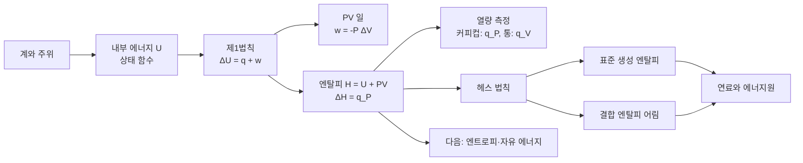

# 일반화학 3. 열화학 — 열과 일로 따지는 화학 반응의 에너지 장부
<!-- prev: matter-3, 4-5, uchem-1, uchem-2 -->
<!-- next: uchem-5, uchem-6, uchem-10 -->

> [!NOTE]
> **이 단원의 범위**
> - 계와 주위, 상태 함수와 경로 함수
> - 내부 에너지, 열과 일(PV 일), 열역학 제1법칙
> - 엔탈피와 반응 엔탈피, $\Delta H$와 $\Delta U$의 관계
> - 열용량과 열량 측정법(일정 압력·일정 부피)
> - 헤스 법칙, 표준 상태와 표준 생성 엔탈피
> - 결합 엔탈피로 반응 엔탈피 어림하기, 에너지원과 연료

**학습 목표**

1. 계와 주위를 구분하고, 상태 함수와 경로 함수의 차이를 예를 들어 설명할 수 있다.
2. 열역학 제1법칙 $\Delta U = q + w$를 부호 규약에 맞게 적용하고, 일정한 외부 압력에 대한 PV 일을 계산할 수 있다.
3. 엔탈피를 정의하고 일정 압력에서 $\Delta H = q_P$임을 유도하며, $\Delta H$와 $\Delta U$를 서로 환산할 수 있다.
4. 커피컵 열량계와 통 열량계(봄베 열량계)의 자료로 반응 엔탈피와 내부 에너지 변화를 구할 수 있다.
5. 헤스 법칙, 표준 생성 엔탈피, 결합 엔탈피로 반응 엔탈피를 계산하거나 어림하고, 각 방법의 한계를 설명할 수 있다.
6. 연료와 식품의 에너지를 단위 질량·단위 부피·이산화 탄소 배출량으로 비교할 수 있다.

**이 단원의 학습 사다리**

| 단계 | 무엇을 하나? |
|---|---|
| STEP 1. 이전 학습 다시 보기 | 고등학교의 엔탈피, 열화학 반응식, 헤스 법칙이 어디까지였는지 확인한다 |
| STEP 2. 기초 다지기 | 에너지 단위, 일 = 힘 × 거리, 부호 규약, '차이만 따지는' 양을 익힌다 |
| STEP 3. 핵심 개념 | 계와 상태 함수 → 제1법칙 → PV 일 → 엔탈피 → 열량 측정 → 헤스 법칙 → 표준 생성 엔탈피 → 결합 엔탈피 → 연료 |
| STEP 4. 오개념 바로잡기 | "열과 온도는 같다", "엔탈피는 열이다" 같은 착각을 바로잡는다 |
| STEP 5. 전공 맛보기 | 키르히호프 법칙(온도에 따른 $\Delta H$), 가역 과정의 일 |
| STEP 6. 생활·산업·진로 | 발열 도시락, 식품 열량 표시, 에너지 전환, 공정 열 회수 |

---

## 🗺️ 단원 들어가기

가스레인지에서 메테인 1 mol이 타면 약 890 kJ의 열이 나온다. 그런데 같은 1 mol을 단단히 닫힌 강철 용기 안에서 태우면 약 885 kJ만 나온다. 같은 반응인데 왜 열이 5 kJ이나 다를까? 이 차이 속에 열역학의 핵심이 들어 있다. 열린 곳에서 반응하면 생성된 기체가 대기를 밀어내거나 대기가 계를 눌러 **일**을 주고받는데, 닫힌 용기에서는 그럴 수 없다.

고등학교에서 엔탈피를 "일정한 압력에서 출입하는 열"로 배웠다. 대학에서는 한 걸음 물러서서, 계가 가진 에너지(**내부 에너지**)가 **열과 일**이라는 두 통로로만 바뀐다는 **열역학 제1법칙**에서 출발한다. 엔탈피는 그 법칙을 화학자에게 편리하게 바꾼 도구로 다시 등장한다. 이 단원은 반응의 '에너지 장부'를 정확히 적는 법을 배운다.

---

## STEP 1. 🔙 이전 학습 다시 보기

### 연계 개념표

| 이전 단원 | 고등학교에서는 여기까지 | 대학에서는 이렇게 확장 |
|---|---|---|
| 통합과학2 「물질 변화와 에너지 출입」 | 에너지를 흡수·방출하는 현상과 생활 속 이용(정성적) | 열의 출입을 부호 규약과 제1법칙으로 정량화한다 |
| 고등학교 「물질과 에너지」 '화학 변화의 자발성' | 엔탈피 = 일정 압력에서의 열, 열화학 반응식, 헤스 법칙, 생성 엔탈피·결합 에너지, 연료 효율, 엔트로피(정성) | $H = U + PV$의 정의에서 $\Delta H = q_P$를 유도하고, $\Delta H$와 $\Delta U$의 차이, 일정 부피 열량 측정, 표준 상태를 다룬다 |
| 중1 「열」·고등학교 「역학과 에너지」 | 비열, 열량 $Q = cm\Delta t$, 일과 에너지, 기체가 하는 일 | 열용량·몰 열용량, 열량계 보정, 화학 반응의 PV 일 |
| 「일반화학 1. 물질과 화학량론」 | 몰, 반응식의 계수비 | 반응 엔탈피를 '반응 1 mol당' 화학량론으로 다룬다 |
| 「일반화학 2. 기체」 | $PV = nRT$, 평균 운동 에너지 $\tfrac{3}{2}RT$ | 기체 몰수 변화로 $\Delta H - \Delta U = \Delta n_\text{기체}RT$를 얻는다 |

### 준비 운동 (사전 진단)

**Q1.** 25.0 °C의 물 150 g이 열 6.28 kJ을 흡수하면 몇 °C가 되는가? (물의 비열 4.184 J/(g·°C))

**Q2.** $\mathrm{H_2(g) + \tfrac{1}{2}O_2(g) \rightarrow H_2O(l)}$, $\Delta H = -285.8\ \mathrm{kJ}$일 때 $\mathrm{2H_2O(l) \rightarrow 2H_2(g) + O_2(g)}$의 $\Delta H$는?

**Q3.** 피스톤 달린 실린더 속 기체가 팽창하며 피스톤을 밀어 올렸다. 기체는 일을 했는가, 받았는가?

**Q4.** "발열 반응에서는 계의 엔탈피가 (증가 / 감소)하고, 주위의 온도가 (올라간다 / 내려간다)."

정답 및 해설

**Q1.** 35.0 °C. $\Delta t = \dfrac{6280}{4.184\times150} = 10.0\ ^\circ\mathrm{C}$

**Q2.** +571.6 kJ. 방향을 바꾸면 부호가 바뀌고, 2배 하면 값도 2배이다.

**Q3.** 했다. 기체가 힘을 주어 피스톤을 움직였으므로 계가 주위에 일을 했다(계의 에너지가 줄어든다).

**Q4.** 감소, 올라간다.

---

## STEP 2. 🧱 기초 다지기

### ① 에너지의 단위

| 단위 | 관계 | 쓰는 곳 |
|---|---|---|
| 줄(J) | $1\ \mathrm{J} = 1\ \mathrm{kg\cdot m^2/s^2} = 1\ \mathrm{N\cdot m}$ (SI) | 과학 전반, 반응열은 kJ |
| 칼로리(cal) | 1 cal = 4.184 J (정의값) | 옛 문헌, 열량 |
| 식품 칼로리(Cal, kcal) | 1 Cal = 1 kcal = 4.184 kJ | 식품 영양 표시 |
| 리터·기압(L·atm) | 1 L·atm = 101.325 J | 기체의 PV 일 |
| 킬로와트시(kWh) | 1 kWh = 3.6 MJ | 전력 요금 |

### ② 일 = 힘 × 거리, 그리고 압력 × 부피

물리에서 **일(work)** 은 힘과 그 방향으로 움직인 거리의 곱이다. 단면적 $A$인 피스톤을 외부 압력 $P_\text{외부}$에 맞서 거리 $\Delta h$만큼 밀어 올리면

$$
\text{일의 크기} = F\,\Delta h = (P_\text{외부}A)\,\Delta h = P_\text{외부}\,\Delta V
$$

이다. 압력 × 부피가 에너지 단위가 되는 이유이다($\mathrm{Pa\cdot m^3 = N/m^2\cdot m^3 = N\cdot m = J}$). 압력이 변하는 경우에는 작은 부피 변화 $dV$마다 $P\,dV$를 더한 **적분** $\int P\,dV$, 곧 $P$–$V$ 그래프 아래 넓이가 일의 크기이다.

### ③ 부호 규약 — 언제나 '계'의 입장에서

화학에서는 **계가 받으면 +, 계가 잃으면 −** 로 쓴다.

| 양 | + 이면 | − 이면 |
|---|---|---|
| 열 $q$ | 계가 열을 흡수(흡열) | 계가 열을 방출(발열) |
| 일 $w$ | 주위가 계에 일을 함(압축) | 계가 주위에 일을 함(팽창) |
| $\Delta U$, $\Delta H$ | 계의 에너지 증가 | 계의 에너지 감소 |

> [!WARNING]
> 물리학 교과서 가운데는 '계가 한 일'을 +로 써서 $\Delta U = Q - W$로 적는 경우가 있다. 두 식은 같은 내용이고 $w$의 부호 정의만 다르다. 이 책의 화학 단원은 $\Delta U = q + w$ (계가 받은 일 = +)를 쓴다. 문제를 풀기 전에 어떤 규약인지 확인하자.

### ④ 열용량의 세 가지 표현

| 이름 | 정의 | 단위 | 예 |
|---|---|---|---|
| 열용량 $C$ | 물체 전체의 온도를 1 K 올리는 열 | J/K | 열량계 전체 10.15 kJ/K |
| 비열(비열용량) $c$ | 1 g의 온도를 1 K 올리는 열 | J/(g·K) | 물 4.184 |
| 몰 열용량 $C_\text{m}$ | 1 mol의 온도를 1 K 올리는 열 | J/(mol·K) | 물(액체) 75.3 |

$q = C\Delta T = cm\Delta T = nC_\text{m}\Delta T$. 온도 '차이'는 °C와 K에서 값이 같으므로 $\Delta T$에는 어느 쪽을 써도 된다.

### ⑤ 차이만 의미 있는 양

산의 높이를 해수면 기준으로 재든 지구 중심 기준으로 재든, **두 지점의 높이 차**는 같다. 엔탈피·내부 에너지도 절댓값은 정할 수 없지만 **변화량**은 측정할 수 있다. 그래서 열화학은 처음부터 끝까지 $\Delta$의 언어로 쓴다. 기준점(0)은 편리하게 약속하면 된다(STEP 3 ⑧의 표준 생성 엔탈피).

---

## STEP 3. 📘 핵심 개념

### ① 계와 주위, 에너지의 형태

관심의 대상을 **계(system)**, 나머지를 **주위(surroundings)** 라고 하며, 둘을 합쳐 우주라고 부른다. 계는 경계를 통해 무엇을 주고받는지에 따라 세 가지로 나뉜다.

| 계의 종류 | 물질 교환 | 에너지 교환 | 예 |
|---|---|---|---|
| 열린계 | ○ | ○ | 뚜껑 없는 냄비의 끓는 물, 사람의 몸 |
| 닫힌계 | × | ○ | 마개를 막은 플라스크, 피스톤 실린더 속 기체 |
| 고립계 | × | × | 이상적인 보온병(근사), 우주 전체 |

<!-- fig:uchem-3-systems-signs -->

화학 반응의 에너지는 대부분 **화학 에너지**, 곧 원자핵과 전자 사이 정전기적 퍼텐셜 에너지와 전자의 운동 에너지의 합이 바뀌는 것이다. 결합이 만들어지면 퍼텐셜 에너지가 낮아지며 에너지가 방출되고, 결합을 끊으려면 에너지가 들어간다. 이 에너지는 열, 빛, 전기, 역학적 일로 모습을 바꿀 뿐 **총량은 보존**된다.

> [!TIP]
> 💡 **비유** — 계는 '내 통장', 주위는 '나머지 세상'이다. 돈(에너지)은 현금(열)이나 계좌 이체(일)로만 오갈 수 있고, 세상 전체의 돈은 늘지도 줄지도 않는다. 내 통장의 잔액 변화는 들어온 것 − 나간 것이다.

### ② 상태 함수와 경로 함수

**상태 함수(state function)** 는 계의 현재 상태(온도, 압력, 부피, 조성 등)만으로 값이 정해지는 양이다. 그 변화량은 처음과 나중 상태만으로 정해지고 **경로와 무관**하다. 반면 **경로 함수**는 변화가 어떤 경로로 일어났는지에 따라 값이 다르다.

| 상태 함수 | 경로 함수 |
|---|---|
| 내부 에너지 $U$, 엔탈피 $H$, 온도 $T$, 압력 $P$, 부피 $V$, (다음 단원들의) 엔트로피 $S$, 자유 에너지 $G$ | 열 $q$, 일 $w$ |

예를 들어 휴대폰 배터리를 100 %에서 50 %로 줄이는 방법은 여러 가지이다. 화면을 켜 두어 열로 잃을 수도 있고(대부분 $q$), 작은 모터를 돌려 물체를 들어 올릴 수도 있다(일부 $w$). 배터리의 에너지 감소($\Delta U$)는 같지만 $q$와 $w$의 배분은 경로마다 다르다.

| 성질의 종류 | 뜻 | 예 |
|---|---|---|
| 크기 성질(extensive) | 계의 양에 비례 | $U$, $H$, $V$, 질량, 열용량 |
| 세기 성질(intensive) | 계의 양과 무관 | $T$, $P$, 밀도, 비열, 몰 엔탈피 |

반응 엔탈피는 크기 성질이므로 반응식의 계수를 2배 하면 $\Delta H$도 2배가 된다.

### ③ 내부 에너지와 열역학 제1법칙

계를 이루는 모든 입자의 운동 에너지(병진·회전·진동)와 퍼텐셜 에너지(분자 내 결합, 분자 간 인력)의 합을 **내부 에너지(internal energy, $U$)** 라고 한다. 계의 내부 에너지는 **열과 일**을 통해서만 바뀐다.

$$
\Delta U = q + w
$$

이것이 **열역학 제1법칙(first law of thermodynamics)**, 곧 에너지 보존 법칙의 열역학 표현이다. 고립계에서는 $q = w = 0$이므로 $\Delta U = 0$이다.

| 상황 | $q$ | $w$ | $\Delta U$ |
|---|---|---|---|
| 기체를 가열하며 팽창시킨다 | + | − | 둘의 크기에 따라 |
| 기체를 단열 압축한다(자전거 펌프가 뜨거워짐) | 0 | + | + (온도 상승) |
| 단단한 용기에서 연소(부피 일정) | − | 0 | − ($= q_V$) |
| 이상 기체가 일정 온도에서 팽창 | + | − | 0 (이상 기체의 $U$는 온도에만 의존) |

#### 예제 1 — 제1법칙의 장부 정리

실린더 속 기체가 열 250 J을 흡수하면서 1.20 atm의 일정한 외부 압력에 맞서 2.00 L에서 5.00 L로 팽창했다. 기체가 한 일과 내부 에너지 변화를 구하시오.

**풀이**
① 식 세우기: $w = -P_\text{외부}\Delta V$, $\Delta U = q + w$
② 대입: $w = -1.20\ \mathrm{atm}\times3.00\ \mathrm{L} = -3.60\ \mathrm{L\cdot atm}$ → $-3.60\times101.325\ \mathrm{J} = -365\ \mathrm{J}$
③ $\Delta U = +250 + (-365) = -115\ \mathrm{J}$
④ 결과의 의미: 기체는 흡수한 열보다 많은 에너지를 일로 내보내서 내부 에너지가 줄었다. 이상 기체라면 온도가 내려간다.

### ④ PV 일 — 화학 반응이 하는 일

화학 반응에서 가장 흔한 일은 기체가 생기거나 사라지며 부피가 바뀔 때 주위(대기)를 밀어내거나 대기에 눌리는 **압력–부피 일(PV 일)** 이다. STEP 2 ②에서 본 것처럼, 계가 일정한 외부 압력에 맞서 팽창하면 계가 잃는 에너지는 $P_\text{외부}\Delta V$이므로

$$
w = -P_\text{외부}\,\Delta V \qquad (\text{외부 압력 일정})
$$

부피가 변하는 동안 외부 압력이 변하면 $w = -\int P_\text{외부}\,dV$이다.

| 과정 | $\Delta V$ | $w$ | 의미 |
|---|---|---|---|
| 팽창 | + | − | 계가 주위에 일을 함 |
| 압축 | − | + | 주위가 계에 일을 함 |
| 진공으로의 팽창(자유 팽창) | + | 0 | 밀어낼 상대가 없다($P_\text{외부} = 0$) |
| 부피 일정(단단한 용기) | 0 | 0 | 통 열량계의 조건 |

> [!NOTE]
> 일의 크기를 정하는 것은 계의 압력이 아니라 **외부 압력**이다. 같은 기체가 같은 부피만큼 팽창하더라도, 진공으로 터져 나가면 일을 전혀 하지 않고, 무거운 피스톤을 천천히 밀어 올리면 큰 일을 한다. 일이 경로 함수인 이유이다. 외부 압력을 계의 압력과 거의 같게 유지하며 무한히 천천히 팽창시키면 계가 할 수 있는 최대의 일을 얻는다(STEP 5).

#### 예제 2 — 물이 끓을 때 하는 일

100 °C, 1.00 atm에서 물 1.00 mol이 수증기가 된다($\Delta H_\text{기화} = +40.7\ \mathrm{kJ/mol}$). 이때 계가 하는 일과 내부 에너지 변화를 구하시오. (액체 물의 부피는 무시하고 수증기는 이상 기체로 본다)

**풀이**
① 부피 변화: $\Delta V \approx V_\text{기체} = \dfrac{nRT}{P}$이므로 $w = -P\Delta V = -nRT$
② 대입: $w = -1.00\times8.314\times373.15 = -3.10\times10^{3}\ \mathrm{J} = -3.10\ \mathrm{kJ}$
③ 일정 압력에서 흡수한 열 $q_P = \Delta H = +40.7\ \mathrm{kJ}$이므로 $\Delta U = q + w = 40.7 - 3.10 = +37.6\ \mathrm{kJ}$
④ 결과의 의미: 흡수한 열의 약 92 %는 분자 사이 인력을 끊는 데(내부 에너지 증가) 쓰이고, 약 8 %는 수증기가 대기를 밀어내는 일로 나간다.

### ⑤ 엔탈피 — 일정 압력의 화학을 위한 상태 함수

대부분의 반응은 대기에 열린 용기, 곧 **일정한 압력**에서 일어난다. 이때 측정하는 열 $q_P$는 $\Delta U$와 다르다. 일이 섞이기 때문이다. 그래서 새로운 상태 함수 **엔탈피(enthalpy)** 를 정의한다.

$$
H = U + PV
$$

$U$, $P$, $V$가 모두 상태 함수이므로 $H$도 상태 함수이다. 일정한 압력($P = P_\text{외부}$)에서 PV 일만 있다면

$$
\Delta H = \Delta U + P\Delta V = (q_P - P\Delta V) + P\Delta V = q_P
$$

즉 **일정 압력에서 계가 흡수한 열이 곧 엔탈피 변화**이다. 고등학교에서 엔탈피를 "일정한 압력에서 출입하는 열"로 정의했던 것이 이 식의 결과이다. 반면 일정 부피에서는 $w = 0$이므로 $\Delta U = q_V$이다.

| 조건 | 측정되는 열 | 대응하는 상태 함수 | 장치 |
|---|---|---|---|
| 일정 압력 | $q_P$ | $\Delta H$ | 커피컵 열량계, 대기 중 반응 |
| 일정 부피 | $q_V$ | $\Delta U$ | 통 열량계(봄베 열량계) |

#### $\Delta H$와 $\Delta U$는 얼마나 다를까

$\Delta H - \Delta U = \Delta(PV)$이다. 고체·액체의 부피 변화는 아주 작으므로 무시하고, 기체에 이상 기체 방정식을 쓰면 일정한 온도에서 $\Delta(PV) = \Delta n_\text{기체}RT$이다.

$$
\Delta H = \Delta U + \Delta n_\text{기체}RT
$$

$\Delta n_\text{기체}$는 (생성물 기체의 몰수 − 반응물 기체의 몰수)이다. 25 °C에서 $RT = 2.48\ \mathrm{kJ/mol}$이므로, 기체 몰수가 1 mol 변할 때마다 둘의 차이는 약 2.5 kJ이다.

| 반응(25 °C) | $\Delta n_\text{기체}$ | $\Delta H$ (kJ) | $\Delta U$ (kJ) |
|---|---|---|---|
| $\mathrm{CH_4(g) + 2O_2(g) \rightarrow CO_2(g) + 2H_2O(l)}$ | 1 − 3 = −2 | −890.3 | −885.3 |
| $\mathrm{N_2(g) + 3H_2(g) \rightarrow 2NH_3(g)}$ | 2 − 4 = −2 | −92.2 | −87.2 |
| $\mathrm{C(s) + O_2(g) \rightarrow CO_2(g)}$ | 1 − 1 = 0 | −393.5 | −393.5 |
| $\mathrm{CaCO_3(s) \rightarrow CaO(s) + CO_2(g)}$ | +1 | +178.3 | +175.8 |

단원 들어가기의 질문에 대한 답이 첫째 줄이다. 메테인이 타면 기체 2 mol이 줄어, 열린 곳에서는 대기가 계를 누르며 약 5 kJ의 일을 해 준다. 그만큼 열로 더 나온다.

<!-- sim:u-pv-work -->

#### 예제 3 — 암모니아 합성의 $\Delta U$

$\mathrm{N_2(g) + 3H_2(g) \rightarrow 2NH_3(g)}$, $\Delta H = -92.2\ \mathrm{kJ}$ (25 °C). 같은 반응을 단단한 용기 속에서 일으킬 때 출입하는 열은?

**풀이**
① $\Delta n_\text{기체} = 2 - 4 = -2$
② $\Delta U = \Delta H - \Delta n_\text{기체}RT = -92.2 - (-2)(8.314\times10^{-3})(298.15) = -92.2 + 4.96 = -87.2\ \mathrm{kJ}$
③ 일정 부피에서는 $q_V = \Delta U$이므로 87.2 kJ의 열이 방출된다.

결과의 의미: 일정 압력에서는 기체가 줄어드는 동안 대기가 계에 4.96 kJ의 일을 해 주고, 그 에너지도 열로 나와 방출 열이 더 크다.

### ⑥ 열용량과 열량 측정법

**열량 측정법(calorimetry)** 은 반응의 열이 열량계 속 물질의 온도를 바꾸는 양을 재어 반응열을 구하는 방법이다. 기본 원리는 에너지 보존이다.

$$
q_\text{반응} = -q_\text{열량계}, \qquad q_\text{열량계} = C_\text{열량계}\Delta T \ \ (\text{또는 } c\,m\,\Delta T)
$$

| 물질 | 비열 $c$ (J/(g·K), 25 °C 부근) | 몰 열용량 $C_\text{m}$ (J/(mol·K)) |
|---|---|---|
| 물(액체) | 4.184 | 75.3 |
| 얼음(−10 °C 부근) | 약 2.0 | 약 37 |
| 에탄올(액체) | 2.44 | 112 |
| 알루미늄 | 0.897 | 24.2 |
| 철 | 0.449 | 25.1 |
| 구리 | 0.385 | 24.5 |
| 금 | 0.129 | 25.4 |

물의 비열은 아주 크다(수소 결합 때문, 「일반화학 6」). 그래서 바다와 호수가 기후를 완화한다. 또 금속들의 몰 열용량이 약 25 J/(mol·K)로 비슷한 것은 우연이 아니다(뒬롱–프티 법칙, 약 $3R$).

#### 일정 압력 열량계 — 커피컵 열량계

스타이로폼 컵 두 개를 겹치고 뚜껑을 덮은 장치이다. 대기에 열려 있으므로 압력이 일정하고, 측정하는 열은 $q_P = \Delta H$이다. 수용액 반응(중화, 용해, 침전)에 쓴다. 열량계의 열용량이 작으면 무시하고 용액의 비열을 물과 같다고 근사한다.

<!-- sim:u-calorimeter -->

#### 예제 4 — 염화 칼슘 제설제의 용해열

커피컵 열량계에 22.50 °C의 물 100.0 g을 넣고 염화 칼슘($\mathrm{CaCl_2}$, 110.98 g/mol) 5.00 g을 녹였더니 최고 온도가 30.85 °C였다. 용액의 비열은 4.184 J/(g·K)로 보고, 열량계의 열용량은 무시한다. 염화 칼슘의 몰 용해 엔탈피를 구하시오.

**풀이**
① 용액이 얻은 열: $q_\text{용액} = 4.184\times105.0\times(30.85 - 22.50) = 3.67\times10^{3}\ \mathrm{J}$ (용액 질량 = 물 + 염)
② 반응(용해)의 열: $q_\text{반응} = -3.67\ \mathrm{kJ}$
③ 몰수: $5.00\div110.98 = 0.04505\ \mathrm{mol}$
④ $\Delta H_\text{용해} = \dfrac{-3.67\ \mathrm{kJ}}{0.04505\ \mathrm{mol}} = -81.4\ \mathrm{kJ/mol}$

결과의 의미: 염화 칼슘은 녹으며 열을 크게 내므로, 눈 위에 뿌리면 어는점 내림 효과에 더해 열이 얼음을 녹이는 것을 돕는다. 실제로는 열이 컵과 공기로 일부 새므로 측정값은 참값보다 작게(덜 음수로) 나오기 쉽다.

#### 일정 부피 열량계 — 통 열량계(봄베 열량계)

연소열처럼 기체가 관여하는 반응은 두꺼운 강철 통(봄베)에 시료와 고압(약 30 atm)의 산소를 넣고 전기 점화한다. 통은 정해진 양의 물에 잠겨 있고, 물의 온도 변화를 잰다. 부피가 일정하므로 측정하는 것은 $q_V = \Delta U$이다.

통·물·온도계 전체의 열용량 $C_\text{열량계}$는 연소열을 정확히 아는 **표준 물질**(벤조산, 단위 질량당 연소 내부 에너지 −26.43 kJ/g)로 먼저 보정한다.

<!-- fig:uchem-3-bomb-calorimeter -->

#### 예제 5 — 나프탈렌의 연소열

(1) 벤조산 0.8256 g을 통 열량계에서 태웠더니 온도가 2.150 K 올랐다. 열량계의 열용량은?
(2) 같은 열량계에서 나프탈렌($\mathrm{C_{10}H_8}$, 128.17 g/mol) 0.6512 g을 태웠더니 2.578 K 올랐다. 나프탈렌의 몰 연소 내부 에너지 $\Delta_\text{c}U$와 25 °C의 몰 연소 엔탈피 $\Delta_\text{c}H$를 구하시오.

**풀이**
(1) $C_\text{열량계} = \dfrac{0.8256\ \mathrm{g}\times26.43\ \mathrm{kJ/g}}{2.150\ \mathrm{K}} = 10.15\ \mathrm{kJ/K}$
(2) ① 방출된 열: $10.15\times2.578 = 26.17\ \mathrm{kJ}$
② 1 mol당: $\Delta_\text{c}U = -\dfrac{26.17}{0.6512\div128.17} = -5.150\times10^{3}\ \mathrm{kJ/mol}$
③ 반응식: $\mathrm{C_{10}H_8(s) + 12O_2(g) \rightarrow 10CO_2(g) + 4H_2O(l)}$, $\Delta n_\text{기체} = 10 - 12 = -2$
④ $\Delta_\text{c}H = \Delta_\text{c}U + \Delta n_\text{기체}RT = -5150 + (-2)(2.479) = -5155\ \mathrm{kJ/mol}$

결과의 의미: 문헌값(약 −5157 kJ/mol)과 0.1 % 이내로 맞는다. $\Delta H$와 $\Delta U$의 차이(약 5 kJ)는 0.1 % 정도로 작지만, 정밀한 열화학 자료에서는 반드시 보정한다. 식품의 열량도 이런 통 열량계 측정에서 출발한다.

> [!TIP]
> 💡 **요령** — 열량계 문제의 부호는 "**열량계가 얻은 만큼 반응이 잃었다**"로 정리한다. 온도가 올랐으면 반응은 발열($q_\text{반응} < 0$)이다. 마지막에 반응식의 몇 mol 기준인지 나누는 것을 잊지 않는다.

### ⑦ 헤스 법칙 — 상태 함수가 주는 선물

엔탈피는 상태 함수이므로, 반응물에서 생성물로 가는 **어떤 경로**를 택해도 $\Delta H$는 같다. 여러 단계 반응의 $\Delta H$를 더하면 전체 반응의 $\Delta H$가 된다. 이것이 **헤스 법칙(Hess's law)** 이다(1840). 고등학교에서 실험 법칙으로 배웠다면, 대학에서는 상태 함수의 성질에서 바로 나오는 결론으로 본다.

#### 반응식 조작 규칙

| 조작 | $\Delta H$의 변화 | 이유 |
|---|---|---|
| 반응식을 $n$배 | $n$배 | 엔탈피는 크기 성질 |
| 반응식의 방향을 반대로 | 부호 반대 | 처음과 나중 상태가 뒤바뀜 |
| 반응식을 더함 | $\Delta H$를 더함 | 상태 함수의 변화는 경로를 이어 붙인 것의 합 |

#### 예제 6 — 에틸렌의 수화 반응

산업에서 에탄올은 에틸렌에 물을 붙여 만든다. $\mathrm{C_2H_4(g) + H_2O(l) \rightarrow C_2H_5OH(l)}$의 $\Delta H$를 다음 연소 엔탈피로 구하시오.

- (가) $\mathrm{C_2H_4(g) + 3O_2(g) \rightarrow 2CO_2(g) + 2H_2O(l)}$ $\Delta H_\text{가} = -1411.0\ \mathrm{kJ}$
- (나) $\mathrm{C_2H_5OH(l) + 3O_2(g) \rightarrow 2CO_2(g) + 3H_2O(l)}$ $\Delta H_\text{나} = -1366.8\ \mathrm{kJ}$

**풀이**
① 목표 식에서 $\mathrm{C_2H_4}$는 왼쪽에 있으므로 (가)는 그대로, $\mathrm{C_2H_5OH}$는 오른쪽에 있으므로 (나)는 뒤집는다(+1366.8 kJ).
② 더하면 $\mathrm{C_2H_4 + 3O_2 + 2CO_2 + 3H_2O \rightarrow 2CO_2 + 2H_2O + C_2H_5OH + 3O_2}$ → 양쪽에서 같은 것을 지우면 $\mathrm{C_2H_4 + H_2O \rightarrow C_2H_5OH}$
③ $\Delta H = -1411.0 + 1366.8 = -44.2\ \mathrm{kJ}$

연소 반응은 거의 모든 유기 화합물에서 깨끗하게 끝까지 진행되어 정밀하게 측정할 수 있다. 그래서 **연소 엔탈피는 헤스 법칙 계산의 가장 좋은 재료**이다.

> [!TIP]
> 💡 **비유** — 헤스 법칙은 '환율 계산'과 비슷하다. 원화를 유로로 직접 바꾸는 환율을 몰라도, 원 → 달러, 달러 → 유로 환율을 알면 계산할 수 있다(수수료가 없다면). 엔탈피에는 '수수료'가 없으므로 어떤 중간 경로로 가도 결과가 정확히 같다.

### ⑧ 표준 상태와 표준 생성 엔탈피

반응 엔탈피는 온도, 압력, 물질의 상태에 따라 달라진다. 그래서 비교할 기준을 약속한다.

| 표준 상태(standard state) | 기준 |
|---|---|
| 기체 | 압력 1 bar의 순수한 기체(이상 기체로 행동한다고 가정) |
| 액체·고체 | 1 bar에서 순수한 가장 안정한 형태 |
| 용액 속 용질 | 농도 1 M (엄밀하게는 1 mol/kg) |
| 온도 | 정의에는 포함되지 않지만 표에는 보통 25 °C(298.15 K) 값을 싣는다 |

표준 상태의 반응 엔탈피를 **표준 반응 엔탈피** $\Delta H^\circ$라고 쓴다(기호 °는 "표준"). 오래된 자료는 1 atm을 기준으로 하지만, 1 bar와의 차이(1.3 %)가 엔탈피에 주는 영향은 매우 작다.

**표준 생성 엔탈피(standard enthalpy of formation, $\Delta H_\text{f}^\circ$)** 는 화합물 1 mol이 **표준 상태의 가장 안정한 성분 원소**로부터 생성될 때의 표준 반응 엔탈피이다. 정의에 따라 가장 안정한 형태의 원소는 $\Delta H_\text{f}^\circ = 0$이다(흑연은 0, 다이아몬드는 +1.9 kJ/mol, $\mathrm{O_2}$는 0, $\mathrm{O_3}$는 +142.7 kJ/mol). 이것이 STEP 2 ⑤에서 말한 '해수면' 같은 기준점이다.

#### 표준 생성 엔탈피로 반응 엔탈피 구하기

모든 반응은 '반응물 → 성분 원소 → 생성물'의 가상 경로로 생각할 수 있으므로, 헤스 법칙에 의해

$$
\Delta H^\circ_\text{반응} = \sum n_\text{p}\,\Delta H_\text{f}^\circ(\text{생성물}) - \sum n_\text{r}\,\Delta H_\text{f}^\circ(\text{반응물})
$$

($n_\text{p}$, $n_\text{r}$: 반응식의 계수)이다.

<!-- fig:uchem-3-enthalpy-ladder -->

| 물질 | $\Delta H_\text{f}^\circ$ (kJ/mol) | 물질 | $\Delta H_\text{f}^\circ$ (kJ/mol) |
|---|---|---|---|
| $\mathrm{CO_2(g)}$ | −393.5 | $\mathrm{CH_4(g)}$ | −74.8 |
| $\mathrm{CO(g)}$ | −110.5 | $\mathrm{C_2H_6(g)}$ | −84.7 |
| $\mathrm{H_2O(l)}$ | −285.8 | $\mathrm{C_2H_4(g)}$ | +52.4 |
| $\mathrm{H_2O(g)}$ | −241.8 | $\mathrm{C_2H_2(g)}$ | +226.7 |
| $\mathrm{NH_3(g)}$ | −46.1 | $\mathrm{C_3H_8(g)}$ | −103.8 |
| $\mathrm{NO(g)}$ | +90.3 | $\mathrm{CH_3OH(l)}$ | −238.7 |
| $\mathrm{NO_2(g)}$ | +33.2 | $\mathrm{CH_3OH(g)}$ | −201.0 |
| $\mathrm{N_2H_4(g)}$ | +95.4 | $\mathrm{C_2H_5OH(l)}$ | −277.6 |
| $\mathrm{Fe_2O_3(s)}$ | −824.2 | $\mathrm{C_6H_{12}O_6(s)}$ | −1273.3 |
| $\mathrm{Al_2O_3(s)}$ | −1675.7 | $\mathrm{CaCO_3(s)}$ | −1206.9 |
| $\mathrm{CaO(s)}$ | −635.1 | $\mathrm{Ca(OH)_2(s)}$ | −986.1 |
| $\mathrm{H^+(aq)}$ | 0 (기준) | $\mathrm{OH^-(aq)}$ | −230.0 |

(25 °C 값. 자료집에 따라 끝자리가 조금씩 다르다)

$\Delta H_\text{f}^\circ$가 음수로 큰 물질일수록 원소에 비해 에너지적으로 안정하다. 에틸렌·아세틸렌처럼 양수인 물질은 원소보다 엔탈피가 높다.

수용액의 이온은 홀로 존재할 수 없으므로 $\mathrm{H^+(aq)}$의 $\Delta H_\text{f}^\circ$를 0으로 약속하고 다른 이온의 값을 정한다. 이 약속으로 강산과 강염기의 중화 엔탈피를 계산하면 $\mathrm{H^+(aq) + OH^-(aq) \rightarrow H_2O(l)}$, $\Delta H^\circ = -285.8 - (0 - 230.0) = -55.8\ \mathrm{kJ}$로, 고등학교 실험에서 측정한 약 −56 kJ과 맞는다.

#### 예제 7 — 용광로의 철 환원

용광로에서 일산화 탄소가 산화 철(Ⅲ)을 환원한다. $\mathrm{Fe_2O_3(s) + 3CO(g) \rightarrow 2Fe(s) + 3CO_2(g)}$의 $\Delta H^\circ$를 구하시오.

**풀이**
① 생성물: $2(0) + 3(-393.5) = -1180.5\ \mathrm{kJ}$
② 반응물: $(-824.2) + 3(-110.5) = -1155.7\ \mathrm{kJ}$
③ $\Delta H^\circ = -1180.5 - (-1155.7) = -24.8\ \mathrm{kJ}$

결과의 의미: 이 단계 자체는 약한 발열 반응이다. 용광로를 고온으로 유지하는 열은 주로 코크스(탄소)가 연소하는 반응($-393.5$, $-110.5\ \mathrm{kJ/mol}$)에서 온다. 원소인 Fe의 $\Delta H_\text{f}^\circ = 0$을 빠뜨리지 않는 것이 요령이다.

### ⑨ 결합 엔탈피로 어림하기

**결합 엔탈피(bond enthalpy)** 는 **기체 상태**의 분자에서 특정 결합 1 mol을 끊어 기체 원자(또는 조각)로 만드는 데 필요한 엔탈피 변화이다. 늘 양수이다. 같은 C–H 결합이라도 분자마다 값이 조금씩 다르므로, 표에는 여러 분자의 **평균값**을 싣는다.

| 결합 | 평균 결합 엔탈피 (kJ/mol) | 결합 | 평균 결합 엔탈피 (kJ/mol) |
|---|---|---|---|
| H–H | 436 | O–H | 463 |
| C–H | 413 | O=O | 498 |
| C–C | 348 | N–H | 391 |
| C=C | 614 | N–N | 163 |
| C≡C | 839 | N≡N | 945 |
| C–O | 358 | H–Cl | 431 |
| C=O($\mathrm{CO_2}$) | 799 | Cl–Cl | 243 |
| C≡O(CO) | 1072 | C–Cl | 328 |

(값은 자료에 따라 몇 kJ/mol씩 다를 수 있다. 약)

모든 반응물의 결합을 끊어 기체 원자로 만든 뒤(흡열), 생성물의 결합을 만든다(발열)는 가상 경로에 헤스 법칙을 쓰면

$$
\Delta H \approx \sum(\text{끊어지는 결합의 엔탈피}) - \sum(\text{생기는 결합의 엔탈피})
$$

#### 예제 8 — 에틸렌의 수소 첨가

$\mathrm{H_2C{=}CH_2(g) + H_2(g) \rightarrow H_3C{-}CH_3(g)}$의 $\Delta H$를 결합 엔탈피로 어림하고, 표준 생성 엔탈피로 구한 값과 비교하시오.

**풀이**
① 바뀌는 결합만 센다. 끊는 결합: C=C 1개 + H–H 1개 = $614 + 436 = 1050\ \mathrm{kJ}$
② 생기는 결합: C–C 1개 + C–H 2개 = $348 + 2(413) = 1174\ \mathrm{kJ}$ (C–H 4개는 양쪽에 그대로 있으므로 상쇄)
③ 어림값: $1050 - 1174 = -124\ \mathrm{kJ}$
④ 표준 생성 엔탈피: $(-84.7) - (52.4 + 0) = -137.1\ \mathrm{kJ}$

결과의 의미: 어림값은 약 10 % 차이가 난다. 평균 결합 엔탈피가 특정 분자의 실제 결합 세기와 다르기 때문이다. 그래도 반응이 발열인지, 대략 얼마인지 판단하는 데는 충분하다.

#### 결합 엔탈피 어림의 한계

| 한계 | 이유 | 예 |
|---|---|---|
| 평균값이다 | 결합의 세기는 주변 원자에 따라 달라진다 | $\mathrm{CO + 2H_2 \rightarrow CH_3OH(g)}$: 어림 −116 kJ, 실제 −90.5 kJ |
| 기체 상태에만 쓸 수 있다 | 액체·고체에서는 분자 간 힘도 끊어야 한다 | 액체 물이 생기면 기화 엔탈피만큼 차이 |
| 공명 안정화를 반영하지 못한다 | 벤젠 같은 분자는 '단일 + 이중' 결합의 합보다 안정하다 | 벤젠의 어림값은 실제와 크게 다르다 |

그래서 정확한 계산에는 **표준 생성 엔탈피**를, 자료가 없는 새 분자의 어림에는 **결합 엔탈피**를 쓴다. 결합의 세기가 분자 구조와 어떻게 연결되는지는 「일반화학 5. 화학 결합과 분자 구조」에서 다룬다.

### ⑩ 에너지원과 연료

인류가 쓰는 1차 에너지의 대부분(약 80 %)은 아직 석탄·석유·천연가스 같은 **화석 연료**의 연소에서 온다. 연료를 비교할 때는 1 mol당 연소 엔탈피보다 **단위 질량당 열(연료 값, fuel value, kJ/g)** 과 **단위 부피당 열(에너지 밀도)**, 그리고 **같은 에너지당 이산화 탄소 배출량**이 중요하다.

| 연료 | $\Delta_\text{c}H^\circ$ (kJ/mol) | 연료 값 (kJ/g) | $\mathrm{CO_2}$ 배출 (g/MJ) | 특징 |
|---|---|---|---|---|
| 수소 $\mathrm{H_2}$ | −285.8 | 141.8 | 0 | 질량당 최대, 부피당 작음 |
| 메테인(천연가스) | −890.3 | 55.5 | 49.4 | 화석 연료 중 탄소 배출이 가장 적다 |
| 프로페인 | −2219.9 | 50.3 | 59.5 | 액화 석유 가스 |
| 옥테인(휘발유 대표) | −5470 | 47.9 | 64.4 | 부피당 에너지가 크다(약 34 MJ/L) |
| 에탄올 | −1366.8 | 29.7 | 64.4 | 생물 기원이면 순배출을 줄일 수 있다 |
| 탄소(석탄 대표) | −393.5 | 32.8 | 112 | 배출이 가장 많다 |
| 포도당 | −2803 | 15.6 | 94.2 | 생물의 에너지원 |

(물은 액체로 생성된다고 본 값. $\mathrm{CO_2}$ 배출 = 탄소 원자 수 × 44.01 g ÷ 연소 엔탈피)

표에서 읽을 수 있는 규칙: **이미 산화된 정도가 클수록**(분자에 산소가 많을수록) 연료 값이 작다(에탄올 < 옥테인, 포도당 < 에탄올). **수소 대 탄소 비가 클수록** 같은 에너지당 $\mathrm{CO_2}$ 배출이 적다(메테인 < 옥테인 < 석탄).

#### 식품의 에너지

몸속에서 영양소는 여러 단계 효소 반응을 거쳐 결국 $\mathrm{CO_2}$와 $\mathrm{H_2O}$가 된다. 헤스 법칙 덕분에 그 에너지는 통 열량계에서 태운 연소열과 같다(단백질은 질소가 요소로 배출되어 차이가 있다). 영양 표시의 대략적인 값은 다음과 같다.

| 영양소 | 대략의 에너지 |
|---|---|
| 탄수화물 | 약 17 kJ/g (약 4 kcal/g) |
| 단백질 | 약 17 kJ/g (약 4 kcal/g) |
| 지방 | 약 38 kJ/g (약 9 kcal/g) |

지방의 값이 2배 이상 큰 것은 지방 분자가 산소가 적은 긴 탄화수소 사슬이기 때문이다. 연료에서 본 규칙과 똑같다. 동물이 에너지를 지방으로 저장하는 이유이기도 하다.

#### 예제 9 — 같은 에너지를 얻을 때의 탄소 발자국

발전소가 1.00 GJ($1.00\times10^{6}\ \mathrm{kJ}$)의 열을 얻으려 할 때, 메테인과 석탄(순수한 탄소로 가정)을 태울 때 각각 배출되는 $\mathrm{CO_2}$의 질량을 구하시오.

**풀이**
① 메테인: $\dfrac{1.00\times10^{6}}{890.3} = 1123\ \mathrm{mol}$ → $\mathrm{CO_2}$ 1123 mol × 44.01 g = $4.94\times10^{4}\ \mathrm{g} = 49.4\ \mathrm{kg}$
② 탄소: $\dfrac{1.00\times10^{6}}{393.5} = 2541\ \mathrm{mol}$ → $2541\times44.01 = 1.12\times10^{5}\ \mathrm{g} = 112\ \mathrm{kg}$

결과의 의미: 같은 열을 얻을 때 석탄은 천연가스의 약 2.3배를 배출한다. 메테인은 탄소 1개당 수소 4개가 함께 타며 에너지를 보태기 때문이다. 그래서 석탄에서 천연가스로의 전환이 과도기적 감축 수단으로 논의된다. 다만 메테인 자체가 강력한 온실 기체이므로 누출 관리가 중요하다.

#### 재생 에너지와 수소

| 에너지원 | 에너지의 근원 | 열화학과의 연결 |
|---|---|---|
| 태양광·풍력·수력 | 태양 복사 | 연소 없이 전기를 만든다. 남는 전기를 저장하는 방법(전지, 수소)이 과제이다 |
| 바이오 연료 | 광합성으로 저장된 화학 에너지 | 연소할 때 나오는 $\mathrm{CO_2}$는 식물이 흡수한 것이다(재배·가공의 에너지는 별도) |
| 수소 | 물 분해 등으로 만든 '에너지 운반체' | 물 분해에는 연소열 이상의 에너지가 들어간다(제1법칙). 수소는 에너지원이 아니라 저장 수단이다 |
| 원자력 | 핵의 결합 에너지 | 화학 반응보다 질량당 약 100만 배 큰 에너지(「일반화학 12」) |

> [!IMPORTANT]
> 열역학 제1법칙은 "공짜 에너지는 없다"고 말한다. 물을 전기 분해해 수소를 만들고 다시 태우면, 아무리 잘해도 처음 넣은 에너지 이상을 얻을 수 없다(실제로는 손실 때문에 훨씬 적다). 에너지 전략을 평가할 때는 늘 **전 과정의 에너지 장부**를 따져야 한다.

---

## STEP 4. ⚠️ 오개념 바로잡기

| 흔한 오개념 | 올바른 개념 | 왜 그럴까? |
|---|---|---|
| 열과 온도는 같은 것이다 | 온도는 상태(세기 성질), 열은 **이동하는 에너지**(경로 함수)이다 | 같은 온도의 욕조 물과 컵의 물은 줄 수 있는 열의 양이 다르다 |
| 물체는 열을 '가지고' 있다 | 물체가 가진 것은 **내부 에너지**이고, 열은 경계를 지나는 에너지의 흐름이다 | 같은 $\Delta U$를 열로도, 일로도 만들 수 있다 |
| 엔탈피 변화는 언제나 열과 같다 | $\Delta H = q$는 **일정 압력, PV 일만** 있을 때만 성립한다 | 통 열량계(일정 부피)에서 잰 열은 $\Delta U$이다 |
| $\Delta H$와 $\Delta U$는 항상 같다 | 기체 몰수가 변하면 $\Delta n_\text{기체}RT$만큼 다르다 | 25 °C에서 기체 1 mol 변화마다 약 2.5 kJ 차이 |
| 원소의 생성 엔탈피는 모두 0이다 | **가장 안정한 형태**의 원소만 0이다 | 다이아몬드 +1.9 kJ/mol, 오존 +142.7 kJ/mol |
| 결합을 끊으면 에너지가 나온다 | 결합을 끊는 데는 **언제나 에너지가 든다** | 에너지가 나오는 것은 새 결합이 생길 때이다(ATP 가수 분해도 마찬가지) |
| 결합 엔탈피 어림값은 정확한 값이다 | 평균값을 쓴 **어림**이며 기체 반응에만 쓴다 | 같은 결합도 분자마다 세기가 다르다 |
| 연료 값이 큰 연료가 언제나 더 좋다 | 부피당 에너지, 배출, 생산 에너지까지 따져야 한다 | 수소는 kJ/g은 최대지만 kJ/L은 매우 작다 |

---

## STEP 5. 🎓 다음 단계로 한 걸음 더

> [!CAUTION]
> 여기부터는 일반 과목의 범위를 넘는 전공 과목 맛보기이다. 일반화학에서는 일정한 외부 압력에 대한 일, 25 °C의 표준 엔탈피 자료를 이용한 계산까지 다룬다. 아래 내용은 물리화학·화학공학 열역학에서 본격적으로 배운다.

### 전공 과목과의 연결

| 전공 과목 | 이어지는 내용 |
|---|---|
| 물리화학(열역학) | 가역 과정과 최대 일, 열용량 $C_P$와 $C_V$, 완전 미분, 키르히호프 법칙 |
| 물리화학(통계 역학) | 분자의 에너지 준위로부터 내부 에너지와 열용량 계산 |
| 화학공학 열역학 | 흐름계의 에너지 수지($\Delta H$ 중심), 반응기·열교환기 설계 |
| 생화학 | 물질대사 경로의 에너지 수지, 짝지은 반응 |
| 에너지공학 | 연료의 저위·고위 발열량, 연소 효율, 수명 주기 평가 |

### 맛보기 ① 온도가 바뀌면 반응 엔탈피도 바뀐다 — 키르히호프 법칙

표의 $\Delta H^\circ$는 25 °C 값이다. 반응을 500 °C에서 일으키면? 엔탈피가 상태 함수이므로 "반응물을 25 °C로 식힌다 → 25 °C에서 반응 → 생성물을 500 °C로 데운다"는 경로를 쓸 수 있다. 정리하면

$$
\Delta H^\circ(T_2) = \Delta H^\circ(T_1) + \int_{T_1}^{T_2}\Delta C_P\,dT, \qquad \Delta C_P = \sum n_\text{p}C_{P,\text{m}}(\text{생성물}) - \sum n_\text{r}C_{P,\text{m}}(\text{반응물})
$$

이다. 생성물과 반응물의 열용량 차이가 작으면 $\Delta H$는 온도에 둔감하다. 일반화학에서 "$\Delta H$는 온도에 거의 무관하다"고 근사하는 근거가 이것이다.

### 맛보기 ② 같은 팽창, 다른 일 — 가역 과정

이상 기체 1 mol이 25 °C에서 부피 1.00 L → 10.0 L로 등온 팽창할 때, 외부 압력을 나중 압력(2.45 atm)으로 일정하게 두면 $w = -P\Delta V = -2.45\times9.00\ \mathrm{L\cdot atm} \approx -2.23\ \mathrm{kJ}$이다. 외부 압력을 계의 압력과 늘 같게 유지하며 무한히 천천히 팽창시키면

$$
w_\text{가역} = -\int_{V_1}^{V_2}\frac{nRT}{V}\,dV = -nRT\ln\frac{V_2}{V_1} = -5.71\ \mathrm{kJ}
$$

로 일의 크기가 2.5배 이상이 된다. 이것이 계가 할 수 있는 **최대 일**이며, 「일반화학 10. 화학 열역학」의 엔트로피 정의 $\Delta S = q_\text{가역}/T$와 이어진다.

### 일반 과목 vs 전공 과목

| 주제 | 일반화학(이 단원) | 전공 과목 |
|---|---|---|
| 일 | $w = -P_\text{외부}\Delta V$ | $w = -\int P\,dV$, 가역·비가역 과정, 최대 일 |
| 엔탈피 | $H = U + PV$, $\Delta H = q_P$, $\Delta H = \Delta U + \Delta nRT$ | $C_P$, $C_V$와 $(\partial H/\partial T)_P$, 키르히호프 법칙 |
| 열량 측정 | 커피컵·통 열량계, 보정 | 시차 주사 열량계(DSC), 등온 적정 열량계(ITC) |
| 반응열 계산 | 헤스 법칙, $\Delta H_\text{f}^\circ$, 결합 엔탈피 | 양자화학 계산, 열화학 자료 평가, 고온 공정의 에너지 수지 |

---

## STEP 6. 🏭 생활·산업·진로 연결

### 사례 1. 불 없이 데우는 발열 도시락과 손난로

- **원리** 산화 칼슘과 물의 반응 $\mathrm{CaO(s) + H_2O(l) \rightarrow Ca(OH)_2(s)}$은 $\Delta H^\circ = -65.2\ \mathrm{kJ}$이다. 철 가루의 산화는 더 큰 열을 천천히 낸다. 필요한 온도 상승에서 열량을 계산하면 넣을 약품의 양이 나온다.
- **어디에 쓰이나** 발열 도시락, 군용 전투 식량, 일회용 손난로. 설계자는 반응 엔탈피와 반응 속도를 함께 조절한다.

### 사례 2. 식품 열량 표시와 영양학

- **원리** 식품을 통 열량계에서 태운 연소열에서 소화되지 않는 부분과 소변으로 배출되는 부분을 보정해 영양소별 환산 계수(약 4–4–9 kcal/g)를 정했다.
- **어디에 쓰이나** 식품 영양 표시, 임상 영양(환자의 에너지 필요량 계산), 운동 생리학. 사람의 하루 기초 대사량(약 6~8 MJ)도 같은 에너지 단위로 계산한다.

### 사례 3. 화학 공장의 열 관리

- **원리** 대형 반응기에서는 반응 엔탈피 × 생산량만큼의 열이 나오거나 들어간다. 발열 반응의 열을 제때 빼내지 못하면 온도가 오르고 반응이 더 빨라지는 '열 폭주'가 생긴다.
- **어디에 쓰이나** 공정 엔지니어는 $\Delta H$로 냉각 용량을 설계하고, 발열 공정의 열을 흡열 공정이나 증기 생산에 재활용(열 통합)해 에너지 비용과 탄소 배출을 줄인다.

### 사례 4. 에너지 전환 정책과 연료 평가

- **원리** 같은 에너지를 얻을 때의 $\mathrm{CO_2}$ 배출(g/MJ), 부피당 에너지, 생산에 드는 에너지를 함께 비교한다(예제 9, STEP 3 ⑩의 표).
- **어디에 쓰이나** 발전 연료 선택, 수소·바이오 연료의 수명 주기 평가, 탄소 배출권 산정.

### 관련 전공과 진로

| 진로 | 하는 일 | 관련 학과 |
|---|---|---|
| 공정 엔지니어 | 반응기 열 설계, 열 통합, 안전 관리 | 화학공학과, 기계공학과 |
| 에너지 연구원 | 연료·연료 전지·에너지 저장 소재 개발 | 에너지공학과, 화학과, 신소재공학과 |
| 열분석·소재 분석가 | 열량계(DSC 등)로 소재·의약품의 열적 성질 측정 | 화학과, 재료공학과, 약학과 |
| 영양사·식품 연구원 | 식품 열량과 영양 설계 | 식품영양학과, 식품공학과 |
| 기후·에너지 정책 연구원 | 연료별 배출 평가, 에너지 전환 시나리오 | 환경공학과, 에너지정책 관련 학과 |

---

## 🔬 탐구 활동

### 활동 A. 헤스 법칙으로 산화 마그네슘의 생성 엔탈피 구하기

**목표** 직접 측정하기 어려운 반응 $\mathrm{Mg(s) + \tfrac{1}{2}O_2(g) \rightarrow MgO(s)}$의 $\Delta H_\text{f}^\circ$를 측정하기 쉬운 두 반응과 물의 생성 엔탈피로 구한다.

| 반응 | 열화학 반응식 | 방법 |
|---|---|---|
| (1) | $\mathrm{Mg(s) + 2H^+(aq) \rightarrow Mg^{2+}(aq) + H_2(g)}$, $\Delta H_1$ | 측정 |
| (2) | $\mathrm{MgO(s) + 2H^+(aq) \rightarrow Mg^{2+}(aq) + H_2O(l)}$, $\Delta H_2$ | 측정 |
| (3) | $\mathrm{H_2(g) + \tfrac{1}{2}O_2(g) \rightarrow H_2O(l)}$, $\Delta H_3 = -285.8\ \mathrm{kJ}$ | 자료 |
| 목표 | $\Delta H_\text{f}^\circ(\mathrm{MgO}) = \Delta H_1 - \Delta H_2 + \Delta H_3$ | 헤스 법칙 |

**준비물** 커피컵 열량계(스타이로폼 컵 2개, 뚜껑), 디지털 온도 센서(0.1 °C), 1.0 M 염산, 마그네슘 리본, 산화 마그네슘 가루, 전자저울(0.001 g), 눈금 실린더, 보안경, 장갑

**과정**
1. 열량계에 1.0 M 염산 100.0 mL를 넣고 2분간 30초마다 온도를 기록해 처음 온도를 정한다.
2. 마그네슘 약 0.25 g(정확히 잰다)을 넣고 뚜껑을 덮어 저으며, 30초마다 5분간 온도를 기록한다.
3. 시간–온도 그래프에서 반응 후 냉각 곡선을 혼합 시각까지 거꾸로 연장(외삽)해 최대 온도 변화를 구한다.
4. 산화 마그네슘 약 0.50 g으로 같은 과정을 반복한다.
5. 용액 질량을 100 g, 비열을 4.184 J/(g·K)로 하여 $\Delta H_1$, $\Delta H_2$(각각 Mg 또는 MgO 1 mol당)를 구하고 목표 값을 계산한다.

**결과 기록 표**

| 반응 | 시료 질량(g) | 몰수(mol) | $\Delta T$(K) | $q_\text{용액}$(kJ) | $\Delta H$(kJ/mol) |
|---|---|---|---|---|---|
| (1) Mg | | | | | |
| (2) MgO | | | | | |

**예시 결과로 연습하기** Mg 0.250 g에서 $\Delta T = 11.5\ \mathrm{K}$, MgO 0.500 g에서 $\Delta T = 4.48\ \mathrm{K}$였다면
- $\Delta H_1 = -\dfrac{4.184\times100.0\times11.5}{0.250\div24.31} = -468\ \mathrm{kJ/mol}$
- $\Delta H_2 = -\dfrac{4.184\times100.0\times4.48}{0.500\div40.30} = -151\ \mathrm{kJ/mol}$
- $\Delta H_\text{f}^\circ(\mathrm{MgO}) = -468 - (-151) + (-285.8) \approx -603\ \mathrm{kJ/mol}$ (문헌값 약 −601.6 kJ/mol)

**생각해 보기**
1. 마그네슘을 산소 속에서 직접 태워 $\Delta H_\text{f}^\circ$를 재기 어려운 이유는 무엇일까?
2. 반응 (1)에서 수소 기체가 빠져나가며 하는 일은 결과에 영향을 줄까? (힌트: 커피컵 열량계는 일정 압력이다)
3. 외삽으로 $\Delta T$를 구하는 것이 최고 온도를 그냥 읽는 것보다 나은 이유는?

> [!WARNING]
> **안전 수칙** 보안경과 장갑을 착용한다. 마그네슘과 염산의 반응에서는 가연성 수소가 생기므로 근처에 불꽃을 두지 않고 환기한다. 염산이 피부에 닿으면 즉시 많은 물로 씻는다. 남은 용액은 중화해 지정된 폐액통에 버린다.

### 활동 B. 스프레드시트로 연료 비교표 만들기

**목표** 표준 생성 엔탈피 자료로 여러 연료의 연소 엔탈피, 연료 값(kJ/g), $\mathrm{CO_2}$ 배출(g/MJ)을 계산해 비교한다.

**과정**
1. 메테인, 프로페인, 옥테인, 메탄올, 에탄올, 수소, 탄소에 대해 화학식의 C, H, O 원자 수와 $\Delta H_\text{f}^\circ$를 입력한다.
2. 완전 연소 반응식의 계수를 원자 수로부터 계산하는 식을 만든다($\mathrm{C}_a\mathrm{H}_b\mathrm{O}_c$: $\mathrm{CO_2}$ $a$, $\mathrm{H_2O}$ $b/2$, $\mathrm{O_2}$ $a + b/4 - c/2$).
3. $\Delta_\text{c}H^\circ = a(-393.5) + \tfrac{b}{2}(-285.8) - \Delta H_\text{f}^\circ(\text{연료})$로 계산하고, 몰질량으로 나누어 kJ/g, $44.01a/\lvert\Delta_\text{c}H^\circ\rvert\times1000$으로 g/MJ을 구한다.
4. 물을 기체로 생성한다고 바꾸면($-241.8$) 값이 얼마나 줄어드는지도 계산한다(저위 발열량).

| 연료 | $\Delta_\text{c}H^\circ$ (kJ/mol) | 연료 값 (kJ/g) | $\mathrm{CO_2}$ (g/MJ) | 물이 기체일 때 (kJ/g) |
|---|---|---|---|---|
| 메테인 | | | | |
| 메탄올 | | | | |
| … | | | | |

**생각해 보기** 연료 값과 $\mathrm{CO_2}$ 배출을 각각 축으로 하는 산점도를 그리고, 분자 속 산소 원자 수와 H/C 비가 점의 위치를 어떻게 정하는지 설명해 보자.

---

## ✅ 개념 확인 문제

### 기본

**1.** 다음 각 경우에 계의 $q$, $w$, $\Delta U$의 부호(+, −, 0)를 쓰시오.
(1) 단단히 닫힌 강철 용기 속에서 발열 반응이 일어난다.
(2) 단열된 실린더 속 기체를 피스톤으로 빠르게 압축한다.
(3) 이상 기체가 일정한 온도에서 외부 압력에 맞서 팽창한다.

정답 및 해설

**정답** (1) $q$ −, $w$ 0, $\Delta U$ − (2) $q$ 0, $w$ +, $\Delta U$ + (3) $q$ +, $w$ −, $\Delta U$ 0

(1) 부피가 일정하므로 일이 없고 $\Delta U = q_V < 0$. (2) 단열이므로 $q = 0$이고, 압축은 주위가 계에 일을 한 것이다. 온도가 오른다. (3) 이상 기체의 내부 에너지는 온도에만 의존하므로 $\Delta U = 0$, 따라서 $q = -w > 0$.

**2.** 기체가 열 410 J을 흡수하며 0.950 atm의 일정한 외부 압력에 맞서 1.50 L에서 4.00 L로 팽창했다. 기체가 한 일(J)과 $\Delta U$를 구하시오.

정답 및 해설

**정답** $w = -241\ \mathrm{J}$ (계가 241 J의 일을 함), $\Delta U = +169\ \mathrm{J}$

$w = -0.950\times2.50 = -2.375\ \mathrm{L\cdot atm} = -2.375\times101.325 = -241\ \mathrm{J}$. $\Delta U = 410 + (-241) = +169\ \mathrm{J}$

**3.** 98.5 °C로 데운 금속 조각 45.0 g을 21.0 °C의 물 60.0 g이 든 열량계에 넣었더니 최종 온도가 26.0 °C가 되었다. 열량계의 열용량을 무시할 때 금속의 비열을 구하고, STEP 3 ⑥의 표에서 어떤 금속일지 고르시오. (물의 비열 4.184 J/(g·K))

정답 및 해설

**정답** 0.385 J/(g·K), 구리

물이 얻은 열 = 금속이 잃은 열: $60.0\times4.184\times(26.0 - 21.0) = 45.0\times c\times(98.5 - 26.0)$ → $1255 = 3262.5\,c$ → $c = 0.385\ \mathrm{J/(g\cdot K)}$

**4.** 다음 자료로 $\mathrm{N_2(g) + 2O_2(g) \rightarrow 2NO_2(g)}$의 $\Delta H$를 구하시오.
- $\mathrm{N_2(g) + O_2(g) \rightarrow 2NO(g)}$ $\Delta H = +180.6\ \mathrm{kJ}$
- $\mathrm{2NO(g) + O_2(g) \rightarrow 2NO_2(g)}$ $\Delta H = -114.2\ \mathrm{kJ}$

정답 및 해설

**정답** +66.4 kJ

두 식을 그대로 더하면 $\mathrm{2NO}$가 지워져 목표 식이 된다. $180.6 + (-114.2) = +66.4\ \mathrm{kJ}$. $\mathrm{NO_2}$의 $\Delta H_\text{f}^\circ$ +33.2 kJ/mol의 2배와 같다.

**5.** 테르밋 반응 $\mathrm{2Al(s) + Fe_2O_3(s) \rightarrow Al_2O_3(s) + 2Fe(s)}$의 $\Delta H^\circ$를 표준 생성 엔탈피로 구하고, 알루미늄 1 g당 방출되는 열을 구하시오.

정답 및 해설

**정답** −851.5 kJ, 약 15.8 kJ/g

$\Delta H^\circ = [(-1675.7) + 2(0)] - [2(0) + (-824.2)] = -851.5\ \mathrm{kJ}$. Al 2 mol(53.96 g)당이므로 $851.5\div53.96 = 15.8\ \mathrm{kJ/g}$. 이 열로 생성된 철이 녹을 만큼 온도가 올라가 철로 레일을 용접하는 데 쓰인다.

### 응용

**6.** 메탄올의 연소 엔탈피는 $\mathrm{CH_3OH(l) + \tfrac{3}{2}O_2(g) \rightarrow CO_2(g) + 2H_2O(l)}$, $\Delta H^\circ = -726.4\ \mathrm{kJ}$이다. $\mathrm{CO_2(g)}$와 $\mathrm{H_2O(l)}$의 $\Delta H_\text{f}^\circ$를 이용해 $\mathrm{CH_3OH(l)}$의 $\Delta H_\text{f}^\circ$를 구하시오.

정답 및 해설

**정답** −238.7 kJ/mol

$-726.4 = [(-393.5) + 2(-285.8)] - [\Delta H_\text{f}^\circ(\mathrm{CH_3OH}) + 0]$ → $\Delta H_\text{f}^\circ = -965.1 + 726.4 = -238.7\ \mathrm{kJ/mol}$. 원소로부터 직접 만들 수 없는 화합물의 생성 엔탈피는 이렇게 연소 엔탈피로 구한다.

**7.** 열용량이 9.85 kJ/K인 통 열량계에서 설탕(수크로스, $\mathrm{C_{12}H_{22}O_{11}}$, 342.30 g/mol) 1.026 g을 태웠더니 온도가 1.718 K 올랐다. (1) 수크로스의 몰 연소 내부 에너지 $\Delta_\text{c}U$를 구하시오. (2) $\mathrm{C_{12}H_{22}O_{11}(s) + 12O_2(g) \rightarrow 12CO_2(g) + 11H_2O(l)}$일 때 $\Delta_\text{c}H$는 $\Delta_\text{c}U$와 얼마나 다른가?

정답 및 해설

**정답** (1) $-5.65\times10^{3}\ \mathrm{kJ/mol}$ (2) 같다

(1) $q = 9.85\times1.718 = 16.92\ \mathrm{kJ}$, 몰수 $1.026\div342.30 = 2.997\times10^{-3}\ \mathrm{mol}$ → $\Delta_\text{c}U = -16.92\div(2.997\times10^{-3}) = -5.65\times10^{3}\ \mathrm{kJ/mol}$
(2) $\Delta n_\text{기체} = 12 - 12 = 0$이므로 $\Delta_\text{c}H = \Delta_\text{c}U$이다. 이 값을 1 g당으로 바꾸면 약 16.5 kJ/g, 곧 약 3.9 kcal/g으로 탄수화물의 환산 계수(약 4 kcal/g)와 맞는다.

**8.** 25 °C에서 메테인의 표준 연소 엔탈피는 −890.3 kJ/mol(물은 액체)이다. 같은 반응을 통 열량계에서 일으켰을 때 측정되는 $\Delta_\text{c}U$를 구하고, 둘이 다른 이유를 일의 관점에서 설명하시오.

정답 및 해설

**정답** −885.3 kJ/mol

$\mathrm{CH_4(g) + 2O_2(g) \rightarrow CO_2(g) + 2H_2O(l)}$, $\Delta n_\text{기체} = -2$. $\Delta U = \Delta H - \Delta nRT = -890.3 + 2\times2.479 = -885.3\ \mathrm{kJ/mol}$. 일정 압력에서는 기체 부피가 줄어드는 동안 대기가 계에 약 5.0 kJ의 일을 해 주고, 그 에너지까지 열로 나온다. 일정 부피에서는 이 일이 없다.

**9.** 결합 엔탈피 표를 이용해 로켓 연료 하이드라진의 반응 $\mathrm{N_2H_4(g) + O_2(g) \rightarrow N_2(g) + 2H_2O(g)}$의 $\Delta H$를 어림하고, 표준 생성 엔탈피로 구한 값과 비교하시오. (하이드라진의 구조: $\mathrm{H_2N{-}NH_2}$)

정답 및 해설

**정답** 어림값 약 −572 kJ, 표준 생성 엔탈피로는 −579.0 kJ

끊는 결합: N–N 163 + N–H 4 × 391 + O=O 498 = 2225 kJ. 생기는 결합: N≡N 945 + O–H 4 × 463 = 2797 kJ. $\Delta H \approx 2225 - 2797 = -572\ \mathrm{kJ}$.
생성 엔탈피: $[0 + 2(-241.8)] - [95.4 + 0] = -579.0\ \mathrm{kJ}$. 약 1 % 차이로 잘 맞는다. 생성물이 매우 안정한 $\mathrm{N_2}$(강한 삼중 결합)와 물이어서 큰 열이 나온다.

### 융합·서술형

**10. [생활 연계]** 발열 도시락에 넣을 산화 칼슘의 양을 설계하려 한다. 국 250 g(비열은 물과 같다고 본다)을 20 °C에서 60 °C로 데우려고 한다.
(1) 표준 생성 엔탈피로 $\mathrm{CaO(s) + H_2O(l) \rightarrow Ca(OH)_2(s)}$의 $\Delta H^\circ$를 구하시오.
(2) 열 손실이 없다면 필요한 산화 칼슘(56.08 g/mol)은 몇 g인가?
(3) 실제 제품에는 이보다 훨씬 많은 산화 칼슘을 넣는다. 그 이유를 두 가지 이상 쓰시오.

정답 및 해설

**정답** (1) −65.2 kJ (2) 약 36 g (3) 해설 참고

(1) $\Delta H^\circ = (-986.1) - [(-635.1) + (-285.8)] = -65.2\ \mathrm{kJ}$
(2) 필요한 열: $250\times4.184\times40 = 4.18\times10^{4}\ \mathrm{J} = 41.8\ \mathrm{kJ}$ → $41.8\div65.2 = 0.642\ \mathrm{mol}$ → $0.642\times56.08 = 36\ \mathrm{g}$
(3) **예시 답안** ① 용기, 공기, 포장재로 열이 새고 용기 자체의 온도도 올려야 한다. ② 넣은 물의 일부가 증발하며 열을 가져간다. ③ 산화 칼슘이 보관 중 공기의 수분·이산화 탄소와 반응해 일부가 이미 소모되었을 수 있다. ④ 반응이 표면에서만 일어나 일부가 끝까지 반응하지 않는다.

**채점 포인트** ① $\Delta H^\circ$ 계산 ② $q = cm\Delta T$와 화학량론 연결 ③ 열 손실·반응 불완전 등 현실 요인

**11. [환경·진로 연계]** STEP 3 ⑩의 표를 근거로, 한 도시의 열병합 발전소 연료를 석탄에서 천연가스나 수소로 바꾸는 계획을 평가하시오. (1) 같은 열을 낼 때의 $\mathrm{CO_2}$ 배출을 비교하고, (2) 수소가 '배출 0'이라는 주장의 조건을 제1법칙과 수소 생산 방법을 들어 설명하며, (3) 자신의 결론을 근거와 함께 쓰시오.

정답 및 해설

**예시 답안**
(1) 1 MJ당 석탄(탄소) 약 112 g, 천연가스(메테인) 약 49 g, 수소 0 g의 $\mathrm{CO_2}$를 배출한다. 석탄 → 천연가스 전환만으로도 연소 단계 배출이 절반 이하로 준다.
(2) 수소는 자연에 거의 없어 만들어야 하는 에너지 운반체이다. 제1법칙에 따라 물을 분해해 수소를 만드는 데는 연소로 얻는 열(285.8 kJ/mol) 이상의 에너지가 들고, 실제로는 손실이 더해진다. 그 에너지를 화석 연료로 얻거나 천연가스를 개질해 수소를 만들면 생산 과정에서 $\mathrm{CO_2}$가 나온다. 재생 에너지 전기로 만든 수소일 때만 전 과정 배출이 매우 작다.
(3) (결론 예) 단기적으로는 기반 시설이 있는 천연가스로 전환해 배출을 줄이되 메테인 누출을 관리하고, 재생 에너지가 충분해지는 단계에서 수소 혼소·전환을 추진한다. 수소는 부피당 에너지가 작아 저장·수송 설비 투자가 필요하다는 점도 고려해야 한다.

**채점 포인트** ① g/MJ 수치 비교 ② 제1법칙(공짜 에너지 없음)과 생산 경로별 배출 ③ 저장·기반 시설 등 현실 조건을 반영한 일관된 결론

---

## 📝 한눈에 정리

### 핵심 요약

- 계는 물질·에너지 교환에 따라 열린계·닫힌계·고립계로 나뉜다. 부호는 언제나 **계의 입장**(받으면 +)에서 매긴다.
- $U$, $H$, $T$, $P$, $V$는 **상태 함수**(경로 무관), 열 $q$와 일 $w$는 **경로 함수**이다.
- 열역학 제1법칙: **$\Delta U = q + w$**. 일정한 외부 압력에서 PV 일은 $w = -P_\text{외부}\Delta V$이다.
- 엔탈피 **$H = U + PV$**. 일정 압력에서 $\Delta H = q_P$, 일정 부피에서 $\Delta U = q_V$이며, $\Delta H = \Delta U + \Delta n_\text{기체}RT$이다.
- 커피컵 열량계는 $\Delta H$, 통 열량계는 $\Delta U$를 잰다. $q_\text{반응} = -C_\text{열량계}\Delta T$이며, 통 열량계는 표준 물질로 보정한다.
- **헤스 법칙**은 엔탈피가 상태 함수라는 사실의 결과이다. 반응식을 $n$배·역전·덧셈하듯 $\Delta H$도 그렇게 계산한다.
- 표준 상태는 1 bar(용액은 1 M). $\Delta H^\circ_\text{반응} = \sum n\Delta H_\text{f}^\circ(\text{생성물}) - \sum n\Delta H_\text{f}^\circ(\text{반응물})$, 가장 안정한 원소는 0이다.
- 결합 엔탈피(기체, 평균값)로 $\Delta H \approx \sum(\text{끊는 결합}) - \sum(\text{생기는 결합})$을 어림한다.
- 연료는 kJ/g, kJ/L, g $\mathrm{CO_2}$/MJ로 비교한다. 산소가 적고 H/C 비가 클수록 유리하며, 수소는 에너지원이 아닌 운반체이다.

| 주요 식 | 뜻 |
|---|---|
| $\Delta U = q + w$ | 열역학 제1법칙 |
| $w = -P_\text{외부}\Delta V$ | 일정한 외부 압력에 대한 PV 일 |
| $H = U + PV$, $\Delta H = q_P$ | 엔탈피의 정의와 의미 |
| $\Delta H = \Delta U + \Delta n_\text{기체}RT$ | $\Delta H$와 $\Delta U$의 관계 |
| $q = C\Delta T = cm\Delta T$, $q_\text{반응} = -q_\text{열량계}$ | 열량 측정 |
| $\Delta H^\circ = \sum n\Delta H_\text{f}^\circ(\text{생}) - \sum n\Delta H_\text{f}^\circ(\text{반})$ | 표준 생성 엔탈피로 반응 엔탈피 |
| $\Delta H \approx \sum D(\text{끊음}) - \sum D(\text{생성})$ | 결합 엔탈피 어림 |

### 핵심 용어

| 용어 | 뜻 |
|---|---|
| 계와 주위 | 관심의 대상과 그 밖의 모든 것 |
| 상태 함수 | 현재 상태만으로 값이 정해지고 변화량이 경로와 무관한 양 |
| 내부 에너지 | 계를 이루는 입자들의 운동 에너지와 퍼텐셜 에너지의 합 |
| 열역학 제1법칙 | $\Delta U = q + w$, 에너지는 열과 일로만 바뀌며 보존된다 |
| PV 일 | 부피 변화에 따라 외부 압력과 주고받는 일 |
| 엔탈피 | $H = U + PV$, 일정 압력에서 변화량이 흡수한 열과 같은 상태 함수 |
| 열용량 | 물체의 온도를 1 K 올리는 데 필요한 열 |
| 비열 | 물질 1 g의 온도를 1 K 올리는 데 필요한 열 |
| 통 열량계(봄베 열량계) | 일정 부피에서 연소열($\Delta U$)을 재는 장치 |
| 헤스 법칙 | 반응 엔탈피는 경로와 무관하게 처음과 나중 상태로 정해진다 |
| 표준 상태 | 기체 1 bar, 용질 1 M 등 열역학 자료의 기준 조건 |
| 표준 생성 엔탈피 | 화합물 1 mol이 표준 상태의 가장 안정한 원소에서 생성될 때의 엔탈피 변화 |
| 결합 엔탈피 | 기체 상태에서 결합 1 mol을 끊는 데 필요한 엔탈피(평균값) |
| 연료 값 | 연료 1 g이 완전 연소할 때 내는 열(kJ/g) |

### 다음 단원으로

이 단원에서 반응이 내거나 흡수하는 에너지를 정확히 셈하는 법을 배웠다. 그러나 엔탈피만으로는 반응이 저절로 일어날지 판단할 수 없다. 흡열 반응도 저절로 일어나고, 발열 반응도 높은 온도에서는 거꾸로 간다. 결합 엔탈피가 어디서 오는지는 다음 단원들인 「일반화학 4. 원자의 전자 구조와 주기성」, 「일반화학 5. 화학 결합과 분자 구조」에서 전자의 언어로 설명하고, 이온 결정의 격자 에너지는 헤스 법칙(본–하버 순환)으로 구한다. 상태 변화의 엔탈피는 「일반화학 6」에서, 그리고 엔트로피와 깁스 자유 에너지로 반응의 방향을 결정하는 법은 「일반화학 10. 화학 열역학」에서 이 단원의 $\Delta H$ 위에 쌓는다.
