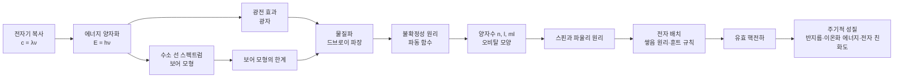

# 일반화학 4. 원자의 전자 구조와 주기성 — 빛이 알려 준 원자 속 전자의 주소
<!-- prev: 2-3, chem-2, phy-3, emq-3 -->
<!-- next: uchem-5, uchem-12, uphy-12 -->

> [!NOTE]
> **이 단원의 범위**
> - 전자기 복사의 성질, 에너지 양자화(플랑크), 광전 효과와 광자
> - 수소 원자의 선 스펙트럼과 보어 모형(에너지 준위, 뤼드베리 식), 그 한계
> - 물질의 파동성(드브로이 파장)과 불확정성 원리, 파동 함수와 확률 밀도
> - 양자수($n, l, m_l$)와 오비탈의 모양·마디·에너지
> - 전자 스핀과 파울리 배타 원리, 쌓음 원리와 훈트 규칙에 따른 다전자 원자의 전자 배치
> - 유효 핵전하와 주기적 성질(원자·이온 반지름, 이온화 에너지, 전자 친화도)

**학습 목표**

1. 빛의 파장·진동수·에너지 사이의 관계($c = \lambda\nu$, $E = h\nu$)를 이용해 광자의 에너지를 계산하고, 광전 효과를 광자 모형으로 정량적으로 설명할 수 있다.
2. 뤼드베리 식과 보어 모형으로 수소 원자의 선 스펙트럼을 계산하고, 보어 모형이 성공한 점과 한계를 구분할 수 있다.
3. 드브로이 파장과 불확정성 원리를 계산에 적용하고, 파동 함수와 확률 밀도로 오비탈을 해석할 수 있다.
4. 네 가지 양자수의 허용 조합으로 오비탈의 종류·개수·마디 수를 판단할 수 있다.
5. 파울리 배타 원리, 쌓음 원리, 훈트 규칙을 써서 원자와 이온의 전자 배치를 쓰고 홀전자 수와 자기적 성질을 예측할 수 있다.
6. 유효 핵전하로 원자 반지름, 이온화 에너지, 전자 친화도의 주기적 경향과 그 예외를 설명할 수 있다.

**이 단원의 학습 사다리**

| 단계 | 무엇을 하나? |
|---|---|
| STEP 1. 이전 학습 다시 보기 | 통합과학의 전자껍질 모형, 「빛과 물질」의 광자와 보어 모형, 「양자와 미시세계」의 불확정성 원리를 다시 꺼낸다 |
| STEP 2. 기초 다지기 | 파동의 기술, 에너지 단위(J, eV, kJ/mol), 정상파 조건, 극좌표와 확률 밀도를 익힌다 |
| STEP 3. 핵심 개념 | 전자기 복사 → 광전 효과 → 선 스펙트럼과 보어 모형 → 물질파·불확정성 → 양자수와 오비탈 → 스핀과 전자 배치 → 유효 핵전하와 주기성 |
| STEP 4. 오개념 바로잡기 | "오비탈은 전자가 도는 길이다?", "4s가 언제나 3d보다 에너지가 낮다?" 같은 착각을 바로잡는다 |
| STEP 5. 전공으로 | 수소 원자의 슈뢰딩거 방정식 풀이, 스핀–궤도 결합과 항 기호, 계산 화학 |
| STEP 6. 생활·산업·진로 | 원자 분광 분석, 불꽃놀이, 레이저·LED·양자점 |

---

## 🗺️ 단원 들어가기

밤하늘의 불꽃놀이는 왜 빨강·초록·보라처럼 원소마다 색이 정해져 있을까? 스트론튬 화합물은 붉게, 구리 화합물은 푸르게, 나트륨은 노랗게 탄다. 19세기 과학자들은 원소마다 내는 빛을 분광기로 갈라 보고, 원소마다 몇 개의 **특정한 파장**만 나타난다는 것을 알아냈다. 마치 원소마다 고유한 바코드를 가진 것처럼.

이 바코드는 원자 속 전자가 **아무 에너지나 가질 수 없고, 정해진 에너지 계단 위에만 있을 수 있다**는 사실의 증거였다. 고등학교에서는 이 계단을 "전자껍질"이라는 그림으로 배웠다. 대학에서는 질문을 한 단계 더 밀고 나간다. 계단의 높이는 정확히 얼마인가? 한 계단에 전자가 몇 개, 어떤 모양으로 앉는가? 그리고 그 배치가 어떻게 주기율표의 모양과 원소의 성질을 결정하는가?

이 단원의 이야기는 "빛은 입자이기도 하다"에서 시작해 "전자는 파동이기도 하다"를 거쳐 "주기율표는 전자의 주소록이다"로 끝난다.

---

## STEP 1. 🔙 이전 학습 다시 보기

### 연계 개념표

| 이전 단원 | 그때 배운 것(고등학교에서는 여기까지) | 이 단원에서 확장되는 것(대학에서는 이렇게) |
|---|---|---|
| 통합과학1 「원소의 주기성과 화학 결합의 이유」 | 전자껍질 모형(K, L, M 껍질에 2, 8, 8개), 원자가 전자, 주기율표의 족과 주기 | 껍질 안의 **부껍질(s, p, d, f)과 오비탈**, 쌓음 원리로 주기율표의 블록 구조를 설명 |
| 물리학 「빛과 물질」 | 광전 효과를 광자로 설명(정성적), 선 스펙트럼과 에너지 준위, 보어 모형 | 광전 효과의 에너지 식 $E_k = h\nu - \Phi$, 뤼드베리 식과 보어 에너지 식으로 **정량 계산** |
| 전자기와 양자 「양자와 미시세계」 | 드브로이 물질파, 불확정성 원리 $\Delta x\,\Delta p \ge h/4\pi$, 확률로 그리는 전자구름 | 파동 함수 $\psi$와 확률 밀도 $\lvert\psi\rvert^2$, **양자수로 분류한 오비탈**, 마디 |
| 화학 「물질의 구조와 성질」 | 전기 음성도의 주기적 변화(같은 주기에서 오른쪽으로 증가, 같은 족에서 아래로 감소) | 그 경향의 근본 원인인 **유효 핵전하**와 오비탈의 크기로 반지름·이온화 에너지·전자 친화도를 설명 |

### 준비 운동 (사전 진단)

**Q1.** 빨간빛(700 nm)과 보랏빛(400 nm) 중 광자 하나의 에너지가 더 큰 것은?

**Q2.** 수소 원자의 전자가 $n = 3$에서 $n = 2$로 떨어질 때 빛을 내놓는다. 흡수인가, 방출인가? 그때 빛의 에너지는 무엇과 같은가?

**Q3.** 나트륨(Na, 원자 번호 11)의 전자껍질 배치를 쓰고 원자가 전자 수를 말하시오.

**Q4.** 같은 주기에서 원자 번호가 커질수록 원자 반지름은 대체로 어떻게 변하는가? 그 이유를 한 문장으로 쓰시오.

정답 및 해설

**Q1.** 보랏빛. 광자의 에너지는 $E = h\nu = hc/\lambda$로 파장에 반비례한다. 400 nm 광자의 에너지는 700 nm 광자의 $700/400 = 1.75$배이다.

**Q2.** 방출. 높은 준위에서 낮은 준위로 내려가므로 두 준위의 에너지 차이만큼의 에너지를 가진 광자 하나를 내놓는다($h\nu = E_3 - E_2$).

**Q3.** K 2, L 8, M 1 (2, 8, 1). 원자가 전자는 1개이다.

**Q4.** 작아진다. 전자껍질 수는 같은데 원자핵의 양전하가 커져 전자를 더 강하게 끌어당기기 때문이다. 이 단원에서는 이 설명을 "유효 핵전하"라는 양으로 다듬는다.

---

## STEP 2. 🧱 기초 다지기

### ① 파동을 기술하는 양

빛을 포함한 모든 파동은 다음 양으로 기술한다.

| 양 | 기호 | 뜻 | SI 단위 |
|---|---|---|---|
| 파장(wavelength) | $\lambda$ | 이웃한 마루와 마루 사이 거리 | m (흔히 nm, pm) |
| 진동수(frequency) | $\nu$ | 1초 동안 한 지점을 지나는 파동의 수 | $\mathrm{s^{-1}}$ = Hz |
| 속력 | $c$ | 진공에서 빛의 속력 | m/s |
| 파수(wavenumber) | $\tilde{\nu} = 1/\lambda$ | 단위 길이당 파동의 수 | $\mathrm{m^{-1}}$ (분광학에서는 $\mathrm{cm^{-1}}$) |

진공에서 모든 전자기파는 같은 속력 $c = 2.998\times10^8\ \mathrm{m/s}$로 움직이므로

$$
c = \lambda\nu
$$

이다. 파장이 짧을수록 진동수가 크다. 화학에서 물리학의 진동수 기호 $f$ 대신 그리스 문자 $\nu$(뉴)를 쓰는 경우가 많으니 혼동하지 말자.

### ② 에너지 단위 세 가지

원자 하나의 에너지는 너무 작아 J 단위로 쓰면 $10^{-19}$ 같은 수가 나온다. 그래서 상황에 따라 단위를 바꾼다.

| 단위 | 쓰는 곳 | 환산 |
|---|---|---|
| J(줄) | 광자 1개, 원자 1개의 에너지 | 기준 |
| eV(전자볼트) | 물리학, 광전 효과, 분광학 | $1\ \mathrm{eV} = 1.602\times10^{-19}\ \mathrm{J}$ |
| kJ/mol | 화학(이온화 에너지, 결합 에너지) | (J/개)$\times N_\mathrm{A}\div1000$, $1\ \mathrm{eV/개} \approx 96.5\ \mathrm{kJ/mol}$ |

이 단원에서 쓰는 상수: 플랑크 상수 $h = 6.626\times10^{-34}\ \mathrm{J\cdot s}$, $c = 2.998\times10^8\ \mathrm{m/s}$, 아보가드로수 $N_\mathrm{A} = 6.022\times10^{23}\ \mathrm{mol^{-1}}$, 전자 질량 $m_e = 9.109\times10^{-31}\ \mathrm{kg}$, 기본 전하 $e = 1.602\times10^{-19}\ \mathrm{C}$.

> [!TIP]
> 💡 **요령** — 광자 계산에서 자주 쓰는 조합 $hc = 1.986\times10^{-25}\ \mathrm{J\cdot m} \approx 1240\ \mathrm{eV\cdot nm}$을 기억하면 편하다. 파장을 nm로 알면 $E(\mathrm{eV}) \approx 1240/\lambda(\mathrm{nm})$이다. 500 nm 초록빛 광자는 약 2.5 eV이다.

### ③ 정상파와 '정수' 조건

양 끝이 고정된 길이 $L$의 줄에서는 아무 파장이나 오래 살아남지 못하고, 줄 길이에 반파장이 정수 개 들어가는 파동만 **정상파(standing wave)** 로 남는다.

$$
L = n\cdot\frac{\lambda}{2}, \qquad n = 1, 2, 3, \ldots
$$

$n$이 하나 커질 때마다 진폭이 0인 점, 즉 **마디(node)** 가 하나씩 늘어난다(양 끝 제외 $n - 1$개). "갇힌 파동은 띄엄띄엄한 상태만 허용되고, 상태마다 마디 수가 다르다"는 것이 이 단원 전체의 열쇠이다. 원자핵의 전기적 인력에 갇힌 전자의 파동도 똑같이 행동한다.

### ④ 3차원 공간의 좌표와 확률 밀도

원자는 공 모양에 가까우므로 직교 좌표 $(x, y, z)$보다 **구면 좌표** $(r, \theta, \phi)$가 편하다. $r$은 원자핵에서의 거리, $\theta$와 $\phi$는 방향(위도·경도와 비슷)이다.

- **확률 밀도(probability density)**: 어떤 점 근처의 아주 작은 부피 $dV$ 안에서 전자를 발견할 확률이 $\lvert\psi\rvert^2\,dV$가 되도록 하는 양 $\lvert\psi\rvert^2$. 단위는 $\mathrm{m^{-3}}$이다.
- **지름 확률 분포(radial distribution)**: 반지름 $r$과 $r + dr$ 사이의 얇은 구 껍질 안에서 전자를 발견할 확률. 껍질의 부피가 $4\pi r^2\,dr$이므로 s 오비탈이면 $P(r) = 4\pi r^2\lvert\psi\rvert^2$이다.

$\lvert\psi\rvert^2$은 원자핵 바로 위에서 가장 크더라도, 껍질의 부피 $4\pi r^2$이 0에 가까우므로 $P(r)$은 원자핵에서 0이다. 이 차이가 나중에 "가장 발견되기 쉬운 거리"를 이해하는 데 쓰인다.

### ⑤ 유효 숫자 다시 보기

이 단원의 계산에는 $10^{-19}$, $10^{-34}$ 같은 지수가 많다. 지수 부분은 유효 숫자에 영향을 주지 않고, 곱셈·나눗셈 결과는 **가장 적은 유효 숫자**를 따른다. 예를 들어 파장 "500 nm"가 유효 숫자 3자리($5.00\times10^2$ nm)라면 광자 에너지도 3자리로 쓴다. 상수는 문제의 자료보다 한두 자리 더 많이 써서 계산 도중의 반올림 오차를 줄인다.

---

## STEP 3. 📘 핵심 개념

### ① 전자기 복사와 에너지 양자화

#### 전자기 스펙트럼

**전자기 복사(electromagnetic radiation)** 는 서로 수직으로 진동하는 전기장과 자기장이 공간을 퍼져 나가는 파동이다. 파장에 따라 이름이 다르지만 모두 같은 현상이다.

| 영역 | 파장(대략) | 원자·분자에서 일으키는 일 | 화학에서의 쓰임 |
|---|---|---|---|
| 감마선 | 10 pm 이하 | 원자핵의 에너지 변화 | 방사성 분석 |
| X선 | 0.01~10 nm | 안쪽 껍질 전자 들뜸·방출 | 결정 구조 분석, 원소 분석 |
| 자외선 | 10~400 nm | 바깥 전자 들뜸, 결합 끊기 | 자외선–가시광선 분광법 |
| 가시광선 | 약 400~700 nm | 바깥 전자 들뜸 | 색, 불꽃 반응 |
| 적외선 | 700 nm~1 mm | 분자 진동 | 적외선 분광법(작용기 확인) |
| 마이크로파 | 1 mm~30 cm | 분자 회전 | 전자레인지, 회전 분광법 |
| 라디오파 | 30 cm 이상 | 원자핵 스핀 뒤집기(자기장 속) | 핵자기 공명(NMR), MRI |

#### 흑체 복사와 플랑크의 양자 가설

뜨겁게 달군 물체는 빛을 내는데, 온도가 높아질수록 빛의 색이 붉은색 → 주황 → 흰색으로 바뀐다. 이상적으로 모든 빛을 흡수하고 내놓는 물체를 **흑체(blackbody)** 라 한다. 19세기 말의 고전 물리학은 흑체가 짧은 파장(자외선)으로 갈수록 무한히 많은 에너지를 내놓는다고 예측했는데, 실제 측정은 그렇지 않았다(이른바 '자외선 파탄').

1900년 플랑크(Planck)는 진동하는 원자가 에너지를 연속적으로 주고받는 것이 아니라 **기본 단위의 정수배로만** 주고받는다고 가정하여 실험 곡선을 정확히 재현했다.

$$
\Delta E = n h\nu, \qquad n = 1, 2, 3, \ldots
$$

이 최소 단위 $h\nu$를 **양자(quantum)** 라 하고, 에너지가 띄엄띄엄한 값만 갖는 것을 **에너지 양자화(quantization)** 라 한다. 일상의 에너지는 양자보다 압도적으로 커서 연속처럼 보일 뿐이다.

<!-- fig:uchem-4-blackbody -->

> [!TIP]
> 💡 **비유** — 경사로를 오르면 어떤 높이에든 멈출 수 있지만, 계단에서는 계단 높이의 정수배인 곳에만 설 수 있다. 플랑크는 "원자의 에너지는 경사로가 아니라 계단"이라고 주장한 셈이다. 계단이 아주 낮으면(거시 세계) 멀리서는 경사로처럼 보인다.

#### 예제 1 — 녹색 레이저 광자의 에너지

녹색 레이저 포인터는 파장 532 nm의 빛을 낸다. (1) 진동수, (2) 광자 1개의 에너지, (3) 광자 1 mol의 에너지를 구하시오.

**풀이**

- **식 세우기** $\nu = c/\lambda$, $E = h\nu$, 1 mol의 에너지는 $E\times N_\mathrm{A}$
- **대입**
  (1) $\nu = \dfrac{2.998\times10^8\ \mathrm{m/s}}{532\times10^{-9}\ \mathrm{m}} = 5.64\times10^{14}\ \mathrm{s^{-1}}$
  (2) $E = (6.626\times10^{-34}\ \mathrm{J\cdot s})(5.635\times10^{14}\ \mathrm{s^{-1}}) = 3.73\times10^{-19}\ \mathrm{J}$
  (3) $3.734\times10^{-19}\ \mathrm{J}\times6.022\times10^{23}\ \mathrm{mol^{-1}} = 2.25\times10^5\ \mathrm{J/mol} = 225\ \mathrm{kJ/mol}$
- **유효 숫자** 파장이 3자리이므로 결과도 3자리로 쓴다.
- **의미** 광자 1 mol의 에너지(225 kJ/mol)는 약한 화학 결합 하나를 끊는 에너지와 같은 규모이다. 자외선(300 nm 이하, 약 400 kJ/mol 이상)이 C–C 결합(약 350 kJ/mol)을 끊어 피부와 플라스틱을 손상시키는 이유가 여기에 있다.

#### ✔ 바로 확인

1. (O/X) 파장이 짧은 빛일수록 광자 하나의 에너지가 작다.
2. 빈칸: 에너지를 기본 단위 $h\nu$의 정수배로만 주고받는 것을 에너지 (    )라 한다.
3. 파장 620 nm인 빛의 광자 에너지는 약 몇 eV인가? ($hc \approx 1240\ \mathrm{eV\cdot nm}$)
4. 그림 일반화학 4-1에서 흑체의 온도가 3000 K에서 5000 K로 높아지면 스펙트럼의 봉우리 파장은 어느 쪽으로 옮겨 가는가?

정답

1. X — $E = hc/\lambda$이므로 파장이 짧을수록 광자 에너지가 크다.
2. 양자화 — 최소 단위 $h\nu$가 양자이다.
3. 약 2.0 eV — $1240/620 = 2.0$.
4. 짧은 파장 쪽 — 봉우리가 966 nm에서 580 nm로 옮겨 가고, 전체 세기도 커진다.

### ② 광전 효과 — 빛은 광자의 흐름이다

금속 표면에 빛을 쪼이면 전자가 튀어나오는 현상이 **광전 효과(photoelectric effect)** 이다. 실험 결과는 빛을 연속적인 파동으로 보면 설명할 수 없었다.

| 실험 사실 | 파동 모형의 예측 | 실제 |
|---|---|---|
| 문턱 진동수 | 약한 빛도 오래 쪼이면 언젠가 전자가 나와야 한다 | **문턱 진동수 $\nu_0$** 보다 작은 진동수의 빛은 아무리 세게 쪼여도 전자가 나오지 않는다 |
| 전자의 운동 에너지 | 빛이 셀수록 커져야 한다 | 빛의 세기와 무관하고 **진동수가 클수록** 커진다 |
| 전자의 수 | — | 빛의 **세기**(광자 수)에 비례한다 |
| 시간 지연 | 에너지를 모으는 시간이 필요하다 | 문턱 이상이면 **즉시** 나온다 |

1905년 아인슈타인은 빛이 에너지 $h\nu$를 가진 알갱이, 즉 **광자(photon)** 의 흐름이라고 보았다. 광자 하나가 전자 하나에게 에너지를 모두 주고, 전자가 금속을 빠져나오는 데 필요한 최소 에너지인 **일함수(work function)** $\Phi$를 빼고 남은 에너지가 운동 에너지가 된다.

$$
E_k = \frac{1}{2}m_ev^2 = h\nu - \Phi, \qquad \Phi = h\nu_0
$$

- $h\nu < \Phi$이면 광자 하나로는 전자를 떼어 낼 수 없다(문턱 진동수의 존재).
- 빛의 세기를 2배로 하면 광자 수가 2배 → 튀어나오는 전자 수가 2배. 전자 하나의 운동 에너지는 그대로이다.
- $E_k$를 $\nu$에 대해 그리면 기울기가 $h$, 가로축 절편이 $\nu_0$인 직선이다. 밀리컨은 이 직선의 기울기로 $h$를 측정해 아인슈타인의 식을 확인했다.

| 금속 | 일함수(약, eV) | 문턱 파장(약) |
|---|---|---|
| 세슘 | 2.1 | 590 nm(노란빛) |
| 나트륨 | 2.3 | 540 nm(초록빛) |
| 구리 | 4.7 | 260 nm(자외선) |
| 백금 | 5.6 | 220 nm(자외선) |

(일함수는 표면 상태에 따라 달라져 자료마다 조금씩 다르다.) 일함수가 작은 세슘은 가시광선에도 반응하여 예전의 광전관과 야간 투시 장비의 감광 물질로 쓰였다.

#### 예제 2 — 튀어나온 전자의 속력

어떤 금속의 문턱 진동수는 $5.50\times10^{14}\ \mathrm{s^{-1}}$이다. 이 금속에 파장 300. nm의 자외선을 쪼였다. (1) 일함수, (2) 튀어나온 전자의 최대 운동 에너지, (3) 최대 속력을 구하시오.

**풀이**

- (1) $\Phi = h\nu_0 = (6.626\times10^{-34})(5.50\times10^{14}) = 3.64\times10^{-19}\ \mathrm{J}$ (약 2.27 eV)
- (2) $\nu = \dfrac{2.998\times10^8}{300.\times10^{-9}} = 9.993\times10^{14}\ \mathrm{s^{-1}}$
  $E_k = h\nu - \Phi = (6.626\times10^{-34})(9.993\times10^{14}) - 3.644\times10^{-19} = 6.622\times10^{-19} - 3.644\times10^{-19} = 2.98\times10^{-19}\ \mathrm{J}$
- (3) $v = \sqrt{\dfrac{2E_k}{m_e}} = \sqrt{\dfrac{2(2.977\times10^{-19})}{9.109\times10^{-31}}} = 8.09\times10^5\ \mathrm{m/s}$
- **의미** 전자는 빛의 속력의 약 0.3 %로 튀어나온다. 이 금속의 문턱 파장은 $c/\nu_0 \approx 545\ \mathrm{nm}$이므로, 초록빛보다 파장이 긴 노란빛·빨간빛은 아무리 밝아도 전자를 떼어 내지 못한다.

> [!IMPORTANT]
> 광전 효과로 빛은 **파동성과 입자성을 함께 가진다**는 것이 분명해졌다. 간섭·회절은 파동으로, 에너지를 주고받는 사건은 광자로 설명한다. 다음 소절에서 원자가 빛을 흡수·방출할 때도 **한 번에 광자 하나**씩 주고받는다.

#### ✔ 바로 확인

1. (O/X) 빛의 세기를 2배로 하면 튀어나오는 광전자의 최대 운동 에너지도 2배가 된다.
2. 일함수가 2.3 eV인 나트륨에 에너지 3.0 eV인 광자를 쪼였다. 광전자의 최대 운동 에너지는 몇 eV인가?
3. 광전자의 최대 운동 에너지 $E_k$를 빛의 진동수 $\nu$에 대해 그린 직선에서 기울기와 가로축 절편은 각각 무엇인가?

정답

1. X — 세기는 광자 수(광전자 수)만 늘린다. 운동 에너지는 진동수로 정해진다.
2. 0.7 eV — $E_k = h\nu - \Phi = 3.0 - 2.3$.
3. 기울기는 플랑크 상수 $h$, 가로축 절편은 문턱 진동수 $\nu_0$이다.

### ③ 수소의 선 스펙트럼과 보어 모형

#### 연속 스펙트럼과 선 스펙트럼

백열전구의 빛을 프리즘으로 가르면 무지개처럼 끊김 없는 **연속 스펙트럼(continuous spectrum)** 이 나온다. 그러나 낮은 압력의 수소 기체에 높은 전압을 걸어 빛나게 하고 그 빛을 가르면, 검은 바탕에 몇 줄의 밝은 선만 보이는 **선 스펙트럼(line spectrum)** 이 나온다. 가시광선 영역에는 656.3 nm(빨강), 486.1 nm(청록), 434.0 nm(파랑), 410.2 nm(보라)의 네 선이 뚜렷하다.

1885년 발머는 이 네 파장이 간단한 수식을 따른다는 것을 찾았고, 뤼드베리가 이를 일반화하였다.

$$
\frac{1}{\lambda} = R_\mathrm{H}\left(\frac{1}{n_1^2} - \frac{1}{n_2^2}\right), \qquad n_2 > n_1, \qquad R_\mathrm{H} = 1.097\times10^7\ \mathrm{m^{-1}}
$$

$R_\mathrm{H}$를 **뤼드베리 상수(Rydberg constant)** 라 한다. 처음에는 경험식이었지만, 정수 $n$이 등장한다는 사실 자체가 무언가 '띄엄띄엄한' 구조를 암시했다.

| 계열 | $n_1$ | 영역 | 예 |
|---|---|---|---|
| 라이먼(Lyman) 계열 | 1 | 자외선 | $2\to1$: 121.5 nm |
| 발머(Balmer) 계열 | 2 | 가시광선 | $3\to2$: 656.3 nm, $4\to2$: 486.1 nm |
| 파셴(Paschen) 계열 | 3 | 적외선 | $4\to3$: 약 1875 nm |

#### 보어 모형 — 정수 $n$의 정체

1913년 보어(Bohr)는 수소 원자에 대해 두 가지 가정을 세웠다.

1. 전자는 원자핵 주위의 특정한 원 궤도에서만 운동하며, 그 궤도에 있는 동안에는 빛을 내지 않는다(**정상 상태**). 허용되는 궤도는 각운동량이 $h/2\pi$의 정수배인 궤도이다.
2. 전자가 한 정상 상태에서 다른 정상 상태로 옮겨 갈 때(**전이**) 두 상태의 에너지 차이만큼의 광자 하나를 흡수하거나 방출한다.

쿨롱 인력이 원운동의 구심력이 된다는 조건과 각운동량 조건을 연립하면 다음 결과를 얻는다(유도의 뼈대는 STEP 5).

$$
E_n = -\frac{2.179\times10^{-18}\ \mathrm{J}}{n^2}\cdot Z^2 , \qquad r_n = 52.9\ \mathrm{pm}\times\frac{n^2}{Z}
$$

수소는 $Z = 1$이다. $n$을 **주 양자수**라 부르며, 에너지의 기준(0)은 전자가 원자핵에서 무한히 떨어져 정지한 상태이다. 그래서 묶여 있는 전자의 에너지는 음수이고, $n = 1$인 **바닥상태(ground state)** 가 가장 낮다. $n \ge 2$인 상태를 **들뜬상태(excited state)** 라 한다.

전이에서 방출되는 광자의 에너지는

$$
\Delta E = E_{\text{처음}} - E_{\text{나중}} = 2.179\times10^{-18}\ \mathrm{J}\left(\frac{1}{n_\text{나중}^2} - \frac{1}{n_\text{처음}^2}\right)
$$

이고, $\Delta E = hc/\lambda$로 나누어 보면 $R_\mathrm{H} = (2.179\times10^{-18})/(hc) = 1.097\times10^7\ \mathrm{m^{-1}}$이 정확히 나온다. 경험식의 상수가 기본 상수로부터 계산된 것, 이것이 보어 모형의 가장 큰 성공이었다.

| $n$ | $E_n$ ($10^{-19}$ J) | $E_n$ (eV) | $r_n$ (pm) |
|---|---|---|---|
| 1 | −21.79 | −13.6 | 52.9 |
| 2 | −5.45 | −3.40 | 212 |
| 3 | −2.42 | −1.51 | 476 |
| 4 | −1.36 | −0.85 | 846 |
| $\infty$ | 0 | 0 | — |

$n$이 커질수록 준위 간격이 좁아져, $n \to \infty$ 근처에서는 거의 연속처럼 붙는다. 스펙트럼선이 짧은 파장 쪽으로 갈수록 촘촘해지다가 한계(라이먼 계열의 한계 약 91.2 nm)에 모이는 것도 이 때문이다.
<!-- fig:uchem-4-hydrogen-levels -->

#### 예제 3 — 발머 계열의 청록색 선과 이온화 에너지

(1) 수소 원자에서 $n = 4 \to 2$ 전이로 나오는 빛의 파장을 구하시오. (2) 바닥상태 수소 원자 1 mol을 이온화하는 데 필요한 에너지(kJ/mol)를 구하시오.

**풀이**

- (1) $\dfrac{1}{\lambda} = (1.097\times10^7\ \mathrm{m^{-1}})\left(\dfrac{1}{2^2} - \dfrac{1}{4^2}\right) = (1.097\times10^7)(0.1875) = 2.057\times10^6\ \mathrm{m^{-1}}$
  $\lambda = 4.862\times10^{-7}\ \mathrm{m} = 486.2\ \mathrm{nm}$ — 관측값 486.1 nm와 잘 맞는다.
- (2) 이온화는 $n = 1 \to \infty$이므로 $\Delta E = 2.179\times10^{-18}\ \mathrm{J}\left(\dfrac{1}{1^2} - 0\right)$. 1 mol로는 $2.179\times10^{-18}\times6.022\times10^{23} = 1.312\times10^6\ \mathrm{J/mol} = 1312\ \mathrm{kJ/mol}$
- **의미** 실험으로 잰 수소의 이온화 에너지(1312 kJ/mol)와 일치한다. 같은 식에 $Z^2$을 곱하면 $\mathrm{He^+}$의 이온화 에너지는 4배인 약 5249 kJ/mol로 예측되는데, 이것도 실험값과 잘 맞는다. 보어 모형은 **전자가 하나인 원자·이온**에서는 매우 정확하다.

#### 보어 모형의 한계

| 보어 모형이 설명한 것 | 보어 모형이 설명하지 못한 것 |
|---|---|
| 수소와 $\mathrm{He^+}$, $\mathrm{Li^{2+}}$ 같은 1전자 계의 선 스펙트럼 파장 | 전자가 2개 이상인 원자의 스펙트럼(헬륨 원자조차) |
| 수소의 이온화 에너지, 원자의 대략적 크기 | 선의 세기 차이, 자기장 속에서 선이 갈라지는 현상 |
| 에너지 준위가 양자화된다는 사실 | 왜 각운동량이 양자화되는지(가정일 뿐), 분자의 결합 |
| — | 위치와 운동량이 동시에 정해진 '궤도'라는 개념 자체(불확정성 원리와 모순) |

보어 모형은 틀린 그림 위에 맞는 결론 일부를 얹은 과도기 모형이다. 남은 핵심, 즉 **에너지 준위의 양자화**와 **전이에 의한 광자의 흡수·방출**은 현대 모형에서도 그대로 살아남는다.

#### ✔ 바로 확인

1. 빈칸: 수소의 발머 계열은 전자가 $n = (\quad)$인 준위로 떨어질 때 나오는 빛이다.
2. (O/X) 수소 원자의 $n = 3$ 준위 에너지는 $n = 1$ 준위 에너지의 $1/9$이다.
3. 보어 모형이 설명하지 **못한** 것을 고르시오. (가) 수소의 선 스펙트럼 파장 (나) 헬륨 원자의 스펙트럼 (다) 수소의 이온화 에너지
4. $\mathrm{He^+}$($Z = 2$) 이온의 바닥상태 에너지는 몇 eV인가?

정답

1. 2 — $n_1 = 2$인 계열이 가시광선 영역에 있다.
2. O — $E_n \propto -1/n^2$이므로 $-13.6/9 = -1.51$ eV이다.
3. (나) — 보어 모형은 전자가 하나인 원자·이온에서만 맞는다.
4. −54.4 eV — $E_1 = -13.6\ \mathrm{eV}\times Z^2 = -13.6\times4$.

### ④ 물질의 파동성과 불확정성 원리

#### 드브로이 물질파

빛이 입자처럼 행동한다면, 입자도 파동처럼 행동하지 않을까? 1924년 드브로이(de Broglie)는 운동량 $p = mv$인 모든 입자에 파장이 있다고 제안했다.

$$
\lambda = \frac{h}{p} = \frac{h}{mv}
$$

1927년 데이비슨과 저머는 니켈 결정에 전자선을 쏘아 X선과 같은 **회절 무늬**를 얻어, 전자의 파동성을 실험으로 확인했다. 오늘날 전자 현미경과 전자 회절 장치는 이 파동성을 이용한다.

| 물체 | 질량 | 속력 | 드브로이 파장 | 파동성이 드러나나? |
|---|---|---|---|---|
| 야구공 | 0.145 kg | 40 m/s | $1.1\times10^{-34}$ m | 전혀(원자핵보다 $10^{19}$배 이상 작다) |
| 100 V로 가속한 전자 | $9.109\times10^{-31}$ kg | 약 $5.9\times10^6$ m/s | 0.123 nm | 원자 간격과 비슷 → 결정에서 회절 |
| 수소 원자 속 전자(보어 $n = 1$) | $9.109\times10^{-31}$ kg | 약 $2.2\times10^6$ m/s | 약 0.33 nm | 원자 크기와 같은 규모 → 파동으로만 기술 가능 |

보어 반지름 궤도의 둘레($2\pi\times52.9\ \mathrm{pm} \approx 0.332\ \mathrm{nm}$)가 마침 전자의 드브로이 파장 하나와 같다. 보어의 각운동량 조건은 사실 **"원 둘레에 전자 파동이 정수 개 들어가는 정상파 조건"** 이었던 것이다($2\pi r = n\lambda$).

#### 예제 4 — 전자 현미경의 전자 파장

정지해 있던 전자를 100. V의 전위차로 가속하였다. 이 전자의 드브로이 파장을 구하시오.

**풀이**

- **식 세우기** 운동 에너지 $E_k = eV$, 운동량 $p = \sqrt{2m_eE_k}$, $\lambda = h/p$
- **대입** $E_k = (1.602\times10^{-19}\ \mathrm{C})(100.\ \mathrm{V}) = 1.602\times10^{-17}\ \mathrm{J}$
  $p = \sqrt{2(9.109\times10^{-31})(1.602\times10^{-17})} = 5.402\times10^{-24}\ \mathrm{kg\cdot m/s}$
  $\lambda = \dfrac{6.626\times10^{-34}}{5.402\times10^{-24}} = 1.23\times10^{-10}\ \mathrm{m} = 0.123\ \mathrm{nm}$
- **의미** 가시광선 파장(약 500 nm)보다 4000배쯤 짧다. 현미경의 분해능은 파장으로 제한되므로, 전자를 쓰면 원자 배열 수준까지 볼 수 있다. 실제 투과 전자 현미경은 수만~수십만 V로 가속해 파장을 수 pm까지 줄인다(이때는 상대론적 보정이 필요하다).

#### 불확정성 원리

입자가 파동이라면 "정확히 어디에 있는가"라는 질문 자체가 흐려진다. 1927년 하이젠베르크는 위치와 운동량의 불확정도 사이에 다음 관계가 있음을 보였다.

$$
\Delta x\cdot\Delta p \ge \frac{h}{4\pi}
$$

이것은 측정 장비의 한계가 아니라, 한 곳에 모인 파동을 만들려면 여러 파장(여러 운동량)을 겹쳐야 한다는 **파동의 본성**에서 나온다. 원자 속 전자에게 이 관계를 적용하면 결론은 분명하다. 전자를 원자 크기(약 $10^{-10}$ m) 안에 가두는 순간 속도의 불확정도가 $10^6$ m/s 규모가 되어, 보어 모형이 말하는 '정해진 궤도를 정해진 속력으로 도는 전자'는 의미를 잃는다.

#### 예제 5 — 50 pm 안에 갇힌 전자

전자의 위치를 50. pm 이내로 정했을 때 속도의 불확정도 최솟값을 구하고, 보어 모형 $n = 1$ 궤도의 속력($2.2\times10^6\ \mathrm{m/s}$)과 비교하시오.

**풀이**

$$
\Delta v \ge \frac{h}{4\pi m_e\Delta x} = \frac{6.626\times10^{-34}}{4\pi(9.109\times10^{-31})(50.\times10^{-12})} = 1.2\times10^6\ \mathrm{m/s}
$$

속도의 불확정도가 궤도 속력의 절반을 넘는다. 원자 속 전자는 **위치와 속도를 함께 정할 수 없고, 발견될 확률의 분포로만** 기술할 수 있다.

#### 파동 함수와 슈뢰딩거 방정식

1926년 슈뢰딩거는 전자의 파동을 기술하는 방정식을 세웠다. 일반화학에서는 그 형태와 의미만 알면 충분하다.

$$
\hat{H}\psi = E\psi
$$

- $\psi$(프사이)는 **파동 함수(wave function)**, $\hat{H}$는 운동 에너지와 퍼텐셜 에너지를 더하는 '연산자'이다. 이 방정식을 만족하는 $\psi$와 $E$의 쌍만 허용된다.
- 원자핵의 인력에 갇힌 전자는 정상파처럼 **특정한 $E$에서만** 해가 존재한다. 에너지 양자화가 가정이 아니라 **방정식의 결과**로 나온다.
- $\psi$ 자체는 직접 관측되지 않는다. **$\lvert\psi\rvert^2$이 그 위치에서 전자를 발견할 확률 밀도**이다(보른의 해석).
- 수소 원자의 해 $\psi$ 하나하나를 **오비탈(orbital)** 이라 부른다. 오비탈은 '궤도(orbit)'가 아니라 **전자의 파동 함수, 또는 전자가 발견될 확률이 큰 공간 영역**이다.

#### 가장 단순한 예 — 상자 속 입자

길이 $L$인 1차원 상자에 갇힌 입자를 생각하면 양자화가 어떻게 생기는지 한눈에 보인다. 상자 벽에서 $\psi = 0$이어야 하므로 STEP 2의 정상파 조건 $L = n\lambda/2$가 그대로 적용되고, $\lambda = h/p$를 대입하면

$$
E_n = \frac{p^2}{2m} = \frac{n^2h^2}{8mL^2}, \qquad n = 1, 2, 3, \ldots
$$

을 얻는다. 세 가지 교훈이 있다. ① 에너지는 $n^2$에 비례하여 띄엄띄엄하다. ② 가장 낮은 에너지도 0이 아니다(**영점 에너지**) — 갇힌 입자는 절대 멈출 수 없다. ③ 상자가 작을수록($L$이 작을수록) 준위 간격이 커진다. 크기가 작은 반도체 나노 입자(양자점)일수록 더 짧은 파장의 빛을 내는 이유가 ③이다.

<!-- fig:uchem-4-particle-box -->

#### 예제 6 — 0.50 nm 상자 속 전자

길이 0.50 nm인 1차원 상자에 갇힌 전자가 $n = 1$에서 $n = 2$로 들뜰 때 흡수하는 빛의 파장을 구하시오.

**풀이**

- $E_1 = \dfrac{h^2}{8m_eL^2} = \dfrac{(6.626\times10^{-34})^2}{8(9.109\times10^{-31})(0.50\times10^{-9})^2} = 2.41\times10^{-19}\ \mathrm{J}$
- $\Delta E = E_2 - E_1 = (4 - 1)E_1 = 7.23\times10^{-19}\ \mathrm{J}$
- $\lambda = \dfrac{hc}{\Delta E} = \dfrac{1.986\times10^{-25}}{7.23\times10^{-19}} = 2.7\times10^{-7}\ \mathrm{m} = 270\ \mathrm{nm}$ (자외선)
- **의미** 원자·분자 크기의 상자에 갇힌 전자는 자외선~가시광선 영역의 빛과 에너지를 주고받는다. 유효 숫자는 $L$의 2자리를 따른다.

#### ✔ 바로 확인

1. 같은 속력으로 움직일 때 전자와 양성자 중 드브로이 파장이 더 긴 것은?
2. (O/X) 불확정성 원리는 측정 장비가 충분히 정밀하지 못해서 생기는 한계이다.
3. 1차원 상자 속 입자에서 $n = 3$ 상태의 에너지는 $E_1$의 몇 배이고, 마디는 몇 개인가? (양 끝 제외)
4. 상자의 길이 $L$을 2배로 늘리면 바닥상태 에너지 $E_1$은 몇 배가 되는가?

정답

1. 전자 — $\lambda = h/(mv)$이므로 질량이 작을수록 파장이 길다.
2. X — 파동의 본성에서 나오는 원리이다.
3. 9배, 마디 2개 — $E_n \propto n^2$, 마디는 $n - 1$개.
4. $1/4$배 — $E_1 = h^2/(8mL^2)$은 $L^2$에 반비례한다.

### ⑤ 양자수와 오비탈의 모양·에너지

#### 세 가지 양자수

3차원에서 수소 원자의 슈뢰딩거 방정식을 풀면, 해는 세 개의 정수 **양자수(quantum number)** 로 구별된다. 1차원 상자에 정수 하나가 필요했듯, 3차원에는 세 개가 필요하다.

| 양자수 | 기호 | 허용 값 | 정하는 것 |
|---|---|---|---|
| **주 양자수(principal)** | $n$ | 1, 2, 3, … | 오비탈의 크기와 (수소에서) 에너지. 같은 $n$의 오비탈 모음을 **껍질** |
| **각운동량 양자수(angular momentum, 부 양자수)** | $l$ | 0, 1, …, $n - 1$ | 오비탈의 모양. 같은 $n$, $l$의 모음을 **부껍질** |
| **자기 양자수(magnetic)** | $m_l$ | $-l$, …, 0, …, $+l$ | 오비탈의 공간 방향 |

$l$ 값에는 분광학 전통에서 온 문자 이름을 붙인다: $l = 0$ s, $1$ p, $2$ d, $3$ f. 부껍질 하나에는 $m_l$ 값의 수만큼, 즉 $2l + 1$개의 오비탈이 있고, 껍질 $n$에는 모두 $n^2$개의 오비탈이 있다.

| $n$ | 가능한 $l$ | 부껍질 | 부껍질당 오비탈 수 | 껍질의 오비탈 수 $n^2$ | 최대 전자 수 $2n^2$ |
|---|---|---|---|---|---|
| 1 | 0 | 1s | 1 | 1 | 2 |
| 2 | 0, 1 | 2s, 2p | 1, 3 | 4 | 8 |
| 3 | 0, 1, 2 | 3s, 3p, 3d | 1, 3, 5 | 9 | 18 |
| 4 | 0, 1, 2, 3 | 4s, 4p, 4d, 4f | 1, 3, 5, 7 | 16 | 32 |

고등학교의 "K 껍질 2개, L 껍질 8개, M 껍질 18개"는 바로 이 표의 마지막 열이다. 그런데 3주기 원소에서 M 껍질에 8개만 채우고 4주기로 넘어가는 이유는 ⑥에서 오비탈의 에너지 순서로 설명한다.

#### 오비탈의 모양

오비탈은 보통 전자를 발견할 확률이 약 90 %가 되는 경계면으로 그린다.

| 오비탈 | 모양 | 방향 | 각 마디(평면·원뿔) |
|---|---|---|---|
| s ($l = 0$) | 공 모양(구 대칭) | 방향 없음 | 0 |
| p ($l = 1$) | 원자핵을 사이에 둔 두 개의 엽(아령 모양) | $p_x$, $p_y$, $p_z$ 세 방향 | 1(원자핵을 지나는 평면) |
| d ($l = 2$) | 네 엽의 클로버 모양 4개 + 고리 달린 $d_{z^2}$ 1개 | 다섯 방향 | 2 |
| f ($l = 3$) | 더 복잡한 여러 엽 | 일곱 방향 | 3 |

p 오비탈의 두 엽은 파동 함수의 **부호(위상)** 가 서로 반대이다. 부호 자체는 관측되지 않지만, 「화학 결합과 분자 구조」에서 오비탈끼리 겹칠 때 같은 부호면 보강, 반대 부호면 상쇄되므로 결합을 이해하는 데 결정적이다.

#### 마디 — 오비탈의 '지문'

**마디(node)** 는 $\psi = 0$이어서 전자를 발견할 확률이 0인 곳이다.

$$
\text{지름 마디 수} = n - l - 1, \qquad \text{각 마디 수} = l, \qquad \text{전체 마디 수} = n - 1
$$

| 오비탈 | $n$ | $l$ | 지름 마디(구면) | 각 마디 | 전체 |
|---|---|---|---|---|---|
| 1s | 1 | 0 | 0 | 0 | 0 |
| 2s | 2 | 0 | 1 | 0 | 1 |
| 2p | 2 | 1 | 0 | 1 | 1 |
| 3s | 3 | 0 | 2 | 0 | 2 |
| 3p | 3 | 1 | 1 | 1 | 2 |
| 3d | 3 | 2 | 0 | 2 | 2 |

1차원 상자에서 $n$이 커질수록 마디가 늘었던 것과 똑같이, 오비탈도 에너지가 높을수록(수소에서는 $n$이 클수록) 마디가 많다.
<!-- sim:u-orbitals -->

#### 지름 확률 분포와 '침투'

STEP 2의 $P(r) = 4\pi r^2\lvert\psi\rvert^2$을 그려 보면 다음 특징이 있다.

- 1s는 봉우리가 하나이고, 최댓값이 52.9 pm(보어 반지름)에 있다. 보어 궤도는 '전자가 가장 발견되기 쉬운 거리'로 살아남았다.
- 2s는 봉우리가 둘(지름 마디 1개)이고, **원자핵 가까이에 작은 봉우리**가 있다. 2p는 봉우리가 하나이다.
- 3s(봉우리 3개), 3p(2개), 3d(1개) 순으로 원자핵 근처까지 파고드는 정도가 줄어든다.

전자가 원자핵 가까운 곳까지 들어갈 확률이 있는 것을 **침투(penetration)** 라 하며, 같은 껍질에서 침투 정도는 **s > p > d > f**이다. 이 사실이 다전자 원자에서 부껍질의 에너지가 갈라지는 원인이 된다.
<!-- fig:uchem-4-radial-distribution -->

#### 오비탈의 에너지

| 원자 | 오비탈 에너지를 정하는 것 | 순서 |
|---|---|---|
| 수소(전자 1개) | $n$만 | 2s = 2p, 3s = 3p = 3d (**겹침, 축퇴**) |
| 다전자 원자 | $n$과 $l$ | 2s < 2p, 3s < 3p < 3d |

수소에서는 같은 $n$의 오비탈 에너지가 모두 같다(이처럼 에너지가 같은 상태를 **축퇴(degenerate)** 되었다고 한다). 전자가 여럿이면 전자끼리 밀어내는 효과 때문에, 원자핵 가까이 침투하는 s 전자가 더 강하게 붙들려 에너지가 낮아진다. 축퇴가 풀리는 것이다.

#### 예제 7 — 양자수 다루기

(1) $n = 4$ 껍질에 있는 오비탈의 수, (2) $n = 3$, $l = 2$, $m_l = -1$인 오비탈의 이름, (3) $(n, l, m_l) = (2, 2, 0)$이 불가능한 이유, (4) 4d 오비탈의 지름 마디와 각 마디의 수를 구하시오.

**풀이**

(1) $n^2 = 16$개(4s 1개, 4p 3개, 4d 5개, 4f 7개). (2) $l = 2$는 d이므로 3d 오비탈 중 하나이다. (3) $l$은 $n - 1$ 이하여야 하므로 $n = 2$에서 $l = 2$는 허용되지 않는다(2d 오비탈은 없다). (4) 지름 마디 $4 - 2 - 1 = 1$개, 각 마디 2개, 모두 3개이다.

> [!TIP]
> 💡 **비유** — 양자수는 전자의 '주소'이다. $n$은 아파트 동(크기와 높이), $l$은 그 동의 평형 종류(모양), $m_l$은 같은 평형 중 몇 호(방향), 그리고 다음 소절의 $m_s$는 그 방의 침대 두 개 중 어느 쪽인지이다. 한 주소에는 한 사람만 살 수 있다(파울리 원리).

#### ✔ 바로 확인

1. $n = 3$ 껍질에 있는 오비탈은 모두 몇 개인가?
2. 3p 오비탈의 지름 마디 수와 각 마디 수를 쓰시오.
3. 짝짓기: $l = 0, 1, 2$에 해당하는 부껍질 이름을 쓰시오.
4. (O/X) 수소 원자에서 3s와 3d 오비탈의 에너지는 같다.

정답

1. 9개 — $n^2$개(3s 1, 3p 3, 3d 5).
2. 지름 마디 1개($n - l - 1 = 3 - 1 - 1$), 각 마디 1개($l = 1$).
3. $l = 0$ s, $l = 1$ p, $l = 2$ d.
4. O — 전자가 하나인 수소에서는 에너지가 $n$으로만 정해진다(축퇴). 다전자 원자에서는 3s < 3d이다.

### ⑥ 전자 스핀, 파울리 배타 원리와 다전자 원자의 전자 배치

#### 전자 스핀

1922년 슈테른과 게를라흐는 은 원자 빔을 불균일한 자기장에 통과시켰더니 빔이 정확히 **두 갈래**로 갈라지는 것을 관찰했다. 이후 전자가 고유한 각운동량, 곧 **스핀(spin)** 을 가지며 그 방향이 자기장에 대해 두 가지뿐이라는 해석이 확립되었다. 이를 네 번째 양자수로 나타낸다.

$$
m_s = +\frac{1}{2}\ (\uparrow) \quad \text{또는} \quad -\frac{1}{2}\ (\downarrow)
$$

스핀은 전자가 실제로 팽이처럼 돈다는 뜻이 아니라, 전자가 작은 자석처럼 행동하게 하는 **고유한 양자적 성질**이다.

#### 파울리 배타 원리

> [!IMPORTANT]
> **파울리 배타 원리(Pauli exclusion principle)** — 한 원자 안에서 네 양자수($n, l, m_l, m_s$)가 모두 같은 전자는 둘 이상 존재할 수 없다. 따라서 **오비탈 하나에는 전자가 최대 2개**, 그것도 스핀이 반대인 쌍(↑↓)으로만 들어간다.

이 원리 하나 때문에 원자 속 전자는 모두 1s로 몰리지 못하고 차례로 위층을 채운다. 원자에 크기가 있고, 원소마다 화학적 성질이 다르고, 고체가 눌려 찌그러지지 않는 것이 모두 이 원리 덕분이다.

#### 쌓음 원리 — 낮은 에너지부터 채운다

바닥상태 원자의 전자는 에너지가 낮은 오비탈부터 차례로 채워진다(**쌓음 원리**, aufbau principle). 중성 원자의 부껍질 에너지 순서는 대체로 $n + l$이 작은 것부터, $n + l$이 같으면 $n$이 작은 것부터이다(마델룽 규칙).

$$
1s < 2s < 2p < 3s < 3p < 4s < 3d < 4p < 5s < 4d < 5p < 6s < 4f < 5d < 6p < 7s < \cdots
$$

| 부껍질 | 3d | 4s | 4p |
|---|---|---|---|
| $n + l$ | 5 | 4 | 5 |

4s($n + l = 4$)가 3d($n + l = 5$)보다 먼저 채워지는 것은 4s 전자가 원자핵 가까이 침투하는 정도가 커서 칼륨·칼슘 원자에서는 4s의 에너지가 3d보다 낮기 때문이다. 그래서 3주기는 3p까지 8개를 채우고 끝나며, 4주기가 4s로 시작한다.

#### 훈트 규칙 — 같은 에너지의 오비탈에서는 따로 앉는다

> [!IMPORTANT]
> **훈트 규칙(Hund's rule)** — 에너지가 같은 오비탈(예: 세 개의 2p)에 전자가 들어갈 때, 바닥상태에서는 **홀전자 수가 최대가 되도록** 먼저 한 개씩 같은 스핀으로 들어간 뒤에 짝을 짓는다.

같은 오비탈에 두 전자가 함께 있으면 서로 가까워 반발이 크다. 또한 스핀이 같은 전자끼리는 파울리 원리 때문에 서로 피해 다니는 효과(교환 상호 작용)가 있어 에너지가 더 낮아진다.

| 원자 | 전자 배치 | 2p 오비탈 상자 그림 | 홀전자 수 |
|---|---|---|---|
| C | $1s^2\,2s^2\,2p^2$ | [↑][↑][ ] | 2 |
| N | $1s^2\,2s^2\,2p^3$ | [↑][↑][↑] | 3 |
| O | $1s^2\,2s^2\,2p^4$ | [↑↓][↑][↑] | 2 |
| F | $1s^2\,2s^2\,2p^5$ | [↑↓][↑↓][↑] | 1 |
| Ne | $1s^2\,2s^2\,2p^6$ | [↑↓][↑↓][↑↓] | 0 |

#### 전자 배치 쓰기와 줄여 쓰기

18족 원소의 배치를 대괄호로 묶어 줄여 쓰면 **원자가 전자**가 잘 보인다(예: Na $= [\mathrm{Ne}]\,3s^1$). 대괄호 안을 **심부 전자(core electron)**, 바깥을 **원자가 전자(valence electron)** 라 한다.

| 원소 | 전자 배치 | 비고 |
|---|---|---|
| K (19) | $[\mathrm{Ar}]\,4s^1$ | 4주기 시작 |
| Ca (20) | $[\mathrm{Ar}]\,4s^2$ | |
| Sc (21) | $[\mathrm{Ar}]\,3d^1\,4s^2$ | 전이 원소 시작 |
| Cr (24) | $[\mathrm{Ar}]\,3d^5\,4s^1$ | 예외: $3d^4\,4s^2$가 아니다 |
| Fe (26) | $[\mathrm{Ar}]\,3d^6\,4s^2$ | |
| Cu (29) | $[\mathrm{Ar}]\,3d^{10}\,4s^1$ | 예외: $3d^9\,4s^2$가 아니다 |
| Zn (30) | $[\mathrm{Ar}]\,3d^{10}\,4s^2$ | |
| Br (35) | $[\mathrm{Ar}]\,3d^{10}\,4s^2\,4p^5$ | 원자가 전자 7개($4s^2\,4p^5$) |

Cr과 Cu의 예외는 3d와 4s의 에너지가 매우 가까워, 반쯤 찬($d^5$) 또는 꽉 찬($d^{10}$) d 부껍질과 홀전자 배치가 전체 에너지를 조금 더 낮추기 때문이라고 설명한다. 이런 예외는 4d, 5d 계열에도 여럿 있어서(Mo, Ag, Au 등) 규칙이 '근사'라는 점을 보여 준다.
<!-- sim:u-electron-config -->

#### 주기율표는 전자 배치의 지도이다

| 블록 | 마지막으로 채워지는 부껍질 | 주기율표 위치 | 블록의 열 수 |
|---|---|---|---|
| s 블록 | $ns$ | 1, 2족(+He) | 2 |
| p 블록 | $np$ | 13~18족 | 6 |
| d 블록 | $(n-1)d$ | 3~12족(전이 원소) | 10 |
| f 블록 | $(n-2)f$ | 란타넘족, 악티늄족 | 14 |

블록의 폭(2, 6, 10, 14)이 정확히 부껍질의 최대 전자 수 $2(2l + 1)$와 같다. 같은 족 원소의 성질이 비슷한 이유는 원자가 전자의 배치가 같기 때문이다(예: 할로젠은 모두 $ns^2\,np^5$).

<!-- fig:uchem-4-periodic-blocks -->

#### 이온의 전자 배치

- 주족 원소 음이온은 다음 비활성 기체 배치가 되도록 전자를 얻는다: $\mathrm{Cl^-} = [\mathrm{Ar}]$, $\mathrm{O^{2-}} = [\mathrm{Ne}]$.
- **전이 금속 양이온은 4s 전자를 먼저 잃는다.** 일단 3d에 전자가 들어가면 3d가 4s보다 에너지가 낮아지기 때문이다: $\mathrm{Fe^{2+}} = [\mathrm{Ar}]\,3d^6$ (4s 0개), $\mathrm{Fe^{3+}} = [\mathrm{Ar}]\,3d^5$.

#### 상자기성과 반자기성

홀전자가 있는 원자·이온은 바깥 자기장에 약하게 끌려 들어가는 **상자기성(paramagnetism)** 을, 모든 전자가 쌍을 이룬 것은 자기장에 약하게 밀려나는 **반자기성(diamagnetism)** 을 보인다. 시료를 자기장 속에서 무게를 재면(구이 저울) 홀전자 수를 실험으로 확인할 수 있어, 전자 배치 규칙의 직접적인 증거가 된다.

#### 예제 8 — 철 이온과 셀레늄의 전자 배치

(1) Fe, $\mathrm{Fe^{2+}}$, $\mathrm{Fe^{3+}}$의 전자 배치와 홀전자 수를 쓰시오. (2) Se(원자 번호 34)의 전자 배치와 홀전자 수를 쓰고, 상자기성인지 판단하시오.

**풀이**

(1) Fe: $[\mathrm{Ar}]\,3d^6\,4s^2$. 3d 다섯 오비탈에 6개 → [↑↓][↑][↑][↑][↑]로 홀전자 4개.
$\mathrm{Fe^{2+}}$: 4s 2개를 먼저 잃어 $[\mathrm{Ar}]\,3d^6$, 홀전자 4개.
$\mathrm{Fe^{3+}}$: $[\mathrm{Ar}]\,3d^5$, 다섯 오비탈에 하나씩 → 홀전자 5개.
(2) Se: $[\mathrm{Ar}]\,3d^{10}\,4s^2\,4p^4$. 4p에 4개 → [↑↓][↑][↑]로 홀전자 2개, 상자기성이다.

<!-- fig:uchem-4-q-fe-se-boxes -->

**의미** $\mathrm{Fe^{3+}}$의 반쯤 찬 $d^5$ 배치는 안정하여, 철은 공기 중에서 쉽게 +3 상태(녹)로 산화된다. 이온의 홀전자 수는 「핵화학·배위 화학·유기화학 개관」에서 배위 화합물의 색과 자기성을 설명할 때 다시 쓰인다.

#### 실험적 근거 — 광전자 분광법

원자에 높은 에너지의 광자를 쪼여 튀어나오는 전자의 운동 에너지를 재면, 광전 효과 식으로 각 전자의 결합 에너지($h\nu - E_k$)를 알 수 있다. 이것이 **광전자 분광법(photoelectron spectroscopy, PES)** 이다. 네온의 PES에는 봉우리가 정확히 세 개 나타난다.

| 봉우리 | 결합 에너지(약, MJ/mol) | 상대 세기(전자 수) | 해석 |
|---|---|---|---|
| 1 | 84.0 | 2 | 1s |
| 2 | 4.68 | 2 | 2s |
| 3 | 2.08 | 6 | 2p |

봉우리 수(부껍질 수), 봉우리 높이의 비(2 : 2 : 6), 그리고 2s와 2p의 에너지가 다르다는 사실이 다전자 원자의 오비탈 모형을 직접 지지한다. 가장 작은 2.08 MJ/mol(2080 kJ/mol)은 네온의 1차 이온화 에너지(2081 kJ/mol)와 같다.

<!-- fig:uchem-4-pes-spectra -->

#### ✔ 바로 확인

1. 오비탈 하나에 들어갈 수 있는 전자의 최대 수와 그 조건을 쓰시오.
2. 바닥상태 질소 원자의 홀전자 수는?
3. Cu(원자 번호 29)의 바닥상태 전자 배치를 줄여 쓰시오.
4. 그림 일반화학 4-7에서 나트륨 스펙트럼의 가장 오른쪽 봉우리는 어느 부껍질의 전자 몇 개를 나타내는가?

정답

1. 2개, 스핀이 반대인 쌍(↑↓) — 파울리 배타 원리.
2. 3개 — 훈트 규칙에 따라 세 2p 오비탈에 하나씩 같은 스핀으로 들어간다.
3. $[\mathrm{Ar}]\,3d^{10}\,4s^1$ — 꽉 찬 $d^{10}$이 되는 예외이다.
4. 3s 전자 1개 — 결합 에너지가 가장 작고 봉우리 높이가 2p의 1/6이다.

### ⑦ 유효 핵전하와 주기적 성질

#### 가려막기와 유효 핵전하

다전자 원자에서 바깥 전자는 원자핵의 전하 $+Z$를 온전히 느끼지 못한다. 안쪽 전자들이 원자핵과 바깥 전자 사이에서 일부를 **가려막기(shielding, 차폐)** 때문이다. 바깥 전자가 실제로 느끼는 알짜 핵전하를 **유효 핵전하(effective nuclear charge)** $Z_\text{eff}$라 한다.

$$
Z_\text{eff} = Z - S \qquad (S\text{: 가려막기 상수})
$$

가장 거친 어림은 "심부 전자는 완전히 가리고, 같은 껍질 전자는 전혀 가리지 않는다"($S$ = 심부 전자 수)이다. 이 어림으로 Na의 3s 전자는 $Z_\text{eff} \approx 11 - 10 = 1$, Cl의 3p 전자는 $17 - 10 = 7$이다. 실제로는 같은 껍질 전자도 서로 조금 가리고 심부 전자도 완벽히 가리지 못하므로, 슬레이터(Slater)가 제안한 어림 규칙이 더 현실적이다.

| 슬레이터 규칙(s, p 전자의 경우) | 전자 하나당 가려막기 기여 |
|---|---|
| 같은 $(ns, np)$ 무리의 다른 전자 | 0.35 (1s끼리는 0.30) |
| 바로 아래 껍질($n - 1$)의 전자 | 0.85 |
| 그보다 더 안쪽 껍질의 전자 | 1.00 |

#### 예제 9 — 슬레이터 규칙으로 $Z_\text{eff}$ 어림하기

Na의 3s 전자, Cl의 3p 전자, K의 4s 전자가 느끼는 유효 핵전하를 슬레이터 규칙으로 구하시오.

**풀이**

- Na($1s^2\,2s^2\,2p^6\,3s^1$): $n - 1$ 껍질 8개 × 0.85 + 1s 2개 × 1.00 = 8.80 → $Z_\text{eff} = 11 - 8.80 = 2.20$
- Cl($[\mathrm{Ne}]\,3s^2\,3p^5$): 같은 무리 6개 × 0.35 + 2s2p 8개 × 0.85 + 1s 2개 × 1.00 = 2.10 + 6.80 + 2.00 = 10.90 → $Z_\text{eff} = 17 - 10.90 = 6.10$
- K($[\mathrm{Ar}]\,4s^1$): 3s3p 8개 × 0.85 + 안쪽 10개 × 1.00 = 16.80 → $Z_\text{eff} = 19 - 16.80 = 2.20$
- **의미** 같은 3주기에서 Na → Cl로 가면 $Z_\text{eff}$가 크게 증가하지만(2.20 → 6.10), 같은 1족에서 Na → K로 내려가면 $Z_\text{eff}$는 거의 같다. 대신 $n$이 커져 오비탈이 커진다. **주기 방향은 $Z_\text{eff}$가, 족 방향은 $n$이** 주기적 성질을 지배한다. 이 두 줄이 아래 모든 경향의 열쇠이다.

> [!TIP]
> 💡 **비유** — 무대 위 가수(원자핵)를 보는 관객(바깥 전자)을 생각하자. 앞줄 관객(심부 전자)이 시야를 거의 다 가리고, 같은 줄 옆사람(같은 껍질 전자)은 조금만 가린다. 가수가 더 화려해져도(Z 증가) 앞줄이 같이 늘면(족 방향) 보이는 정도($Z_\text{eff}$)는 비슷하다. 같은 줄에 앉은 채 가수만 화려해지면(주기 방향) 훨씬 잘 보인다.

#### 원자 반지름

원자에는 뚜렷한 경계가 없으므로, 반지름은 결합한 두 원자의 핵간 거리의 절반으로 정한다(같은 원자끼리 공유 결합한 경우 **공유 반지름**, 금속 결정에서는 **금속 반지름**).

| 1족 | 반지름(약, pm) | 3주기 | 반지름(약, pm) |
|---|---|---|---|
| Li | 152 | Na | 186 |
| Na | 186 | Mg | 160 |
| K | 227 | Al | 143 |
| Rb | 248 | Si | 118 |
| Cs | 265 | P | 110 |
| — | — | S | 104 |
| — | — | Cl | 99 |

(금속 원소는 금속 반지름, 비금속 원소는 공유 반지름. 정의와 자료에 따라 값이 다르다.)

- **같은 족에서 아래로**: $n$이 커져 바깥 오비탈이 커지므로 반지름이 커진다.
- **같은 주기에서 오른쪽으로**: $Z_\text{eff}$가 커져 전자를 강하게 끌어당기므로 반지름이 작아진다.
- **전이 원소**에서는 늘어나는 전자가 안쪽 $(n-1)d$로 들어가 바깥 $ns$ 전자를 가리므로, 반지름 감소가 완만하다.

#### 이온 반지름

| 등전자 계열(전자 10개) | $\mathrm{O^{2-}}$ | $\mathrm{F^-}$ | $\mathrm{Na^+}$ | $\mathrm{Mg^{2+}}$ | $\mathrm{Al^{3+}}$ |
|---|---|---|---|---|---|
| 원자핵 전하 $Z$ | 8 | 9 | 11 | 12 | 13 |
| 이온 반지름(약, pm) | 140 | 133 | 102 | 72 | 54 |

- 양이온은 원래 원자보다 **작다**(바깥 껍질이 통째로 없어지고, 남은 전자 사이 반발도 줄어든다). Na 186 pm → $\mathrm{Na^+}$ 102 pm.
- 음이온은 원래 원자보다 **크다**(전자가 늘어 반발이 커지는데 $Z$는 그대로). Cl 99 pm → $\mathrm{Cl^-}$ 약 181 pm.
- 전자 수가 같은 **등전자(isoelectronic)** 계열에서는 $Z$가 클수록 반지름이 작다.

<!-- fig:uchem-4-ionic-radii -->

#### 이온화 에너지

**이온화 에너지(ionization energy, IE)** 는 기체 상태의 원자(또는 이온)에서 전자 1개를 떼어 내는 데 필요한 최소 에너지이다.

$$
\mathrm{X(g) \rightarrow X^+(g) + e^-}, \qquad \Delta E = IE_1 > 0
$$

| 2주기 원소 | Li | Be | B | C | N | O | F | Ne |
|---|---|---|---|---|---|---|---|---|
| $IE_1$(kJ/mol) | 520 | 899 | 801 | 1086 | 1402 | 1314 | 1681 | 2081 |
| 떼어 내는 전자 | 2s | 2s | 2p | 2p | 2p | 2p(짝지은) | 2p | 2p |

경향은 반지름의 거울상이다. 같은 주기에서 오른쪽으로 대체로 증가(→ $Z_\text{eff}$ 증가), 같은 족에서 아래로 감소(→ 전자가 원자핵에서 멀다). 그런데 두 군데에서 경향이 꺾인다.

| 예외 | 이유 |
|---|---|
| Be(899) > B(801) | B는 **2p 전자**를 떼어 낸다. 2p는 2s보다 침투가 작아 에너지가 높고(덜 붙잡혀 있고), 2s 전자에게 일부 가려진다 |
| N(1402) > O(1314) | O의 네 번째 2p 전자는 이미 전자가 있는 오비탈에 **짝을 지어** 들어가 있어 같은 오비탈 전자끼리의 반발로 떼어 내기 쉽다. N은 홀전자 3개로 반쯤 찬 안정한 배치이다 |

3주기에서도 Mg(738) > Al(578), P(1012) > S(1000)으로 똑같은 꺾임이 나타난다. 경향의 예외가 **같은 위치에서 되풀이된다**는 것은 부껍질과 훈트 규칙이 실재한다는 강력한 증거이다.
<!-- fig:uchem-4-ionization-trend -->

#### 연속 이온화 에너지 — 원자가 전자 수를 세는 법

| 원소 | $IE_1$ | $IE_2$ | $IE_3$ | $IE_4$ |
|---|---|---|---|---|
| Na | 496 | **4562** | — | — |
| Mg | 738 | 1451 | **7733** | — |
| Al | 578 | 1817 | 2745 | **11577** |

(단위 kJ/mol) 전자를 하나씩 뗄수록 남은 전자가 더 강하게 붙들리므로 값은 계속 커진다. 그런데 원자가 전자를 다 떼고 **심부 전자(비활성 기체 배치)에 손을 대는 순간 값이 몇 배로 뛴다**(굵은 글씨). Mg는 $IE_2 \to IE_3$에서 5배 넘게 뛰므로 원자가 전자가 2개이고, 그래서 $\mathrm{Mg^{2+}}$는 흔하지만 $\mathrm{Mg^{3+}}$는 화학 반응에서 만들어지지 않는다.

#### 예제 10 — 미지 원소 판별

어떤 3주기 원소 X의 연속 이온화 에너지(kJ/mol)가 $IE_1 = 787$, $IE_2 = 1577$, $IE_3 = 3232$, $IE_4 = 4356$, $IE_5 = 16091$이며, 아래 그림은 이를 막대그래프로 나타낸 것이다. X는 몇 족 원소이며, 수소와 만드는 가장 간단한 화합물의 화학식은?

<!-- fig:uchem-4-q-successive-ie -->

**풀이** 연속 이온화 에너지의 비를 계산하면 $IE_2/IE_1 \approx 2.0$, $IE_3/IE_2 \approx 2.0$, $IE_4/IE_3 \approx 1.3$, $IE_5/IE_4 \approx 3.7$이다. $IE_4 \to IE_5$에서 가장 크게 뛰므로 원자가 전자가 4개인 14족, 3주기이므로 규소(Si)이다. 수소와는 $\mathrm{SiH_4}$를 만든다.

#### 전자 친화도

**전자 친화도(electron affinity, EA)** 는 기체 상태의 중성 원자가 전자 1개를 얻어 음이온이 될 때의 에너지 변화와 관련된 양이다.

$$
\mathrm{X(g) + e^- \rightarrow X^-(g)}
$$

> [!WARNING]
> **부호 약속에 주의** — 이 반응의 에너지 변화 $\Delta E$는 대부분의 원자에서 음수(에너지 방출)이다. 이 책에서는 **방출되는 에너지를 양수로 나타낸 값을 전자 친화도**로 쓴다(Cl: $\Delta E = -349\ \mathrm{kJ/mol}$ → 전자 친화도 349 kJ/mol). 자료에 따라 $\Delta E$ 자체(음수)를 전자 친화도라고 적기도 하므로, 표의 부호 약속을 꼭 확인하자.

| 원소 | H | Li | B | C | N | O | F |
|---|---|---|---|---|---|---|---|
| 전자 친화도(약, kJ/mol) | 73 | 60 | 27 | 122 | 0 이하 | 141 | 328 |

| 17족 | F | Cl | Br | I |
|---|---|---|---|---|
| 전자 친화도(약, kJ/mol) | 328 | 349 | 325 | 295 |

- 대체로 같은 주기에서 오른쪽으로 커진다. 할로젠은 전자 하나를 얻으면 비활성 기체 배치가 되므로 특히 크다.
- N은 반쯤 찬 2p에 짝을 지어 들어가야 하므로 음이온이 안정하지 않다(전자 친화도가 거의 0 또는 음수). Be, Mg, 18족도 새 전자가 더 높은 부껍질로 가야 해서 음이온이 안정하지 않다.
- **F < Cl**: F는 매우 작아 좁은 2p 공간에 이미 전자가 빽빽하므로, 들어오는 전자와의 반발이 크다. 그래서 전자 친화도가 가장 큰 원소는 염소이다(반면 전기 음성도는 F가 가장 크다).

#### 주기적 성질 한눈에 보기

| 성질 | 같은 주기 → 오른쪽 | 같은 족 → 아래 | 주된 원인 | 대표 예외 |
|---|---|---|---|---|
| 원자 반지름 | 감소 | 증가 | 주기: $Z_\text{eff}$ 증가 / 족: $n$ 증가 | 전이 원소의 완만한 감소 |
| 1차 이온화 에너지 | 증가 | 감소 | 같음 | 2족 > 13족, 15족 > 16족 |
| 전자 친화도 | 대체로 증가 | 대체로 감소(2주기는 예외) | 같음 + 전자 사이 반발 | N, 2족, 18족, F < Cl |
| 금속성 | 감소 | 증가 | 전자를 잃기 쉬운 정도 | — |
| 전기 음성도(「화학 결합과 분자 구조」) | 증가 | 감소 | 같음 | — |

> [!IMPORTANT]
> 고등학교에서 외웠던 "오른쪽 위로 갈수록 이온화 에너지·전기 음성도가 크고 반지름이 작다"는 경향은 **$Z_\text{eff}$와 $n$이라는 두 변수**로 모두 설명된다. 그리고 경향을 벗어나는 예외들은 **부껍질의 에너지 차이와 전자 쌍의 반발**로 설명된다. 외우는 대신 원인에서 출발하여 예측해 보자.

#### ✔ 바로 확인

1. 빈칸: 같은 주기에서 오른쪽으로 갈수록 바깥 전자가 느끼는 유효 핵전하는 (    )한다.
2. (O/X) 등전자 이온인 $\mathrm{F^-}$는 $\mathrm{Na^+}$보다 반지름이 크다.
3. N과 O 중 1차 이온화 에너지가 큰 것은?
4. 연속 이온화 에너지가 $IE_1 \to IE_2$에서 몇 배로 크게 뛰는 원소는 몇 족인가?

정답

1. 증가 — 같은 껍질 전자는 서로 조금밖에 가리지 못한다.
2. O — 전자 수가 같으면 원자핵 전하가 작은 $\mathrm{F^-}$($Z = 9$)가 더 크다.
3. N — 반쯤 찬 $2p^3$이고, O는 짝지은 전자를 떼어 내므로 쉽다.
4. 1족 — 원자가 전자가 1개뿐이어서 두 번째 전자는 심부 전자이다.

---

## STEP 4. ⚠️ 오개념 바로잡기

| 흔한 오개념 | 올바른 개념 | 왜 그럴까? |
|---|---|---|
| 오비탈은 전자가 돌아다니는 길(궤도)이다 | 오비탈은 **파동 함수**, 또는 전자를 발견할 확률이 큰 **공간 영역**이다 | 불확정성 원리 때문에 원자 속 전자에게는 정해진 경로가 없다. 오비탈 그림의 경계면은 확률 약 90 %의 등고면일 뿐이다 |
| 빛을 더 밝게 하면 광전자의 운동 에너지가 커진다 | 밝기는 **광자 수**를 늘려 광전자 **수**를 늘린다. 운동 에너지는 **진동수**로 정해진다 | 광자 하나가 전자 하나와 에너지를 주고받는다. $E_k = h\nu - \Phi$에 세기는 들어 있지 않다 |
| 보어 모형은 틀렸으므로 쓸모없다 | 1전자 계의 에너지 준위와 스펙트럼은 정확히 맞으며, **에너지 양자화와 전이**라는 핵심은 현대 모형에 남아 있다 | 틀린 것은 '정해진 원 궤도'라는 그림이다. $E_n \propto -1/n^2$은 슈뢰딩거 방정식도 같은 결과를 준다 |
| p 오비탈의 두 엽 사이를 전자가 어떻게 지나가는가? 원자핵을 뚫고 지나간다 | 전자는 입자처럼 한 엽에서 다른 엽으로 '이동'하지 않는다. 오비탈 전체가 하나의 정상파 상태이다 | 줄의 정상파에서 마디를 사이에 둔 두 배가 동시에 진동하는 것과 같다. 마디에서 확률은 0이지만 파동은 끊기지 않는다 |
| 4s는 언제나 3d보다 에너지가 낮다 | 4s가 먼저 채워지는 것은 K, Ca 근처의 중성 원자 이야기이다. 3d가 차기 시작하면 3d가 더 낮아져, **전이 금속 이온은 4s 전자를 먼저 잃는다** | 오비탈 에너지는 핵전하와 다른 전자의 배치에 따라 변한다. 쌓음 순서는 전체 에너지가 최소가 되는 배치를 근사한 규칙이다 |
| 전자 친화도가 가장 큰 원소는 플루오린이다 | 전자 친화도는 **염소**가 가장 크다(전기 음성도는 플루오린이 가장 크다) | F는 너무 작아 들어오는 전자와 기존 전자의 반발이 크다. 전자 친화도(고립 원자)와 전기 음성도(결합 속 원자)는 다른 양이다 |
| 양이온의 반지름은 원자와 비슷하다 | 양이온은 원자보다 **훨씬 작고**, 음이온은 원자보다 **크다** | 양이온은 바깥 껍질이 통째로 사라지는 경우가 많다(Na 186 pm → $\mathrm{Na^+}$ 102 pm) |
| 홀전자가 있다는 것은 계산상의 표현일 뿐 확인할 수 없다 | 홀전자는 **상자기성**으로 실험적으로 측정된다 | 자기장 속에서 무게 변화나 자화율을 재어 홀전자 수를 구할 수 있다 |

---

## STEP 5. 🎓 다음 단계로 한 걸음 더

> [!CAUTION]
> 여기부터는 일반 과목의 범위를 넘는 전공 과목 맛보기이다. 평가 대상이 아니며, 이 단원의 개념이 전공에서 어떻게 확장되는지 미리 보는 것이 목적이다.

### 전공 과목과의 연결

| 전공 과목 | 이어지는 내용 |
|---|---|
| 물리화학(양자화학) | 슈뢰딩거 방정식의 정확한 풀이(상자 속 입자, 조화 진동자, 강체 회전자, 수소 원자), 연산자와 고유값 |
| 분자 분광학 | 선택 규칙, 원자 스펙트럼의 미세 구조, 레이저의 원리 |
| 무기화학 | 항 기호, 전이 금속의 전자 배치와 결정장, 상대론적 효과(금의 색, 수은의 액체 상태) |
| 계산 화학 | 하트리–포크 방법, 밀도 범함수 이론으로 원자·분자의 전자 구조 계산 |
| 고체 물리·재료과학 | 띠 구조, 반도체의 띠틈과 양자점 |

### 맛보기 ① 보어 에너지 식의 유도와 수소 원자의 정확한 해

보어의 두 조건은 구심력 조건 $\dfrac{m_ev^2}{r} = \dfrac{Ze^2}{4\pi\varepsilon_0r^2}$와 각운동량 조건 $m_evr = n\dfrac{h}{2\pi}$이다. 두 식에서 $v$를 소거하면

$$
r_n = \frac{\varepsilon_0h^2}{\pi m_eZe^2}n^2, \qquad E_n = \frac{1}{2}m_ev^2 - \frac{Ze^2}{4\pi\varepsilon_0r} = -\frac{m_eZ^2e^4}{8\varepsilon_0^2h^2}\cdot\frac{1}{n^2}
$$

을 얻고, 상수를 넣으면 $52.9\ \mathrm{pm}$과 $2.179\times10^{-18}\ \mathrm{J}$이 나온다. 전공 물리화학에서는 3차원 슈뢰딩거 방정식을 구면 좌표에서 '변수 분리'하여 지름 부분(라게르 다항식)과 각 부분(구면 조화 함수 $Y_l^{m_l}$)의 곱으로 풀고, 그 결과로 $n, l, m_l$과 같은 에너지 식이 **가정 없이** 나온다. 각 부분의 해가 바로 STEP 3의 s, p, d 모양이다.

### 맛보기 ② 스핀–궤도 결합과 항 기호

다전자 원자에서는 개별 전자의 각운동량이 합쳐져 전체 궤도 각운동량 $L$과 전체 스핀 $S$를 만들고, 이를 $^{2S+1}L_J$ 같은 **항 기호(term symbol)** 로 나타낸다. 나트륨의 노란 D선이 589.0 nm와 589.6 nm 두 줄로 갈라지는 것은 3p 전자의 스핀과 궤도 운동이 상호 작용(스핀–궤도 결합)하여 3p 준위가 둘로 나뉘기 때문이다. 훈트 규칙도 이 언어로 더 정밀하게 다시 진술된다.

### 맛보기 ③ 계산 화학 — 컴퓨터로 푸는 다전자 원자

전자가 둘 이상이면 슈뢰딩거 방정식을 정확히 풀 수 없다. 하트리–포크 방법은 "각 전자는 다른 전자들이 만드는 평균 전기장 속에서 움직인다"고 근사하여 오비탈을 반복 계산으로 구한다. 이렇게 얻은 오비탈 에너지는 PES의 결합 에너지와 잘 맞고(쿠프만스 정리), 슬레이터 규칙은 이 계산 결과를 손으로 흉내 낸 어림이라고 볼 수 있다.

### 일반 과목 vs 전공 과목

| 주제 | 일반화학(이 단원) | 전공 과목 |
|---|---|---|
| 양자화 | 상자 속 입자, 보어 모형으로 의미 이해 | 슈뢰딩거 방정식의 해석적 풀이, 고유값 문제 |
| 오비탈 | 양자수의 허용 조합, 모양과 마디 | 구면 조화 함수, 지름 함수의 정확한 식 |
| 전자 배치 | 쌓음 원리·훈트 규칙(규칙과 예외) | 항 기호, 스핀–궤도 결합, 상대론적 효과 |
| 주기성 | 유효 핵전하(슬레이터 어림)로 경향 설명 | 하트리–포크·밀도 범함수 계산으로 정량 예측 |

---

## STEP 6. 🏭 생활·산업·진로 연결

### 사례 1. 원자 분광 분석 — 원소의 바코드 읽기

- **원리** 원자마다 에너지 준위가 달라 흡수·방출하는 빛의 파장이 고유하다. 빛의 세기는 원자 수에 비례한다.
- **어디에 쓰이나** 원자 흡수 분광법(AAS)과 유도 결합 플라스마 분광법(ICP)은 수돗물 속 납·카드뮴, 혈액 속 금속, 반도체 웨이퍼의 극미량 불순물을 ppb(10억분의 1) 수준까지 분석한다. 천문학에서는 별빛의 흡수선으로 수십억 광년 떨어진 별의 구성 원소를 알아낸다.

### 사례 2. 불꽃놀이와 조명

- **원리** 열로 들뜬 원자·분자가 바닥상태로 돌아오며 특정 파장의 빛을 낸다(나트륨 약 589 nm, 스트론튬 화합물은 빨강, 바륨 화합물은 초록, 구리 화합물은 파랑 계열).
- **어디에 쓰이나** 불꽃놀이 화약의 색 설계, 터널과 도로의 나트륨등(노란빛), 네온사인. 원하는 색을 얻으려면 들뜬 상태의 원자 대신 어떤 분자 조각이 빛을 내는지까지 고려해야 하므로, 불꽃 색은 화학자의 정밀한 조성 설계 결과이다.

### 사례 3. 레이저, LED, 양자점 디스플레이

- **원리** 레이저는 들뜬상태 원자에 광자가 지나갈 때 똑같은 광자가 하나 더 나오는 유도 방출을 이용한다. LED와 양자점은 반도체의 에너지 간격(띠틈)만큼의 빛을 낸다. 양자점은 상자 속 입자처럼 크기가 작을수록 간격이 커진다.
- **어디에 쓰이나** 광통신, 레이저 수술, 바코드 판독기, 크기만 바꿔 빨강·초록·파랑을 내는 양자점 디스플레이.

### 관련 전공과 진로

| 진로 | 하는 일 | 관련 전공 |
|---|---|---|
| 분석화학 연구원 | 원자 분광법으로 환경·식품·의약품 속 원소 정량 | 화학과, 환경공학과 |
| 양자화학·계산 화학자 | 원자·분자의 전자 구조를 계산해 신소재와 의약품 설계 | 화학과, 물리학과 |
| 광소재·디스플레이 엔지니어 | 발광 소재(양자점, OLED) 개발 | 신소재공학과, 화학공학과, 전자공학과 |
| 반도체 공정·분석 엔지니어 | 표면 분석(XPS), 불순물 분석, 노광 공정 | 재료공학과, 화학과, 전자공학과 |
| 천체 분광학자 | 별과 은하의 스펙트럼으로 구성 원소와 운동 분석 | 천문학과, 물리학과 |

---

## 🔬 탐구 활동

### 활동 A. 수소 발머 계열로 뤼드베리 상수 구하기 (관찰 + 스프레드시트 분석)

**목표** 수소 방전관의 가시광선 선 스펙트럼을 관찰하고, 측정한 파장과 뤼드베리 식의 관계를 그래프로 확인하여 $R_\mathrm{H}$를 구한다.

**준비물** 수소 기체 방전관과 전원 장치, 회절 격자 분광기(또는 휴대용 분광기), 어두운 실험실, 스프레드시트 프로그램

**과정**
1. 방전관 전원을 켜고 분광기로 빨강·청록·파랑·보라의 네 선을 찾아 파장을 읽는다(분광기가 없으면 아래 예시 자료를 쓴다).
2. 각 선에 위쪽 준위 $n_2 = 3, 4, 5, 6$을 대응시키고, 스프레드시트에 $x = 1/n_2^2$, $y = 1/\lambda$(단위 $\mathrm{m^{-1}}$)를 계산한다.
3. $y$를 $x$에 대해 그리고 추세선(직선)을 넣는다. 뤼드베리 식 $\dfrac{1}{\lambda} = \dfrac{R_\mathrm{H}}{4} - R_\mathrm{H}\cdot\dfrac{1}{n_2^2}$에 따라 **기울기는 $-R_\mathrm{H}$, 세로축 절편은 $R_\mathrm{H}/4$** 이다.

**결과 기록 (예시 자료)**

| 색 | 측정 파장(nm) | $n_2$ | $x = 1/n_2^2$ | $y = 1/\lambda$ ($10^6\ \mathrm{m^{-1}}$) |
|---|---|---|---|---|
| 빨강 | 656.3 | 3 | 0.1111 | 1.5237 |
| 청록 | 486.1 | 4 | 0.0625 | 2.0572 |
| 파랑 | 434.0 | 5 | 0.0400 | 2.3041 |
| 보라 | 410.2 | 6 | 0.0278 | 2.4378 |

예시 자료로 직선 맞춤을 하면 기울기 약 $-1.097\times10^7\ \mathrm{m^{-1}}$, 절편 약 $2.743\times10^6\ \mathrm{m^{-1}}$이다. 절편 × 4 ≈ $1.097\times10^7\ \mathrm{m^{-1}}$로 기울기의 크기와 일치한다.

**생각해 보기**
1. $n_2$를 3부터가 아니라 4부터 잘못 대응시키면 그래프는 어떻게 될까? 직선 여부로 대응이 맞는지 판정할 수 있을까?
2. 절편 $R_\mathrm{H}/4$는 어떤 전이의 $1/\lambda$인가? 그 파장(약 365 nm)이 발머 계열의 '한계'인 이유를 설명하시오.
3. 구한 $R_\mathrm{H}$로 바닥상태 수소의 이온화 에너지($hcR_\mathrm{H}$)를 kJ/mol로 계산해 보자.

> [!WARNING]
> **안전 수칙** 방전관에는 수천 V의 고전압이 걸린다. 전원이 켜진 상태에서 방전관이나 전극을 만지지 않고, 방전관을 바꿀 때는 전원을 끄고 식힌 뒤 교사가 다룬다. 방전관은 뜨거워지므로 장시간 켜 두지 않는다. 자외선을 일부 내는 광원은 맨눈으로 오래 보지 않는다.

### 활동 B. 이온화 에너지 자료로 주기성과 예외 찾기 (자료 분석)

**목표** 원자 번호 1~20 원소의 1차 이온화 에너지 자료를 그래프로 그려 주기적 경향과 예외의 위치를 찾고, 오비탈과 전자 배치로 설명한다.

**과정**
1. 공개된 원소 자료(교재 부록, 공신력 있는 데이터베이스)에서 H~Ca의 $IE_1$을 스프레드시트에 입력한다.
2. 가로축 원자 번호, 세로축 $IE_1$로 꺾은선 그래프를 그린다.
3. 봉우리(비활성 기체)와 골짜기(알칼리 금속)의 위치를 표시하고, 주기 안에서 값이 감소하는 지점을 모두 찾는다.
4. 각 감소 지점에서 떼어 내는 전자의 오비탈을 전자 배치로 확인하여 표로 정리한다.

**결과 기록**

| 감소 지점 | 앞 원소의 떼는 전자 | 뒤 원소의 떼는 전자 | 원인 |
|---|---|---|---|
| Be → B | | | |
| N → O | | | |
| Mg → Al | | | |
| P → S | | | |

**생각해 보기**
1. 주기 안 감소 지점이 2주기와 3주기에서 같은 족 위치에 나타나는 것은 무엇을 뜻하는가?
2. 같은 그래프에 원자 반지름을 함께 그리면 두 그래프는 어떤 관계를 보이는가?

---

## ✅ 개념 확인 문제

### 기본

**1.** 살균등은 파장 254 nm의 자외선을 낸다. 이 광자 1개의 에너지(J)와 광자 1 mol의 에너지(kJ/mol)를 구하시오.

정답 및 해설

**정답** $7.82\times10^{-19}\ \mathrm{J}$, 471 kJ/mol

$E = \dfrac{hc}{\lambda} = \dfrac{(6.626\times10^{-34})(2.998\times10^8)}{254\times10^{-9}} = 7.82\times10^{-19}\ \mathrm{J}$

$7.821\times10^{-19}\times6.022\times10^{23} = 4.71\times10^5\ \mathrm{J/mol} = 471\ \mathrm{kJ/mol}$. C–C 결합 에너지(약 350 kJ/mol)보다 커서 유기 분자의 결합을 끊을 수 있다. 미생물의 DNA를 손상시켜 살균 효과를 내는 이유이다.

**2.** 일함수가 $3.68\times10^{-19}\ \mathrm{J}$인 금속에 파장 405 nm의 보랏빛 레이저를 쪼였다. 광전자가 나오는가? 나온다면 최대 운동 에너지는 몇 J인가?

정답 및 해설

**정답** 나온다. $1.22\times10^{-19}\ \mathrm{J}$

광자 에너지 $E = \dfrac{1.986\times10^{-25}}{405\times10^{-9}} = 4.90\times10^{-19}\ \mathrm{J}$로 일함수보다 크다. $E_k = 4.90\times10^{-19} - 3.68\times10^{-19} = 1.22\times10^{-19}\ \mathrm{J}$. (뺄셈은 소수 자리를 기준으로 유효 숫자를 정한다.)

**3.** 수소 원자에서 $n = 5 \to 2$ 전이로 방출되는 빛의 파장을 nm 단위로 구하고 색을 말하시오. ($R_\mathrm{H} = 1.097\times10^7\ \mathrm{m^{-1}}$)

정답 및 해설

**정답** 434.1 nm, 파란빛(남색)

$\dfrac{1}{\lambda} = 1.097\times10^7\left(\dfrac{1}{4} - \dfrac{1}{25}\right) = 1.097\times10^7\times0.21 = 2.304\times10^6\ \mathrm{m^{-1}}$, $\lambda = 4.341\times10^{-7}\ \mathrm{m}$. 관측값 434.0 nm와 일치한다.

**4.** 다음 양자수 조합 $(n, l, m_l)$ 중 허용되지 **않는** 것을 모두 고르고, 허용되는 것은 오비탈 이름을 쓰시오.
ㄱ. (3, 1, −1) ㄴ. (2, 2, 0) ㄷ. (4, 3, −3) ㄹ. (1, 0, 1)

정답 및 해설

**정답** 허용되지 않는 것: ㄴ, ㄹ / ㄱ: 3p, ㄷ: 4f

ㄴ은 $l \le n - 1 = 1$이어야 하므로 불가능하다. ㄹ은 $l = 0$이면 $m_l = 0$뿐이므로 불가능하다. ㄷ은 $l = 3$(f), $m_l = -3$은 $-3 \le m_l \le 3$ 범위 안이므로 허용된다.

**5.** Mn(원자 번호 25)과 $\mathrm{Mn^{2+}}$의 바닥상태 전자 배치를 줄여 쓰고, 각각의 홀전자 수를 구하시오.

정답 및 해설

**정답** Mn: $[\mathrm{Ar}]\,3d^5\,4s^2$, 홀전자 5개 / $\mathrm{Mn^{2+}}$: $[\mathrm{Ar}]\,3d^5$, 홀전자 5개

전이 금속은 양이온이 될 때 4s 전자를 먼저 잃는다. $3d^5$는 다섯 오비탈에 하나씩 들어가므로(훈트 규칙) 홀전자가 5개이며, 둘 다 강한 상자기성을 보인다.

### 응용

**6.** $\mathrm{Li^{2+}}$ 이온(전자 1개, $Z = 3$)에서 전자가 $n = 2 \to 1$로 전이할 때 방출하는 빛의 파장을 구하고, 같은 전이를 하는 수소 원자의 경우(121.5 nm)와 비교하시오.

정답 및 해설

**정답** 약 13.5 nm(극자외선), 수소의 $1/9$

$\Delta E = Z^2(2.179\times10^{-18})\left(1 - \dfrac{1}{4}\right) = 9\times2.179\times10^{-18}\times0.75 = 1.471\times10^{-17}\ \mathrm{J}$

$\lambda = \dfrac{1.986\times10^{-25}}{1.471\times10^{-17}} = 1.35\times10^{-8}\ \mathrm{m} = 13.5\ \mathrm{nm}$

에너지가 $Z^2 = 9$배이므로 파장은 수소의 $1/9$($121.5/9 = 13.5$ nm)이다.

**7.** (1) 질량 $1.67\times10^{-27}\ \mathrm{kg}$인 중성자가 $2.0\times10^3\ \mathrm{m/s}$로 움직일 때 드브로이 파장을 구하시오. (2) 이 중성자로 결정 구조를 분석할 수 있는지, 결정 속 원자 간격(약 0.1~0.3 nm)과 비교하여 판단하시오.

정답 및 해설

**정답** (1) 약 0.20 nm (2) 원자 간격과 비슷하므로 회절을 일으켜 결정 구조 분석에 쓸 수 있다.

$\lambda = \dfrac{h}{mv} = \dfrac{6.626\times10^{-34}}{(1.67\times10^{-27})(2.0\times10^3)} = 1.98\times10^{-10}\ \mathrm{m} \approx 0.20\ \mathrm{nm}$

실제로 원자로에서 나온 중성자를 감속한 '열중성자'가 이 정도 속력을 가지며, 수소 원자의 위치와 자성 구조를 보는 중성자 회절에 쓰인다.

**8.** 다음 각 쌍에서 1차 이온화 에너지가 큰 것을 고르고 이유를 쓰시오.
(1) Mg, Al (2) P, S (3) Na, K

정답 및 해설

**정답** (1) Mg (2) P (3) Na

(1) Al은 3p 전자를 떼어 낸다. 3p는 3s보다 침투가 작아 에너지가 높고 3s 전자에 일부 가려지므로 떼어 내기 쉽다(Mg 738, Al 578 kJ/mol).
(2) S의 3p 전자 4개 중 하나는 짝을 지어 들어가 있어 같은 오비탈 전자 간 반발로 떼어 내기 쉽다. P는 반쯤 찬 $3p^3$이다(P 1012, S 1000 kJ/mol).
(3) 같은 족에서 K의 4s 전자는 $Z_\text{eff}$가 Na의 3s와 비슷하지만 원자핵에서 더 멀어 덜 강하게 붙들려 있다(Na 496, K 419 kJ/mol).

**9.** 슬레이터 규칙으로 O의 2p 전자와 F의 2p 전자가 느끼는 유효 핵전하를 구하고, 이를 이용해 두 원자의 반지름 크기를 비교하시오.

정답 및 해설

**정답** O: 4.55, F: 5.20 → F의 반지름이 더 작다.

O($1s^2\,2s^2\,2p^4$): 같은 무리 5개 × 0.35 + 1s 2개 × 0.85 = 1.75 + 1.70 = 3.45 → $Z_\text{eff} = 8 - 3.45 = 4.55$
F($1s^2\,2s^2\,2p^5$): 6 × 0.35 + 2 × 0.85 = 2.10 + 1.70 = 3.80 → $Z_\text{eff} = 9 - 3.80 = 5.20$

같은 $n = 2$ 껍질에서 $Z_\text{eff}$가 큰 F가 전자를 더 강하게 끌어당겨 반지름이 작다(O 약 73 pm, F 약 71 pm). (1s 전자는 $n - 1$ 껍질이므로 0.85를 쓴다.)

### 융합·서술형

**10. [천문·분석 연계]** 태양 스펙트럼에는 수소의 656.3 nm 위치에 어두운 흡수선이 있고, 고온의 방전관 속 수소는 같은 파장에서 밝은 방출선을 낸다. (1) 흡수선과 방출선이 같은 파장에 나타나는 이유를 에너지 준위로 설명하고, (2) 이 흡수를 일으키는 수소 원자는 바닥상태가 아니라 $n = 2$ 상태에 있어야 한다. 그 이유와, 이것이 태양 대기의 온도에 대해 무엇을 알려 주는지 서술하시오.

정답 및 해설

<!-- fig:uchem-4-q-h-absorption -->

**예시 답안**
(1) 흡수와 방출은 같은 두 준위($n = 2$와 $n = 3$) 사이의 전이이다. 에너지 차이가 같으므로 흡수하는 광자와 방출하는 광자의 에너지, 곧 파장이 같다($hc/\lambda = E_3 - E_2$). 차가운 기체가 뒤의 밝은 연속광에서 그 파장만 흡수하면 어두운 선, 뜨거운 기체가 스스로 빛나면 밝은 선이 된다.
(2) 656.3 nm 광자의 에너지(약 1.89 eV)는 $n = 2 \to 3$ 간격과 같다. 바닥상태($n = 1$)의 원자가 흡수하려면 $1 \to 2$ 간격(약 10.2 eV, 121.5 nm 자외선) 이상이 필요하므로 가시광선은 흡수하지 못한다. 따라서 이 흡수선이 뚜렷하다는 것은 태양 대기 속 수소 원자 상당수가 충돌로 $n = 2$까지 들뜰 만큼 온도가 높다(수천 K)는 뜻이다.

**채점 포인트** ① 같은 두 준위 사이 전이 ② $\Delta E = hc/\lambda$ ③ 흡수에는 아래 준위에 원자가 있어야 한다 ④ 온도와 들뜬상태의 관계

**11. [재료·주기성 연계]** 리튬 이온 전지는 Li을, 차세대 전지 후보 중 하나는 Na을 쓴다. (1) Li과 Na의 전자 배치를 쓰고, (2) 두 원소가 쉽게 +1 이온이 되며 +2 이온은 되지 않는 이유를 연속 이온화 에너지로 설명하시오. (3) 같은 수의 이온을 저장할 때 Na 전지의 전극이 Li 전지보다 무겁고 부피가 커지기 쉬운 이유를 원자량과 이온 반지름으로 설명하시오(이온 반지름 약 $\mathrm{Li^+}$ 76 pm, $\mathrm{Na^+}$ 102 pm).

정답 및 해설

**예시 답안**
(1) Li: $1s^2\,2s^1$, Na: $[\mathrm{Ne}]\,3s^1$.
(2) 원자가 전자가 1개이고, 이를 떼면 비활성 기체 배치가 된다. Na의 $IE_1$은 496 kJ/mol로 작지만, $IE_2$는 심부 전자(2p)를 떼어야 하므로 4562 kJ/mol로 약 9배 커진다(Li도 $IE_1$ 520, $IE_2$ 약 7300 kJ/mol로 크게 뛴다). 화학 반응에서 얻을 수 있는 에너지로는 두 번째 전자를 뗄 수 없다.
(3) Na의 몰질량(약 23.0 g/mol)이 Li(약 6.94 g/mol)의 3배 이상이므로 같은 몰수의 이온을 저장하는 전극 물질이 무겁다. 또 $\mathrm{Na^+}$가 $\mathrm{Li^+}$보다 커서 이온이 드나드는 결정 구조의 틈이 더 넓어야 하므로 부피가 커지고 구조가 변형되기 쉽다. 대신 Na은 매장량이 풍부하고 값이 싸다는 장점이 있다.

**채점 포인트** ① 전자 배치 ② $IE_2$의 급증과 심부 전자 ③ 몰질량과 이온 반지름 비교

### 실력 다지기

**12. [자료 해석]** 어떤 금속 표면에 파장 250. nm와 400. nm의 빛을 쪼였더니 광전자의 최대 운동 에너지가 각각 2.66 eV와 0.80 eV였다. (1) 두 자료만으로 플랑크 상수를 J·s 단위로 구하시오. (2) 이 금속의 일함수(eV)와 문턱 파장(nm)을 구하시오. ($c = 2.998\times10^8\ \mathrm{m/s}$, $1\ \mathrm{eV} = 1.602\times10^{-19}\ \mathrm{J}$)

정답 및 해설

<!-- fig:uchem-4-q-photoelectric-line -->

**정답** (1) $6.63\times10^{-34}\ \mathrm{J\cdot s}$ (2) 일함수 2.30 eV, 문턱 파장 약 539 nm

(1) $E_k = h\nu - \Phi$에서 두 점을 빼면 $\Phi$가 지워진다.
$\nu_1 = \dfrac{2.998\times10^8}{250.\times10^{-9}} = 1.199\times10^{15}\ \mathrm{s^{-1}}$, $\nu_2 = \dfrac{2.998\times10^8}{400.\times10^{-9}} = 7.495\times10^{14}\ \mathrm{s^{-1}}$
$h = \dfrac{(2.66 - 0.80)(1.602\times10^{-19}\ \mathrm{J})}{(1.199\times10^{15} - 7.495\times10^{14})\ \mathrm{s^{-1}}} = \dfrac{2.980\times10^{-19}}{4.497\times10^{14}} = 6.63\times10^{-34}\ \mathrm{J\cdot s}$

(2) $h\nu_2 = (6.626\times10^{-34})(7.495\times10^{14})/(1.602\times10^{-19}) = 3.10\ \mathrm{eV}$이므로 $\Phi = 3.10 - 0.80 = 2.30\ \mathrm{eV}$. 문턱 파장 $\lambda_0 = hc/\Phi \approx 1240/2.30 = 539\ \mathrm{nm}$(초록빛). 이 금속은 나트륨과 비슷하다.

**13. [전자 배치 추론]** 3d 계열 전이 금속 원소 M의 이온 $\mathrm{M^{3+}}$는 바닥상태에서 홀전자가 4개이다. (1) $\mathrm{M^{3+}}$가 될 수 있는 d 전자 수를 모두 찾고, 각각에 해당하는 원소를 쓰시오. (2) 중성 원자 M의 홀전자가 5개라면 M은 무엇인가?

정답 및 해설

<!-- fig:uchem-4-q-d4-d6-boxes -->

**정답** (1) $3d^4$(Mn) 또는 $3d^6$(Co) (2) Mn

(1) 다섯 개의 3d 오비탈에 훈트 규칙으로 채우면 홀전자 수는 $d^1$~$d^{10}$에 대해 1, 2, 3, 4, 5, 4, 3, 2, 1, 0이다. 홀전자 4개는 $d^4$와 $d^6$이다. 전이 금속 양이온은 4s 전자를 먼저 잃으므로 $\mathrm{M^{3+}}$의 d 전자 수 = (원자 번호 − 18) − 3이다. $d^4$이면 원자 번호 25(Mn: $[\mathrm{Ar}]\,3d^5\,4s^2$), $d^6$이면 27(Co: $[\mathrm{Ar}]\,3d^7\,4s^2$).
(2) 중성 Mn은 $3d^5$로 홀전자 5개, 중성 Co는 $3d^7$로 홀전자 3개이다. 따라서 M은 Mn이다.

**채점 포인트** ① 홀전자 수와 d 전자 수의 대응(두 경우 모두) ② 4s를 먼저 잃음 ③ 중성 원자 배치로 판별

**14. [유효 핵전하 어림]** 헬륨 원자의 1차 이온화 에너지는 2372 kJ/mol이다. (1) 보어 모형의 식 $IE = 1312\ \mathrm{kJ/mol}\times Z_\text{eff}^2/n^2$이 헬륨의 1s 전자에도 맞는다고 보고 $Z_\text{eff}$를 구하시오. (2) 슬레이터 규칙으로 구한 $Z_\text{eff}$와 비교하고, (3) $\mathrm{He^+}$의 이온화 에너지(= 헬륨의 2차 이온화 에너지)를 예측하시오.

정답 및 해설

**정답** (1) 약 1.34 (2) 슬레이터 1.70, 실제 가려막기가 더 크다 (3) 약 5248 kJ/mol

(1) $Z_\text{eff} = \sqrt{2372/1312} = \sqrt{1.808} = 1.34$
(2) 슬레이터 규칙: 다른 1s 전자 하나가 0.30 가리므로 $Z_\text{eff} = 2 - 0.30 = 1.70$. 이온화 에너지로 거꾸로 구한 값(1.34)이 더 작다. 이온화 에너지에는 전자를 떼어 내면서 남은 전자가 재배치되는 효과, 전자 사이 반발이 모두 섞여 있어 단순한 '가림막' 그림보다 크게 가려지는 것처럼 나타난다. 두 값 모두 핵전하 2보다 작다는 점이 핵심이다.
(3) $\mathrm{He^+}$는 전자가 하나이므로 보어 식이 정확하다: $1312\times2^2/1^2 = 5248\ \mathrm{kJ/mol}$. 첫 전자보다 두 배 넘게 어렵다.

### 도전

**15. [스펙트럼으로 원소 찾기]** 고온 플라스마에서 전자가 하나뿐인 어떤 이온의 방출 스펙트럼에, 같은 아래 준위로 떨어지는 계열 가운데 가장 긴 두 파장인 30.4 nm와 25.6 nm의 선이 관측되었다. (1) 두 선의 파장 비를 이용해 아래 준위 $n_1$이 1임을 보이고, (2) 이온의 원자 번호 $Z$를 구하시오. (3) 이 이온의 이온화 에너지(kJ/mol)와, 아래 준위가 $n = 2$인 계열에서 가장 긴 파장을 예측하시오. ($R_\mathrm{H} = 1.097\times10^7\ \mathrm{m^{-1}}$, 1전자 이온에서는 뤼드베리 식에 $Z^2$을 곱한다.)

정답 및 해설

<!-- fig:uchem-4-q-heplus-levels -->

**정답** (1) 비 1.19가 $n_1 = 1$의 예측과 일치 (2) $Z = 2$($\mathrm{He^+}$) (3) 약 5249 kJ/mol, 약 164 nm

(1) 같은 계열의 가장 긴 두 파장은 $n_1 + 1 \to n_1$과 $n_1 + 2 \to n_1$ 전이이다. 파장 비는 $Z$와 무관하게
$\dfrac{\lambda_{(n_1+1)}}{\lambda_{(n_1+2)}} = \dfrac{1/n_1^2 - 1/(n_1+2)^2}{1/n_1^2 - 1/(n_1+1)^2}$
이다. $n_1 = 1$이면 $\dfrac{1 - 1/9}{1 - 1/4} = 1.185$, $n_1 = 2$이면 $\dfrac{1/4 - 1/16}{1/4 - 1/9} = 1.35$이다. 관측 비 $30.4/25.6 = 1.19$는 $n_1 = 1$과 맞는다.
(2) $2 \to 1$ 전이: $\dfrac{1}{\lambda} = R_\mathrm{H}Z^2\left(1 - \dfrac{1}{4}\right)$ → $Z^2 = \dfrac{1}{(30.4\times10^{-9})(1.097\times10^7)(0.75)} = 4.00$, $Z = 2$.
(3) 이온화 에너지 $= Z^2\times2.179\times10^{-18}\ \mathrm{J}\times N_\mathrm{A} = 4\times1312 \approx 5249\ \mathrm{kJ/mol}$. $n = 2$ 계열의 가장 긴 파장은 $3 \to 2$: $\dfrac{1}{\lambda} = (1.097\times10^7)(4)\left(\dfrac{1}{4} - \dfrac{1}{9}\right) = 6.094\times10^6\ \mathrm{m^{-1}}$, $\lambda = 164\ \mathrm{nm}$(자외선). 수소의 656.3 nm를 $Z^2 = 4$로 나눈 값이다.

**채점 포인트** ① 같은 계열의 가장 긴 두 선을 바르게 대응 ② 비가 $Z$와 무관함을 이용 ③ $Z^2$ 배율로 $Z$와 이온화 에너지 계산 ④ 새 계열의 파장 예측

**16. [조건을 바꾸면?]** 전자 스핀 양자수 $m_s$가 두 가지가 아니라 세 가지 값($-1, 0, +1$)을 가질 수 있는 가상의 세계를 생각하자. 다른 양자수의 규칙과 파울리 배타 원리, 쌓음 순서(1s < 2s < 2p < 3s …)는 그대로이다. (1) 오비탈 하나에 들어갈 수 있는 전자의 최대 수는? (2) 이 세계에서 처음 두 '비활성 기체'(껍질이 꽉 찬 원소)의 원자 번호는? (3) 원자 번호 9인 원소의 전자 배치를 쓰고, 이 원소가 원자 번호 15의 배치에 이르려면 전자를 몇 개 얻어야 하는지 구하시오.

정답 및 해설

**정답** (1) 3개 (2) 3과 15 (3) $1s^3\,2s^3\,2p^3$, 6개

(1) 한 오비탈($n, l, m_l$이 같음)의 전자는 $m_s$가 모두 달라야 하므로 최대 3개이다.
(2) $n = 1$ 껍질은 오비탈 1개 → 전자 3개에서 꽉 찬다(원자 번호 3). $n = 2$ 껍질은 오비탈 $n^2 = 4$개 → 12개를 더 채워 원자 번호 $3 + 12 = 15$에서 꽉 찬다.
(3) 9개 = 1s 3개 + 2s 3개 + 2p 3개 → $1s^3\,2s^3\,2p^3$. 2p는 오비탈 3개에 최대 9개까지 들어가므로 6개가 비어 있다. 원자 번호 15의 꽉 찬 배치($1s^3\,2s^3\,2p^9$)에 이르려면 전자 6개를 얻어야 한다. 우리 세계의 규칙을 외운 대로 쓰면(2p 최대 6개, 홀전자 등) 틀린다는 점이 이 문항의 핵심이다.

**채점 포인트** ① 파울리 원리를 바뀐 조건에 그대로 적용 ② 껍질의 오비탈 수 $n^2$ 사용 ③ 바뀐 부껍질 용량(2p 최대 9개)으로 배치와 부족한 전자 수 계산

---

## 📝 한눈에 정리

### 핵심 요약

- 전자기 복사는 $c = \lambda\nu$를 따르고, 에너지는 광자 단위 **$E = h\nu$** 로 양자화되어 있다.
- **광전 효과** $E_k = h\nu - \Phi$: 광전자의 에너지는 진동수가, 광전자의 수는 빛의 세기가 정한다.
- 수소의 선 스펙트럼은 **뤼드베리 식**을 따르고, 보어 모형은 $E_n = -2.179\times10^{-18}\ \mathrm{J}/n^2$으로 이를 설명하지만 다전자 원자와 '궤도' 개념에서 한계가 있다.
- 입자의 파장은 **$\lambda = h/mv$**, 위치와 운동량은 $\Delta x\,\Delta p \ge h/4\pi$로 동시에 정할 수 없다. 전자는 파동 함수 $\psi$와 확률 밀도 $\lvert\psi\rvert^2$로 기술한다.
- 오비탈은 **양자수 $n$(크기·에너지), $l$(모양), $m_l$(방향)** 으로 구별하며, 지름 마디 $n - l - 1$, 각 마디 $l$개를 가진다.
- **파울리 배타 원리**로 오비탈 하나에 전자는 최대 2개(반대 스핀)이고, **쌓음 원리**(1s < 2s < 2p < 3s < 3p < 4s < 3d …)와 **훈트 규칙**으로 바닥상태 배치를 정한다.
- 다전자 원자에서는 침투 효과로 같은 껍질의 에너지가 s < p < d < f로 갈라지며, 주기율표의 s·p·d·f 블록은 전자 배치의 지도이다.
- **유효 핵전하 $Z_\text{eff} = Z - S$** 는 주기 방향으로 크게 증가하고 족 방향으로 거의 일정하다. 이것과 $n$으로 반지름·이온화 에너지·전자 친화도의 경향을 설명한다.
- 이온화 에너지의 예외(2족 > 13족, 15족 > 16족)와 연속 이온화 에너지의 급증은 부껍질과 전자 배치의 실험적 증거이다.

**주요 식 정리**

| 식 | 뜻 |
|---|---|
| $c = \lambda\nu$, $E = h\nu = hc/\lambda$ | 빛의 파장·진동수·광자 에너지 |
| $E_k = h\nu - \Phi$ | 광전 효과 |
| $1/\lambda = R_\mathrm{H}(1/n_1^2 - 1/n_2^2)$ | 수소 선 스펙트럼(뤼드베리 식) |
| $E_n = -2.179\times10^{-18}\ \mathrm{J}\cdot Z^2/n^2$ | 1전자 원자의 에너지 준위(보어) |
| $\lambda = h/(mv)$ | 드브로이 파장 |
| $\Delta x\,\Delta p \ge h/(4\pi)$ | 불확정성 원리 |
| $E_n = n^2h^2/(8mL^2)$ | 1차원 상자 속 입자 |
| $Z_\text{eff} = Z - S$ | 유효 핵전하 |

### 핵심 용어

| 용어 | 뜻 |
|---|---|
| 광자(photon) | 에너지 $h\nu$를 가진 빛의 알갱이 |
| 일함수(work function) | 금속 표면에서 전자 하나를 떼어 내는 데 필요한 최소 에너지 |
| 바닥상태 / 들뜬상태 | 가장 낮은 에너지 상태 / 그보다 높은 에너지 상태 |
| 드브로이 파장 | 운동량 $p$인 입자의 파장 $h/p$ |
| 불확정성 원리 | 위치와 운동량을 동시에 정확히 정할 수 없다는 원리 |
| 파동 함수 $\psi$ | 전자의 상태를 기술하는 함수. $\lvert\psi\rvert^2$이 확률 밀도 |
| 오비탈 | 원자 속 전자 하나의 파동 함수(전자가 발견될 확률이 큰 영역) |
| 마디 | 파동 함수가 0이어서 전자가 발견될 확률이 0인 곳 |
| 침투 | 바깥 오비탈의 전자가 원자핵 가까이까지 들어갈 확률이 있는 것 |
| 파울리 배타 원리 | 한 원자에서 네 양자수가 모두 같은 전자는 없다 |
| 훈트 규칙 | 에너지가 같은 오비탈에서는 홀전자 수가 최대가 되게 채운다 |
| 상자기성 / 반자기성 | 홀전자가 있어 자기장에 끌림 / 모든 전자가 쌍을 이루어 약하게 밀려남 |
| 유효 핵전하 | 가려막기를 뺀, 전자가 실제로 느끼는 알짜 핵전하 |
| 전자 친화도 | 기체 원자가 전자 1개를 얻을 때 방출하는 에너지 |

### 다음 단원으로

원자 속 전자의 주소(오비탈)와 그 에너지가 원소의 성질을 정한다는 것을 배웠다. 다음 단원 「화학 결합과 분자 구조」에서는 두 원자가 만날 때 이 오비탈과 전자들이 어떻게 재배치되는지 살펴본다. 이온화 에너지와 전자 친화도는 이온 결합의 격자 에너지 계산에, 오비탈의 모양과 위상은 혼성 오비탈과 분자 오비탈에 그대로 쓰인다.
