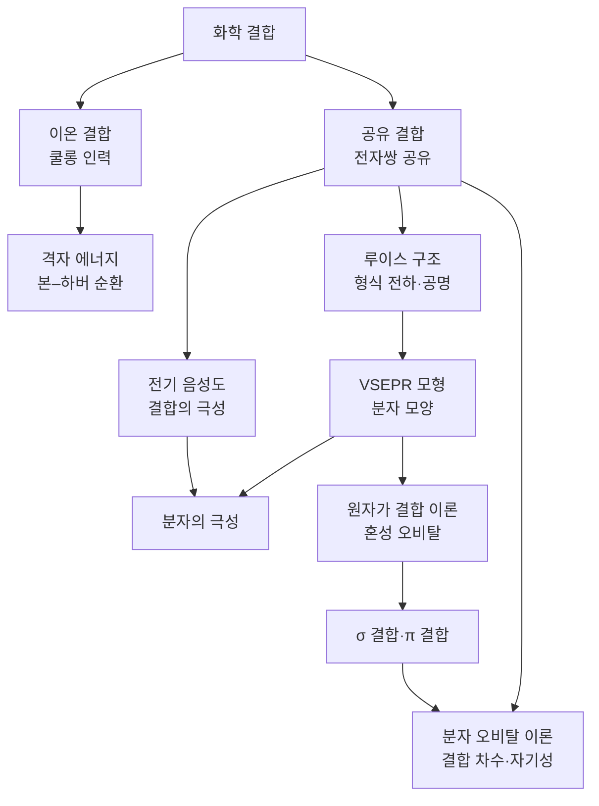

# 일반화학 5. 화학 결합과 분자 구조 — 전자가 원자를 묶고, 모양이 성질을 정한다
<!-- prev: 2-4, chem-2, uchem-3, uchem-4 -->
<!-- next: uchem-6, uchem-12, ubio-1 -->

> [!NOTE]
> **이 단원의 범위**
> - 이온 결합과 격자 에너지, 본–하버 순환
> - 공유 결합의 형성(퍼텐셜 에너지 곡선), 전기 음성도와 결합의 극성, 쌍극자 모멘트
> - 루이스 구조, 형식 전하, 공명, 옥텟 규칙의 예외
> - VSEPR 모형으로 본 분자의 모양과 분자의 극성
> - 원자가 결합 이론과 혼성 오비탈, σ 결합과 π 결합
> - 분자 오비탈 이론(2주기 동핵 이원자 분자, 결합 차수, 자기성)

**학습 목표**

1. 쿨롱 법칙으로 격자 에너지의 크기를 비교하고, 본–하버 순환으로 격자 에너지를 계산할 수 있다.
2. 공유 결합의 형성을 퍼텐셜 에너지 곡선으로 설명하고, 전기 음성도 차이와 쌍극자 모멘트로 결합의 극성과 이온성 백분율을 구할 수 있다.
3. 형식 전하를 이용해 가장 그럴듯한 루이스 구조를 고르고, 공명 구조와 옥텟 규칙의 예외를 다룰 수 있다.
4. VSEPR 모형으로 전자 영역이 2~6개인 분자의 모양과 결합각을 예측하고, 결합 쌍극자의 벡터 합으로 분자의 극성을 판단할 수 있다.
5. 혼성 오비탈로 분자의 모양을 설명하고, 분자 속 σ 결합과 π 결합을 구분하여 셀 수 있다.
6. 분자 오비탈 에너지 준위도로 2주기 이원자 분자와 이온의 결합 차수, 결합 길이, 자기성을 예측할 수 있다.

**이 단원의 학습 사다리**

| 단계 | 무엇을 하나? |
|---|---|
| STEP 1. 이전 학습 다시 보기 | 통합과학의 이온 결합·공유 결합, 「물질의 구조와 성질」의 전기 음성도·전자점식·전자쌍 반발 이론, 「원자의 전자 구조와 주기성」의 오비탈을 다시 꺼낸다 |
| STEP 2. 기초 다지기 | 쿨롱 퍼텐셜 에너지, 퍼텐셜 에너지 곡선, 쌍극자 모멘트의 단위, 벡터 합, 파동의 보강·상쇄 간섭을 익힌다 |
| STEP 3. 핵심 개념 | 이온 결합과 격자 에너지 → 공유 결합과 극성 → 루이스 구조·형식 전하·공명 → VSEPR와 분자의 극성 → 혼성 오비탈 → 분자 오비탈 |
| STEP 4. 오개념 바로잡기 | "공명 구조는 빠르게 바뀌는 여러 분자이다?", "π 결합은 σ 결합 두 개만큼 강하다?" 같은 착각을 바로잡는다 |
| STEP 5. 전공으로 | 분자 대칭과 군론, 휘켈 분자 오비탈, 금속의 띠 이론 |
| STEP 6. 생활·산업·진로 | 신약 설계, 질소 고정, 오존층, 그래핀과 유기 반도체 |

---

## 🗺️ 단원 들어가기

산소 기체를 영하 183 °C로 식히면 옅은 파란색 액체가 된다. 이 액체 산소를 강한 자석의 두 극 사이에 부으면 놀랍게도 자석에 **들러붙어** 다리처럼 걸린다. 같은 방법으로 액체 질소를 부으면 그냥 흘러내린다. 산소 분자에는 짝을 이루지 않은 전자가 있다는 뜻이다. 그런데 고등학교에서 그린 산소의 전자점식 $\mathrm{O=O}$에는 모든 전자가 쌍을 이루고 있다. 무엇이 잘못된 것일까?

이 단원은 "원자는 왜, 어떻게 결합하는가?"라는 질문에 세 가지 모형으로 답한다. 이온 사이의 정전기적 인력(이온 결합), 원자 사이의 전자쌍 공유와 그 그림인 루이스 구조와 VSEPR, 그리고 오비탈의 겹침과 섞임(원자가 결합 이론, 분자 오비탈 이론). 모형은 단계마다 더 많은 것을 설명하며, 마지막 모형에서 자석에 붙는 산소의 비밀이 풀린다.

---

## STEP 1. 🔙 이전 학습 다시 보기

### 연계 개념표

| 이전 단원 | 그때 배운 것(고등학교에서는 여기까지) | 이 단원에서 확장되는 것(대학에서는 이렇게) |
|---|---|---|
| 통합과학1 「이온 결합과 공유 결합」 | 옥텟 규칙에 따라 이온이 만들어지고, 이온 결합과 공유 결합 물질의 전기 전도성이 다르다 | 이온 결합의 세기를 **격자 에너지**로 정량화하고 본–하버 순환으로 계산한다 |
| 화학 「물질의 구조와 성질」 | 전기 음성도의 주기적 변화, 결합의 극성, 루이스 전자점식, 전자쌍 반발 이론으로 분자 모양 추론 | **형식 전하·공명**으로 구조를 고르고, 전자 영역 5·6개와 비공유 전자쌍의 위치까지 다루는 VSEPR |
| 일반화학 「열화학」 | 결합 엔탈피로 반응 엔탈피 어림, 헤스 법칙 | 헤스 법칙을 이온 결합에 적용한 **본–하버 순환**, 결합 차수와 결합 에너지의 관계 |
| 일반화학 「원자의 전자 구조와 주기성」 | 오비탈의 모양·위상, 전자 배치, 이온화 에너지·전자 친화도, 유효 핵전하 | 오비탈의 겹침(원자가 결합 이론), **혼성 오비탈**, 원자 오비탈의 조합으로 만든 **분자 오비탈** |

### 준비 운동 (사전 진단)

**Q1.** $\mathrm{NaCl}$과 $\mathrm{MgO}$ 중 녹는점이 더 높을 것으로 예상되는 것은? 이온의 전하만 보고 판단하시오.

**Q2.** $\mathrm{CO_2}$의 루이스 전자점식을 그리고, 중심 원자의 공유 전자쌍과 비공유 전자쌍 수를 말하시오.

**Q3.** $\mathrm{NH_3}$의 분자 모양과 결합각(대략)을 쓰시오. 정사면체각 109.5°보다 작은 이유는?

**Q4.** $\mathrm{BF_3}$는 결합이 극성인데도 무극성 분자이다. 그 이유는?

정답 및 해설

**Q1.** $\mathrm{MgO}$. $\mathrm{Mg^{2+}}$와 $\mathrm{O^{2-}}$는 전하가 각각 2배이므로 이온 사이 인력이 훨씬 크다(실제 녹는점 NaCl 801 °C, MgO 약 2850 °C).

**Q2.** $\mathrm{O{=}C{=}O}$, 각 O에 비공유 전자쌍 2개. 중심 C에는 공유 전자쌍 4개(이중 결합 2개), 비공유 전자쌍 0개이다.

**Q3.** 삼각뿔형, 약 107°. 비공유 전자쌍이 공유 전자쌍보다 더 큰 반발을 주어 N–H 결합들을 조금 더 오므리기 때문이다.

**Q4.** 평면 삼각형으로 세 B–F 결합의 쌍극자가 120°씩 벌어져 있어 벡터 합이 0이기 때문이다.

---

## STEP 2. 🧱 기초 다지기

### ① 쿨롱 퍼텐셜 에너지

전하 $Q_1$, $Q_2$가 거리 $r$만큼 떨어져 있을 때 퍼텐셜 에너지는

$$
E = k\frac{Q_1Q_2}{r}, \qquad k = \frac{1}{4\pi\varepsilon_0} = 8.988\times10^9\ \mathrm{J\cdot m/C^2}
$$

이다. 부호가 반대인 전하($Q_1Q_2 < 0$)이면 $E < 0$이고, 가까울수록 더 낮아진다(안정해진다). 이 식에서 바로 두 가지 결론이 나온다. **전하가 클수록, 거리가 가까울수록** 정전기적 결합은 강하다. 이 단원의 이온 결합 부분은 거의 전부 이 한 줄에서 나온다.

### ② 퍼텐셜 에너지 곡선

두 원자 사이 거리 $r$에 따른 계의 에너지를 그린 그래프를 **퍼텐셜 에너지 곡선**이라 한다. 수소 분자를 예로 말로 그려 보자.

- 멀리 떨어져 있을 때($r \to \infty$): 상호 작용이 없으므로 에너지 0(기준).
- 가까워질 때: 한 원자의 전자와 다른 원자의 원자핵이 끌어당겨 에너지가 내려간다.
- 너무 가까울 때: 원자핵끼리, 전자끼리의 반발이 급격히 커져 에너지가 치솟는다.
- 그 사이의 **최저점**: 인력과 반발이 균형을 이루는 거리가 **결합 길이(bond length)** 74 pm이고, 최저점의 깊이가 **결합 에너지(bond energy)** 436 kJ/mol이다.

결합은 "에너지가 낮아지는 배치"이다. 결합을 끊으려면 반드시 에너지를 넣어야 하고, 결합이 생기면 에너지가 나온다. 「열화학」에서 결합 엔탈피를 언제나 양수로 표에 적었던 이유이다.

<!-- fig:uchem-5-h2-potential -->

### ③ 쌍극자 모멘트와 그 단위

크기가 같고 부호가 반대인 전하 $+Q$, $-Q$가 거리 $r$만큼 떨어져 있을 때 **쌍극자 모멘트(dipole moment)** 는

$$
\mu = Qr
$$

이며 SI 단위는 $\mathrm{C\cdot m}$이다. 분자에서는 수가 너무 작아 **디바이(debye, D)** 를 쓴다: $1\ \mathrm{D} = 3.336\times10^{-30}\ \mathrm{C\cdot m}$. 쌍극자 모멘트는 **방향이 있는 양(벡터)** 으로, 화학에서는 보통 $\delta^+$에서 $\delta^-$ 쪽으로 화살표를 긋는다(물리학의 전기 쌍극자 모멘트 벡터는 $-$에서 $+$ 방향이므로 그림의 약속을 확인하자).

### ④ 벡터의 합 — 대칭이면 0

여러 결합 쌍극자의 합은 벡터 합이다. 크기가 같은 벡터 $n$개가 정다각형이나 정다면체의 꼭짓점 방향으로 고르게 뻗어 있으면 합은 0이다(직선 2개, 정삼각형 3개, 정사면체 4개, 삼각쌍뿔 5개, 정팔면체 6개). 두 벡터가 각 $\theta$를 이루면 합의 크기는 $2\mu\cos(\theta/2)$이다. 분자의 극성 판단은 결국 "결합 쌍극자 화살표들이 상쇄되는가?"라는 기하 문제이다.

### ⑤ 파동의 보강 간섭과 상쇄 간섭

같은 위상의 두 파동이 겹치면 진폭이 커지고(보강 간섭), 반대 위상이면 작아지거나 사라진다(상쇄 간섭). 「원자의 전자 구조와 주기성」에서 오비탈은 전자의 파동 함수이며 부호(위상)를 가진다고 배웠다. 두 원자의 오비탈이 겹칠 때도 같은 일이 일어난다. **같은 부호로 겹치면 원자핵 사이에 전자 밀도가 쌓여 결합이 되고, 반대 부호로 겹치면 원자핵 사이에 마디가 생겨 반결합이 된다.** 이것이 ⑤, ⑥ 소절의 출발점이다.

---

## STEP 3. 📘 핵심 개념

### ① 이온 결합과 격자 에너지

#### 이온 결합은 왜 생길까? — 에너지 장부 맞추기

나트륨 원자와 염소 원자가 기체 상태에서 전자 하나를 주고받는 과정만 보면 에너지가 오히려 **든다**.

| 단계 | 에너지 변화(kJ/mol) |
|---|---|
| $\mathrm{Na(g) \rightarrow Na^+(g) + e^-}$ (이온화 에너지) | +496 |
| $\mathrm{Cl(g) + e^- \rightarrow Cl^-(g)}$ (전자 친화도) | −349 |
| 합 | **+147** (에너지가 든다!) |

옥텟을 이루었다고 저절로 안정해지는 것이 아니다. 이온 결합 화합물이 안정한 진짜 이유는 생긴 양이온과 음이온이 **서로 강하게 끌어당겨 에너지가 크게 낮아지기** 때문이다.

#### 쿨롱 모형으로 어림하기

기체 상태의 $\mathrm{Na^+}$와 $\mathrm{Cl^-}$ 한 쌍이 결정 속 거리인 282 pm만큼 떨어져 있다면

$$
E = k\frac{(+e)(-e)}{r} = -\frac{(8.988\times10^9)(1.602\times10^{-19})^2}{282\times10^{-12}} = -8.18\times10^{-19}\ \mathrm{J}
$$

이고, 1 mol의 이온 쌍으로는 $-8.18\times10^{-19}\times6.022\times10^{23} \approx -493\ \mathrm{kJ/mol}$이다. 이것만으로도 +147 kJ/mol을 넉넉히 갚는다. 실제 결정에서는 한 이온이 반대 전하 이온 6개, 같은 전하 이온 12개, … 와 끝없이 상호 작용하므로, 이를 모두 더하면 이온 쌍 하나의 1.748배(염화 나트륨형 구조의 **마델룽 상수**)가 되어 약 861 kJ/mol이 된다. 이온이 너무 가까워지면 전자 구름끼리 반발하므로 이를 보정하면 실험값(약 786 kJ/mol)에 몇 % 이내로 맞는다.

#### 격자 에너지

**격자 에너지(lattice energy)** 는 이온 결정 1 mol을 기체 상태의 이온들로 완전히 떼어 놓는 데 필요한 에너지이다.

$$
\mathrm{NaCl(s) \rightarrow Na^+(g) + Cl^-(g)}, \qquad \Delta H_\text{격자} = +786\ \mathrm{kJ/mol}
$$

> [!NOTE]
> 격자 에너지는 자료에 따라 "결정이 분리될 때(양수)"로 정의하기도 하고 "기체 이온에서 결정이 생길 때(음수)"로 정의하기도 한다. 크기는 같고 부호만 다르다. 이 책은 **분리하는 방향(양수)** 으로 쓴다.

쿨롱 모형에 따르면 격자 에너지는 대략

$$
\text{격자 에너지} \propto \frac{\lvert Q_+Q_-\rvert}{r_+ + r_-}
$$

에 비례한다. **이온의 전하가 크고, 이온이 작을수록** 격자 에너지가 크다.

| 화합물 | 이온 전하 | 이온 사이 거리(약, pm) | 격자 에너지(약, kJ/mol) | 녹는점(약, °C) |
|---|---|---|---|---|
| LiF | +1, −1 | 201 | 1036 | 845 |
| NaF | +1, −1 | 231 | 923 | 993 |
| NaCl | +1, −1 | 282 | 786 | 801 |
| KCl | +1, −1 | 314 | 715 | 771 |
| NaBr | +1, −1 | 298 | 747 | 747 |
| MgO | +2, −2 | 212 | 약 3800 | 약 2850 |
| CaO | +2, −2 | 240 | 약 3400 | 약 2600 |

같은 전하의 할로젠화 알칼리 사이에서는 거리가 지배하고, 전하가 2배가 되면 곱 $Q_+Q_-$가 4배가 되어 격자 에너지가 몇 배로 뛴다. 녹는점은 결정 구조와 다른 요인에도 영향을 받아 격자 에너지와 완벽히 같은 순서는 아니지만(NaF와 LiF처럼), 큰 흐름은 일치한다. MgO가 용광로 내벽의 내화 벽돌로 쓰이는 것은 격자 에너지가 매우 크기 때문이다.

#### 본–하버 순환 — 헤스 법칙으로 격자 에너지 구하기

격자 에너지는 직접 측정하기 어렵다. 그 대신 「열화학」의 헤스 법칙을 쓰면, 측정할 수 있는 여러 단계를 이어 붙여 간접적으로 구할 수 있다. 이 고리를 **본–하버 순환(Born–Haber cycle)** 이라 한다.

$\mathrm{Na(s) + \frac{1}{2}Cl_2(g) \rightarrow NaCl(s)}$, $\Delta H_f^\circ = -411\ \mathrm{kJ/mol}$을 다음 단계로 나눈다.

| 단계 | 과정 | $\Delta H$(kJ/mol) | 바탕 자료 |
|---|---|---|---|
| ① | $\mathrm{Na(s) \rightarrow Na(g)}$ | +107 | 승화 엔탈피 |
| ② | $\mathrm{\frac{1}{2}Cl_2(g) \rightarrow Cl(g)}$ | +121 | Cl–Cl 결합 에너지 242의 절반 |
| ③ | $\mathrm{Na(g) \rightarrow Na^+(g) + e^-}$ | +496 | 1차 이온화 에너지 |
| ④ | $\mathrm{Cl(g) + e^- \rightarrow Cl^-(g)}$ | −349 | 전자 친화도 |
| ⑤ | $\mathrm{Na^+(g) + Cl^-(g) \rightarrow NaCl(s)}$ | $-U$ | 격자 에너지(구하려는 값) |
| 합 | $\mathrm{Na(s) + \frac{1}{2}Cl_2(g) \rightarrow NaCl(s)}$ | −411 | 표준 생성 엔탈피 |

$$
-411 = 107 + 121 + 496 - 349 - U \quad\Longrightarrow\quad U = 786\ \mathrm{kJ/mol}
$$

<!-- fig:uchem-5-born-haber -->

#### 예제 1 — LiF의 격자 에너지

다음 자료(kJ/mol)로 LiF의 격자 에너지를 구하시오. LiF의 $\Delta H_f^\circ = -617$, Li의 승화 엔탈피 +161, Li의 이온화 에너지 +520, F–F 결합 에너지 158, F의 전자 친화도 328(방출).

**풀이**

- **식 세우기** $\Delta H_f^\circ = \Delta H_\text{승화} + \tfrac{1}{2}D_\mathrm{F{-}F} + IE_1 - EA - U$
- **대입** $-617 = 161 + 79 + 520 - 328 - U$
- **결과** $U = 161 + 79 + 520 - 328 + 617 = 1049\ \mathrm{kJ/mol}$ (약 $1.05\times10^3$ kJ/mol)
- **의미** NaCl보다 약 260 kJ/mol 크다. $\mathrm{Li^+}$와 $\mathrm{F^-}$가 모두 작아 이온 사이 거리가 짧기 때문이다. 이 값은 다른 방법으로 얻은 표의 값(약 1036)과 1 % 정도 차이가 나는데, 자료마다 측정값이 조금씩 다르기 때문이다.

> [!TIP]
> 💡 **비유** — 본–하버 순환은 '산 정상까지의 높이를 직접 재기 어려울 때 계단 높이를 하나씩 재서 더하는 것'과 같다. 출발점(원소)과 도착점(결정)이 같으면 어느 길로 가든 높이 차이($\Delta H$)는 같다. 그래서 모르는 계단 하나(격자 에너지)를 나머지로부터 계산할 수 있다.

#### ✔ 바로 확인

1. (O/X) MgO의 격자 에너지는 NaCl보다 크다.
2. 빈칸: 측정할 수 있는 여러 단계의 엔탈피를 헤스 법칙으로 이어 격자 에너지를 구하는 고리를 (    )이라 한다.
3. NaCl과 KCl 중 격자 에너지가 더 큰 것과 그 까닭은?
4. (O/X) 기체 상태의 Na와 Cl이 전자 하나를 주고받는 과정만으로도 에너지가 방출된다.

정답

1. O — 이온 전하의 곱이 4배이고 이온 사이 거리도 비슷하거나 짧다.
2. 본–하버 순환
3. NaCl — 전하는 같고 $\mathrm{Na^+}$가 $\mathrm{K^+}$보다 작아 이온 사이 거리가 짧다(786 대 715 kJ/mol).
4. X — $+496 - 349 = +147$ kJ/mol로 에너지가 든다. 이온끼리의 인력(격자 에너지)이 이를 갚는다.

### ② 공유 결합과 전기 음성도, 결합의 극성

#### 공유 결합의 에너지와 길이

이온화 에너지가 큰 비금속 원자끼리는 전자를 완전히 넘겨주는 대신 **전자쌍을 공유**하여 두 원자핵 사이에 전자 밀도를 쌓는다. 이 전자 밀도가 두 원자핵을 동시에 끌어당겨 묶는다. 결합 차수가 커질수록(단일 → 이중 → 삼중) 공유 전자쌍이 늘어 결합이 짧고 강해진다.

| 결합 | 결합 길이(약, pm) | 결합 에너지(약, kJ/mol) |
|---|---|---|
| C–C | 154 | 347 |
| C=C | 134 | 614 |
| C≡C | 120 | 839 |
| C–O | 143 | 358 |
| C=O | 123 | 745(이산화 탄소에서는 약 799) |
| N–N | 145 | 160 |
| N≡N | 110 | 945 |

C=C가 C–C의 2배(694)에 못 미치고 C≡C도 3배(1041)에 못 미친다는 점에 주목하자. 두 번째, 세 번째 결합은 첫 번째 결합과 **종류가 다르고 더 약하다**. 이 이유는 ⑤에서 σ 결합과 π 결합으로 설명한다.

#### 전기 음성도

공유 결합 속 원자가 공유 전자쌍을 자기 쪽으로 끌어당기는 상대적인 능력을 **전기 음성도(electronegativity)** 라 한다. 폴링은 결합 에너지 자료에서 이 값을 끌어냈다. A–B 결합이 A–A와 B–B 결합 에너지의 평균보다 강한 만큼이 '이온성 덤'이고, 이 덤이 두 원자의 전기 음성도 차이의 제곱에 비례하도록 수치를 정했다.

| 원소 | H | C | N | O | F | Cl | Br | Na | K |
|---|---|---|---|---|---|---|---|---|---|
| 폴링 전기 음성도 | 2.20 | 2.55 | 3.04 | 3.44 | 3.98 | 3.16 | 2.96 | 0.93 | 0.82 |

(고등학교 「화학」에서 쓴 H 2.1, Cl 3.0 등은 같은 척도를 반올림하거나 초기 값을 쓴 것이다. 이 단원에서는 개정된 값을 쓴다.) 전기 음성도는 이온화 에너지와 전자 친화도가 모두 큰 원소, 즉 **유효 핵전하가 크고 원자가 작은 원소**일수록 크다. 그래서 「원자의 전자 구조와 주기성」의 주기 경향을 그대로 따른다.

#### 결합의 극성 — 연속적인 스펙트럼

| 전기 음성도 차이 $\Delta\chi$ | 결합의 성격 | 예 |
|---|---|---|
| 0 | 무극성 공유 결합 | H–H, Cl–Cl |
| 0.4 미만(대략) | 거의 무극성 | C–H(0.35) |
| 0.4~1.8(대략) | 극성 공유 결합 | O–H(1.24), H–Cl(0.96) |
| 약 2 이상 | 이온 결합 성격이 큼 | NaCl(2.23), KF(3.16) |

경계값은 편의상의 약속이다. 결합은 무극성 공유 결합에서 이온 결합까지 **끊김 없이 이어진 스펙트럼** 위에 있다.

#### 쌍극자 모멘트로 이온성 백분율 구하기

H–Cl 결합이 완전한 이온 결합($\mathrm{H^+Cl^-}$)이라면 결합 길이 127 pm에 전하 $e$가 떨어져 있으므로 쌍극자 모멘트는 $\mu_\text{이온} = er$이다. 실제 측정값과 비교한 비율을 **이온성 백분율**이라 한다.

#### 예제 2 — HCl의 이온성 백분율

HCl의 결합 길이는 127 pm, 측정된 쌍극자 모멘트는 1.08 D이다. 이온성 백분율을 구하시오. ($1\ \mathrm{D} = 3.336\times10^{-30}\ \mathrm{C\cdot m}$)

**풀이**

- $\mu_\text{이온} = (1.602\times10^{-19}\ \mathrm{C})(127\times10^{-12}\ \mathrm{m}) = 2.035\times10^{-29}\ \mathrm{C\cdot m} = 6.10\ \mathrm{D}$
- 이온성 백분율 $= \dfrac{1.08}{6.10}\times100 = 17.7\ \%$
- **의미** H 원자 쪽에 약 $+0.18e$, Cl 쪽에 약 $-0.18e$의 부분 전하가 있는 것과 같다. 같은 방법으로 HF(92 pm, 1.82 D)는 약 41 %, 기체 상태의 NaCl 분자(236 pm, 약 9.0 D)는 약 79 %이다. 전기 음성도 차이가 클수록 이온성이 크다는 것이 숫자로 확인된다.

#### ✔ 바로 확인

1. C–H, O–H, H–Cl 중 가장 극성이 큰 결합은? (폴링 전기 음성도 표 이용)
2. C–C, C=C, C≡C를 결합 길이가 짧은 것부터 나열하시오.
3. 빈칸: 공유 결합 속 원자가 공유 전자쌍을 자기 쪽으로 끌어당기는 상대적 능력을 (    )라 한다.
4. 완전한 이온 결합이라고 가정한 쌍극자 모멘트가 6.0 D인데 측정값이 1.5 D이면 이온성 백분율은?

정답

1. O–H — 전기 음성도 차이 1.24(H–Cl 0.96, C–H 0.35).
2. C≡C(120 pm) < C=C(134 pm) < C–C(154 pm) — 결합 차수가 클수록 짧다.
3. 전기 음성도
4. 25 % — $1.5/6.0\times100$.

### ③ 루이스 구조, 형식 전하, 공명, 옥텟 규칙의 예외

#### 루이스 구조 그리는 순서(정리)

| 단계 | 할 일 | 예: $\mathrm{HCN}$ |
|---|---|---|
| ① | 원자가 전자 수를 모두 더한다(음이온은 전하만큼 더하고, 양이온은 뺀다) | 1 + 4 + 5 = 10 |
| ② | 뼈대를 정한다. 보통 전기 음성도가 가장 작은 원자(H 제외)가 중심 | H–C–N |
| ③ | 결합마다 전자 2개를 쓰고, 남은 전자로 바깥 원자부터 옥텟을 채운다 | 4개 사용, 6개를 N에 |
| ④ | 중심 원자의 옥텟이 모자라면 바깥 원자의 비공유 전자쌍을 끌어와 다중 결합을 만든다 | C가 4개뿐 → C≡N |
| ⑤ | 형식 전하를 계산해 가장 그럴듯한 구조를 고른다 | H–C≡N:, 모든 형식 전하 0 |

#### 형식 전하

한 분자에 대해 그릴 수 있는 루이스 구조가 여럿일 때, 어느 것이 실제에 가까운지 판단하는 장부가 **형식 전하(formal charge)** 이다. 결합 전자는 두 원자가 정확히 반씩 나눠 가진다고 가정하고 계산한다.

$$
\text{형식 전하} = (\text{원자가 전자 수}) - (\text{비공유 전자 수}) - \frac{1}{2}(\text{결합 전자 수})
$$

> [!IMPORTANT]
> **좋은 루이스 구조를 고르는 기준**
> 1. 형식 전하의 합은 분자에서 0, 이온에서 이온의 전하와 같다(검산용).
> 2. 형식 전하가 0이거나 0에 가까운 원자가 많은 구조가 낫다.
> 3. 음의 형식 전하는 **전기 음성도가 큰 원자**에 있는 구조가 낫다.
> 4. 이웃한 원자에 같은 부호의 형식 전하가 있는 구조는 피한다.

형식 전하는 실제 전하가 아니다. 실제 부분 전하는 전기 음성도에 따라 결합 전자가 치우친 결과이고(②), 형식 전하는 결합 전자를 공평하게 나눴다고 가정한 장부상의 값이다. 둘을 혼동하지 말자.

#### 예제 3 — 시안산 이온 $\mathrm{OCN^-}$의 가장 좋은 구조

$\mathrm{OCN^-}$(원자가 전자 6 + 4 + 5 + 1 = 16개)에 대해 아래 그림의 세 구조의 형식 전하를 구하고 가장 그럴듯한 구조를 고르시오.
(가) $\mathrm{[O{=}C{=}N]^-}$ (나) $\mathrm{[O{\equiv}C{-}N]^-}$ (다) $\mathrm{[O{-}C{\equiv}N]^-}$ (각 원자는 옥텟을 이루도록 비공유 전자쌍을 가진다)

<!-- fig:uchem-5-q-ocn-lewis -->

**풀이**

| 구조 | O | C | N | 합 |
|---|---|---|---|---|
| (가) O(비공유 4, 결합 4) / C(0, 8) / N(4, 4) | 6 − 4 − 2 = 0 | 4 − 0 − 4 = 0 | 5 − 4 − 2 = −1 | −1 |
| (나) O(2, 6) / C(0, 8) / N(6, 2) | 6 − 2 − 3 = +1 | 0 | 5 − 6 − 1 = −2 | −1 |
| (다) O(6, 2) / C(0, 8) / N(2, 6) | 6 − 6 − 1 = −1 | 0 | 5 − 2 − 3 = 0 | −1 |

(나)는 형식 전하가 크게 분리되어 있고 음전하가 덜 전기 음성적인 N에 있어 가장 나쁘다. (가)와 (다)는 둘 다 형식 전하가 −1 하나뿐인데, (다)는 음전하가 더 전기 음성적인 O에 있으므로 **(다)가 가장 그럴듯하다.** 실제로는 (가)와 (다)가 함께 기여하는 공명 혼성체로 본다(다음 항목).

#### 공명 — 하나의 루이스 구조로 그릴 수 없을 때

질산 이온 $\mathrm{NO_3^-}$의 루이스 구조는 N=O 이중 결합 하나와 N–O 단일 결합 둘로 그려진다. 그런데 이중 결합을 어느 O에 둘지 세 가지 방법이 있고, 실험해 보면 세 N–O 결합의 길이는 **모두 같다**. 실제 분자는 세 구조 중 어느 하나가 아니라 그 **평균**에 해당하는 하나의 구조이다.

- 이렇게 원자 배치는 같고 전자 배치만 다른 구조들을 **공명 구조(resonance structure)**, 그 실제 평균을 **공명 혼성체(resonance hybrid)** 라 하고, 구조 사이를 ↔로 잇는다.
- $\mathrm{NO_3^-}$의 N–O 결합 차수는 $(2 + 1 + 1)/3 = 4/3$이다.
- 오존 $\mathrm{O_3}$의 두 O–O 결합은 모두 약 128 pm으로, O–O 단일 결합(약 148 pm)과 O=O 이중 결합(약 121 pm)의 중간이다. 벤젠의 여섯 C–C 결합도 모두 약 139 pm으로 같다(C–C 154, C=C 134 pm의 중간).
- 전자가 여러 원자에 걸쳐 퍼지는 것을 **비편재화(delocalization)** 라 하며, 비편재화된 분자는 하나의 구조로 그린 것보다 에너지가 낮아 더 안정하다.
<!-- fig:uchem-5-resonance-formal-charge -->

> [!TIP]
> 💡 **비유** — 코뿔소를 본 적 없는 사람에게 "용과 유니콘을 섞은 동물"이라고 설명해도, 코뿔소가 1초마다 용과 유니콘으로 바뀌는 것은 아니다. 코뿔소는 언제나 코뿔소이다. 공명 혼성체도 공명 구조 사이를 오가는 것이 아니라, 우리가 가진 그림 도구(루이스 구조)로는 한 장으로 그릴 수 없는 하나의 실제 구조이다.

#### 옥텟 규칙의 예외

| 예외의 종류 | 예 | 설명 |
|---|---|---|
| 전자 수가 홀수 | NO(11개), $\mathrm{NO_2}$(17개), $\mathrm{ClO_2}$ | 모든 원자가 옥텟을 이룰 수 없다. 홀전자가 있는 **라디칼**로 반응성이 크다. $\mathrm{NO_2}$ 두 분자가 결합해 $\mathrm{N_2O_4}$를 만드는 이유 |
| 옥텟보다 적은 전자 | $\mathrm{BF_3}$, $\mathrm{BeCl_2}$(기체), $\mathrm{AlCl_3}$ | B는 전자 6개로 안정하다. 비공유 전자쌍을 가진 분자를 받아들이는 성질이 크다($\mathrm{BF_3 + NH_3 \rightarrow F_3B{-}NH_3}$) |
| 옥텟보다 많은 전자(확장된 원자가 껍질) | $\mathrm{PCl_5}$(10개), $\mathrm{SF_6}$(12개), $\mathrm{XeF_4}$, $\mathrm{I_3^-}$ | 3주기 이상의 중심 원자에서만 나타난다. 2주기 원자(C, N, O, F)는 옥텟을 넘지 않는다 |

확장된 원자가 껍질은 예전에는 "빈 3d 오비탈을 쓴다"고 설명했지만, 현대의 계산에 따르면 d 오비탈의 기여는 작고, 크고 전기 음성도가 작은 중심 원자가 많은 전기 음성적인 원자에 둘러싸여 전하가 분리된 결합을 이룬다고 보는 해석이 더 정확하다. 일반화학에서는 '3주기 이상의 큰 중심 원자는 전자 영역을 5~6개까지 가질 수 있다'는 경험 규칙으로 쓴다.

#### 예제 4 — 황산 이온의 두 그림

황산 이온 $\mathrm{SO_4^{2-}}$를 (가) 네 S–O 단일 결합만으로 그린 구조와 (나) S=O 이중 결합 2개, S–O 단일 결합 2개로 그린 구조에서 S의 형식 전하를 구하시오.

**풀이** 원자가 전자는 $6 + 4\times6 + 2 = 32$개이다.
(가) S: 결합 전자 8, 비공유 0 → $6 - 0 - 4 = +2$, 각 O: $6 - 6 - 1 = -1$ (합 $+2 - 4 = -2$)
(나) S: 결합 전자 12 → $6 - 0 - 6 = 0$, 이중 결합 O 둘은 0, 단일 결합 O 둘은 −1 (합 −2)
형식 전하 기준으로는 (나)가 낫고, 측정된 S–O 결합 길이(약 149 pm)도 전형적인 단일 결합보다 짧다. 반면 계산 화학은 (가)처럼 전하가 분리된 구조의 기여가 크다고 본다. **형식 전하는 어림 도구이며, 실험과 더 정교한 이론으로 검증해야 한다**는 좋은 예이다.

#### ✔ 바로 확인

1. $\mathrm{CO_2}$의 원자가 전자는 모두 몇 개인가?
2. 암모늄 이온 $\mathrm{NH_4^+}$에서 N의 형식 전하는?
3. (O/X) 공명 구조들은 실제 분자 안에서 빠르게 서로 바뀌고 있다.
4. $\mathrm{BF_3}$, $\mathrm{NH_3}$, $\mathrm{SF_6}$ 중 중심 원자가 옥텟보다 **적은** 전자를 가진 것은?

정답

1. 16개 — $4 + 2\times6$.
2. +1 — $5 - 0 - \tfrac{1}{2}(8)$.
3. X — 실제 분자는 평균인 공명 혼성체 하나이다.
4. $\mathrm{BF_3}$ — B 주위에 전자 6개. ($\mathrm{SF_6}$는 옥텟보다 많다.)

### ④ VSEPR 모형과 분자의 극성

#### 전자 영역

**원자가 껍질 전자쌍 반발(valence-shell electron-pair repulsion, VSEPR)** 모형은 중심 원자 주위의 **전자 영역(electron domain)** 들이 서로 최대한 멀어지도록 배치된다고 본다. 전자 영역은 비공유 전자쌍 하나, 또는 결합 하나이다. **이중·삼중 결합도 영역 하나로 센다.** 중심 원자를 A, 결합한 원자를 X, 비공유 전자쌍을 E로 쓰면 분자를 $\mathrm{AX_mE_n}$으로 분류할 수 있다(영역 수 $m + n$).

| 영역 수 | 전자 영역 배치 | 이상적인 결합각 |
|---|---|---|
| 2 | 직선형 | 180° |
| 3 | 평면 삼각형 | 120° |
| 4 | 사면체 | 109.5° |
| 5 | 삼각쌍뿔 | 적도 120°, 축–적도 90° |
| 6 | 팔면체 | 90° |

#### 비공유 전자쌍이 있을 때

반발의 크기는 **비공유–비공유 > 비공유–결합 > 결합–결합** 순이다. 비공유 전자쌍은 원자핵 하나에만 묶여 있어 중심 원자 가까이에 넓게 퍼지기 때문이다. 그래서 비공유 전자쌍이 있으면 결합각이 이상값보다 작아진다.

| 분류 | 예 | 분자 모양 | 결합각(약) |
|---|---|---|---|
| $\mathrm{AX_2}$ | $\mathrm{CO_2}$, $\mathrm{BeCl_2}$ | 직선형 | 180° |
| $\mathrm{AX_3}$ | $\mathrm{BF_3}$, $\mathrm{SO_3}$ | 평면 삼각형 | 120° |
| $\mathrm{AX_2E}$ | $\mathrm{SO_2}$, $\mathrm{O_3}$ | 굽은형 | 약 117~119°(120°보다 약간 작다) |
| $\mathrm{AX_4}$ | $\mathrm{CH_4}$ | 사면체형 | 109.5° |
| $\mathrm{AX_3E}$ | $\mathrm{NH_3}$ | 삼각뿔형 | 107° |
| $\mathrm{AX_2E_2}$ | $\mathrm{H_2O}$ | 굽은형 | 104.5° |
| $\mathrm{AX_5}$ | $\mathrm{PCl_5}$ | 삼각쌍뿔형 | 120°, 90° |
| $\mathrm{AX_4E}$ | $\mathrm{SF_4}$ | 시소형 | 약 102°, 약 173° |
| $\mathrm{AX_3E_2}$ | $\mathrm{ClF_3}$ | T자형 | 약 87.5° |
| $\mathrm{AX_2E_3}$ | $\mathrm{XeF_2}$, $\mathrm{I_3^-}$ | 직선형 | 180° |
| $\mathrm{AX_6}$ | $\mathrm{SF_6}$ | 팔면체형 | 90° |
| $\mathrm{AX_5E}$ | $\mathrm{BrF_5}$ | 사각뿔형 | 약 85° |
| $\mathrm{AX_4E_2}$ | $\mathrm{XeF_4}$ | 평면 사각형 | 90° |

#### 삼각쌍뿔에서 비공유 전자쌍은 적도에 앉는다

삼각쌍뿔에는 성격이 다른 두 자리가 있다. **축** 자리는 90° 이웃이 3개, **적도** 자리는 90° 이웃이 2개뿐이다. 반발은 90°에서 가장 크므로, 공간을 많이 차지하는 비공유 전자쌍은 **적도 자리**를 먼저 차지한다. 그래서 $\mathrm{SF_4}$는 시소형, $\mathrm{ClF_3}$는 T자형, $\mathrm{XeF_2}$는 세 비공유 전자쌍이 적도를 모두 차지하고 두 F가 축에 남아 직선형이 된다. 팔면체에서 비공유 전자쌍이 둘이면 서로 정반대(180°)에 놓여 $\mathrm{XeF_4}$는 평면 사각형이 된다.

<!-- fig:uchem-5-vsepr-shapes -->

#### 분자의 극성

분자의 쌍극자 모멘트는 **결합 쌍극자의 벡터 합**이다. 극성 결합이 있어도 분자 모양이 대칭이면 서로 상쇄되어 무극성 분자가 된다.

| 분자 | 모양 | 쌍극자 모멘트(약, D) | 해석 |
|---|---|---|---|
| $\mathrm{CO_2}$ | 직선형 | 0 | 두 C=O 쌍극자가 정반대로 상쇄 |
| $\mathrm{H_2O}$ | 굽은형 | 1.85 | 두 O–H 쌍극자가 상쇄되지 않음 |
| $\mathrm{NH_3}$ | 삼각뿔형 | 1.47 | N–H 쌍극자와 비공유 전자쌍이 같은 쪽 |
| $\mathrm{NF_3}$ | 삼각뿔형 | 0.23 | N–F 쌍극자(F 쪽)가 비공유 전자쌍(N 쪽)과 반대 방향이라 거의 상쇄 |
| $\mathrm{CCl_4}$ | 사면체형 | 0 | 정사면체 대칭 |
| $\mathrm{CH_2Cl_2}$ | 사면체형(찌그러짐) | 1.60 | 대칭이 깨짐 |
| $\mathrm{CHCl_3}$ | 사면체형(찌그러짐) | 1.04 | 대칭이 깨짐 |
| $\mathrm{XeF_4}$ | 평면 사각형 | 0 | 정반대 쌍이 상쇄 |
| $\mathrm{SF_4}$ | 시소형 | 0이 아님 | 대칭이 불완전 |

$\mathrm{NH_3}$와 $\mathrm{NF_3}$는 모양이 같고 N–F 결합이 더 극성인데도 $\mathrm{NF_3}$의 쌍극자 모멘트가 훨씬 작다. 비공유 전자쌍도 분자의 쌍극자에 기여한다는 증거이다. 또 1,2-다이클로로에텐($\mathrm{CHCl{=}CHCl}$)은 두 Cl이 같은 쪽에 있는 cis형이 극성(약 1.9 D), 반대쪽에 있는 trans형이 무극성(0 D)이다. 분자식이 같아도 모양이 다르면 극성과 끓는점이 다르다.

<!-- fig:uchem-5-dipole-sums -->

#### 예제 5 — 물의 O–H 결합 쌍극자

물 분자의 쌍극자 모멘트는 1.85 D, H–O–H 결합각은 104.5°이다. O–H 결합 하나의 쌍극자 모멘트를 구하시오.

**풀이**

- **식 세우기** 크기가 $\mu_\mathrm{OH}$인 두 벡터가 104.5°를 이루므로 합은 이등분선 방향으로 $\mu = 2\mu_\mathrm{OH}\cos(104.5^\circ/2)$

<!-- fig:uchem-5-q-water-dipole -->

- **대입** $\mu_\mathrm{OH} = \dfrac{1.85}{2\cos52.25^\circ} = \dfrac{1.85}{2\times0.6122} = 1.51\ \mathrm{D}$
- **의미** (비공유 전자쌍의 기여를 결합 쌍극자에 포함시킨 어림이다.) 물이 직선형이었다면 쌍극자 모멘트가 0이 되어, 물이 소금을 녹이고 높은 끓는점을 갖는 성질은 대부분 사라졌을 것이다. 분자의 모양 하나가 지구의 물을 특별하게 만든다.

#### ✔ 바로 확인

1. $\mathrm{NH_3}$의 전자 영역 수와 분자 모양을 쓰시오.
2. $\mathrm{SF_4}$에서 비공유 전자쌍은 삼각쌍뿔의 축과 적도 중 어느 자리에 있는가?
3. (O/X) $\mathrm{CO_2}$는 극성 결합을 가지므로 극성 분자이다.
4. 그림 일반화학 5-5에서 $\mathrm{XeF_4}$의 분류($\mathrm{AX_mE_n}$)와 모양을 쓰고, 극성인지 판단하시오.

정답

1. 4개, 삼각뿔형 — $\mathrm{AX_3E}$.
2. 적도 — 90° 이웃이 적어 반발이 작다. 그래서 시소형이 된다.
3. X — 두 C=O 쌍극자가 정반대로 상쇄되어 무극성이다.
4. $\mathrm{AX_4E_2}$, 평면 사각형, 무극성 — 마주 보는 Xe–F 쌍극자가 상쇄된다.

### ⑤ 원자가 결합 이론과 혼성 오비탈, σ·π 결합

#### 원자가 결합 이론 — 오비탈의 겹침

루이스 구조와 VSEPR는 전자쌍을 점으로 다룰 뿐, 전자가 실제로 어디에 있는지는 말하지 않는다. **원자가 결합 이론(valence bond theory)** 은 결합을 다음과 같이 본다.

- 각 원자의 홀전자가 들어 있는 원자 오비탈이 **겹치고(overlap)**, 겹친 영역에 스핀이 반대인 전자 두 개가 들어가 공유 전자쌍이 된다.
- 겹침이 클수록 결합이 강하다. 그래서 결합은 겹침이 최대가 되는 방향으로 생긴다.

$\mathrm{H_2}$는 두 1s 오비탈이, HF는 H의 1s와 F의 2p 오비탈이, $\mathrm{F_2}$는 두 F의 2p 오비탈이 결합 축을 따라 머리를 맞대고 겹친다.

#### 혼성 오비탈 — 메테인의 수수께끼

탄소의 바닥상태 배치 $1s^2\,2s^2\,2p^2$에는 홀전자가 2개뿐이다. 그런데 메테인 $\mathrm{CH_4}$에서 C는 결합 4개를 만들고, 네 C–H 결합은 길이와 에너지가 같으며 109.5° 간격이다. 서로 90°인 p 오비탈로는 109.5°를 만들 수 없다.

해결책은 **혼성화(hybridization)** 이다. 2s 오비탈 하나와 2p 오비탈 셋을 수학적으로 섞어(선형 결합) 모양과 에너지가 같은 새 오비탈 네 개를 만든다. 이것이 $sp^3$ **혼성 오비탈**이며, 정사면체의 네 꼭짓점을 향한다. 각 $sp^3$ 오비탈에 전자가 하나씩 들어가 H의 1s와 겹친다.

| 혼성 | 섞는 원자 오비탈 | 혼성 오비탈 수 | 배치 | 남는 p 오비탈 | 예 |
|---|---|---|---|---|---|
| $sp$ | s 1 + p 1 | 2 | 직선형 180° | 2 | $\mathrm{BeCl_2}$, $\mathrm{CO_2}$의 C, $\mathrm{C_2H_2}$ |
| $sp^2$ | s 1 + p 2 | 3 | 평면 삼각형 120° | 1 | $\mathrm{BF_3}$, $\mathrm{C_2H_4}$, 벤젠 |
| $sp^3$ | s 1 + p 3 | 4 | 사면체 109.5° | 0 | $\mathrm{CH_4}$, $\mathrm{NH_3}$, $\mathrm{H_2O}$ |
| $sp^3d$ | s 1 + p 3 + d 1 | 5 | 삼각쌍뿔 | — | $\mathrm{PCl_5}$ |
| $sp^3d^2$ | s 1 + p 3 + d 2 | 6 | 팔면체 | — | $\mathrm{SF_6}$ |

> [!IMPORTANT]
> 혼성 오비탈 수 = 섞은 원자 오비탈 수 = **VSEPR의 전자 영역 수**이다. 따라서 중심 원자의 혼성은 루이스 구조 → 전자 영역 수 → 혼성 순서로 판단한다. 혼성은 모양을 **설명**하는 도구이지, 모양을 정하는 원인이 아니다. ($sp^3d$, $sp^3d^2$는 앞에서 말한 확장된 원자가 껍질의 해석 문제 때문에 편의상의 표기로 이해한다.)

#### σ 결합과 π 결합

| 구분 | **σ(시그마) 결합** | **π(파이) 결합** |
|---|---|---|
| 겹치는 방식 | 결합 축 위에서 머리를 맞대고 겹친다 | 결합 축에 나란한 두 p 오비탈이 옆으로 겹친다 |
| 전자 밀도 | 결합 축 위에 몰려 있다(축 둘레로 원통 대칭) | 결합 축의 위·아래(앞·뒤)에 있고, 축 위에는 마디가 있다 |
| 겹침의 크기 | 크다 → 강하다 | 작다 → 약하다 |
| 결합 축 회전 | 자유롭게 회전 가능 | 회전하면 겹침이 깨지므로 **회전이 막힌다** |
| 개수 | 단일 결합 1 / 이중 결합 1 / 삼중 결합 1 | 단일 결합 0 / 이중 결합 1 / 삼중 결합 2 |

에텐 $\mathrm{C_2H_4}$에서 각 C는 $sp^2$ 혼성 오비탈 세 개로 σ 결합 3개(C–C 1, C–H 2)를 만들고, 혼성에 참여하지 않은 2p 오비탈 하나씩이 분자 평면의 위아래에서 옆으로 겹쳐 π 결합을 만든다. 에타인 $\mathrm{C_2H_2}$에서 각 C는 $sp$ 혼성이며, 남은 2p 오비탈 두 개가 서로 수직인 π 결합 2개를 만든다.

C=C 결합 에너지(614)에서 C–C(347)를 빼면 π 결합 하나는 약 267 kJ/mol로 σ 결합보다 약하다. 그래서 이중 결합을 가진 분자는 π 결합이 먼저 끊어지는 **첨가 반응**을 잘 한다. 또 π 결합 때문에 C=C 축이 회전하지 못하므로 cis형과 trans형이 서로 다른 분자로 존재한다.
<!-- fig:uchem-5-hybrid-sigma-pi -->

#### 예제 6 — 아크릴로나이트릴의 혼성과 결합 세기

아크릴로나이트릴 $\mathrm{H_2C{=}CH{-}C{\equiv}N}$(합성 섬유의 원료)에서 (1) 세 탄소 원자의 혼성, (2) σ 결합과 π 결합의 수, (3) 한 평면 위에 있는 원자 수를 구하시오.

**풀이**

(1) $\mathrm{H_2C{=}}$ 탄소: 전자 영역 3 → $sp^2$. $\mathrm{{=}CH{-}}$ 탄소: 영역 3 → $sp^2$. $\mathrm{{-}C{\equiv}N}$ 탄소: 영역 2 → $sp$.
(2) C–H 3개, C=C 1개, C–C 1개, C≡N 1개이다. σ 결합은 결합마다 1개씩 $3 + 1 + 1 + 1 = 6$개, π 결합은 C=C에 1개, C≡N에 2개로 3개이다.
(3) 두 $sp^2$ 탄소와 거기 붙은 원자는 모두 한 평면에 있고, $sp$ 탄소와 N은 직선 위에 있으므로 이 평면에 함께 놓인다. 원자 7개(C 3, H 3, N 1)가 모두 한 평면 위에 있다.

<!-- fig:uchem-5-q-acrylonitrile -->

> [!TIP]
> 💡 **비유** — 혼성은 '물감 섞기'이다. 파란 물감(2s) 한 통과 노란 물감(2p) 세 통을 섞으면, 같은 연두색 물감 네 통($sp^3$)이 된다. 섞는 통의 수만큼 새 통이 나온다. 노란 물감 한 통을 남겨 두고 섞으면($sp^2$) 연두색 세 통과 노란 한 통(π 결합용 p 오비탈)이 남는다.

#### ✔ 바로 확인

1. 에타인 $\mathrm{C_2H_2}$에서 탄소의 혼성은?
2. 에텐 $\mathrm{C_2H_4}$의 σ 결합과 π 결합의 수는?
3. (O/X) π 결합은 결합 축 둘레로 자유롭게 회전할 수 있다.
4. $sp^3d$ 혼성에서 만들어지는 혼성 오비탈의 수는?

정답

1. $sp$ — 전자 영역 2개(직선).
2. σ 5개(C–H 4, C–C 1), π 1개.
3. X — 회전하면 p 오비탈의 옆 겹침이 깨지므로 회전이 막힌다.
4. 5개 — 섞은 원자 오비탈 수(s 1 + p 3 + d 1)와 같다.

### ⑥ 분자 오비탈 이론

#### 왜 또 다른 이론이 필요한가?

원자가 결합 이론은 분자 모양을 잘 설명하지만, 전자쌍을 두 원자 사이에 **붙박아** 둔다. 그래서 들어가기의 질문, 즉 $\mathrm{O_2}$가 상자기성이라는 사실과, 전자 하나로 된 결합($\mathrm{H_2^+}$)이나 공명 같은 비편재화를 자연스럽게 설명하지 못한다. **분자 오비탈 이론(molecular orbital theory, MO 이론)** 은 전자가 개별 원자가 아니라 **분자 전체에 퍼진 오비탈**에 들어간다고 본다.

#### 결합 오비탈과 반결합 오비탈

두 원자 오비탈을 더하고 빼서(원자 오비탈의 선형 결합) 분자 오비탈을 만든다. **원자 오비탈 $N$개를 섞으면 분자 오비탈 $N$개가 생긴다.**

| 분자 오비탈 | 만드는 방법 | 원자핵 사이 전자 밀도 | 에너지 |
|---|---|---|---|
| **결합 오비탈(bonding MO)** | 같은 위상으로 더함(보강 간섭) | 증가 | 원래 원자 오비탈보다 낮다 |
| **반결합 오비탈(antibonding MO)**, 별표(*) | 반대 위상으로 더함(상쇄 간섭) | 원자핵 사이에 마디 | 원래 원자 오비탈보다 높다 |

<!-- fig:uchem-5-mo-combinations -->

전자는 파울리 원리와 훈트 규칙에 따라 낮은 분자 오비탈부터 채운다. 결합의 세기는 다음 **결합 차수(bond order)** 로 나타낸다.

$$
\text{결합 차수} = \frac{1}{2}\left[(\text{결합 오비탈의 전자 수}) - (\text{반결합 오비탈의 전자 수})\right]
$$

| 분자·이온 | 배치 | 결합 차수 | 결과 |
|---|---|---|---|
| $\mathrm{H_2^+}$ | $(\sigma_{1s})^1$ | 0.5 | 존재한다(약한 결합) |
| $\mathrm{H_2}$ | $(\sigma_{1s})^2$ | 1 | 안정(436 kJ/mol) |
| $\mathrm{He_2^+}$ | $(\sigma_{1s})^2(\sigma^*_{1s})^1$ | 0.5 | 기체 방전에서 관측된다 |
| $\mathrm{He_2}$ | $(\sigma_{1s})^2(\sigma^*_{1s})^2$ | 0 | 안정한 분자로 존재하지 않는다 |

헬륨이 이원자 분자를 만들지 않는 이유가 "옥텟(듀엣)을 이미 채웠으니까"가 아니라 "반결합 전자가 결합 전자의 효과를 지우니까"로 설명된다.

#### 2주기 동핵 이원자 분자

2주기 원자의 2s와 2p 오비탈로 분자 오비탈을 만든다. 2s끼리는 $\sigma_{2s}$, $\sigma^*_{2s}$를, 결합 축 방향의 $2p_z$끼리는 $\sigma_{2p}$, $\sigma^*_{2p}$를, 축에 수직인 $2p_x$, $2p_y$끼리는 $\pi_{2p}$ 두 개와 $\pi^*_{2p}$ 두 개를 만든다.

에너지 순서는 원소에 따라 두 가지이다.

| 분자 | 에너지 순서(낮은 것부터) |
|---|---|
| $\mathrm{B_2}$, $\mathrm{C_2}$, $\mathrm{N_2}$ | $\sigma_{2s} < \sigma^*_{2s} < \pi_{2p} < \sigma_{2p} < \pi^*_{2p} < \sigma^*_{2p}$ |
| $\mathrm{O_2}$, $\mathrm{F_2}$, $\mathrm{Ne_2}$ | $\sigma_{2s} < \sigma^*_{2s} < \sigma_{2p} < \pi_{2p} < \pi^*_{2p} < \sigma^*_{2p}$ |

순서가 바뀌는 것은 **s–p 혼합** 때문이다. B, C, N에서는 2s와 2p의 에너지 차이가 작아 $\sigma_{2s}$ 계열과 $\sigma_{2p}$가 서로 섞이면서 $\sigma_{2p}$가 위로 밀려 올라간다. O, F는 유효 핵전하가 커서 2s가 훨씬 낮게 내려가므로 혼합이 작다.

| 분자 | 원자가 전자 수 | 원자가 배치 | 결합 차수 | 홀전자 | 자기성 | 결합 길이(약, pm) | 결합 에너지(약, kJ/mol) |
|---|---|---|---|---|---|---|---|
| $\mathrm{B_2}$ | 6 | $(\sigma_{2s})^2(\sigma^*_{2s})^2(\pi_{2p})^2$ | 1 | 2 | 상자기성 | 159 | 290 |
| $\mathrm{C_2}$ | 8 | $\cdots(\pi_{2p})^4$ | 2 | 0 | 반자기성 | 124 | 600 |
| $\mathrm{N_2}$ | 10 | $\cdots(\pi_{2p})^4(\sigma_{2p})^2$ | 3 | 0 | 반자기성 | 110 | 945 |
| $\mathrm{O_2}$ | 12 | $\cdots(\sigma_{2p})^2(\pi_{2p})^4(\pi^*_{2p})^2$ | 2 | 2 | **상자기성** | 121 | 498 |
| $\mathrm{F_2}$ | 14 | $\cdots(\pi^*_{2p})^4$ | 1 | 0 | 반자기성 | 143 | 159 |
| $\mathrm{Ne_2}$ | 16 | $\cdots(\pi^*_{2p})^4(\sigma^*_{2p})^2$ | 0 | 0 | — | 존재하지 않음 | — |

($\cdots$는 앞의 $(\sigma_{2s})^2(\sigma^*_{2s})^2$을 줄인 것이다.)

> [!IMPORTANT]
> **산소의 수수께끼 해결** — $\mathrm{O_2}$의 마지막 두 전자는 에너지가 같은 $\pi^*_{2p}$ 두 개에 훈트 규칙에 따라 **하나씩 같은 스핀으로** 들어간다. 그래서 결합 차수는 2(이중 결합)로 루이스 구조와 같지만, 홀전자가 2개 있어 상자기성이다. 액체 산소가 자석에 붙는 현상을 루이스 구조는 설명하지 못하고 MO 이론은 예측한다. 또 $\mathrm{B_2}$가 상자기성이라는 사실은 $\pi_{2p}$가 $\sigma_{2p}$보다 낮다는 s–p 혼합의 실험적 증거이다.

#### 결합 차수로 예측하기 — 산소의 여러 화학종

| 화학종 | 원자가 전자 수 | 결합 차수 | 홀전자 | 결합 길이(약, pm) | 어디서 볼 수 있나 |
|---|---|---|---|---|---|
| $\mathrm{O_2^+}$ | 11 | 2.5 | 1 | 112 | $\mathrm{O_2^+[PtF_6]^-}$ 같은 염 |
| $\mathrm{O_2}$ | 12 | 2 | 2 | 121 | 공기 |
| $\mathrm{O_2^-}$(초과산화 이온) | 13 | 1.5 | 1 | 133 | 초과산화 칼륨, 생체 내 활성 산소 |
| $\mathrm{O_2^{2-}}$(과산화 이온) | 14 | 1 | 0 | 149 | 과산화 나트륨, 과산화 수소의 O–O |

결합 차수가 클수록 결합이 짧고 강하다는 경향이 깨끗하게 드러난다. 전자를 빼앗긴 $\mathrm{O_2^+}$가 오히려 결합이 강해지는 것은 반결합 오비탈의 전자가 빠졌기 때문이다. 이런 예측은 루이스 구조만으로는 하기 어렵다.
<!-- sim:u-mo-diagram -->

#### 예제 7 — 질소 분자와 그 이온

$\mathrm{N_2}$, $\mathrm{N_2^+}$, $\mathrm{N_2^-}$의 결합 차수를 구하고 결합 길이를 비교하시오.

**풀이**

- $\mathrm{N_2}$(10개): $(\sigma_{2s})^2(\sigma^*_{2s})^2(\pi_{2p})^4(\sigma_{2p})^2$ → 결합 전자 8, 반결합 2 → 결합 차수 $(8-2)/2 = 3$
- $\mathrm{N_2^+}$(9개): 가장 위의 $\sigma_{2p}$ 결합 전자 하나가 빠짐 → $(7-2)/2 = 2.5$
- $\mathrm{N_2^-}$(11개): 새 전자가 $\pi^*_{2p}$에 들어감 → $(8-3)/2 = 2.5$
- **결합 길이** 결합 차수가 작은 두 이온이 $\mathrm{N_2}$보다 길다($\mathrm{N_2} < \mathrm{N_2^+},\ \mathrm{N_2^-}$). 결합 차수만으로는 두 이온이 비슷하다고 예측되지만, 실제로는 반결합 오비탈에 전자가 더해진 $\mathrm{N_2^-}$ 쪽이 조금 더 길다. 두 이온 모두 홀전자가 1개라 상자기성이다.
- **의미** $\mathrm{N_2}$의 삼중 결합(945 kJ/mol)은 이원자 분자 가운데 가장 강한 축에 들어, 공기의 78 %가 질소인데도 생물이 이를 직접 쓰지 못한다(STEP 6 사례 2).

#### 이핵 이원자 분자와 비편재화된 π 오비탈(정성)

CO와 NO처럼 다른 원자로 된 분자에서는 전기 음성도가 큰 원자의 오비탈 에너지가 더 낮아, 결합 오비탈은 그 원자 쪽에 더 많이 분포한다. CO(원자가 전자 10개)는 $\mathrm{N_2}$와 전자 수가 같아 결합 차수 3이고, NO(11개)는 결합 차수 2.5에 홀전자 1개가 있는 라디칼이다. 벤젠이나 오존처럼 공명으로 그리던 분자는 MO 이론에서 **여러 원자에 걸친 π 분자 오비탈**로 자연스럽게 기술된다. σ 뼈대는 혼성 오비탈로, 비편재화된 π 전자는 분자 오비탈로 설명하는 것이 화학자들이 흔히 쓰는 절충이다.

| 비교 | 루이스 구조·VSEPR | 원자가 결합 이론(혼성) | 분자 오비탈 이론 |
|---|---|---|---|
| 전자의 위치 | 점(전자쌍)으로 원자 사이·위에 | 겹친 원자 오비탈에 국재화 | 분자 전체에 퍼진 오비탈 |
| 잘 하는 일 | 빠른 구조 예측, 형식 전하 | 분자 모양, σ·π 구분, 회전 장벽 | 자기성, 이온의 결합 차수, 분광학, 비편재화 |
| 약한 곳 | 홀전자 분자, 자기성 | $\mathrm{O_2}$의 상자기성, 공명 | 큰 분자에서는 손 계산이 어렵다 |

#### ✔ 바로 확인

1. $\mathrm{He_2}$의 결합 차수는?
2. $\mathrm{O_2}$의 홀전자 수와 자기적 성질은?
3. (O/X) 반결합 오비탈에는 두 원자핵 사이에 마디면이 있다.
4. $\mathrm{O_2}$와 $\mathrm{O_2^+}$ 중 결합 길이가 더 짧은 것은?

정답

1. 0 — $(2 - 2)/2$. 안정한 분자로 존재하지 않는다.
2. 2개, 상자기성 — $\pi^*_{2p}$ 두 개에 하나씩 들어간다.
3. O — 반대 위상으로 겹쳐 원자핵 사이 전자 밀도가 0인 면이 생긴다.
4. $\mathrm{O_2^+}$ — 반결합 전자가 하나 빠져 결합 차수가 2.5로 커진다.

---

## STEP 4. ⚠️ 오개념 바로잡기

| 흔한 오개념 | 올바른 개념 | 왜 그럴까? |
|---|---|---|
| 원자가 옥텟을 이루면 그 자체로 에너지가 낮아지므로 Na는 전자를 잃고 싶어 한다 | 기체 Na가 전자를 잃는 것은 **에너지가 드는** 과정이다(+496 kJ/mol). 이온 결합의 안정성은 **격자 에너지**에서 나온다 | 본–하버 순환에서 이온화 에너지 − 전자 친화도는 +147 kJ/mol로 양수이다. 이를 갚고 남는 것은 이온 사이의 쿨롱 인력 덕분이다 |
| 형식 전하는 그 원자의 실제 전하이다 | 형식 전하는 결합 전자를 반씩 나눈다고 가정한 **장부상의 값**이고, 실제 부분 전하는 전기 음성도로 정해진다 | $\mathrm{H_2O}$에서 모든 원자의 형식 전하는 0이지만 O는 실제로 부분 음전하를 띤다 |
| 공명 구조들 사이를 분자가 빠르게 오간다 | 실제 분자는 **하나의 공명 혼성체**이며 시간에 따라 바뀌지 않는다 | 벤젠의 C–C 결합은 언제 재도 모두 139 pm이다. 공명은 루이스 구조라는 그림 도구의 한계를 보완하는 표기법이다 |
| 극성 결합이 있으면 극성 분자이다 | 분자의 극성은 **결합 쌍극자의 벡터 합**으로 정해진다 | $\mathrm{CO_2}$, $\mathrm{CCl_4}$, $\mathrm{XeF_4}$는 극성 결합을 가지지만 대칭이어서 쌍극자가 상쇄된다 |
| 이중 결합은 단일 결합 두 개를 합친 것이므로 세기도 2배이다 | 이중 결합 = σ 1개 + π 1개이며, π 결합은 겹침이 작아 σ보다 **약하다** | C=C(614)는 C–C(347)의 2배(694)에 못 미친다. π 결합이 먼저 끊어지므로 알켄은 첨가 반응을 잘 한다 |
| 혼성화가 일어나기 때문에 분자가 그 모양이 된다 | 모양은 전체 에너지가 최소가 되는 배치로 정해지고, 혼성 오비탈은 그 모양을 **설명하는 모형**이다 | 혼성 판단의 순서도 '모양(전자 영역 수) → 혼성'이다 |
| 루이스 구조로 그린 $\mathrm{O{=}O}$가 맞으므로 산소는 반자기성이다 | 산소는 **홀전자 2개를 가진 상자기성** 분자이다 | MO 이론에서 마지막 두 전자는 축퇴된 $\pi^*$ 두 개에 하나씩 들어간다 |
| 반결합 오비탈은 전자가 들어가지 않는 가상의 오비탈이다 | 반결합 오비탈에도 전자가 들어가며, 들어가면 결합이 **약해진다** | $\mathrm{F_2}$의 결합 차수 1은 반결합 $\pi^*$에 전자 4개가 있기 때문이고, $\mathrm{Ne_2}$는 결합 차수 0이라 존재하지 않는다 |

---

## STEP 5. 🎓 다음 단계로 한 걸음 더

> [!CAUTION]
> 여기부터는 일반 과목의 범위를 넘는 전공 과목 맛보기이다. 평가 대상이 아니며, 이 단원의 결합 모형이 전공에서 어떻게 확장되는지 미리 보는 것이 목적이다.

### 전공 과목과의 연결

| 전공 과목 | 이어지는 내용 |
|---|---|
| 물리화학(양자화학) | 변분법과 LCAO, $\mathrm{H_2^+}$의 정확한 해, 겹침 적분과 공명 적분 |
| 무기화학 | 분자 대칭과 군론, 대칭에 맞춘 오비탈 조합, 다원자 분자의 MO 도표, 결정장·리간드장 이론 |
| 유기화학 | 혼성과 공명으로 보는 반응성(산도, 친핵체·친전자체), 휘켈 규칙과 방향족성 |
| 분광학 | 적외선 분광법(결합 차수와 진동수), 자외선–가시광선 흡수(HOMO–LUMO 간격) |
| 고체화학·재료과학 | 띠 이론, 금속 결합, 반도체의 띠틈 |

### 맛보기 ① 분자 대칭과 군론

$\mathrm{H_2O}$를 이등분선 축으로 180° 돌리거나 분자 평면에 거울을 비춰도 같은 모습이다. 이런 대칭 조작들의 모임은 수학의 '군'을 이룬다. 군론을 쓰면 "어떤 원자 오비탈끼리 섞일 수 있는가", "분자가 극성인가", "어떤 진동이 적외선을 흡수하는가"를 계산 없이 대칭만으로 판정할 수 있다. 예를 들어 반전 중심이 있는 분자($\mathrm{CO_2}$, $\mathrm{SF_6}$, $\mathrm{XeF_4}$)는 언제나 쌍극자 모멘트가 0이다.

### 맛보기 ② 휘켈 분자 오비탈 — 공명을 숫자로

휘켈은 평면 분자의 π 전자만 떼어 내어, 이웃한 p 오비탈 사이의 상호 작용만 남기는 간단한 근사로 π 분자 오비탈의 에너지를 계산했다. 고리 모양 분자에서는 π 전자 수가 $4n + 2$(2, 6, 10, …)일 때 특별히 안정해지는데(**휘켈 규칙**), 벤젠(π 전자 6개)이 다른 알켄과 달리 첨가 반응을 잘 하지 않는 **방향족성**의 근거가 된다. 공명 혼성체가 "더 안정하다"는 말이 이 계산에서 정량적인 '비편재화 에너지'로 바뀐다.

### 맛보기 ③ 금속 결합과 띠 이론

원자 오비탈 $N$개를 섞으면 분자 오비탈 $N$개가 생긴다는 규칙을 금속 결정의 $10^{23}$개 원자로 확장하면, 분자 오비탈의 에너지 준위가 너무 촘촘해져 연속적인 **띠(band)** 가 된다. 띠가 일부만 차 있으면 전자가 아주 작은 에너지로 빈 준위로 옮겨 갈 수 있어 전기가 통한다(금속). 가득 찬 띠와 빈 띠 사이에 넓은 간격(띠틈)이 있으면 부도체, 좁으면 반도체이다. 분자 오비탈 이론이 고체의 전기적 성질까지 이어지는 다리이다.

### 일반 과목 vs 전공 과목

| 주제 | 일반화학(이 단원) | 전공 과목 |
|---|---|---|
| 이온 결합 | 쿨롱 모형, 본–하버 순환 | 마델룽 상수의 계산, 본–마이어 식, 편극과 공유성 |
| 분자 모양 | VSEPR, 혼성 오비탈 | 군론, 월시 도표(모양에 따른 오비탈 에너지 변화) |
| 분자 오비탈 | 2주기 이원자 분자의 정성적 에너지 준위도 | 다원자 분자의 MO, 휘켈·하트리–포크 계산 |
| 결합과 성질 | 결합 차수–길이–에너지, 자기성 | 분광학으로 측정한 오비탈 에너지, 띠 구조 |

---

## STEP 6. 🏭 생활·산업·진로 연결

### 사례 1. 분자의 모양과 극성으로 하는 신약 설계

- **원리** 약 분자는 표적 단백질의 오목한 자리에 열쇠처럼 맞아 들어가야 효과를 낸다. 결합각, 이중 결합의 회전 제한, 극성 작용기의 위치가 '열쇠의 모양'을 정한다.
- **어디에 쓰이나** 신약 개발 연구자는 계산 화학 프로그램으로 후보 분자의 3차원 구조와 전하 분포를 계산해, 단백질과 수소 결합·정전기적 상호 작용을 잘 이루는 구조를 고른다. cis–trans 이성질체 하나만 달라도 약효가 사라지거나 부작용이 생기므로, 분자 구조의 정확한 예측이 필수이다.

### 사례 2. 질소 고정 — 가장 강한 결합 끊기

- **원리** $\mathrm{N_2}$의 결합 차수 3, 결합 에너지 945 kJ/mol은 반응을 매우 느리게 만든다. 그래서 공기 속 질소를 암모니아로 바꾸려면 철 촉매, 수백 °C의 고온, 수백 기압의 고압이 필요하다.
- **어디에 쓰이나** 하버–보슈 공정은 세계 질소 비료의 대부분을 생산하여 식량 생산을 떠받치지만, 세계 에너지 소비의 상당 부분(약 1~2 %로 추정된다)을 쓴다. 뿌리혹박테리아의 효소는 상온·상압에서 같은 일을 하므로, 그 작동 원리를 모방한 촉매 연구가 활발하다.

### 사례 3. 오존층과 공명 구조

- **원리** 오존의 두 O–O 결합은 공명 때문에 결합 차수가 1.5로 O=O(2)보다 약하다. 그래서 오존은 산소 분자가 흡수하지 못하는, 생물에 해로운 파장 영역의 자외선(약 200~320 nm)을 흡수하여 분해된다. 홀전자를 가진 염소 라디칼(Cl·)은 이 오존을 연쇄적으로 분해한다.
- **어디에 쓰이나** 성층권 오존층 감시, 냉매·발포제에서 염화 플루오린화 탄소(CFC)를 퇴출한 국제 협약, 대체 냉매 개발.

### 사례 4. 비편재화된 π 전자 — 그래핀과 유기 반도체

- **원리** $sp^2$ 탄소가 평면으로 이어지면 남은 p 오비탈들이 분자 전체(또는 판 전체)에 걸친 π 분자 오비탈을 만든다. 이 π 전자는 쉽게 움직여 전기를 통하고 빛을 흡수·방출한다.
- **어디에 쓰이나** 흑연과 그래핀의 전기 전도성, 스마트폰 화면의 유기 발광 다이오드(OLED), 유연한 유기 태양 전지. π 오비탈이 길게 이어질수록 HOMO–LUMO 간격이 줄어 흡수·방출하는 빛의 색이 바뀌므로, 분자 구조 설계로 색을 조절한다.

### 관련 전공과 진로

| 진로 | 하는 일 | 관련 전공 |
|---|---|---|
| 의약화학자 | 표적 단백질에 맞는 분자 구조 설계·합성 | 화학과, 약학과, 화학생물공학과 |
| 계산 화학자 | 분자 구조·오비탈 에너지 계산으로 신물질 예측 | 화학과, 물리학과 |
| 촉매 공정 엔지니어 | 강한 결합을 끊는 촉매와 공정 설계(질소 고정, 수소 생산) | 화학공학과, 화학과 |
| 유기 전자 소재 연구원 | OLED·유기 반도체 분자 설계 | 신소재공학과, 화학과, 고분자공학과 |
| 대기화학자 | 오존과 라디칼 반응 관측·모델링 | 대기과학과, 환경공학과, 화학과 |

---

## 🔬 탐구 활동

### 활동 A. 본–하버 순환으로 할로젠화 알칼리의 격자 에너지 계산하기 (스프레드시트 계산)

**목표** 여러 할로젠화 알칼리의 격자 에너지를 본–하버 순환으로 계산하고, 이온 사이 거리에 대한 경향을 그래프로 확인한다.

**과정**
1. 스프레드시트에 다음 열을 만든다: 화합물, $\Delta H_f^\circ$, 금속의 승화 엔탈피, 할로젠 원자화 엔탈피(결합 에너지의 절반, 브로민·아이오딘은 액체·고체에서 기체 원자까지), 금속의 $IE_1$, 할로젠의 전자 친화도, 이온 사이 거리.
2. 공신력 있는 자료(부록, 열역학 자료집)에서 LiF, NaF, NaCl, KCl, NaBr, KBr 등의 값을 찾아 입력한다.
3. $U = -\Delta H_f^\circ + \Delta H_\text{승화} + \Delta H_\text{원자화} + IE_1 - EA$로 격자 에너지를 계산한다.
4. 가로축을 $1/(r_+ + r_-)$, 세로축을 $U$로 하여 그래프를 그리고 추세선을 넣는다.

**결과 기록(예시: NaCl, KCl)**

| 화합물 | $\Delta H_f^\circ$ | 승화 | 원자화 | $IE_1$ | $EA$ | $U$ 계산값 | 표의 값 |
|---|---|---|---|---|---|---|---|
| NaCl | −411 | 107 | 121 | 496 | 349 | 786 | 786 |
| KCl | −437 | 89 | 121 | 419 | 349 | | 715 |

(단위 kJ/mol. KCl 칸은 직접 계산해 채워 보자.)

**생각해 보기**
1. $U$와 $1/(r_+ + r_-)$의 그래프가 원점을 지나는 직선에 가까운가? 쿨롱 모형으로 그 이유를 설명하시오.
2. 모든 화합물에서 '이온화 에너지 − 전자 친화도'는 양수인가? 그럼에도 생성 엔탈피가 음수인 이유는?
3. $\mathrm{MgCl}$(가상의 +1 이온 화합물)이 아니라 $\mathrm{MgCl_2}$가 생기는 이유를, 2차 이온화 에너지와 격자 에너지를 비교하여 설명해 보자.

### 활동 B. 분자 모형으로 VSEPR와 극성 확인하기 (모형 + 자료 분석)

**목표** 분자 모형(구슬과 막대, 또는 무료 분자 모델링 프로그램)으로 $\mathrm{AX_mE_n}$ 분자의 모양을 만들고, 쌍극자 모멘트 자료와 비교하여 극성 판단 규칙을 검증한다.

**과정**
1. 다음 분자의 루이스 구조를 그리고 전자 영역 수와 $\mathrm{AX_mE_n}$ 분류를 정한다: $\mathrm{BF_3}$, $\mathrm{NH_3}$, $\mathrm{NF_3}$, $\mathrm{SF_4}$, $\mathrm{ClF_3}$, $\mathrm{XeF_4}$, $\mathrm{CH_2Cl_2}$.
2. 모형을 만들고 비공유 전자쌍은 풍선이나 다른 색 구슬로 나타낸다. 삼각쌍뿔에서 비공유 전자쌍을 축과 적도에 놓아 보고 90° 반발 쌍의 수를 센다.
3. 각 분자의 결합 쌍극자 화살표를 모형에 붙여 벡터 합이 0인지 판단한 뒤, 자료집의 쌍극자 모멘트와 비교한다.

**결과 기록**

| 분자 | $\mathrm{AX_mE_n}$ | 분자 모양 | 예상 극성 | 자료의 쌍극자 모멘트 | 일치 여부 |
|---|---|---|---|---|---|
| | | | | | |

**생각해 보기**
1. $\mathrm{SF_4}$에서 비공유 전자쌍을 축에 두면 90° 비공유–결합 반발 쌍이 몇 개인가? 적도에 둘 때와 비교하시오.
2. $\mathrm{NH_3}$와 $\mathrm{NF_3}$의 쌍극자 모멘트 차이를 비공유 전자쌍의 기여로 설명하시오.

---

## ✅ 개념 확인 문제

### 기본

**1.** 다음 이온 화합물을 격자 에너지가 큰 것부터 순서대로 나열하고 이유를 쓰시오: KBr, MgO, NaCl, LiF

정답 및 해설

**정답** MgO > LiF > NaCl > KBr

격자 에너지는 $\lvert Q_+Q_-\rvert/(r_+ + r_-)$에 대략 비례한다. MgO는 전하 곱이 4로 가장 크다. 나머지는 전하 곱이 1로 같으므로 이온이 작을수록 크다: LiF(가장 작은 이온) > NaCl > KBr(가장 큰 이온).

**2.** 다음 자료(kJ/mol)로 KCl의 격자 에너지를 구하시오. $\Delta H_f^\circ(\mathrm{KCl}) = -437$, K의 승화 엔탈피 +89, K의 $IE_1$ +419, Cl–Cl 결합 에너지 242, Cl의 전자 친화도 349(방출)

정답 및 해설

**정답** 717 kJ/mol

$-437 = 89 + 121 + 419 - 349 - U$ → $U = 89 + 121 + 419 - 349 + 437 = 717\ \mathrm{kJ/mol}$. NaCl(786)보다 작은 것은 $\mathrm{K^+}$가 $\mathrm{Na^+}$보다 커서 이온 사이 거리가 멀기 때문이다.

**3.** 일산화 이질소 $\mathrm{N_2O}$(배치 N–N–O)의 세 루이스 구조(아래 그림) (가) $\mathrm{N{=}N{=}O}$ (나) $\mathrm{N{\equiv}N{-}O}$ (다) $\mathrm{N{-}N{\equiv}O}$에서 각 원자의 형식 전하를 구하고, 가장 기여가 큰 구조와 가장 작은 구조를 고르시오. (모든 원자는 옥텟을 이룬다)

<!-- fig:uchem-5-q-n2o-lewis -->

정답 및 해설

**정답** 형식 전하(왼쪽 N, 가운데 N, O): (가) −1, +1, 0 / (나) 0, +1, −1 / (다) −2, +1, +1. 기여가 가장 큰 것 (나), 가장 작은 것 (다)

(가)와 (나)는 형식 전하의 크기가 같지만 (나)는 음전하가 더 전기 음성적인 O에 있다. (다)는 형식 전하가 크고(−2), 가장 전기 음성적인 O가 양전하를 가져 가장 나쁘다. 실제 $\mathrm{N_2O}$는 (가)와 (나)의 공명 혼성체로 기술한다.

**4.** 다음 분자의 전자 영역 배치, 분자 모양, 극성 여부를 쓰시오: $\mathrm{SF_4}$, $\mathrm{XeF_4}$, $\mathrm{ClF_3}$, $\mathrm{I_3^-}$

정답 및 해설

**정답**

| 화학종 | 분류 | 전자 영역 배치 | 분자 모양 | 극성 |
|---|---|---|---|---|
| $\mathrm{SF_4}$ | $\mathrm{AX_4E}$ | 삼각쌍뿔 | 시소형 | 극성 |
| $\mathrm{XeF_4}$ | $\mathrm{AX_4E_2}$ | 팔면체 | 평면 사각형 | 무극성 |
| $\mathrm{ClF_3}$ | $\mathrm{AX_3E_2}$ | 삼각쌍뿔 | T자형 | 극성 |
| $\mathrm{I_3^-}$ | $\mathrm{AX_2E_3}$ | 삼각쌍뿔 | 직선형 | 무극성(대칭) |

삼각쌍뿔에서 비공유 전자쌍은 적도 자리에, 팔면체에서 비공유 전자쌍 둘은 서로 마주 보는 자리에 놓인다.

**5.** 아세트산 $\mathrm{CH_3COOH}$에서 (1) 두 탄소 원자의 혼성, (2) σ 결합과 π 결합의 수를 구하시오.

정답 및 해설

**정답** (1) $\mathrm{CH_3}$의 C: $sp^3$, COOH의 C: $sp^2$ (2) σ 7개, π 1개

(1) 메틸 탄소는 전자 영역 4개, 카복실 탄소는 영역 3개(C=O, C–O, C–C)이다. (2) C–H 3, C–C 1, C=O 1, C–O 1, O–H 1로 결합이 7개이므로 σ 결합 7개, C=O의 π 결합 1개이다.

### 응용

**6.** HF의 결합 길이는 92 pm, 쌍극자 모멘트는 1.82 D이다. 이온성 백분율을 구하고, HCl(17.7 %)과 비교하여 그 차이를 전기 음성도로 설명하시오. ($1\ \mathrm{D} = 3.336\times10^{-30}\ \mathrm{C\cdot m}$)

정답 및 해설

**정답** 약 41 %

$\mu_\text{이온} = \dfrac{(1.602\times10^{-19})(92\times10^{-12})}{3.336\times10^{-30}} = 4.4\ \mathrm{D}$, $\dfrac{1.82}{4.42}\times100 \approx 41\ \%$

전기 음성도 차이가 HF(3.98 − 2.20 = 1.78)가 HCl(0.96)보다 커서 공유 전자쌍이 F 쪽으로 훨씬 많이 치우친다. 결합 길이가 짧아 $\mu_\text{이온}$은 작지만 측정값은 더 크다.

**7.** $\mathrm{O_2^+}$, $\mathrm{O_2}$, $\mathrm{O_2^-}$, $\mathrm{O_2^{2-}}$를 결합 차수, 홀전자 수로 비교하고, 결합 에너지가 큰 순서와 상자기성인 것을 모두 쓰시오.

정답 및 해설

**정답** 결합 차수 2.5, 2, 1.5, 1 / 홀전자 1, 2, 1, 0 / 결합 에너지 $\mathrm{O_2^+} > \mathrm{O_2} > \mathrm{O_2^-} > \mathrm{O_2^{2-}}$ / 상자기성: $\mathrm{O_2^+}$, $\mathrm{O_2}$, $\mathrm{O_2^-}$

$\mathrm{O_2}$의 원자가 배치는 $(\sigma_{2s})^2(\sigma^*_{2s})^2(\sigma_{2p})^2(\pi_{2p})^4(\pi^*_{2p})^2$이다. 전자를 빼면 $\pi^*$ 전자가 줄어 결합 차수가 커지고, 더하면 $\pi^*$가 채워져 결합 차수가 작아진다. $\mathrm{O_2^{2-}}$는 $\pi^*$가 가득 차 홀전자가 없다.

**8.** $\mathrm{C_2}$와 $\mathrm{B_2}$의 자기성을 (가) s–p 혼합이 없는 순서($\sigma_{2p} < \pi_{2p}$)와 (나) s–p 혼합이 있는 순서($\pi_{2p} < \sigma_{2p}$)로 각각 예측하시오. 실험에서 $\mathrm{B_2}$는 상자기성, $\mathrm{C_2}$는 반자기성이다. 어느 순서가 맞는가?

정답 및 해설

<!-- fig:uchem-5-q-mo-b2-c2 -->

**정답** (나)가 맞다.

(가)라면 $\mathrm{B_2}$(원자가 전자 6개)는 $\sigma_{2s}^2\sigma_{2s}^{*2}\sigma_{2p}^2$로 반자기성, $\mathrm{C_2}$(8개)는 $\cdots\sigma_{2p}^2\pi_{2p}^2$로 홀전자 2개(상자기성)가 된다.
(나)라면 $\mathrm{B_2}$는 $\cdots\pi_{2p}^2$로 두 π 오비탈에 하나씩 들어가 상자기성, $\mathrm{C_2}$는 $\cdots\pi_{2p}^4$로 반자기성이다.
실험과 맞는 것은 (나)이다. 2주기 앞쪽 원소에서 s–p 혼합이 일어난다는 증거이다.

**9.** 질산 이온 $\mathrm{NO_3^-}$에 대해 (1) 공명 구조를 몇 개 그릴 수 있는지, (2) N–O 결합 차수, (3) N의 혼성과 분자 모양, (4) 결합각을 쓰시오.

정답 및 해설

**정답** (1) 3개 (2) 4/3(약 1.33) (3) $sp^2$, 평면 삼각형 (4) 120°

이중 결합을 세 O 중 어디에 두느냐에 따라 세 공명 구조가 있다. 결합 3개에 공유 전자쌍이 모두 4쌍이므로 평균 결합 차수는 4/3이다. N 주위 전자 영역은 3개(비공유 전자쌍 없음)이므로 $sp^2$ 혼성, 평면 삼각형이며, 혼성에 참여하지 않은 N의 p 오비탈과 세 O의 p 오비탈이 비편재화된 π 결합을 만든다.

### 융합·서술형

**10. [환경·산업 연계]** 공기의 약 78 %는 질소이지만 대부분의 생물은 이를 직접 쓰지 못하고, 질소 비료를 만드는 공정은 높은 온도와 압력, 촉매를 쓴다. (1) $\mathrm{N_2}$의 결합을 루이스 구조, 원자가 결합 이론(σ·π), 분자 오비탈 이론으로 각각 설명하고, (2) 같은 이원자 분자인 $\mathrm{O_2}$가 $\mathrm{N_2}$보다 반응성이 큰 이유를 결합 차수와 홀전자로 서술하시오.

정답 및 해설

**예시 답안**
(1) 루이스 구조: $\mathrm{:N{\equiv}N:}$ 삼중 결합과 각 N의 비공유 전자쌍 1개. 원자가 결합 이론: 각 N이 $sp$ 혼성 오비탈로 σ 결합 1개를 만들고, 남은 2p 오비탈 두 개가 서로 수직인 π 결합 2개를 만든다. 분자 오비탈 이론: 원자가 전자 10개가 $(\sigma_{2s})^2(\sigma^*_{2s})^2(\pi_{2p})^4(\sigma_{2p})^2$로 채워져 결합 차수가 3이고, 반결합 오비탈($\pi^*$)이 비어 있다. 세 모형 모두 매우 강한 결합(945 kJ/mol)을 설명한다.
(2) $\mathrm{O_2}$는 결합 차수 2로 결합이 약하고(498 kJ/mol), 반결합 $\pi^*$ 오비탈에 홀전자 2개가 있어 다른 분자의 전자와 쉽게 짝을 이루어 반응한다(라디칼과 비슷한 성질). $\mathrm{N_2}$는 홀전자가 없고 결합을 끊는 데 큰 에너지가 필요하므로 반응이 매우 느리다.

**채점 포인트** ① 세 모형의 설명 ② 결합 차수 3과 2의 비교 ③ $\mathrm{O_2}$의 홀전자와 반응성

**11. [소재·진로 연계]** 다이아몬드와 흑연은 모두 탄소로만 되어 있지만 다이아몬드는 전기가 통하지 않는 가장 단단한 물질 중 하나이고, 흑연은 무르며 판 방향으로 전기가 통한다. (1) 두 물질에서 탄소의 혼성과 결합 방식을 비교하고, (2) 흑연이 전기를 통하는 이유를 비편재화된 π 전자로, (3) 흑연이 미끄러운 이유를 판 사이의 상호 작용으로 설명하시오.

정답 및 해설

**예시 답안**
(1) 다이아몬드의 탄소는 $sp^3$ 혼성으로 네 이웃과 σ 결합을 이루어 3차원 그물 구조를 만든다. 흑연의 탄소는 $sp^2$ 혼성으로 한 평면 안의 세 이웃과 σ 결합을 이루어 육각형 판을 만든다.
(2) 흑연에서 혼성에 참여하지 않은 p 오비탈이 판 전체에 걸쳐 겹쳐 비편재화된 π 분자 오비탈(띠)을 만든다. 이 π 전자는 판을 따라 쉽게 움직이므로 판 방향으로 전기가 통한다. 다이아몬드는 모든 원자가 전자가 σ 결합에 묶여 있어 움직일 전자가 없다.
(3) 판과 판 사이는 공유 결합이 아니라 약한 분산력으로만 붙어 있어(판 사이 거리 약 335 pm로 C–C 결합보다 훨씬 길다) 판이 서로 쉽게 미끄러진다. 그래서 연필심과 윤활제로 쓰인다.

**채점 포인트** ① $sp^3$와 $sp^2$의 비교 ② 비편재화된 π 전자와 전도성 ③ 판 사이의 약한 분자 간 힘

### 실력 다지기

**12. [본–하버 순환]** 다음 자료(kJ/mol)로 MgO의 격자 에너지를 구하고, 산화 이온 $\mathrm{O^{2-}}$를 만드는 과정이 흡열인데도 MgO가 안정한 이유를 설명하시오.

| 단계 | $\Delta H$ |
|---|---|
| $\mathrm{Mg(s) \rightarrow Mg(g)}$ | +148 |
| $\mathrm{Mg(g) \rightarrow Mg^{2+}(g) + 2e^-}$ | +738 + 1451 |
| $\mathrm{\frac{1}{2}O_2(g) \rightarrow O(g)}$ | +249 |
| $\mathrm{O(g) + e^- \rightarrow O^-(g)}$ | −141 |
| $\mathrm{O^-(g) + e^- \rightarrow O^{2-}(g)}$ | +744 |
| $\mathrm{Mg(s) + \frac{1}{2}O_2(g) \rightarrow MgO(s)}$ | −602 |

정답 및 해설

<!-- fig:uchem-5-q-mgo-born-haber -->

**정답** 약 3791 kJ/mol

$-602 = 148 + 738 + 1451 + 249 - 141 + 744 - U$ 이므로 $U = 148 + 738 + 1451 + 249 - 141 + 744 + 602 = 3791\ \mathrm{kJ/mol}$.

이온을 만드는 단계의 합은 $+148 + 2189 + 249 + 603 = +3189\ \mathrm{kJ/mol}$로 크게 흡열이다. 특히 $\mathrm{O^-}$에 전자를 하나 더 넣는 단계(+744)는 음이온끼리 밀어내므로 에너지가 든다. 그러나 +2, −2 이온은 전하의 곱이 $\mathrm{Na^+Cl^-}$의 4배이고 이온도 작아, 결정을 이룰 때 내놓는 격자 에너지(3791)가 이 비용을 넉넉히 갚는다. 그래서 MgO는 $\mathrm{Mg^+O^-}$가 아니라 $\mathrm{Mg^{2+}O^{2-}}$로 존재한다.

**13. [루이스 구조 → 모양 → 극성]** 일산화 이질소 $\mathrm{N_2O}$(원자 배열 N–N–O)에 대해 (1) N=N=O, N≡N–O, N–N≡O 세 구조의 형식 전하를 구하고 가장 그럴듯한 구조를 고르시오(각 원자는 옥텟). (2) 분자 모양과 극성을 판단하시오.

정답 및 해설

**정답** (1) N≡N–O가 가장 그럴듯하고 N=N=O가 다음으로 기여 (2) 직선형, 극성

원자가 전자 $5 + 5 + 6 = 16$개.

| 구조 | 끝 N | 가운데 N | O |
|---|---|---|---|
| N=N=O | −1 | +1 | 0 |
| N≡N–O | 0 | +1 | −1 |
| N–N≡O | −2 | +1 | +1 |

N–N≡O는 형식 전하가 크고 전기 음성도가 가장 큰 O가 +1이어서 가장 나쁘다. 나머지 둘은 형식 전하의 크기가 같으므로 음전하가 O에 있는 N≡N–O가 낫다(실제로는 둘의 공명 혼성체).
(2) 가운데 N에는 비공유 전자쌍이 없고 전자 영역이 2개 → 직선형. 양 끝 원자가 N과 O로 달라 쌍극자가 상쇄되지 않으므로 극성 분자이다(약 0.16 D로 작다).

**14. [VSEPR 종합]** 다음 각 화학종의 중심 원자 전자 영역 수, 분자 모양, 극성 여부를 쓰시오. (1) $\mathrm{SO_3}$ (2) $\mathrm{SO_3^{2-}}$ (3) $\mathrm{BrF_3}$ (4) $\mathrm{PCl_3F_2}$(두 F가 축 자리에 있다)

정답 및 해설

**정답**

| 화학종 | 분류 | 영역 수 | 모양 | 극성 |
|---|---|---|---|---|
| $\mathrm{SO_3}$ | $\mathrm{AX_3}$ | 3 | 평면 삼각형 | 무극성 |
| $\mathrm{SO_3^{2-}}$ | $\mathrm{AX_3E}$ | 4 | 삼각뿔형 | 극성 |
| $\mathrm{BrF_3}$ | $\mathrm{AX_3E_2}$ | 5 | T자형 | 극성 |
| $\mathrm{PCl_3F_2}$ | $\mathrm{AX_5}$ | 5 | 삼각쌍뿔형 | 무극성 |

(1) S의 원자가 전자 6개가 모두 결합에 쓰여 비공유 전자쌍이 없다. (2) 전자 2개가 더해져 S에 비공유 전자쌍 1개 → 삼각뿔. (3) Br 7개 중 3개가 결합, 비공유 전자쌍 2개가 적도에 → T자형. (4) 축의 두 P–F는 정반대로 상쇄되고, 적도의 세 P–Cl은 120° 간격으로 상쇄되므로 무극성이다. 결합의 종류가 달라도 **같은 종류끼리 대칭으로 놓이면** 상쇄된다.

### 도전

**15. [분자 오비탈로 예측하기]** 시안화 이온 $\mathrm{CN^-}$, 시아노 라디칼 CN, $\mathrm{CN^+}$에 대해 (1) 원자가 전자 수, 결합 차수, 홀전자 수를 구하고(에너지 순서는 $\mathrm{N_2}$형), (2) 결합 길이 순서를 예측하시오. (3) $\mathrm{CN^-}$에서 전자 하나를 떼면 결합이 약해지는데, $\mathrm{O_2}$에서 전자 하나를 떼면 결합이 강해진다. 두 경우의 차이를 분자 오비탈로 설명하시오.

정답 및 해설

**정답** (1) $\mathrm{CN^-}$: 10개, 3, 0 / CN: 9개, 2.5, 1 / $\mathrm{CN^+}$: 8개, 2, 0 (2) $\mathrm{CN^-} < \mathrm{CN} < \mathrm{CN^+}$ (3) 떼어 내는 전자가 결합 오비탈에 있느냐 반결합 오비탈에 있느냐의 차이

(1) $\mathrm{N_2}$형 순서 $\sigma_{2s} < \sigma^*_{2s} < \pi_{2p} < \sigma_{2p}$로 채운다.
- $\mathrm{CN^-}$(4 + 5 + 1 = 10): $(\sigma_{2s})^2(\sigma^*_{2s})^2(\pi_{2p})^4(\sigma_{2p})^2$ → $(8 - 2)/2 = 3$, 반자기성($\mathrm{N_2}$, CO와 등전자)
- CN(9): $\sigma_{2p}$에 1개 → $(7 - 2)/2 = 2.5$, 홀전자 1개(상자기성)
- $\mathrm{CN^+}$(8): $(\pi_{2p})^4$까지 → $(6 - 2)/2 = 2$, 반자기성
(2) 결합 차수가 클수록 짧으므로 $\mathrm{CN^-}$(3) < CN(2.5) < $\mathrm{CN^+}$(2).
(3) $\mathrm{CN^-}$의 가장 높은 채워진 오비탈은 **결합 오비탈** $\sigma_{2p}$이므로 전자를 떼면 결합 전자가 줄어 결합 차수가 3 → 2.5로 작아진다. $\mathrm{O_2}$의 가장 높은 채워진 오비탈은 **반결합 오비탈** $\pi^*_{2p}$이므로 전자를 떼면 반결합 전자가 줄어 결합 차수가 2 → 2.5로 커진다. "전자를 잃으면 약해진다"는 일반화는 틀리며, 어느 오비탈에서 전자가 빠지는지가 결정한다.

**채점 포인트** ① 세 화학종의 배치와 결합 차수 ② 홀전자·자기성 ③ 결합 차수–결합 길이 관계 ④ 결합/반결합 오비탈에서 전자를 떼는 차이

**16. [결합 에너지 자료 분석]** 다음 평균 결합 에너지(약, kJ/mol)를 보고 답하시오.

| 결합 | 단일 | 이중 | 삼중 |
|---|---|---|---|
| C–C 계열 | 347 | 614 | 839 |
| N–N 계열 | 160 | 418 | 945 |
| P–P 계열 | 201 | — | 489 |

(1) 탄소와 질소에서 첫 번째와 두 번째 π 결합이 각각 기여하는 에너지를 구하시오(σ 결합은 단일 결합 에너지로 본다). (2) 질소가 $\mathrm{N_2}$ 2분자 대신 단일 결합 6개로 된 정사면체 분자 $\mathrm{N_4}$(아래 그림의 $\mathrm{X_4}$)를 만드는 반응 $\mathrm{2N_2 \rightarrow N_4}$의 $\Delta H$를 어림하고, 인에서 같은 반응 $\mathrm{2P_2 \rightarrow P_4}$의 $\Delta H$와 비교하시오. (3) 이 결과로 질소는 이원자 분자, 인은 $\mathrm{P_4}$ 분자로 존재하는 이유를 설명하시오.

<!-- fig:uchem-5-q-n4-p4 -->

정답 및 해설

**정답** (1) C: 267, 225 / N: 258, 527 (2) $\mathrm{N_4}$: 약 +930 kJ/mol(흡열), $\mathrm{P_4}$: 약 −228 kJ/mol(발열) (3) 아래 해설

(1) C: 첫 π = 614 − 347 = 267, 둘째 π = 839 − 614 = 225. N: 첫 π = 418 − 160 = 258, 둘째 π = 945 − 418 = 527.
(2) 끊는 결합 − 생기는 결합: $\mathrm{N_4}$는 $2(945) - 6(160) = +930\ \mathrm{kJ/mol}$, $\mathrm{P_4}$는 $2(489) - 6(201) = -228\ \mathrm{kJ/mol}$.
(3) N–N 단일 결합은 매우 약하다(160). N이 작아 이웃한 N 원자의 비공유 전자쌍끼리 가까이에서 밀어내기 때문이다. 반면 2p 오비탈은 작아 옆으로 잘 겹치므로 π 결합이 강하다. 그래서 질소는 삼중 결합 하나가 단일 결합 셋보다 훨씬 유리해 $\mathrm{N_2}$로 존재한다. 인은 원자가 커서 3p 오비탈의 옆 겹침(π)이 약하고 상대적으로 P–P 단일 결합이 덜 약하므로, 단일 결합 6개를 가진 $\mathrm{P_4}$(흰인)가 더 안정하다. 같은 족이라도 원자 크기와 오비탈 겹침에 따라 결합 방식이 달라진다.

**채점 포인트** ① π 기여의 계산 ② 결합 에너지로 반응 엔탈피 어림(끊는 것 − 생기는 것) ③ 비공유 전자쌍 반발과 원자 크기에 따른 π 겹침 차이로 설명

---

## 📝 한눈에 정리

### 핵심 요약

- 이온 결합의 안정성은 이온 사이 쿨롱 인력에서 나오며, 그 크기를 **격자 에너지**로 나타낸다. 격자 에너지는 대략 $\lvert Q_+Q_-\rvert/(r_+ + r_-)$에 비례한다.
- **본–하버 순환**은 헤스 법칙으로 승화 엔탈피·결합 에너지·이온화 에너지·전자 친화도·생성 엔탈피에서 격자 에너지를 계산한다.
- 공유 결합은 퍼텐셜 에너지 곡선의 최저점(결합 길이·결합 에너지)으로 기술되며, 결합 차수가 클수록 짧고 강하다.
- **전기 음성도** 차이는 결합의 극성을 정하고, 쌍극자 모멘트 $\mu = Qr$의 측정값으로 이온성 백분율을 구한다.
- **형식 전하**로 루이스 구조를 고르고, 하나로 그릴 수 없으면 **공명 혼성체**로 나타낸다. 홀수 전자, 부족한 옥텟, 확장된 원자가 껍질은 옥텟 규칙의 예외이다.
- **VSEPR**: 전자 영역 2~6개가 서로 멀어지게 배치되고, 비공유 전자쌍은 반발이 커서 결합각을 줄이며 삼각쌍뿔에서는 적도에 놓인다. 분자의 극성은 결합 쌍극자의 벡터 합이다.
- **혼성 오비탈**($sp$, $sp^2$, $sp^3$, …)의 수는 전자 영역 수와 같고, 단일 결합은 σ, 이중 결합은 σ + π, 삼중 결합은 σ + 2π이다.
- **분자 오비탈 이론**에서 결합 차수 $=\frac{1}{2}$(결합 전자 − 반결합 전자)이며, $\mathrm{O_2}$의 상자기성과 $\mathrm{B_2}$의 상자기성(s–p 혼합)을 설명한다.

**주요 식 정리**

| 식 | 뜻 |
|---|---|
| $E = kQ_1Q_2/r$ | 쿨롱 퍼텐셜 에너지 |
| 격자 에너지 $\propto \lvert Q_+Q_-\rvert/(r_+ + r_-)$ | 이온 결합의 세기 경향 |
| $\Delta H_f^\circ = \Delta H_\text{승화} + \Delta H_\text{원자화} + IE - EA - U$ | 본–하버 순환(1가 이온 화합물) |
| $\mu = Qr$, $1\ \mathrm{D} = 3.336\times10^{-30}\ \mathrm{C\cdot m}$ | 쌍극자 모멘트 |
| 이온성 % $= \mu_\text{측정}/(er)\times100$ | 결합의 이온성 |
| 형식 전하 $= V - N - B/2$ | 루이스 구조 판단 |
| 결합 차수 $= (n_\text{결합} - n_\text{반결합})/2$ | 분자 오비탈 이론 |

### 핵심 용어

| 용어 | 뜻 |
|---|---|
| 격자 에너지 | 이온 결정 1 mol을 기체 이온으로 완전히 분리하는 데 필요한 에너지 |
| 본–하버 순환 | 헤스 법칙으로 이온 결정의 생성을 여러 단계로 나누어 격자 에너지를 구하는 방법 |
| 결합 길이 / 결합 에너지 | 퍼텐셜 에너지 최저점의 핵간 거리 / 그 깊이 |
| 전기 음성도 | 결합 속 원자가 공유 전자쌍을 끌어당기는 상대적 능력 |
| 쌍극자 모멘트 | 전하 분리의 크기와 방향을 나타내는 벡터 $\mu = Qr$ |
| 형식 전하 | 결합 전자를 반씩 나눈다고 가정한 원자의 장부상 전하 |
| 공명 혼성체 | 여러 공명 구조의 평균에 해당하는 실제 구조 |
| 전자 영역 | 중심 원자 주위의 결합(다중 결합 포함) 또는 비공유 전자쌍 하나 |
| 혼성 오비탈 | 한 원자의 원자 오비탈들을 섞어 만든 같은 모양·에너지의 새 오비탈 |
| σ 결합 / π 결합 | 결합 축 위에서 머리를 맞댄 겹침 / 나란한 p 오비탈의 옆 겹침 |
| 분자 오비탈 | 분자 전체에 퍼진 전자의 파동 함수 |
| 결합 오비탈 / 반결합 오비탈 | 원자핵 사이 전자 밀도를 늘려 에너지가 낮은 / 마디가 있어 에너지가 높은 분자 오비탈 |
| 결합 차수 | (결합 전자 수 − 반결합 전자 수)/2 |
| s–p 혼합 | 2s와 2p로 만든 σ 분자 오비탈이 섞여 $\mathrm{B_2}$·$\mathrm{C_2}$·$\mathrm{N_2}$에서 $\sigma_{2p}$가 $\pi_{2p}$보다 높아지는 현상 |

### 다음 단원으로

이 단원에서 분자 안의 결합과 분자의 모양·극성을 배웠다. 다음 단원 「분자 간 힘과 액체·고체·용액」에서는 시선을 분자 **사이**로 옮긴다. 쌍극자 모멘트와 분자 모양은 분자 간 힘의 크기를, 격자 에너지는 이온 결정이 물에 녹을 때의 에너지 장부를, 결합의 종류는 결정성 고체의 분류와 성질을 정한다.
