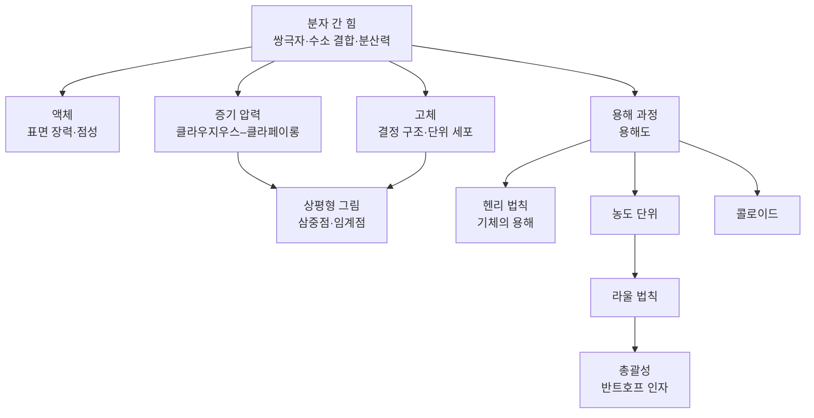

# 일반화학 6. 분자 간 힘과 액체·고체·용액 — 분자 사이의 약한 손길이 만드는 응집된 세계
<!-- prev: matter-1, matter-2, uchem-2, uchem-5 -->
<!-- next: uchem-8, uchem-10, ubio-2 -->

> [!NOTE]
> **이 단원의 범위**
> - 분자 간 힘의 종류(이온–쌍극자, 쌍극자–쌍극자, 수소 결합, 분산력)와 세기
> - 액체의 성질: 표면 장력, 점성, 증기 압력과 클라우지우스–클라페이롱 식
> - 고체의 종류와 결정 구조: 단위 세포, 입방 격자, 밀도 계산, X선 회절
> - 상평형 그림(삼중점, 임계점, 초임계 유체)
> - 용해 과정과 용해도(온도·압력의 영향, 헨리 법칙)와 농도 단위
> - 라울 법칙과 총괄성(반트호프 인자), 콜로이드

**학습 목표**

1. 분자 간 힘의 종류를 구별하고, 그 세기의 차이로 끓는점·증기 압력·용해성을 정량적·정성적으로 비교할 수 있다.
2. 표면 장력과 점성을 분자 간 힘으로 설명하고, 클라우지우스–클라페이롱 식으로 증기 압력·끓는점·기화 엔탈피를 계산할 수 있다.
3. 단위 세포의 원자 수, 배위수, 쌓임 효율을 구하고 격자 상수에서 결정의 밀도와 원자 반지름을 계산할 수 있다.
4. 상평형 그림을 해석하여 온도·압력 변화에 따른 상태 변화와 초임계 유체를 설명할 수 있다.
5. 용해 과정을 에너지와 무질서도로 설명하고, 온도·압력이 용해도에 주는 영향을 헨리 법칙으로 계산할 수 있다.
6. 여러 농도 단위를 서로 환산하고, 라울 법칙과 반트호프 인자를 이용해 총괄성을 계산하며, 콜로이드의 성질을 설명할 수 있다.

**이 단원의 학습 사다리**

| 단계 | 무엇을 하나? |
|---|---|
| STEP 1. 이전 학습 다시 보기 | 「물질의 세 가지 상태」의 분자 간 상호작용과 결정 분류, 「용액의 성질」의 총괄성, 「화학 결합과 분자 구조」의 극성과 격자 에너지를 다시 꺼낸다 |
| STEP 2. 기초 다지기 | 자연로그와 지수 함수, ln–1/T 그래프, 입방체의 기하, 농도 환산의 틀을 익힌다 |
| STEP 3. 핵심 개념 | 분자 간 힘 → 액체의 성질과 증기 압력 → 고체와 결정 구조 → 상평형 그림 → 용해와 용해도 → 농도 단위 → 라울 법칙과 총괄성 → 콜로이드 |
| STEP 4. 오개념 바로잡기 | "끓을 때 분자 안의 결합이 끊어진다?", "용해는 언제나 발열이다?" 같은 착각을 바로잡는다 |
| STEP 5. 전공으로 | 화학 퍼텐셜과 활동도, 결정학(밀러 지수), 2성분계 상평형과 공비 혼합물 |
| STEP 6. 생활·산업·진로 | 초임계 이산화 탄소, 동결 건조, 반도체 결정, 해수 담수화와 정수 |

---

## 🗺️ 단원 들어가기

소금쟁이는 물 위를 걷고, 유리관을 물에 꽂으면 물이 저절로 관을 타고 올라간다. 커피 가루에서 카페인만 뽑아낼 때는 뜨거운 물도, 유기 용매도 아닌 '초임계 이산화 탄소'를 쓴다. 겨울 도로에 소금 대신 염화 칼슘을 뿌리는 이유, 탄산음료 뚜껑을 열면 거품이 솟는 이유, 강물이 바다와 만나는 곳에 삼각주가 생기는 이유도 모두 이 단원의 내용으로 설명된다.

이 모든 현상의 공통 원인은 **분자 사이의 힘**이다. 앞 단원에서 분자 **안**의 결합(수백 kJ/mol)을 다루었다면, 이번에는 분자 **사이**의 훨씬 약한 힘(대개 수십 kJ/mol 이하)을 다룬다. 약하지만, 물질이 기체로 흩어질지 액체나 고체로 뭉칠지, 서로 섞일지를 결정하는 것은 바로 이 힘이다.

---

## STEP 1. 🔙 이전 학습 다시 보기

### 연계 개념표

| 이전 단원 | 그때 배운 것(고등학교에서는 여기까지) | 이 단원에서 확장되는 것(대학에서는 이렇게) |
|---|---|---|
| 물질과 에너지 「물질의 세 가지 상태」 | 분산력·쌍극자–쌍극자 힘·수소 결합으로 끓는점 비교, 상평형 그림의 기본, 결정을 네 가지로 분류(결정 구조는 다루지 않음) | 이온–쌍극자 힘과 거리 의존성, **클라우지우스–클라페이롱 식**, **단위 세포와 밀도 계산**, 임계점과 초임계 유체 |
| 물질과 에너지 「용액의 성질」 | 퍼센트·몰 농도·몰랄 농도, 라울 법칙(비휘발성 용질), 끓는점 오름·어는점 내림·삼투압, 전해질의 입자 수 | 두 성분이 모두 휘발성인 용액, 이상 용액에서 벗어남, **반트호프 인자의 실측값**, 헨리 법칙, 콜로이드 |
| 일반화학 「화학 결합과 분자 구조」 | 쌍극자 모멘트, 분자 모양과 극성, 격자 에너지 | 쌍극자 모멘트가 분자 간 힘의 크기를, 격자 에너지와 수화 엔탈피가 **용해 엔탈피**를 정한다 |
| 일반화학 「기체」 | 이상 기체 방정식, 실제 기체와 판데르발스 상수 $a$ | 판데르발스 $a$가 바로 분자 간 인력의 척도이며, 기체가 액체로 응축되는 조건을 정한다 |

### 준비 운동 (사전 진단)

**Q1.** 에탄올($\mathrm{C_2H_5OH}$)과 다이메틸 에터($\mathrm{CH_3OCH_3}$)는 분자식이 같다. 끓는점이 더 높은 것과 그 이유는?

**Q2.** 높은 산에서 물이 100 °C보다 낮은 온도에서 끓는 이유를 증기 압력으로 설명하시오.

**Q3.** 물 500 g에 포도당 0.10 mol을 녹인 용액의 몰랄 농도는?

**Q4.** 같은 몰랄 농도라면 설탕 수용액과 염화 나트륨 수용액 중 어는점이 더 낮은 것은?

정답 및 해설

**Q1.** 에탄올(약 78 °C). –OH가 있어 분자 사이에 수소 결합을 이룬다. 다이메틸 에터(약 −24 °C)는 O에 H가 직접 붙어 있지 않아 분자 사이 수소 결합이 없다.

**Q2.** 끓는점은 액체의 증기 압력이 외부 압력과 같아지는 온도이다. 높은 산에서는 대기압이 낮으므로 더 낮은 온도에서 증기 압력이 대기압에 도달한다.

**Q3.** $0.10\ \mathrm{mol}\div0.500\ \mathrm{kg} = 0.20\ \mathrm{mol/kg}$

**Q4.** 염화 나트륨 수용액. NaCl은 $\mathrm{Na^+}$와 $\mathrm{Cl^-}$로 이온화하여 녹아 있는 입자 수가 약 2배이므로 어는점 내림이 더 크다.

---

## STEP 2. 🧱 기초 다지기

### ① 자연로그와 지수 함수

이 단원에는 $e^x$와 $\ln x$가 자주 나온다. $\ln x$는 "$e$를 몇 제곱하면 $x$가 되는가"이다($e \approx 2.718$).

| 성질 | 식 | 쓰이는 곳 |
|---|---|---|
| 곱은 합으로 | $\ln(ab) = \ln a + \ln b$ | — |
| 나눗셈은 차로 | $\ln(a/b) = \ln a - \ln b$ | 두 점 클라우지우스–클라페이롱 식 |
| 지수와 로그는 역함수 | $\ln(e^x) = x$, $e^{\ln x} = x$ | 증기 압력 구하기 |
| 상용로그와의 관계 | $\ln x = 2.303\log x$ | 자료에 따라 $\log$로 쓴 식 |

유효 숫자 규칙: 로그 값의 **소수점 아래 자리 수**가 원래 수의 유효 숫자 개수와 같다. 예를 들어 $\ln(2.0) = 0.69$(유효 숫자 2개 → 소수 둘째 자리까지).

### ② 지수 관계를 직선으로 — $\ln P$ 대 $1/T$ 그래프

$P = Ae^{-B/T}$ 꼴의 관계는 양변에 $\ln$을 취하면

$$
\ln P = -B\cdot\frac{1}{T} + \ln A
$$

가 되어 $y = \ln P$, $x = 1/T$로 놓으면 **기울기 $-B$인 직선**이다. 곡선을 직선으로 펴서 기울기를 읽는 이 방법은 「화학 반응 속도론」의 아레니우스 식에서도 그대로 쓰인다.

### ③ 입방체의 기하

한 변이 $a$인 정육면체에서 면 대각선은 $\sqrt{2}\,a$, 몸 대각선은 $\sqrt{3}\,a$이다. 부피는 $a^3$이고, 반지름 $r$인 구의 부피는 $\frac{4}{3}\pi r^3$이다. 단위 세포 계산에서는 길이를 pm으로 받아 cm로 바꾸는 일이 많다: $1\ \mathrm{pm} = 10^{-10}\ \mathrm{cm}$, 따라서 $(1\ \mathrm{pm})^3 = 10^{-30}\ \mathrm{cm^3}$.

### ④ 농도 환산의 틀

어떤 농도 단위든 "용질의 양"과 "용매(또는 용액)의 양"의 비이다. 환산할 때는 **용액 1 L** 또는 **용액 100 g** 같은 기준량을 하나 정하고, 그 안의 용질과 용매를 각각 몰과 질량으로 모두 구해 둔 뒤 원하는 비를 만든다. 질량과 부피를 잇는 다리는 **밀도**, 질량과 몰을 잇는 다리는 **몰질량**이다.

---

## STEP 3. 📘 핵심 개념

### ① 분자 간 힘의 종류와 세기

#### 모든 분자 간 힘은 전기적 인력이다

분자 간 힘은 결국 전하 분포 사이의 쿨롱 상호 작용이다. 상호 작용하는 두 대상의 전하 분포가 무엇이냐에 따라 세기와 거리 의존성이 달라진다.

| 상호 작용 | 대상 | 에너지의 거리 의존성(대략) | 세기(대략, kJ/mol) | 예 |
|---|---|---|---|---|
| (참고) 이온–이온 | 이온 결정 | $1/r$ | 400~4000 | NaCl 결정 |
| (참고) 공유 결합 | 분자 안 | — | 150~1100 | C–H, O–H |
| **이온–쌍극자** | 이온과 극성 분자 | $1/r^2$ | 40~600 | $\mathrm{Na^+}$의 수화 |
| **수소 결합** | H–F, H–O, H–N의 H와 이웃 분자의 F, O, N | — | 10~40 | 물, DNA 염기쌍 |
| **쌍극자–쌍극자** | 극성 분자끼리 | $1/r^3$(고정), $1/r^6$(회전하는 기체 분자) | 5~25 | HCl, 아세톤 |
| **이온–유발 쌍극자, 쌍극자–유발 쌍극자** | 이온·극성 분자와 무극성 분자 | $1/r^4$, $1/r^6$ | 2~10 | 물에 녹은 $\mathrm{O_2}$ |
| **분산력(런던 힘)** | 모든 분자 | $1/r^6$ | 0.05~40 | 비활성 기체, 탄화수소 |

이온–쌍극자 힘, 쌍극자–쌍극자 힘, 분산력 등을 묶어 **판데르발스 힘(van der Waals force)** 이라고도 한다(이온–쌍극자는 빼기도 한다). 거리 의존성이 $1/r^6$인 힘은 거리가 2배가 되면 $1/64$로 약해진다. 분자 간 힘이 **아주 가까운 거리에서만** 의미 있는 이유이다.

#### 분산력과 편극성

전자 구름이 바깥 전기장에 의해 얼마나 쉽게 일그러지는지를 **편극성(polarizability)** 이라 한다. 전자 수가 많고 원자핵이 바깥 전자를 덜 꽉 잡을수록(큰 원자·분자일수록) 편극성이 크고 분산력이 크다.

| 비활성 기체 | 전자 수 | 끓는점(약, K) |
|---|---|---|
| He | 2 | 4.2 |
| Ne | 10 | 27 |
| Ar | 18 | 87 |
| Kr | 36 | 120 |
| Xe | 54 | 165 |

분산력은 "약한 힘"이라는 인상과 달리 큰 분자에서는 매우 크다. 분자량이 비슷하면 극성 분자가 더 높은 끓는점을 갖지만, 분자 크기가 크게 다르면 분산력이 극성보다 중요해질 수 있다. 예를 들어 HCl(극성, 약 −85 °C)보다 HI(극성은 더 작지만 전자가 훨씬 많음, 약 −35 °C)의 끓는점이 높다.

#### 수소 결합의 특별함

수소 결합은 쌍극자–쌍극자 힘의 특별히 강한 경우이다. ① H 원자는 내부 전자가 없어 부분 양전하가 거의 드러나고, ② F, O, N은 작고 전기 음성도가 커서 비공유 전자쌍에 음전하가 집중되며, ③ 그래서 아주 가까이 접근할 수 있다. 수소 결합은 **방향성**이 있어 X–H···Y가 일직선에 가까울 때 가장 강하다. 얼음에서 물 분자가 사면체 방향으로 네 개의 수소 결합을 이루며 빈 공간이 많은 육각 구조를 만드는 것이 이 방향성 때문이다.

| 물질 | 몰질량(g/mol) | 끓는점(°C, 약) | 기화 엔탈피(끓는점에서, 약, kJ/mol) | 주된 분자 간 힘 |
|---|---|---|---|---|
| $\mathrm{CH_4}$ | 16 | −162 | 8.2 | 분산력 |
| $\mathrm{NH_3}$ | 17 | −33 | 23.3 | 수소 결합 |
| $\mathrm{H_2O}$ | 18 | 100 | 40.7 | 수소 결합(분자당 최대 4개) |
| $\mathrm{H_2S}$ | 34 | −60 | 18.7 | 쌍극자–쌍극자, 분산력 |

#### 예제 1 — 끓는점 순서 정하기

몰질량이 비슷한 다음 네 물질을 기준 끓는점이 낮은 것부터 나열하시오: 프로페인($\mathrm{CH_3CH_2CH_3}$, 44), 다이메틸 에터($\mathrm{CH_3OCH_3}$, 46), 아세트알데하이드($\mathrm{CH_3CHO}$, 44), 에탄올($\mathrm{CH_3CH_2OH}$, 46)

**풀이**

- **판단 순서** ① 몰질량이 거의 같으므로 분산력은 비슷하다. ② 극성이 있는가? ③ F, O, N에 직접 결합한 H가 있는가?
- 프로페인: 무극성 → 분산력만. 다이메틸 에터: 굽은형 C–O–C로 약한 극성. 아세트알데하이드: C=O가 강한 극성(쌍극자 모멘트 약 2.7 D). 에탄올: –OH로 수소 결합.
- **결과** 프로페인(약 −42 °C) < 다이메틸 에터(약 −24 °C) < 아세트알데하이드(약 20 °C) < 에탄올(약 78 °C)
- **의미** 몰질량이 같아도 분자 간 힘의 종류에 따라 끓는점이 100 °C 넘게 차이 난다. 분자 구조를 보면 물리적 성질을 예측할 수 있다.

> [!TIP]
> 💡 **판단 요령** — 분자 간 힘을 비교할 때는 "① 이온이 있나? → ② F, O, N에 H가 붙어 있나? → ③ 극성인가? → ④ 전자 수(크기)와 모양은?" 순서로 질문하자. 단, 크기 차이가 크면 ④가 ③을 이길 수 있다.

### ② 액체의 성질 — 표면 장력, 점성, 증기 압력

#### 표면 장력

액체 내부의 분자는 사방에서 이웃에게 끌리지만, 표면의 분자는 안쪽으로만 끌린다. 그래서 액체는 표면적을 줄이려 하고(물방울이 둥근 이유), 표면적을 늘리려면 에너지가 든다. 표면적을 단위 면적만큼 늘리는 데 드는 에너지를 **표면 장력(surface tension)** $\gamma$라 한다(단위 $\mathrm{J/m^2} = \mathrm{N/m}$).

| 액체(20 °C) | 표면 장력(약, mN/m) | 점성 계수(약, mPa·s) |
|---|---|---|
| 헥세인 | 18 | 0.31 |
| 에탄올 | 22 | 1.2 |
| 물 | 72.8 | 1.00 |
| 글리세롤 | 63 | 약 1400 |
| 수은 | 약 486 | 1.55 |

물은 수소 결합 그물 때문에 분자로 된 보통 액체 가운데 표면 장력이 매우 크다. 수은은 금속 결합 때문에 훨씬 크다.

**모세관 현상** 액체 분자와 관 벽 사이의 인력(**부착력**)이 액체 분자끼리의 인력(**응집력**)보다 크면 액체가 벽을 적시며 관을 타고 올라간다(유리관 속 물). 반대이면 내려간다(유리관 속 수은). 올라가는 높이는 힘의 균형에서

$$
h = \frac{2\gamma\cos\theta}{\rho g r}
$$

이다($\theta$: 접촉각, $\rho$: 액체의 밀도, $r$: 관의 반지름).

#### 예제 2 — 가는 유리관 속 물기둥

반지름 0.10 mm인 깨끗한 유리관을 20 °C 물에 꽂았다. 물이 올라가는 높이를 구하시오. (물: $\gamma = 0.0728\ \mathrm{N/m}$, $\rho = 1.00\times10^3\ \mathrm{kg/m^3}$, 접촉각 0°, $g = 9.80\ \mathrm{m/s^2}$)

**풀이**

$$
h = \frac{2(0.0728)(1)}{(1.00\times10^3)(9.80)(1.0\times10^{-4})} = 0.15\ \mathrm{m}
$$

약 15 cm이다. 관이 가늘수록 높이 올라가므로, 식물의 물관(지름 수십 μm)이나 종이·흙의 미세한 틈에서 모세관 현상이 크게 작용한다. (나무 꼭대기까지의 물 수송에는 증산 작용이 만드는 장력이 더 중요하다.)

#### 점성

**점성(viscosity)** 은 흐름에 대한 저항이다. 분자 간 힘이 클수록, 분자가 길어 서로 엉킬수록 크다. 글리세롤은 분자 하나에 –OH가 3개 있어 수소 결합 그물이 촘촘하므로 물보다 천 배 이상 끈적하다. 온도가 오르면 분자의 운동 에너지가 커져 분자 간 힘을 쉽게 뿌리치므로 액체의 점성은 **작아진다**. 엔진 오일 등급에 겨울용·여름용 숫자가 붙어 있는 이유이다.

#### 증기 압력과 동적 평형

밀폐 용기 속 액체에서는 증발과 응축이 동시에 일어나다가 두 속도가 같아지면 **동적 평형**에 이른다. 이때 증기의 압력이 **증기 압력(vapor pressure)** 이다. 증기 압력은 액체의 양이나 용기의 크기와 무관하고 **물질과 온도**에만 의존한다.

온도가 오르면 증발할 만큼 큰 운동 에너지를 가진 분자의 비율이 지수 함수적으로 늘어 증기 압력이 급격히 커진다. 분자의 에너지 분포(「기체」의 맥스웰 분포)에서 에너지가 $E$보다 큰 분자의 비율은 대략 $e^{-E/RT}$에 비례하기 때문이다.

#### 클라우지우스–클라페이롱 식

증기 압력과 온도 사이에는 다음 관계가 있다(기화 엔탈피 $\Delta H_\text{기화}$가 온도에 무관하다고 근사하고, 증기를 이상 기체로 본다).

$$
\ln P = -\frac{\Delta H_\text{기화}}{R}\cdot\frac{1}{T} + C
$$

STEP 2 ②에 따라 $\ln P$를 $1/T$에 대해 그리면 기울기 $-\Delta H_\text{기화}/R$인 직선이다. 두 온도에서 쓰면

$$
\ln\frac{P_2}{P_1} = -\frac{\Delta H_\text{기화}}{R}\left(\frac{1}{T_2} - \frac{1}{T_1}\right)
$$

이 식은 증기 압력, 끓는점, 기화 엔탈피 가운데 둘을 알면 나머지를 구하게 해 준다. 고체의 승화에도 $\Delta H_\text{승화}$를 넣어 똑같이 쓴다.

#### 예제 3 — 산 위에서 끓는 물

물의 기화 엔탈피를 40.7 kJ/mol(일정)로 보고, 대기압이 0.70 atm인 산 위에서 물의 끓는점을 구하시오. ($R = 8.314\ \mathrm{J/(mol\cdot K)}$, 1.00 atm에서 끓는점 373.15 K)

**풀이**

- **식 세우기** 끓는점에서 증기 압력 = 외부 압력이므로 $P_1 = 1.00\ \mathrm{atm}$, $T_1 = 373.15\ \mathrm{K}$, $P_2 = 0.70\ \mathrm{atm}$
- **대입** $\dfrac{1}{T_2} = \dfrac{1}{T_1} - \dfrac{R}{\Delta H_\text{기화}}\ln\dfrac{P_2}{P_1} = \dfrac{1}{373.15} - \dfrac{8.314}{40700}\ln0.70$
  $= 2.6799\times10^{-3} + 7.286\times10^{-5} = 2.7528\times10^{-3}\ \mathrm{K^{-1}}$
- **결과** $T_2 = 363\ \mathrm{K} \approx 90\ ^\circ\mathrm{C}$
- **의미** 해발 약 3000 m(대기압 약 0.7 atm)에서는 물이 90 °C 근처에서 끓어 밥이 설익는다. 같은 식으로 계산하면 압력솥(약 2.0 atm)의 끓는점은 약 121 °C이다.

#### 예제 4 — 기화 엔탈피 구하기와 근사의 한계

에탄올의 증기 압력은 20.0 °C에서 44.6 mmHg이고, 기준 끓는점은 78.3 °C이다. (1) 에탄올의 기화 엔탈피를 구하시오. (2) 물에 대해 100 °C의 값(760 mmHg)과 $\Delta H_\text{기화} = 40.7\ \mathrm{kJ/mol}$로 25 °C의 증기 압력을 계산하면 28.0 mmHg가 나오지만 실제 값은 23.8 mmHg이다. 차이의 원인은?

**풀이**

(1) $\Delta H_\text{기화} = \dfrac{R\ln(P_2/P_1)}{1/T_1 - 1/T_2} = \dfrac{8.314\ln(760/44.6)}{1/293.15 - 1/351.45} = \dfrac{8.314\times2.835}{5.659\times10^{-4}} = 4.17\times10^4\ \mathrm{J/mol} = 41.7\ \mathrm{kJ/mol}$

(2) 물의 기화 엔탈피는 온도가 낮을수록 커진다(25 °C에서 약 44.0 kJ/mol). 낮은 온도에서는 분자 사이 수소 결합이 더 많이 유지되어 있어 떼어 내는 데 더 큰 에너지가 들기 때문이다. 100 °C의 작은 값을 넓은 온도 범위에 그대로 쓰면, 온도를 내릴 때 증기 압력이 덜 줄어드는 것으로 계산된다. **클라우지우스–클라페이롱 식은 좁은 온도 범위에서 정확한 근사식**이다.

#### 가열 곡선과 상변화의 에너지

일정한 압력에서 고체를 일정하게 가열하면 온도가 오르다가, 녹는 동안과 끓는 동안에는 온도가 일정한 **평평한 구간**이 나타난다. 이때 넣은 열은 분자 간 힘을 끊는 데 쓰인다.

| 물의 자료 | 값 |
|---|---|
| 융해 엔탈피 $\Delta H_\text{융해}$ | 6.01 kJ/mol |
| 기화 엔탈피 $\Delta H_\text{기화}$(100 °C) | 40.7 kJ/mol |
| 액체 물의 비열 | 4.18 J/(g·K) |

0 °C 얼음 18.0 g(1.00 mol)을 100 °C 수증기로 바꾸는 데 필요한 열은 $6.01 + (18.0)(4.18)(100)/1000 + 40.7 = 6.01 + 7.52 + 40.7 = 54.2\ \mathrm{kJ}$이다. 그중 약 75 %가 기화에 쓰인다. 기화 엔탈피가 융해 엔탈피보다 훨씬 큰 것은 녹을 때는 분자 간 힘의 일부만 끊어지지만, 기화할 때는 거의 전부를 끊어야 하기 때문이다.

### ③ 고체의 종류와 결정 구조

#### 결정성 고체의 네 종류(다시 보기)

| 종류 | 격자점의 입자 | 입자 사이의 힘 | 성질 | 예 |
|---|---|---|---|---|
| 분자 결정 | 분자 | 분자 간 힘 | 녹는점 낮음, 무름, 부도체 | 얼음, 드라이아이스, $\mathrm{I_2}$ |
| 이온 결정 | 양이온·음이온 | 이온 결합 | 녹는점 높음, 단단하나 잘 쪼개짐, 녹으면 전도 | NaCl, MgO |
| 공유 그물 결정 | 원자 | 공유 결합 | 녹는점 매우 높음, 매우 단단함 | 다이아몬드, $\mathrm{SiO_2}$, SiC |
| 금속 결정 | 금속 양이온 | 금속 결합(비편재화된 전자) | 연성·전성, 전기·열 전도 | Cu, Fe, Al |

이 분류에 더해 대학에서는 **입자가 공간에 어떻게 쌓이는가**를 다룬다.

#### 격자와 단위 세포

결정은 같은 배열이 3차원으로 끝없이 반복된 것이다. 반복되는 점들의 배열을 **격자(lattice)**, 그 배열 전체를 평행 이동만으로 채울 수 있는 가장 작은 반복 단위를 **단위 세포(unit cell)** 라 한다. 이 단원에서는 가장 단순한 세 가지 **입방 단위 세포**를 다룬다.

단위 세포의 모서리·면에 있는 원자는 이웃 세포와 나누어 가지므로 일부만 센다.

| 원자의 위치 | 공유하는 단위 세포 수 | 한 세포에 속하는 몫 |
|---|---|---|
| 꼭짓점 | 8 | 1/8 |
| 모서리 | 4 | 1/4 |
| 면 | 2 | 1/2 |
| 내부 | 1 | 1 |

| 구조 | 원자 위치 | 세포당 원자 수 | 배위수 | $a$와 $r$의 관계(원자가 닿는 방향) | 쌓임 효율 | 예 |
|---|---|---|---|---|---|---|
| **단순 입방** | 꼭짓점 | $8\times\frac{1}{8} = 1$ | 6 | $a = 2r$(모서리) | 52.4 % | Po |
| **체심 입방(bcc)** | 꼭짓점 + 중심 | $1 + 1 = 2$ | 8 | $\sqrt{3}\,a = 4r$(몸 대각선) | 68.0 % | Fe, Na, K, Cr, W |
| **면심 입방(fcc)** | 꼭짓점 + 면 중심 | $1 + 6\times\frac{1}{2} = 4$ | 12 | $\sqrt{2}\,a = 4r$(면 대각선) | 74.0 % | Cu, Al, Ag, Au, Ni |

**쌓임 효율의 유도(면심 입방)** 세포 안 원자 4개의 부피는 $4\times\frac{4}{3}\pi r^3$, 세포 부피는 $a^3 = (2\sqrt{2}\,r)^3 = 16\sqrt{2}\,r^3$이므로 $\dfrac{16\pi r^3/3}{16\sqrt{2}\,r^3} = \dfrac{\pi}{3\sqrt{2}} = 0.740$이다.

#### 조밀 쌓임 — 오렌지를 쌓는 두 가지 방법

같은 크기의 공을 평면에 가장 촘촘히 깔면 공 하나를 여섯 개가 둘러싼다(A층). 그 위의 B층은 A층의 오목한 곳에 놓인다. 세 번째 층을 놓는 방법이 두 가지이다.

- **ABAB…**: 세 번째 층이 첫 층 바로 위 → **육방 조밀 쌓임(hcp)**. Mg, Zn, Ti.
- **ABCABC…**: 세 번째 층이 첫 두 층 모두와 어긋난 자리 → **입방 조밀 쌓임(ccp)**, 이것이 곧 **면심 입방**이다. Cu, Al.

두 구조 모두 배위수 12, 쌓임 효율 74 %로, 같은 크기의 공으로 얻을 수 있는 최대값이다. 과일 가게에서 오렌지를 쌓는 방법이 바로 이것이다.

#### 결정의 밀도 계산

$$
d = \frac{\text{세포 안 질량}}{\text{세포 부피}} = \frac{Z\cdot M}{N_\mathrm{A}\cdot a^3}
$$

($Z$: 세포당 원자 수 또는 화학식 단위 수, $M$: 몰질량)

#### 예제 5 — 구리의 밀도와 원자 반지름

구리는 면심 입방 구조이고 단위 세포의 한 변은 361.5 pm이다. 구리의 밀도와 원자 반지름을 구하시오. (Cu 몰질량 63.55 g/mol, $N_\mathrm{A} = 6.022\times10^{23}\ \mathrm{mol^{-1}}$)

**풀이**

- **세포 부피** $a = 361.5\ \mathrm{pm} = 3.615\times10^{-8}\ \mathrm{cm}$, $a^3 = 4.724\times10^{-23}\ \mathrm{cm^3}$
- **세포 질량** $\dfrac{4\times63.55\ \mathrm{g/mol}}{6.022\times10^{23}\ \mathrm{mol^{-1}}} = 4.221\times10^{-22}\ \mathrm{g}$
- **밀도** $d = \dfrac{4.221\times10^{-22}}{4.724\times10^{-23}} = 8.935\ \mathrm{g/cm^3}$ (측정값 약 8.96 g/cm³)
- **반지름** $r = \dfrac{\sqrt{2}\,a}{4} = \dfrac{1.4142\times361.5}{4} = 127.8\ \mathrm{pm}$
- **의미** 눈에 보이는 덩어리의 밀도를 원자 배열과 아보가드로수만으로 0.3 % 이내로 맞힌다. 거꾸로 밀도와 격자 상수를 정밀하게 재면 아보가드로수를 결정할 수 있고, 실제로 규소 단결정 구로 이런 측정이 이루어졌다.

#### 이온 결정의 단위 세포

| 구조 | 배치 | 세포당 화학식 단위 | 배위수(양이온 : 음이온) | 예 |
|---|---|---|---|---|
| 암염(NaCl)형 | $\mathrm{Cl^-}$가 면심 입방, $\mathrm{Na^+}$가 그 사이 팔면체 틈 | 4 | 6 : 6 | NaCl, MgO, KBr |
| 염화 세슘(CsCl)형 | $\mathrm{Cl^-}$가 단순 입방 꼭짓점, $\mathrm{Cs^+}$가 중심 | 1 | 8 : 8 | CsCl |
| 섬아연석(ZnS)형 | $\mathrm{S^{2-}}$가 면심 입방, $\mathrm{Zn^{2+}}$가 사면체 틈의 절반 | 4 | 4 : 4 | ZnS, GaAs |

NaCl 단위 세포에서 $\mathrm{Cl^-}$는 꼭짓점 8 × 1/8 + 면 6 × 1/2 = 4개, $\mathrm{Na^+}$는 모서리 12 × 1/4 + 중심 1 = 4개로 1 : 1 화학식과 맞는다. 격자 상수 564.0 pm로 밀도를 계산하면 $\dfrac{4\times58.44}{6.022\times10^{23}\times(5.640\times10^{-8})^3} = 2.164\ \mathrm{g/cm^3}$이다. 큰 양이온($\mathrm{Cs^+}$)은 음이온 8개를, 작은 양이온은 6개나 4개를 둘러싼다. 양이온과 음이온의 크기 비가 구조를 정하는 것이다.

#### X선 회절 — 결정 구조를 재는 방법

결정 속 원자 간격(약 100~500 pm)은 X선의 파장과 비슷하다. 간격 $d$로 나란한 원자 평면들에서 반사된 X선은 경로 차가 파장의 정수배일 때만 보강 간섭한다.

$$
n\lambda = 2d\sin\theta \qquad \text{(브래그 법칙)}
$$

#### 예제 6 — 브래그 법칙

파장 154.2 pm의 X선을 구리 결정에 쪼였더니 $\theta = 21.7^\circ$에서 1차($n = 1$) 회절 봉우리가 나타났다. 이 봉우리를 만드는 원자 평면 사이의 간격을 구하시오.

**풀이**

$$
d = \frac{n\lambda}{2\sin\theta} = \frac{1\times154.2}{2\sin21.7^\circ} = \frac{154.2}{2\times0.3697} = 209\ \mathrm{pm}
$$

면심 입방 구리의 꼭짓점 세 개를 지나는 비스듬한 평면 사이 간격 $a/\sqrt{3} = 361.5/1.732 = 209\ \mathrm{pm}$과 일치한다. 여러 각도의 봉우리를 모으면 단위 세포의 종류와 크기를 거꾸로 알아낼 수 있다.

#### 비결정성 고체와 금속의 띠(간단히)

유리처럼 입자 배열에 장거리 규칙성이 없는 고체는 단위 세포로 기술할 수 없고, 일정한 녹는점 없이 넓은 온도 범위에서 물러진다. 금속은 원자 오비탈이 결정 전체에 걸쳐 섞여 생긴 띠에 전자가 일부만 차 있어 전자가 쉽게 움직인다(「화학 결합과 분자 구조」 STEP 5). 그래서 금속은 어느 방향으로 눌러도 원자층이 미끄러지며 결합이 유지되어 연성·전성이 크다.

> [!TIP]
> 💡 **비유** — 단위 세포는 '벽지 무늬의 한 칸'이다. 한 칸만 알면 벽 전체를 복원할 수 있다. 단, 칸의 경계선에 걸친 꽃무늬(꼭짓점·면의 원자)는 이웃 칸과 나누어 가지므로 일부만 센다.

### ④ 상평형 그림

#### 상평형 그림 읽기

**상평형 그림(phase diagram)** 은 온도(가로축)와 압력(세로축)에 따라 어떤 상이 가장 안정한지 나타낸다.

| 요소 | 뜻 |
|---|---|
| 영역 | 그 온도·압력에서 한 상만 안정하다 |
| 경계선 | 두 상이 평형을 이룬다. 액체–기체 경계는 **증기 압력 곡선**(클라우지우스–클라페이롱 식) |
| **삼중점** | 고체·액체·기체 세 상이 함께 평형을 이루는 유일한 점 |
| **임계점** | 증기 압력 곡선이 끝나는 점. 이보다 높은 온도에서는 아무리 압축해도 액화되지 않는다 |
| **초임계 유체** | 임계 온도·압력을 모두 넘은 상태. 액체와 기체의 구별이 사라지고, 기체처럼 확산하며 액체처럼 물질을 녹인다 |

| 물질 | 삼중점(약) | 임계점(약) | 1 atm에서의 변화 |
|---|---|---|---|
| 물 | 0.01 °C, 0.006 atm | 374 °C, 218 atm | 0 °C 융해, 100 °C 끓음 |
| 이산화 탄소 | −56.6 °C, 5.11 atm | 31.0 °C, 73 atm | −78.5 °C에서 승화 |

#### 고체–액체 경계선의 기울기

대부분의 물질은 고체가 액체보다 밀도가 커서, 압력을 높이면 밀도가 큰 고체 쪽이 유리해지고 녹는점이 **올라간다**(경계선이 오른쪽으로 기울어진다). 물은 예외이다. 수소 결합이 만든 얼음의 열린 구조 때문에 얼음이 물보다 밀도가 작아(0 °C에서 약 0.917 대 0.9998 g/cm³), 압력을 높이면 녹는점이 아주 조금 **내려간다**(약 −0.0074 °C/atm). 그래서 물의 고체–액체 경계선은 왼쪽으로 기울어져 있다.

#### 예제 7 — 상평형 그림에서 경로 따라가기

이산화 탄소에 대해 (1) 1 atm에서 −100 °C의 고체를 25 °C까지 천천히 가열할 때, (2) 10 atm에서 같은 가열을 할 때, (3) 25 °C에서 1 atm의 기체를 100 atm까지 압축할 때, (4) 40 °C에서 1 atm의 기체를 100 atm까지 압축할 때 일어나는 상변화를 쓰시오.

**풀이**

(1) 1 atm은 삼중점 압력(5.11 atm)보다 낮으므로 액체 영역을 지나지 않는다. −78.5 °C에서 **승화**하여 기체가 된다(드라이아이스).
(2) 10 atm은 삼중점보다 높으므로 고체 → **융해**(약 −57 °C보다 조금 높은 온도) → 액체 → **기화**(10 atm의 끓는점, 약 −40 °C) → 기체가 된다.
(3) 25 °C는 임계 온도(31.0 °C)보다 낮으므로, 압력이 그 온도의 증기 압력(약 64 atm)에 도달하면 **응축**하여 액체가 된다. 소화기 속 $\mathrm{CO_2}$가 액체인 이유이다.
(4) 40 °C는 임계 온도보다 높으므로 액체가 되지 않고, 73 atm 이상에서 **초임계 유체**가 된다. 경계선을 넘는 급격한 변화 없이 밀도가 연속적으로 커진다.

### ⑤ 용해 과정과 용해도

#### 용해의 에너지 장부

용질이 용매에 녹는 과정을 세 단계로 나누어 생각한다(헤스 법칙).

| 단계 | 과정 | $\Delta H$ |
|---|---|---|
| ① | 용질 입자끼리 떼어 놓기 | + (흡열) |
| ② | 용매 분자 사이를 벌려 자리 만들기 | + (흡열) |
| ③ | 용질과 용매가 서로 끌어당김(용매화, 물이면 **수화**) | − (발열) |
| 합 | **용해 엔탈피** $\Delta H_\text{용해} = \Delta H_1 + \Delta H_2 + \Delta H_3$ | 부호는 경우에 따라 다름 |

이온 결정이 물에 녹을 때는 ①이 격자 에너지, ②+③을 합쳐 **수화 엔탈피**로 쓴다.

$$
\Delta H_\text{용해} = (\text{격자 에너지}) + \Delta H_\text{수화}
$$

NaCl은 격자 에너지 +786 kJ/mol, $\mathrm{Na^+}$와 $\mathrm{Cl^-}$의 수화 엔탈피의 합 약 −783 kJ/mol로, 용해 엔탈피는 두 큰 수의 작은 차이인 약 +4 kJ/mol(약간 흡열)이다. 질산 암모늄(약 +26 kJ/mol)처럼 흡열이 큰 물질은 녹을 때 주위의 열을 흡수해 **냉찜질 팩**에, 무수 염화 칼슘(약 −81 kJ/mol)처럼 발열이 큰 물질은 **온찜질 팩**과 제설제에 쓰인다.

#### 흡열인데도 녹는 이유 — 무질서도

NaCl이나 질산 암모늄처럼 흡열인데도 저절로 녹는 것은, 규칙적인 결정이 용액 속에 흩어지면서 **무질서도(엔트로피)** 가 크게 늘기 때문이다. 용해가 일어날지는 에너지(엔탈피)와 무질서도(엔트로피)의 두 경향을 함께 보아야 판단할 수 있다. 정량적인 판단 기준(깁스 자유 에너지)은 「화학 열역학」에서 다룬다.

#### "비슷한 것이 비슷한 것을 녹인다"

①, ② 단계에서 끊는 힘과 ③ 단계에서 새로 생기는 힘이 비슷한 크기일 때 잘 녹는다.

| 용질 | 물(극성, 수소 결합)에 | 헥세인(무극성)에 | 이유 |
|---|---|---|---|
| NaCl(이온) | 잘 녹음 | 녹지 않음 | 물은 강한 이온–쌍극자 힘으로 격자 에너지를 보상한다 |
| 에탄올(–OH) | 무한히 섞임 | 잘 섞임 | –OH는 물과 수소 결합, $\mathrm{C_2H_5}$는 헥세인과 분산력 |
| 1-옥탄올(긴 사슬 + –OH) | 거의 녹지 않음 | 잘 섞임 | 긴 무극성 사슬이 물의 수소 결합 그물을 깬다 |
| $\mathrm{I_2}$(무극성) | 조금 녹음 | 잘 녹음 | 분산력끼리 비슷하다 |
| 비타민 C(–OH 여럿) | 잘 녹음(수용성) | 녹지 않음 | 수소 결합 |
| 비타민 A(긴 탄화수소) | 녹지 않음 | 잘 녹음(지용성) | 분산력 |

#### 온도의 영향

- **고체의 용해도**: 대부분 온도가 높을수록 커지지만(질산 칼륨은 크게 증가), NaCl처럼 거의 변하지 않거나 황산 세륨(Ⅲ)처럼 오히려 줄어드는 것도 있다. 용해도 곡선은 실험으로 확인해야 하며, 용해 엔탈피의 부호만으로 늘 예측되지는 않는다.
- **기체의 용해도**: 거의 언제나 온도가 높을수록 **작아진다**. 기체가 녹는 과정은 보통 발열이고, 기체 분자가 용액에서 빠져나가면 무질서도가 커지기 때문이다. 여름철 수온이 오르면 물속 산소가 줄어 물고기가 수면으로 올라오고, 발전소의 따뜻한 배출수가 생태계에 영향을 주는 이유이다(열 오염).

#### 압력의 영향 — 헨리 법칙

고체와 액체의 용해도는 압력에 거의 영향을 받지 않지만, 기체의 용해도는 그 기체의 **부분 압력**에 비례한다. 이를 **헨리 법칙(Henry's law)** 이라 한다.

$$
C = k_\mathrm{H}\,P
$$

($C$: 녹은 기체의 농도, $P$: 용액 위 그 기체의 부분 압력, $k_\mathrm{H}$: 기체·용매·온도에 따라 정해지는 헨리 상수) 입자 모형으로 보면, 기체의 부분 압력이 2배이면 단위 시간에 용액 표면에 부딪쳐 녹아 들어가는 분자 수가 2배가 되어, 평형에서 녹아 있는 농도도 2배가 된다.

| 기체(25 °C, 물) | $k_\mathrm{H}$(약, mol/(L·atm)) |
|---|---|
| $\mathrm{N_2}$ | $6.1\times10^{-4}$ |
| $\mathrm{O_2}$ | $1.3\times10^{-3}$ |
| $\mathrm{CO_2}$ | $3.4\times10^{-2}$ |

$\mathrm{CO_2}$가 $\mathrm{O_2}$보다 20배 넘게 잘 녹는 것은 물과 반응해 탄산($\mathrm{H_2CO_3}$)을 만들기도 하기 때문이다. $\mathrm{NH_3}$, HCl처럼 물과 강하게 반응하는 기체는 헨리 법칙을 따르지 않을 만큼 매우 잘 녹는다.

#### 예제 8 — 탄산음료와 물속의 산소

(1) 25 °C에서 $\mathrm{CO_2}$ 부분 압력 4.0 atm으로 밀봉한 탄산음료 속 $\mathrm{CO_2}$ 농도와, 뚜껑을 열어 공기 중 $\mathrm{CO_2}$ 부분 압력($4\times10^{-4}$ atm)과 평형에 이른 뒤의 농도를 구하시오. (2) 25 °C의 물이 공기($\mathrm{O_2}$ 부분 압력 0.21 atm)와 평형일 때 녹은 산소는 몇 mg/L인가?

**풀이**

- (1) 밀봉: $C = (3.4\times10^{-2})(4.0) = 0.14\ \mathrm{mol/L}$
  개봉 후 평형: $C = (3.4\times10^{-2})(4\times10^{-4}) = 1\times10^{-5}\ \mathrm{mol/L}$ — 처음의 약 1만분의 1. 차이만큼의 $\mathrm{CO_2}$가 거품으로 빠져나간다.
- (2) $C = (1.3\times10^{-3})(0.21) = 2.7\times10^{-4}\ \mathrm{mol/L}$, $2.7\times10^{-4}\times32.00\ \mathrm{g/mol} = 8.7\times10^{-3}\ \mathrm{g/L} = 8.7\ \mathrm{mg/L}$
- **의미** 계산값은 실제 측정값(25 °C에서 약 8 mg/L)과 비슷하다. 물고기는 이 정도의 묽은 산소로 살아가며, 물속 산소가 5 mg/L 아래로 떨어지면 많은 어류가 스트레스를 받는다. 잠수부가 깊이 들어가면 혈액에 녹는 질소가 늘어나는데, 너무 빨리 올라오면 녹아 있던 질소가 혈관에서 거품이 되는 **감압병**이 생긴다.

### ⑥ 농도 단위

| 농도 | 정의 | 단위 | 온도에 따라 | 주로 쓰는 곳 |
|---|---|---|---|---|
| 질량 백분율 | 용질 질량 ÷ 용액 질량 × 100 | % | 변하지 않음 | 시약 병, 식품 |
| ppm, ppb | 용질 질량 ÷ 용액 질량 × $10^6$, × $10^9$ | — | 변하지 않음 | 환경 오염 물질(묽은 수용액에서 1 ppm ≈ 1 mg/L) |
| 몰 분율 $X$ | 성분 몰수 ÷ 전체 몰수 | 없음 | 변하지 않음 | 라울 법칙, 기체 혼합물 |
| 몰 농도 $M$ | 용질 몰수 ÷ 용액 부피(L) | mol/L | **변한다**(부피 팽창) | 적정, 반응 계산, 삼투압 |
| 몰랄 농도 $m$ | 용질 몰수 ÷ 용매 질량(kg) | mol/kg | 변하지 않음 | 끓는점 오름, 어는점 내림 |

#### 예제 9 — 진한 염산의 농도 환산

시판 진한 염산은 질량 백분율 37.0 %, 밀도 1.19 g/mL이다. 몰 농도, 몰랄 농도, HCl의 몰 분율을 구하시오. (HCl 36.46 g/mol, $\mathrm{H_2O}$ 18.02 g/mol)

**풀이**

- **기준량** 용액 100.0 g: HCl 37.0 g = 1.015 mol, 물 63.0 g = 3.496 mol
- **몰 농도** 용액 부피 $100.0\ \mathrm{g}\div1.19\ \mathrm{g/mL} = 84.0\ \mathrm{mL}$ → $1.015\ \mathrm{mol}\div0.0840\ \mathrm{L} = 12.1\ \mathrm{mol/L}$
- **몰랄 농도** $1.015\ \mathrm{mol}\div0.0630\ \mathrm{kg} = 16.1\ \mathrm{mol/kg}$
- **몰 분율** $X_\mathrm{HCl} = \dfrac{1.015}{1.015 + 3.496} = 0.225$
- **의미** 같은 용액인데 몰 농도와 몰랄 농도가 크게 다르다. 진한 용액에서는 용매의 질량과 용액의 부피가 많이 다르기 때문이다. 묽은 수용액에서는 1 L 용액 ≈ 1 kg 물이어서 $M \approx m$이 된다.

### ⑦ 라울 법칙과 총괄성

#### 라울 법칙

용액에서 용매의 증기 압력은 순수한 용매보다 낮다. 이상적인 용액에서 각 성분의 증기 압력은 그 성분의 몰 분율에 비례한다(**라울 법칙**, Raoult's law).

$$
P_A = X_A\,P_A^\circ
$$

($P_A^\circ$: 순수한 A의 증기 압력) 비휘발성 용질이 녹아 있으면 증기 압력 내림은 $\Delta P = P_A^\circ - P_A = X_\text{용질}P_A^\circ$로, **용질 입자의 몰 분율**에만 의존한다.

#### 두 성분이 모두 휘발성일 때

벤젠과 톨루엔처럼 분자 간 힘이 비슷한 두 액체는 거의 **이상 용액(ideal solution)** 을 이룬다. 각 성분에 라울 법칙을 쓰고 돌턴의 부분 압력 법칙으로 더한다.

$$
P_\text{전체} = X_AP_A^\circ + X_BP_B^\circ, \qquad \text{증기 속 A의 몰 분율 } Y_A = \frac{X_AP_A^\circ}{P_\text{전체}}
$$

#### 예제 10 — 벤젠–톨루엔 용액의 증기

25 °C에서 벤젠의 몰 분율이 0.400인 벤젠–톨루엔 용액이 있다. 전체 증기 압력과 증기 속 벤젠의 몰 분율을 구하시오. (25 °C 순수한 증기 압력: 벤젠 95.1 mmHg, 톨루엔 28.4 mmHg)

**풀이**

- $P_\text{벤젠} = 0.400\times95.1 = 38.0\ \mathrm{mmHg}$, $P_\text{톨루엔} = 0.600\times28.4 = 17.0\ \mathrm{mmHg}$
- $P_\text{전체} = 55.1\ \mathrm{mmHg}$, $Y_\text{벤젠} = 38.0/55.1 = 0.690$
- **의미** 액체에서는 40 %였던 벤젠이 증기에서는 69 %로 늘었다. 증기를 모아 다시 응축하면 더 휘발성인 성분이 농축된다. 이 과정을 여러 번 되풀이하는 것이 **분별 증류**이며, 정유 공장의 증류탑이 원유를 휘발유·등유·경유로 나누는 원리이다.

#### 이상 용액에서 벗어남

| 경우 | A–B 사이 힘 | 증기 압력 | 용해 엔탈피 | 예 |
|---|---|---|---|---|
| 이상 용액 | A–A, B–B와 비슷 | 라울 법칙대로 | 약 0 | 벤젠–톨루엔 |
| **양의 벗어남** | 더 약함 | 라울 법칙보다 큼 | 흡열 | 에탄올–헥세인, 아세톤–이황화 탄소 |
| **음의 벗어남** | 더 강함 | 라울 법칙보다 작음 | 발열 | 아세톤–클로로폼(수소 결합 형성), 질산–물 |

#### 총괄성

용액의 성질 가운데 용질의 종류와 상관없이 **녹아 있는 용질 입자의 수**에만 의존하는 성질을 **총괄성(colligative property)** 이라 한다. 「용액의 성질」에서 배운 네 가지를 묽은 용액에 대한 식으로 모으면 다음과 같다.

| 총괄성 | 식 | 물의 상수 |
|---|---|---|
| 증기 압력 내림 | $\Delta P = X_\text{용질}P^\circ_\text{용매}$ | — |
| 끓는점 오름 | $\Delta T_b = iK_bm$ | $K_b = 0.512\ ^\circ\mathrm{C\cdot kg/mol}$ |
| 어는점 내림 | $\Delta T_f = iK_fm$ | $K_f = 1.86\ ^\circ\mathrm{C\cdot kg/mol}$ |
| 삼투압 | $\Pi = iMRT$ | $R = 0.08206\ \mathrm{L\cdot atm/(mol\cdot K)}$ |

#### $K_b$는 어디서 오는가 — 라울 법칙과 클라우지우스–클라페이롱 식의 만남

용질 때문에 증기 압력이 $X_\text{용질}$의 비율만큼 내려가면, 증기 압력이 다시 1 atm이 되려면 온도를 조금 올려야 한다. 클라우지우스–클라페이롱 식을 끓는점 근처에서 작은 변화로 근사하면

$$
\Delta T_b \approx \frac{RT_b^2}{\Delta H_\text{기화}}X_\text{용질}, \qquad X_\text{용질} \approx M_\text{용매}\,m \quad\Longrightarrow\quad K_b = \frac{RT_b^2M_\text{용매}}{\Delta H_\text{기화}}
$$

($M_\text{용매}$는 kg/mol 단위 몰질량) 물에 대입하면 $K_b = \dfrac{8.314\times(373.15)^2\times0.018015}{40660} = 0.513\ ^\circ\mathrm{C\cdot kg/mol}$로 실험값과 일치한다. 같은 방법으로 $K_f = \dfrac{RT_f^2M_\text{용매}}{\Delta H_\text{융해}} = 1.86$도 나온다. **기화·융해 엔탈피가 작은 용매일수록 $K_b$, $K_f$가 크다.** 장뇌($K_f$ 약 40)처럼 $K_f$가 큰 용매를 쓰면 몰질량 측정이 정밀해진다.

#### 반트호프 인자 — 이상과 실제

**반트호프 인자(van 't Hoff factor)** $i$는 용질 1 mol이 녹아 실제로 만드는 입자의 몰수이다. 비전해질은 1이고, 강전해질의 이상적인 값은 이온 수(NaCl 2, $\mathrm{CaCl_2}$ 3)이다. 그러나 실제로 측정하면 이상값보다 작다.

| 용질(약 0.05 m) | 이상적 $i$ | 측정된 $i$(약) |
|---|---|---|
| 포도당 | 1 | 1.0 |
| NaCl | 2 | 1.9 |
| $\mathrm{MgSO_4}$ | 2 | 1.3 |
| $\mathrm{FeCl_3}$ | 4 | 3.4 |

반대 전하의 이온들이 서로 끌어당겨 일부가 **이온쌍**처럼 함께 움직이기 때문이다. 전하가 큰 이온($\mathrm{Mg^{2+}}$, $\mathrm{SO_4^{2-}}$)일수록, 농도가 진할수록 이온 사이 거리가 가까워 이상값에서 더 벗어난다. 아주 묽게 하면 이상값에 가까워진다.

#### 예제 11 — 측정한 어는점 내림으로 $i$ 구하기

0.100 m NaCl 수용액의 어는점이 −0.348 °C로 측정되었다. 반트호프 인자를 구하고 이상값과 비교하시오.

**풀이**

$$
i = \frac{\Delta T_f}{K_fm} = \frac{0.348}{1.86\times0.100} = 1.87
$$

이상값 2보다 약 6 % 작다. 녹은 $\mathrm{Na^+}$와 $\mathrm{Cl^-}$의 일부가 이온쌍처럼 행동해 독립적인 입자 수가 줄었다.

#### 예제 12 — 삼투압으로 단백질의 몰질량 구하기

어떤 단백질 1.00 g을 물에 녹여 100.0 mL 용액을 만들었더니 25 °C에서 삼투압이 2.10 mmHg였다. 이 단백질의 몰질량을 구하시오.

**풀이**

- $\Pi = \dfrac{2.10}{760} = 2.763\times10^{-3}\ \mathrm{atm}$
- $M = \dfrac{\Pi}{RT} = \dfrac{2.763\times10^{-3}}{(0.08206)(298.15)} = 1.129\times10^{-4}\ \mathrm{mol/L}$, 100.0 mL에는 $1.129\times10^{-5}\ \mathrm{mol}$
- 몰질량 $= \dfrac{1.00\ \mathrm{g}}{1.129\times10^{-5}\ \mathrm{mol}} = 8.85\times10^4\ \mathrm{g/mol}$
- **의미** 같은 용액의 어는점 내림은 약 0.0002 °C로 측정하기 어렵지만, 삼투압 2.10 mmHg는 물기둥 약 2.9 cm로 쉽게 잴 수 있다. 몰질량이 큰 고분자·단백질에는 삼투압법이 가장 민감하다.

### ⑧ 콜로이드

#### 용액과 현탁액 사이

| 구분 | 용액 | **콜로이드(colloid)** | 현탁액 |
|---|---|---|---|
| 분산된 입자의 크기 | 약 1 nm 이하 | 약 1~1000 nm | 약 1000 nm 이상 |
| 가만히 두면 | 가라앉지 않음 | 가라앉지 않음(오래 유지) | 가라앉음 |
| 거름종이 | 통과 | 통과 | 걸러짐 |
| 반투막 | 용매·작은 이온 통과 | 통과하지 못함 | 통과하지 못함 |
| 빛을 비추면 | 빛의 길이 보이지 않음 | 빛의 길이 보임(**틴들 현상**) | 흐림 |

콜로이드는 분산된 물질(분산질)과 그것을 둘러싼 물질(분산매)의 상태에 따라 다음과 같이 나눈다.

| 종류 | 분산질 / 분산매 | 예 |
|---|---|---|
| 에어로졸 | 액체 또는 고체 / 기체 | 안개, 연기, 미세 먼지 |
| 거품 | 기체 / 액체 | 맥주 거품, 휘핑크림 |
| 고체 거품 | 기체 / 고체 | 스티로폼, 마시멜로 |
| 에멀션(유탁액) | 액체 / 액체 | 우유, 마요네즈 |
| 졸 | 고체 / 액체 | 먹물, 페인트, 혈액 |
| 겔 | 액체 / 고체 그물 | 젤리, 묵, 두부 |

#### 콜로이드의 성질

- **틴들 현상**: 콜로이드 입자가 빛을 산란시켜 빛의 길이 보인다. 안개 속 자동차 전조등, 숲속의 빛줄기.
- **브라운 운동**: 콜로이드 입자가 주위 분자와 무작위로 충돌하여 불규칙하게 움직인다. 이 운동이 중력에 의한 침강을 막아 준다.
- **전하와 안정성**: 많은 콜로이드 입자는 표면에 이온이 흡착되어 같은 부호의 전하를 띤다. 입자끼리 정전기적으로 밀어내므로 뭉치지 않는다. 전기장을 걸면 한쪽 전극으로 이동한다(전기 이동).
- **엉김**: 전해질을 넣으면 반대 전하의 이온이 입자 표면 전하를 가려 반발이 약해지고 입자가 뭉쳐 가라앉는다. 전하가 큰 이온($\mathrm{Al^{3+}}$ 등)일수록 효과가 크다. 정수장에서 황산 알루미늄이나 백반(황산 알루미늄 칼륨)을 넣어 흙탕물의 콜로이드를 가라앉히는 것, 강물이 바닷물(전해질)과 만나는 하구에 흙이 쌓여 **삼각주**가 생기는 것, 두부를 만들 때 간수를 넣는 것이 모두 엉김이다.

#### 친수성 콜로이드와 소수성 콜로이드, 마이셀

단백질·녹말처럼 표면에 극성기가 많아 물 분자가 수화하는 콜로이드를 **친수성 콜로이드**, 금 나노 입자나 흙처럼 물과의 친화력이 작아 표면 전하로만 안정한 것을 **소수성 콜로이드**라 한다. 소수성 콜로이드는 소량의 전해질로도 쉽게 엉긴다. 친수성 콜로이드는 많은 양의 전해질을 넣어야 엉기는데(염석), 비누를 만들 때 소금을 넣어 비누를 분리하는 과정이 그 예이다.

비누·세제 분자는 극성 머리와 긴 무극성 꼬리를 함께 가진다. 물속에서 일정 농도 이상이 되면 꼬리를 안쪽으로 모으고 머리를 바깥으로 향한 공 모양의 **마이셀(micelle)** 을 만든다. 기름때는 마이셀 안쪽의 무극성 공간에 녹아 들어가 물과 함께 씻겨 나간다. 마요네즈에서 노른자의 레시틴이 기름 방울을 감싸 에멀션을 안정화하는 것도 같은 원리이다(**유화제**).

> [!TIP]
> 💡 **비유** — 콜로이드 입자는 '같은 색 유니폼을 입고 서로 밀어내는 선수들'이다. 유니폼(표면 전하)이 있으면 뭉치지 않지만, 상대 팀(반대 전하 이온)이 섞여 들어와 유니폼 색을 가리면 서로 끌어당겨 뭉친다(엉김).

---

## STEP 4. ⚠️ 오개념 바로잡기

| 흔한 오개념 | 올바른 개념 | 왜 그럴까? |
|---|---|---|
| 물이 끓을 때 O–H 결합이 끊어진다 | 끓음에서 끊어지는 것은 **분자 사이의 수소 결합**이다 | 수증기도 $\mathrm{H_2O}$ 분자이다. O–H 결합(약 460 kJ/mol)은 기화 엔탈피(40.7 kJ/mol)보다 10배 이상 크다 |
| 분산력은 언제나 쌍극자–쌍극자 힘보다 약하다 | 분자가 크면 분산력이 **더 클 수 있다** | HI(극성 작음, 전자 많음)의 끓는점이 HCl보다 높고, 무극성인 긴 탄화수소는 상온에서 고체(파라핀)이다 |
| 증기 압력은 액체의 양이 많을수록 크다 | 증기 압력은 **물질과 온도**에만 의존한다 | 평형에서 증발 속도와 응축 속도는 모두 표면 상태와 증기 농도로 정해지고, 액체의 양과는 무관하다 |
| 면심 입방 단위 세포에는 원자가 14개 있다 | 꼭짓점 8 × 1/8 + 면 6 × 1/2 = **4개** | 꼭짓점·면의 원자는 이웃 세포와 나누어 가지므로 일부만 센다 |
| 용해는 언제나 발열 과정이다 | NaCl, 질산 암모늄처럼 **흡열**인데도 녹는 물질이 많다 | 용해의 자발성은 엔탈피만이 아니라 무질서도(엔트로피) 증가로도 결정된다 |
| 온도를 높이면 모든 물질이 더 잘 녹는다 | 기체는 온도가 높을수록 **덜 녹고**, 일부 고체도 용해도가 줄어든다 | 기체의 용해는 대부분 발열이고, 기체가 빠져나가면 무질서도가 커진다 |
| 0.1 m NaCl 용액의 어는점 내림은 정확히 포도당 용액의 2배이다 | 실제 $i$는 이온쌍 형성 때문에 **2보다 조금 작다**(약 1.9) | 반대 전하 이온이 서로 끌어당겨 일부가 독립적인 입자로 행동하지 않는다 |
| 몰 농도와 몰랄 농도는 언제나 거의 같다 | **묽은 수용액**에서만 비슷하다 | 진한 용액이나 밀도가 1과 다른 용매에서는 용액 부피와 용매 질량이 크게 다르다(진한 염산: 12.1 M, 16.1 m) |

---

## STEP 5. 🎓 다음 단계로 한 걸음 더

> [!CAUTION]
> 여기부터는 일반 과목의 범위를 넘는 전공 과목 맛보기이다. 평가 대상이 아니며, 이 단원의 내용이 전공에서 어떻게 확장되는지 미리 보는 것이 목적이다.

### 전공 과목과의 연결

| 전공 과목 | 이어지는 내용 |
|---|---|
| 물리화학 | 화학 퍼텐셜, 클라페이롱 식의 엄밀한 유도, 상률, 2성분계 상평형 그림, 활동도와 디바이–휘켈 이론 |
| 고체화학·결정학 | 14가지 브라베 격자, 밀러 지수, 결정 결함, 분말 X선 회절 분석 |
| 콜로이드·계면 과학 | 전기 이중층, 제타 전위, 계면 활성제의 임계 마이셀 농도, 연성 물질 |
| 화학공학(분리 공정) | 기액 평형과 증류탑 설계, 공비 혼합물, 막 분리 |
| 고분자화학 | 고분자 용액의 열역학, 삼투압·광산란으로 몰질량 측정 |

### 맛보기 ① 화학 퍼텐셜 — 총괄성의 진짜 이유

전공 물리화학에서는 각 성분이 '얼마나 그 상을 떠나고 싶어 하는가'를 **화학 퍼텐셜** $\mu$로 나타낸다. 이상 용액에서 용매의 화학 퍼텐셜은 $\mu_A = \mu_A^\circ + RT\ln X_A$이다. $X_A < 1$이면 $\ln X_A < 0$이므로 용질이 녹으면 용매의 화학 퍼텐셜이 **낮아진다**. 액체 용매가 더 안정해진 만큼 기체·고체로 가려는 경향이 줄어 끓는점은 오르고 어는점은 내리며, 반투막 너머 순수한 용매가 용액 쪽으로 들어온다. 네 가지 총괄성이 한 줄의 식에서 나온다. 진한 용액에서는 $X_A$ 대신 **활동도**를 쓰며, 이온의 활동도는 디바이–휘켈 이론으로 계산한다(반트호프 인자가 이상값보다 작은 이유의 정량적 설명).

### 맛보기 ② 밀러 지수와 결정면

결정학에서는 결정 속 평면을 세 정수 $(hkl)$로 이름 붙인다. 예제 6의 구리에서 $d = a/\sqrt{3}$였던 평면은 (111)면이며, 입방 결정에서는 $d_{hkl} = a/\sqrt{h^2 + k^2 + l^2}$이다. 반도체 웨이퍼를 (100)면이나 (111)면으로 자르는 것에 따라 식각 속도와 소자 특성이 달라지므로, 밀러 지수는 반도체 공정의 기본 언어이다.

### 맛보기 ③ 2성분계 상평형 그림과 공비 혼합물

예제 10을 모든 조성에 대해 계산해 그리면 액체선과 증기선이 있는 '온도–조성 그림'이 된다. 이상 용액에서 크게 벗어나면 두 선이 한 점에서 만나는 **공비 혼합물**이 생겨, 그 조성의 증기와 액체의 조성이 같아진다. 에탄올–물은 약 95.6 %(질량)에서 공비점을 가져 단순 증류로는 순수한 에탄올을 얻을 수 없다.

### 일반 과목 vs 전공 과목

| 주제 | 일반화학(이 단원) | 전공 과목 |
|---|---|---|
| 증기 압력 | 클라우지우스–클라페이롱 식(ΔH 일정 근사) | 클라페이롱 식의 엄밀한 유도, 상률 |
| 결정 | 입방 단위 세포 3종, 밀도, 브래그 법칙 | 브라베 격자, 밀러 지수, 구조 인자, 결함 |
| 용액 | 라울·헨리 법칙, 이상 용액과 벗어남 | 화학 퍼텐셜, 활동도, 2성분계 상평형 그림 |
| 콜로이드 | 분류, 틴들 현상, 엉김, 마이셀 | 전기 이중층 이론, 제타 전위, 콜로이드 안정성 이론 |

---

## STEP 6. 🏭 생활·산업·진로 연결

### 사례 1. 초임계 이산화 탄소 — 녹색 용매

- **원리** $\mathrm{CO_2}$는 임계점(31.0 °C, 약 73 atm)이 비교적 낮아 쉽게 초임계 유체를 만든다. 초임계 유체는 압력을 조금만 바꿔도 밀도와 용해 능력이 크게 변하고, 압력을 낮추면 기체로 날아가 잔류 용매가 남지 않는다.
- **어디에 쓰이나** 커피 원두의 카페인 제거, 홉·향료 추출, 의류 드라이클리닝, 반도체 세정. 유독한 유기 용매를 대체하는 친환경 공정이다.

### 사례 2. 동결 건조 — 삼중점 아래로 지나가기

- **원리** 물이 든 시료를 얼린 뒤 압력을 물의 삼중점(0.006 atm)보다 낮추고 살짝 데우면, 얼음이 액체를 거치지 않고 바로 **승화**한다. 액체 물이 생기지 않아 세포 구조가 무너지지 않는다.
- **어디에 쓰이나** 인스턴트 커피, 동결 건조 과일, 백신·항생제 같은 의약품 보관, 박물관의 물에 젖은 문서 복원.

### 사례 3. 반도체 단결정과 결정 구조

- **원리** 규소는 다이아몬드형 구조(면심 입방 격자에 원자가 두 배로 들어간 구조)의 공유 그물 결정이다. 결함이 거의 없는 단결정을 녹은 규소에서 천천히 끌어올려 기둥으로 키운 뒤 얇게 잘라 웨이퍼를 만든다.
- **어디에 쓰이나** 모든 반도체 칩. X선 회절로 결정 방향과 결함을 검사하고, 결정면의 종류(밀러 지수)에 따라 공정을 설계한다. 원자 배열의 작은 결함 하나가 칩의 수율을 좌우한다.

### 사례 4. 역삼투 해수 담수화와 정수

- **원리** 바닷물(NaCl 약 0.55 M)의 삼투압은 약 26 atm이다. 이보다 큰 압력을 바닷물 쪽에 걸면 물만 반투막을 거꾸로 통과한다(역삼투). 정수장에서는 백반을 넣어 콜로이드를 엉기게 해 가라앉힌다.
- **어디에 쓰이나** 중동·섬 지역의 식수 생산, 반도체 공장의 초순수 제조, 정수장의 응집·침전 공정, 신장 투석(반투막으로 혈액 속 작은 노폐물만 걸러 냄).

### 관련 전공과 진로

| 진로 | 하는 일 | 관련 전공 |
|---|---|---|
| 화학공정 엔지니어 | 증류·추출·결정화 공정 설계, 초임계 추출 | 화학공학과, 화학생물공학과 |
| 재료·결정 분석 연구원 | X선 회절로 소재 결정 구조 분석, 단결정 성장 | 신소재공학과, 화학과, 물리학과 |
| 식품·제약 공정 엔지니어 | 동결 건조, 에멀션·콜로이드 제형 개발 | 식품공학과, 약학과, 화학공학과 |
| 수처리·환경 엔지니어 | 응집·막 분리 정수, 해수 담수화 | 환경공학과, 화학공학과, 토목공학과 |
| 화장품 연구원 | 계면 활성제·에멀션 설계 | 화학과, 화장품과학과, 고분자공학과 |

---

## 🔬 탐구 활동

### 활동 A. 증기 압력 자료로 기화 엔탈피 구하기 (스프레드시트 분석)

**목표** 여러 온도에서의 증기 압력 자료를 $\ln P$ 대 $1/T$로 그려 직선의 기울기로 기화 엔탈피를 구하고, 분자 간 힘과 연결한다.

**과정**
1. 물, 에탄올, 다이에틸 에터(또는 아세톤)의 온도별 증기 압력 자료를 공신력 있는 자료집에서 5개 이상씩 찾는다(예: 물은 20, 40, 60, 80, 100 °C).
2. 스프레드시트에 $T$(K), $1/T$, $\ln P$ 열을 만들고 물질마다 산점도와 추세선을 그린다.
3. 기울기 $= -\Delta H_\text{기화}/R$에서 $\Delta H_\text{기화}$를 계산한다.
4. 직선에서 벗어나는 정도(결정 계수 $R^2$)를 확인하고, 온도 범위를 좁혀 다시 계산해 본다.

**결과 기록**

| 물질 | 기울기(K) | $\Delta H_\text{기화}$(kJ/mol) | 기준 끓는점(°C) | 주된 분자 간 힘 |
|---|---|---|---|---|
| 물 | | | | |
| 에탄올 | | | | |
| 다이에틸 에터 | | | | |

**생각해 보기**
1. 세 물질의 $\Delta H_\text{기화}$ 순서와 끓는점 순서는 일치하는가? 분자 간 힘으로 설명하시오.
2. 물의 자료에서 낮은 온도 구간과 높은 온도 구간의 기울기를 따로 구하면 어떻게 다른가? 예제 4의 결론과 비교하시오.

### 활동 B. 어는점 내림으로 반트호프 인자 측정하기 (실험)

**목표** 같은 몰랄 농도의 포도당, 염화 나트륨, 염화 칼슘 수용액의 어는점 내림을 측정하여 반트호프 인자를 구하고 이상값과 비교한다.

**준비물** 디지털 온도 센서(0.01 °C 분해능 권장) 또는 정밀 온도계, 큰 시험관, 비커, 얼음, 굵은 소금(한제용), 전자저울, 증류수, 포도당, 염화 나트륨, 무수 염화 칼슘, 젓개, 보안경, 장갑

**과정**
1. 물 25.0 g에 각 용질을 넣어 0.200 m 용액을 만든다(포도당 0.901 g, NaCl 0.292 g, $\mathrm{CaCl_2}$ 0.555 g).
2. 얼음과 굵은 소금을 섞은 한제(약 −10 °C) 속에 시험관을 넣고, 저으면서 30초마다 온도를 기록한다.
3. 과냉각 후 결정이 생기며 온도가 올라가 거의 일정해지는 구간의 온도를 어는점으로 읽는다. 순수한 물도 같은 방법으로 측정한다.
4. $i = \Delta T_f/(K_fm)$를 계산한다.

**결과 기록**

| 용액(0.200 m) | 어는점(°C) | $\Delta T_f$(°C) | 측정 $i$ | 이상적 $i$ |
|---|---|---|---|---|
| 순수한 물 | | — | — | — |
| 포도당 | | | | 1 |
| NaCl | | | | 2 |
| $\mathrm{CaCl_2}$ | | | | 3 |

**생각해 보기**
1. 측정한 $i$가 이상값보다 작다면 그 이유는? 어느 용질에서 차이가 가장 큰가?
2. 과냉각이 일어나는 이유와, 어는점을 읽을 때 과냉각 최저점이 아닌 평평한 구간을 쓰는 이유를 설명하시오.

> [!WARNING]
> **안전 수칙** 보안경과 장갑을 착용한다. 한제는 −10 °C 이하로 차가워 맨손으로 오래 만지면 동상을 입을 수 있다. 무수 염화 칼슘은 물에 녹을 때 열이 나고 눈·피부에 자극적이므로 직접 만지지 않는다. 유리 온도계를 쓸 때는 젓개 대신 쓰지 않는다. 사용한 용액은 다량의 물로 희석하여 교사의 지시에 따라 버린다.

---

## ✅ 개념 확인 문제

### 기본

**1.** 다음 각 쌍에서 기준 끓는점이 높은 것을 고르고, 주된 이유가 되는 분자 간 힘을 쓰시오.
(1) $\mathrm{CH_4}$, $\mathrm{SiH_4}$ (2) $\mathrm{CH_3CH_2CH_2CH_3}$(뷰테인), $\mathrm{CH_3COCH_3}$(아세톤) (3) $\mathrm{CH_3OCH_3}$, $\mathrm{CH_3CH_2OH}$ (4) $\mathrm{Br_2}$, ICl

정답 및 해설

**정답** (1) $\mathrm{SiH_4}$ — 분산력(전자 수가 많음) (2) 아세톤 — 쌍극자–쌍극자 힘(몰질량은 58로 같음) (3) $\mathrm{CH_3CH_2OH}$ — 수소 결합 (4) ICl — 쌍극자–쌍극자 힘

(4) $\mathrm{Br_2}$(160 g/mol)와 ICl(162 g/mol)은 전자 수가 비슷해 분산력이 비슷하지만, ICl은 전기 음성도가 다른 두 원자로 된 극성 분자이다(끓는점 약 59 °C 대 약 97 °C).

**2.** 물의 기화 엔탈피를 40.7 kJ/mol(일정)로 보고 대기압이 0.50 atm인 곳에서 물의 끓는점을 구하시오. ($R = 8.314\ \mathrm{J/(mol\cdot K)}$, 1.00 atm에서 373.15 K)

정답 및 해설

**정답** 약 354 K(81 °C)

$\dfrac{1}{T_2} = \dfrac{1}{373.15} - \dfrac{8.314}{40700}\ln0.50 = 2.6799\times10^{-3} + 1.416\times10^{-4} = 2.8215\times10^{-3}$, $T_2 = 354\ \mathrm{K}$

**3.** 알루미늄은 면심 입방 구조이고 밀도는 2.70 g/cm³이다. 단위 세포 한 변의 길이와 Al 원자의 반지름을 구하시오. (Al 26.98 g/mol)

정답 및 해설

**정답** $a = 405\ \mathrm{pm}$, $r = 143\ \mathrm{pm}$

$a^3 = \dfrac{ZM}{N_\mathrm{A}d} = \dfrac{4\times26.98}{6.022\times10^{23}\times2.70} = 6.637\times10^{-23}\ \mathrm{cm^3}$, $a = 4.05\times10^{-8}\ \mathrm{cm} = 405\ \mathrm{pm}$

$r = \dfrac{\sqrt{2}\,a}{4} = \dfrac{1.414\times405}{4} = 143\ \mathrm{pm}$

**4.** 물의 상평형 그림에 대해 옳은 것을 **모두** 고르시오.
ㄱ. 0.003 atm에서 얼음을 가열하면 액체를 거치지 않고 승화한다.
ㄴ. 400 °C에서는 아무리 압력을 높여도 물을 액체로 만들 수 없다.
ㄷ. 고체–액체 경계선은 오른쪽으로 기울어져 있어 압력이 높을수록 녹는점이 높다.

정답 및 해설

**정답 ㄱ, ㄴ**

ㄱ. 0.003 atm은 삼중점 압력(0.006 atm)보다 낮으므로 승화한다. ㄴ. 400 °C는 임계 온도(374 °C)보다 높아 액화되지 않는다(초임계 유체가 된다). ㄷ. 물은 얼음의 밀도가 더 작아 경계선이 왼쪽으로 기울어져 있고, 압력이 높을수록 녹는점이 조금 낮아진다.

**5.** 25 °C에서 질소의 헨리 상수는 $6.1\times10^{-4}\ \mathrm{mol/(L\cdot atm)}$이다. 공기(질소 몰 분율 0.78)를 마실 때 해수면(1.0 atm)과 수심 30 m(4.0 atm)에서 혈액(물로 근사)에 녹는 질소의 농도를 구하고, 감압병과 관련지어 설명하시오.

정답 및 해설

**정답** 해수면 $4.8\times10^{-4}\ \mathrm{mol/L}$, 수심 30 m $1.9\times10^{-3}\ \mathrm{mol/L}$

$P_{\mathrm{N_2}} = 0.78\times1.0 = 0.78\ \mathrm{atm}$ → $C = (6.1\times10^{-4})(0.78) = 4.8\times10^{-4}\ \mathrm{mol/L}$
$P_{\mathrm{N_2}} = 0.78\times4.0 = 3.1\ \mathrm{atm}$ → $C = 1.9\times10^{-3}\ \mathrm{mol/L}$(4배)

깊은 곳에서 4배로 녹아 있던 질소는 빠르게 올라오면 용해도가 급히 줄어 혈관과 조직에서 기포가 된다. 그래서 천천히 올라오며 질소가 폐로 빠져나갈 시간을 준다.

### 응용

**6.** 에틸렌 글라이콜($\mathrm{C_2H_6O_2}$, 62.07 g/mol) 수용액의 몰랄 농도가 4.00 m이고 밀도가 1.03 g/mL이다. (1) 질량 백분율, (2) 몰 농도, (3) 에틸렌 글라이콜의 몰 분율, (4) 어는점을 구하시오. ($K_f = 1.86\ ^\circ\mathrm{C\cdot kg/mol}$)

정답 및 해설

**정답** (1) 19.9 % (2) 3.30 mol/L (3) 0.0672 (4) −7.44 °C

기준량: 물 1.000 kg + 에틸렌 글라이콜 4.00 mol(248.3 g) = 용액 1248 g
(1) $248.3\div1248\times100 = 19.9\ \%$
(2) 부피 $1248\div1.03 = 1212\ \mathrm{mL}$ → $4.00\div1.212 = 3.30\ \mathrm{mol/L}$
(3) 물 $1000\div18.02 = 55.49\ \mathrm{mol}$ → $X = 4.00\div(4.00 + 55.49) = 0.0672$
(4) $\Delta T_f = 1.86\times4.00 = 7.44\ ^\circ\mathrm{C}$ → 어는점 −7.44 °C

**7.** 25 °C에서 벤젠의 몰 분율이 0.250인 벤젠–톨루엔 이상 용액이 있다. 전체 증기 압력과 증기 속 벤젠의 몰 분율을 구하시오. (순수한 증기 압력: 벤젠 95.1 mmHg, 톨루엔 28.4 mmHg)

정답 및 해설

**정답** 45.1 mmHg, 0.527

$P_\text{벤젠} = 0.250\times95.1 = 23.8\ \mathrm{mmHg}$, $P_\text{톨루엔} = 0.750\times28.4 = 21.3\ \mathrm{mmHg}$
$P_\text{전체} = 45.1\ \mathrm{mmHg}$, $Y_\text{벤젠} = 23.8\div45.1 = 0.527$

액체의 25 %가 증기에서는 약 53 %로 농축된다.

**8.** 0.050 m $\mathrm{CaCl_2}$ 수용액의 어는점이 −0.25 °C로 측정되었다. (1) 반트호프 인자를 구하고, (2) 이상값과 차이 나는 이유를 쓰고, (3) 같은 농도의 NaCl 용액보다 차이가 큰 이유를 설명하시오.

정답 및 해설

**정답** (1) 약 2.7 (2) 이온쌍 형성 (3) $\mathrm{Ca^{2+}}$의 전하가 커서

(1) $i = \dfrac{0.25}{1.86\times0.050} = 2.7$ (이상값 3)
(2) $\mathrm{Ca^{2+}}$와 $\mathrm{Cl^-}$ 일부가 정전기적으로 끌어당겨 함께 움직이므로 독립적인 입자 수가 3보다 적다.
(3) 이온 사이의 인력은 전하의 곱에 비례하므로, +2 전하의 $\mathrm{Ca^{2+}}$는 +1인 $\mathrm{Na^+}$보다 음이온을 더 강하게 붙든다. 그래서 이온쌍 형성 정도가 크다.

**9.** 바닷물을 0.55 M NaCl 수용액(측정된 $i$ = 1.9)으로 보고 25 °C에서의 삼투압을 구하시오. 역삼투로 바닷물에서 담수를 얻으려면 바닷물 쪽에 어느 정도 이상의 압력을 가해야 하는가? ($R = 0.08206\ \mathrm{L\cdot atm/(mol\cdot K)}$)

정답 및 해설

**정답** 약 26 atm, 그보다 큰 압력

$\Pi = iMRT = 1.9\times0.55\times0.08206\times298.15 = 26\ \mathrm{atm}$

삼투압보다 큰 압력을 가해야 물이 반투막을 바닷물 → 담수 방향으로 통과한다. 물을 빼낼수록 남은 바닷물이 진해져 삼투압이 더 커지므로, 실제 담수화 설비는 이보다 상당히 큰 압력(수십 atm)을 쓴다.

### 융합·서술형

**10. [식품·의약 연계]** 백신이나 인스턴트 커피를 만들 때 쓰는 동결 건조는 시료를 얼린 뒤 진공 상태에서 수분을 없앤다. (1) 물의 상평형 그림 위에서 동결 건조 과정의 경로를 설명하고, (2) 대기압에서 데워 말리는 방법보다 시료가 덜 손상되는 이유를, (3) 같은 원리로 겨울철 빨래가 영하에서도 마르는 이유를 서술하시오.

정답 및 해설

**예시 답안**
(1) 상온·대기압의 액체 영역에서 온도를 낮춰 고체 영역으로 옮긴다(동결). 그다음 압력을 삼중점 압력(약 0.006 atm)보다 낮춘 상태에서 조금 가열하면 고체–기체 경계선(승화 곡선)을 넘어 얼음이 바로 수증기가 된다. 액체 영역을 거치지 않는다.
(2) 액체 물이 생기지 않으므로 녹은 물이 이동하며 세포 구조를 무너뜨리거나 성분을 녹여 옮기는 일이 없고, 높은 온도를 쓰지 않아 열에 약한 단백질·향 성분이 변하지 않는다. 얼음이 빠져나간 자리가 다공성 구조로 남아 물을 부으면 빨리 녹는다.
(3) 영하에서도 얼음은 증기 압력(승화 압력)을 가지며, 공기 중 수증기의 부분 압력이 그보다 낮으면(건조한 공기) 얼음이 계속 승화하여 빨래가 마른다.

**채점 포인트** ① 삼중점 아래의 승화 경로 ② 액체 상태를 거치지 않는 장점 ③ 얼음의 증기 압력과 공기 중 수증기 부분 압력 비교

**11. [환경·지구 연계]** 강물에는 흙의 미세 입자가 콜로이드 상태로 떠 있어 잘 가라앉지 않는다. (1) 이 입자들이 가라앉지 않는 두 가지 이유를 쓰고, (2) 강물이 바다로 들어가는 하구에 삼각주가 생기는 까닭과, (3) 정수장에서 황산 알루미늄을 넣는 이유를 같은 원리로 설명하시오. (4) 손전등으로 강물과 정수한 물을 비추었을 때의 차이를 예측하시오.

정답 및 해설

**예시 답안**
(1) ① 입자가 매우 작아 물 분자와의 무작위 충돌(브라운 운동)이 중력에 의한 침강을 방해한다. ② 입자 표면이 같은 부호의 전하(흙 입자는 대개 음전하)를 띠어 서로 밀어내므로 뭉쳐서 커지지 못한다.
(2) 바닷물에는 이온(전해질)이 많아, 양이온이 음전하를 띤 흙 입자의 표면 전하를 가린다. 반발이 약해진 입자들이 엉겨 커진 뒤 가라앉아 하구에 쌓인다.
(3) $\mathrm{Al^{3+}}$는 전하가 +3으로 커서 적은 양으로도 음전하 콜로이드를 효과적으로 엉기게 한다. 또 물과 반응해 생긴 수산화 알루미늄의 끈끈한 침전이 입자들을 감싸 함께 가라앉힌다.
(4) 강물에서는 콜로이드 입자가 빛을 산란시켜 빛줄기가 보이고(틴들 현상), 정수한 물에서는 거의 보이지 않는다.

**채점 포인트** ① 브라운 운동과 표면 전하 ② 전해질에 의한 엉김 ③ 이온 전하의 크기 ④ 틴들 현상

---

## 📝 한눈에 정리

### 핵심 요약

- 분자 간 힘은 이온–쌍극자 > 수소 결합 > 쌍극자–쌍극자 ~ 분산력 순이 보통이지만, **분산력은 분자가 클수록 커져** 극성의 효과를 넘어설 수 있다. 모두 공유 결합보다 훨씬 약하다.
- 분자 간 힘이 클수록 **끓는점·기화 엔탈피·표면 장력·점성은 크고, 증기 압력은 작다.**
- **클라우지우스–클라페이롱 식** $\ln(P_2/P_1) = -\frac{\Delta H_\text{기화}}{R}(1/T_2 - 1/T_1)$으로 증기 압력·끓는점·기화 엔탈피를 계산한다(좁은 온도 범위의 근사).
- 입방 단위 세포: 단순(1개, 배위수 6, 52 %), 체심(2개, 8, 68 %), 면심(4개, 12, 74 %). 밀도 $d = ZM/(N_\mathrm{A}a^3)$, 결정면 간격은 **브래그 법칙** $n\lambda = 2d\sin\theta$로 잰다.
- **상평형 그림**: 삼중점 아래에서는 승화, 임계점 위에서는 초임계 유체. 물은 고체–액체 경계선이 왼쪽으로 기운다.
- 용해 엔탈피 = 격자 에너지 + 수화 엔탈피. 용해는 흡열이어도 무질서도 증가로 일어날 수 있다. "비슷한 것이 비슷한 것을 녹인다."
- 기체의 용해도는 온도가 오르면 줄고, **헨리 법칙** $C = k_\mathrm{H}P$에 따라 부분 압력에 비례한다.
- **라울 법칙** $P_A = X_AP_A^\circ$. 휘발성 혼합물의 증기는 휘발성이 큰 성분이 농축된다(분별 증류).
- 총괄성 $\Delta T_b = iK_bm$, $\Delta T_f = iK_fm$, $\Pi = iMRT$. 실제 **반트호프 인자**는 이온쌍 때문에 이상값보다 작다.
- **콜로이드**(1~1000 nm)는 틴들 현상, 브라운 운동, 표면 전하를 가지며 전해질로 엉긴다.

**주요 식 정리**

| 식 | 뜻 |
|---|---|
| $h = 2\gamma\cos\theta/(\rho gr)$ | 모세관 현상의 높이 |
| $\ln(P_2/P_1) = -(\Delta H_\text{기화}/R)(1/T_2 - 1/T_1)$ | 클라우지우스–클라페이롱 식 |
| $d = ZM/(N_\mathrm{A}a^3)$ | 결정의 밀도 |
| $n\lambda = 2d\sin\theta$ | 브래그 법칙 |
| $C = k_\mathrm{H}P$ | 헨리 법칙 |
| $P_A = X_AP_A^\circ$ | 라울 법칙 |
| $\Delta T_b = iK_bm$, $\Delta T_f = iK_fm$ | 끓는점 오름, 어는점 내림 |
| $\Pi = iMRT$ | 삼투압 |

### 핵심 용어

| 용어 | 뜻 |
|---|---|
| 이온–쌍극자 힘 | 이온과 극성 분자 사이의 인력(수화의 원인) |
| 편극성 | 전자 구름이 바깥 전기장에 의해 일그러지는 정도. 클수록 분산력이 크다 |
| 표면 장력 | 액체의 표면적을 단위 면적만큼 늘리는 데 드는 에너지 |
| 점성 | 액체가 흐름에 저항하는 정도 |
| 증기 압력 | 일정 온도에서 액체(고체)와 평형을 이룬 증기의 압력 |
| 단위 세포 | 결정 전체를 평행 이동으로 채울 수 있는 가장 작은 반복 단위 |
| 배위수 | 한 입자를 가장 가까이 둘러싼 이웃 입자의 수 |
| 쌓임 효율 | 단위 세포 부피 가운데 입자가 차지하는 비율 |
| 임계점 | 증기 압력 곡선이 끝나는 점. 그 위에서는 액체와 기체의 구별이 없다 |
| 초임계 유체 | 임계 온도·압력을 넘은 상태의 유체 |
| 헨리 법칙 | 기체의 용해도는 그 기체의 부분 압력에 비례한다 |
| 몰랄 농도 | 용매 1 kg에 녹은 용질의 몰수 |
| 반트호프 인자 | 용질 1 mol이 녹아 실제로 만드는 입자의 몰수 |
| 콜로이드 | 지름 약 1~1000 nm의 입자가 다른 물질 속에 고르게 퍼져 있는 상태 |

### 다음 단원으로

이 단원에서는 증발과 응축이 맞서는 **동적 평형**(증기 압력), 녹는 과정의 에너지와 무질서도, 콜로이드 입자의 움직임을 다루었다. 「화학 평형」에서는 증기 압력에서 본 동적 평형을 화학 반응으로 넓혀 평형 상수로 정량화하고, 「화학 열역학」에서는 용해가 흡열이어도 일어나는 이유를 엔트로피와 깁스 자유 에너지로 정확히 판단한다. 삼투와 막을 통한 물질 이동은 일반생명과학 「세포의 구조와 막 수송」으로 이어진다.
