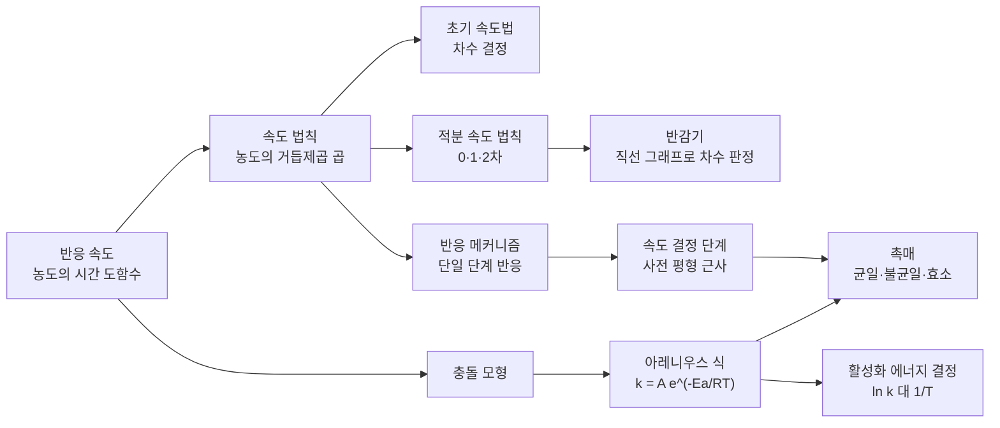

# 일반화학 7. 화학 반응 속도론 — 농도와 시간, 온도로 읽는 반응의 시계
<!-- prev: matter-4, uchem-2 -->
<!-- next: uchem-8, uchem-12, ubio-3 -->

> [!NOTE]
> **이 단원의 범위**
> - 반응 속도의 정의와 측정
> - 속도 법칙과 반응 차수(초기 속도법)
> - 적분 속도 법칙(0·1·2차)과 반감기
> - 반응 메커니즘과 속도 결정 단계
> - 충돌 모형과 아레니우스 식(활성화 에너지 구하기)
> - 촉매(균일·불균일, 효소)

**학습 목표**

1. 반응 속도를 미분 $-\dfrac{1}{a}\dfrac{d[\mathrm{A}]}{dt}$로 정의하고, 농도–시간 자료에서 평균 속도와 순간 속도를 구할 수 있다.
2. 초기 속도 자료에 로그를 적용하여 반응 차수와 속도 상수(단위 포함)를 결정할 수 있다.
3. 0·1·2차 반응의 속도 법칙을 적분하여 적분 속도 법칙과 반감기 식을 유도하고, 직선 그래프로 반응 차수를 판정할 수 있다.
4. 단일 단계 반응의 분자도와 속도 법칙의 관계를 이해하고, 속도 결정 단계·빠른 사전 평형 근사로 메커니즘에서 속도 법칙을 유도할 수 있다.
5. 충돌 모형으로 아레니우스 식의 각 항을 해석하고, 두 온도의 속도 상수나 아레니우스 그래프로 활성화 에너지를 구할 수 있다.
6. 균일 촉매·불균일 촉매·효소의 작용을 메커니즘과 에너지 그림으로 설명하고, 미카엘리스–멘텐 식의 극한 거동을 해석할 수 있다.

**이 단원의 학습 사다리**

| 단계 | 무엇을 하나? |
|---|---|
| STEP 1. 이전 학습 다시 보기 | 고등학교 「반응 속도」의 속도식·반감기·활성화 에너지와 「기체」의 이상 기체 방정식을 다시 꺼낸다 |
| STEP 2. 기초 다지기 | 도함수와 접선, 변수 분리 적분, 지수·자연로그, 직선화(선형 회귀)를 익힌다 |
| STEP 3. 핵심 개념 | 속도의 정의와 측정 → 속도 법칙 → 적분 속도 법칙 → 메커니즘 → 아레니우스 식 → 촉매 |
| STEP 4. 오개념 바로잡기 | "차수는 계수와 같다", "1차 반응은 반감기 두 번이면 끝난다" 같은 착각을 바로잡는다 |
| STEP 5. 전공 맛보기 | 정류 상태 근사, 전이 상태 이론(아이링 식) |
| STEP 6. 생활·산업·진로 | 배기가스 정화 촉매, 오존층, 약물 투여 설계, 가속 수명 시험 |

---

## 🗺️ 단원 들어가기

냉장고에 넣은 우유는 며칠을 버티지만 여름 실온에서는 하루 만에 상한다. 체내에 들어온 약은 몇 시간마다 다시 먹어야 하는데, 그 간격은 누가, 어떻게 정할까? 성층권에서는 염소 원자 하나가 수만 개의 오존 분자를 파괴할 수 있다고 하는데, 원자 '하나'가 어떻게 그렇게 많은 일을 할 수 있을까?

고등학교에서는 반응 속도를 "단위 시간당 농도 변화"로 정의하고, 초기 속도 자료로 속도식을 구하고, 1차 반응의 반감기가 일정하다는 것을 **자료로** 확인했다. 대학에서는 같은 질문을 **미분 방정식**으로 바꾼다. 속도 법칙은 "농도가 시간에 따라 어떻게 변하는가"를 말해 주는 미분 방정식이고, 그 해(적분 속도 법칙)는 반응의 '시계'가 된다. 여기에 온도의 효과를 담은 아레니우스 식과 분자 수준의 이야기인 반응 메커니즘을 더하면, 반응 속도를 예측하고 조절하는 도구가 완성된다.

---

## STEP 1. 🔙 이전 학습 다시 보기

### 연계 개념표

| 이전 단원 | 고등학교에서는 여기까지 | 대학에서는 이렇게 확장 |
|---|---|---|
| 고등학교 「물질과 에너지」 '반응 속도' [12물에04-01] | 반응 속도 = 농도 변화 ÷ 시간, 초기 속도 자료로 정수 차수 찾기 | 속도를 **도함수**로 정의, 정수가 아닌 차수도 **로그**로 결정, 속도 상수의 단위 |
| 고등학교 「물질과 에너지」 '반응 속도' [12물에04-02] | 1차 반응의 반감기는 처음 농도와 무관함을 자료로 확인 | 0·1·2차 속도 법칙을 **적분**하여 반감기 식을 유도하고, 그래프로 차수 판정 |
| 고등학교 「물질과 에너지」 '반응 속도' [12물에04-03] | 유효 충돌, 활성화 에너지, 반응 경로 에너지 그림 | **아레니우스 식**과 볼츠만 인자, 활성화 에너지의 정량적 결정 |
| 고등학교 「물질과 에너지」 '반응 속도' [12물에04-04] | 농도·온도·촉매의 영향을 정성적으로 설명 | 반응 메커니즘과 **속도 결정 단계**, 효소 속도론(미카엘리스–멘텐) |
| 「일반화학 2. 기체」 | 이상 기체 방정식, 분자 운동론, 속력 분포 | 기체 반응의 농도–압력 변환, 충돌 빈도와 에너지 분포 |

### 준비 운동 (사전 진단)

**Q1.** $\mathrm{2N_2O_5(g) \rightarrow 4NO_2(g) + O_2(g)}$에서 어느 순간 $\mathrm{N_2O_5}$의 농도가 $4.0\times10^{-3}\ \mathrm{M/s}$로 줄어들고 있다. 같은 순간 $\mathrm{NO_2}$와 $\mathrm{O_2}$의 농도 증가 속도는?

**Q2.** 어떤 1차 반응의 반감기가 20분이다. 처음 양의 $\dfrac{1}{8}$이 남을 때까지 걸리는 시간은?

**Q3.** 300 K에서 부분 압력이 0.50 bar인 기체의 몰 농도는? ($R = 0.08314\ \mathrm{L\cdot bar/(mol\cdot K)}$)

**Q4.** 온도를 10 ℃ 높이면 반응 속도가 '대략 2배' 빨라진다고 배웠다. 온도가 3.4 %(약 10 K/298 K)밖에 오르지 않았는데 속도가 2배가 되는 까닭을 분자의 에너지 분포로 설명해 보자.

정답 및 해설

**Q1.** $\dfrac{d[\mathrm{NO_2}]}{dt} = 8.0\times10^{-3}\ \mathrm{M/s}$, $\dfrac{d[\mathrm{O_2}]}{dt} = 2.0\times10^{-3}\ \mathrm{M/s}$. 계수비 2 : 4 : 1을 따른다.

**Q2.** 60분. $\left(\tfrac12\right)^3 = \tfrac18$이므로 반감기 3번이다.

**Q3.** $\dfrac{n}{V} = \dfrac{P}{RT} = \dfrac{0.50}{0.08314\times300} = 0.020\ \mathrm{M}$

**Q4.** 반응하려면 활성화 에너지 이상의 에너지를 가진 분자가 충돌해야 한다. 그런 분자는 에너지 분포 곡선의 '꼬리'에 있는 극히 일부인데, 꼬리 부분의 면적은 온도에 **지수적으로** 민감하다. 그래서 온도가 조금만 올라도 반응 가능한 분자의 비율은 크게 늘어난다. STEP 3 ⑤에서 이를 $e^{-E_a/RT}$로 정량화한다.

---

## STEP 2. 🧱 기초 다지기

### 디딤돌 1. 도함수 — 순간 변화율과 접선의 기울기

농도 $[\mathrm{A}]$가 시간 $t$의 함수일 때, 시간 간격 $\Delta t$ 동안의 평균 변화율 $\dfrac{\Delta[\mathrm{A}]}{\Delta t}$에서 $\Delta t \to 0$의 극한을 취한 것이 **도함수(derivative)** 이다.

$$
\frac{d[\mathrm{A}]}{dt} = \lim_{\Delta t\to 0}\frac{[\mathrm{A}](t+\Delta t) - [\mathrm{A}](t)}{\Delta t}
$$

그래프에서 도함수는 그 점에서 그은 **접선의 기울기**이다. 자료가 표로만 주어졌을 때는 구하려는 시각의 앞뒤 두 점으로 기울기를 계산하는 **중앙 차분** $\dfrac{[\mathrm{A}](t+h) - [\mathrm{A}](t-h)}{2h}$이 한쪽 차분보다 훨씬 정확하다.

### 디딤돌 2. 지수 함수와 자연로그

$e \approx 2.718$을 밑으로 하는 지수 함수 $e^x$와 그 역함수인 자연로그 $\ln x$는 속도론의 기본 언어이다.

| 성질 | 식 | 속도론에서 쓰이는 곳 |
|---|---|---|
| 지수 함수의 도함수 | $\dfrac{d}{dt}e^{-kt} = -k\,e^{-kt}$ | 1차 반응: 변화 속도가 현재 양에 비례 |
| 로그의 곱·몫 | $\ln(ab) = \ln a + \ln b$, $\ln\dfrac{a}{b} = \ln a - \ln b$ | 아레니우스 식의 두 온도 비교 |
| 거듭제곱 | $\ln a^n = n\ln a$ | 초기 속도법에서 차수 구하기 |
| 밑 바꾸기 | $\ln x = 2.303\log x$ | 상용로그 자료와 변환 |
| 자주 쓰는 값 | $\ln 2 = 0.693$, $\ln 10 = 2.303$ | 반감기, 90 % 반응 시간 |

**로그와 유효 숫자**: 어떤 수의 로그 값에서 **소수점 아래 자릿수**가 원래 수의 유효 숫자 개수와 같다. $k = 3.0\times10^{-3}$(유효 숫자 2개)이면 $\ln k = -5.81$(소수점 아래 2자리)로 쓴다. 거꾸로 $e^{x}$를 계산할 때는 $x$의 소수점 아래 자릿수만큼 유효 숫자를 남긴다.

### 디딤돌 3. 변수 분리로 미분 방정식 풀기

"변화 속도가 현재 양에 비례한다"는 문장은 미분 방정식 $\dfrac{dy}{dt} = -ky$이다. $y$가 들어 있는 것은 왼쪽, $t$가 들어 있는 것은 오른쪽으로 모은 뒤 양변을 적분한다.

$$
\frac{dy}{y} = -k\,dt
\quad\Rightarrow\quad
\int_{y_0}^{y}\frac{dy'}{y'} = -k\int_0^t dt'
\quad\Rightarrow\quad
\ln\frac{y}{y_0} = -kt
\quad\Rightarrow\quad
y = y_0\,e^{-kt}
$$

이때 쓰는 적분 공식은 두 가지뿐이다.

$$
\int \frac{dx}{x} = \ln x + C, \qquad \int x^{-2}\,dx = -\frac{1}{x} + C
$$

> [!TIP]
> 💡 **비유** — 변수 분리는 '짐 정리'이다. 섞여 있는 짐(변수)을 각자의 방(좌변·우변)으로 옮긴 뒤, 방마다 따로 청소(적분)하면 된다.

### 디딤돌 4. 직선으로 바꾸어 읽기 — 선형화

곡선 자료에서 상수를 읽어 내기는 어렵지만, 직선 $y = mx + b$의 기울기와 절편은 쉽게 읽힌다. 그래서 속도론에서는 식을 직선 꼴로 바꾸어 그래프를 그린다.

| 원래 식 | 직선 꼴 | 가로축 | 세로축 | 기울기 |
|---|---|---|---|---|
| $[\mathrm{A}] = [\mathrm{A}]_0e^{-kt}$ | $\ln[\mathrm{A}] = -kt + \ln[\mathrm{A}]_0$ | $t$ | $\ln[\mathrm{A}]$ | $-k$ |
| $k = Ae^{-E_a/RT}$ | $\ln k = -\dfrac{E_a}{R}\cdot\dfrac{1}{T} + \ln A$ | $1/T$ | $\ln k$ | $-E_a/R$ |
| $v = k[\mathrm{A}]^m$ | $\ln v = m\ln[\mathrm{A}] + \ln k$ | $\ln[\mathrm{A}]$ | $\ln v$ | $m$ (차수) |

스프레드시트의 '추세선(선형)' 기능이나 SLOPE 함수는 최소 제곱법으로 가장 잘 맞는 직선의 기울기를 준다. 점이 여러 개이면 두 점만 쓰는 것보다 측정 오차의 영향을 줄일 수 있다.

---

## STEP 3. 📘 핵심 개념

### ① 반응 속도의 정의와 측정

#### 계수로 나누어 하나로 정의한 반응 속도

일반적인 반응 $a\mathrm{A} + b\mathrm{B} \rightarrow c\mathrm{C} + d\mathrm{D}$에서 물질마다 농도가 변하는 빠르기는 계수만큼 다르다. 그래서 각 물질의 변화 속도를 **계수로 나누어** 하나의 값으로 정의한 것이 **반응 속도(reaction rate)** $v$이다.

$$
v = -\frac{1}{a}\frac{d[\mathrm{A}]}{dt} = -\frac{1}{b}\frac{d[\mathrm{B}]}{dt} = \frac{1}{c}\frac{d[\mathrm{C}]}{dt} = \frac{1}{d}\frac{d[\mathrm{D}]}{dt}
\qquad (\text{단위: } \mathrm{M/s})
$$

이렇게 정의하면 어떤 물질로 측정하든 반응 속도가 같은 값이 된다. 반응물의 농도는 줄어들어 도함수가 음수이므로 앞에 −를 붙인다.

#### 예제 1 — 물질별 변화 속도와 반응 속도

$\mathrm{N_2(g) + 3H_2(g) \rightarrow 2NH_3(g)}$에서 어느 순간 $\mathrm{NH_3}$가 $0.060\ \mathrm{M/s}$로 생성되고 있다. 같은 순간 $\mathrm{H_2}$와 $\mathrm{N_2}$의 소모 속도, 그리고 반응 속도 $v$를 구하시오.

**풀이**
- 식 세우기: $v = -\dfrac{d[\mathrm{N_2}]}{dt} = -\dfrac{1}{3}\dfrac{d[\mathrm{H_2}]}{dt} = \dfrac{1}{2}\dfrac{d[\mathrm{NH_3}]}{dt}$
- 대입: $v = \dfrac12\times0.060 = 0.030\ \mathrm{M/s}$
- $-\dfrac{d[\mathrm{H_2}]}{dt} = 3v = 0.090\ \mathrm{M/s}$, $-\dfrac{d[\mathrm{N_2}]}{dt} = v = 0.030\ \mathrm{M/s}$
- 의미: "반응 속도 $0.030\ \mathrm{M/s}$"는 반응식 한 단위(질소 1 mol)가 1 L에서 1초에 0.030 mol 진행한다는 뜻이다.

#### 평균 속도, 순간 속도, 초기 속도

반응은 보통 반응물이 줄어들수록 느려진다. 그래서 같은 반응이라도 **어느 구간**의 속도인지 밝혀야 한다.

- **평균 속도**: 두 시각 사이 할선의 기울기 $-\dfrac{\Delta[\mathrm{A}]}{\Delta t}$
- **순간 속도**: 한 시각에서 접선의 기울기 $-\dfrac{d[\mathrm{A}]}{dt}$
- **초기 속도(initial rate)**: $t = 0$에서의 순간 속도. 생성물이 거의 없어 역반응의 영향을 무시할 수 있다.

#### 예제 2 — 표에서 순간 속도 어림하기

용액 속 물질 A가 분해될 때 다음 자료를 얻었다.

| $t$ (s) | 0 | 30 | 60 | 90 | 120 | 180 |
|---|---|---|---|---|---|---|
| $[\mathrm{A}]$ (M) | 0.800 | 0.566 | 0.400 | 0.283 | 0.200 | 0.100 |

(1) 0~60 s와 60~120 s의 평균 속도를 구하시오. (2) 60 s에서의 순간 속도를 중앙 차분으로 어림하시오.

**풀이**
1. 0~60 s: $-\dfrac{0.400 - 0.800}{60} = 6.67\times10^{-3}\ \mathrm{M/s}$, 60~120 s: $-\dfrac{0.200 - 0.400}{60} = 3.33\times10^{-3}\ \mathrm{M/s}$. 뒤 구간이 절반으로 느려졌다.
2. 30 s와 90 s 자료를 쓰면 $-\dfrac{0.283 - 0.566}{90 - 30} = 4.72\times10^{-3}\ \mathrm{M/s}$
3. 의미: 이 자료는 뒤의 ③에서 보듯 $k = 1.155\times10^{-2}\ \mathrm{s^{-1}}$인 1차 반응에서 만든 것이다. 정확한 순간 속도는 $k[\mathrm{A}] = 4.62\times10^{-3}\ \mathrm{M/s}$로, 중앙 차분이 약 2 % 이내로 맞힌다. 반면 0~60 s 평균값($6.67\times10^{-3}$)이나 60~120 s 평균값($3.33\times10^{-3}$)을 60 s의 속도로 쓰면 크게 틀린다.

<!-- fig:uchem-7-rate-tangent -->

#### 반응 속도를 측정하는 방법

반응 속도 측정이란 결국 **어떤 물질의 농도를 시간에 따라 추적하는 것**이다. 반응을 방해하지 않고 연속으로 측정할 수 있는 물리량을 고르는 것이 핵심이다.

| 방법 | 추적하는 물리량 | 알맞은 반응의 예 |
|---|---|---|
| 분광 광도법 | 특정 파장의 빛 흡수(흡광도) | 색이 있는 물질이 생기거나 사라지는 반응(크리스털 바이올렛 탈색, $\mathrm{I_2}$ 생성) |
| 압력 측정 | 일정 부피 용기의 전체 압력 | 기체 몰수가 변하는 기체 반응($\mathrm{2N_2O_5 \rightarrow 4NO_2 + O_2}$) |
| 기체 부피 측정 | 발생한 기체의 부피 | $\mathrm{H_2O_2}$ 분해, 금속과 산의 반응 |
| 전기 전도도 | 이온의 수와 종류 변화 | 이온이 생기거나 사라지는 반응(에스터의 염기 가수 분해) |
| 반응 정지 후 적정 | 일정 시간마다 시료를 떼어 식히거나 묽혀 반응을 멈추고 적정 | 느린 용액 반응 |
| 질량 측정 | 기체가 빠져나가 줄어드는 질량 | 탄산 칼슘과 염산의 반응 |

분광 광도법에서는 **비어–람베르트 법칙(Beer–Lambert law)** 으로 흡광도 $A$를 농도로 바꾼다.

$$
A = \varepsilon\, b\, c
$$

$\varepsilon$은 몰 흡광 계수($\mathrm{L/(mol\cdot cm)}$), $b$는 빛이 지나는 길이(cm), $c$는 몰 농도이다. 예를 들어 $\varepsilon = 1.10\times10^{4}\ \mathrm{L/(mol\cdot cm)}$, $b = 1.00\ \mathrm{cm}$인 시료의 흡광도가 0.550이면 $c = \dfrac{0.550}{1.10\times10^4\times1.00} = 5.00\times10^{-5}\ \mathrm{M}$이다. 흡광도가 농도에 정비례하므로 **흡광도–시간 그래프를 곧바로 농도–시간 그래프처럼** 다룰 수 있다는 점이 큰 장점이다.

> [!TIP]
> 💡 **비유** — 반응 속도 측정은 '마라톤 중계'와 같다. 선수(분자)를 하나하나 따라갈 수는 없으니, 구간마다 통과 인원(농도)을 세어 흐름을 읽는다. 중계 카메라(측정법)는 경기를 방해하지 않아야 한다.

#### ✔ 바로 확인

1. (O/X) $\mathrm{2A \rightarrow B}$에서 반응 속도 $v$는 $-\dfrac{d[\mathrm{A}]}{dt}$와 같다.
2. 빈칸: 농도–시간 그래프에서 어느 순간의 순간 속도는 그 점에서 그은 (    )의 기울기로 구하고, 두 시각 사이의 평균 속도는 (    )의 기울기로 구한다.
3. $\varepsilon = 1.0\times10^{4}\ \mathrm{L/(mol\cdot cm)}$, $b = 1.00\ \mathrm{cm}$인 시료의 흡광도가 0.250이다. 몰 농도는?
4. 고르기: 일정 부피 용기에서 $\mathrm{2N_2O_5(g) \rightarrow 4NO_2(g) + O_2(g)}$의 진행을 연속으로 추적하기에 가장 간단한 방법은? (전기 전도도 / 압력 측정 / 반응 정지 후 적정)

정답

1. X — 계수 2로 나누어 $v = -\dfrac12\dfrac{d[\mathrm{A}]}{dt}$이다.
2. 접선, 할선 — 위의 평균 속도·순간 속도 그림에서 확인할 수 있다.
3. $c = \dfrac{A}{\varepsilon b} = \dfrac{0.250}{1.0\times10^4} = 2.5\times10^{-5}\ \mathrm{M}$
4. 압력 측정 — 기체 몰수가 2에서 5로 늘어 전체 압력이 반응 진행에 따라 커진다.

### ② 속도 법칙과 반응 차수 — 초기 속도법

#### 속도 법칙

많은 반응에서 초기 속도는 반응물 농도의 거듭제곱의 곱으로 나타난다.

$$
v = k[\mathrm{A}]^m[\mathrm{B}]^n
$$

이 식을 **속도 법칙(rate law)** 이라 하고, $k$를 **속도 상수(rate constant)**, 지수 $m$, $n$을 각 물질에 대한 **반응 차수(reaction order)**, $m + n$을 **전체 반응 차수**라 한다.

> [!IMPORTANT]
> 반응 차수는 **실험으로 정하는 값**이다. 반응식의 계수와 같을 이유가 없으며, 0, 분수, 음수가 될 수도 있다. 계수와 차수가 일치하는 것은 그 반응이 단일 단계 반응일 때(④)뿐이다.

| 반응(전체 반응식) | 실험으로 얻은 속도 법칙 | 특징 |
|---|---|---|
| $\mathrm{2N_2O_5 \rightarrow 4NO_2 + O_2}$ | $v = k[\mathrm{N_2O_5}]$ | 계수는 2인데 1차 |
| $\mathrm{2NO + 2H_2 \rightarrow N_2 + 2H_2O}$ | $v = k[\mathrm{NO}]^2[\mathrm{H_2}]$ | $\mathrm{H_2}$의 계수는 2인데 1차 |
| $\mathrm{H_2 + Br_2 \rightarrow 2HBr}$ (초기) | $v = k[\mathrm{H_2}][\mathrm{Br_2}]^{1/2}$ | 분수 차수 |
| $\mathrm{NO_2 + CO \rightarrow NO + CO_2}$ (저온) | $v = k[\mathrm{NO_2}]^2$ | CO에 대해 0차 |

#### 속도 상수의 단위

속도는 언제나 $\mathrm{M/s}$이므로, $k$의 단위는 전체 차수에 따라 달라진다. 단위만 보아도 차수를 알 수 있다.

| 전체 차수 | 속도 법칙의 예 | $k$의 단위 |
|---|---|---|
| 0 | $v = k$ | $\mathrm{M\cdot s^{-1}}$ |
| 1 | $v = k[\mathrm{A}]$ | $\mathrm{s^{-1}}$ |
| 2 | $v = k[\mathrm{A}]^2$ 또는 $k[\mathrm{A}][\mathrm{B}]$ | $\mathrm{M^{-1}\cdot s^{-1}}$ |
| 3 | $v = k[\mathrm{A}]^2[\mathrm{B}]$ | $\mathrm{M^{-2}\cdot s^{-1}}$ |
| 일반 $n$ | | $\mathrm{M^{1-n}\cdot s^{-1}}$ |

#### 초기 속도법 — 하나만 바꾸고 비를 취한다

**초기 속도법(method of initial rates)** 은 한 반응물의 처음 농도만 바꾸고 나머지는 그대로 둔 실험 두 개의 속도 비를 취한다. 그러면 바뀌지 않은 항과 $k$가 약분된다.

$$
\frac{v_2}{v_1} = \left(\frac{[\mathrm{A}]_2}{[\mathrm{A}]_1}\right)^m
\quad\Rightarrow\quad
m = \frac{\ln(v_2/v_1)}{\ln([\mathrm{A}]_2/[\mathrm{A}]_1)}
$$

농도 비가 2, 3처럼 단순하면 눈으로 보아도 되지만, 2.5배나 1.5배처럼 어중간할 때는 이 **로그 식**이 확실하다.

#### 예제 3 — 정수 차수 찾기

어떤 온도에서 $\mathrm{2NO(g) + 2H_2(g) \rightarrow N_2(g) + 2H_2O(g)}$의 초기 속도를 측정했다.

| 실험 | $[\mathrm{NO}]_0$ (M) | $[\mathrm{H_2}]_0$ (M) | 초기 속도 (M/s) |
|---|---|---|---|
| 1 | 0.0100 | 0.0100 | $4.00\times10^{-4}$ |
| 2 | 0.0200 | 0.0100 | $1.60\times10^{-3}$ |
| 3 | 0.0100 | 0.0300 | $1.20\times10^{-3}$ |

속도 법칙과 $k$(단위 포함)를 구하시오.

**풀이**
1. 실험 1→2: $[\mathrm{NO}]$ 2배, 속도 4배 → $2^m = 4$, $m = 2$
2. 실험 1→3: $[\mathrm{H_2}]$ 3배, 속도 3배 → $3^n = 3$, $n = 1$
3. 속도 법칙: $v = k[\mathrm{NO}]^2[\mathrm{H_2}]$ (전체 3차)
4. 실험 1 대입: $k = \dfrac{4.00\times10^{-4}}{(0.0100)^2(0.0100)} = 400\ \mathrm{M^{-2}\cdot s^{-1}}$ (유효 숫자 3개: $4.00\times10^2$)
5. 의미: $\mathrm{H_2}$의 계수 2와 차수 1이 다르다. 이 반응은 여러 단계로 일어난다는 신호이며, ④에서 다시 다룬다.

#### 예제 4 — 분수 차수와 로그

$\mathrm{H_2(g) + Br_2(g) \rightarrow 2HBr(g)}$의 초기 속도 자료이다.

| 실험 | $[\mathrm{H_2}]_0$ (M) | $[\mathrm{Br_2}]_0$ (M) | 초기 속도 (M/s) |
|---|---|---|---|
| 1 | 0.100 | 0.100 | $2.00\times10^{-4}$ |
| 2 | 0.300 | 0.100 | $6.00\times10^{-4}$ |
| 3 | 0.100 | 0.250 | $3.16\times10^{-4}$ |

**풀이**
1. 실험 1→2: 농도 3배에 속도 3배 → $\mathrm{H_2}$에 대해 1차
2. 실험 1→3: $n = \dfrac{\ln(3.16/2.00)}{\ln(0.250/0.100)} = \dfrac{\ln 1.58}{\ln 2.5} = \dfrac{0.457}{0.916} = 0.499 \approx \dfrac12$
3. 속도 법칙: $v = k[\mathrm{H_2}][\mathrm{Br_2}]^{1/2}$, 전체 차수 $\dfrac32$
4. $k = \dfrac{2.00\times10^{-4}}{(0.100)(0.100)^{1/2}} = 6.32\times10^{-3}\ \mathrm{M^{-1/2}\cdot s^{-1}}$
5. 의미: 분수 차수는 반응 도중 $\mathrm{Br_2}$가 원자로 쪼개지는 평형($\mathrm{Br_2 \rightleftharpoons 2Br}$)이 관여한다는 단서이다(④의 사전 평형).

<!-- fig:uchem-7-initial-rates -->

#### 격리법 — 유사 1차 반응

반응물이 둘 이상일 때 한 반응물을 아주 많이(보통 10배 이상) 넣으면 그 농도는 반응 내내 거의 일정하다. 예를 들어 $v = k[\mathrm{A}][\mathrm{B}]$에서 $[\mathrm{B}]_0 \gg [\mathrm{A}]_0$이면

$$
v = \underbrace{k[\mathrm{B}]_0}_{k'}\,[\mathrm{A}] = k'[\mathrm{A}]
$$

로 A에 대한 1차 반응처럼 보인다. 이를 **유사 1차 반응(pseudo-first-order reaction)** 이라 하고, $k'$을 겉보기 속도 상수라 한다. $[\mathrm{B}]_0$를 바꾸어 가며 $k'$을 구하면 $k' = k[\mathrm{B}]_0$에서 B에 대한 차수와 $k$까지 알 수 있다. 탐구 활동 A의 크리스털 바이올렛 실험이 이 방법을 쓴다.

> [!TIP]
> 💡 **비유** — 수영장(과량의 B)에 물 한 컵(A)을 부어도 수위는 그대로이다. 과량의 반응물은 '배경'이 되어 식에서 상수로 숨는다.

#### ✔ 바로 확인

1. (O/X) 반응 차수는 균형 맞춘 반응식의 계수로부터 정해진다.
2. 속도 상수의 단위가 $\mathrm{M^{-1}\cdot s^{-1}}$이면 전체 반응 차수는?
3. 다른 조건은 그대로 두고 $[\mathrm{A}]_0$만 3배로 했더니 초기 속도가 9배가 되었다. A에 대한 차수는?
4. 빈칸: 한 반응물 B를 아주 과량 넣어 $v = k[\mathrm{A}][\mathrm{B}]$가 $v = k'[\mathrm{A}]$처럼 보이게 한 반응을 (    ) 반응이라 한다.

정답

1. X — 차수는 실험으로 정한다. 계수와 같은 것은 단일 단계 반응일 때뿐이다.
2. 2차 — $\mathrm{M^{1-n}\cdot s^{-1}}$에서 $n = 2$이다.
3. 2차 — $3^m = 9$이므로 $m = 2$이다.
4. 유사 1차 — $k' = k[\mathrm{B}]_0$이 겉보기 속도 상수이다.

### ③ 적분 속도 법칙과 반감기

속도 법칙은 "지금 농도에서 얼마나 빠른가"를 말해 주는 **미분 속도 법칙**이다. 이를 적분하면 "시간 $t$ 뒤에 농도가 얼마인가"를 알려 주는 **적분 속도 법칙(integrated rate law)** 이 된다. 반응물이 A 하나인 $\mathrm{A \rightarrow}$ 생성물을 생각하고, 속도를 $-\dfrac{d[\mathrm{A}]}{dt} = k[\mathrm{A}]^n$으로 둔다(계수가 $a$이면 $k$ 대신 $ak$로 읽는다).

#### 1차 반응

$$
-\frac{d[\mathrm{A}]}{dt} = k[\mathrm{A}]
\;\Rightarrow\;
\int_{[\mathrm{A}]_0}^{[\mathrm{A}]}\frac{d[\mathrm{A}]}{[\mathrm{A}]} = -k\int_0^t dt
\;\Rightarrow\;
\boxed{\ln[\mathrm{A}] = \ln[\mathrm{A}]_0 - kt,\quad [\mathrm{A}] = [\mathrm{A}]_0e^{-kt}}
$$

**반감기(half-life)** $t_{1/2}$는 $[\mathrm{A}] = \tfrac12[\mathrm{A}]_0$가 되는 시간이다. 대입하면 $\ln\tfrac12 = -kt_{1/2}$이므로

$$
t_{1/2} = \frac{\ln 2}{k} = \frac{0.693}{k}
$$

처음 농도가 식에 없다. 고등학교에서 자료로 확인했던 "1차 반응의 반감기는 일정하다"의 수학적 근거이다. 방사성 붕괴, 많은 약물의 체내 제거, 기체 분자의 단분자 분해가 1차 반응을 따른다.

#### 2차 반응

$$
-\frac{d[\mathrm{A}]}{dt} = k[\mathrm{A}]^2
\;\Rightarrow\;
\int_{[\mathrm{A}]_0}^{[\mathrm{A}]}\frac{d[\mathrm{A}]}{[\mathrm{A}]^2} = -k\int_0^t dt
\;\Rightarrow\;
\boxed{\frac{1}{[\mathrm{A}]} = \frac{1}{[\mathrm{A}]_0} + kt}
\qquad
t_{1/2} = \frac{1}{k[\mathrm{A}]_0}
$$

반감기가 처음 농도에 **반비례**한다. 농도가 묽어질수록 분자끼리 만나기 어려워져, 다음 반감기는 앞 반감기의 2배가 된다.

#### 0차 반응

$$
-\frac{d[\mathrm{A}]}{dt} = k
\;\Rightarrow\;
\boxed{[\mathrm{A}] = [\mathrm{A}]_0 - kt}
\qquad
t_{1/2} = \frac{[\mathrm{A}]_0}{2k}
$$

농도와 상관없이 일정한 속도로 줄다가 $t = [\mathrm{A}]_0/k$에 바닥난다. 뜨거운 금속 표면에서 기체가 분해될 때 표면이 이미 꽉 차 있거나, 효소가 기질로 포화되었을 때 나타난다. 속도를 정하는 것이 농도가 아니라 '자리의 수'이기 때문이다.

#### 한눈에 비교

| 차수 | 미분 속도 법칙 | 적분 속도 법칙 | 직선이 되는 그래프 | 기울기 | 반감기 | $k$의 단위 |
|---|---|---|---|---|---|---|
| 0 | $-\dfrac{d[\mathrm{A}]}{dt} = k$ | $[\mathrm{A}] = [\mathrm{A}]_0 - kt$ | $[\mathrm{A}]$ 대 $t$ | $-k$ | $\dfrac{[\mathrm{A}]_0}{2k}$ | $\mathrm{M\cdot s^{-1}}$ |
| 1 | $-\dfrac{d[\mathrm{A}]}{dt} = k[\mathrm{A}]$ | $\ln[\mathrm{A}] = \ln[\mathrm{A}]_0 - kt$ | $\ln[\mathrm{A}]$ 대 $t$ | $-k$ | $\dfrac{\ln 2}{k}$ | $\mathrm{s^{-1}}$ |
| 2 | $-\dfrac{d[\mathrm{A}]}{dt} = k[\mathrm{A}]^2$ | $\dfrac{1}{[\mathrm{A}]} = \dfrac{1}{[\mathrm{A}]_0} + kt$ | $\dfrac{1}{[\mathrm{A}]}$ 대 $t$ | $+k$ | $\dfrac{1}{k[\mathrm{A}]_0}$ | $\mathrm{M^{-1}\cdot s^{-1}}$ |

> [!IMPORTANT]
> 반응 차수를 판정하는 가장 확실한 방법은 **세 가지 그래프를 모두 그려 보고 직선이 되는 것을 고르는 것**이다. 반응 초기 짧은 구간만 보면 세 그래프가 모두 직선처럼 보일 수 있으므로, 반감기를 2~3번 지날 만큼 긴 자료가 필요하다.

<!-- fig:uchem-7-half-lives -->

<!-- sim:u-rate-laws -->

#### 예제 5 — 1차 반응의 시계

기체 A의 분해는 1차 반응이고 어떤 온도에서 $k = 3.0\times10^{-3}\ \mathrm{s^{-1}}$이다. (1) 반감기, (2) $[\mathrm{A}]_0 = 0.250\ \mathrm{M}$일 때 10.0분 뒤의 농도, (3) 90 %가 분해되는 데 걸리는 시간을 구하시오.

**풀이**
1. $t_{1/2} = \dfrac{0.693}{3.0\times10^{-3}\ \mathrm{s^{-1}}} = 2.3\times10^2\ \mathrm{s}$ (약 3.9분)
2. $t = 600\ \mathrm{s}$, $kt = 1.8$ → $[\mathrm{A}] = 0.250\,e^{-1.8} = 0.041\ \mathrm{M}$ ($k$의 유효 숫자 2개에 맞춘다)
3. 10 %가 남는 시간: $\ln\dfrac{[\mathrm{A}]_0}{[\mathrm{A}]} = \ln 10 = kt$ → $t = \dfrac{2.303}{3.0\times10^{-3}} = 7.7\times10^2\ \mathrm{s}$ (약 13분)
4. 의미: 90 % 분해 시간은 처음 농도와 관계없이 반감기의 약 3.3배($\ln10/\ln2$)이다.

#### 예제 6 — 그래프로 차수 판정하기

어떤 온도에서 $\mathrm{2A(g) \rightarrow}$ 생성물의 농도를 측정하여 표를 얻고, 그 값을 아래 그림과 같이 세 가지 방식으로 찍었다. 차수와 속도 상수를 구하시오.

| $t$ (s) | 0 | 40 | 80 | 120 | 160 | 200 |
|---|---|---|---|---|---|---|
| $[\mathrm{A}]$ (M) | 0.1000 | 0.0500 | 0.0333 | 0.0250 | 0.0200 | 0.0167 |
| $\ln[\mathrm{A}]$ | −2.303 | −2.996 | −3.402 | −3.689 | −3.912 | −4.092 |
| $1/[\mathrm{A}]$ ($\mathrm{M^{-1}}$) | 10.0 | 20.0 | 30.0 | 40.0 | 50.0 | 59.9 |

<!-- fig:uchem-7-q-order-plots -->

**풀이**
1. $[\mathrm{A}]$ 대 $t$: 처음 40 s에 0.050 M, 다음 40 s에 0.017 M 감소 → 직선 아님(0차 아님)
2. $\ln[\mathrm{A}]$ 대 $t$: 구간 기울기가 −0.0173, −0.0101, −0.0072 … 로 변함 → 1차 아님
3. $1/[\mathrm{A}]$ 대 $t$: 40 s마다 정확히 $10.0\ \mathrm{M^{-1}}$씩 증가 → **2차 반응**, 기울기 $= \dfrac{10.0}{40} = 0.250\ \mathrm{M^{-1}\cdot s^{-1}}$
4. 반감기로 확인: 0.1000 → 0.0500 M에 40 s, 0.0500 → 0.0250 M에 80 s. 반감기가 2배로 늘었으니 2차 반응의 특징과 일치한다.
5. 주의: 반응식의 계수가 2이므로 반응 속도 $v = -\tfrac12\dfrac{d[\mathrm{A}]}{dt}$로 정의하면 $v = \tfrac12(0.250)[\mathrm{A}]^2$이다. 문헌의 $k$가 어떤 정의를 따르는지 늘 확인해야 한다.

#### 예제 7 — 0차 반응

뜨거운 텅스텐 표면에서 기체 암모니아의 분해가 0차로 일어나고 $k = 2.5\times10^{-4}\ \mathrm{M/s}$이다. $[\mathrm{NH_3}]_0 = 0.0100\ \mathrm{M}$일 때 반감기와 완전히 분해되는 시간은?

**풀이** $t_{1/2} = \dfrac{0.0100}{2\times2.5\times10^{-4}} = 20\ \mathrm{s}$, 완전 분해 $= \dfrac{0.0100}{2.5\times10^{-4}} = 40\ \mathrm{s}$. 1차 반응과 달리 '반감기 두 번이면 끝난다'. 표면의 활성 자리가 모두 채워져 있는 동안에는 기체가 많든 적든 같은 속도로 분해되기 때문이다. 기체 압력이 아주 낮아지면 표면이 비기 시작해 1차 거동으로 바뀐다.

> [!TIP]
> 💡 **비유** — 0차 반응은 '창구가 하나뿐인 은행'이다. 대기 인원(농도)이 아무리 많아도 처리 속도는 창구 수로 정해진다. 1차 반응은 '각자 알아서 퇴근하는 직원들'처럼 남은 인원에 비례해 줄어든다. 2차 반응은 '둘이 짝을 지어야만 나갈 수 있는 무도회'라서, 사람이 줄면 짝 찾기가 급격히 어려워진다.

#### ✔ 바로 확인

1. 짝짓기: (가) 연이은 반감기가 일정하다 (나) 연이은 반감기가 점점 길어진다 (다) 연이은 반감기가 점점 짧아진다 — 0차, 1차, 2차
2. 1차 반응의 속도 상수가 $0.0231\ \mathrm{min^{-1}}$이다. 반감기는?
3. (O/X) 2차 반응은 $\ln[\mathrm{A}]$를 $t$에 대해 그리면 직선이 된다.
4. 1차 반응에서 반감기가 네 번 지나면 처음 양의 몇 %가 남는가?

정답

1. (가) 1차, (나) 2차, (다) 0차 — 반감기 식에 $[\mathrm{A}]_0$가 없으면 일정, 분모에 있으면 길어지고, 분자에 있으면 짧아진다.
2. $t_{1/2} = \dfrac{0.693}{0.0231} = 30.0\ \mathrm{min}$
3. X — 2차 반응은 $1/[\mathrm{A}]$ 대 $t$가 기울기 $+k$인 직선이다.
4. 6.25 % — $\left(\tfrac12\right)^4 = \tfrac{1}{16}$

### ④ 반응 메커니즘과 속도 결정 단계

#### 단일 단계 반응과 분자도

대부분의 화학 반응은 분자 수준에서 여러 단계를 거친다. 한 번의 분자 충돌(또는 한 분자의 변형)로 일어나는 각 단계를 **단일 단계 반응(elementary reaction)** 이라 하고, 그 모음을 **반응 메커니즘(reaction mechanism)** 이라 한다. 단일 단계 반응에 참여하는 분자 수를 **분자도(molecularity)** 라 한다.

| 분자도 | 단일 단계의 예 | 속도 법칙 | 비고 |
|---|---|---|---|
| 단분자 | $\mathrm{A \rightarrow}$ 생성물 | $v = k[\mathrm{A}]$ | 이성질화, 분해 |
| 이분자 | $\mathrm{A + B \rightarrow}$ 생성물 | $v = k[\mathrm{A}][\mathrm{B}]$ | 가장 흔하다 |
| 이분자 | $\mathrm{2A \rightarrow}$ 생성물 | $v = k[\mathrm{A}]^2$ | |
| 삼분자 | $\mathrm{2A + B \rightarrow}$ 생성물 | $v = k[\mathrm{A}]^2[\mathrm{B}]$ | 세 분자가 동시에 만날 확률이 매우 작아 드물다 |

> [!IMPORTANT]
> **단일 단계 반응에서만** 속도 법칙을 계수로부터 바로 쓸 수 있다. 충돌 횟수가 각 반응물 농도에 비례하기 때문이다. 전체 반응식에는 이 규칙을 쓰면 안 된다.

메커니즘의 단계를 모두 더하면 전체 반응식이 되어야 한다. 이때 한 단계에서 생겼다가 다음 단계에서 소모되어 전체 반응식에 나타나지 않는 물질을 **반응 중간체(intermediate)**, 처음에 소모되었다가 나중에 다시 생겨 전체 반응식에 나타나지 않는 물질을 **촉매(catalyst)** 라 한다.

#### 속도 결정 단계 — 가장 좁은 병목

여러 단계 중 하나가 다른 단계보다 훨씬 느리면, 전체 속도는 그 느린 단계의 속도로 정해진다. 이를 **속도 결정 단계(rate-determining step)** 라 한다.

#### 예제 8 — 느린 단계가 처음일 때

저온에서 $\mathrm{NO_2(g) + CO(g) \rightarrow NO(g) + CO_2(g)}$의 속도 법칙은 $v = k[\mathrm{NO_2}]^2$이다. 다음 메커니즘이 이 속도 법칙과 맞는지 판단하시오.

$$
\begin{aligned}
&\text{1단계(느림):}\quad \mathrm{NO_2 + NO_2 \rightarrow NO_3 + NO}\\
&\text{2단계(빠름):}\quad \mathrm{NO_3 + CO \rightarrow NO_2 + CO_2}
\end{aligned}
$$

**풀이**
1. 두 단계를 더하면 $\mathrm{NO_2 + CO \rightarrow NO + CO_2}$로 전체 반응식과 같다. $\mathrm{NO_3}$는 중간체이다.
2. 느린 1단계가 속도를 결정하므로 $v = k_1[\mathrm{NO_2}]^2$이다. 실험 속도 법칙과 일치한다.
3. CO는 속도 결정 단계 **뒤에** 참여하므로 속도 법칙에 나타나지 않는다(0차). CO를 아무리 늘려도 병목은 넓어지지 않는다.

<!-- fig:uchem-7-mechanism-profile -->

#### 빠른 사전 평형 — 느린 단계가 뒤에 있을 때

느린 단계가 두 번째이고 그 앞에 빠른 가역 단계가 있으면, 느린 단계의 속도 법칙에 **중간체**가 들어간다. 중간체의 농도는 측정하기 어려우므로, 앞 단계가 빠르게 평형을 이룬다고 보고(**사전 평형 근사**) 중간체 농도를 반응물 농도로 바꾼다.

#### 예제 9 — $\mathrm{2NO + O_2 \rightarrow 2NO_2}$

실험 속도 법칙은 $v = k[\mathrm{NO}]^2[\mathrm{O_2}]$이다. 다음 메커니즘으로부터 이 속도 법칙을 유도하시오.

$$
\begin{aligned}
&\text{1단계(빠른 평형):}\quad \mathrm{2NO \underset{k_{-1}}{\overset{k_1}{\rightleftharpoons}} N_2O_2}\\
&\text{2단계(느림):}\quad \mathrm{N_2O_2 + O_2 \xrightarrow{k_2} 2NO_2}
\end{aligned}
$$

**풀이**
1. 속도 결정 단계: $v = k_2[\mathrm{N_2O_2}][\mathrm{O_2}]$ — 중간체 $\mathrm{N_2O_2}$가 들어 있다.
2. 1단계는 정반응과 역반응이 빨라 평형을 이룬다: $k_1[\mathrm{NO}]^2 = k_{-1}[\mathrm{N_2O_2}]$ → $[\mathrm{N_2O_2}] = \dfrac{k_1}{k_{-1}}[\mathrm{NO}]^2$
3. 대입: $v = \dfrac{k_2k_1}{k_{-1}}[\mathrm{NO}]^2[\mathrm{O_2}]$ → 관측 속도 상수 $k = \dfrac{k_1k_2}{k_{-1}}$
4. 의미: 실험 속도 법칙은 삼분자 단일 단계로도 설명되지만, 세 분자가 한꺼번에 부딪힐 확률은 매우 작다. 두 이분자 단계로 된 위 메커니즘이 더 그럴듯하다. 이처럼 **속도 법칙이 일치한다는 것은 메커니즘의 필요조건일 뿐 증명이 아니다.** 중간체를 분광학으로 직접 검출하는 등의 추가 증거가 필요하다.

> [!NOTE]
> 예제 4의 $\mathrm{H_2 + Br_2}$ 반응에서 $[\mathrm{Br_2}]^{1/2}$이 나오는 것도 같은 원리이다. $\mathrm{Br_2 \rightleftharpoons 2Br}$의 빠른 평형에서 $[\mathrm{Br}] = \sqrt{K[\mathrm{Br_2}]}$이고, 이 Br 원자가 $\mathrm{H_2}$와 반응하는 단계가 속도를 정한다.

#### 메커니즘을 평가하는 세 가지 기준

| 기준 | 질문 |
|---|---|
| 화학량론 | 단계를 모두 더하면 전체 반응식이 되는가? |
| 속도 법칙 | 메커니즘에서 유도한 속도 법칙이 실험 결과와 일치하는가? |
| 화학적 타당성 | 각 단계의 분자도가 그럴듯한가(삼분자 이상은 드묾)? 중간체가 실제로 검출되는가? |

> [!TIP]
> 💡 **비유** — 메커니즘은 '공장 조립 라인'이다. 완제품이 나오는 속도는 가장 느린 공정(속도 결정 단계)이 정한다. 그 공정보다 뒤에서 투입되는 부품(CO)은 아무리 쌓아 두어도 생산 속도를 바꾸지 못한다.

#### ✔ 바로 확인

1. 빈칸: 메커니즘의 한 단계에서 생겼다가 다음 단계에서 소모되어 전체 반응식에 나타나지 않는 물질을 (    )라 한다.
2. 단일 단계 반응 $\mathrm{NO(g) + O_3(g) \rightarrow NO_2(g) + O_2(g)}$의 분자도와 속도 법칙을 쓰시오.
3. (O/X) 메커니즘에서 유도한 속도 법칙이 실험 속도 법칙과 일치하면 그 메커니즘이 옳다는 것이 증명된다.
4. 예제 8의 메커니즘에서 CO의 농도만 2배로 하면 반응 속도는 어떻게 되는가?

정답

1. 반응 중간체 — 처음에 소모되고 나중에 다시 생기는 것은 촉매이다.
2. 이분자, $v = k[\mathrm{NO}][\mathrm{O_3}]$ — 단일 단계에서만 계수가 곧 차수이다.
3. X — 일치는 필요조건일 뿐이며 중간체 검출 같은 추가 증거가 필요하다.
4. 변하지 않는다 — CO는 속도 결정 단계 뒤에 참여한다.

### ⑤ 충돌 모형과 아레니우스 식

#### 충돌 모형의 세 요소

기체 반응 $\mathrm{A + B \rightarrow}$ 생성물이 일어나려면 ① 분자가 **충돌**해야 하고, ② 충돌 에너지가 **활성화 에너지** $E_a$ 이상이어야 하며, ③ **알맞은 방향**으로 부딪혀야 한다. 세 요소를 곱하면 속도 상수의 모양이 나온다.

$$
k = \underbrace{Z}_{\text{충돌 빈도 관련}}\times\underbrace{p}_{\text{방향 인자}}\times\underbrace{e^{-E_a/RT}}_{E_a\text{ 이상 충돌의 비율}}
$$

- $Z$: 농도 1 M에서 단위 시간당 충돌 수와 관련된 양. 「기체」에서 배운 평균 속력에 비례하므로 $\sqrt{T}$에 비례하지만, 온도 의존성은 지수항보다 훨씬 약하다.
- $p$: **입체 인자(steric factor)**. 분자가 복잡할수록 '맞는 방향'의 비율이 작아 1보다 훨씬 작아질 수 있다.
- $e^{-E_a/RT}$: 볼츠만 분포에서 에너지가 $E_a$ 이상인 충돌의 비율(**볼츠만 인자**).

$Zp$를 하나의 상수 $A$로 묶으면 1889년 아레니우스가 실험으로 찾아낸 식이 된다.

$$
\boxed{\;k = A\,e^{-E_a/RT}\;}
$$

$A$를 **빈도 인자(frequency factor, 앞지수 인자)** 라 하고 단위는 $k$와 같다.

#### 활성화 에너지와 전이 상태

반응물이 생성물로 바뀌는 길에서 에너지가 가장 높은 지점의 원자 배열을 **전이 상태(transition state)** 또는 **활성화물(activated complex)** 이라 한다. 결합이 반쯤 끊어지고 반쯤 만들어진 상태로, 분리해 낼 수 없는 '고갯마루'이다.

| 양 | 뜻 | 관계 |
|---|---|---|
| $E_{a,\text{정}}$ | 반응물 → 전이 상태의 에너지 차 | |
| $E_{a,\text{역}}$ | 생성물 → 전이 상태의 에너지 차 | $E_{a,\text{역}} = E_{a,\text{정}} - \Delta H$ |
| $\Delta H$ | 생성물과 반응물의 에너지 차 | 발열이면 $E_{a,\text{역}} > E_{a,\text{정}}$ |

예를 들어 $E_{a,\text{정}} = 132\ \mathrm{kJ/mol}$, $\Delta H = -226\ \mathrm{kJ/mol}$인 반응의 역반응 활성화 에너지는 $132 - (-226) = 358\ \mathrm{kJ/mol}$이다.

#### 예제 10 — 지수항의 위력

$E_a = 75.0\ \mathrm{kJ/mol}$인 반응에서 $e^{-E_a/RT}$를 25.0 ℃와 35.0 ℃에서 각각 구하고 비교하시오. ($R = 8.314\ \mathrm{J/(mol\cdot K)}$)

**풀이**
1. 298.15 K: $\dfrac{E_a}{RT} = \dfrac{75000}{8.314\times298.15} = 30.26$ → $e^{-30.26} = 7.2\times10^{-14}$
2. 308.15 K: $\dfrac{E_a}{RT} = 29.27$ → $e^{-29.27} = 1.9\times10^{-13}$
3. 비: $2.67$ — 온도가 3.4 % 올랐을 뿐인데 반응 가능한 충돌의 비율은 약 2.7배가 되었다.
4. 의미: 약 14조 번 충돌해야 한 번꼴로 성공하는 반응이다. 성공 확률이 극히 작은 '꼬리' 영역이라 온도에 지수적으로 민감하다. 준비 운동 Q4의 답이다.

<!-- fig:uchem-7-energy-tail -->

#### 두 온도의 속도 상수로 $E_a$ 구하기

두 온도 $T_1$, $T_2$에서 아레니우스 식의 로그를 취해 빼면 $A$가 사라진다.

$$
\ln\frac{k_2}{k_1} = -\frac{E_a}{R}\left(\frac{1}{T_2} - \frac{1}{T_1}\right) = \frac{E_a}{R}\left(\frac{1}{T_1} - \frac{1}{T_2}\right)
$$

"10 ℃ 올리면 속도가 2배"라는 경험 규칙에 대입해 보면, 298 K → 308 K에서 $k_2/k_1 = 2$가 되는 $E_a = \dfrac{R\ln 2}{1/298.15 - 1/308.15} \approx 53\ \mathrm{kJ/mol}$이다. 즉 이 규칙은 **활성화 에너지가 약 50 kJ/mol 정도인 반응**에만 맞는 어림이다. $E_a$가 크면 온도에 더 민감하고, 작으면 덜 민감하다.

<!-- sim:u-arrhenius -->

#### 예제 11 — 두 점으로 $E_a$와 새 온도의 $k$ 구하기

어떤 1차 반응의 속도 상수가 25.0 ℃에서 $1.35\times10^{-4}\ \mathrm{s^{-1}}$, 45.0 ℃에서 $1.28\times10^{-3}\ \mathrm{s^{-1}}$이다. (1) $E_a$, (2) 35.0 ℃에서의 $k$를 구하시오.

**풀이**
1. $\ln\dfrac{1.28\times10^{-3}}{1.35\times10^{-4}} = \ln 9.48 = 2.249$
2. $\dfrac{1}{298.15} - \dfrac{1}{318.15} = 2.108\times10^{-4}\ \mathrm{K^{-1}}$
3. $E_a = \dfrac{8.314\times2.249}{2.108\times10^{-4}} = 8.87\times10^{4}\ \mathrm{J/mol} = 88.7\ \mathrm{kJ/mol}$
4. 35.0 ℃(308.15 K): $\ln\dfrac{k}{1.35\times10^{-4}} = \dfrac{88700}{8.314}\left(\dfrac{1}{298.15} - \dfrac{1}{308.15}\right) = 1.161$ → $k = 1.35\times10^{-4}\times3.19 = 4.31\times10^{-4}\ \mathrm{s^{-1}}$
5. 의미: 35 ℃의 값이 25 ℃와 45 ℃ 값의 산술 평균($7.1\times10^{-4}$)이 아니라 기하 평균에 가깝다. $k$는 온도에 지수적으로 변하기 때문이다.

#### 예제 12 — 아레니우스 그래프로 $E_a$와 $A$ 구하기

어떤 기체 분해 반응의 속도 상수를 다섯 온도에서 측정하여 표를 얻고, 아래 그림과 같이 $\ln k$를 $1/T$에 대해 찍었다.

| $T$ (K) | 300 | 310 | 320 | 330 | 340 |
|---|---|---|---|---|---|
| $k$ ($\mathrm{s^{-1}}$) | $4.76\times10^{-4}$ | $1.48\times10^{-3}$ | $4.31\times10^{-3}$ | $1.18\times10^{-2}$ | $3.02\times10^{-2}$ |
| $1/T$ ($\mathrm{10^{-3}\,K^{-1}}$) | 3.3333 | 3.2258 | 3.1250 | 3.0303 | 2.9412 |
| $\ln k$ | −7.650 | −6.516 | −5.447 | −4.440 | −3.500 |

<!-- fig:uchem-7-q-arrhenius-plot -->

**풀이**
1. $\ln k$를 $1/T$에 대해 그리면 직선이 된다. 최소 제곱법으로 구한 기울기는 $-1.059\times10^{4}\ \mathrm{K}$이다(양 끝 두 점만 써도 $\dfrac{-3.500 - (-7.650)}{(2.9412 - 3.3333)\times10^{-3}} = -1.058\times10^4\ \mathrm{K}$).
2. $E_a = -R\times\text{기울기} = 8.314\times1.059\times10^4 = 8.80\times10^4\ \mathrm{J/mol} = 88.0\ \mathrm{kJ/mol}$
3. 절편 $\ln A = \ln k + \dfrac{E_a}{RT}$: 300 K 자료로 $-7.650 + \dfrac{88000}{8.314\times300} = 27.63$ → $A \approx 1.0\times10^{12}\ \mathrm{s^{-1}}$
4. 의미: $A$는 '활성화 에너지 장벽이 없다면 1초에 몇 번 반응할 수 있는가'에 해당한다. 단분자 반응의 $A$가 분자 진동수(약 $10^{12}$~$10^{13}\ \mathrm{s^{-1}}$) 정도라는 것은 분자가 진동할 때마다 장벽을 넘을 '기회'를 얻는다는 해석과 들어맞는다.

> [!WARNING]
> 아레니우스 식에서 $T$는 반드시 **켈빈 온도**, $E_a$는 **J/mol**로 넣어 $R = 8.314\ \mathrm{J/(mol\cdot K)}$와 단위를 맞춘다. kJ과 J를 섞는 실수가 가장 흔하다.

#### ✔ 바로 확인

1. (O/X) 아레니우스 식에 온도를 넣을 때 섭씨 온도를 써도 된다.
2. $\ln k$를 $1/T$에 대해 그렸더니 기울기가 $-8.00\times10^3\ \mathrm{K}$였다. $E_a$는?
3. 정반응의 활성화 에너지가 50 kJ/mol, $\Delta H = +30\ \mathrm{kJ/mol}$인 반응에서 역반응의 활성화 에너지는?
4. 위의 분자 에너지 분포 그림을 보고 고르기: 온도를 조금 올릴 때 크게 늘어나는 것은? (분자의 평균 에너지 / 활성화 에너지보다 큰 에너지를 가진 분자의 비율)

정답

1. X — 반드시 켈빈 온도를 쓴다.
2. $E_a = 8.314\times8.00\times10^3 = 6.65\times10^4\ \mathrm{J/mol}$ (66.5 kJ/mol)
3. $E_{a,\text{역}} = 50 - 30 = 20\ \mathrm{kJ/mol}$ — 흡열 반응은 역반응의 고개가 더 낮다.
4. 활성화 에너지보다 큰 에너지를 가진 분자의 비율 — 분포의 꼬리는 온도에 지수적으로 민감하다.

### ⑥ 촉매 — 균일 촉매, 불균일 촉매, 효소

**촉매**는 반응 메커니즘을 바꾸어 **활성화 에너지가 더 낮은 새 경로**를 제공하고, 반응이 끝나면 처음 상태로 돌아오는 물질이다. 아레니우스 식에서 보면 촉매는 주로 지수항의 $E_a$를 낮추며, 경우에 따라 $A$도 바꾼다.

> [!IMPORTANT]
> 촉매는 반응물과 생성물의 에너지 차($\Delta H$)를 바꾸지 않는다. 정반응과 역반응의 활성화 에너지를 **같은 양만큼** 낮추므로 두 방향을 같은 비율로 빠르게 하고, 따라서 **평형의 위치(평형 상수)를 바꾸지 않는다.** 이 결론은 「화학 평형」에서 $K = k_\text{정}/k_\text{역}$으로 다시 확인한다.

<!-- fig:uchem-7-catalyst-profile -->

#### 예제 13 — 활성화 에너지가 20 kJ/mol 낮아지면

어떤 반응의 활성화 에너지가 촉매에 의해 75 kJ/mol에서 55 kJ/mol로 낮아졌다. $A$가 같다고 가정하면 25 ℃에서 속도는 몇 배가 되는가?

**풀이** $\dfrac{k_\text{촉매}}{k} = e^{\Delta E_a/RT} = \exp\left(\dfrac{20000}{8.314\times298.15}\right) = e^{8.07} \approx 3\times10^{3}$배. 같은 속도 증가를 온도로 얻으려면 수십 도 이상 가열해야 한다. 열에 약한 물질이나 생물에게 촉매가 필수인 이유이다.

#### 균일 촉매

반응물과 **같은 상**에 섞여 작용하는 촉매이다.

**(1) 아이오딘화 이온과 과산화 수소의 분해**

$$
\begin{aligned}
&\mathrm{H_2O_2(aq) + I^-(aq) \rightarrow H_2O(l) + IO^-(aq)} &&(\text{느림})\\
&\mathrm{H_2O_2(aq) + IO^-(aq) \rightarrow H_2O(l) + O_2(g) + I^-(aq)} &&(\text{빠름})\\
&\text{전체: } \mathrm{2H_2O_2(aq) \rightarrow 2H_2O(l) + O_2(g)}
\end{aligned}
$$

$\mathrm{I^-}$는 첫 단계에서 소모되고 둘째 단계에서 다시 생기는 **촉매**, $\mathrm{IO^-}$는 **중간체**이다. 속도 법칙은 $v = k[\mathrm{H_2O_2}][\mathrm{I^-}]$로 촉매 농도가 들어간다. 촉매는 전체 반응식에는 없어도 속도 법칙에는 나타날 수 있다.

**(2) 성층권의 염소 원자 — 해로운 균일 촉매**

$$
\mathrm{Cl + O_3 \rightarrow ClO + O_2}, \qquad \mathrm{ClO + O \rightarrow Cl + O_2} \qquad \text{전체: } \mathrm{O_3 + O \rightarrow 2O_2}
$$

염소 원자는 한 바퀴 돌 때마다 되살아나므로, 다른 반응으로 붙잡힐 때까지 이 순환을 아주 많이 반복한다. 들어가기에서 던진 질문의 답이다. 염화 플루오린화 탄소(CFC)가 성층권에서 자외선에 분해되어 염소 원자를 내놓는 것이 오존층 파괴의 원인으로 밝혀졌다.

#### 불균일 촉매

반응물과 **다른 상**에 있는 촉매로, 보통 고체 표면에서 기체나 액체 반응물이 반응한다. 표면 반응은 다음 단계를 거친다.

| 단계 | 일어나는 일 | 예: 니켈 표면에서 에텐의 수소 첨가 |
|---|---|---|
| 1. 흡착 | 반응물이 표면의 활성 자리에 결합 | $\mathrm{H_2}$와 $\mathrm{C_2H_4}$가 Ni 표면에 붙음 |
| 2. 활성화 | 표면과의 결합으로 반응물의 결합이 약해지거나 끊어짐 | $\mathrm{H{-}H}$ 결합이 끊어져 H 원자가 표면을 이동 |
| 3. 반응 | 표면 위에서 원자들이 재배열 | H 원자가 하나씩 C에 결합 |
| 4. 탈착 | 생성물이 표면을 떠나 자리가 비워짐 | $\mathrm{C_2H_6}$가 떨어져 나감 |

<!-- fig:uchem-7-surface-catalysis -->

| 불균일 촉매 공정 | 촉매 | 반응 |
|---|---|---|
| 암모니아 합성 | 철 기반 촉매 | $\mathrm{N_2 + 3H_2 \rightarrow 2NH_3}$ |
| 자동차 삼원 촉매 | 백금·팔라듐·로듐 | $\mathrm{CO}$, 탄화수소 산화, $\mathrm{NO_x}$ 환원 |
| 유지의 경화(수소 첨가) | 니켈 | 불포화 지방산 → 포화 지방산 |
| 황산 제조(접촉법) | 오산화 바나듐 | $\mathrm{2SO_2 + O_2 \rightarrow 2SO_3}$ |

표면이 모두 덮이면 속도가 반응물 압력에 무관해진다. 예제 7의 0차 반응이 바로 이 상황이다. 표면적을 넓히기 위해 촉매를 미세 입자로 만들어 다공성 지지체에 얹으며, 황이나 납 같은 물질이 활성 자리에 강하게 붙으면 촉매가 기능을 잃는다(**촉매 독**). 자동차의 배기가스 정화 장치는 이렇게 만든 불균일 촉매의 대표적인 예이다.

<!-- photo:uchem-7-catalytic-converter -->

#### 효소 — 생체 촉매

효소는 단백질(일부는 RNA)로 된 촉매이다. 기질이 결합하는 **활성 부위(active site)** 가 기질과 전이 상태의 모양·전하에 맞게 짜여 있어 전이 상태를 안정화하고, 활성화 에너지를 크게 낮춘다. 기질이 결합할 때 효소의 모양이 조금 바뀌어 더 잘 맞게 되는 것을 **유도 적합(induced fit)** 이라 한다.

가장 간단한 효소 메커니즘은 다음과 같다.

$$
\mathrm{E + S \rightleftharpoons ES \rightarrow E + P}
$$

이로부터 유도되는 **미카엘리스–멘텐 식(Michaelis–Menten equation)** 은

$$
v = \frac{V_\text{max}[\mathrm{S}]}{K_\mathrm{M} + [\mathrm{S}]}
$$

이다. $V_\text{max}$는 효소가 모두 기질로 채워졌을 때의 최대 속도, $K_\mathrm{M}$(미카엘리스 상수)은 속도가 $V_\text{max}$의 절반이 되는 기질 농도이다.

| 기질 농도 | 근사식 | 겉보기 차수 | 해석 |
|---|---|---|---|
| $[\mathrm{S}] \ll K_\mathrm{M}$ | $v \approx \dfrac{V_\text{max}}{K_\mathrm{M}}[\mathrm{S}]$ | 기질에 대해 1차 | 빈 효소가 많아 기질이 오는 대로 처리 |
| $[\mathrm{S}] = K_\mathrm{M}$ | $v = \tfrac12V_\text{max}$ | — | 효소의 절반이 기질과 결합 |
| $[\mathrm{S}] \gg K_\mathrm{M}$ | $v \approx V_\text{max}$ | 기질에 대해 0차 | 효소가 포화되어 '창구'가 꽉 참 |

<!-- fig:uchem-7-michaelis-menten -->

#### 예제 14 — 효소 포화

$K_\mathrm{M} = 5.0\times10^{-3}\ \mathrm{M}$인 효소에서 $[\mathrm{S}] = 5.0\times10^{-4}$, $5.0\times10^{-3}$, $5.0\times10^{-2}\ \mathrm{M}$일 때 $v/V_\text{max}$를 구하시오.

**풀이** $\dfrac{v}{V_\text{max}} = \dfrac{[\mathrm{S}]}{K_\mathrm{M} + [\mathrm{S}]}$에 대입하면 각각 0.091, 0.50, 0.91이다. 기질 농도를 100배 늘려도 속도는 10배밖에 늘지 않는다. 체내에서 알코올이 시간당 거의 일정한 양씩 분해되는(0차에 가까운) 것도 분해 효소가 포화되어 있기 때문이다.

| 비교 | 균일 촉매 | 불균일 촉매 | 효소 |
|---|---|---|---|
| 상 | 반응물과 같음 | 반응물과 다름(주로 고체) | 수용액 속 거대 분자 |
| 예 | $\mathrm{I^-}$, $\mathrm{H^+}$, 성층권의 Cl | Fe, Pt, Ni, $\mathrm{V_2O_5}$ | 카탈레이스, 아밀레이스 |
| 장점 | 모든 분자가 촉매와 고르게 접촉 | 생성물과 분리·재사용 쉬움 | 선택성이 매우 높고 온화한 조건에서 작동 |
| 약점 | 생성물에서 분리하기 어려움 | 표면적·촉매 독 | 온도·pH에 민감(변성) |

> [!TIP]
> 💡 **비유** — 촉매는 '산을 뚫은 터널'이다. 출발지와 도착지의 높이(ΔH)는 그대로이지만 넘어야 할 고개가 낮아진다. 터널은 양방향 통행이 가능하므로 돌아오는 길(역반응)도 똑같이 쉬워진다.

#### ✔ 바로 확인

1. (O/X) 촉매는 정반응의 활성화 에너지만 낮추어 평형을 생성물 쪽으로 옮긴다.
2. 짝짓기: (가) 백금 표면에서 CO의 산화 (나) 성층권 Cl 원자의 오존 분해 (다) 카탈레이스에 의한 $\mathrm{H_2O_2}$ 분해 — 균일 촉매, 불균일 촉매, 효소
3. $K_\mathrm{M} = 2.0\ \mathrm{mM}$인 효소에서 $[\mathrm{S}] = 2.0\ \mathrm{mM}$, $18\ \mathrm{mM}$일 때 $v/V_\text{max}$는 각각 얼마인가?
4. 빈칸: 황이나 납처럼 활성 자리에 강하게 붙어 불균일 촉매의 기능을 잃게 하는 물질을 (    )이라 한다.

정답

1. X — 정반응과 역반응의 활성화 에너지를 같은 양만큼 낮추므로 평형 상수는 그대로이다(위의 촉매 에너지 그림).
2. (가) 불균일 촉매, (나) 균일 촉매, (다) 효소
3. 0.50, 0.90 — $\dfrac{[\mathrm{S}]}{K_\mathrm{M} + [\mathrm{S}]}$에 대입한다.
4. 촉매 독

---

## STEP 4. ⚠️ 오개념 바로잡기

| 흔한 오개념 | 올바른 개념 | 왜 그럴까? |
|---|---|---|
| 반응 차수는 반응식의 계수와 같다 | 차수는 **실험으로** 정하며, 계수와 같은 것은 단일 단계 반응일 때뿐이다 | 전체 반응식은 여러 단계의 합이고, 속도는 느린 단계가 정한다 |
| 속도 상수 $k$는 농도가 바뀌면 함께 변한다 | $k$는 온도(와 촉매)에 따라 변할 뿐 농도와 무관하다 | 농도의 영향은 이미 $[\mathrm{A}]^m$ 항에 들어 있다 |
| 1차 반응은 반감기 두 번이면 반응물이 다 없어진다 | 반감기마다 **남은 양의 절반**이 줄어 이론적으로 0이 되지 않는다 | 지수 감소 $e^{-kt}$는 0에 다가갈 뿐 닿지 않는다. 반감기 두 번에 다 없어지는 것은 0차 반응이다 |
| 반감기는 언제나 처음 농도와 무관하다 | 그것은 **1차 반응**만의 성질이다 | 0차는 $[\mathrm{A}]_0$에 비례, 2차는 반비례한다 |
| 온도를 올리면 충돌 횟수가 늘어 반응이 빨라진다 | 주된 원인은 **활성화 에너지 이상의 충돌 비율**이 지수적으로 늘어나는 것이다 | 충돌 빈도는 $\sqrt{T}$에 비례해 10 K에 약 2 %만 늘지만, $e^{-E_a/RT}$는 2배 이상 변할 수 있다 |
| 발열 반응은 온도를 올리면 느려진다 | 온도를 올리면 발열 반응도 **빨라진다** | 속도 상수는 정반응·역반응 모두 커진다. 평형이 역반응 쪽으로 이동하는 것과 속도가 느려지는 것은 다른 이야기이다 |
| 촉매는 반응에 참여하지 않는다 | 촉매는 메커니즘의 한 단계에서 **소모되었다가 재생**된다 | $\mathrm{I^-}$는 실제로 $\mathrm{H_2O_2}$와 반응해 $\mathrm{IO^-}$가 된다. 전체 반응식에 나타나지 않을 뿐이다 |
| 메커니즘에서 유도한 속도 법칙이 실험과 맞으면 그 메커니즘이 증명된 것이다 | 일치는 **필요조건**일 뿐이다 | 서로 다른 메커니즘이 같은 속도 법칙을 줄 수 있다(예제 9) |

---

## STEP 5. 🎓 다음 단계로 한 걸음 더

> [!CAUTION]
> 여기부터는 일반 과목의 범위를 넘는 전공 과목 맛보기이다. 평가 대상이 아니며, 이 단원의 도구가 전공에서 어떻게 확장되는지 보여 주기 위한 내용이다.

### 전공 과목과의 연결

| 전공 과목 | 이어지는 내용 |
|---|---|
| 물리화학 | 정류 상태 근사, 연쇄 반응, 충돌 이론의 엄밀한 유도, 전이 상태 이론, 분자 동역학 |
| 화학공학(반응 공학) | 회분식·연속 교반·관형 반응기의 설계 방정식, 촉매 반응기, 열·물질 전달과 반응의 결합 |
| 생화학 | 효소 저해(경쟁·비경쟁) 속도론, 라인위버–버크 도시, 다른 자리 입체성 효소 |
| 대기화학 | 광화학 반응, 오존 순환, 대기 오염 물질의 수명 |
| 약학(약동학) | 구획 모형, 반복 투여와 정상 상태 혈중 농도, 생체 이용률 |

### 맛보기 1. 정류 상태 근사

사전 평형 근사는 "앞 단계가 빠르다"는 조건이 필요했다. 더 일반적인 방법은 반응성이 커서 생기자마자 소모되는 중간체 I의 농도가 거의 변하지 않는다고 보는 **정류 상태 근사(steady-state approximation)** 이다.

$$
\frac{d[\mathrm{I}]}{dt} \approx 0
$$

$\mathrm{A \underset{k_{-1}}{\overset{k_1}{\rightleftharpoons}} I \xrightarrow{k_2} P}$에 적용하면 $k_1[\mathrm{A}] = (k_{-1} + k_2)[\mathrm{I}]$이고

$$
v = k_2[\mathrm{I}] = \frac{k_1k_2}{k_{-1} + k_2}[\mathrm{A}]
$$

이다. $k_2 \ll k_{-1}$이면 사전 평형 결과 $\dfrac{k_1k_2}{k_{-1}}$로, $k_2 \gg k_{-1}$이면 첫 단계가 속도 결정 단계인 $k_1$로 돌아간다. 미카엘리스–멘텐 식도 ES에 이 근사를 적용해 유도한다.

### 맛보기 2. 전이 상태 이론과 아이링 식

전이 상태 이론은 반응물과 전이 상태 사이에 평형이 있다고 보고 속도 상수를 열역학 양으로 쓴다.

$$
k = \frac{k_\mathrm{B}T}{h}\,e^{\Delta S^{\ddagger}/R}\,e^{-\Delta H^{\ddagger}/RT}
$$

$k_\mathrm{B}T/h$는 298 K에서 약 $6\times10^{12}\ \mathrm{s^{-1}}$로, 예제 12에서 본 단분자 반응의 빈도 인자와 비슷한 크기이다. 아레니우스의 $A$에 숨어 있던 '방향의 까다로움'이 활성화 엔트로피 $\Delta S^{\ddagger}$로 해석된다. 「화학 열역학」의 엔트로피를 배운 뒤 다시 보면 의미가 더 분명해진다.

### 일반화학 vs 전공 과목

| 주제 | 일반화학 | 전공(물리화학·반응 공학·생화학) |
|---|---|---|
| 속도 법칙 | 0·1·2차 적분, 초기 속도법 | 가역·병렬·연속 반응의 연립 미분 방정식, 수치 해법 |
| 메커니즘 | 속도 결정 단계, 사전 평형 | 정류 상태 근사, 연쇄 반응, 단분자 반응의 압력 의존성 |
| 온도 의존 | 아레니우스 식 | 충돌 이론의 유도, 전이 상태 이론, 터널링 |
| 촉매 | 균일·불균일·효소의 개념, 미카엘리스–멘텐 | 흡착 등온식, 촉매 표면 과학, 효소 저해 속도론 |
| 측정 | 분광·압력·전도도 | 플래시 광분해, 펨토초 분광학, 분자 빔 |

---

## STEP 6. 🏭 생활·산업·진로 연결

### 사례 1. 자동차 배기가스 정화 장치

- **원리** 불균일 촉매의 흡착–반응–탈착(STEP 3 ⑥), 아레니우스 식(⑤).
- **어디에 쓰이나** 배기관의 삼원 촉매는 벌집 모양 세라믹에 백금·팔라듐·로듐 미립자를 얇게 입혀 표면적을 크게 넓힌 것이다. CO와 탄화수소를 산화하고 질소 산화물을 환원하는 세 반응을 동시에 촉진한다. 엔진 시동 직후 촉매가 차가울 때는 반응이 느려 배출이 많으므로, 촉매를 빨리 데우는 기술이 중요하다.

### 사례 2. 오존층 보호

- **원리** 균일 촉매 순환과 중간체(⑥), 연쇄적으로 재생되는 촉매의 효과.
- **어디에 쓰이나** 염소 원자 촉매 순환이 밝혀지면서 CFC 사용을 단계적으로 금지하는 국제 협약이 맺어졌다. 대기 화학자들은 반응 속도 상수와 메커니즘을 대기 모형에 넣어 오존층의 회복 시점을 예측한다.

### 사례 3. 약물 투여 간격 설계

- **원리** 1차 반응의 적분 속도 법칙과 반감기(③).
- **어디에 쓰이나** 많은 약물은 혈중 농도에 비례하는 속도로 제거되어 1차 반응처럼 줄어든다. 반감기를 알면 혈중 농도가 효과를 내는 최소 농도 아래로 내려가기 전에 다음 약을 먹도록 투여 간격을 정할 수 있다. 콩팥이나 간의 기능이 떨어지면 $k$가 작아져 반감기가 길어지므로 용량을 조절한다.

### 사례 4. 가속 수명 시험과 유통 기한

- **원리** 아레니우스 식으로 높은 온도의 속도를 낮은 온도로 외삽(⑤).
- **어디에 쓰이나** 식품·의약품·배터리 회사는 제품을 높은 온도에 보관하며 품질이 떨어지는 속도를 몇 주~몇 달 만에 측정하고, 아레니우스 식으로 실온이나 냉장 온도에서의 수명을 예측한다. 다만 높은 온도에서만 일어나는 다른 반응이 끼어들면 예측이 틀릴 수 있어, 여러 온도에서 직선성을 확인한다.

### 관련 전공과 진로

| 진로 | 하는 일 | 관련 전공 |
|---|---|---|
| 촉매 연구원 | 화학 공정·환경 촉매 개발, 반응 메커니즘 규명 | 화학과, 화학공학과, 신소재공학과 |
| 공정 엔지니어 | 반응기 설계와 운전 조건 최적화 | 화학공학과 |
| 대기 환경 연구원 | 대기 오염·오존 화학 모델링 | 대기과학과, 환경공학과 |
| 약동학 연구원·약사 | 약물의 흡수·분포·제거 속도 분석, 용법 설계 | 약학과, 제약공학과 |
| 품질 보증 연구원 | 가속 수명 시험, 유통 기한 설정 | 식품공학과, 화학과, 재료공학과 |
| 효소 공학자 | 산업용 효소 개량과 생물 공정 개발 | 생명공학과, 생화학과 |

---

## 🔬 탐구 활동

### 활동 A. 크리스털 바이올렛 탈색 반응의 차수 결정 (분광 광도법)

**목표** 보라색 염료 크리스털 바이올렛($\mathrm{CV^+}$)이 수산화 이온과 반응해 무색이 되는 반응 $\mathrm{CV^+ + OH^- \rightarrow CVOH}$를 흡광도로 추적하여, 유사 1차 조건에서 $\mathrm{CV^+}$에 대한 차수와 $\mathrm{OH^-}$에 대한 차수를 결정한다.

**준비물** 크리스털 바이올렛 용액(약 $2\times10^{-5}\ \mathrm{M}$), 0.020 M과 0.040 M NaOH 수용액, 분광 광도계(또는 색도계·광센서, 약 590 nm), 큐벳, 피펫, 초시계, 보안경, 실험용 장갑

**과정**
1. 분광 광도계를 증류수로 영점 맞춘다.
2. CV 용액 5.0 mL와 0.020 M NaOH 5.0 mL를 빠르게 섞고 바로 큐벳에 담아 30초 간격으로 10분 동안 흡광도를 기록한다.
3. 0.040 M NaOH로 바꾸어 같은 과정을 반복한다.
4. 스프레드시트에서 각 실험의 $A$, $\ln A$, $1/A$를 시간에 대해 그리고, 직선이 되는 그래프와 기울기를 찾는다.

**결과 기록**

| 실험 | 섞은 뒤 $[\mathrm{OH^-}]$ (M) | 직선이 된 그래프 | 기울기($-k'$) | $k'$ ($\mathrm{s^{-1}}$) |
|---|---|---|---|---|
| 1 | 0.010 | | | |
| 2 | 0.020 | | | |

**생각해 보기**
1. $\mathrm{OH^-}$의 농도를 CV보다 1000배 이상 크게 한 까닭은 무엇일까? 이 조건에서 $k' = k[\mathrm{OH^-}]^n$이 되는 이유를 설명해 보자.
2. 실험 2의 $k'$이 실험 1의 약 2배라면 $\mathrm{OH^-}$에 대한 차수는? 이로부터 $k$(단위 포함)를 구해 보자.
3. 흡광도 대신 농도를 쓰지 않아도 1차 반응의 $k'$을 구할 수 있는 까닭은? (비어–람베르트 법칙과 $\ln A$ 그래프의 관계)

> [!WARNING]
> **안전 수칙** 수산화 나트륨 수용액은 피부와 눈을 상하게 하므로 보안경과 장갑을 착용한다. 크리스털 바이올렛은 피부·옷에 잘 물들고 삼키면 해로우므로 맨손으로 다루지 않는다. 묻으면 즉시 많은 물로 씻는다. 실험 후 용액은 하수구에 버리지 말고 지정된 폐액 용기에 모은다.

### 활동 B. 자료 분석 — 아레니우스 그래프와 '10 ℃ 규칙'의 검증

**목표** 여러 온도의 속도 상수 자료로 활성화 에너지를 구하고, 경험 규칙이 성립하는 조건을 계산으로 확인한다.

**과정**
1. 예제 12의 자료를 스프레드시트에 입력하고 $1/T$와 $\ln k$ 열을 만든다.
2. 분산형 그래프와 선형 추세선(또는 SLOPE, INTERCEPT 함수)으로 기울기와 절편을 구해 $E_a$와 $A$를 계산한다.
3. 같은 시트에서 $E_a$를 20, 50, 100, 150 kJ/mol로 바꾸어 가며 $k(308\ \mathrm{K})/k(298\ \mathrm{K})$를 계산한다.
4. 일부러 한 자료점에 10 % 오차를 넣고 $E_a$가 얼마나 바뀌는지 본다.

**결과 기록**

| $E_a$ (kJ/mol) | 20 | 50 | 100 | 150 |
|---|---|---|---|---|
| $k(308)/k(298)$ | | | | |

**생각해 보기**
1. '10 ℃에 2배' 규칙은 어떤 크기의 $E_a$에서 잘 맞는가? 효소 반응이나 연소 반응에도 그대로 적용할 수 있을까?
2. 자료점 다섯 개로 기울기를 구하는 것이 두 점으로 구하는 것보다 좋은 까닭을 오차의 관점에서 설명해 보자.

---

## ✅ 개념 확인 문제

### 기본

**1.** $\mathrm{4NH_3(g) + 5O_2(g) \rightarrow 4NO(g) + 6H_2O(g)}$에서 어느 순간 $\mathrm{NH_3}$가 $0.24\ \mathrm{M/s}$로 소모되고 있다. 이 순간 (1) $\mathrm{O_2}$의 소모 속도, (2) $\mathrm{H_2O}$의 생성 속도, (3) 반응 속도 $v$를 구하시오.

정답 및 해설

**정답** (1) $0.30\ \mathrm{M/s}$ (2) $0.36\ \mathrm{M/s}$ (3) $0.060\ \mathrm{M/s}$

$v = -\dfrac14\dfrac{d[\mathrm{NH_3}]}{dt} = \dfrac{0.24}{4} = 0.060\ \mathrm{M/s}$이다. $\mathrm{O_2}$는 $5v = 0.30$, $\mathrm{H_2O}$는 $6v = 0.36\ \mathrm{M/s}$이다.

**2.** 속도 법칙이 $v = k[\mathrm{A}]^2[\mathrm{B}]$인 반응에서 (1) 전체 반응 차수와 $k$의 단위를 쓰고, (2) A와 B의 농도를 모두 2배로 하면 속도는 몇 배가 되는지 구하시오.

정답 및 해설

**정답** (1) 3차, $\mathrm{M^{-2}\cdot s^{-1}}$ (2) 8배

(1) $k = \dfrac{v}{[\mathrm{A}]^2[\mathrm{B}]}$의 단위는 $\dfrac{\mathrm{M/s}}{\mathrm{M^3}} = \mathrm{M^{-2}\cdot s^{-1}}$이다. (2) $2^2\times2 = 8$배이다.

**3.** 어떤 1차 반응의 속도 상수가 $0.0462\ \mathrm{min^{-1}}$이다. (1) 반감기와 (2) 1.00시간 뒤 남아 있는 반응물의 비율을 구하시오.

정답 및 해설

**정답** (1) 15.0분 (2) 0.0625 (6.25 %)

(1) $t_{1/2} = \dfrac{0.693}{0.0462} = 15.0\ \mathrm{min}$
(2) $\dfrac{[\mathrm{A}]}{[\mathrm{A}]_0} = e^{-0.0462\times60.0} = e^{-2.77} = 0.0625$. 60분은 반감기 4번이므로 $\left(\tfrac12\right)^4 = \tfrac{1}{16}$과 일치한다.

**4.** 단일 단계 반응 $\mathrm{2NO(g) + Br_2(g) \rightarrow 2NOBr(g)}$에 대해 (1) 분자도와 (2) 속도 법칙을 쓰시오. (3) 전체 반응식 $\mathrm{2N_2O_5 \rightarrow 4NO_2 + O_2}$의 속도 법칙을 같은 방법으로 쓸 수 없는 까닭은?

정답 및 해설

**정답** (1) 삼분자 (2) $v = k[\mathrm{NO}]^2[\mathrm{Br_2}]$ (3) 전체 반응식은 단일 단계가 아니기 때문이다.

단일 단계 반응은 분자 충돌 그 자체이므로 계수가 곧 차수이다. 전체 반응식은 여러 단계의 합이므로 차수는 실험으로 정해야 하며, 실제로 $\mathrm{N_2O_5}$의 분해는 1차이다.

**5.** 어떤 반응의 $\ln k$를 $1/T$에 대해 그렸더니 기울기가 $-1.20\times10^4\ \mathrm{K}$인 직선을 얻었다. 활성화 에너지를 구하시오.

정답 및 해설

**정답** $99.8\ \mathrm{kJ/mol}$

기울기 $= -\dfrac{E_a}{R}$이므로 $E_a = 1.20\times10^4\ \mathrm{K}\times8.314\ \mathrm{J/(mol\cdot K)} = 9.98\times10^4\ \mathrm{J/mol}$이다.

### 응용

**6.** 반응 $\mathrm{A + B \rightarrow C}$의 초기 속도 자료이다. 속도 법칙과 $k$를 구하시오.

| 실험 | $[\mathrm{A}]_0$ (M) | $[\mathrm{B}]_0$ (M) | 초기 속도 (M/s) |
|---|---|---|---|
| 1 | 0.150 | 0.150 | $2.70\times10^{-4}$ |
| 2 | 0.225 | 0.150 | $6.08\times10^{-4}$ |
| 3 | 0.150 | 0.375 | $6.75\times10^{-4}$ |

정답 및 해설

**정답** $v = k[\mathrm{A}]^2[\mathrm{B}]$, $k = 8.00\times10^{-2}\ \mathrm{M^{-2}\cdot s^{-1}}$

실험 1→2: $m = \dfrac{\ln(6.08/2.70)}{\ln(0.225/0.150)} = \dfrac{\ln 2.25}{\ln 1.5} = \dfrac{0.812}{0.405} = 2.00$
실험 1→3: $n = \dfrac{\ln(6.75/2.70)}{\ln(0.375/0.150)} = \dfrac{\ln 2.5}{\ln 2.5} = 1.00$
$k = \dfrac{2.70\times10^{-4}}{(0.150)^2(0.150)} = 0.0800\ \mathrm{M^{-2}\cdot s^{-1}}$
농도 비가 1.5, 2.5처럼 어중간할 때는 로그 식을 쓰면 확실하다.

**7.** 기체 상태의 뷰타다이엔이 이량체를 만드는 반응은 2차 반응이다. 어떤 온도에서 $k = 0.0140\ \mathrm{M^{-1}\cdot s^{-1}}$($-d[\mathrm{A}]/dt = k[\mathrm{A}]^2$로 정의), 처음 농도가 0.0200 M일 때 (1) 반감기와 (2) 75 %가 반응하는 데 걸리는 시간을 구하시오. (3) (2)가 반감기의 2배가 아닌 까닭은?

정답 및 해설

**정답** (1) $3.57\times10^3\ \mathrm{s}$ (2) $1.07\times10^4\ \mathrm{s}$ (3) 2차 반응의 반감기는 농도에 반비례하여 점점 길어지기 때문이다.

(1) $t_{1/2} = \dfrac{1}{k[\mathrm{A}]_0} = \dfrac{1}{0.0140\times0.0200} = 3.57\times10^3\ \mathrm{s}$
(2) 25 %가 남으면 $[\mathrm{A}] = 0.00500\ \mathrm{M}$: $t = \dfrac{1}{k}\left(\dfrac{1}{0.00500} - \dfrac{1}{0.0200}\right) = \dfrac{150}{0.0140} = 1.07\times10^4\ \mathrm{s}$
(3) 첫 반감기 $3.57\times10^3$ s 뒤 농도가 절반이 되었으므로 두 번째 반감기는 2배인 $7.14\times10^3$ s이다. 합하면 $1.07\times10^4$ s로 첫 반감기의 3배이다. 1차 반응이었다면 2배였을 것이다.

**8.** 오존의 분해 $\mathrm{2O_3(g) \rightarrow 3O_2(g)}$에 대해 다음 메커니즘이 제안되었다. 속도 법칙을 유도하고, $\mathrm{O_2}$를 더 넣으면 속도가 어떻게 되는지 예측하시오.

$$
\begin{aligned}
&\text{1단계(빠른 평형):}\quad \mathrm{O_3 \rightleftharpoons O_2 + O} \quad (\text{평형 상수 } K_1)\\
&\text{2단계(느림):}\quad \mathrm{O + O_3 \xrightarrow{k_2} 2O_2}
\end{aligned}
$$

정답 및 해설

**정답** $v = k_2K_1\dfrac{[\mathrm{O_3}]^2}{[\mathrm{O_2}]}$, $\mathrm{O_2}$를 넣으면 속도가 **느려진다.**

느린 단계: $v = k_2[\mathrm{O}][\mathrm{O_3}]$. 빠른 평형에서 $K_1 = \dfrac{[\mathrm{O_2}][\mathrm{O}]}{[\mathrm{O_3}]}$ → $[\mathrm{O}] = K_1\dfrac{[\mathrm{O_3}]}{[\mathrm{O_2}]}$를 대입한다. $\mathrm{O_2}$가 늘면 1단계 평형이 왼쪽으로 이동해 중간체 O가 줄어든다. 차수가 음수(−1)가 될 수 있는 예이다.

<!-- fig:uchem-7-q-ozone-profile -->

**9.** 어떤 반응의 속도 상수가 20.0 ℃에서 $4.5\times10^{-3}\ \mathrm{s^{-1}}$, 30.0 ℃에서 $1.1\times10^{-2}\ \mathrm{s^{-1}}$이다. (1) 활성화 에너지와 (2) 40.0 ℃에서의 속도 상수를 구하시오.

정답 및 해설

**정답** (1) 약 66 kJ/mol (2) 약 $2.5\times10^{-2}\ \mathrm{s^{-1}}$

(1) $E_a = \dfrac{R\ln(k_2/k_1)}{1/T_1 - 1/T_2} = \dfrac{8.314\times\ln(2.44)}{1/293.15 - 1/303.15} = \dfrac{8.314\times0.894}{1.125\times10^{-4}} = 6.6\times10^4\ \mathrm{J/mol}$
(2) $\ln\dfrac{k_3}{4.5\times10^{-3}} = \dfrac{6.6\times10^4}{8.314}\left(\dfrac{1}{293.15} - \dfrac{1}{313.15}\right) = 1.73$ → $k_3 = 4.5\times10^{-3}\times5.6 = 2.5\times10^{-2}\ \mathrm{s^{-1}}$
자료의 유효 숫자가 2개이므로 답도 2개로 쓴다.

### 융합·서술형

**10. [약학 연계]** 어떤 항생제는 체내에서 1차 반응으로 제거되며 반감기가 4.0시간이다. 투여 직후 혈중 농도가 12 mg/L였다. (1) 5.0시간 뒤의 혈중 농도를 구하시오. (2) 이 약은 혈중 농도가 1.5 mg/L 아래로 떨어지면 효과가 없다. 다음 투여까지 최대 몇 시간 기다릴 수 있는가? (3) 콩팥 기능이 떨어진 환자에게 같은 용량을 같은 간격으로 투여하면 어떤 문제가 생길 수 있는지 속도 상수로 설명하시오.

정답 및 해설

**예시 답안**
(1) $k = \dfrac{0.693}{4.0\ \mathrm{h}} = 0.17\ \mathrm{h^{-1}}$, $C = 12\,e^{-0.173\times5.0} = 5.0\ \mathrm{mg/L}$
(2) $\dfrac{12}{1.5} = 8 = 2^3$이므로 반감기 3번, 즉 **12시간**이다.
(3) 제거 속도 상수 $k$가 작아져 반감기가 길어진다. 다음 약을 먹을 때 이전 약이 많이 남아 있어 혈중 농도가 투여할 때마다 쌓이고, 독성이 나타나는 농도에 이를 수 있다. 그래서 용량을 줄이거나 간격을 늘린다.

**채점 포인트** ① 1차 반응 식 또는 반감기 횟수로 계산 ② 12시간 도출 ③ $k$ 감소 → 반감기 증가 → 축적의 연결

**11. [식품공학 연계]** 어떤 음료의 비타민 C가 분해되어 품질 기준 아래로 떨어지는 데 25 ℃에서 12개월, 40 ℃에서 3.0개월이 걸렸다. 분해 속도가 아레니우스 식을 따르고 같은 메커니즘으로 일어난다고 가정하자. (1) 겉보기 활성화 에너지를 구하시오. (2) 5 ℃ 냉장 보관 시 예상 유통 기한은? (3) 이 예측이 틀릴 수 있는 이유를 한 가지 쓰시오.

정답 및 해설

**예시 답안**
(1) 같은 정도로 분해되는 시간은 $k$에 반비례하므로 $\dfrac{k_{40}}{k_{25}} = \dfrac{12}{3.0} = 4.0$
$E_a = \dfrac{8.314\times\ln4.0}{1/298.15 - 1/313.15} = \dfrac{8.314\times1.386}{1.607\times10^{-4}} = 7.2\times10^4\ \mathrm{J/mol}$ (약 72 kJ/mol)
(2) $\dfrac{k_5}{k_{25}} = \exp\left[-\dfrac{7.2\times10^4}{8.314}\left(\dfrac{1}{278.15} - \dfrac{1}{298.15}\right)\right] \approx 0.125$ → 유통 기한 $\approx \dfrac{12}{0.125} \approx 96$개월(약 8년). 자료의 정밀도를 생각하면 "약 $1\times10^2$개월" 정도로 보아야 한다.
(3) 온도에 따라 분해 메커니즘이 달라질 수 있다(예: 높은 온도에서만 일어나는 반응), 냉장 온도에서 미생물·빛·산소 같은 다른 요인이 주도할 수 있다, 두 점만으로 직선성을 확인할 수 없다 등.

**채점 포인트** ① 시간과 $k$의 반비례 관계 ② 켈빈 온도로 $E_a$ 계산 ③ 외삽의 한계 지적

**12. [평형 연계]** 어떤 반응의 정반응 활성화 에너지가 120 kJ/mol, 반응 엔탈피가 −40 kJ/mol이다. 촉매를 넣었더니 정반응 활성화 에너지가 80 kJ/mol이 되었다. (1) 촉매가 없을 때와 있을 때 역반응의 활성화 에너지를 각각 구하시오. (2) 500 K에서 정반응과 역반응의 속도 상수는 각각 몇 배가 되는가? ($A$는 변하지 않는다고 가정) (3) 이 결과가 평형 상수에 대해 말해 주는 것은?

정답 및 해설

**예시 답안**
(1) $E_{a,\text{역}} = E_{a,\text{정}} - \Delta H$: 촉매 없음 $120 + 40 = 160\ \mathrm{kJ/mol}$, 촉매 있음 $80 + 40 = 120\ \mathrm{kJ/mol}$
(2) 두 방향 모두 40 kJ/mol 낮아졌으므로 $e^{40000/(8.314\times500)} = e^{9.62} \approx 1.5\times10^4$배로 **같다.**
(3) 단일 단계 가역 반응에서 평형 상수는 $K = k_\text{정}/k_\text{역}$이므로, 두 속도 상수가 같은 비율로 커지면 $K$는 변하지 않는다. 촉매는 평형에 도달하는 시간만 줄인다. 다음 단원 「화학 평형」에서 이 관계를 자세히 다룬다.

**채점 포인트** ① $E_{a,\text{역}} = E_{a,\text{정}} - \Delta H$ ② 같은 배율 ③ $K = k_\text{정}/k_\text{역}$ 불변

<!-- fig:uchem-7-q-catalyst-energies -->

### 실력 다지기

**13.** 일정 부피·일정 온도의 용기에 순수한 $\mathrm{N_2O_5}$만 0.500 bar 넣고 $\mathrm{2N_2O_5(g) \rightarrow 4NO_2(g) + O_2(g)}$의 진행을 전체 압력 $P_\text{전체}$로 추적했다.

| $t$ (s) | 0 | 600 | 1200 |
|---|---|---|---|
| $P_\text{전체}$ (bar) | 0.500 | 0.694 | 0.838 |

(1) $\mathrm{N_2O_5}$의 분압을 $P_\text{전체}$로 나타내시오. (2) 이 자료가 1차 반응과 맞는지 확인하고 속도 상수와 반감기를 구하시오. (3) 반응이 끝났을 때의 전체 압력은?

정답 및 해설

**정답** (1) $P_{\mathrm{N_2O_5}} = \dfrac{5(0.500) - 2P_\text{전체}}{3}$ (2) 1차, $k = 5.0\times10^{-4}\ \mathrm{s^{-1}}$, $t_{1/2} = 1.4\times10^3\ \mathrm{s}$ (3) 1.25 bar

(1) $\mathrm{N_2O_5}$의 분압이 $y$만큼 줄면 $\mathrm{NO_2}$는 $2y$, $\mathrm{O_2}$는 $\tfrac12y$ 생기므로 $P_\text{전체} = 0.500 + \tfrac32y$이다. $y = \tfrac23(P_\text{전체} - 0.500)$를 $P_{\mathrm{N_2O_5}} = 0.500 - y$에 넣으면 된다.
(2) $P_{\mathrm{N_2O_5}}$는 600 s에 0.3707, 1200 s에 0.2747 bar이다. 두 구간의 $\dfrac{1}{600}\ln\dfrac{P_\text{앞}}{P_\text{뒤}}$가 $4.99\times10^{-4}$, $5.00\times10^{-4}\ \mathrm{s^{-1}}$로 같으므로 1차 반응이다. $t_{1/2} = 0.693/k = 1.39\times10^3\ \mathrm{s}$
(3) 모두 반응하면 $y = 0.500$이므로 $P_\text{전체} = 0.500 + 0.750 = 1.25\ \mathrm{bar}$ (처음의 2.5배)

**채점 포인트** ① 계수비로 전체 압력과 분압 연결 ② 같은 시간 간격의 비가 일정함으로 1차 판정 ③ 끝 압력

**14.** 어떤 반응 $\mathrm{A \rightarrow}$ 생성물에서 처음 농도가 0.10 M일 때 반감기는 50 s, 0.20 M일 때 반감기는 25 s였다. (1) 반응 차수와 속도 상수($-d[\mathrm{A}]/dt = k[\mathrm{A}]^n$으로 정의)를 구하시오. (2) 처음 농도 0.20 M인 A가 0.025 M이 될 때까지 걸리는 시간을 구하시오. (3) 이 반응이 1차였다면 (2)의 시간은 얼마였겠는가? (처음 반감기 25 s는 같다고 하자)

정답 및 해설

**정답** (1) 2차, $k = 0.20\ \mathrm{M^{-1}\cdot s^{-1}}$ (2) 175 s (3) 75 s

(1) 처음 농도를 2배로 하자 반감기가 절반이 되었다. 반감기가 $[\mathrm{A}]_0$에 반비례하므로 2차이다. $k = \dfrac{1}{t_{1/2}[\mathrm{A}]_0} = \dfrac{1}{50\times0.10} = 0.20\ \mathrm{M^{-1}\cdot s^{-1}}$
(2) $t = \dfrac{1}{k}\left(\dfrac{1}{0.025} - \dfrac{1}{0.20}\right) = \dfrac{40 - 5.0}{0.20} = 175\ \mathrm{s}$. 반감기로 보면 25 + 50 + 100 s이다.
(3) 0.20 → 0.025 M은 반감기 3번이므로 $3\times25 = 75\ \mathrm{s}$

**채점 포인트** ① 반감기와 처음 농도의 관계로 차수 판정 ② 적분 속도 법칙 ③ 차수에 따른 반감기 변화 비교

<!-- fig:uchem-7-q-second-order-halves -->

**15.** 어떤 반응의 활성화 에너지가 80.0 kJ/mol이다. 촉매를 넣으면 활성화 에너지가 65.0 kJ/mol로 낮아지고 빈도 인자 $A$는 그대로라고 하자. (1) 25.0 ℃에서 촉매가 속도를 몇 배로 하는가? (2) 촉매 없이 같은 속도 상수를 얻으려면 온도를 몇 ℃로 올려야 하는가? (3) (2)의 결과를 두고 "촉매는 반응물을 데우는 것과 같은 효과를 낸다"고 말하는 것이 옳지 않은 까닭을 평형의 관점에서 한 가지 쓰시오.

정답 및 해설

**정답** (1) 약 $4\times10^2$배 (2) 약 94 ℃ (3) 예시 아래

(1) $\dfrac{k_\text{촉매}}{k} = \exp\left(\dfrac{15000}{8.314\times298.15}\right) = e^{6.05} = 4.2\times10^2$
(2) $A$가 같으므로 $\dfrac{E_a}{RT'} = \dfrac{E_a'}{RT}$이면 된다. $T' = 298.15\times\dfrac{80.0}{65.0} = 367.0\ \mathrm{K}$, 약 93.8 ℃
(3) 온도를 올리면 평형 상수 자체가 바뀐다(발열 반응이면 K가 작아짐). 촉매는 K를 바꾸지 않고 평형에 도달하는 시간만 줄인다. 또 높은 온도에서는 다른 부반응이 빨라질 수 있다.

**채점 포인트** ① 지수항 비 계산 ② $E_a/T$가 같아야 한다는 조건 ③ 촉매는 K 불변, 온도는 K 변화

### 도전

**16. [실험 오차 분석]** 한 학생이 어떤 반응의 속도 상수를 25.0 ℃에서 $2.00\times10^{-3}\ \mathrm{s^{-1}}$, 35.0 ℃에서 $4.40\times10^{-3}\ \mathrm{s^{-1}}$로 측정했다. (1) 활성화 에너지를 구하시오. (2) 각 속도 상수에 ±5 %의 불확도가 있다면 $E_a$가 가질 수 있는 범위는? (3) 나중에 확인해 보니 35.0 ℃로 기록한 실험의 실제 온도가 36.0 ℃였다. 올바른 $E_a$는? (4) 이 결과를 바탕으로 $E_a$를 더 믿을 만하게 구하는 실험 설계를 두 가지 제안하시오.

정답 및 해설

**정답** (1) 60.2 kJ/mol (2) 약 52.6~67.9 kJ/mol (3) 54.9 kJ/mol (4) 예시 아래

(1) $\dfrac{1}{298.15} - \dfrac{1}{308.15} = 1.088\times10^{-4}\ \mathrm{K^{-1}}$, $E_a = \dfrac{8.314\times\ln2.20}{1.088\times10^{-4}} = 6.02\times10^4\ \mathrm{J/mol}$
(2) 비 $k_2/k_1$은 가장 작으면 $2.20\times\dfrac{0.95}{1.05} = 1.99$, 가장 크면 $2.20\times\dfrac{1.05}{0.95} = 2.43$이다. 각각 넣으면 $E_a$ = 52.6, 67.9 kJ/mol이다. 속도 상수의 5 % 오차가 $E_a$에서는 ±13 % 가까운 오차가 된다.
(3) $\dfrac{1}{298.15} - \dfrac{1}{309.15} = 1.193\times10^{-4}\ \mathrm{K^{-1}}$ → $E_a = \dfrac{8.314\times0.788}{1.193\times10^{-4}} = 54.9\ \mathrm{kJ/mol}$. 온도 1 ℃의 실수가 $E_a$를 약 10 % 바꾼다.
(4) ① 온도 간격을 넓히고(예: 15~55 ℃) 4~5개 온도에서 측정해 $\ln k$ 대 $1/T$의 최소 제곱 직선으로 기울기를 구한다. ② 항온조와 교정한 온도계를 쓰고, 반응 용액의 온도를 직접 잰다. ③ 온도마다 반복 측정하여 $k$의 표준 편차를 구한다.

**채점 포인트** ① 두 점 식으로 $E_a$ ② 비의 최소·최대로 오차 전파 ③ 온도 오차의 큰 영향 인식 ④ 측정점 수·온도 범위·온도 관리 중 두 가지

**17. [자료 해석 종합]** 아이오딘화 칼륨을 촉매로 과산화 수소를 분해하면서(⑥의 메커니즘, $v = k[\mathrm{H_2O_2}][\mathrm{I^-}]$) 발생한 산소의 부피를 측정했다. $[\mathrm{I^-}] = 0.020\ \mathrm{M}$이고, 반응이 끝났을 때 모은 산소는 50.0 mL였다.

| $t$ (s) | 0 | 60 | 120 |
|---|---|---|---|
| 모은 $\mathrm{O_2}$ (mL) | 0 | 20.0 | 32.0 |

(1) 반응 중에 $[\mathrm{I^-}]$가 일정하다고 볼 수 있는 까닭은? (2) 남은 $\mathrm{H_2O_2}$의 비율을 산소 부피로 나타내고, 이 자료가 $\mathrm{H_2O_2}$에 대해 1차인지 판정하여 겉보기 속도 상수 $k'$과 $k$를 구하시오. (3) 같은 $\mathrm{H_2O_2}$ 용액에 $[\mathrm{I^-}] = 0.040\ \mathrm{M}$을 쓰면 $\mathrm{H_2O_2}$의 반감기와 끝까지 모이는 산소의 부피는 각각 어떻게 되는가?

정답 및 해설

**정답** (1) 예시 아래 (2) 1차, $k' = 8.5\times10^{-3}\ \mathrm{s^{-1}}$, $k = 0.43\ \mathrm{M^{-1}\cdot s^{-1}}$ (3) 반감기 약 41 s(절반), 산소는 그대로 50.0 mL

(1) $\mathrm{I^-}$는 느린 1단계에서 소모되지만 빠른 2단계에서 곧바로 되살아나는 촉매이므로 전체 농도가 거의 변하지 않는다. 따라서 $v = (k[\mathrm{I^-}])[\mathrm{H_2O_2}] = k'[\mathrm{H_2O_2}]$로 유사 1차 반응이 된다.
(2) 남은 비율 $= \dfrac{V_\infty - V}{V_\infty}$: 60 s에 $\dfrac{30.0}{50.0} = 0.600$, 120 s에 $\dfrac{18.0}{50.0} = 0.360 = 0.600^2$. 같은 시간마다 같은 비율로 줄었으므로 1차이다. $k' = \dfrac{\ln(1/0.600)}{60\ \mathrm{s}} = 8.51\times10^{-3}\ \mathrm{s^{-1}}$, $k = \dfrac{k'}{[\mathrm{I^-}]} = \dfrac{8.51\times10^{-3}}{0.020} = 0.43\ \mathrm{M^{-1}\cdot s^{-1}}$
(3) $k'$이 2배가 되어 $t_{1/2} = \dfrac{0.693}{2\times8.51\times10^{-3}} = 41\ \mathrm{s}$ (원래 81 s). 촉매는 생성물의 양을 바꾸지 않으므로 산소는 같은 50.0 mL이다.

**채점 포인트** ① 촉매의 재생과 유사 1차 조건 ② 부피 자료를 남은 비율로 바꾸어 1차 판정 ③ $k = k'/[\mathrm{I^-}]$ ④ 촉매는 속도만 바꾸고 양은 바꾸지 않음

---

## 📝 한눈에 정리

### 핵심 요약

- **반응 속도** $v = -\dfrac1a\dfrac{d[\mathrm{A}]}{dt}$는 계수로 나누어 하나로 정의하며, 순간 속도는 농도–시간 곡선의 접선 기울기이다.
- **속도 법칙** $v = k[\mathrm{A}]^m[\mathrm{B}]^n$의 차수는 실험으로 정하며, 초기 속도법에서는 $m = \ln(v_2/v_1)/\ln([\mathrm{A}]_2/[\mathrm{A}]_1)$로 구한다.
- 한 반응물을 과량으로 넣으면 **유사 1차 반응**이 되어 차수를 하나씩 따로 구할 수 있다.
- 속도 법칙을 적분하면 **적분 속도 법칙**이 되며, 0·1·2차는 각각 $[\mathrm{A}]$, $\ln[\mathrm{A}]$, $1/[\mathrm{A}]$ 대 $t$ 그래프가 직선이다.
- **반감기**는 0차에서 $[\mathrm{A}]_0$에 비례, 1차에서 일정($0.693/k$), 2차에서 $[\mathrm{A}]_0$에 반비례한다.
- **단일 단계 반응**에서만 계수가 차수이다. 전체 속도는 **속도 결정 단계**가 정하고, 그 앞의 빠른 평형은 사전 평형 근사로 처리한다.
- 충돌 모형에서 $k = Zp\,e^{-E_a/RT}$, 이를 묶은 **아레니우스 식** $k = Ae^{-E_a/RT}$의 지수항이 온도 민감성의 원인이다.
- $\ln k$ 대 $1/T$ 그래프의 기울기 $-E_a/R$, 또는 두 온도의 $k$로 **활성화 에너지**를 구한다.
- **촉매**는 $E_a$가 낮은 새 경로를 열며 정반응·역반응을 같은 비율로 빠르게 해 평형 상수를 바꾸지 않는다. 균일·불균일 촉매, 효소(미카엘리스–멘텐 식)가 있다.

| 주요 식 | 내용 |
|---|---|
| $v = k[\mathrm{A}]^m[\mathrm{B}]^n$ | 속도 법칙 |
| $\ln[\mathrm{A}] = \ln[\mathrm{A}]_0 - kt$, $t_{1/2} = \ln2/k$ | 1차 적분 속도 법칙과 반감기 |
| $\dfrac{1}{[\mathrm{A}]} = \dfrac{1}{[\mathrm{A}]_0} + kt$, $t_{1/2} = \dfrac{1}{k[\mathrm{A}]_0}$ | 2차 적분 속도 법칙과 반감기 |
| $[\mathrm{A}] = [\mathrm{A}]_0 - kt$, $t_{1/2} = \dfrac{[\mathrm{A}]_0}{2k}$ | 0차 적분 속도 법칙과 반감기 |
| $k = Ae^{-E_a/RT}$ | 아레니우스 식 |
| $\ln\dfrac{k_2}{k_1} = \dfrac{E_a}{R}\left(\dfrac{1}{T_1} - \dfrac{1}{T_2}\right)$ | 두 온도 비교 |
| $E_{a,\text{역}} = E_{a,\text{정}} - \Delta H$ | 정·역 활성화 에너지 |
| $v = \dfrac{V_\text{max}[\mathrm{S}]}{K_\mathrm{M} + [\mathrm{S}]}$ | 미카엘리스–멘텐 식 |

### 핵심 용어

| 용어 | 뜻 |
|---|---|
| 반응 속도 | 계수로 나눈 농도의 시간 변화율 $-\frac1a\,d[\mathrm{A}]/dt$ |
| 속도 법칙 | 속도를 반응물 농도의 거듭제곱 곱으로 나타낸 식 |
| 속도 상수($k$) | 속도 법칙의 비례 상수. 온도와 촉매에 따라 변한다 |
| 반응 차수 | 속도 법칙에서 농도의 지수. 실험으로 정한다 |
| 초기 속도법 | 한 반응물 농도만 바꾼 실험들의 초기 속도 비로 차수를 정하는 방법 |
| 유사 1차 반응 | 다른 반응물을 과량 넣어 1차처럼 보이게 한 반응 |
| 적분 속도 법칙 | 속도 법칙을 적분해 얻은 농도–시간 관계식 |
| 반감기 | 반응물 농도가 처음의 절반이 되는 데 걸리는 시간 |
| 단일 단계 반응 | 한 번의 분자 사건으로 일어나는 반응 단계 |
| 분자도 | 단일 단계 반응에 참여하는 분자 수 |
| 반응 중간체 | 메커니즘 중간에 생겼다가 소모되는 물질 |
| 속도 결정 단계 | 메커니즘에서 가장 느려 전체 속도를 정하는 단계 |
| 활성화 에너지($E_a$) | 반응물에서 전이 상태까지의 에너지 차 |
| 빈도 인자($A$) | 아레니우스 식의 앞 상수. 충돌 빈도와 방향 인자를 포함 |

### 다음 단원으로

이 단원에서 가역 반응의 정반응과 역반응은 각자의 속도 상수를 갖는다는 것을 보았다. 두 속도가 같아져 겉보기 변화가 멈춘 상태가 바로 다음 단원 「화학 평형」의 주제이다. 그곳에서 평형 상수가 $K = k_\text{정}/k_\text{역}$로 속도 상수와 이어지고, 아레니우스 식에서 출발해 온도가 평형 상수를 바꾸는 방식(판트호프 식)까지 유도하게 된다. 또 1차 반응의 반감기는 「핵화학·배위 화학·유기화학 개관」의 방사성 붕괴와 연대 측정에서, 효소 속도론은 일반생명과학 「물질대사·세포호흡·광합성」에서 다시 만난다.
