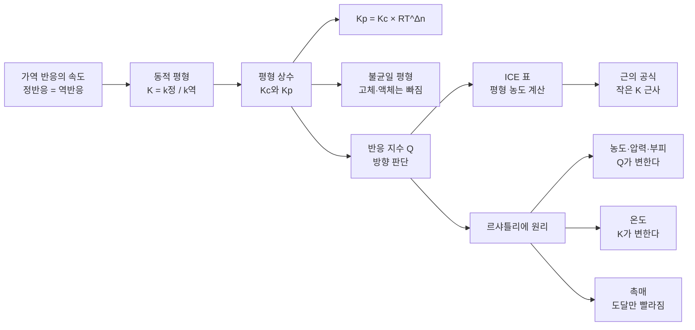

# 일반화학 8. 화학 평형 — 속도의 균형에서 평형 상수의 계산까지
<!-- prev: chem-3, uchem-7 -->
<!-- next: uchem-9, uchem-10 -->

> [!NOTE]
> **이 단원의 범위**
> - 동적 평형과 평형 상수($K_c$, $K_p$와 그 관계)
> - 불균일 평형
> - 반응 지수 Q와 반응 방향
> - 평형 농도 계산(ICE 표, 근사)
> - 르샤틀리에 원리(농도, 압력·부피, 온도, 촉매)

**학습 목표**

1. 가역 반응의 정반응·역반응 속도 법칙으로부터 동적 평형과 $K = k_\text{정}/k_\text{역}$를 유도하고, 평형에 다가가는 시간 변화를 설명할 수 있다.
2. 질량 작용의 법칙으로 $K_c$와 $K_p$를 쓰고, $K_p = K_c(RT)^{\Delta n}$과 반응식 조작에 따른 $K$의 변화를 계산할 수 있다.
3. 불균일 평형에서 순수한 고체·액체를 평형 상수식에서 빼는 이유를 활동도로 설명하고 계산에 적용할 수 있다.
4. 반응 지수 Q와 K를 비교해 반응 방향을 판단하고, ICE 표와 근의 공식·작은 K 근사로 평형 농도와 분압을 구할 수 있다.
5. 농도·압력(부피)·온도·촉매의 변화가 평형에 미치는 영향을 Q와 K의 비교로 정량적으로 설명하고, 판트호프 식으로 온도에 따른 K를 어림할 수 있다.

**이 단원의 학습 사다리**

| 단계 | 무엇을 하나? |
|---|---|
| STEP 1. 이전 학습 다시 보기 | 고등학교 「화학 평형」의 K·Q·르샤틀리에 원리와 「화학 반응 속도론」의 속도 상수를 다시 꺼낸다 |
| STEP 2. 기초 다지기 | 이차 방정식과 근의 선택, 작은 값 근사의 검증, 이상 기체의 농도–압력 변환을 익힌다 |
| STEP 3. 핵심 개념 | 동적 평형 → $K_c$·$K_p$ → 불균일 평형 → Q → ICE 계산 → 르샤틀리에 원리의 정량화 |
| STEP 4. 오개념 바로잡기 | "압력을 높이면 언제나 평형이 이동한다", "K가 크면 빠르다" 같은 착각을 바로잡는다 |
| STEP 5. 전공 맛보기 | 활동도와 열역학적 평형 상수, $\Delta G^\circ = -RT\ln K$, 동시 평형 |
| STEP 6. 생활·산업·진로 | 암모니아 합성, 수소 생산, 엔진 속 NO, 일산화 탄소 중독 |

---

## 🗺️ 단원 들어가기

밀폐된 용기에 수소와 아이오딘을 넣고 데우면 아이오딘화 수소가 생기다가, 어느 순간부터 색이 더는 변하지 않는다. 고등학교에서 이것을 '정반응과 역반응의 속도가 같아진 동적 평형'이라 배웠다. 그런데 몇 가지 질문이 남는다. 평형 상수는 왜 하필 그 값일까? 평형에 **얼마나 빨리** 도달할까? 압력을 2배로 하면 평형 혼합물의 조성은 **정확히 얼마나** 바뀔까? 온도를 200 ℃ 올리면 평형 상수는 몇 배가 될까?

세계 인구의 상당수가 먹는 식량은 공기 중의 질소를 암모니아로 바꾸는 공정 덕분에 생산된 비료에 기대고 있다. 이 공정의 기술자들은 날마다 이 질문들에 숫자로 답한다. 이 단원에서는 고등학교에서 정성적으로 다룬 평형을 **속도론과 연결하고**, 기체의 분압으로 확장하며, ICE 표와 대수 계산으로 **정량적으로 예측**하는 방법을 익힌다.

---

## STEP 1. 🔙 이전 학습 다시 보기

### 연계 개념표

| 이전 단원 | 고등학교에서는 여기까지 | 대학에서는 이렇게 확장 |
|---|---|---|
| 고등학교 「화학」 '화학 평형' [12화학03-01] | 동적 평형: 정반응과 역반응의 속도가 같다 | 속도 법칙으로 평형을 유도하고, 평형에 다가가는 **시간 변화**까지 미분 방정식으로 푼다 |
| 고등학교 「화학」 '화학 평형' [12화학03-02] | 몰 농도로 나타낸 K, 반응식이 바뀌면 K도 바뀜 | $K_p$와 $K_c$의 관계, 활동도와 무차원 K, 여러 단계 반응의 K 결합 |
| 고등학교 「화학」 '화학 평형' [12화학03-03] | Q와 K 비교로 방향 예측 | Q를 분압으로도 쓰고, Q에서 출발해 **평형 조성까지 계산** |
| 고등학교 「화학」 '화학 평형' [12화학03-04] | 르샤틀리에 원리로 정성적 예측 | 부피 변화·비활성 기체를 Q로 정량화, 판트호프 식으로 온도에 따른 K 계산 |
| 「일반화학 7. 화학 반응 속도론」 | 속도 상수, 아레니우스 식, 촉매는 $E_a$를 낮춘다 | $K = k_\text{정}/k_\text{역}$, 아레니우스 식에서 판트호프 식 유도, 촉매가 K를 바꾸지 않는 이유 |

### 준비 운동 (사전 진단)

**Q1.** $\mathrm{2NO_2(g) \rightleftharpoons N_2O_4(g)}$의 평형 상수식을 몰 농도로 쓰시오. 역반응의 평형 상수는 이것과 어떤 관계인가?

**Q2.** 어떤 반응에서 $Q = 2.5$, $K = 0.80$이다. 반응은 어느 쪽으로 진행하는가?

**Q3.** 이차 방정식 $x^2 + 0.20x - 0.030 = 0$의 두 근을 구하고, 농도로 의미 있는 근을 고르시오.

**Q4.** 이상 기체에서 몰 농도 $c = n/V$와 분압 $P$의 관계식을 쓰시오.

정답 및 해설

**Q1.** $K = \dfrac{[\mathrm{N_2O_4}]}{[\mathrm{NO_2}]^2}$, 역반응의 평형 상수는 $\dfrac{1}{K}$이다.

**Q2.** $Q > K$이므로 생성물이 평형보다 많다. **역반응** 쪽으로 진행한다.

**Q3.** $x = \dfrac{-0.20 \pm\sqrt{0.040 + 0.120}}{2} = \dfrac{-0.20 \pm 0.40}{2}$ → $x = 0.10$ 또는 $-0.30$. 농도 변화로 의미가 있는 것은 각 농도를 음수로 만들지 않는 $x = 0.10$이다.

**Q4.** $PV = nRT$에서 $P = \dfrac{n}{V}RT = cRT$이다.

---

## STEP 2. 🧱 기초 다지기

### 디딤돌 1. 이차 방정식과 '물리적으로 의미 있는 근'

평형 계산은 자주 이차 방정식 $ax^2 + bx + c = 0$으로 귀결된다.

$$
x = \frac{-b \pm \sqrt{b^2 - 4ac}}{2a}
$$

근은 두 개지만 답은 하나이다. **모든 평형 농도(분압)를 0 이상으로 만드는 근**만 고른다. 예를 들어 처음 농도 0.20 M에서 $x$만큼 줄어드는데 근이 0.95와 0.014라면 0.95는 농도를 음수로 만들므로 버린다.

### 디딤돌 2. 작은 값 근사와 5 % 검증

K가 매우 작으면 반응이 거의 진행하지 않아 $C - x \approx C$로 근사할 수 있다. 근사로 구한 $x$를 처음 값과 비교해 **5 % 이하이면** 근사를 받아들이고, 넘으면 근의 공식이나 **축차 근사**로 다시 푼다.

**축차 근사(successive approximation)**: 근사해 $x_1$을 $C - x_1$에 넣어 다시 풀고, 값이 더 변하지 않을 때까지 반복한다. 손 계산에서는 2~3번이면 충분하다.

> [!TIP]
> 💡 **비유** — 큰 물통에서 컵으로 물을 떠냈을 때 "물통은 그대로 가득"이라고 해도 될지는 떠낸 양과 통의 크기를 비교해 보아야 안다. 근사는 '쓰고 나서 확인하는' 도구이다.

### 디딤돌 3. 농도와 분압 바꾸기

이상 기체에서 $P_i = c_iRT$이다. 압력을 bar, 농도를 M(mol/L)으로 쓰면 $R = 0.08314\ \mathrm{L\cdot bar/(mol\cdot K)}$, 압력을 atm으로 쓰면 $R = 0.08206\ \mathrm{L\cdot atm/(mol\cdot K)}$이다. 이 단원에서는 표준 압력을 1 bar로 하고 bar를 쓴다.

| 양 | 기호 | 관계 |
|---|---|---|
| 분압 | $P_i$ | $P_i = x_iP_\text{전체}$ (돌턴의 부분 압력 법칙) |
| 몰분율 | $x_i$ | $x_i = n_i/n_\text{전체}$ |
| 몰 농도 | $c_i$ | $c_i = P_i/RT$ |

### 디딤돌 4. 거듭제곱과 로그로 K 다루기

반응식을 $n$배 하면 $K$는 $n$제곱, 뒤집으면 역수, 두 반응을 더하면 곱이 된다. 로그를 취하면 각각 $n$배, 부호 바뀜, 덧셈이 되어 다루기 쉽다. 이 성질은 「화학 열역학」에서 $\Delta G^\circ = -RT\ln K$를 통해 자유 에너지의 덧셈과 연결된다.

---

## STEP 3. 📘 핵심 개념

### ① 동적 평형 — 속도론에서 평형으로

#### 정반응 속도와 역반응 속도가 같아질 때

단일 단계 가역 반응 $\mathrm{A \underset{k_\text{역}}{\overset{k_\text{정}}{\rightleftharpoons}} B}$를 생각하자. A의 농도 변화는 정반응으로 줄고 역반응으로 늘어난다.

$$
\frac{d[\mathrm{A}]}{dt} = -k_\text{정}[\mathrm{A}] + k_\text{역}[\mathrm{B}]
$$

평형에서는 농도가 더는 변하지 않으므로 $\dfrac{d[\mathrm{A}]}{dt} = 0$이다.

$$
k_\text{정}[\mathrm{A}]_\text{eq} = k_\text{역}[\mathrm{B}]_\text{eq}
\quad\Rightarrow\quad
\boxed{\;K = \frac{[\mathrm{B}]_\text{eq}}{[\mathrm{A}]_\text{eq}} = \frac{k_\text{정}}{k_\text{역}}\;}
$$

평형은 반응이 멈춘 상태가 아니라 **두 방향의 속도가 같아진 상태**이다. $\mathrm{H_2 + I_2 \rightleftharpoons 2HI}$ 평형 혼합물에 방사성 아이오딘을 조금 넣으면, 겉보기 농도는 변하지 않는데도 방사성 원자가 곧 $\mathrm{I_2}$와 $\mathrm{HI}$ 모두에 퍼진다. 반응이 양방향으로 계속 일어난다는 직접 증거이다.

> [!NOTE]
> 여러 단계로 일어나는 반응도 각 단계가 평형에 있으면(**미시적 가역성**), 전체 평형 상수는 단계별 $k_\text{정}/k_\text{역}$의 곱이 되어 전체 반응식의 질량 작용 식과 같아진다. 그래서 평형 상수식은 메커니즘과 관계없이 **전체 반응식의 계수**로 쓴다. 속도 법칙과 정반대의 성질이다.

#### 평형에 다가가는 모습 — 미분 방정식 풀기

처음에 A만 $[\mathrm{A}]_0$ 있었다면 $[\mathrm{B}] = [\mathrm{A}]_0 - [\mathrm{A}]$이다. 평형 농도에서 벗어난 정도 $\Delta = [\mathrm{A}] - [\mathrm{A}]_\text{eq}$로 식을 다시 쓰면

$$
\frac{d\Delta}{dt} = -(k_\text{정} + k_\text{역})\,\Delta
\quad\Rightarrow\quad
[\mathrm{A}] = [\mathrm{A}]_\text{eq} + \big([\mathrm{A}]_0 - [\mathrm{A}]_\text{eq}\big)e^{-(k_\text{정} + k_\text{역})t}
$$

평형으로부터의 '벗어남'이 1차 반응처럼 지수적으로 줄어든다. 줄어드는 속도는 $k_\text{정}$만이 아니라 **$k_\text{정} + k_\text{역}$** 이 정한다.

#### 예제 1 — 평형에 도달하는 시간

$\mathrm{A \rightleftharpoons B}$에서 $k_\text{정} = 0.030\ \mathrm{s^{-1}}$, $k_\text{역} = 0.010\ \mathrm{s^{-1}}$이고 처음에 A만 1.00 M 있다. (1) K와 평형 농도, (2) 평형으로부터의 벗어남이 1 %로 줄어드는 시간을 구하시오.

**풀이**
1. $K = \dfrac{0.030}{0.010} = 3.0$. $[\mathrm{B}]_\text{eq} = 3.0[\mathrm{A}]_\text{eq}$, 합이 1.00 M이므로 $[\mathrm{A}]_\text{eq} = 0.25\ \mathrm{M}$, $[\mathrm{B}]_\text{eq} = 0.75\ \mathrm{M}$
2. $e^{-(0.040)t} = 0.01$ → $t = \dfrac{\ln100}{0.040\ \mathrm{s^{-1}}} = 1.2\times10^2\ \mathrm{s}$
3. 농도 변화: $t$ = 0, 25, 50, 100 s에서 $[\mathrm{A}]$ = 1.00, 0.53, 0.35, 0.26 M
4. 의미: K는 '어디로 가는가', $k_\text{정} + k_\text{역}$은 '얼마나 빨리 가는가'를 정한다. 촉매가 두 속도 상수를 같은 배율로 키우면 K는 그대로이고 도착 시간만 줄어든다(⑥).

> [!TIP]
> 💡 **비유** — 동적 평형은 '두 방 사이를 오가는 사람들'이다. A 방에서 B 방으로 가는 사람 수(정반응 속도)와 돌아오는 사람 수(역반응 속도)가 같아지면 방마다 인원은 일정하지만 문은 계속 붐빈다. 각 방의 인원 비(K)는 문을 나서려는 성향($k$)의 비가 정한다.

### ② 평형 상수 $K_c$와 $K_p$

#### 질량 작용의 법칙

일반적인 반응 $a\mathrm{A} + b\mathrm{B} \rightleftharpoons c\mathrm{C} + d\mathrm{D}$에 대해 일정 온도에서 다음 값이 일정하다(**질량 작용의 법칙, law of mass action**).

$$
K_c = \frac{[\mathrm{C}]^c[\mathrm{D}]^d}{[\mathrm{A}]^a[\mathrm{B}]^b}
\qquad
K_p = \frac{P_\mathrm{C}^{\,c}P_\mathrm{D}^{\,d}}{P_\mathrm{A}^{\,a}P_\mathrm{B}^{\,b}}
$$

$K_c$는 몰 농도, $K_p$는 기체의 분압으로 쓴 평형 상수이다.

#### K에는 왜 단위가 없을까 — 활동도

엄밀히 평형 상수는 농도나 압력이 아니라 **활동도(activity)** $a$로 정의한다. 묽은 용액이나 이상 기체에서 활동도는 표준 상태 값으로 나눈 숫자이다.

| 물질 | 활동도 | 표준 상태 |
|---|---|---|
| 이상 기체 | $a = P/P^\circ$ | $P^\circ = 1\ \mathrm{bar}$ |
| 묽은 용액의 용질 | $a \approx c/c^\circ$ | $c^\circ = 1\ \mathrm{M}$ |
| 순수한 고체·액체 | $a = 1$ | 그 물질 자체 |
| 묽은 용액의 용매 | $a \approx 1$ | 순수한 용매 |

그래서 K는 **단위가 없는 수**이며, 실제 계산에서는 농도를 M, 분압을 bar로 넣은 숫자만 쓰면 된다. 단, $K_p$의 값은 압력 단위(bar 또는 atm)에 따라 조금 달라지므로 기준을 밝혀야 한다.

#### 반응식을 조작하면 K는 이렇게 변한다

| 조작 | 새 평형 상수 | 예 ($K_1 = 0.40$인 $\mathrm{A \rightleftharpoons 2B}$) |
|---|---|---|
| 역반응으로 쓰기 | $1/K$ | $\mathrm{2B \rightleftharpoons A}$: 2.5 |
| 계수를 $n$배 | $K^n$ | $\mathrm{\tfrac12A \rightleftharpoons B}$: $0.40^{1/2} = 0.63$ |
| 두 반응식 더하기 | $K_1K_2$ | $\mathrm{2B + C \rightleftharpoons D}$($K_2 = 25$)와 더하면 $\mathrm{A + C \rightleftharpoons D}$: $0.40\times25 = 10$ |

#### $K_p$와 $K_c$의 관계

각 기체에 $P_i = [i]RT$를 대입하면

$$
K_p = \frac{([\mathrm{C}]RT)^c([\mathrm{D}]RT)^d}{([\mathrm{A}]RT)^a([\mathrm{B}]RT)^b} = K_c(RT)^{\Delta n},
\qquad \Delta n = (c + d) - (a + b)
$$

$\Delta n$은 **기체** 생성물의 계수 합에서 기체 반응물의 계수 합을 뺀 값이다. $\Delta n = 0$이면 $K_p = K_c$이다.

#### 예제 2 — 평형 자료로 $K_c$와 $K_p$ 구하기

1000 K에서 2.00 L 용기에 $\mathrm{SO_2}$ 0.400 mol과 $\mathrm{O_2}$ 0.200 mol을 넣었더니 평형에서 $\mathrm{SO_3}$가 0.300 mol 생겼다. $\mathrm{2SO_2(g) + O_2(g) \rightleftharpoons 2SO_3(g)}$의 $K_c$와 $K_p$를 구하시오.

**풀이**

| (M) | $\mathrm{2SO_2}$ | $\mathrm{O_2}$ | $\mathrm{2SO_3}$ |
|---|---|---|---|
| 처음 (I) | 0.200 | 0.100 | 0 |
| 변화 (C) | $-0.150$ | $-0.075$ | $+0.150$ |
| 평형 (E) | 0.050 | 0.025 | 0.150 |

1. $K_c = \dfrac{(0.150)^2}{(0.050)^2(0.025)} = 3.6\times10^2$
2. $\Delta n = 2 - 3 = -1$이므로 $K_p = K_c(RT)^{-1} = \dfrac{360}{0.08314\times1000} = 4.3$
3. 의미: 변화(C) 줄은 반드시 **계수비**를 따른다. 평형에서 $\mathrm{SO_2}$의 75 %가 $\mathrm{SO_3}$로 바뀌었다. 평형 농도의 유효 숫자가 2개(0.050, 0.025)이므로 K도 2개로 쓴다.

#### 예제 3 — $K_c$에서 $K_p$로

어떤 온도 500 K에서 $\mathrm{N_2(g) + 3H_2(g) \rightleftharpoons 2NH_3(g)}$의 $K_c = 2.0\times10^2$이라 하자. $K_p$는?

**풀이** $\Delta n = 2 - 4 = -2$, $K_p = K_c(RT)^{-2} = \dfrac{2.0\times10^2}{(0.08314\times500)^2} = \dfrac{2.0\times10^2}{1.73\times10^3} = 0.12$. 기체 몰수가 줄어드는 반응은 $K_p < K_c$이다(RT > 1일 때).

#### 평형 상수의 크기가 말해 주는 것

| K의 범위 | 평형 혼합물 | 계산 전략 |
|---|---|---|
| $K > 10^3$ 정도 | 거의 생성물 | "끝까지 진행한 뒤 조금 되돌아간다"고 보고 근사 |
| $10^{-3} < K < 10^3$ | 반응물·생성물이 함께 상당량 | 근의 공식 등으로 정확히 푼다 |
| $K < 10^{-3}$ 정도 | 거의 반응물 | 변화량 $x$를 처음 농도에 비해 무시하는 근사 |

경계값은 처음 농도와 계수에 따라 달라지는 대략적인 기준이며, 근사 뒤에는 반드시 5 % 검증을 한다.

### ③ 불균일 평형

두 가지 이상의 상이 함께 참여하는 평형을 **불균일 평형(heterogeneous equilibrium)** 이라 한다. 순수한 고체와 액체는 활동도가 1이므로 평형 상수식에 나타나지 않는다. 물리적으로는 고체 덩어리가 크든 작든 **단위 부피당 입자 수(밀도)가 일정**하기 때문이다. 양이 0이 되면 평형 자체가 성립하지 않으므로, 고체는 "조금이라도 남아 있어야" 한다.

| 반응 | $K_c$ | $K_p$ |
|---|---|---|
| $\mathrm{CaCO_3(s) \rightleftharpoons CaO(s) + CO_2(g)}$ | $[\mathrm{CO_2}]$ | $P_{\mathrm{CO_2}}$ |
| $\mathrm{H_2O(l) \rightleftharpoons H_2O(g)}$ | $[\mathrm{H_2O(g)}]$ | $P_{\mathrm{H_2O}}$ (= 증기 압력) |
| $\mathrm{NH_4HS(s) \rightleftharpoons NH_3(g) + H_2S(g)}$ | $[\mathrm{NH_3}][\mathrm{H_2S}]$ | $P_{\mathrm{NH_3}}P_{\mathrm{H_2S}}$ |
| $\mathrm{3Fe(s) + 4H_2O(g) \rightleftharpoons Fe_3O_4(s) + 4H_2(g)}$ | $\dfrac{[\mathrm{H_2}]^4}{[\mathrm{H_2O}]^4}$ | $\dfrac{P_{\mathrm{H_2}}^4}{P_{\mathrm{H_2O}}^4}$ |
| $\mathrm{AgCl(s) \rightleftharpoons Ag^+(aq) + Cl^-(aq)}$ | $[\mathrm{Ag^+}][\mathrm{Cl^-}]$ | — (「산·염기와 수용액 평형」의 용해도곱) |

#### 예제 4 — 탄산 칼슘의 분해 압력

1073 K에서 $\mathrm{CaCO_3(s) \rightleftharpoons CaO(s) + CO_2(g)}$의 $K_p = 0.25$라 하자. 10.0 L 진공 용기에 탄산 칼슘을 충분히 넣고 이 온도로 가열했다. (1) $\mathrm{CO_2}$의 압력, (2) 생긴 $\mathrm{CO_2}$의 몰수, (3) 용기 부피를 20.0 L로 늘리면 $\mathrm{CO_2}$의 압력은?

**풀이**
1. $K_p = P_{\mathrm{CO_2}}$이므로 $P_{\mathrm{CO_2}} = 0.25\ \mathrm{bar}$
2. $n = \dfrac{PV}{RT} = \dfrac{0.25\times10.0}{0.08314\times1073} = 0.028\ \mathrm{mol}$
3. 고체가 남아 있는 한 압력은 여전히 **0.25 bar**이다. 부피를 늘린 만큼 탄산 칼슘이 더 분해되어 $\mathrm{CO_2}$가 0.056 mol이 된다.
4. 의미: 석회 가마에서 생긴 $\mathrm{CO_2}$를 계속 빼내면($P_{\mathrm{CO_2}} < K_p$) 분해가 끝까지 진행된다.

#### 예제 5 — $\mathrm{NH_4HS}$의 분해

어떤 온도에서 $\mathrm{NH_4HS(s) \rightleftharpoons NH_3(g) + H_2S(g)}$의 $K_p = 0.120$이다. (1) 진공 용기에 고체만 넣었을 때 전체 압력, (2) 처음에 $\mathrm{NH_3}$가 0.500 bar 들어 있는 용기에 고체를 넣었을 때 평형 분압을 구하시오.

**풀이**
1. $P_{\mathrm{NH_3}} = P_{\mathrm{H_2S}} = x$, $x^2 = 0.120$ → $x = 0.346\ \mathrm{bar}$, 전체 0.693 bar
2. $(0.500 + x)x = 0.120$ → $x^2 + 0.500x - 0.120 = 0$ → $x = \dfrac{-0.500 + \sqrt{0.250 + 0.480}}{2} = 0.177\ \mathrm{bar}$
   $P_{\mathrm{H_2S}} = 0.177\ \mathrm{bar}$, $P_{\mathrm{NH_3}} = 0.677\ \mathrm{bar}$
3. 의미: 생성물 하나를 미리 넣어 두면 고체의 분해가 억제된다($0.346 \rightarrow 0.177$ bar). 「산·염기와 수용액 평형」의 **공통 이온 효과**와 같은 원리이다.

### ④ 반응 지수 Q와 반응 방향

임의의 순간의 농도(또는 분압)를 평형 상수식과 같은 꼴에 넣은 값이 **반응 지수(reaction quotient)** Q이다.

$$
Q_c = \frac{[\mathrm{C}]^c[\mathrm{D}]^d}{[\mathrm{A}]^a[\mathrm{B}]^b}\ (\text{지금의 농도}),
\qquad
Q_p = \frac{P_\mathrm{C}^{\,c}P_\mathrm{D}^{\,d}}{P_\mathrm{A}^{\,a}P_\mathrm{B}^{\,b}}\ (\text{지금의 분압})
$$

| 비교 | 방향 | 속도론으로 보면 |
|---|---|---|
| $Q < K$ | 정반응 진행 | 정반응 속도 > 역반응 속도 |
| $Q = K$ | 평형 | 두 속도가 같다 |
| $Q > K$ | 역반응 진행 | 역반응 속도 > 정반응 속도 |

①의 $\mathrm{A \rightleftharpoons B}$로 확인하면 $\dfrac{v_\text{정}}{v_\text{역}} = \dfrac{k_\text{정}[\mathrm{A}]}{k_\text{역}[\mathrm{B}]} = \dfrac{K}{Q}$이다. Q가 K보다 작으면 이 비가 1보다 커서 정반응이 우세하다. Q와 K의 비교는 '정반응과 역반응 중 어느 쪽이 빠른가'를 묻는 것과 같다.

#### 예제 6 — 수성 가스 전환 반응의 방향

어떤 온도에서 $\mathrm{CO(g) + H_2O(g) \rightleftharpoons CO_2(g) + H_2(g)}$의 $K_c = 4.0$이다. 용기 안의 농도가 $[\mathrm{CO}] = 0.20$, $[\mathrm{H_2O}] = 0.30$, $[\mathrm{CO_2}] = 0.40$, $[\mathrm{H_2}] = 0.50\ \mathrm{M}$일 때 반응 방향을 판단하시오.

**풀이** $Q_c = \dfrac{0.40\times0.50}{0.20\times0.30} = 3.3 < 4.0$ → **정반응**이 진행하여 $\mathrm{CO_2}$와 $\mathrm{H_2}$가 늘어난다. 평형 농도는 ⑤의 예제 8에서 구한다.

> [!TIP]
> 💡 **비유** — Q는 '현재 위치', K는 '목적지'이다. 내비게이션이 "직진(정반응)"과 "유턴(역반응)" 중 무엇을 안내할지는 위치와 목적지만 비교하면 된다. ICE 표는 "몇 km를 더 가야 하나"를 계산하는 단계이다.

### ⑤ 평형 농도 계산 — ICE 표와 근사

#### 계산의 순서

1. 균형 맞춘 반응식과 평형 상수식을 쓴다.
2. 처음 농도로 Q를 계산해 방향을 정한다(어느 쪽이 줄어드는지).
3. **ICE 표**(처음 Initial – 변화 Change – 평형 Equilibrium)를 만든다. 변화량은 미지수 $x$와 계수비로 쓴다.
4. 평형 줄을 K 식에 넣고 푼다. 완전 제곱, 근의 공식, 작은 K 근사 중 알맞은 방법을 고른다.
5. 구한 평형 농도를 K 식에 다시 넣어 검산한다.

#### 예제 7 — 근의 공식이 필요한 경우

어떤 온도에서 $\mathrm{PCl_5(g) \rightleftharpoons PCl_3(g) + Cl_2(g)}$의 $K_c = 0.0420$이다. 처음 $[\mathrm{PCl_5}] = 0.100\ \mathrm{M}$일 때 평형 농도를 구하시오.

**풀이**

| (M) | $\mathrm{PCl_5}$ | $\mathrm{PCl_3}$ | $\mathrm{Cl_2}$ |
|---|---|---|---|
| I | 0.100 | 0 | 0 |
| C | $-x$ | $+x$ | $+x$ |
| E | $0.100 - x$ | $x$ | $x$ |

1. $\dfrac{x^2}{0.100 - x} = 0.0420$ → $x^2 + 0.0420x - 0.00420 = 0$
2. $x = \dfrac{-0.0420 + \sqrt{(0.0420)^2 + 4\times0.00420}}{2} = \dfrac{-0.0420 + 0.1363}{2} = 0.0471$
3. $[\mathrm{PCl_5}] = 0.0529\ \mathrm{M}$, $[\mathrm{PCl_3}] = [\mathrm{Cl_2}] = 0.0471\ \mathrm{M}$
4. 검산: $\dfrac{(0.0471)^2}{0.0529} = 0.0419 \approx 0.0420$
5. 주의: 이 경우 작은 K 근사를 쓰면 $x \approx \sqrt{0.0420\times0.100} = 0.0648$로 처음 농도의 65 %가 되어 전혀 맞지 않는다. K가 처음 농도와 비슷한 크기이면 근사를 쓰면 안 된다.

#### 예제 8 — 네 물질이 모두 있을 때

예제 6의 혼합물이 평형에 도달했을 때 각 농도를 구하시오. ($K_c = 4.0$)

**풀이**

| (M) | $\mathrm{CO}$ | $\mathrm{H_2O}$ | $\mathrm{CO_2}$ | $\mathrm{H_2}$ |
|---|---|---|---|---|
| I | 0.20 | 0.30 | 0.40 | 0.50 |
| C | $-x$ | $-x$ | $+x$ | $+x$ |
| E | $0.20 - x$ | $0.30 - x$ | $0.40 + x$ | $0.50 + x$ |

1. $\dfrac{(0.40 + x)(0.50 + x)}{(0.20 - x)(0.30 - x)} = 4.0$ → 정리하면 $3x^2 - 2.9x + 0.040 = 0$
2. 두 근: $x = 0.953$ 또는 $0.0140$. 0.953은 $[\mathrm{CO}]$를 음수로 만드므로 버린다.
3. $[\mathrm{CO}] = 0.186$, $[\mathrm{H_2O}] = 0.286$, $[\mathrm{CO_2}] = 0.414$, $[\mathrm{H_2}] = 0.514\ \mathrm{M}$
4. 검산: $\dfrac{0.414\times0.514}{0.186\times0.286} = 4.00$
5. 의미: Q(3.3)가 K(4.0)에 가까웠으므로 변화량도 작다(0.014 M).

#### 예제 9 — K가 작을 때의 근사

어떤 온도에서 $\mathrm{2NOCl(g) \rightleftharpoons 2NO(g) + Cl_2(g)}$의 $K_c = 1.6\times10^{-5}$이다. 처음 $[\mathrm{NOCl}] = 0.50\ \mathrm{M}$일 때 평형 농도를 구하시오.

**풀이**
1. ICE: $[\mathrm{NOCl}] = 0.50 - 2x$, $[\mathrm{NO}] = 2x$, $[\mathrm{Cl_2}] = x$
2. $K_c = \dfrac{(2x)^2x}{(0.50 - 2x)^2}$ — 삼차 방정식이다.
3. K가 작으므로 $0.50 - 2x \approx 0.50$으로 근사: $\dfrac{4x^3}{0.25} = 1.6\times10^{-5}$ → $x^3 = 1.0\times10^{-6}$ → $x = 0.010\ \mathrm{M}$
4. 검증: $\dfrac{2x}{0.50} = 4\ \%$ < 5 % → 근사 허용. (근사 없이 수치로 풀면 $x = 0.0097$로 약 3 % 차이)
5. 결과: $[\mathrm{NO}] = 0.020\ \mathrm{M}$, $[\mathrm{Cl_2}] = 0.010\ \mathrm{M}$, $[\mathrm{NOCl}] \approx 0.48\ \mathrm{M}$
6. 의미: 근사는 삼차 방정식을 손 계산할 수 있는 식으로 바꾸어 준다. 5 % 검증이 근사의 '안전벨트'이다.

#### 계산 방법 고르기

| 상황 | 방법 |
|---|---|
| 좌우가 완전 제곱 꼴(예: $\dfrac{(2x)^2}{(C - x)^2}$) | 양변에 제곱근 |
| K가 처음 농도에 비해 크거나 비슷함 | 근의 공식(또는 수치 계산) |
| K가 매우 작음 | $C - x \approx C$ 근사 → 5 % 검증 |
| K가 매우 큼 | 먼저 끝까지 반응시킨 뒤 역반응으로 조금 되돌아가는 $x$를 근사 |
| 고차 방정식 | 근사 또는 스프레드시트의 목표값 찾기 기능 |

### ⑥ 르샤틀리에 원리 — Q와 K로 정량화하기

> [!IMPORTANT]
> **르샤틀리에 원리(Le Chatelier's principle)**: 평형에 있는 계의 조건을 바꾸면 계는 그 변화를 부분적으로 상쇄하는 방향으로 이동한다.
> 대학에서는 이 원리를 한 문장으로 바꾸어 쓴다. **농도·압력·부피의 변화는 Q를 바꾸고, 온도의 변화는 K를 바꾼다.** 어느 경우든 계는 다시 $Q = K$가 되는 쪽으로 움직인다.

#### (1) 농도 변화

평형 혼합물에 반응물을 더하면 Q의 분모가 커져 $Q < K$가 되고 정반응이 진행한다. 계산은 새 '처음' 농도로 ICE 표를 다시 쓰면 된다.

#### 예제 10 — 수증기를 더 넣으면

예제 8의 평형 혼합물($[\mathrm{CO}] = 0.186$, $[\mathrm{H_2O}] = 0.286$, $[\mathrm{CO_2}] = 0.414$, $[\mathrm{H_2}] = 0.514\ \mathrm{M}$)에 부피 변화 없이 수증기를 0.200 M만큼 더 넣었다. 새 평형 농도를 구하시오.

**풀이**
1. 직후: $Q = \dfrac{0.414\times0.514}{0.186\times0.486} = 2.35 < 4.0$ → 정반응
2. $\dfrac{(0.414 + x)(0.514 + x)}{(0.186 - x)(0.486 - x)} = 4.0$ → $-3x^2 + 3.616x - 0.1488 = 0$ → $x = 0.0427$
3. 새 평형: $[\mathrm{CO}] = 0.143$, $[\mathrm{H_2O}] = 0.443$, $[\mathrm{CO_2}] = 0.457$, $[\mathrm{H_2}] = 0.557\ \mathrm{M}$
4. 의미: 탄소 중 CO로 남은 비율이 31 %에서 24 %로 줄었다. 공업적으로 수소를 만들 때 **수증기를 과량** 넣어 CO를 최대한 $\mathrm{H_2}$로 바꾸는 이유이다. 넣은 0.200 M 중 0.043 M만 소모되어, 변화는 '상쇄'되었지만 '취소'되지는 않았다.

#### (2) 압력·부피 변화

기체 반응에서 온도를 일정하게 하고 부피를 $1/s$로 줄이면 모든 분압이 $s$배가 된다. 그러면

$$
Q_p' = s^{\Delta n}\,K_p
$$

이다. $\Delta n < 0$(기체 몰수 감소 반응)이면 $Q < K$로 정반응, $\Delta n > 0$이면 역반응, $\Delta n = 0$이면 이동하지 않는다.

| 압력을 바꾸는 방법 | 반응 기체의 분압 | 평형 이동 |
|---|---|---|
| 부피를 줄인다 | 모두 같은 배율로 증가 | 기체 몰수가 줄어드는 쪽 |
| 부피 일정, 비활성 기체 추가 | 변하지 않음 | 이동 없음 |
| 전체 압력 일정, 비활성 기체 추가 | 부피가 늘어 모두 감소 | 기체 몰수가 늘어나는 쪽 |
| 반응 기체 하나를 추가 | 그 기체만 증가 | (1) 농도 변화와 같음 |

#### 예제 11 — 압축하면 해리도는 얼마나 줄어드나

어떤 온도에서 $\mathrm{N_2O_4(g) \rightleftharpoons 2NO_2(g)}$의 $K_p = 0.150$이다. 순수한 $\mathrm{N_2O_4}$ $n_0$ mol 중 비율 $\alpha$가 해리되었을 때(해리도), 전체 압력 $P$와 $\alpha$의 관계를 유도하고 $P = 1.00$, $2.00\ \mathrm{bar}$에서 $\alpha$를 구하시오.

**풀이**
1. 평형 몰수: $\mathrm{N_2O_4}$ $n_0(1 - \alpha)$, $\mathrm{NO_2}$ $2n_0\alpha$, 합 $n_0(1 + \alpha)$
2. 분압: $P_{\mathrm{N_2O_4}} = \dfrac{1 - \alpha}{1 + \alpha}P$, $P_{\mathrm{NO_2}} = \dfrac{2\alpha}{1 + \alpha}P$
3. $K_p = \dfrac{P_{\mathrm{NO_2}}^2}{P_{\mathrm{N_2O_4}}} = \dfrac{4\alpha^2P}{(1 - \alpha)(1 + \alpha)} = \dfrac{4\alpha^2P}{1 - \alpha^2}$ → $\alpha = \sqrt{\dfrac{K_p}{4P + K_p}}$
4. $P = 1.00\ \mathrm{bar}$: $\alpha = \sqrt{\dfrac{0.150}{4.150}} = 0.190$, $P = 2.00\ \mathrm{bar}$: $\alpha = \sqrt{\dfrac{0.150}{8.150}} = 0.136$
5. 의미: 압력을 2배로 하자 해리도가 19.0 %에서 13.6 %로 줄었다. 기체 몰수가 줄어드는 쪽(역반응)으로 이동했지만, $\mathrm{NO_2}$의 분압은 0.319 bar에서 0.478 bar로 오히려 **커졌다.** 이동은 변화를 일부만 상쇄한다. 고등학교에서 본 '주사기를 누르면 새 평형의 색이 처음보다 진하다'는 관찰의 정량적 설명이다.

#### (3) 온도 변화 — 판트호프 식

온도는 Q가 아니라 **K 자체**를 바꾼다. 그 크기를 「화학 반응 속도론」의 아레니우스 식에서 유도해 보자. 단일 단계 가역 반응에서

$$
K = \frac{k_\text{정}}{k_\text{역}} = \frac{A_\text{정}e^{-E_{a,\text{정}}/RT}}{A_\text{역}e^{-E_{a,\text{역}}/RT}} = \frac{A_\text{정}}{A_\text{역}}\,e^{-(E_{a,\text{정}} - E_{a,\text{역}})/RT}
$$

이고 $E_{a,\text{정}} - E_{a,\text{역}} = \Delta H$이므로 $\ln K = -\dfrac{\Delta H}{RT} + (\text{상수})$이다. 두 온도에 대해 빼면

$$
\boxed{\;\ln\frac{K_2}{K_1} = -\frac{\Delta H^\circ}{R}\left(\frac{1}{T_2} - \frac{1}{T_1}\right)\;}
$$

이 식을 **판트호프 식(van 't Hoff equation)** 이라 한다($\Delta H^\circ$가 온도 범위 안에서 일정하다고 가정). 「화학 열역학」에서는 이 식을 $\Delta G^\circ = -RT\ln K$로부터 더 일반적으로 다시 얻는다.

| 반응 | 온도를 올리면 | 이유 |
|---|---|---|
| 흡열($\Delta H^\circ > 0$) | K 증가, 정반응 쪽 이동 | $E_{a,\text{정}} > E_{a,\text{역}}$이라 $k_\text{정}$이 더 크게 증가 |
| 발열($\Delta H^\circ < 0$) | K 감소, 역반응 쪽 이동 | $k_\text{역}$이 더 크게 증가 |

> [!NOTE]
> 발열 반응도 온도를 올리면 정반응 속도 상수는 **커진다.** 다만 역반응 속도 상수가 더 많이 커지기 때문에 K가 작아지는 것이다. "평형이 왼쪽으로 이동한다"와 "정반응이 느려진다"는 다른 말이다.

#### 예제 12 — 온도에 따른 K

$\Delta H^\circ = -50.0\ \mathrm{kJ/mol}$인 반응의 평형 상수가 300 K에서 $1.0\times10^3$이다. 400 K에서의 K를 어림하시오.

**풀이**
$\ln\dfrac{K_2}{K_1} = -\dfrac{-50000}{8.314}\left(\dfrac{1}{400} - \dfrac{1}{300}\right) = 6014\times(-8.33\times10^{-4}) = -5.01$
$K_2 = 1.0\times10^3\times e^{-5.01} = 6.7$
100 K 올렸더니 K가 약 150분의 1로 줄었다. 발열 반응에서는 '빨리 하려고 데우면 덜 얻는' 문제가 생긴다(STEP 6 사례 1).

#### (4) 촉매

촉매는 정반응과 역반응의 활성화 에너지를 같은 양만큼 낮추어 $k_\text{정}$과 $k_\text{역}$을 **같은 배율**로 키운다. 그러므로 $K = k_\text{정}/k_\text{역}$은 변하지 않고, 평형에 다가가는 속도 $k_\text{정} + k_\text{역}$만 커진다. 촉매는 평형의 위치가 아니라 **평형에 도달하는 시간**을 바꾼다.

#### 한눈에 정리

| 변화 | Q 또는 K | 이동 방향 | K 값 |
|---|---|---|---|
| 반응물 추가 / 생성물 제거 | $Q < K$ | 정반응 | 그대로 |
| 생성물 추가 / 반응물 제거 | $Q > K$ | 역반응 | 그대로 |
| 부피 감소(압축) | $Q = s^{\Delta n}K$ | 기체 몰수 감소 쪽 | 그대로 |
| 부피 일정, 비활성 기체 추가 | Q 불변 | 없음 | 그대로 |
| 압력 일정, 비활성 기체 추가 | 부피 증가와 같음 | 기체 몰수 증가 쪽 | 그대로 |
| 순수한 고체·액체 추가 | Q 불변 | 없음 | 그대로 |
| 온도 상승 | K 변화 | 흡열 쪽 | 흡열이면 증가, 발열이면 감소 |
| 촉매 | 둘 다 불변 | 없음(도달만 빨라짐) | 그대로 |

> [!TIP]
> 💡 **요령** — 르샤틀리에 원리가 헷갈리면 '말로 추측'하지 말고 **Q를 계산**하라. 비활성 기체, 고체 추가, 압축처럼 함정이 있는 문제도 Q 식에 무엇이 들어 있는지만 보면 바로 풀린다.

---

## STEP 4. ⚠️ 오개념 바로잡기

| 흔한 오개념 | 올바른 개념 | 왜 그럴까? |
|---|---|---|
| 평형에서는 반응물과 생성물의 농도가 같다 | 농도는 **일정**할 뿐 같지 않다. 비율은 K가 정한다 | 예제 1에서 $[\mathrm{A}] : [\mathrm{B}] = 1 : 3$으로 일정하다 |
| 평형 상수식도 속도 법칙처럼 실험으로 차수를 정해야 한다 | 평형 상수식은 **전체 반응식의 계수**로 쓴다 | 평형에서는 모든 단계가 평형이라 단계별 K의 곱이 전체 질량 작용 식이 된다 |
| 전체 압력을 높이면 기체 평형은 반드시 이동한다 | 반응 기체의 분압이 변하지 않으면(부피 일정, 비활성 기체 추가) 이동하지 않는다 | Q에 들어가는 것은 전체 압력이 아니라 **반응 기체의 분압**이다 |
| 고체를 더 넣으면 평형이 생성물 쪽으로 이동한다 | 순수한 고체의 양은 평형에 영향을 주지 않는다 | 고체의 활동도는 1로 일정하여 Q에 들어가지 않는다 |
| 르샤틀리에 원리에 따라 가한 변화가 원래대로 되돌려진다 | 변화를 **부분적으로만** 상쇄한다 | 예제 11에서 압축 후 $P_{\mathrm{NO_2}}$는 이동 뒤에도 처음보다 크다 |
| 농도를 바꾸면 K도 바뀐다 | K는 **온도만의 함수**이다 | 농도 변화는 Q를 바꿀 뿐이다 |
| 발열 반응은 온도를 올리면 정반응 속도가 느려진다 | 정반응 속도 상수도 커지지만 역반응이 **더 많이** 커진다 | $E_{a,\text{역}} > E_{a,\text{정}}$이라 역반응이 온도에 더 민감하다 |
| $K_p$와 $K_c$는 늘 같은 값이다 | $K_p = K_c(RT)^{\Delta n}$으로 $\Delta n = 0$일 때만 같다 | 압력과 농도는 $RT$만큼 차이 난다 |

---

## STEP 5. 🎓 다음 단계로 한 걸음 더

> [!CAUTION]
> 여기부터는 일반 과목의 범위를 넘는 전공 과목 맛보기이다. 평가 대상이 아니며, 평형의 생각이 전공에서 어떻게 확장되는지 보여 주기 위한 내용이다.

### 전공 과목과의 연결

| 전공 과목 | 이어지는 내용 |
|---|---|
| 물리화학 | 화학 퍼텐셜과 평형 조건, 활동도와 퓨가시티, 통계 역학으로 K 계산 |
| 화학공학(열역학·반응 공학) | 평형 전환율과 공정 조건 최적화, 다중 반응 평형, 실제 기체 보정 |
| 분석화학 | 활동도 계수(디바이–휘켈 식), 동시 평형의 질량·전하 균형 |
| 생화학 | 결합 평형과 해리 상수, 협동적 결합(헤모글로빈) |
| 지구화학·환경화학 | 광물–물–대기 사이의 평형, 탄산염 평형 |

### 맛보기 1. 왜 K는 그 값인가 — 자유 에너지와의 연결

평형 상수는 반응의 **표준 깁스 자유 에너지 변화**와 연결된다.

$$
\Delta G^\circ = -RT\ln K, \qquad \Delta G = \Delta G^\circ + RT\ln Q
$$

두 번째 식에서 $Q < K$이면 $\Delta G < 0$으로 정반응이 자발적이고, $Q = K$이면 $\Delta G = 0$이다. 이 단원의 'Q와 K의 비교'가 열역학의 자발성 판단과 똑같은 말임을 「화학 열역학」에서 확인한다. 또 $\Delta G^\circ = \Delta H^\circ - T\Delta S^\circ$를 대입하면 판트호프 식이 다시 나오며, 아레니우스 식에서의 유도와 일치한다.

### 맛보기 2. 활동도 계수와 실제 기체

진한 용액에서는 이온 사이의 인력 때문에 활동도가 농도보다 작아진다($a = \gamma c/c^\circ$, $\gamma < 1$). 고압 기체도 분압 대신 **퓨가시티**를 써야 한다. 수백 bar에서 운전하는 암모니아 합성 공정은 이 보정 없이는 평형 전환율을 정확히 예측할 수 없다.

### 일반화학 vs 전공 과목

| 주제 | 일반화학 | 전공(물리화학·화학공학) |
|---|---|---|
| 평형의 근거 | $K = k_\text{정}/k_\text{역}$, 질량 작용의 법칙 | 화학 퍼텐셜의 균형, 통계 역학 |
| 평형 상수 | $K_c$, $K_p$, 이상적 활동도 | 활동도 계수, 퓨가시티 |
| 계산 | ICE 표, 근의 공식, 작은 K 근사 | 다중 반응 평형의 수치 해법 |
| 온도 효과 | 판트호프 식($\Delta H^\circ$ 일정) | $\Delta H^\circ$의 온도 의존까지 포함한 적분 |
| 응용 | 르샤틀리에 원리의 정량적 예측 | 반응기 조건 최적화, 평형과 속도의 경제성 분석 |

---

## STEP 6. 🏭 생활·산업·진로 연결

### 사례 1. 암모니아 합성 — 평형과 속도의 타협

- **원리** 발열 반응의 판트호프 식, 압력에 따른 이동, 촉매(⑥).
- **어디에 쓰이나** $\mathrm{N_2 + 3H_2 \rightleftharpoons 2NH_3}$($\Delta H^\circ \approx -92\ \mathrm{kJ/mol}$)은 발열 반응이라 낮은 온도일수록 K가 크지만, 그러면 속도가 너무 느리다. 그래서 철 기반 촉매로 속도를 높이고, 약 400~500 ℃의 '타협 온도'에서 수백 bar의 고압으로 기체 몰수가 줄어드는 쪽으로 평형을 밀며, 생긴 암모니아를 냉각해 액체로 빼내어 Q를 계속 K보다 작게 유지한다. 반응하지 않은 기체는 다시 순환시킨다.

### 사례 2. 수소 생산 — 수성 가스 전환 반응

- **원리** 반응물 과량에 의한 이동(예제 10), 발열 반응의 온도 효과.
- **어디에 쓰이나** 천연가스나 석탄에서 얻은 CO와 수증기를 반응시켜 $\mathrm{H_2}$를 늘린다. 이 반응은 약하게 발열이어서, 먼저 높은 온도에서 빠르게 반응시키고 다음 단계에서 온도를 낮추어 평형 전환율을 높이는 2단 공정을 쓴다. 생긴 $\mathrm{CO_2}$를 흡수해 제거하면 정반응이 더 진행한다.

### 사례 3. 엔진 속의 일산화 질소

- **원리** 흡열 반응의 큰 온도 의존성과 작은 K 근사(예제 9, 문제 7).
- **어디에 쓰이나** $\mathrm{N_2 + O_2 \rightleftharpoons 2NO}$는 강한 흡열 반응이라 상온에서는 K가 극히 작지만, 엔진의 고온에서는 K가 커져 상당량의 NO가 생긴다. 배기가스가 빠르게 식으면 역반응이 느려져 NO가 그대로 배출된다(속도론적으로 '얼어붙음'). 그래서 배기 정화 촉매로 NO를 다시 $\mathrm{N_2}$로 되돌린다.

### 사례 4. 일산화 탄소 중독과 고압 산소 치료

- **원리** 경쟁 평형 $\mathrm{HbO_2 + CO \rightleftharpoons HbCO + O_2}$과 농도 변화에 의한 이동.
- **어디에 쓰이나** CO는 헤모글로빈에 산소보다 수백 배 강하게 결합하므로 공기 중 농도가 아주 낮아도 위험하다(문제 12). 치료할 때는 순수한 산소나 고압 산소로 $P_{\mathrm{O_2}}$를 크게 높여 평형을 왼쪽으로 밀어 CO를 떼어 낸다.

### 관련 전공과 진로

| 진로 | 하는 일 | 관련 전공 |
|---|---|---|
| 화학 공정 엔지니어 | 평형 전환율과 반응 속도를 고려한 공정 조건 설계 | 화학공학과 |
| 수소·에너지 연구원 | 개질·전환 반응, 탄소 포집 공정 개발 | 화학공학과, 에너지공학과 |
| 자동차 배출가스 연구원 | 연소 중 오염 물질 생성과 촉매 정화 연구 | 기계공학과, 환경공학과, 화학과 |
| 응급의학·고압의학 전문의 | 가스 중독 진단과 산소 치료 | 의학과 |
| 지구화학자 | 광물과 물·대기의 평형으로 환경 변화 해석 | 지구환경과학과, 화학과 |

---

## 🔬 탐구 활동

### 활동 A. $\mathrm{Fe^{3+} + SCN^- \rightleftharpoons FeSCN^{2+}}$의 평형 상수 측정

**목표** 붉은색 착이온 $\mathrm{FeSCN^{2+}}$의 흡광도로 평형 농도를 구하고, 처음 농도가 서로 다른 여러 혼합물에서 $K_c$가 일정함을 확인한다.

**준비물** 0.200 M $\mathrm{Fe(NO_3)_3}$(0.1 M 질산 용액), 0.0020 M $\mathrm{Fe(NO_3)_3}$(0.1 M 질산 용액), 0.0020 M KSCN, 0.1 M 질산, 분광 광도계(약 450~470 nm), 뷰렛 또는 피펫, 시험관, 보안경, 실험용 장갑

**과정**
1. **검량선**: 0.200 M $\mathrm{Fe^{3+}}$ 5.0 mL에 0.0020 M KSCN을 0.5~2.5 mL 넣고 0.1 M 질산으로 10.0 mL를 맞춘다. $\mathrm{Fe^{3+}}$가 크게 과량이므로 $\mathrm{SCN^-}$이 거의 모두 $\mathrm{FeSCN^{2+}}$가 된다고 보고, 흡광도–농도 검량선을 만든다.
2. **평형 혼합물**: 0.0020 M $\mathrm{Fe^{3+}}$ 5.0 mL에 0.0020 M KSCN을 1.0~5.0 mL 넣고 질산으로 10.0 mL를 맞춘다.
3. 각 혼합물의 흡광도를 측정하고 검량선으로 $[\mathrm{FeSCN^{2+}}]_\text{eq}$를 구한다.
4. ICE 표로 $[\mathrm{Fe^{3+}}]_\text{eq}$, $[\mathrm{SCN^-}]_\text{eq}$를 구하고 $K_c$를 계산한다.

**결과 기록**

| 혼합물 | $[\mathrm{Fe^{3+}}]_0$ (M) | $[\mathrm{SCN^-}]_0$ (M) | 흡광도 | $[\mathrm{FeSCN^{2+}}]_\text{eq}$ (M) | $K_c$ |
|---|---|---|---|---|---|
| 1 | | | | | |
| 2 | | | | | |
| 3 | | | | | |

**생각해 보기**
1. 처음 농도가 달라도 $K_c$가 거의 같은가? 차이가 난다면 원인은 무엇일까?
2. 검량선을 만들 때 $\mathrm{Fe^{3+}}$를 크게 과량으로 넣은 까닭을 르샤틀리에 원리로 설명해 보자.
3. 용액을 모두 질산으로 맞춘 까닭은? ($\mathrm{Fe^{3+}}$가 물과 반응해 $\mathrm{Fe(OH)^{2+}}$를 만드는 것을 생각해 보자.)

> [!WARNING]
> **안전 수칙** 질산 용액은 피부와 눈을 상하게 하고 옷을 변색시키므로 보안경·장갑·실험복을 착용한다. 피부에 묻으면 즉시 많은 물로 씻는다. 싸이오사이안산 칼륨 용액을 강한 산과 함께 가열하지 않는다(유독 기체 발생 위험). 폐액은 금속 이온 폐액 용기에 모은다.

### 활동 B. 스프레드시트로 평형에 다가가기 시뮬레이션

**목표** $\mathrm{A \rightleftharpoons B}$의 속도 미분 방정식을 작은 시간 간격으로 계산(오일러 방법)하여, 평형 농도비가 $k_\text{정}/k_\text{역}$로 정해지고 평형 도달 속도가 $k_\text{정} + k_\text{역}$으로 정해짐을 확인한다.

**과정**
1. A열에 시간 $t$를 0부터 1 s 간격으로 200 s까지 쓴다.
2. 첫 행에 $[\mathrm{A}] = 1.00$, $[\mathrm{B}] = 0$을 넣고, 다음 행은 $[\mathrm{A}]_{\text{새}} = [\mathrm{A}] + (-k_\text{정}[\mathrm{A}] + k_\text{역}[\mathrm{B}])\Delta t$, $[\mathrm{B}]_{\text{새}} = 1.00 - [\mathrm{A}]_{\text{새}}$로 계산한다.
3. $k_\text{정} = 0.030$, $k_\text{역} = 0.010\ \mathrm{s^{-1}}$로 그래프를 그리고 예제 1의 해석해와 비교한다.
4. ① 두 상수를 모두 3배로(촉매 효과), ② $k_\text{역}$만 2배로 바꾸어 그래프를 비교한다.
5. 처음에 B만 1.00 M 넣은 경우도 계산한다.

**결과 기록**

| 조건 | 평형 $[\mathrm{B}]/[\mathrm{A}]$ | 벗어남이 1 %가 되는 시간 (s) |
|---|---|---|
| 기본 | | |
| 두 상수 3배 | | |
| $k_\text{역}$만 2배 | | |
| B에서 출발 | | |

**생각해 보기**
1. 촉매 효과를 흉내 낸 경우 평형 농도비와 도달 시간은 각각 어떻게 변했는가?
2. A에서 출발하든 B에서 출발하든 같은 평형에 도달하는 까닭은?
3. $\Delta t$를 10 s로 키우면 결과가 어떻게 달라지는가? 수치 계산에서 시간 간격이 중요한 이유를 생각해 보자.

---

## ✅ 개념 확인 문제

### 기본

**1.** $\mathrm{3Fe(s) + 4H_2O(g) \rightleftharpoons Fe_3O_4(s) + 4H_2(g)}$의 $K_c$와 $K_p$ 식을 쓰고, 두 값의 관계를 말하시오.

정답 및 해설

**정답** $K_c = \dfrac{[\mathrm{H_2}]^4}{[\mathrm{H_2O}]^4}$, $K_p = \dfrac{P_{\mathrm{H_2}}^4}{P_{\mathrm{H_2O}}^4}$, $K_p = K_c$

고체 Fe와 $\mathrm{Fe_3O_4}$는 활동도가 1이라 식에서 빠진다. 기체 몰수 변화 $\Delta n = 4 - 4 = 0$이므로 $K_p = K_c(RT)^0 = K_c$이다.

**2.** 900 K에서 $\mathrm{2SO_3(g) \rightleftharpoons 2SO_2(g) + O_2(g)}$의 $K_c = 2.0\times10^{-3}$이다. 같은 온도에서 $K_p$를 구하시오. ($R = 0.08314\ \mathrm{L\cdot bar/(mol\cdot K)}$)

정답 및 해설

**정답** $K_p = 0.15$

$\Delta n = 3 - 2 = 1$, $K_p = K_c(RT) = 2.0\times10^{-3}\times0.08314\times900 = 0.15$이다.

**3.** 어떤 온도에서 $\mathrm{N_2(g) + 3H_2(g) \rightleftharpoons 2NH_3(g)}$의 $K_c = 0.25$이다. 같은 온도에서 (1) $\mathrm{2NH_3 \rightleftharpoons N_2 + 3H_2}$와 (2) $\mathrm{NH_3 \rightleftharpoons \tfrac12N_2 + \tfrac32H_2}$의 평형 상수를 구하시오.

정답 및 해설

**정답** (1) 4.0 (2) 2.0

(1) 역반응이므로 $\dfrac{1}{0.25} = 4.0$ (2) (1)의 계수를 $\tfrac12$배 했으므로 $4.0^{1/2} = 2.0$이다.

**4.** 1000 K에서 $\mathrm{2SO_2(g) + O_2(g) \rightleftharpoons 2SO_3(g)}$의 $K_p = 4.3$이다. 분압이 $P_{\mathrm{SO_2}} = 0.50$, $P_{\mathrm{O_2}} = 0.20$, $P_{\mathrm{SO_3}} = 0.60\ \mathrm{bar}$인 혼합물은 어느 방향으로 반응하는가?

정답 및 해설

**정답** 역반응

$Q_p = \dfrac{(0.60)^2}{(0.50)^2(0.20)} = 7.2 > 4.3$이므로 $\mathrm{SO_3}$가 분해되는 역반응이 진행한다.

**5.** $\mathrm{C(s) + H_2O(g) \rightleftharpoons CO(g) + H_2(g)}$, $\Delta H^\circ \approx +131\ \mathrm{kJ/mol}$인 평형 혼합물에 다음 변화를 주었다. 각각 평형이 이동하는 방향(정반응/역반응/없음)과 K의 변화(증가/감소/불변)를 쓰시오.
(1) 탄소 가루를 더 넣는다. (2) 온도를 높인다. (3) 부피를 절반으로 줄인다. (4) 부피 일정 상태에서 아르곤을 넣는다. (5) 전체 압력을 일정하게 유지하며 아르곤을 넣는다. (6) 촉매를 넣는다.

정답 및 해설

**정답** (1) 없음, 불변 (2) 정반응, 증가 (3) 역반응, 불변 (4) 없음, 불변 (5) 정반응, 불변 (6) 없음, 불변

(1) 고체는 Q에 들어가지 않는다. (2) 흡열 반응이다. (3) 기체 몰수 1 → 2이므로 $\Delta n = +1$, $Q = 2K > K$. (4) 반응 기체의 분압이 그대로이다. (5) 부피가 늘어 분압이 모두 줄어든 것과 같아 기체 몰수가 늘어나는 정반응 쪽. (6) 정·역 속도를 같은 배율로 키운다. 온도를 바꾼 (2)에서만 K가 변한다.

### 응용

**6.** 어떤 온도에서 $\mathrm{PCl_5(g) \rightleftharpoons PCl_3(g) + Cl_2(g)}$의 $K_c = 0.0420$이다. 1.00 L 용기에 $\mathrm{PCl_3}$와 $\mathrm{Cl_2}$를 각각 0.100 mol 넣었을 때 평형 농도를 구하시오. 예제 7과 비교하여 무엇을 알 수 있는가?

정답 및 해설

**정답** $[\mathrm{PCl_5}] = 0.0529\ \mathrm{M}$, $[\mathrm{PCl_3}] = [\mathrm{Cl_2}] = 0.0471\ \mathrm{M}$ — 예제 7과 같다.

처음에 $Q = \infty > K$이므로 역반응으로 $y$만큼 $\mathrm{PCl_5}$가 생긴다: $\dfrac{(0.100 - y)^2}{y} = 0.0420$ → $y^2 - 0.242y + 0.0100 = 0$ → $y = 0.0529$ (다른 근 0.189는 농도를 음수로 만든다). 원자의 총량이 같으면 어느 쪽에서 출발하든 **같은 평형**에 도달한다.

**7.** 엔진 속 높은 온도에서 $\mathrm{N_2(g) + O_2(g) \rightleftharpoons 2NO(g)}$의 $K_p = 1.0\times10^{-5}$이라 하자. 처음 분압이 $P_{\mathrm{N_2}} = 0.78\ \mathrm{bar}$, $P_{\mathrm{O_2}} = 0.21\ \mathrm{bar}$인 공기가 평형에 도달했을 때 NO의 분압을 구하고, 근사가 타당한지 확인하시오.

정답 및 해설

**정답** $P_{\mathrm{NO}} \approx 1.3\times10^{-3}\ \mathrm{bar}$, 근사 타당

$\mathrm{N_2}$와 $\mathrm{O_2}$가 각각 $y$씩 줄면 $P_{\mathrm{NO}} = 2y$. K가 작으므로 $\dfrac{(2y)^2}{0.78\times0.21} \approx 1.0\times10^{-5}$ → $2y = \sqrt{1.64\times10^{-6}} = 1.3\times10^{-3}\ \mathrm{bar}$
$y = 6.4\times10^{-4}$ bar는 $P_{\mathrm{O_2}}$(0.21 bar)의 약 0.3 %로 5 %보다 훨씬 작다. 공기 중 질소와 산소가 아주 조금만 반응해도 대기 오염에는 중요한 양이 된다.

**8.** 어떤 온도에서 $\mathrm{NH_4HS(s) \rightleftharpoons NH_3(g) + H_2S(g)}$의 $K_p = 0.120$이다. 처음에 $\mathrm{H_2S}$가 0.300 bar 들어 있는 진공 용기에 고체 $\mathrm{NH_4HS}$를 충분히 넣었다. 평형에서 두 기체의 분압과 전체 압력을 구하시오.

정답 및 해설

**정답** $P_{\mathrm{NH_3}} = 0.227\ \mathrm{bar}$, $P_{\mathrm{H_2S}} = 0.527\ \mathrm{bar}$, 전체 0.755 bar

$\mathrm{NH_3}$와 $\mathrm{H_2S}$가 $x$씩 생긴다고 하면 $x(0.300 + x) = 0.120$ → $x^2 + 0.300x - 0.120 = 0$
$x = \dfrac{-0.300 + \sqrt{0.0900 + 0.480}}{2} = \dfrac{-0.300 + 0.755}{2} = 0.227\ \mathrm{bar}$
$P_{\mathrm{H_2S}} = 0.300 + 0.227 = 0.527\ \mathrm{bar}$, 전체 $0.227 + 0.527 = 0.755\ \mathrm{bar}$. 검산: $0.227\times0.527 = 0.120$. 생성물 $\mathrm{H_2S}$가 미리 있어 분해가 억제되었다(순수한 경우 각 0.346 bar).

**9.** 예제 11의 반응($K_p = 0.150$)에서 전체 압력이 0.500 bar일 때 $\mathrm{N_2O_4}$의 해리도와 $\mathrm{NO_2}$의 분압을 구하시오. 압력이 1.00 bar일 때와 비교해 르샤틀리에 원리와 맞는지 설명하시오.

정답 및 해설

**정답** $\alpha = 0.264$, $P_{\mathrm{NO_2}} = 0.209\ \mathrm{bar}$

$\alpha = \sqrt{\dfrac{0.150}{4\times0.500 + 0.150}} = \sqrt{0.0698} = 0.264$, $P_{\mathrm{NO_2}} = \dfrac{2\times0.264}{1.264}\times0.500 = 0.209\ \mathrm{bar}$
1.00 bar에서는 $\alpha = 0.190$이었다. 압력을 낮추자 기체 몰수가 늘어나는 정반응(해리) 쪽으로 이동해 해리도가 커졌으므로 르샤틀리에 원리와 맞는다.

### 융합·서술형

**10. [화학공학 연계]** 암모니아 합성 반응($\Delta H^\circ \approx -92.2\ \mathrm{kJ/mol}$, $\Delta H^\circ$는 온도와 무관하다고 가정)에서 (1) 온도를 298 K에서 700 K로 올리면 K는 몇 배가 되는지 판트호프 식으로 어림하시오. (2) 그런데도 실제 공정을 고온에서 운전하는 이유와, K가 작아지는 불리함을 보완하는 방법 세 가지를 쓰시오.

정답 및 해설

**예시 답안**
(1) $\ln\dfrac{K_{700}}{K_{298}} = -\dfrac{-92200}{8.314}\left(\dfrac{1}{700} - \dfrac{1}{298}\right) = 11090\times(-1.927\times10^{-3}) = -21.4$ → $\dfrac{K_{700}}{K_{298}} \approx 5\times10^{-10}$
(2) 낮은 온도에서는 K가 크지만 활성화 에너지가 커서 반응이 너무 느리다. 높은 온도에서 속도를 얻는 대신 ① 수백 bar의 **고압**으로 기체 몰수가 줄어드는 정반응 쪽으로 이동시키고, ② **촉매**로 더 낮은 온도에서도 충분한 속도를 얻으며, ③ 생성된 암모니아를 **냉각·액화해 제거**하여 Q를 K보다 작게 유지한다(반응하지 않은 기체는 순환).

**채점 포인트** ① 판트호프 식의 부호와 켈빈 온도 ② 속도와 평형의 상충 ③ 압력·촉매·생성물 제거

**11. [속도론 연계]** 이성질화 반응 $\mathrm{A \rightleftharpoons B}$의 평형 혼합물을 갑자기 데워 새 온도에 맞추었더니(온도 도약 실험), 새 평형으로부터의 벗어남이 시간 상수 $\tau = 20\ \mathrm{s}$로 지수적으로 줄었고($\Delta \propto e^{-t/\tau}$), 새 평형에서 $[\mathrm{B}]/[\mathrm{A}] = 4.0$이었다. 새 온도에서의 $k_\text{정}$과 $k_\text{역}$을 구하시오. 평형 자료만으로는 왜 두 값을 따로 알 수 없는가?

정답 및 해설

**예시 답안**
① 이완 속도: $k_\text{정} + k_\text{역} = \dfrac{1}{\tau} = 0.050\ \mathrm{s^{-1}}$ ② 평형: $\dfrac{k_\text{정}}{k_\text{역}} = K = 4.0$
연립하면 $k_\text{역} = 0.010\ \mathrm{s^{-1}}$, $k_\text{정} = 0.040\ \mathrm{s^{-1}}$이다.
평형 자료는 두 속도 상수의 **비**만 알려 주므로, 개별 값을 구하려면 '얼마나 빨리' 평형에 다가가는지 하는 시간 자료가 더 필요하다.

**채점 포인트** ① $1/\tau = k_\text{정} + k_\text{역}$ ② $K = k_\text{정}/k_\text{역}$ ③ 비와 합이 모두 필요함을 설명

**12. [생명과학 연계]** 혈액 속 헤모글로빈에서 $\mathrm{HbO_2 + CO \rightleftharpoons HbCO + O_2}$의 평형 상수는 약 $2\times10^2$이다. (1) $[\mathrm{HbCO}] = [\mathrm{HbO_2}]$가 되는 $P_{\mathrm{CO}}/P_{\mathrm{O_2}}$를 구하고, 폐 속 $P_{\mathrm{O_2}}$를 0.21 bar로 어림할 때 그에 해당하는 CO 분압을 구하시오. (2) 고압 산소 치료의 원리를 평형 이동으로 설명하시오.

정답 및 해설

**예시 답안**
(1) $K = \dfrac{[\mathrm{HbCO}]P_{\mathrm{O_2}}}{[\mathrm{HbO_2}]P_{\mathrm{CO}}}$에서 두 헤모글로빈 농도가 같으면 $\dfrac{P_{\mathrm{CO}}}{P_{\mathrm{O_2}}} = \dfrac{1}{K} = 5\times10^{-3}$. $P_{\mathrm{CO}} \approx 0.21\times5\times10^{-3} \approx 1\times10^{-3}\ \mathrm{bar}$, 즉 공기의 약 0.1 %만 CO여도 헤모글로빈의 절반이 산소를 나르지 못하게 된다(실제로는 평형에 도달하기까지 시간이 걸린다).
(2) $P_{\mathrm{O_2}}$를 크게 높이면 Q가 K보다 커져 평형이 왼쪽으로 이동한다. CO가 헤모글로빈에서 떨어져 나와 숨으로 배출되는 속도가 빨라진다.

**채점 포인트** ① K 식에서 비 구하기 ② 아주 낮은 CO 농도의 위험성 ③ 산소 분압 증가에 따른 역방향 이동

---

## 📝 한눈에 정리

### 핵심 요약

- **동적 평형**은 정반응·역반응 속도가 같아진 상태이며, 단일 단계 반응에서 $K = k_\text{정}/k_\text{역}$이다. 평형으로부터의 벗어남은 $e^{-(k_\text{정} + k_\text{역})t}$로 줄어든다.
- **질량 작용의 법칙**: 평형 상수식은 메커니즘과 관계없이 전체 반응식의 계수로 쓴다. K는 활동도로 정의되어 단위가 없다.
- 기체 반응은 $K_p$로도 쓰며 $K_p = K_c(RT)^{\Delta n}$이다. 반응식을 뒤집으면 $1/K$, $n$배 하면 $K^n$, 더하면 곱이다.
- **불균일 평형**에서 순수한 고체·액체는 활동도가 1이라 식에서 빠지며, 양이 아무리 많아도 평형에 영향을 주지 않는다.
- **반응 지수 Q**를 K와 비교하면 방향을 알 수 있다. $Q < K$이면 정반응, $Q > K$이면 역반응이다.
- **ICE 표**로 변화량을 계수비에 맞춰 쓰고, 근의 공식이나 작은 K 근사(5 % 검증)로 평형 농도를 구한 뒤 검산한다.
- **르샤틀리에 원리**: 농도·압력·부피는 Q를, 온도는 K를 바꾼다. 부피를 $1/s$로 줄이면 $Q = s^{\Delta n}K$이다.
- **판트호프 식**은 아레니우스 식에서 유도되며, 흡열 반응은 온도가 오르면 K가 커지고 발열 반응은 작아진다.
- **촉매**는 $k_\text{정}$과 $k_\text{역}$을 같은 배율로 키워 K는 그대로 두고 평형 도달만 빠르게 한다.

| 주요 식 | 내용 |
|---|---|
| $K = k_\text{정}/k_\text{역}$ | 동적 평형과 속도 상수 |
| $K_c = \dfrac{[\mathrm{C}]^c[\mathrm{D}]^d}{[\mathrm{A}]^a[\mathrm{B}]^b}$ | 질량 작용의 법칙 |
| $K_p = K_c(RT)^{\Delta n}$ | 압력과 농도 평형 상수의 관계 |
| $Q < K$ 정반응, $Q > K$ 역반응 | 반응 방향 |
| $x = \dfrac{-b + \sqrt{b^2 - 4ac}}{2a}$ | ICE 계산의 근의 공식 |
| $Q = s^{\Delta n}K$ | 부피를 $1/s$로 줄였을 때 |
| $\ln\dfrac{K_2}{K_1} = -\dfrac{\Delta H^\circ}{R}\left(\dfrac{1}{T_2} - \dfrac{1}{T_1}\right)$ | 판트호프 식 |

### 핵심 용어

| 용어 | 뜻 |
|---|---|
| 동적 평형 | 정반응과 역반응이 같은 속도로 계속 일어나 조성이 일정한 상태 |
| 질량 작용의 법칙 | 평형에서 생성물·반응물 농도의 거듭제곱 비가 일정하다는 법칙 |
| 평형 상수($K_c$) | 몰 농도로 나타낸 평형 상수 |
| 압력 평형 상수($K_p$) | 기체의 분압으로 나타낸 평형 상수 |
| 활동도 | 표준 상태에 대한 상대적 '유효 농도'. 순수 고체·액체는 1 |
| 불균일 평형 | 둘 이상의 상이 참여하는 평형 |
| 반응 지수(Q) | 임의의 순간 농도(분압)로 계산한 평형 상수식의 값 |
| ICE 표 | 처음–변화–평형 농도를 정리한 표 |
| 작은 K 근사 | 변화량을 처음 농도에 비해 무시하는 근사. 5 % 기준으로 검증 |
| 해리도 | 처음 물질 중 해리된 비율 |
| 르샤틀리에 원리 | 조건 변화를 부분적으로 상쇄하는 방향으로 평형이 이동한다는 원리 |
| 판트호프 식 | 반응 엔탈피로 온도에 따른 평형 상수 변화를 나타낸 식 |
| 미시적 가역성 | 평형에서 각 단계의 정반응과 역반응이 서로 균형을 이룬다는 원리 |

### 다음 단원으로

이 단원의 도구 — 평형 상수식, ICE 표, 작은 K 근사, 르샤틀리에 원리 — 는 다음 단원 「산·염기와 수용액 평형」에서 가장 많이 쓰인다. 약산의 $K_a$, 완충 용액, 적정 곡선, 용해도곱 $K_{sp}$와 착이온의 $K_f$는 모두 이 단원의 평형 상수가 수용액 속 이온에 적용된 것이다. 또 "K는 왜 그 값인가"라는 질문은 「화학 열역학」에서 $\Delta G^\circ = -RT\ln K$로 답하게 되며, 이 단원에서 아레니우스 식으로 얻은 판트호프 식을 열역학적으로 다시 만나게 된다.
