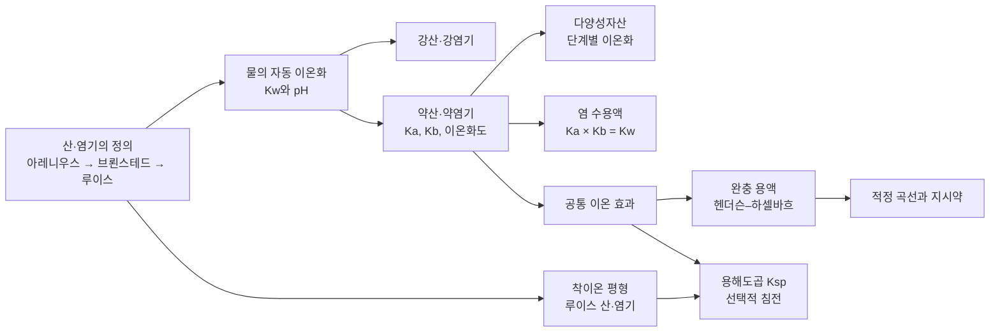

# 일반화학 9. 산·염기와 수용액 평형 — 양성자와 이온이 만드는 평형의 그물
<!-- prev: rxn-1, chem-4, uchem-8 -->
<!-- next: uchem-10, uchem-11, ubio-11 -->

> [!NOTE]
> **이 단원의 범위**
> - 산·염기의 정의(아레니우스, 브뢴스테드–로리, 루이스)
> - 물의 자동 이온화와 pH
> - 강산·강염기, 약산·약염기의 pH 계산($K_a$, $K_b$, 이온화도), 다양성자산
> - 염 수용액의 산·염기성, 공통 이온 효과와 완충 용액(헨더슨–하셀바흐 식)
> - 적정 곡선과 지시약
> - 용해도곱($K_{sp}$)과 선택적 침전, 착이온 평형

**학습 목표**

1. 아레니우스·브뢴스테드–로리·루이스 정의의 포함 관계를 설명하고, 분자 구조로 산의 상대적 세기를 추론할 수 있다.
2. 물의 자동 이온화와 온도에 따른 $K_w$를 이해하고, 매우 묽은 강산을 포함한 강산·강염기, 약산·약염기 수용액의 pH와 이온화도를 근사와 근의 공식으로 구할 수 있다.
3. 다양성자산의 단계별 이온화와 화학종 분율을 계산하고, 염 수용액(양쪽성 이온 포함)의 액성과 pH를 예측할 수 있다.
4. 공통 이온 효과로부터 헨더슨–하셀바흐 식을 유도하여 완충 용액의 pH, 산·염기 첨가 후의 pH, 완충 용량을 계산하고 원하는 pH의 완충 용액을 설계할 수 있다.
5. 강산–강염기, 약산–강염기, 약염기–강산 적정 곡선의 모든 구간에서 pH를 계산하고 지시약을 근거 있게 고를 수 있다.
6. 용해도곱으로 용해도·침전 여부·선택적 침전 조건을 계산하고, pH와 착이온 형성이 용해도에 미치는 영향을 정량적으로 설명할 수 있다.

**이 단원의 학습 사다리**

| 단계 | 무엇을 하나? |
|---|---|
| STEP 1. 이전 학습 다시 보기 | 고등학교 「역동적인 화학 반응」의 $K_w$·pH, 「산·염기 평형」의 $K_a$·적정 곡선·완충, 「화학 평형」의 ICE 계산을 다시 꺼낸다 |
| STEP 2. 기초 다지기 | 로그 계산과 pH의 유효 숫자, 질량 균형·전하 균형, 근사 판단을 익힌다 |
| STEP 3. 핵심 개념 | 세 정의 → $K_w$와 pH → 강·약산과 염기 → 다양성자산 → 염 → 완충 → 적정 → 용해도곱과 착이온 |
| STEP 4. 오개념 바로잡기 | "$10^{-8}$ M 염산의 pH는 8", "$K_{sp}$가 작을수록 덜 녹는다(언제나)" 같은 착각을 바로잡는다 |
| STEP 5. 전공 맛보기 | 전하 균형으로 푸는 정밀 pH 계산, 활동도와 이온 세기, 분석화학의 적정 |
| STEP 6. 생활·산업·진로 | 혈액 가스 분석, 해양 산성화, 수처리와 금속 회수, 의약품 제형 |

---

## 🗺️ 단원 들어가기

$1.0\times10^{-8}\ \mathrm{M}$ 염산의 pH는 얼마일까? 공식대로 계산하면 8이 나오는데, 산을 물에 넣었더니 염기성이 되었다는 것은 말이 되지 않는다. 혈액의 pH는 7.40 근처에서 0.05만 벗어나도 위험한데, 숨을 조금 참거나 빨리 쉬는 것만으로 pH가 얼마나 바뀔까? 바닷물의 pH가 8.2에서 8.1로 '고작 0.1' 내려갔다는 뉴스는 산호와 조개에게 어떤 의미일까? 물에 거의 녹지 않는 염화 은은 왜 암모니아수에는 녹을까?

고등학교에서는 브뢴스테드–라우리 정의, $K_a$와 $\sqrt{CK_a}$ 근사, 적정 곡선의 해석, 완충 작용의 정성적 원리를 배웠다. 대학에서는 이 위에 ① 양성자 없이도 산이 되는 **루이스 정의**, ② 근사가 무너지는 경우까지 다루는 **정밀한 pH 계산**, ③ **헨더슨–하셀바흐 식**으로 완충 용액을 설계하는 방법, ④ 적정 곡선의 **모든 점을 계산**하는 방법, ⑤ 침전과 착이온까지 포함하는 **용해 평형**을 쌓는다. 모두 「화학 평형」의 ICE 표와 근사라는 하나의 도구로 풀린다.

---

## STEP 1. 🔙 이전 학습 다시 보기

### 연계 개념표

| 이전 단원 | 고등학교에서는 여기까지 | 대학에서는 이렇게 확장 |
|---|---|---|
| 고등학교 「화학」 '역동적인 화학 반응' [12화학04-01], [12화학04-03] | 물의 자동 이온화, $K_w = 1.0\times10^{-14}$, pH, 중화의 양적 관계 | 온도에 따른 $K_w$와 중성의 pH, 매우 묽은 강산에서 물의 이온화 고려 |
| 고등학교 「화학 반응의 세계」 '산·염기 평형' [12반응01-01], [12반응01-02] | 브뢴스테드–라우리 정의, $K_a$·$K_b$, $\sqrt{CK_a}$ 근사 | 루이스 정의, 분자 구조와 산의 세기, 근의 공식, 다양성자산 |
| 고등학교 「화학 반응의 세계」 '산·염기 평형' [12반응01-03], [12반응01-04] | 적정 곡선 자료 해석, 반당량점 pH = $\mathrm{p}K_a$, 염의 가수 분해 | 적정 곡선의 모든 구간을 **계산**, 양쪽성 이온의 pH, 금속 이온의 산성 |
| 고등학교 「화학 반응의 세계」 '산·염기 평형' [12반응01-05] | 완충 작용을 르샤틀리에 원리로 정성적 설명 | 헨더슨–하셀바흐 식, 완충 용량, 원하는 pH의 완충 용액 설계 |
| 「일반화학 8. 화학 평형」 | ICE 표, 근의 공식, 작은 K 근사, 불균일 평형 | 같은 도구를 산·염기 평형, 용해 평형($K_{sp}$), 착이온 평형($K_f$)에 적용 |

### 준비 운동 (사전 진단)

**Q1.** 25 ℃에서 $[\mathrm{OH^-}] = 2.5\times10^{-4}\ \mathrm{M}$인 용액의 pOH와 pH는?

**Q2.** 다음 반응에서 브뢴스테드–로리 산과 그 짝염기를 쓰시오. $\mathrm{HCO_3^- + NH_3 \rightleftharpoons CO_3^{2-} + NH_4^+}$

**Q3.** 0.10 M 암모니아수($K_b = 1.8\times10^{-5}$)의 pH를 근사식으로 구하시오.

**Q4.** $\mathrm{AgCl(s) \rightleftharpoons Ag^+(aq) + Cl^-(aq)}$의 평형 상수식을 쓰시오. 고체 AgCl이 식에 없는 까닭은?

정답 및 해설

**Q1.** pOH $= -\log(2.5\times10^{-4}) = 3.60$, pH $= 14.00 - 3.60 = 10.40$

**Q2.** 산 $\mathrm{HCO_3^-}$ → 짝염기 $\mathrm{CO_3^{2-}}$, 역반응의 산 $\mathrm{NH_4^+}$ → 짝염기 $\mathrm{NH_3}$

**Q3.** $[\mathrm{OH^-}] \approx \sqrt{0.10\times1.8\times10^{-5}} = 1.3\times10^{-3}\ \mathrm{M}$, pOH = 2.87, pH = 11.13

**Q4.** $K = [\mathrm{Ag^+}][\mathrm{Cl^-}]$. 순수한 고체의 활동도는 1이기 때문이다(「화학 평형」의 불균일 평형). 이 평형 상수를 **용해도곱**이라 한다.

---

## STEP 2. 🧱 기초 다지기

### 디딤돌 1. 로그 계산과 pH의 유효 숫자

$$
\mathrm{pH} = -\log[\mathrm{H_3O^+}], \quad \mathrm{pOH} = -\log[\mathrm{OH^-}], \quad \mathrm{p}K = -\log K, \quad [\mathrm{H_3O^+}] = 10^{-\mathrm{pH}}
$$

pH는 로그 값이므로 **소수점 아래 자릿수 = 농도의 유효 숫자 개수**이다. $[\mathrm{H_3O^+}] = 3.2\times10^{-4}\ \mathrm{M}$(유효 숫자 2개)이면 pH = 3.49(소수점 아래 2자리)이다. pH 앞자리 정수(3)는 10의 거듭제곱을 나타낼 뿐 유효 숫자가 아니다.

| 로그 규칙 | 적용 |
|---|---|
| $\log(ab) = \log a + \log b$ | $\mathrm{p}K_a + \mathrm{p}K_b = \mathrm{p}K_w$ |
| $\log\dfrac{a}{b} = \log a - \log b$ | 헨더슨–하셀바흐 식 |
| $\log a^{1/2} = \tfrac12\log a$ | 약산의 pH $\approx \tfrac12(\mathrm{p}K_a - \log C)$ |

### 디딤돌 2. 질량 균형과 전하 균형

정밀한 계산에서는 근사 대신 두 가지 '장부'를 쓴다.

- **질량 균형**: 넣은 물질의 총량은 여러 형태로 나뉘어도 보존된다. 예: 0.10 M 아세트산 용액에서 $[\mathrm{CH_3COOH}] + [\mathrm{CH_3COO^-}] = 0.10\ \mathrm{M}$
- **전하 균형**: 용액은 전기적으로 중성이다. 예: 같은 용액에서 $[\mathrm{H_3O^+}] = [\mathrm{CH_3COO^-}] + [\mathrm{OH^-}]$

평형 상수식 + 질량 균형 + 전하 균형이면 미지수 수만큼 식이 생겨 어떤 용액이든 원리적으로 풀 수 있다. 일반화학의 근사들은 이 식에서 작은 항을 지운 것이다.

### 디딤돌 3. 근사 판단의 두 가지 질문

1. **약산의 이온화를 무시해도 되나?** $x/C \le 5\ \%$이면 $C - x \approx C$ (대략 $C/K_a > 400$이면 성립)
2. **물의 자동 이온화를 무시해도 되나?** 산이 내놓는 $[\mathrm{H_3O^+}]$가 $10^{-6}\ \mathrm{M}$ 이상이면 물에서 오는 $10^{-7}\ \mathrm{M}$ 이하는 무시해도 된다.

> [!TIP]
> 💡 **비유** — 근사는 '반올림 허락'이다. 큰 금액을 다루는 회계사는 몇 원 단위를 무시하지만, 잔돈만 다루는 가게에서는 1원도 중요하다. 산이 아주 묽으면 물이 내놓는 '잔돈'($10^{-7}\ \mathrm{M}$)이 중요해진다.

---

## STEP 3. 📘 핵심 개념

### ① 산·염기의 세 가지 정의와 산의 세기

#### 아레니우스 → 브뢴스테드–로리 → 루이스

| 정의 | 산 | 염기 | 대표 반응 | 한계·특징 |
|---|---|---|---|---|
| 아레니우스 | 물에서 $\mathrm{H^+}$를 내놓음 | 물에서 $\mathrm{OH^-}$를 내놓음 | $\mathrm{HCl \rightarrow H^+ + Cl^-}$ | 수용액에 한정, $\mathrm{NH_3}$ 설명 곤란 |
| 브뢴스테드–로리(고등학교: 브뢴스테드–라우리) | 양성자 주개 | 양성자 받개 | $\mathrm{NH_3 + H_2O \rightleftharpoons NH_4^+ + OH^-}$ | 짝산–짝염기, 용매 무관 |
| 루이스 | **전자쌍 받개** | **전자쌍 주개** | $\mathrm{BF_3 + :NH_3 \rightarrow F_3B{-}NH_3}$ | 양성자가 없는 산까지 포함 |

세 정의는 포함 관계이다. 아레니우스 산·염기는 모두 브뢴스테드–로리 산·염기이고, 브뢴스테드–로리 염기는 양성자에게 비공유 전자쌍을 내주므로 모두 루이스 염기이다. 루이스 정의에서는 $\mathrm{H^+}$ 자체가 루이스 산이다.

**루이스 산**이 되려면 전자쌍을 받을 빈 오비탈이 있어야 한다.

| 루이스 산의 종류 | 예 | 루이스 염기와의 반응 |
|---|---|---|
| 옥텟이 불완전한 분자 | $\mathrm{BF_3}$, $\mathrm{AlCl_3}$ | $\mathrm{AlCl_3 + Cl^- \rightarrow AlCl_4^-}$ |
| 금속 양이온 | $\mathrm{Ag^+}$, $\mathrm{Cu^{2+}}$, $\mathrm{Fe^{3+}}$ | $\mathrm{Ag^+ + 2NH_3 \rightarrow Ag(NH_3)_2^+}$ (착이온 형성, ⑧) |
| 다중 결합을 가진 분자 | $\mathrm{CO_2}$, $\mathrm{SO_2}$ | $\mathrm{CO_2 + OH^- \rightarrow HCO_3^-}$ |

#### 예제 1 — 루이스 산·염기 찾기

다음 반응에서 루이스 산과 루이스 염기를 쓰시오. (1) $\mathrm{Fe^{3+} + 6H_2O \rightarrow Fe(H_2O)_6^{3+}}$ (2) $\mathrm{CO_2 + OH^- \rightarrow HCO_3^-}$ (3) $\mathrm{BF_3 + F^- \rightarrow BF_4^-}$

**풀이** (1) 산 $\mathrm{Fe^{3+}}$, 염기 $\mathrm{H_2O}$ (산소의 비공유 전자쌍이 배위 결합) (2) 산 $\mathrm{CO_2}$(탄소가 전자쌍을 받고 π 결합 하나가 산소로 밀려남), 염기 $\mathrm{OH^-}$ (3) 산 $\mathrm{BF_3}$, 염기 $\mathrm{F^-}$. 셋 모두 양성자 이동이 없으므로 브뢴스테드–로리 정의로는 산·염기 반응이 아니다.

#### 분자 구조와 산의 세기

산 $\mathrm{H{-}A}$가 양성자를 내놓기 쉬운 정도는 ① H–A 결합의 세기와 ② 남는 $\mathrm{A^-}$의 안정성으로 정해진다.

| 산의 종류 | 경향 | 근거 |
|---|---|---|
| 같은 족의 이성분 산 | $\mathrm{HF \ll HCl < HBr < HI}$ | 아래로 갈수록 원자가 커져 H–X 결합이 약해진다(결합 세기가 우세) |
| 같은 주기의 이성분 산 | $\mathrm{CH_4 < NH_3 < H_2O < HF}$ | 오른쪽으로 갈수록 전기 음성도가 커져 $\mathrm{A^-}$가 안정 |
| 산소산(중심 원자 같음) | $\mathrm{HClO < HClO_2 < HClO_3 < HClO_4}$ | O가 많을수록 전자를 끌어 O–H가 약해지고 음전하가 퍼짐 |
| 산소산(산소 수 같음) | $\mathrm{HIO < HBrO < HClO}$ | 중심 원자의 전기 음성도가 클수록 강함 |
| 카복실산 | $\mathrm{CH_3COOH < ClCH_2COOH}$ | 전기 음성도가 큰 치환기가 음전하를 분산 |

물속에서는 $\mathrm{HCl}$, $\mathrm{HBr}$, $\mathrm{HI}$, $\mathrm{HNO_3}$, $\mathrm{HClO_4}$, $\mathrm{H_2SO_4}$(첫 단계)가 모두 '거의 100 %' 이온화하여 세기 차이가 드러나지 않는다. 물보다 강한 산은 모두 $\mathrm{H_3O^+}$로 바뀌기 때문인데, 이를 **수평화 효과(leveling effect)** 라 한다. 이들의 세기 차이는 아세트산처럼 양성자를 덜 받는 용매에서 비교한다.

> [!TIP]
> 💡 **비유** — 수평화 효과는 '천장이 낮은 방에서의 키 재기'이다. 키가 2 m든 2.2 m든 천장(물의 염기성)에 닿으면 모두 같은 높이로 보인다. 천장이 높은 방(약한 염기성 용매)으로 옮겨야 차이가 보인다.

### ② 물의 자동 이온화와 pH

$$
\mathrm{2H_2O(l) \rightleftharpoons H_3O^+(aq) + OH^-(aq)} \qquad K_w = [\mathrm{H_3O^+}][\mathrm{OH^-}],\quad \mathrm{p}K_w = \mathrm{pH} + \mathrm{pOH}
$$

$K_w$는 평형 상수이므로 **온도에 따라 변한다.** 자동 이온화는 흡열 반응이라 온도가 오르면 $K_w$가 커진다.

| 온도 | $K_w$ (약) | 중성 용액의 pH |
|---|---|---|
| 0 ℃ | $1.1\times10^{-15}$ | 7.48 |
| 25 ℃ | $1.0\times10^{-14}$ | 7.00 |
| 37 ℃ | $2.4\times10^{-14}$ | 6.81 |
| 60 ℃ | $9.6\times10^{-14}$ | 6.51 |

**중성**의 정의는 'pH 7'이 아니라 $[\mathrm{H_3O^+}] = [\mathrm{OH^-}]$이다. 체온(37 ℃)의 순수한 물은 pH 6.81이지만 중성이다. 이 단원에서는 따로 밝히지 않으면 25 ℃, $K_w = 1.0\times10^{-14}$를 쓴다.

#### 예제 2 — 체온에서의 중성

37 ℃에서 $K_w = 2.4\times10^{-14}$이다. 중성 용액의 pH와, pH 7.00인 용액의 액성을 판단하시오.

**풀이** $[\mathrm{H_3O^+}] = \sqrt{2.4\times10^{-14}} = 1.5\times10^{-7}\ \mathrm{M}$, pH = 6.81. pH 7.00이면 $[\mathrm{H_3O^+}] = 1.0\times10^{-7} < [\mathrm{OH^-}] = 2.4\times10^{-7}$이므로 **약한 염기성**이다. 혈액의 pH 7.40은 체온 기준으로도 약한 염기성이다.

### ③ 강산·강염기와 약산·약염기의 pH

#### 강산과 강염기

강산 $C$ M은 거의 완전히 이온화하므로 보통 $[\mathrm{H_3O^+}] = C$이다. 강염기 $\mathrm{M(OH)}_n$은 $[\mathrm{OH^-}] = nC$이다. 예를 들어 0.0250 M $\mathrm{Ba(OH)_2}$는 $[\mathrm{OH^-}] = 0.0500\ \mathrm{M}$, pOH = 1.301, pH = 12.699 ≈ 12.70이다.

#### 예제 3 — $1.0\times10^{-8}\ \mathrm{M}$ 염산의 pH

**풀이** 이 농도에서는 물의 이온화가 내놓는 $\mathrm{H_3O^+}$가 염산보다 많아 무시할 수 없다. 전하 균형 $[\mathrm{H_3O^+}] = [\mathrm{Cl^-}] + [\mathrm{OH^-}]$에 $[\mathrm{OH^-}] = K_w/[\mathrm{H_3O^+}]$를 넣는다. $h = [\mathrm{H_3O^+}]$라 하면

$$
h = 1.0\times10^{-8} + \frac{1.0\times10^{-14}}{h}
\;\Rightarrow\;
h^2 - 1.0\times10^{-8}h - 1.0\times10^{-14} = 0
\;\Rightarrow\;
h = 1.05\times10^{-7}\ \mathrm{M}
$$

pH = **6.98**. 산을 넣었으니 7보다 조금 낮다. 공식 pH = $-\log C$ = 8은 물의 이온화를 무시해 생긴 엉터리 답이다.

#### 약산 — 근사와 근의 공식

$\mathrm{HA + H_2O \rightleftharpoons H_3O^+ + A^-}$에서 처음 농도 $C$, 이온화한 농도 $x$이면

$$
K_a = \frac{x^2}{C - x}
\quad\Rightarrow\quad
x = \frac{-K_a + \sqrt{K_a^2 + 4K_aC}}{2}
\qquad(\text{근사: } x \approx \sqrt{K_aC})
$$

**이온화도(degree of ionization)** $\alpha = x/C$는 $\alpha \approx \sqrt{K_a/C}$로, 묽을수록 커진다(오스트발트 희석 법칙).

#### 예제 4 — 근사가 무너질 때: 0.050 M HF

$K_a = 6.8\times10^{-4}$인 HF 0.050 M 수용액의 pH를 구하시오.

**풀이**
1. 근사: $x \approx \sqrt{6.8\times10^{-4}\times0.050} = 5.8\times10^{-3}\ \mathrm{M}$ → $x/C = 12\ \%$ → **5 % 초과, 근사 불가**
2. 근의 공식: $x = \dfrac{-6.8\times10^{-4} + \sqrt{(6.8\times10^{-4})^2 + 4(6.8\times10^{-4})(0.050)}}{2} = 5.5\times10^{-3}\ \mathrm{M}$
3. pH = 2.26 (근사값 2.23과 0.03 차이), 이온화도 11 %
4. 의미: $C/K_a = 74$로 400보다 훨씬 작아 근사가 맞지 않았다. 근사 → 검증 → 필요하면 근의 공식, 이 순서를 습관으로 만들자.

#### 예제 5 — pH 측정으로 $K_a$ 구하기

어떤 일양성자 약산 0.200 M 수용액의 pH가 2.85였다. $K_a$와 이온화도를 구하시오.

**풀이** $x = 10^{-2.85} = 1.41\times10^{-3}\ \mathrm{M}$, $K_a = \dfrac{x^2}{C - x} = \dfrac{(1.41\times10^{-3})^2}{0.200 - 0.00141} = 1.0\times10^{-5}$, $\alpha = 0.71\ \%$. pH의 소수점 아래 자릿수가 2개이므로 $K_a$도 유효 숫자 2개로 쓴다.

#### 약염기

약염기 B는 $\mathrm{B + H_2O \rightleftharpoons BH^+ + OH^-}$, $K_b = \dfrac{[\mathrm{BH^+}][\mathrm{OH^-}]}{[\mathrm{B}]}$로 똑같이 풀어 $[\mathrm{OH^-}]$를 구한 뒤 pH로 바꾼다. 아민류($\mathrm{RNH_2}$)는 질소의 비공유 전자쌍으로 양성자를 받는 대표적인 약염기이다.

#### 예제 6 — 0.15 M 메틸아민

$\mathrm{CH_3NH_2}$($K_b = 4.4\times10^{-4}$) 0.15 M 수용액의 pH를 구하시오.

**풀이** 근사: $\sqrt{4.4\times10^{-4}\times0.15} = 8.1\times10^{-3}$ → 5.4 %로 경계를 조금 넘는다. 근의 공식: $[\mathrm{OH^-}] = 7.9\times10^{-3}\ \mathrm{M}$, pOH = 2.10, **pH = 11.90**. 근사값(11.91)과의 차이는 0.01이다. 5 % 기준은 엄격한 법칙이 아니라 '원하는 정밀도'에 따른 약속이다.

#### 농도에 따른 이온화도 — 아세트산($K_a = 1.8\times10^{-5}$, 근의 공식으로 계산)

| $C$ (M) | $[\mathrm{H_3O^+}]$ (M) | pH | 이온화도 |
|---|---|---|---|
| 1.0 | $4.2\times10^{-3}$ | 2.37 | 0.42 % |
| 0.10 | $1.3\times10^{-3}$ | 2.88 | 1.3 % |
| 0.010 | $4.2\times10^{-4}$ | 3.38 | 4.2 % |
| 0.0010 | $1.3\times10^{-4}$ | 3.90 | 13 % |

농도가 10배 묽어질 때마다 pH는 약 0.5씩 오르고 이온화도는 약 $\sqrt{10} \approx 3.2$배씩 커진다(강산이면 pH가 1씩 오른다).

<!-- fig:uchem-9-dilution -->

#### $K_a$와 $K_b$의 관계

짝산–짝염기 쌍에서 $K_aK_b = K_w$, 즉 $\mathrm{p}K_a + \mathrm{p}K_b = 14.00$(25 ℃)이다. 그래서 자료집은 보통 산의 $K_a$만 싣고, 짝염기의 $K_b$는 계산해 쓴다.

| 산 | $K_a$ (25 ℃, 약) | $\mathrm{p}K_a$ | 짝염기의 $K_b$ |
|---|---|---|---|
| $\mathrm{HSO_4^-}$ | $1.2\times10^{-2}$ | 1.92 | $8.3\times10^{-13}$ |
| $\mathrm{HF}$ | $6.8\times10^{-4}$ | 3.17 | $1.5\times10^{-11}$ |
| $\mathrm{HCOOH}$ | $1.8\times10^{-4}$ | 3.74 | $5.6\times10^{-11}$ |
| $\mathrm{CH_3COOH}$ | $1.8\times10^{-5}$ | 4.74 | $5.6\times10^{-10}$ |
| $\mathrm{HClO}$ | $3.0\times10^{-8}$ | 7.52 | $3.3\times10^{-7}$ |
| $\mathrm{NH_4^+}$ | $5.6\times10^{-10}$ | 9.26 | $1.8\times10^{-5}$ ($\mathrm{NH_3}$) |
| $\mathrm{HCN}$ | $4.9\times10^{-10}$ | 9.31 | $2.0\times10^{-5}$ |
| $\mathrm{CH_3NH_3^+}$ | $2.3\times10^{-11}$ | 10.64 | $4.4\times10^{-4}$ ($\mathrm{CH_3NH_2}$) |

> [!NOTE]
> 이온화 상수와 용해도곱은 자료마다 유효 숫자와 값이 조금씩 다르다. 이 단원의 값은 계산 연습을 위한 대표값이다.

### ④ 다양성자산

양성자를 둘 이상 내놓을 수 있는 산을 **다양성자산(polyprotic acid)** 이라 한다. 양성자는 한 번에 하나씩 떨어지고, 음전하가 커질수록 다음 양성자를 떼기 어려워 $K_{a1} > K_{a2} > K_{a3}$이며 보통 $10^4$배 이상 차이 난다.

| 산 | $K_{a1}$ | $K_{a2}$ | $K_{a3}$ |
|---|---|---|---|
| 탄산 $\mathrm{H_2CO_3}$ | $4.3\times10^{-7}$ | $4.7\times10^{-11}$ | — |
| 인산 $\mathrm{H_3PO_4}$ | $7.5\times10^{-3}$ | $6.2\times10^{-8}$ | $4.8\times10^{-13}$ |
| 황산 $\mathrm{H_2SO_4}$ | 매우 큼 | $1.2\times10^{-2}$ | — |

(탄산의 $K_{a1}$은 녹아 있는 $\mathrm{CO_2}$를 모두 $\mathrm{H_2CO_3}$로 셈한 값이다.)

#### 예제 7 — 0.10 M 인산 용액

**풀이**
1. pH는 첫 단계가 정한다: $\dfrac{x^2}{0.10 - x} = 7.5\times10^{-3}$ → 근의 공식 $x = 0.024\ \mathrm{M}$ → **pH = 1.62**
2. 둘째 단계: $K_{a2} = \dfrac{[\mathrm{H_3O^+}][\mathrm{HPO_4^{2-}}]}{[\mathrm{H_2PO_4^-}]}$에서 $[\mathrm{H_3O^+}] \approx [\mathrm{H_2PO_4^-}] \approx 0.024$이므로 $[\mathrm{HPO_4^{2-}}] \approx K_{a2} = 6.2\times10^{-8}\ \mathrm{M}$
3. 셋째 단계: $[\mathrm{PO_4^{3-}}] = \dfrac{K_{a3}[\mathrm{HPO_4^{2-}}]}{[\mathrm{H_3O^+}]} = \dfrac{(4.8\times10^{-13})(6.2\times10^{-8})}{0.024} = 1.2\times10^{-18}\ \mathrm{M}$
4. 의미: 둘째·셋째 단계가 더하는 $\mathrm{H_3O^+}$는 무시할 만하다. 또 '두 번째 음이온의 농도 ≈ $K_{a2}$'는 $K_{a1} \gg K_{a2}$인 다양성자산에서 늘 성립하는 유용한 결과이다.

#### 예제 8 — 0.010 M 황산

황산의 첫 단계는 완전하지만 둘째 단계($K_{a2} = 1.2\times10^{-2}$)는 부분적이다. pH를 구하시오.

**풀이** 첫 단계 뒤 $[\mathrm{H_3O^+}] = [\mathrm{HSO_4^-}] = 0.010\ \mathrm{M}$. 둘째 단계에서 $x$만큼 더 이온화하면 $\dfrac{(0.010 + x)x}{0.010 - x} = 0.012$ → $x^2 + 0.022x - 1.2\times10^{-4} = 0$ → $x = 0.0045\ \mathrm{M}$. $[\mathrm{H_3O^+}] = 0.0145\ \mathrm{M}$, **pH = 1.84**. '이양성자 강산이니 0.020 M, pH 1.70'으로 계산하면 틀린다.

#### 화학종의 분율 — pH가 정하는 존재 형태

$\mathrm{H_2A}$의 전체 농도 중 각 형태의 분율 $\alpha$는 $[\mathrm{H_3O^+}] = h$만의 함수이다.

$$
\alpha_{\mathrm{H_2A}} = \frac{h^2}{D},\quad
\alpha_{\mathrm{HA^-}} = \frac{K_{a1}h}{D},\quad
\alpha_{\mathrm{A^{2-}}} = \frac{K_{a1}K_{a2}}{D},\qquad
D = h^2 + K_{a1}h + K_{a1}K_{a2}
$$

| pH (탄산계) | $\mathrm{H_2CO_3}$ | $\mathrm{HCO_3^-}$ | $\mathrm{CO_3^{2-}}$ |
|---|---|---|---|
| 6.37 (= $\mathrm{p}K_{a1}$) | 50 % | 50 % | 0.006 % |
| 7.40 (혈액) | 8.5 % | 91.4 % | 0.11 % |
| 8.20 (바닷물 어림) | 1.4 % | 97.8 % | 0.73 % |
| 10.33 (= $\mathrm{p}K_{a2}$) | 0.005 % | 50 % | 50 % |

$\mathrm{pH} = \mathrm{p}K_a$인 곳에서 짝을 이루는 두 형태가 반반이다. 혈액과 바닷물에서는 탄산계가 대부분 $\mathrm{HCO_3^-}$로 존재한다. (바닷물은 이온 농도가 높아 실제 상수가 담수와 다르므로 이 표는 어림이다.)

<!-- fig:uchem-9-species-fractions -->

### ⑤ 염 수용액의 산·염기성

염이 녹아 생긴 이온 중 약산의 짝염기나 약염기의 짝산, 그리고 **전하가 크고 작은 금속 이온**이 물과 양성자를 주고받아 액성을 정한다.

| 이온 | 예 | 액성 | 근거 |
|---|---|---|---|
| 강산의 음이온, 1·2족 양이온 | $\mathrm{Cl^-}$, $\mathrm{NO_3^-}$, $\mathrm{Na^+}$, $\mathrm{Ca^{2+}}$ | 영향 없음 | 짝 산·염기가 매우 약함 |
| 약산의 음이온 | $\mathrm{F^-}$, $\mathrm{CH_3COO^-}$, $\mathrm{CO_3^{2-}}$ | 염기성 | $K_b = K_w/K_a$ |
| 약염기의 짝산 | $\mathrm{NH_4^+}$, $\mathrm{CH_3NH_3^+}$ | 산성 | $K_a = K_w/K_b$ |
| 수화된 고전하 금속 이온 | $\mathrm{Al^{3+}}$, $\mathrm{Fe^{3+}}$, $\mathrm{Cr^{3+}}$ | 산성 | 배위된 물의 O–H가 약해져 양성자를 내놓음 |
| 양쪽성 음이온 | $\mathrm{HCO_3^-}$, $\mathrm{H_2PO_4^-}$, $\mathrm{HSO_4^-}$ | $K_a$와 $K_b$ 비교 | 큰 쪽이 이긴다 |

금속 이온의 산성은 루이스 산·염기의 결과이다. $\mathrm{Al^{3+}}$에 배위된 물 분자는 전자를 금속 쪽으로 빼앗겨 O–H 결합이 약해진다.

$$
\mathrm{Al(H_2O)_6^{3+} + H_2O \rightleftharpoons Al(H_2O)_5(OH)^{2+} + H_3O^+} \qquad K_a \approx 1.4\times10^{-5}
$$

#### 예제 9 — 여러 염의 pH

(1) 0.10 M NaF, (2) 0.10 M $\mathrm{AlCl_3}$, (3) $\mathrm{NH_4CN}$과 $\mathrm{NH_4F}$의 액성을 구하시오.

**풀이**
1. $K_b(\mathrm{F^-}) = \dfrac{1.0\times10^{-14}}{6.8\times10^{-4}} = 1.5\times10^{-11}$, $[\mathrm{OH^-}] = \sqrt{0.10\times1.5\times10^{-11}} = 1.2\times10^{-6}$ → **pH = 8.08**
2. $[\mathrm{H_3O^+}] \approx \sqrt{0.10\times1.4\times10^{-5}} = 1.2\times10^{-3}$ → **pH = 2.93**. 아세트산(0.10 M, pH 2.88)과 비슷한 산성이다. 알루미늄 염을 정수 처리에 쓸 때 물의 pH가 내려가는 이유이다.
3. $\mathrm{NH_4CN}$: $K_a(\mathrm{NH_4^+}) = 5.6\times10^{-10} < K_b(\mathrm{CN^-}) = 2.0\times10^{-5}$ → **염기성**. $\mathrm{NH_4F}$: $K_a(\mathrm{NH_4^+}) = 5.6\times10^{-10} > K_b(\mathrm{F^-}) = 1.5\times10^{-11}$ → **약한 산성**

#### 양쪽성 이온의 pH

$\mathrm{NaHCO_3}$처럼 산으로도 염기로도 작용하는 이온의 용액은 두 반응이 경쟁한다. 농도가 너무 묽지 않으면 다음 어림식이 잘 맞는다(STEP 5 맛보기에서 유도).

$$
\mathrm{pH} \approx \frac{\mathrm{p}K_{a1} + \mathrm{p}K_{a2}}{2}
$$

$\mathrm{NaHCO_3}$: $\dfrac{6.37 + 10.33}{2} = 8.35$로 농도와 거의 무관하게 약한 염기성이다. 탄산계 분율 표에서 $\mathrm{HCO_3^-}$가 가장 많은 pH와 일치한다.

### ⑥ 공통 이온 효과와 완충 용액

#### 공통 이온 효과

약산 HA 용액에 짝염기 $\mathrm{A^-}$를 포함한 염을 넣으면, 르샤틀리에 원리에 따라 이온화 평형이 왼쪽으로 이동해 이온화가 억제된다. 이를 **공통 이온 효과(common-ion effect)** 라 한다.

#### 예제 10 — 0.20 M HF + 0.10 M NaF

**풀이** $K_a = \dfrac{[\mathrm{H_3O^+}](0.10 + x)}{0.20 - x} \approx \dfrac{[\mathrm{H_3O^+}](0.10)}{0.20}$ → $[\mathrm{H_3O^+}] = 6.8\times10^{-4}\times2 = 1.4\times10^{-3}\ \mathrm{M}$, pH = 2.87. 0.20 M HF만 있을 때는 pH 1.95, 이온화도 5.7 %였는데, 공통 이온이 이온화도를 0.7 %로 낮추었다.

#### 헨더슨–하셀바흐 식

약산 HA와 짝염기 $\mathrm{A^-}$가 함께 있을 때 $K_a$ 식의 로그를 취하면

$$
K_a = [\mathrm{H_3O^+}]\frac{[\mathrm{A^-}]}{[\mathrm{HA}]}
\quad\Rightarrow\quad
\boxed{\;\mathrm{pH} = \mathrm{p}K_a + \log\frac{[\mathrm{A^-}]}{[\mathrm{HA}]}\;}
$$

이 식을 **헨더슨–하셀바흐 식(Henderson–Hasselbalch equation)** 이라 한다. 공통 이온 효과로 이온화가 작아 $[\mathrm{HA}] \approx C_\mathrm{HA}$, $[\mathrm{A^-}] \approx C_{\mathrm{A^-}}$로 **넣은 농도를 그대로** 쓸 수 있고, 같은 부피 안의 비이므로 **몰수 비**를 넣어도 된다.

| 사용 조건 | 이유 |
|---|---|
| 두 성분 농도가 $K_a$보다 충분히 크다(대략 100배 이상) | 이온화에 의한 농도 변화를 무시하기 위해 |
| 농도 비가 0.1~10 사이 | 이 범위를 벗어나면 완충 작용이 약하고 근사 오차도 커진다 |
| $\mathrm{p}K_a$가 너무 작거나(약 3 이하) 크지 않다(약 11 이상) | 물의 이온화나 산의 이온화가 무시할 수 없을 만큼 커진다 |

#### 완충 용액에 강산·강염기를 넣을 때 — 두 단계 계산

1. **양적 관계(중화)**: 넣은 $\mathrm{H_3O^+}$는 $\mathrm{A^-}$와, $\mathrm{OH^-}$는 HA와 완전히 반응한다고 보고 **몰수**를 계산한다.
2. **평형**: 새 몰수 비를 헨더슨–하셀바흐 식에 넣는다.

<!-- fig:uchem-9-buffer-particles -->

#### 예제 11 — 암모니아 완충 용액

$\mathrm{NH_3}$ 0.250 mol과 $\mathrm{NH_4Cl}$ 0.400 mol을 녹여 1.00 L로 만든 용액의 pH, 그리고 이 용액에 HCl 0.0300 mol을 넣은 뒤의 pH를 구하시오. ($K_b(\mathrm{NH_3}) = 1.8\times10^{-5}$)

**풀이**
1. $\mathrm{p}K_a(\mathrm{NH_4^+}) = 14.00 - 4.74 = 9.26$, pH $= 9.26 + \log\dfrac{0.250}{0.400} = 9.26 - 0.20 = 9.06$
2. HCl 첨가: $\mathrm{NH_3 + H_3O^+ \rightarrow NH_4^+ + H_2O}$ → $\mathrm{NH_3}$ 0.220 mol, $\mathrm{NH_4^+}$ 0.430 mol
3. pH $= 9.26 + \log\dfrac{0.220}{0.430} = 9.26 - 0.29 = 8.97$ — 0.09 감소
4. 비교: 같은 HCl을 순수한 물 1.00 L에 넣으면 pH 7.00 → 1.52로 5.5나 떨어진다.

#### 완충 용량과 완충 용액의 설계

**완충 용량(buffer capacity)** 은 pH를 1 바꾸는 데 필요한 강산·강염기의 양이다. 두 성분이 **많을수록**, 그리고 비가 **1에 가까울수록** 크다. 예를 들어 0.10 M $\mathrm{CH_3COOH}$와 0.10 M $\mathrm{CH_3COO^-}$가 든 1.00 L 용액의 pH를 1 낮추려면 비가 $\tfrac{1}{10}$이 되어야 하므로 $\dfrac{0.10 - y}{0.10 + y} = 0.10$ → $y = 0.082\ \mathrm{mol}$의 강산이 필요하다.

**설계 규칙**: 원하는 pH에서 $\mathrm{p}K_a$가 **±1 이내**인 약산을 고르고, 헨더슨–하셀바흐 식으로 비를 정한 뒤, 필요한 완충 용량에 맞게 총농도를 정한다.

<!-- sim:u-buffer -->

#### 예제 12 — pH 7.40 인산 완충 용액 설계

생화학 실험에 쓸 pH 7.40 완충 용액을 $\mathrm{NaH_2PO_4}$와 $\mathrm{Na_2HPO_4}$로 만들려 한다. 두 성분의 몰수 비를 구하시오.

**풀이** 인산의 세 $\mathrm{p}K_a$ 중 7.40에 가까운 것은 $\mathrm{p}K_{a2} = 7.21$이다. $7.40 = 7.21 + \log\dfrac{[\mathrm{HPO_4^{2-}}]}{[\mathrm{H_2PO_4^-}]}$ → 비 $= 10^{0.19} = 1.6$. $\mathrm{HPO_4^{2-}}$를 $\mathrm{H_2PO_4^-}$의 약 1.6배로 섞는다. 세포 안 인산 완충계가 생리적 pH에서 효과적인 까닭도 $\mathrm{p}K_{a2}$가 7 근처이기 때문이다.

> [!TIP]
> 💡 **비유** — 완충 용액은 '양쪽에 추를 단 저울'이다. 추(HA와 $\mathrm{A^-}$)가 무거울수록(농도가 클수록) 손가락으로 눌러도(산·염기 첨가) 잘 기울지 않고, 양쪽 추가 비슷할 때(비 ≈ 1) 어느 쪽으로 눌러도 가장 잘 버틴다.

### ⑦ 적정 곡선과 지시약

적정 곡선의 각 점은 **'지금 용액에 무엇이 남아 있는가'** 를 먼저 묻고, 그에 맞는 계산법을 고르면 된다. 고등학교에서는 곡선을 자료로 해석했다면, 여기서는 모든 구간을 직접 계산한다.

#### 강산–강염기: 0.100 M HCl 50.0 mL를 0.200 M NaOH로 적정

당량점 부피 $V_\text{eq} = \dfrac{0.100\times50.0}{0.200} = 25.0\ \mathrm{mL}$

| NaOH (mL) | 남은 것 | 계산 | pH |
|---|---|---|---|
| 0 | HCl | $[\mathrm{H_3O^+}] = 0.100$ | 1.00 |
| 12.5 | HCl 2.50 mmol | $2.50/62.5 = 0.0400\ \mathrm{M}$ | 1.40 |
| 24.0 | HCl 0.20 mmol | $0.20/74.0 = 2.7\times10^{-3}\ \mathrm{M}$ | 2.57 |
| 24.9 | HCl 0.020 mmol | $2.7\times10^{-4}\ \mathrm{M}$ | 3.57 |
| 25.0 | NaCl | 중성 | 7.00 |
| 25.1 | NaOH 0.020 mmol | $[\mathrm{OH^-}] = 2.7\times10^{-4}$ | 10.43 |
| 26.0 | NaOH 0.20 mmol | $[\mathrm{OH^-}] = 2.6\times10^{-3}$ | 11.42 |
| 30.0 | NaOH 1.00 mmol | $[\mathrm{OH^-}] = 0.0125$ | 12.10 |

당량점 앞뒤 0.2 mL 사이에서 pH가 약 7 뛴다. 몰수를 다룰 때 mL와 mmol을 쓰면 $10^{-3}$을 쓰지 않아도 되어 편리하다.

#### 약산–강염기: 0.100 M HCOOH 40.0 mL를 0.100 M NaOH로 적정

$K_a = 1.8\times10^{-4}$, $\mathrm{p}K_a = 3.74$, $V_\text{eq} = 40.0\ \mathrm{mL}$

| 구간 | NaOH (mL) | 남은 것 | 계산법 | pH |
|---|---|---|---|---|
| ① 시작 | 0 | HCOOH | 약산의 이온화(근의 공식) | 2.38 |
| ② 완충 구간 | 10.0 | HCOOH 3.0 : $\mathrm{HCOO^-}$ 1.0 (mmol) | 헨더슨–하셀바흐 | 3.27 |
| ② 반당량점 | 20.0 | 1 : 1 | pH = $\mathrm{p}K_a$ | 3.74 |
| ② 완충 구간 | 30.0 | 1.0 : 3.0 | 헨더슨–하셀바흐 | 4.22 |
| ② 당량점 직전 | 39.0 | 0.10 : 3.90 | 헨더슨–하셀바흐 | 5.34 |
| ③ 당량점 | 40.0 | $\mathrm{HCOO^-}$ 0.0500 M | 짝염기의 가수 분해($K_b = 5.6\times10^{-11}$) | 8.22 |
| ④ 당량점 이후 | 41.0 | NaOH 0.10 mmol | 넘친 $\mathrm{OH^-}$ | 11.09 |
| ④ 당량점 이후 | 50.0 | NaOH 1.00 mmol | 넘친 $\mathrm{OH^-}$ | 12.05 |

**당량점 계산**: $[\mathrm{HCOO^-}] = \dfrac{4.00\ \mathrm{mmol}}{80.0\ \mathrm{mL}} = 0.0500\ \mathrm{M}$, $[\mathrm{OH^-}] = \sqrt{0.0500\times5.6\times10^{-11}} = 1.7\times10^{-6}$ → pOH 5.78 → pH 8.22.

> [!NOTE]
> 폼산처럼 $K_a$가 비교적 큰 산은 완충 구간에서도 산의 이온화가 조금 일어나, 전하 균형까지 넣은 정밀 계산과 헨더슨–하셀바흐 값이 0.01 정도 다를 수 있다(반당량점 정밀값 3.75). 일반화학 수준에서는 위 표로 충분하다.

#### 약염기–강산: 0.100 M $\mathrm{NH_3}$ 25.0 mL를 0.100 M HCl로 적정

거울상처럼 생각하면 된다. 시작 pH 11.13, 반당량점 pH = $\mathrm{p}K_a(\mathrm{NH_4^+})$ = 9.26, 당량점에는 $\mathrm{NH_4^+}$ 0.0500 M만 남아 $[\mathrm{H_3O^+}] = \sqrt{0.0500\times5.6\times10^{-10}} = 5.3\times10^{-6}$ → **pH 5.28(산성)** 이다. 변색 범위가 약 4.4~6.2인 메틸 레드가 알맞다.

#### 세 곡선 비교

| 특징 | 강산–강염기 | 약산–강염기 | 약염기–강산 |
|---|---|---|---|
| 시작 pH | 낮다 | 높다(약산) | 높다(약염기) |
| 완충 구간 | 없음 | 반당량점 근처 넓게 | 반당량점 근처 넓게 |
| 반당량점 pH | — | $\mathrm{p}K_a$ | $\mathrm{p}K_a$(짝산) |
| 당량점 pH | 7 | 7보다 큼 | 7보다 작음 |
| 수직 구간 | 가장 길다 | 짧고 위쪽 | 짧고 아래쪽 |
| 알맞은 지시약 | 대부분 가능 | 페놀프탈레인 | 메틸 레드 |

산이 약할수록(또는 묽을수록) 수직 구간이 짧아진다. $K_a$가 대략 $10^{-8}$보다 작은 산은 0.1 M 수준에서도 뚜렷한 수직 구간이 없어 지시약 적정이 어렵다.

<!-- fig:uchem-9-titration-curves -->

#### 다양성자산의 적정

$\mathrm{Na_2CO_3}$를 HCl로 적정하면 두 단계의 당량점이 나타난다.

$$
\mathrm{CO_3^{2-} \xrightarrow{H^+} HCO_3^- \xrightarrow{H^+} H_2CO_3}
$$

첫 당량점에는 $\mathrm{HCO_3^-}$만 남아 pH ≈ 8.35(양쪽성 이온, 페놀프탈레인이 무색이 됨), 둘째 당량점에는 $\mathrm{H_2CO_3}$가 남아 약산성(메틸 오렌지 변색)이다. 두 당량점 사이 부피가 같으므로, 수산화 나트륨과 탄산 나트륨이 섞인 시료도 두 지시약으로 각 성분을 정량할 수 있다.

<!-- fig:uchem-9-carbonate-titration -->

#### 지시약의 원리

지시약 HIn은 약산이며, 산 형태와 염기 형태의 색이 다르다. 헨더슨–하셀바흐 식을 적용하면

$$
\mathrm{pH} = \mathrm{p}K_\mathrm{In} + \log\frac{[\mathrm{In^-}]}{[\mathrm{HIn}]}
$$

눈은 한 형태가 다른 형태의 약 10배일 때 그 색으로 인식하므로, 변색 범위는 대략 $\mathrm{pH} = \mathrm{p}K_\mathrm{In} \pm 1$이다.

| 지시약 | $\mathrm{p}K_\mathrm{In}$ (약) | 변색 범위 (약) | 색(산 → 염기) |
|---|---|---|---|
| 메틸 오렌지 | 3.5 | 3.1~4.4 | 빨강 → 노랑 |
| 메틸 레드 | 5.0 | 4.4~6.2 | 빨강 → 노랑 |
| 브로모티몰 블루 | 7.1 | 6.0~7.6 | 노랑 → 파랑 |
| 페놀프탈레인 | 9.3 | 8.2~10.0 | 무색 → 분홍 |

**선택 기준**: 변색 범위가 당량점의 수직 구간 안에 있어야 한다. 폼산 적정(당량점 8.22)에 페놀프탈레인($\mathrm{p}K_\mathrm{In}$ 9.3)을 쓰면, 당량점에서 $[\mathrm{In^-}]/[\mathrm{HIn}] = 10^{8.22 - 9.3} \approx 0.08$로 아직 거의 무색이지만, 그 직후 NaOH 한두 방울에 pH가 10 이상으로 뛰어 분홍색이 뚜렷해진다. 부피 오차는 0.05 mL 정도에 그친다. 지시약은 그 자체가 산이므로 **몇 방울만** 넣는다.

### ⑧ 용해도곱과 선택적 침전, 착이온 평형

#### 용해도곱

물에 조금만 녹는 이온성 고체의 포화 용액에서는 불균일 평형이 이루어진다.

$$
\mathrm{M}_m\mathrm{X}_n(\mathrm{s}) \rightleftharpoons m\mathrm{M^{n+}}(\mathrm{aq}) + n\mathrm{X^{m-}}(\mathrm{aq})
\qquad K_{sp} = [\mathrm{M^{n+}}]^m[\mathrm{X^{m-}}]^n
$$

이 평형 상수를 **용해도곱(solubility product)** $K_{sp}$라 한다. **몰 용해도** $s$(포화 용액 1 L에 녹은 고체의 몰수)로 쓰면 $K_{sp} = (ms)^m(ns)^n$이다.

| 화합물 | $K_{sp}$ (25 ℃, 약) | $K_{sp}$와 $s$의 관계 | 몰 용해도 $s$ (M) |
|---|---|---|---|
| $\mathrm{AgCl}$ | $1.8\times10^{-10}$ | $s^2$ | $1.3\times10^{-5}$ |
| $\mathrm{AgI}$ | $8.3\times10^{-17}$ | $s^2$ | $9.1\times10^{-9}$ |
| $\mathrm{BaSO_4}$ | $1.1\times10^{-10}$ | $s^2$ | $1.0\times10^{-5}$ |
| $\mathrm{Ag_2CrO_4}$ | $1.1\times10^{-12}$ | $4s^3$ | $6.5\times10^{-5}$ |
| $\mathrm{CaF_2}$ | $3.9\times10^{-11}$ | $4s^3$ | $2.1\times10^{-4}$ |
| $\mathrm{Mg(OH)_2}$ | $5.6\times10^{-12}$ | $4s^3$ | $1.1\times10^{-4}$ |
| $\mathrm{Fe(OH)_3}$ | $2.8\times10^{-39}$ | $27s^4$ | 매우 작음 |

#### 예제 13 — $K_{sp}$가 작다고 덜 녹는 것은 아니다

AgCl과 $\mathrm{Ag_2CrO_4}$ 중 몰 용해도가 큰 것은?

**풀이** AgCl: $s = \sqrt{1.8\times10^{-10}} = 1.3\times10^{-5}\ \mathrm{M}$. $\mathrm{Ag_2CrO_4}$: $4s^3 = 1.1\times10^{-12}$ → $s = 6.5\times10^{-5}\ \mathrm{M}$. $K_{sp}$는 $\mathrm{Ag_2CrO_4}$가 더 작지만 **몰 용해도는 5배 크다.** 이온 수가 다른 화합물은 $K_{sp}$만으로 용해도를 비교할 수 없다.

#### 용해도를 바꾸는 세 요인

**(1) 공통 이온**: 0.10 M NaCl 용액에서 AgCl의 용해도는 $s = \dfrac{1.8\times10^{-10}}{0.10} = 1.8\times10^{-9}\ \mathrm{M}$로, 순수한 물에서보다 약 7500배 작다.

<!-- fig:uchem-9-common-ion -->

**(2) pH**: 음이온이 약산의 짝염기($\mathrm{OH^-}$, $\mathrm{F^-}$, $\mathrm{CO_3^{2-}}$, $\mathrm{PO_4^{3-}}$)이면 산성에서 그 음이온이 양성자와 결합해 제거되므로 용해도가 커진다. 예를 들어 $\mathrm{Mg(OH)_2}$의 용해도는

$$
s = [\mathrm{Mg^{2+}}] = \frac{K_{sp}}{[\mathrm{OH^-}]^2}
$$

| 조건 | $[\mathrm{OH^-}]$ (M) | $\mathrm{Mg(OH)_2}$의 용해도 (M) |
|---|---|---|
| pH 11.00 완충 | $1.0\times10^{-3}$ | $5.6\times10^{-6}$ |
| 순수한 물(포화 용액 pH 약 10.35) | $2.2\times10^{-4}$ | $1.1\times10^{-4}$ |
| pH 9.00 완충 | $1.0\times10^{-5}$ | $5.6\times10^{-2}$ |

제산제 $\mathrm{Mg(OH)_2}$가 위산 속에서 잘 녹아 산을 중화하는 이유이다. 반면 $\mathrm{Cl^-}$처럼 강산의 음이온을 가진 AgCl의 용해도는 pH에 거의 무관하다.

**(3) 착이온 형성**: ⑧의 마지막에서 다룬다.

#### 침전 예측 — Q와 $K_{sp}$

두 용액을 섞은 **직후의 이온 농도**로 이온곱 $Q$를 계산해 비교한다.

| 비교 | 결과 |
|---|---|
| $Q < K_{sp}$ | 불포화, 침전 없음(고체가 있으면 더 녹음) |
| $Q = K_{sp}$ | 포화 |
| $Q > K_{sp}$ | 과포화, 침전 생성 |

#### 예제 14 — 섞으면 침전이 생길까?

$1.0\times10^{-3}\ \mathrm{M}$ $\mathrm{BaCl_2}$ 100 mL와 $2.0\times10^{-4}\ \mathrm{M}$ $\mathrm{Na_2SO_4}$ 100 mL를 섞었다.

**풀이** 부피가 2배가 되어 $[\mathrm{Ba^{2+}}] = 5.0\times10^{-4}$, $[\mathrm{SO_4^{2-}}] = 1.0\times10^{-4}\ \mathrm{M}$. $Q = 5.0\times10^{-8} > K_{sp} = 1.1\times10^{-10}$ → **침전 생성**. 섞은 뒤의 농도를 쓰는 것을 잊지 말자.

#### 선택적 침전

이온이 여럿 섞인 용액에 침전제를 조금씩 넣으면 $K_{sp}$에 도달하는 순서대로 침전이 생긴다. 이것을 이용해 이온을 분리하는 것이 **선택적 침전(selective precipitation)** 이다.

#### 예제 15 — $\mathrm{I^-}$와 $\mathrm{Cl^-}$의 분리

$\mathrm{I^-}$와 $\mathrm{Cl^-}$가 각각 0.010 M인 용액에 $\mathrm{AgNO_3}$를 조금씩 넣는다(부피 변화 무시). (1) 먼저 침전하는 것은? (2) 두 번째 침전이 시작될 때 첫 번째 이온은 몇 %가 남아 있는가?

**풀이**
1. AgI가 생기기 시작하는 $[\mathrm{Ag^+}] = \dfrac{8.3\times10^{-17}}{0.010} = 8.3\times10^{-15}\ \mathrm{M}$, AgCl은 $\dfrac{1.8\times10^{-10}}{0.010} = 1.8\times10^{-8}\ \mathrm{M}$ → **AgI가 먼저**
2. AgCl이 생기기 시작할 때 $[\mathrm{I^-}] = \dfrac{8.3\times10^{-17}}{1.8\times10^{-8}} = 4.6\times10^{-9}\ \mathrm{M}$ → 처음의 $4.6\times10^{-5}\ \%$만 남음
3. 의미: AgCl이 생기기 전에 $\mathrm{I^-}$가 사실상 완전히 침전된다. $K_{sp}$의 차이가 클수록 분리가 깨끗하다. 정성 분석에서 금속 이온을 무리별로 나누는 원리도 같다.

<!-- fig:uchem-9-selective-precipitation -->

#### 착이온 평형

금속 이온(루이스 산)에 $\mathrm{NH_3}$, $\mathrm{CN^-}$, $\mathrm{OH^-}$ 같은 리간드(루이스 염기)가 배위 결합하여 생긴 이온을 **착이온(complex ion)** 이라 한다. 그 생성 평형 상수를 **생성 상수(formation constant)** $K_f$라 한다.

$$
\mathrm{Ag^+(aq) + 2NH_3(aq) \rightleftharpoons Ag(NH_3)_2^+(aq)}
\qquad
K_f = \frac{[\mathrm{Ag(NH_3)_2^+}]}{[\mathrm{Ag^+}][\mathrm{NH_3}]^2} \approx 1.7\times10^{7}
$$

$K_f$가 매우 크므로 리간드가 과량이면 금속 이온은 거의 모두 착이온으로 바뀐다. 그 결과 자유 금속 이온 농도가 줄어 **용해 평형이 오른쪽으로 끌려간다.**

#### 예제 16 — 염화 은을 암모니아수에 녹이기

1.0 M 암모니아수에 AgCl의 몰 용해도를 구하시오.

**풀이**
1. 두 평형을 더한다: $\mathrm{AgCl(s) + 2NH_3 \rightleftharpoons Ag(NH_3)_2^+ + Cl^-}$, $K = K_{sp}K_f = (1.8\times10^{-10})(1.7\times10^7) = 3.1\times10^{-3}$
2. ICE: $\dfrac{s^2}{(1.0 - 2s)^2} = 3.1\times10^{-3}$ → 양변에 제곱근 $\dfrac{s}{1.0 - 2s} = 0.0553$ → $s = 0.050\ \mathrm{M}$
3. 의미: 순수한 물에서의 $1.3\times10^{-5}\ \mathrm{M}$보다 약 3700배 크다. 「화학 평형」의 '반응식을 더하면 K는 곱'이 그대로 쓰였다.

**양쪽성 수산화물**: $\mathrm{Al(OH)_3}$, $\mathrm{Zn(OH)_2}$ 등은 산에도($\mathrm{Al^{3+}}$로) 강염기에도($\mathrm{Al(OH)_4^-}$ 착이온으로) 녹는다. pH에 따른 이 성질로 $\mathrm{Al^{3+}}$와 $\mathrm{Fe^{3+}}$를 분리할 수 있다(과량의 NaOH를 넣으면 $\mathrm{Fe(OH)_3}$만 침전으로 남는다).

> [!TIP]
> 💡 **비유** — 착이온 형성은 '전학 간 친구 자리 채우기'이다. 용해 평형은 교실(용액)의 $\mathrm{Ag^+}$ 자리가 차면 더 녹지 않는데, 암모니아가 $\mathrm{Ag^+}$를 데리고 다른 반(착이온)으로 전학시키면 빈자리가 생겨 고체가 계속 녹아 들어온다.

---

## STEP 4. ⚠️ 오개념 바로잡기

| 흔한 오개념 | 올바른 개념 | 왜 그럴까? |
|---|---|---|
| $1.0\times10^{-8}\ \mathrm{M}$ 염산의 pH는 8이다 | pH는 6.98로 약한 산성이다 | 물의 자동 이온화가 내놓는 $10^{-7}\ \mathrm{M}$이 더 크므로 전하 균형으로 풀어야 한다 |
| 중성 용액의 pH는 언제나 7이다 | 중성은 $[\mathrm{H_3O^+}] = [\mathrm{OH^-}]$이며 pH는 온도에 따라 다르다 | $K_w$가 온도에 따라 변한다(37 ℃에서 중성 pH 6.81) |
| 이양성자산 $C$ M의 $[\mathrm{H_3O^+}]$는 $2C$이다 | 둘째 단계는 대개 부분적이어서 $C$와 $2C$ 사이(대부분 $C$에 가까움)이다 | $K_{a2} \ll K_{a1}$이고 첫 단계의 $\mathrm{H_3O^+}$가 둘째 단계를 억제한다 |
| $K_{sp}$가 작은 화합물이 언제나 덜 녹는다 | 이온 수가 같은 화합물끼리만 $K_{sp}$로 비교할 수 있다 | $\mathrm{Ag_2CrO_4}$는 $K_{sp}$가 AgCl보다 작지만 몰 용해도는 크다 |
| 완충 용액은 산·염기를 아무리 넣어도 pH가 변하지 않는다 | 완충 용량을 넘으면 pH가 크게 변한다 | 한 성분이 바닥나면 더는 중화할 수 없다 |
| 헨더슨–하셀바흐 식은 어떤 용액에도 쓸 수 있다 | 약산과 짝염기가 **둘 다 상당량** 있을 때만 쓴다 | 시작점(짝염기 0)과 당량점(약산 0)에서는 $\log$ 항이 무한대가 된다 |
| 지시약은 당량점에서 정확히 색이 바뀐다 | 지시약은 $\mathrm{p}K_\mathrm{In}$ 근처에서 바뀌며, 수직 구간 안에 있으면 오차가 작을 뿐이다 | 변색점(종말점)과 당량점은 개념이 다르다 |
| 금속 이온은 산·염기와 관계없다 | $\mathrm{Al^{3+}}$, $\mathrm{Fe^{3+}}$의 수용액은 산성이고, 금속 이온은 루이스 산이다 | 배위된 물 분자의 O–H 결합이 약해져 양성자를 내놓는다 |

---

## STEP 5. 🎓 다음 단계로 한 걸음 더

> [!CAUTION]
> 여기부터는 일반 과목의 범위를 넘는 전공 과목 맛보기이다. 평가 대상이 아니며, 수용액 평형이 전공에서 어떻게 확장되는지 보여 주기 위한 내용이다.

### 전공 과목과의 연결

| 전공 과목 | 이어지는 내용 |
|---|---|
| 분석화학 | 전하·질량 균형에 의한 정밀 pH 계산, 활동도 계수, 전위차 적정, 착물 적정(EDTA), 중량 분석 |
| 무기화학 | 경–연 산·염기(HSAB) 원리, 배위 화합물의 안정도, 비수용매의 산·염기 |
| 생화학 | 아미노산과 단백질의 등전점, 효소 활성 부위의 $\mathrm{p}K_a$, 생체 완충계 |
| 환경·해양화학 | 탄산염 평형과 알칼리도, 광물 용해, 중금속의 이동성 |
| 약학(물리약학) | 약물의 이온화와 막 투과, 염 형태 선택, 용해도 개선 |

### 맛보기 1. 양쪽성 이온의 pH 어림식 유도

$\mathrm{NaHA}$ 용액의 전하 균형과 질량 균형에서, $\mathrm{HA^-}$가 거의 그대로 남는다고 보면(산으로 만든 $\mathrm{A^{2-}}$와 염기로 만든 $\mathrm{H_2A}$가 거의 같은 양)

$$
[\mathrm{H_2A}] \approx [\mathrm{A^{2-}}]
\;\Rightarrow\;
\frac{[\mathrm{H_3O^+}][\mathrm{HA^-}]}{K_{a1}} \approx \frac{K_{a2}[\mathrm{HA^-}]}{[\mathrm{H_3O^+}]}
\;\Rightarrow\;
[\mathrm{H_3O^+}] \approx \sqrt{K_{a1}K_{a2}}
$$

가 되어 $\mathrm{pH} \approx \tfrac12(\mathrm{p}K_{a1} + \mathrm{p}K_{a2})$이다. 분석화학에서는 이 근사 없이 전하 균형 전체를 풀어 묽은 용액에서의 오차까지 평가한다.

### 맛보기 2. 활동도와 이온 세기

이온이 많은 용액에서는 이온 주위에 반대 전하가 모여 '실제로 반응에 참여하는 농도'가 줄어든다. 이 효과는 **이온 세기** $I = \tfrac12\sum c_iz_i^2$로 정리되고, 묽은 용액에서는 디바이–휘켈 식 $\log\gamma = -0.51z^2\sqrt{I}$로 활동도 계수를 어림한다. 바닷물이나 혈장처럼 이온 세기가 큰 용액에서 $K_a$와 $K_{sp}$의 '겉보기 값'이 순수한 물에서와 다른 까닭이다.

### 일반화학 vs 전공 과목

| 주제 | 일반화학 | 전공(분석화학·무기화학·생화학) |
|---|---|---|
| pH 계산 | 근사 → 5 % 검증 → 근의 공식 | 전하·질량 균형의 연립 방정식, 수치 해법 |
| 농도 | 몰 농도로 쓴 평형 상수 | 활동도, 이온 세기 보정 |
| 적정 | 구간별 계산, 지시약 선택 | 미분 적정 곡선, 그란 도시, 전위차·착물 적정 |
| 산·염기 개념 | 세 정의, 분자 구조와 세기 | HSAB, 초강산, 비수용매 |
| 용해 평형 | $K_{sp}$, 공통 이온, pH, 착이온 | 경쟁 평형의 조건부 상수, 결정 성장과 침전 순도 |

---

## STEP 6. 🏭 생활·산업·진로 연결

### 사례 1. 병원의 동맥혈 가스 분석

- **원리** 탄산–탄산수소 이온 완충계와 헨더슨–하셀바흐 식(⑥).
- **어디에 쓰이나** 혈액의 탄산계는 유효 $\mathrm{p}K_a$ 약 6.1, 녹은 $\mathrm{CO_2}$ 농도 ≈ $0.0301\times P_{\mathrm{CO_2}}$(mmHg 단위, mM)로 다룬다. 의료진은 pH, $P_{\mathrm{CO_2}}$, $\mathrm{HCO_3^-}$를 측정해 이상의 원인이 호흡(폐의 $\mathrm{CO_2}$ 배출)인지 대사(콩팥의 $\mathrm{HCO_3^-}$ 조절)인지 구별한다(문제 10).

### 사례 2. 해양 산성화

- **원리** 탄산계의 화학종 분율(④), 탄산 칼슘의 용해도곱(⑧).
- **어디에 쓰이나** 대기 중 $\mathrm{CO_2}$가 바다에 녹으면 $\mathrm{H_3O^+}$가 늘고 $\mathrm{CO_3^{2-}}$ 분율이 줄어든다. 탄산 칼슘의 이온곱 $[\mathrm{Ca^{2+}}][\mathrm{CO_3^{2-}}]$이 작아지면 산호·조개·플랑크톤이 껍데기를 만들기 어려워진다(문제 11). 해양 연구자들은 pH와 알칼리도를 장기 관측해 이 변화를 추적한다.

### 사례 3. 수처리와 금속 회수

- **원리** 금속 이온의 산성(⑤), pH 조절에 의한 선택적 침전(⑧).
- **어디에 쓰이나** 정수장에서는 알루미늄염이나 철염을 넣어 수산화물 덩어리로 흙 입자를 엉기게 해 가라앉힌다. 금속 가공 폐수는 pH를 단계적으로 높여 수산화물의 $K_{sp}$ 차이로 금속을 하나씩 침전시켜 회수하고(문제 9), 남은 물이 배출 기준을 만족하게 한다.

### 사례 4. 의약품의 제형과 흡수

- **원리** 약산·약염기의 이온화와 분율(③, ④), 완충 용액(⑥).
- **어디에 쓰이나** 약은 이온화되지 않은 형태가 세포막을 잘 통과한다. 약산인 약은 위(산성)에서, 약염기인 약은 작은창자(약염기성)에서 비이온 형태 분율이 커진다. 주사제와 점안제는 몸의 pH에 맞춘 완충 용액으로 만들고, 잘 녹지 않는 약은 염 형태로 바꾸어 용해도를 높인다.

### 관련 전공과 진로

| 진로 | 하는 일 | 관련 전공 |
|---|---|---|
| 분석화학자·품질 관리 연구원 | 적정·기기 분석으로 성분 정량, 시험법 개발 | 화학과, 화학공학과 |
| 임상병리사·의사 | 혈액 가스·전해질 검사와 산–염기 장애 진단 | 임상병리학과, 의학과 |
| 해양·환경 화학자 | 탄산계 관측, 수질·토양의 산성화 연구 | 해양학과, 환경공학과 |
| 수처리 엔지니어 | 응집·침전 공정 설계, 폐수 속 금속 회수 | 환경공학과, 화학공학과 |
| 제약 연구원 | 약물의 이온화·용해도 최적화, 제형 설계 | 약학과, 제약공학과 |

---

## 🔬 탐구 활동

### 활동 A. pH 미터로 약산–강염기 적정 곡선을 얻고 $K_a$ 구하기

**목표** 아세트산을 수산화 나트륨으로 적정하며 pH를 측정해 적정 곡선을 그리고, 반당량점과 당량점으로 $K_a$와 농도를 결정한다.

**준비물** 약 0.1 M 아세트산 수용액 25.00 mL, 표준화된 약 0.1 M NaOH 수용액, pH 미터(보정용 pH 4·7·10 완충 용액), 뷰렛, 자석 교반기, 비커, 보안경, 실험용 장갑

**과정**
1. pH 미터를 표준 완충 용액으로 보정한다.
2. 아세트산 25.00 mL를 비커에 넣고 교반하며 NaOH를 1.0 mL씩 넣어 pH를 기록한다. 당량점 근처(pH가 빠르게 변하는 곳)에서는 0.1~0.2 mL씩 넣는다.
3. 당량점을 지나 10 mL 정도 더 넣는다.
4. 스프레드시트에서 부피–pH 곡선과 기울기($\Delta\mathrm{pH}/\Delta V$) 곡선을 그려 당량점 부피를 정한다.
5. 반당량점의 pH로 $\mathrm{p}K_a$를 구하고, 이론 곡선(③·⑦의 계산법)과 비교한다.

**결과 기록**

| NaOH (mL) | pH | $\Delta\mathrm{pH}/\Delta V$ |
|---|---|---|
| 0.0 | | |
| 1.0 | | |
| ⋮ | | |

| 결정한 값 | 측정 | 이론 |
|---|---|---|
| 당량점 부피 (mL) | | |
| 반당량점 pH (= $\mathrm{p}K_a$) | | 4.74 |
| 당량점 pH | | |

**생각해 보기**
1. 기울기 곡선의 최댓값이 당량점인 까닭은?
2. 측정한 $\mathrm{p}K_a$가 4.74와 다르다면 그 원인(온도, 이온 세기, 보정 오차)은 무엇일까?
3. 같은 실험을 페놀프탈레인과 메틸 오렌지로 했을 때 종말점이 어떻게 달라질지 곡선 위에 표시해 보자.

> [!WARNING]
> **안전 수칙** 수산화 나트륨 수용액은 눈에 들어가면 심한 손상을 줄 수 있으므로 보안경을 반드시 쓴다. 뷰렛에 용액을 채울 때는 눈높이보다 낮은 위치에서 깔때기를 쓰고, 넘친 용액은 즉시 닦는다. 피부에 묻으면 많은 물로 충분히 씻는다. 폐액은 중화하여 지정된 용기에 모은다.

### 활동 B. 자료 분석 — 스프레드시트로 분율 그래프와 완충 용량 그리기

**목표** pH에 따른 탄산계·인산계 화학종 분율을 계산해 그래프로 나타내고, 완충 용액의 pH 변화를 계산으로 비교한다.

**과정**
1. A열에 pH를 0부터 14까지 0.1 간격으로 쓰고 $h = 10^{-\mathrm{pH}}$를 계산한다.
2. ④의 분율 식으로 탄산계 세 화학종의 분율을 계산해 한 그래프에 그린다. 인산계(네 화학종)도 같은 방법으로 그린다.
3. 0.10 M 아세트산 + 0.10 M 아세트산 나트륨 1.00 L에 HCl을 0.010 mol씩 0.090 mol까지 넣을 때의 pH를 헨더슨–하셀바흐 식으로 계산한다. 총농도가 0.010 M인 같은 비율의 완충 용액과 비교한다.

**결과 기록**

| 넣은 HCl (mol) | 0 | 0.020 | 0.040 | 0.060 | 0.080 |
|---|---|---|---|---|---|
| 0.10 M 완충 pH | | | | | |
| 0.010 M 완충 pH | | | | | |

**생각해 보기**
1. 두 화학종 분율 곡선이 만나는 pH는 무엇과 같은가?
2. 혈액 pH(7.40)에서 탄산계와 인산계 중 산을 더 효과적으로 받을 수 있는 완충계는? 분율 그래프로 근거를 대 보자.
3. 총농도가 작은 완충 용액은 언제부터 헨더슨–하셀바흐 식으로 계산할 수 없게 되는가?

---

## ✅ 개념 확인 문제

### 기본

**1.** 다음 반응에서 루이스 산과 루이스 염기를 쓰고, 브뢴스테드–로리 산·염기 반응이기도 한 것을 고르시오.
(1) $\mathrm{Cu^{2+} + 4NH_3 \rightarrow Cu(NH_3)_4^{2+}}$ (2) $\mathrm{NH_3 + H_3O^+ \rightarrow NH_4^+ + H_2O}$ (3) $\mathrm{SO_3 + H_2O \rightarrow H_2SO_4}$

정답 및 해설

**정답** (1) 산 $\mathrm{Cu^{2+}}$, 염기 $\mathrm{NH_3}$ (2) 산 $\mathrm{H^+}$($\mathrm{H_3O^+}$가 내준 양성자), 염기 $\mathrm{NH_3}$ (3) 산 $\mathrm{SO_3}$, 염기 $\mathrm{H_2O}$. 브뢴스테드–로리 반응이기도 한 것은 (2)

(1)과 (3)은 양성자 이동 없이 전자쌍이 배위 결합을 이룬다. (3)에서는 물의 산소가 황에 전자쌍을 주고, 그 뒤 분자 안에서 양성자가 옮겨 간다. (2)는 양성자 이동이며, 양성자 자체가 전자쌍을 받는 루이스 산이다.

**2.** 25 ℃에서 0.0250 M $\mathrm{Ba(OH)_2}$ 수용액의 pH를 구하시오.

정답 및 해설

**정답** pH = 12.70

$\mathrm{Ba(OH)_2}$는 강염기로 $\mathrm{OH^-}$를 2개 내놓는다. $[\mathrm{OH^-}] = 0.0500\ \mathrm{M}$, pOH = 1.301, pH = 12.699 ≈ 12.70

**3.** 0.20 M 아질산($\mathrm{HNO_2}$, $K_a = 4.0\times10^{-4}$로 계산) 수용액의 pH와 이온화도를 구하고, 근사가 타당한지 판단하시오.

정답 및 해설

**정답** pH ≈ 2.05(정밀 2.06), 이온화도 약 4.4 %

근사: $x \approx \sqrt{0.20\times4.0\times10^{-4}} = 8.9\times10^{-3}\ \mathrm{M}$, $x/C = 4.5\ \%$ → 5 % 이하라 근사 허용(경계에 가깝다). pH = 2.05. 근의 공식으로는 $x = 8.7\times10^{-3}$, pH = 2.06, $\alpha = 4.4\ \%$로 차이가 0.01이다.

**4.** 다음 0.1 M 수용액을 산성·중성·염기성으로 분류하고 근거를 쓰시오.
(1) KCN (2) $\mathrm{NH_4NO_3}$ (3) $\mathrm{NaNO_3}$ (4) $\mathrm{FeCl_3}$ (5) $\mathrm{NaHSO_4}$

정답 및 해설

**정답** (1) 염기성 (2) 산성 (3) 중성 (4) 산성 (5) 산성

(1) $\mathrm{CN^-}$는 약산 HCN의 짝염기($K_b = 2.0\times10^{-5}$). (2) $\mathrm{NH_4^+}$는 약염기의 짝산. (3) 두 이온 모두 영향 없음. (4) 수화된 $\mathrm{Fe^{3+}}$가 양성자를 내놓는다. (5) $\mathrm{HSO_4^-}$는 $K_a = 1.2\times10^{-2}$로 꽤 강한 산이고 염기로서의 $K_b$($8.3\times10^{-13}$)는 무시할 만하다.

**5.** 25 ℃에서 $\mathrm{CaF_2}$($K_{sp} = 3.9\times10^{-11}$)의 몰 용해도를 구하고, 0.010 M NaF 용액에서의 몰 용해도와 비교하시오.

정답 및 해설

**정답** 순수한 물 $2.1\times10^{-4}\ \mathrm{M}$, 0.010 M NaF에서 $3.9\times10^{-7}\ \mathrm{M}$

순수한 물: $K_{sp} = s(2s)^2 = 4s^3$ → $s = \sqrt[3]{9.75\times10^{-12}} = 2.1\times10^{-4}\ \mathrm{M}$
NaF 용액: $[\mathrm{F^-}] \approx 0.010$이므로 $s = \dfrac{3.9\times10^{-11}}{(0.010)^2} = 3.9\times10^{-7}\ \mathrm{M}$ — 공통 이온 효과로 약 550배 줄었다.

### 응용

**6.** $\mathrm{CH_3COOH}$ 0.300 mol과 $\mathrm{CH_3COONa}$ 0.200 mol을 녹여 1.00 L로 만든 완충 용액이 있다($K_a = 1.8\times10^{-5}$). (1) pH를 구하시오. (2) 이 용액에 고체 NaOH 0.050 mol을 넣은 뒤의 pH를 구하시오(부피 변화 무시).

정답 및 해설

**정답** (1) 4.56 (2) 4.74

(1) $\mathrm{p}K_a = 4.74$, pH $= 4.74 + \log\dfrac{0.200}{0.300} = 4.74 - 0.18 = 4.56$
(2) $\mathrm{CH_3COOH + OH^- \rightarrow CH_3COO^- + H_2O}$: 산 0.250 mol, 짝염기 0.250 mol → pH $= \mathrm{p}K_a = 4.74$. 같은 NaOH를 물 1 L에 넣으면 pH 12.70이 된다.

**7.** 어떤 일양성자 약산 HA($K_a = 2.0\times10^{-5}$) 0.150 M 30.0 mL를 0.100 M NaOH로 적정한다. (1) 당량점 부피, (2) 시작 pH, (3) 반당량점 pH, (4) 당량점 pH를 구하고 (5) 알맞은 지시약을 고르시오.

정답 및 해설

**정답** (1) 45.0 mL (2) 2.76 (3) 4.70 (4) 8.74 (5) 페놀프탈레인

(1) $\dfrac{0.150\times30.0}{0.100} = 45.0\ \mathrm{mL}$
(2) $x \approx \sqrt{0.150\times2.0\times10^{-5}} = 1.7\times10^{-3}$ (1.2 %, 근사 허용) → pH 2.76
(3) $\mathrm{p}K_a = -\log(2.0\times10^{-5}) = 4.70$
(4) $[\mathrm{A^-}] = \dfrac{4.50\ \mathrm{mmol}}{75.0\ \mathrm{mL}} = 0.0600\ \mathrm{M}$, $K_b = 5.0\times10^{-10}$, $[\mathrm{OH^-}] = \sqrt{0.0600\times5.0\times10^{-10}} = 5.5\times10^{-6}$ → pOH 5.26 → pH 8.74
(5) 당량점이 염기성 쪽이므로 변색 범위 8.2~10.0인 페놀프탈레인

**8.** 0.050 M $\mathrm{Na_2CO_3}$ 수용액의 pH를 구하시오. ($\mathrm{H_2CO_3}$의 $K_{a2} = 4.7\times10^{-11}$)

정답 및 해설

**정답** pH = 11.50

$\mathrm{CO_3^{2-} + H_2O \rightleftharpoons HCO_3^- + OH^-}$, $K_{b1} = \dfrac{K_w}{K_{a2}} = 2.1\times10^{-4}$
근사 $\sqrt{0.050\times2.1\times10^{-4}} = 3.3\times10^{-3}$은 6.5 %로 5 %를 넘는다. 근의 공식: $x = \dfrac{-2.1\times10^{-4} + \sqrt{(2.1\times10^{-4})^2 + 4(2.1\times10^{-4})(0.050)}}{2} = 3.2\times10^{-3}\ \mathrm{M}$ → pOH 2.50 → pH 11.50. 둘째 단계($\mathrm{HCO_3^-}$의 염기 반응, $K_{b2} = 2.3\times10^{-8}$)는 무시할 만하다.

**9.** 금속 폐수에 $\mathrm{Fe^{3+}}$와 $\mathrm{Mg^{2+}}$가 섞여 있고 $[\mathrm{Mg^{2+}}] = 0.10\ \mathrm{M}$이다. pH를 조절해 $\mathrm{Fe^{3+}}$를 $1.0\times10^{-5}\ \mathrm{M}$ 이하로 침전시키되 $\mathrm{Mg(OH)_2}$는 침전시키지 않으려 한다. 가능한 pH 범위를 구하시오. ($K_{sp}$: $\mathrm{Fe(OH)_3}$ $2.8\times10^{-39}$, $\mathrm{Mg(OH)_2}$ $5.6\times10^{-12}$)

정답 및 해설

**정답** 약 pH 2.8 ~ 8.9

$\mathrm{Fe^{3+}}$ 제거: $[\mathrm{OH^-}]^3 \ge \dfrac{2.8\times10^{-39}}{1.0\times10^{-5}}$ → $[\mathrm{OH^-}] \ge 6.5\times10^{-12}$ → pH ≥ 2.82
$\mathrm{Mg(OH)_2}$ 침전 시작: $[\mathrm{OH^-}] = \sqrt{\dfrac{5.6\times10^{-12}}{0.10}} = 7.5\times10^{-6}$ → pH 8.87
따라서 pH를 약 2.8보다 높고 8.9보다 낮게(실제로는 여유를 두어 4~8 정도) 유지하면 철만 분리된다. $K_{sp}$가 크게 다르면 pH 창이 넓어진다.

### 융합·서술형

**10. [생명과학·의학 연계]** 혈액의 탄산계는 $\mathrm{pH} = 6.1 + \log\dfrac{[\mathrm{HCO_3^-}]}{0.0301\,P_{\mathrm{CO_2}}}$($[\mathrm{HCO_3^-}]$는 mM, $P_{\mathrm{CO_2}}$는 mmHg)로 어림한다. (1) 정상값 $[\mathrm{HCO_3^-}] = 24\ \mathrm{mM}$, $P_{\mathrm{CO_2}} = 40\ \mathrm{mmHg}$일 때 pH를 구하시오. (2) 호흡이 얕아져 $P_{\mathrm{CO_2}}$가 60 mmHg로 오르면 pH는? (3) 콩팥이 이 상태를 보정하는 방향을 설명하시오.

정답 및 해설

**예시 답안**
(1) 녹은 $\mathrm{CO_2}$ = $0.0301\times40 = 1.20\ \mathrm{mM}$, pH $= 6.1 + \log\dfrac{24}{1.20} = 6.1 + \log20 = 7.40$
(2) $0.0301\times60 = 1.81\ \mathrm{mM}$, pH $= 6.1 + \log\dfrac{24}{1.81} = 7.22$ — 호흡성 산증
(3) 콩팥이 $\mathrm{H^+}$ 배설을 늘리고 $\mathrm{HCO_3^-}$를 더 재흡수·생성하여 분자 $[\mathrm{HCO_3^-}]$를 키운다. 비가 다시 20 : 1에 가까워지면 pH가 7.4 쪽으로 돌아온다(대사성 보상). 혈액의 비가 20 : 1로 $\mathrm{p}K_a$에서 멀어 닫힌 계라면 완충 효율이 낮지만, 폐가 $\mathrm{CO_2}$를, 콩팥이 $\mathrm{HCO_3^-}$를 조절하는 **열린 계**라서 효과적이다.

**채점 포인트** ① 헨더슨–하셀바흐 계산 ② $P_{\mathrm{CO_2}}$ 증가 → pH 감소 ③ $\mathrm{HCO_3^-}$ 증가에 의한 보상

**11. [지구과학·환경 연계]** 탄산계 상수($K_{a1} = 4.3\times10^{-7}$, $K_{a2} = 4.7\times10^{-11}$)를 그대로 쓴다고 할 때, 바닷물의 pH가 8.20에서 8.10으로 내려가면 (1) $[\mathrm{H_3O^+}]$는 몇 % 늘어나는가? (2) 전체 탄산 중 $\mathrm{CO_3^{2-}}$의 분율은 몇 % 줄어드는가? (3) 이것이 탄산 칼슘 껍데기를 만드는 생물에게 불리한 까닭을 $K_{sp}$로 설명하시오.

정답 및 해설

**예시 답안**
(1) $10^{0.10} = 1.26$ → 약 26 % 증가
(2) $\alpha_{\mathrm{CO_3^{2-}}} = \dfrac{K_{a1}K_{a2}}{h^2 + K_{a1}h + K_{a1}K_{a2}}$: pH 8.20에서 $7.3\times10^{-3}$, pH 8.10에서 $5.8\times10^{-3}$ → 약 21 % 감소 (전체 탄산량이 같다고 가정)
(3) 껍데기 형성 $\mathrm{Ca^{2+} + CO_3^{2-} \rightarrow CaCO_3(s)}$는 이온곱 $Q = [\mathrm{Ca^{2+}}][\mathrm{CO_3^{2-}}]$이 $K_{sp}$보다 충분히 클 때 쉽게 일어난다. $\mathrm{CO_3^{2-}}$가 줄면 Q가 $K_{sp}$에 가까워져 껍데기를 만드는 데 더 많은 에너지가 들고, Q < $K_{sp}$가 되면 껍데기가 녹을 수도 있다. 실제 바닷물은 이온 세기가 커서 상수가 다르므로 이 계산은 경향을 보는 어림이다.

**채점 포인트** ① 로그 눈금의 의미 ② 분율 식 적용 ③ Q와 $K_{sp}$의 비교로 설명

**12. [분석화학 연계]** 물속 염화 이온을 정량하는 모어법은 $\mathrm{AgNO_3}$로 적정하면서 크로뮴산 이온($\mathrm{CrO_4^{2-}}$)을 지시약으로 넣어, 붉은 $\mathrm{Ag_2CrO_4}$ 침전이 생기는 순간을 종말점으로 삼는다. $[\mathrm{CrO_4^{2-}}] = 5.0\times10^{-3}\ \mathrm{M}$일 때 (1) $\mathrm{Ag_2CrO_4}$가 생기기 시작하는 $[\mathrm{Ag^+}]$와 (2) 그때 남아 있는 $[\mathrm{Cl^-}]$를 구하시오. (3) 처음 $[\mathrm{Cl^-}]$가 0.050 M이었다면(부피 변화 무시) 이 방법이 좋은 지시약이 되는 까닭을 설명하시오. (4) 이 적정을 강한 산성 용액에서 하면 안 되는 까닭은?

정답 및 해설

**예시 답안**
(1) $[\mathrm{Ag^+}] = \sqrt{\dfrac{1.1\times10^{-12}}{5.0\times10^{-3}}} = 1.5\times10^{-5}\ \mathrm{M}$
(2) $[\mathrm{Cl^-}] = \dfrac{1.8\times10^{-10}}{1.5\times10^{-5}} = 1.2\times10^{-5}\ \mathrm{M}$
(3) 남은 $\mathrm{Cl^-}$가 처음의 약 0.02 %에 불과하므로, 붉은 침전이 보이는 순간 염화 이온이 사실상 모두 침전한 상태이다. 선택적 침전의 순서(AgCl 먼저, $\mathrm{Ag_2CrO_4}$ 나중)를 종말점 신호로 이용한 것이다.
(4) $\mathrm{CrO_4^{2-}}$는 약산의 짝염기라 산성에서 양성자와 결합($\mathrm{HCrO_4^-}$ 등)해 농도가 줄어든다. 그러면 $\mathrm{Ag_2CrO_4}$가 늦게 생겨 종말점이 당량점보다 뒤로 밀린다(pH에 따른 용해도 변화).

**채점 포인트** ① $K_{sp}$ 식의 거듭제곱 처리 ② 남은 $\mathrm{Cl^-}$ 비율로 정량성 판단 ③ pH가 음이온 농도를 바꾸는 효과

---

## 📝 한눈에 정리

### 핵심 요약

- 산·염기 정의는 **아레니우스 ⊂ 브뢴스테드–로리 ⊂ 루이스(전자쌍 받개·주개)** 로 넓어지며, 금속 이온과 $\mathrm{BF_3}$, $\mathrm{CO_2}$도 루이스 산이다. 산의 세기는 결합 세기와 짝염기의 안정성이 정한다.
- $K_w$는 온도에 따라 변하고, 중성은 $[\mathrm{H_3O^+}] = [\mathrm{OH^-}]$이다. 매우 묽은 산은 물의 이온화를 포함해 전하 균형으로 푼다.
- 약산은 $x \approx \sqrt{K_aC}$로 근사하고 5 %를 넘으면 근의 공식을 쓴다. 이온화도는 묽을수록 커지며 $K_aK_b = K_w$이다.
- **다양성자산**은 첫 단계가 pH를 정하고, 두 번째 음이온 농도 ≈ $K_{a2}$이다. 화학종 분율은 pH만의 함수이다.
- 약산의 짝염기는 염기성, 약염기의 짝산과 고전하 금속 이온은 산성, 양쪽성 이온은 pH ≈ $\tfrac12(\mathrm{p}K_{a1} + \mathrm{p}K_{a2})$이다.
- **완충 용액**은 공통 이온 효과로 작동하며 pH = $\mathrm{p}K_a + \log([\mathrm{A^-}]/[\mathrm{HA}])$이다. 산·염기 첨가는 '중화 양적 관계 → 헨더슨–하셀바흐' 두 단계로 계산하고, $\mathrm{p}K_a$가 목표 pH ±1인 산을 고른다.
- **적정 곡선**은 시작–완충 구간–당량점–과량 구간으로 나누어 계산하며, 지시약은 $\mathrm{p}K_\mathrm{In} \pm 1$의 변색 범위가 수직 구간 안에 있어야 한다.
- **용해도곱** $K_{sp}$로 용해도를 구하되 이온 수가 다르면 $s$로 비교한다. 공통 이온은 용해도를 낮추고, 염기성 음이온의 염은 산성에서 잘 녹는다. $Q > K_{sp}$이면 침전한다.
- **선택적 침전**은 $K_{sp}$ 차이를, **착이온 평형**은 큰 $K_f$로 자유 금속 이온을 줄여 용해도를 높이는 효과를 이용한다($K = K_{sp}K_f$).

| 주요 식 | 내용 |
|---|---|
| $K_w = [\mathrm{H_3O^+}][\mathrm{OH^-}]$, $\mathrm{pH} + \mathrm{pOH} = \mathrm{p}K_w$ | 물의 자동 이온화 |
| $x = \dfrac{-K_a + \sqrt{K_a^2 + 4K_aC}}{2}$, $x \approx \sqrt{K_aC}$ | 약산의 $[\mathrm{H_3O^+}]$ |
| $K_aK_b = K_w$ | 짝산–짝염기 |
| $\alpha_{\mathrm{A^{2-}}} = \dfrac{K_{a1}K_{a2}}{h^2 + K_{a1}h + K_{a1}K_{a2}}$ | 이양성자산의 분율 |
| $\mathrm{pH} = \mathrm{p}K_a + \log\dfrac{[\mathrm{A^-}]}{[\mathrm{HA}]}$ | 헨더슨–하셀바흐 식 |
| $\mathrm{pH} \approx \tfrac12(\mathrm{p}K_{a1} + \mathrm{p}K_{a2})$ | 양쪽성 이온 |
| $K_{sp} = [\mathrm{M^{n+}}]^m[\mathrm{X^{m-}}]^n$ | 용해도곱 |
| $K = K_{sp}K_f$ | 착이온 형성에 의한 용해 |

### 핵심 용어

| 용어 | 뜻 |
|---|---|
| 루이스 산·염기 | 전자쌍을 받는 물질(산)과 주는 물질(염기) |
| 수평화 효과 | 물보다 강한 산이 모두 $\mathrm{H_3O^+}$로 바뀌어 세기 차이가 드러나지 않는 현상 |
| 물의 이온곱($K_w$) | 물의 자동 이온화 평형 상수. 온도에 따라 변한다 |
| 이온화도 | 처음 농도 중 이온화한 비율 |
| 다양성자산 | 양성자를 둘 이상 단계적으로 내놓는 산 |
| 화학종 분율 | 전체 농도 중 특정 형태가 차지하는 비율 |
| 양쪽성 이온 | 산과 염기로 모두 작용할 수 있는 이온($\mathrm{HCO_3^-}$ 등) |
| 공통 이온 효과 | 평형에 참여하는 이온을 더해 이온화·용해가 억제되는 현상 |
| 헨더슨–하셀바흐 식 | 완충 용액의 pH를 $\mathrm{p}K_a$와 농도 비로 나타낸 식 |
| 완충 용량 | 완충 용액이 pH를 크게 바꾸지 않고 받아들일 수 있는 산·염기의 양 |
| 당량점·종말점 | 화학량론적으로 중화가 끝난 점과 지시약이 변색한 점 |
| 용해도곱($K_{sp}$) | 난용성 염의 용해 평형 상수 |
| 선택적 침전 | 용해도곱 차이를 이용해 이온을 순서대로 침전시켜 분리하는 방법 |
| 생성 상수($K_f$) | 금속 이온과 리간드가 착이온을 만드는 평형 상수 |

### 다음 단원으로

이 단원에서는 평형 상수의 값을 '주어진 것'으로 쓰고 계산했다. 다음 단원 「화학 열역학」에서는 $K_a$, $K_{sp}$ 같은 평형 상수가 왜 그 값인지를 엔탈피와 엔트로피, 그리고 $\Delta G^\circ = -RT\ln K$로 설명한다. 이어 「전기화학」에서는 산·염기 반응에서 양성자를 주고받던 자리에 **전자**가 들어서며, pH 미터의 원리인 네른스트 식과 농도차 전지를 배운다. 혈액의 완충계와 산소 운반은 일반생명과학 「동물의 구조와 기능 Ⅰ」에서 생리학의 언어로 다시 만난다.
