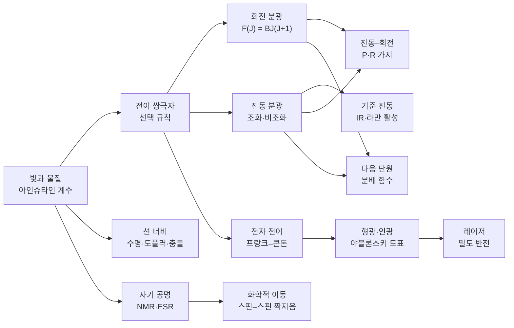

# 물리화학 10. 분자 분광학 — 빛이 묻고 분자가 답하는 에너지 준위의 언어
<!-- prev: pchem-9, uchem-4, umath-6 -->
<!-- next: pchem-11 -->

> [!NOTE]
> **이 단원의 범위**
> - 빛과 물질의 상호작용: 흡수·자발 방출·유도 방출(아인슈타인 계수), 전이 쌍극자 모멘트와 선택 규칙, 선 너비(자연·도플러·충돌 넓어짐)
> - 회전 분광학: 강체 회전자의 준위와 선택 규칙, 회전 상수와 결합 길이 결정, 선의 세기와 원심력 뒤틀림
> - 진동 분광학: 조화 진동자와 비조화 진동자(모스 퍼텐셜, 배음, 해리 에너지), 다원자 분자의 기준 진동 방식, 적외선 활성과 라만 활성
> - 진동–회전 스펙트럼: P·R 가지, 결합 차이법, 진동–회전 상호작용
> - 전자 전이: 분자의 전자 상태와 선택 규칙, 프랑크–콘돈 원리, 형광·인광과 들뜬 상태의 이완, 레이저의 원리
> - 자기 공명: 핵 스핀과 NMR의 원리, 화학적 이동, 스핀–스핀 짝지음, ESR 개관

**학습 목표**

1. 흡수·자발 방출·유도 방출을 아인슈타인 계수로 기술하고, 전이 쌍극자 모멘트로부터 선택 규칙이 나오는 까닭과 선 너비를 정하는 세 가지 요인을 정량적으로 설명할 수 있다.
2. 강체 회전자의 에너지 준위와 선택 규칙으로 순수 회전 스펙트럼을 해석하고, 회전 상수에서 결합 길이를 구하며, 선의 세기 분포를 볼츠만 분포와 축퇴로 설명할 수 있다.
3. 조화·비조화 진동자 모형으로 진동 스펙트럼(기본음·배음)을 해석하여 힘 상수와 해리 에너지를 구하고, 다원자 분자의 기준 진동 방식을 세어 적외선·라만 활성을 판정할 수 있다.
4. 진동–회전 스펙트럼의 P·R 가지를 유도하고, 결합 차이법으로 두 진동 준위의 회전 상수를 따로 구할 수 있다.
5. 프랑크–콘돈 원리로 전자 스펙트럼의 진동 구조를 설명하고, 야블론스키 도표로 형광·인광·무복사 이완을 구별하며, 밀도 반전과 레이저 발진의 조건을 설명할 수 있다.
6. 자기장 속 핵 스핀의 에너지 준위로 NMR 공명 조건을 유도하고, 화학적 이동과 스핀–스핀 짝지음으로 1차 스펙트럼의 갈라짐 무늬를 예측하며, ESR의 $g$ 인자와 초미세 갈라짐을 해석할 수 있다.

**이 단원의 학습 사다리**

| 단계 | 무엇을 하나? |
|---|---|
| STEP 1. 이전 학습 다시 보기 | $E = h\nu$와 선 스펙트럼(일반화학), 조화 진동자·강체 회전자의 준위(물리화학 8), 분자 오비탈과 보른–오펜하이머 근사(물리화학 9), 푸리에 변환(수학 도구 6) |
| STEP 2. 기초 다지기 | 에너지 단위와 볼츠만 인자, 환산 질량과 관성 모멘트, 홀함수 적분과 선택 규칙의 수학, 선 모양과 푸리에 변환 |
| STEP 3. 핵심 개념 | 빛과 물질 → 선 너비 → 회전 → 진동(이원자) → 기준 진동과 IR·라만 → 진동–회전 → 전자 전이와 프랑크–콘돈 → 형광·인광 → 레이저 → NMR 원리 → 화학적 이동 → 스핀–스핀 짝지음 → ESR |
| STEP 4. 오개념 바로잡기 | "회전선 간격은 $B$이다", "가장 센 회전선은 $J = 0$에서 나온다", "형광은 흡수보다 짧은 파장이다" 같은 착각 |
| STEP 5. 대학원·연구로 | 시간 의존 섭동 이론과 페르미 황금률, 2차원 NMR, 펨토초 펌프–프로브 분광 |
| STEP 6. 생활·산업·진로 | 온실 기체와 대기 원격 탐사, 전파 천문학의 CO 선, MRI, 형광 영상과 라만 분석 |

---

## 🗺️ 단원 들어가기

별빛을 프리즘에 통과시키면 무지개 띠 사이사이에 검은 선이 나타난다. 일반화학에서 우리는 이 선들이 원자의 에너지 준위 사이의 간격을 알려 주는 '바코드'라는 것을 배웠다. 분자도 바코드를 가진다. 다만 분자의 바코드는 훨씬 촘촘하고 여러 층으로 되어 있다. 분자는 전자만 들뜨는 것이 아니라 **진동**하고 **회전**하며, 자기장 속에서는 핵 스핀과 전자 스핀의 방향까지 에너지 차이를 만든다. 이 네 가지 운동은 에너지 크기가 서로 수십~수천 배씩 달라서, 각각 다른 영역의 빛 — 라디오파, 마이크로파, 적외선, 가시광선·자외선 — 으로 따로 들여다볼 수 있다.

물리화학 7~9에서 우리는 슈뢰딩거 방정식을 풀어 상자 속 입자, 조화 진동자, 강체 회전자, 수소 원자, 분자 오비탈의 에너지 준위를 **계산**했다. 이 단원은 그 계산을 **측정**과 잇는다. 분광학은 "에너지 준위가 이렇다면 스펙트럼은 이렇게 보여야 한다"는 예측과, "스펙트럼이 이렇게 보이므로 분자는 이렇게 생겼다"는 역추론을 오가는 학문이다. 일산화 탄소가 내는 115 GHz 전파 한 줄로 결합 길이를 0.1 pm까지 정하고, 염화 수소의 적외선 띠 하나로 결합의 용수철 상수와 해리 에너지를 어림하며, NMR 스펙트럼의 갈라진 봉우리로 이웃한 수소의 수를 센다.

그런데 "에너지 차이가 맞는다"는 것만으로는 빛이 흡수되지 않는다. 질소와 산소는 진동하지만 적외선을 흡수하지 않고, 이산화 탄소는 흡수한다. 이 차이가 지구의 온실 효과를 정한다. 어떤 전이는 일어나고 어떤 전이는 일어나지 않는가를 정하는 **선택 규칙**, 그리고 그 뿌리인 **전이 쌍극자 모멘트**가 이 단원 전체를 꿰는 실이다.

---

## STEP 1. 🔙 이전 학습 다시 보기

### 연계 개념표

| 이전 단원 | 그때 배운 것 | 이 단원에서 확장되는 것 |
|---|---|---|
| 일반화학 「원자의 전자 구조와 주기성」 | $E = h\nu = hc/\lambda$, 수소의 선 스펙트럼과 뤼드베리 식, 에너지 준위 사이의 전이 | 분자의 회전·진동·전자·스핀 준위로 확장, 선의 **위치**뿐 아니라 **세기**(전이 쌍극자, 볼츠만 분포)와 **너비**(수명, 도플러)까지 해석 |
| 일반화학 「화학 결합과 분자 구조」 | 결합 길이·결합 세기, 극성 분자와 쌍극자 모멘트, 분자 모양 | 결합 길이를 회전 상수로 **측정**, 결합 세기를 힘 상수·해리 에너지로 정량화, 분자 모양이 기준 진동과 IR·라만 활성을 정한다 |
| 물리화학 8 「진동·회전 운동과 수소 원자」 | 조화 진동자 $E_v = (v + \frac{1}{2})\hbar\omega$와 에르미트 함수, 강체 회전자 $E_J = \hbar^2J(J+1)/2I$와 구면 조화 함수, 스핀 | 그 준위들 사이의 **전이**: 선택 규칙 $\Delta v = \pm1$, $\Delta J = \pm1$의 유도, 비조화성과 원심력 뒤틀림 보정, 핵 스핀의 제만 준위 |
| 물리화학 9 「다전자 원자와 화학 결합」 | 보른–오펜하이머 근사, 분자 오비탈과 퍼텐셜 에너지 곡선, 항 기호 | 퍼텐셜 곡선 위의 진동 준위, 전자 전이와 **프랑크–콘돈 원리**, 분자 항 기호($\Sigma$, $\Pi$)와 스핀 선택 규칙 |
| 수학 도구 6 「복소수와 푸리에 해석」 | 푸리에 변환, 지수 감쇠 ↔ 로렌츠 선 모양, 시간–진동수 불확정 관계, FT-NMR·FT-IR의 원리 | 자연 선 너비와 들뜬 상태 수명, 도플러 넓어짐의 가우스 모양, NMR의 FID와 이완 |

### 준비 운동 (사전 진단)

**Q1.** 파수 $\tilde{\nu} = 2000\ \mathrm{cm^{-1}}$인 적외선의 파장(μm), 진동수(Hz), 광자 1 mol의 에너지(kJ/mol)를 구하시오. ($h = 6.626\times10^{-34}\ \mathrm{J\cdot s}$, $c = 2.998\times10^{10}\ \mathrm{cm/s}$, $N_\mathrm{A} = 6.022\times10^{23}\ \mathrm{mol^{-1}}$)

**Q2.** 물리화학 8의 조화 진동자에서 인접한 두 준위의 에너지 간격과 영점 에너지를 $\hbar\omega$로 쓰시오.

**Q3.** 강체 회전자의 에너지 $E_J = \dfrac{\hbar^2}{2I}J(J+1)$에서 $J = 0, 1, 2, 3$ 준위의 에너지를 $\hbar^2/2I$ 단위로 쓰고, 인접 준위 간격이 어떻게 변하는지 말하시오. 각 준위의 축퇴도는?

**Q4.** 수학 도구 6에서 진폭이 시간 상수 $T_2$로 지수 감쇠하는 진동 신호의 스펙트럼은 어떤 모양이고, 반치 전폭은 진동수로 얼마인가?

정답 및 해설

**Q1.** $\lambda = 1/\tilde{\nu} = 5.00\times10^{-4}\ \mathrm{cm} = 5.00\ \mathrm{\mu m}$, $\nu = c\tilde{\nu} = 2.998\times10^{10}\times2000 = 6.00\times10^{13}\ \mathrm{Hz}$, $E_\text{mol} = N_\mathrm{A}hc\tilde{\nu} = 6.022\times10^{23}\times6.626\times10^{-34}\times6.00\times10^{13} = 2.39\times10^{4}\ \mathrm{J/mol} = 23.9\ \mathrm{kJ/mol}$. 화학 결합 에너지(수백 kJ/mol)보다 한 자릿수 작다.

**Q2.** 간격은 언제나 $\hbar\omega$(등간격), 영점 에너지는 $\frac{1}{2}\hbar\omega$.

**Q3.** 0, 2, 6, 12. 간격은 2, 4, 6으로 $J$가 커질수록 늘어난다(간격 $= 2(J+1)$). 축퇴도는 $2J + 1$ = 1, 3, 5, 7.

**Q4.** 로렌츠 함수, 반치 전폭 $\Delta\nu = 1/(\pi T_2)$. STEP 3 ②에서 이 관계로 들뜬 상태의 수명에서 자연 선 너비를 구한다.

---

## STEP 2. 🧱 기초 다지기

### 디딤돌 1. 에너지 단위와 볼츠만 인자 — $k_\mathrm{B}T \approx 207\ \mathrm{cm^{-1}}$

분광학자는 에너지를 줄(J)보다 **파수(wavenumber)** $\tilde{\nu} = 1/\lambda$(단위 $\mathrm{cm^{-1}}$)로 즐겨 쓴다. 광자 에너지 $E = hc\tilde{\nu}$가 파수에 비례하므로, 파수는 그대로 '에너지의 다른 이름'이 된다. 분자의 에너지 준위를 $\mathrm{cm^{-1}}$로 적은 것을 **항 값(term value)** 이라 하고, 회전은 $F(J)$, 진동은 $G(v)$, 전자는 $T$로 쓴다.

| 1 cm⁻¹ 는 | 값 | 어디에 쓰나 |
|---|---|---|
| 에너지(J) | $hc\times(1\ \mathrm{cm^{-1}}) = 1.986\times10^{-23}\ \mathrm{J}$ | 볼츠만 인자 계산 |
| 몰 에너지 | $11.96\ \mathrm{J/mol}$ (1000 cm⁻¹ ≈ 12.0 kJ/mol) | 결합 에너지와 비교 |
| 전자볼트 | $1.240\times10^{-4}\ \mathrm{eV}$ (1 eV = 8065.5 cm⁻¹) | 전자 전이, 광전자 분광 |
| 진동수 | $29.98\ \mathrm{GHz}$ | 마이크로파·전파 분광 |
| 온도 | $hc/k_\mathrm{B} = 1.4388\ \mathrm{cm\cdot K}$ | $k_\mathrm{B}T/hc$ = 207.2 cm⁻¹ (298.15 K) |

열평형에서 에너지 차이가 $\Delta E$인 두 상태(각 축퇴도 $g_\text{위}$, $g_\text{아래}$)의 개체 수 비는 **볼츠만 분포**를 따른다.

$$
\frac{N_\text{위}}{N_\text{아래}} = \frac{g_\text{위}}{g_\text{아래}}\,e^{-\Delta E/k_\mathrm{B}T}
$$

**예** 실온(298 K)에서 $\Delta E = 1000\ \mathrm{cm^{-1}}$(진동 하나 정도)이면 $e^{-1000/207.2} = 0.0080$, 들뜬 진동 준위에는 1 %도 없다. 반면 회전 상수 $B = 10\ \mathrm{cm^{-1}}$인 분자의 $J = 1$(에너지 $2B = 20\ \mathrm{cm^{-1}}$, 축퇴도 3)은 $J = 0$에 대해 $3e^{-20/207.2} = 2.72$배로 **오히려 더 많다.** 실온에서 분자들은 진동은 거의 바닥에 있지만 회전은 여러 준위에 넓게 퍼져 있다. 이 차이가 ③·⑥의 스펙트럼 모양을 정한다.

### 디딤돌 2. 환산 질량과 관성 모멘트 — 두 물체 문제를 한 물체로

질량 $m_1$, $m_2$인 두 원자가 거리 $r$로 묶인 이원자 분자의 진동과 회전은 질량 중심을 따로 떼어 내면 **환산 질량(reduced mass)** $\mu$인 입자 하나의 운동이 된다(물리화학 8).

$$
\mu = \frac{m_1m_2}{m_1 + m_2}, \qquad I = \mu r^2
$$

$I$는 질량 중심을 지나고 결합에 수직인 축에 대한 **관성 모멘트(moment of inertia)** 이다. 원자 질량 단위 $1\ \mathrm{u} = 1.6605\times10^{-27}\ \mathrm{kg}$로 바꾸어 넣는다. 한쪽이 수소이면 $\mu$는 수소 질량에 가깝다($m_2 \gg m_1$이면 $\mu \to m_1$).

**예** $^{12}\mathrm{C}^{16}\mathrm{O}$($m = 12.000\ \mathrm{u}$, $15.995\ \mathrm{u}$)의 환산 질량은 $\mu = 12.000\times15.995/27.995 = 6.856\ \mathrm{u} = 1.1385\times10^{-26}\ \mathrm{kg}$이다. 결합 길이 112.8 pm를 넣으면 $I = 1.1385\times10^{-26}\times(1.128\times10^{-10})^2 = 1.449\times10^{-46}\ \mathrm{kg\cdot m^2}$. $\mathrm{H^{35}Cl}$은 $\mu = 0.9796\ \mathrm{u}$로 수소 하나의 질량(1.0078 u)과 거의 같다.

> [!WARNING]
> 분광학의 질량은 **동위 원소 하나하나의 질량**이다. 주기율표의 평균 원자량(Cl 35.45)을 넣으면 안 된다. $\mathrm{H^{35}Cl}$과 $\mathrm{H^{37}Cl}$은 서로 다른 분자로 따로 선을 낸다(③·⑥).

### 디딤돌 3. 홀함수의 적분과 직교성 — 선택 규칙의 수학

선택 규칙은 거의 모두 "어떤 적분이 0인가"라는 질문이다. 두 가지 도구면 충분하다.

1. **홀짝성** 대칭 구간에서 홀함수($f(-x) = -f(x)$)의 적분은 0이다. 짝함수 × 짝함수 = 짝, 짝 × 홀 = 홀, 홀 × 홀 = 짝.
2. **직교성** 같은 에르미트 연산자의 서로 다른 고유 함수는 직교한다: $\int\psi_m^*\psi_n\,d\tau = 0\ (m \ne n)$ (수학 도구 8 '직교 함수와 전개').

물리화학 8의 조화 진동자 파동 함수는 $v$가 짝수이면 짝함수, 홀수이면 홀함수이다. 그래서 $\int\psi_v\,x\,\psi_v\,dx$는 (짝 또는 홀)$^2$ × 홀 = 홀이 되어 언제나 0이다. 바닥 상태에서 변위의 평균이 0이라는 당연한 결과이다. 반면 $\int\psi_1\,x\,\psi_0\,dx$는 홀 × 홀 × 짝 = 짝이어서 0이 아니다.

**예** 에르미트 함수의 점화식을 쓰면 $x\psi_v = \sqrt{\dfrac{\hbar}{2\mu\omega}}\left(\sqrt{v+1}\,\psi_{v+1} + \sqrt{v}\,\psi_{v-1}\right)$이다. 양변에 $\psi_{v'}$를 곱해 적분하면 직교성 때문에 $v' = v \pm 1$일 때만 살아남는다. $\mathrm{H^{35}Cl}$($k = 516\ \mathrm{N/m}$, $\mu = 0.9796\ \mathrm{u}$)이면 $\omega = \sqrt{k/\mu} = 5.63\times10^{14}\ \mathrm{s^{-1}}$이고 $\langle1\vert x\vert0\rangle = \sqrt{\hbar/2\mu\omega} = 7.6\ \mathrm{pm}$이다. 결합 길이(127 pm)의 6 % 정도가 영점 진동의 '흔들림 폭'이다. ④에서 이것이 진동 선택 규칙 $\Delta v = \pm1$이 된다.

### 디딤돌 4. 선 모양과 푸리에 변환 — 감쇠가 빠르면 선이 넓다

수학 도구 6 '푸리에 변환'과 '불확정 관계'에서 익힌 두 변환 쌍이 분광학의 선 모양을 거의 다 설명한다.

| 시간 영역의 신호 | 진동수 영역의 선 모양 | 반치 전폭(FWHM) | 분광학에서 |
|---|---|---|---|
| 지수 감쇠 진동 $e^{-t/T_2}\cos\omega_0t$ | 로렌츠 함수 | $\Delta\nu = 1/(\pi T_2)$ | 수명·충돌 넓어짐, NMR 선 |
| 가우스 포락선의 진동 | 가우스 함수 | 포락선 폭에 반비례 | 도플러 넓어짐 |

로렌츠 함수는 봉우리에서 멀어질 때 $1/(\nu - \nu_0)^2$로 천천히 줄어 '꼬리가 길고', 가우스 함수는 $e^{-(\nu - \nu_0)^2}$로 급히 사라진다. 두 효과가 함께 있으면 두 모양의 합성곱(**포크트 모양**)이 된다.

**예** 액체 속 분자의 진동이 주위 분자와 부딪혀 약 1 ps 만에 위상을 잃는다면($T_2 = 1.0\ \mathrm{ps}$) 선 너비는 $\Delta\nu = 1/(\pi\times1.0\times10^{-12}\ \mathrm{s}) = 3.2\times10^{11}\ \mathrm{Hz}$, 파수로 $3.2\times10^{11}/(2.998\times10^{10}) = 11\ \mathrm{cm^{-1}}$이다. 액체의 적외선 띠가 기체보다 훨씬 넓은 까닭이다.

---

## STEP 3. 📘 핵심 개념

### ① 빛과 물질의 상호작용 — 흡수, 자발 방출, 유도 방출

#### 세 가지 과정과 아인슈타인 계수

에너지가 $E_1 < E_2$인 두 상태(축퇴도는 같다고 하자)와 진동수 $\nu = (E_2 - E_1)/h$ 근처의 빛을 생각하자. 아인슈타인은 빛과 물질 사이에 세 가지 과정이 있다고 보았다.

| 과정 | 무엇이 일어나나 | 단위 부피당 속도 |
|---|---|---|
| **흡수**(absorption) | 광자 하나를 먹고 1 → 2 | $B_{12}\,\rho(\nu)\,N_1$ |
| **유도 방출**(stimulated emission) | 같은 진동수의 광자가 '건드려' 2 → 1, 광자가 하나 더 생김(위상·방향이 같다) | $B_{21}\,\rho(\nu)\,N_2$ |
| **자발 방출**(spontaneous emission) | 빛이 없어도 저절로 2 → 1 | $A_{21}\,N_2$ |

여기서 $\rho(\nu)$는 진동수 $\nu$ 근처 빛의 에너지 밀도(단위 진동수당), $N_i$는 단위 부피당 분자 수, $A$와 $B$는 **아인슈타인 계수(Einstein coefficients)** 이다.

<!-- 그림 요청: 아인슈타인의 세 과정 비교 도식. 가로로 세 칸을 나란히 그리고 각 칸에 두 개의 가로선(아래 E1, 위 E2)을 그린다. ① "흡수": 왼쪽에서 물결 화살표(광자 hν)가 들어오고, 아래 준위의 점(분자)이 위 준위로 올라가는 위쪽 화살표. ② "유도 방출": 광자 하나가 들어오고, 위 준위의 점이 아래로 내려가며, 오른쪽으로 같은 방향·같은 위상의 물결 화살표 두 개가 나란히 나간다. ③ "자발 방출": 들어오는 광자 없이 위 준위의 점이 내려가고, 임의의 방향(비스듬히)으로 물결 화살표 하나가 나간다. 각 칸 아래에 속도식 B12ρN1, B21ρN2, A21N2를 쓴다. -->

#### 유도 — 아인슈타인 관계식

**가정** 분자들이 온도 $T$의 흑체 복사와 열평형에 있다. 그러면 (1) 개체 수는 볼츠만 분포 $N_2/N_1 = e^{-h\nu/k_\mathrm{B}T}$를 따르고, (2) 빛의 에너지 밀도는 플랑크 분포(물리화학 7)를 따른다.

$$
\rho(\nu) = \frac{8\pi h\nu^3}{c^3}\,\frac{1}{e^{h\nu/k_\mathrm{B}T} - 1}
$$

**단계 1** 평형이면 위로 가는 속도와 아래로 가는 속도가 같다: $B_{12}\rho N_1 = B_{21}\rho N_2 + A_{21}N_2$.

**단계 2** $\rho$에 대해 풀고 $N_1/N_2 = e^{h\nu/k_\mathrm{B}T}$를 넣는다.

$$
\rho(\nu) = \frac{A_{21}}{B_{12}(N_1/N_2) - B_{21}} = \frac{A_{21}/B_{21}}{(B_{12}/B_{21})\,e^{h\nu/k_\mathrm{B}T} - 1}
$$

**단계 3** 이 식이 모든 온도에서 플랑크 분포와 같으려면 분모의 꼴이 같아야 하므로

$$
\boxed{\;B_{12} = B_{21} \equiv B, \qquad \frac{A_{21}}{B} = \frac{8\pi h\nu^3}{c^3}\;}
$$

**결과의 의미** (1) 흡수와 유도 방출은 같은 계수를 가진다. 그래서 빛을 아무리 세게 쪼여도 두 준위의 개체 수는 '같아지는 데'까지만 가고 뒤집히지 않는다(⑨의 레이저에서 중요). (2) 자발 방출은 $\nu^3$에 비례해 진동수가 높을수록 압도적으로 커진다. **적용 한계**: 계수 자체는 분자의 성질이므로 평형이 아닌 경우에도 그대로 쓴다. 축퇴도가 다르면 $g_1B_{12} = g_2B_{21}$로 바뀐다.

#### 전이 쌍극자 모멘트 — 계수 $B$는 무엇이 정하는가

빛의 전기장 $\mathcal{E}$가 분자의 전기 쌍극자 $\hat{\mu}$에 미치는 에너지 $-\hat{\mu}\cdot\mathcal{E}$를 섭동으로 보고 시간 의존 슈뢰딩거 방정식을 풀면(STEP 5 맛보기 ①)

$$
B = \frac{\lvert\mu_{fi}\rvert^2}{6\varepsilon_0\hbar^2}, \qquad \mu_{fi} = \int\psi_f^*\,\hat{\mu}\,\psi_i\,d\tau
$$

를 얻는다. $\mu_{fi}$를 **전이 쌍극자 모멘트(transition dipole moment)** 라 한다. 전이가 일어나는 동안 분자의 전하 분포가 처음 상태와 나중 상태의 '겹침'으로 출렁이는데, 그 출렁임의 쌍극자 크기이다. 빛의 진동하는 전기장이 이 출렁이는 쌍극자를 붙잡고 흔들어 에너지를 넘겨준다.

> [!IMPORTANT]
> **선택 규칙(selection rule)** 은 $\mu_{fi} \ne 0$이 되는 조건이다.
> - **전체 선택 규칙(gross selection rule)**: 분자가 어떤 성질을 가져야 그 종류의 스펙트럼을 보이는가(예: 순수 회전 스펙트럼에는 영구 쌍극자 모멘트가 있어야 한다).
> - **세부 선택 규칙(specific selection rule)**: 어떤 양자수 변화가 허용되는가(예: $\Delta J = \pm1$, $\Delta v = \pm1$).
> 광자는 스핀 1의 각운동량을 가지므로, 광자 하나를 흡수·방출하는 전이에서는 분자의 각운동량도 그만큼 바뀌어야 한다. 이것이 회전·원자 전이의 규칙 $\Delta J = \pm1$, $\Delta l = \pm1$의 물리적 뿌리이다.

'금지' 전이도 완전히 0은 아니다. 자기 쌍극자·전기 사중극자 상호작용, 진동과의 섞임, 스핀–궤도 결합 때문에 수백~수백만 배 약하게 일어난다. 인광(⑧)이 그 대표 예이다.

#### 흡수의 세기 — 비어–람베르트 법칙과의 연결

두께 $dl$의 시료를 지나며 빛의 세기가 줄어드는 비율은 흡수하는 분자의 농도에 비례하므로 $dI/I = -\kappa\,[\mathrm{J}]\,dl$, 적분하면 $I = I_0e^{-\kappa[\mathrm{J}]l}$이다. 상용로그로 쓰면 흡광도 $A = \log(I_0/I) = \varepsilon[\mathrm{J}]l$(**비어–람베르트 법칙**)이고, 몰 흡광 계수 $\varepsilon$를 띠 전체에 걸쳐 적분한 **적분 흡수 계수** $\mathcal{A} = \int\varepsilon\,d\tilde{\nu}$는 $\lvert\mu_{fi}\rvert^2$에 비례한다. 허용된 전자 전이는 $\varepsilon_\text{max}$가 $10^4\sim10^5\ \mathrm{L\,mol^{-1}\,cm^{-1}}$, 금지된 전이는 $1\sim100$ 정도이다. 분광 광도계를 이용한 정량 분석은 「분광 분석의 기초와 분자 분광법」에서 자세히 다룬다.

#### 예제 1 — 어느 영역에서 유도 방출이 중요한가

298 K의 열복사 속에서 유도 방출 속도와 자발 방출 속도의 비 $B\rho/A$를 다음 전이에 대해 구하시오. (1) 500 nm(가시광선 전자 전이) (2) 2000 cm⁻¹(진동) (3) 10 cm⁻¹(회전) (4) 500 MHz(NMR) 그리고 (5) 500 nm 전이와 500 MHz 전이의 $A$ 계수 비(전이 쌍극자가 같다고 할 때)를 구하시오.

**풀이**
식 세우기: 플랑크 분포를 넣으면 $\dfrac{B\rho}{A} = \dfrac{1}{e^{h\nu/k_\mathrm{B}T} - 1}$, $x = h\nu/k_\mathrm{B}T = hc\tilde{\nu}/k_\mathrm{B}T = \tilde{\nu}/(207.2\ \mathrm{cm^{-1}})$.
(1) $\tilde{\nu} = 20\,000\ \mathrm{cm^{-1}}$, $x = 96.5$ → 비 $= e^{-96.5} \approx 1\times10^{-42}$.
(2) $x = 2000/207.2 = 9.65$ → $6.4\times10^{-5}$.
(3) $x = 0.0483$ → $1/(e^{0.0483} - 1) = 20$.
(4) $x = h\nu/k_\mathrm{B}T = (6.626\times10^{-34}\times5.00\times10^{8})/(1.381\times10^{-23}\times298.15) = 8.05\times10^{-5}$ → $1.2\times10^{4}$.
(5) $A \propto \nu^3$이므로 $(6.0\times10^{14}/5.0\times10^{8})^3 = 1.7\times10^{18}$.

**의미** 가시광선·자외선 영역에서는 자발 방출이 압도적이어서 들뜬 분자는 수 ns 만에 빛을 내고 내려온다. 반대로 마이크로파·라디오파 영역에서는 자발 방출이 사실상 없고($A$가 $10^{18}$배 작다), 흡수와 유도 방출이 거의 상쇄된다. NMR 신호가 약한 것과 들뜬 핵 스핀이 빛을 내며 '저절로' 돌아오지 않고 주위와의 상호작용(이완, ⑩)으로 돌아오는 것이 이 때문이다.

#### ✔ 바로 확인

1. (O/X) 강한 빛을 계속 쪼이면 두 준위 계의 위 준위 개체 수가 아래 준위보다 많아질 수 있다.
2. 빈칸: 아인슈타인 계수 사이에는 $A/B = 8\pi h\nu^3/c^3$의 관계가 있어 자발 방출은 진동수의 (    )제곱에 비례해 커진다.
3. 빈칸: 전이가 일어나려면 전이 쌍극자 모멘트 $\int\psi_f^*\hat{\mu}\psi_i\,d\tau$가 (    )이 아니어야 한다.
4. 298 K에서 1000 cm⁻¹ 전이의 유도 방출/자발 방출 속도 비는?

정답

1. X — $B_{12} = B_{21}$이므로 빛만으로는 개체 수가 같아지는 데(포화)까지만 간다. 밀도 반전에는 세 번째 준위가 필요하다(⑨).
2. 세 — 그래서 진동수가 높은 전자 전이일수록 들뜬 상태 수명이 짧다.
3. 0
4. 약 0.0081 — $1/(e^{1000/207.2} - 1) = 1/(e^{4.83} - 1)$.

### ② 선 너비 — 스펙트럼 선은 왜 바늘이 아닌가

에너지 준위가 정확히 하나의 값이라면 스펙트럼 선은 폭이 0인 바늘이어야 한다. 실제 선은 폭을 가지며, 그 폭에는 분자의 수명과 운동에 관한 정보가 담겨 있다.

#### 수명 넓어짐 — 시간–에너지 불확정 관계

들뜬 상태의 개체 수가 $N(t) = N_0e^{-t/\tau}$로 줄면 그 상태의 파동 함수 진폭은 $e^{-t/2\tau}$로 줄고, 방출되는 빛의 전기장도 같은 비율로 감쇠한다. 디딤돌 4에 따라 진폭 감쇠 시간 $T_2 = 2\tau$인 진동의 스펙트럼은 로렌츠 함수이고

$$
\Delta\nu = \frac{1}{\pi T_2} = \frac{1}{2\pi\tau}, \qquad \delta E = h\,\Delta\nu = \frac{\hbar}{\tau}
$$

이다. 자발 방출만으로 정해지는 폭을 **자연 선 너비(natural linewidth)** 라 한다. 수명을 줄이는 다른 과정(충돌, 무복사 이완, 해리)이 있으면 그 속도 상수들을 더한 전체 속도가 $1/\tau$가 되어 선이 더 넓어진다. 두 상태가 모두 수명이 유한하면 두 폭이 더해진다.

#### 도플러 넓어짐 — 분자의 열운동

**가정** 기체 분자가 시선 방향 속도 $v_x$로 움직이고, $v_x \ll c$이다.

**단계 1** 관찰되는 진동수는 도플러 효과로 $\nu = \nu_0(1 + v_x/c)$, 즉 $v_x = c(\nu - \nu_0)/\nu_0$이다.

**단계 2** 맥스웰–볼츠만 분포에서 한 성분 $v_x$의 분포는 $f(v_x) \propto e^{-mv_x^2/2k_\mathrm{B}T}$로 분산 $\sigma_v^2 = k_\mathrm{B}T/m$인 가우스 분포이다.

**단계 3** $v_x$를 진동수로 바꾸면 선 모양도 가우스 함수가 된다.

$$
I(\nu) \propto \exp\!\left[-\frac{mc^2(\nu - \nu_0)^2}{2k_\mathrm{B}T\nu_0^2}\right]
$$

**단계 4** 높이가 절반이 되는 곳은 지수가 $-\ln 2$인 곳이므로 반치 전폭은

$$
\boxed{\;\Delta\nu_\mathrm{D} = \frac{2\nu_0}{c}\sqrt{\frac{2k_\mathrm{B}T\ln 2}{m}}\;}
$$

**적용 한계** 충돌이 잦으면 분자의 속도가 측정 시간 동안 바뀌어 모양이 달라진다. 도플러 폭은 $\nu_0$에 비례하므로 전자 전이에서 크고 마이크로파에서는 매우 작다. 또 $\sqrt{T/m}$에 비례하므로 무겁고 차가운 분자일수록 좁다.

#### 충돌(압력) 넓어짐

기체 분자가 평균 시간 $\tau_\text{col}$마다 충돌해 들뜬 상태의 위상이 끊기면, 이 시간이 '수명'처럼 작용하여 $\Delta\nu \approx 1/(\pi\tau_\text{col})$의 로렌츠 넓어짐이 생긴다. $\tau_\text{col}$은 압력에 반비례하므로 충돌 폭은 **압력에 비례**한다. 고해상도 분광을 낮은 압력에서 하는 까닭이다.

| 넓어짐 | 원인 | 선 모양 | 무엇에 비례 | 줄이는 법 |
|---|---|---|---|---|
| 자연(수명) | 자발 방출에 의한 유한 수명 | 로렌츠 | $1/\tau$ ($\propto\nu^3\lvert\mu_{fi}\rvert^2$) | 줄일 수 없다(분자의 성질) |
| 도플러 | 시선 방향 열운동 | 가우스 | $\nu_0\sqrt{T/m}$ | 냉각, 분자 빛살, 도플러 없는 분광 |
| 충돌(압력) | 충돌로 위상이 끊김 | 로렌츠 | 압력 | 압력을 낮춘다 |

<!-- 그림 요청: 같은 넓이·같은 반치 전폭(FWHM = 1, 가로축 (ν − ν0)/FWHM, −3~+3)을 가진 로렌츠 곡선(실선)과 가우스 곡선(점선)을 겹쳐 그린 그래프. 세로축은 상대 세기(0~1.1, 두 곡선을 각자 넓이 1로 규격화). 가우스의 봉우리가 더 높고(0.939 대 0.637) 로렌츠는 꼬리가 길다는 것을 화살표로 표시. 가로선으로 각 곡선의 반치 위치를 표시하고 "FWHM"이라 쓴다. 오른쪽 작은 상자: "로렌츠: 수명·충돌", "가우스: 도플러". -->

#### 예제 2 — 세 가지 선 너비 비교

(1) 나트륨 D선(589.0 nm)의 들뜬 상태 수명은 약 16 ns이다. 자연 선 너비(Hz)를 구하시오. (2) 500 K 나트륨 증기에서 이 선의 도플러 폭을 구하시오($m = 22.99\ \mathrm{u}$). (3) 300 K의 $\mathrm{H^{35}Cl}$ 기체에서 2886 cm⁻¹ 진동 띠의 한 선이 갖는 도플러 폭을 cm⁻¹로 구하고, 평균 충돌 간격이 $1.0\times10^{-10}\ \mathrm{s}$(약 1 atm)일 때의 충돌 폭과 비교하시오. ($k_\mathrm{B} = 1.381\times10^{-23}\ \mathrm{J/K}$, $1\ \mathrm{u} = 1.6605\times10^{-27}\ \mathrm{kg}$)

**풀이**
(1) $\Delta\nu = 1/(2\pi\tau) = 1/(2\pi\times16\times10^{-9}\ \mathrm{s}) = 9.9\times10^{6}\ \mathrm{Hz} \approx 10\ \mathrm{MHz}$.
(2) $\nu_0 = c/\lambda = 5.090\times10^{14}\ \mathrm{Hz}$, $m = 3.817\times10^{-26}\ \mathrm{kg}$.
$\sqrt{2k_\mathrm{B}T\ln 2/m} = \sqrt{2\times1.381\times10^{-23}\times500\times0.693/3.817\times10^{-26}} = 501\ \mathrm{m/s}$
$\Delta\nu_\mathrm{D} = 2\times5.090\times10^{14}\times501/2.998\times10^{8} = 1.7\times10^{9}\ \mathrm{Hz}$ — 자연 폭의 약 170배이다.
(3) 파수로 쓰면 $\Delta\tilde{\nu}_\mathrm{D} = \dfrac{2\tilde{\nu}_0}{c}\sqrt{\dfrac{2k_\mathrm{B}T\ln 2}{m}}$. $m = 35.98\ \mathrm{u} = 5.974\times10^{-26}\ \mathrm{kg}$이면 제곱근은 $310\ \mathrm{m/s}$, $\Delta\tilde{\nu}_\mathrm{D} = 2\times2886\times310/2.998\times10^{8} = 0.0060\ \mathrm{cm^{-1}}$. 충돌 폭은 $\Delta\nu = 1/(\pi\tau_\text{col}) = 3.2\times10^{9}\ \mathrm{Hz}$, 파수로 $3.2\times10^{9}/2.998\times10^{10} = 0.11\ \mathrm{cm^{-1}}$.

**의미** 원자·분자의 자연 선 너비는 대개 도플러 폭에 가려진다. 1 atm 기체의 적외선 선은 충돌 폭(약 0.1 cm⁻¹)이 도플러 폭(0.006 cm⁻¹)보다 훨씬 크지만, 선 사이 간격(HCl은 약 20 cm⁻¹, ⑥)보다는 여전히 작아서 회전 구조가 또렷이 보인다. 액체에서는 디딤돌 4처럼 폭이 10 cm⁻¹ 정도로 커져 회전 구조가 사라진다.

#### ✔ 바로 확인

1. (O/X) 도플러 폭은 온도가 높을수록, 분자가 가벼울수록 넓다.
2. 들뜬 상태의 수명이 1.0 ps이면 자연 선 너비는 몇 cm⁻¹인가?
3. 빈칸: 충돌 넓어짐의 선 모양은 (    ) 함수이고, 폭은 기체의 (    )에 비례한다.

정답

1. O — $\Delta\nu_\mathrm{D} \propto \nu_0\sqrt{T/m}$.
2. 약 5.3 cm⁻¹ — $\Delta\nu = 1/(2\pi\times10^{-12}) = 1.59\times10^{11}\ \mathrm{Hz}$, $\div\,2.998\times10^{10}$.
3. 로렌츠, 압력

### ③ 회전 분광학 — 결합 길이를 재는 자

#### 강체 회전자의 항 값

물리화학 8에서 강체 회전자의 에너지를 $E_J = \dfrac{\hbar^2}{2I}J(J+1)$, $J = 0, 1, 2, \dots$, 축퇴도 $2J + 1$($M_J = -J, \dots, +J$)로 구했다. 파수 단위의 항 값으로 바꾸면

$$
F(J) = \frac{E_J}{hc} = \tilde{B}\,J(J+1), \qquad \tilde{B} = \frac{\hbar}{4\pi cI} = \frac{h}{8\pi^2cI}
$$

이다. $\tilde{B}$를 **회전 상수(rotational constant)** 라 하며, 관성 모멘트에 반비례한다. 이하 혼동이 없으면 물결표를 빼고 $B$로 쓴다.

#### 선택 규칙

- **전체**: 분자가 **영구 쌍극자 모멘트**를 가져야 한다. 회전하는 쌍극자는 빛의 전기장과 같은 박자로 방향을 바꾸는 진동 쌍극자처럼 보여 빛과 에너지를 주고받는다. $\mathrm{H_2}$, $\mathrm{N_2}$, $\mathrm{CO_2}$, $\mathrm{CH_4}$는 순수 회전 스펙트럼이 없고, $\mathrm{HCl}$, $\mathrm{CO}$, $\mathrm{OCS}$, $\mathrm{H_2O}$는 있다.
- **세부**: $\Delta J = \pm1$, $\Delta M_J = 0, \pm1$. 쌍극자의 $z$ 성분은 $\mu\cos\theta$이고, 구면 조화 함수의 성질 $\cos\theta\,Y_{J,M} = aY_{J+1,M} + bY_{J-1,M}$ 때문에 $\int Y_{J',M}^*\cos\theta\,Y_{J,M}\,d\Omega$는 $J' = J\pm1$에서만 0이 아니다(디딤돌 3과 같은 논리). 광자가 각운동량 1을 실어 나른다는 그림과도 맞는다.

흡수선 $J \rightarrow J + 1$의 위치는

$$
\tilde{\nu}(J \rightarrow J+1) = F(J+1) - F(J) = 2B(J+1), \qquad J = 0, 1, 2, \dots
$$

로 $2B, 4B, 6B, \dots$에 놓인 **등간격의 선**이 되고, 간격은 $2B$이다.

<!-- 그림 요청: 이원자 분자의 강체 회전자 에너지 준위와 순수 회전 스펙트럼. 왼쪽: 가로선으로 J = 0~5 준위를 F(J) = BJ(J+1) 높이(0, 2B, 6B, 12B, 20B, 30B)에 그리고 각 선 오른쪽에 "J = n, 축퇴도 2J+1"을 쓴다. 인접 준위를 잇는 위쪽 화살표 5개(0→1, 1→2, …, 4→5)를 왼쪽에서 오른쪽으로 조금씩 옮겨 그리고 화살표 옆에 2B, 4B, 6B, 8B, 10B를 쓴다. 오른쪽 아래: 가로축 파수(0~12B)에 세로 막대 5개를 2B, 4B, 6B, 8B, 10B 위치에 그리고 인접 막대 사이에 "간격 2B" 양쪽 화살표. 막대 높이는 같게(세기는 따로 다룬다). -->

#### 원심력 뒤틀림

실제 결합은 용수철이므로 빨리 돌수록 늘어나 $I$가 커지고 준위가 조금 내려간다. 이를 보정하면

$$
F(J) = BJ(J+1) - DJ^2(J+1)^2, \qquad \tilde{\nu}(J \rightarrow J+1) = 2B(J+1) - 4D(J+1)^3
$$

이다. **원심력 뒤틀림 상수** $D$는 고전적인 용수철 모형에서 $D = 4B^3/\tilde{\nu}^2$($\tilde{\nu}$는 진동 파수)이며 $B$보다 보통 $10^{-4}\sim10^{-6}$배 작다. 높은 $J$에서 선 간격이 조금씩 좁아지는 것이 그 증거이다.

#### 선의 세기 — 축퇴와 볼츠만 분포의 줄다리기

흡수선의 세기는 주로 아래 준위의 개체 수에 비례한다.

$$
\frac{N_J}{N_0} = (2J+1)\,e^{-hcBJ(J+1)/k_\mathrm{B}T}
$$

축퇴도 $(2J+1)$은 $J$와 함께 커지고 볼츠만 인자는 줄어들므로 중간에 최대가 생긴다. $J$를 연속 변수로 보고 미분해 0으로 놓으면

$$
\frac{d}{dJ}\left[(2J+1)e^{-hcBJ(J+1)/k_\mathrm{B}T}\right] = 0 \quad\Longrightarrow\quad J_\text{max} = \sqrt{\frac{k_\mathrm{B}T}{2hcB}} - \frac{1}{2}
$$

#### 다원자 분자 — 팽이의 분류

| 분류 | 관성 모멘트 | 예 | 회전 스펙트럼 |
|---|---|---|---|
| 선형 회전자 | $I_\parallel = 0$, $I_\perp$ 하나 | $\mathrm{HCl}$, $\mathrm{OCS}$, $\mathrm{HCN}$ ($\mathrm{CO_2}$는 쌍극자 0) | $2B(J+1)$, 이원자와 같은 꼴 |
| 대칭 팽이 | 두 개가 같다 | $\mathrm{NH_3}$, $\mathrm{CH_3Cl}$, $\mathrm{C_6H_6}$ | $F(J,K) = BJ(J+1) + (A-B)K^2$, 선택 규칙 $\Delta K = 0$이라 선 위치는 여전히 $2B(J+1)$ |
| 구형 팽이 | 셋 모두 같다 | $\mathrm{CH_4}$, $\mathrm{SF_6}$ | 대칭 때문에 쌍극자가 0 → 순수 회전 스펙트럼 없음 |
| 비대칭 팽이 | 셋 모두 다르다 | $\mathrm{H_2O}$, $\mathrm{SO_2}$ | 복잡한 선 무리(계산으로 해석) |

다원자 분자는 관성 모멘트 하나로 여러 결합 길이를 정할 수 없다. 그래서 **동위 원소 치환**을 쓴다. 결합 길이는 동위 원소에 거의 무관하지만 질량은 바뀌므로, 예를 들어 $^{16}\mathrm{O}^{12}\mathrm{C}^{32}\mathrm{S}$와 $^{16}\mathrm{O}^{12}\mathrm{C}^{34}\mathrm{S}$의 $B$ 두 개로 C=O와 C=S 두 길이를 연립해 푼다.

#### 예제 3 — 일산화 탄소의 결합 길이

$^{12}\mathrm{C}^{16}\mathrm{O}$의 $J = 0 \rightarrow 1$ 선은 115.271 GHz에서 관측된다. (1) 회전 상수(cm⁻¹)와 관성 모멘트, 결합 길이를 구하시오. (2) $J = 3 \rightarrow 4$ 선의 진동수를 강체 회전자로 예측하시오(실측 약 461.04 GHz). (3) 298 K에서 개체 수가 가장 많은 $J$는? (4) $^{13}\mathrm{C}^{16}\mathrm{O}$의 $J = 0 \rightarrow 1$ 선을 예측하시오. ($m(^{12}\mathrm{C}) = 12.0000\ \mathrm{u}$, $m(^{13}\mathrm{C}) = 13.0034\ \mathrm{u}$, $m(^{16}\mathrm{O}) = 15.9949\ \mathrm{u}$)

**풀이**
(1) $\nu(0 \rightarrow 1) = 2Bc$이므로 진동수 단위의 $B = 57.636\ \mathrm{GHz}$, 파수로 $\tilde{B} = 57.636\times10^{9}/2.9979\times10^{10} = 1.9225\ \mathrm{cm^{-1}}$.
$I = \dfrac{h}{8\pi^2B} = \dfrac{6.6261\times10^{-34}}{8\pi^2\times5.7636\times10^{10}\ \mathrm{s^{-1}}} = 1.4560\times10^{-46}\ \mathrm{kg\cdot m^2}$.
$\mu = 6.8562\ \mathrm{u} = 1.13851\times10^{-26}\ \mathrm{kg}$, $r = \sqrt{I/\mu} = 1.1309\times10^{-10}\ \mathrm{m} = 113.1\ \mathrm{pm}$.
(2) $\nu(3 \rightarrow 4) = 2B\times4 = 8\times57.636 = 461.09\ \mathrm{GHz}$. 실측보다 약 0.05 GHz 높다. 이 차이가 원심력 뒤틀림 $4D(J+1)^3$이다($D \approx 6\times10^{-6}\ \mathrm{cm^{-1}}$에 해당).
(3) $J_\text{max} = \sqrt{207.2/(2\times1.9225)} - 0.5 = 7.34 - 0.5 = 6.8$, 정수로는 $J = 7$(실제로 $J = 6, 7, 8$의 개체 수가 비슷하다).
(4) $B \propto 1/\mu$이고 결합 길이는 같으므로 $\nu = 115.271\times\dfrac{6.8562}{7.1724} = 110.19\ \mathrm{GHz}$(실측 약 110.20 GHz).

**의미** 측정은 GHz의 여섯 자리까지 하므로 결합 길이도 0.01 pm 수준까지 정해진다. 여기서 얻은 113.1 pm는 바닥 진동 상태에서 평균한 $r_0$이며, 퍼텐셜의 바닥인 평형 결합 길이 $r_\mathrm{e}$(112.8 pm)보다 조금 길다. 진동하는 결합에서는 $\langle 1/r^2\rangle$이 평균되기 때문이다(⑥의 $B_v$ 참고). 동위 원소 선은 전파 천문학에서 성간 분자운의 $^{12}\mathrm{C}/^{13}\mathrm{C}$ 비를 재는 데 쓰인다(STEP 6).

<!-- 그림 요청: 298 K에서 12C16O(B = 1.9225 cm⁻¹)의 회전 준위 상대 개체 수 막대그래프. 가로축 J(0~20), 세로축 N_J/N_0 = (2J+1)exp(−hcBJ(J+1)/kT)(0~9.5). 주요 값: J=0 1.00, J=2 4.73, J=4 7.48, J=7 8.92(최대), J=10 7.57, J=14 4.13, J=20 약 0.83. 점선으로 축퇴도 (2J+1) 직선과 볼츠만 인자 exp(−hcBJ(J+1)/kT)(오른쪽 축, 0~1)를 함께 그려 "두 인자의 곱"임을 보인다. 최댓값 막대 위에 "J_max ≈ 7"이라 쓴다. -->

> [!TIP]
> 💡 **요령** — "선 간격이 $2B$"를 기억하는 법: 준위는 $B\times(0, 2, 6, 12, 20, \dots)$이고 이웃끼리의 차가 $2, 4, 6, 8, \dots$이므로, 차의 차가 2이다. 첫 선이 $2B$이고 그다음부터 $2B$씩 늘어난다. 스펙트럼에서 첫 선이 보이지 않을 때에도 **간격**에서 $B$를 읽고, 그 $B$로 각 선의 $J$를 거꾸로 매길 수 있다(개념 확인 문제 18).

#### ✔ 바로 확인

1. 다음 중 순수 회전 스펙트럼을 보이는 것을 모두 고르시오: $\mathrm{N_2}$, $\mathrm{HBr}$, $\mathrm{CO_2}$, $\mathrm{OCS}$, $\mathrm{CH_4}$, $\mathrm{NH_3}$
2. 어떤 이원자 분자의 회전선 간격이 $3.84\ \mathrm{cm^{-1}}$이다. 회전 상수는?
3. (O/X) 동위 원소로 치환하면 결합 길이가 크게 바뀌므로 회전 상수가 바뀐다.
4. 빈칸: 원심력 뒤틀림이 있으면 높은 $J$에서 회전선의 간격이 조금씩 (    )진다.

정답

1. $\mathrm{HBr}$, $\mathrm{OCS}$, $\mathrm{NH_3}$ — 영구 쌍극자 모멘트가 있는 분자만. $\mathrm{N_2}$, $\mathrm{CO_2}$, $\mathrm{CH_4}$는 쌍극자가 0이다.
2. $1.92\ \mathrm{cm^{-1}}$ — 간격 $= 2B$.
3. X — 결합 길이는 거의 그대로이고 **질량**(환산 질량)이 바뀌어 $B \propto 1/\mu$가 바뀐다.
4. 좁아

### ④ 이원자 분자의 진동 — 조화 진동자에서 모스 퍼텐셜로

#### 조화 근사와 선택 규칙

물리화학 9의 퍼텐셜 에너지 곡선 $V(r)$을 평형 결합 길이 $r_\mathrm{e}$ 근처에서 테일러 전개하면(수학 도구 2) 일차 항은 바닥이라 0이고, 가장 낮은 항은 $V \approx \frac{1}{2}k(r - r_\mathrm{e})^2$이다. 힘 상수 $k = (d^2V/dr^2)_{r_\mathrm{e}}$는 퍼텐셜 바닥의 **곡률**이다. 물리화학 8의 결과를 항 값으로 쓰면

$$
G(v) = \left(v + \tfrac{1}{2}\right)\tilde{\nu}, \qquad \tilde{\nu} = \frac{1}{2\pi c}\sqrt{\frac{k}{\mu}}, \qquad v = 0, 1, 2, \dots
$$

선택 규칙을 유도하자. 분자의 쌍극자 모멘트를 변위 $x = r - r_\mathrm{e}$에 대해 전개하면 $\mu(x) = \mu_0 + (d\mu/dx)_0\,x + \cdots$이므로

$$
\mu_{v'v} = \mu_0\underbrace{\int\psi_{v'}\psi_v\,dx}_{v' \ne v\text{이면 }0} + \left(\frac{d\mu}{dx}\right)_0\underbrace{\int\psi_{v'}\,x\,\psi_v\,dx}_{v' = v\pm1\text{에서만 }0\text{이 아님}} + \cdots
$$

첫째 항은 직교성으로 사라지고, 둘째 항은 디딤돌 3의 점화식으로 $v' = v \pm 1$만 남는다.

> [!IMPORTANT]
> **진동 선택 규칙**
> - **전체**: 진동할 때 쌍극자 모멘트가 **변해야** 한다($(d\mu/dx)_0 \ne 0$). 영구 쌍극자의 유무가 아니라 그 **변화**가 기준이다. 등핵 이원자 분자($\mathrm{H_2}$, $\mathrm{N_2}$, $\mathrm{O_2}$)는 적외선 불활성이다.
> - **세부**: $\Delta v = \pm1$ (조화 근사).

실온에서는 디딤돌 1처럼 거의 모든 분자가 $v = 0$에 있으므로 적외선 흡수는 주로 $v = 0 \rightarrow 1$ 하나, **기본음(fundamental)** 이 보인다.

| 분자 | $\tilde{\nu}_\mathrm{e}$ (cm⁻¹, 약) | $k$ (N/m, 약) | 분자 | $\tilde{\nu}_\mathrm{e}$ (cm⁻¹, 약) | $k$ (N/m, 약) |
|---|---|---|---|---|---|
| $\mathrm{H_2}$ | 4401 | 575 | $\mathrm{CO}$ | 2170 | 1902 |
| $\mathrm{HF}$ | 4138 | 966 | $\mathrm{NO}$ | 1904 | 1595 |
| $\mathrm{H^{35}Cl}$ | 2991 | 516 | $\mathrm{N_2}$ | 2359 | 2295 |
| $\mathrm{H^{79}Br}$ | 2649 | 411 | $\mathrm{O_2}$ | 1580 | 1177 |
| $\mathrm{H^{127}I}$ | 2309 | 314 | $\mathrm{^{35}Cl_2}$ | 560 | 323 |

$k$는 결합 차수와 함께 커진다($\mathrm{N_2}$ 3중 결합 > $\mathrm{O_2}$ 2중 결합 > $\mathrm{Cl_2}$ 단일 결합). HX 계열은 할로젠이 커질수록 결합이 약해져 $k$가 줄어든다. 수소를 포함한 결합이 높은 파수를 갖는 것은 $k$보다 $\mu$가 작기 때문이다.

#### 비조화성 — 결합은 끊어진다

조화 퍼텐셜은 아무리 늘여도 끊어지지 않는다. 실제 퍼텐셜은 길게 늘이면 해리 에너지에서 평평해진다. 이를 잘 흉내 내는 함수가 **모스 퍼텐셜(Morse potential)** 이다.

$$
V(r) = D_\mathrm{e}\left[1 - e^{-a(r - r_\mathrm{e})}\right]^2
$$

$D_\mathrm{e}$는 퍼텐셜 바닥에서 잰 해리 에너지, $a$는 곡선의 '좁기'이다. 바닥 근처에서 전개하면 $V \approx D_\mathrm{e}a^2x^2$이므로 $k = 2D_\mathrm{e}a^2$이다. 모스 퍼텐셜의 슈뢰딩거 방정식은 정확히 풀리며 그 결과는

$$
G(v) = \left(v + \tfrac{1}{2}\right)\tilde{\nu}_\mathrm{e} - \left(v + \tfrac{1}{2}\right)^2x_\mathrm{e}\tilde{\nu}_\mathrm{e}, \qquad x_\mathrm{e}\tilde{\nu}_\mathrm{e} = \frac{\tilde{\nu}_\mathrm{e}^2}{4D_\mathrm{e}}\ (\text{모두 cm}^{-1})
$$

이다. $x_\mathrm{e}$는 **비조화 상수**로 보통 0.005~0.03이다. 준위 간격 $\Delta G_{v+1/2} = G(v+1) - G(v) = \tilde{\nu}_\mathrm{e} - 2x_\mathrm{e}\tilde{\nu}_\mathrm{e}(v+1)$은 $v$가 커질수록 일정하게 줄어들다가 0이 되는 곳에서 끊어진다.

<!-- 그림 요청: H35Cl의 조화 퍼텐셜과 모스 퍼텐셜 비교. 가로축 r/pm(70~350), 세로축 V/(10³ cm⁻¹)(0~50). 점선: 조화 퍼텐셜 V = ½k(r − re)², k = 516 N/m, re = 127.5 pm. 실선: 모스 퍼텐셜 De = 37 240 cm⁻¹(4.62 eV), a = 1.87 Å⁻¹. 모스 곡선 안에 진동 준위 가로선을 v = 0, 1, 2, 3, 5, 10, 15, 20에 그린다(G(v) = 2990.9(v+½) − 52.8(v+½)², 모스 바닥 기준). 조화 곡선 안에는 같은 v의 등간격 준위를 회색으로. 오른쪽 위에 수평 점선 "해리 한계"와 양쪽 화살표 두 개: 바닥에서 해리 한계까지 "De", v = 0 준위에서 해리 한계까지 "D0". v = 0 준위와 바닥 사이에 "영점 에너지 G(0)"이라 쓴다. -->

비조화성이 있으면 $\Delta v = \pm2, \pm3, \dots$도 약하게 허용된다. 퍼텐셜이 비조화이면 파동 함수가 에르미트 함수에서 벗어나고(**역학적 비조화성**), 쌍극자가 $x$에 대해 직선이 아니면 $x^2$ 항이 $\Delta v = \pm2$를 만든다(**전기적 비조화성**). $v = 0$에서 출발하는 전이의 위치는

$$
\tilde{\nu}(0 \rightarrow v) = G(v) - G(0) = v\tilde{\nu}_\mathrm{e} - v(v+1)x_\mathrm{e}\tilde{\nu}_\mathrm{e}
$$

로, $v = 2$를 **제1 배음(first overtone)**, $v = 3$을 제2 배음이라 한다. 배음은 기본음의 정수배보다 조금 낮은 곳에 있고 세기는 대개 수십~수백 분의 1이다. 높은 온도에서 $v = 1$에서 출발하는 **뜨거운 띠(hot band)** 는 기본음보다 $2x_\mathrm{e}\tilde{\nu}_\mathrm{e}$만큼 낮은 곳에 나타난다.

#### 해리 에너지와 버지–스포너 외삽

분광학적 해리 에너지 $D_0$는 바닥 진동 준위에서 잰 값이며, 열화학에서 재는 결합 해리 에너지에 해당한다.

$$
D_0 = D_\mathrm{e} - G(0), \qquad D_0 = \sum_{v}\Delta G_{v+1/2}
$$

둘째 식은 준위 간격을 해리 한계까지 모두 더한 것이다. 측정한 $\Delta G_{v+1/2}$를 $v + 1$에 대해 그려 0까지 외삽하고 그 아래 넓이를 구하는 방법을 **버지–스포너 외삽(Birge–Sponer extrapolation)** 이라 한다. 모스 퍼텐셜이면 그래프가 직선이고 넓이는 삼각형이다. 실제 분자는 해리 한계 근처에서 퍼텐셜이 모스 함수보다 빨리 평평해져(긴 거리의 판데르발스 꼬리) 직선 외삽이 $D_0$를 **크게** 어림하는 경향이 있다.

#### 예제 4 — 염화 수소의 비조화 상수와 해리 에너지

$\mathrm{H^{35}Cl}$의 기본음은 2885.9 cm⁻¹, 제1 배음은 5668.0 cm⁻¹이다. (1) $\tilde{\nu}_\mathrm{e}$와 $x_\mathrm{e}\tilde{\nu}_\mathrm{e}$를 구하시오. (2) 힘 상수를 구하시오($\mu = 0.9796\ \mathrm{u}$). (3) 모스 퍼텐셜로 보고 $D_\mathrm{e}$와 $D_0$를 eV와 kJ/mol로 구하시오. (4) 열화학적 해리 에너지(약 4.43 eV)와 비교하시오.

**풀이**
(1) 식 세우기: $\tilde{\nu}_\mathrm{e} - 2x_\mathrm{e}\tilde{\nu}_\mathrm{e} = 2885.9$, $2\tilde{\nu}_\mathrm{e} - 6x_\mathrm{e}\tilde{\nu}_\mathrm{e} = 5668.0$. 첫 식을 2배 하여 빼면 $2x_\mathrm{e}\tilde{\nu}_\mathrm{e} = 5771.8 - 5668.0 = 103.8$, $x_\mathrm{e}\tilde{\nu}_\mathrm{e} = 51.9\ \mathrm{cm^{-1}}$, $\tilde{\nu}_\mathrm{e} = 2885.9 + 103.8 = 2989.7\ \mathrm{cm^{-1}}$($x_\mathrm{e} = 0.0174$).
(2) $k = (2\pi c\tilde{\nu}_\mathrm{e})^2\mu = (2\pi\times2.9979\times10^{10}\times2989.7)^2\times(0.9796\times1.6605\times10^{-27}) = 516\ \mathrm{N/m}$. 기본음 2885.9를 그대로 쓰면 481 N/m로 7 % 작게 나온다. 힘 상수는 퍼텐셜 바닥의 곡률이므로 $\tilde{\nu}_\mathrm{e}$로 구해야 한다.
(3) $D_\mathrm{e} = \tilde{\nu}_\mathrm{e}^2/(4x_\mathrm{e}\tilde{\nu}_\mathrm{e}) = 2989.7^2/(4\times51.9) = 4.31\times10^{4}\ \mathrm{cm^{-1}}$ → $\times1.2398\times10^{-4}$ = 5.34 eV, $\times11.963\ \mathrm{J/mol}$ = 515 kJ/mol.
$G(0) = \frac{1}{2}\tilde{\nu}_\mathrm{e} - \frac{1}{4}x_\mathrm{e}\tilde{\nu}_\mathrm{e} = 1494.9 - 13.0 = 1481.9\ \mathrm{cm^{-1}}$, $D_0 = 43\,055 - 1482 = 4.157\times10^{4}\ \mathrm{cm^{-1}}$ = 5.15 eV = 497 kJ/mol.
(4) 모스 모형의 $D_0$는 실제(4.43 eV, 약 427 kJ/mol)보다 약 16 % 크다.

**의미** 바닥 근처 두 준위만으로 해리 한계까지 외삽했으므로 오차가 크다. 그래도 크기의 차수와 "결합을 끊는 데 적외선 광자 약 14개가 든다"는 감각은 맞는다. 영점 에너지(약 0.18 eV)는 동위 원소에 따라 달라 DCl의 $D_0$가 HCl보다 큰데, 이것이 **동위 원소 효과**로 반응 속도가 달라지는 뿌리이다(「반응 속도론과 반응 동역학」).

#### ✔ 바로 확인

1. (O/X) 영구 쌍극자 모멘트가 없는 분자는 적외선을 전혀 흡수하지 않는다.
2. 다음 중 적외선 활성인 이원자 분자는? $\mathrm{N_2}$, $\mathrm{CO}$, $\mathrm{O_2}$, $\mathrm{HCl}$, $\mathrm{Cl_2}$
3. $\tilde{\nu}_\mathrm{e} = 2000\ \mathrm{cm^{-1}}$, $x_\mathrm{e}\tilde{\nu}_\mathrm{e} = 10\ \mathrm{cm^{-1}}$인 분자의 기본음과 제1 배음 위치는?
4. 빈칸: 분광학적 해리 에너지 $D_0$는 $D_\mathrm{e}$에서 (    ) 에너지를 뺀 값이다.

정답

1. X — 진동할 때 쌍극자가 **변하면** 흡수한다. $\mathrm{CO_2}$는 쌍극자가 0이지만 비대칭 신축·굽힘 진동이 적외선을 흡수한다(⑤).
2. $\mathrm{CO}$, $\mathrm{HCl}$ — 등핵 이원자 분자는 진동해도 쌍극자가 0이다.
3. 1980 cm⁻¹, 3940 cm⁻¹ — $\tilde{\nu}_\mathrm{e} - 2x_\mathrm{e}\tilde{\nu}_\mathrm{e}$, $2\tilde{\nu}_\mathrm{e} - 6x_\mathrm{e}\tilde{\nu}_\mathrm{e}$.
4. 영점 — $D_0 = D_\mathrm{e} - G(0)$.

### ⑤ 다원자 분자의 기준 진동 — 적외선 활성과 라만 활성

#### 기준 진동 방식의 수

원자 $N$개는 모두 $3N$개의 좌표를 가진다. 이 가운데 3개는 분자 전체의 병진, 3개(선형 분자는 2개)는 회전이다. 나머지가 진동이다.

$$
\text{진동의 수} = 3N - 6\ (\text{비선형}), \qquad 3N - 5\ (\text{선형})
$$

원자들의 움직임은 복잡해 보이지만, 좌표를 잘 고르면 서로 독립인 조화 진동자의 합으로 쪼개진다. 이렇게 모든 원자가 **같은 진동수, 같은 위상**으로 움직이는 집단 운동을 **기준 진동 방식(normal mode)** 이라 한다. 질량 가중 힘 상수 행렬의 고유값 문제를 풀어 고유값에서 진동수, 고유벡터에서 원자들의 움직임을 얻는다(수학 도구 5 '응용: 기준 진동'). 조화 근사에서는 각 기준 진동이 ④의 이원자 진동자처럼 $(v_i + \frac{1}{2})\tilde{\nu}_i$의 준위를 가진다.

| 분자 | $N$ | 모양 | 진동 수 | 기준 진동(cm⁻¹, 기체, 약) |
|---|---|---|---|---|
| $\mathrm{H_2O}$ | 3 | 굽은형 | 3 | 대칭 신축 3657, 굽힘 1595, 비대칭 신축 3756 |
| $\mathrm{CO_2}$ | 3 | 선형 | 4 | 대칭 신축 1388, 굽힘 667(2중 축퇴), 비대칭 신축 2349 |
| $\mathrm{NH_3}$ | 4 | 삼각뿔 | 6 | — |
| $\mathrm{CH_4}$ | 5 | 정사면체 | 9 | — |
| $\mathrm{C_6H_6}$ | 12 | 평면 | 30 | — |

($\mathrm{CO_2}$의 대칭 신축은 굽힘의 배음 $2\times667$과 우연히 가까워 서로 섞이며, 라만 스펙트럼에 1285와 1388 cm⁻¹ 두 띠로 나타난다. 이를 **페르미 공명**이라 한다.)

<!-- 그림 요청: H2O와 CO2의 기준 진동 방식 그림(2행). 1행 H2O(굽은형, H–O–H 각 104.5°) 3개: ν1 대칭 신축(두 H가 동시에 O에서 멀어지는 화살표, O는 아래로 작은 화살표) 3657 cm⁻¹, ν2 굽힘(두 H가 서로를 향해 가위처럼 접히는 화살표) 1595 cm⁻¹, ν3 비대칭 신축(한 H는 멀어지고 다른 H는 가까워짐, O는 옆으로 작은 화살표) 3756 cm⁻¹. 2행 CO2(선형 O=C=O) 3개: ν1 대칭 신축(두 O가 바깥으로, C 정지) 1388 cm⁻¹ "IR 불활성, 라만 활성", ν2 굽힘(두 O는 위, C는 아래로; 옆에 "종이면에 수직인 같은 진동 하나 더, 2중 축퇴") 667 cm⁻¹ "IR 활성", ν3 비대칭 신축(두 O는 오른쪽, C는 왼쪽으로) 2349 cm⁻¹ "IR 활성". 각 그림 아래에 진동 중 쌍극자 변화 여부를 "Δμ ≠ 0" 또는 "Δμ = 0"으로 쓴다. -->

#### 적외선 활성 — 쌍극자가 변하는가

④의 규칙이 기준 진동마다 그대로 적용된다. 그 기준 진동을 따라 움직일 때 **쌍극자 모멘트가 변하면** 적외선 활성이다. $\mathrm{CO_2}$의 대칭 신축은 두 C=O 결합 쌍극자가 늘 반대 방향으로 같게 변해 합이 0으로 남으므로 불활성이고, 굽힘과 비대칭 신축은 쌍극자를 만들어 활성이다. 대기 중 $\mathrm{CO_2}$가 지구 복사를 흡수하는 주된 띠는 667 cm⁻¹(파장 15 μm)의 굽힘 진동이다(개념 확인 문제 10).

#### 라만 산란 — 분극률이 변하는가

진동수 $\nu_0$인 강한 단색광(레이저)을 쪼이면 빛의 전기장 $\mathcal{E} = \mathcal{E}_0\cos2\pi\nu_0t$가 분자의 전자구름을 흔들어 **유발 쌍극자** $\mu_\text{유발} = \alpha\mathcal{E}$를 만든다. $\alpha$는 **분극률(polarizability)**, 즉 전자구름이 얼마나 쉽게 찌그러지는가이다.

**단계 1** 분자가 진동수 $\nu_\text{vib}$로 진동하면 분극률도 함께 흔들린다: $\alpha = \alpha_0 + (d\alpha/dx)_0\,x_0\cos2\pi\nu_\text{vib}t$.

**단계 2** 곱하고 $\cos A\cos B = \frac{1}{2}[\cos(A-B) + \cos(A+B)]$를 쓰면

$$
\mu_\text{유발} = \alpha_0\mathcal{E}_0\cos2\pi\nu_0t + \frac{1}{2}\left(\frac{d\alpha}{dx}\right)_0x_0\mathcal{E}_0\left[\cos2\pi(\nu_0 - \nu_\text{vib})t + \cos2\pi(\nu_0 + \nu_\text{vib})t\right]
$$

**단계 3** 진동하는 쌍극자는 자기 진동수의 빛을 다시 내보낸다. 첫째 항은 진동수가 그대로인 **레일리 산란**, 둘째 항은 진동수가 $\nu_0 - \nu_\text{vib}$인 **스토크스 선**과 $\nu_0 + \nu_\text{vib}$인 **반스토크스 선**이다.

> [!IMPORTANT]
> **라만 선택 규칙**: 진동할 때 **분극률이 변해야** 라만 활성이다($(d\alpha/dx)_0 \ne 0$). 세부 규칙은 진동 $\Delta v = \pm1$, 회전 $\Delta J = 0, \pm2$(분극률이 방향에 따라 다른 분자만). 라만 이동 $\lvert\tilde{\nu}_0 - \tilde{\nu}_\text{산란}\rvert$이 진동 파수이다.

양자역학적으로는 분자가 실재하지 않는 '가상 상태'로 올라갔다가 다른 진동 준위로 내려오는 과정이다. 스토크스 선은 $v = 0$에서, 반스토크스 선은 들뜬 $v = 1$에서 출발하므로 세기 비는 볼츠만 인자를 따른다. 또 산란 세기는 산란되는 빛의 진동수의 네제곱에 비례한다.

$$
\frac{I_\text{반스토크스}}{I_\text{스토크스}} = \left(\frac{\tilde{\nu}_0 + \tilde{\nu}_\text{vib}}{\tilde{\nu}_0 - \tilde{\nu}_\text{vib}}\right)^4e^{-hc\tilde{\nu}_\text{vib}/k_\mathrm{B}T}
$$

<!-- 그림 요청: 적외선 흡수, 레일리 산란, 스토크스·반스토크스 라만 산란의 에너지 준위 비교도. 아래에 진동 준위 v = 0, v = 1 두 가로선, 위쪽 멀리 점선 가로선 "가상 상태"를 그린다. 왼쪽부터 ① 적외선 흡수: v=0 → v=1 짧은 위쪽 화살표 ② 레일리: v=0에서 가상 상태로 올라가는 긴 화살표(hν0)와 다시 v=0으로 내려오는 같은 길이 화살표 ③ 스토크스: v=0에서 가상 상태로 올라가 v=1로 내려오는 화살표(내려오는 화살표가 hν_vib만큼 짧다) ④ 반스토크스: v=1에서 가상 상태로 올라가 v=0으로 내려오는 화살표(더 길다). 아래에 작은 스펙트럼: 가운데 큰 봉우리 "레일리 ν̃0", 왼쪽(낮은 파수) 중간 봉우리 "스토크스 ν̃0 − ν̃vib", 오른쪽 작은 봉우리 "반스토크스 ν̃0 + ν̃vib". -->

#### 상호 배제 규칙과 작용기 진동수

쌍극자는 반전 조작에서 부호가 바뀌는(홀) 양이고 분극률은 바뀌지 않는(짝) 양이다. 그래서 **대칭 중심이 있는 분자에서는 어떤 기준 진동도 적외선 활성과 라만 활성을 동시에 갖지 않는다**(**상호 배제 규칙**). $\mathrm{CO_2}$의 대칭 신축(라만만)과 굽힘·비대칭 신축(적외선만)이 그 예이다. 대칭 중심이 없는 $\mathrm{H_2O}$는 세 진동이 모두 양쪽에서 활성이다. 어떤 진동이 어느 쪽에서 활성인지를 일반적으로 판정하는 방법은 「분자 대칭과 군론」에서 지표표로 다룬다.

큰 분자의 진동 가운데 일부는 한 결합이나 작용기에 집중되어 분자가 달라져도 거의 같은 파수에 나타난다. 이를 **작용기 진동수(group frequency)** 라 한다.

| 결합·작용기 | 대략의 범위 (cm⁻¹) | 결합·작용기 | 대략의 범위 (cm⁻¹) |
|---|---|---|---|
| O–H 신축(수소 결합) | 3200~3550, 넓다 | C≡N 신축 | 2210~2260 |
| N–H 신축 | 3300~3500 | C=O 신축 | 1650~1780, 강하다 |
| C–H 신축 | 2850~3100 | C=C 신축 | 1620~1680 |
| C≡C 신축 | 2100~2260 | C–O 신축 | 1000~1300 |

작용기 진동수로 미지 화합물의 구조를 정하는 실제 방법은 「구조 결정: 질량 분석법과 분광법」에서 다룬다.

#### 예제 5 — 질소의 라만 스펙트럼

532.0 nm 레이저로 공기 속 $\mathrm{N_2}$(진동 2331 cm⁻¹)의 라만 스펙트럼을 얻는다. (1) 스토크스 선과 반스토크스 선의 파장을 구하시오. (2) 298 K에서 반스토크스/스토크스 세기 비를 구하시오. (3) 이 진동이 적외선으로는 관측되지 않는 까닭을 쓰시오.

**풀이**
(1) $\tilde{\nu}_0 = 1/(532.0\times10^{-7}\ \mathrm{cm}) = 18\,797\ \mathrm{cm^{-1}}$.
스토크스: $18\,797 - 2331 = 16\,466\ \mathrm{cm^{-1}}$ → $\lambda = 607.3\ \mathrm{nm}$. 반스토크스: $21\,128\ \mathrm{cm^{-1}}$ → $473.3\ \mathrm{nm}$.
(2) $(21\,128/16\,466)^4 = 2.71$, $e^{-2331/207.2} = 1.30\times10^{-5}$, 곱하면 $3.5\times10^{-5}$.
(3) 등핵 이원자 분자는 신축해도 쌍극자가 0으로 남아 적외선 불활성이다. 그러나 결합이 늘어나면 전자구름이 더 쉽게 찌그러지므로 분극률은 변해 라만 활성이다.

**의미** 녹색 레이저를 쪼였는데 주황색(607 nm) 빛이 아주 약하게 섞여 나온다. 반스토크스 선은 들뜬 진동 준위에 분자가 거의 없어 실온에서 매우 약하다. 이 비를 재면 기체·불꽃의 **온도**를 접촉 없이 잴 수 있다. 공기의 $\mathrm{N_2}$, $\mathrm{O_2}$가 적외선을 흡수하지 않는다는 사실은 온실 효과가 미량 기체에 의해 정해지는 까닭이기도 하다.

#### ✔ 바로 확인

1. 아세틸렌($\mathrm{HC{\equiv}CH}$, 선형)과 암모니아의 기준 진동 수를 각각 구하시오.
2. (O/X) $\mathrm{CO_2}$의 대칭 신축 진동은 적외선 스펙트럼에 강하게 나타난다.
3. 빈칸: 진동할 때 (    )이 변해야 라만 활성이고, 대칭 중심이 있는 분자에서는 (    ) 규칙이 성립한다.
4. 514.5 nm 레이저로 들뜨게 한 시료에서 라만 이동 1000 cm⁻¹인 스토크스 선의 파장은?

정답

1. 아세틸렌 7($3\times4 - 5$), 암모니아 6($3\times4 - 6$)
2. X — 쌍극자가 변하지 않아 적외선 불활성이고 라만 활성이다.
3. 분극률, 상호 배제
4. 약 542.4 nm — $1/514.5\ \mathrm{nm} = 19\,436\ \mathrm{cm^{-1}}$, $19\,436 - 1000 = 18\,436\ \mathrm{cm^{-1}}$.

### ⑥ 진동–회전 스펙트럼 — 적외선 띠 속의 회전 무늬

#### P 가지와 R 가지

기체 $\mathrm{HCl}$의 적외선 스펙트럼을 높은 분해능으로 보면 2886 cm⁻¹ 근처의 '진동 띠'가 약 20 cm⁻¹ 간격의 선 수십 개로 갈라져 있다. 진동이 바뀔 때 회전도 함께 바뀌기 때문이다. 진동–회전 준위의 항 값은

$$
S(v, J) = G(v) + B_vJ(J+1), \qquad B_v = B_\mathrm{e} - \alpha_\mathrm{e}\left(v + \tfrac{1}{2}\right)
$$

이다. 진동이 들뜨면 비조화성 때문에 평균 결합 길이가 길어지고 $\langle1/r^2\rangle$이 작아지므로 $B_1 < B_0$이다. $\alpha_\mathrm{e}$를 **진동–회전 상호작용 상수**라 한다.

선택 규칙은 $\Delta v = +1$과 $\Delta J = \pm1$이 함께 성립하는 것이다. $^1\Sigma$ 바닥 상태의 이원자 분자(HCl, CO 등)에서는 $\Delta J = 0$이 금지이다. $v = 0 \rightarrow 1$의 띠 중심 파수를 $\tilde{\nu}_0 = G(1) - G(0)$이라 하면

$$
\text{R 가지}\ (\Delta J = +1): \quad \tilde{\nu}_\mathrm{R}(J) = \tilde{\nu}_0 + B_1(J+1)(J+2) - B_0J(J+1), \quad J = 0, 1, 2, \dots
$$

$$
\text{P 가지}\ (\Delta J = -1): \quad \tilde{\nu}_\mathrm{P}(J) = \tilde{\nu}_0 + B_1(J-1)J - B_0J(J+1), \quad J = 1, 2, 3, \dots
$$

($J$는 아래 준위의 회전 양자수.) 두 식은 하나의 정수 $m$(R 가지는 $m = J + 1$, P 가지는 $m = -J$)으로 묶인다.

$$
\tilde{\nu}(m) = \tilde{\nu}_0 + (B_1 + B_0)m + (B_1 - B_0)m^2, \qquad m = \pm1, \pm2, \dots
$$

$m = 0$이 없으므로 띠 중심에는 선이 없고 양쪽 첫 선 사이가 약 $4B$로 벌어진다. $B_1 < B_0$이라 $m^2$ 항이 음수여서, R 가지의 선은 높은 $J$로 갈수록 좁아지고 P 가지는 넓어진다. 세기의 봉우리가 양쪽에 하나씩 생기는 것은 ③의 회전 개체 수 분포 때문이다. NO($^2\Pi$)처럼 전자 각운동량이 있는 분자나 다원자 분자의 수직 띠에서는 $\Delta J = 0$이 허용되어 중심에 **Q 가지**가 나타난다.

<!-- 그림 요청: H35Cl의 기체 상 기본음 진동–회전 스펙트럼(300 K) 막대 그림. 가로축 파수/cm⁻¹(2700~3050). R 가지 막대: 2906.25(R0), 2925.90(R1), 2944.91(R2), 2963.28(R3), 2980.98(R4), 2998.02(R5), 3014.37(R6). P 가지 막대: 2865.10(P1), 2843.63(P2), 2821.57(P3), 2798.95(P4), 2775.76(P5), 2752.03(P6), 2727.77(P7). 막대 높이는 (2J+1)exp(−10.44·J(J+1)/208.5)에 비례(J는 아래 준위, 최대 J = 3 근처). 띠 중심 2885.98에 점선을 긋고 "선 없음(ΔJ = 0 금지), 간격 약 4B"라 쓴다. 각 주 막대 왼쪽 약 2.1 cm⁻¹ 아래에 1/3 높이의 작은 막대를 그려 "H37Cl"이라 이름표(존재비 약 3:1). R 가지 위에 "간격이 좁아진다", P 가지 위에 "간격이 넓어진다"라고 쓴다. -->

<!-- 시뮬레이션 요청: 이원자 분자의 진동–회전 스펙트럼 만들기. 슬라이더: 온도 T(50~1500 K), B0(1~20 cm⁻¹), B1/B0 비(0.95~1.00), 띠 중심 ν̃0(고정 2886 cm⁻¹ 또는 입력), 동위 원소 쌍 표시 켜기/끄기(H35Cl/H37Cl 존재비 3:1, 중심 이동 −2.1 cm⁻¹). 보여 줄 것: 위쪽에 v = 0, 1의 회전 준위 사다리와 R(J)·P(J) 전이 화살표(마우스를 올린 선에 해당하는 화살표 강조), 아래쪽에 막대 스펙트럼(세기 ∝ (2J+1)exp(−hcB0J(J+1)/kT)). 온도를 올리면 세기 봉우리가 바깥쪽 J로 옮겨 가고, B1/B0을 1로 하면 등간격이 되는 것을 볼 수 있게 한다. -->

#### 결합 차이법 — 두 준위의 회전 상수를 따로 구하기

같은 위 준위로 가는 두 선의 차는 아래 준위의 간격만, 같은 아래 준위에서 출발하는 두 선의 차는 위 준위의 간격만 담는다.

- $\mathrm{R}(J-1)$과 $\mathrm{P}(J+1)$은 모두 위 준위 $(v = 1, J)$로 간다. 차는 아래 준위 $J+1$과 $J-1$의 차이다.

$$
\tilde{\nu}_\mathrm{R}(J-1) - \tilde{\nu}_\mathrm{P}(J+1) = B_0[(J+1)(J+2) - (J-1)J] = 4B_0\left(J + \tfrac{1}{2}\right)
$$

- $\mathrm{R}(J)$와 $\mathrm{P}(J)$는 모두 아래 준위 $(v = 0, J)$에서 출발한다.

$$
\tilde{\nu}_\mathrm{R}(J) - \tilde{\nu}_\mathrm{P}(J) = B_1[(J+1)(J+2) - (J-1)J] = 4B_1\left(J + \tfrac{1}{2}\right)
$$

<!-- 그림 요청: 결합 차이법을 보여 주는 준위 도식. 아래쪽 v = 0의 회전 준위 J = 0, 1, 2, 3, 위쪽 v = 1의 회전 준위 J = 0, 1, 2, 3(위쪽 간격이 약간 좁게). 왼쪽 묶음(파란색): v=0, J=0 → v=1, J=1 (R(0))과 v=0, J=2 → v=1, J=1 (P(2)) 두 화살표가 같은 위 준위(v=1, J=1)로 모이고, 아래 준위 J=0과 J=2의 간격에 괄호 "R(0) − P(2) = 6B0". 오른쪽 묶음(빨간색): v=0, J=1 → v=1, J=2 (R(1))와 v=0, J=1 → v=1, J=0 (P(1))이 같은 아래 준위에서 출발하고, 위 준위 J=2와 J=0의 간격에 괄호 "R(1) − P(1) = 6B1". -->

#### 예제 6 — 염화 수소의 $B_0$, $B_1$, 결합 길이

$\mathrm{H^{35}Cl}$의 기본음 띠에서 R(0) = 2906.25, R(1) = 2925.90, P(1) = 2865.10, P(2) = 2843.63 cm⁻¹를 얻었다. (1) $B_0$와 $B_1$을 구하시오. (2) 띠 중심 $\tilde{\nu}_0$를 구하시오. (3) $\alpha_\mathrm{e}$와 $B_\mathrm{e}$를 구하고 평형 결합 길이 $r_\mathrm{e}$를 구하시오($\mu = 0.97959\ \mathrm{u}$).

**풀이**
(1) $J = 1$의 결합 차이: $\mathrm{R}(0) - \mathrm{P}(2) = 62.62 = 4B_0(1.5) = 6B_0$ → $B_0 = 10.437\ \mathrm{cm^{-1}}$.
$\mathrm{R}(1) - \mathrm{P}(1) = 60.80 = 6B_1$ → $B_1 = 10.133\ \mathrm{cm^{-1}}$.
(2) $\tilde{\nu}_\mathrm{R}(0) = \tilde{\nu}_0 + 2B_1$이므로 $\tilde{\nu}_0 = 2906.25 - 20.27 = 2885.98\ \mathrm{cm^{-1}}$.
(3) $\alpha_\mathrm{e} = B_0 - B_1 = 0.304\ \mathrm{cm^{-1}}$, $B_\mathrm{e} = B_0 + \alpha_\mathrm{e}/2 = 10.589\ \mathrm{cm^{-1}}$.
$I_\mathrm{e} = h/(8\pi^2cB_\mathrm{e}) = 2.644\times10^{-47}\ \mathrm{kg\cdot m^2}$, $r_\mathrm{e} = \sqrt{I_\mathrm{e}/\mu} = 127.5\ \mathrm{pm}$.

**의미** 마이크로파 장비 없이 적외선 스펙트럼 하나로 바닥과 들뜬 진동 상태의 결합 길이(각 128.4 pm, 130.4 pm에 해당)를 따로 구했다. 진동이 들뜨면 결합이 약 2 pm 길어진다는 것이 비조화성의 직접 증거이다. 탐구 활동 A에서 더 많은 선을 써서 최소 제곱 맞춤으로 같은 일을 한다.

#### ✔ 바로 확인

1. (O/X) 이원자 분자 $\mathrm{HCl}$의 진동–회전 띠 중심에는 가장 센 선(Q 가지)이 있다.
2. 빈칸: 진동이 들뜨면 평균 결합 길이가 길어져 $B_1$은 $B_0$보다 (    ). 그래서 R 가지의 선 간격은 고$J$로 갈수록 (    )진다.
3. 어떤 띠에서 R(2) − P(2) = 101.0 cm⁻¹이다. $B_1$은?

정답

1. X — $^1\Sigma$ 이원자 분자는 $\Delta J = 0$이 금지되어 중심에 선이 없다.
2. 작다, 좁아
3. $10.1\ \mathrm{cm^{-1}}$ — $4B_1(J + \frac{1}{2}) = 10B_1$.

