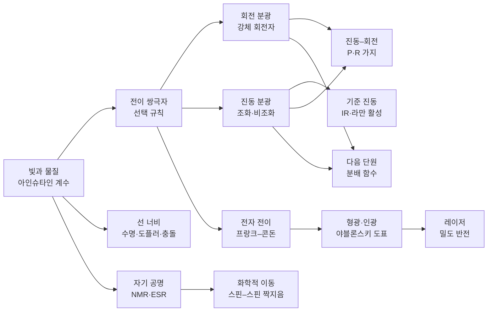

# 물리화학 10. 분자 분광학 — 빛이 묻고 분자가 답하는 에너지 준위의 언어
<!-- prev: pchem-9, uchem-4, umath-6 -->
<!-- next: pchem-11 -->

> [!NOTE]
> **이 단원의 범위**
> - 빛과 물질의 상호작용: 흡수·자발 방출·유도 방출(아인슈타인 계수), 전이 쌍극자 모멘트와 선택 규칙, 선 너비(자연·도플러·충돌 넓어짐)
> - 회전 분광학: 강체 회전자의 준위와 선택 규칙, 회전 상수와 결합 길이 결정, 선의 세기와 원심력 뒤틀림
> - 진동 분광학: 조화 진동자와 비조화 진동자(모스 퍼텐셜, 배음, 해리 에너지), 다원자 분자의 기준 진동 방식, 적외선 활성과 라만 활성
> - 진동–회전 스펙트럼: P·R 가지, 결합 차이법, 진동–회전 상호작용
> - 전자 전이: 분자의 전자 상태와 선택 규칙, 프랑크–콘돈 원리, 형광·인광과 들뜬 상태의 이완, 레이저의 원리
> - 자기 공명: 핵 스핀과 NMR의 원리, 화학적 이동, 스핀–스핀 짝지음, ESR 개관

**학습 목표**

1. 흡수·자발 방출·유도 방출을 아인슈타인 계수로 기술하고, 전이 쌍극자 모멘트로부터 선택 규칙이 나오는 까닭과 선 너비를 정하는 세 가지 요인을 정량적으로 설명할 수 있다.
2. 강체 회전자의 에너지 준위와 선택 규칙으로 순수 회전 스펙트럼을 해석하고, 회전 상수에서 결합 길이를 구하며, 선의 세기 분포를 볼츠만 분포와 축퇴로 설명할 수 있다.
3. 조화·비조화 진동자 모형으로 진동 스펙트럼(기본음·배음)을 해석하여 힘 상수와 해리 에너지를 구하고, 다원자 분자의 기준 진동 방식을 세어 적외선·라만 활성을 판정할 수 있다.
4. 진동–회전 스펙트럼의 P·R 가지를 유도하고, 결합 차이법으로 두 진동 준위의 회전 상수를 따로 구할 수 있다.
5. 프랑크–콘돈 원리로 전자 스펙트럼의 진동 구조를 설명하고, 야블론스키 도표로 형광·인광·무복사 이완을 구별하며, 밀도 반전과 레이저 발진의 조건을 설명할 수 있다.
6. 자기장 속 핵 스핀의 에너지 준위로 NMR 공명 조건을 유도하고, 화학적 이동과 스핀–스핀 짝지음으로 1차 스펙트럼의 갈라짐 무늬를 예측하며, ESR의 $g$ 인자와 초미세 갈라짐을 해석할 수 있다.

**이 단원의 학습 사다리**

| 단계 | 무엇을 하나? |
|---|---|
| STEP 1. 이전 학습 다시 보기 | $E = h\nu$와 선 스펙트럼(일반화학), 조화 진동자·강체 회전자의 준위(물리화학 8), 분자 오비탈과 보른–오펜하이머 근사(물리화학 9), 푸리에 변환(수학 도구 6) |
| STEP 2. 기초 다지기 | 에너지 단위와 볼츠만 인자, 환산 질량과 관성 모멘트, 홀함수 적분과 선택 규칙의 수학, 선 모양과 푸리에 변환 |
| STEP 3. 핵심 개념 | 빛과 물질 → 선 너비 → 회전 → 진동(이원자) → 기준 진동과 IR·라만 → 진동–회전 → 전자 전이와 프랑크–콘돈 → 형광·인광 → 레이저 → NMR 원리 → 화학적 이동 → 스핀–스핀 짝지음 → ESR |
| STEP 4. 오개념 바로잡기 | "회전선 간격은 $B$이다", "가장 센 회전선은 $J = 0$에서 나온다", "형광은 흡수보다 짧은 파장이다" 같은 착각 |
| STEP 5. 대학원·연구로 | 시간 의존 섭동 이론과 페르미 황금률, 2차원 NMR, 펨토초 펌프–프로브 분광 |
| STEP 6. 생활·산업·진로 | 온실 기체와 대기 원격 탐사, 전파 천문학의 CO 선, MRI, 형광 영상과 라만 분석 |

---

## 🗺️ 단원 들어가기

별빛을 프리즘에 통과시키면 무지개 띠 사이사이에 검은 선이 나타난다. 일반화학에서 우리는 이 선들이 원자의 에너지 준위 사이의 간격을 알려 주는 '바코드'라는 것을 배웠다. 분자도 바코드를 가진다. 다만 분자의 바코드는 훨씬 촘촘하고 여러 층으로 되어 있다. 분자는 전자만 들뜨는 것이 아니라 **진동**하고 **회전**하며, 자기장 속에서는 핵 스핀과 전자 스핀의 방향까지 에너지 차이를 만든다. 이 네 가지 운동은 에너지 크기가 서로 수십~수천 배씩 달라서, 각각 다른 영역의 빛 — 라디오파, 마이크로파, 적외선, 가시광선·자외선 — 으로 따로 들여다볼 수 있다.

물리화학 7~9에서 우리는 슈뢰딩거 방정식을 풀어 상자 속 입자, 조화 진동자, 강체 회전자, 수소 원자, 분자 오비탈의 에너지 준위를 **계산**했다. 이 단원은 그 계산을 **측정**과 잇는다. 분광학은 "에너지 준위가 이렇다면 스펙트럼은 이렇게 보여야 한다"는 예측과, "스펙트럼이 이렇게 보이므로 분자는 이렇게 생겼다"는 역추론을 오가는 학문이다. 일산화 탄소가 내는 115 GHz 전파 한 줄로 결합 길이를 0.1 pm까지 정하고, 염화 수소의 적외선 띠 하나로 결합의 용수철 상수와 해리 에너지를 어림하며, NMR 스펙트럼의 갈라진 봉우리로 이웃한 수소의 수를 센다.

그런데 "에너지 차이가 맞는다"는 것만으로는 빛이 흡수되지 않는다. 질소와 산소는 진동하지만 적외선을 흡수하지 않고, 이산화 탄소는 흡수한다. 이 차이가 지구의 온실 효과를 정한다. 어떤 전이는 일어나고 어떤 전이는 일어나지 않는가를 정하는 **선택 규칙**, 그리고 그 뿌리인 **전이 쌍극자 모멘트**가 이 단원 전체를 꿰는 실이다.

---

## STEP 1. 🔙 이전 학습 다시 보기

### 연계 개념표

| 이전 단원 | 그때 배운 것 | 이 단원에서 확장되는 것 |
|---|---|---|
| 일반화학 「원자의 전자 구조와 주기성」 | $E = h\nu = hc/\lambda$, 수소의 선 스펙트럼과 뤼드베리 식, 에너지 준위 사이의 전이 | 분자의 회전·진동·전자·스핀 준위로 확장, 선의 **위치**뿐 아니라 **세기**(전이 쌍극자, 볼츠만 분포)와 **너비**(수명, 도플러)까지 해석 |
| 일반화학 「화학 결합과 분자 구조」 | 결합 길이·결합 세기, 극성 분자와 쌍극자 모멘트, 분자 모양 | 결합 길이를 회전 상수로 **측정**, 결합 세기를 힘 상수·해리 에너지로 정량화, 분자 모양이 기준 진동과 IR·라만 활성을 정한다 |
| 물리화학 8 「진동·회전 운동과 수소 원자」 | 조화 진동자 $E_v = (v + \frac{1}{2})\hbar\omega$와 에르미트 함수, 강체 회전자 $E_J = \hbar^2J(J+1)/2I$와 구면 조화 함수, 스핀 | 그 준위들 사이의 **전이**: 선택 규칙 $\Delta v = \pm1$, $\Delta J = \pm1$의 유도, 비조화성과 원심력 뒤틀림 보정, 핵 스핀의 제만 준위 |
| 물리화학 9 「다전자 원자와 화학 결합」 | 보른–오펜하이머 근사, 분자 오비탈과 퍼텐셜 에너지 곡선, 항 기호 | 퍼텐셜 곡선 위의 진동 준위, 전자 전이와 **프랑크–콘돈 원리**, 분자 항 기호($\Sigma$, $\Pi$)와 스핀 선택 규칙 |
| 수학 도구 6 「복소수와 푸리에 해석」 | 푸리에 변환, 지수 감쇠 ↔ 로렌츠 선 모양, 시간–진동수 불확정 관계, FT-NMR·FT-IR의 원리 | 자연 선 너비와 들뜬 상태 수명, 도플러 넓어짐의 가우스 모양, NMR의 FID와 이완 |

### 준비 운동 (사전 진단)

**Q1.** 파수 $\tilde{\nu} = 2000\ \mathrm{cm^{-1}}$인 적외선의 파장(μm), 진동수(Hz), 광자 1 mol의 에너지(kJ/mol)를 구하시오. ($h = 6.626\times10^{-34}\ \mathrm{J\cdot s}$, $c = 2.998\times10^{10}\ \mathrm{cm/s}$, $N_\mathrm{A} = 6.022\times10^{23}\ \mathrm{mol^{-1}}$)

**Q2.** 물리화학 8의 조화 진동자에서 인접한 두 준위의 에너지 간격과 영점 에너지를 $\hbar\omega$로 쓰시오.

**Q3.** 강체 회전자의 에너지 $E_J = \dfrac{\hbar^2}{2I}J(J+1)$에서 $J = 0, 1, 2, 3$ 준위의 에너지를 $\hbar^2/2I$ 단위로 쓰고, 인접 준위 간격이 어떻게 변하는지 말하시오. 각 준위의 축퇴도는?

**Q4.** 수학 도구 6에서 진폭이 시간 상수 $T_2$로 지수 감쇠하는 진동 신호의 스펙트럼은 어떤 모양이고, 반치 전폭은 진동수로 얼마인가?

정답 및 해설

**Q1.** $\lambda = 1/\tilde{\nu} = 5.00\times10^{-4}\ \mathrm{cm} = 5.00\ \mathrm{\mu m}$, $\nu = c\tilde{\nu} = 2.998\times10^{10}\times2000 = 6.00\times10^{13}\ \mathrm{Hz}$, $E_\text{mol} = N_\mathrm{A}hc\tilde{\nu} = 6.022\times10^{23}\times6.626\times10^{-34}\times6.00\times10^{13} = 2.39\times10^{4}\ \mathrm{J/mol} = 23.9\ \mathrm{kJ/mol}$. 화학 결합 에너지(수백 kJ/mol)보다 한 자릿수 작다.

**Q2.** 간격은 언제나 $\hbar\omega$(등간격), 영점 에너지는 $\frac{1}{2}\hbar\omega$.

**Q3.** 0, 2, 6, 12. 간격은 2, 4, 6으로 $J$가 커질수록 늘어난다(간격 $= 2(J+1)$). 축퇴도는 $2J + 1$ = 1, 3, 5, 7.

**Q4.** 로렌츠 함수, 반치 전폭 $\Delta\nu = 1/(\pi T_2)$. STEP 3 ②에서 이 관계로 들뜬 상태의 수명에서 자연 선 너비를 구한다.

---

## STEP 2. 🧱 기초 다지기

### 디딤돌 1. 에너지 단위와 볼츠만 인자 — $k_\mathrm{B}T \approx 207\ \mathrm{cm^{-1}}$

분광학자는 에너지를 줄(J)보다 **파수(wavenumber)** $\tilde{\nu} = 1/\lambda$(단위 $\mathrm{cm^{-1}}$)로 즐겨 쓴다. 광자 에너지 $E = hc\tilde{\nu}$가 파수에 비례하므로, 파수는 그대로 '에너지의 다른 이름'이 된다. 분자의 에너지 준위를 $\mathrm{cm^{-1}}$로 적은 것을 **항 값(term value)** 이라 하고, 회전은 $F(J)$, 진동은 $G(v)$, 전자는 $T$로 쓴다.

| 1 cm⁻¹ 는 | 값 | 어디에 쓰나 |
|---|---|---|
| 에너지(J) | $hc\times(1\ \mathrm{cm^{-1}}) = 1.986\times10^{-23}\ \mathrm{J}$ | 볼츠만 인자 계산 |
| 몰 에너지 | $11.96\ \mathrm{J/mol}$ (1000 cm⁻¹ ≈ 12.0 kJ/mol) | 결합 에너지와 비교 |
| 전자볼트 | $1.240\times10^{-4}\ \mathrm{eV}$ (1 eV = 8065.5 cm⁻¹) | 전자 전이, 광전자 분광 |
| 진동수 | $29.98\ \mathrm{GHz}$ | 마이크로파·전파 분광 |
| 온도 | $hc/k_\mathrm{B} = 1.4388\ \mathrm{cm\cdot K}$ | $k_\mathrm{B}T/hc$ = 207.2 cm⁻¹ (298.15 K) |

열평형에서 에너지 차이가 $\Delta E$인 두 상태(각 축퇴도 $g_\text{위}$, $g_\text{아래}$)의 개체 수 비는 **볼츠만 분포**를 따른다.

$$
\frac{N_\text{위}}{N_\text{아래}} = \frac{g_\text{위}}{g_\text{아래}}\,e^{-\Delta E/k_\mathrm{B}T}
$$

**예** 실온(298 K)에서 $\Delta E = 1000\ \mathrm{cm^{-1}}$(진동 하나 정도)이면 $e^{-1000/207.2} = 0.0080$, 들뜬 진동 준위에는 1 %도 없다. 반면 회전 상수 $B = 10\ \mathrm{cm^{-1}}$인 분자의 $J = 1$(에너지 $2B = 20\ \mathrm{cm^{-1}}$, 축퇴도 3)은 $J = 0$에 대해 $3e^{-20/207.2} = 2.72$배로 **오히려 더 많다.** 실온에서 분자들은 진동은 거의 바닥에 있지만 회전은 여러 준위에 넓게 퍼져 있다. 이 차이가 ③·⑥의 스펙트럼 모양을 정한다.

### 디딤돌 2. 환산 질량과 관성 모멘트 — 두 물체 문제를 한 물체로

질량 $m_1$, $m_2$인 두 원자가 거리 $r$로 묶인 이원자 분자의 진동과 회전은 질량 중심을 따로 떼어 내면 **환산 질량(reduced mass)** $\mu$인 입자 하나의 운동이 된다(물리화학 8).

$$
\mu = \frac{m_1m_2}{m_1 + m_2}, \qquad I = \mu r^2
$$

$I$는 질량 중심을 지나고 결합에 수직인 축에 대한 **관성 모멘트(moment of inertia)** 이다. 원자 질량 단위 $1\ \mathrm{u} = 1.6605\times10^{-27}\ \mathrm{kg}$로 바꾸어 넣는다. 한쪽이 수소이면 $\mu$는 수소 질량에 가깝다($m_2 \gg m_1$이면 $\mu \to m_1$).

**예** $^{12}\mathrm{C}^{16}\mathrm{O}$($m = 12.000\ \mathrm{u}$, $15.995\ \mathrm{u}$)의 환산 질량은 $\mu = 12.000\times15.995/27.995 = 6.856\ \mathrm{u} = 1.1385\times10^{-26}\ \mathrm{kg}$이다. 결합 길이 112.8 pm를 넣으면 $I = 1.1385\times10^{-26}\times(1.128\times10^{-10})^2 = 1.449\times10^{-46}\ \mathrm{kg\cdot m^2}$. $\mathrm{H^{35}Cl}$은 $\mu = 0.9796\ \mathrm{u}$로 수소 하나의 질량(1.0078 u)과 거의 같다.

> [!WARNING]
> 분광학의 질량은 **동위 원소 하나하나의 질량**이다. 주기율표의 평균 원자량(Cl 35.45)을 넣으면 안 된다. $\mathrm{H^{35}Cl}$과 $\mathrm{H^{37}Cl}$은 서로 다른 분자로 따로 선을 낸다(③·⑥).

### 디딤돌 3. 홀함수의 적분과 직교성 — 선택 규칙의 수학

선택 규칙은 거의 모두 "어떤 적분이 0인가"라는 질문이다. 두 가지 도구면 충분하다.

1. **홀짝성** 대칭 구간에서 홀함수($f(-x) = -f(x)$)의 적분은 0이다. 짝함수 × 짝함수 = 짝, 짝 × 홀 = 홀, 홀 × 홀 = 짝.
2. **직교성** 같은 에르미트 연산자의 서로 다른 고유 함수는 직교한다: $\int\psi_m^*\psi_n\,d\tau = 0\ (m \ne n)$ (수학 도구 8 '직교 함수와 전개').

물리화학 8의 조화 진동자 파동 함수는 $v$가 짝수이면 짝함수, 홀수이면 홀함수이다. 그래서 $\int\psi_v\,x\,\psi_v\,dx$는 (짝 또는 홀)$^2$ × 홀 = 홀이 되어 언제나 0이다. 바닥 상태에서 변위의 평균이 0이라는 당연한 결과이다. 반면 $\int\psi_1\,x\,\psi_0\,dx$는 홀 × 홀 × 짝 = 짝이어서 0이 아니다.

**예** 에르미트 함수의 점화식을 쓰면 $x\psi_v = \sqrt{\dfrac{\hbar}{2\mu\omega}}\left(\sqrt{v+1}\,\psi_{v+1} + \sqrt{v}\,\psi_{v-1}\right)$이다. 양변에 $\psi_{v'}$를 곱해 적분하면 직교성 때문에 $v' = v \pm 1$일 때만 살아남는다. $\mathrm{H^{35}Cl}$($k = 516\ \mathrm{N/m}$, $\mu = 0.9796\ \mathrm{u}$)이면 $\omega = \sqrt{k/\mu} = 5.63\times10^{14}\ \mathrm{s^{-1}}$이고 $\langle1\vert x\vert0\rangle = \sqrt{\hbar/2\mu\omega} = 7.6\ \mathrm{pm}$이다. 결합 길이(127 pm)의 6 % 정도가 영점 진동의 '흔들림 폭'이다. ④에서 이것이 진동 선택 규칙 $\Delta v = \pm1$이 된다.

### 디딤돌 4. 선 모양과 푸리에 변환 — 감쇠가 빠르면 선이 넓다

수학 도구 6 '푸리에 변환'과 '불확정 관계'에서 익힌 두 변환 쌍이 분광학의 선 모양을 거의 다 설명한다.

| 시간 영역의 신호 | 진동수 영역의 선 모양 | 반치 전폭(FWHM) | 분광학에서 |
|---|---|---|---|
| 지수 감쇠 진동 $e^{-t/T_2}\cos\omega_0t$ | 로렌츠 함수 | $\Delta\nu = 1/(\pi T_2)$ | 수명·충돌 넓어짐, NMR 선 |
| 가우스 포락선의 진동 | 가우스 함수 | 포락선 폭에 반비례 | 도플러 넓어짐 |

로렌츠 함수는 봉우리에서 멀어질 때 $1/(\nu - \nu_0)^2$로 천천히 줄어 '꼬리가 길고', 가우스 함수는 $e^{-(\nu - \nu_0)^2}$로 급히 사라진다. 두 효과가 함께 있으면 두 모양의 합성곱(**포크트 모양**)이 된다.

**예** 액체 속 분자의 진동이 주위 분자와 부딪혀 약 1 ps 만에 위상을 잃는다면($T_2 = 1.0\ \mathrm{ps}$) 선 너비는 $\Delta\nu = 1/(\pi\times1.0\times10^{-12}\ \mathrm{s}) = 3.2\times10^{11}\ \mathrm{Hz}$, 파수로 $3.2\times10^{11}/(2.998\times10^{10}) = 11\ \mathrm{cm^{-1}}$이다. 액체의 적외선 띠가 기체보다 훨씬 넓은 까닭이다.

---

## STEP 3. 📘 핵심 개념

### ① 빛과 물질의 상호작용 — 흡수, 자발 방출, 유도 방출

#### 세 가지 과정과 아인슈타인 계수

에너지가 $E_1 < E_2$인 두 상태(축퇴도는 같다고 하자)와 진동수 $\nu = (E_2 - E_1)/h$ 근처의 빛을 생각하자. 아인슈타인은 빛과 물질 사이에 세 가지 과정이 있다고 보았다.

| 과정 | 무엇이 일어나나 | 단위 부피당 속도 |
|---|---|---|
| **흡수**(absorption) | 광자 하나를 먹고 1 → 2 | $B_{12}\,\rho(\nu)\,N_1$ |
| **유도 방출**(stimulated emission) | 같은 진동수의 광자가 '건드려' 2 → 1, 광자가 하나 더 생김(위상·방향이 같다) | $B_{21}\,\rho(\nu)\,N_2$ |
| **자발 방출**(spontaneous emission) | 빛이 없어도 저절로 2 → 1 | $A_{21}\,N_2$ |

여기서 $\rho(\nu)$는 진동수 $\nu$ 근처 빛의 에너지 밀도(단위 진동수당), $N_i$는 단위 부피당 분자 수, $A$와 $B$는 **아인슈타인 계수(Einstein coefficients)** 이다.

<!-- 그림 요청: 아인슈타인의 세 과정 비교 도식. 가로로 세 칸을 나란히 그리고 각 칸에 두 개의 가로선(아래 E1, 위 E2)을 그린다. ① "흡수": 왼쪽에서 물결 화살표(광자 hν)가 들어오고, 아래 준위의 점(분자)이 위 준위로 올라가는 위쪽 화살표. ② "유도 방출": 광자 하나가 들어오고, 위 준위의 점이 아래로 내려가며, 오른쪽으로 같은 방향·같은 위상의 물결 화살표 두 개가 나란히 나간다. ③ "자발 방출": 들어오는 광자 없이 위 준위의 점이 내려가고, 임의의 방향(비스듬히)으로 물결 화살표 하나가 나간다. 각 칸 아래에 속도식 B12ρN1, B21ρN2, A21N2를 쓴다. -->

#### 유도 — 아인슈타인 관계식

**가정** 분자들이 온도 $T$의 흑체 복사와 열평형에 있다. 그러면 (1) 개체 수는 볼츠만 분포 $N_2/N_1 = e^{-h\nu/k_\mathrm{B}T}$를 따르고, (2) 빛의 에너지 밀도는 플랑크 분포(물리화학 7)를 따른다.

$$
\rho(\nu) = \frac{8\pi h\nu^3}{c^3}\,\frac{1}{e^{h\nu/k_\mathrm{B}T} - 1}
$$

**단계 1** 평형이면 위로 가는 속도와 아래로 가는 속도가 같다: $B_{12}\rho N_1 = B_{21}\rho N_2 + A_{21}N_2$.

**단계 2** $\rho$에 대해 풀고 $N_1/N_2 = e^{h\nu/k_\mathrm{B}T}$를 넣는다.

$$
\rho(\nu) = \frac{A_{21}}{B_{12}(N_1/N_2) - B_{21}} = \frac{A_{21}/B_{21}}{(B_{12}/B_{21})\,e^{h\nu/k_\mathrm{B}T} - 1}
$$

**단계 3** 이 식이 모든 온도에서 플랑크 분포와 같으려면 분모의 꼴이 같아야 하므로

$$
\boxed{\;B_{12} = B_{21} \equiv B, \qquad \frac{A_{21}}{B} = \frac{8\pi h\nu^3}{c^3}\;}
$$

**결과의 의미** (1) 흡수와 유도 방출은 같은 계수를 가진다. 그래서 빛을 아무리 세게 쪼여도 두 준위의 개체 수는 '같아지는 데'까지만 가고 뒤집히지 않는다(⑨의 레이저에서 중요). (2) 자발 방출은 $\nu^3$에 비례해 진동수가 높을수록 압도적으로 커진다. **적용 한계**: 계수 자체는 분자의 성질이므로 평형이 아닌 경우에도 그대로 쓴다. 축퇴도가 다르면 $g_1B_{12} = g_2B_{21}$로 바뀐다.

#### 전이 쌍극자 모멘트 — 계수 $B$는 무엇이 정하는가

빛의 전기장 $\mathcal{E}$가 분자의 전기 쌍극자 $\hat{\mu}$에 미치는 에너지 $-\hat{\mu}\cdot\mathcal{E}$를 섭동으로 보고 시간 의존 슈뢰딩거 방정식을 풀면(STEP 5 맛보기 ①)

$$
B = \frac{\lvert\mu_{fi}\rvert^2}{6\varepsilon_0\hbar^2}, \qquad \mu_{fi} = \int\psi_f^*\,\hat{\mu}\,\psi_i\,d\tau
$$

를 얻는다. $\mu_{fi}$를 **전이 쌍극자 모멘트(transition dipole moment)** 라 한다. 전이가 일어나는 동안 분자의 전하 분포가 처음 상태와 나중 상태의 '겹침'으로 출렁이는데, 그 출렁임의 쌍극자 크기이다. 빛의 진동하는 전기장이 이 출렁이는 쌍극자를 붙잡고 흔들어 에너지를 넘겨준다.

> [!IMPORTANT]
> **선택 규칙(selection rule)** 은 $\mu_{fi} \ne 0$이 되는 조건이다.
> - **전체 선택 규칙(gross selection rule)**: 분자가 어떤 성질을 가져야 그 종류의 스펙트럼을 보이는가(예: 순수 회전 스펙트럼에는 영구 쌍극자 모멘트가 있어야 한다).
> - **세부 선택 규칙(specific selection rule)**: 어떤 양자수 변화가 허용되는가(예: $\Delta J = \pm1$, $\Delta v = \pm1$).
> 광자는 스핀 1의 각운동량을 가지므로, 광자 하나를 흡수·방출하는 전이에서는 분자의 각운동량도 그만큼 바뀌어야 한다. 이것이 회전·원자 전이의 규칙 $\Delta J = \pm1$, $\Delta l = \pm1$의 물리적 뿌리이다.

'금지' 전이도 완전히 0은 아니다. 자기 쌍극자·전기 사중극자 상호작용, 진동과의 섞임, 스핀–궤도 결합 때문에 수백~수백만 배 약하게 일어난다. 인광(⑧)이 그 대표 예이다.

#### 흡수의 세기 — 비어–람베르트 법칙과의 연결

두께 $dl$의 시료를 지나며 빛의 세기가 줄어드는 비율은 흡수하는 분자의 농도에 비례하므로 $dI/I = -\kappa\,[\mathrm{J}]\,dl$, 적분하면 $I = I_0e^{-\kappa[\mathrm{J}]l}$이다. 상용로그로 쓰면 흡광도 $A = \log(I_0/I) = \varepsilon[\mathrm{J}]l$(**비어–람베르트 법칙**)이고, 몰 흡광 계수 $\varepsilon$를 띠 전체에 걸쳐 적분한 **적분 흡수 계수** $\mathcal{A} = \int\varepsilon\,d\tilde{\nu}$는 $\lvert\mu_{fi}\rvert^2$에 비례한다. 허용된 전자 전이는 $\varepsilon_\text{max}$가 $10^4\sim10^5\ \mathrm{L\,mol^{-1}\,cm^{-1}}$, 금지된 전이는 $1\sim100$ 정도이다. 분광 광도계를 이용한 정량 분석은 「분광 분석의 기초와 분자 분광법」에서 자세히 다룬다.

#### 예제 1 — 어느 영역에서 유도 방출이 중요한가

298 K의 열복사 속에서 유도 방출 속도와 자발 방출 속도의 비 $B\rho/A$를 다음 전이에 대해 구하시오. (1) 500 nm(가시광선 전자 전이) (2) 2000 cm⁻¹(진동) (3) 10 cm⁻¹(회전) (4) 500 MHz(NMR) 그리고 (5) 500 nm 전이와 500 MHz 전이의 $A$ 계수 비(전이 쌍극자가 같다고 할 때)를 구하시오.

**풀이**
식 세우기: 플랑크 분포를 넣으면 $\dfrac{B\rho}{A} = \dfrac{1}{e^{h\nu/k_\mathrm{B}T} - 1}$, $x = h\nu/k_\mathrm{B}T = hc\tilde{\nu}/k_\mathrm{B}T = \tilde{\nu}/(207.2\ \mathrm{cm^{-1}})$.
(1) $\tilde{\nu} = 20\,000\ \mathrm{cm^{-1}}$, $x = 96.5$ → 비 $= e^{-96.5} \approx 1\times10^{-42}$.
(2) $x = 2000/207.2 = 9.65$ → $6.4\times10^{-5}$.
(3) $x = 0.0483$ → $1/(e^{0.0483} - 1) = 20$.
(4) $x = h\nu/k_\mathrm{B}T = (6.626\times10^{-34}\times5.00\times10^{8})/(1.381\times10^{-23}\times298.15) = 8.05\times10^{-5}$ → $1.2\times10^{4}$.
(5) $A \propto \nu^3$이므로 $(6.0\times10^{14}/5.0\times10^{8})^3 = 1.7\times10^{18}$.

**의미** 가시광선·자외선 영역에서는 자발 방출이 압도적이어서 들뜬 분자는 수 ns 만에 빛을 내고 내려온다. 반대로 마이크로파·라디오파 영역에서는 자발 방출이 사실상 없고($A$가 $10^{18}$배 작다), 흡수와 유도 방출이 거의 상쇄된다. NMR 신호가 약한 것과 들뜬 핵 스핀이 빛을 내며 '저절로' 돌아오지 않고 주위와의 상호작용(이완, ⑩)으로 돌아오는 것이 이 때문이다.

#### ✔ 바로 확인

1. (O/X) 강한 빛을 계속 쪼이면 두 준위 계의 위 준위 개체 수가 아래 준위보다 많아질 수 있다.
2. 빈칸: 아인슈타인 계수 사이에는 $A/B = 8\pi h\nu^3/c^3$의 관계가 있어 자발 방출은 진동수의 (    )제곱에 비례해 커진다.
3. 빈칸: 전이가 일어나려면 전이 쌍극자 모멘트 $\int\psi_f^*\hat{\mu}\psi_i\,d\tau$가 (    )이 아니어야 한다.
4. 298 K에서 1000 cm⁻¹ 전이의 유도 방출/자발 방출 속도 비는?

정답

1. X — $B_{12} = B_{21}$이므로 빛만으로는 개체 수가 같아지는 데(포화)까지만 간다. 밀도 반전에는 세 번째 준위가 필요하다(⑨).
2. 세 — 그래서 진동수가 높은 전자 전이일수록 들뜬 상태 수명이 짧다.
3. 0
4. 약 0.0081 — $1/(e^{1000/207.2} - 1) = 1/(e^{4.83} - 1)$.

### ② 선 너비 — 스펙트럼 선은 왜 바늘이 아닌가

에너지 준위가 정확히 하나의 값이라면 스펙트럼 선은 폭이 0인 바늘이어야 한다. 실제 선은 폭을 가지며, 그 폭에는 분자의 수명과 운동에 관한 정보가 담겨 있다.

#### 수명 넓어짐 — 시간–에너지 불확정 관계

들뜬 상태의 개체 수가 $N(t) = N_0e^{-t/\tau}$로 줄면 그 상태의 파동 함수 진폭은 $e^{-t/2\tau}$로 줄고, 방출되는 빛의 전기장도 같은 비율로 감쇠한다. 디딤돌 4에 따라 진폭 감쇠 시간 $T_2 = 2\tau$인 진동의 스펙트럼은 로렌츠 함수이고

$$
\Delta\nu = \frac{1}{\pi T_2} = \frac{1}{2\pi\tau}, \qquad \delta E = h\,\Delta\nu = \frac{\hbar}{\tau}
$$

이다. 자발 방출만으로 정해지는 폭을 **자연 선 너비(natural linewidth)** 라 한다. 수명을 줄이는 다른 과정(충돌, 무복사 이완, 해리)이 있으면 그 속도 상수들을 더한 전체 속도가 $1/\tau$가 되어 선이 더 넓어진다. 두 상태가 모두 수명이 유한하면 두 폭이 더해진다.

#### 도플러 넓어짐 — 분자의 열운동

**가정** 기체 분자가 시선 방향 속도 $v_x$로 움직이고, $v_x \ll c$이다.

**단계 1** 관찰되는 진동수는 도플러 효과로 $\nu = \nu_0(1 + v_x/c)$, 즉 $v_x = c(\nu - \nu_0)/\nu_0$이다.

**단계 2** 맥스웰–볼츠만 분포에서 한 성분 $v_x$의 분포는 $f(v_x) \propto e^{-mv_x^2/2k_\mathrm{B}T}$로 분산 $\sigma_v^2 = k_\mathrm{B}T/m$인 가우스 분포이다.

**단계 3** $v_x$를 진동수로 바꾸면 선 모양도 가우스 함수가 된다.

$$
I(\nu) \propto \exp\!\left[-\frac{mc^2(\nu - \nu_0)^2}{2k_\mathrm{B}T\nu_0^2}\right]
$$

**단계 4** 높이가 절반이 되는 곳은 지수가 $-\ln 2$인 곳이므로 반치 전폭은

$$
\boxed{\;\Delta\nu_\mathrm{D} = \frac{2\nu_0}{c}\sqrt{\frac{2k_\mathrm{B}T\ln 2}{m}}\;}
$$

**적용 한계** 충돌이 잦으면 분자의 속도가 측정 시간 동안 바뀌어 모양이 달라진다. 도플러 폭은 $\nu_0$에 비례하므로 전자 전이에서 크고 마이크로파에서는 매우 작다. 또 $\sqrt{T/m}$에 비례하므로 무겁고 차가운 분자일수록 좁다.

#### 충돌(압력) 넓어짐

기체 분자가 평균 시간 $\tau_\text{col}$마다 충돌해 들뜬 상태의 위상이 끊기면, 이 시간이 '수명'처럼 작용하여 $\Delta\nu \approx 1/(\pi\tau_\text{col})$의 로렌츠 넓어짐이 생긴다. $\tau_\text{col}$은 압력에 반비례하므로 충돌 폭은 **압력에 비례**한다. 고해상도 분광을 낮은 압력에서 하는 까닭이다.

| 넓어짐 | 원인 | 선 모양 | 무엇에 비례 | 줄이는 법 |
|---|---|---|---|---|
| 자연(수명) | 자발 방출에 의한 유한 수명 | 로렌츠 | $1/\tau$ ($\propto\nu^3\lvert\mu_{fi}\rvert^2$) | 줄일 수 없다(분자의 성질) |
| 도플러 | 시선 방향 열운동 | 가우스 | $\nu_0\sqrt{T/m}$ | 냉각, 분자 빛살, 도플러 없는 분광 |
| 충돌(압력) | 충돌로 위상이 끊김 | 로렌츠 | 압력 | 압력을 낮춘다 |

#### 예제 2 — 세 가지 선 너비 비교

(1) 나트륨 D선(589.0 nm)의 들뜬 상태 수명은 약 16 ns이다. 자연 선 너비(Hz)를 구하시오. (2) 500 K 나트륨 증기에서 이 선의 도플러 폭을 구하시오($m = 22.99\ \mathrm{u}$). (3) 300 K의 $\mathrm{H^{35}Cl}$ 기체에서 2886 cm⁻¹ 진동 띠의 한 선이 갖는 도플러 폭을 cm⁻¹로 구하고, 평균 충돌 간격이 $1.0\times10^{-10}\ \mathrm{s}$(약 1 atm)일 때의 충돌 폭과 비교하시오. ($k_\mathrm{B} = 1.381\times10^{-23}\ \mathrm{J/K}$, $1\ \mathrm{u} = 1.6605\times10^{-27}\ \mathrm{kg}$)

**풀이**
(1) $\Delta\nu = 1/(2\pi\tau) = 1/(2\pi\times16\times10^{-9}\ \mathrm{s}) = 9.9\times10^{6}\ \mathrm{Hz} \approx 10\ \mathrm{MHz}$.
(2) $\nu_0 = c/\lambda = 5.090\times10^{14}\ \mathrm{Hz}$, $m = 3.817\times10^{-26}\ \mathrm{kg}$.
$\sqrt{2k_\mathrm{B}T\ln 2/m} = \sqrt{2\times1.381\times10^{-23}\times500\times0.693/3.817\times10^{-26}} = 501\ \mathrm{m/s}$
$\Delta\nu_\mathrm{D} = 2\times5.090\times10^{14}\times501/2.998\times10^{8} = 1.7\times10^{9}\ \mathrm{Hz}$ — 자연 폭의 약 170배이다.
(3) 파수로 쓰면 $\Delta\tilde{\nu}_\mathrm{D} = \dfrac{2\tilde{\nu}_0}{c}\sqrt{\dfrac{2k_\mathrm{B}T\ln 2}{m}}$. $m = 35.98\ \mathrm{u} = 5.974\times10^{-26}\ \mathrm{kg}$이면 제곱근은 $310\ \mathrm{m/s}$, $\Delta\tilde{\nu}_\mathrm{D} = 2\times2886\times310/2.998\times10^{8} = 0.0060\ \mathrm{cm^{-1}}$. 충돌 폭은 $\Delta\nu = 1/(\pi\tau_\text{col}) = 3.2\times10^{9}\ \mathrm{Hz}$, 파수로 $3.2\times10^{9}/2.998\times10^{10} = 0.11\ \mathrm{cm^{-1}}$.

**의미** 원자·분자의 자연 선 너비는 대개 도플러 폭에 가려진다. 1 atm 기체의 적외선 선은 충돌 폭(약 0.1 cm⁻¹)이 도플러 폭(0.006 cm⁻¹)보다 훨씬 크지만, 선 사이 간격(HCl은 약 20 cm⁻¹, ⑥)보다는 여전히 작아서 회전 구조가 또렷이 보인다. 액체에서는 디딤돌 4처럼 폭이 10 cm⁻¹ 정도로 커져 회전 구조가 사라진다.

#### ✔ 바로 확인

1. (O/X) 도플러 폭은 온도가 높을수록, 분자가 가벼울수록 넓다.
2. 들뜬 상태의 수명이 1.0 ps이면 자연 선 너비는 몇 cm⁻¹인가?
3. 빈칸: 충돌 넓어짐의 선 모양은 (    ) 함수이고, 폭은 기체의 (    )에 비례한다.

정답

1. O — $\Delta\nu_\mathrm{D} \propto \nu_0\sqrt{T/m}$.
2. 약 5.3 cm⁻¹ — $\Delta\nu = 1/(2\pi\times10^{-12}) = 1.59\times10^{11}\ \mathrm{Hz}$, $\div\,2.998\times10^{10}$.
3. 로렌츠, 압력

### ③ 회전 분광학 — 결합 길이를 재는 자

#### 강체 회전자의 항 값

물리화학 8에서 강체 회전자의 에너지를 $E_J = \dfrac{\hbar^2}{2I}J(J+1)$, $J = 0, 1, 2, \dots$, 축퇴도 $2J + 1$($M_J = -J, \dots, +J$)로 구했다. 파수 단위의 항 값으로 바꾸면

$$
F(J) = \frac{E_J}{hc} = \tilde{B}\,J(J+1), \qquad \tilde{B} = \frac{\hbar}{4\pi cI} = \frac{h}{8\pi^2cI}
$$

이다. $\tilde{B}$를 **회전 상수(rotational constant)** 라 하며, 관성 모멘트에 반비례한다. 이하 혼동이 없으면 물결표를 빼고 $B$로 쓴다.

#### 선택 규칙

- **전체**: 분자가 **영구 쌍극자 모멘트**를 가져야 한다. 회전하는 쌍극자는 빛의 전기장과 같은 박자로 방향을 바꾸는 진동 쌍극자처럼 보여 빛과 에너지를 주고받는다. $\mathrm{H_2}$, $\mathrm{N_2}$, $\mathrm{CO_2}$, $\mathrm{CH_4}$는 순수 회전 스펙트럼이 없고, $\mathrm{HCl}$, $\mathrm{CO}$, $\mathrm{OCS}$, $\mathrm{H_2O}$는 있다.
- **세부**: $\Delta J = \pm1$, $\Delta M_J = 0, \pm1$. 쌍극자의 $z$ 성분은 $\mu\cos\theta$이고, 구면 조화 함수의 성질 $\cos\theta\,Y_{J,M} = aY_{J+1,M} + bY_{J-1,M}$ 때문에 $\int Y_{J',M}^*\cos\theta\,Y_{J,M}\,d\Omega$는 $J' = J\pm1$에서만 0이 아니다(디딤돌 3과 같은 논리). 광자가 각운동량 1을 실어 나른다는 그림과도 맞는다.

흡수선 $J \rightarrow J + 1$의 위치는

$$
\tilde{\nu}(J \rightarrow J+1) = F(J+1) - F(J) = 2B(J+1), \qquad J = 0, 1, 2, \dots
$$

로 $2B, 4B, 6B, \dots$에 놓인 **등간격의 선**이 되고, 간격은 $2B$이다.

<!-- 그림 요청: 이원자 분자의 강체 회전자 에너지 준위와 순수 회전 스펙트럼. 왼쪽: 가로선으로 J = 0~5 준위를 F(J) = BJ(J+1) 높이(0, 2B, 6B, 12B, 20B, 30B)에 그리고 각 선 오른쪽에 "J = n, 축퇴도 2J+1"을 쓴다. 인접 준위를 잇는 위쪽 화살표 5개(0→1, 1→2, …, 4→5)를 왼쪽에서 오른쪽으로 조금씩 옮겨 그리고 화살표 옆에 2B, 4B, 6B, 8B, 10B를 쓴다. 오른쪽 아래: 가로축 파수(0~12B)에 세로 막대 5개를 2B, 4B, 6B, 8B, 10B 위치에 그리고 인접 막대 사이에 "간격 2B" 양쪽 화살표. 막대 높이는 같게(세기는 따로 다룬다). -->

#### 원심력 뒤틀림

실제 결합은 용수철이므로 빨리 돌수록 늘어나 $I$가 커지고 준위가 조금 내려간다. 이를 보정하면

$$
F(J) = BJ(J+1) - DJ^2(J+1)^2, \qquad \tilde{\nu}(J \rightarrow J+1) = 2B(J+1) - 4D(J+1)^3
$$

이다. **원심력 뒤틀림 상수** $D$는 고전적인 용수철 모형에서 $D = 4B^3/\tilde{\nu}^2$($\tilde{\nu}$는 진동 파수)이며 $B$보다 보통 $10^{-4}\sim10^{-6}$배 작다. 높은 $J$에서 선 간격이 조금씩 좁아지는 것이 그 증거이다.

#### 선의 세기 — 축퇴와 볼츠만 분포의 줄다리기

흡수선의 세기는 주로 아래 준위의 개체 수에 비례한다.

$$
\frac{N_J}{N_0} = (2J+1)\,e^{-hcBJ(J+1)/k_\mathrm{B}T}
$$

축퇴도 $(2J+1)$은 $J$와 함께 커지고 볼츠만 인자는 줄어들므로 중간에 최대가 생긴다. $J$를 연속 변수로 보고 미분해 0으로 놓으면

$$
\frac{d}{dJ}\left[(2J+1)e^{-hcBJ(J+1)/k_\mathrm{B}T}\right] = 0 \quad\Longrightarrow\quad J_\text{max} = \sqrt{\frac{k_\mathrm{B}T}{2hcB}} - \frac{1}{2}
$$

#### 다원자 분자 — 팽이의 분류

| 분류 | 관성 모멘트 | 예 | 회전 스펙트럼 |
|---|---|---|---|
| 선형 회전자 | $I_\parallel = 0$, $I_\perp$ 하나 | $\mathrm{HCl}$, $\mathrm{OCS}$, $\mathrm{HCN}$ ($\mathrm{CO_2}$는 쌍극자 0) | $2B(J+1)$, 이원자와 같은 꼴 |
| 대칭 팽이 | 두 개가 같다 | $\mathrm{NH_3}$, $\mathrm{CH_3Cl}$, $\mathrm{C_6H_6}$ | $F(J,K) = BJ(J+1) + (A-B)K^2$, 선택 규칙 $\Delta K = 0$이라 선 위치는 여전히 $2B(J+1)$ |
| 구형 팽이 | 셋 모두 같다 | $\mathrm{CH_4}$, $\mathrm{SF_6}$ | 대칭 때문에 쌍극자가 0 → 순수 회전 스펙트럼 없음 |
| 비대칭 팽이 | 셋 모두 다르다 | $\mathrm{H_2O}$, $\mathrm{SO_2}$ | 복잡한 선 무리(계산으로 해석) |

다원자 분자는 관성 모멘트 하나로 여러 결합 길이를 정할 수 없다. 그래서 **동위 원소 치환**을 쓴다. 결합 길이는 동위 원소에 거의 무관하지만 질량은 바뀌므로, 예를 들어 $^{16}\mathrm{O}^{12}\mathrm{C}^{32}\mathrm{S}$와 $^{16}\mathrm{O}^{12}\mathrm{C}^{34}\mathrm{S}$의 $B$ 두 개로 C=O와 C=S 두 길이를 연립해 푼다.

#### 예제 3 — 일산화 탄소의 결합 길이

$^{12}\mathrm{C}^{16}\mathrm{O}$의 $J = 0 \rightarrow 1$ 선은 115.271 GHz에서 관측된다. (1) 회전 상수(cm⁻¹)와 관성 모멘트, 결합 길이를 구하시오. (2) $J = 3 \rightarrow 4$ 선의 진동수를 강체 회전자로 예측하시오(실측 약 461.04 GHz). (3) 298 K에서 개체 수가 가장 많은 $J$는? (4) $^{13}\mathrm{C}^{16}\mathrm{O}$의 $J = 0 \rightarrow 1$ 선을 예측하시오. ($m(^{12}\mathrm{C}) = 12.0000\ \mathrm{u}$, $m(^{13}\mathrm{C}) = 13.0034\ \mathrm{u}$, $m(^{16}\mathrm{O}) = 15.9949\ \mathrm{u}$)

**풀이**
(1) $\nu(0 \rightarrow 1) = 2Bc$이므로 진동수 단위의 $B = 57.636\ \mathrm{GHz}$, 파수로 $\tilde{B} = 57.636\times10^{9}/2.9979\times10^{10} = 1.9225\ \mathrm{cm^{-1}}$.
$I = \dfrac{h}{8\pi^2B} = \dfrac{6.6261\times10^{-34}}{8\pi^2\times5.7636\times10^{10}\ \mathrm{s^{-1}}} = 1.4560\times10^{-46}\ \mathrm{kg\cdot m^2}$.
$\mu = 6.8562\ \mathrm{u} = 1.13851\times10^{-26}\ \mathrm{kg}$, $r = \sqrt{I/\mu} = 1.1309\times10^{-10}\ \mathrm{m} = 113.1\ \mathrm{pm}$.
(2) $\nu(3 \rightarrow 4) = 2B\times4 = 8\times57.636 = 461.09\ \mathrm{GHz}$. 실측보다 약 0.05 GHz 높다. 이 차이가 원심력 뒤틀림 $4D(J+1)^3$이다($D \approx 6\times10^{-6}\ \mathrm{cm^{-1}}$에 해당).
(3) $J_\text{max} = \sqrt{207.2/(2\times1.9225)} - 0.5 = 7.34 - 0.5 = 6.8$, 정수로는 $J = 7$(실제로 $J = 6, 7, 8$의 개체 수가 비슷하다).
(4) $B \propto 1/\mu$이고 결합 길이는 같으므로 $\nu = 115.271\times\dfrac{6.8562}{7.1724} = 110.19\ \mathrm{GHz}$(실측 약 110.20 GHz).

**의미** 측정은 GHz의 여섯 자리까지 하므로 결합 길이도 0.01 pm 수준까지 정해진다. 여기서 얻은 113.1 pm는 바닥 진동 상태에서 평균한 $r_0$이며, 퍼텐셜의 바닥인 평형 결합 길이 $r_\mathrm{e}$(112.8 pm)보다 조금 길다. 진동하는 결합에서는 $\langle 1/r^2\rangle$이 평균되기 때문이다(⑥의 $B_v$ 참고). 동위 원소 선은 전파 천문학에서 성간 분자운의 $^{12}\mathrm{C}/^{13}\mathrm{C}$ 비를 재는 데 쓰인다(STEP 6).

<!-- 그림 요청: 298 K에서 12C16O(B = 1.9225 cm⁻¹)의 회전 준위 상대 개체 수 막대그래프. 가로축 J(0~20), 세로축 N_J/N_0 = (2J+1)exp(−hcBJ(J+1)/kT)(0~9.5). 주요 값: J=0 1.00, J=2 4.73, J=4 7.48, J=7 8.92(최대), J=10 7.57, J=14 4.13, J=20 약 0.83. 점선으로 축퇴도 (2J+1) 직선과 볼츠만 인자 exp(−hcBJ(J+1)/kT)(오른쪽 축, 0~1)를 함께 그려 "두 인자의 곱"임을 보인다. 최댓값 막대 위에 "J_max ≈ 7"이라 쓴다. -->

> [!TIP]
> 💡 **요령** — "선 간격이 $2B$"를 기억하는 법: 준위는 $B\times(0, 2, 6, 12, 20, \dots)$이고 이웃끼리의 차가 $2, 4, 6, 8, \dots$이므로, 차의 차가 2이다. 첫 선이 $2B$이고 그다음부터 $2B$씩 늘어난다. 스펙트럼에서 첫 선이 보이지 않을 때에도 **간격**에서 $B$를 읽고, 그 $B$로 각 선의 $J$를 거꾸로 매길 수 있다(개념 확인 문제 18).

#### ✔ 바로 확인

1. 다음 중 순수 회전 스펙트럼을 보이는 것을 모두 고르시오: $\mathrm{N_2}$, $\mathrm{HBr}$, $\mathrm{CO_2}$, $\mathrm{OCS}$, $\mathrm{CH_4}$, $\mathrm{NH_3}$
2. 어떤 이원자 분자의 회전선 간격이 $3.84\ \mathrm{cm^{-1}}$이다. 회전 상수는?
3. (O/X) 동위 원소로 치환하면 결합 길이가 크게 바뀌므로 회전 상수가 바뀐다.
4. 빈칸: 원심력 뒤틀림이 있으면 높은 $J$에서 회전선의 간격이 조금씩 (    )진다.

정답

1. $\mathrm{HBr}$, $\mathrm{OCS}$, $\mathrm{NH_3}$ — 영구 쌍극자 모멘트가 있는 분자만. $\mathrm{N_2}$, $\mathrm{CO_2}$, $\mathrm{CH_4}$는 쌍극자가 0이다.
2. $1.92\ \mathrm{cm^{-1}}$ — 간격 $= 2B$.
3. X — 결합 길이는 거의 그대로이고 **질량**(환산 질량)이 바뀌어 $B \propto 1/\mu$가 바뀐다.
4. 좁아

### ④ 이원자 분자의 진동 — 조화 진동자에서 모스 퍼텐셜로

#### 조화 근사와 선택 규칙

물리화학 9의 퍼텐셜 에너지 곡선 $V(r)$을 평형 결합 길이 $r_\mathrm{e}$ 근처에서 테일러 전개하면(수학 도구 2) 일차 항은 바닥이라 0이고, 가장 낮은 항은 $V \approx \frac{1}{2}k(r - r_\mathrm{e})^2$이다. 힘 상수 $k = (d^2V/dr^2)_{r_\mathrm{e}}$는 퍼텐셜 바닥의 **곡률**이다. 물리화학 8의 결과를 항 값으로 쓰면

$$
G(v) = \left(v + \tfrac{1}{2}\right)\tilde{\nu}, \qquad \tilde{\nu} = \frac{1}{2\pi c}\sqrt{\frac{k}{\mu}}, \qquad v = 0, 1, 2, \dots
$$

선택 규칙을 유도하자. 분자의 쌍극자 모멘트를 변위 $x = r - r_\mathrm{e}$에 대해 전개하면 $\mu(x) = \mu_0 + (d\mu/dx)_0\,x + \cdots$이므로

$$
\mu_{v'v} = \mu_0\underbrace{\int\psi_{v'}\psi_v\,dx}_{v' \ne v\text{이면 }0} + \left(\frac{d\mu}{dx}\right)_0\underbrace{\int\psi_{v'}\,x\,\psi_v\,dx}_{v' = v\pm1\text{에서만 }0\text{이 아님}} + \cdots
$$

첫째 항은 직교성으로 사라지고, 둘째 항은 디딤돌 3의 점화식으로 $v' = v \pm 1$만 남는다.

> [!IMPORTANT]
> **진동 선택 규칙**
> - **전체**: 진동할 때 쌍극자 모멘트가 **변해야** 한다($(d\mu/dx)_0 \ne 0$). 영구 쌍극자의 유무가 아니라 그 **변화**가 기준이다. 등핵 이원자 분자($\mathrm{H_2}$, $\mathrm{N_2}$, $\mathrm{O_2}$)는 적외선 불활성이다.
> - **세부**: $\Delta v = \pm1$ (조화 근사).

실온에서는 디딤돌 1처럼 거의 모든 분자가 $v = 0$에 있으므로 적외선 흡수는 주로 $v = 0 \rightarrow 1$ 하나, **기본음(fundamental)** 이 보인다.

| 분자 | $\tilde{\nu}_\mathrm{e}$ (cm⁻¹, 약) | $k$ (N/m, 약) | 분자 | $\tilde{\nu}_\mathrm{e}$ (cm⁻¹, 약) | $k$ (N/m, 약) |
|---|---|---|---|---|---|
| $\mathrm{H_2}$ | 4401 | 575 | $\mathrm{CO}$ | 2170 | 1902 |
| $\mathrm{HF}$ | 4138 | 966 | $\mathrm{NO}$ | 1904 | 1595 |
| $\mathrm{H^{35}Cl}$ | 2991 | 516 | $\mathrm{N_2}$ | 2359 | 2295 |
| $\mathrm{H^{79}Br}$ | 2649 | 411 | $\mathrm{O_2}$ | 1580 | 1177 |
| $\mathrm{H^{127}I}$ | 2309 | 314 | $\mathrm{^{35}Cl_2}$ | 560 | 323 |

$k$는 결합 차수와 함께 커진다($\mathrm{N_2}$ 3중 결합 > $\mathrm{O_2}$ 2중 결합 > $\mathrm{Cl_2}$ 단일 결합). HX 계열은 할로젠이 커질수록 결합이 약해져 $k$가 줄어든다. 수소를 포함한 결합이 높은 파수를 갖는 것은 $k$보다 $\mu$가 작기 때문이다.

#### 비조화성 — 결합은 끊어진다

조화 퍼텐셜은 아무리 늘여도 끊어지지 않는다. 실제 퍼텐셜은 길게 늘이면 해리 에너지에서 평평해진다. 이를 잘 흉내 내는 함수가 **모스 퍼텐셜(Morse potential)** 이다.

$$
V(r) = D_\mathrm{e}\left[1 - e^{-a(r - r_\mathrm{e})}\right]^2
$$

$D_\mathrm{e}$는 퍼텐셜 바닥에서 잰 해리 에너지, $a$는 곡선의 '좁기'이다. 바닥 근처에서 전개하면 $V \approx D_\mathrm{e}a^2x^2$이므로 $k = 2D_\mathrm{e}a^2$이다. 모스 퍼텐셜의 슈뢰딩거 방정식은 정확히 풀리며 그 결과는

$$
G(v) = \left(v + \tfrac{1}{2}\right)\tilde{\nu}_\mathrm{e} - \left(v + \tfrac{1}{2}\right)^2x_\mathrm{e}\tilde{\nu}_\mathrm{e}, \qquad x_\mathrm{e}\tilde{\nu}_\mathrm{e} = \frac{\tilde{\nu}_\mathrm{e}^2}{4D_\mathrm{e}}\ (\text{모두 cm}^{-1})
$$

이다. $x_\mathrm{e}$는 **비조화 상수**로 보통 0.005~0.03이다. 준위 간격 $\Delta G_{v+1/2} = G(v+1) - G(v) = \tilde{\nu}_\mathrm{e} - 2x_\mathrm{e}\tilde{\nu}_\mathrm{e}(v+1)$은 $v$가 커질수록 일정하게 줄어들다가 0이 되는 곳에서 끊어진다.

<!-- 그림 요청: H35Cl의 조화 퍼텐셜과 모스 퍼텐셜 비교. 가로축 r/pm(70~350), 세로축 V/(10³ cm⁻¹)(0~50). 점선: 조화 퍼텐셜 V = ½k(r − re)², k = 516 N/m, re = 127.5 pm. 실선: 모스 퍼텐셜 De = 37 240 cm⁻¹(4.62 eV), a = 1.87 Å⁻¹. 모스 곡선 안에 진동 준위 가로선을 v = 0, 1, 2, 3, 5, 10, 15, 20에 그린다(G(v) = 2990.9(v+½) − 52.8(v+½)², 모스 바닥 기준). 조화 곡선 안에는 같은 v의 등간격 준위를 회색으로. 오른쪽 위에 수평 점선 "해리 한계"와 양쪽 화살표 두 개: 바닥에서 해리 한계까지 "De", v = 0 준위에서 해리 한계까지 "D0". v = 0 준위와 바닥 사이에 "영점 에너지 G(0)"이라 쓴다. -->

비조화성이 있으면 $\Delta v = \pm2, \pm3, \dots$도 약하게 허용된다. 퍼텐셜이 비조화이면 파동 함수가 에르미트 함수에서 벗어나고(**역학적 비조화성**), 쌍극자가 $x$에 대해 직선이 아니면 $x^2$ 항이 $\Delta v = \pm2$를 만든다(**전기적 비조화성**). $v = 0$에서 출발하는 전이의 위치는

$$
\tilde{\nu}(0 \rightarrow v) = G(v) - G(0) = v\tilde{\nu}_\mathrm{e} - v(v+1)x_\mathrm{e}\tilde{\nu}_\mathrm{e}
$$

로, $v = 2$를 **제1 배음(first overtone)**, $v = 3$을 제2 배음이라 한다. 배음은 기본음의 정수배보다 조금 낮은 곳에 있고 세기는 대개 수십~수백 분의 1이다. 높은 온도에서 $v = 1$에서 출발하는 **뜨거운 띠(hot band)** 는 기본음보다 $2x_\mathrm{e}\tilde{\nu}_\mathrm{e}$만큼 낮은 곳에 나타난다.

#### 해리 에너지와 버지–스포너 외삽

분광학적 해리 에너지 $D_0$는 바닥 진동 준위에서 잰 값이며, 열화학에서 재는 결합 해리 에너지에 해당한다.

$$
D_0 = D_\mathrm{e} - G(0), \qquad D_0 = \sum_{v}\Delta G_{v+1/2}
$$

둘째 식은 준위 간격을 해리 한계까지 모두 더한 것이다. 측정한 $\Delta G_{v+1/2}$를 $v + 1$에 대해 그려 0까지 외삽하고 그 아래 넓이를 구하는 방법을 **버지–스포너 외삽(Birge–Sponer extrapolation)** 이라 한다. 모스 퍼텐셜이면 그래프가 직선이고 넓이는 삼각형이다. 실제 분자는 해리 한계 근처에서 퍼텐셜이 모스 함수보다 빨리 평평해져(긴 거리의 판데르발스 꼬리) 직선 외삽이 $D_0$를 **크게** 어림하는 경향이 있다.

#### 예제 4 — 염화 수소의 비조화 상수와 해리 에너지

$\mathrm{H^{35}Cl}$의 기본음은 2885.9 cm⁻¹, 제1 배음은 5668.0 cm⁻¹이다. (1) $\tilde{\nu}_\mathrm{e}$와 $x_\mathrm{e}\tilde{\nu}_\mathrm{e}$를 구하시오. (2) 힘 상수를 구하시오($\mu = 0.9796\ \mathrm{u}$). (3) 모스 퍼텐셜로 보고 $D_\mathrm{e}$와 $D_0$를 eV와 kJ/mol로 구하시오. (4) 열화학적 해리 에너지(약 4.43 eV)와 비교하시오.

**풀이**
(1) 식 세우기: $\tilde{\nu}_\mathrm{e} - 2x_\mathrm{e}\tilde{\nu}_\mathrm{e} = 2885.9$, $2\tilde{\nu}_\mathrm{e} - 6x_\mathrm{e}\tilde{\nu}_\mathrm{e} = 5668.0$. 첫 식을 2배 하여 빼면 $2x_\mathrm{e}\tilde{\nu}_\mathrm{e} = 5771.8 - 5668.0 = 103.8$, $x_\mathrm{e}\tilde{\nu}_\mathrm{e} = 51.9\ \mathrm{cm^{-1}}$, $\tilde{\nu}_\mathrm{e} = 2885.9 + 103.8 = 2989.7\ \mathrm{cm^{-1}}$($x_\mathrm{e} = 0.0174$).
(2) $k = (2\pi c\tilde{\nu}_\mathrm{e})^2\mu = (2\pi\times2.9979\times10^{10}\times2989.7)^2\times(0.9796\times1.6605\times10^{-27}) = 516\ \mathrm{N/m}$. 기본음 2885.9를 그대로 쓰면 481 N/m로 7 % 작게 나온다. 힘 상수는 퍼텐셜 바닥의 곡률이므로 $\tilde{\nu}_\mathrm{e}$로 구해야 한다.
(3) $D_\mathrm{e} = \tilde{\nu}_\mathrm{e}^2/(4x_\mathrm{e}\tilde{\nu}_\mathrm{e}) = 2989.7^2/(4\times51.9) = 4.31\times10^{4}\ \mathrm{cm^{-1}}$ → $\times1.2398\times10^{-4}$ = 5.34 eV, $\times11.963\ \mathrm{J/mol}$ = 515 kJ/mol.
$G(0) = \frac{1}{2}\tilde{\nu}_\mathrm{e} - \frac{1}{4}x_\mathrm{e}\tilde{\nu}_\mathrm{e} = 1494.9 - 13.0 = 1481.9\ \mathrm{cm^{-1}}$, $D_0 = 43\,055 - 1482 = 4.157\times10^{4}\ \mathrm{cm^{-1}}$ = 5.15 eV = 497 kJ/mol.
(4) 모스 모형의 $D_0$는 실제(4.43 eV, 약 427 kJ/mol)보다 약 16 % 크다.

**의미** 바닥 근처 두 준위만으로 해리 한계까지 외삽했으므로 오차가 크다. 그래도 크기의 차수와 "결합을 끊는 데 적외선 광자 약 14개가 든다"는 감각은 맞는다. 영점 에너지(약 0.18 eV)는 동위 원소에 따라 달라 DCl의 $D_0$가 HCl보다 큰데, 이것이 **동위 원소 효과**로 반응 속도가 달라지는 뿌리이다(「반응 속도론과 반응 동역학」).

#### ✔ 바로 확인

1. (O/X) 영구 쌍극자 모멘트가 없는 분자는 적외선을 전혀 흡수하지 않는다.
2. 다음 중 적외선 활성인 이원자 분자는? $\mathrm{N_2}$, $\mathrm{CO}$, $\mathrm{O_2}$, $\mathrm{HCl}$, $\mathrm{Cl_2}$
3. $\tilde{\nu}_\mathrm{e} = 2000\ \mathrm{cm^{-1}}$, $x_\mathrm{e}\tilde{\nu}_\mathrm{e} = 10\ \mathrm{cm^{-1}}$인 분자의 기본음과 제1 배음 위치는?
4. 빈칸: 분광학적 해리 에너지 $D_0$는 $D_\mathrm{e}$에서 (    ) 에너지를 뺀 값이다.

정답

1. X — 진동할 때 쌍극자가 **변하면** 흡수한다. $\mathrm{CO_2}$는 쌍극자가 0이지만 비대칭 신축·굽힘 진동이 적외선을 흡수한다(⑤).
2. $\mathrm{CO}$, $\mathrm{HCl}$ — 등핵 이원자 분자는 진동해도 쌍극자가 0이다.
3. 1980 cm⁻¹, 3940 cm⁻¹ — $\tilde{\nu}_\mathrm{e} - 2x_\mathrm{e}\tilde{\nu}_\mathrm{e}$, $2\tilde{\nu}_\mathrm{e} - 6x_\mathrm{e}\tilde{\nu}_\mathrm{e}$.
4. 영점 — $D_0 = D_\mathrm{e} - G(0)$.

### ⑤ 다원자 분자의 기준 진동 — 적외선 활성과 라만 활성

#### 기준 진동 방식의 수

원자 $N$개는 모두 $3N$개의 좌표를 가진다. 이 가운데 3개는 분자 전체의 병진, 3개(선형 분자는 2개)는 회전이다. 나머지가 진동이다.

$$
\text{진동의 수} = 3N - 6\ (\text{비선형}), \qquad 3N - 5\ (\text{선형})
$$

원자들의 움직임은 복잡해 보이지만, 좌표를 잘 고르면 서로 독립인 조화 진동자의 합으로 쪼개진다. 이렇게 모든 원자가 **같은 진동수, 같은 위상**으로 움직이는 집단 운동을 **기준 진동 방식(normal mode)** 이라 한다. 질량 가중 힘 상수 행렬의 고유값 문제를 풀어 고유값에서 진동수, 고유벡터에서 원자들의 움직임을 얻는다(수학 도구 5 '응용: 기준 진동'). 조화 근사에서는 각 기준 진동이 ④의 이원자 진동자처럼 $(v_i + \frac{1}{2})\tilde{\nu}_i$의 준위를 가진다.

| 분자 | $N$ | 모양 | 진동 수 | 기준 진동(cm⁻¹, 기체, 약) |
|---|---|---|---|---|
| $\mathrm{H_2O}$ | 3 | 굽은형 | 3 | 대칭 신축 3657, 굽힘 1595, 비대칭 신축 3756 |
| $\mathrm{CO_2}$ | 3 | 선형 | 4 | 대칭 신축 1388, 굽힘 667(2중 축퇴), 비대칭 신축 2349 |
| $\mathrm{NH_3}$ | 4 | 삼각뿔 | 6 | — |
| $\mathrm{CH_4}$ | 5 | 정사면체 | 9 | — |
| $\mathrm{C_6H_6}$ | 12 | 평면 | 30 | — |

($\mathrm{CO_2}$의 대칭 신축은 굽힘의 배음 $2\times667$과 우연히 가까워 서로 섞이며, 라만 스펙트럼에 1285와 1388 cm⁻¹ 두 띠로 나타난다. 이를 **페르미 공명**이라 한다.)

<!-- 그림 요청: H2O와 CO2의 기준 진동 방식 그림(2행). 1행 H2O(굽은형, H–O–H 각 104.5°) 3개: ν1 대칭 신축(두 H가 동시에 O에서 멀어지는 화살표, O는 아래로 작은 화살표) 3657 cm⁻¹, ν2 굽힘(두 H가 서로를 향해 가위처럼 접히는 화살표) 1595 cm⁻¹, ν3 비대칭 신축(한 H는 멀어지고 다른 H는 가까워짐, O는 옆으로 작은 화살표) 3756 cm⁻¹. 2행 CO2(선형 O=C=O) 3개: ν1 대칭 신축(두 O가 바깥으로, C 정지) 1388 cm⁻¹ "IR 불활성, 라만 활성", ν2 굽힘(두 O는 위, C는 아래로; 옆에 "종이면에 수직인 같은 진동 하나 더, 2중 축퇴") 667 cm⁻¹ "IR 활성", ν3 비대칭 신축(두 O는 오른쪽, C는 왼쪽으로) 2349 cm⁻¹ "IR 활성". 각 그림 아래에 진동 중 쌍극자 변화 여부를 "Δμ ≠ 0" 또는 "Δμ = 0"으로 쓴다. -->

#### 적외선 활성 — 쌍극자가 변하는가

④의 규칙이 기준 진동마다 그대로 적용된다. 그 기준 진동을 따라 움직일 때 **쌍극자 모멘트가 변하면** 적외선 활성이다. $\mathrm{CO_2}$의 대칭 신축은 두 C=O 결합 쌍극자가 늘 반대 방향으로 같게 변해 합이 0으로 남으므로 불활성이고, 굽힘과 비대칭 신축은 쌍극자를 만들어 활성이다. 대기 중 $\mathrm{CO_2}$가 지구 복사를 흡수하는 주된 띠는 667 cm⁻¹(파장 15 μm)의 굽힘 진동이다(개념 확인 문제 10).

#### 라만 산란 — 분극률이 변하는가

진동수 $\nu_0$인 강한 단색광(레이저)을 쪼이면 빛의 전기장 $\mathcal{E} = \mathcal{E}_0\cos2\pi\nu_0t$가 분자의 전자구름을 흔들어 **유발 쌍극자** $\mu_\text{유발} = \alpha\mathcal{E}$를 만든다. $\alpha$는 **분극률(polarizability)**, 즉 전자구름이 얼마나 쉽게 찌그러지는가이다.

**단계 1** 분자가 진동수 $\nu_\text{vib}$로 진동하면 분극률도 함께 흔들린다: $\alpha = \alpha_0 + (d\alpha/dx)_0\,x_0\cos2\pi\nu_\text{vib}t$.

**단계 2** 곱하고 $\cos A\cos B = \frac{1}{2}[\cos(A-B) + \cos(A+B)]$를 쓰면

$$
\mu_\text{유발} = \alpha_0\mathcal{E}_0\cos2\pi\nu_0t + \frac{1}{2}\left(\frac{d\alpha}{dx}\right)_0x_0\mathcal{E}_0\left[\cos2\pi(\nu_0 - \nu_\text{vib})t + \cos2\pi(\nu_0 + \nu_\text{vib})t\right]
$$

**단계 3** 진동하는 쌍극자는 자기 진동수의 빛을 다시 내보낸다. 첫째 항은 진동수가 그대로인 **레일리 산란**, 둘째 항은 진동수가 $\nu_0 - \nu_\text{vib}$인 **스토크스 선**과 $\nu_0 + \nu_\text{vib}$인 **반스토크스 선**이다.

> [!IMPORTANT]
> **라만 선택 규칙**: 진동할 때 **분극률이 변해야** 라만 활성이다($(d\alpha/dx)_0 \ne 0$). 세부 규칙은 진동 $\Delta v = \pm1$, 회전 $\Delta J = 0, \pm2$(분극률이 방향에 따라 다른 분자만). 라만 이동 $\lvert\tilde{\nu}_0 - \tilde{\nu}_\text{산란}\rvert$이 진동 파수이다.

양자역학적으로는 분자가 실재하지 않는 '가상 상태'로 올라갔다가 다른 진동 준위로 내려오는 과정이다. 스토크스 선은 $v = 0$에서, 반스토크스 선은 들뜬 $v = 1$에서 출발하므로 세기 비는 볼츠만 인자를 따른다. 또 산란 세기는 산란되는 빛의 진동수의 네제곱에 비례한다.

$$
\frac{I_\text{반스토크스}}{I_\text{스토크스}} = \left(\frac{\tilde{\nu}_0 + \tilde{\nu}_\text{vib}}{\tilde{\nu}_0 - \tilde{\nu}_\text{vib}}\right)^4e^{-hc\tilde{\nu}_\text{vib}/k_\mathrm{B}T}
$$

<!-- 그림 요청: 적외선 흡수, 레일리 산란, 스토크스·반스토크스 라만 산란의 에너지 준위 비교도. 아래에 진동 준위 v = 0, v = 1 두 가로선, 위쪽 멀리 점선 가로선 "가상 상태"를 그린다. 왼쪽부터 ① 적외선 흡수: v=0 → v=1 짧은 위쪽 화살표 ② 레일리: v=0에서 가상 상태로 올라가는 긴 화살표(hν0)와 다시 v=0으로 내려오는 같은 길이 화살표 ③ 스토크스: v=0에서 가상 상태로 올라가 v=1로 내려오는 화살표(내려오는 화살표가 hν_vib만큼 짧다) ④ 반스토크스: v=1에서 가상 상태로 올라가 v=0으로 내려오는 화살표(더 길다). 아래에 작은 스펙트럼: 가운데 큰 봉우리 "레일리 ν̃0", 왼쪽(낮은 파수) 중간 봉우리 "스토크스 ν̃0 − ν̃vib", 오른쪽 작은 봉우리 "반스토크스 ν̃0 + ν̃vib". -->

#### 상호 배제 규칙과 작용기 진동수

쌍극자는 반전 조작에서 부호가 바뀌는(홀) 양이고 분극률은 바뀌지 않는(짝) 양이다. 그래서 **대칭 중심이 있는 분자에서는 어떤 기준 진동도 적외선 활성과 라만 활성을 동시에 갖지 않는다**(**상호 배제 규칙**). $\mathrm{CO_2}$의 대칭 신축(라만만)과 굽힘·비대칭 신축(적외선만)이 그 예이다. 대칭 중심이 없는 $\mathrm{H_2O}$는 세 진동이 모두 양쪽에서 활성이다. 어떤 진동이 어느 쪽에서 활성인지를 일반적으로 판정하는 방법은 「분자 대칭과 군론」에서 지표표로 다룬다.

큰 분자의 진동 가운데 일부는 한 결합이나 작용기에 집중되어 분자가 달라져도 거의 같은 파수에 나타난다. 이를 **작용기 진동수(group frequency)** 라 한다.

| 결합·작용기 | 대략의 범위 (cm⁻¹) | 결합·작용기 | 대략의 범위 (cm⁻¹) |
|---|---|---|---|
| O–H 신축(수소 결합) | 3200~3550, 넓다 | C≡N 신축 | 2210~2260 |
| N–H 신축 | 3300~3500 | C=O 신축 | 1650~1780, 강하다 |
| C–H 신축 | 2850~3100 | C=C 신축 | 1620~1680 |
| C≡C 신축 | 2100~2260 | C–O 신축 | 1000~1300 |

작용기 진동수로 미지 화합물의 구조를 정하는 실제 방법은 「구조 결정: 질량 분석법과 분광법」에서 다룬다.

#### 예제 5 — 질소의 라만 스펙트럼

532.0 nm 레이저로 공기 속 $\mathrm{N_2}$(진동 2331 cm⁻¹)의 라만 스펙트럼을 얻는다. (1) 스토크스 선과 반스토크스 선의 파장을 구하시오. (2) 298 K에서 반스토크스/스토크스 세기 비를 구하시오. (3) 이 진동이 적외선으로는 관측되지 않는 까닭을 쓰시오.

**풀이**
(1) $\tilde{\nu}_0 = 1/(532.0\times10^{-7}\ \mathrm{cm}) = 18\,797\ \mathrm{cm^{-1}}$.
스토크스: $18\,797 - 2331 = 16\,466\ \mathrm{cm^{-1}}$ → $\lambda = 607.3\ \mathrm{nm}$. 반스토크스: $21\,128\ \mathrm{cm^{-1}}$ → $473.3\ \mathrm{nm}$.
(2) $(21\,128/16\,466)^4 = 2.71$, $e^{-2331/207.2} = 1.30\times10^{-5}$, 곱하면 $3.5\times10^{-5}$.
(3) 등핵 이원자 분자는 신축해도 쌍극자가 0으로 남아 적외선 불활성이다. 그러나 결합이 늘어나면 전자구름이 더 쉽게 찌그러지므로 분극률은 변해 라만 활성이다.

**의미** 녹색 레이저를 쪼였는데 주황색(607 nm) 빛이 아주 약하게 섞여 나온다. 반스토크스 선은 들뜬 진동 준위에 분자가 거의 없어 실온에서 매우 약하다. 이 비를 재면 기체·불꽃의 **온도**를 접촉 없이 잴 수 있다. 공기의 $\mathrm{N_2}$, $\mathrm{O_2}$가 적외선을 흡수하지 않는다는 사실은 온실 효과가 미량 기체에 의해 정해지는 까닭이기도 하다.

#### ✔ 바로 확인

1. 아세틸렌($\mathrm{HC{\equiv}CH}$, 선형)과 암모니아의 기준 진동 수를 각각 구하시오.
2. (O/X) $\mathrm{CO_2}$의 대칭 신축 진동은 적외선 스펙트럼에 강하게 나타난다.
3. 빈칸: 진동할 때 (    )이 변해야 라만 활성이고, 대칭 중심이 있는 분자에서는 (    ) 규칙이 성립한다.
4. 514.5 nm 레이저로 들뜨게 한 시료에서 라만 이동 1000 cm⁻¹인 스토크스 선의 파장은?

정답

1. 아세틸렌 7($3\times4 - 5$), 암모니아 6($3\times4 - 6$)
2. X — 쌍극자가 변하지 않아 적외선 불활성이고 라만 활성이다.
3. 분극률, 상호 배제
4. 약 542.4 nm — $1/514.5\ \mathrm{nm} = 19\,436\ \mathrm{cm^{-1}}$, $19\,436 - 1000 = 18\,436\ \mathrm{cm^{-1}}$.

### ⑥ 진동–회전 스펙트럼 — 적외선 띠 속의 회전 무늬

#### P 가지와 R 가지

기체 $\mathrm{HCl}$의 적외선 스펙트럼을 높은 분해능으로 보면 2886 cm⁻¹ 근처의 '진동 띠'가 약 20 cm⁻¹ 간격의 선 수십 개로 갈라져 있다. 진동이 바뀔 때 회전도 함께 바뀌기 때문이다. 진동–회전 준위의 항 값은

$$
S(v, J) = G(v) + B_vJ(J+1), \qquad B_v = B_\mathrm{e} - \alpha_\mathrm{e}\left(v + \tfrac{1}{2}\right)
$$

이다. 진동이 들뜨면 비조화성 때문에 평균 결합 길이가 길어지고 $\langle1/r^2\rangle$이 작아지므로 $B_1 < B_0$이다. $\alpha_\mathrm{e}$를 **진동–회전 상호작용 상수**라 한다.

선택 규칙은 $\Delta v = +1$과 $\Delta J = \pm1$이 함께 성립하는 것이다. $^1\Sigma$ 바닥 상태의 이원자 분자(HCl, CO 등)에서는 $\Delta J = 0$이 금지이다. $v = 0 \rightarrow 1$의 띠 중심 파수를 $\tilde{\nu}_0 = G(1) - G(0)$이라 하면

$$
\text{R 가지}\ (\Delta J = +1): \quad \tilde{\nu}_\mathrm{R}(J) = \tilde{\nu}_0 + B_1(J+1)(J+2) - B_0J(J+1), \quad J = 0, 1, 2, \dots
$$

$$
\text{P 가지}\ (\Delta J = -1): \quad \tilde{\nu}_\mathrm{P}(J) = \tilde{\nu}_0 + B_1(J-1)J - B_0J(J+1), \quad J = 1, 2, 3, \dots
$$

($J$는 아래 준위의 회전 양자수.) 두 식은 하나의 정수 $m$(R 가지는 $m = J + 1$, P 가지는 $m = -J$)으로 묶인다.

$$
\tilde{\nu}(m) = \tilde{\nu}_0 + (B_1 + B_0)m + (B_1 - B_0)m^2, \qquad m = \pm1, \pm2, \dots
$$

$m = 0$이 없으므로 띠 중심에는 선이 없고 양쪽 첫 선 사이가 약 $4B$로 벌어진다. $B_1 < B_0$이라 $m^2$ 항이 음수여서, R 가지의 선은 높은 $J$로 갈수록 좁아지고 P 가지는 넓어진다. 세기의 봉우리가 양쪽에 하나씩 생기는 것은 ③의 회전 개체 수 분포 때문이다. NO($^2\Pi$)처럼 전자 각운동량이 있는 분자나 다원자 분자의 수직 띠에서는 $\Delta J = 0$이 허용되어 중심에 **Q 가지**가 나타난다.

<!-- 그림 요청: H35Cl의 기체 상 기본음 진동–회전 스펙트럼(300 K) 막대 그림. 가로축 파수/cm⁻¹(2700~3050). R 가지 막대: 2906.25(R0), 2925.90(R1), 2944.91(R2), 2963.28(R3), 2980.98(R4), 2998.02(R5), 3014.37(R6). P 가지 막대: 2865.10(P1), 2843.63(P2), 2821.57(P3), 2798.95(P4), 2775.76(P5), 2752.03(P6), 2727.77(P7). 막대 높이는 (2J+1)exp(−10.44·J(J+1)/208.5)에 비례(J는 아래 준위, 최대 J = 3 근처). 띠 중심 2885.98에 점선을 긋고 "선 없음(ΔJ = 0 금지), 간격 약 4B"라 쓴다. 각 주 막대 왼쪽 약 2.1 cm⁻¹ 아래에 1/3 높이의 작은 막대를 그려 "H37Cl"이라 이름표(존재비 약 3:1). R 가지 위에 "간격이 좁아진다", P 가지 위에 "간격이 넓어진다"라고 쓴다. -->

<!-- 시뮬레이션 요청: 이원자 분자의 진동–회전 스펙트럼 만들기. 슬라이더: 온도 T(50~1500 K), B0(1~20 cm⁻¹), B1/B0 비(0.95~1.00), 띠 중심 ν̃0(고정 2886 cm⁻¹ 또는 입력), 동위 원소 쌍 표시 켜기/끄기(H35Cl/H37Cl 존재비 3:1, 중심 이동 −2.1 cm⁻¹). 보여 줄 것: 위쪽에 v = 0, 1의 회전 준위 사다리와 R(J)·P(J) 전이 화살표(마우스를 올린 선에 해당하는 화살표 강조), 아래쪽에 막대 스펙트럼(세기 ∝ (2J+1)exp(−hcB0J(J+1)/kT)). 온도를 올리면 세기 봉우리가 바깥쪽 J로 옮겨 가고, B1/B0을 1로 하면 등간격이 되는 것을 볼 수 있게 한다. -->

#### 결합 차이법 — 두 준위의 회전 상수를 따로 구하기

같은 위 준위로 가는 두 선의 차는 아래 준위의 간격만, 같은 아래 준위에서 출발하는 두 선의 차는 위 준위의 간격만 담는다.

- $\mathrm{R}(J-1)$과 $\mathrm{P}(J+1)$은 모두 위 준위 $(v = 1, J)$로 간다. 차는 아래 준위 $J+1$과 $J-1$의 차이다.

$$
\tilde{\nu}_\mathrm{R}(J-1) - \tilde{\nu}_\mathrm{P}(J+1) = B_0[(J+1)(J+2) - (J-1)J] = 4B_0\left(J + \tfrac{1}{2}\right)
$$

- $\mathrm{R}(J)$와 $\mathrm{P}(J)$는 모두 아래 준위 $(v = 0, J)$에서 출발한다.

$$
\tilde{\nu}_\mathrm{R}(J) - \tilde{\nu}_\mathrm{P}(J) = B_1[(J+1)(J+2) - (J-1)J] = 4B_1\left(J + \tfrac{1}{2}\right)
$$

<!-- 그림 요청: 결합 차이법을 보여 주는 준위 도식. 아래쪽 v = 0의 회전 준위 J = 0, 1, 2, 3, 위쪽 v = 1의 회전 준위 J = 0, 1, 2, 3(위쪽 간격이 약간 좁게). 왼쪽 묶음(파란색): v=0, J=0 → v=1, J=1 (R(0))과 v=0, J=2 → v=1, J=1 (P(2)) 두 화살표가 같은 위 준위(v=1, J=1)로 모이고, 아래 준위 J=0과 J=2의 간격에 괄호 "R(0) − P(2) = 6B0". 오른쪽 묶음(빨간색): v=0, J=1 → v=1, J=2 (R(1))와 v=0, J=1 → v=1, J=0 (P(1))이 같은 아래 준위에서 출발하고, 위 준위 J=2와 J=0의 간격에 괄호 "R(1) − P(1) = 6B1". -->

#### 예제 6 — 염화 수소의 $B_0$, $B_1$, 결합 길이

$\mathrm{H^{35}Cl}$의 기본음 띠에서 R(0) = 2906.25, R(1) = 2925.90, P(1) = 2865.10, P(2) = 2843.63 cm⁻¹를 얻었다. (1) $B_0$와 $B_1$을 구하시오. (2) 띠 중심 $\tilde{\nu}_0$를 구하시오. (3) $\alpha_\mathrm{e}$와 $B_\mathrm{e}$를 구하고 평형 결합 길이 $r_\mathrm{e}$를 구하시오($\mu = 0.97959\ \mathrm{u}$).

**풀이**
(1) $J = 1$의 결합 차이: $\mathrm{R}(0) - \mathrm{P}(2) = 62.62 = 4B_0(1.5) = 6B_0$ → $B_0 = 10.437\ \mathrm{cm^{-1}}$.
$\mathrm{R}(1) - \mathrm{P}(1) = 60.80 = 6B_1$ → $B_1 = 10.133\ \mathrm{cm^{-1}}$.
(2) $\tilde{\nu}_\mathrm{R}(0) = \tilde{\nu}_0 + 2B_1$이므로 $\tilde{\nu}_0 = 2906.25 - 20.27 = 2885.98\ \mathrm{cm^{-1}}$.
(3) $\alpha_\mathrm{e} = B_0 - B_1 = 0.304\ \mathrm{cm^{-1}}$, $B_\mathrm{e} = B_0 + \alpha_\mathrm{e}/2 = 10.589\ \mathrm{cm^{-1}}$.
$I_\mathrm{e} = h/(8\pi^2cB_\mathrm{e}) = 2.644\times10^{-47}\ \mathrm{kg\cdot m^2}$, $r_\mathrm{e} = \sqrt{I_\mathrm{e}/\mu} = 127.5\ \mathrm{pm}$.

**의미** 마이크로파 장비 없이 적외선 스펙트럼 하나로 바닥과 들뜬 진동 상태의 결합 길이(각 128.4 pm, 130.4 pm에 해당)를 따로 구했다. 진동이 들뜨면 결합이 약 2 pm 길어진다는 것이 비조화성의 직접 증거이다. 탐구 활동 A에서 더 많은 선을 써서 최소 제곱 맞춤으로 같은 일을 한다.

#### ✔ 바로 확인

1. (O/X) 이원자 분자 $\mathrm{HCl}$의 진동–회전 띠 중심에는 가장 센 선(Q 가지)이 있다.
2. 빈칸: 진동이 들뜨면 평균 결합 길이가 길어져 $B_1$은 $B_0$보다 (    ). 그래서 R 가지의 선 간격은 고$J$로 갈수록 (    )진다.
3. 어떤 띠에서 R(2) − P(2) = 101.0 cm⁻¹이다. $B_1$은?

정답

1. X — $^1\Sigma$ 이원자 분자는 $\Delta J = 0$이 금지되어 중심에 선이 없다.
2. 작다, 좁아
3. $10.1\ \mathrm{cm^{-1}}$ — $4B_1(J + \frac{1}{2}) = 10B_1$.

### ⑦ 전자 전이와 프랑크–콘돈 원리

#### 분자의 전자 상태와 선택 규칙

물리화학 9의 분자 오비탈에서 전자 하나를 더 높은 오비탈로 옮기면 들뜬 전자 상태가 된다. 각 전자 상태는 자기만의 퍼텐셜 에너지 곡선을 가지며, 그 곡선 위에 ④의 진동 준위와 ③의 회전 준위가 얹힌다. 이원자 분자의 전자 상태는 결합축 방향 궤도 각운동량 $\Lambda$를 그리스 문자($\Lambda = 0, 1, 2 \rightarrow \Sigma, \Pi, \Delta$)로, 스핀 다중도 $2S+1$을 왼쪽 위 첨자로, 반전 대칭을 g/u로 적는다(예: $\mathrm{N_2}$ 바닥 상태 $X\,^1\Sigma_g^+$, $\mathrm{O_2}$ 바닥 상태 $X\,^3\Sigma_g^-$).

| 선택 규칙 | 내용 | 깨지는 경우 |
|---|---|---|
| 스핀 | $\Delta S = 0$ (일중항 ↔ 일중항) | 무거운 원자의 스핀–궤도 결합 → 인광 |
| 라포르트(반전 대칭) | 대칭 중심이 있으면 $g \leftrightarrow u$만 허용 | 진동이 대칭을 깨뜨림(진동 짝지음) → 착물의 약한 d–d 전이 |
| 각운동량 | $\Delta\Lambda = 0, \pm1$ | — |
| 오비탈 겹침 | 두 오비탈이 공간적으로 겹쳐야 $\mu_{fi}$가 크다 | n → π* 전이는 겹침이 작아 약하다 |

유기 분자의 자외선–가시광선 흡수는 주로 **π → π*** 전이($\varepsilon \sim 10^4$, 허용)와 **n → π*** 전이($\varepsilon \sim 10\sim100$, 겹침이 작아 약함)이다. 이처럼 빛을 흡수하는 원자단을 **발색단(chromophore)** 이라 하며, 콘주게이션이 길어질수록 HOMO–LUMO 간격이 줄어 흡수가 긴 파장으로 옮겨 간다(물리화학 7의 상자 속 입자 모형, 물리화학 9의 휘켈 근사).

#### 프랑크–콘돈 원리 — 전자는 빠르고 핵은 느리다

전자 전이는 약 $10^{-15}$ s에 일어나고 핵의 진동 주기는 $10^{-14}\sim10^{-13}$ s이다. 보른–오펜하이머 근사의 정신 그대로, **전자가 뛰는 동안 핵은 제자리에 있다.** 그래서 전이는 퍼텐셜 곡선 그림에서 핵간 거리가 바뀌지 않는 **수직 전이**가 된다.

이를 식으로 쓰자. 전체 파동 함수를 전자 부분과 진동 부분의 곱 $\Psi = \psi_\text{el}(r; R)\,\chi_v(R)$로 쓰고, 전자 전이 쌍극자 $\mu_\text{el} = \int\psi_\text{el}'^*\hat{\mu}\psi_\text{el}\,d\tau_\text{el}$이 $R$에 거의 무관하다고 가정하면

$$
\mu_{fi} = \mu_\text{el}\int\chi_{v'}^*(R)\,\chi_{v''}(R)\,dR, \qquad I(v'' \rightarrow v') \propto \lvert\mu_\text{el}\rvert^2\,\left\lvert\int\chi_{v'}^*\chi_{v''}\,dR\right\rvert^2
$$

진동 파동 함수 겹침 적분의 제곱 $\lvert\langle v'\vert v''\rangle\rvert^2$를 **프랑크–콘돈 인자(Franck–Condon factor)** 라 한다. 두 진동 함수는 **서로 다른 퍼텐셜**의 고유 함수이므로 직교하지 않으며, $\Delta v$에 대한 규칙이 없다. 그 대신 위 퍼텐셜의 평형 거리가 아래 퍼텐셜보다 얼마나 밀려나 있는가가 세기 분포를 정한다.

| 들뜬 상태의 평형 거리 | 바닥 $v'' = 0$에서 수직으로 올라가면 | 스펙트럼 모양 |
|---|---|---|
| 거의 같다($\Delta R \approx 0$) | 위 곡선의 바닥($v' = 0$)에 닿는다 | 0–0 띠가 가장 세고 진동 구조가 짧다 |
| 조금 길다 | 위 곡선의 벽, 중간 $v'$에 닿는다 | 중간 $v'$에서 세기가 최대인 긴 **진동 진행** |
| 많이 길다 | 해리 한계 위에 닿는다 | 연속 흡수, 광해리 |

<!-- 그림 요청: 프랑크–콘돈 원리 도식. 가로축 핵간 거리 R, 세로축 에너지. 아래 모스 곡선(바닥 전자 상태, 평형 거리 Re″)과 위 모스 곡선(들뜬 전자 상태, 평형 거리 Re′가 오른쪽으로 밀려 있음, Re′ > Re″). 아래 곡선의 v″ = 0 준위에 종 모양 진동 파동 함수 χ0을 그리고, 그 중심에서 위로 곧게 올라가는 수직 화살표를 그린다. 위 곡선 안에 v′ = 0~6 준위 가로선과 각 준위의 진동 파동 함수를 얇게 그리되, 수직 화살표가 닿는 v′ = 2 근처(곡선의 왼쪽 벽, 고전적 되돌이점)의 파동 함수가 χ0과 가장 크게 겹치도록 강조한다. 오른쪽에 작은 흡수 스펙트럼: v′ = 0~6의 막대, 높이는 v′ = 2에서 최대. 이름표 "수직 전이: 전자가 뛰는 동안 R은 그대로". -->

<!-- 시뮬레이션 요청: 프랑크–콘돈 인자 탐색. 두 조화(또는 모스) 퍼텐셜 곡선. 슬라이더: 들뜬 상태의 평형 거리 이동 ΔR(0~20 pm), 들뜬 상태 진동 파수(위·아래 같게 시작, 500~3000 cm⁻¹), 환산 질량(1~20 u). 보여 줄 것: 위쪽에 두 곡선과 진동 파동 함수, 선택한 v′의 χv′와 χ0의 곱을 색칠한 넓이로 표시, 아래쪽에 프랑크–콘돈 인자 |⟨v′|0⟩|² 막대 그래프(같은 진동수일 때 푸아송 분포 e^(−S)S^v′/v′!, S = μωΔR²/2ħ). ΔR = 0이면 0–0 띠 하나만 남고, ΔR을 키우면 세기 최대가 높은 v′로 옮겨 가는 것을 볼 수 있게 한다. -->

#### 예제 7 — 진동 진행의 세기 분포

어떤 분자의 바닥·들뜬 전자 상태가 모두 같은 진동 파수 1500 cm⁻¹의 조화 퍼텐셜이고(환산 질량 6.86 u), 들뜬 상태의 평형 거리가 $\Delta R = 10\ \mathrm{pm}$ 길다. 두 조화 퍼텐셜이 평행이동만 다를 때 프랑크–콘돈 인자는 푸아송 분포 $\lvert\langle v'\vert0\rangle\rvert^2 = e^{-S}S^{v'}/v'!$, $S = \mu\omega\Delta R^2/2\hbar$를 따른다. (1) $S$를 구하시오. (2) $v' = 0\sim4$의 상대 세기를 구하고 가장 센 띠를 찾으시오. (3) $\Delta R$가 2배가 되면 가장 센 띠는?

**풀이**
(1) $\omega = 2\pi c\tilde{\nu} = 2\pi\times2.998\times10^{10}\times1500 = 2.83\times10^{14}\ \mathrm{s^{-1}}$, $\mu = 1.139\times10^{-26}\ \mathrm{kg}$.
$S = \dfrac{1.139\times10^{-26}\times2.83\times10^{14}\times(1.0\times10^{-11})^2}{2\times1.055\times10^{-34}} = 1.53 \approx 1.5$.
(2) $S = 1.5$이면 $e^{-1.5} = 0.223$에 $1, 1.5, 1.125, 0.5625, 0.211$을 곱해 0.223, 0.335, 0.251, 0.126, 0.047. 가장 센 띠는 $v' = 1$(0–1 띠)이다.
(3) $S \propto \Delta R^2$이므로 $S = 4\times1.53 = 6.1$. 푸아송 분포는 $v' \approx S$ 근처에서 최대이므로 가장 센 띠는 $v' = 6$이다($v' = 5$도 거의 같은 세기).

**의미** 결합 길이가 0.01 nm만 달라져도 진동 진행이 생긴다. 거꾸로 흡수 띠의 세기 분포를 맞추면 측정하기 어려운 **들뜬 상태의 결합 길이**를 구할 수 있다. 결합성 오비탈의 전자를 반결합성 오비탈로 올리면 결합이 길어져 긴 진행이 나타나고, 비결합성 오비탈에서 올리면 짧은 진행이 나타난다.

#### ✔ 바로 확인

1. (O/X) 프랑크–콘돈 원리에 따르면 전자 전이에는 $\Delta v = \pm1$의 선택 규칙이 있다.
2. 빈칸: 전자 전이 동안 핵간 거리가 변하지 않으므로 퍼텐셜 곡선 그림에서 전이는 (    ) 화살표로 그린다.
3. 빈칸: 대칭 중심이 있는 분자에서 $g \rightarrow g$ 전이를 금지하는 규칙을 (    ) 규칙이라 한다.
4. π → π* 와 n → π* 전이 중 몰 흡광 계수가 대개 더 작은 것은?

정답

1. X — 두 진동 함수가 서로 다른 퍼텐셜의 함수여서 직교하지 않으므로 $\Delta v$에 규칙이 없고, 겹침 적분의 크기가 세기를 정한다.
2. 수직
3. 라포르트
4. n → π* — 비결합 오비탈과 π* 오비탈의 공간적 겹침이 작다.

### ⑧ 들뜬 상태의 운명 — 형광과 인광

#### 야블론스키 도표

빛을 흡수해 들뜬 일중항 상태 $S_1$(또는 $S_2$)의 높은 진동 준위에 올라간 분자는 여러 경로로 에너지를 잃는다.

| 과정 | 무엇이 일어나나 | 복사? | 시간 규모(약) |
|---|---|---|---|
| 진동 이완 | 주위 분자와 충돌해 같은 전자 상태의 바닥 진동 준위로 | 무복사 | $10^{-13}\sim10^{-11}$ s |
| 내부 전환(IC) | 같은 다중도의 낮은 전자 상태로 옮겨 감($S_2 \rightarrow S_1$) | 무복사 | $10^{-12}$ s($S_n \rightarrow S_1$) |
| **형광**(fluorescence) | $S_1(v=0) \rightarrow S_0$, 스핀 허용 | 복사 | $10^{-9}\sim10^{-7}$ s |
| 계간 전이(ISC) | 다중도가 바뀜 $S_1 \rightarrow T_1$ (스핀–궤도 결합) | 무복사 | $10^{-10}\sim10^{-6}$ s |
| **인광**(phosphorescence) | $T_1 \rightarrow S_0$, 스핀 금지 | 복사 | $10^{-4}\sim10^{2}$ s |

진동 이완과 내부 전환이 매우 빠르므로 형광은 거의 언제나 $S_1$의 바닥 진동 준위에서 나온다(**카샤 규칙**). 그 결과 (1) 형광 스펙트럼은 들뜨게 한 파장에 무관하고, (2) 흡수보다 **긴 파장**에 나타나며(**스토크스 이동**), (3) $S_0$와 $S_1$의 진동 간격이 비슷하면 흡수 스펙트럼의 **거울상** 모양이 된다. 삼중항은 같은 배치의 일중항보다 낮으므로(훈트 규칙, 물리화학 9) 인광은 형광보다 더 긴 파장이다.

<!-- 그림 요청: 야블론스키 도표. 왼쪽에 일중항 S0, S1, S2(각각 굵은 가로선 위에 가는 진동 준위 4개씩), 오른쪽으로 조금 옮겨 삼중항 T1(S1보다 낮게, 진동 준위 4개). 곧은 실선 위쪽 화살표: S0 → S1, S0 → S2 "흡수(10⁻¹⁵ s)". 물결 화살표: S2 → S1 "내부 전환", 각 상태 안의 위 진동 준위 → v = 0 "진동 이완(10⁻¹² s)", S1 → T1 수평 물결 화살표 "계간 전이". 곧은 실선 아래쪽 화살표: S1(v=0) → S0 "형광(10⁻⁹~10⁻⁷ s)", T1(v=0) → S0 "인광(10⁻⁴~10² s)", 인광 화살표가 형광보다 길게(에너지가 작게). 아래에 작은 스펙트럼: 흡수 띠(짧은 파장), 형광 띠(거울상, 약간 긴 파장), 인광 띠(더 긴 파장)를 가로축 파장 위에 나란히. -->

#### 양자 수율과 수명

$S_1$에서 빠져나가는 1차 과정의 속도 상수를 복사 $k_\mathrm{r}$, 무복사(IC + ISC + 소광) $k_\mathrm{nr}$이라 하면 $S_1$의 개체 수는 $e^{-(k_\mathrm{r} + k_\mathrm{nr})t}$로 줄어든다. 따라서

$$
\tau_\mathrm{F} = \frac{1}{k_\mathrm{r} + k_\mathrm{nr}}, \qquad \Phi_\mathrm{F} = \frac{\text{방출 광자 수}}{\text{흡수 광자 수}} = \frac{k_\mathrm{r}}{k_\mathrm{r} + k_\mathrm{nr}} = \frac{\tau_\mathrm{F}}{\tau_0}
$$

이다. $\tau_0 = 1/k_\mathrm{r}$은 무복사 과정이 없을 때의 **복사 수명**으로, ①의 아인슈타인 $A$ 계수의 역수이다. 형광 수명과 양자 수율을 함께 재면 $k_\mathrm{r}$과 $k_\mathrm{nr}$을 따로 구할 수 있다. 무거운 원자(Br, I), 상자성 $\mathrm{O_2}$는 계간 전이를 빠르게 하여 형광을 줄이고 인광을 키운다. 소광 분자의 농도에 따른 형광 세기 변화(스턴–볼머 식)는 「반응 속도론과 반응 동역학」의 광화학에서 다룬다.

#### 예제 8 — 형광 양자 수율에서 속도 상수 구하기

어떤 형광 염료가 490 nm에서 흡수 최대, 515 nm에서 형광 최대를 보인다. 형광 수명은 4.0 ns, 양자 수율은 0.40이다. (1) 스토크스 이동을 cm⁻¹로 구하시오. (2) $k_\mathrm{r}$, $k_\mathrm{nr}$, 복사 수명 $\tau_0$를 구하시오. (3) 용존 산소를 제거했더니 양자 수율이 0.48이 되었다. 형광 수명은 얼마로 예상되는가($k_\mathrm{r}$은 그대로)?

**풀이**
(1) $10^7/490 - 10^7/515 = 20\,408 - 19\,417 = 991\ \mathrm{cm^{-1}}$.
(2) $k_\mathrm{r} = \Phi_\mathrm{F}/\tau_\mathrm{F} = 0.40/4.0\times10^{-9} = 1.0\times10^{8}\ \mathrm{s^{-1}}$, $k_\mathrm{r} + k_\mathrm{nr} = 1/\tau_\mathrm{F} = 2.5\times10^{8}$이므로 $k_\mathrm{nr} = 1.5\times10^{8}\ \mathrm{s^{-1}}$, $\tau_0 = 1/k_\mathrm{r} = 10\ \mathrm{ns}$.
(3) $\tau_\mathrm{F} = \Phi_\mathrm{F}\tau_0 = 0.48\times10\ \mathrm{ns} = 4.8\ \mathrm{ns}$.

**의미** 스토크스 이동(약 1000 cm⁻¹)은 진동 이완과 용매 재배열로 잃은 에너지이다. 이 이동 덕분에 형광 현미경은 들뜨게 하는 빛을 필터로 걸러 내고 약한 형광만 볼 수 있다. 수명과 양자 수율이 같은 비율로 변한다는 것($\Phi/\tau = k_\mathrm{r}$ 일정)은 소광이 들뜬 상태와의 충돌(동적 소광)로 일어난다는 증거가 된다.

#### ✔ 바로 확인

1. (O/X) 형광 스펙트럼의 모양은 들뜨게 하는 빛의 파장에 따라 크게 달라진다.
2. 빈칸: $S_1 \rightarrow T_1$처럼 스핀 다중도가 바뀌는 무복사 전이를 (    )라 한다.
3. 형광 수명 2.0 ns, 복사 수명 8.0 ns인 분자의 형광 양자 수율은?
4. 인광의 수명이 형광보다 훨씬 긴 까닭을 한 문장으로 쓰시오.

정답

1. X — 카샤 규칙에 따라 형광은 $S_1$의 바닥 진동 준위에서 나오므로 모양이 들뜸 파장에 거의 무관하다.
2. 계간 전이
3. 0.25 — $\Phi_\mathrm{F} = \tau_\mathrm{F}/\tau_0$.
4. $T_1 \rightarrow S_0$는 스핀 금지 전이여서 전이 쌍극자가 매우 작고($A$ 계수가 작고) 스핀–궤도 결합으로만 약하게 허용되기 때문이다.

### ⑨ 레이저 — 유도 방출로 빛을 증폭하다

**레이저(laser)** 는 *light amplification by stimulated emission of radiation*의 머리글자이다. 매질 속을 지나는 빛의 세기 변화는 유도 방출과 흡수의 차에 비례한다(①).

$$
\frac{dI}{dl} \propto B\,\rho\,(N_2 - N_1)\,h\nu
$$

$N_2 > N_1$이면 빛이 지날수록 **증폭**된다. 이 상태를 **밀도 반전(population inversion)** 이라 한다. 열평형에서는 언제나 $N_2 < N_1$이고, ①에서 보았듯 두 준위만으로는 빛을 아무리 세게 쪼여도 $N_2 = N_1$까지만 간다. 그래서 준위가 더 필요하다.

| 방식 | 작동 | 예 |
|---|---|---|
| 3준위 | 바닥(1)에서 높은 준위(3)로 펌핑 → 빠르게 준안정 준위(2)로 내려옴 → 2 → 1 발진. 바닥 준위의 절반 이상을 비워야 하므로 펌핑이 세야 한다 | 루비 레이저(694.3 nm) |
| 4준위 | 발진의 아래 준위가 바닥보다 위에 있고 빨리 비워진다 → 약한 펌핑으로도 반전 | Nd:YAG(1064 nm), He–Ne(632.8 nm), 염료 레이저 |

<!-- 그림 요청: 3준위와 4준위 레이저의 준위 도식을 나란히. 왼쪽 3준위: 준위 1(바닥), 2(준안정, 수명 길다), 3(펌핑 준위, 넓은 띠). 1 → 3 굵은 위쪽 화살표 "펌핑", 3 → 2 물결 화살표 "빠른 무복사", 2 → 1 빨간 아래쪽 화살표 "레이저 발진", 준위 2의 점(분자)을 준위 1보다 많이 그려 "밀도 반전 N2 > N1". 오른쪽 4준위: 준위 0(바닥), 1(발진 아래 준위), 2(준안정 위 준위), 3(펌핑 띠). 0 → 3 펌핑, 3 → 2 빠른 무복사, 2 → 1 레이저 발진, 1 → 0 빠른 무복사 "아래 준위가 곧 비워진다". 아래에 공진기 그림: 이득 매질 막대 양쪽에 전반사 거울과 부분 투과 거울, 그 사이를 왕복하는 빛 화살표와 부분 투과 거울 밖으로 나가는 레이저 빔. -->

밀도 반전된 매질을 두 거울 사이(**공진기**)에 두면, 자발 방출로 생긴 광자가 거울 사이를 수없이 왕복하며 유도 방출로 같은 진동수·같은 위상·같은 방향의 광자를 계속 복제한다. 공진기 길이 $L$에 대해 정상파 조건 $L = n\lambda/2$를 만족하는 진동수(종 모드)만 살아남는다. 그 결과 레이저 빛은 **단색성, 결맞음(간섭성), 방향성**, 높은 세기를 가진다. 짧은 펄스(펨토초)를 만들 수도 있는데, 이때 진동수 폭은 디딤돌 4의 불확정 관계로 넓어진다.

#### 예제 9 — 왜 열로는 레이저를 만들 수 없는가

He–Ne 레이저(632.8 nm)에 대하여 (1) 300 K 열평형에서 위 준위와 아래 준위의 개체 수 비(축퇴도 같음)를 구하시오. (2) 출력 1.0 mW인 이 레이저가 1초에 내는 광자 수를 구하시오. (3) Nd:YAG 레이저(1064 nm)의 빛을 비선형 결정으로 진동수 2배로 만들면 파장은?

**풀이**
(1) $\tilde{\nu} = 10^7/632.8 = 15\,803\ \mathrm{cm^{-1}}$, $k_\mathrm{B}T/hc = 208.5\ \mathrm{cm^{-1}}$(300 K). $N_2/N_1 = e^{-15\,803/208.5} = e^{-75.8} \approx 1\times10^{-33}$.
(2) 광자 하나의 에너지 $hc/\lambda = 3.14\times10^{-19}\ \mathrm{J}$이므로 $1.0\times10^{-3}/3.14\times10^{-19} = 3.2\times10^{15}$개/s.
(3) 진동수가 2배면 파장은 절반, 532 nm(녹색).

**의미** 반전 상태 $N_2/N_1 > 1$을 얻으려면 형식적으로 '음의 온도'가 필요하다. 열평형에서 멀리 떨어진 상태를 펌핑으로 만들고 유지해야 한다는 뜻이다. 532 nm 녹색 레이저는 예제 5의 라만 분광에 널리 쓰인다.

#### ✔ 바로 확인

1. (O/X) 두 준위만 있는 매질에 아주 강한 빛을 쪼이면 밀도 반전을 만들 수 있다.
2. 빈칸: 4준위 레이저가 3준위보다 반전을 만들기 쉬운 까닭은 발진의 (    ) 준위가 바닥 상태가 아니어서 거의 비어 있기 때문이다.
3. 레이저 빛의 세 가지 특성을 쓰시오.

정답

1. X — 흡수와 유도 방출의 계수가 같아 $N_2 = N_1$(포화)까지만 간다.
2. 아래
3. 단색성, 결맞음(간섭성), 방향성(그리고 높은 세기)

### ⑩ 핵자기 공명의 원리 — 자기장 속 핵 스핀의 두 준위

#### 핵 스핀과 제만 준위

$^1\mathrm{H}$, $^{13}\mathrm{C}$, $^{19}\mathrm{F}$, $^{31}\mathrm{P}$ 같은 핵은 **핵 스핀 양자수** $I = \frac{1}{2}$을 가진다($^{12}\mathrm{C}$, $^{16}\mathrm{O}$는 $I = 0$으로 NMR에 보이지 않는다). 스핀 각운동량을 가진 핵은 자기 모멘트 $\hat{\mu}_z = \gamma\hat{I}_z$를 가지며, $\gamma$를 **자기 회전 비율(magnetogyric ratio)** 이라 한다. 세기 $B_0$인 자기장($z$ 방향) 속에서 에너지는 $E = -\mu_zB_0 = -\gamma\hbar m_IB_0$이고, $I = \frac{1}{2}$이면 $m_I = +\frac{1}{2}$($\alpha$)과 $-\frac{1}{2}$($\beta$)의 두 준위로 갈라진다($\gamma > 0$이면 $\alpha$가 아래).

$$
\Delta E = E_\beta - E_\alpha = \gamma\hbar B_0 = h\nu_\mathrm{L}, \qquad \boxed{\;\nu_\mathrm{L} = \frac{\gamma B_0}{2\pi}\;}
$$

$\nu_\mathrm{L}$은 고전적으로 자기 모멘트가 자기장 둘레를 세차 운동하는 **라모르 진동수(Larmor frequency)** 와 같다. 이 진동수의 라디오파를 쪼이면 공명 흡수가 일어난다. 선택 규칙은 $\Delta m_I = \pm1$이다(라디오파의 진동 **자기장**이 자기 쌍극자와 상호작용하는 자기 쌍극자 전이).

| 핵 | $I$ | $\gamma$ ($10^7\ \mathrm{rad\,s^{-1}\,T^{-1}}$) | 자연 존재비 | 11.74 T에서 $\nu_\mathrm{L}$ |
|---|---|---|---|---|
| $^1\mathrm{H}$ | 1/2 | 26.75 | 99.98 % | 500 MHz |
| $^{13}\mathrm{C}$ | 1/2 | 6.73 | 약 1.1 % | 126 MHz |
| $^{19}\mathrm{F}$ | 1/2 | 25.18 | 100 % | 470 MHz |
| $^{31}\mathrm{P}$ | 1/2 | 10.84 | 100 % | 202 MHz |

#### 왜 NMR은 감도가 낮은가 — 개체 수 차이

두 준위의 간격은 $k_\mathrm{B}T$보다 수만 배 작으므로 볼츠만 분포를 1차 근사(STEP 2)로 펼치면

$$
\frac{N_\alpha - N_\beta}{N} \approx \frac{\gamma\hbar B_0}{2k_\mathrm{B}T}
$$

이다. ①에서 보았듯 이 영역에서는 흡수와 유도 방출이 거의 상쇄되므로, 신호는 이 작은 **차이**에만 비례한다. 강한 자석을 쓰는 까닭이다.

#### 펄스 NMR과 이완

현대 NMR은 라디오파를 짧은 **펄스**로 쪼여 모든 핵을 한꺼번에 기울인 뒤, 자화가 라모르 진동수로 세차 운동하며 줄어드는 신호(**자유 유도 감쇠**, FID)를 기록하고 푸리에 변환하여 스펙트럼을 얻는다(수학 도구 6 '응용 Ⅰ: FT-NMR과 FT-IR'). 기울어진 자화가 평형으로 돌아가는 과정은 두 시간 상수로 기술한다.

| 이완 | 무엇이 돌아오나 | 시간 상수 | 스펙트럼에서 |
|---|---|---|---|
| 세로(스핀–격자) 이완 | 자기장 방향 성분 $M_z$가 평형값으로(에너지를 주위 '격자'에 넘김) | $T_1$ | 펄스를 반복할 수 있는 간격을 정한다 |
| 가로(스핀–스핀) 이완 | $xy$ 평면 성분이 위상을 잃고 0으로 | $T_2 \le T_1$ | 선 너비 $\Delta\nu = 1/(\pi T_2)$ |

<!-- 그림 요청: 자기장 속 I = 1/2 핵의 에너지 준위 갈라짐 그래프. 가로축 자기장 B0/T(0~14), 세로축 에너지. B0 = 0에서 하나였던 준위가 직선 두 개로 갈라진다: 아래 "α (m_I = +1/2)" 기울기 −γħ/2, 위 "β (m_I = −1/2)" 기울기 +γħ/2. B0 = 9.40 T와 14.1 T에 세로 점선과 위쪽 화살표 ΔE = hν_L을 그리고 각각 "400 MHz", "600 MHz"라 쓴다. 오른쪽 작은 그림: 자기장 방향(위쪽 화살표 B0) 둘레를 원뿔 모양으로 세차 운동하는 자기 모멘트 화살표, 이름표 "라모르 세차 ν_L = γB0/2π". -->

#### 예제 10 — 9.40 T 자석의 공명 진동수와 감도

(1) 9.40 T에서 $^1\mathrm{H}$와 $^{13}\mathrm{C}$의 공명 진동수를 구하시오. (2) 298 K에서 $^1\mathrm{H}$의 상대 개체 수 차이를 구하시오. ($\gamma(^1\mathrm{H}) = 2.675\times10^8$, $\gamma(^{13}\mathrm{C}) = 6.728\times10^7\ \mathrm{rad\,s^{-1}\,T^{-1}}$, $\hbar = 1.0546\times10^{-34}\ \mathrm{J\cdot s}$)

**풀이**
(1) $\nu(^1\mathrm{H}) = 2.675\times10^8\times9.40/2\pi = 4.00\times10^8\ \mathrm{Hz} = 400\ \mathrm{MHz}$, $\nu(^{13}\mathrm{C}) = 6.728\times10^7\times9.40/2\pi = 101\ \mathrm{MHz}$.
(2) $\dfrac{\gamma\hbar B_0}{2k_\mathrm{B}T} = \dfrac{2.675\times10^8\times1.0546\times10^{-34}\times9.40}{2\times1.381\times10^{-23}\times298} = 3.2\times10^{-5}$.

**의미** 양성자 100만 개 가운데 약 32개의 차이만 신호를 낸다. 그래서 NMR 장비 이름은 자석 세기 대신 '400 MHz', '600 MHz'처럼 양성자의 공명 진동수로 부른다. $^{13}\mathrm{C}$는 $\gamma$가 1/4이고 존재비가 1.1 %여서 같은 조건에서 감도가 양성자의 약 1/6000밖에 되지 않는다.

#### ✔ 바로 확인

1. (O/X) $^{12}\mathrm{C}$와 $^{16}\mathrm{O}$는 핵 스핀이 0이어서 NMR 신호를 내지 않는다.
2. 14.1 T 자석에서 양성자의 공명 진동수는 대략 몇 MHz인가? (11.74 T에서 500 MHz)
3. 빈칸: NMR 선 너비를 정하는 이완 시간은 (    )이다.

정답

1. O
2. 약 600 MHz — $\nu \propto B_0$, $500\times14.1/11.74$.
3. $T_2$ (가로 이완) — $\Delta\nu = 1/(\pi T_2)$.

### ⑪ 화학적 이동 — 전자구름이 자기장을 가린다

핵이 실제로 느끼는 자기장은 걸어 준 $B_0$보다 조금 작다. 외부 자기장이 핵 둘레의 전자에 작은 전류를 유도하고, 이 전류가 $B_0$와 반대 방향의 자기장을 만들기 때문이다(반자성 가려막기). 유도 자기장은 $B_0$에 비례하므로

$$
B_\text{국소} = (1 - \sigma)B_0, \qquad \nu = \frac{\gamma B_0}{2\pi}(1 - \sigma)
$$

로 쓰고, $\sigma$를 **가려막기 상수(shielding constant)** 라 한다(양성자는 $10^{-5}$ 정도). 공명 진동수는 자석에 비례하므로, 장비에 무관한 척도로 기준 물질 **테트라메틸실레인**($\mathrm{TMS}$, $\mathrm{Si(CH_3)_4}$)에 대한 상대 이동을 쓴다.

$$
\delta = \frac{\nu - \nu_\text{TMS}}{\nu_\text{TMS}}\times10^6\ \text{ppm}
$$

이것이 **화학적 이동(chemical shift)** 이다. $\delta$가 클수록 덜 가려진(벗겨진) 핵이다. 같은 $\delta$ 차이라도 Hz로는 자석이 셀수록 커진다($\Delta\nu = \Delta\delta\times\nu_\text{기기}$).

| 가려막기를 바꾸는 요인 | 효과 | 예($^1\mathrm{H}$, $\delta$ 약) |
|---|---|---|
| 전기 음성도(유도 효과) | 이웃 원자가 전자를 끌어가면 가려막기가 줄어 $\delta$ 증가 | $\mathrm{CH_4}$ 0.2, $\mathrm{CH_3Cl}$ 3.1, $\mathrm{CH_3F}$ 4.3 |
| 고리 전류(방향족) | 고리 밖의 수소 자리에서 유도 자기장이 $B_0$를 보탬 | 벤젠 7.3 |
| π 결합의 자기 비등방성 | 위치에 따라 가려짐·벗겨짐 | 알켄 4.5~6.5, 알데하이드 9~10, 알카인 약 2~3 |
| 수소 결합·교환 | 농도·온도·용매에 따라 크게 변함 | 알코올 O–H 1~5, 카복실산 10~13 |

$^{13}\mathrm{C}$의 화학적 이동은 약 0~220 ppm으로 범위가 훨씬 넓다(알케인 0~50, C–O 50~90, 알켄·방향족 110~150, C=O 160~220). 스펙트럼으로 구조를 정하는 실제 방법은 「구조 결정: 질량 분석법과 분광법」에서 다룬다.

<!-- 그림 요청: 1H 화학적 이동 눈금 도표. 가로축 δ/ppm를 오른쪽 0에서 왼쪽 13으로(관례대로 왼쪽이 큰 값). 그 위에 띠로 범위 표시: TMS 0(기준선), 알케인 C–H 0.9~1.7, C=O 옆 C–H 2.0~2.6, 할로젠·산소에 붙은 C–H 3.0~4.5, 알켄 C–H 4.5~6.5, 방향족 C–H 6.5~8.0, 알데하이드 9~10, 카복실산 10~13(넓은 띠). 눈금 위쪽에 왼쪽 화살표 "벗겨짐(δ 증가)", 오른쪽 화살표 "가려짐". 아래쪽에 예시 화합물 CH4(0.2), CH3Cl(3.1), CH2Cl2(5.3), CHCl3(7.3)의 위치를 점으로 찍어 "전기 음성 원자가 늘수록 왼쪽으로"라고 쓴다. -->

#### 예제 11 — ppm과 Hz

에탄올의 $\mathrm{CH_3}$ 양성자는 $\delta = 1.22$, $\mathrm{CH_2}$ 양성자는 $\delta = 3.69$이고, 두 무리 사이의 짝지음 상수는 $J = 7.0\ \mathrm{Hz}$이다(⑫). (1) 400 MHz와 60 MHz 장비에서 두 신호의 간격을 Hz로 구하시오. (2) 각 장비에서 $\Delta\nu/J$를 구하시오.

**풀이**
(1) $\Delta\delta = 2.47\ \mathrm{ppm}$. 400 MHz: $2.47\times10^{-6}\times4.00\times10^8 = 988\ \mathrm{Hz}$. 60 MHz: $148\ \mathrm{Hz}$.
(2) $J$는 자석 세기에 무관하므로 400 MHz에서 $988/7.0 = 141$, 60 MHz에서 $148/7.0 = 21$.

**의미** 화학적 이동의 Hz 간격은 자석에 비례하지만 짝지음 상수는 그대로이다. $\Delta\nu/J$가 클수록(대략 10 이상) ⑫의 간단한 '1차 스펙트럼' 규칙이 잘 맞는다. 강한 자석은 감도뿐 아니라 스펙트럼의 해석도 쉽게 만든다.

#### ✔ 바로 확인

1. (O/X) 화학적 이동 $\delta$(ppm)는 자석이 셀수록 커진다.
2. 600 MHz 장비에서 $\delta = 2.00$인 신호는 TMS에서 몇 Hz 떨어져 있는가?
3. $\mathrm{CH_3F}$, $\mathrm{CH_3Cl}$, $\mathrm{CH_4}$를 $\delta$가 큰 순서로 쓰시오.

정답

1. X — $\delta$는 비율이어서 장비에 무관하다. Hz 간격이 자석에 비례한다.
2. 1200 Hz
3. $\mathrm{CH_3F} > \mathrm{CH_3Cl} > \mathrm{CH_4}$ — 전기 음성도가 클수록 가려막기가 줄어든다.

### ⑫ 스핀–스핀 짝지음 — 이웃 핵의 수를 세는 갈라짐

한 핵의 공명선은 결합 전자를 통해 전달되는 이웃 핵 스핀의 방향에 따라 조금씩 이동한다. 이웃 핵 X 하나의 스핀이 $\alpha$인 분자와 $\beta$인 분자가 거의 반반이므로, 핵 A의 선은 간격 $J$만큼 떨어진 두 선(이중선)으로 갈라진다. 이 간격 $J$를 **짝지음 상수(coupling constant)** 라 하며 Hz로 쓰고, 자석 세기에 **무관**하다. 에너지로 쓰면 두 스핀의 상호작용은 $hJ\,m_\mathrm{A}m_\mathrm{X}$이다.

<!-- 그림 요청: AX 스핀계의 에너지 준위와 스펙트럼. 왼쪽: 짝지음이 없을 때 네 준위 αα, αβ, βα, ββ(A 스핀을 앞에)와, 짝지음 hJ·mA·mX를 넣었을 때 αα와 ββ는 J/4만큼 올라가고 αβ, βα는 J/4만큼 내려간 준위를 나란히 그린다. A 전이(αα→βα, αβ→ββ) 두 화살표와 X 전이(αα→αβ, βα→ββ) 두 화살표. 오른쪽: 스펙트럼 막대 4개 — νA를 중심으로 J 간격의 이중선, νX를 중심으로 J 간격의 이중선, 각 이중선 아래 "J" 양쪽 화살표, 두 중심 사이 "Δν = νA − νX ≫ J". -->

#### $n + 1$ 규칙

**화학적으로 동등한** 이웃 양성자 $n$개가 있으면 그 스핀 배치의 총 $m$ 값은 $n + 1$가지이고, 각 배치의 경우의 수는 이항 계수이다. 그래서 신호는 $n + 1$개의 선으로 갈라지고 세기 비는 파스칼 삼각형을 따른다.

| 이웃 동등 양성자 수 $n$ | 갈라짐 | 세기 비 |
|---|---|---|
| 0 | 단일선(s) | 1 |
| 1 | 이중선(d) | 1 : 1 |
| 2 | 삼중선(t) | 1 : 2 : 1 |
| 3 | 사중선(q) | 1 : 3 : 3 : 1 |
| 6 | 칠중선 | 1 : 6 : 15 : 20 : 15 : 6 : 1 |

> [!IMPORTANT]
> **1차 스펙트럼의 규칙**
> - 서로 동등한 핵 사이의 짝지음은 스펙트럼에 갈라짐으로 **나타나지 않는다**(예: $\mathrm{CH_4}$는 단일선). 동등한 핵들은 한 덩어리로 공명하기 때문이다.
> - 갈라짐은 서로 주고받는다. A가 X에 의해 $J_\mathrm{AX}$로 갈라지면 X도 A에 의해 같은 $J_\mathrm{AX}$로 갈라진다. 같은 $J$를 찾으면 어느 무리가 이웃인지 알 수 있다.
> - 이 규칙은 $\Delta\nu \gg J$일 때(1차 스펙트럼) 성립한다. $\Delta\nu$가 $J$와 비슷하면 선 위치와 세기가 일그러진다(지붕 효과, 2차 스펙트럼).
> - 양성자–양성자 짝지음은 대개 결합 3개 이내에서만 보인다. 사슬 $\mathrm{H{-}C{-}C{-}H}$의 $^3J$는 약 6~8 Hz, 같은 탄소의 $^2J$는 0~15 Hz, $\mathrm{^{13}C{-}^1H}$의 $^1J$는 약 125~250 Hz이다.

O–H 양성자는 빠른 화학 교환으로 이웃 스핀 정보가 평균되어 보통 갈라지지 않은 단일선으로 보인다.

#### 예제 12 — 1,1,2-트라이클로로에테인의 스펙트럼 예측

$\mathrm{CHCl_2CH_2Cl}$의 $^1\mathrm{H}$ NMR에서 $\mathrm{CHCl_2}$ 양성자는 $\delta \approx 5.76$, $\mathrm{CH_2Cl}$ 양성자는 $\delta \approx 3.96$, $^3J \approx 6.0\ \mathrm{Hz}$이다. 400 MHz 장비에서 (1) 각 신호의 갈라짐과 세기 비 (2) 각 선의 위치(Hz, TMS 기준) (3) 두 신호의 적분 비를 구하시오.

**풀이**
(1) $\mathrm{CHCl_2}$: 이웃 동등 양성자 2개 → 삼중선 1:2:1. $\mathrm{CH_2Cl}$: 이웃 양성자 1개 → 이중선 1:1.
(2) 삼중선 중심 $5.76\times400 = 2304\ \mathrm{Hz}$ → 2298, 2304, 2310 Hz. 이중선 중심 $3.96\times400 = 1584\ \mathrm{Hz}$ → 1581, 1587 Hz.
(3) 적분(넓이)은 양성자 수에 비례하므로 $\mathrm{CHCl_2} : \mathrm{CH_2Cl} = 1 : 2$.

**의미** $\Delta\nu/J = 720/6.0 = 120$으로 1차 규칙이 잘 맞는다. 삼중선 바깥 선 간격과 이중선 간격이 같은 6.0 Hz이므로 두 무리가 서로 짝지어 있음을 확인할 수 있다. 화학적 이동은 '어떤 환경인가', 갈라짐은 '이웃에 몇 개가 있는가', 적분은 '몇 개인가'를 알려 준다.

<!-- 그림 요청: 1,1,2-트라이클로로에테인(CHCl2–CH2Cl)의 400 MHz 1H NMR 모의 스펙트럼. 가로축 δ/ppm(6.2에서 3.6으로 오른쪽이 작은 값, 중간 4.2~5.4는 끊어진 축으로 생략 가능). δ 5.76 중심의 삼중선(선 간격 6.0 Hz = 0.015 ppm, 높이 비 1:2:1)과 δ 3.96 중심의 이중선(간격 0.015 ppm, 높이 비 1:1, 각 선 높이는 삼중선 가운데 선과 같게). 각 다중선 위에 적분 곡선(계단)을 그리고 "1H", "2H"를 쓴다. 각 다중선 확대 그림을 위쪽에 작게 넣어 "J = 6.0 Hz"를 표시. -->

#### ✔ 바로 확인

1. 다이에틸 에터($\mathrm{CH_3CH_2OCH_2CH_3}$)의 $^1\mathrm{H}$ 신호 수와 각 신호의 갈라짐을 쓰시오.
2. (O/X) 600 MHz 장비로 바꾸면 짝지음 상수 $J$(Hz)도 1.5배가 된다(400 MHz 대비).
3. 2-클로로프로페인($\mathrm{(CH_3)_2CHCl}$)에서 CH 양성자 신호는 몇 개의 선으로 갈라지는가?

정답

1. 2개 — $\mathrm{CH_3}$ 삼중선(6H), $\mathrm{CH_2}$ 사중선(4H). 산소 너머의 수소와는 짝지음이 거의 보이지 않는다.
2. X — $J$는 핵 사이의 결합 전자가 전하는 상호작용이어서 자석에 무관하다.
3. 7개(칠중선, 1:6:15:20:15:6:1) — 동등한 메틸 양성자 6개.

### ⑬ 전자 스핀 공명(ESR) 개관

홀전자를 가진 화학종(라디칼, 많은 전이 금속 착물, 결함)은 전자 스핀의 제만 갈라짐을 보인다. 전자의 자기 모멘트는 핵보다 약 660배(양성자 대비) 크므로 같은 자기장에서도 공명이 마이크로파 영역에 온다.

$$
h\nu = g\mu_\mathrm{B}B_0, \qquad \mu_\mathrm{B} = \frac{e\hbar}{2m_e} = 9.274\times10^{-24}\ \mathrm{J/T}
$$

자유 전자의 $g$ 값은 $g_e = 2.0023$이다. 분자 속 전자는 스핀–궤도 결합 때문에 $g$가 조금 달라지며, 이 차이가 NMR의 화학적 이동에 해당하는 정보이다(유기 라디칼은 2.002~2.006, 전이 금속은 크게 벗어난다). 보통 진동수를 약 9.5 GHz(X 띠)로 고정하고 자기장을 훑으며, 흡수의 **1차 미분 곡선**으로 기록한다.

**초미세 갈라짐(hyperfine splitting)** 은 홀전자와 핵 스핀의 상호작용으로 생긴다. 스핀 $I$인 동등한 핵 $n$개와 상호작용하면 $2nI + 1$개의 선으로 갈라지고, $I = \frac{1}{2}$이면 세기는 NMR처럼 이항 계수를 따른다. 선 간격 $a$(초미세 결합 상수, mT 단위)는 홀전자가 그 핵 위에 머무는 확률(스핀 밀도)에 비례하므로, ESR은 홀전자가 분자의 **어디에** 퍼져 있는지를 보여 준다.

#### 예제 13 — 메틸 라디칼의 ESR 스펙트럼

(1) 9.500 GHz의 X 띠 분광기에서 어떤 라디칼의 중심 공명 자기장이 0.3390 T였다. $g$ 값을 구하시오. (2) 메틸 라디칼($\cdot\mathrm{CH_3}$)의 양성자 초미세 결합 상수는 약 2.3 mT이다. 선의 수, 세기 비, 각 선의 자기장 위치를 구하시오(중심 0.3390 T).

**풀이**
(1) $g = \dfrac{h\nu}{\mu_\mathrm{B}B_0} = \dfrac{6.626\times10^{-34}\times9.500\times10^9}{9.274\times10^{-24}\times0.3390} = 2.002$.
(2) 동등한 양성자 3개: $2\times3\times\frac{1}{2} + 1 = 4$개 선, 1:3:3:1. 위치는 중심에서 $\pm\frac{1}{2}a$, $\pm\frac{3}{2}a$: 335.6, 337.9, 340.2, 342.5 mT.

**의미** 네 선의 세기 비 1:3:3:1이 '동등한 수소 3개'를 직접 말해 준다. ESR은 반응 중간체인 라디칼의 확인, 금속 효소의 활성 자리, 반도체·고분자의 결함, 방사선량 측정 등에 쓰인다.

<!-- 그림 요청: 메틸 라디칼(·CH3)의 ESR 스펙트럼(1차 미분 모양). 가로축 자기장 B/mT(333~345), 중심 339.0. 미분 곡선(위로 솟았다가 아래로 내려가는 S자 모양) 네 개를 335.6, 337.9, 340.2, 342.5 mT에 그리고, 진폭 비를 1:3:3:1로. 인접한 두 선 사이에 "a = 2.3 mT" 양쪽 화살표. 위쪽에 같은 위치의 흡수(적분) 모양 봉우리 네 개를 점선으로 작게 그려 "미분하기 전의 흡수"라고 쓴다. 왼쪽 위에 "ν = 9.500 GHz, g = 2.002". -->

#### ✔ 바로 확인

1. 0.340 T에서 자유 전자($g = 2.0023$)의 공명 진동수는 대략 몇 GHz인가?
2. 동등한 $^{14}\mathrm{N}$($I = 1$) 핵 하나와 상호작용하는 라디칼(나이트록사이드)의 ESR 선은 몇 개인가?
3. (O/X) ESR은 모든 분자에서 관측된다.

정답

1. 약 9.53 GHz — $g\mu_\mathrm{B}B_0/h$.
2. 3개 — $2nI + 1 = 2(1)(1) + 1$, 세기는 1:1:1.
3. X — 홀전자(짝짓지 않은 전자)가 있는 화학종에서만 관측된다.

---

## STEP 4. ⚠️ 오개념 바로잡기

| 오개념 | 왜 틀렸나 | 바른 이해 |
|---|---|---|
| 순수 회전 스펙트럼의 선 간격은 $B$이다 | 준위 $BJ(J+1)$의 이웃 차가 $2B(J+1)$이므로 선끼리는 $2B$씩 떨어진다 | 선 간격 $2B$, 진동–회전 띠 중심의 빈 틈은 약 $4B$ |
| 가장 센 회전선은 개체 수가 가장 많은 $J = 0$에서 나온다 | 준위 하나의 볼츠만 인자는 $J = 0$이 가장 크지만 축퇴도 $2J+1$이 곱해진다 | 최대는 $J_\text{max} = \sqrt{k_\mathrm{B}T/2hcB} - \frac{1}{2}$ (CO는 298 K에서 약 7) |
| 쌍극자 모멘트가 없는 분자는 적외선을 흡수하지 않는다 | 적외선 활성의 기준은 영구 쌍극자가 아니라 진동에 따른 쌍극자의 **변화**이다 | $\mathrm{CO_2}$, $\mathrm{CH_4}$는 쌍극자가 0이지만 적외선 활성 진동이 있다. 등핵 이원자 분자만 완전히 불활성 |
| 기본음에서 구한 파수로 힘 상수를 구하면 된다 | 기본음은 비조화성 때문에 $\tilde{\nu}_\mathrm{e}$보다 $2x_\mathrm{e}\tilde{\nu}_\mathrm{e}$만큼 낮다 | 퍼텐셜의 곡률은 $\tilde{\nu}_\mathrm{e}$로 구한다(HCl에서 약 7 % 차이) |
| 형광은 흡수한 빛보다 에너지가 큰(짧은 파장) 빛이다 | 진동 이완으로 에너지를 잃은 뒤 $S_1$의 바닥 진동 준위에서 방출한다 | 형광은 흡수보다 **긴 파장**(스토크스 이동), 인광은 더 길다 |
| 강한 빛만 쪼이면 두 준위 계에서 레이저를 만들 수 있다 | 흡수와 유도 방출의 아인슈타인 계수가 같아 개체 수가 같아지면 멈춘다 | 밀도 반전에는 3준위·4준위 계와 펌핑이 필요하다 |
| 자석이 세지면 화학적 이동 ppm 값과 짝지음 상수가 함께 커진다 | ppm은 진동수에 대한 비율이고, $J$는 결합 전자를 통한 상호작용이다 | $\delta$(ppm)와 $J$(Hz)는 장비에 무관, 신호 사이의 Hz 간격만 자석에 비례 |
| $\mathrm{CH_4}$의 네 수소도 서로 짝지어 오중선이 된다 | 서로 동등한 핵은 한 덩어리로 공명하여 그들 사이의 짝지음이 스펙트럼에 나타나지 않는다 | 동등한 핵 사이의 짝지음은 보이지 않는다. $n+1$ 규칙의 $n$은 **동등하지 않은 이웃**의 수 |

---

## STEP 5. 🎓 다음 단계로 한 걸음 더

> [!CAUTION]
> 여기부터는 학부 과정의 범위를 넘는 대학원·연구 수준 맛보기이다. 이 단원의 개념이 대학원 분광학과 연구 현장에서 어떻게 확장되는지 보여 주기 위한 것으로, 평가 대상이 아니다.

### 대학원 과목·연구 분야와의 연결

| 대학원 과목·연구 분야 | 이어지는 내용 |
|---|---|
| 분자 분광학·양자 화학 | 시간 의존 섭동 이론, 페르미 황금률, 군론으로 푸는 선택 규칙, 분자 항 기호와 훈트 경우 |
| 자기 공명 | 밀도 행렬과 곱 연산자, 다차원 NMR(COSY, NOESY, HSQC), 고체 NMR, 펄스 ESR |
| 초고속·비선형 분광 | 펨토초 펌프–프로브, 2차원 적외선 분광, 결맞음 제어 |
| 단일 분자·나노 분광 | 단일 분자 형광, 초분해능 현미경, 표면 증강 라만 산란(SERS) |
| 천체·대기 화학 | 성간 분자의 회전 분광, 위성 원격 탐사의 복사 전달 계산 |

### 맛보기 ① 페르미 황금률 — 전이 속도는 어디서 오는가

진동하는 섭동 $\hat{H}^{(1)}(t) = -\hat{\mu}_z\mathcal{E}_0\cos\omega t$를 받는 계에서 1차 시간 의존 섭동 이론을 쓰면, 처음 상태 $i$에서 $f$로 갈 확률 진폭이 $\int_0^t\langle f\vert\hat{H}^{(1)}\vert i\rangle e^{i\omega_{fi}t'}dt'$로 주어진다. $\omega \approx \omega_{fi}$일 때 이 적분은 시간이 지날수록 커지는데, 빛이 진동수 폭을 가지거나 나중 상태가 연속적이면 확률이 시간에 **비례**해 늘어나 일정한 속도가 된다.

$$
w_{i \rightarrow f} = \frac{2\pi}{\hbar}\lvert\langle f\vert\hat{H}^{(1)}\vert i\rangle\rvert^2\rho_f
$$

($\rho_f$는 나중 상태 밀도) 이것이 **페르미 황금률**이며, ①의 $B \propto \lvert\mu_{fi}\rvert^2$와 자발 방출의 $A \propto \nu^3\lvert\mu_{fi}\rvert^2$(빛의 양자화가 주는 상태 밀도)가 모두 여기서 나온다.

### 맛보기 ② 2차원 NMR — 짝지음의 지도를 그리다

펄스 두 개 사이의 시간 $t_1$을 바꿔 가며 FID($t_2$)를 모은 뒤 두 시간 축 모두 푸리에 변환하면 2차원 스펙트럼이 된다. **COSY**에서는 대각선을 벗어난 봉우리가 "이 두 양성자가 짝지어 있다"는 것을 직접 보여 주어, ⑫의 '같은 $J$ 찾기'를 한 장의 지도로 바꾼다. 공간적으로 가까운(약 0.5 nm 이내) 핵 사이의 NOE를 보는 **NOESY**는 단백질의 3차원 구조 결정에 쓰인다.

### 맛보기 ③ 펨토초 펌프–프로브 — 결합이 끊어지는 순간을 보다

수십 fs 펄스로 분자를 들뜨게 하고(펌프), 지연 시간을 바꾼 두 번째 펄스(프로브)로 흡수를 재면, ⑦의 들뜬 퍼텐셜 곡선 위를 움직이는 진동 파속(파동 묶음)을 실시간으로 볼 수 있다. ICN의 광해리, NaI의 핵간 거리 진동 관측은 화학 반응의 전이 상태를 '사진' 찍은 첫 사례로 꼽힌다.

### 학부 vs 대학원·연구

| 주제 | 학부(이 단원) | 대학원·연구 |
|---|---|---|
| 전이 세기 | 전이 쌍극자, 아인슈타인 계수, 선택 규칙의 결과 | 시간 의존 섭동 이론, 황금률, 군론적 판정 |
| 회전·진동 | 강체 회전자 + 원심력 보정, 모스 진동자, 결합 차이법 | 비대칭 팽이 해석, 코리올리 짝지음, 퍼텐셜 표면의 정밀 맞춤 |
| 전자 스펙트럼 | 프랑크–콘돈 원리, 야블론스키 도표 | 진동 짝지음(헤르츠베르크–텔러), 원뿔 교차, 초고속 동역학 |
| 자기 공명 | 1차 스펙트럼의 $n+1$ 규칙, $T_1$·$T_2$의 뜻 | 2차 스펙트럼 해석, 다차원 펄스 열 설계, 이완 이론 |
| 레이저 | 밀도 반전과 공진기 | 비선형 광학, 모드 잠금, 결맞음 분광 |

---

## STEP 6. 🏭 생활·산업·진로 연결

### 사례 1. 온실 기체와 위성 원격 탐사

- **원리** 적외선 활성은 진동에 따른 쌍극자 변화가 정한다(④, ⑤). 대기의 주성분 $\mathrm{N_2}$, $\mathrm{O_2}$는 불활성이고 $\mathrm{H_2O}$, $\mathrm{CO_2}$, $\mathrm{CH_4}$, $\mathrm{N_2O}$가 지구 복사를 흡수한다.
- **어디에 쓰이나** 기후 모형은 선 하나하나의 위치·세기·압력 넓어짐(②)을 담은 분광 자료집으로 복사 전달을 계산한다. 온실 기체 관측 위성은 햇빛이 대기를 지나며 생긴 $\mathrm{CO_2}$ 진동–회전 띠의 흡수 깊이로 기둥 농도를 잰다.

### 사례 2. 전파 천문학 — 일산화 탄소가 그리는 은하 지도

- **원리** CO의 $J = 1 \rightarrow 0$ 회전선(115.27 GHz, 예제 3)은 차가운 분자운에서도 들뜬다.
- **어디에 쓰이나** 전파 망원경은 이 선의 도플러 이동으로 분자운의 운동을 재고, 동위 원소 선($^{13}\mathrm{CO}$, 110.20 GHz)으로 기체의 양을 어림해 별이 태어나는 곳의 지도를 만든다. 성간에서 발견된 분자 대부분이 회전 스펙트럼으로 확인되었다.

### 사례 3. 자기 공명 영상(MRI)

- **원리** 물 양성자의 라모르 진동수는 자기장에 비례한다(⑩). 위치에 따라 자기장을 조금씩 다르게 걸면(자기장 기울기) 진동수가 위치를 표시한다.
- **어디에 쓰이나** 병원의 1.5 T, 3 T 장비는 조직마다 다른 $T_1$, $T_2$로 대비를 만든다. 산소와 결합하지 않은 헤모글로빈의 상자성이 $T_2$를 바꾸는 효과는 뇌 활동을 보는 기능적 MRI의 바탕이다.

### 사례 4. 형광 영상과 라만 분석

- **원리** 형광의 스토크스 이동과 양자 수율(⑧), 라만 이동이 진동 파수라는 사실(⑤).
- **어디에 쓰이나** 형광 단백질과 형광 염료는 살아 있는 세포 속 단백질의 위치를 보여 주고, 단일 분자 형광을 이용한 초분해능 현미경은 빛의 회절 한계를 넘는다. 휴대용 라만 분광기는 포장을 뜯지 않고 의약품 원료를 확인하고, 제약 공정에서 결정형을 실시간으로 감시한다.

### 관련 진로

| 진로 | 하는 일 | 관련 학과 |
|---|---|---|
| 분광·물리화학 연구원 | 분자 구조·동역학 측정, 새 분광법 개발 | 화학과, 물리학과 |
| NMR·MRI 연구원 | 구조 생물학의 NMR, 의료 영상 기법 개발 | 화학과, 의공학과, 물리학과 |
| 레이저·광학 엔지니어 | 레이저 광원, 광 센서, 광통신 부품 설계 | 광학공학과, 전자공학과, 물리학과 |
| 대기·환경 원격 탐사 연구원 | 위성 분광 자료로 온실 기체·오염 물질 분석 | 대기과학과, 환경공학과 |
| 제약·소재 분석 전문가 | IR·라만·NMR로 품질 관리와 구조 확인 | 화학과, 약학과, 신소재공학과 |
| 천체 화학자 | 전파·적외선 관측으로 성간 분자 연구 | 천문학과, 화학과 |

---

## 🔬 탐구 활동

### 활동 A. (자료 분석) 염화 수소의 진동–회전 스펙트럼으로 결합 길이 구하기

**목표** 기체 $\mathrm{H^{35}Cl}$의 FT-IR 선 위치를 하나의 식에 맞추어 $\tilde{\nu}_0$, $B_0$, $B_1$, 결합 길이를 구한다.

**준비물** 스프레드시트 프로그램(다항식 추세선 또는 LINEST 함수). FT-IR이 있다면 기체 셀(10 cm, $\mathrm{NaCl}$ 또는 $\mathrm{KBr}$ 창)과 HCl 기체로 직접 측정한다(분해능 0.5 cm⁻¹ 이하).

**자료** ($\mathrm{H^{35}Cl}$, cm⁻¹)

| 선 | P(5) | P(4) | P(3) | P(2) | P(1) | R(0) | R(1) | R(2) | R(3) | R(4) |
|---|---|---|---|---|---|---|---|---|---|---|
| $m$ | −5 | −4 | −3 | −2 | −1 | 1 | 2 | 3 | 4 | 5 |
| $\tilde{\nu}$ | 2775.76 | 2798.95 | 2821.57 | 2843.63 | 2865.10 | 2906.25 | 2925.90 | 2944.91 | 2963.28 | 2980.98 |

**과정**
1. A열에 $m$, B열에 $\tilde{\nu}$를 넣고 산점도를 그린다.
2. 2차 다항식 $\tilde{\nu} = c_0 + c_1m + c_2m^2$으로 맞춘다. ⑥의 식과 비교해 $c_0 = \tilde{\nu}_0$, $c_1 = B_1 + B_0$, $c_2 = B_1 - B_0$이다.
3. $B_0 = (c_1 - c_2)/2$, $B_1 = (c_1 + c_2)/2$, $B_\mathrm{e} = B_0 + (B_0 - B_1)/2$를 계산한다.
4. $\mu = 0.97959\ \mathrm{u}$로 $r_0$, $r_1$, $r_\mathrm{e}$를 계산한다.
5. 결합 차이 $\tilde{\nu}_\mathrm{R}(J-1) - \tilde{\nu}_\mathrm{P}(J+1)$를 $J + \frac{1}{2}$에 대해 그려 기울기 $4B_0$를 구하고 3과 비교한다.

<!-- 그림 요청: 활동 A의 결과 예시 그래프. 가로축 m(−5~+5), 세로축 파수/cm⁻¹(2770~2990). 표의 10개 점(원)과 2차 맞춤 곡선 ν̃ = 2885.98 + 20.54m − 0.30m²(실선). m = 0 위치에 빈 원(관측되지 않는 점) "띠 중심 ν̃0". 오른쪽 아래에 작은 그래프: 가로축 J + 1/2(1.5~4.5), 세로축 R(J−1) − P(J+1)/cm⁻¹, 점 (1.5, 62.62), (2.5, 104.33), (3.5, 145.96), (4.5, 187.52)과 원점을 지나는 직선(기울기 약 41.7 = 4B0, 원심력 뒤틀림 때문에 약간 아래로 휜다). -->

**결과 기록**

| 값 | $\tilde{\nu}_0$ | $B_0$ | $B_1$ | $\alpha_\mathrm{e}$ | $r_0$ (pm) | $r_\mathrm{e}$ (pm) |
|---|---|---|---|---|---|---|
| 맞춤 결과 | | | | | | |

**생각해 보기**
1. 2차 맞춤의 잔차가 높은 $\lvert m\rvert$에서 체계적으로 커진다면 어떤 항(원심력 뒤틀림)을 더해야 하는가?
2. 각 주 선 옆의 약한 선($\mathrm{H^{37}Cl}$)으로 같은 분석을 하면 $r_\mathrm{e}$가 같게 나와야 하는 까닭은?
3. 선의 세기가 가장 센 $J$를 읽어 기체의 온도를 어림해 보자.

> [!WARNING]
> **안전 수칙** 염화 수소 기체는 부식성이고 흡입하면 호흡기를 손상한다. 기체 셀 충전은 반드시 흄 후드에서 하고, 보안경·내산 장갑을 착용한다. 셀은 새지 않는지 확인하고, 사용 후 남은 기체는 염기 용액(묽은 NaOH) 흡수병으로 처리한다.

### 활동 B. (실험) 아이오딘 증기의 가시광선 흡수 스펙트럼 — 들뜬 상태의 해리 에너지

**목표** $\mathrm{I_2}$의 $B \leftarrow X$ 전이의 진동 진행에서 들뜬 상태의 준위 간격을 읽고, 버지–스포너 외삽으로 $\tilde{\nu}_\mathrm{e}'$, $x_\mathrm{e}'\tilde{\nu}_\mathrm{e}'$, $D_0'$를 구한다.

**준비물** 분해능 0.5 nm 이하의 가시광선 분광 광도계, 마개 있는 10 cm 석영(또는 유리) 셀, 아이오딘 결정 몇 알, 셀 가열기(약 40~50 ℃), 스프레드시트

**과정**
1. 셀에 아이오딘 결정을 조금 넣고 마개를 막아 데운다. 보라색 증기가 생기면 500~650 nm 범위를 0.1 nm 간격으로 측정한다.
2. 540~620 nm의 흡수 봉우리(띠 머리)를 파수로 바꾸어 표로 만든다. 문헌의 $v'$ 번호(예: 특정 띠가 $v' = 27$) 하나를 기준으로 나머지에 번호를 매긴다.
3. 이웃 띠의 차 $\Delta G_{v'+1/2}$를 $v' + 1$에 대해 그리고 직선으로 맞춘다. ④의 식 $\Delta G_{v+1/2} = \tilde{\nu}_\mathrm{e} - 2x_\mathrm{e}\tilde{\nu}_\mathrm{e}(v+1)$에서 기울기와 절편을 읽는다.
4. 직선이 0이 되는 $v'$까지 외삽하고 직선 아래 넓이로 $D_0'$를 구한다.

**결과 기록**

| $v'$ | 띠 머리 (nm) | 파수 (cm⁻¹) | $\Delta G_{v'+1/2}$ (cm⁻¹) |
|---|---|---|---|
| | | | |

**생각해 보기**
1. 짧은 파장 쪽으로 갈수록 띠 간격이 좁아지다가 약 499 nm 아래에서 연속 흡수가 되는 까닭을 퍼텐셜 곡선으로 설명해 보자.
2. 긴 파장 쪽에 바닥 상태 $v'' = 1$에서 출발하는 뜨거운 띠가 섞여 있다. 셀 온도를 올리면 이 띠들의 세기가 어떻게 변하겠는가?
3. 버지–스포너 외삽이 $D_0'$를 크게 어림하는 경향이 있는 까닭은?

> [!WARNING]
> **안전 수칙** 아이오딘 증기는 눈과 호흡기를 자극하고 피부를 착색시킨다. 결정은 흄 후드에서 장갑을 끼고 다루며, 셀은 마개를 단단히 막고 지나치게 가열하지 않는다(압력 상승). 사용한 아이오딘은 싸이오황산 나트륨 용액으로 처리해 지정된 폐액 용기에 버린다.

---

## ✅ 개념 확인 문제

### 기본

**1.** 파수 1000 cm⁻¹인 빛의 파장(μm), 진동수(Hz), 몰 에너지(kJ/mol), 광자 에너지(eV)를 구하고, 이 영역의 빛이 주로 일으키는 분자 내 전이의 종류를 쓰시오.

정답 및 해설

**정답** 10.0 μm, $3.00\times10^{13}\ \mathrm{Hz}$, 12.0 kJ/mol, 0.124 eV, 진동 전이(중적외선)

$\lambda = 1/\tilde{\nu} = 1.00\times10^{-3}\ \mathrm{cm}$, $\nu = c\tilde{\nu} = 2.998\times10^{10}\times1000$, $E_\text{mol} = 1000\times11.96\ \mathrm{J/mol}$, $E = 1000\times1.240\times10^{-4}\ \mathrm{eV}$. 회전은 대략 1~100 cm⁻¹(마이크로파·원적외선), 진동은 수백~4000 cm⁻¹, 전자는 $10^4$ cm⁻¹ 이상이다.

**2.** 다음 분자 가운데 (1) 순수 회전 스펙트럼을 보이는 것, (2) 적외선 흡수가 전혀 없는 것을 고르시오: $\mathrm{H_2}$, $\mathrm{HCl}$, $\mathrm{CO_2}$, $\mathrm{N_2O}$(N–N–O 선형), $\mathrm{CH_4}$, $\mathrm{H_2O}$, $\mathrm{Cl_2}$

정답 및 해설

**정답** (1) $\mathrm{HCl}$, $\mathrm{N_2O}$, $\mathrm{H_2O}$ (2) $\mathrm{H_2}$, $\mathrm{Cl_2}$

(1) 영구 쌍극자가 있어야 한다. $\mathrm{N_2O}$는 대칭 중심이 없는 선형 분자여서 쌍극자가 있다. (2) 등핵 이원자 분자는 유일한 진동에서도 쌍극자가 0으로 남는다. $\mathrm{CO_2}$와 $\mathrm{CH_4}$는 쌍극자가 0이지만 쌍극자를 바꾸는 진동이 있어 적외선을 흡수한다.

**3.** 회전 상수 $B = 0.500\ \mathrm{cm^{-1}}$인 선형 분자에 대하여 (1) $J = 2 \rightarrow 3$ 흡수선의 위치 (2) 이웃 선 간격 (3) 298 K에서 개체 수가 가장 많은 $J$를 구하시오. ($k_\mathrm{B}T/hc = 207.2\ \mathrm{cm^{-1}}$)

정답 및 해설

**정답** (1) 3.00 cm⁻¹ (2) 1.00 cm⁻¹ (3) $J = 14$

(1) $2B(J+1) = 2\times0.500\times3$. (2) $2B$. (3) $J_\text{max} = \sqrt{207.2/(2\times0.500)} - 0.5 = 14.4 - 0.5 = 13.9 \approx 14$.

**4.** 이황화 탄소($\mathrm{CS_2}$, 선형 S=C=S)와 이산화 황($\mathrm{SO_2}$, 굽은형)의 기준 진동 수를 구하고, 각 진동의 적외선·라만 활성을 판정하시오.

정답 및 해설

**정답** $\mathrm{CS_2}$: 4개 — 대칭 신축은 라만만, 굽힘(2중 축퇴)과 비대칭 신축은 적외선만. $\mathrm{SO_2}$: 3개 — 모두 적외선·라만 활성.

$\mathrm{CS_2}$는 $3\times3 - 5 = 4$이고 대칭 중심이 있어 상호 배제 규칙이 성립한다. $\mathrm{SO_2}$는 $3\times3 - 6 = 3$이며 $\mathrm{H_2O}$처럼 대칭 중심이 없고, 세 진동 모두 쌍극자와 분극률을 바꾼다.

**5.** 아세트산 에틸($\mathrm{CH_3COOCH_2CH_3}$)의 $^1\mathrm{H}$ NMR 신호 수, 각 신호의 갈라짐과 적분 비를 예측하시오.

정답 및 해설

**정답** 3개 — $\mathrm{CH_3CO}$ 단일선(3H), $\mathrm{OCH_2}$ 사중선(2H), $\mathrm{CH_2CH_3}$ 삼중선(3H). 적분 비 3 : 2 : 3

아세틸 메틸은 이웃 탄소(카보닐)에 수소가 없어 갈라지지 않는다. 에틸기의 $\mathrm{CH_2}$는 이웃 $\mathrm{CH_3}$ 3개로 사중선, $\mathrm{CH_3}$는 $\mathrm{CH_2}$ 2개로 삼중선이다. $\mathrm{OCH_2}$는 산소 옆이어서 가장 큰 $\delta$(약 4.1)를 가진다.

### 응용

**6.** $\mathrm{H^{35}Cl}$의 기본음은 2886 cm⁻¹, $B_0 = 10.44\ \mathrm{cm^{-1}}$이다. 결합 길이와 힘 상수가 동위 원소에 무관하다고 보고 (1) $\mathrm{D^{35}Cl}$의 진동 파수와 회전 상수를 예측하시오. (2) $\mathrm{H^{37}Cl}$의 기본음은 $\mathrm{H^{35}Cl}$보다 얼마나 낮은가? ($\mu$: $\mathrm{H^{35}Cl}$ 0.97959, $\mathrm{D^{35}Cl}$ 1.90441, $\mathrm{H^{37}Cl}$ 0.98108 u)

정답 및 해설

**정답** (1) 약 2070 cm⁻¹, 약 5.37 cm⁻¹ (2) 약 2.2 cm⁻¹

(1) $\tilde{\nu} \propto \mu^{-1/2}$: $2886\times\sqrt{0.97959/1.90441} = 2070\ \mathrm{cm^{-1}}$. $B \propto \mu^{-1}$: $10.44\times0.97959/1.90441 = 5.37\ \mathrm{cm^{-1}}$. (실측 기본음 약 2091 cm⁻¹와 차이가 나는 것은 비조화성이 질량에 따라 달라지기 때문이다.)
(2) $2886\times(1 - \sqrt{0.97959/0.98108}) = 2.2\ \mathrm{cm^{-1}}$. 그래서 HCl 띠의 각 선은 약 2 cm⁻¹ 떨어진 3:1 쌍으로 보인다.

**7.** $\mathrm{HCl}$($B_0 = 10.44\ \mathrm{cm^{-1}}$)의 진동–회전 띠에서 가장 센 R 가지 선은 300 K와 1000 K에서 각각 어느 선인가? 온도가 오르면 띠의 모양이 어떻게 바뀌는가? ($k_\mathrm{B}/hc = 0.6950\ \mathrm{cm^{-1}/K}$)

정답 및 해설

**정답** 300 K: R(3) 근처(계산값 $J_\text{max} = 2.7$), 1000 K: R(5)

$J_\text{max} = \sqrt{k_\mathrm{B}T/2hcB} - 0.5$. 300 K: $\sqrt{208.5/20.88} - 0.5 = 2.66$, 1000 K: $\sqrt{695.0/20.88} - 0.5 = 5.27$. 온도가 오르면 세기 봉우리가 띠 중심에서 바깥(높은 $J$)으로 옮겨 가고 띠가 넓게 퍼진다. 거꾸로 세기 봉우리 위치로 기체의 온도를 어림할 수 있다.

**8.** 532.0 nm 레이저로 사염화 탄소의 459 cm⁻¹ 라만 띠를 측정한다. (1) 스토크스·반스토크스 선의 파장 (2) 298 K에서 반스토크스/스토크스 세기 비를 구하시오.

정답 및 해설

**정답** (1) 545.3 nm, 519.3 nm (2) 약 0.13

(1) $\tilde{\nu}_0 = 18\,797\ \mathrm{cm^{-1}}$, 스토크스 $18\,338\ \mathrm{cm^{-1}}$ → 545.3 nm, 반스토크스 $19\,256\ \mathrm{cm^{-1}}$ → 519.3 nm.
(2) $(19\,256/18\,338)^4e^{-459/207.2} = 1.22\times0.109 = 0.13$. 진동 파수가 작으면 들뜬 준위에도 분자가 꽤 있어 반스토크스 선이 잘 보인다(예제 5의 $\mathrm{N_2}$는 $3.5\times10^{-5}$).

**9.** 에틸 라디칼($\cdot\mathrm{CH_2CH_3}$)의 ESR에서 $\alpha$ 수소(2개)의 초미세 결합 상수는 약 2.24 mT, $\beta$ 수소(3개)는 약 2.69 mT이다. (1) 전체 선의 수 (2) 스펙트럼의 짜임(어느 갈라짐 속에 어느 갈라짐이 있는가)을 쓰시오.

정답 및 해설

**정답** (1) 12개 (2) $\beta$ 수소에 의한 1:3:3:1 사중선의 각 선이 $\alpha$ 수소에 의해 1:2:1 삼중선으로 갈라진다.

(1) 서로 다른 무리는 곱한다: $(2\times3\times\frac{1}{2}+1)(2\times2\times\frac{1}{2}+1) = 4\times3 = 12$. (2) 큰 결합 상수(2.69 mT)가 바깥 무늬를 만들고 그 안에서 작은 결합 상수(2.24 mT)가 더 잘게 가른다. 두 상수가 비슷해 이웃 무리의 선이 서로 겹치듯 섞여 보인다.

### 융합·서술형

**10. [지구과학·환경 연계]** 지표면(약 288 K)은 빈의 법칙 $\lambda_\text{max} = 2898\ \mathrm{\mu m\cdot K}/T$에 해당하는 파장 근처에서 가장 세게 복사한다. (1) $\lambda_\text{max}$와 $\mathrm{CO_2}$ 굽힘 진동(667 cm⁻¹)의 파장을 구하시오. (2) 대기의 99 %를 차지하는 $\mathrm{N_2}$, $\mathrm{O_2}$가 온실 효과에 거의 기여하지 않고 미량 기체인 $\mathrm{CO_2}$, $\mathrm{CH_4}$가 기여하는 까닭을 선택 규칙으로 서술하시오.

정답 및 해설

**정답** (1) 약 10.1 μm, 15.0 μm (2) 서술

(1) $2898/288 = 10.1\ \mathrm{\mu m}$, $10^4/667 = 15.0\ \mathrm{\mu m}$. $\mathrm{CO_2}$의 굽힘 띠는 지구 복사 스펙트럼의 센 부분에 걸쳐 있다.
(2) **예시 답안** 적외선 흡수의 전체 선택 규칙은 진동할 때 쌍극자 모멘트가 변하는 것이다. 등핵 이원자 분자인 $\mathrm{N_2}$, $\mathrm{O_2}$는 하나뿐인 신축 진동에서 쌍극자가 늘 0이어서 지구의 적외선 복사를 흡수하지 않는다. $\mathrm{CO_2}$는 쌍극자가 0이지만 굽힘·비대칭 신축 진동이 쌍극자를 만들고, $\mathrm{CH_4}$도 쌍극자를 바꾸는 진동이 있어 적외선을 흡수한다. 그래서 양이 적은 다원자 기체가 복사 평형을 좌우한다.

**채점 포인트** ① 두 파장의 정확한 계산 ② 쌍극자 '변화'라는 전체 선택 규칙 ③ 등핵 이원자와 다원자 분자의 대비

**11. [의학·물리학 연계]** MRI는 몸속 물 양성자의 신호를 쓴다. (1) 1.5 T와 3.0 T에서 양성자의 라모르 진동수를 구하시오($\gamma = 2.675\times10^8\ \mathrm{rad\,s^{-1}\,T^{-1}}$). (2) 체온(310 K)에서 3.0 T의 상대 개체 수 차이를 구하시오. (3) 자석을 세게 하면 영상이 좋아지는 까닭을 개체 수 차이와 연결해 서술하시오.

정답 및 해설

**정답** (1) 63.9 MHz, 127.7 MHz (2) 약 $9.9\times10^{-6}$ (3) 서술

(1) $\gamma B_0/2\pi$. (2) $\gamma\hbar B_0/2k_\mathrm{B}T = 2.675\times10^8\times1.0546\times10^{-34}\times3.0/(2\times1.381\times10^{-23}\times310) = 9.9\times10^{-6}$.
(3) **예시 답안** 신호를 내는 것은 두 스핀 준위의 개체 수 차이이며, 이 차이는 $B_0$에 비례한다. 또 세차 운동하는 자화가 수신 코일에 유도하는 전압은 라모르 진동수에도 비례하므로 신호는 대략 $B_0^2$에 가깝게 커지고, 잡음은 그만큼 커지지 않아 신호 대 잡음비가 좋아진다. 그만큼 더 작은 부피(높은 해상도)나 더 짧은 시간에 영상을 얻을 수 있다. 몸에서 물 양성자를 쓰는 것은 존재비가 높고 $\gamma$가 커서 감도가 가장 좋기 때문이다.

**채점 포인트** ① 공명 진동수와 개체 수 차이 계산 ② 개체 수 차이 ∝ $B_0$ ③ 신호 대 잡음비·해상도와의 연결

**12. [생명과학 연계]** 녹색 형광 단백질과 비슷한 형광 표지가 488 nm에서 흡수 최대, 510 nm에서 형광 최대를 보인다. (1) 스토크스 이동을 cm⁻¹로 구하시오. (2) 형광 현미경이 들뜸 빛을 필터로 걸러 내고 형광만 볼 수 있는 까닭과, 405 nm로 들뜨게 해도 형광 스펙트럼 모양이 거의 같은 까닭을 서술하시오. (3) 강한 빛을 오래 쪼이면 형광이 점점 약해지는(광표백) 경로를 야블론스키 도표로 설명하시오.

정답 및 해설

**정답** (1) 약 880 cm⁻¹ (2)·(3) 서술

(1) $10^7/488 - 10^7/510 = 20\,492 - 19\,608 = 884\ \mathrm{cm^{-1}}$.
(2) **예시 답안** 들뜬 분자는 진동 이완으로 에너지 일부를 잃은 뒤 $S_1$의 바닥 진동 준위에서 빛을 내므로 형광은 들뜸 빛보다 긴 파장에 있다. 이 차이(스토크스 이동) 덕분에 파장 필터로 들뜸 빛만 막을 수 있다. 405 nm로 더 높이 들뜨게 해도 내부 전환과 진동 이완이 형광보다 훨씬 빨라 결국 같은 $S_1(v=0)$에서 방출하므로 스펙트럼 모양이 같다(카샤 규칙).
(3) **예시 답안** 일부 분자는 계간 전이로 수명이 긴 삼중항 $T_1$에 들어간다. 오래 머무는 동안 산소 등과 반응해 화학적으로 파괴되거나 반응성 산소를 만들어, 형광을 낼 수 있는 분자의 수가 줄어든다.

**채점 포인트** ① 스토크스 이동 계산 ② 진동 이완·카샤 규칙 ③ 계간 전이와 삼중항의 긴 수명을 광표백과 연결

### 실력 다지기

**13.** 어떤 기체의 원적외선 흡수 스펙트럼에 16.94, 33.88, 50.82, 67.76 cm⁻¹의 선이 보인다. 이 분자는 $\mathrm{H^{79}Br}$로 짐작된다. (1) 회전 상수를 구하고 각 선의 $J$를 매기시오. (2) 결합 길이를 구하시오($m(^{79}\mathrm{Br}) = 78.918\ \mathrm{u}$, $m(\mathrm{H}) = 1.0078\ \mathrm{u}$). (3) 이 짐작을 확인하려면 스펙트럼에서 무엇을 더 찾아보면 좋은가?

정답 및 해설

**정답** (1) $B = 8.47\ \mathrm{cm^{-1}}$, $J = 0 \rightarrow 1, 1 \rightarrow 2, 2 \rightarrow 3, 3 \rightarrow 4$ (2) 141.4 pm (3) 서술

(1) 간격 16.94 = $2B$이고, 첫 선이 $2B$와 같으므로 $J = 0 \rightarrow 1$부터 시작한다.
(2) $\mu = 1.0078\times78.918/79.926 = 0.9951\ \mathrm{u}$, $I = h/(8\pi^2cB) = 3.305\times10^{-47}\ \mathrm{kg\cdot m^2}$, $r = \sqrt{I/\mu} = 141.4\ \mathrm{pm}$.
(3) 브로민의 두 동위 원소 $^{79}\mathrm{Br}$, $^{81}\mathrm{Br}$이 거의 1:1로 있으므로, 각 선 바로 옆(약간 낮은 파수)에 세기가 비슷한 $\mathrm{H^{81}Br}$ 선이 있는지 본다. 환산 질량 비로 위치를 예측해 맞는지 확인한다.

**14.** $\mathrm{CO}$의 $\tilde{\nu}_\mathrm{e} = 2170\ \mathrm{cm^{-1}}$, $D_\mathrm{e} = 11.23\ \mathrm{eV}$이다. 모스 퍼텐셜로 보고 (1) $x_\mathrm{e}\tilde{\nu}_\mathrm{e}$ (2) 기본음과 제1 배음의 위치 (3) 속박된 진동 준위의 최대 $v$ (4) $D_0$(eV)를 구하시오. (1 eV = 8065.5 cm⁻¹)

정답 및 해설

**정답** (1) 13.0 cm⁻¹ (2) 2144 cm⁻¹, 4262 cm⁻¹ (3) $v_\text{max} = 82$ (4) 11.10 eV

(1) $D_\mathrm{e} = 11.23\times8065.5 = 90\,576\ \mathrm{cm^{-1}}$, $x_\mathrm{e}\tilde{\nu}_\mathrm{e} = 2170^2/(4\times90\,576) = 13.0\ \mathrm{cm^{-1}}$.
(2) $2170 - 2(13.0) = 2144$, $2(2170) - 6(13.0) = 4262$(실측 기본음 약 2143 cm⁻¹).
(3) $\Delta G_{v+1/2} = \tilde{\nu}_\mathrm{e} - 2x_\mathrm{e}\tilde{\nu}_\mathrm{e}(v+1) > 0$에서 $v + 1 < 2170/26.0 = 83.5$, 즉 $v \le 82$(또는 $G(v)$가 최대인 $v = \tilde{\nu}_\mathrm{e}/2x_\mathrm{e}\tilde{\nu}_\mathrm{e} - \frac{1}{2} = 83.0$ 근처).
(4) $G(0) = 1085 - 3.25 = 1081.8\ \mathrm{cm^{-1}} = 0.134\ \mathrm{eV}$, $D_0 = 11.23 - 0.13 = 11.10\ \mathrm{eV}$.

**15.** 분자식 $\mathrm{C_3H_7Br}$인 화합물의 $^1\mathrm{H}$ NMR 스펙트럼이 $\delta$ 1.03(삼중선, 3H), 1.89(육중선, 2H), 3.39(삼중선, 2H)였다. (1) 구조를 정하고 각 신호를 배정하시오. (2) 이성질체 2-브로모프로페인이었다면 스펙트럼이 어떻게 보였겠는가?

<!-- 그림 요청: 문제 15의 C3H7Br 1H NMR 모의 스펙트럼(400 MHz). 가로축 δ/ppm(4.0에서 0.5로, 오른쪽이 작은 값). δ 3.39 삼중선(1:2:1, 간격 약 7 Hz), δ 1.89 육중선(1:5:10:10:5:1), δ 1.03 삼중선(1:2:1). 각 다중선 위에 적분 곡선 계단을 그리되 높이 비만 2 : 2 : 3으로 하고 숫자나 구조 배정은 쓰지 않는다. 0 ppm에 작은 TMS 단일선. -->

정답 및 해설

**정답** (1) 1-브로모프로페인 $\mathrm{CH_3CH_2CH_2Br}$ (2) 이중선(6H)과 칠중선(1H) 두 신호

(1) 3.39(t, 2H)는 브로민에 붙은 $\mathrm{CH_2}$(전기 음성 원자 옆이라 $\delta$가 크다, 이웃 $\mathrm{CH_2}$ 2개로 삼중선), 1.89(육중선, 2H)는 가운데 $\mathrm{CH_2}$(양옆 수소 5개, 짝지음 상수가 비슷해 $n = 5$처럼 육중선), 1.03(t, 3H)은 메틸(이웃 $\mathrm{CH_2}$로 삼중선).
(2) $\mathrm{(CH_3)_2CHBr}$은 동등한 메틸 6H가 CH 하나에 의해 이중선(약 1.7 ppm), CH는 메틸 6H에 의해 칠중선(약 4.2 ppm)이고 적분 비 6:1이다.

**16.** $^{12}\mathrm{C}^{16}\mathrm{O}$의 기본음 띠에서 R(0) = 2147.08, R(1) = 2150.86, P(1) = 2139.43, P(2) = 2135.55 cm⁻¹를 얻었다. (1) $B_0$, $B_1$, $\tilde{\nu}_0$를 구하시오. (2) $\alpha_\mathrm{e}$, $B_\mathrm{e}$, $r_\mathrm{e}$를 구하시오($\mu = 6.8562\ \mathrm{u}$). (3) 예제 3의 $r_0$(113.1 pm)와 비교하시오.

정답 및 해설

**정답** (1) $B_0 = 1.922$, $B_1 = 1.905$, $\tilde{\nu}_0 = 2143.27\ \mathrm{cm^{-1}}$ (2) $\alpha_\mathrm{e} \approx 0.017\ \mathrm{cm^{-1}}$, $B_\mathrm{e} \approx 1.930\ \mathrm{cm^{-1}}$, $r_\mathrm{e} \approx 112.9\ \mathrm{pm}$ (3) 서술

(1) $\mathrm{R}(0) - \mathrm{P}(2) = 11.53 = 6B_0$ → $B_0 = 1.922$. $\mathrm{R}(1) - \mathrm{P}(1) = 11.43 = 6B_1$ → $B_1 = 1.905$. $\tilde{\nu}_0 = \mathrm{R}(0) - 2B_1 = 2147.08 - 3.81 = 2143.27$.
(2) $\alpha_\mathrm{e} = 0.017$, $B_\mathrm{e} = 1.922 + 0.008 = 1.930$, $r_\mathrm{e} = \sqrt{h/(8\pi^2cB_\mathrm{e}\mu)} = 112.9\ \mathrm{pm}$.
(3) $r_\mathrm{e}$는 $r_0$보다 약 0.2 pm 짧다. 바닥 진동 상태에서도 영점 진동으로 결합이 평균적으로 늘어나 있기 때문이다. 다만 선 위치를 0.01 cm⁻¹까지만 주었으므로 $\alpha_\mathrm{e}$의 유효 숫자는 두 자리 정도이다.

### 도전

**17. [유도]** 조화 진동자에서 $x\psi_v = a\left(\sqrt{v+1}\,\psi_{v+1} + \sqrt{v}\,\psi_{v-1}\right)$, $a = \sqrt{\hbar/2\mu\omega}$이다. (1) 이 식으로 $\langle v'\vert x\vert v\rangle$를 구하고 선택 규칙 $\Delta v = \pm1$을 유도하시오. (2) $\langle2\vert x^2\vert0\rangle = \sqrt{2}\,a^2$임을 보이시오. (3) 퍼텐셜은 조화이지만 쌍극자가 $\mu(x) = \mu_0 + \mu_1x + \frac{1}{2}\mu_2x^2$이라면(전기적 비조화성) 제1 배음과 기본음의 세기 비가 $\frac{1}{2}(\mu_2/\mu_1)^2a^2$임을 보이고, HCl($a = 7.6\ \mathrm{pm}$)에서 $\mu_2/\mu_1 = 1.0\times10^{10}\ \mathrm{m^{-1}}$일 때 값을 구하시오.

정답 및 해설

**정답** (1) $\langle v'\vert x\vert v\rangle = a(\sqrt{v+1}\,\delta_{v',v+1} + \sqrt{v}\,\delta_{v',v-1})$ (2) 증명 (3) 약 $2.9\times10^{-3}$(약 1/350)

(1) 양변에 $\psi_{v'}$를 곱해 적분하면 직교 정규성 $\langle v'\vert v''\rangle = \delta_{v'v''}$ 때문에 $v' = v + 1$이면 $a\sqrt{v+1}$, $v' = v - 1$이면 $a\sqrt{v}$이고 나머지는 0이다. 전이 쌍극자 $(d\mu/dx)\langle v'\vert x\vert v\rangle$가 0이 아닌 것은 $\Delta v = \pm1$뿐이다.
(2) $x\psi_0 = a\psi_1$, $x\psi_1 = a(\sqrt{2}\psi_2 + \psi_0)$이므로 $x^2\psi_0 = a^2(\sqrt{2}\psi_2 + \psi_0)$. $\psi_2$와 적분하면 $\sqrt{2}\,a^2$.
(3) $\langle1\vert\mu\vert0\rangle = \mu_1a$(다른 항은 0: $\langle1\vert x^2\vert0\rangle = 0$은 홀짝성), $\langle2\vert\mu\vert0\rangle = \frac{1}{2}\mu_2\sqrt{2}a^2$. 세기 비 $= \dfrac{(\mu_2\sqrt{2}a^2/2)^2}{(\mu_1a)^2} = \dfrac{1}{2}\left(\dfrac{\mu_2}{\mu_1}\right)^2a^2 = \frac{1}{2}(1.0\times10^{10})^2(7.6\times10^{-12})^2 = 2.9\times10^{-3}$.
배음이 기본음보다 수백 배 약한 까닭이 영점 진동 폭 $a$가 결합 길이에 비해 작다는 데 있음을 보여 준다. 실제로는 퍼텐셜의 비조화성(역학적)도 함께 기여한다.

**채점 포인트** ① 직교성으로 $\Delta v = \pm1$ 도출 ② $x$를 두 번 적용하는 계산 ③ 홀짝성으로 $\langle1\vert x^2\vert0\rangle = 0$ 판단 ④ 세기 비를 전이 쌍극자 제곱의 비로 세우고 수치 계산

**18. [오류 찾기·실험 설계]** 한 학생이 $^{12}\mathrm{C}^{16}\mathrm{O}$ 기체의 원적외선 스펙트럼을 5~25 cm⁻¹ 범위에서 측정해 7.69, 11.54, 15.38, 19.23 cm⁻¹의 선을 얻었다. 학생은 "첫 선이 $J = 0 \rightarrow 1$이므로 $2B = 7.69$, $B = 3.845\ \mathrm{cm^{-1}}$"로 놓고 결합 길이를 80.0 pm로 보고했다. (1) 학생의 결론이 틀렸음을 자료 안에서 보이는 방법을 두 가지 쓰시오. (2) 옳은 $B$와 선 배정, 결합 길이를 구하시오. (3) 처음부터 이런 오류를 피하려면 측정을 어떻게 설계해야 하는가?

정답 및 해설

**정답** (1) 서술 (2) $B = 1.92\ \mathrm{cm^{-1}}$, 선은 $J = 1 \rightarrow 2$부터 $4 \rightarrow 5$, $r \approx 113\ \mathrm{pm}$ (3) 서술

(1) ① 선 간격이 약 3.84 cm⁻¹이므로 $2B = 3.84$, $B = 1.92$이다. 학생의 $B$(3.845)라면 간격이 7.69여야 한다. ② 강체 회전자의 선 위치는 $2B(J+1)$로 정수비 1:2:3:4…를 이루어야 하는데, 측정값은 7.69 : 11.54 : 15.38 : 19.23 = 2 : 3 : 4 : 5이다. 첫 선은 $J+1 = 2$이다.
(2) $B = 3.845/2 = 1.92\ \mathrm{cm^{-1}}$(평균 간격으로 1.923). $r \propto B^{-1/2}$이므로 $r = 80.0\times\sqrt{3.845/1.923} = 113\ \mathrm{pm}$(예제 3과 일치). 첫 선 $J = 0 \rightarrow 1$(3.84 cm⁻¹)은 측정 범위 아래에 있어 보이지 않았던 것이다.
(3) **예시 답안** 측정 범위를 첫 선($2B$)이 들어가도록 낮은 파수까지 넓히거나(마이크로파 분광기 사용), 처음부터 선 위치를 '간격'으로 분석해 $B$를 정한 뒤 $\tilde{\nu}/2B$가 정수가 되도록 $J$를 매긴다. 다른 동위 원소 분자($^{13}\mathrm{CO}$)의 선을 함께 재어 $B \propto 1/\mu$가 맞는지 확인하면 배정을 독립적으로 검증할 수 있다. 결합 길이가 80 pm라는 비정상적으로 짧은 값(C≡O 3중 결합보다 훨씬 짧음)이 나오면 화학적 상식으로도 의심해야 한다.

**채점 포인트** ① 간격 = $2B$로 모순 지적 ② 정수비로 첫 선의 $J$ 판정 ③ 옳은 $B$와 결합 길이 ④ 측정 범위·간격 분석·동위 원소 검증 등 설계 제시

<!-- 그림 요청: 문제 18의 학생 스펙트럼(정답을 드러내지 않게). 가로축 파수/cm⁻¹(5~25), 측정 범위 바깥(5 cm⁻¹ 미만)은 회색 음영과 "측정 범위 밖"이라 표시. 세로 막대 네 개를 7.69, 11.54, 15.38, 19.23에 그린다(높이는 차례로 0.7, 0.9, 1.0, 0.95). 선 번호나 J 값은 쓰지 않는다. -->

---

## 📝 한눈에 정리

### 핵심 요약

- 빛과 물질은 **흡수·유도 방출·자발 방출**로 상호작용하며 $B_{12} = B_{21}$, $A/B = 8\pi h\nu^3/c^3$이다. 전이 세기는 **전이 쌍극자 모멘트** $\lvert\mu_{fi}\rvert^2$에 비례하고, 선택 규칙은 $\mu_{fi} \ne 0$의 조건이다.
- 선 너비는 **수명**($\Delta\nu = 1/2\pi\tau$, 로렌츠), **도플러**($\propto\nu_0\sqrt{T/m}$, 가우스), **충돌**(압력에 비례, 로렌츠)이 정한다.
- 순수 회전 스펙트럼은 영구 쌍극자가 있는 분자에서 $\Delta J = \pm1$로 나타나고, 선은 $2B(J+1)$에 **간격 $2B$**로 놓인다. $B = h/8\pi^2cI$에서 결합 길이를 구하며, 세기는 $(2J+1)e^{-hcBJ(J+1)/k_\mathrm{B}T}$를 따른다.
- 진동은 쌍극자가 **변해야** 적외선 활성이며 조화 근사에서 $\Delta v = \pm1$이다. 모스 퍼텐셜은 $G(v) = (v+\frac{1}{2})\tilde{\nu}_\mathrm{e} - (v+\frac{1}{2})^2x_\mathrm{e}\tilde{\nu}_\mathrm{e}$, 배음, $D_0 = D_\mathrm{e} - G(0)$을 준다.
- 다원자 분자는 $3N - 6$($3N - 5$)개의 **기준 진동**을 가진다. 쌍극자 변화 → 적외선, 분극률 변화 → **라만** 활성이며, 대칭 중심이 있으면 **상호 배제 규칙**이 성립한다.
- **진동–회전 띠**는 P·R 가지 $\tilde{\nu}(m) = \tilde{\nu}_0 + (B_1+B_0)m + (B_1-B_0)m^2$로 이루어지고, **결합 차이법**으로 $B_0$와 $B_1$을 따로 구한다.
- 전자 전이는 **프랑크–콘돈 원리**(수직 전이)를 따르며, 진동 진행의 세기는 진동 파동 함수의 겹침 제곱이 정한다.
- 들뜬 분자는 진동 이완·내부 전환 후 **형광**(스핀 허용, ns)이나 계간 전이 후 **인광**(스핀 금지, ms~s)을 낸다. $\Phi_\mathrm{F} = k_\mathrm{r}/(k_\mathrm{r} + k_\mathrm{nr}) = \tau_\mathrm{F}/\tau_0$. **레이저**는 3·4준위 계의 밀도 반전과 공진기로 빛을 증폭한다.
- **NMR**: $\nu_\mathrm{L} = \gamma B_0/2\pi$, 화학적 이동 $\delta$(ppm)는 가려막기를, 짝지음 상수 $J$(Hz)와 $n+1$ 규칙은 이웃 핵의 수를 알려 준다. **ESR**: $h\nu = g\mu_\mathrm{B}B_0$, 초미세 갈라짐 $2nI + 1$개.

| 주요 식 | 쓰임 |
|---|---|
| $A/B = 8\pi h\nu^3/c^3$, $B = \lvert\mu_{fi}\rvert^2/6\varepsilon_0\hbar^2$ | 전이 세기, 자발 방출의 진동수 의존 |
| $\Delta\nu = 1/2\pi\tau$, $\Delta\nu_\mathrm{D} = (2\nu_0/c)\sqrt{2k_\mathrm{B}T\ln2/m}$ | 자연 선 너비, 도플러 폭 |
| $F(J) = BJ(J+1)$, $B = h/8\pi^2cI$, $\tilde{\nu} = 2B(J+1)$ | 회전 스펙트럼과 결합 길이 |
| $J_\text{max} = \sqrt{k_\mathrm{B}T/2hcB} - \frac{1}{2}$ | 가장 센 회전선 |
| $\tilde{\nu} = (1/2\pi c)\sqrt{k/\mu}$, $G(v) = (v+\frac{1}{2})\tilde{\nu}_\mathrm{e} - (v+\frac{1}{2})^2x_\mathrm{e}\tilde{\nu}_\mathrm{e}$ | 진동 준위, 배음 |
| $D_\mathrm{e} = \tilde{\nu}_\mathrm{e}^2/4x_\mathrm{e}\tilde{\nu}_\mathrm{e}$, $D_0 = D_\mathrm{e} - G(0)$ | 해리 에너지 |
| $\tilde{\nu}(m) = \tilde{\nu}_0 + (B_1+B_0)m + (B_1-B_0)m^2$ | 진동–회전 P·R 가지 |
| $\mathrm{R}(J-1) - \mathrm{P}(J+1) = 4B_0(J+\frac{1}{2})$ | 결합 차이법 |
| $\Phi_\mathrm{F} = k_\mathrm{r}/(k_\mathrm{r}+k_\mathrm{nr}) = \tau_\mathrm{F}/\tau_0$ | 형광 양자 수율 |
| $\nu_\mathrm{L} = \gamma B_0/2\pi$, $\delta = 10^6(\nu - \nu_\text{TMS})/\nu_\text{TMS}$ | NMR 공명과 화학적 이동 |
| $h\nu = g\mu_\mathrm{B}B_0$ | ESR 공명 |

### 핵심 용어

| 용어 | 뜻 |
|---|---|
| 아인슈타인 계수 | 흡수·유도 방출($B$)과 자발 방출($A$)의 속도를 정하는 계수 |
| 전이 쌍극자 모멘트 | $\mu_{fi} = \int\psi_f^*\hat{\mu}\psi_i\,d\tau$, 전이 세기의 근원 |
| 선택 규칙 | 전이 쌍극자가 0이 아니게 되는 조건(전체·세부) |
| 자연 선 너비 | 들뜬 상태의 유한한 수명이 만드는 최소 선 너비 |
| 도플러 넓어짐 | 분자의 열운동으로 생기는 가우스 모양의 선 넓어짐 |
| 회전 상수 | $B = h/8\pi^2cI$, 관성 모멘트에 반비례하는 회전 준위의 척도 |
| 원심력 뒤틀림 | 빠른 회전으로 결합이 늘어나 높은 $J$의 준위가 낮아지는 효과 |
| 모스 퍼텐셜 | 해리를 포함한 비조화 결합 퍼텐셜 $D_\mathrm{e}[1 - e^{-a(r-r_\mathrm{e})}]^2$ |
| 배음 | $\Delta v = \pm2, \pm3$인 약한 진동 전이 |
| 기준 진동 방식 | 모든 원자가 같은 진동수·같은 위상으로 움직이는 독립된 집단 진동 |
| 라만 산란 | 분극률의 진동으로 입사광의 진동수가 진동 파수만큼 바뀌어 산란되는 현상 |
| 상호 배제 규칙 | 대칭 중심이 있는 분자에서 적외선과 라만 활성이 겹치지 않는다는 규칙 |
| 결합 차이법 | 같은 준위를 공유하는 두 선의 차로 한 진동 준위의 회전 상수만 구하는 방법 |
| 프랑크–콘돈 원리 | 전자 전이는 핵이 움직이기 전에 일어나는 수직 전이라는 원리 |
| 계간 전이 | 스핀 다중도가 바뀌는 무복사 전이(일중항 → 삼중항) |
| 밀도 반전 | 위 준위의 개체 수가 아래 준위보다 많은 상태, 레이저 증폭의 조건 |
| 화학적 이동 | 가려막기 차이로 생기는 공명 진동수의 상대 이동(ppm) |
| 짝지음 상수 | 이웃 핵 스핀이 결합 전자를 통해 만드는 갈라짐의 간격 $J$(Hz) |

### 다음 단원으로

이 단원에서 분광학은 분자 한 개의 에너지 준위 — 회전 상수 $B$, 진동 파수 $\tilde{\nu}$, 전자 들뜸 에너지, 축퇴도 — 를 정밀하게 재 주었다. 그리고 선의 세기를 해석할 때마다 볼츠만 분포가 등장했다. 그렇다면 이 준위들을 분자 $10^{23}$개에 대해 볼츠만 인자로 모두 더하면 무엇이 될까? 그것이 **분배 함수**이다. 다음 단원 「통계 열역학」에서는 볼츠만 분포를 유도하고, 이 단원에서 얻은 $B$와 $\tilde{\nu}$로 병진·회전·진동·전자 분배 함수를 계산하여 내부 에너지, 열용량, 엔트로피, 그리고 마침내 평형 상수를 분자 자료만으로 구한다. 분광학이 측정한 준위가 열역학의 숫자로 바뀌는 다리이다.
