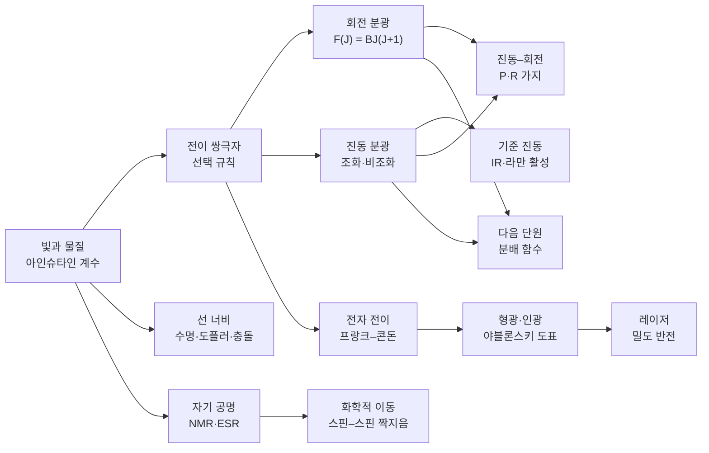

# 물리화학 10. 분자 분광학 — 빛이 묻고 분자가 답하는 에너지 준위의 언어
<!-- prev: pchem-9, uchem-4, umath-6 -->
<!-- next: pchem-11 -->

> [!NOTE]
> **이 단원의 범위**
> - 빛과 물질의 상호작용: 흡수·자발 방출·유도 방출(아인슈타인 계수), 전이 쌍극자 모멘트와 선택 규칙, 선 너비(자연·도플러·충돌 넓어짐)
> - 회전 분광학: 강체 회전자의 준위와 선택 규칙, 회전 상수와 결합 길이 결정, 선의 세기와 원심력 뒤틀림
> - 진동 분광학: 조화 진동자와 비조화 진동자(모스 퍼텐셜, 배음, 해리 에너지), 다원자 분자의 기준 진동 방식, 적외선 활성과 라만 활성
> - 진동–회전 스펙트럼: P·R 가지, 결합 차이법, 진동–회전 상호작용
> - 전자 전이: 분자의 전자 상태와 선택 규칙, 프랑크–콘돈 원리, 형광·인광과 들뜬 상태의 이완, 레이저의 원리
> - 자기 공명: 핵 스핀과 NMR의 원리, 화학적 이동, 스핀–스핀 짝지음, ESR 개관

**학습 목표**

1. 흡수·자발 방출·유도 방출을 아인슈타인 계수로 기술하고, 전이 쌍극자 모멘트로부터 선택 규칙이 나오는 까닭과 선 너비를 정하는 세 가지 요인을 정량적으로 설명할 수 있다.
2. 강체 회전자의 에너지 준위와 선택 규칙으로 순수 회전 스펙트럼을 해석하고, 회전 상수에서 결합 길이를 구하며, 선의 세기 분포를 볼츠만 분포와 축퇴로 설명할 수 있다.
3. 조화·비조화 진동자 모형으로 진동 스펙트럼(기본음·배음)을 해석하여 힘 상수와 해리 에너지를 구하고, 다원자 분자의 기준 진동 방식을 세어 적외선·라만 활성을 판정할 수 있다.
4. 진동–회전 스펙트럼의 P·R 가지를 유도하고, 결합 차이법으로 두 진동 준위의 회전 상수를 따로 구할 수 있다.
5. 프랑크–콘돈 원리로 전자 스펙트럼의 진동 구조를 설명하고, 야블론스키 도표로 형광·인광·무복사 이완을 구별하며, 밀도 반전과 레이저 발진의 조건을 설명할 수 있다.
6. 자기장 속 핵 스핀의 에너지 준위로 NMR 공명 조건을 유도하고, 화학적 이동과 스핀–스핀 짝지음으로 1차 스펙트럼의 갈라짐 무늬를 예측하며, ESR의 $g$ 인자와 초미세 갈라짐을 해석할 수 있다.

**이 단원의 학습 사다리**

| 단계 | 무엇을 하나? |
|---|---|
| STEP 1. 이전 학습 다시 보기 | $E = h\nu$와 선 스펙트럼(일반화학), 조화 진동자·강체 회전자의 준위(물리화학 8), 분자 오비탈과 보른–오펜하이머 근사(물리화학 9), 푸리에 변환(수학 도구 6) |
| STEP 2. 기초 다지기 | 에너지 단위와 볼츠만 인자, 환산 질량과 관성 모멘트, 홀함수 적분과 선택 규칙의 수학, 선 모양과 푸리에 변환 |
| STEP 3. 핵심 개념 | 빛과 물질 → 선 너비 → 회전 → 진동(이원자) → 기준 진동과 IR·라만 → 진동–회전 → 전자 전이와 프랑크–콘돈 → 형광·인광 → 레이저 → NMR 원리 → 화학적 이동 → 스핀–스핀 짝지음 → ESR |
| STEP 4. 오개념 바로잡기 | "회전선 간격은 $B$이다", "가장 센 회전선은 $J = 0$에서 나온다", "형광은 흡수보다 짧은 파장이다" 같은 착각 |
| STEP 5. 대학원·연구로 | 시간 의존 섭동 이론과 페르미 황금률, 2차원 NMR, 펨토초 펌프–프로브 분광 |
| STEP 6. 생활·산업·진로 | 온실 기체와 대기 원격 탐사, 전파 천문학의 CO 선, MRI, 형광 영상과 라만 분석 |

---

## 🗺️ 단원 들어가기

별빛을 프리즘에 통과시키면 무지개 띠 사이사이에 검은 선이 나타난다. 일반화학에서 우리는 이 선들이 원자의 에너지 준위 사이의 간격을 알려 주는 '바코드'라는 것을 배웠다. 분자도 바코드를 가진다. 다만 분자의 바코드는 훨씬 촘촘하고 여러 층으로 되어 있다. 분자는 전자만 들뜨는 것이 아니라 **진동**하고 **회전**하며, 자기장 속에서는 핵 스핀과 전자 스핀의 방향까지 에너지 차이를 만든다. 이 네 가지 운동은 에너지 크기가 서로 수십~수천 배씩 달라서, 각각 다른 영역의 빛 — 라디오파, 마이크로파, 적외선, 가시광선·자외선 — 으로 따로 들여다볼 수 있다.

물리화학 7~9에서 우리는 슈뢰딩거 방정식을 풀어 상자 속 입자, 조화 진동자, 강체 회전자, 수소 원자, 분자 오비탈의 에너지 준위를 **계산**했다. 이 단원은 그 계산을 **측정**과 잇는다. 분광학은 "에너지 준위가 이렇다면 스펙트럼은 이렇게 보여야 한다"는 예측과, "스펙트럼이 이렇게 보이므로 분자는 이렇게 생겼다"는 역추론을 오가는 학문이다. 일산화 탄소가 내는 115 GHz 전파 한 줄로 결합 길이를 0.1 pm까지 정하고, 염화 수소의 적외선 띠 하나로 결합의 용수철 상수와 해리 에너지를 어림하며, NMR 스펙트럼의 갈라진 봉우리로 이웃한 수소의 수를 센다.

그런데 "에너지 차이가 맞는다"는 것만으로는 빛이 흡수되지 않는다. 질소와 산소는 진동하지만 적외선을 흡수하지 않고, 이산화 탄소는 흡수한다. 이 차이가 지구의 온실 효과를 정한다. 어떤 전이는 일어나고 어떤 전이는 일어나지 않는가를 정하는 **선택 규칙**, 그리고 그 뿌리인 **전이 쌍극자 모멘트**가 이 단원 전체를 꿰는 실이다.

---

## STEP 1. 🔙 이전 학습 다시 보기

### 연계 개념표

| 이전 단원 | 그때 배운 것 | 이 단원에서 확장되는 것 |
|---|---|---|
| 일반화학 「원자의 전자 구조와 주기성」 | $E = h\nu = hc/\lambda$, 수소의 선 스펙트럼과 뤼드베리 식, 에너지 준위 사이의 전이 | 분자의 회전·진동·전자·스핀 준위로 확장, 선의 **위치**뿐 아니라 **세기**(전이 쌍극자, 볼츠만 분포)와 **너비**(수명, 도플러)까지 해석 |
| 일반화학 「화학 결합과 분자 구조」 | 결합 길이·결합 세기, 극성 분자와 쌍극자 모멘트, 분자 모양 | 결합 길이를 회전 상수로 **측정**, 결합 세기를 힘 상수·해리 에너지로 정량화, 분자 모양이 기준 진동과 IR·라만 활성을 정한다 |
| 물리화학 8 「진동·회전 운동과 수소 원자」 | 조화 진동자 $E_v = (v + \frac{1}{2})\hbar\omega$와 에르미트 함수, 강체 회전자 $E_J = \hbar^2J(J+1)/2I$와 구면 조화 함수, 스핀 | 그 준위들 사이의 **전이**: 선택 규칙 $\Delta v = \pm1$, $\Delta J = \pm1$의 유도, 비조화성과 원심력 뒤틀림 보정, 핵 스핀의 제만 준위 |
| 물리화학 9 「다전자 원자와 화학 결합」 | 보른–오펜하이머 근사, 분자 오비탈과 퍼텐셜 에너지 곡선, 항 기호 | 퍼텐셜 곡선 위의 진동 준위, 전자 전이와 **프랑크–콘돈 원리**, 분자 항 기호($\Sigma$, $\Pi$)와 스핀 선택 규칙 |
| 수학 도구 6 「복소수와 푸리에 해석」 | 푸리에 변환, 지수 감쇠 ↔ 로렌츠 선 모양, 시간–진동수 불확정 관계, FT-NMR·FT-IR의 원리 | 자연 선 너비와 들뜬 상태 수명, 도플러 넓어짐의 가우스 모양, NMR의 FID와 이완 |

### 준비 운동 (사전 진단)

**Q1.** 파수 $\tilde{\nu} = 2000\ \mathrm{cm^{-1}}$인 적외선의 파장(μm), 진동수(Hz), 광자 1 mol의 에너지(kJ/mol)를 구하시오. ($h = 6.626\times10^{-34}\ \mathrm{J\cdot s}$, $c = 2.998\times10^{10}\ \mathrm{cm/s}$, $N_\mathrm{A} = 6.022\times10^{23}\ \mathrm{mol^{-1}}$)

**Q2.** 물리화학 8의 조화 진동자에서 인접한 두 준위의 에너지 간격과 영점 에너지를 $\hbar\omega$로 쓰시오.

**Q3.** 강체 회전자의 에너지 $E_J = \dfrac{\hbar^2}{2I}J(J+1)$에서 $J = 0, 1, 2, 3$ 준위의 에너지를 $\hbar^2/2I$ 단위로 쓰고, 인접 준위 간격이 어떻게 변하는지 말하시오. 각 준위의 축퇴도는?

**Q4.** 수학 도구 6에서 진폭이 시간 상수 $T_2$로 지수 감쇠하는 진동 신호의 스펙트럼은 어떤 모양이고, 반치 전폭은 진동수로 얼마인가?

정답 및 해설

**Q1.** $\lambda = 1/\tilde{\nu} = 5.00\times10^{-4}\ \mathrm{cm} = 5.00\ \mathrm{\mu m}$, $\nu = c\tilde{\nu} = 2.998\times10^{10}\times2000 = 6.00\times10^{13}\ \mathrm{Hz}$, $E_\text{mol} = N_\mathrm{A}hc\tilde{\nu} = 6.022\times10^{23}\times6.626\times10^{-34}\times6.00\times10^{13} = 2.39\times10^{4}\ \mathrm{J/mol} = 23.9\ \mathrm{kJ/mol}$. 화학 결합 에너지(수백 kJ/mol)보다 한 자릿수 작다.

**Q2.** 간격은 언제나 $\hbar\omega$(등간격), 영점 에너지는 $\frac{1}{2}\hbar\omega$.

**Q3.** 0, 2, 6, 12. 간격은 2, 4, 6으로 $J$가 커질수록 늘어난다(간격 $= 2(J+1)$). 축퇴도는 $2J + 1$ = 1, 3, 5, 7.

**Q4.** 로렌츠 함수, 반치 전폭 $\Delta\nu = 1/(\pi T_2)$. STEP 3 ②에서 이 관계로 들뜬 상태의 수명에서 자연 선 너비를 구한다.

---

## STEP 2. 🧱 기초 다지기

### 디딤돌 1. 에너지 단위와 볼츠만 인자 — $k_\mathrm{B}T \approx 207\ \mathrm{cm^{-1}}$

분광학자는 에너지를 줄(J)보다 **파수(wavenumber)** $\tilde{\nu} = 1/\lambda$(단위 $\mathrm{cm^{-1}}$)로 즐겨 쓴다. 광자 에너지 $E = hc\tilde{\nu}$가 파수에 비례하므로, 파수는 그대로 '에너지의 다른 이름'이 된다. 분자의 에너지 준위를 $\mathrm{cm^{-1}}$로 적은 것을 **항 값(term value)** 이라 하고, 회전은 $F(J)$, 진동은 $G(v)$, 전자는 $T$로 쓴다.

| 1 cm⁻¹ 는 | 값 | 어디에 쓰나 |
|---|---|---|
| 에너지(J) | $hc\times(1\ \mathrm{cm^{-1}}) = 1.986\times10^{-23}\ \mathrm{J}$ | 볼츠만 인자 계산 |
| 몰 에너지 | $11.96\ \mathrm{J/mol}$ (1000 cm⁻¹ ≈ 12.0 kJ/mol) | 결합 에너지와 비교 |
| 전자볼트 | $1.240\times10^{-4}\ \mathrm{eV}$ (1 eV = 8065.5 cm⁻¹) | 전자 전이, 광전자 분광 |
| 진동수 | $29.98\ \mathrm{GHz}$ | 마이크로파·전파 분광 |
| 온도 | $hc/k_\mathrm{B} = 1.4388\ \mathrm{cm\cdot K}$ | $k_\mathrm{B}T/hc$ = 207.2 cm⁻¹ (298.15 K) |

열평형에서 에너지 차이가 $\Delta E$인 두 상태(각 축퇴도 $g_\text{위}$, $g_\text{아래}$)의 개체 수 비는 **볼츠만 분포**를 따른다.

$$
\frac{N_\text{위}}{N_\text{아래}} = \frac{g_\text{위}}{g_\text{아래}}\,e^{-\Delta E/k_\mathrm{B}T}
$$

**예** 실온(298 K)에서 $\Delta E = 1000\ \mathrm{cm^{-1}}$(진동 하나 정도)이면 $e^{-1000/207.2} = 0.0080$, 들뜬 진동 준위에는 1 %도 없다. 반면 회전 상수 $B = 10\ \mathrm{cm^{-1}}$인 분자의 $J = 1$(에너지 $2B = 20\ \mathrm{cm^{-1}}$, 축퇴도 3)은 $J = 0$에 대해 $3e^{-20/207.2} = 2.72$배로 **오히려 더 많다.** 실온에서 분자들은 진동은 거의 바닥에 있지만 회전은 여러 준위에 넓게 퍼져 있다. 이 차이가 ③·⑥의 스펙트럼 모양을 정한다.

### 디딤돌 2. 환산 질량과 관성 모멘트 — 두 물체 문제를 한 물체로

질량 $m_1$, $m_2$인 두 원자가 거리 $r$로 묶인 이원자 분자의 진동과 회전은 질량 중심을 따로 떼어 내면 **환산 질량(reduced mass)** $\mu$인 입자 하나의 운동이 된다(물리화학 8).

$$
\mu = \frac{m_1m_2}{m_1 + m_2}, \qquad I = \mu r^2
$$

$I$는 질량 중심을 지나고 결합에 수직인 축에 대한 **관성 모멘트(moment of inertia)** 이다. 원자 질량 단위 $1\ \mathrm{u} = 1.6605\times10^{-27}\ \mathrm{kg}$로 바꾸어 넣는다. 한쪽이 수소이면 $\mu$는 수소 질량에 가깝다($m_2 \gg m_1$이면 $\mu \to m_1$).

**예** $^{12}\mathrm{C}^{16}\mathrm{O}$($m = 12.000\ \mathrm{u}$, $15.995\ \mathrm{u}$)의 환산 질량은 $\mu = 12.000\times15.995/27.995 = 6.856\ \mathrm{u} = 1.1385\times10^{-26}\ \mathrm{kg}$이다. 결합 길이 112.8 pm를 넣으면 $I = 1.1385\times10^{-26}\times(1.128\times10^{-10})^2 = 1.449\times10^{-46}\ \mathrm{kg\cdot m^2}$. $\mathrm{H^{35}Cl}$은 $\mu = 0.9796\ \mathrm{u}$로 수소 하나의 질량(1.0078 u)과 거의 같다.

> [!WARNING]
> 분광학의 질량은 **동위 원소 하나하나의 질량**이다. 주기율표의 평균 원자량(Cl 35.45)을 넣으면 안 된다. $\mathrm{H^{35}Cl}$과 $\mathrm{H^{37}Cl}$은 서로 다른 분자로 따로 선을 낸다(③·⑥).

### 디딤돌 3. 홀함수의 적분과 직교성 — 선택 규칙의 수학

선택 규칙은 거의 모두 "어떤 적분이 0인가"라는 질문이다. 두 가지 도구면 충분하다.

1. **홀짝성** 대칭 구간에서 홀함수($f(-x) = -f(x)$)의 적분은 0이다. 짝함수 × 짝함수 = 짝, 짝 × 홀 = 홀, 홀 × 홀 = 짝.
2. **직교성** 같은 에르미트 연산자의 서로 다른 고유 함수는 직교한다: $\int\psi_m^*\psi_n\,d\tau = 0\ (m \ne n)$ (수학 도구 8 '직교 함수와 전개').

물리화학 8의 조화 진동자 파동 함수는 $v$가 짝수이면 짝함수, 홀수이면 홀함수이다. 그래서 $\int\psi_v\,x\,\psi_v\,dx$는 (짝 또는 홀)$^2$ × 홀 = 홀이 되어 언제나 0이다. 바닥 상태에서 변위의 평균이 0이라는 당연한 결과이다. 반면 $\int\psi_1\,x\,\psi_0\,dx$는 홀 × 홀 × 짝 = 짝이어서 0이 아니다.

**예** 에르미트 함수의 점화식을 쓰면 $x\psi_v = \sqrt{\dfrac{\hbar}{2\mu\omega}}\left(\sqrt{v+1}\,\psi_{v+1} + \sqrt{v}\,\psi_{v-1}\right)$이다. 양변에 $\psi_{v'}$를 곱해 적분하면 직교성 때문에 $v' = v \pm 1$일 때만 살아남는다. $\mathrm{H^{35}Cl}$($k = 516\ \mathrm{N/m}$, $\mu = 0.9796\ \mathrm{u}$)이면 $\omega = \sqrt{k/\mu} = 5.63\times10^{14}\ \mathrm{s^{-1}}$이고 $\langle1\vert x\vert0\rangle = \sqrt{\hbar/2\mu\omega} = 7.6\ \mathrm{pm}$이다. 결합 길이(127 pm)의 6 % 정도가 영점 진동의 '흔들림 폭'이다. ④에서 이것이 진동 선택 규칙 $\Delta v = \pm1$이 된다.

### 디딤돌 4. 선 모양과 푸리에 변환 — 감쇠가 빠르면 선이 넓다

수학 도구 6 '푸리에 변환'과 '불확정 관계'에서 익힌 두 변환 쌍이 분광학의 선 모양을 거의 다 설명한다.

| 시간 영역의 신호 | 진동수 영역의 선 모양 | 반치 전폭(FWHM) | 분광학에서 |
|---|---|---|---|
| 지수 감쇠 진동 $e^{-t/T_2}\cos\omega_0t$ | 로렌츠 함수 | $\Delta\nu = 1/(\pi T_2)$ | 수명·충돌 넓어짐, NMR 선 |
| 가우스 포락선의 진동 | 가우스 함수 | 포락선 폭에 반비례 | 도플러 넓어짐 |

로렌츠 함수는 봉우리에서 멀어질 때 $1/(\nu - \nu_0)^2$로 천천히 줄어 '꼬리가 길고', 가우스 함수는 $e^{-(\nu - \nu_0)^2}$로 급히 사라진다. 두 효과가 함께 있으면 두 모양의 합성곱(**포크트 모양**)이 된다.

**예** 액체 속 분자의 진동이 주위 분자와 부딪혀 약 1 ps 만에 위상을 잃는다면($T_2 = 1.0\ \mathrm{ps}$) 선 너비는 $\Delta\nu = 1/(\pi\times1.0\times10^{-12}\ \mathrm{s}) = 3.2\times10^{11}\ \mathrm{Hz}$, 파수로 $3.2\times10^{11}/(2.998\times10^{10}) = 11\ \mathrm{cm^{-1}}$이다. 액체의 적외선 띠가 기체보다 훨씬 넓은 까닭이다.

---

## STEP 3. 📘 핵심 개념
