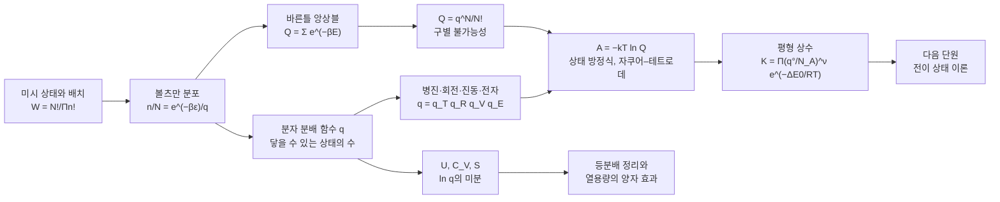

# 물리화학 11. 통계 열역학 — 에너지 준위를 세어 열역학을 다시 세우다
<!-- prev: pchem-10, pchem-2, umath-7 -->
<!-- next: pchem-12 -->

> [!NOTE]
> **이 단원의 범위**
> - 미시 상태와 배치, 배치의 무게와 지배적 배치, 볼츠만 분포의 유도($\beta = 1/k_\mathrm{B}T$)
> - 분자 분배 함수의 뜻(열적으로 닿을 수 있는 상태의 수)과 운동별 분해
> - 병진·회전(대칭수)·진동·전자 분배 함수와 특성 온도
> - 내부 에너지·열용량·엔트로피의 통계적 표현, 두 준위 계
> - 바른틀 앙상블과 바른틀 분배 함수, 구별할 수 없는 입자와 $1/N!$, 에너지 요동
> - 분배 함수로 구하는 열역학 함수: $A = -k_\mathrm{B}T\ln Q$, 상태 방정식, 자쿠어–테트로데 식
> - 열용량과 등분배 정리(고전 극한과 그 한계, 아인슈타인 고체)
> - 분배 함수로 구하는 평형 상수(해리·이성질화·동위 원소 교환)

**학습 목표**

1. 배치와 그 무게 $W = N!/\prod n_j!$를 계산하고, 입자 수가 많을 때 한 배치가 압도적으로 지배하는 까닭을 설명할 수 있다.
2. 스털링 근사와 라그랑주 승수로 볼츠만 분포를 유도하고, 에너지 승수가 $\beta = 1/k_\mathrm{B}T$임을 열역학과 맞추어 보일 수 있다.
3. 병진·회전·진동·전자 분배 함수를 에너지 준위에서 유도하고, 특성 온도와 비교해 각 운동이 '얼어 있는지' 판단할 수 있다.
4. 분배 함수에서 내부 에너지·열용량·엔트로피를 계산하고, 두 준위 계의 쇼트키 이상과 엔트로피의 극한을 해석할 수 있다.
5. 바른틀 앙상블에서 바른틀 분배 함수를 정의하고, $Q = q^N/N!$에서 이상 기체의 상태 방정식과 자쿠어–테트로데 식을 유도할 수 있다.
6. 등분배 정리를 유도하고, 실제 기체·고체의 열용량이 고전값에서 벗어나는 까닭을 양자화로 설명할 수 있다.
7. 분광 자료로 표준 몰 엔트로피와 평형 상수를 계산하고, 열량 측정·열역학 자료표의 값과 비교할 수 있다.

**이 단원의 학습 사다리**

| 단계 | 무엇을 하나? |
|---|---|
| STEP 1. 이전 학습 다시 보기 | $S = k_\mathrm{B}\ln W$, 볼츠만 분포의 첫 유도, 양자화된 에너지 준위와 분광 상수, $A(T,V)$의 자연 변수 |
| STEP 2. 기초 다지기 | 스털링 근사, 라그랑주 승수, 합을 적분으로 바꾸기, $\beta$ 미분 요령 |
| STEP 3. 핵심 개념 | 배치 → 볼츠만 분포 → $q$의 뜻 → 병진·회전·진동·전자 → $U$와 $C_V$ → $S$ → 바른틀 앙상블 → 열역학 함수와 자쿠어–테트로데 → 등분배와 열용량 → 평형 상수 |
| STEP 4. 오개념 바로잡기 | "가장 낮은 준위가 늘 가장 많이 점유된다", "등분배 정리는 언제나 맞는다" 같은 착각 |
| STEP 5. 대학원·연구로 | 큰 바른틀 앙상블과 양자 통계, 디바이 고체, 분자 시뮬레이션과 자유 에너지 계산 |
| STEP 6. 생활·산업·진로 | 고온 기체의 열역학 자료표, 동위 원소 효과, 신약의 결합 자유 에너지, 고온 화학 평형 |

---

## 🗺️ 단원 들어가기

열역학 자료표를 펴면 25 ℃, 1 bar에서 질소의 표준 몰 엔트로피가 $191.6\ \mathrm{J/(mol\cdot K)}$라고 적혀 있다. 「열역학 제2·3법칙과 엔트로피」에서는 이 값을 얻으려고 거의 0 K까지 식힌 고체의 열용량을 재고, 녹는점·끓는점의 숨은열을 더하고, 저온 부분을 디바이 식으로 외삽하였다. 몇 달이 걸리는 정밀 열량 측정이다.

그런데 똑같은 값을 **분광기 한 대와 종이 한 장**으로 얻을 수 있다. 질소 분자의 질량, 회전 스펙트럼에서 읽은 회전 상수, 적외선·라만 스펙트럼에서 읽은 진동 파수 — 이 세 숫자만 있으면 이 단원의 식으로 $191.6\ \mathrm{J/(mol\cdot K)}$를 소수 첫째 자리까지 다시 계산할 수 있다. 분자 하나의 에너지 준위(양자역학)와 $10^{23}$개 분자의 거시적 성질(열역학)을 잇는 다리가 **통계 열역학(statistical thermodynamics)** 이다.

다리의 핵심은 한 개의 합이다. 분자가 가질 수 있는 모든 상태의 볼츠만 인자를 더한 **분배 함수** $q = \sum_i e^{-\varepsilon_i/k_\mathrm{B}T}$. 이 합을 알면 내부 에너지, 열용량, 엔트로피, 압력, 화학 퍼텐셜, 평형 상수까지 미분과 로그만으로 모두 나온다. 「화학 평형과 전기화학」의 마지막에 던진 질문, "평형 상수 $K$는 왜 그 크기인가?"에 이 단원이 분자 수준의 답을 준다. 그리고 다음 단원 「반응 속도론과 반응 동역학」의 전이 상태 이론은 이 단원의 분배 함수를 활성화 착물에 그대로 적용한 것이다.

---

## STEP 1. 🔙 이전 학습 다시 보기

### 연계 개념표

| 이전 단원 | 그때 배운 것 | 이 단원에서 확장되는 것 |
|---|---|---|
| 일반화학 「화학 열역학」 | $S = k_\mathrm{B}\ln W$, 상자 두 칸에 분자 나누기, CO의 잔류 엔트로피 $R\ln 2$ | 칸 대신 **에너지 준위**에 분자를 나누고, $W$를 최대로 하는 배치에서 볼츠만 분포와 $S$를 계산 |
| 수학 도구 7 「확률과 통계」 | 라그랑주 승수로 볼츠만 분포를 유도, $\beta = 1/k_\mathrm{B}T$, 25 ℃의 $k_\mathrm{B}T$(207 $\mathrm{cm^{-1}}$) | 분배 함수를 운동별로 **실제로 계산**하고, 거기서 모든 열역학 함수를 얻는다. 분자 하나의 분포에서 계 전체의 앙상블로 |
| 물리화학 2 「열역학 제2·3법칙과 엔트로피」 | 열량 측정으로 절대 엔트로피, 디바이 외삽, 잔류 엔트로피, 깁스의 역설 | 분광 자료로 계산한 **통계 엔트로피**, 깁스의 역설을 $1/N!$로 해결, 제3법칙의 통계적 근거 |
| 물리화학 3 「자유 에너지와 화학 퍼텐셜」 | $A(T,V)$를 알면 $p = -(\partial A/\partial V)_T$, $S = -(\partial A/\partial T)_V$ | $A = -k_\mathrm{B}T\ln Q$로 $A(T,V)$를 분자 자료에서 **직접** 얻는다 |
| 물리화학 1 「기체의 성질과 열역학 제1법칙」 | 이원자 기체 $C_{V,\mathrm{m}} \approx \tfrac{5}{2}R$, 진동은 실온에서 '얼어 있다' | 등분배 정리의 유도와 진동 열용량의 정량 계산(아인슈타인 함수) |
| 물리화학 6 「화학 평형과 전기화학」 | $\Delta_\mathrm{r}G^\circ = -RT\ln K$, 판트호프 식 | $K$를 분배 함수와 해리 에너지로 계산 |
| 물리화학 8 「진동·회전 운동과 수소 원자」, 물리화학 10 「분자 분광학」 | 상자 속 입자·강체 회전자·조화 진동자의 에너지 준위와 축퇴도, 회전 상수 $B$와 진동 파수 $\tilde\nu$ | 그 준위들을 볼츠만 인자로 더해 분배 함수를 만든다 |

### 준비 운동 (사전 진단)

**Q1.** 에너지가 $1000\ \mathrm{cm^{-1}}$ 차이 나는 두 상태(축퇴도 같음)가 있다. 298 K에서 위 상태와 아래 상태의 점유비는? (298 K에서 $k_\mathrm{B}T/hc = 207\ \mathrm{cm^{-1}}$)

**Q2.** HCl의 회전 상수는 $B = 10.59\ \mathrm{cm^{-1}}$이다. 강체 회전자 준위 $E_J = hcBJ(J+1)$에서 $J = 2$ 준위의 에너지(파수 단위)와 축퇴도를 쓰시오.

**Q3.** 스털링 근사 $\ln N! \approx N\ln N - N$으로 $\ln 100!$을 어림하고, 정확한 값 363.7과 비교하시오.

**Q4.** 헬름홀츠 에너지 $A(T, V)$를 알 때 압력과 엔트로피를 얻는 식을 쓰시오.

정답 및 해설

**Q1.** $e^{-1000/207} = e^{-4.83} \approx 8.0\times10^{-3}$. 위 상태에는 아래 상태의 0.8 %만 있다. 이 단원 내내 쓰는 판단 기준은 "준위 간격이 $k_\mathrm{B}T$보다 큰가, 작은가"이다.

**Q2.** $E_2/hc = 10.59\times2\times3 = 63.5\ \mathrm{cm^{-1}}$, 축퇴도 $2J + 1 = 5$. STEP 3 ⑤에서 이 축퇴도 때문에 HCl은 $J = 0$이 아니라 $J = 3$ 준위에 분자가 가장 많다는 것을 본다.

**Q3.** $100\ln 100 - 100 = 360.5$로 정확한 값보다 약 0.9 % 작다. $N$이 $10^{23}$ 정도이면 상대 오차는 무시할 수 있다(STEP 2 디딤돌 1).

**Q4.** $p = -(\partial A/\partial V)_T$, $S = -(\partial A/\partial T)_V$ (물리화학 3 「자유 에너지와 화학 퍼텐셜」의 기본 방정식 $dA = -S\,dT - p\,dV$). STEP 3 ⑩에서 $A = -k_\mathrm{B}T\ln Q$를 여기에 넣는다.

---

## STEP 2. 🧱 기초 다지기

### 디딤돌 1. 스털링 근사 — 큰 수의 계승을 로그로

수학 도구 2 '스털링 근사'에서 익힌 식을 다시 쓴다. 통계 열역학의 모든 셈은 $N!$의 로그를 다루므로 이 근사 없이는 한 줄도 나아가지 못한다.

$$
\ln N! \approx N\ln N - N \qquad \left(\text{더 정확히는 } + \tfrac{1}{2}\ln 2\pi N\right)
$$

근거는 $\ln N! = \sum_{k=1}^{N}\ln k \approx \int_1^N \ln x\,dx = N\ln N - N + 1$이다. 덧셈을 적분으로 바꾼 오차와 상수 1은 $N\ln N$에 비해 금방 무시할 수 있게 된다.

| $N$ | $\ln N!$ (정확) | $N\ln N - N$ | 상대 오차 |
|---|---|---|---|
| 10 | 15.10 | 13.03 | 14 % |
| 100 | 363.74 | 360.52 | 0.9 % |
| 1000 | 5912.13 | 5907.76 | 0.07 % |
| $6\times10^{23}$ | — | — | 약 $10^{-24}$ |

#### 디딤돌 예제 1 — $\ln N!$의 미분

스털링 근사로 $\dfrac{d\ln N!}{dN}$을 구하고, 그 뜻을 쓰시오.

**풀이** $\dfrac{d}{dN}(N\ln N - N) = \ln N + 1 - 1 = \ln N$.

**의미** $N!$에서 $(N+1)!$로 가면 로그가 정확히 $\ln(N+1)$만큼 늘어나므로, 큰 $N$에서 연속 미분 $\ln N$은 이 증가량과 같다. STEP 3 ②에서 $\partial\ln W/\partial n_j$를 계산할 때 쓰는 핵심 한 줄이다.

### 디딤돌 2. 라그랑주 승수 — 제약이 있는 최댓값

수학 도구 1 '극값과 라그랑주 승수법'에서 익힌 대로, 함수 $f(x_1, x_2, \dots)$를 제약 $g(x_1, x_2, \dots) = 0$ 아래에서 극대로 하는 점에서는 $\nabla f$가 $\nabla g$에 평행하다. 따라서 승수 $\lambda$를 도입해

$$
\frac{\partial f}{\partial x_j} + \lambda\frac{\partial g}{\partial x_j} = 0 \quad (\text{모든 } j), \qquad g = 0
$$

을 함께 푼다. 제약이 둘이면 승수도 둘이다. 승수의 값은 끝에 제약식에 넣어 정한다.

#### 디딤돌 예제 2 — 확률이 고르게 퍼진 분포가 엔트로피를 최대로 한다

$n$개의 상태에 확률 $p_1, \dots, p_n$이 있을 때 $H = -\sum_i p_i\ln p_i$를 $\sum_i p_i = 1$ 아래에서 최대로 하는 분포를 구하시오.

**풀이** $\dfrac{\partial}{\partial p_j}\left(-\sum p_i\ln p_i\right) + \lambda\dfrac{\partial}{\partial p_j}\left(\sum p_i - 1\right) = -\ln p_j - 1 + \lambda = 0$이므로 $p_j = e^{\lambda - 1}$로 **모든 $j$에서 같다.** 정규화에서 $p_j = 1/n$, 최댓값 $H = \ln n$.

**의미** 제약이 "확률의 합 = 1"뿐이면 모든 상태가 똑같이 그럴듯하다. 여기에 "평균 에너지 일정"이라는 제약 하나를 더하면 분포가 $e^{-\beta\varepsilon_j}$로 기운다(STEP 3 ⑧). 그리고 $k_\mathrm{B}H$가 바로 통계적 엔트로피이다.

### 디딤돌 3. 합을 적분으로 바꾸기 — 촘촘한 준위의 분배 함수

분배 함수는 준위에 대한 **합**이다. 준위 간격이 $k_\mathrm{B}T$보다 아주 작으면, 이웃한 항들이 거의 같으므로 합을 적분으로 바꿀 수 있다. 가장 자주 쓰는 두 경우는 다음과 같다(수학 도구 2 '가우스 적분'과 '등비급수').

$$
\sum_{n=0}^{\infty} e^{-an^2} \approx \int_0^\infty e^{-an^2}\,dn = \frac{1}{2}\sqrt{\frac{\pi}{a}} \quad (a \ll 1), \qquad \sum_{v=0}^{\infty} x^v = \frac{1}{1-x} \quad (\lvert x \rvert < 1)
$$

첫째는 병진·회전처럼 촘촘한 준위에 쓰는 **근사**이고, 둘째는 진동처럼 간격이 일정한 준위에 쓰는 **정확한** 식이다.

#### 디딤돌 예제 3 — 합과 적분의 차이

$a = 1.0\times10^{-2}$과 $a = 1.0\times10^{-4}$에 대해 $\sum_{n=0}^\infty e^{-an^2}$과 $\tfrac{1}{2}\sqrt{\pi/a}$를 비교하시오.

**풀이** 직접 더하면 $a = 10^{-2}$일 때 9.362, 적분은 8.862. $a = 10^{-4}$일 때 89.12와 88.62. 두 경우 모두 차이는 정확히 약 0.5이다.

**의미** 차이 0.5는 $n = 0$ 항(값 1)의 절반, 즉 합과 적분의 '끝자리' 오차이다. 적분값이 커질수록 이 고정된 오차의 비율이 작아진다. 상자 속 기체는 한 방향의 병진 분배 함수만 해도 $10^{8}$ 정도(1 cm 상자 속 298 K 아르곤은 약 $6\times10^{8}$)이므로 이 오차는 완전히 무시된다.

### 디딤돌 4. $\beta$ 미분 요령과 특성 온도

통계 열역학에서는 온도 대신 $\beta = 1/k_\mathrm{B}T$로 미분하는 일이 많다. 둘 사이의 변환은

$$
\frac{d}{dT} = \frac{d\beta}{dT}\frac{d}{d\beta} = -\frac{1}{k_\mathrm{B}T^2}\frac{d}{d\beta}, \qquad -\frac{d\ln q}{d\beta} = k_\mathrm{B}T^2\frac{d\ln q}{dT}
$$

이다. 또 준위 간격을 온도 단위로 바꾼 **특성 온도** $\theta = \Delta\varepsilon/k_\mathrm{B} = hc\tilde\nu/k_\mathrm{B}$를 쓰면 비교가 쉬워진다. $hc/k_\mathrm{B} = 1.4388\ \mathrm{cm\cdot K}$이므로 $\theta(\mathrm{K}) = 1.4388\times\tilde\nu(\mathrm{cm^{-1}})$이다. $T \gg \theta$이면 그 운동은 고전적으로, $T \ll \theta$이면 '얼어 있다'.

#### 디딤돌 예제 4 — 거듭제곱 꼴 분배 함수의 평균 에너지

$q = aT^{s}$($a$, $s$는 상수)일 때 분자 하나의 평균 에너지 $\langle\varepsilon\rangle = k_\mathrm{B}T^2\,d\ln q/dT$를 구하시오.

**풀이** $\ln q = \ln a + s\ln T$, $\dfrac{d\ln q}{dT} = \dfrac{s}{T}$, $\langle\varepsilon\rangle = sk_\mathrm{B}T$.

**의미** 상수 $a$(부피, 질량, 회전 상수 등)는 평균 에너지에 들어오지 않는다. 병진은 $q \propto T^{3/2}$이어서 $\tfrac{3}{2}k_\mathrm{B}T$, 선형 분자의 고온 회전은 $q \propto T$이어서 $k_\mathrm{B}T$이다. 등분배 정리(STEP 3 ⑪)의 결과를 이렇게 미리 엿볼 수 있다.

---

## STEP 3. 📘 핵심 개념

### ① 미시 상태와 배치 — 가장 그럴듯한 배치가 관측된다

열역학이 다루는 계는 $10^{23}$개 정도의 분자로 이루어져 있다. 분자 하나하나의 양자 상태를 모두 정한 것이 **미시 상태(microstate)** 이다. 그러나 우리가 재는 것은 온도·압력·에너지 같은 **거시 상태(macrostate)** 이고, 하나의 거시 상태에는 엄청나게 많은 미시 상태가 대응한다. 통계 열역학의 첫걸음은 이 미시 상태를 체계적으로 **세는** 것이다.

#### 가정

1. 계는 $N$개의 분자로 되어 있고, 분자 사이의 상호작용이 약해 각 분자의 에너지를 따로 적을 수 있다($E = \sum_i \varepsilon_i$).
2. 분자는 (지금은) 자리나 번호로 **구별할 수 있다**. 구별할 수 없는 기체 분자는 ⑨에서 고친다.
3. 계는 고립되어 있어 분자 수 $N$과 전체 에너지 $E$가 일정하다.
4. **등확률의 원리(principle of equal a priori probabilities)**: $N$과 $E$가 같은 모든 미시 상태는 똑같이 일어날 만하다. 이것은 증명하는 정리가 아니라, 그 결과가 실험과 맞는지로 정당화되는 이 이론의 기본 가설이다.

#### 배치와 그 무게

분자들이 에너지 $\varepsilon_0, \varepsilon_1, \varepsilon_2, \dots$인 상태에 각각 $n_0, n_1, n_2, \dots$개씩 들어 있다고 하자. 이 숫자 묶음 $\{n_0, n_1, \dots\}$을 **배치(configuration)** 라 한다. 배치는 "어느 준위에 몇 개"만 정하고 "어느 분자가 어디에"는 정하지 않는다. 같은 배치를 실현하는 미시 상태의 수, 즉 배치의 **무게(weight)** 는 $N$개의 구별되는 분자를 크기 $n_0, n_1, \dots$인 무리로 나누는 방법의 수이다.

$$
W(\{n_j\}) = \frac{N!}{n_0!\,n_1!\,n_2!\cdots} = \frac{N!}{\prod_j n_j!}
$$

(분자 $N$개를 한 줄로 세우는 방법 $N!$에서, 같은 준위 안의 분자끼리 순서를 바꾼 것은 같은 미시 상태이므로 $n_j!$로 나눈다.) 등확률의 원리에 따라 **배치가 관측될 확률은 그 무게에 비례한다.**

#### 예제 1 — 분자 여섯 개에 에너지 네 덩이 나누기

에너지가 $0, \varepsilon, 2\varepsilon, 3\varepsilon, 4\varepsilon$인 준위(축퇴 없음)에 구별되는 분자 6개가 있고, 전체 에너지는 $4\varepsilon$이다. 가능한 모든 배치와 무게를 구하고, 각 준위의 평균 점유 수를 구하시오.

**풀이**
전체 에너지 $4\varepsilon$를 6개의 분자에 나누는 방법을 준위별 분자 수로 정리한다.

| 배치 $(n_0, n_1, n_2, n_3, n_4)$ | 에너지 확인 | $W = 6!/\prod n_j!$ | 확률 $W/\sum W$ |
|---|---|---|---|
| (3, 2, 1, 0, 0) | $2\varepsilon + 2\varepsilon$ | $720/(6\cdot2\cdot1) = 60$ | 0.476 |
| (4, 1, 0, 1, 0) | $\varepsilon + 3\varepsilon$ | $720/(24\cdot1\cdot1) = 30$ | 0.238 |
| (2, 4, 0, 0, 0) | $4\varepsilon$ | $720/(2\cdot24) = 15$ | 0.119 |
| (4, 0, 2, 0, 0) | $4\varepsilon$ | $720/(24\cdot2) = 15$ | 0.119 |
| (5, 0, 0, 0, 1) | $4\varepsilon$ | $720/120 = 6$ | 0.048 |
| 합 | | 126 | 1 |

(검산: 에너지 덩이 4개를 분자 6개에 나누는 방법은 $\binom{4+6-1}{4} = 126$가지로 일치한다.)
평균 점유 수 $\langle n_j\rangle = \sum W n_j/\sum W$는 준위 0부터 차례로 3.33, 1.67, 0.71, 0.24, 0.05이다.

**의미** 분자가 6개뿐인데도 한 배치 (3, 2, 1, 0, 0)이 전체의 절반 가까이를 차지한다. 평균 점유 수는 위로 갈수록 대략 절반씩 줄어든다. 이것이 곧 유도할 지수 함수 꼴(볼츠만 분포)의 싹이다. '모든 분자에 에너지를 고르게' 나눈 배치도, '한 분자에 몰아준' 배치 (5, 0, 0, 0, 1)도 무게가 작다.

<!-- 그림 요청: 예제 1의 다섯 가지 배치를 나란히 그린 준위 도표. 각 배치마다 가로선 5개(아래부터 0, ε, 2ε, 3ε, 4ε)를 긋고 그 위에 분자를 원(●)으로 n_j개씩 올린다. (3,2,1,0,0), (4,1,0,1,0), (2,4,0,0,0), (4,0,2,0,0), (5,0,0,0,1) 순서. 각 도표 아래에 'W = 60', 'W = 30', 'W = 15', 'W = 15', 'W = 6'을 적고, W = 60인 배치를 굵은 테두리로 강조한다. 맨 오른쪽에 평균 점유 수 3.33, 1.67, 0.71, 0.24, 0.05의 가로 막대그래프. -->

#### 지배적 배치 — 입자가 많을수록 봉우리는 날카로워진다

분자 수가 커지면 무게가 가장 큰 배치(**지배적 배치**, dominant configuration)와 그 바로 주변의 배치들이 모든 무게를 사실상 독차지한다. 가장 단순한 두 준위 계(각 분자가 위·아래 두 상태 중 하나, 에너지 제약은 잠시 잊는다)로 확인해 보자. 위 상태에 $n$개가 있는 배치의 무게는 $W(n) = \binom{N}{n}$이고, 최댓값은 $n = N/2$에 있다. $n = \tfrac{N}{2}(1 + x)$로 놓고 스털링 근사를 써서 $\ln W$를 $x$에 대해 2차까지 전개하면

$$
\ln\frac{W(n)}{W(N/2)} \approx -\frac{N}{2}x^2, \qquad \frac{W(n)}{W(N/2)} \approx e^{-Nx^2/2}
$$

이다. 무게는 폭이 $x \sim 1/\sqrt{N}$인 가우스 봉우리를 이룬다(수학 도구 7 '세 가지 대표 분포'의 정규 분포).

#### 예제 2 — $10^{-10}$의 벗어남은 얼마나 드문가

$N = 6.0\times10^{23}$인 두 준위 계에서 (1) 지배적 배치에서 상대적으로 $x = 1.0\times10^{-10}$만큼 벗어난 배치의 무게는 지배적 배치의 몇 배인가? (2) 봉우리의 상대 폭 $1/\sqrt{N}$은?

**풀이**
(1) $Nx^2/2 = (6.0\times10^{23})(1.0\times10^{-20})/2 = 3.0\times10^3$이므로 $W/W_\text{최대} \approx e^{-3000} \approx 10^{-1303}$.
(2) $1/\sqrt{6.0\times10^{23}} = 1.3\times10^{-12}$.

**의미** 조성이 100억분의 1만큼만 달라도 그 배치는 사실상 일어나지 않는다. 그래서 거시계에서는 "가장 그럴듯한 배치"가 곧 "관측되는 배치"이고, 평균값과 지배적 배치의 값이 구별되지 않는다. 열역학의 양들이 요동 없이 날카로운 값을 가지는 까닭이 여기에 있다(요동의 정량적 크기는 ⑨).

<!-- 그림 요청: 두 준위 계의 무게 분포 W(n)/W(N/2)를 n/N(가로축 0~1)에 대해 그린 곡선 세 개. N = 10(막대 또는 점), N = 100, N = 1000(매끄러운 곡선). 세 곡선 모두 n/N = 0.5에서 최댓값 1, 폭이 1/√N에 비례해 좁아짐을 화살표로 표시하고, 오른쪽 위에 'N = 6×10^23이면 폭 ≈ 10^-12 (선 하나로 보임)'이라는 주석을 단다. -->

#### ✔ 바로 확인

1. 구별되는 분자 5개가 배치 $(n_0, n_1, n_2) = (3, 1, 1)$에 있을 때 무게 $W$는?
2. (O/X) 등확률의 원리는 "모든 **배치**가 똑같이 일어날 만하다"는 뜻이다.
3. 빈칸: 분자 수 $N$이 커질수록 무게 분포의 상대 폭은 (    )에 비례해 줄어든다.

정답

1. 20 — $5!/(3!\,1!\,1!) = 120/6$.
2. X — 똑같이 일어날 만한 것은 **미시 상태**이다. 배치는 무게(미시 상태 수)만큼 확률이 다르다.
3. $1/\sqrt{N}$

### ② 볼츠만 분포의 유도 — 지배적 배치를 찾는다

이제 일반적인 준위에서 지배적 배치를 찾는다. 수학 도구 7 '가장 그럴듯한 분포'에서 같은 계산의 뼈대를 보았으므로, 여기서는 물리화학에서 필요한 두 가지 — **각 가정이 어디에 쓰이는가**와 **$\beta$를 열역학과 어떻게 맞추는가** — 에 무게를 두어 다시 한다.

#### 유도

**1단계 — 최대로 할 양.** $W$가 최대인 곳과 $\ln W$가 최대인 곳은 같다. 각 $n_j$가 커서 스털링 근사를 쓸 수 있다고 하면(①의 가정에 더해 '준위마다 분자가 많다')

$$
\ln W = \ln N! - \sum_j \ln n_j! \approx N\ln N - \sum_j n_j\ln n_j
$$

(두 근사식의 $-N$과 $+\sum_j n_j$는 $\sum_j n_j = N$이므로 지워진다.)

**2단계 — 두 제약.** 고립계이므로 $\sum_j n_j = N$, $\sum_j n_j\varepsilon_j = E$가 일정하다. 따라서 $n_j$를 마음대로 바꿀 수 없고, 변화 $dn_j$는

$$
\sum_j dn_j = 0, \qquad \sum_j \varepsilon_j\,dn_j = 0
$$

을 만족해야 한다.

**3단계 — 라그랑주 승수.** 승수 $\alpha$, $-\beta$를 붙여(부호는 관례) 극값 조건을 쓴다.

$$
\frac{\partial\ln W}{\partial n_j} + \alpha - \beta\varepsilon_j = 0
$$

$N = \sum_k n_k$도 $n_j$에 의존하므로, 디딤돌 예제 1의 결과를 쓰면 $\dfrac{\partial\ln W}{\partial n_j} = (\ln N + 1) - (\ln n_j + 1) = -\ln\dfrac{n_j}{N}$이다. 따라서

$$
-\ln\frac{n_j}{N} + \alpha - \beta\varepsilon_j = 0 \quad\Longrightarrow\quad \frac{n_j}{N} = e^{\alpha}e^{-\beta\varepsilon_j}
$$

**4단계 — 정규화로 $\alpha$를 없앤다.** $\sum_j n_j/N = 1$에서 $e^{\alpha} = 1/\sum_j e^{-\beta\varepsilon_j}$이다.

$$
\boxed{\;\frac{n_j}{N} = p_j = \frac{e^{-\beta\varepsilon_j}}{q}, \qquad q = \sum_j e^{-\beta\varepsilon_j}\;}
$$

여기서 합은 모든 **상태**에 대한 것이다. $q$가 **분자 분배 함수(molecular partition function)** 이고, 이 분포가 **볼츠만 분포(Boltzmann distribution)** 이다.

**5단계 — $\beta$는 무엇인가.** 지배적 배치에서 분자들을 조금 옮기되, 분자 수는 그대로 두고($dN = 0$) 에너지만 $dE$만큼 바꾸어 보자. 준위의 위치를 바꾸지 않으려면 부피를 고정해야 한다(상자 속 입자의 준위는 부피에 의존한다). 3단계의 극값 조건 $\partial\ln W/\partial n_j = -\alpha + \beta\varepsilon_j$를 쓰면

$$
d\ln W = \sum_j \frac{\partial\ln W}{\partial n_j}dn_j = -\alpha\sum_j dn_j + \beta\sum_j\varepsilon_j\,dn_j = \beta\,dE
$$

엔트로피를 지배적 배치의 무게로 $S = k_\mathrm{B}\ln W$라 하면(①에 따라 전체 미시 상태 수의 로그와 사실상 같다) $dS = k_\mathrm{B}\beta\,dE$이다. 한편 열역학의 기본 방정식은 부피와 조성이 일정할 때 $dU = T\,dS$, 즉 $dS = dU/T$이다. $E$가 곧 $U$이므로 두 식을 맞추면

$$
\beta = \frac{1}{k_\mathrm{B}T}
$$

#### 결과와 적용 한계

- 같은 에너지를 가진 상태가 $g_j$개인 **준위**에 대해서는 상태마다 볼츠만 인자를 주므로 $p_j = g_je^{-\beta\varepsilon_j}/q$, $q = \sum_\text{준위} g_je^{-\beta\varepsilon_j}$이다. 두 준위의 점유비는 $\dfrac{n_2}{n_1} = \dfrac{g_2}{g_1}e^{-(\varepsilon_2 - \varepsilon_1)/k_\mathrm{B}T}$로 에너지 차와 $k_\mathrm{B}T$의 비만으로 정해진다.
- 유도에서는 고립계(일정한 $E$)를 썼지만 결과에는 $T$만 남았다. 같은 분포를 "온도 $T$인 열 저장고와 접한 분자 하나"의 분포로 읽을 수 있으며, ⑨의 바른틀 앙상블이 그 정확한 근거이다.
- 스털링 근사를 준위마다 썼지만, 바른틀 앙상블로 다시 유도하면 이 가정 없이 같은 결과가 나온다(⑨).
- 구별되지 않는 입자라도 닿을 수 있는 상태 수가 분자 수보다 훨씬 많은 보통의 기체에서는 같은 분포가 된다. 매우 낮은 온도·높은 밀도의 전자 기체, 액체 헬륨 등은 예외이다(⑩, STEP 5).

#### 예제 3 — 세 준위 분자의 점유와 평균 에너지

어떤 분자의 낮은 상태가 $0$, $200$, $600\ \mathrm{cm^{-1}}$에 하나씩(축퇴 없음) 있고, 그 위 상태는 무시할 수 있다. 300 K에서 $q$, 각 상태의 점유 비율, 평균 에너지(파수 단위)를 구하시오. ($hc/k_\mathrm{B} = 1.4388\ \mathrm{cm\cdot K}$)

**풀이**
$hc\tilde\nu/k_\mathrm{B}T$는 $200$에 대해 $1.4388\times200/300 = 0.9592$, $600$에 대해 $2.8776$이다.
$q = 1 + e^{-0.9592} + e^{-2.8776} = 1 + 0.3832 + 0.0563 = 1.439$
$p_0 = 1/1.439 = 0.695$, $p_1 = 0.3832/1.439 = 0.266$, $p_2 = 0.0563/1.439 = 0.039$
$\langle\tilde\varepsilon\rangle = \sum_j p_j\tilde\varepsilon_j = 0.266\times200 + 0.039\times600 = 76.7\ \mathrm{cm^{-1}}$

**의미** $q = 1.44$는 "300 K에서 이 분자가 실질적으로 오가는 상태가 약 1.4개"라는 뜻이다(③). 같은 계산을 3000 K에서 하면 $p_j$가 0.376, 0.342, 0.282로 거의 고르게 되고 $q$는 2.66으로 상태 수 3에 다가간다. 온도는 "분포를 얼마나 납작하게 펴는가"를 정하는 매개변수이다.

> [!TIP]
> 💡 **비유** — 볼츠만 분포는 **계단식 관람석의 관객 분포**와 같다. 높은 줄(높은 에너지)일수록 오르기 힘들어 관객이 지수적으로 줄고, 관객의 '기운'($k_\mathrm{B}T$)이 클수록 높은 줄까지 고르게 퍼진다. 한 줄에 좌석이 많으면(축퇴도 $g$) 그 줄은 높아도 관객이 많을 수 있다.

#### ✔ 바로 확인

1. 축퇴도가 1과 3인 두 준위의 에너지 차가 $k_\mathrm{B}T$와 같다. 위 준위/아래 준위의 점유비는?
2. 빈칸: 볼츠만 분포의 유도에서 에너지 제약에 붙인 승수 $\beta$는 $dS = k_\mathrm{B}\beta\,dU$를 열역학의 $dS = (\quad)$과 맞추어 $1/k_\mathrm{B}T$로 정해진다.
3. (O/X) $\beta$를 정할 때 부피를 일정하게 둔 것은 에너지 준위의 위치가 부피에 의존하기 때문이다.

정답

1. $3e^{-1} = 1.10$ — 축퇴도가 크면 위 준위가 더 많이 점유될 수도 있다.
2. $dU/T$ (부피·조성 일정)
3. O — 부피가 일정해야 $dE$가 준위 사이의 분자 이동(열)만으로 생긴다.

### ③ 분자 분배 함수의 뜻 — 열적으로 닿을 수 있는 상태의 수

$q = \sum_j g_je^{-\varepsilon_j/k_\mathrm{B}T}$는 볼츠만 분포의 정규화 상수로 나왔지만, 그 자체로 뚜렷한 물리적 뜻이 있다. 바닥 상태의 에너지를 0으로 두면

- $T \to 0$: 바닥 준위 항만 남아 $q \to g_0$ (축퇴가 없으면 1).
- $T \to \infty$: 모든 볼츠만 인자가 1이 되어 $q \to$ 상태의 총수(무한히 많으면 무한대).

즉 $q$는 **그 온도에서 분자가 열적으로 닿을 수 있는 상태의 실질적인 개수**이다. 바닥 상태의 점유 비율이 $p_0 = g_0/q$이므로, $q$가 크다는 것은 분자들이 많은 상태에 흩어져 있다는 뜻이다.

#### 간격이 일정한 사다리

간격 $\varepsilon$인 준위가 끝없이 이어진 사다리(축퇴 없음, 조화 진동자의 모형)에서는 등비급수(디딤돌 3)로 정확히 더할 수 있다.

$$
q = \sum_{v=0}^\infty e^{-v\beta\varepsilon} = \frac{1}{1 - e^{-\beta\varepsilon}}, \qquad p_v = \frac{e^{-v\beta\varepsilon}}{q} = (1 - e^{-\beta\varepsilon})e^{-v\beta\varepsilon}
$$

#### 예제 4 — 400 cm⁻¹ 사다리의 $q$와 온도

간격 $400\ \mathrm{cm^{-1}}$인 사다리에 대해 (1) 100, 300, 1000, 3000 K에서 $q$를 구하고, (2) 300 K에서 $v = 0, 1, 2$의 점유 비율을 구하시오.

**풀이**
(1) $\beta\varepsilon = 1.4388\times400/T$를 넣으면

| $T$ (K) | 100 | 300 | 1000 | 3000 |
|---|---|---|---|---|
| $\beta\varepsilon$ | 5.755 | 1.918 | 0.5755 | 0.1918 |
| $q$ | 1.003 | 1.172 | 2.285 | 5.73 |
| $k_\mathrm{B}T/\varepsilon$ (비교) | 0.17 | 0.52 | 1.74 | 5.21 |

(2) $e^{-1.918} = 0.1468$. $p_0 = 1 - 0.1468 = 0.853$, $p_1 = 0.853\times0.1468 = 0.125$, $p_2 = 0.853\times0.1468^2 = 0.018$.

**의미** $k_\mathrm{B}T \ll \varepsilon$이면 $q \approx 1$(분자는 바닥에 머문다), $k_\mathrm{B}T \gg \varepsilon$이면 $q \approx k_\mathrm{B}T/\varepsilon + \tfrac{1}{2}$로 온도에 비례해 커진다. 표의 마지막 두 줄을 비교하면 고온에서 $q$와 $k_\mathrm{B}T/\varepsilon$의 차가 약 0.5로 다가가는 것이 보인다. "준위 간격에 비해 $k_\mathrm{B}T$가 몇 배인가"가 닿을 수 있는 상태 수를 정한다.

<!-- 그림 요청: 간격 ε인 등간격 준위 사다리(가로선 8개) 세 개를 나란히 그리고 각 준위의 점유 비율을 가로 막대 길이로 표시. 왼쪽 k_BT = 0.5ε(점유 0.865, 0.117, 0.016, …, q = 1.16), 가운데 k_BT = ε(0.63, 0.23, 0.09, 0.03, …, q = 1.58), 오른쪽 k_BT = 3ε(0.28, 0.20, 0.14, 0.10, 0.07, …, q = 3.53). 각 사다리 아래에 q 값을 크게 적고 '닿을 수 있는 상태의 수'라는 부제를 단다. 막대 끝을 잇는 점선은 지수 곡선. -->

#### 운동별 분해 — 곱이 되는 분배 함수

분자의 에너지가 서로 독립인 운동의 합으로 쓰인다고 하자(근사적으로 성립한다: 보른–오펜하이머 근사, 강체 회전자와 조화 진동자의 분리).

$$
\varepsilon_{i,j,k,l} = \varepsilon_i^\mathrm{T} + \varepsilon_j^\mathrm{R} + \varepsilon_k^\mathrm{V} + \varepsilon_l^\mathrm{E}
$$

모든 상태에 대한 합은 네 지표 각각에 대한 합이고, 지수의 합은 지수의 곱이므로

$$
q = \sum_{i,j,k,l} e^{-\beta(\varepsilon_i^\mathrm{T} + \varepsilon_j^\mathrm{R} + \varepsilon_k^\mathrm{V} + \varepsilon_l^\mathrm{E})} = \left(\sum_i e^{-\beta\varepsilon_i^\mathrm{T}}\right)\left(\sum_j e^{-\beta\varepsilon_j^\mathrm{R}}\right)\left(\sum_k e^{-\beta\varepsilon_k^\mathrm{V}}\right)\left(\sum_l e^{-\beta\varepsilon_l^\mathrm{E}}\right) = q^\mathrm{T}q^\mathrm{R}q^\mathrm{V}q^\mathrm{E}
$$

**분배 함수는 곱으로, 그 로그는 합으로** 나뉜다. ⑦ 이후의 열역학 함수가 모두 $\ln q$로 표현되므로 에너지·엔트로피·열용량도 운동별 기여의 **합**이 된다. ④~⑥에서 네 인자를 차례로 구한다.

#### 에너지의 기준점

모든 준위를 같은 양 $\varepsilon_0$만큼 올리면 $q$는 $e^{-\beta\varepsilon_0}$배가 되지만, $p_j$의 분자와 분모에 같은 인자가 곱해지므로 **분포는 변하지 않는다.** 이 책에서는 각 운동의 바닥 상태를 0으로 재고(진동은 영점 에너지를 뺀 값), 바닥 상태의 실제 에너지는 따로 $U(0)$, $E_0$로 적는다. 평형 상수를 계산할 때(⑫) 이 $E_0$의 차이가 결정적인 역할을 한다.

#### ✔ 바로 확인

1. 축퇴가 없는 두 상태(에너지 0과 $\varepsilon$)의 분배 함수를 쓰고, $T \to 0$과 $T \to \infty$의 극한값을 쓰시오.
2. (O/X) 분자의 에너지가 독립인 운동의 합이면 분배 함수는 각 운동의 분배 함수의 합이 된다.
3. 예제 4의 사다리에서 1000 K의 바닥 상태 점유 비율은?

정답

1. $q = 1 + e^{-\varepsilon/k_\mathrm{B}T}$, $T \to 0$에서 1, $T \to \infty$에서 2.
2. X — **곱**이 된다. 그 로그가 합이 된다.
3. 약 0.44 — $p_0 = 1/q = 1/2.285$.

### ④ 병진 분배 함수 — 상자 속 입자에서 열적 파장까지

#### 가정과 유도

질량 $m$인 분자가 변의 길이 $L$인 정육면체 상자(부피 $V = L^3$) 안에서 자유롭게 움직인다. 물리화학 7 「양자역학의 기초」의 상자 속 입자에서 $x$ 방향 준위는

$$
\varepsilon_n = \frac{n^2h^2}{8mL^2}, \qquad n = 1, 2, 3, \dots
$$

이다. 세 방향의 운동은 독립이므로 ③의 분해에 따라 $q^\mathrm{T} = q_xq_yq_z$이다.

**1단계 — 준위는 얼마나 촘촘한가.** 아르곤 원자(298 K)를 1 cm 상자에 넣으면 $n = 1$과 $n = 2$의 간격은 $3h^2/8mL^2 \approx 6\times10^{-18}\,k_\mathrm{B}T$이다. 간격이 $k_\mathrm{B}T$보다 수십 자릿수 작으므로 합을 적분으로 바꿀 수 있다(디딤돌 3).

**2단계 — 적분.** $a = \beta h^2/8mL^2$로 놓으면($n = 1$에서 시작하는 것과 0에서 시작하는 차이는 디딤돌 예제 3의 0.5 정도로 무시된다)

$$
q_x = \sum_{n=1}^\infty e^{-an^2} \approx \int_0^\infty e^{-an^2}\,dn = \frac{1}{2}\sqrt{\frac{\pi}{a}} = \frac{1}{2}\sqrt{\frac{8\pi mL^2k_\mathrm{B}T}{h^2}} = \frac{L\sqrt{2\pi mk_\mathrm{B}T}}{h}
$$

**3단계 — 세 방향을 곱한다.**

$$
\boxed{\;q^\mathrm{T} = \frac{V}{\Lambda^3}, \qquad \Lambda = \frac{h}{\sqrt{2\pi mk_\mathrm{B}T}}\;}
$$

$\Lambda$를 **열적 드브로이 파장(thermal de Broglie wavelength)** 이라 한다. 온도 $T$에서 분자의 전형적인 운동량에 해당하는 물질파의 파장 정도이다. $q^\mathrm{T}$는 "부피 $V$ 안에 한 변이 $\Lambda$인 작은 상자가 몇 개 들어가는가"로 읽을 수 있다. 무거울수록, 뜨거울수록 $\Lambda$가 작아져 $q^\mathrm{T}$가 커진다.

**적용 한계** 적분 근사는 $L \gg \Lambda$일 때 성립한다. 보통의 용기에서는 늘 만족된다. 더 중요한 조건은 분자 사이의 평균 거리도 $\Lambda$보다 훨씬 커야 한다는 것, 즉 $(N/V)\Lambda^3 \ll 1$이다. 이것이 ⑨에서 $Q = q^N/N!$을 쓰는 조건이 된다.

#### 예제 5 — 아르곤의 열적 파장과 병진 분배 함수

298.15 K의 아르곤($M = 39.95\ \mathrm{g/mol}$)에 대해 (1) $\Lambda$를 구하고, (2) 1.00 cm³의 $q^\mathrm{T}$를 구하고, (3) 1 bar에서 같은 부피 속 원자 수와 비교하시오. ($h = 6.626\times10^{-34}\ \mathrm{J\cdot s}$, $k_\mathrm{B} = 1.381\times10^{-23}\ \mathrm{J/K}$, $N_\mathrm{A} = 6.022\times10^{23}\ \mathrm{mol^{-1}}$)

**풀이**
(1) $m = 0.03995/6.022\times10^{23} = 6.634\times10^{-26}\ \mathrm{kg}$
$\Lambda = \dfrac{6.626\times10^{-34}}{\sqrt{2\pi(6.634\times10^{-26})(1.381\times10^{-23})(298.15)}} = 1.60\times10^{-11}\ \mathrm{m} = 16.0\ \mathrm{pm}$
(2) $q^\mathrm{T} = \dfrac{1.00\times10^{-6}\ \mathrm{m^3}}{(1.60\times10^{-11}\ \mathrm{m})^3} = 2.44\times10^{26}$
(3) $N = pV/k_\mathrm{B}T = \dfrac{(1.00\times10^5)(1.00\times10^{-6})}{(1.381\times10^{-23})(298.15)} = 2.43\times10^{19}$이므로 $q^\mathrm{T}/N \approx 1.0\times10^{7}$, $(N/V)\Lambda^3 \approx 1.0\times10^{-7}$.

**의미** 원자 하나당 닿을 수 있는 병진 상태가 약 천만 개이다. 두 원자가 같은 병진 상태에 들어갈 일은 사실상 없으므로 원자들은 '고전적인 점 입자'처럼 행동한다. 반대로 4.2 K의 액체 헬륨에서는 $\Lambda \approx 430\ \mathrm{pm}$이고 $(N/V)\Lambda^3 \approx 1.5$, 구리 속 자유 전자(300 K)는 $(N/V)\Lambda^3 \approx 7\times10^3$이어서 양자 통계가 필요하다(STEP 5).

| 계 | $\Lambda$ | $(N/V)\Lambda^3$ | 판단 |
|---|---|---|---|
| Ar 기체, 298 K, 1 bar | 16.0 pm | $1.0\times10^{-7}$ | 고전적 |
| He 기체, 298 K, 1 bar | 50.5 pm | $3.1\times10^{-6}$ | 고전적 |
| 액체 He, 4.2 K | 약 430 pm | 약 1.5 | 양자적 |
| 구리 속 전자, 300 K | 4.3 nm | 약 $7\times10^3$ | 강하게 양자적 |

#### 표준 몰 병진 분배 함수

평형 상수와 표준 엔트로피에는 1 mol의 기체가 표준 압력 $p^\circ = 1\ \mathrm{bar}$에서 차지하는 부피 $V_\mathrm{m}^\circ = RT/p^\circ$를 쓴 값을 쓴다.

$$
\frac{q_\mathrm{m}^{\mathrm{T}\circ}}{N_\mathrm{A}} = \frac{V_\mathrm{m}^\circ}{N_\mathrm{A}\Lambda^3} = \frac{k_\mathrm{B}T}{p^\circ\Lambda^3}
$$

아르곤은 298.15 K에서 $1.01\times10^7$이다. 질량의 $3/2$제곱과 온도의 $5/2$제곱에 비례한다.

병진의 평균 에너지는 $q^\mathrm{T} \propto T^{3/2}$이므로 디딤돌 예제 4에서 곧바로 $\langle\varepsilon^\mathrm{T}\rangle = \tfrac{3}{2}k_\mathrm{B}T$이다. 기체 분자 운동론의 결과와 같다는 것이 $\beta = 1/k_\mathrm{B}T$를 다른 길로 확인해 준다.

#### ✔ 바로 확인

1. 온도를 4배로 올리면 $\Lambda$는 몇 배가 되는가?
2. (O/X) 같은 온도·부피에서 크세논의 병진 분배 함수는 헬륨보다 작다.
3. 빈칸: 기체가 고전적으로 행동할 조건은 $(N/V)\Lambda^3 (\quad) 1$이다.

정답

1. $1/2$배 — $\Lambda \propto T^{-1/2}$.
2. X — $q^\mathrm{T} \propto m^{3/2}$이므로 무거운 크세논이 더 크다(약 $(131.3/4.00)^{3/2} \approx 190$배).
3. $\ll$

### ⑤ 회전 분배 함수 — 축퇴와 대칭수

#### 선형 분자

강체 회전자의 준위는 $E_J = hcBJ(J+1)$, 축퇴도는 $2J + 1$이다(물리화학 8 「진동·회전 운동과 수소 원자」). **회전 특성 온도** $\theta_\mathrm{R} = hcB/k_\mathrm{B}$를 쓰면

$$
q^\mathrm{R} = \sum_{J=0}^\infty (2J+1)e^{-\theta_\mathrm{R}J(J+1)/T}
$$

$T \gg \theta_\mathrm{R}$이면 합을 적분으로 바꾼다. $x = J(J+1)$로 치환하면 $dx = (2J+1)\,dJ$이므로

$$
q^\mathrm{R} \approx \int_0^\infty e^{-\theta_\mathrm{R}x/T}\,dx = \frac{T}{\theta_\mathrm{R}} = \frac{k_\mathrm{B}T}{hcB}
$$

(합과 적분의 차를 더 정밀하게 따지면 $q^\mathrm{R} \approx T/\theta_\mathrm{R} + \tfrac{1}{3}$이다.) 축퇴도 $2J + 1$이 적분 변수의 미분으로 깔끔하게 흡수되는 것이 이 유도의 요점이다.

#### 대칭수

$\mathrm{N_2}$, $\mathrm{O_2}$, $\mathrm{H_2}$처럼 양 끝이 같은 원자이면 분자를 180° 돌린 배향이 처음과 구별되지 않는다. 양자역학적으로는 원자핵의 스핀 통계 때문에 $J$가 짝수인 준위와 홀수인 준위 가운데 한쪽만(또는 핵스핀 상태와 정해진 짝으로만) 허용된다. 고온에서는 그 결과가 단순히 상태 수를 절반으로 줄이는 것과 같다. 이를 **대칭수(symmetry number)** $\sigma$로 나타낸다.

$$
q^\mathrm{R} = \frac{T}{\sigma\theta_\mathrm{R}} \qquad (\text{이핵 } \sigma = 1, \text{ 동핵 } \sigma = 2)
$$

비선형 분자는 세 회전 상수 $A$, $B$, $C$를 써서 $q^\mathrm{R} = \dfrac{1}{\sigma}\left(\dfrac{k_\mathrm{B}T}{hc}\right)^{3/2}\left(\dfrac{\pi}{ABC}\right)^{1/2}$이다. $\sigma$는 분자를 같은 모양으로 겹치게 하는 회전 조작의 수이다: $\mathrm{H_2O}$ 2, $\mathrm{NH_3}$ 3, $\mathrm{CH_4}$ 12, 벤젠 12.

| 분자 | $B$ ($\mathrm{cm^{-1}}$, 약) | $\theta_\mathrm{R}$ (K) | $\sigma$ | $q^\mathrm{R}$ (298 K) |
|---|---|---|---|---|
| $\mathrm{H_2}$ | 60.85 | 87.5 | 2 | 약 1.9 (적분 근사 부정확) |
| HCl | 10.59 | 15.2 | 1 | 19.9 |
| $\mathrm{N_2}$ | 2.00 | 2.87 | 2 | 51.9 |
| CO | 1.93 | 2.78 | 1 | 107 |
| $\mathrm{O_2}$ | 1.45 | 2.08 | 2 | 71.7 |
| $\mathrm{I_2}$ | 0.0374 | 0.0538 | 2 | 2770 |

> [!NOTE]
> $\mathrm{H_2}$는 $\theta_\mathrm{R}$이 커서 실온에서도 고온 근사가 맞지 않고, 핵스핀이 평행한 오쏘수소($J$ 홀수)와 반평행한 파라수소($J$ 짝수)가 거의 따로 노는 두 기체처럼 행동한다. 저온 $\mathrm{H_2}$의 열용량이 오쏘·파라 비율에 따라 달라지는 것이 이 핵스핀 통계의 실험적 증거이다. 대칭수 $\sigma$는 이 복잡한 사정을 $T \gg \theta_\mathrm{R}$에서 요약한 지름길이다.

#### 예제 6 — HCl은 어느 회전 준위에 가장 많은가

298.15 K에서 HCl($\theta_\mathrm{R} = 15.24\ \mathrm{K}$)의 (1) $q^\mathrm{R}$을 고온 근사로 구하고, (2) $J = 0 \sim 6$의 점유 비율을 구하고, (3) 점유가 가장 큰 $J$를 식으로 예측하시오.

**풀이**
(1) $q^\mathrm{R} \approx 298.15/15.24 = 19.6$, 보정하면 $19.6 + 0.33 = 19.9$(직접 합한 값 19.90과 같다).
(2) $p_J = (2J+1)e^{-15.24J(J+1)/298.15}/19.90$

| $J$ | 0 | 1 | 2 | 3 | 4 | 5 | 6 |
|---|---|---|---|---|---|---|---|
| $p_J$ | 0.050 | 0.136 | 0.185 | 0.190 | 0.163 | 0.119 | 0.076 |

(3) $(2J+1)e^{-\theta_\mathrm{R}J(J+1)/T}$를 $J$로 미분해 0으로 놓으면 $2 = (2J+1)^2\theta_\mathrm{R}/T$, 즉

$$
J_\text{최대} = \sqrt{\frac{T}{2\theta_\mathrm{R}}} - \frac{1}{2} = \sqrt{\frac{298.15}{30.48}} - 0.5 = 2.63
$$

가장 가까운 정수 가운데 표에서 $J = 3$이 가장 크다($J = 2$와 거의 같다).

**의미** 에너지가 가장 낮은 $J = 0$ 준위에는 분자의 5 %밖에 없다. 볼츠만 인자는 $J$가 커질수록 줄지만 축퇴도 $2J + 1$이 늘어나 그 곱이 중간에서 최대가 된다. 적외선 스펙트럼의 회전 구조에서 선의 세기가 중간쯤에서 가장 센 까닭이 이것이다(물리화학 10 「분자 분광학」).

<!-- 그림 요청: 298 K HCl 회전 준위 점유 막대그래프. 가로축 J = 0~11, 세로축 p_J(0~0.20). 값: 0.050, 0.136, 0.185, 0.190, 0.163, 0.119, 0.076, 0.043, 0.022, 0.010, 0.004, 0.001. 막대 위에 두 보조 곡선을 겹친다: 점선은 축퇴도 (2J+1)(오른쪽 세로축, 1~23), 파선은 볼츠만 인자 e^{-15.24 J(J+1)/298}(0~1). 두 곡선의 곱이 막대의 봉우리(J = 3)를 만든다는 화살표와 'J_최대 ≈ √(T/2θ_R) − 1/2 = 2.6' 주석. -->

#### ✔ 바로 확인

1. 298 K에서 $\mathrm{N_2}$($\theta_\mathrm{R} = 2.87\ \mathrm{K}$)와 CO($\theta_\mathrm{R} = 2.78\ \mathrm{K}$)의 $q^\mathrm{R}$이 거의 두 배 차이 나는 주된 까닭은?
2. 고르기: 대칭수가 12인 분자를 모두 고르시오. (가) $\mathrm{NH_3}$ (나) $\mathrm{CH_4}$ (다) 벤젠 (라) $\mathrm{H_2O}$
3. (O/X) 회전 준위의 점유는 언제나 $J = 0$에서 가장 크다.

정답

1. 대칭수 — $\mathrm{N_2}$는 동핵이라 $\sigma = 2$이다. 회전 상수 차이는 3 % 정도뿐이다.
2. (나), (다) — $\mathrm{NH_3}$ 3, $\mathrm{H_2O}$ 2.
3. X — 축퇴도 $2J + 1$ 때문에 $T \gg \theta_\mathrm{R}$이면 중간 $J$에서 최대이다.

### ⑥ 진동·전자 분배 함수 — 대부분 '얼어 있는' 운동

#### 진동

조화 진동자의 준위는 $E_v = (v + \tfrac{1}{2})hc\tilde\nu$이다. 영점 에너지 $\tfrac{1}{2}hc\tilde\nu$를 기준으로 재면 간격이 일정한 사다리(③)이므로 **정확히**

$$
q^\mathrm{V} = \frac{1}{1 - e^{-\theta_\mathrm{V}/T}}, \qquad \theta_\mathrm{V} = \frac{hc\tilde\nu}{k_\mathrm{B}}
$$

이다. $T \gg \theta_\mathrm{V}$이면 $e^{-x} \approx 1 - x$로 $q^\mathrm{V} \approx T/\theta_\mathrm{V}$. 다원자 분자는 기준 진동마다 독립인 진동자로 보고 곱한다: 선형 분자는 $3N_\text{원자} - 5$개, 비선형은 $3N_\text{원자} - 6$개의 인자. 비조화성은 이 단원에서는 무시한다(오차는 보통 수 % 이하).

| 분자 | $\tilde\nu$ ($\mathrm{cm^{-1}}$, 약) | $\theta_\mathrm{V}$ (K) | $q^\mathrm{V}$ (298 K) | $v = 0$ 비율 |
|---|---|---|---|---|
| $\mathrm{H_2}$ | 4401 | 6330 | 1.000 | 1.000 |
| HCl | 2886 | 4150 | 1.000 | 1.000 |
| $\mathrm{N_2}$ | 2359 | 3390 | 1.000 | 1.000 |
| CO | 2143 | 3080 | 1.000 | 1.000 |
| $\mathrm{Cl_2}$ | 560 | 805 | 1.072 | 0.933 |
| $\mathrm{Br_2}$ | 325 | 468 | 1.263 | 0.792 |
| $\mathrm{I_2}$ | 214.5 | 309 | 1.551 | 0.645 |

#### 예제 7 — 질소와 아이오딘의 진동

298.15 K와 1000 K에서 $\mathrm{N_2}$($\theta_\mathrm{V} = 3393\ \mathrm{K}$)와 $\mathrm{I_2}$($\theta_\mathrm{V} = 308.6\ \mathrm{K}$)의 $q^\mathrm{V}$와 들뜬 진동 상태에 있는 분자의 비율을 구하시오.

**풀이**
들뜬 상태 비율은 $1 - p_0 = 1 - (1 - e^{-x}) = e^{-x}$ ($x = \theta_\mathrm{V}/T$).
$\mathrm{N_2}$: 298.15 K에서 $x = 11.38$, $q^\mathrm{V} = 1.000011$, 들뜬 비율 $1.1\times10^{-5}$. 1000 K에서 $x = 3.393$, $q^\mathrm{V} = 1.035$, 들뜬 비율 0.034.
$\mathrm{I_2}$: 298.15 K에서 $x = 1.035$, $q^\mathrm{V} = 1.551$, 들뜬 비율 0.355. 1000 K에서 $x = 0.3086$, $q^\mathrm{V} = 3.77$(고온 근사 $T/\theta_\mathrm{V} = 3.24$에 $\tfrac{1}{2}$을 더한 것에 가깝다), 들뜬 비율 0.73.

**의미** 가벼운 원자 사이의 강한 결합($\mathrm{N_2}$)은 실온에서 진동이 완전히 얼어 있고, 무거운 원자 사이의 약한 결합($\mathrm{I_2}$)은 실온에서 이미 3분의 1 넘게 들떠 있다. ⑦과 ⑪에서 이 차이가 열용량에 그대로 나타난다.

<!-- 그림 요청: 298 K에서 두 조화 진동자의 준위와 점유 비교. 왼쪽 N₂: 간격 2359 cm⁻¹인 준위 v = 0, 1, 2(가로선), v = 0에 '0.99999', v = 1에 '1.1×10⁻⁵'라 적고 막대는 v = 0만 꽉 참. 오른쪽 I₂: 간격 214.5 cm⁻¹인 준위 v = 0~6, 점유 비율 0.645, 0.229, 0.081, 0.029, 0.010, 0.004, 0.001을 가로 막대로. 두 그림의 세로축은 같은 파수 척도(0~2500 cm⁻¹)로 맞추고, 옆에 k_BT = 207 cm⁻¹ 높이를 빨간 점선으로 표시한다. -->

#### 전자

전자 들뜸 에너지는 보통 수 eV(수만 $\mathrm{cm^{-1}}$)여서 바닥 상태만 남는다. 따라서 $q^\mathrm{E} = g_0$, 대부분의 닫힌 껍질 분자는 $q^\mathrm{E} = 1$이다. 그러나 바닥 상태가 축퇴되어 있거나 아주 낮은 들뜬 상태가 있는 경우를 빠뜨리면 엔트로피와 평형 상수가 크게 틀린다.

| 화학종 | 바닥 상태 (축퇴도) | 낮은 들뜬 상태 | 298 K의 $q^\mathrm{E}$ |
|---|---|---|---|
| 대부분의 분자 | 1 | 수만 $\mathrm{cm^{-1}}$ 위 | 1 |
| $\mathrm{O_2}$ | 삼중항 $^3\Sigma_g^-$ (3) | $^1\Delta_g$ 약 7880 $\mathrm{cm^{-1}}$ (2) | 3.00 |
| NO | $^2\Pi_{1/2}$ (2) | $^2\Pi_{3/2}$ 약 121 $\mathrm{cm^{-1}}$ (2) | 3.12 |
| Cl 원자 | $^2P_{3/2}$ (4) | $^2P_{1/2}$ 약 882 $\mathrm{cm^{-1}}$ (2) | 4.03 |
| I 원자 | $^2P_{3/2}$ (4) | $^2P_{1/2}$ 약 7600 $\mathrm{cm^{-1}}$ (2) | 4.00 |

(항 기호와 스핀–궤도 갈라짐은 물리화학 9 「다전자 원자와 화학 결합」.)

#### 예제 8 — NO의 전자 분배 함수

NO는 축퇴도 2인 두 전자 준위가 약 $121\ \mathrm{cm^{-1}}$ 떨어져 있다($\theta = 174\ \mathrm{K}$). 100 K, 298.15 K, 1000 K에서 $q^\mathrm{E}$와 위 준위의 점유 비율을 구하시오.

**풀이** $q^\mathrm{E} = 2 + 2e^{-174.1/T}$, 위 준위 비율 $= 2e^{-174.1/T}/q^\mathrm{E}$.

| $T$ (K) | 100 | 298.15 | 1000 |
|---|---|---|---|
| $q^\mathrm{E}$ | 2.35 | 3.12 | 3.68 |
| 위 준위 비율 | 0.149 | 0.358 | 0.457 |

**의미** 온도에 따라 $q^\mathrm{E}$가 2에서 4로 바뀐다. 이 변화는 ⑦에서 수십 K 근처의 열용량 봉우리(쇼트키 이상)로 나타난다. 전자 운동이 늘 '얼어 있다'는 생각은 이런 분자에서 틀린다.

#### ✔ 바로 확인

1. $\theta_\mathrm{V} = 805\ \mathrm{K}$인 $\mathrm{Cl_2}$의 298 K $q^\mathrm{V}$는?
2. (O/X) $\mathrm{O_2}$의 전자 분배 함수는 실온에서 1이다.
3. 비선형 3원자 분자의 진동 분배 함수는 몇 개 인자의 곱인가?

정답

1. 1.072 — $1/(1 - e^{-2.70})$.
2. X — 바닥 상태가 삼중항이므로 3이다. 엔트로피에 $R\ln 3 = 9.13\ \mathrm{J/(mol\cdot K)}$가 더해진다.
3. 3개 — $3\times3 - 6 = 3$.

### ⑦ 내부 에너지와 열용량의 통계적 표현

#### 유도

부피가 일정하면 준위가 고정되어 있으므로, 계의 내부 에너지는 분자 에너지의 볼츠만 평균에 분자 수를 곱한 것이다(바닥 상태의 에너지 $U(0)$은 따로 둔다).

$$
U - U(0) = N\langle\varepsilon\rangle = N\sum_j \varepsilon_jp_j = \frac{N}{q}\sum_j \varepsilon_je^{-\beta\varepsilon_j}
$$

여기서 $\dfrac{d}{d\beta}e^{-\beta\varepsilon_j} = -\varepsilon_je^{-\beta\varepsilon_j}$이므로 $\sum_j\varepsilon_je^{-\beta\varepsilon_j} = -\dfrac{dq}{d\beta}$이다. 따라서

$$
\boxed{\;U - U(0) = -N\left(\frac{\partial\ln q}{\partial\beta}\right)_V = Nk_\mathrm{B}T^2\left(\frac{\partial\ln q}{\partial T}\right)_V\;}, \qquad C_V = \left(\frac{\partial U}{\partial T}\right)_V
$$

(두 번째 꼴은 디딤돌 4의 변환.) $\ln q$가 운동별 합이므로 $U$와 $C_V$도 병진·회전·진동·전자 기여의 합이다.

| 운동 | $\ln q$의 온도 의존 | 몰당 $U - U(0)$ | 몰당 $C_V$ |
|---|---|---|---|
| 병진 (3차원) | $\tfrac{3}{2}\ln T$ | $\tfrac{3}{2}RT$ | $\tfrac{3}{2}R$ |
| 회전, 선형 ($T \gg \theta_\mathrm{R}$) | $\ln T$ | $RT$ | $R$ |
| 회전, 비선형 ($T \gg \theta_\mathrm{R}$) | $\tfrac{3}{2}\ln T$ | $\tfrac{3}{2}RT$ | $\tfrac{3}{2}R$ |
| 진동 (기준 진동 하나) | $-\ln(1 - e^{-\theta_\mathrm{V}/T})$ | $\dfrac{R\theta_\mathrm{V}}{e^{\theta_\mathrm{V}/T} - 1}$ | $R\dfrac{x^2e^x}{(e^x - 1)^2}$, $x = \theta_\mathrm{V}/T$ |

진동 열용량의 마지막 식을 **아인슈타인 함수**라 한다. 진동 에너지를 직접 미분해 얻는다: $U_\mathrm{V} = R\theta_\mathrm{V}(e^x - 1)^{-1}$에서 $dx/dT = -x/T$이므로 $C_{V,\mathrm{V}} = R\theta_\mathrm{V}(e^x - 1)^{-2}e^x\cdot x/T = Rx^2e^x/(e^x - 1)^2$. $x \to 0$(고온)이면 $R$로, $x \to \infty$(저온)이면 $Rx^2e^{-x} \to 0$으로 간다.

#### 예제 9 — 실온에서 진동이 열용량에 주는 몫

298.15 K에서 $\mathrm{I_2}$($\theta_\mathrm{V} = 308.6\ \mathrm{K}$)와 $\mathrm{N_2}$($\theta_\mathrm{V} = 3393\ \mathrm{K}$)의 몰당 진동 에너지와 진동 열용량을 구하고, 두 기체의 $C_{V,\mathrm{m}}$을 예측하시오. ($R = 8.314\ \mathrm{J/(mol\cdot K)}$)

**풀이**
$\mathrm{I_2}$: $x = 1.035$, $e^x = 2.815$.
$U_\mathrm{V} = \dfrac{8.314\times308.6}{2.815 - 1} = 1.41\times10^3\ \mathrm{J/mol}$, $C_{V,\mathrm{V}} = 8.314\times\dfrac{1.035^2\times2.815}{1.815^2} = 7.61\ \mathrm{J/(mol\cdot K)}\ (0.915R)$
$\mathrm{N_2}$: $x = 11.38$. $U_\mathrm{V} = 0.32\ \mathrm{J/mol}$, $C_{V,\mathrm{V}} = 0.012\ \mathrm{J/(mol\cdot K)}$
$C_{V,\mathrm{m}} = \tfrac{3}{2}R + R + C_{V,\mathrm{V}}$: $\mathrm{N_2}$ 20.8, $\mathrm{I_2}$ 28.4 $\mathrm{J/(mol\cdot K)}$.

**의미** 질소의 실험값 $C_{V,\mathrm{m}} = 20.8\ \mathrm{J/(mol\cdot K)}$(= $\tfrac{5}{2}R$)가 물리화학 1에서 본 "진동이 얼어 있다"의 정량적 확인이다. 아이오딘은 진동이 거의 고전값 $R$까지 '풀려' 있다.

<!-- 그림 요청: 이원자 기체의 C_V,m/R을 log T(가로축 1 K~10000 K)에 대해 그린 계단 곡선 모식도. 낮은 온도에서 1.5(병진만), θ_R 근처(점선 표시)에서 2.5로 올라가는 계단, θ_V 근처(점선 표시)에서 3.5로 올라가는 계단. 진동 계단은 아인슈타인 함수 모양으로 그린다. N₂의 값으로 θ_R = 2.9 K, θ_V = 3390 K를 표시하고, 298 K 위치에 세로선과 'N₂: 2.50, I₂: 3.42'라는 주석. 기체가 액화되는 낮은 온도 영역은 회색으로 칠하고 '실제로는 기체가 아님'이라 적는다. -->

#### 두 준위 계와 쇼트키 이상

축퇴도가 같은 두 준위(간격 $\varepsilon$, $\theta = \varepsilon/k_\mathrm{B}$)만 있는 계에서는 $q = 1 + e^{-x}$ ($x = \theta/T$)이고

$$
U - U(0) = \frac{N\varepsilon}{e^{x} + 1}, \qquad C_V = Nk_\mathrm{B}\frac{x^2e^{x}}{(e^{x} + 1)^2}
$$

이다. 에너지는 $T \to \infty$에서 $N\varepsilon/2$(두 준위가 반반)에 머물고 더 커지지 않는다. 그래서 열용량은 0에서 출발해 $x \approx 2.40$($T \approx 0.417\theta$)에서 최댓값 $0.439Nk_\mathrm{B}$에 이른 뒤 다시 0으로 떨어진다. 이 봉우리를 **쇼트키 이상(Schottky anomaly)** 이라 한다. 사다리처럼 준위가 끝없이 이어진 진동자와 달리, 준위 수가 유한한 계는 열을 "가득 채울" 수 있다는 것이 차이이다. 결정 속 상자성 이온의 스핀 준위, NO의 전자 준위처럼 낮은 온도에서 몇 개의 준위만 관여하는 계에서 실제로 관측된다.

#### 예제 10 — NO의 전자 열용량 봉우리

NO의 두 전자 준위(축퇴도 각 2, 간격 $\theta = 174.1\ \mathrm{K}$)가 몰당 열용량에 주는 기여의 최댓값과 그 온도를 구하고, 298 K의 기여와 비교하시오.

**풀이**
축퇴도가 같으므로 위 식이 그대로 쓰인다($q = 2(1 + e^{-x})$에서 상수 2는 $\ln q$의 미분에 들어오지 않는다).
최대: $T = 174.1/2.40 = 72.6\ \mathrm{K}$, $C_\text{최대} = 0.439R = 3.65\ \mathrm{J/(mol\cdot K)}$
298.15 K: $x = 0.584$, $C = 8.314\times\dfrac{0.584^2\times1.793}{2.793^2} = 0.65\ \mathrm{J/(mol\cdot K)}$

**의미** 실온의 NO에는 병진·회전의 $\tfrac{5}{2}R$ 위에 전자 기여가 약 0.65 J/(mol·K) 얹힌다. 열용량 측정만으로도 분자 속에 숨은 낮은 전자 준위를 찾아낼 수 있다.

<!-- 그림 요청: 두 준위 계(축퇴도 같음)의 몰당 (U − U(0))/(Rθ), C_V/R, S/R를 T/θ(가로축 0~3)에 대해 한 그림에 그린 세 곡선. U는 0에서 0.5로 다가감(점선 수평선 0.5). C_V는 T/θ = 0.417에서 최댓값 0.439인 봉우리 후 감소. S(축퇴도 1, 1인 경우로 그린다)는 0에서 ln 2 = 0.693으로 다가감(점선 수평선). 봉우리 위치에 'NO: 72.6 K'라는 보조 눈금. -->

#### ✔ 바로 확인

1. $q \propto T^{5/2}$인 분배 함수를 가진 운동의 몰당 $U - U(0)$은?
2. (O/X) 진동 하나의 몰당 열용량은 온도가 높아지면 한없이 커진다.
3. 빈칸: 두 준위 계의 열용량은 $T \approx (\quad)\theta$에서 최대가 된다.

정답

1. $\tfrac{5}{2}RT$ — 디딤돌 예제 4.
2. X — 고온 극한 $R$에 다가간다(조화 근사에서).
3. 0.417 ($x \approx 2.40$)

### ⑧ 엔트로피의 통계적 표현

#### 유도 — 볼츠만 식에서 $\ln q$로

구별되는 분자(결정의 자리에 고정된 분자 등)의 계를 생각한다. 지배적 배치의 무게로 $S = k_\mathrm{B}\ln W$이고, ②의 1단계에서

$$
\ln W = N\ln N - \sum_j n_j\ln n_j = -\sum_j n_j\ln\frac{n_j}{N} = -N\sum_j p_j\ln p_j
$$

이다(첫 항을 $\sum_j n_j\ln N$으로 쓴다). 즉

$$
S = -Nk_\mathrm{B}\sum_j p_j\ln p_j
$$

이 꼴을 **깁스 엔트로피**라 한다. 디딤돌 예제 2에서 이 양이 '확률이 얼마나 고르게 퍼져 있는가'의 척도였다. 여기에 볼츠만 분포 $\ln p_j = -\beta\varepsilon_j - \ln q$를 넣으면

$$
S = Nk_\mathrm{B}\sum_j p_j(\beta\varepsilon_j + \ln q) = Nk_\mathrm{B}\beta\langle\varepsilon\rangle + Nk_\mathrm{B}\ln q
$$

$$
\boxed{\;S = \frac{U - U(0)}{T} + Nk_\mathrm{B}\ln q \quad (\text{구별되는 분자})\;}
$$

**결과의 해석**
- 첫째 항은 '열적으로 들뜬 에너지가 얼마나 많은가', 둘째 항은 '닿을 수 있는 상태가 얼마나 많은가'이다.
- $T \to 0$이면 $U - U(0) \to 0$, $q \to g_0$이어서 $S \to Nk_\mathrm{B}\ln g_0$이다. 바닥 상태가 하나뿐이면 $S \to 0$ — 이것이 **제3법칙의 통계적 근거**이다. 바닥 상태가 축퇴되어 있거나 무질서가 얼어붙으면 잔류 엔트로피가 남는다(물리화학 2).
- 기체처럼 구별되지 않는 분자에서는 둘째 항이 $k_\mathrm{B}\ln(q^N/N!)$로 바뀐다(⑨, ⑩). 그 차이는 병진에만 관계되므로 **회전·진동·전자의 몰당 기여**는 그대로 $S = (U - U(0))/T + R\ln q$로 계산한다.

진동 하나의 몰당 엔트로피는 위 식에 ⑦의 $U_\mathrm{V}$를 넣어

$$
S_\mathrm{V} = R\left[\frac{x}{e^x - 1} - \ln(1 - e^{-x})\right], \qquad x = \frac{\theta_\mathrm{V}}{T}
$$

#### 예제 11 — 두 준위 계와 아이오딘 진동의 엔트로피

(1) 축퇴 없는 두 준위 계에서 $x = \theta/T = 1.0$일 때 몰당 엔트로피를 구하고, $T \to 0$과 $T \to \infty$의 극한을 쓰시오. (2) 298.15 K에서 $\mathrm{I_2}$($x = 1.035$)의 몰당 진동 엔트로피를 구하시오.

**풀이**
(1) $q = 1 + e^{-1} = 1.368$, $(U - U(0))/RT = x\,e^{-x}/q = 0.3679/1.368 = 0.2689$
$S = R(0.2689 + \ln 1.368) = R(0.2689 + 0.3133) = 0.582R = 4.84\ \mathrm{J/(mol\cdot K)}$
$T \to 0$: $S \to 0$. $T \to \infty$: $q \to 2$, $U - U(0) \to N\varepsilon/2$이지만 $(U - U(0))/T \to 0$이므로 $S \to R\ln 2 = 5.76\ \mathrm{J/(mol\cdot K)}$.
(2) $\dfrac{x}{e^x - 1} = \dfrac{1.035}{1.815} = 0.570$, $-\ln(1 - e^{-1.035}) = -\ln 0.645 = 0.439$
$S_\mathrm{V} = 8.314\times(0.570 + 0.439) = 8.39\ \mathrm{J/(mol\cdot K)}$

**의미** 준위가 둘뿐인 계의 엔트로피는 아무리 데워도 $R\ln 2$를 넘지 못한다. 상태가 무한히 많은 진동자는 온도가 오를수록 엔트로피가 계속 커진다. $\mathrm{I_2}$ 기체의 표준 몰 엔트로피(약 $260.7\ \mathrm{J/(mol\cdot K)}$) 가운데 진동이 약 8 J/(mol·K)를 차지한다(⑩).

#### ✔ 바로 확인

1. 바닥 준위의 축퇴도가 3인 분자 결정이 0 K로 가면 몰당 엔트로피는 얼마로 가는가?
2. (O/X) 깁스 엔트로피 $-k_\mathrm{B}\sum p\ln p$는 모든 상태의 확률이 같을 때 $k_\mathrm{B}\ln(\text{상태 수})$가 된다.
3. NO의 전자 엔트로피가 고온에서 다가가는 값은? (두 준위, 축퇴도 각 2)

정답

1. $R\ln 3 = 9.13\ \mathrm{J/(mol\cdot K)}$ (바닥 축퇴가 풀리지 않는다면)
2. O — $p = 1/W$를 넣으면 $k_\mathrm{B}\ln W$, 볼츠만 식이다.
3. $R\ln 4 = 11.5\ \mathrm{J/(mol\cdot K)}$ — 298 K에서는 약 11.2 J/(mol·K)로 이미 가깝다.

### ⑨ 바른틀 앙상블과 바른틀 분배 함수

지금까지는 '서로 상호작용하지 않는 분자'를 하나씩 세었다. 그러나 액체나 실제 기체처럼 분자끼리 강하게 상호작용하면 분자 하나의 에너지를 따로 적을 수 없다. 이때는 분자 대신 **계 전체**를 단위로 삼는다.

#### 앙상블의 생각

부피 $V$, 분자 수 $N$이 같은 계를 정신적으로 $\tilde N$개 복제해, 열은 통하지만 물질은 통하지 않는 벽으로 맞붙여 놓는다. 이 묶음 전체는 바깥과 단열되어 있어 총에너지 $\tilde E$가 일정하다. 이런 복제본의 모임을 **바른틀 앙상블(canonical ensemble)** 이라 한다. 각 복제본은 나머지 $\tilde N - 1$개를 열 저장고로 삼으므로 온도 $T$가 정해진 계에 해당한다.

<!-- 그림 요청: 바른틀 앙상블 모식도. 5 × 5개의 같은 상자(각각 'N, V'라 적음)가 얇은 회색 벽(열 전도, 물질 차단)으로 맞붙어 있고, 전체를 두꺼운 검은 테두리(단열)로 감싼다. 상자마다 다른 색 농도로 서로 다른 계 에너지 E_i를 나타내고, 상자 사이에 작은 물결 화살표로 '열 교환'을 표시. 전체 테두리 옆에 '총에너지 Ẽ 일정, 복제본 수 Ñ → ∞', 상자 하나를 확대해 '나머지 전체가 온도 T의 열 저장고'라 적는다. -->

#### 유도

계의 양자 상태 $i$(에너지 $E_i$)에 복제본이 $\tilde n_i$개 있다면, ②와 **똑같은 셈**을 분자 대신 복제본에 대해 할 수 있다. 복제본은 위치로 구별되고, $\tilde N$은 마음대로 크게 잡을 수 있으므로 스털링 근사가 엄밀해진다. 제약 $\sum_i\tilde n_i = \tilde N$, $\sum_i\tilde n_iE_i = \tilde E$ 아래에서 $\tilde W = \tilde N!/\prod_i\tilde n_i!$를 최대로 하면

$$
P_i = \frac{\tilde n_i}{\tilde N} = \frac{e^{-\beta E_i}}{Q}, \qquad \boxed{\;Q = \sum_i e^{-\beta E_i}\;}
$$

$Q$를 **바른틀 분배 함수(canonical partition function)** 라 한다. 합은 분자들이 상호작용해도 상관없는 **계 전체의 양자 상태**에 대한 것이다. ②~⑧의 식은 $q \to Q$, $N\ln q \to \ln Q$로 바꾸어 그대로 따라온다.

$$
U - U(0) = -\left(\frac{\partial\ln Q}{\partial\beta}\right)_V, \qquad S = \frac{U - U(0)}{T} + k_\mathrm{B}\ln Q
$$

(엔트로피는 앙상블 전체의 $k_\mathrm{B}\ln\tilde W$를 $\tilde N$으로 나눈 것, 즉 $-k_\mathrm{B}\sum_iP_i\ln P_i$에서 ⑧과 같은 계산으로 얻는다.)

#### 독립인 분자로 이루어진 계 — $Q$와 $q$의 관계

분자가 상호작용하지 않으면 계의 에너지는 $E = \varepsilon^{(1)} + \varepsilon^{(2)} + \cdots + \varepsilon^{(N)}$이다.

- **구별되는 분자**(결정의 자리에 고정): 분자마다 상태를 독립적으로 고르므로 ③의 분해와 같이 $Q = q^N$.
- **구별되지 않는 분자**(기체): $q^N$을 전개하면, 분자 1이 상태 $a$, 분자 2가 상태 $b$인 항과 그 반대인 항이 따로 세어진다. 같은 분자끼리는 이 둘이 같은 미시 상태이다. 모든 분자가 서로 다른 상태에 있으면 $N!$번씩 겹쳐 센 것이므로

$$
Q = \frac{q^N}{N!}
$$

두 분자가 같은 분자 상태에 들어가는 경우는 덜 겹쳐 세어지므로 이 식은 근사이지만, ④에서 보았듯 보통의 기체는 분자 하나당 닿을 수 있는 상태가 $10^7$개 정도여서 그런 경우는 무시된다. 이 $1/N!$이 「열역학 제2·3법칙과 엔트로피」의 **깁스의 역설**을 푸는 열쇠이다. 같은 기체를 섞으면 $1/N!$ 덕분에 엔트로피가 크기 성질이 되어 $\Delta S = 0$이 나온다(문제 19).

#### 에너지 요동

바른틀 앙상블에서 계의 에너지는 정해진 값이 아니라 분포를 가진다. 분산은 $U$를 $\beta$로 한 번 더 미분해 얻는다. $U = \sum_iE_ie^{-\beta E_i}/Q$를 미분하면

$$
\left(\frac{\partial U}{\partial\beta}\right)_V = -\frac{\sum_iE_i^2e^{-\beta E_i}}{Q} + \left(\frac{\sum_iE_ie^{-\beta E_i}}{Q}\right)^2 = -\left(\langle E^2\rangle - \langle E\rangle^2\right)
$$

이고, $\partial U/\partial\beta = -k_\mathrm{B}T^2C_V$이므로

$$
\sigma_E^2 = \langle E^2\rangle - \langle E\rangle^2 = k_\mathrm{B}T^2C_V
$$

열용량이 '요동의 크기'라는 놀라운 결과이다. $C_V$와 $U$가 모두 $N$에 비례하므로 상대 요동 $\sigma_E/U$는 $1/\sqrt{N}$에 비례한다. 계의 에너지 분포는, 계의 상태 밀도가 $E$와 함께 급격히 늘어나는 것과 볼츠만 인자 $e^{-\beta E}$가 급격히 주는 것의 곱이어서 $U$에서 날카로운 봉우리를 이룬다.

#### 예제 12 — 단원자 기체의 에너지 요동

단원자 이상 기체에서 상대 요동 $\sigma_E/U$를 $N$으로 나타내고, $N = 100$과 $N = 6.02\times10^{23}$일 때의 값을 구하시오.

**풀이** $U = \tfrac{3}{2}Nk_\mathrm{B}T$, $C_V = \tfrac{3}{2}Nk_\mathrm{B}$이므로 $\sigma_E^2 = \tfrac{3}{2}Nk_\mathrm{B}^2T^2$,
$\dfrac{\sigma_E}{U} = \dfrac{\sqrt{3N/2}\,k_\mathrm{B}T}{\tfrac{3}{2}Nk_\mathrm{B}T} = \sqrt{\dfrac{2}{3N}}$. $N = 100$: 0.082, $N = 6.02\times10^{23}$: $1.05\times10^{-12}$.

**의미** 원자 100개의 나노 계는 에너지가 8 %나 출렁이지만, 1 mol의 계는 $10^{-12}$ 수준이다. 그래서 거시계에서는 에너지가 고정된 고립계의 계산과 온도가 고정된 바른틀 앙상블의 계산이 같은 열역학을 준다. 단일 분자 실험이나 나노 입자에서는 이 요동 자체가 측정 대상이 된다.

<!-- 그림 요청: 바른틀 앙상블에서 계의 에너지 분포가 생기는 원리. 가로축 E. 첫 곡선(파란 점선): 상태 밀도 Ω(E), 오른쪽으로 급격히 증가. 둘째 곡선(빨간 점선): 볼츠만 인자 e^{-E/k_BT}, 급격히 감소. 셋째 곡선(검은 실선): 두 곡선의 곱 Ω(E)e^{-E/k_BT}, E = U에서 날카로운 봉우리, 폭 σ_E를 양쪽 화살표로 표시하고 'σ_E/U ∝ 1/√N'이라 적는다. -->

#### ✔ 바로 확인

1. (O/X) 바른틀 분배 함수 $Q$의 합은 분자의 상태가 아니라 계 전체의 상태에 대한 것이다.
2. 결정 속 자리에 고정된 독립 분자 $N$개의 $Q$를 $q$로 쓰시오.
3. 빈칸: 바른틀 앙상블에서 에너지의 분산은 $k_\mathrm{B}T^2\times(\quad)$이다.

정답

1. O — 그래서 상호작용하는 계에도 쓸 수 있다.
2. $Q = q^N$ — 자리로 구별되므로 $N!$로 나누지 않는다.
3. $C_V$

### ⑩ 열역학 함수의 계산 — $A = -k_\mathrm{B}T\ln Q$와 자쿠어–테트로데 식

#### 모든 함수는 $\ln Q$에서

⑨의 $U$와 $S$를 $A = U - TS$에 넣으면 $A = U - (U - U(0)) - k_\mathrm{B}T\ln Q$, 즉

$$
\boxed{\;A - A(0) = -k_\mathrm{B}T\ln Q\;}
$$

$Q$는 $T$, $V$, $N$의 함수이므로 $A$는 자연 변수 $(T, V)$로 주어진다. 물리화학 3 「자유 에너지와 화학 퍼텐셜」의 기본 방정식 $dA = -S\,dT - p\,dV$에서 나머지가 모두 나온다.

| 함수 | 분배 함수로 쓴 식 |
|---|---|
| 압력 | $p = -\left(\dfrac{\partial A}{\partial V}\right)_T = k_\mathrm{B}T\left(\dfrac{\partial\ln Q}{\partial V}\right)_T$ |
| 엔탈피 | $H - H(0) = U - U(0) + pV$ |
| 깁스 에너지 | $G - G(0) = A - A(0) + pV$ |
| 화학 퍼텐셜 | $\mu = \left(\dfrac{\partial A}{\partial N}\right)_{T,V}$ (분자 하나당) |

#### 이상 기체의 상태 방정식

$Q = q^N/N!$, $q = (V/\Lambda^3)q^\mathrm{R}q^\mathrm{V}q^\mathrm{E}$에서 부피에 의존하는 것은 병진 인자의 $V$뿐이므로 $\ln Q = N\ln V + (V\text{와 무관한 항})$이다. 따라서

$$
p = k_\mathrm{B}T\frac{N}{V} \quad\Longrightarrow\quad pV = Nk_\mathrm{B}T = nRT
$$

이상 기체 법칙이 분자의 에너지 준위에서 유도되었다. 실험적 경험식으로 출발했던 식이 "분자의 병진 상태 수가 부피에 비례한다"는 사실의 결과임을 보여 준다(실제 기체의 비리얼 계수도 같은 방식으로 분자 간 퍼텐셜에서 계산한다, STEP 5).

#### 이상 기체의 깁스 에너지

$pV = Nk_\mathrm{B}T$이고 스털링 근사 $\ln N! = N\ln N - N$을 쓰면

$$
G - G(0) = -k_\mathrm{B}T(N\ln q - N\ln N + N) + Nk_\mathrm{B}T = -Nk_\mathrm{B}T\ln\frac{q}{N}
$$

1 mol, 표준 압력에서는 $G_\mathrm{m}^\circ - G_\mathrm{m}(0) = -RT\ln(q_\mathrm{m}^\circ/N_\mathrm{A})$이다. ⑫에서 이 식으로 평형 상수를 계산한다.

#### 자쿠어–테트로데 식

단원자 이상 기체($q = V/\Lambda^3$, 전자 축퇴 없음)의 엔트로피를 구하자. $U - U(0) = \tfrac{3}{2}Nk_\mathrm{B}T$, $\ln Q = N\ln q - N\ln N + N$이므로

$$
S = \frac{3}{2}Nk_\mathrm{B} + Nk_\mathrm{B}\left(\ln\frac{V}{N\Lambda^3} + 1\right) = Nk_\mathrm{B}\left[\ln\frac{V}{N\Lambda^3} + \frac{5}{2}\right]
$$

몰당, 압력으로 쓰면($V/N = k_\mathrm{B}T/p$)

$$
\boxed{\;S_\mathrm{m} = R\ln\left(\frac{e^{5/2}k_\mathrm{B}T}{p\Lambda^3}\right)\;}
$$

이것이 **자쿠어–테트로데 식(Sackur–Tetrode equation)** 이다. $V/N$이 들어 있어 엔트로피가 크기 성질(입자 수를 2배로 하고 부피도 2배로 하면 엔트로피도 2배)이 된다. $1/N!$이 없으면 $\ln V$만 남아 이 성질이 깨진다. 식에서 곧바로 읽히는 결과:
- 등온 팽창: $\Delta S_\mathrm{m} = R\ln(V_2/V_1)$ — 열역학의 결과와 같다.
- 일정 압력 가열: $S_\mathrm{m} \propto R\ln T^{5/2}$이므로 $\Delta S_\mathrm{m} = \tfrac{5}{2}R\ln(T_2/T_1) = C_{p,\mathrm{m}}\ln(T_2/T_1)$.
- 무거운 기체일수록 $S_\mathrm{m}$이 크다($\Lambda^{-3} \propto m^{3/2}$).
- $T \to 0$에서 $\ln$이 음의 무한대로 가는 것은 고전 기체 근사가 저온에서 무너진다는 신호이다(그 전에 응축하거나 양자 기체가 된다).

#### 예제 13 — 아르곤의 표준 몰 엔트로피

자쿠어–테트로데 식으로 298.15 K, 1 bar에서 아르곤의 표준 몰 엔트로피를 구하고 표의 값 $154.8\ \mathrm{J/(mol\cdot K)}$와 비교하시오. (예제 5의 결과 $k_\mathrm{B}T/p^\circ\Lambda^3 = 1.006\times10^7$를 쓴다.)

**풀이** $S_\mathrm{m}^\circ = R\left[\ln(1.006\times10^7) + 2.5\right] = 8.314\times(16.12 + 2.50) = 8.314\times18.62 = 154.8\ \mathrm{J/(mol\cdot K)}$

**의미** 분자의 질량 하나와 기본 상수만으로 열량 측정값과 소수 첫째 자리까지 일치한다. 같은 계산으로 He 126.2, Ne 146.3, Xe 169.7 $\mathrm{J/(mol\cdot K)}$가 나오는데 모두 표의 값과 같다. 플랑크 상수 $h$가 열역학 측정값에 들어 있다는 것은, 엔트로피의 절댓값이 근본적으로 **양자역학적인 양**(상태를 셀 수 있다는 것)임을 뜻한다.

#### 예제 14 — 분광 자료로 질소의 표준 몰 엔트로피 구하기

$\mathrm{N_2}$($M = 28.01\ \mathrm{g/mol}$, $\theta_\mathrm{R} = 2.875\ \mathrm{K}$, $\sigma = 2$, $\theta_\mathrm{V} = 3393\ \mathrm{K}$, 전자 바닥 상태 비축퇴)의 298.15 K, 1 bar 표준 몰 엔트로피를 구하시오.

**풀이**
① 병진: 자쿠어–테트로데 식에서 $S^\mathrm{T} = 150.4\ \mathrm{J/(mol\cdot K)}$ (아르곤 값에 $\tfrac{3}{2}R\ln(28.01/39.95) = -4.43$을 더해도 된다).
② 회전: $U^\mathrm{R} = RT$, $q^\mathrm{R} = T/\sigma\theta_\mathrm{R} = 298.15/5.750 = 51.85$
$S^\mathrm{R} = R + R\ln 51.85 = 8.314\times(1 + 3.948) = 41.1\ \mathrm{J/(mol\cdot K)}$
③ 진동: $x = 11.38$이므로 $S^\mathrm{V} = 0.001\ \mathrm{J/(mol\cdot K)}$ (무시)
④ 전자: $R\ln 1 = 0$
합: $S_\mathrm{m}^\circ = 150.4 + 41.1 + 0.0 = 191.6\ \mathrm{J/(mol\cdot K)}$

**의미** 열량 측정으로 얻은 표의 값 $191.6\ \mathrm{J/(mol\cdot K)}$와 일치한다. 이렇게 분자 자료로 계산한 값을 **통계 엔트로피**(분광 엔트로피)라 한다. 같은 계산을 CO($\sigma = 1$, $\theta_\mathrm{R} = 2.78\ \mathrm{K}$)에 하면 $197.6\ \mathrm{J/(mol\cdot K)}$가 나오는데, 열량 측정값은 약 $193.1$이다. 그 차이 약 $4.5\ \mathrm{J/(mol\cdot K)}$(표의 통계값 197.7과 비교하면 4.6)가 물리화학 2에서 본 CO 결정의 **잔류 엔트로피**이다. 통계 계산이 열량 측정의 숨은 가정(0 K에서 $S = 0$)을 검증하는 셈이다.

<!-- 그림 요청: 298 K, 1 bar 표준 몰 엔트로피를 운동별 기여로 쌓은 가로 누적 막대그래프 다섯 개. Ar: 병진 154.8. N₂: 병진 150.4 + 회전 41.1 + 진동 0.0 = 191.6. CO: 병진 150.4 + 회전 47.2 + 진동 0.0 = 197.6. O₂: 병진 152.1 + 회전 43.8 + 전자 9.1(R ln 3) = 205.1. I₂: 병진 177.9 + 회전 74.2 + 진동 8.4 = 260.5. 병진·회전·진동·전자를 네 색으로 구분하고, 막대 끝에 표의 값(154.8, 191.6, 197.7, 205.1, 260.7)을 작은 점으로 찍어 계산값과 비교한다. -->

#### ✔ 바로 확인

1. 이상 기체의 $\ln Q$ 가운데 압력을 정하는 것은 어느 운동의 분배 함수인가?
2. 단원자 이상 기체의 압력을 1 bar에서 0.1 bar로 낮추면(등온) 몰 엔트로피는 얼마나 변하는가?
3. (O/X) 자쿠어–테트로데 식에 $1/N!$이 없으면 엔트로피가 크기 성질이 되지 않는다.

정답

1. 병진 — $V$에 의존하는 것은 $V/\Lambda^3$뿐이다.
2. $+R\ln 10 = +19.1\ \mathrm{J/(mol\cdot K)}$
3. O

### ⑪ 등분배 정리와 열용량 — 고전 극한과 양자의 흔적

#### 유도

고전 역학에서 분자의 에너지가 어떤 좌표나 운동량 $x$의 **제곱 항** $\varepsilon = ax^2$을 포함한다고 하자(운동 에너지 $p^2/2m$, 조화 퍼텐셜 $\tfrac{1}{2}kx^2$, 회전 에너지 $L^2/2I$ 등). 준위가 연속이면 볼츠만 평균은 적분이다(디딤돌 3의 가우스 적분).

$$
\langle ax^2\rangle = \frac{\int_{-\infty}^{\infty}ax^2e^{-\beta ax^2}\,dx}{\int_{-\infty}^{\infty}e^{-\beta ax^2}\,dx} = -\frac{d}{d\beta}\ln\int_{-\infty}^{\infty}e^{-\beta ax^2}\,dx = -\frac{d}{d\beta}\ln\sqrt{\frac{\pi}{\beta a}} = \frac{1}{2\beta}
$$

> [!IMPORTANT]
> **등분배 정리(equipartition theorem)** 고전 역학이 성립하는 온도에서, 에너지에 들어 있는 제곱 항 하나는 분자당 $\tfrac{1}{2}k_\mathrm{B}T$의 평균 에너지(몰당 $\tfrac{1}{2}R$의 열용량)를 가진다. 결과는 계수 $a$와 무관하다.

| 운동 | 제곱 항의 수 | 몰당 $C_V$ 기여 |
|---|---|---|
| 병진 | 3 ($p_x^2$, $p_y^2$, $p_z^2$) | $\tfrac{3}{2}R$ |
| 회전, 선형 / 비선형 | 2 / 3 | $R$ / $\tfrac{3}{2}R$ |
| 진동 하나 | 2 (운동 + 위치) | $R$ |

**적용 한계** 적분으로 바꾼 것은 준위 간격이 $k_\mathrm{B}T$보다 작을 때만 맞다. 즉 **$T \gg \theta$인 운동에만** 등분배가 성립한다. 실온에서 병진($\theta$ 사실상 0)과 회전($\theta_\mathrm{R}$ 수 K)은 고전적이지만 진동($\theta_\mathrm{V}$ 수백~수천 K)은 대개 그렇지 않다. 19세기에 기체 열용량이 등분배 예측보다 작다는 사실은 고전 물리의 큰 수수께끼였고, 그 답이 양자화였다(물리화학 7).

#### 예제 15 — 이산화 탄소의 열용량

$\mathrm{CO_2}$(선형)의 기준 진동은 약 1333(대칭 신축), 667(굽힘, 이중 축퇴), 2349(비대칭 신축) $\mathrm{cm^{-1}}$이다. (1) 등분배 정리의 고전 $C_{V,\mathrm{m}}$을 구하고, (2) 298.15 K의 $C_{V,\mathrm{m}}$을 아인슈타인 함수로 계산해 실험값 약 $28.8\ \mathrm{J/(mol\cdot K)}$와 비교하시오.

**풀이**
(1) 원자 3개, 선형: 병진 $\tfrac{3}{2}R$ + 회전 $R$ + 진동 $4\times R$ = $6.5R = 54.0\ \mathrm{J/(mol\cdot K)}$
(2) 각 진동의 $x = 1.4388\tilde\nu/298.15$와 $C/R = x^2e^x/(e^x - 1)^2$:

| 진동 | $\tilde\nu$ ($\mathrm{cm^{-1}}$) | $x$ | $C/R$ | $C$ (J/(mol·K)) |
|---|---|---|---|---|
| 대칭 신축 | 1333 | 6.43 | 0.067 | 0.56 |
| 굽힘 (×2) | 667 | 3.22 | 0.450 | 3.74 × 2 |
| 비대칭 신축 | 2349 | 11.34 | 0.0015 | 0.01 |

$C_{V,\mathrm{m}} = 2.5R + 0.56 + 7.48 + 0.01 = 20.79 + 8.05 = 28.8\ \mathrm{J/(mol\cdot K)}$

**의미** 실험값과 일치하며, 고전값의 절반 남짓이다. 진동 기여의 90 % 이상이 낮은 굽힘 진동에서 온다. 같은 계산으로 $\mathrm{CO_2}$의 $C_{V,\mathrm{m}}$은 1000 K에서 약 45.8, 2000 K에서 약 51.4 $\mathrm{J/(mol\cdot K)}$로 고전값 54.0에 다가간다. 굽힘 진동이 적외선을 흡수하는 $\mathrm{CO_2}$의 온실 효과와 같은 진동이라는 점도 기억해 두자.

#### 아인슈타인 고체

원자 결정을 각 원자가 세 방향으로 같은 진동수로 진동하는 $3N$개의 독립 진동자로 보면(**아인슈타인 모형**), $Q = q_\mathrm{V}^{3N}$(자리로 구별되므로 $N!$ 없음)이고

$$
C_{V,\mathrm{m}} = 3R\frac{x^2e^x}{(e^x - 1)^2}, \qquad x = \frac{\theta_\mathrm{E}}{T}
$$

고온에서는 $3R = 24.9\ \mathrm{J/(mol\cdot K)}$로 **뒬롱–프티 법칙**이 되고, 저온에서는 0으로 간다(제3법칙과 맞는다).

| 고체 | $\theta_\mathrm{E}$ (K, 약) | 298 K의 $C_{V,\mathrm{m}}$ 계산 | 비고 |
|---|---|---|---|
| 구리 | 240 | 23.6 | 측정값 약 23.7 (물리화학 3) |
| 다이아몬드 | 1320 | 6.0 | 측정값 약 6 — 가벼운 원자와 단단한 결합 |

아인슈타인 모형은 구리 같은 금속에서는 실온 값을 잘 맞추지만, 수십 K 이하에서는 측정값보다 너무 빨리(지수적으로) 줄어든다. 실제 결정은 진동수가 0 근처까지 퍼진 여러 격자 진동을 가지기 때문이며, 이를 반영한 디바이 모형이 $C_V \propto T^3$을 준다(STEP 5, 물리화학 2의 디바이 외삽).

<!-- 그림 요청: 아인슈타인 고체의 C_V,m/3R을 T/θ_E(가로축 0~2)에 대해 그린 곡선. 고온에서 1(뒬롱–프티, 점선 수평선)에 다가감. 곡선 위에 298 K의 두 점을 표시: 구리(T/θ_E = 1.24, 0.95), 다이아몬드(T/θ_E = 0.226, 0.24). 저온 확대 상자에 아인슈타인 곡선(지수 감소)과 디바이 T³ 곡선(점선)을 비교해 '실제 결정은 T³'이라 적는다. -->

<!-- 시뮬레이션 요청: 이원자 기체의 분배 함수와 열용량 탐색기. 조작 변수: 온도 T(10~5000 K, 로그 슬라이더), 회전 상수 B(0.03~60 cm⁻¹), 진동 파수 ν̃(100~4400 cm⁻¹), 대칭수(1 또는 2), 예시 분자 단추(H₂, HCl, N₂, I₂). 보여 줄 것: 왼쪽에 회전 준위 J = 0~20과 진동 준위 v = 0~5의 점유 막대(실시간), 오른쪽에 C_V,m/R–log T 곡선 위에서 현재 온도를 따라 움직이는 점, 아래에 q_R, q_V 값과 병진·회전·진동 엔트로피 기여의 숫자 표. 고온 근사 q_R = T/σθ_R과 정확한 합의 비교도 표시. -->

#### ✔ 바로 확인

1. 등분배 정리로 $\mathrm{H_2O}$(기체, 비선형)의 고전 $C_{V,\mathrm{m}}$을 $R$로 쓰시오.
2. (O/X) 등분배 정리는 운동의 특성 온도보다 훨씬 높은 온도에서만 성립한다.
3. 뒬롱–프티 법칙의 몰 열용량 값은?

정답

1. $6R$ — 병진 $\tfrac{3}{2}$, 회전 $\tfrac{3}{2}$, 진동 3개 × 1. 실제 298 K 값은 진동이 얼어 있어 약 $3R$이다.
2. O
3. $3R \approx 24.9\ \mathrm{J/(mol\cdot K)}$

### ⑫ 분배 함수로 구하는 평형 상수

#### 유도

이상 기체 반응 $\sum_J\nu_J\mathrm{J} = 0$($\nu_J$는 생성물 +, 반응물 −)을 생각하자. ⑩에서 각 기체의 표준 몰 깁스 에너지는

$$
G_{\mathrm{m},J}^\circ = G_{\mathrm{m},J}(0) - RT\ln\frac{q_{\mathrm{m},J}^\circ}{N_\mathrm{A}}
$$

이다. 0 K에서는 $pV$ 항과 $TS$ 항이 사라져 $G_\mathrm{m}(0) = U_\mathrm{m}(0)$이고, 이것은 화학종 $J$의 **바닥 상태 에너지**(영점 에너지 포함) $E_{0,J}$의 몰당 값이다. 화학종마다 분배 함수의 에너지를 자기 바닥 상태에서 쟀으므로, 그 기준점들의 차를 반드시 따로 적어야 한다(③의 '에너지의 기준점'). 반응에 대해 더하면

$$
\Delta_\mathrm{r}G^\circ = \sum_J\nu_JG_{\mathrm{m},J}^\circ = \Delta_\mathrm{r}E_0 - RT\ln\prod_J\left(\frac{q_{\mathrm{m},J}^\circ}{N_\mathrm{A}}\right)^{\nu_J}
$$

이고, $K = e^{-\Delta_\mathrm{r}G^\circ/RT}$(물리화학 6)에 넣으면

$$
\boxed{\;K = \prod_J\left(\frac{q_{\mathrm{m},J}^\circ}{N_\mathrm{A}}\right)^{\nu_J}e^{-\Delta_\mathrm{r}E_0/RT}\;}
$$

이원자 분자의 해리 $\mathrm{X_2} \rightleftharpoons \mathrm{2X}$에서는 $\Delta_\mathrm{r}E_0 = N_\mathrm{A}D_0$이다. $D_0$은 진동 바닥 상태에서 잰 해리 에너지(분광학으로 측정)로, 퍼텐셜 우물 깊이 $D_\mathrm{e}$보다 영점 에너지만큼 작다.

#### 해석 — 에너지와 상태의 수의 줄다리기

가장 단순한 경우, 이성질체 $\mathrm{A} \rightleftharpoons \mathrm{B}$를 생각하자. 분자 하나의 관점에서는 A의 상태들과 B의 상태들이 모두 한 분자의 상태이고, 볼츠만 분포가 그 사이에 분자를 나눈다. 그러면

$$
K = \frac{N_\mathrm{B}}{N_\mathrm{A}} = \frac{q_\mathrm{B}}{q_\mathrm{A}}e^{-\Delta E_0/k_\mathrm{B}T}
$$

이다. $e^{-\Delta E_0/k_\mathrm{B}T}$는 에너지(엔탈피)의 몫, $q_\mathrm{B}/q_\mathrm{A}$는 닿을 수 있는 상태 수(엔트로피)의 몫이다. 바닥 에너지가 높더라도 준위가 촘촘한 쪽(B)은 온도가 오를수록 유리해진다. 판트호프 식의 '흡열이면 $K$가 온도와 함께 커진다'를 분자 수준에서 본 그림이다.

<!-- 그림 요청: 이성질화 평형 A ⇌ B의 준위 도표. 왼쪽 A: 바닥 0에서 시작하는 간격이 넓은 준위 5개. 오른쪽 B: 바닥이 ΔE₀만큼 높은 곳에서 시작하는 간격이 좁은 준위 15개. 두 사다리 사이에 ΔE₀ 양쪽 화살표. 아래 두 칸의 작은 그림: (가) 낮은 온도: 분자(점)가 거의 A의 바닥에만 있음, 'K ≪ 1, 에너지가 이김'. (나) 높은 온도: 분자가 B의 촘촘한 준위에 더 많이 퍼짐, 'K > 1, 상태의 수가 이김'. -->

#### 예제 16 — 1000 K에서 아이오딘의 해리

$\mathrm{I_2(g)} \rightleftharpoons \mathrm{2I(g)}$의 1000 K 평형 상수 $K$를 계산하시오.
자료: $\mathrm{I_2}$: $M = 253.8\ \mathrm{g/mol}$, $\theta_\mathrm{R} = 0.0538\ \mathrm{K}$, $\sigma = 2$, $\theta_\mathrm{V} = 308.6\ \mathrm{K}$, $D_0 = 12\,440\ \mathrm{cm^{-1}}$(148.8 kJ/mol), 전자 비축퇴. I 원자: $M = 126.9\ \mathrm{g/mol}$, 바닥 $^2P_{3/2}$ (축퇴도 4, 들뜬 준위는 7600 $\mathrm{cm^{-1}}$ 위라 무시). 1000 K에서 $q_\mathrm{m}^{\mathrm{T}\circ}/N_\mathrm{A}$는 I 원자가 $1.173\times10^9$, $\mathrm{I_2}$가 $3.318\times10^9$이다.

**풀이**
① I 원자: $q_\mathrm{m}^\circ/N_\mathrm{A} = (1.173\times10^9)\times4 = 4.692\times10^9$
② $\mathrm{I_2}$: $q^\mathrm{R} = \dfrac{1000}{2\times0.0538} = 9.30\times10^3$, $q^\mathrm{V} = \dfrac{1}{1 - e^{-0.3086}} = 3.766$
$q_\mathrm{m}^\circ/N_\mathrm{A} = (3.318\times10^9)(9.30\times10^3)(3.766) = 1.162\times10^{14}$
③ 에너지 인자: $\dfrac{D_0}{k_\mathrm{B}T} = \dfrac{1.4388\times12\,440}{1000} = 17.90$, $e^{-17.90} = 1.69\times10^{-8}$
④ $K = \dfrac{(4.692\times10^9)^2}{1.162\times10^{14}}\times1.69\times10^{-8} = (1.895\times10^5)(1.69\times10^{-8}) = 3.2\times10^{-3}$

**의미** 열역학 자료표의 $\Delta_\mathrm{f}H^\circ$와 $S^\circ$(열용량 보정 포함)로 계산한 값도 약 $3\times10^{-3}$으로 잘 맞는다. 에너지 인자($10^{-8}$)는 해리를 강하게 억누르지만, 원자 두 개가 가지는 병진 상태의 수와 전자 축퇴도 $4^2$가 만드는 엔트로피 인자($2\times10^5$)가 그것을 상당히 되돌린다. 원자 I의 축퇴도 4를 빠뜨리면 $K$가 16배 작게 나온다.

#### 예제 17 — 뷰테인의 형태 이성질체

뷰테인의 C2–C3 결합 회전에서 고시(gauche) 형태는 안티(anti) 형태보다 에너지가 약 $3.8\ \mathrm{kJ/mol}$ 높고, 거울상인 고시 형태가 두 개 있다. 다른 운동의 분배 함수는 두 형태에서 같다고 보고 298.15 K와 500 K에서 $K = [\text{고시}]/[\text{안티}]$와 안티 형태의 몰분율을 구하시오.

**풀이** $K = \dfrac{q_\text{고시}}{q_\text{안티}}e^{-\Delta E_0/RT} = 2\exp\!\left(-\dfrac{3800}{8.314T}\right)$
298.15 K: $K = 2e^{-1.533} = 0.432$, $x_\text{안티} = 1/(1 + K) = 0.70$
500 K: $K = 2e^{-0.914} = 0.80$, $x_\text{안티} = 0.56$

**의미** '상태의 수' 인자 2가 에너지 불리함을 일부 메운다. 온도가 무한히 높으면 $K \to 2$, 즉 안티 $\tfrac{1}{3}$, 고시 $\tfrac{2}{3}$으로 간다. 유기화학의 형태 분석(유기화학 「알케인과 사이클로알케인」)에서 쓰는 형태 비율이 바로 이 볼츠만 계산이다.

#### ✔ 바로 확인

1. (O/X) 분배 함수로 평형 상수를 계산할 때 각 화학종의 바닥 상태 에너지 차는 $K$에 영향을 주지 않는다.
2. 예제 16에서 I 원자의 전자 축퇴도를 1로 잘못 넣으면 $K$는 몇 배로 틀리는가?
3. 빈칸: 해리 평형의 $\Delta_\mathrm{r}E_0$에는 퍼텐셜 우물 깊이 $D_\mathrm{e}$가 아니라 진동 바닥 상태에서 잰 (    )을 쓴다.

정답

1. X — $e^{-\Delta_\mathrm{r}E_0/RT}$로 들어가며 보통 가장 큰 인자이다.
2. $1/16$배 — 생성물 I가 2개이므로 $4^2$.
3. $D_0$

---

## STEP 4. ⚠️ 오개념 바로잡기

| 오개념 | 왜 틀렸나 | 바른 이해 |
|---|---|---|
| 에너지가 가장 낮은 준위에 분자가 늘 가장 많다 | 볼츠만 인자는 **상태**마다 붙고, 준위의 점유는 축퇴도를 곱한 값이다 | 298 K의 HCl은 $J = 3$ 준위가 가장 많이 점유된다(예제 6). 상태 하나하나로는 바닥 상태가 가장 많다 |
| 분배 함수는 분자가 가진 상태의 총수이다 | 높은 상태는 볼츠만 인자로 깎인다 | $q$는 그 **온도에서** 닿을 수 있는 상태의 실질적인 수이며 $T$와 $V$에 의존한다 |
| 등분배 정리는 언제나 성립한다 | 적분 근사는 준위 간격 $\ll k_\mathrm{B}T$일 때만 맞다 | $T \gg \theta$인 운동에만 성립한다. 실온의 $\mathrm{N_2}$ 진동은 $R$이 아니라 약 0 |
| 대칭수는 분자 모양의 장식일 뿐이다 | 동핵 분자에서 허용되는 회전 상태가 절반이다(핵스핀 통계) | $\sigma$를 빠뜨리면 $S^\circ$가 $R\ln\sigma$만큼(이원자에서 5.76 J/(mol·K)) 틀리고 $K$도 틀린다 |
| $1/N!$은 모든 계에 붙인다 | $N!$은 **구별할 수 없는** 입자의 겹친 셈을 지우는 것이다 | 기체는 $Q = q^N/N!$, 결정 자리에 고정된 입자는 $Q = q^N$ |
| 에너지의 기준점은 아무렇게나 잡아도 결과가 같다 | 분포와 $S$, $C_V$는 그렇지만 $U$, $A$, $G$는 기준점만큼 이동한다 | 평형 상수에서는 화학종마다 다른 바닥 에너지의 차 $\Delta_\mathrm{r}E_0$(해리에서는 $D_0$)를 반드시 넣는다 |
| 온도를 올리면 어떤 계든 엔트로피가 끝없이 커진다 | 상태 수가 유한하면 모든 상태가 고르게 점유되는 데서 멈춘다 | 두 준위 계의 엔트로피는 $R\ln 2$를 넘지 못하고, 열용량은 봉우리 뒤에 0으로 돌아간다(쇼트키 이상) |
| 통계 엔트로피와 열량 측정 엔트로피가 다르면 이론이 틀린 것이다 | 열량 측정은 0 K에서 $S = 0$을 가정한다 | 차이는 대개 결정에 얼어붙은 무질서, 즉 잔류 엔트로피이다(CO 약 4.6 J/(mol·K)) |

---

## STEP 5. 🎓 다음 단계로 한 걸음 더

> [!CAUTION]
> 여기부터는 학부 과정의 범위를 넘는 대학원·연구 수준 맛보기이다. 이 단원의 분배 함수가 상호작용하는 계와 양자 기체, 컴퓨터 시뮬레이션으로 어떻게 넓어지는지 보여 주기 위한 것으로, 평가 대상이 아니다.

### 대학원 과목·연구 분야와의 연결

| 과목·분야 | 이어지는 내용 |
|---|---|
| 고급 통계역학 | 큰 바른틀 앙상블(입자 수가 바뀌는 계), 페르미–디랙·보스–아인슈타인 통계, 상전이와 임계 현상(이징 모형) |
| 액체 이론 | 분자 간 퍼텐셜과 짝 분포 함수, 비리얼 계수의 계산, 용매화 자유 에너지 |
| 고체 물리 | 디바이 모형, 포논, 전자의 페르미 기체와 금속의 열용량 |
| 분자 시뮬레이션 | 몬테카를로법과 분자 동역학, 자유 에너지 섭동과 열역학적 적분 |
| 화학 반응 동역학 | 전이 상태 이론, RRKM 이론(분자 하나의 상태 밀도로 단분자 반응 속도) |

### 맛보기 ① 큰 바른틀 앙상블과 양자 통계

계가 저장고와 열뿐 아니라 입자도 주고받게 하면, 볼츠만 인자는 $e^{-\beta(E_i - \mu N_i)}$가 되고 **큰 분배 함수** $\Xi = \sum_i e^{-\beta(E_i - \mu N_i)}$가 나온다. 이 틀에서 분자 상태 하나를 '계'로 보고 점유 수를 세면, 한 상태에 하나만 들어갈 수 있는 입자(페르미온)는 $\langle n\rangle = 1/(e^{\beta(\varepsilon - \mu)} + 1)$, 몇 개든 들어갈 수 있는 입자(보손)는 $\langle n\rangle = 1/(e^{\beta(\varepsilon - \mu)} - 1)$이 된다. $(N/V)\Lambda^3 \ll 1$이면 둘 다 볼츠만 분포로 돌아가고, 이것이 ⑨의 $q^N/N!$이 옳은 조건이다. 금속 전자의 열용량이 고전값보다 백 배쯤 작은 것, 액체 헬륨-4의 초유체 전이가 보스–아인슈타인 통계의 결과이다.

### 맛보기 ② 디바이 고체와 분자 시뮬레이션

결정의 격자 진동을 진동수가 0부터 차단 진동수 $\nu_\mathrm{D}$까지 고르게 퍼진 음파의 모임으로 보면(진동수 분포 $\propto \nu^2$), 저온에서 $C_V = \dfrac{12\pi^4}{5}R\left(\dfrac{T}{\theta_\mathrm{D}}\right)^3$이 나온다. 물리화학 2에서 절대 엔트로피의 저온 외삽에 쓴 식의 근거이다. 한편 상호작용이 복잡한 액체나 단백질은 $Q$를 손으로 계산할 수 없어, 컴퓨터로 볼츠만 분포를 따르는 배치를 추출한다(몬테카를로법). 두 상태의 자유 에너지 차 $\Delta A = -k_\mathrm{B}T\ln\langle e^{-\beta\Delta E}\rangle$를 시뮬레이션으로 구하는 **자유 에너지 섭동**은 신약 후보의 결합 세기 예측에 쓰인다.

### 학부 vs 대학원·연구

| 주제 | 학부 (이 단원) | 대학원·연구 |
|---|---|---|
| 앙상블 | 바른틀 앙상블($N$, $V$, $T$ 일정) | 큰 바른틀, 등온등압 앙상블, 앙상블 사이의 변환 |
| 입자 | 독립인 분자, $q^N/N!$ | 상호작용하는 분자, 양자 통계, 상전이 |
| 분자 모형 | 강체 회전자 + 조화 진동자 | 비조화성, 내부 회전, 진동–회전 결합 |
| 고체 | 아인슈타인 모형 | 디바이 모형, 포논 상태 밀도 |
| 계산 | 분배 함수를 식으로 | 몬테카를로·분자 동역학으로 표본 추출 |

---

## STEP 6. 🏭 생활·산업·진로 연결

### 사례 1. 고온 기체의 열역학 자료표

- **원리** 분광 자료로 계산한 $q$에서 $S^\circ$, $C_p^\circ$, $H^\circ - H^\circ(0)$을 온도마다 구한다(예제 14, 15).
- **어디에 쓰이나** 수천 K의 연소 가스, 로켓 노즐, 대기권 재진입체 주변의 기체는 열량계로 잴 수 없다. 공학에서 쓰는 고온 열역학 자료표의 기체 값 대부분이 이렇게 계산된 통계 열역학 값이다.

### 사례 2. 동위 원소 효과와 동위 원소 온도계

- **원리** 질량이 다르면 영점 에너지와 분배 함수가 달라져 동위 원소 교환 평형 상수가 1에서 벗어나고, 그 정도가 온도에 따라 변한다(문제 17).
- **어디에 쓰이나** 탄산염 화석 속 $^{18}\mathrm{O}/^{16}\mathrm{O}$ 비로 옛 바다의 수온을 추정하고, 중수 생산과 의약품의 중수소 치환(대사 속도 조절)에도 같은 원리가 쓰인다.

### 사례 3. 신약의 결합 자유 에너지 계산

- **원리** 결합 상수 $K = e^{-\Delta G^\circ/RT}$의 $\Delta G^\circ$를 분배 함수의 비로 계산하며, 결합할 때 잃는 병진·회전·형태 엔트로피가 큰 몫을 차지한다(예제 17의 형태 이성질체 계산과 같은 논리).
- **어디에 쓰이나** 제약 연구에서는 자유 에너지 섭동 계산으로 합성 전에 후보 분자의 결합 세기 순위를 매긴다.

### 사례 4. 반도체와 고온 화학 평형

- **원리** 들뜬 상태의 볼츠만 점유(예제 3, 8)와 해리 평형(예제 16).
- **어디에 쓰이나** 반도체의 진성 운반자 농도는 띠 간격에 대한 볼츠만 인자로 거의 정해지고, 플라스마 식각·화학 기상 증착 공정의 라디칼 농도는 고온 해리 평형으로 예측한다.

### 관련 진로

| 진로 | 하는 일 | 관련 학과 |
|---|---|---|
| 계산화학자 | 분자 시뮬레이션으로 자유 에너지·물성 예측 | 화학과, 물리학과 |
| 신약 설계 연구원 | 결합 자유 에너지 계산과 후보 물질 선별 | 화학과, 약학과, 생명과학과 |
| 연소·추진 엔지니어 | 고온 기체의 열역학·평형 조성 계산 | 기계공학과, 항공우주공학과, 화학공학과 |
| 지구화학자 | 동위 원소 분별로 고기후·지질 연대 해석 | 지구환경과학과, 화학과 |
| 반도체 공정 연구원 | 플라스마·박막 공정의 화학 평형과 운반자 통계 | 신소재공학과, 전자공학과, 화학공학과 |

---

## 🔬 탐구 활동

### 활동 A. (계산 실습) 회전 분배 함수 — 합과 적분은 언제 같아지는가

**목표** HCl의 회전 준위를 스프레드시트로 직접 더해 $q^\mathrm{R}$을 구하고, 고온 근사 $T/\theta_\mathrm{R}$과 보정식 $T/\theta_\mathrm{R} + \tfrac{1}{3}$의 정확도를 온도별로 확인한다.

**준비물** 스프레드시트, $\theta_\mathrm{R}(\mathrm{HCl}) = 15.24\ \mathrm{K}$

**과정**
1. A열에 $J = 0 \sim 40$을 넣는다.
2. B열에 축퇴도 $2J + 1$, C열에 $(2J+1)\exp(-15.24J(J+1)/T)$를 계산한다. $T$는 고정 셀로 둔다.
3. C열을 모두 더해 $q^\mathrm{R}$을 얻고, $T = 5, 15, 50, 100, 298, 1000\ \mathrm{K}$에서 반복한다.
4. 각 온도에서 $p_J = C/q^\mathrm{R}$의 막대그래프를 그리고 최대 점유 $J$를 읽는다.

**결과 기록**

| $T$ (K) | 합 $q^\mathrm{R}$ | $T/\theta_\mathrm{R}$ | $T/\theta_\mathrm{R} + 1/3$ | 근사의 상대 오차 (%) | 최대 점유 $J$ |
|---|---|---|---|---|---|
| 5 | | | | | |
| 15 | | | | | |
| 50 | | | | | |
| 100 | | | | | |
| 298 | | | | | |
| 1000 | | | | | |

**생각해 보기**
1. 고온 근사의 오차가 1 % 아래로 떨어지는 온도는 $\theta_\mathrm{R}$의 몇 배쯤인가?
2. 최대 점유 $J$가 $\sqrt{T/2\theta_\mathrm{R}} - \tfrac{1}{2}$과 맞는지 확인하고, 이 결과를 적외선 스펙트럼 회전선의 세기 분포와 연결해 보자.
3. 같은 시트로 $\mathrm{H_2}$($\theta_\mathrm{R} = 87.5\ \mathrm{K}$)의 합을 짝수 $J$만, 홀수 $J$만 따로 더해 보고, 대칭수 2가 고온에서만 정당한 까닭을 토의해 보자.

### 활동 B. (자료 분석) 분광 상수로 표준 몰 엔트로피 표 만들기

**목표** 분자의 질량과 분광 상수만으로 여러 기체의 $S_\mathrm{m}^\circ(298.15\ \mathrm{K})$를 계산하고 열역학 자료표의 값과 비교한다.

**준비물** 스프레드시트, 아래 분자 자료(질량, $\theta_\mathrm{R}$, $\sigma$, $\theta_\mathrm{V}$, 전자 바닥 상태 축퇴도), 일반화학·물리화학 2의 표준 몰 엔트로피 표

| 분자 | $M$ (g/mol) | $\theta_\mathrm{R}$ (K) | $\sigma$ | $\theta_\mathrm{V}$ (K) | $g_0$ |
|---|---|---|---|---|---|
| $\mathrm{N_2}$ | 28.01 | 2.875 | 2 | 3393 | 1 |
| CO | 28.01 | 2.778 | 1 | 3083 | 1 |
| HCl | 36.46 | 15.24 | 1 | 4152 | 1 |
| $\mathrm{O_2}$ | 32.00 | 2.080 | 2 | 2273 | 3 |
| $\mathrm{Cl_2}$ | 70.90 | 0.351 | 2 | 805 | 1 |

**과정**
1. 각 분자의 $\Lambda$와 자쿠어–테트로데 병진 엔트로피를 계산한다.
2. 회전 $R[\ln(T/\sigma\theta_\mathrm{R}) + 1]$, 진동 $R[x/(e^x - 1) - \ln(1 - e^{-x})]$, 전자 $R\ln g_0$를 더한다.
3. 표의 값과의 차이를 구한다.

**결과 기록**

| 분자 | $S^\mathrm{T}$ | $S^\mathrm{R}$ | $S^\mathrm{V}$ | $S^\mathrm{E}$ | 합 | 표의 값 | 차이 |
|---|---|---|---|---|---|---|---|
| $\mathrm{N_2}$ | | | | | | 191.6 | |
| CO | | | | | | 197.7 | |
| HCl | | | | | | 186.9 | |
| $\mathrm{O_2}$ | | | | | | 205.1 | |
| $\mathrm{Cl_2}$ | | | | | | 223.1 | |

**생각해 보기**
1. 차이가 가장 큰 분자는 어느 것이며, 강체 회전자·조화 진동자 근사 가운데 어느 것이 원인일 가능성이 큰가?
2. $\mathrm{O_2}$에서 $g_0 = 3$을 빠뜨리면 얼마나 틀리는가?
3. CO의 열량 측정 엔트로피(약 193.1)와 계산값의 차이를 잔류 엔트로피로 해석해 보자.

---

## ✅ 개념 확인 문제

상수: $k_\mathrm{B} = 1.381\times10^{-23}\ \mathrm{J/K}$, $R = 8.314\ \mathrm{J/(mol\cdot K)}$, $hc/k_\mathrm{B} = 1.4388\ \mathrm{cm\cdot K}$

### 기본

**1.** 바닥 준위(축퇴도 1)와 위 준위(축퇴도 3)의 에너지 차가 $2.0\,k_\mathrm{B}T$이다. 위 준위와 바닥 준위의 점유비를 구하시오.

정답 및 해설

**정답** 0.41

$n_1/n_0 = (g_1/g_0)e^{-2.0} = 3\times0.1353 = 0.406$. 축퇴도가 볼츠만 인자를 세 배로 키운다.

**2.** CO($\theta_\mathrm{R} = 2.78\ \mathrm{K}$)와 $\mathrm{O_2}$($\theta_\mathrm{R} = 2.08\ \mathrm{K}$)의 500 K 회전 분배 함수를 고온 근사로 구하시오.

정답 및 해설

**정답** CO 약 180, $\mathrm{O_2}$ 약 120

CO: $500/2.78 = 180$ ($\sigma = 1$). $\mathrm{O_2}$: $500/(2\times2.08) = 120$ ($\sigma = 2$). $\mathrm{O_2}$는 회전 상수가 더 작아도 대칭수 때문에 $q^\mathrm{R}$이 더 작다.

**3.** $\mathrm{Br_2}$($\theta_\mathrm{V} = 468\ \mathrm{K}$)의 500 K 진동 분배 함수와 $v = 0$ 상태의 점유 비율을 구하시오.

정답 및 해설

**정답** $q^\mathrm{V} = 1.65$, $p_0 = 0.61$

$x = 468/500 = 0.936$, $e^{-x} = 0.392$. $q^\mathrm{V} = 1/(1 - 0.392) = 1.65$, $p_0 = 1/q^\mathrm{V} = 0.608$.

**4.** 298 K에서 아르곤의 열적 드브로이 파장은 16.0 pm이다. 같은 온도에서 네온($M = 20.18\ \mathrm{g/mol}$)의 $\Lambda$를 구하고, 같은 부피·온도에서 두 기체의 병진 분배 함수의 비 $q_\mathrm{Ar}/q_\mathrm{Ne}$를 구하시오. (Ar의 $M = 39.95\ \mathrm{g/mol}$)

정답 및 해설

**정답** $\Lambda_\mathrm{Ne} = 22.5\ \mathrm{pm}$, 비 약 2.79

$\Lambda \propto m^{-1/2}$이므로 $\Lambda_\mathrm{Ne} = 16.0\times\sqrt{39.95/20.18} = 22.5\ \mathrm{pm}$. $q \propto \Lambda^{-3} \propto m^{3/2}$이므로 $(39.95/20.18)^{3/2} = 2.79$.

**5.** 등분배 정리가 모든 운동에 성립한다고 할 때 $\mathrm{N_2O}$(선형)와 $\mathrm{H_2O}$(비선형) 기체의 몰 정적 열용량을 $R$로 쓰시오. 실온의 실제 값이 이보다 훨씬 작은 까닭을 한 문장으로 쓰시오.

정답 및 해설

**정답** $\mathrm{N_2O}$ $6.5R$, $\mathrm{H_2O}$ $6R$

$\mathrm{N_2O}$: 병진 $\tfrac{3}{2}$ + 회전 1 + 진동 $(3\times3 - 5 = 4)\times1 = 6.5$. $\mathrm{H_2O}$: $\tfrac{3}{2} + \tfrac{3}{2} + (3\times3 - 6 = 3)\times1 = 6$. 실온에서는 대부분의 진동의 $\theta_\mathrm{V}$가 $T$보다 훨씬 커 진동이 얼어 있으므로 등분배가 성립하지 않는다($\mathrm{H_2O}$ 기체의 실제 값은 약 $3R$).

### 응용

**6.** 자쿠어–테트로데 식으로 298.15 K에서 크립톤($M = 83.80\ \mathrm{g/mol}$)의 표준 몰 엔트로피를 구하시오. 아르곤의 값 $154.8\ \mathrm{J/(mol\cdot K)}$에서 출발해도 된다. 또 압력이 0.10 bar일 때의 몰 엔트로피를 구하시오.

정답 및 해설

**정답** $164.1\ \mathrm{J/(mol\cdot K)}$, $183.2\ \mathrm{J/(mol\cdot K)}$

같은 $T$, $p$에서 $S_\mathrm{m}$은 $\Lambda^{-3} \propto m^{3/2}$만큼 다르므로 $\Delta S = \tfrac{3}{2}R\ln(83.80/39.95) = 12.47\times0.7409 = 9.24$. $S_\mathrm{m}^\circ = 154.8 + 9.2 = 164.1\ \mathrm{J/(mol\cdot K)}$(표의 값 164.1과 같다). 0.10 bar에서는 $+R\ln 10 = 19.1$을 더해 $183.2\ \mathrm{J/(mol\cdot K)}$.

**7.** 염소 원자의 바닥 상태 $^2P_{3/2}$(축퇴도 4) 위 약 $882\ \mathrm{cm^{-1}}$에 $^2P_{1/2}$(축퇴도 2)가 있다. (1) 298 K와 1500 K에서 $q^\mathrm{E}$를 구하시오. (2) 1500 K에서 들뜬 준위에 있는 원자의 비율은?

정답 및 해설

**정답** (1) 4.03, 4.86 (2) 약 0.18

(1) $\theta = 1.4388\times882 = 1269\ \mathrm{K}$. 298 K: $4 + 2e^{-4.256} = 4.03$. 1500 K: $4 + 2e^{-0.846} = 4 + 0.858 = 4.86$.
(2) $0.858/4.86 = 0.177$. 고온의 염소 평형(문제 16)에서 이 들뜬 준위를 빠뜨리면 안 되는 까닭이다.

**8.** 어떤 분자는 안정한 형태 하나와, 에너지가 $2.5\ \mathrm{kJ/mol}$ 높고 서로 거울상인 형태 두 개를 가진다. 다른 운동의 분배 함수는 같다고 보고 300 K에서 안정한 형태의 몰분율을 구하시오.

정답 및 해설

**정답** 약 0.58

$K = 2\exp(-2500/(8.314\times300)) = 2e^{-1.002} = 0.734$. 안정한 형태의 몰분율 $= 1/(1 + 0.734) = 0.577$. 에너지 차가 $RT$(2.49 kJ/mol) 정도이면 축퇴도 2가 거의 절반을 되돌린다.

**9.** $\mathrm{Br_2}$($\theta_\mathrm{V} = 468\ \mathrm{K}$)의 298.15 K 몰 정적 열용량을 계산하고, 실험값 $C_{p,\mathrm{m}} = 36.0\ \mathrm{J/(mol\cdot K)}$와 비교하시오.

정답 및 해설

**정답** $C_{V,\mathrm{m}} = 27.6\ \mathrm{J/(mol\cdot K)}$, 실험의 $C_{V,\mathrm{m}} = 36.0 - 8.3 = 27.7$과 일치

$x = 468/298.15 = 1.570$, $e^x = 4.81$. $C_\mathrm{V}/R = \dfrac{1.570^2\times4.81}{3.81^2} = 0.818$, 즉 $6.80\ \mathrm{J/(mol\cdot K)}$. 병진·회전 $\tfrac{5}{2}R = 20.79$를 더하면 27.6. 이상 기체의 $C_p - C_V = R$을 써서 비교했다.

### 융합·서술형

**10. [분광학 연계]** 아래 그림은 298 K에서 측정한 HCl 기체의 진동–회전 흡수 스펙트럼을 모식적으로 나타낸 것이다. 각 가지(P, R)에서 선의 세기가 가운데쯤에서 가장 세다. (1) 298 K에서 $J = 3$과 $J = 0$ 준위의 점유비를 구하시오($\theta_\mathrm{R} = 15.24\ \mathrm{K}$). (2) 선의 세기 분포를 볼츠만 인자와 축퇴도로 설명하시오. (3) 100 K로 식히면 가장 센 선은 어느 $J$에서 출발하는 전이로 옮겨 가는가?

<!-- 그림 요청: HCl 진동–회전 흡수 스펙트럼 모식도(가로축 파수 2650~3100 cm⁻¹). 띠 중심 약 2886 cm⁻¹(선 없음, 빈 틈)을 사이에 두고 왼쪽에 P 가지 선 P(1)~P(9), 오른쪽에 R 가지 선 R(0)~R(9)를 약 20 cm⁻¹ 간격의 세로선으로 그린다. 선의 높이는 298 K 회전 점유에 비례하게(가운데 P(3)·R(3) 근처가 가장 높게). 정답을 직접 적지 말고 선 이름표와 '298 K'만 적는다. -->

정답 및 해설

**정답** (1) 약 3.8 (2) 서술 (3) $J = 1$

(1) $\dfrac{n_3}{n_0} = 7\exp\!\left(-\dfrac{15.24\times12}{298}\right) = 7e^{-0.6137} = 3.79$
(2) **예시 답안** 흡수선의 세기는 대체로 전이가 출발하는 회전 준위의 점유에 비례한다. 준위 $J$의 점유는 $(2J+1)e^{-\theta_\mathrm{R}J(J+1)/T}$로, 축퇴도는 $J$와 함께 늘고 볼츠만 인자는 줄어 둘의 곱이 $J_\text{최대} = \sqrt{T/2\theta_\mathrm{R}} - \tfrac{1}{2} \approx 2.6$ 근처에서 최대가 된다. 그래서 $J = 2$, 3에서 출발하는 선이 가장 세다.
(3) $\sqrt{100/30.48} - 0.5 = 1.31$이므로 $J = 1$(100 K의 점유: $J = 0$ 0.145, $J = 1$ 0.320, $J = 2$ 0.290).

**채점 포인트** ① 점유비에 축퇴도 7을 넣음 ② 세기 = 출발 준위의 점유라는 연결 ③ 축퇴도와 볼츠만 인자의 경쟁으로 봉우리 설명 ④ 저온에서 $J_\text{최대}$ 계산

**11. [생화학 연계]** 작은 단백질의 접힘을 두 상태로 근사한다. 접힌 상태 F는 구조가 하나뿐이고(축퇴도 1), 풀린 상태 U는 에너지가 $\Delta E_0 = 400\ \mathrm{kJ/mol}$ 높지만 서로 다른 사슬 형태가 $g$개 있다. (1) $K = [\mathrm{U}]/[\mathrm{F}]$를 $g$, $\Delta E_0$, $T$로 쓰시오. (2) 녹는 온도(F와 U가 반반) $T_\mathrm{m} = 330\ \mathrm{K}$일 때 $g$를 구하시오. (3) 이 단백질이 아미노산 100개로 되어 있다면, 잔기 하나당 평균 몇 가지 형태를 고르는 셈인가? (4) 단백질 접힘이 좁은 온도 범위에서 급격히 일어나는 까닭을 이 모형으로 설명하시오.

<!-- 그림 요청: 단백질 두 상태 모형의 준위 도표. 왼쪽 아래 'F(접힌 상태): 상태 1개'의 짧은 가로선 하나와 접힌 사슬 그림. 오른쪽 위 ΔE₀ 높이에 'U(풀린 상태): 매우 많은 상태'를 촘촘한 가로선 수십 개의 띠로 그리고 여러 모양의 풀린 사슬 그림을 곁들인다. 두 상태 사이에 ΔE₀ 화살표만 표시한다. -->

정답 및 해설

**정답** (1) $K = g\,e^{-\Delta E_0/RT}$ (2) $g \approx 10^{63}$ (3) 약 4.3가지 (4) 서술

(2) $K = 1$에서 $\ln g = \Delta E_0/RT_\mathrm{m} = 400\,000/(8.314\times330) = 145.8$, $g = e^{145.8} = 10^{63.3}$.
(3) $g^{1/100} = e^{1.458} = 4.3$
(4) **예시 답안** $\ln K = \ln g - \Delta E_0/RT$에서 $\Delta E_0/RT$가 매우 크므로(약 146) 온도가 조금만 변해도 $\ln K$가 크게 변한다. $d\ln K/dT = \Delta E_0/RT^2 = 0.44\ \mathrm{K^{-1}}$이어서 녹는점에서 10 K만 벗어나도 $K$가 약 $e^{\pm4.4}$, 즉 80배쯤 바뀐다. 큰 에너지(엔탈피)와 큰 상태 수(엔트로피)가 거의 상쇄되는 '엔탈피–엔트로피 상쇄' 위에서 접힘이 아슬아슬하게 안정하다는 것이 단백질 안정성의 특징이다.

**채점 포인트** ① $K$에 상태 수 $g$가 곱해짐 ② $T_\mathrm{m}$ 조건에서 $g$ 계산 ③ 잔기당 형태 수로 해석 ④ $\Delta E_0/RT$가 커서 급격한 전이가 됨을 정량적으로

**12. [재료·물리 연계]** 다이아몬드의 아인슈타인 온도는 약 1320 K, 구리는 약 240 K이다. (1) 298 K에서 두 고체의 몰 열용량을 아인슈타인 모형으로 계산하시오. (2) 같은 온도에서 다이아몬드의 열용량이 뒬롱–프티 값보다 훨씬 작은 까닭을 원자의 질량과 결합 세기로 서술하시오. (3) 아인슈타인 모형이 10 K 근처의 열용량을 잘 설명하지 못하는 까닭을 쓰시오.

정답 및 해설

**정답** (1) 다이아몬드 약 6.0, 구리 약 23.6 $\mathrm{J/(mol\cdot K)}$ (2)(3) 서술

(1) 다이아몬드: $x = 4.43$, $x^2e^x/(e^x - 1)^2 = 0.240$, $C = 3R\times0.240 = 6.0$. 구리: $x = 0.805$, $0.948\times3R = 23.6$.
(2) **예시 답안** 진동수는 $\sqrt{k/\mu}$에 비례한다. 탄소는 가볍고 3차원 공유 결합망이 매우 단단해 격자 진동수가 높으므로 $\theta_\mathrm{E}$가 실온보다 훨씬 크다. 실온에서 대부분의 진동이 바닥 상태에 얼어 있어 고전값 $3R$에 크게 못 미친다.
(3) 아인슈타인 모형은 모든 원자가 하나의 진동수로 진동한다고 보아 저온 열용량이 $e^{-\theta_\mathrm{E}/T}$로 너무 빨리 준다. 실제 결정에는 진동수가 아주 낮은 긴 파장의 격자 진동(음파)이 있어 저온에서도 들뜰 수 있으므로 $T^3$으로 천천히 준다(디바이 모형).

**채점 포인트** ① 아인슈타인 함수의 정확한 계산 ② 진동수–질량–결합 세기 연결 ③ 단일 진동수 가정의 한계와 $T^3$ 법칙

### 실력 다지기

**13.** 축퇴 없는 두 준위(간격 $\Delta = 1.00\ \mathrm{kJ/mol}$)를 가진 분자 1 mol이 있다. (1) $U - U(0)$, $C_V$, $S$를 $x = \Delta/RT$로 나타내시오. (2) 열용량이 최대가 되는 온도와 그 값을 구하시오($x^2e^x/(e^x + 1)^2$은 $x = 2.40$에서 최대 0.439). (3) $T \to \infty$에서 $U - U(0)$과 $S$의 극한을 쓰고, 계가 '무한히 데워지지 않는' 까닭을 설명하시오.

정답 및 해설

**정답** (1) 아래 식 (2) 50.1 K, 3.65 J/(mol·K) (3) $\Delta/2 = 500\ \mathrm{J/mol}$, $R\ln 2 = 5.76\ \mathrm{J/(mol\cdot K)}$

<!-- 그림 요청: (풀이용) Δ = 1.00 kJ/mol인 두 준위 계 1 mol의 C_V(왼쪽 세로축, 0~4 J/(mol·K))와 S(오른쪽 세로축, 0~6 J/(mol·K))를 T(가로축 0~300 K)에 대해 그린 두 곡선. C_V는 50.1 K에서 최댓값 3.65인 봉우리, S는 0에서 출발해 R ln 2 = 5.76(점선 수평선)으로 다가감. 봉우리에 '50.1 K, 3.65', 점선에 'R ln 2'라 적는다. -->

(1) $q = 1 + e^{-x}$. $U - U(0) = \dfrac{\Delta}{e^x + 1}$, $C_V = R\dfrac{x^2e^x}{(e^x + 1)^2}$, $S = R\left[\dfrac{x}{e^x + 1} + \ln(1 + e^{-x})\right]$
(2) $T = \Delta/(2.40R) = 1000/(2.40\times8.314) = 50.1\ \mathrm{K}$, $C_\text{최대} = 0.439\times8.314 = 3.65\ \mathrm{J/(mol\cdot K)}$
(3) 고온에서 두 준위가 반반 점유되면 더 이상 에너지를 받아들일 상태가 없다. 위 준위가 더 많아지는 것은 열평형에서는 불가능하므로, $U$는 $\Delta/2$에서 멈추고 $C_V \to 0$, $S \to R\ln 2$이다.

**14.** 어떤 이원자 기체의 몰 정적 열용량을 재어 다음 값을 얻었다(병진·회전은 고전적). 이 자료로 기체의 진동 특성 온도와 진동 파수를 어림하시오.

| $T$ (K) | 300 | 600 | 1200 | 2400 |
|---|---|---|---|---|
| $C_{V,\mathrm{m}}/R$ | 2.83 | 3.24 | 3.43 | 3.48 |

<!-- 그림 요청: 표의 네 점을 가로축 T(0~2500 K), 세로축 C_V,m/R(2.4~3.6)에 찍은 그래프. 2.5와 3.5에 점선 수평선을 긋고 '병진+회전', '고전 극한'이라 적는다. 맞춤 곡선은 그리지 않는다. -->

정답 및 해설

**정답** $\theta_\mathrm{V} \approx 1150\ \mathrm{K}$, $\tilde\nu \approx 800\ \mathrm{cm^{-1}}$

진동 기여 $C_\mathrm{V}/R = C_{V,\mathrm{m}}/R - 2.5$는 0.33, 0.74, 0.93, 0.98이다. 아인슈타인 함수 $E(x) = x^2e^x/(e^x - 1)^2$이 0.33이 되는 $x$는 약 3.85, 0.74가 되는 $x$는 약 1.93, 0.93이 되는 $x$는 약 0.94이다. $\theta_\mathrm{V} = xT$로 각각 약 1150, 1160, 1120 K이 나와 일관된다(측정값의 반올림 때문에 조금씩 흩어진다). $\tilde\nu = \theta_\mathrm{V}/1.4388 \approx 800\ \mathrm{cm^{-1}}$. 한 점만 쓰기보다 여러 점에서 $\theta_\mathrm{V}$가 일정한지 확인하면 조화 진동자 모형의 타당성까지 검증된다(2400 K 점은 $E$가 1에 너무 가까워 감도가 낮다).

**15.** HCl($M = 36.46\ \mathrm{g/mol}$, $\theta_\mathrm{R} = 15.24\ \mathrm{K}$, $\theta_\mathrm{V} = 4152\ \mathrm{K}$)의 298.15 K, 1 bar 표준 몰 엔트로피를 계산하시오. 병진 엔트로피는 아르곤의 154.8 J/(mol·K)에서 질량 보정으로 구한다. 표의 값 186.9 J/(mol·K)와 비교하시오.

정답 및 해설

**정답** 약 186.7 J/(mol·K)

병진: $154.8 + \tfrac{3}{2}R\ln(36.46/39.95) = 154.8 - 1.14 = 153.7$
회전: $q^\mathrm{R} = 298.15/15.24 = 19.56$, $S^\mathrm{R} = R(1 + \ln 19.56) = 8.314\times3.973 = 33.0$
진동: $x = 13.9$이므로 0. 합 $186.7\ \mathrm{J/(mol\cdot K)}$로 표의 값과 0.1 % 안에서 맞는다. 고온 근사에 빠진 $+\tfrac{1}{3}$ 보정은 $\ln q^\mathrm{R}$과 $U^\mathrm{R}/T$에서 서로 상쇄되어 엔트로피에는 거의 기여하지 않는다(직접 합으로 계산해도 33.0). 남은 차이는 강체 회전자 모형을 넘는 효과에서 온다. 예를 들어 평형 구조의 $B_\mathrm{e}$ 대신 진동 바닥 상태의 회전 상수 $B_0 \approx 10.44\ \mathrm{cm^{-1}}$를 쓰면 회전 엔트로피가 약 0.1 커진다.

**16.** $\mathrm{Cl_2(g)} \rightleftharpoons \mathrm{2Cl(g)}$의 1500 K 평형 상수를 계산하시오. 1500 K에서 $q_\mathrm{m}^{\mathrm{T}\circ}/N_\mathrm{A}$는 Cl $4.77\times10^8$, $\mathrm{Cl_2}$ $1.35\times10^9$이다. $\mathrm{Cl_2}$: $\theta_\mathrm{R} = 0.351\ \mathrm{K}$, $\sigma = 2$, $\theta_\mathrm{V} = 805\ \mathrm{K}$, $D_0 = 19\,997\ \mathrm{cm^{-1}}$. Cl 원자의 전자 분배 함수는 문제 7의 값을 쓴다. 들뜬 $^2P_{1/2}$ 준위를 무시하면 $K$는 몇 %나 작게 나오는가?

정답 및 해설

**정답** $K \approx 3.6\times10^{-3}$, 들뜬 준위를 무시하면 약 32 % 작게 나온다.

Cl: $q_\mathrm{m}^\circ/N_\mathrm{A} = 4.77\times10^8\times4.86 = 2.32\times10^9$
$\mathrm{Cl_2}$: $q^\mathrm{R} = 1500/(2\times0.351) = 2137$, $q^\mathrm{V} = 1/(1 - e^{-0.537}) = 2.41$, $q_\mathrm{m}^\circ/N_\mathrm{A} = 1.35\times10^9\times2137\times2.41 = 6.95\times10^{12}$
에너지 인자: $D_0/k_\mathrm{B}T = 1.4388\times19\,997/1500 = 19.18$, $e^{-19.18} = 4.68\times10^{-9}$
$K = \dfrac{(2.32\times10^9)^2}{6.95\times10^{12}}\times4.68\times10^{-9} = (7.74\times10^5)(4.68\times10^{-9}) = 3.6\times10^{-3}$
들뜬 준위를 빼면 $K$가 $(4/4.86)^2 = 0.678$배, 즉 약 32 % 작아진다($2.5\times10^{-3}$).

### 도전

**17. [동위 원소 효과]** $\mathrm{H_2 + D_2 \rightleftharpoons 2HD}$의 평형 상수를 분배 함수로 다룬다. (1) 고온(모든 회전·진동이 고전적, $q^\mathrm{R} = k_\mathrm{B}T/\sigma hcB$, $q^\mathrm{V} = k_\mathrm{B}T/hc\tilde\nu$)이고 $\Delta_\mathrm{r}E_0$을 무시할 수 있을 때, 질량·회전 상수·진동수의 효과가 모두 지워지고 $K = 4$가 됨을 보이시오. ($B \propto 1/\mu$, $\tilde\nu \propto \mu^{-1/2}$, $\mu$는 환산 질량, 세 분자의 결합 퍼텐셜은 같다.) (2) 298 K에서는 병진 인자 1.193, 회전 인자(대칭수 포함) 3.555, 진동 인자 1.000이고, 영점 에너지 차로 $\Delta_\mathrm{r}E_0 = +655\ \mathrm{J/mol}$이다. $K$를 구하고 4보다 작은 까닭을 설명하시오.

정답 및 해설

**정답** (1) 증명 (2) $K \approx 3.26$

(1) H, D 원자의 질량을 $m$, $m'$이라 하자. 분자 질량은 $2m$, $m + m'$, $2m'$이고 환산 질량은 $\mu_{\mathrm{H_2}} = m/2$, $\mu_\mathrm{HD} = mm'/(m + m')$, $\mu_{\mathrm{D_2}} = m'/2$이다. $K = \dfrac{q_\mathrm{HD}^2}{q_{\mathrm{H_2}}q_{\mathrm{D_2}}}$에서
병진: $\left(\dfrac{(m + m')^2}{4mm'}\right)^{3/2}$
대칭수: $\dfrac{\sigma_{\mathrm{H_2}}\sigma_{\mathrm{D_2}}}{\sigma_\mathrm{HD}^2} = 4$
회전 상수: $\dfrac{B_{\mathrm{H_2}}B_{\mathrm{D_2}}}{B_\mathrm{HD}^2} = \dfrac{\mu_\mathrm{HD}^2}{\mu_{\mathrm{H_2}}\mu_{\mathrm{D_2}}} = \dfrac{4mm'}{(m + m')^2}$
진동: $\dfrac{\tilde\nu_{\mathrm{H_2}}\tilde\nu_{\mathrm{D_2}}}{\tilde\nu_\mathrm{HD}^2} = \left(\dfrac{4mm'}{(m + m')^2}\right)^{1/2}$
회전 상수와 진동 인자를 곱하면 $\left(\dfrac{4mm'}{(m + m')^2}\right)^{3/2}$로 병진 인자와 정확히 역수이다. 남는 것은 대칭수 인자 4뿐이다.
(2) $K = 1.193\times3.555\times1.000\times\exp\!\left(-\dfrac{655}{8.314\times298.15}\right) = 4.241\times0.768 = 3.26$. HD의 영점 에너지가 $\mathrm{H_2}$와 $\mathrm{D_2}$ 영점 에너지의 평균보다 조금 높아($\Delta_\mathrm{r}E_0 > 0$) 낮은 온도에서 HD가 불리해진다. 순수한 '대칭수 엔트로피'(통계적 인자 4)를 양자적인 영점 에너지 효과가 줄이는 것이다. 실측값(약 3.3)과도 맞는다.

**채점 포인트** ① 네 인자를 질량으로 정확히 씀 ② 병진과 회전·진동 인자의 상쇄 ③ 대칭수 인자 4의 출처 ④ 영점 에너지로 $K < 4$ 설명

**18. [오류 찾기]** 학생 세 명이 분광 자료로 298.15 K의 표준 몰 엔트로피를 계산했다. 각 결과의 오류를 찾아 원인을 정량적으로 밝히시오.
(가) $\mathrm{N_2}$: 197.3 J/(mol·K)를 얻었다(표의 값 191.6).
(나) $\mathrm{O_2}$: 196.0 J/(mol·K)를 얻었다(표의 값 205.1).
(다) Ar: 분배 함수를 $Q = q^N$으로 놓고 $S = (U - U(0))/T + Nk_\mathrm{B}\ln q$를 썼더니, 몰 엔트로피가 계의 크기(부피)에 따라 달라졌다.
또 (라) 이 세 오류 가운데 열량 측정값과 비교해서만 발견할 수 있는 것과, 식의 성질만 보고도 발견할 수 있는 것을 구별하시오.

정답 및 해설

**정답** (가) 대칭수 누락 (나) 전자 축퇴도 누락 (다) $1/N!$ 누락 (라) 서술

(가) $197.3 - 191.6 = 5.7 \approx R\ln 2 = 5.76$. 동핵 분자에 $\sigma = 2$를 넣지 않아 $q^\mathrm{R}$을 두 배로 셌다.
(나) $205.1 - 196.0 = 9.1 \approx R\ln 3 = 9.13$. $\mathrm{O_2}$의 바닥 상태가 삼중항($g_0 = 3$)임을 빠뜨렸다.
(다) $Nk_\mathrm{B}\ln q = Nk_\mathrm{B}\ln(V/\Lambda^3)$이므로 몰당 값에 $R\ln V$가 남아 계를 두 배로 키우면 몰 엔트로피가 $R\ln 2$만큼 커진다. 구별되지 않는 기체에는 $Q = q^N/N!$을 써야 $\ln(V/N)$이 되어 크기 성질이 회복된다.
(라) (다)는 엔트로피가 크기 성질이어야 한다는 원리만으로 발견된다. (가)와 (나)는 식의 형식에는 문제가 없고 $R\ln 2$, $R\ln 3$이라는 '특징적인 어긋남'이 측정값과의 비교에서 드러난다. 반대로 측정값과 계산값의 차이가 $R\ln w$ 꼴로 나와도 언제나 계산 오류인 것은 아니다. CO처럼 열량 측정 쪽의 잔류 엔트로피일 수도 있으므로 분자 대칭과 결정 구조를 함께 따져야 한다.

**채점 포인트** ① 차이를 $R\ln 2$, $R\ln 3$으로 정량화 ② 대칭수·전자 축퇴도라는 원인 ③ $1/N!$과 크기 성질 ④ 잔류 엔트로피와의 구별

**19. [유도]** 깁스의 역설을 분배 함수로 푼다. 같은 온도·압력의 이상 기체 $n$ mol씩이 칸막이 양쪽(부피 $V$씩)에 있다. (1) 두 기체가 **다른** 기체 A, B일 때 칸막이를 치우면 $\Delta S = 2nR\ln 2$임을 $Q = q_\mathrm{A}^{N}q_\mathrm{B}^{N}/(N!\,N!)$으로 보이시오. (2) 두 기체가 **같은** 기체일 때 $\Delta S = 0$임을 보이시오. (3) $1/N!$을 쓰지 않으면 (2)의 결과가 어떻게 되는가?

정답 및 해설

**정답** (1) $2nR\ln 2$ (2) 0 (3) $2nR\ln 2$(틀린 결과)

<!-- 그림 요청: (풀이용) 깁스의 역설 비교 그림 두 줄. 위 줄: 칸막이 왼쪽 파란 원(A) 6개, 오른쪽 빨간 원(B) 6개 → 칸막이 제거 후 파란·빨간 원이 섞인 상자, 'ΔS = 2nR ln 2'. 아래 줄: 양쪽 모두 파란 원 6개씩 → 칸막이 제거 후 파란 원 12개 상자, 'ΔS = 0 (1/N! 덕분)'. 오른쪽에 작게 '1/N!을 빼면 아래 줄도 2nR ln 2 → 모순'. -->

$q = V f(T)$로 쓰자($f$는 부피와 무관). 온도가 같으므로 $U$는 변하지 않고, $\Delta S = k_\mathrm{B}\Delta\ln Q$이다. 스털링 근사 $\ln N! = N\ln N - N$을 쓴다.
(1) 처음: $\ln Q_1 = 2[N\ln(Vf) - \ln N!]$ (A와 B 각각). 나중: 각 기체가 $2V$를 차지하므로 $\ln Q_2 = 2[N\ln(2Vf) - \ln N!]$. $\Delta S = k_\mathrm{B}\cdot2N\ln 2 = 2nR\ln 2$.
(2) 처음은 (1)과 같다. 나중: 같은 분자 $2N$개가 $2V$에 있으므로 $\ln Q_2 = 2N\ln(2Vf) - \ln(2N)!$.
$\ln Q_2 - \ln Q_1 = 2N\ln 2 - [\ln(2N)! - 2\ln N!] = 2N\ln 2 - [2N\ln 2N - 2N - 2N\ln N + 2N] = 2N\ln 2 - 2N\ln 2 = 0$
(3) $N!$이 없으면 처음 $2N\ln(Vf)$, 나중 $2N\ln(2Vf)$로 $\Delta S = 2nR\ln 2 > 0$이 된다. 같은 기체의 칸막이를 열고 닫기만 해도 엔트로피가 늘어나는 모순이 생긴다. 같은 분자는 구별할 수 없다는 양자역학의 원리가 이 역설을 푼다.

**채점 포인트** ① $\Delta S = k_\mathrm{B}\Delta\ln Q$(등온, 이상 기체) ② 다른 기체에서 각 기체의 부피 2배 ③ 같은 기체에서 $\ln(2N)!$의 스털링 전개로 정확히 상쇄 ④ $1/N!$이 없을 때의 모순 지적

---

## 📝 한눈에 정리

### 핵심 요약

- 배치 $\{n_j\}$의 무게는 $W = N!/\prod n_j!$이고, $N$이 크면 지배적 배치가 상대 폭 $1/\sqrt{N}$의 날카로운 봉우리를 이루어 사실상 관측되는 배치가 된다.
- $N$, $E$ 일정 아래에서 $\ln W$를 최대로 하면 **볼츠만 분포** $p_j = g_je^{-\beta\varepsilon_j}/q$가 나오고, $dS = k_\mathrm{B}\beta\,dU$를 $dS = dU/T$와 맞추어 $\beta = 1/k_\mathrm{B}T$이다.
- **분자 분배 함수** $q$는 열적으로 닿을 수 있는 상태의 수이며, 독립 운동의 곱 $q = q^\mathrm{T}q^\mathrm{R}q^\mathrm{V}q^\mathrm{E}$로 나뉜다.
- $q^\mathrm{T} = V/\Lambda^3$, $q^\mathrm{R} = T/\sigma\theta_\mathrm{R}$, $q^\mathrm{V} = 1/(1 - e^{-\theta_\mathrm{V}/T})$, $q^\mathrm{E} = \sum g_le^{-\varepsilon_l/k_\mathrm{B}T}$. 특성 온도와 $T$를 비교해 운동이 고전적인지 얼어 있는지 판단한다.
- $U - U(0) = -N(\partial\ln q/\partial\beta)_V$, $C_V = (\partial U/\partial T)_V$. 진동은 아인슈타인 함수, 유한한 준위 계는 쇼트키 봉우리를 보인다.
- $S = -Nk_\mathrm{B}\sum p\ln p = (U - U(0))/T + Nk_\mathrm{B}\ln q$(구별되는 분자). $T \to 0$에서 $k_\mathrm{B}\ln g_0$로 가는 것이 제3법칙의 근거이다.
- **바른틀 앙상블**에서 $P_i = e^{-\beta E_i}/Q$, $Q = \sum_ie^{-\beta E_i}$. 독립 분자는 $Q = q^N$(구별) 또는 $q^N/N!$(기체). 에너지 요동 $\sigma_E^2 = k_\mathrm{B}T^2C_V$.
- $A - A(0) = -k_\mathrm{B}T\ln Q$에서 $pV = nRT$, $G - G(0) = -nRT\ln(q/N)$, **자쿠어–테트로데 식** $S_\mathrm{m} = R\ln(e^{5/2}k_\mathrm{B}T/p\Lambda^3)$이 나온다. 분광 자료로 계산한 통계 엔트로피는 열량 측정값과 일치하고, 차이는 잔류 엔트로피이다.
- **등분배 정리**: 제곱 항마다 $\tfrac{1}{2}k_\mathrm{B}T$, 단 $T \gg \theta$일 때만. 실제 열용량이 고전값보다 작은 것은 양자화의 흔적이다(아인슈타인 고체, $\mathrm{CO_2}$).
- 평형 상수 $K = \prod_J(q_{\mathrm{m},J}^\circ/N_\mathrm{A})^{\nu_J}e^{-\Delta_\mathrm{r}E_0/RT}$는 에너지 인자와 상태 수(엔트로피) 인자의 곱이다. 대칭수·전자 축퇴도·$D_0$를 빠뜨리지 않는다.

| 주요 식 | 쓰임 |
|---|---|
| $W = N!/\prod_jn_j!$ | 배치의 무게 |
| $p_j = g_je^{-\varepsilon_j/k_\mathrm{B}T}/q$ | 볼츠만 분포 |
| $q^\mathrm{T} = V/\Lambda^3$, $\Lambda = h/\sqrt{2\pi mk_\mathrm{B}T}$ | 병진 |
| $q^\mathrm{R} = T/\sigma\theta_\mathrm{R}$, $J_\text{최대} = \sqrt{T/2\theta_\mathrm{R}} - \tfrac{1}{2}$ | 회전(선형, 고온) |
| $q^\mathrm{V} = (1 - e^{-\theta_\mathrm{V}/T})^{-1}$, $C_\mathrm{V} = Rx^2e^x/(e^x - 1)^2$ | 진동 |
| $U - U(0) = -(\partial\ln Q/\partial\beta)_V$, $S = (U - U(0))/T + k_\mathrm{B}\ln Q$ | 에너지·엔트로피 |
| $A - A(0) = -k_\mathrm{B}T\ln Q$, $p = k_\mathrm{B}T(\partial\ln Q/\partial V)_T$ | 헬름홀츠 에너지·압력 |
| $Q = q^N/N!$ | 이상 기체 |
| $S_\mathrm{m} = R\ln(e^{5/2}k_\mathrm{B}T/p\Lambda^3)$ | 자쿠어–테트로데 식 |
| $\sigma_E^2 = k_\mathrm{B}T^2C_V$ | 에너지 요동 |
| $K = \prod_J(q_{\mathrm{m},J}^\circ/N_\mathrm{A})^{\nu_J}e^{-\Delta_\mathrm{r}E_0/RT}$ | 평형 상수 |

### 핵심 용어

| 용어 | 뜻 |
|---|---|
| 미시 상태(microstate) | 모든 분자의 양자 상태를 정한 계의 한 상태 |
| 배치(configuration) | 각 준위에 분자가 몇 개씩 있는가를 정한 숫자 묶음 $\{n_j\}$ |
| 배치의 무게 | 한 배치를 실현하는 미시 상태의 수 $W$ |
| 등확률의 원리 | $N$, $E$가 같은 모든 미시 상태는 똑같이 일어날 만하다는 기본 가설 |
| 볼츠만 분포(Boltzmann distribution) | 열평형에서 상태의 점유가 $e^{-\varepsilon/k_\mathrm{B}T}$에 비례한다는 분포 |
| 분자 분배 함수(molecular partition function) | $q = \sum_je^{-\beta\varepsilon_j}$, 분자가 닿을 수 있는 상태의 실질적인 수 |
| 열적 드브로이 파장 | $\Lambda = h/\sqrt{2\pi mk_\mathrm{B}T}$, 병진 분배 함수의 길이 척도 |
| 대칭수(symmetry number) | 분자를 같은 배향으로 겹치게 하는 회전 조작의 수 $\sigma$ |
| 특성 온도 | 준위 간격을 $k_\mathrm{B}$로 나눈 온도($\theta_\mathrm{R}$, $\theta_\mathrm{V}$, $\theta_\mathrm{E}$) |
| 쇼트키 이상(Schottky anomaly) | 유한한 준위 계의 열용량이 보이는 봉우리 |
| 바른틀 앙상블(canonical ensemble) | $N$, $V$, $T$가 일정한 계의 복제본 모임 |
| 바른틀 분배 함수(canonical partition function) | 계 전체의 상태에 대한 합 $Q = \sum_ie^{-\beta E_i}$ |
| 자쿠어–테트로데 식(Sackur–Tetrode equation) | 단원자 이상 기체의 절대 엔트로피 식 |
| 등분배 정리(equipartition theorem) | 고전 극한에서 제곱 항마다 $\tfrac{1}{2}k_\mathrm{B}T$의 평균 에너지 |
| 아인슈타인 고체 | 원자를 같은 진동수의 독립 진동자 $3N$개로 본 결정 모형 |
| 통계 엔트로피 | 분광 자료로 분배 함수를 계산해 얻은 엔트로피 |

### 다음 단원으로

이 단원에서 평형 상수는 "생성물과 반응물이 가진 상태의 수의 비"에 에너지 인자를 곱한 것이었다. 그렇다면 반응물에서 생성물로 **얼마나 빨리** 가는가는 어떻게 정해질까? 다음 단원 「반응 속도론과 반응 동역학」에서는 속도 법칙과 반응 메커니즘을 다룬 뒤, 반응물과 '활성화 착물' 사이에 평형이 있다고 보는 **전이 상태 이론**에 이른다. 거기서 속도 상수는 $k = (k_\mathrm{B}T/h)K^\ddagger$로 쓰이며, $K^\ddagger$는 이 단원의 식 그대로 활성화 착물의 분배 함수로 계산된다. 활성화 엔트로피가 무엇인지, 아레니우스 식의 앞지수 인자가 왜 그 크기인지에 분배 함수가 답한다.
