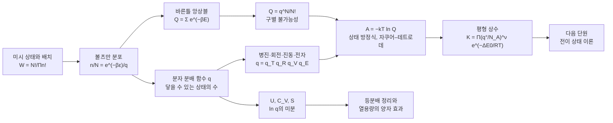

# 물리화학 11. 통계 열역학 — 에너지 준위를 세어 열역학을 다시 세우다
<!-- prev: pchem-10, pchem-2, umath-7 -->
<!-- next: pchem-12 -->

> [!NOTE]
> **이 단원의 범위**
> - 미시 상태와 배치, 배치의 무게와 지배적 배치, 볼츠만 분포의 유도($\beta = 1/k_\mathrm{B}T$)
> - 분자 분배 함수의 뜻(열적으로 닿을 수 있는 상태의 수)과 운동별 분해
> - 병진·회전(대칭수)·진동·전자 분배 함수와 특성 온도
> - 내부 에너지·열용량·엔트로피의 통계적 표현, 두 준위 계
> - 바른틀 앙상블과 바른틀 분배 함수, 구별할 수 없는 입자와 $1/N!$, 에너지 요동
> - 분배 함수로 구하는 열역학 함수: $A = -k_\mathrm{B}T\ln Q$, 상태 방정식, 자쿠어–테트로데 식
> - 열용량과 등분배 정리(고전 극한과 그 한계, 아인슈타인 고체)
> - 분배 함수로 구하는 평형 상수(해리·이성질화·동위 원소 교환)

**학습 목표**

1. 배치와 그 무게 $W = N!/\prod n_j!$를 계산하고, 입자 수가 많을 때 한 배치가 압도적으로 지배하는 까닭을 설명할 수 있다.
2. 스털링 근사와 라그랑주 승수로 볼츠만 분포를 유도하고, 에너지 승수가 $\beta = 1/k_\mathrm{B}T$임을 열역학과 맞추어 보일 수 있다.
3. 병진·회전·진동·전자 분배 함수를 에너지 준위에서 유도하고, 특성 온도와 비교해 각 운동이 '얼어 있는지' 판단할 수 있다.
4. 분배 함수에서 내부 에너지·열용량·엔트로피를 계산하고, 두 준위 계의 쇼트키 이상과 엔트로피의 극한을 해석할 수 있다.
5. 바른틀 앙상블에서 바른틀 분배 함수를 정의하고, $Q = q^N/N!$에서 이상 기체의 상태 방정식과 자쿠어–테트로데 식을 유도할 수 있다.
6. 등분배 정리를 유도하고, 실제 기체·고체의 열용량이 고전값에서 벗어나는 까닭을 양자화로 설명할 수 있다.
7. 분광 자료로 표준 몰 엔트로피와 평형 상수를 계산하고, 열량 측정·열역학 자료표의 값과 비교할 수 있다.

**이 단원의 학습 사다리**

| 단계 | 무엇을 하나? |
|---|---|
| STEP 1. 이전 학습 다시 보기 | $S = k_\mathrm{B}\ln W$, 볼츠만 분포의 첫 유도, 양자화된 에너지 준위와 분광 상수, $A(T,V)$의 자연 변수 |
| STEP 2. 기초 다지기 | 스털링 근사, 라그랑주 승수, 합을 적분으로 바꾸기, $\beta$ 미분 요령 |
| STEP 3. 핵심 개념 | 배치 → 볼츠만 분포 → $q$의 뜻 → 병진·회전·진동·전자 → $U$와 $C_V$ → $S$ → 바른틀 앙상블 → 열역학 함수와 자쿠어–테트로데 → 등분배와 열용량 → 평형 상수 |
| STEP 4. 오개념 바로잡기 | "가장 낮은 준위가 늘 가장 많이 점유된다", "등분배 정리는 언제나 맞는다" 같은 착각 |
| STEP 5. 대학원·연구로 | 큰 바른틀 앙상블과 양자 통계, 디바이 고체, 분자 시뮬레이션과 자유 에너지 계산 |
| STEP 6. 생활·산업·진로 | 고온 기체의 열역학 자료표, 동위 원소 효과, 신약의 결합 자유 에너지, 고온 화학 평형 |

---

## 🗺️ 단원 들어가기

열역학 자료표를 펴면 25 ℃, 1 bar에서 질소의 표준 몰 엔트로피가 $191.6\ \mathrm{J/(mol\cdot K)}$라고 적혀 있다. 「열역학 제2·3법칙과 엔트로피」에서는 이 값을 얻으려고 거의 0 K까지 식힌 고체의 열용량을 재고, 녹는점·끓는점의 숨은열을 더하고, 저온 부분을 디바이 식으로 외삽하였다. 몇 달이 걸리는 정밀 열량 측정이다.

그런데 똑같은 값을 **분광기 한 대와 종이 한 장**으로 얻을 수 있다. 질소 분자의 질량, 회전 스펙트럼에서 읽은 회전 상수, 적외선·라만 스펙트럼에서 읽은 진동 파수 — 이 세 숫자만 있으면 이 단원의 식으로 $191.6\ \mathrm{J/(mol\cdot K)}$를 소수 첫째 자리까지 다시 계산할 수 있다. 분자 하나의 에너지 준위(양자역학)와 $10^{23}$개 분자의 거시적 성질(열역학)을 잇는 다리가 **통계 열역학(statistical thermodynamics)** 이다.

다리의 핵심은 한 개의 합이다. 분자가 가질 수 있는 모든 상태의 볼츠만 인자를 더한 **분배 함수** $q = \sum_i e^{-\varepsilon_i/k_\mathrm{B}T}$. 이 합을 알면 내부 에너지, 열용량, 엔트로피, 압력, 화학 퍼텐셜, 평형 상수까지 미분과 로그만으로 모두 나온다. 「화학 평형과 전기화학」의 마지막에 던진 질문, "평형 상수 $K$는 왜 그 크기인가?"에 이 단원이 분자 수준의 답을 준다. 그리고 다음 단원 「반응 속도론과 반응 동역학」의 전이 상태 이론은 이 단원의 분배 함수를 활성화 착물에 그대로 적용한 것이다.

---

## STEP 1. 🔙 이전 학습 다시 보기

### 연계 개념표

| 이전 단원 | 그때 배운 것 | 이 단원에서 확장되는 것 |
|---|---|---|
| 일반화학 「화학 열역학」 | $S = k_\mathrm{B}\ln W$, 상자 두 칸에 분자 나누기, CO의 잔류 엔트로피 $R\ln 2$ | 칸 대신 **에너지 준위**에 분자를 나누고, $W$를 최대로 하는 배치에서 볼츠만 분포와 $S$를 계산 |
| 수학 도구 7 「확률과 통계」 | 라그랑주 승수로 볼츠만 분포를 유도, $\beta = 1/k_\mathrm{B}T$, 25 ℃의 $k_\mathrm{B}T$(207 $\mathrm{cm^{-1}}$) | 분배 함수를 운동별로 **실제로 계산**하고, 거기서 모든 열역학 함수를 얻는다. 분자 하나의 분포에서 계 전체의 앙상블로 |
| 물리화학 2 「열역학 제2·3법칙과 엔트로피」 | 열량 측정으로 절대 엔트로피, 디바이 외삽, 잔류 엔트로피, 깁스의 역설 | 분광 자료로 계산한 **통계 엔트로피**, 깁스의 역설을 $1/N!$로 해결, 제3법칙의 통계적 근거 |
| 물리화학 3 「자유 에너지와 화학 퍼텐셜」 | $A(T,V)$를 알면 $p = -(\partial A/\partial V)_T$, $S = -(\partial A/\partial T)_V$ | $A = -k_\mathrm{B}T\ln Q$로 $A(T,V)$를 분자 자료에서 **직접** 얻는다 |
| 물리화학 1 「기체의 성질과 열역학 제1법칙」 | 이원자 기체 $C_{V,\mathrm{m}} \approx \tfrac{5}{2}R$, 진동은 실온에서 '얼어 있다' | 등분배 정리의 유도와 진동 열용량의 정량 계산(아인슈타인 함수) |
| 물리화학 6 「화학 평형과 전기화학」 | $\Delta_\mathrm{r}G^\circ = -RT\ln K$, 판트호프 식 | $K$를 분배 함수와 해리 에너지로 계산 |
| 물리화학 8 「진동·회전 운동과 수소 원자」, 물리화학 10 「분자 분광학」 | 상자 속 입자·강체 회전자·조화 진동자의 에너지 준위와 축퇴도, 회전 상수 $B$와 진동 파수 $\tilde\nu$ | 그 준위들을 볼츠만 인자로 더해 분배 함수를 만든다 |

### 준비 운동 (사전 진단)

**Q1.** 에너지가 $1000\ \mathrm{cm^{-1}}$ 차이 나는 두 상태(축퇴도 같음)가 있다. 298 K에서 위 상태와 아래 상태의 점유비는? (298 K에서 $k_\mathrm{B}T/hc = 207\ \mathrm{cm^{-1}}$)

**Q2.** HCl의 회전 상수는 $B = 10.59\ \mathrm{cm^{-1}}$이다. 강체 회전자 준위 $E_J = hcBJ(J+1)$에서 $J = 2$ 준위의 에너지(파수 단위)와 축퇴도를 쓰시오.

**Q3.** 스털링 근사 $\ln N! \approx N\ln N - N$으로 $\ln 100!$을 어림하고, 정확한 값 363.7과 비교하시오.

**Q4.** 헬름홀츠 에너지 $A(T, V)$를 알 때 압력과 엔트로피를 얻는 식을 쓰시오.

정답 및 해설

**Q1.** $e^{-1000/207} = e^{-4.83} \approx 8.0\times10^{-3}$. 위 상태에는 아래 상태의 0.8 %만 있다. 이 단원 내내 쓰는 판단 기준은 "준위 간격이 $k_\mathrm{B}T$보다 큰가, 작은가"이다.

**Q2.** $E_2/hc = 10.59\times2\times3 = 63.5\ \mathrm{cm^{-1}}$, 축퇴도 $2J + 1 = 5$. STEP 3 ⑤에서 이 축퇴도 때문에 HCl은 $J = 0$이 아니라 $J = 3$ 준위에 분자가 가장 많다는 것을 본다.

**Q3.** $100\ln 100 - 100 = 360.5$로 정확한 값보다 약 0.9 % 작다. $N$이 $10^{23}$ 정도이면 상대 오차는 무시할 수 있다(STEP 2 디딤돌 1).

**Q4.** $p = -(\partial A/\partial V)_T$, $S = -(\partial A/\partial T)_V$ (물리화학 3 「자유 에너지와 화학 퍼텐셜」의 기본 방정식 $dA = -S\,dT - p\,dV$). STEP 3 ⑩에서 $A = -k_\mathrm{B}T\ln Q$를 여기에 넣는다.

---

## STEP 2. 🧱 기초 다지기

### 디딤돌 1. 스털링 근사 — 큰 수의 계승을 로그로

수학 도구 2 '스털링 근사'에서 익힌 식을 다시 쓴다. 통계 열역학의 모든 셈은 $N!$의 로그를 다루므로 이 근사 없이는 한 줄도 나아가지 못한다.

$$
\ln N! \approx N\ln N - N \qquad \left(\text{더 정확히는 } + \tfrac{1}{2}\ln 2\pi N\right)
$$

근거는 $\ln N! = \sum_{k=1}^{N}\ln k \approx \int_1^N \ln x\,dx = N\ln N - N + 1$이다. 덧셈을 적분으로 바꾼 오차와 상수 1은 $N\ln N$에 비해 금방 무시할 수 있게 된다.

| $N$ | $\ln N!$ (정확) | $N\ln N - N$ | 상대 오차 |
|---|---|---|---|
| 10 | 15.10 | 13.03 | 14 % |
| 100 | 363.74 | 360.52 | 0.9 % |
| 1000 | 5912.13 | 5907.76 | 0.07 % |
| $6\times10^{23}$ | — | — | 약 $10^{-23}$ |

#### 디딤돌 예제 1 — $\ln N!$의 미분

스털링 근사로 $\dfrac{d\ln N!}{dN}$을 구하고, 그 뜻을 쓰시오.

**풀이** $\dfrac{d}{dN}(N\ln N - N) = \ln N + 1 - 1 = \ln N$.

**의미** $N!$에서 $(N+1)!$로 가면 로그가 정확히 $\ln(N+1)$만큼 늘어나므로, 큰 $N$에서 연속 미분 $\ln N$은 이 증가량과 같다. STEP 3 ②에서 $\partial\ln W/\partial n_j$를 계산할 때 쓰는 핵심 한 줄이다.

### 디딤돌 2. 라그랑주 승수 — 제약이 있는 최댓값

수학 도구 1 '극값과 라그랑주 승수법'에서 익힌 대로, 함수 $f(x_1, x_2, \dots)$를 제약 $g(x_1, x_2, \dots) = 0$ 아래에서 극대로 하는 점에서는 $\nabla f$가 $\nabla g$에 평행하다. 따라서 승수 $\lambda$를 도입해

$$
\frac{\partial f}{\partial x_j} + \lambda\frac{\partial g}{\partial x_j} = 0 \quad (\text{모든 } j), \qquad g = 0
$$

을 함께 푼다. 제약이 둘이면 승수도 둘이다. 승수의 값은 끝에 제약식에 넣어 정한다.

#### 디딤돌 예제 2 — 확률이 고르게 퍼진 분포가 엔트로피를 최대로 한다

$n$개의 상태에 확률 $p_1, \dots, p_n$이 있을 때 $H = -\sum_i p_i\ln p_i$를 $\sum_i p_i = 1$ 아래에서 최대로 하는 분포를 구하시오.

**풀이** $\dfrac{\partial}{\partial p_j}\left(-\sum p_i\ln p_i\right) + \lambda\dfrac{\partial}{\partial p_j}\left(\sum p_i - 1\right) = -\ln p_j - 1 + \lambda = 0$이므로 $p_j = e^{\lambda - 1}$로 **모든 $j$에서 같다.** 정규화에서 $p_j = 1/n$, 최댓값 $H = \ln n$.

**의미** 제약이 "확률의 합 = 1"뿐이면 모든 상태가 똑같이 그럴듯하다. 여기에 "평균 에너지 일정"이라는 제약 하나를 더하면 분포가 $e^{-\beta\varepsilon_j}$로 기운다(STEP 3 ⑧). 그리고 $k_\mathrm{B}H$가 바로 통계적 엔트로피이다.

### 디딤돌 3. 합을 적분으로 바꾸기 — 촘촘한 준위의 분배 함수

분배 함수는 준위에 대한 **합**이다. 준위 간격이 $k_\mathrm{B}T$보다 아주 작으면, 이웃한 항들이 거의 같으므로 합을 적분으로 바꿀 수 있다. 가장 자주 쓰는 두 경우는 다음과 같다(수학 도구 2 '가우스 적분'과 '등비급수').

$$
\sum_{n=0}^{\infty} e^{-an^2} \approx \int_0^\infty e^{-an^2}\,dn = \frac{1}{2}\sqrt{\frac{\pi}{a}} \quad (a \ll 1), \qquad \sum_{v=0}^{\infty} x^v = \frac{1}{1-x} \quad (\lvert x \rvert < 1)
$$

첫째는 병진·회전처럼 촘촘한 준위에 쓰는 **근사**이고, 둘째는 진동처럼 간격이 일정한 준위에 쓰는 **정확한** 식이다.

#### 디딤돌 예제 3 — 합과 적분의 차이

$a = 1.0\times10^{-2}$과 $a = 1.0\times10^{-4}$에 대해 $\sum_{n=0}^\infty e^{-an^2}$과 $\tfrac{1}{2}\sqrt{\pi/a}$를 비교하시오.

**풀이** 직접 더하면 $a = 10^{-2}$일 때 9.362, 적분은 8.862. $a = 10^{-4}$일 때 89.12와 88.62. 두 경우 모두 차이는 정확히 약 0.5이다.

**의미** 차이 0.5는 $n = 0$ 항(값 1)의 절반, 즉 합과 적분의 '끝자리' 오차이다. 적분값이 커질수록 이 고정된 오차의 비율이 작아진다. 상자 속 기체의 병진 분배 함수는 $10^{25}$ 정도이므로 이 오차는 완전히 무시된다.

### 디딤돌 4. $\beta$ 미분 요령과 특성 온도

통계 열역학에서는 온도 대신 $\beta = 1/k_\mathrm{B}T$로 미분하는 일이 많다. 둘 사이의 변환은

$$
\frac{d}{dT} = \frac{d\beta}{dT}\frac{d}{d\beta} = -\frac{1}{k_\mathrm{B}T^2}\frac{d}{d\beta}, \qquad -\frac{d\ln q}{d\beta} = k_\mathrm{B}T^2\frac{d\ln q}{dT}
$$

이다. 또 준위 간격을 온도 단위로 바꾼 **특성 온도** $\theta = \Delta\varepsilon/k_\mathrm{B} = hc\tilde\nu/k_\mathrm{B}$를 쓰면 비교가 쉬워진다. $hc/k_\mathrm{B} = 1.4388\ \mathrm{cm\cdot K}$이므로 $\theta(\mathrm{K}) = 1.4388\times\tilde\nu(\mathrm{cm^{-1}})$이다. $T \gg \theta$이면 그 운동은 고전적으로, $T \ll \theta$이면 '얼어 있다'.

#### 디딤돌 예제 4 — 거듭제곱 꼴 분배 함수의 평균 에너지

$q = aT^{s}$($a$, $s$는 상수)일 때 분자 하나의 평균 에너지 $\langle\varepsilon\rangle = k_\mathrm{B}T^2\,d\ln q/dT$를 구하시오.

**풀이** $\ln q = \ln a + s\ln T$, $\dfrac{d\ln q}{dT} = \dfrac{s}{T}$, $\langle\varepsilon\rangle = sk_\mathrm{B}T$.

**의미** 상수 $a$(부피, 질량, 회전 상수 등)는 평균 에너지에 들어오지 않는다. 병진은 $q \propto T^{3/2}$이어서 $\tfrac{3}{2}k_\mathrm{B}T$, 선형 분자의 고온 회전은 $q \propto T$이어서 $k_\mathrm{B}T$이다. 등분배 정리(STEP 3 ⑪)의 결과를 이렇게 미리 엿볼 수 있다.

---

## STEP 3. 📘 핵심 개념

### ① 미시 상태와 배치 — 가장 그럴듯한 배치가 관측된다

열역학이 다루는 계는 $10^{23}$개 정도의 분자로 이루어져 있다. 분자 하나하나의 양자 상태를 모두 정한 것이 **미시 상태(microstate)** 이다. 그러나 우리가 재는 것은 온도·압력·에너지 같은 **거시 상태(macrostate)** 이고, 하나의 거시 상태에는 엄청나게 많은 미시 상태가 대응한다. 통계 열역학의 첫걸음은 이 미시 상태를 체계적으로 **세는** 것이다.

#### 가정

1. 계는 $N$개의 분자로 되어 있고, 분자 사이의 상호작용이 약해 각 분자의 에너지를 따로 적을 수 있다($E = \sum_i \varepsilon_i$).
2. 분자는 (지금은) 자리나 번호로 **구별할 수 있다**. 구별할 수 없는 기체 분자는 ⑨에서 고친다.
3. 계는 고립되어 있어 분자 수 $N$과 전체 에너지 $E$가 일정하다.
4. **등확률의 원리(principle of equal a priori probabilities)**: $N$과 $E$가 같은 모든 미시 상태는 똑같이 일어날 만하다. 이것은 증명하는 정리가 아니라, 그 결과가 실험과 맞는지로 정당화되는 이 이론의 기본 가설이다.

#### 배치와 그 무게

분자들이 에너지 $\varepsilon_0, \varepsilon_1, \varepsilon_2, \dots$인 상태에 각각 $n_0, n_1, n_2, \dots$개씩 들어 있다고 하자. 이 숫자 묶음 $\{n_0, n_1, \dots\}$을 **배치(configuration)** 라 한다. 배치는 "어느 준위에 몇 개"만 정하고 "어느 분자가 어디에"는 정하지 않는다. 같은 배치를 실현하는 미시 상태의 수, 즉 배치의 **무게(weight)** 는 $N$개의 구별되는 분자를 크기 $n_0, n_1, \dots$인 무리로 나누는 방법의 수이다.

$$
W(\{n_j\}) = \frac{N!}{n_0!\,n_1!\,n_2!\cdots} = \frac{N!}{\prod_j n_j!}
$$

(분자 $N$개를 한 줄로 세우는 방법 $N!$에서, 같은 준위 안의 분자끼리 순서를 바꾼 것은 같은 미시 상태이므로 $n_j!$로 나눈다.) 등확률의 원리에 따라 **배치가 관측될 확률은 그 무게에 비례한다.**

#### 예제 1 — 분자 여섯 개에 에너지 네 덩이 나누기

에너지가 $0, \varepsilon, 2\varepsilon, 3\varepsilon, 4\varepsilon$인 준위(축퇴 없음)에 구별되는 분자 6개가 있고, 전체 에너지는 $4\varepsilon$이다. 가능한 모든 배치와 무게를 구하고, 각 준위의 평균 점유 수를 구하시오.

**풀이**
전체 에너지 $4\varepsilon$를 6개의 분자에 나누는 방법을 준위별 분자 수로 정리한다.

| 배치 $(n_0, n_1, n_2, n_3, n_4)$ | 에너지 확인 | $W = 6!/\prod n_j!$ | 확률 $W/\sum W$ |
|---|---|---|---|
| (3, 2, 1, 0, 0) | $2\varepsilon + 2\varepsilon$ | $720/(6\cdot2\cdot1) = 60$ | 0.476 |
| (4, 1, 0, 1, 0) | $\varepsilon + 3\varepsilon$ | $720/(24\cdot1\cdot1) = 30$ | 0.238 |
| (2, 4, 0, 0, 0) | $4\varepsilon$ | $720/(2\cdot24) = 15$ | 0.119 |
| (4, 0, 2, 0, 0) | $4\varepsilon$ | $720/(24\cdot2) = 15$ | 0.119 |
| (5, 0, 0, 0, 1) | $4\varepsilon$ | $720/120 = 6$ | 0.048 |
| 합 | | 126 | 1 |

(검산: 에너지 덩이 4개를 분자 6개에 나누는 방법은 $\binom{4+6-1}{4} = 126$가지로 일치한다.)
평균 점유 수 $\langle n_j\rangle = \sum W n_j/\sum W$는 준위 0부터 차례로 3.33, 1.67, 0.71, 0.24, 0.05이다.

**의미** 분자가 6개뿐인데도 한 배치 (3, 2, 1, 0, 0)이 전체의 절반 가까이를 차지한다. 평균 점유 수는 위로 갈수록 대략 절반씩 줄어든다. 이것이 곧 유도할 지수 함수 꼴(볼츠만 분포)의 싹이다. '모든 분자에 에너지를 고르게' 나눈 배치도, '한 분자에 몰아준' 배치 (5, 0, 0, 0, 1)도 무게가 작다.

<!-- 그림 요청: 예제 1의 다섯 가지 배치를 나란히 그린 준위 도표. 각 배치마다 가로선 5개(아래부터 0, ε, 2ε, 3ε, 4ε)를 긋고 그 위에 분자를 원(●)으로 n_j개씩 올린다. (3,2,1,0,0), (4,1,0,1,0), (2,4,0,0,0), (4,0,2,0,0), (5,0,0,0,1) 순서. 각 도표 아래에 'W = 60', 'W = 30', 'W = 15', 'W = 15', 'W = 6'을 적고, W = 60인 배치를 굵은 테두리로 강조한다. 맨 오른쪽에 평균 점유 수 3.33, 1.67, 0.71, 0.24, 0.05의 가로 막대그래프. -->

#### 지배적 배치 — 입자가 많을수록 봉우리는 날카로워진다

분자 수가 커지면 무게가 가장 큰 배치(**지배적 배치**, dominant configuration)와 그 바로 주변의 배치들이 모든 무게를 사실상 독차지한다. 가장 단순한 두 준위 계(각 분자가 위·아래 두 상태 중 하나, 에너지 제약은 잠시 잊는다)로 확인해 보자. 위 상태에 $n$개가 있는 배치의 무게는 $W(n) = \binom{N}{n}$이고, 최댓값은 $n = N/2$에 있다. $n = \tfrac{N}{2}(1 + x)$로 놓고 스털링 근사를 써서 $\ln W$를 $x$에 대해 2차까지 전개하면

$$
\ln\frac{W(n)}{W(N/2)} \approx -\frac{N}{2}x^2, \qquad \frac{W(n)}{W(N/2)} \approx e^{-Nx^2/2}
$$

이다. 무게는 폭이 $x \sim 1/\sqrt{N}$인 가우스 봉우리를 이룬다(수학 도구 7 '세 가지 대표 분포'의 정규 분포).

#### 예제 2 — $10^{-10}$의 벗어남은 얼마나 드문가

$N = 6.0\times10^{23}$인 두 준위 계에서 (1) 지배적 배치에서 상대적으로 $x = 1.0\times10^{-10}$만큼 벗어난 배치의 무게는 지배적 배치의 몇 배인가? (2) 봉우리의 상대 폭 $1/\sqrt{N}$은?

**풀이**
(1) $Nx^2/2 = (6.0\times10^{23})(1.0\times10^{-20})/2 = 3.0\times10^3$이므로 $W/W_\text{최대} \approx e^{-3000} \approx 10^{-1303}$.
(2) $1/\sqrt{6.0\times10^{23}} = 1.3\times10^{-12}$.

**의미** 조성이 100억분의 1만큼만 달라도 그 배치는 사실상 일어나지 않는다. 그래서 거시계에서는 "가장 그럴듯한 배치"가 곧 "관측되는 배치"이고, 평균값과 지배적 배치의 값이 구별되지 않는다. 열역학의 양들이 요동 없이 날카로운 값을 가지는 까닭이 여기에 있다(요동의 정량적 크기는 ⑨).

<!-- 그림 요청: 두 준위 계의 무게 분포 W(n)/W(N/2)를 n/N(가로축 0~1)에 대해 그린 곡선 세 개. N = 10(막대 또는 점), N = 100, N = 1000(매끄러운 곡선). 세 곡선 모두 n/N = 0.5에서 최댓값 1, 폭이 1/√N에 비례해 좁아짐을 화살표로 표시하고, 오른쪽 위에 'N = 6×10^23이면 폭 ≈ 10^-12 (선 하나로 보임)'이라는 주석을 단다. -->

#### ✔ 바로 확인

1. 구별되는 분자 5개가 배치 $(n_0, n_1, n_2) = (3, 1, 1)$에 있을 때 무게 $W$는?
2. (O/X) 등확률의 원리는 "모든 **배치**가 똑같이 일어날 만하다"는 뜻이다.
3. 빈칸: 분자 수 $N$이 커질수록 무게 분포의 상대 폭은 (    )에 비례해 줄어든다.

정답

1. 20 — $5!/(3!\,1!\,1!) = 120/6$.
2. X — 똑같이 일어날 만한 것은 **미시 상태**이다. 배치는 무게(미시 상태 수)만큼 확률이 다르다.
3. $1/\sqrt{N}$

### ② 볼츠만 분포의 유도 — 지배적 배치를 찾는다

이제 일반적인 준위에서 지배적 배치를 찾는다. 수학 도구 7 '가장 그럴듯한 분포'에서 같은 계산의 뼈대를 보았으므로, 여기서는 물리화학에서 필요한 두 가지 — **각 가정이 어디에 쓰이는가**와 **$\beta$를 열역학과 어떻게 맞추는가** — 에 무게를 두어 다시 한다.

#### 유도

**1단계 — 최대로 할 양.** $W$가 최대인 곳과 $\ln W$가 최대인 곳은 같다. 각 $n_j$가 커서 스털링 근사를 쓸 수 있다고 하면(①의 가정에 더해 '준위마다 분자가 많다')

$$
\ln W = \ln N! - \sum_j \ln n_j! \approx N\ln N - \sum_j n_j\ln n_j
$$

(두 근사식의 $-N$과 $+\sum_j n_j$는 $\sum_j n_j = N$이므로 지워진다.)

**2단계 — 두 제약.** 고립계이므로 $\sum_j n_j = N$, $\sum_j n_j\varepsilon_j = E$가 일정하다. 따라서 $n_j$를 마음대로 바꿀 수 없고, 변화 $dn_j$는

$$
\sum_j dn_j = 0, \qquad \sum_j \varepsilon_j\,dn_j = 0
$$

을 만족해야 한다.

**3단계 — 라그랑주 승수.** 승수 $\alpha$, $-\beta$를 붙여(부호는 관례) 극값 조건을 쓴다.

$$
\frac{\partial\ln W}{\partial n_j} + \alpha - \beta\varepsilon_j = 0
$$

$N = \sum_k n_k$도 $n_j$에 의존하므로, 디딤돌 예제 1의 결과를 쓰면 $\dfrac{\partial\ln W}{\partial n_j} = (\ln N + 1) - (\ln n_j + 1) = -\ln\dfrac{n_j}{N}$이다. 따라서

$$
-\ln\frac{n_j}{N} + \alpha - \beta\varepsilon_j = 0 \quad\Longrightarrow\quad \frac{n_j}{N} = e^{\alpha}e^{-\beta\varepsilon_j}
$$

**4단계 — 정규화로 $\alpha$를 없앤다.** $\sum_j n_j/N = 1$에서 $e^{\alpha} = 1/\sum_j e^{-\beta\varepsilon_j}$이다.

$$
\boxed{\;\frac{n_j}{N} = p_j = \frac{e^{-\beta\varepsilon_j}}{q}, \qquad q = \sum_j e^{-\beta\varepsilon_j}\;}
$$

여기서 합은 모든 **상태**에 대한 것이다. $q$가 **분자 분배 함수(molecular partition function)** 이고, 이 분포가 **볼츠만 분포(Boltzmann distribution)** 이다.

**5단계 — $\beta$는 무엇인가.** 지배적 배치에서 분자들을 조금 옮기되, 분자 수는 그대로 두고($dN = 0$) 에너지만 $dE$만큼 바꾸어 보자. 준위의 위치를 바꾸지 않으려면 부피를 고정해야 한다(상자 속 입자의 준위는 부피에 의존한다). 3단계의 극값 조건 $\partial\ln W/\partial n_j = -\alpha + \beta\varepsilon_j$를 쓰면

$$
d\ln W = \sum_j \frac{\partial\ln W}{\partial n_j}dn_j = -\alpha\sum_j dn_j + \beta\sum_j\varepsilon_j\,dn_j = \beta\,dE
$$

엔트로피를 지배적 배치의 무게로 $S = k_\mathrm{B}\ln W$라 하면(①에 따라 전체 미시 상태 수의 로그와 사실상 같다) $dS = k_\mathrm{B}\beta\,dE$이다. 한편 열역학의 기본 방정식은 부피와 조성이 일정할 때 $dU = T\,dS$, 즉 $dS = dU/T$이다. $E$가 곧 $U$이므로 두 식을 맞추면

$$
\beta = \frac{1}{k_\mathrm{B}T}
$$

#### 결과와 적용 한계

- 같은 에너지를 가진 상태가 $g_j$개인 **준위**에 대해서는 상태마다 볼츠만 인자를 주므로 $p_j = g_je^{-\beta\varepsilon_j}/q$, $q = \sum_\text{준위} g_je^{-\beta\varepsilon_j}$이다. 두 준위의 점유비는 $\dfrac{n_2}{n_1} = \dfrac{g_2}{g_1}e^{-(\varepsilon_2 - \varepsilon_1)/k_\mathrm{B}T}$로 에너지 차와 $k_\mathrm{B}T$의 비만으로 정해진다.
- 유도에서는 고립계(일정한 $E$)를 썼지만 결과에는 $T$만 남았다. 같은 분포를 "온도 $T$인 열 저장고와 접한 분자 하나"의 분포로 읽을 수 있으며, ⑨의 바른틀 앙상블이 그 정확한 근거이다.
- 스털링 근사를 준위마다 썼지만, 바른틀 앙상블로 다시 유도하면 이 가정 없이 같은 결과가 나온다(⑨).
- 구별되지 않는 입자라도 닿을 수 있는 상태 수가 분자 수보다 훨씬 많은 보통의 기체에서는 같은 분포가 된다. 매우 낮은 온도·높은 밀도의 전자 기체, 액체 헬륨 등은 예외이다(⑩, STEP 5).

#### 예제 3 — 세 준위 분자의 점유와 평균 에너지

어떤 분자의 낮은 상태가 $0$, $200$, $600\ \mathrm{cm^{-1}}$에 하나씩(축퇴 없음) 있고, 그 위 상태는 무시할 수 있다. 300 K에서 $q$, 각 상태의 점유 비율, 평균 에너지(파수 단위)를 구하시오. ($hc/k_\mathrm{B} = 1.4388\ \mathrm{cm\cdot K}$)

**풀이**
$hc\tilde\nu/k_\mathrm{B}T$는 $200$에 대해 $1.4388\times200/300 = 0.9592$, $600$에 대해 $2.8776$이다.
$q = 1 + e^{-0.9592} + e^{-2.8776} = 1 + 0.3832 + 0.0563 = 1.439$
$p_0 = 1/1.439 = 0.695$, $p_1 = 0.3832/1.439 = 0.266$, $p_2 = 0.0563/1.439 = 0.039$
$\langle\tilde\varepsilon\rangle = \sum_j p_j\tilde\varepsilon_j = 0.266\times200 + 0.039\times600 = 76.7\ \mathrm{cm^{-1}}$

**의미** $q = 1.44$는 "300 K에서 이 분자가 실질적으로 오가는 상태가 약 1.4개"라는 뜻이다(③). 같은 계산을 3000 K에서 하면 $p_j$가 0.376, 0.342, 0.282로 거의 고르게 되고 $q$는 2.66으로 상태 수 3에 다가간다. 온도는 "분포를 얼마나 납작하게 펴는가"를 정하는 매개변수이다.

> [!TIP]
> 💡 **비유** — 볼츠만 분포는 **계단식 관람석의 관객 분포**와 같다. 높은 줄(높은 에너지)일수록 오르기 힘들어 관객이 지수적으로 줄고, 관객의 '기운'($k_\mathrm{B}T$)이 클수록 높은 줄까지 고르게 퍼진다. 한 줄에 좌석이 많으면(축퇴도 $g$) 그 줄은 높아도 관객이 많을 수 있다.

#### ✔ 바로 확인

1. 축퇴도가 1과 3인 두 준위의 에너지 차가 $k_\mathrm{B}T$와 같다. 위 준위/아래 준위의 점유비는?
2. 빈칸: 볼츠만 분포의 유도에서 에너지 제약에 붙인 승수 $\beta$는 $dS = k_\mathrm{B}\beta\,dU$를 열역학의 $dS = (\quad)$과 맞추어 $1/k_\mathrm{B}T$로 정해진다.
3. (O/X) $\beta$를 정할 때 부피를 일정하게 둔 것은 에너지 준위의 위치가 부피에 의존하기 때문이다.

정답

1. $3e^{-1} = 1.10$ — 축퇴도가 크면 위 준위가 더 많이 점유될 수도 있다.
2. $dU/T$ (부피·조성 일정)
3. O — 부피가 일정해야 $dE$가 준위 사이의 분자 이동(열)만으로 생긴다.

### ③ 분자 분배 함수의 뜻 — 열적으로 닿을 수 있는 상태의 수

$q = \sum_j g_je^{-\varepsilon_j/k_\mathrm{B}T}$는 볼츠만 분포의 정규화 상수로 나왔지만, 그 자체로 뚜렷한 물리적 뜻이 있다. 바닥 상태의 에너지를 0으로 두면

- $T \to 0$: 바닥 준위 항만 남아 $q \to g_0$ (축퇴가 없으면 1).
- $T \to \infty$: 모든 볼츠만 인자가 1이 되어 $q \to$ 상태의 총수(무한히 많으면 무한대).

즉 $q$는 **그 온도에서 분자가 열적으로 닿을 수 있는 상태의 실질적인 개수**이다. 바닥 상태의 점유 비율이 $p_0 = g_0/q$이므로, $q$가 크다는 것은 분자들이 많은 상태에 흩어져 있다는 뜻이다.

#### 간격이 일정한 사다리

간격 $\varepsilon$인 준위가 끝없이 이어진 사다리(축퇴 없음, 조화 진동자의 모형)에서는 등비급수(디딤돌 3)로 정확히 더할 수 있다.

$$
q = \sum_{v=0}^\infty e^{-v\beta\varepsilon} = \frac{1}{1 - e^{-\beta\varepsilon}}, \qquad p_v = \frac{e^{-v\beta\varepsilon}}{q} = (1 - e^{-\beta\varepsilon})e^{-v\beta\varepsilon}
$$

#### 예제 4 — 400 cm⁻¹ 사다리의 $q$와 온도

간격 $400\ \mathrm{cm^{-1}}$인 사다리에 대해 (1) 100, 300, 1000, 3000 K에서 $q$를 구하고, (2) 300 K에서 $v = 0, 1, 2$의 점유 비율을 구하시오.

**풀이**
(1) $\beta\varepsilon = 1.4388\times400/T$를 넣으면

| $T$ (K) | 100 | 300 | 1000 | 3000 |
|---|---|---|---|---|
| $\beta\varepsilon$ | 5.755 | 1.918 | 0.5755 | 0.1918 |
| $q$ | 1.003 | 1.172 | 2.285 | 5.73 |
| $k_\mathrm{B}T/\varepsilon$ (비교) | 0.17 | 0.52 | 1.74 | 5.21 |

(2) $e^{-1.918} = 0.1468$. $p_0 = 1 - 0.1468 = 0.853$, $p_1 = 0.853\times0.1468 = 0.125$, $p_2 = 0.853\times0.1468^2 = 0.018$.

**의미** $k_\mathrm{B}T \ll \varepsilon$이면 $q \approx 1$(분자는 바닥에 머문다), $k_\mathrm{B}T \gg \varepsilon$이면 $q \approx k_\mathrm{B}T/\varepsilon + \tfrac{1}{2}$로 온도에 비례해 커진다. 표의 마지막 두 줄을 비교하면 고온에서 $q$와 $k_\mathrm{B}T/\varepsilon$의 차가 약 0.5로 다가가는 것이 보인다. "준위 간격에 비해 $k_\mathrm{B}T$가 몇 배인가"가 닿을 수 있는 상태 수를 정한다.

<!-- 그림 요청: 간격 ε인 등간격 준위 사다리(가로선 8개) 세 개를 나란히 그리고 각 준위의 점유 비율을 가로 막대 길이로 표시. 왼쪽 k_BT = 0.5ε(점유 0.865, 0.117, 0.016, …, q = 1.16), 가운데 k_BT = ε(0.63, 0.23, 0.09, 0.03, …, q = 1.58), 오른쪽 k_BT = 3ε(0.28, 0.20, 0.14, 0.10, 0.07, …, q = 3.53). 각 사다리 아래에 q 값을 크게 적고 '닿을 수 있는 상태의 수'라는 부제를 단다. 막대 끝을 잇는 점선은 지수 곡선. -->

#### 운동별 분해 — 곱이 되는 분배 함수

분자의 에너지가 서로 독립인 운동의 합으로 쓰인다고 하자(근사적으로 성립한다: 보른–오펜하이머 근사, 강체 회전자와 조화 진동자의 분리).

$$
\varepsilon_{i,j,k,l} = \varepsilon_i^\mathrm{T} + \varepsilon_j^\mathrm{R} + \varepsilon_k^\mathrm{V} + \varepsilon_l^\mathrm{E}
$$

모든 상태에 대한 합은 네 지표 각각에 대한 합이고, 지수의 합은 지수의 곱이므로

$$
q = \sum_{i,j,k,l} e^{-\beta(\varepsilon_i^\mathrm{T} + \varepsilon_j^\mathrm{R} + \varepsilon_k^\mathrm{V} + \varepsilon_l^\mathrm{E})} = \left(\sum_i e^{-\beta\varepsilon_i^\mathrm{T}}\right)\left(\sum_j e^{-\beta\varepsilon_j^\mathrm{R}}\right)\left(\sum_k e^{-\beta\varepsilon_k^\mathrm{V}}\right)\left(\sum_l e^{-\beta\varepsilon_l^\mathrm{E}}\right) = q^\mathrm{T}q^\mathrm{R}q^\mathrm{V}q^\mathrm{E}
$$

**분배 함수는 곱으로, 그 로그는 합으로** 나뉜다. ⑦ 이후의 열역학 함수가 모두 $\ln q$로 표현되므로 에너지·엔트로피·열용량도 운동별 기여의 **합**이 된다. ④~⑥에서 네 인자를 차례로 구한다.

#### 에너지의 기준점

모든 준위를 같은 양 $\varepsilon_0$만큼 올리면 $q$는 $e^{-\beta\varepsilon_0}$배가 되지만, $p_j$의 분자와 분모에 같은 인자가 곱해지므로 **분포는 변하지 않는다.** 이 책에서는 각 운동의 바닥 상태를 0으로 재고(진동은 영점 에너지를 뺀 값), 바닥 상태의 실제 에너지는 따로 $U(0)$, $E_0$로 적는다. 평형 상수를 계산할 때(⑫) 이 $E_0$의 차이가 결정적인 역할을 한다.

#### ✔ 바로 확인

1. 축퇴가 없는 두 상태(에너지 0과 $\varepsilon$)의 분배 함수를 쓰고, $T \to 0$과 $T \to \infty$의 극한값을 쓰시오.
2. (O/X) 분자의 에너지가 독립인 운동의 합이면 분배 함수는 각 운동의 분배 함수의 합이 된다.
3. 예제 4의 사다리에서 1000 K의 바닥 상태 점유 비율은?

정답

1. $q = 1 + e^{-\varepsilon/k_\mathrm{B}T}$, $T \to 0$에서 1, $T \to \infty$에서 2.
2. X — **곱**이 된다. 그 로그가 합이 된다.
3. 약 0.44 — $p_0 = 1/q = 1/2.285$.

### ④ 병진 분배 함수 — 상자 속 입자에서 열적 파장까지

#### 가정과 유도

질량 $m$인 분자가 변의 길이 $L$인 정육면체 상자(부피 $V = L^3$) 안에서 자유롭게 움직인다. 물리화학 7 「양자역학의 기초」의 상자 속 입자에서 $x$ 방향 준위는

$$
\varepsilon_n = \frac{n^2h^2}{8mL^2}, \qquad n = 1, 2, 3, \dots
$$

이다. 세 방향의 운동은 독립이므로 ③의 분해에 따라 $q^\mathrm{T} = q_xq_yq_z$이다.

**1단계 — 준위는 얼마나 촘촘한가.** 아르곤 원자(298 K)를 1 cm 상자에 넣으면 $n = 1$과 $n = 2$의 간격은 $3h^2/8mL^2 \approx 6\times10^{-18}\,k_\mathrm{B}T$이다. 간격이 $k_\mathrm{B}T$보다 수십 자릿수 작으므로 합을 적분으로 바꿀 수 있다(디딤돌 3).

**2단계 — 적분.** $a = \beta h^2/8mL^2$로 놓으면($n = 1$에서 시작하는 것과 0에서 시작하는 차이는 디딤돌 예제 3의 0.5 정도로 무시된다)

$$
q_x = \sum_{n=1}^\infty e^{-an^2} \approx \int_0^\infty e^{-an^2}\,dn = \frac{1}{2}\sqrt{\frac{\pi}{a}} = \frac{1}{2}\sqrt{\frac{8\pi mL^2k_\mathrm{B}T}{h^2}} = \frac{L\sqrt{2\pi mk_\mathrm{B}T}}{h}
$$

**3단계 — 세 방향을 곱한다.**

$$
\boxed{\;q^\mathrm{T} = \frac{V}{\Lambda^3}, \qquad \Lambda = \frac{h}{\sqrt{2\pi mk_\mathrm{B}T}}\;}
$$

$\Lambda$를 **열적 드브로이 파장(thermal de Broglie wavelength)** 이라 한다. 온도 $T$에서 분자의 전형적인 운동량에 해당하는 물질파의 파장 정도이다. $q^\mathrm{T}$는 "부피 $V$ 안에 한 변이 $\Lambda$인 작은 상자가 몇 개 들어가는가"로 읽을 수 있다. 무거울수록, 뜨거울수록 $\Lambda$가 작아져 $q^\mathrm{T}$가 커진다.

**적용 한계** 적분 근사는 $L \gg \Lambda$일 때 성립한다. 보통의 용기에서는 늘 만족된다. 더 중요한 조건은 분자 사이의 평균 거리도 $\Lambda$보다 훨씬 커야 한다는 것, 즉 $(N/V)\Lambda^3 \ll 1$이다. 이것이 ⑨에서 $Q = q^N/N!$을 쓰는 조건이 된다.

#### 예제 5 — 아르곤의 열적 파장과 병진 분배 함수

298.15 K의 아르곤($M = 39.95\ \mathrm{g/mol}$)에 대해 (1) $\Lambda$를 구하고, (2) 1.00 cm³의 $q^\mathrm{T}$를 구하고, (3) 1 bar에서 같은 부피 속 원자 수와 비교하시오. ($h = 6.626\times10^{-34}\ \mathrm{J\cdot s}$, $k_\mathrm{B} = 1.381\times10^{-23}\ \mathrm{J/K}$, $N_\mathrm{A} = 6.022\times10^{23}\ \mathrm{mol^{-1}}$)

**풀이**
(1) $m = 0.03995/6.022\times10^{23} = 6.634\times10^{-26}\ \mathrm{kg}$
$\Lambda = \dfrac{6.626\times10^{-34}}{\sqrt{2\pi(6.634\times10^{-26})(1.381\times10^{-23})(298.15)}} = 1.60\times10^{-11}\ \mathrm{m} = 16.0\ \mathrm{pm}$
(2) $q^\mathrm{T} = \dfrac{1.00\times10^{-6}\ \mathrm{m^3}}{(1.60\times10^{-11}\ \mathrm{m})^3} = 2.44\times10^{26}$
(3) $N = pV/k_\mathrm{B}T = \dfrac{(1.00\times10^5)(1.00\times10^{-6})}{(1.381\times10^{-23})(298.15)} = 2.43\times10^{19}$이므로 $q^\mathrm{T}/N \approx 1.0\times10^{7}$, $(N/V)\Lambda^3 \approx 1.0\times10^{-7}$.

**의미** 원자 하나당 닿을 수 있는 병진 상태가 약 천만 개이다. 두 원자가 같은 병진 상태에 들어갈 일은 사실상 없으므로 원자들은 '고전적인 점 입자'처럼 행동한다. 반대로 4.2 K의 액체 헬륨에서는 $\Lambda \approx 430\ \mathrm{pm}$이고 $(N/V)\Lambda^3 \approx 1.5$, 구리 속 자유 전자(300 K)는 $(N/V)\Lambda^3 \approx 7\times10^3$이어서 양자 통계가 필요하다(STEP 5).

| 계 | $\Lambda$ | $(N/V)\Lambda^3$ | 판단 |
|---|---|---|---|
| Ar 기체, 298 K, 1 bar | 16.0 pm | $1.0\times10^{-7}$ | 고전적 |
| He 기체, 298 K, 1 bar | 50.5 pm | $3.1\times10^{-6}$ | 고전적 |
| 액체 He, 4.2 K | 약 430 pm | 약 1.5 | 양자적 |
| 구리 속 전자, 300 K | 4.3 nm | 약 $7\times10^3$ | 강하게 양자적 |

#### 표준 몰 병진 분배 함수

평형 상수와 표준 엔트로피에는 1 mol의 기체가 표준 압력 $p^\circ = 1\ \mathrm{bar}$에서 차지하는 부피 $V_\mathrm{m}^\circ = RT/p^\circ$를 쓴 값을 쓴다.

$$
\frac{q_\mathrm{m}^{\mathrm{T}\circ}}{N_\mathrm{A}} = \frac{V_\mathrm{m}^\circ}{N_\mathrm{A}\Lambda^3} = \frac{k_\mathrm{B}T}{p^\circ\Lambda^3}
$$

아르곤은 298.15 K에서 $1.01\times10^7$이다. 질량의 $3/2$제곱과 온도의 $5/2$제곱에 비례한다.

병진의 평균 에너지는 $q^\mathrm{T} \propto T^{3/2}$이므로 디딤돌 예제 4에서 곧바로 $\langle\varepsilon^\mathrm{T}\rangle = \tfrac{3}{2}k_\mathrm{B}T$이다. 기체 분자 운동론의 결과와 같다는 것이 $\beta = 1/k_\mathrm{B}T$를 다른 길로 확인해 준다.

#### ✔ 바로 확인

1. 온도를 4배로 올리면 $\Lambda$는 몇 배가 되는가?
2. (O/X) 같은 온도·부피에서 크세논의 병진 분배 함수는 헬륨보다 작다.
3. 빈칸: 기체가 고전적으로 행동할 조건은 $(N/V)\Lambda^3 (\quad) 1$이다.

정답

1. $1/2$배 — $\Lambda \propto T^{-1/2}$.
2. X — $q^\mathrm{T} \propto m^{3/2}$이므로 무거운 크세논이 더 크다(약 $(131.3/4.00)^{3/2} \approx 190$배).
3. $\ll$

### ⑤ 회전 분배 함수 — 축퇴와 대칭수

#### 선형 분자

강체 회전자의 준위는 $E_J = hcBJ(J+1)$, 축퇴도는 $2J + 1$이다(물리화학 8 「진동·회전 운동과 수소 원자」). **회전 특성 온도** $\theta_\mathrm{R} = hcB/k_\mathrm{B}$를 쓰면

$$
q^\mathrm{R} = \sum_{J=0}^\infty (2J+1)e^{-\theta_\mathrm{R}J(J+1)/T}
$$

$T \gg \theta_\mathrm{R}$이면 합을 적분으로 바꾼다. $x = J(J+1)$로 치환하면 $dx = (2J+1)\,dJ$이므로

$$
q^\mathrm{R} \approx \int_0^\infty e^{-\theta_\mathrm{R}x/T}\,dx = \frac{T}{\theta_\mathrm{R}} = \frac{k_\mathrm{B}T}{hcB}
$$

(합과 적분의 차를 더 정밀하게 따지면 $q^\mathrm{R} \approx T/\theta_\mathrm{R} + \tfrac{1}{3}$이다.) 축퇴도 $2J + 1$이 적분 변수의 미분으로 깔끔하게 흡수되는 것이 이 유도의 요점이다.

#### 대칭수

$\mathrm{N_2}$, $\mathrm{O_2}$, $\mathrm{H_2}$처럼 양 끝이 같은 원자이면 분자를 180° 돌린 배향이 처음과 구별되지 않는다. 양자역학적으로는 원자핵의 스핀 통계 때문에 $J$가 짝수인 준위와 홀수인 준위 가운데 한쪽만(또는 핵스핀 상태와 정해진 짝으로만) 허용된다. 고온에서는 그 결과가 단순히 상태 수를 절반으로 줄이는 것과 같다. 이를 **대칭수(symmetry number)** $\sigma$로 나타낸다.

$$
q^\mathrm{R} = \frac{T}{\sigma\theta_\mathrm{R}} \qquad (\text{이핵 } \sigma = 1, \text{ 동핵 } \sigma = 2)
$$

비선형 분자는 세 회전 상수 $A$, $B$, $C$를 써서 $q^\mathrm{R} = \dfrac{1}{\sigma}\left(\dfrac{k_\mathrm{B}T}{hc}\right)^{3/2}\left(\dfrac{\pi}{ABC}\right)^{1/2}$이다. $\sigma$는 분자를 같은 모양으로 겹치게 하는 회전 조작의 수이다: $\mathrm{H_2O}$ 2, $\mathrm{NH_3}$ 3, $\mathrm{CH_4}$ 12, 벤젠 12.

| 분자 | $B$ ($\mathrm{cm^{-1}}$, 약) | $\theta_\mathrm{R}$ (K) | $\sigma$ | $q^\mathrm{R}$ (298 K) |
|---|---|---|---|---|
| $\mathrm{H_2}$ | 60.85 | 87.5 | 2 | 약 1.9 (적분 근사 부정확) |
| HCl | 10.59 | 15.2 | 1 | 19.9 |
| $\mathrm{N_2}$ | 2.00 | 2.87 | 2 | 51.9 |
| CO | 1.93 | 2.78 | 1 | 107 |
| $\mathrm{O_2}$ | 1.45 | 2.08 | 2 | 71.7 |
| $\mathrm{I_2}$ | 0.0374 | 0.0538 | 2 | 2770 |

> [!NOTE]
> $\mathrm{H_2}$는 $\theta_\mathrm{R}$이 커서 실온에서도 고온 근사가 맞지 않고, 핵스핀이 평행한 오쏘수소($J$ 홀수)와 반평행한 파라수소($J$ 짝수)가 거의 따로 노는 두 기체처럼 행동한다. 저온 $\mathrm{H_2}$의 열용량이 오쏘·파라 비율에 따라 달라지는 것이 이 핵스핀 통계의 실험적 증거이다. 대칭수 $\sigma$는 이 복잡한 사정을 $T \gg \theta_\mathrm{R}$에서 요약한 지름길이다.

#### 예제 6 — HCl은 어느 회전 준위에 가장 많은가

298.15 K에서 HCl($\theta_\mathrm{R} = 15.24\ \mathrm{K}$)의 (1) $q^\mathrm{R}$을 고온 근사로 구하고, (2) $J = 0 \sim 6$의 점유 비율을 구하고, (3) 점유가 가장 큰 $J$를 식으로 예측하시오.

**풀이**
(1) $q^\mathrm{R} \approx 298.15/15.24 = 19.6$, 보정하면 $19.6 + 0.33 = 19.9$(직접 합한 값 19.90과 같다).
(2) $p_J = (2J+1)e^{-15.24J(J+1)/298.15}/19.90$

| $J$ | 0 | 1 | 2 | 3 | 4 | 5 | 6 |
|---|---|---|---|---|---|---|---|
| $p_J$ | 0.050 | 0.136 | 0.185 | 0.190 | 0.163 | 0.119 | 0.076 |

(3) $(2J+1)e^{-\theta_\mathrm{R}J(J+1)/T}$를 $J$로 미분해 0으로 놓으면 $2 = (2J+1)^2\theta_\mathrm{R}/T$, 즉

$$
J_\text{최대} = \sqrt{\frac{T}{2\theta_\mathrm{R}}} - \frac{1}{2} = \sqrt{\frac{298.15}{30.48}} - 0.5 = 2.63
$$

가장 가까운 정수 가운데 표에서 $J = 3$이 가장 크다($J = 2$와 거의 같다).

**의미** 에너지가 가장 낮은 $J = 0$ 준위에는 분자의 5 %밖에 없다. 볼츠만 인자는 $J$가 커질수록 줄지만 축퇴도 $2J + 1$이 늘어나 그 곱이 중간에서 최대가 된다. 적외선 스펙트럼의 회전 구조에서 선의 세기가 중간쯤에서 가장 센 까닭이 이것이다(물리화학 10 「분자 분광학」).

<!-- 그림 요청: 298 K HCl 회전 준위 점유 막대그래프. 가로축 J = 0~11, 세로축 p_J(0~0.20). 값: 0.050, 0.136, 0.185, 0.190, 0.163, 0.119, 0.076, 0.043, 0.022, 0.010, 0.004, 0.001. 막대 위에 두 보조 곡선을 겹친다: 점선은 축퇴도 (2J+1)(오른쪽 세로축, 1~23), 파선은 볼츠만 인자 e^{-15.24 J(J+1)/298}(0~1). 두 곡선의 곱이 막대의 봉우리(J = 3)를 만든다는 화살표와 'J_최대 ≈ √(T/2θ_R) − 1/2 = 2.6' 주석. -->

#### ✔ 바로 확인

1. 298 K에서 $\mathrm{N_2}$($\theta_\mathrm{R} = 2.87\ \mathrm{K}$)와 CO($\theta_\mathrm{R} = 2.78\ \mathrm{K}$)의 $q^\mathrm{R}$이 거의 두 배 차이 나는 주된 까닭은?
2. 고르기: 대칭수가 12인 분자를 모두 고르시오. (가) $\mathrm{NH_3}$ (나) $\mathrm{CH_4}$ (다) 벤젠 (라) $\mathrm{H_2O}$
3. (O/X) 회전 준위의 점유는 언제나 $J = 0$에서 가장 크다.

정답

1. 대칭수 — $\mathrm{N_2}$는 동핵이라 $\sigma = 2$이다. 회전 상수 차이는 3 % 정도뿐이다.
2. (나), (다) — $\mathrm{NH_3}$ 3, $\mathrm{H_2O}$ 2.
3. X — 축퇴도 $2J + 1$ 때문에 $T \gg \theta_\mathrm{R}$이면 중간 $J$에서 최대이다.

### ⑥ 진동·전자 분배 함수 — 대부분 '얼어 있는' 운동

#### 진동

조화 진동자의 준위는 $E_v = (v + \tfrac{1}{2})hc\tilde\nu$이다. 영점 에너지 $\tfrac{1}{2}hc\tilde\nu$를 기준으로 재면 간격이 일정한 사다리(③)이므로 **정확히**

$$
q^\mathrm{V} = \frac{1}{1 - e^{-\theta_\mathrm{V}/T}}, \qquad \theta_\mathrm{V} = \frac{hc\tilde\nu}{k_\mathrm{B}}
$$

이다. $T \gg \theta_\mathrm{V}$이면 $e^{-x} \approx 1 - x$로 $q^\mathrm{V} \approx T/\theta_\mathrm{V}$. 다원자 분자는 기준 진동마다 독립인 진동자로 보고 곱한다: 선형 분자는 $3N_\text{원자} - 5$개, 비선형은 $3N_\text{원자} - 6$개의 인자. 비조화성은 이 단원에서는 무시한다(오차는 보통 수 % 이하).

| 분자 | $\tilde\nu$ ($\mathrm{cm^{-1}}$, 약) | $\theta_\mathrm{V}$ (K) | $q^\mathrm{V}$ (298 K) | $v = 0$ 비율 |
|---|---|---|---|---|
| $\mathrm{H_2}$ | 4401 | 6330 | 1.000 | 1.000 |
| HCl | 2886 | 4150 | 1.000 | 1.000 |
| $\mathrm{N_2}$ | 2359 | 3390 | 1.000 | 1.000 |
| CO | 2143 | 3080 | 1.000 | 1.000 |
| $\mathrm{Cl_2}$ | 560 | 805 | 1.072 | 0.933 |
| $\mathrm{Br_2}$ | 325 | 468 | 1.263 | 0.792 |
| $\mathrm{I_2}$ | 214.5 | 309 | 1.551 | 0.645 |

#### 예제 7 — 질소와 아이오딘의 진동

298.15 K와 1000 K에서 $\mathrm{N_2}$($\theta_\mathrm{V} = 3393\ \mathrm{K}$)와 $\mathrm{I_2}$($\theta_\mathrm{V} = 308.6\ \mathrm{K}$)의 $q^\mathrm{V}$와 들뜬 진동 상태에 있는 분자의 비율을 구하시오.

**풀이**
들뜬 상태 비율은 $1 - p_0 = 1 - (1 - e^{-x}) = e^{-x}$ ($x = \theta_\mathrm{V}/T$).
$\mathrm{N_2}$: 298.15 K에서 $x = 11.38$, $q^\mathrm{V} = 1.000011$, 들뜬 비율 $1.1\times10^{-5}$. 1000 K에서 $x = 3.393$, $q^\mathrm{V} = 1.035$, 들뜬 비율 0.034.
$\mathrm{I_2}$: 298.15 K에서 $x = 1.035$, $q^\mathrm{V} = 1.551$, 들뜬 비율 0.355. 1000 K에서 $x = 0.3086$, $q^\mathrm{V} = 3.77$(고온 근사 $T/\theta_\mathrm{V} = 3.24$에 $\tfrac{1}{2}$을 더한 것에 가깝다), 들뜬 비율 0.73.

**의미** 가벼운 원자 사이의 강한 결합($\mathrm{N_2}$)은 실온에서 진동이 완전히 얼어 있고, 무거운 원자 사이의 약한 결합($\mathrm{I_2}$)은 실온에서 이미 3분의 1 넘게 들떠 있다. ⑦과 ⑪에서 이 차이가 열용량에 그대로 나타난다.

<!-- 그림 요청: 298 K에서 두 조화 진동자의 준위와 점유 비교. 왼쪽 N₂: 간격 2359 cm⁻¹인 준위 v = 0, 1, 2(가로선), v = 0에 '0.99999', v = 1에 '1.1×10⁻⁵'라 적고 막대는 v = 0만 꽉 참. 오른쪽 I₂: 간격 214.5 cm⁻¹인 준위 v = 0~6, 점유 비율 0.645, 0.229, 0.081, 0.029, 0.010, 0.004, 0.001을 가로 막대로. 두 그림의 세로축은 같은 파수 척도(0~2500 cm⁻¹)로 맞추고, 옆에 k_BT = 207 cm⁻¹ 높이를 빨간 점선으로 표시한다. -->

#### 전자

전자 들뜸 에너지는 보통 수 eV(수만 $\mathrm{cm^{-1}}$)여서 바닥 상태만 남는다. 따라서 $q^\mathrm{E} = g_0$, 대부분의 닫힌 껍질 분자는 $q^\mathrm{E} = 1$이다. 그러나 바닥 상태가 축퇴되어 있거나 아주 낮은 들뜬 상태가 있는 경우를 빠뜨리면 엔트로피와 평형 상수가 크게 틀린다.

| 화학종 | 바닥 상태 (축퇴도) | 낮은 들뜬 상태 | 298 K의 $q^\mathrm{E}$ |
|---|---|---|---|
| 대부분의 분자 | 1 | 수만 $\mathrm{cm^{-1}}$ 위 | 1 |
| $\mathrm{O_2}$ | 삼중항 $^3\Sigma_g^-$ (3) | $^1\Delta_g$ 약 7880 $\mathrm{cm^{-1}}$ (2) | 3.00 |
| NO | $^2\Pi_{1/2}$ (2) | $^2\Pi_{3/2}$ 약 121 $\mathrm{cm^{-1}}$ (2) | 3.12 |
| Cl 원자 | $^2P_{3/2}$ (4) | $^2P_{1/2}$ 약 882 $\mathrm{cm^{-1}}$ (2) | 4.03 |
| I 원자 | $^2P_{3/2}$ (4) | $^2P_{1/2}$ 약 7600 $\mathrm{cm^{-1}}$ (2) | 4.00 |

(항 기호와 스핀–궤도 갈라짐은 물리화학 9 「다전자 원자와 화학 결합」.)

#### 예제 8 — NO의 전자 분배 함수

NO는 축퇴도 2인 두 전자 준위가 약 $121\ \mathrm{cm^{-1}}$ 떨어져 있다($\theta = 174\ \mathrm{K}$). 100 K, 298.15 K, 1000 K에서 $q^\mathrm{E}$와 위 준위의 점유 비율을 구하시오.

**풀이** $q^\mathrm{E} = 2 + 2e^{-174.1/T}$, 위 준위 비율 $= 2e^{-174.1/T}/q^\mathrm{E}$.

| $T$ (K) | 100 | 298.15 | 1000 |
|---|---|---|---|
| $q^\mathrm{E}$ | 2.35 | 3.12 | 3.68 |
| 위 준위 비율 | 0.149 | 0.358 | 0.457 |

**의미** 온도에 따라 $q^\mathrm{E}$가 2에서 4로 바뀐다. 이 변화는 ⑦에서 수십 K 근처의 열용량 봉우리(쇼트키 이상)로 나타난다. 전자 운동이 늘 '얼어 있다'는 생각은 이런 분자에서 틀린다.

#### ✔ 바로 확인

1. $\theta_\mathrm{V} = 805\ \mathrm{K}$인 $\mathrm{Cl_2}$의 298 K $q^\mathrm{V}$는?
2. (O/X) $\mathrm{O_2}$의 전자 분배 함수는 실온에서 1이다.
3. 비선형 3원자 분자의 진동 분배 함수는 몇 개 인자의 곱인가?

정답

1. 1.072 — $1/(1 - e^{-2.70})$.
2. X — 바닥 상태가 삼중항이므로 3이다. 엔트로피에 $R\ln 3 = 9.13\ \mathrm{J/(mol\cdot K)}$가 더해진다.
3. 3개 — $3\times3 - 6 = 3$.

