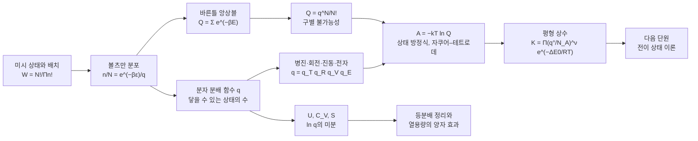

# 물리화학 11. 통계 열역학 — 에너지 준위를 세어 열역학을 다시 세우다
<!-- prev: pchem-10, pchem-2, umath-7 -->
<!-- next: pchem-12 -->

> [!NOTE]
> **이 단원의 범위**
> - 미시 상태와 배치, 배치의 무게와 지배적 배치, 볼츠만 분포의 유도($\beta = 1/k_\mathrm{B}T$)
> - 분자 분배 함수의 뜻(열적으로 닿을 수 있는 상태의 수)과 운동별 분해
> - 병진·회전(대칭수)·진동·전자 분배 함수와 특성 온도
> - 내부 에너지·열용량·엔트로피의 통계적 표현, 두 준위 계
> - 바른틀 앙상블과 바른틀 분배 함수, 구별할 수 없는 입자와 $1/N!$, 에너지 요동
> - 분배 함수로 구하는 열역학 함수: $A = -k_\mathrm{B}T\ln Q$, 상태 방정식, 자쿠어–테트로데 식
> - 열용량과 등분배 정리(고전 극한과 그 한계, 아인슈타인 고체)
> - 분배 함수로 구하는 평형 상수(해리·이성질화·동위 원소 교환)

**학습 목표**

1. 배치와 그 무게 $W = N!/\prod n_j!$를 계산하고, 입자 수가 많을 때 한 배치가 압도적으로 지배하는 까닭을 설명할 수 있다.
2. 스털링 근사와 라그랑주 승수로 볼츠만 분포를 유도하고, 에너지 승수가 $\beta = 1/k_\mathrm{B}T$임을 열역학과 맞추어 보일 수 있다.
3. 병진·회전·진동·전자 분배 함수를 에너지 준위에서 유도하고, 특성 온도와 비교해 각 운동이 '얼어 있는지' 판단할 수 있다.
4. 분배 함수에서 내부 에너지·열용량·엔트로피를 계산하고, 두 준위 계의 쇼트키 이상과 엔트로피의 극한을 해석할 수 있다.
5. 바른틀 앙상블에서 바른틀 분배 함수를 정의하고, $Q = q^N/N!$에서 이상 기체의 상태 방정식과 자쿠어–테트로데 식을 유도할 수 있다.
6. 등분배 정리를 유도하고, 실제 기체·고체의 열용량이 고전값에서 벗어나는 까닭을 양자화로 설명할 수 있다.
7. 분광 자료로 표준 몰 엔트로피와 평형 상수를 계산하고, 열량 측정·열역학 자료표의 값과 비교할 수 있다.

**이 단원의 학습 사다리**

| 단계 | 무엇을 하나? |
|---|---|
| STEP 1. 이전 학습 다시 보기 | $S = k_\mathrm{B}\ln W$, 볼츠만 분포의 첫 유도, 양자화된 에너지 준위와 분광 상수, $A(T,V)$의 자연 변수 |
| STEP 2. 기초 다지기 | 스털링 근사, 라그랑주 승수, 합을 적분으로 바꾸기, $\beta$ 미분 요령 |
| STEP 3. 핵심 개념 | 배치 → 볼츠만 분포 → $q$의 뜻 → 병진·회전·진동·전자 → $U$와 $C_V$ → $S$ → 바른틀 앙상블 → 열역학 함수와 자쿠어–테트로데 → 등분배와 열용량 → 평형 상수 |
| STEP 4. 오개념 바로잡기 | "가장 낮은 준위가 늘 가장 많이 점유된다", "등분배 정리는 언제나 맞는다" 같은 착각 |
| STEP 5. 대학원·연구로 | 큰 바른틀 앙상블과 양자 통계, 디바이 고체, 분자 시뮬레이션과 자유 에너지 계산 |
| STEP 6. 생활·산업·진로 | 고온 기체의 열역학 자료표, 동위 원소 효과, 신약의 결합 자유 에너지, 고온 화학 평형 |

---

## 🗺️ 단원 들어가기

열역학 자료표를 펴면 25 ℃, 1 bar에서 질소의 표준 몰 엔트로피가 $191.6\ \mathrm{J/(mol\cdot K)}$라고 적혀 있다. 「열역학 제2·3법칙과 엔트로피」에서는 이 값을 얻으려고 거의 0 K까지 식힌 고체의 열용량을 재고, 녹는점·끓는점의 숨은열을 더하고, 저온 부분을 디바이 식으로 외삽하였다. 몇 달이 걸리는 정밀 열량 측정이다.

그런데 똑같은 값을 **분광기 한 대와 종이 한 장**으로 얻을 수 있다. 질소 분자의 질량, 회전 스펙트럼에서 읽은 회전 상수, 적외선·라만 스펙트럼에서 읽은 진동 파수 — 이 세 숫자만 있으면 이 단원의 식으로 $191.6\ \mathrm{J/(mol\cdot K)}$를 소수 첫째 자리까지 다시 계산할 수 있다. 분자 하나의 에너지 준위(양자역학)와 $10^{23}$개 분자의 거시적 성질(열역학)을 잇는 다리가 **통계 열역학(statistical thermodynamics)** 이다.

다리의 핵심은 한 개의 합이다. 분자가 가질 수 있는 모든 상태의 볼츠만 인자를 더한 **분배 함수** $q = \sum_i e^{-\varepsilon_i/k_\mathrm{B}T}$. 이 합을 알면 내부 에너지, 열용량, 엔트로피, 압력, 화학 퍼텐셜, 평형 상수까지 미분과 로그만으로 모두 나온다. 「화학 평형과 전기화학」의 마지막에 던진 질문, "평형 상수 $K$는 왜 그 크기인가?"에 이 단원이 분자 수준의 답을 준다. 그리고 다음 단원 「반응 속도론과 반응 동역학」의 전이 상태 이론은 이 단원의 분배 함수를 활성화 착물에 그대로 적용한 것이다.

---

## STEP 1. 🔙 이전 학습 다시 보기

### 연계 개념표

| 이전 단원 | 그때 배운 것 | 이 단원에서 확장되는 것 |
|---|---|---|
| 일반화학 「화학 열역학」 | $S = k_\mathrm{B}\ln W$, 상자 두 칸에 분자 나누기, CO의 잔류 엔트로피 $R\ln 2$ | 칸 대신 **에너지 준위**에 분자를 나누고, $W$를 최대로 하는 배치에서 볼츠만 분포와 $S$를 계산 |
| 수학 도구 7 「확률과 통계」 | 라그랑주 승수로 볼츠만 분포를 유도, $\beta = 1/k_\mathrm{B}T$, 25 ℃의 $k_\mathrm{B}T$(207 $\mathrm{cm^{-1}}$) | 분배 함수를 운동별로 **실제로 계산**하고, 거기서 모든 열역학 함수를 얻는다. 분자 하나의 분포에서 계 전체의 앙상블로 |
| 물리화학 2 「열역학 제2·3법칙과 엔트로피」 | 열량 측정으로 절대 엔트로피, 디바이 외삽, 잔류 엔트로피, 깁스의 역설 | 분광 자료로 계산한 **통계 엔트로피**, 깁스의 역설을 $1/N!$로 해결, 제3법칙의 통계적 근거 |
| 물리화학 3 「자유 에너지와 화학 퍼텐셜」 | $A(T,V)$를 알면 $p = -(\partial A/\partial V)_T$, $S = -(\partial A/\partial T)_V$ | $A = -k_\mathrm{B}T\ln Q$로 $A(T,V)$를 분자 자료에서 **직접** 얻는다 |
| 물리화학 1 「기체의 성질과 열역학 제1법칙」 | 이원자 기체 $C_{V,\mathrm{m}} \approx \tfrac{5}{2}R$, 진동은 실온에서 '얼어 있다' | 등분배 정리의 유도와 진동 열용량의 정량 계산(아인슈타인 함수) |
| 물리화학 6 「화학 평형과 전기화학」 | $\Delta_\mathrm{r}G^\circ = -RT\ln K$, 판트호프 식 | $K$를 분배 함수와 해리 에너지로 계산 |
| 물리화학 8 「진동·회전 운동과 수소 원자」, 물리화학 10 「분자 분광학」 | 상자 속 입자·강체 회전자·조화 진동자의 에너지 준위와 축퇴도, 회전 상수 $B$와 진동 파수 $\tilde\nu$ | 그 준위들을 볼츠만 인자로 더해 분배 함수를 만든다 |

### 준비 운동 (사전 진단)

**Q1.** 에너지가 $1000\ \mathrm{cm^{-1}}$ 차이 나는 두 상태(축퇴도 같음)가 있다. 298 K에서 위 상태와 아래 상태의 점유비는? (298 K에서 $k_\mathrm{B}T/hc = 207\ \mathrm{cm^{-1}}$)

**Q2.** HCl의 회전 상수는 $B = 10.59\ \mathrm{cm^{-1}}$이다. 강체 회전자 준위 $E_J = hcBJ(J+1)$에서 $J = 2$ 준위의 에너지(파수 단위)와 축퇴도를 쓰시오.

**Q3.** 스털링 근사 $\ln N! \approx N\ln N - N$으로 $\ln 100!$을 어림하고, 정확한 값 363.7과 비교하시오.

**Q4.** 헬름홀츠 에너지 $A(T, V)$를 알 때 압력과 엔트로피를 얻는 식을 쓰시오.

정답 및 해설

**Q1.** $e^{-1000/207} = e^{-4.83} \approx 8.0\times10^{-3}$. 위 상태에는 아래 상태의 0.8 %만 있다. 이 단원 내내 쓰는 판단 기준은 "준위 간격이 $k_\mathrm{B}T$보다 큰가, 작은가"이다.

**Q2.** $E_2/hc = 10.59\times2\times3 = 63.5\ \mathrm{cm^{-1}}$, 축퇴도 $2J + 1 = 5$. STEP 3 ⑤에서 이 축퇴도 때문에 HCl은 $J = 0$이 아니라 $J = 3$ 준위에 분자가 가장 많다는 것을 본다.

**Q3.** $100\ln 100 - 100 = 360.5$로 정확한 값보다 약 0.9 % 작다. $N$이 $10^{23}$ 정도이면 상대 오차는 무시할 수 있다(STEP 2 디딤돌 1).

**Q4.** $p = -(\partial A/\partial V)_T$, $S = -(\partial A/\partial T)_V$ (물리화학 3 「자유 에너지와 화학 퍼텐셜」의 기본 방정식 $dA = -S\,dT - p\,dV$). STEP 3 ⑩에서 $A = -k_\mathrm{B}T\ln Q$를 여기에 넣는다.

---

## STEP 2. 🧱 기초 다지기

### 디딤돌 1. 스털링 근사 — 큰 수의 계승을 로그로

수학 도구 2 '스털링 근사'에서 익힌 식을 다시 쓴다. 통계 열역학의 모든 셈은 $N!$의 로그를 다루므로 이 근사 없이는 한 줄도 나아가지 못한다.

$$
\ln N! \approx N\ln N - N \qquad \left(\text{더 정확히는 } + \tfrac{1}{2}\ln 2\pi N\right)
$$

근거는 $\ln N! = \sum_{k=1}^{N}\ln k \approx \int_1^N \ln x\,dx = N\ln N - N + 1$이다. 덧셈을 적분으로 바꾼 오차와 상수 1은 $N\ln N$에 비해 금방 무시할 수 있게 된다.

| $N$ | $\ln N!$ (정확) | $N\ln N - N$ | 상대 오차 |
|---|---|---|---|
| 10 | 15.10 | 13.03 | 14 % |
| 100 | 363.74 | 360.52 | 0.9 % |
| 1000 | 5912.13 | 5907.76 | 0.07 % |
| $6\times10^{23}$ | — | — | 약 $10^{-23}$ |

#### 디딤돌 예제 1 — $\ln N!$의 미분

스털링 근사로 $\dfrac{d\ln N!}{dN}$을 구하고, 그 뜻을 쓰시오.

**풀이** $\dfrac{d}{dN}(N\ln N - N) = \ln N + 1 - 1 = \ln N$.

**의미** $N!$에서 $(N+1)!$로 가면 로그가 정확히 $\ln(N+1)$만큼 늘어나므로, 큰 $N$에서 연속 미분 $\ln N$은 이 증가량과 같다. STEP 3 ②에서 $\partial\ln W/\partial n_j$를 계산할 때 쓰는 핵심 한 줄이다.

### 디딤돌 2. 라그랑주 승수 — 제약이 있는 최댓값

수학 도구 1 '극값과 라그랑주 승수법'에서 익힌 대로, 함수 $f(x_1, x_2, \dots)$를 제약 $g(x_1, x_2, \dots) = 0$ 아래에서 극대로 하는 점에서는 $\nabla f$가 $\nabla g$에 평행하다. 따라서 승수 $\lambda$를 도입해

$$
\frac{\partial f}{\partial x_j} + \lambda\frac{\partial g}{\partial x_j} = 0 \quad (\text{모든 } j), \qquad g = 0
$$

을 함께 푼다. 제약이 둘이면 승수도 둘이다. 승수의 값은 끝에 제약식에 넣어 정한다.

#### 디딤돌 예제 2 — 확률이 고르게 퍼진 분포가 엔트로피를 최대로 한다

$n$개의 상태에 확률 $p_1, \dots, p_n$이 있을 때 $H = -\sum_i p_i\ln p_i$를 $\sum_i p_i = 1$ 아래에서 최대로 하는 분포를 구하시오.

**풀이** $\dfrac{\partial}{\partial p_j}\left(-\sum p_i\ln p_i\right) + \lambda\dfrac{\partial}{\partial p_j}\left(\sum p_i - 1\right) = -\ln p_j - 1 + \lambda = 0$이므로 $p_j = e^{\lambda - 1}$로 **모든 $j$에서 같다.** 정규화에서 $p_j = 1/n$, 최댓값 $H = \ln n$.

**의미** 제약이 "확률의 합 = 1"뿐이면 모든 상태가 똑같이 그럴듯하다. 여기에 "평균 에너지 일정"이라는 제약 하나를 더하면 분포가 $e^{-\beta\varepsilon_j}$로 기운다(STEP 3 ⑧). 그리고 $k_\mathrm{B}H$가 바로 통계적 엔트로피이다.

### 디딤돌 3. 합을 적분으로 바꾸기 — 촘촘한 준위의 분배 함수

분배 함수는 준위에 대한 **합**이다. 준위 간격이 $k_\mathrm{B}T$보다 아주 작으면, 이웃한 항들이 거의 같으므로 합을 적분으로 바꿀 수 있다. 가장 자주 쓰는 두 경우는 다음과 같다(수학 도구 2 '가우스 적분'과 '등비급수').

$$
\sum_{n=0}^{\infty} e^{-an^2} \approx \int_0^\infty e^{-an^2}\,dn = \frac{1}{2}\sqrt{\frac{\pi}{a}} \quad (a \ll 1), \qquad \sum_{v=0}^{\infty} x^v = \frac{1}{1-x} \quad (\lvert x \rvert < 1)
$$

첫째는 병진·회전처럼 촘촘한 준위에 쓰는 **근사**이고, 둘째는 진동처럼 간격이 일정한 준위에 쓰는 **정확한** 식이다.

#### 디딤돌 예제 3 — 합과 적분의 차이

$a = 1.0\times10^{-2}$과 $a = 1.0\times10^{-4}$에 대해 $\sum_{n=0}^\infty e^{-an^2}$과 $\tfrac{1}{2}\sqrt{\pi/a}$를 비교하시오.

**풀이** 직접 더하면 $a = 10^{-2}$일 때 9.362, 적분은 8.862. $a = 10^{-4}$일 때 89.12와 88.62. 두 경우 모두 차이는 정확히 약 0.5이다.

**의미** 차이 0.5는 $n = 0$ 항(값 1)의 절반, 즉 합과 적분의 '끝자리' 오차이다. 적분값이 커질수록 이 고정된 오차의 비율이 작아진다. 상자 속 기체의 병진 분배 함수는 $10^{25}$ 정도이므로 이 오차는 완전히 무시된다.

### 디딤돌 4. $\beta$ 미분 요령과 특성 온도

통계 열역학에서는 온도 대신 $\beta = 1/k_\mathrm{B}T$로 미분하는 일이 많다. 둘 사이의 변환은

$$
\frac{d}{dT} = \frac{d\beta}{dT}\frac{d}{d\beta} = -\frac{1}{k_\mathrm{B}T^2}\frac{d}{d\beta}, \qquad -\frac{d\ln q}{d\beta} = k_\mathrm{B}T^2\frac{d\ln q}{dT}
$$

이다. 또 준위 간격을 온도 단위로 바꾼 **특성 온도** $\theta = \Delta\varepsilon/k_\mathrm{B} = hc\tilde\nu/k_\mathrm{B}$를 쓰면 비교가 쉬워진다. $hc/k_\mathrm{B} = 1.4388\ \mathrm{cm\cdot K}$이므로 $\theta(\mathrm{K}) = 1.4388\times\tilde\nu(\mathrm{cm^{-1}})$이다. $T \gg \theta$이면 그 운동은 고전적으로, $T \ll \theta$이면 '얼어 있다'.

#### 디딤돌 예제 4 — 거듭제곱 꼴 분배 함수의 평균 에너지

$q = aT^{s}$($a$, $s$는 상수)일 때 분자 하나의 평균 에너지 $\langle\varepsilon\rangle = k_\mathrm{B}T^2\,d\ln q/dT$를 구하시오.

**풀이** $\ln q = \ln a + s\ln T$, $\dfrac{d\ln q}{dT} = \dfrac{s}{T}$, $\langle\varepsilon\rangle = sk_\mathrm{B}T$.

**의미** 상수 $a$(부피, 질량, 회전 상수 등)는 평균 에너지에 들어오지 않는다. 병진은 $q \propto T^{3/2}$이어서 $\tfrac{3}{2}k_\mathrm{B}T$, 선형 분자의 고온 회전은 $q \propto T$이어서 $k_\mathrm{B}T$이다. 등분배 정리(STEP 3 ⑪)의 결과를 이렇게 미리 엿볼 수 있다.

---

## STEP 3. 📘 핵심 개념

