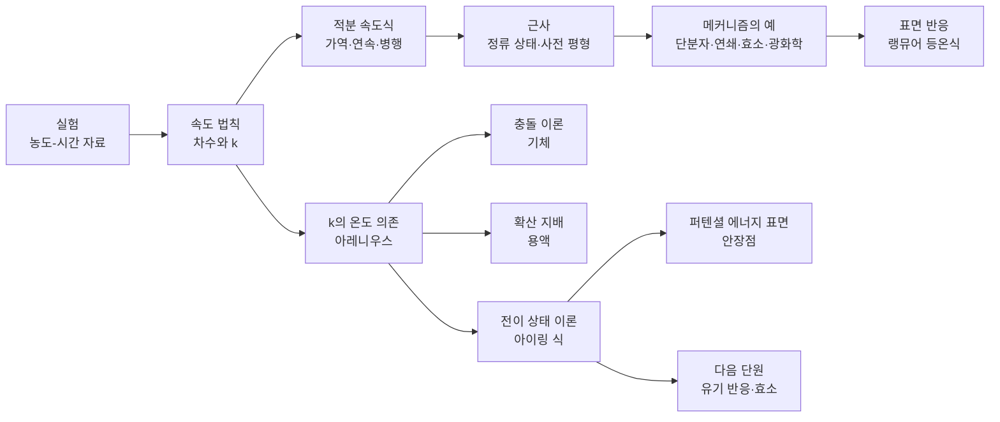

# 물리화학 12. 반응 속도론과 반응 동역학 — 속도 법칙에서 퍼텐셜 에너지 표면까지, 반응이 지나가는 길
<!-- prev: pchem-11, uchem-7, umath-4 -->
<!-- next: ochem-4, bchem-4 -->

> [!NOTE]
> **이 단원의 범위**
> - 반응 속도의 실험적 측정(흐름법, 섬광 광분해, 이완법), 속도 법칙과 차수 결정, 적분 속도식(서로 다른 두 반응물의 2차, n차 반감기)
> - 가역 반응과 이완 시간, 연속 반응과 병행 반응의 정확한 해
> - 정류 상태 근사와 사전 평형 근사(성립 조건과 음의 활성화 에너지)
> - 반응 메커니즘의 예: 린데만–힌셜우드 단분자 반응, 연쇄 반응($\mathrm{H_2 + Br_2}$, 폭발), 효소 반응(미카엘리스–멘텐), 광화학(양자 수득률, 슈테른–폴머 소광)
> - 온도 의존: 아레니우스 식과 활성화 에너지의 정의, 복합 반응의 겉보기 활성화 에너지
> - 충돌 이론(반응 단면적, 입체 인자)과 확산 지배 반응(스몰루코프스키 식)
> - 전이 상태 이론(아이링 식, 활성화 엔탈피·엔트로피), 퍼텐셜 에너지 표면과 동위 원소 효과
> - 표면 흡착(랭뮤어 등온식)과 불균일 촉매(랭뮤어–힌셜우드, 일리–리딜 메커니즘)

**학습 목표**

1. 반응 속도를 화학량론 계수로 정의하고, 초기 속도법·고립법과 적분 속도식으로 속도 법칙과 속도 상수를 실험 자료에서 결정할 수 있다.
2. 가역·연속·병행 반응의 연립 미분방정식을 풀어 농도–시간 관계와 이완 시간을 구하고, 이완법 자료를 해석할 수 있다.
3. 정류 상태 근사와 사전 평형 근사로 메커니즘에서 속도 법칙을 유도하고, 두 근사가 성립하는 조건을 정확한 해와 비교해 판단할 수 있다.
4. 린데만–힌셜우드 메커니즘, 연쇄 반응, 미카엘리스–멘텐 메커니즘, 광화학 소광에 이 근사를 적용하여 겉보기 차수의 변화와 측정 가능한 매개변수를 설명할 수 있다.
5. 활성화 에너지를 $E_\mathrm{a} = RT^2\,d\ln k/dT$로 정의하고, 충돌 이론과 확산 이론으로 속도 상수의 크기를 어림하여 실험값과 비교할 수 있다.
6. 전이 상태 이론에서 아이링 식을 유도하고, 활성화 엔탈피·엔트로피를 구해 전이 상태의 구조를 추론하며, 퍼텐셜 에너지 표면과 영점 에너지로 동위 원소 효과를 설명할 수 있다.
7. 랭뮤어 등온식을 유도하여 흡착 자료를 해석하고, 표면 반응 메커니즘에서 불균일 촉매 반응의 속도 법칙을 유도할 수 있다.

**이 단원의 학습 사다리**

| 단계 | 무엇을 하나? |
|---|---|
| STEP 1. 이전 학습 다시 보기 | 0·1·2차 적분 속도 법칙, 속도 결정 단계, 아레니우스 식(일반화학), 연립 미분방정식(수학 도구 4), 분배 함수와 평형 상수(물리화학 11) |
| STEP 2. 기초 다지기 | 1계 선형 미분방정식과 적분 인자, 작은 변위의 선형화, 볼츠만 인자의 적분, 직선화와 최소 제곱 맞춤 |
| STEP 3. 핵심 개념 | 측정과 속도 법칙 → 적분 속도식 → 가역 반응과 이완 → 연속·병행 반응 → 정류 상태와 사전 평형 → 단분자·연쇄·효소·광화학 → 아레니우스 → 충돌·확산 → 전이 상태 이론 → 퍼텐셜 에너지 표면 → 표면 흡착과 촉매 |
| STEP 4. 오개념 바로잡기 | "반응식의 계수가 차수이다", "정류 상태면 중간체 농도가 일정하다", "활성화 에너지는 늘 양수이다" 같은 착각 |
| STEP 5. 대학원·연구로 | RRKM 이론, 마커스 전자 이동 이론, 펨토초 분광과 분자 빔 |
| STEP 6. 생활·산업·진로 | 성층권 오존의 연쇄 파괴, 자동차 배기가스 촉매, 암모니아 합성 촉매, 의약품 유효 기간의 가속 시험 |

---

## 🗺️ 단원 들어가기

열역학은 반응이 어디로 가는지(평형)를 알려 주지만, 얼마나 빨리 가는지는 침묵한다. 25 ℃에서 다이아몬드는 흑연이 되는 쪽이 안정하지만 수십억 년이 지나도 반지는 그대로이다. 반면 물속에서 수소 이온과 수산화 이온은 만나자마자 물이 되어, 그 속도는 두 이온이 물 분자 사이를 헤치고 서로를 찾아가는 **확산**이 정한다. 반응 시간의 범위는 펨토초($10^{-15}$ s)에서 지질 시대까지 서른 자릿수 이상에 걸쳐 있다. 이 차이를 만드는 것은 무엇인가?

일반화학 「화학 반응 속도론」에서는 속도 법칙, 반감기, 아레니우스 식을 '규칙'으로 배웠다. 이 단원은 두 방향으로 더 들어간다. 첫째는 **거시적 속도론**이다. 메커니즘을 연립 미분방정식으로 쓰고, 그것을 정확히 또는 근사적으로 풀어 관측되는 속도 법칙을 **유도**한다. 왜 어떤 반응은 압력에 따라 차수가 바뀌고, 왜 $\mathrm{H_2 + Br_2}$의 속도는 $[\mathrm{Br_2}]^{1/2}$에 비례하며, 왜 효소 반응은 기질이 많아지면 포화되는가? 둘째는 **반응 동역학**이다. 속도 상수 $k$ 하나의 값을 분자의 크기·속력·충돌, 확산, 그리고 원자들이 넘어가는 **퍼텐셜 에너지 표면**의 안장점(전이 상태)에서 계산한다. 물리화학 11에서 익힌 분배 함수가 여기서 속도 상수로 바뀐다.

---

## STEP 1. 🔙 이전 학습 다시 보기

### 연계 개념표

| 이전 단원 | 그때 배운 것 | 이 단원에서 확장되는 것 |
|---|---|---|
| 일반화학 「화학 반응 속도론」 | 속도 법칙과 초기 속도법, 0·1·2차 적분 속도 법칙과 반감기, 속도 결정 단계, 아레니우스 식, 촉매와 미카엘리스–멘텐 식(결과만) | 서로 다른 두 반응물의 2차·n차 반응, 가역·연속 반응의 정확한 해, 정류 상태 근사로 메커니즘에서 속도 법칙을 **유도**, 아레니우스 매개변수의 분자적 의미 |
| 일반화학 「화학 평형」·물리화학 6 「화학 평형과 전기화학」 | $K$의 열역학적 정의, 판트호프 식 | 평형 상수 = 정·역 속도 상수의 비, 평형 부근의 이완, 사전 평형, 전이 상태와의 '준평형' |
| 수학 도구 4 「상미분방정식」 | 변수 분리형, 1계 선형 방정식과 적분 인자, 연립 1계 방정식(연속 반응의 해) | 그 해를 실제 메커니즘에 적용하고, 근사(정류 상태)가 정확한 해의 어떤 극한인지 정량적으로 판단 |
| 수학 도구 7 「확률과 통계」 | 볼츠만 분포, 마구걷기와 확산, 최소 제곱 맞춤 | 충돌 에너지 분포에서 아레니우스 인자를 유도, 확산 계수로 확산 지배 속도 상수, 속도 자료의 맞춤 |
| 물리화학 11 「통계 열역학」 | 분자 분배 함수, 분배 함수로 구하는 평형 상수 | 반응물과 활성화 착물 사이의 '평형 상수'로 속도 상수를 계산(전이 상태 이론) |
| 물리화학 9 「다전자 원자와 화학 결합」 | 보른–오펜하이머 근사, 퍼텐셜 에너지 곡선 | 원자가 셋 이상일 때의 퍼텐셜 에너지 **표면**과 그 위의 반응 경로 |

### 준비 운동 (사전 진단)

**Q1.** 1차 반응의 반감기가 12.0 min이다. 속도 상수와, 반응물이 처음의 12.5 %로 줄어드는 데 걸리는 시간을 구하시오.

**Q2.** 반응 $\mathrm{2NO(g) + O_2(g) \rightarrow 2NO_2(g)}$의 속도 법칙이 $v = k[\mathrm{NO}]^2[\mathrm{O_2}]$라는 것만으로 이 반응이 3분자 단일 단계 반응이라고 결론지을 수 있는가?

**Q3.** 활성화 에너지가 $50.0\ \mathrm{kJ/mol}$인 반응의 속도 상수는 25 ℃에서 35 ℃로 온도를 올리면 몇 배가 되는가?

**Q4.** 수학 도구 4에서 풀었던 $\dfrac{dy}{dt} + ay = be^{-ct}$($a \neq c$, $y(0) = 0$)의 해를 쓰시오.

정답 및 해설

**Q1.** $k = \ln 2/t_{1/2} = 0.0578\ \mathrm{min^{-1}}$. 12.5 % $= (1/2)^3$이므로 반감기 세 번, 36.0 min이다.

**Q2.** 없다. 속도 법칙은 메커니즘이 만족해야 할 조건일 뿐이다. 실제로 이 반응은 빠른 사전 평형 $\mathrm{2NO \rightleftharpoons N_2O_2}$ 뒤에 $\mathrm{N_2O_2 + O_2}$의 느린 단계가 오는 메커니즘으로도 같은 속도 법칙을 준다(STEP 3 ⑤).

**Q3.** $\ln(k_2/k_1) = \dfrac{E_\mathrm{a}}{R}\left(\dfrac{1}{T_1} - \dfrac{1}{T_2}\right) = \dfrac{50\,000}{8.314}\left(\dfrac{1}{298.15} - \dfrac{1}{308.15}\right) = 0.655$이므로 약 1.93배.

**Q4.** $y(t) = \dfrac{b}{a - c}\left(e^{-ct} - e^{-at}\right)$. STEP 3 ④에서 연속 반응 중간체의 농도가 바로 이 꼴이다.

---

## STEP 2. 🧱 기초 다지기

### 디딤돌 1. 1계 선형 미분방정식과 적분 인자 — 연속 반응의 열쇠

수학 도구 4 '1계 선형 방정식과 적분 인자'에서 익힌 대로, $\dfrac{dy}{dt} + a\,y = f(t)$의 양변에 적분 인자 $e^{at}$를 곱하면 왼쪽이 $\dfrac{d}{dt}(y\,e^{at})$가 된다. 따라서

$$
y(t) = e^{-at}\left[\,y(0) + \int_0^t f(t')\,e^{at'}\,dt'\,\right]
$$

반응 속도론에서는 $f(t)$가 앞 단계에서 '공급'되는 속도, $a\,y$가 다음 단계로 '소모'되는 속도이다. 공급이 지수적으로 줄어드는 $f = k_1[\mathrm{A}]_0e^{-k_1t}$이면 ④의 중간체 농도가 나온다.

**예** $dy/dt + 2y = 6$, $y(0) = 0$이면 $y = e^{-2t}\int_0^t 6e^{2t'}dt' = 3(1 - e^{-2t})$이다. 공급과 소모가 균형을 이루는 값 $y = 3$으로 시간 상수 $1/2$로 다가간다. 이 '균형 값'이 ⑤의 정류 상태와 같은 생각이다.

### 디딤돌 2. 작은 변위의 선형화 — 평형 부근에서 비선형 속도식 풀기

수학 도구 2 '테일러 급수와 근사'에서처럼 $x = x_\text{평형} + \delta$로 놓고 $\delta$의 1차 항만 남기면, $[\mathrm{A}][\mathrm{B}]$ 같은 곱이 들어간 비선형 속도식도 선형이 된다.

$$
([\mathrm{A}]_\text{eq} - \delta)([\mathrm{B}]_\text{eq} - \delta) \approx [\mathrm{A}]_\text{eq}[\mathrm{B}]_\text{eq} - ([\mathrm{A}]_\text{eq} + [\mathrm{B}]_\text{eq})\,\delta
$$

**예** $[\mathrm{A}]_\text{eq} = [\mathrm{B}]_\text{eq} = 1.0\ \mathrm{mM}$, $\delta = 0.010\ \mathrm{mM}$이면 정확한 곱은 $0.990^2 = 0.980100$, 근사값은 $1 - 2(0.010) = 0.980000$으로 상대 오차가 $10^{-4}$이다. 온도 도약 이완법에서 평형을 1 % 이하로만 흔드는 까닭이 이것이다(③).

### 디딤돌 3. 볼츠만 인자의 적분 — '문턱을 넘는 분자'의 비율

수학 도구 7 '가장 그럴듯한 분포와 볼츠만 분포'에서 에너지 $E$의 확률이 $e^{-E/k_\mathrm{B}T}$에 비례함을 보았다. 반응 속도론에서 자주 만나는 적분은

$$
\int_{E_0}^{\infty} e^{-E/k_\mathrm{B}T}\,dE = k_\mathrm{B}T\,e^{-E_0/k_\mathrm{B}T}, \qquad \int_{E_0}^{\infty}(E - E_0)\,e^{-E/k_\mathrm{B}T}\,dE = (k_\mathrm{B}T)^2\,e^{-E_0/k_\mathrm{B}T}
$$

둘째 식은 $u = E - E_0$로 바꾸고 부분 적분(수학 도구 2)하면 얻는다. 지수 인자 $e^{-E_0/k_\mathrm{B}T}$는 **문턱 $E_0$를 넘는 몫**을 나타내며, ⑪에서 충돌 이론의 아레니우스 인자가 된다.

**예** 1차원 볼츠만 분포 $p(E) = e^{-E/k_\mathrm{B}T}/k_\mathrm{B}T$에서 $E > E_0$인 몫은 $e^{-E_0/k_\mathrm{B}T}$이다. 1 mol당 $E_0 = 50.0\ \mathrm{kJ}$이면 300 K에서 $e^{-50\,000/(8.314\times300)} = 2.0\times10^{-9}$, 310 K에서 $3.8\times10^{-9}$이다. 온도 10 K 차이로 '문턱을 넘는 분자'가 거의 두 배가 된다.

### 디딤돌 4. 직선화와 최소 제곱 맞춤 — 속도 자료에서 매개변수 읽기

속도론의 식은 대부분 적당한 변수로 바꾸면 직선이 된다. 수학 도구 7 '최소 제곱 맞춤'의 기울기·절편 공식을 그대로 쓴다.

| 원래 식 | 직선화 | 기울기 / 절편 |
|---|---|---|
| $[\mathrm{A}] = [\mathrm{A}]_0e^{-kt}$ | $\ln[\mathrm{A}]$ 대 $t$ | $-k$ / $\ln[\mathrm{A}]_0$ |
| $k = Ae^{-E_\mathrm{a}/RT}$ | $\ln k$ 대 $1/T$ | $-E_\mathrm{a}/R$ / $\ln A$ |
| $v = \dfrac{V_\text{max}[\mathrm{S}]}{K_\mathrm{M} + [\mathrm{S}]}$ | $1/v$ 대 $1/[\mathrm{S}]$ | $K_\mathrm{M}/V_\text{max}$ / $1/V_\text{max}$ |
| $\theta = \dfrac{Kp}{1 + Kp}$ | $p/V$ 대 $p$ | $1/V_\infty$ / $1/(KV_\infty)$ |

**예** $\ln[\mathrm{A}]$가 $t = 0, 10, 20\ \mathrm{s}$에서 $-2.303, -2.653, -3.003$이면 $\bar{t} = 10$, 기울기 $= [(-10)(0.350) + 0 + (10)(-0.350)]/200 = -0.0350\ \mathrm{s^{-1}}$, 즉 $k = 0.0350\ \mathrm{s^{-1}}$이다.

> [!WARNING]
> 직선화는 오차의 무게를 바꾼다. 라인위버–버크 도시($1/v$)에서는 가장 작은 $v$(가장 불확실한 점)의 오차가 가장 크게 부풀려진다. 현대의 자료 처리에서는 원래 식에 **비선형 최소 제곱 맞춤**을 하고, 직선화는 눈으로 확인하는 용도로 쓴다.

---

## STEP 3. 📘 핵심 개념

