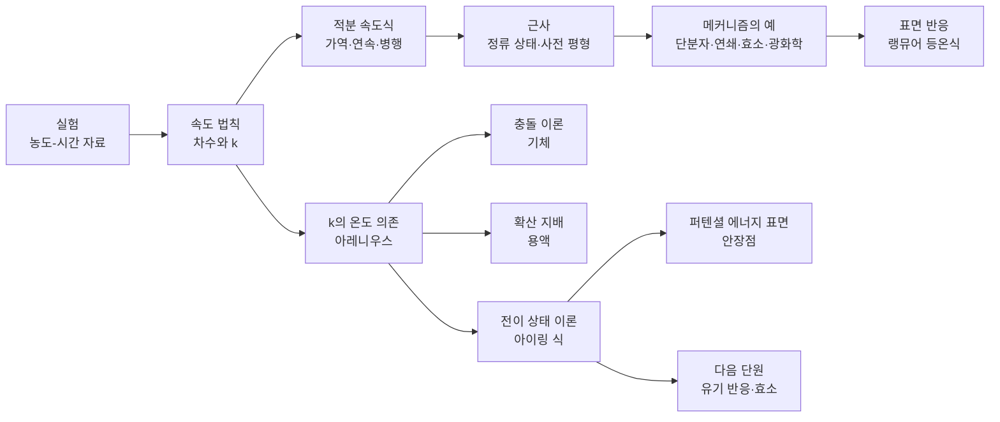

# 물리화학 12. 반응 속도론과 반응 동역학 — 속도 법칙에서 퍼텐셜 에너지 표면까지, 반응이 지나가는 길
<!-- prev: pchem-11, uchem-7, umath-4 -->
<!-- next: ochem-4, bchem-4 -->

> [!NOTE]
> **이 단원의 범위**
> - 반응 속도의 실험적 측정(흐름법, 섬광 광분해, 이완법), 속도 법칙과 차수 결정, 적분 속도식(서로 다른 두 반응물의 2차, n차 반감기)
> - 가역 반응과 이완 시간, 연속 반응과 병행 반응의 정확한 해
> - 정류 상태 근사와 사전 평형 근사(성립 조건과 음의 활성화 에너지)
> - 반응 메커니즘의 예: 린데만–힌셜우드 단분자 반응, 연쇄 반응($\mathrm{H_2 + Br_2}$, 폭발), 효소 반응(미카엘리스–멘텐), 광화학(양자 수득률, 슈테른–폴머 소광)
> - 온도 의존: 아레니우스 식과 활성화 에너지의 정의, 복합 반응의 겉보기 활성화 에너지
> - 충돌 이론(반응 단면적, 입체 인자)과 확산 지배 반응(스몰루코프스키 식)
> - 전이 상태 이론(아이링 식, 활성화 엔탈피·엔트로피), 퍼텐셜 에너지 표면과 동위 원소 효과
> - 표면 흡착(랭뮤어 등온식)과 불균일 촉매(랭뮤어–힌셜우드, 일리–리딜 메커니즘)

**학습 목표**

1. 반응 속도를 화학량론 계수로 정의하고, 초기 속도법·고립법과 적분 속도식으로 속도 법칙과 속도 상수를 실험 자료에서 결정할 수 있다.
2. 가역·연속·병행 반응의 연립 미분방정식을 풀어 농도–시간 관계와 이완 시간을 구하고, 이완법 자료를 해석할 수 있다.
3. 정류 상태 근사와 사전 평형 근사로 메커니즘에서 속도 법칙을 유도하고, 두 근사가 성립하는 조건을 정확한 해와 비교해 판단할 수 있다.
4. 린데만–힌셜우드 메커니즘, 연쇄 반응, 미카엘리스–멘텐 메커니즘, 광화학 소광에 이 근사를 적용하여 겉보기 차수의 변화와 측정 가능한 매개변수를 설명할 수 있다.
5. 활성화 에너지를 $E_\mathrm{a} = RT^2\,d\ln k/dT$로 정의하고, 충돌 이론과 확산 이론으로 속도 상수의 크기를 어림하여 실험값과 비교할 수 있다.
6. 전이 상태 이론에서 아이링 식을 유도하고, 활성화 엔탈피·엔트로피를 구해 전이 상태의 구조를 추론하며, 퍼텐셜 에너지 표면과 영점 에너지로 동위 원소 효과를 설명할 수 있다.
7. 랭뮤어 등온식을 유도하여 흡착 자료를 해석하고, 표면 반응 메커니즘에서 불균일 촉매 반응의 속도 법칙을 유도할 수 있다.

**이 단원의 학습 사다리**

| 단계 | 무엇을 하나? |
|---|---|
| STEP 1. 이전 학습 다시 보기 | 0·1·2차 적분 속도 법칙, 속도 결정 단계, 아레니우스 식(일반화학), 연립 미분방정식(수학 도구 4), 분배 함수와 평형 상수(물리화학 11) |
| STEP 2. 기초 다지기 | 1계 선형 미분방정식과 적분 인자, 작은 변위의 선형화, 볼츠만 인자의 적분, 직선화와 최소 제곱 맞춤 |
| STEP 3. 핵심 개념 | 측정과 속도 법칙 → 적분 속도식 → 가역 반응과 이완 → 연속·병행 반응 → 정류 상태와 사전 평형 → 단분자·연쇄·효소·광화학 → 아레니우스 → 충돌·확산 → 전이 상태 이론 → 퍼텐셜 에너지 표면 → 표면 흡착과 촉매 |
| STEP 4. 오개념 바로잡기 | "반응식의 계수가 차수이다", "정류 상태면 중간체 농도가 일정하다", "활성화 에너지는 늘 양수이다" 같은 착각 |
| STEP 5. 대학원·연구로 | RRKM 이론, 마커스 전자 이동 이론, 펨토초 분광과 분자 빔 |
| STEP 6. 생활·산업·진로 | 성층권 오존의 연쇄 파괴, 자동차 배기가스 촉매, 암모니아 합성 촉매, 의약품 유효 기간의 가속 시험 |

---

## 🗺️ 단원 들어가기

열역학은 반응이 어디로 가는지(평형)를 알려 주지만, 얼마나 빨리 가는지는 침묵한다. 25 ℃에서 다이아몬드는 흑연이 되는 쪽이 안정하지만 수십억 년이 지나도 반지는 그대로이다. 반면 물속에서 수소 이온과 수산화 이온은 만나자마자 물이 되어, 그 속도는 두 이온이 물 분자 사이를 헤치고 서로를 찾아가는 **확산**이 정한다. 반응 시간의 범위는 펨토초($10^{-15}$ s)에서 지질 시대까지 서른 자릿수 이상에 걸쳐 있다. 이 차이를 만드는 것은 무엇인가?

일반화학 「화학 반응 속도론」에서는 속도 법칙, 반감기, 아레니우스 식을 '규칙'으로 배웠다. 이 단원은 두 방향으로 더 들어간다. 첫째는 **거시적 속도론**이다. 메커니즘을 연립 미분방정식으로 쓰고, 그것을 정확히 또는 근사적으로 풀어 관측되는 속도 법칙을 **유도**한다. 왜 어떤 반응은 압력에 따라 차수가 바뀌고, 왜 $\mathrm{H_2 + Br_2}$의 속도는 $[\mathrm{Br_2}]^{1/2}$에 비례하며, 왜 효소 반응은 기질이 많아지면 포화되는가? 둘째는 **반응 동역학**이다. 속도 상수 $k$ 하나의 값을 분자의 크기·속력·충돌, 확산, 그리고 원자들이 넘어가는 **퍼텐셜 에너지 표면**의 안장점(전이 상태)에서 계산한다. 물리화학 11에서 익힌 분배 함수가 여기서 속도 상수로 바뀐다.

---

## STEP 1. 🔙 이전 학습 다시 보기

### 연계 개념표

| 이전 단원 | 그때 배운 것 | 이 단원에서 확장되는 것 |
|---|---|---|
| 일반화학 「화학 반응 속도론」 | 속도 법칙과 초기 속도법, 0·1·2차 적분 속도 법칙과 반감기, 속도 결정 단계, 아레니우스 식, 촉매와 미카엘리스–멘텐 식(결과만) | 서로 다른 두 반응물의 2차·n차 반응, 가역·연속 반응의 정확한 해, 정류 상태 근사로 메커니즘에서 속도 법칙을 **유도**, 아레니우스 매개변수의 분자적 의미 |
| 일반화학 「화학 평형」·물리화학 6 「화학 평형과 전기화학」 | $K$의 열역학적 정의, 판트호프 식 | 평형 상수 = 정·역 속도 상수의 비, 평형 부근의 이완, 사전 평형, 전이 상태와의 '준평형' |
| 수학 도구 4 「상미분방정식」 | 변수 분리형, 1계 선형 방정식과 적분 인자, 연립 1계 방정식(연속 반응의 해) | 그 해를 실제 메커니즘에 적용하고, 근사(정류 상태)가 정확한 해의 어떤 극한인지 정량적으로 판단 |
| 수학 도구 7 「확률과 통계」 | 볼츠만 분포, 마구걷기와 확산, 최소 제곱 맞춤 | 충돌 에너지 분포에서 아레니우스 인자를 유도, 확산 계수로 확산 지배 속도 상수, 속도 자료의 맞춤 |
| 물리화학 11 「통계 열역학」 | 분자 분배 함수, 분배 함수로 구하는 평형 상수 | 반응물과 활성화 착물 사이의 '평형 상수'로 속도 상수를 계산(전이 상태 이론) |
| 물리화학 9 「다전자 원자와 화학 결합」 | 보른–오펜하이머 근사, 퍼텐셜 에너지 곡선 | 원자가 셋 이상일 때의 퍼텐셜 에너지 **표면**과 그 위의 반응 경로 |

### 준비 운동 (사전 진단)

**Q1.** 1차 반응의 반감기가 12.0 min이다. 속도 상수와, 반응물이 처음의 12.5 %로 줄어드는 데 걸리는 시간을 구하시오.

**Q2.** 반응 $\mathrm{2NO(g) + O_2(g) \rightarrow 2NO_2(g)}$의 속도 법칙이 $v = k[\mathrm{NO}]^2[\mathrm{O_2}]$라는 것만으로 이 반응이 3분자 단일 단계 반응이라고 결론지을 수 있는가?

**Q3.** 활성화 에너지가 $50.0\ \mathrm{kJ/mol}$인 반응의 속도 상수는 25 ℃에서 35 ℃로 온도를 올리면 몇 배가 되는가?

**Q4.** 수학 도구 4에서 풀었던 $\dfrac{dy}{dt} + ay = be^{-ct}$($a \neq c$, $y(0) = 0$)의 해를 쓰시오.

정답 및 해설

**Q1.** $k = \ln 2/t_{1/2} = 0.0578\ \mathrm{min^{-1}}$. 12.5 % $= (1/2)^3$이므로 반감기 세 번, 36.0 min이다.

**Q2.** 없다. 속도 법칙은 메커니즘이 만족해야 할 조건일 뿐이다. 실제로 이 반응은 빠른 사전 평형 $\mathrm{2NO \rightleftharpoons N_2O_2}$ 뒤에 $\mathrm{N_2O_2 + O_2}$의 느린 단계가 오는 메커니즘으로도 같은 속도 법칙을 준다(STEP 3 ⑤).

**Q3.** $\ln(k_2/k_1) = \dfrac{E_\mathrm{a}}{R}\left(\dfrac{1}{T_1} - \dfrac{1}{T_2}\right) = \dfrac{50\,000}{8.314}\left(\dfrac{1}{298.15} - \dfrac{1}{308.15}\right) = 0.655$이므로 약 1.93배.

**Q4.** $y(t) = \dfrac{b}{a - c}\left(e^{-ct} - e^{-at}\right)$. STEP 3 ④에서 연속 반응 중간체의 농도가 바로 이 꼴이다.

---

## STEP 2. 🧱 기초 다지기

### 디딤돌 1. 1계 선형 미분방정식과 적분 인자 — 연속 반응의 열쇠

수학 도구 4 '1계 선형 방정식과 적분 인자'에서 익힌 대로, $\dfrac{dy}{dt} + a\,y = f(t)$의 양변에 적분 인자 $e^{at}$를 곱하면 왼쪽이 $\dfrac{d}{dt}(y\,e^{at})$가 된다. 따라서

$$
y(t) = e^{-at}\left[\,y(0) + \int_0^t f(t')\,e^{at'}\,dt'\,\right]
$$

반응 속도론에서는 $f(t)$가 앞 단계에서 '공급'되는 속도, $a\,y$가 다음 단계로 '소모'되는 속도이다. 공급이 지수적으로 줄어드는 $f = k_1[\mathrm{A}]_0e^{-k_1t}$이면 ④의 중간체 농도가 나온다.

**예** $dy/dt + 2y = 6$, $y(0) = 0$이면 $y = e^{-2t}\int_0^t 6e^{2t'}dt' = 3(1 - e^{-2t})$이다. 공급과 소모가 균형을 이루는 값 $y = 3$으로 시간 상수 $1/2$로 다가간다. 이 '균형 값'이 ⑤의 정류 상태와 같은 생각이다.

### 디딤돌 2. 작은 변위의 선형화 — 평형 부근에서 비선형 속도식 풀기

수학 도구 2 '테일러 급수와 근사'에서처럼 $x = x_\text{평형} + \delta$로 놓고 $\delta$의 1차 항만 남기면, $[\mathrm{A}][\mathrm{B}]$ 같은 곱이 들어간 비선형 속도식도 선형이 된다.

$$
([\mathrm{A}]_\text{eq} - \delta)([\mathrm{B}]_\text{eq} - \delta) \approx [\mathrm{A}]_\text{eq}[\mathrm{B}]_\text{eq} - ([\mathrm{A}]_\text{eq} + [\mathrm{B}]_\text{eq})\,\delta
$$

**예** $[\mathrm{A}]_\text{eq} = [\mathrm{B}]_\text{eq} = 1.0\ \mathrm{mM}$, $\delta = 0.010\ \mathrm{mM}$이면 정확한 곱은 $0.990^2 = 0.980100$, 근사값은 $1 - 2(0.010) = 0.980000$으로 상대 오차가 $10^{-4}$이다. 온도 도약 이완법에서 평형을 1 % 이하로만 흔드는 까닭이 이것이다(③).

### 디딤돌 3. 볼츠만 인자의 적분 — '문턱을 넘는 분자'의 비율

수학 도구 7 '가장 그럴듯한 분포와 볼츠만 분포'에서 에너지 $E$의 확률이 $e^{-E/k_\mathrm{B}T}$에 비례함을 보았다. 반응 속도론에서 자주 만나는 적분은

$$
\int_{E_0}^{\infty} e^{-E/k_\mathrm{B}T}\,dE = k_\mathrm{B}T\,e^{-E_0/k_\mathrm{B}T}, \qquad \int_{E_0}^{\infty}(E - E_0)\,e^{-E/k_\mathrm{B}T}\,dE = (k_\mathrm{B}T)^2\,e^{-E_0/k_\mathrm{B}T}
$$

둘째 식은 $u = E - E_0$로 바꾸고 부분 적분(수학 도구 2)하면 얻는다. 지수 인자 $e^{-E_0/k_\mathrm{B}T}$는 **문턱 $E_0$를 넘는 몫**을 나타내며, ⑪에서 충돌 이론의 아레니우스 인자가 된다.

**예** 1차원 볼츠만 분포 $p(E) = e^{-E/k_\mathrm{B}T}/k_\mathrm{B}T$에서 $E > E_0$인 몫은 $e^{-E_0/k_\mathrm{B}T}$이다. 1 mol당 $E_0 = 50.0\ \mathrm{kJ}$이면 300 K에서 $e^{-50\,000/(8.314\times300)} = 2.0\times10^{-9}$, 310 K에서 $3.8\times10^{-9}$이다. 온도 10 K 차이로 '문턱을 넘는 분자'가 거의 두 배가 된다.

### 디딤돌 4. 직선화와 최소 제곱 맞춤 — 속도 자료에서 매개변수 읽기

속도론의 식은 대부분 적당한 변수로 바꾸면 직선이 된다. 수학 도구 7 '최소 제곱 맞춤'의 기울기·절편 공식을 그대로 쓴다.

| 원래 식 | 직선화 | 기울기 / 절편 |
|---|---|---|
| $[\mathrm{A}] = [\mathrm{A}]_0e^{-kt}$ | $\ln[\mathrm{A}]$ 대 $t$ | $-k$ / $\ln[\mathrm{A}]_0$ |
| $k = Ae^{-E_\mathrm{a}/RT}$ | $\ln k$ 대 $1/T$ | $-E_\mathrm{a}/R$ / $\ln A$ |
| $v = \dfrac{V_\text{max}[\mathrm{S}]}{K_\mathrm{M} + [\mathrm{S}]}$ | $1/v$ 대 $1/[\mathrm{S}]$ | $K_\mathrm{M}/V_\text{max}$ / $1/V_\text{max}$ |
| $\theta = \dfrac{Kp}{1 + Kp}$ | $p/V$ 대 $p$ | $1/V_\infty$ / $1/(KV_\infty)$ |

**예** $\ln[\mathrm{A}]$가 $t = 0, 10, 20\ \mathrm{s}$에서 $-2.303, -2.653, -3.003$이면 $\bar{t} = 10$, 기울기 $= [(-10)(0.350) + 0 + (10)(-0.350)]/200 = -0.0350\ \mathrm{s^{-1}}$, 즉 $k = 0.0350\ \mathrm{s^{-1}}$이다.

> [!WARNING]
> 직선화는 오차의 무게를 바꾼다. 라인위버–버크 도시($1/v$)에서는 가장 작은 $v$(가장 불확실한 점)의 오차가 가장 크게 부풀려진다. 현대의 자료 처리에서는 원래 식에 **비선형 최소 제곱 맞춤**을 하고, 직선화는 눈으로 확인하는 용도로 쓴다.

---

## STEP 3. 📘 핵심 개념

### ① 반응 속도의 측정과 속도 법칙

#### 반응 속도의 정의 — 계수로 나누어 하나로

반응식을 $0 = \sum_J \nu_J\mathrm{J}$(물리화학 6의 화학량론 계수: 생성물 +, 반응물 −)로 쓰면, 부피가 일정한 계에서 **반응 속도(rate of reaction)** 는

$$
v = \frac{1}{\nu_J}\frac{d[\mathrm{J}]}{dt} = \frac{1}{V}\frac{d\xi}{dt}
$$

이다. 어느 성분으로 재어도 같은 값이 나오도록 계수로 나눈 것이다. 예를 들어 $\mathrm{2N_2O_5 \rightarrow 4NO_2 + O_2}$에서 $v = -\tfrac12 d[\mathrm{N_2O_5}]/dt = \tfrac14 d[\mathrm{NO_2}]/dt = d[\mathrm{O_2}]/dt$이다. 반응 진행도 $\xi$로 쓰면 이 정의가 물리화학 6의 '반응 진행도'와 같은 생각이라는 것이 드러난다.

#### 측정 방법 — 반응보다 빠른 '시계'가 필요하다

농도를 재는 수단(흡광도, 형광, 전도도, 압력, 질량 분석)은 같아도, 반응이 빠를수록 **반응을 시작하는 방법**과 **기록하는 속도**가 달라져야 한다.

| 방법 | 대략의 시간 분해능 | 원리 |
|---|---|---|
| 실시간 분석(분광 광도계, 압력계, 전도도계) | 초 이상 | 섞은 뒤 시간에 따라 물리량을 연속 기록 |
| 담금질법(quenching) | 초 이상 | 일정 시간 뒤 냉각·희석·중화로 반응을 멈추고 분석 |
| 정지 흐름법(stopped-flow) | 약 1 ms | 두 용액을 혼합 장치로 밀어 넣고 흐름을 갑자기 멈춘 뒤 관측 칸을 분광 측정 |
| 섬광 광분해(flash photolysis) | ns(레이저 펄스에 따라 fs까지) | 짧은 빛 펄스로 라디칼·들뜬 상태를 순간에 만들고 흡수 변화를 추적 |
| 이완법(온도 도약 등) | μs 이하 | 평형 혼합물의 온도·압력을 순간적으로 바꾸고 새 평형으로 가는 과정을 관측(③) |

<!-- 그림 요청: 정지 흐름 장치의 모식도. 왼쪽에 주사기 두 개(용액 A, 용액 B)가 공통 구동 막대로 동시에 밀리고, 두 관이 혼합 장치(T자 접합)에서 만나 관측 칸(광원 → 관측 칸 → 단색화 장치 → 검출기 일직선)으로 이어진다. 관측 칸 뒤에 정지 주사기와 멈춤 막이가 있어 흐름을 멈추는 순간 "시간 0 · 기록 시작" 신호가 나간다. 아래에 작은 그래프: 가로축 시간/ms(0~50), 세로축 흡광도, 처음 약 1 ms 구간을 회색으로 칠하고 "불감 시간(약 1 ms)"이라 표시, 그 뒤 지수적으로 증가하는 곡선. -->

#### 속도 법칙과 차수, 분자도

실험으로 얻은 속도와 농도의 관계를 **속도 법칙(rate law)** 이라 한다. 많은 반응에서 $v = k[\mathrm{A}]^a[\mathrm{B}]^b\cdots$ 꼴이며, 지수 $a$, $b$가 각 성분의 **차수(order)**, 그 합이 전체 차수이다. 차수는 실험값이므로 분수(1/2, 3/2)나 음수일 수도 있고, 속도 법칙이 이런 곱의 꼴이 아닐 수도 있다($\mathrm{H_2 + Br_2}$, ⑦). 반면 **분자도(molecularity)** 는 단일 단계 반응(elementary reaction)에서 **실제로 충돌하는 분자 수**(1, 2, 드물게 3)이며 정수이다. 단일 단계에서만 차수 = 분자도이다.

| 전체 차수 | $k$의 단위(농도 M, 시간 s) | 예 |
|---|---|---|
| 0 | $\mathrm{M\,s^{-1}}$ | 포화된 표면·효소에서의 반응 |
| 1 | $\mathrm{s^{-1}}$ | 방사성 붕괴, 단분자 이성질화(높은 압력) |
| 2 | $\mathrm{M^{-1}\,s^{-1}}$ | 대부분의 2분자 단일 단계 |
| 3 | $\mathrm{M^{-2}\,s^{-1}}$ | 3체 재결합 $\mathrm{2I + M \rightarrow I_2 + M}$ |

#### 차수를 정하는 두 가지 전략

1. **초기 속도법** — 반응 초기(생성물이 거의 없을 때) 속도를 한 성분 농도만 바꾸어 잰다. $v_2/v_1 = ([\mathrm{A}]_2/[\mathrm{A}]_1)^a$이므로 $a = \ln(v_2/v_1)/\ln([\mathrm{A}]_2/[\mathrm{A}]_1)$이다. 생성물이 속도에 끼어드는 효과(⑦의 억제)를 피할 수 있다.
2. **고립법(isolation method)** — 한 성분을 제외한 모두를 크게 과량으로 넣어 그 농도가 사실상 일정하게 한다. $[\mathrm{B}] \gg [\mathrm{A}]$이면 $v = (k[\mathrm{B}]_0^b)[\mathrm{A}]^a = k'[\mathrm{A}]^a$로 **유사 1차**(a = 1일 때) 반응이 된다. $[\mathrm{B}]_0$를 바꾸며 $k'$를 재면 $\ln k' = \ln k + b\ln[\mathrm{B}]_0$에서 $b$와 $k$가 나온다.

#### 예제 1 — 유사 1차 자료로 차수와 속도 상수 구하기

어떤 염료 D가 수산화 이온과 반응해 무색이 된다. $[\mathrm{D}]_0 = 2.0\times10^{-5}\ \mathrm{M}$로 두고 $[\mathrm{OH^-}]$를 크게 과량으로 넣어 흡광도의 지수 감소에서 유사 1차 속도 상수 $k'$를 구했다.

| $[\mathrm{OH^-}]_0$ (M) | 0.020 | 0.040 | 0.080 |
|---|---|---|---|
| $k'$ ($\mathrm{s^{-1}}$) | $3.9\times10^{-3}$ | $7.8\times10^{-3}$ | $1.56\times10^{-2}$ |

(1) $\mathrm{OH^-}$에 대한 차수 $b$와 속도 상수 $k$를 구하시오. (2) $[\mathrm{OH^-}]_0 = 0.040\ \mathrm{M}$일 때 염료의 반감기는? (3) 고립 조건이 성립하는지 확인하시오.

**풀이**
(1) $[\mathrm{OH^-}]$가 2배가 될 때마다 $k'$도 2배이므로 $b = \ln(7.8/3.9)/\ln 2 = 1$. 각 점에서 $k = k'/[\mathrm{OH^-}]_0 = 0.195\ \mathrm{M^{-1}\,s^{-1}}$(세 점 모두 같다). 염료에 대해서는 흡광도가 지수적으로 줄었으므로 1차이며, 전체 속도 법칙은 $v = k[\mathrm{D}][\mathrm{OH^-}]$, 전체 2차이다.
(2) $t_{1/2} = \ln 2/k' = 0.693/(7.8\times10^{-3}) = 89\ \mathrm{s}$.
(3) 염료가 모두 반응해도 $\mathrm{OH^-}$는 $2.0\times10^{-5}\ \mathrm{M}$만 줄어 가장 묽은 0.020 M의 0.1 %이다. 사실상 일정하다고 보아도 된다.

**의미** 2차 반응을 1차 반응처럼 다루어 지수 함수 하나로 맞출 수 있게 한 것이 고립법의 힘이다. 대신 $k$를 얻으려면 과량 성분의 농도를 여러 번 바꾸어야 한다.

#### ✔ 바로 확인

1. (O/X) 속도 법칙의 차수는 반응식의 계수에서 바로 읽을 수 있다.
2. $\mathrm{2N_2O_5 \rightarrow 4NO_2 + O_2}$에서 $d[\mathrm{NO_2}]/dt = 4.0\times10^{-4}\ \mathrm{M/s}$일 때 반응 속도 $v$와 $d[\mathrm{N_2O_5}]/dt$는?
3. 빈칸: 한 성분을 뺀 나머지를 크게 과량으로 넣어 차수를 하나씩 정하는 방법을 (    )이라 한다.
4. 전체 3차 반응의 속도 상수 단위는? (농도 M, 시간 s)

정답

1. X — 차수는 실험으로 정한다. 계수와 같은 것은 단일 단계 반응일 때뿐이다.
2. $v = 1.0\times10^{-4}\ \mathrm{M/s}$, $d[\mathrm{N_2O_5}]/dt = -2.0\times10^{-4}\ \mathrm{M/s}$ — $v = \tfrac14 d[\mathrm{NO_2}]/dt = -\tfrac12 d[\mathrm{N_2O_5}]/dt$.
3. 고립법 — 결과는 유사 1차(또는 유사 n차) 반응이다.
4. $\mathrm{M^{-2}\,s^{-1}}$ — $v$(M/s)를 농도의 세제곱으로 나눈다.

### ② 적분 속도식 — 농도–시간 곡선으로 차수 판별하기

#### 같은 반응물의 0·1·2차 (복습)

$v = -d[\mathrm{A}]/dt = k[\mathrm{A}]^n$(계수 1로 둔다)을 변수 분리(수학 도구 4)하여 적분한 결과를 정리하면 다음과 같다. 일반화학에서 배운 것이므로 결과만 적는다.

| 차수 | 적분 속도식 | 직선이 되는 그래프 | 반감기 |
|---|---|---|---|
| 0 | $[\mathrm{A}] = [\mathrm{A}]_0 - kt$ | $[\mathrm{A}]$ 대 $t$ | $[\mathrm{A}]_0/2k$ |
| 1 | $\ln[\mathrm{A}] = \ln[\mathrm{A}]_0 - kt$ | $\ln[\mathrm{A}]$ 대 $t$ | $\ln 2/k$ |
| 2 | $1/[\mathrm{A}] = 1/[\mathrm{A}]_0 + kt$ | $1/[\mathrm{A}]$ 대 $t$ | $1/k[\mathrm{A}]_0$ |

#### n차 반응의 일반식과 반감기

$n \neq 1$이면 $\displaystyle\int_{[\mathrm{A}]_0}^{[\mathrm{A}]}\frac{d[\mathrm{A}]}{[\mathrm{A}]^n} = -kt$에서

$$
\frac{1}{[\mathrm{A}]^{\,n-1}} - \frac{1}{[\mathrm{A}]_0^{\,n-1}} = (n-1)kt, \qquad t_{1/2} = \frac{2^{\,n-1} - 1}{(n-1)\,k\,[\mathrm{A}]_0^{\,n-1}}
$$

($[\mathrm{A}] = [\mathrm{A}]_0/2$를 넣었다.) $n = 2$이면 $t_{1/2} = 1/k[\mathrm{A}]_0$, $n = 0$이면 $[\mathrm{A}]_0/2k$로 표의 값이 다시 나온다. 핵심은 $t_{1/2} \propto [\mathrm{A}]_0^{\,1-n}$이라는 점이다. 처음 농도를 바꾸며 반감기를 재면

$$
n = 1 - \frac{\ln\left(t_{1/2}'/t_{1/2}\right)}{\ln\left([\mathrm{A}]_0'/[\mathrm{A}]_0\right)}
$$

로 차수를 얻는다(**반감기법**). 1차 반응만 반감기가 처음 농도에 무관하다.

#### 서로 다른 두 반응물의 2차 반응

$\mathrm{A + B \rightarrow P}$, $v = k[\mathrm{A}][\mathrm{B}]$이고 $[\mathrm{A}]_0 \neq [\mathrm{B}]_0$인 경우를 유도하자.

- **가정**: 단일 2차 단계, 부피 일정, 역반응 없음.
- **변수 줄이기**: 반응한 양을 $x$라 하면 $[\mathrm{A}] = [\mathrm{A}]_0 - x$, $[\mathrm{B}] = [\mathrm{B}]_0 - x$이므로 $dx/dt = k([\mathrm{A}]_0 - x)([\mathrm{B}]_0 - x)$.
- **부분 분수**: $\dfrac{1}{(a-x)(b-x)} = \dfrac{1}{b-a}\left(\dfrac{1}{a-x} - \dfrac{1}{b-x}\right)$ ($a = [\mathrm{A}]_0$, $b = [\mathrm{B}]_0$).
- **적분**: $\dfrac{1}{b-a}\left[-\ln(a-x) + \ln(b-x)\right]_0^x = kt$.

$$
\boxed{\;\ln\frac{[\mathrm{B}]/[\mathrm{B}]_0}{[\mathrm{A}]/[\mathrm{A}]_0} = \left([\mathrm{B}]_0 - [\mathrm{A}]_0\right)kt\;}
$$

- **한계**: $[\mathrm{A}]_0 = [\mathrm{B}]_0$이면 좌변과 우변이 모두 0이 되어 쓸 수 없다(그때는 $1/[\mathrm{A}]$ 식). $[\mathrm{B}]_0 \gg [\mathrm{A}]_0$이면 $[\mathrm{B}] \approx [\mathrm{B}]_0$가 되어 $\ln([\mathrm{A}]_0/[\mathrm{A}]) = k[\mathrm{B}]_0t$, 즉 ①의 유사 1차 식으로 돌아간다.

<!-- 그림 요청: 같은 자료를 세 방식으로 그린 3단 그래프(차수 판별). 자료는 2차 반응 [A]0 = 0.100 M, k = 0.25 M⁻¹ s⁻¹에서 t = 0, 20, 40, 60, 80, 120 s의 점(각각 0.100, 0.0667, 0.0500, 0.0400, 0.0333, 0.0250 M). (가) [A] 대 t: 아래로 휜 곡선, (나) ln[A] 대 t: 아래로 볼록하게 휜 곡선(직선에서 벗어남을 점선 직선과 비교), (다) 1/[A] 대 t: 절편 10.0 M⁻¹, 기울기 0.25 M⁻¹ s⁻¹인 직선 위에 모든 점이 놓인다. (다)에만 "직선 → 2차"라는 이름표. -->

#### 예제 2 — 반감기법과 서로 다른 두 반응물

(1) 어떤 반응 $\mathrm{2A \rightarrow P}$에서 처음 농도 0.100 M일 때 반감기가 40 s, 0.050 M일 때 80 s였다. 차수와 속도 상수($v = -d[\mathrm{A}]/dt = k[\mathrm{A}]^n$로 정의)를 구하고, 0.100 M에서 출발해 120 s 뒤의 농도를 구하시오.
(2) $\mathrm{A + B \rightarrow P}$($k = 0.50\ \mathrm{M^{-1}\,s^{-1}}$)에서 $[\mathrm{A}]_0 = 0.020\ \mathrm{M}$, $[\mathrm{B}]_0 = 0.030\ \mathrm{M}$이다. A가 절반으로 줄어드는 데 걸리는 시간을 구하시오.

**풀이**
(1) $n = 1 - \ln(80/40)/\ln(0.050/0.100) = 1 - (0.693)/(-0.693) = 2$. $k = 1/(t_{1/2}[\mathrm{A}]_0) = 1/(40\times0.100) = 0.25\ \mathrm{M^{-1}\,s^{-1}}$. $1/[\mathrm{A}] = 10.0 + 0.25\times120 = 40.0\ \mathrm{M^{-1}}$에서 $[\mathrm{A}] = 0.025\ \mathrm{M}$.
(2) A가 0.010 M이 되면 B는 $0.030 - 0.010 = 0.020\ \mathrm{M}$이다.

$$
t = \frac{1}{(0.030 - 0.020)(0.50)}\ln\frac{0.020/0.030}{0.010/0.020} = \frac{\ln 1.333}{0.0050} = \frac{0.2877}{0.0050} = 58\ \mathrm{s}
$$

**의미** (2)에서 B가 조금 과량일 뿐인데도 A의 반감기는 $[\mathrm{A}]_0 = [\mathrm{B}]_0 = 0.020\ \mathrm{M}$일 때의 $1/(k\times0.020) = 100\ \mathrm{s}$보다 훨씬 짧다. 짝이 되는 반응물이 덜 줄어들기 때문이다. 이 점을 무시하고 같은 농도의 식을 쓰면 $k$를 크게 틀린다.

> [!TIP]
> 💡 **요령** — 차수를 그래프로 판별할 때는 반응이 **적어도 2~3 반감기** 진행된 자료를 써야 한다. 반응 초기 10 % 구간에서는 $[\mathrm{A}]$, $\ln[\mathrm{A}]$, $1/[\mathrm{A}]$ 대 $t$가 모두 거의 직선이어서 구별이 안 된다($\ln(1 - x) \approx -x$, $1/(1 - x) \approx 1 + x$).

#### ✔ 바로 확인

1. (O/X) 처음 농도를 두 배로 하면 2차 반응의 반감기는 두 배가 된다.
2. 3차 반응($v = k[\mathrm{A}]^3$)의 반감기를 $k$와 $[\mathrm{A}]_0$로 쓰시오.
3. 빈칸: $\mathrm{A + B \rightarrow P}$에서 $[\mathrm{B}]_0 \gg [\mathrm{A}]_0$이면 적분 속도식은 $\ln([\mathrm{A}]_0/[\mathrm{A}]) = (\quad)t$가 된다.

정답

1. X — $t_{1/2} = 1/k[\mathrm{A}]_0$이므로 절반이 된다.
2. $t_{1/2} = \dfrac{3}{2k[\mathrm{A}]_0^2}$ — 일반식에 $n = 3$: $(2^2 - 1)/(2k[\mathrm{A}]_0^2)$.
3. $k[\mathrm{B}]_0$ — 유사 1차 속도 상수이다.

### ③ 가역 반응과 이완 — 평형으로 다가가는 속도

#### 1차–1차 가역 반응 $\mathrm{A \rightleftharpoons B}$

정반응 속도 상수를 $k_1$, 역반응을 $k_{-1}$이라 하자. 처음에 A만 $[\mathrm{A}]_0$ 있으면 $[\mathrm{B}] = [\mathrm{A}]_0 - [\mathrm{A}]$이고

$$
\frac{d[\mathrm{A}]}{dt} = -k_1[\mathrm{A}] + k_{-1}([\mathrm{A}]_0 - [\mathrm{A}]) = -(k_1 + k_{-1})[\mathrm{A}] + k_{-1}[\mathrm{A}]_0
$$

이것은 STEP 2 디딤돌 1의 꼴($a = k_1 + k_{-1}$, $f = k_{-1}[\mathrm{A}]_0$ 일정)이므로

$$
[\mathrm{A}](t) = [\mathrm{A}]_0\,\frac{k_{-1} + k_1e^{-(k_1 + k_{-1})t}}{k_1 + k_{-1}}
$$

$t \to \infty$에서 $[\mathrm{A}]_\text{eq} = k_{-1}[\mathrm{A}]_0/(k_1 + k_{-1})$, $[\mathrm{B}]_\text{eq} = k_1[\mathrm{A}]_0/(k_1 + k_{-1})$이므로

$$
K = \frac{[\mathrm{B}]_\text{eq}}{[\mathrm{A}]_\text{eq}} = \frac{k_1}{k_{-1}}
$$

평형 상수는 정·역 속도 상수의 비이다. 평형에서 반응이 멈추는 것이 아니라 **두 방향의 속도가 같아진 것**이다(동적 평형). 여러 단계가 있으면 각 단일 단계가 평형에서 따로 균형을 이루어야 한다는 **세부 균형(detailed balance)** 원리가 성립하며, 전체의 $K$는 각 단계의 $k_i/k_{-i}$를 곱한 것이다.

중요한 결론은 평형으로 다가가는 속도가 $k_1$ 하나가 아니라 **합 $k_1 + k_{-1}$** 로 정해진다는 것이다. 편차 $[\mathrm{A}] - [\mathrm{A}]_\text{eq}$는 시간 상수 $\tau = 1/(k_1 + k_{-1})$로 지수적으로 줄어든다. $\tau$와 $K$ 두 값을 재면 $k_1$, $k_{-1}$을 따로 얻는다.

#### 이완법 — 평형을 살짝 흔들고 돌아오는 것을 본다

용액의 평형 혼합물에 고전압 방전이나 적외선 레이저 펄스로 수 μs 안에 온도를 몇 K 올리면(**온도 도약, temperature jump**), $K$가 새 온도의 값으로 바뀌어 계가 새 평형을 향해 **이완(relaxation)** 한다. 변화가 작으므로 STEP 2 디딤돌 2의 선형화가 쓰인다.

2분자–1분자 반응 $\mathrm{A + B \underset{k_{-1}}{\overset{k_1}{\rightleftharpoons}} C}$를 보자. 새 평형값에서의 편차를 $x$라 하여 $[\mathrm{A}] = [\mathrm{A}]_\text{eq} + x$, $[\mathrm{B}] = [\mathrm{B}]_\text{eq} + x$, $[\mathrm{C}] = [\mathrm{C}]_\text{eq} - x$로 두면

$$
\frac{dx}{dt} = -k_1([\mathrm{A}]_\text{eq} + x)([\mathrm{B}]_\text{eq} + x) + k_{-1}([\mathrm{C}]_\text{eq} - x)
$$

평형 조건 $k_1[\mathrm{A}]_\text{eq}[\mathrm{B}]_\text{eq} = k_{-1}[\mathrm{C}]_\text{eq}$로 상수항이 지워지고, $x^2$을 버리면

$$
\frac{dx}{dt} = -\left[k_1([\mathrm{A}]_\text{eq} + [\mathrm{B}]_\text{eq}) + k_{-1}\right]x \quad\Longrightarrow\quad \frac{1}{\tau} = k_1([\mathrm{A}]_\text{eq} + [\mathrm{B}]_\text{eq}) + k_{-1}
$$

평형 농도를 바꾸며 $1/\tau$를 재어 $([\mathrm{A}]_\text{eq} + [\mathrm{B}]_\text{eq})$에 대해 그리면 기울기가 $k_1$, 절편이 $k_{-1}$이다.

<!-- 그림 요청: 온도 도약 이완 곡선. 가로축 시간/μs(−20~200), 세로축 [C](또는 흡광도). t < 0에서 낮은 온도의 평형값(수평선), t = 0에 세로 화살표 "온도 도약(수 μs)"을 표시. t > 0에서 곡선이 새 평형값(수평 점선, 더 낮은 값)으로 지수적으로 이완: [C] − [C]eq,새 ∝ e^(−t/τ), τ = 36 μs. t = τ인 곳에 점을 찍고 "처음 편차의 1/e = 0.37"이라 표시. 오른쪽 끼움 그래프: 가로축 [A]eq + [B]eq, 세로축 1/τ인 직선(기울기 k1, 절편 k−1에 이름표). -->

#### 예제 3 — 이완 시간에서 속도 상수 구하기

(1) $\mathrm{A \rightleftharpoons B}$의 평형 상수가 $K = 4.0$이고 온도 도약 뒤 이완 시간이 2.0 ms였다. $k_1$과 $k_{-1}$을 구하시오.
(2) 25 ℃ 순수한 물에서 $\mathrm{H^+ + OH^- \rightleftharpoons H_2O}$의 재결합 속도 상수는 약 $1.4\times10^{11}\ \mathrm{M^{-1}\,s^{-1}}$이다. 이완 시간을 어림하시오. ($[\mathrm{H^+}]_\text{eq} = [\mathrm{OH^-}]_\text{eq} = 1.0\times10^{-7}\ \mathrm{M}$, $[\mathrm{H_2O}] = 55.5\ \mathrm{M}$, $K_\mathrm{w} = 1.0\times10^{-14}$)

**풀이**
(1) $k_1 + k_{-1} = 1/\tau = 500\ \mathrm{s^{-1}}$, $k_1 = 4.0k_{-1}$이므로 $k_{-1} = 100\ \mathrm{s^{-1}}$, $k_1 = 400\ \mathrm{s^{-1}}$.
(2) 역반응(물의 해리)은 1차로 쓰면 $k_{-1}[\mathrm{H_2O}] = k_1[\mathrm{H^+}][\mathrm{OH^-}]$이므로 $k_{-1} = (1.4\times10^{11})(1.0\times10^{-14})/55.5 = 2.5\times10^{-5}\ \mathrm{s^{-1}}$로 무시할 만하다.

$$
\frac{1}{\tau} = k_1(2.0\times10^{-7}) = 2.8\times10^4\ \mathrm{s^{-1}} \quad\Longrightarrow\quad \tau \approx 36\ \mu\mathrm{s}
$$

**의미** (2)의 $k_1$은 지금까지 알려진 용액 반응 가운데 가장 큰 축에 든다. 그 크기가 이온의 확산으로 설명되는지는 ⑪에서 확인한다. 물의 해리 속도 상수 $k_{-1}$이 이렇게 작은데도 pH가 순식간에 평형을 회복하는 것은 이완 속도가 큰 쪽 $k_1$의 항에 지배되기 때문이다.

#### ✔ 바로 확인

1. (O/X) $\mathrm{A \rightleftharpoons B}$가 평형에 다가가는 속도는 정반응 속도 상수 $k_1$만으로 정해진다.
2. 빈칸: 1차–1차 가역 반응의 이완 시간은 $\tau = 1/(\quad)$이다.
3. $\mathrm{A + B \rightleftharpoons C}$의 이완 실험에서 $1/\tau$를 $([\mathrm{A}]_\text{eq} + [\mathrm{B}]_\text{eq})$에 대해 그린 직선의 절편이 $50\ \mathrm{s^{-1}}$, 기울기가 $5.0\times10^{7}\ \mathrm{M^{-1}\,s^{-1}}$이다. 평형 상수 $K = [\mathrm{C}]/[\mathrm{A}][\mathrm{B}]$는?

정답

1. X — 편차는 $e^{-(k_1 + k_{-1})t}$로 줄어든다. 역반응도 이완을 돕는다.
2. $k_1 + k_{-1}$
3. $1.0\times10^{6}\ \mathrm{M^{-1}}$ — $K = k_1/k_{-1} = 5.0\times10^7/50$.

### ④ 연속 반응과 병행 반응 — 정확한 해

#### 연속 반응 $\mathrm{A \xrightarrow{k_1} I \xrightarrow{k_2} P}$

각 단계가 1차이고 처음에 A만 있으면

$$
\frac{d[\mathrm{A}]}{dt} = -k_1[\mathrm{A}], \qquad \frac{d[\mathrm{I}]}{dt} = k_1[\mathrm{A}] - k_2[\mathrm{I}], \qquad \frac{d[\mathrm{P}]}{dt} = k_2[\mathrm{I}]
$$

첫 식에서 $[\mathrm{A}] = [\mathrm{A}]_0e^{-k_1t}$. 둘째 식은 $d[\mathrm{I}]/dt + k_2[\mathrm{I}] = k_1[\mathrm{A}]_0e^{-k_1t}$로 디딤돌 1의 꼴이며, 준비 운동 Q4의 결과($a = k_2$, $c = k_1$, $b = k_1[\mathrm{A}]_0$)를 쓰면

$$
[\mathrm{I}] = \frac{k_1[\mathrm{A}]_0}{k_2 - k_1}\left(e^{-k_1t} - e^{-k_2t}\right), \qquad [\mathrm{P}] = [\mathrm{A}]_0\left[1 + \frac{k_1e^{-k_2t} - k_2e^{-k_1t}}{k_2 - k_1}\right]
$$

($[\mathrm{P}] = [\mathrm{A}]_0 - [\mathrm{A}] - [\mathrm{I}]$, $k_1 \neq k_2$.) $d[\mathrm{I}]/dt = 0$으로 놓으면 중간체가 가장 많아지는 시각과 그때의 농도가 나온다.

$$
t_\text{max} = \frac{\ln(k_1/k_2)}{k_1 - k_2}, \qquad \frac{[\mathrm{I}]_\text{max}}{[\mathrm{A}]_0} = \left(\frac{k_1}{k_2}\right)^{k_2/(k_2 - k_1)}
$$

두 극한이 중요하다.

| 조건 | 중간체 | 생성물이 생기는 속도를 정하는 것 |
|---|---|---|
| $k_2 \gg k_1$ | 생기자마자 소모되어 늘 아주 적다 | 첫 단계($k_1$) — 첫 단계가 **속도 결정 단계** |
| $k_1 \gg k_2$ | A가 거의 다 I로 바뀐 뒤 천천히 줄어든다 | 둘째 단계($k_2$) |

$[\mathrm{P}]$ 곡선은 처음에 기울기 0에서 출발해 S자 모양이 된다. 이 **유도기(induction period)** 는 중간체가 쌓이는 시간으로, 메커니즘에 중간체가 있다는 실험적 증거가 된다.

<!-- 그림 요청: 연속 반응 A → I → P(k1 = 0.20 min⁻¹, k2 = 0.050 min⁻¹, [A]0 = 1)의 농도–시간 곡선. 가로축 t/min(0~80), 세로축 농도/[A]0(0~1). 세 곡선: [A] = e^(−0.20t)(실선, 지수 감소), [I] = (0.20/(−0.15))(e^(−0.20t) − e^(−0.050t)) = (4/3)(e^(−0.050t) − e^(−0.20t))(굵은 실선, t = 9.24 min에서 최댓값 0.630에 점과 이름표), [P](점선, S자 모양, 처음 기울기 0). t = 9.24 min에 세로 점선. 세 곡선의 합이 늘 1임을 오른쪽 위에 "[A]+[I]+[P] = [A]0"으로 적는다. -->

<!-- 시뮬레이션 요청: 연속 반응 A → I → P의 농도–시간 곡선 조작. 슬라이더: k1, k2(각각 0.01~10 s⁻¹, 로그 눈금), 표시할 시간 범위. 보여 줄 것: 정확한 해 [A], [I], [P] 곡선과 함께 정류 상태 근사 [I]ss = k1[A]/k2, [P]ss = [A]0(1 − e^(−k1 t))를 점선으로 겹쳐 그리고, k2/k1 비와 t = 1/k1에서의 [P] 상대 오차(%)를 숫자로 표시. k2/k1이 1보다 작아지면 두 곡선이 크게 어긋나는 것을 볼 수 있게 한다. t_max와 [I]_max도 표시. -->

#### 병행 반응 — 한 반응물, 두 갈래

A가 두 경로로 동시에 반응하는 $\mathrm{A \xrightarrow{k_\mathrm{B}} B}$, $\mathrm{A \xrightarrow{k_\mathrm{C}} C}$를 생각하자.

$$
[\mathrm{A}] = [\mathrm{A}]_0e^{-(k_\mathrm{B} + k_\mathrm{C})t}, \qquad \frac{d[\mathrm{B}]/dt}{d[\mathrm{C}]/dt} = \frac{k_\mathrm{B}}{k_\mathrm{C}} \;\Rightarrow\; \frac{[\mathrm{B}]}{[\mathrm{C}]} = \frac{k_\mathrm{B}}{k_\mathrm{C}}\ (\text{언제나})
$$

A의 소멸은 두 속도 상수의 **합**으로 정해지고, 생성물의 비(**가지 비, branching ratio**)는 두 속도 상수의 **비**로 정해진다. A의 반감기 하나만 재서는 각 경로의 속도 상수를 알 수 없으며, 생성물 비를 함께 재야 한다. 역반응이 없을 때 생성물 비는 시간에 무관하며 생성물의 안정성이 아니라 속도 상수의 비가 정한다. 이것을 **속도론적 지배(kinetic control)** 라 한다. 역반응이 충분히 빠르고 오래 기다리면 생성물 비는 평형 상수의 비로 옮겨 간다(**열역학적 지배**, 유기화학 「유기 반응의 개관과 알킬 할라이드의 치환·제거 반응」과 1,2-·1,4-첨가에서 다시 만난다).

#### 예제 4 — 중간체를 가장 많이 얻는 시각과 병행 반응의 수득률

(1) $\mathrm{A \rightarrow I \rightarrow P}$에서 $k_1 = 0.20\ \mathrm{min^{-1}}$, $k_2 = 0.050\ \mathrm{min^{-1}}$이다. I를 가장 많이 얻으려면 몇 분에 반응을 멈추어야 하며, 그때 I의 수득률은?
(2) A가 $k_\mathrm{B} = 3.0\times10^{-3}\ \mathrm{s^{-1}}$, $k_\mathrm{C} = 1.0\times10^{-3}\ \mathrm{s^{-1}}$로 병행 반응한다. A의 반감기와 최종 생성물 중 B의 몰분율을 구하시오.

**풀이**
(1) $t_\text{max} = \ln(0.20/0.050)/(0.20 - 0.050) = 1.386/0.150 = 9.2\ \mathrm{min}$. $[\mathrm{I}]_\text{max}/[\mathrm{A}]_0 = 4^{0.050/(0.050 - 0.20)} = 4^{-1/3} = 0.63$, 즉 63 %.
(2) $t_{1/2} = \ln 2/(k_\mathrm{B} + k_\mathrm{C}) = 0.693/(4.0\times10^{-3}) = 173\ \mathrm{s}$. B의 몰분율 $= k_\mathrm{B}/(k_\mathrm{B} + k_\mathrm{C}) = 0.75$.

**의미** (1)에서 9.2분보다 일찍 멈추면 A가 많이 남고, 늦게 멈추면 I가 P로 넘어가 버린다. 의약품 합성에서 불안정한 중간 생성물을 꺼내는 시점이나, 방사성 붕괴 계열에서 딸핵종을 '착유'하는 시점이 이 계산으로 정해진다.

#### ✔ 바로 확인

1. (O/X) 병행 반응 $\mathrm{A \rightarrow B}$, $\mathrm{A \rightarrow C}$에서 A의 반감기는 빠른 쪽 속도 상수만으로 정해진다.
2. 연속 반응에서 $k_1 = k_2$일 때 위의 $[\mathrm{I}]$ 식을 그대로 쓸 수 없다. 이 경우 $[\mathrm{I}] = k_1[\mathrm{A}]_0\,t\,e^{-k_1t}$임을 이용해 $t_\text{max}$를 구하시오.
3. 빈칸: 연속 반응의 생성물 곡선이 처음에 기울기 0에서 S자로 출발하는 구간을 (    )라 한다.

정답

1. X — A는 $k_\mathrm{B} + k_\mathrm{C}$로 사라진다.
2. $t_\text{max} = 1/k_1$ — $d(te^{-k_1t})/dt = (1 - k_1t)e^{-k_1t} = 0$.
3. 유도기 — 중간체가 쌓이는 동안 생성물이 늦게 생긴다.

### ⑤ 정류 상태 근사와 사전 평형 — 메커니즘에서 속도 법칙 유도하기

실제 메커니즘은 단계가 많아 연립 미분방정식을 정확히 풀 수 없는 경우가 대부분이다. 두 근사가 그 틈을 메운다.

#### 정류 상태 근사

반응성이 큰 중간체 I(라디칼, 들뜬 분자, 효소–기질 복합체)는 생기자마자 소모되어 농도가 늘 작다. 그러면 농도 자체가 작으므로 그 **변화율도 생성·소멸 속도에 비해 작다.**

$$
\frac{d[\mathrm{I}]}{dt} \approx 0 \qquad (\text{정류 상태 근사, steady-state approximation})
$$

이것은 "$[\mathrm{I}]$가 일정하다"는 뜻이 아니다. $[\mathrm{I}]$는 A를 따라 계속 변하지만, 생성 속도와 소멸 속도의 **차**가 각각에 비해 무시할 만하다는 뜻이다. ④의 연속 반응에 적용하면 $k_1[\mathrm{A}] = k_2[\mathrm{I}]$에서

$$
[\mathrm{I}]_\text{ss} = \frac{k_1}{k_2}[\mathrm{A}], \qquad \frac{d[\mathrm{P}]}{dt} = k_2[\mathrm{I}]_\text{ss} = k_1[\mathrm{A}]
$$

정확한 해에서 $k_2 \gg k_1$이고 $t \gg 1/k_2$이면 $e^{-k_2t}$가 사라지고 $k_2 - k_1 \approx k_2$가 되어 정확히 이 결과가 된다. 즉 정류 상태 근사는 **(1) $k_2 \gg k_1$, (2) 초기 과도 구간($\sim 1/k_2$)이 지난 뒤**라는 두 조건에서 정확한 해의 극한이다.

#### 예제 5 — 근사를 정확한 해와 비교하기

$k_1 = 0.010\ \mathrm{s^{-1}}$, $k_2 = 1.0\ \mathrm{s^{-1}}$인 연속 반응에서 $t = 100\ \mathrm{s}$일 때 $[\mathrm{I}]/[\mathrm{A}]_0$를 정확한 해와 정류 상태 근사로 구해 비교하시오.

**풀이**
정확한 해: $\dfrac{0.010}{0.99}\left(e^{-1.0} - e^{-100}\right) = 0.010101\times0.36788 = 3.716\times10^{-3}$
근사: $\dfrac{k_1}{k_2}e^{-k_1t} = 0.010\times0.36788 = 3.679\times10^{-3}$
상대 오차는 $(3.716 - 3.679)/3.716 = 1.0\ \%$이며, 이는 정확히 $k_1/k_2$이다.

**의미** 정류 상태 근사의 오차는 대략 $k_1/k_2$(중간체 수명 대 반응물 수명의 비) 정도이다. 이 비가 0.3이면 근사는 30 %쯤 틀린다. 근사를 쓸 때는 중간체가 정말 반응성이 큰지 먼저 따져야 한다.

<!-- 그림 요청: 정류 상태 근사와 정확한 해의 비교 그래프 2단. 둘 다 [A]0 = 1, k1 = 0.010 s⁻¹. 가로축 t/s(0~300), 세로축 [I](0~0.012). (가) k2 = 1.0 s⁻¹: 정확한 해(실선)와 근사 [I]ss = 0.010e^(−0.010t)(점선)가 처음 수 초를 빼고 거의 겹친다(t = 100 s에서 3.72×10⁻³ 대 3.68×10⁻³에 점). (나) k2 = 0.030 s⁻¹: 세로축 0~0.25, 정확한 해(실선, t = 54.9 s에서 최댓값 0.192)와 근사 (0.010/0.030)e^(−0.010t)(점선, t = 0에서 0.333에서 출발)가 크게 어긋난다. (나)에 "k1/k2 = 0.33 → 근사 실패" 이름표. -->

#### 사전 평형 근사

메커니즘이 $\mathrm{A + B \underset{k_{-1}}{\overset{k_1}{\rightleftharpoons}} I}$, $\mathrm{I \xrightarrow{k_2} P}$이고 $k_{-1} \gg k_2$이면, I는 대부분 A와 B로 되돌아가고 아주 일부만 P로 새어 나간다. 첫 단계는 평형에 가깝다고 보아 $[\mathrm{I}] = K[\mathrm{A}][\mathrm{B}]$($K = k_1/k_{-1}$)로 두면

$$
v = k_2[\mathrm{I}] = k_2K[\mathrm{A}][\mathrm{B}] = \frac{k_1k_2}{k_{-1}}[\mathrm{A}][\mathrm{B}]
$$

같은 메커니즘에 정류 상태 근사를 쓰면 $k_1[\mathrm{A}][\mathrm{B}] = (k_{-1} + k_2)[\mathrm{I}]$에서 $v = \dfrac{k_1k_2}{k_{-1} + k_2}[\mathrm{A}][\mathrm{B}]$이다. $k_{-1} \gg k_2$이면 사전 평형 결과가, $k_2 \gg k_{-1}$이면 $v = k_1[\mathrm{A}][\mathrm{B}]$(첫 단계가 속도 결정)가 된다. **정류 상태 근사가 더 일반적**이며, 사전 평형은 그 한 극한이다.

#### 음의 활성화 에너지

사전 평형에서 겉보기 속도 상수는 $k_\text{obs} = Kk_2$이다. 양변의 로그를 온도로 미분하면(판트호프 식과 아레니우스 식, ⑩)

$$
E_\mathrm{a,obs} = E_\mathrm{a,2} + \Delta_\mathrm{r}H_1^\circ
$$

첫 단계가 크게 발열($\Delta_\mathrm{r}H_1^\circ < 0$)이고 그 크기가 $E_\mathrm{a,2}$보다 크면 $E_\mathrm{a,obs} < 0$, 즉 **온도를 올리면 오히려 느려진다.** 온도가 오르면 둘째 단계는 빨라지지만, 사전 평형이 반응물 쪽으로 밀려 중간체가 더 크게 줄어들기 때문이다. $\mathrm{2NO + O_2 \rightarrow 2NO_2}$가 온도를 올리면 조금 느려지는 것이 이런 예로 해석된다($\mathrm{2NO \rightleftharpoons N_2O_2}$, $\mathrm{N_2O_2 + O_2 \rightarrow 2NO_2}$).

> [!TIP]
> 💡 **비유** — 사전 평형은 붐비는 매표소 앞의 대기 줄이다. 줄(중간체)에 섰다가 포기하고 나가는 사람(역반응)이 입장하는 사람(둘째 단계)보다 훨씬 많다. 입장 속도는 "줄에 몇 명이 서 있는가(평형 상수)"와 "창구 하나의 처리 속도($k_2$)"의 곱이다.

#### ✔ 바로 확인

1. (O/X) 정류 상태 근사는 중간체의 농도가 시간에 따라 변하지 않는다는 가정이다.
2. 빈칸: 연속 반응 $\mathrm{A \rightarrow I \rightarrow P}$에서 정류 상태 근사의 상대 오차는 대략 (    )의 비와 같다.
3. 사전 평형 메커니즘에서 $E_\mathrm{a,2} = 10\ \mathrm{kJ/mol}$, $\Delta_\mathrm{r}H_1^\circ = -30\ \mathrm{kJ/mol}$이다. 겉보기 활성화 에너지와, 300 K에서 350 K로 올릴 때 속도 상수의 비 $k_{350}/k_{300}$은?

정답

1. X — 생성 속도와 소멸 속도가 거의 같아 **변화율**이 그 둘에 비해 작다는 가정이다. 농도 자체는 반응물을 따라 변한다.
2. $k_1/k_2$
3. $-20\ \mathrm{kJ/mol}$, 약 0.32 — $\ln(k_{350}/k_{300}) = -\dfrac{-20\,000}{8.314}\left(\dfrac{1}{300} - \dfrac{1}{350}\right)\times(-1) = -1.15$.

### ⑥ 단분자 반응 — 린데만–힌셜우드 메커니즘

사이클로프로페인이 프로펜으로 이성질화하는 것 같은 기체의 '단분자' 반응은 높은 압력에서 1차이지만, 압력을 낮추면 2차로 바뀐다. 분자 혼자서 어떻게 활성화 에너지를 얻는가? 린데만(Lindemann)의 답은 **충돌로 에너지를 얻고, 혼자 반응한다**는 것이다.

$$
\mathrm{A + M \underset{k_a'}{\overset{k_a}{\rightleftharpoons}} A^* + M}, \qquad \mathrm{A^* \xrightarrow{k_b} P}
$$

M은 충돌 상대(A 자신이나 비활성 기체)이다. 활성화된 분자 $\mathrm{A^*}$에 정류 상태 근사를 쓰면

$$
k_a[\mathrm{A}][\mathrm{M}] = k_a'[\mathrm{A^*}][\mathrm{M}] + k_b[\mathrm{A^*}] \;\Rightarrow\; v = k_b[\mathrm{A^*}] = \frac{k_ak_b[\mathrm{M}]}{k_a'[\mathrm{M}] + k_b}[\mathrm{A}] \equiv k_\text{uni}[\mathrm{A}]
$$

| 압력 | 조건 | $k_\text{uni}$ | 해석 |
|---|---|---|---|
| 높다 | $k_a'[\mathrm{M}] \gg k_b$ | $k_\infty = k_ak_b/k_a'$ (1차) | 활성화가 평형에 있고, $\mathrm{A^*}$의 반응이 속도 결정 |
| 낮다 | $k_a'[\mathrm{M}] \ll k_b$ | $k_a[\mathrm{M}]$ (2차) | $\mathrm{A^*}$는 생기면 바로 반응. 충돌 활성화가 속도 결정 |

$k_\text{uni}$가 $k_\infty/2$가 되는 농도를 **전이 농도** $[\mathrm{M}]_{1/2} = k_b/k_a' = k_\infty/k_a$라 한다. 역수를 취하면 직선화된다.

$$
\frac{1}{k_\text{uni}} = \frac{1}{k_\infty} + \frac{1}{k_a[\mathrm{M}]}
$$

실험에서는 이 그래프가 휘어진다. 힌셜우드(Hinshelwood)는 분자의 여러 진동 방식에 에너지가 나뉘어 들어갈 수 있으므로 활성화 속도 $k_a$가 단순한 충돌 이론 값보다 훨씬 크다는 점을 반영해 이 모형을 고쳤다. 더 엄밀한 이론(RRKM)은 STEP 5에서 맛본다.

<!-- 그림 요청: 린데만 낙하 곡선(falloff curve). 가로축 log10([M]/M)(−7~−2), 세로축 log10(k_uni/s⁻¹). k∞ = 2.0×10⁻⁴ s⁻¹, ka = 20 M⁻¹ s⁻¹로 k_uni = k∞·ka[M]/(k∞ + ka[M]) 곡선(실선). 저압 쪽 점선 점근선 k = ka[M](기울기 1 직선, "2차"), 고압 쪽 수평 점선 k = k∞("1차"). [M]1/2 = 1.0×10⁻⁵ M에 세로 점선, 곡선 위 점 (−5, log 1.0×10⁻⁴)에 "k∞/2" 이름표. -->

#### 예제 6 — 낙하 영역 자료로 $k_\infty$와 $k_a$ 구하기

700 K에서 어떤 기체의 이성질화 속도 상수를 측정하였다. $[\mathrm{M}] = 2.0\times10^{-6}\ \mathrm{M}$에서 $k_\text{uni} = 3.33\times10^{-5}\ \mathrm{s^{-1}}$, $[\mathrm{M}] = 1.0\times10^{-4}\ \mathrm{M}$에서 $1.82\times10^{-4}\ \mathrm{s^{-1}}$이었다. 린데만 메커니즘을 가정하고 $k_\infty$, $k_a$, 전이 농도와 그에 해당하는 압력을 구하시오.

**풀이**
$1/k_\text{uni}$: $3.00\times10^4$, $5.50\times10^3\ \mathrm{s}$. $1/[\mathrm{M}]$: $5.0\times10^5$, $1.0\times10^4\ \mathrm{M^{-1}}$.
기울기 $= 1/k_a = (3.00\times10^4 - 5.50\times10^3)/(5.0\times10^5 - 1.0\times10^4) = 0.050\ \mathrm{M\,s}$ → $k_a = 20\ \mathrm{M^{-1}\,s^{-1}}$.
절편 $= 1/k_\infty = 5.50\times10^3 - 0.050\times1.0\times10^4 = 5.0\times10^3\ \mathrm{s}$ → $k_\infty = 2.0\times10^{-4}\ \mathrm{s^{-1}}$.
$[\mathrm{M}]_{1/2} = k_\infty/k_a = 1.0\times10^{-5}\ \mathrm{M} = 1.0\times10^{-2}\ \mathrm{mol/m^3}$, $p = cRT = 1.0\times10^{-2}\times8.314\times700 = 58\ \mathrm{Pa}$.

**의미** 수십 Pa(대기압의 약 1/2000) 아래에서야 2차 거동이 드러난다. 보통 압력에서 '단분자 반응'이 1차로 보이는 까닭이다.

#### ✔ 바로 확인

1. (O/X) 린데만 메커니즘에서 압력이 아주 낮으면 반응은 2차가 된다.
2. 빈칸: 고압 극한의 속도 상수는 $k_\infty = (\quad)$이다.
3. 비활성 기체를 넣어 전체 압력을 높이면 낙하 영역에서 $k_\text{uni}$는 어떻게 되는가?

정답

1. O — $k_\text{uni} \approx k_a[\mathrm{M}]$.
2. $k_ak_b/k_a'$
3. 커진다 — 비활성 기체도 충돌 상대 M이 되어 $\mathrm{A^*}$를 만든다(효율은 기체마다 다르다).

