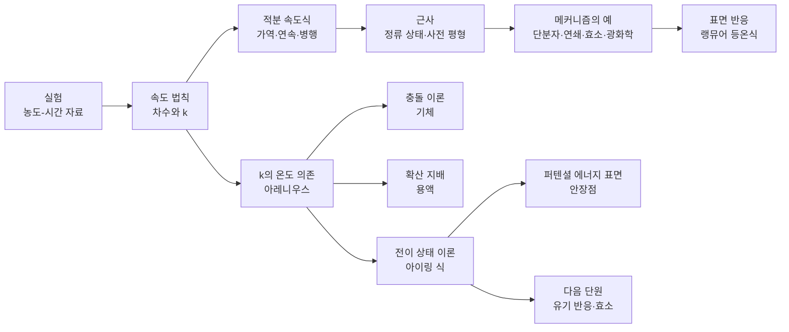

# 물리화학 12. 반응 속도론과 반응 동역학 — 속도 법칙에서 퍼텐셜 에너지 표면까지, 반응이 지나가는 길
<!-- prev: pchem-11, uchem-7, umath-4 -->
<!-- next: ochem-4, bchem-4 -->

> [!NOTE]
> **이 단원의 범위**
> - 반응 속도의 실험적 측정(흐름법, 섬광 광분해, 이완법), 속도 법칙과 차수 결정, 적분 속도식(서로 다른 두 반응물의 2차, n차 반감기)
> - 가역 반응과 이완 시간, 연속 반응과 병행 반응의 정확한 해
> - 정류 상태 근사와 사전 평형 근사(성립 조건과 음의 활성화 에너지)
> - 반응 메커니즘의 예: 린데만–힌셜우드 단분자 반응, 연쇄 반응($\mathrm{H_2 + Br_2}$, 폭발), 효소 반응(미카엘리스–멘텐), 광화학(양자 수득률, 슈테른–폴머 소광)
> - 온도 의존: 아레니우스 식과 활성화 에너지의 정의, 복합 반응의 겉보기 활성화 에너지
> - 충돌 이론(반응 단면적, 입체 인자)과 확산 지배 반응(스몰루코프스키 식)
> - 전이 상태 이론(아이링 식, 활성화 엔탈피·엔트로피), 퍼텐셜 에너지 표면과 동위 원소 효과
> - 표면 흡착(랭뮤어 등온식)과 불균일 촉매(랭뮤어–힌셜우드, 일리–리딜 메커니즘)

**학습 목표**

1. 반응 속도를 화학량론 계수로 정의하고, 초기 속도법·고립법과 적분 속도식으로 속도 법칙과 속도 상수를 실험 자료에서 결정할 수 있다.
2. 가역·연속·병행 반응의 연립 미분방정식을 풀어 농도–시간 관계와 이완 시간을 구하고, 이완법 자료를 해석할 수 있다.
3. 정류 상태 근사와 사전 평형 근사로 메커니즘에서 속도 법칙을 유도하고, 두 근사가 성립하는 조건을 정확한 해와 비교해 판단할 수 있다.
4. 린데만–힌셜우드 메커니즘, 연쇄 반응, 미카엘리스–멘텐 메커니즘, 광화학 소광에 이 근사를 적용하여 겉보기 차수의 변화와 측정 가능한 매개변수를 설명할 수 있다.
5. 활성화 에너지를 $E_\mathrm{a} = RT^2\,d\ln k/dT$로 정의하고, 충돌 이론과 확산 이론으로 속도 상수의 크기를 어림하여 실험값과 비교할 수 있다.
6. 전이 상태 이론에서 아이링 식을 유도하고, 활성화 엔탈피·엔트로피를 구해 전이 상태의 구조를 추론하며, 퍼텐셜 에너지 표면과 영점 에너지로 동위 원소 효과를 설명할 수 있다.
7. 랭뮤어 등온식을 유도하여 흡착 자료를 해석하고, 표면 반응 메커니즘에서 불균일 촉매 반응의 속도 법칙을 유도할 수 있다.

**이 단원의 학습 사다리**

| 단계 | 무엇을 하나? |
|---|---|
| STEP 1. 이전 학습 다시 보기 | 0·1·2차 적분 속도 법칙, 속도 결정 단계, 아레니우스 식(일반화학), 연립 미분방정식(수학 도구 4), 분배 함수와 평형 상수(물리화학 11) |
| STEP 2. 기초 다지기 | 1계 선형 미분방정식과 적분 인자, 작은 변위의 선형화, 볼츠만 인자의 적분, 직선화와 최소 제곱 맞춤 |
| STEP 3. 핵심 개념 | 측정과 속도 법칙 → 적분 속도식 → 가역 반응과 이완 → 연속·병행 반응 → 정류 상태와 사전 평형 → 단분자·연쇄·효소·광화학 → 아레니우스 → 충돌·확산 → 전이 상태 이론 → 퍼텐셜 에너지 표면 → 표면 흡착과 촉매 |
| STEP 4. 오개념 바로잡기 | "반응식의 계수가 차수이다", "정류 상태면 중간체 농도가 일정하다", "활성화 에너지는 늘 양수이다" 같은 착각 |
| STEP 5. 대학원·연구로 | RRKM 이론, 마커스 전자 이동 이론, 펨토초 분광과 분자 빔 |
| STEP 6. 생활·산업·진로 | 성층권 오존의 연쇄 파괴, 자동차 배기가스 촉매, 암모니아 합성 촉매, 의약품 유효 기간의 가속 시험 |

---

## 🗺️ 단원 들어가기

열역학은 반응이 어디로 가는지(평형)를 알려 주지만, 얼마나 빨리 가는지는 침묵한다. 25 ℃에서 다이아몬드는 흑연이 되는 쪽이 안정하지만 수십억 년이 지나도 반지는 그대로이다. 반면 물속에서 수소 이온과 수산화 이온은 만나자마자 물이 되어, 그 속도는 두 이온이 물 분자 사이를 헤치고 서로를 찾아가는 **확산**이 정한다. 반응 시간의 범위는 펨토초($10^{-15}$ s)에서 지질 시대까지 서른 자릿수 이상에 걸쳐 있다. 이 차이를 만드는 것은 무엇인가?

일반화학 「화학 반응 속도론」에서는 속도 법칙, 반감기, 아레니우스 식을 '규칙'으로 배웠다. 이 단원은 두 방향으로 더 들어간다. 첫째는 **거시적 속도론**이다. 메커니즘을 연립 미분방정식으로 쓰고, 그것을 정확히 또는 근사적으로 풀어 관측되는 속도 법칙을 **유도**한다. 왜 어떤 반응은 압력에 따라 차수가 바뀌고, 왜 $\mathrm{H_2 + Br_2}$의 속도는 $[\mathrm{Br_2}]^{1/2}$에 비례하며, 왜 효소 반응은 기질이 많아지면 포화되는가? 둘째는 **반응 동역학**이다. 속도 상수 $k$ 하나의 값을 분자의 크기·속력·충돌, 확산, 그리고 원자들이 넘어가는 **퍼텐셜 에너지 표면**의 안장점(전이 상태)에서 계산한다. 물리화학 11에서 익힌 분배 함수가 여기서 속도 상수로 바뀐다.

---

## STEP 1. 🔙 이전 학습 다시 보기

### 연계 개념표

| 이전 단원 | 그때 배운 것 | 이 단원에서 확장되는 것 |
|---|---|---|
| 일반화학 「화학 반응 속도론」 | 속도 법칙과 초기 속도법, 0·1·2차 적분 속도 법칙과 반감기, 속도 결정 단계, 아레니우스 식, 촉매와 미카엘리스–멘텐 식(결과만) | 서로 다른 두 반응물의 2차·n차 반응, 가역·연속 반응의 정확한 해, 정류 상태 근사로 메커니즘에서 속도 법칙을 **유도**, 아레니우스 매개변수의 분자적 의미 |
| 일반화학 「화학 평형」·물리화학 6 「화학 평형과 전기화학」 | $K$의 열역학적 정의, 판트호프 식 | 평형 상수 = 정·역 속도 상수의 비, 평형 부근의 이완, 사전 평형, 전이 상태와의 '준평형' |
| 수학 도구 4 「상미분방정식」 | 변수 분리형, 1계 선형 방정식과 적분 인자, 연립 1계 방정식(연속 반응의 해) | 그 해를 실제 메커니즘에 적용하고, 근사(정류 상태)가 정확한 해의 어떤 극한인지 정량적으로 판단 |
| 수학 도구 7 「확률과 통계」 | 볼츠만 분포, 마구걷기와 확산, 최소 제곱 맞춤 | 충돌 에너지 분포에서 아레니우스 인자를 유도, 확산 계수로 확산 지배 속도 상수, 속도 자료의 맞춤 |
| 물리화학 11 「통계 열역학」 | 분자 분배 함수, 분배 함수로 구하는 평형 상수 | 반응물과 활성화 착물 사이의 '평형 상수'로 속도 상수를 계산(전이 상태 이론) |
| 물리화학 9 「다전자 원자와 화학 결합」 | 보른–오펜하이머 근사, 퍼텐셜 에너지 곡선 | 원자가 셋 이상일 때의 퍼텐셜 에너지 **표면**과 그 위의 반응 경로 |

### 준비 운동 (사전 진단)

**Q1.** 1차 반응의 반감기가 12.0 min이다. 속도 상수와, 반응물이 처음의 12.5 %로 줄어드는 데 걸리는 시간을 구하시오.

**Q2.** 반응 $\mathrm{2NO(g) + O_2(g) \rightarrow 2NO_2(g)}$의 속도 법칙이 $v = k[\mathrm{NO}]^2[\mathrm{O_2}]$라는 것만으로 이 반응이 3분자 단일 단계 반응이라고 결론지을 수 있는가?

**Q3.** 활성화 에너지가 $50.0\ \mathrm{kJ/mol}$인 반응의 속도 상수는 25 ℃에서 35 ℃로 온도를 올리면 몇 배가 되는가?

**Q4.** 수학 도구 4에서 풀었던 $\dfrac{dy}{dt} + ay = be^{-ct}$($a \neq c$, $y(0) = 0$)의 해를 쓰시오.

정답 및 해설

**Q1.** $k = \ln 2/t_{1/2} = 0.0578\ \mathrm{min^{-1}}$. 12.5 % $= (1/2)^3$이므로 반감기 세 번, 36.0 min이다.

**Q2.** 없다. 속도 법칙은 메커니즘이 만족해야 할 조건일 뿐이다. 실제로 이 반응은 빠른 사전 평형 $\mathrm{2NO \rightleftharpoons N_2O_2}$ 뒤에 $\mathrm{N_2O_2 + O_2}$의 느린 단계가 오는 메커니즘으로도 같은 속도 법칙을 준다(STEP 3 ⑤).

**Q3.** $\ln(k_2/k_1) = \dfrac{E_\mathrm{a}}{R}\left(\dfrac{1}{T_1} - \dfrac{1}{T_2}\right) = \dfrac{50\,000}{8.314}\left(\dfrac{1}{298.15} - \dfrac{1}{308.15}\right) = 0.655$이므로 약 1.93배.

**Q4.** $y(t) = \dfrac{b}{a - c}\left(e^{-ct} - e^{-at}\right)$. STEP 3 ④에서 연속 반응 중간체의 농도가 바로 이 꼴이다.

---

## STEP 2. 🧱 기초 다지기

### 디딤돌 1. 1계 선형 미분방정식과 적분 인자 — 연속 반응의 열쇠

수학 도구 4 '1계 선형 방정식과 적분 인자'에서 익힌 대로, $\dfrac{dy}{dt} + a\,y = f(t)$의 양변에 적분 인자 $e^{at}$를 곱하면 왼쪽이 $\dfrac{d}{dt}(y\,e^{at})$가 된다. 따라서

$$
y(t) = e^{-at}\left[\,y(0) + \int_0^t f(t')\,e^{at'}\,dt'\,\right]
$$

반응 속도론에서는 $f(t)$가 앞 단계에서 '공급'되는 속도, $a\,y$가 다음 단계로 '소모'되는 속도이다. 공급이 지수적으로 줄어드는 $f = k_1[\mathrm{A}]_0e^{-k_1t}$이면 ④의 중간체 농도가 나온다.

**예** $dy/dt + 2y = 6$, $y(0) = 0$이면 $y = e^{-2t}\int_0^t 6e^{2t'}dt' = 3(1 - e^{-2t})$이다. 공급과 소모가 균형을 이루는 값 $y = 3$으로 시간 상수 $1/2$로 다가간다. 이 '균형 값'이 ⑤의 정류 상태와 같은 생각이다.

### 디딤돌 2. 작은 변위의 선형화 — 평형 부근에서 비선형 속도식 풀기

수학 도구 2 '테일러 급수와 근사'에서처럼 $x = x_\text{평형} + \delta$로 놓고 $\delta$의 1차 항만 남기면, $[\mathrm{A}][\mathrm{B}]$ 같은 곱이 들어간 비선형 속도식도 선형이 된다.

$$
([\mathrm{A}]_\text{eq} - \delta)([\mathrm{B}]_\text{eq} - \delta) \approx [\mathrm{A}]_\text{eq}[\mathrm{B}]_\text{eq} - ([\mathrm{A}]_\text{eq} + [\mathrm{B}]_\text{eq})\,\delta
$$

**예** $[\mathrm{A}]_\text{eq} = [\mathrm{B}]_\text{eq} = 1.0\ \mathrm{mM}$, $\delta = 0.010\ \mathrm{mM}$이면 정확한 곱은 $0.990^2 = 0.980100$, 근사값은 $1 - 2(0.010) = 0.980000$으로 상대 오차가 $10^{-4}$이다. 온도 도약 이완법에서 평형을 1 % 이하로만 흔드는 까닭이 이것이다(③).

### 디딤돌 3. 볼츠만 인자의 적분 — '문턱을 넘는 분자'의 비율

수학 도구 7 '가장 그럴듯한 분포와 볼츠만 분포'에서 에너지 $E$의 확률이 $e^{-E/k_\mathrm{B}T}$에 비례함을 보았다. 반응 속도론에서 자주 만나는 적분은

$$
\int_{E_0}^{\infty} e^{-E/k_\mathrm{B}T}\,dE = k_\mathrm{B}T\,e^{-E_0/k_\mathrm{B}T}, \qquad \int_{E_0}^{\infty}(E - E_0)\,e^{-E/k_\mathrm{B}T}\,dE = (k_\mathrm{B}T)^2\,e^{-E_0/k_\mathrm{B}T}
$$

둘째 식은 $u = E - E_0$로 바꾸고 부분 적분(수학 도구 2)하면 얻는다. 지수 인자 $e^{-E_0/k_\mathrm{B}T}$는 **문턱 $E_0$를 넘는 몫**을 나타내며, ⑪에서 충돌 이론의 아레니우스 인자가 된다.

**예** 1차원 볼츠만 분포 $p(E) = e^{-E/k_\mathrm{B}T}/k_\mathrm{B}T$에서 $E > E_0$인 몫은 $e^{-E_0/k_\mathrm{B}T}$이다. 1 mol당 $E_0 = 50.0\ \mathrm{kJ}$이면 300 K에서 $e^{-50\,000/(8.314\times300)} = 2.0\times10^{-9}$, 310 K에서 $3.8\times10^{-9}$이다. 온도 10 K 차이로 '문턱을 넘는 분자'가 거의 두 배가 된다.

### 디딤돌 4. 직선화와 최소 제곱 맞춤 — 속도 자료에서 매개변수 읽기

속도론의 식은 대부분 적당한 변수로 바꾸면 직선이 된다. 수학 도구 7 '최소 제곱 맞춤'의 기울기·절편 공식을 그대로 쓴다.

| 원래 식 | 직선화 | 기울기 / 절편 |
|---|---|---|
| $[\mathrm{A}] = [\mathrm{A}]_0e^{-kt}$ | $\ln[\mathrm{A}]$ 대 $t$ | $-k$ / $\ln[\mathrm{A}]_0$ |
| $k = Ae^{-E_\mathrm{a}/RT}$ | $\ln k$ 대 $1/T$ | $-E_\mathrm{a}/R$ / $\ln A$ |
| $v = \dfrac{V_\text{max}[\mathrm{S}]}{K_\mathrm{M} + [\mathrm{S}]}$ | $1/v$ 대 $1/[\mathrm{S}]$ | $K_\mathrm{M}/V_\text{max}$ / $1/V_\text{max}$ |
| $\theta = \dfrac{Kp}{1 + Kp}$ | $p/V$ 대 $p$ | $1/V_\infty$ / $1/(KV_\infty)$ |

**예** $\ln[\mathrm{A}]$가 $t = 0, 10, 20\ \mathrm{s}$에서 $-2.303, -2.653, -3.003$이면 $\bar{t} = 10$, 기울기 $= [(-10)(0.350) + 0 + (10)(-0.350)]/200 = -0.0350\ \mathrm{s^{-1}}$, 즉 $k = 0.0350\ \mathrm{s^{-1}}$이다.

> [!WARNING]
> 직선화는 오차의 무게를 바꾼다. 라인위버–버크 도시($1/v$)에서는 가장 작은 $v$(가장 불확실한 점)의 오차가 가장 크게 부풀려진다. 현대의 자료 처리에서는 원래 식에 **비선형 최소 제곱 맞춤**을 하고, 직선화는 눈으로 확인하는 용도로 쓴다.

---

## STEP 3. 📘 핵심 개념

### ① 반응 속도의 측정과 속도 법칙

#### 반응 속도의 정의 — 계수로 나누어 하나로

반응식을 $0 = \sum_J \nu_J\mathrm{J}$(물리화학 6의 화학량론 계수: 생성물 +, 반응물 −)로 쓰면, 부피가 일정한 계에서 **반응 속도(rate of reaction)** 는

$$
v = \frac{1}{\nu_J}\frac{d[\mathrm{J}]}{dt} = \frac{1}{V}\frac{d\xi}{dt}
$$

이다. 어느 성분으로 재어도 같은 값이 나오도록 계수로 나눈 것이다. 예를 들어 $\mathrm{2N_2O_5 \rightarrow 4NO_2 + O_2}$에서 $v = -\tfrac12 d[\mathrm{N_2O_5}]/dt = \tfrac14 d[\mathrm{NO_2}]/dt = d[\mathrm{O_2}]/dt$이다. 반응 진행도 $\xi$로 쓰면 이 정의가 물리화학 6의 '반응 진행도'와 같은 생각이라는 것이 드러난다.

#### 측정 방법 — 반응보다 빠른 '시계'가 필요하다

농도를 재는 수단(흡광도, 형광, 전도도, 압력, 질량 분석)은 같아도, 반응이 빠를수록 **반응을 시작하는 방법**과 **기록하는 속도**가 달라져야 한다.

| 방법 | 대략의 시간 분해능 | 원리 |
|---|---|---|
| 실시간 분석(분광 광도계, 압력계, 전도도계) | 초 이상 | 섞은 뒤 시간에 따라 물리량을 연속 기록 |
| 담금질법(quenching) | 초 이상 | 일정 시간 뒤 냉각·희석·중화로 반응을 멈추고 분석 |
| 정지 흐름법(stopped-flow) | 약 1 ms | 두 용액을 혼합 장치로 밀어 넣고 흐름을 갑자기 멈춘 뒤 관측 칸을 분광 측정 |
| 섬광 광분해(flash photolysis) | ns(레이저 펄스에 따라 fs까지) | 짧은 빛 펄스로 라디칼·들뜬 상태를 순간에 만들고 흡수 변화를 추적 |
| 이완법(온도 도약 등) | μs 이하 | 평형 혼합물의 온도·압력을 순간적으로 바꾸고 새 평형으로 가는 과정을 관측(③) |

<!-- 그림 요청: 정지 흐름 장치의 모식도. 왼쪽에 주사기 두 개(용액 A, 용액 B)가 공통 구동 막대로 동시에 밀리고, 두 관이 혼합 장치(T자 접합)에서 만나 관측 칸(광원 → 관측 칸 → 단색화 장치 → 검출기 일직선)으로 이어진다. 관측 칸 뒤에 정지 주사기와 멈춤 막이가 있어 흐름을 멈추는 순간 "시간 0 · 기록 시작" 신호가 나간다. 아래에 작은 그래프: 가로축 시간/ms(0~50), 세로축 흡광도, 처음 약 1 ms 구간을 회색으로 칠하고 "불감 시간(약 1 ms)"이라 표시, 그 뒤 지수적으로 증가하는 곡선. -->

#### 속도 법칙과 차수, 분자도

실험으로 얻은 속도와 농도의 관계를 **속도 법칙(rate law)** 이라 한다. 많은 반응에서 $v = k[\mathrm{A}]^a[\mathrm{B}]^b\cdots$ 꼴이며, 지수 $a$, $b$가 각 성분의 **차수(order)**, 그 합이 전체 차수이다. 차수는 실험값이므로 분수(1/2, 3/2)나 음수일 수도 있고, 속도 법칙이 이런 곱의 꼴이 아닐 수도 있다($\mathrm{H_2 + Br_2}$, ⑦). 반면 **분자도(molecularity)** 는 단일 단계 반응(elementary reaction)에서 **실제로 충돌하는 분자 수**(1, 2, 드물게 3)이며 정수이다. 단일 단계에서만 차수 = 분자도이다.

| 전체 차수 | $k$의 단위(농도 M, 시간 s) | 예 |
|---|---|---|
| 0 | $\mathrm{M\,s^{-1}}$ | 포화된 표면·효소에서의 반응 |
| 1 | $\mathrm{s^{-1}}$ | 방사성 붕괴, 단분자 이성질화(높은 압력) |
| 2 | $\mathrm{M^{-1}\,s^{-1}}$ | 대부분의 2분자 단일 단계 |
| 3 | $\mathrm{M^{-2}\,s^{-1}}$ | 3체 재결합 $\mathrm{2I + M \rightarrow I_2 + M}$ |

#### 차수를 정하는 두 가지 전략

1. **초기 속도법** — 반응 초기(생성물이 거의 없을 때) 속도를 한 성분 농도만 바꾸어 잰다. $v_2/v_1 = ([\mathrm{A}]_2/[\mathrm{A}]_1)^a$이므로 $a = \ln(v_2/v_1)/\ln([\mathrm{A}]_2/[\mathrm{A}]_1)$이다. 생성물이 속도에 끼어드는 효과(⑦의 억제)를 피할 수 있다.
2. **고립법(isolation method)** — 한 성분을 제외한 모두를 크게 과량으로 넣어 그 농도가 사실상 일정하게 한다. $[\mathrm{B}] \gg [\mathrm{A}]$이면 $v = (k[\mathrm{B}]_0^b)[\mathrm{A}]^a = k'[\mathrm{A}]^a$로 **유사 1차**(a = 1일 때) 반응이 된다. $[\mathrm{B}]_0$를 바꾸며 $k'$를 재면 $\ln k' = \ln k + b\ln[\mathrm{B}]_0$에서 $b$와 $k$가 나온다.

#### 예제 1 — 유사 1차 자료로 차수와 속도 상수 구하기

어떤 염료 D가 수산화 이온과 반응해 무색이 된다. $[\mathrm{D}]_0 = 2.0\times10^{-5}\ \mathrm{M}$로 두고 $[\mathrm{OH^-}]$를 크게 과량으로 넣어 흡광도의 지수 감소에서 유사 1차 속도 상수 $k'$를 구했다.

| $[\mathrm{OH^-}]_0$ (M) | 0.020 | 0.040 | 0.080 |
|---|---|---|---|
| $k'$ ($\mathrm{s^{-1}}$) | $3.9\times10^{-3}$ | $7.8\times10^{-3}$ | $1.56\times10^{-2}$ |

(1) $\mathrm{OH^-}$에 대한 차수 $b$와 속도 상수 $k$를 구하시오. (2) $[\mathrm{OH^-}]_0 = 0.040\ \mathrm{M}$일 때 염료의 반감기는? (3) 고립 조건이 성립하는지 확인하시오.

**풀이**
(1) $[\mathrm{OH^-}]$가 2배가 될 때마다 $k'$도 2배이므로 $b = \ln(7.8/3.9)/\ln 2 = 1$. 각 점에서 $k = k'/[\mathrm{OH^-}]_0 = 0.195\ \mathrm{M^{-1}\,s^{-1}}$(세 점 모두 같다). 염료에 대해서는 흡광도가 지수적으로 줄었으므로 1차이며, 전체 속도 법칙은 $v = k[\mathrm{D}][\mathrm{OH^-}]$, 전체 2차이다.
(2) $t_{1/2} = \ln 2/k' = 0.693/(7.8\times10^{-3}) = 89\ \mathrm{s}$.
(3) 염료가 모두 반응해도 $\mathrm{OH^-}$는 $2.0\times10^{-5}\ \mathrm{M}$만 줄어 가장 묽은 0.020 M의 0.1 %이다. 사실상 일정하다고 보아도 된다.

**의미** 2차 반응을 1차 반응처럼 다루어 지수 함수 하나로 맞출 수 있게 한 것이 고립법의 힘이다. 대신 $k$를 얻으려면 과량 성분의 농도를 여러 번 바꾸어야 한다.

#### ✔ 바로 확인

1. (O/X) 속도 법칙의 차수는 반응식의 계수에서 바로 읽을 수 있다.
2. $\mathrm{2N_2O_5 \rightarrow 4NO_2 + O_2}$에서 $d[\mathrm{NO_2}]/dt = 4.0\times10^{-4}\ \mathrm{M/s}$일 때 반응 속도 $v$와 $d[\mathrm{N_2O_5}]/dt$는?
3. 빈칸: 한 성분을 뺀 나머지를 크게 과량으로 넣어 차수를 하나씩 정하는 방법을 (    )이라 한다.
4. 전체 3차 반응의 속도 상수 단위는? (농도 M, 시간 s)

정답

1. X — 차수는 실험으로 정한다. 계수와 같은 것은 단일 단계 반응일 때뿐이다.
2. $v = 1.0\times10^{-4}\ \mathrm{M/s}$, $d[\mathrm{N_2O_5}]/dt = -2.0\times10^{-4}\ \mathrm{M/s}$ — $v = \tfrac14 d[\mathrm{NO_2}]/dt = -\tfrac12 d[\mathrm{N_2O_5}]/dt$.
3. 고립법 — 결과는 유사 1차(또는 유사 n차) 반응이다.
4. $\mathrm{M^{-2}\,s^{-1}}$ — $v$(M/s)를 농도의 세제곱으로 나눈다.

### ② 적분 속도식 — 농도–시간 곡선으로 차수 판별하기

#### 같은 반응물의 0·1·2차 (복습)

$v = -d[\mathrm{A}]/dt = k[\mathrm{A}]^n$(계수 1로 둔다)을 변수 분리(수학 도구 4)하여 적분한 결과를 정리하면 다음과 같다. 일반화학에서 배운 것이므로 결과만 적는다.

| 차수 | 적분 속도식 | 직선이 되는 그래프 | 반감기 |
|---|---|---|---|
| 0 | $[\mathrm{A}] = [\mathrm{A}]_0 - kt$ | $[\mathrm{A}]$ 대 $t$ | $[\mathrm{A}]_0/2k$ |
| 1 | $\ln[\mathrm{A}] = \ln[\mathrm{A}]_0 - kt$ | $\ln[\mathrm{A}]$ 대 $t$ | $\ln 2/k$ |
| 2 | $1/[\mathrm{A}] = 1/[\mathrm{A}]_0 + kt$ | $1/[\mathrm{A}]$ 대 $t$ | $1/k[\mathrm{A}]_0$ |

#### n차 반응의 일반식과 반감기

$n \neq 1$이면 $\displaystyle\int_{[\mathrm{A}]_0}^{[\mathrm{A}]}\frac{d[\mathrm{A}]}{[\mathrm{A}]^n} = -kt$에서

$$
\frac{1}{[\mathrm{A}]^{\,n-1}} - \frac{1}{[\mathrm{A}]_0^{\,n-1}} = (n-1)kt, \qquad t_{1/2} = \frac{2^{\,n-1} - 1}{(n-1)\,k\,[\mathrm{A}]_0^{\,n-1}}
$$

($[\mathrm{A}] = [\mathrm{A}]_0/2$를 넣었다.) $n = 2$이면 $t_{1/2} = 1/k[\mathrm{A}]_0$, $n = 0$이면 $[\mathrm{A}]_0/2k$로 표의 값이 다시 나온다. 핵심은 $t_{1/2} \propto [\mathrm{A}]_0^{\,1-n}$이라는 점이다. 처음 농도를 바꾸며 반감기를 재면

$$
n = 1 - \frac{\ln\left(t_{1/2}'/t_{1/2}\right)}{\ln\left([\mathrm{A}]_0'/[\mathrm{A}]_0\right)}
$$

로 차수를 얻는다(**반감기법**). 1차 반응만 반감기가 처음 농도에 무관하다.

#### 서로 다른 두 반응물의 2차 반응

$\mathrm{A + B \rightarrow P}$, $v = k[\mathrm{A}][\mathrm{B}]$이고 $[\mathrm{A}]_0 \neq [\mathrm{B}]_0$인 경우를 유도하자.

- **가정**: 단일 2차 단계, 부피 일정, 역반응 없음.
- **변수 줄이기**: 반응한 양을 $x$라 하면 $[\mathrm{A}] = [\mathrm{A}]_0 - x$, $[\mathrm{B}] = [\mathrm{B}]_0 - x$이므로 $dx/dt = k([\mathrm{A}]_0 - x)([\mathrm{B}]_0 - x)$.
- **부분 분수**: $\dfrac{1}{(a-x)(b-x)} = \dfrac{1}{b-a}\left(\dfrac{1}{a-x} - \dfrac{1}{b-x}\right)$ ($a = [\mathrm{A}]_0$, $b = [\mathrm{B}]_0$).
- **적분**: $\dfrac{1}{b-a}\left[-\ln(a-x) + \ln(b-x)\right]_0^x = kt$.

$$
\boxed{\;\ln\frac{[\mathrm{B}]/[\mathrm{B}]_0}{[\mathrm{A}]/[\mathrm{A}]_0} = \left([\mathrm{B}]_0 - [\mathrm{A}]_0\right)kt\;}
$$

- **한계**: $[\mathrm{A}]_0 = [\mathrm{B}]_0$이면 좌변과 우변이 모두 0이 되어 쓸 수 없다(그때는 $1/[\mathrm{A}]$ 식). $[\mathrm{B}]_0 \gg [\mathrm{A}]_0$이면 $[\mathrm{B}] \approx [\mathrm{B}]_0$가 되어 $\ln([\mathrm{A}]_0/[\mathrm{A}]) = k[\mathrm{B}]_0t$, 즉 ①의 유사 1차 식으로 돌아간다.

<!-- 그림 요청: 같은 자료를 세 방식으로 그린 3단 그래프(차수 판별). 자료는 2차 반응 [A]0 = 0.100 M, k = 0.25 M⁻¹ s⁻¹에서 t = 0, 20, 40, 60, 80, 120 s의 점(각각 0.100, 0.0667, 0.0500, 0.0400, 0.0333, 0.0250 M). (가) [A] 대 t: 아래로 휜 곡선, (나) ln[A] 대 t: 아래로 볼록하게 휜 곡선(직선에서 벗어남을 점선 직선과 비교), (다) 1/[A] 대 t: 절편 10.0 M⁻¹, 기울기 0.25 M⁻¹ s⁻¹인 직선 위에 모든 점이 놓인다. (다)에만 "직선 → 2차"라는 이름표. -->

#### 예제 2 — 반감기법과 서로 다른 두 반응물

(1) 어떤 반응 $\mathrm{2A \rightarrow P}$에서 처음 농도 0.100 M일 때 반감기가 40 s, 0.050 M일 때 80 s였다. 차수와 속도 상수($v = -d[\mathrm{A}]/dt = k[\mathrm{A}]^n$로 정의)를 구하고, 0.100 M에서 출발해 120 s 뒤의 농도를 구하시오.
(2) $\mathrm{A + B \rightarrow P}$($k = 0.50\ \mathrm{M^{-1}\,s^{-1}}$)에서 $[\mathrm{A}]_0 = 0.020\ \mathrm{M}$, $[\mathrm{B}]_0 = 0.030\ \mathrm{M}$이다. A가 절반으로 줄어드는 데 걸리는 시간을 구하시오.

**풀이**
(1) $n = 1 - \ln(80/40)/\ln(0.050/0.100) = 1 - (0.693)/(-0.693) = 2$. $k = 1/(t_{1/2}[\mathrm{A}]_0) = 1/(40\times0.100) = 0.25\ \mathrm{M^{-1}\,s^{-1}}$. $1/[\mathrm{A}] = 10.0 + 0.25\times120 = 40.0\ \mathrm{M^{-1}}$에서 $[\mathrm{A}] = 0.025\ \mathrm{M}$.
(2) A가 0.010 M이 되면 B는 $0.030 - 0.010 = 0.020\ \mathrm{M}$이다.

$$
t = \frac{1}{(0.030 - 0.020)(0.50)}\ln\frac{0.020/0.030}{0.010/0.020} = \frac{\ln 1.333}{0.0050} = \frac{0.2877}{0.0050} = 58\ \mathrm{s}
$$

**의미** (2)에서 B가 조금 과량일 뿐인데도 A의 반감기는 $[\mathrm{A}]_0 = [\mathrm{B}]_0 = 0.020\ \mathrm{M}$일 때의 $1/(k\times0.020) = 100\ \mathrm{s}$보다 훨씬 짧다. 짝이 되는 반응물이 덜 줄어들기 때문이다. 이 점을 무시하고 같은 농도의 식을 쓰면 $k$를 크게 틀린다.

> [!TIP]
> 💡 **요령** — 차수를 그래프로 판별할 때는 반응이 **적어도 2~3 반감기** 진행된 자료를 써야 한다. 반응 초기 10 % 구간에서는 $[\mathrm{A}]$, $\ln[\mathrm{A}]$, $1/[\mathrm{A}]$ 대 $t$가 모두 거의 직선이어서 구별이 안 된다($\ln(1 - x) \approx -x$, $1/(1 - x) \approx 1 + x$).

#### ✔ 바로 확인

1. (O/X) 처음 농도를 두 배로 하면 2차 반응의 반감기는 두 배가 된다.
2. 3차 반응($v = k[\mathrm{A}]^3$)의 반감기를 $k$와 $[\mathrm{A}]_0$로 쓰시오.
3. 빈칸: $\mathrm{A + B \rightarrow P}$에서 $[\mathrm{B}]_0 \gg [\mathrm{A}]_0$이면 적분 속도식은 $\ln([\mathrm{A}]_0/[\mathrm{A}]) = (\quad)t$가 된다.

정답

1. X — $t_{1/2} = 1/k[\mathrm{A}]_0$이므로 절반이 된다.
2. $t_{1/2} = \dfrac{3}{2k[\mathrm{A}]_0^2}$ — 일반식에 $n = 3$: $(2^2 - 1)/(2k[\mathrm{A}]_0^2)$.
3. $k[\mathrm{B}]_0$ — 유사 1차 속도 상수이다.

### ③ 가역 반응과 이완 — 평형으로 다가가는 속도

#### 1차–1차 가역 반응 $\mathrm{A \rightleftharpoons B}$

정반응 속도 상수를 $k_1$, 역반응을 $k_{-1}$이라 하자. 처음에 A만 $[\mathrm{A}]_0$ 있으면 $[\mathrm{B}] = [\mathrm{A}]_0 - [\mathrm{A}]$이고

$$
\frac{d[\mathrm{A}]}{dt} = -k_1[\mathrm{A}] + k_{-1}([\mathrm{A}]_0 - [\mathrm{A}]) = -(k_1 + k_{-1})[\mathrm{A}] + k_{-1}[\mathrm{A}]_0
$$

이것은 STEP 2 디딤돌 1의 꼴($a = k_1 + k_{-1}$, $f = k_{-1}[\mathrm{A}]_0$ 일정)이므로

$$
[\mathrm{A}](t) = [\mathrm{A}]_0\,\frac{k_{-1} + k_1e^{-(k_1 + k_{-1})t}}{k_1 + k_{-1}}
$$

$t \to \infty$에서 $[\mathrm{A}]_\text{eq} = k_{-1}[\mathrm{A}]_0/(k_1 + k_{-1})$, $[\mathrm{B}]_\text{eq} = k_1[\mathrm{A}]_0/(k_1 + k_{-1})$이므로

$$
K = \frac{[\mathrm{B}]_\text{eq}}{[\mathrm{A}]_\text{eq}} = \frac{k_1}{k_{-1}}
$$

평형 상수는 정·역 속도 상수의 비이다. 평형에서 반응이 멈추는 것이 아니라 **두 방향의 속도가 같아진 것**이다(동적 평형). 여러 단계가 있으면 각 단일 단계가 평형에서 따로 균형을 이루어야 한다는 **세부 균형(detailed balance)** 원리가 성립하며, 전체의 $K$는 각 단계의 $k_i/k_{-i}$를 곱한 것이다.

중요한 결론은 평형으로 다가가는 속도가 $k_1$ 하나가 아니라 **합 $k_1 + k_{-1}$** 로 정해진다는 것이다. 편차 $[\mathrm{A}] - [\mathrm{A}]_\text{eq}$는 시간 상수 $\tau = 1/(k_1 + k_{-1})$로 지수적으로 줄어든다. $\tau$와 $K$ 두 값을 재면 $k_1$, $k_{-1}$을 따로 얻는다.

#### 이완법 — 평형을 살짝 흔들고 돌아오는 것을 본다

용액의 평형 혼합물에 고전압 방전이나 적외선 레이저 펄스로 수 μs 안에 온도를 몇 K 올리면(**온도 도약, temperature jump**), $K$가 새 온도의 값으로 바뀌어 계가 새 평형을 향해 **이완(relaxation)** 한다. 변화가 작으므로 STEP 2 디딤돌 2의 선형화가 쓰인다.

2분자–1분자 반응 $\mathrm{A + B \underset{k_{-1}}{\overset{k_1}{\rightleftharpoons}} C}$를 보자. 새 평형값에서의 편차를 $x$라 하여 $[\mathrm{A}] = [\mathrm{A}]_\text{eq} + x$, $[\mathrm{B}] = [\mathrm{B}]_\text{eq} + x$, $[\mathrm{C}] = [\mathrm{C}]_\text{eq} - x$로 두면

$$
\frac{dx}{dt} = -k_1([\mathrm{A}]_\text{eq} + x)([\mathrm{B}]_\text{eq} + x) + k_{-1}([\mathrm{C}]_\text{eq} - x)
$$

평형 조건 $k_1[\mathrm{A}]_\text{eq}[\mathrm{B}]_\text{eq} = k_{-1}[\mathrm{C}]_\text{eq}$로 상수항이 지워지고, $x^2$을 버리면

$$
\frac{dx}{dt} = -\left[k_1([\mathrm{A}]_\text{eq} + [\mathrm{B}]_\text{eq}) + k_{-1}\right]x \quad\Longrightarrow\quad \frac{1}{\tau} = k_1([\mathrm{A}]_\text{eq} + [\mathrm{B}]_\text{eq}) + k_{-1}
$$

평형 농도를 바꾸며 $1/\tau$를 재어 $([\mathrm{A}]_\text{eq} + [\mathrm{B}]_\text{eq})$에 대해 그리면 기울기가 $k_1$, 절편이 $k_{-1}$이다.

<!-- 그림 요청: 온도 도약 이완 곡선. 가로축 시간/μs(−20~200), 세로축 [C](또는 흡광도). t < 0에서 낮은 온도의 평형값(수평선), t = 0에 세로 화살표 "온도 도약(수 μs)"을 표시. t > 0에서 곡선이 새 평형값(수평 점선, 더 낮은 값)으로 지수적으로 이완: [C] − [C]eq,새 ∝ e^(−t/τ), τ = 36 μs. t = τ인 곳에 점을 찍고 "처음 편차의 1/e = 0.37"이라 표시. 오른쪽 끼움 그래프: 가로축 [A]eq + [B]eq, 세로축 1/τ인 직선(기울기 k1, 절편 k−1에 이름표). -->

#### 예제 3 — 이완 시간에서 속도 상수 구하기

(1) $\mathrm{A \rightleftharpoons B}$의 평형 상수가 $K = 4.0$이고 온도 도약 뒤 이완 시간이 2.0 ms였다. $k_1$과 $k_{-1}$을 구하시오.
(2) 25 ℃ 순수한 물에서 $\mathrm{H^+ + OH^- \rightleftharpoons H_2O}$의 재결합 속도 상수는 약 $1.4\times10^{11}\ \mathrm{M^{-1}\,s^{-1}}$이다. 이완 시간을 어림하시오. ($[\mathrm{H^+}]_\text{eq} = [\mathrm{OH^-}]_\text{eq} = 1.0\times10^{-7}\ \mathrm{M}$, $[\mathrm{H_2O}] = 55.5\ \mathrm{M}$, $K_\mathrm{w} = 1.0\times10^{-14}$)

**풀이**
(1) $k_1 + k_{-1} = 1/\tau = 500\ \mathrm{s^{-1}}$, $k_1 = 4.0k_{-1}$이므로 $k_{-1} = 100\ \mathrm{s^{-1}}$, $k_1 = 400\ \mathrm{s^{-1}}$.
(2) 역반응(물의 해리)은 1차로 쓰면 $k_{-1}[\mathrm{H_2O}] = k_1[\mathrm{H^+}][\mathrm{OH^-}]$이므로 $k_{-1} = (1.4\times10^{11})(1.0\times10^{-14})/55.5 = 2.5\times10^{-5}\ \mathrm{s^{-1}}$로 무시할 만하다.

$$
\frac{1}{\tau} = k_1(2.0\times10^{-7}) = 2.8\times10^4\ \mathrm{s^{-1}} \quad\Longrightarrow\quad \tau \approx 36\ \mu\mathrm{s}
$$

**의미** (2)의 $k_1$은 지금까지 알려진 용액 반응 가운데 가장 큰 축에 든다. 그 크기가 이온의 확산으로 설명되는지는 ⑪에서 확인한다. 물의 해리 속도 상수 $k_{-1}$이 이렇게 작은데도 pH가 순식간에 평형을 회복하는 것은 이완 속도가 큰 쪽 $k_1$의 항에 지배되기 때문이다.

#### ✔ 바로 확인

1. (O/X) $\mathrm{A \rightleftharpoons B}$가 평형에 다가가는 속도는 정반응 속도 상수 $k_1$만으로 정해진다.
2. 빈칸: 1차–1차 가역 반응의 이완 시간은 $\tau = 1/(\quad)$이다.
3. $\mathrm{A + B \rightleftharpoons C}$의 이완 실험에서 $1/\tau$를 $([\mathrm{A}]_\text{eq} + [\mathrm{B}]_\text{eq})$에 대해 그린 직선의 절편이 $50\ \mathrm{s^{-1}}$, 기울기가 $5.0\times10^{7}\ \mathrm{M^{-1}\,s^{-1}}$이다. 평형 상수 $K = [\mathrm{C}]/[\mathrm{A}][\mathrm{B}]$는?

정답

1. X — 편차는 $e^{-(k_1 + k_{-1})t}$로 줄어든다. 역반응도 이완을 돕는다.
2. $k_1 + k_{-1}$
3. $1.0\times10^{6}\ \mathrm{M^{-1}}$ — $K = k_1/k_{-1} = 5.0\times10^7/50$.

### ④ 연속 반응과 병행 반응 — 정확한 해

#### 연속 반응 $\mathrm{A \xrightarrow{k_1} I \xrightarrow{k_2} P}$

각 단계가 1차이고 처음에 A만 있으면

$$
\frac{d[\mathrm{A}]}{dt} = -k_1[\mathrm{A}], \qquad \frac{d[\mathrm{I}]}{dt} = k_1[\mathrm{A}] - k_2[\mathrm{I}], \qquad \frac{d[\mathrm{P}]}{dt} = k_2[\mathrm{I}]
$$

첫 식에서 $[\mathrm{A}] = [\mathrm{A}]_0e^{-k_1t}$. 둘째 식은 $d[\mathrm{I}]/dt + k_2[\mathrm{I}] = k_1[\mathrm{A}]_0e^{-k_1t}$로 디딤돌 1의 꼴이며, 준비 운동 Q4의 결과($a = k_2$, $c = k_1$, $b = k_1[\mathrm{A}]_0$)를 쓰면

$$
[\mathrm{I}] = \frac{k_1[\mathrm{A}]_0}{k_2 - k_1}\left(e^{-k_1t} - e^{-k_2t}\right), \qquad [\mathrm{P}] = [\mathrm{A}]_0\left[1 + \frac{k_1e^{-k_2t} - k_2e^{-k_1t}}{k_2 - k_1}\right]
$$

($[\mathrm{P}] = [\mathrm{A}]_0 - [\mathrm{A}] - [\mathrm{I}]$, $k_1 \neq k_2$.) $d[\mathrm{I}]/dt = 0$으로 놓으면 중간체가 가장 많아지는 시각과 그때의 농도가 나온다.

$$
t_\text{max} = \frac{\ln(k_1/k_2)}{k_1 - k_2}, \qquad \frac{[\mathrm{I}]_\text{max}}{[\mathrm{A}]_0} = \left(\frac{k_1}{k_2}\right)^{k_2/(k_2 - k_1)}
$$

두 극한이 중요하다.

| 조건 | 중간체 | 생성물이 생기는 속도를 정하는 것 |
|---|---|---|
| $k_2 \gg k_1$ | 생기자마자 소모되어 늘 아주 적다 | 첫 단계($k_1$) — 첫 단계가 **속도 결정 단계** |
| $k_1 \gg k_2$ | A가 거의 다 I로 바뀐 뒤 천천히 줄어든다 | 둘째 단계($k_2$) |

$[\mathrm{P}]$ 곡선은 처음에 기울기 0에서 출발해 S자 모양이 된다. 이 **유도기(induction period)** 는 중간체가 쌓이는 시간으로, 메커니즘에 중간체가 있다는 실험적 증거가 된다.

<!-- 그림 요청: 연속 반응 A → I → P(k1 = 0.20 min⁻¹, k2 = 0.050 min⁻¹, [A]0 = 1)의 농도–시간 곡선. 가로축 t/min(0~80), 세로축 농도/[A]0(0~1). 세 곡선: [A] = e^(−0.20t)(실선, 지수 감소), [I] = (0.20/(−0.15))(e^(−0.20t) − e^(−0.050t)) = (4/3)(e^(−0.050t) − e^(−0.20t))(굵은 실선, t = 9.24 min에서 최댓값 0.630에 점과 이름표), [P](점선, S자 모양, 처음 기울기 0). t = 9.24 min에 세로 점선. 세 곡선의 합이 늘 1임을 오른쪽 위에 "[A]+[I]+[P] = [A]0"으로 적는다. -->

<!-- 시뮬레이션 요청: 연속 반응 A → I → P의 농도–시간 곡선 조작. 슬라이더: k1, k2(각각 0.01~10 s⁻¹, 로그 눈금), 표시할 시간 범위. 보여 줄 것: 정확한 해 [A], [I], [P] 곡선과 함께 정류 상태 근사 [I]ss = k1[A]/k2, [P]ss = [A]0(1 − e^(−k1 t))를 점선으로 겹쳐 그리고, k2/k1 비와 t = 1/k1에서의 [P] 상대 오차(%)를 숫자로 표시. k2/k1이 1보다 작아지면 두 곡선이 크게 어긋나는 것을 볼 수 있게 한다. t_max와 [I]_max도 표시. -->

#### 병행 반응 — 한 반응물, 두 갈래

A가 두 경로로 동시에 반응하는 $\mathrm{A \xrightarrow{k_\mathrm{B}} B}$, $\mathrm{A \xrightarrow{k_\mathrm{C}} C}$를 생각하자.

$$
[\mathrm{A}] = [\mathrm{A}]_0e^{-(k_\mathrm{B} + k_\mathrm{C})t}, \qquad \frac{d[\mathrm{B}]/dt}{d[\mathrm{C}]/dt} = \frac{k_\mathrm{B}}{k_\mathrm{C}} \;\Rightarrow\; \frac{[\mathrm{B}]}{[\mathrm{C}]} = \frac{k_\mathrm{B}}{k_\mathrm{C}}\ (\text{언제나})
$$

A의 소멸은 두 속도 상수의 **합**으로 정해지고, 생성물의 비(**가지 비, branching ratio**)는 두 속도 상수의 **비**로 정해진다. A의 반감기 하나만 재서는 각 경로의 속도 상수를 알 수 없으며, 생성물 비를 함께 재야 한다. 역반응이 없을 때 생성물 비는 시간에 무관하며 생성물의 안정성이 아니라 속도 상수의 비가 정한다. 이것을 **속도론적 지배(kinetic control)** 라 한다. 역반응이 충분히 빠르고 오래 기다리면 생성물 비는 평형 상수의 비로 옮겨 간다(**열역학적 지배**, 유기화학 「유기 반응의 개관과 알킬 할라이드의 치환·제거 반응」과 1,2-·1,4-첨가에서 다시 만난다).

#### 예제 4 — 중간체를 가장 많이 얻는 시각과 병행 반응의 수득률

(1) $\mathrm{A \rightarrow I \rightarrow P}$에서 $k_1 = 0.20\ \mathrm{min^{-1}}$, $k_2 = 0.050\ \mathrm{min^{-1}}$이다. I를 가장 많이 얻으려면 몇 분에 반응을 멈추어야 하며, 그때 I의 수득률은?
(2) A가 $k_\mathrm{B} = 3.0\times10^{-3}\ \mathrm{s^{-1}}$, $k_\mathrm{C} = 1.0\times10^{-3}\ \mathrm{s^{-1}}$로 병행 반응한다. A의 반감기와 최종 생성물 중 B의 몰분율을 구하시오.

**풀이**
(1) $t_\text{max} = \ln(0.20/0.050)/(0.20 - 0.050) = 1.386/0.150 = 9.2\ \mathrm{min}$. $[\mathrm{I}]_\text{max}/[\mathrm{A}]_0 = 4^{0.050/(0.050 - 0.20)} = 4^{-1/3} = 0.63$, 즉 63 %.
(2) $t_{1/2} = \ln 2/(k_\mathrm{B} + k_\mathrm{C}) = 0.693/(4.0\times10^{-3}) = 173\ \mathrm{s}$. B의 몰분율 $= k_\mathrm{B}/(k_\mathrm{B} + k_\mathrm{C}) = 0.75$.

**의미** (1)에서 9.2분보다 일찍 멈추면 A가 많이 남고, 늦게 멈추면 I가 P로 넘어가 버린다. 의약품 합성에서 불안정한 중간 생성물을 꺼내는 시점이나, 방사성 붕괴 계열에서 딸핵종을 '착유'하는 시점이 이 계산으로 정해진다.

#### ✔ 바로 확인

1. (O/X) 병행 반응 $\mathrm{A \rightarrow B}$, $\mathrm{A \rightarrow C}$에서 A의 반감기는 빠른 쪽 속도 상수만으로 정해진다.
2. 연속 반응에서 $k_1 = k_2$일 때 위의 $[\mathrm{I}]$ 식을 그대로 쓸 수 없다. 이 경우 $[\mathrm{I}] = k_1[\mathrm{A}]_0\,t\,e^{-k_1t}$임을 이용해 $t_\text{max}$를 구하시오.
3. 빈칸: 연속 반응의 생성물 곡선이 처음에 기울기 0에서 S자로 출발하는 구간을 (    )라 한다.

정답

1. X — A는 $k_\mathrm{B} + k_\mathrm{C}$로 사라진다.
2. $t_\text{max} = 1/k_1$ — $d(te^{-k_1t})/dt = (1 - k_1t)e^{-k_1t} = 0$.
3. 유도기 — 중간체가 쌓이는 동안 생성물이 늦게 생긴다.

### ⑤ 정류 상태 근사와 사전 평형 — 메커니즘에서 속도 법칙 유도하기

실제 메커니즘은 단계가 많아 연립 미분방정식을 정확히 풀 수 없는 경우가 대부분이다. 두 근사가 그 틈을 메운다.

#### 정류 상태 근사

반응성이 큰 중간체 I(라디칼, 들뜬 분자, 효소–기질 복합체)는 생기자마자 소모되어 농도가 늘 작다. 그러면 농도 자체가 작으므로 그 **변화율도 생성·소멸 속도에 비해 작다.**

$$
\frac{d[\mathrm{I}]}{dt} \approx 0 \qquad (\text{정류 상태 근사, steady-state approximation})
$$

이것은 "$[\mathrm{I}]$가 일정하다"는 뜻이 아니다. $[\mathrm{I}]$는 A를 따라 계속 변하지만, 생성 속도와 소멸 속도의 **차**가 각각에 비해 무시할 만하다는 뜻이다. ④의 연속 반응에 적용하면 $k_1[\mathrm{A}] = k_2[\mathrm{I}]$에서

$$
[\mathrm{I}]_\text{ss} = \frac{k_1}{k_2}[\mathrm{A}], \qquad \frac{d[\mathrm{P}]}{dt} = k_2[\mathrm{I}]_\text{ss} = k_1[\mathrm{A}]
$$

정확한 해에서 $k_2 \gg k_1$이고 $t \gg 1/k_2$이면 $e^{-k_2t}$가 사라지고 $k_2 - k_1 \approx k_2$가 되어 정확히 이 결과가 된다. 즉 정류 상태 근사는 **(1) $k_2 \gg k_1$, (2) 초기 과도 구간($\sim 1/k_2$)이 지난 뒤**라는 두 조건에서 정확한 해의 극한이다.

#### 예제 5 — 근사를 정확한 해와 비교하기

$k_1 = 0.010\ \mathrm{s^{-1}}$, $k_2 = 1.0\ \mathrm{s^{-1}}$인 연속 반응에서 $t = 100\ \mathrm{s}$일 때 $[\mathrm{I}]/[\mathrm{A}]_0$를 정확한 해와 정류 상태 근사로 구해 비교하시오.

**풀이**
정확한 해: $\dfrac{0.010}{0.99}\left(e^{-1.0} - e^{-100}\right) = 0.010101\times0.36788 = 3.716\times10^{-3}$
근사: $\dfrac{k_1}{k_2}e^{-k_1t} = 0.010\times0.36788 = 3.679\times10^{-3}$
상대 오차는 $(3.716 - 3.679)/3.716 = 1.0\ \%$이며, 이는 정확히 $k_1/k_2$이다.

**의미** 정류 상태 근사의 오차는 대략 $k_1/k_2$(중간체 수명 대 반응물 수명의 비) 정도이다. 이 비가 0.3이면 근사는 30 %쯤 틀린다. 근사를 쓸 때는 중간체가 정말 반응성이 큰지 먼저 따져야 한다.

<!-- 그림 요청: 정류 상태 근사와 정확한 해의 비교 그래프 2단. 둘 다 [A]0 = 1, k1 = 0.010 s⁻¹. 가로축 t/s(0~300), 세로축 [I](0~0.012). (가) k2 = 1.0 s⁻¹: 정확한 해(실선)와 근사 [I]ss = 0.010e^(−0.010t)(점선)가 처음 수 초를 빼고 거의 겹친다(t = 100 s에서 3.72×10⁻³ 대 3.68×10⁻³에 점). (나) k2 = 0.030 s⁻¹: 세로축 0~0.25, 정확한 해(실선, t = 54.9 s에서 최댓값 0.192)와 근사 (0.010/0.030)e^(−0.010t)(점선, t = 0에서 0.333에서 출발)가 크게 어긋난다. (나)에 "k1/k2 = 0.33 → 근사 실패" 이름표. -->

#### 사전 평형 근사

메커니즘이 $\mathrm{A + B \underset{k_{-1}}{\overset{k_1}{\rightleftharpoons}} I}$, $\mathrm{I \xrightarrow{k_2} P}$이고 $k_{-1} \gg k_2$이면, I는 대부분 A와 B로 되돌아가고 아주 일부만 P로 새어 나간다. 첫 단계는 평형에 가깝다고 보아 $[\mathrm{I}] = K[\mathrm{A}][\mathrm{B}]$($K = k_1/k_{-1}$)로 두면

$$
v = k_2[\mathrm{I}] = k_2K[\mathrm{A}][\mathrm{B}] = \frac{k_1k_2}{k_{-1}}[\mathrm{A}][\mathrm{B}]
$$

같은 메커니즘에 정류 상태 근사를 쓰면 $k_1[\mathrm{A}][\mathrm{B}] = (k_{-1} + k_2)[\mathrm{I}]$에서 $v = \dfrac{k_1k_2}{k_{-1} + k_2}[\mathrm{A}][\mathrm{B}]$이다. $k_{-1} \gg k_2$이면 사전 평형 결과가, $k_2 \gg k_{-1}$이면 $v = k_1[\mathrm{A}][\mathrm{B}]$(첫 단계가 속도 결정)가 된다. **정류 상태 근사가 더 일반적**이며, 사전 평형은 그 한 극한이다.

#### 음의 활성화 에너지

사전 평형에서 겉보기 속도 상수는 $k_\text{obs} = Kk_2$이다. 양변의 로그를 온도로 미분하면(판트호프 식과 아레니우스 식, ⑩)

$$
E_\mathrm{a,obs} = E_\mathrm{a,2} + \Delta_\mathrm{r}H_1^\circ
$$

(기체 반응에서 농도로 쓴 $K_c$를 미분하면 엄밀히는 $\Delta_\mathrm{r}U_1^\circ$가 나오며, $\Delta_\mathrm{r}H_1^\circ$와의 차이는 $RT$ 정도이다.) 첫 단계가 크게 발열($\Delta_\mathrm{r}H_1^\circ < 0$)이고 그 크기가 $E_\mathrm{a,2}$보다 크면 $E_\mathrm{a,obs} < 0$, 즉 **온도를 올리면 오히려 느려진다.** 온도가 오르면 둘째 단계는 빨라지지만, 사전 평형이 반응물 쪽으로 밀려 중간체가 더 크게 줄어들기 때문이다. $\mathrm{2NO + O_2 \rightarrow 2NO_2}$가 온도를 올리면 조금 느려지는 것이 이런 예로 해석된다($\mathrm{2NO \rightleftharpoons N_2O_2}$, $\mathrm{N_2O_2 + O_2 \rightarrow 2NO_2}$).

> [!TIP]
> 💡 **비유** — 사전 평형은 붐비는 매표소 앞의 대기 줄이다. 줄(중간체)에 섰다가 포기하고 나가는 사람(역반응)이 입장하는 사람(둘째 단계)보다 훨씬 많다. 입장 속도는 "줄에 몇 명이 서 있는가(평형 상수)"와 "창구 하나의 처리 속도($k_2$)"의 곱이다.

#### ✔ 바로 확인

1. (O/X) 정류 상태 근사는 중간체의 농도가 시간에 따라 변하지 않는다는 가정이다.
2. 빈칸: 연속 반응 $\mathrm{A \rightarrow I \rightarrow P}$에서 정류 상태 근사의 상대 오차는 대략 (    )의 비와 같다.
3. 사전 평형 메커니즘에서 $E_\mathrm{a,2} = 10\ \mathrm{kJ/mol}$, $\Delta_\mathrm{r}H_1^\circ = -30\ \mathrm{kJ/mol}$이다. 겉보기 활성화 에너지와, 300 K에서 350 K로 올릴 때 속도 상수의 비 $k_{350}/k_{300}$은?

정답

1. X — 생성 속도와 소멸 속도가 거의 같아 **변화율**이 그 둘에 비해 작다는 가정이다. 농도 자체는 반응물을 따라 변한다.
2. $k_1/k_2$
3. $-20\ \mathrm{kJ/mol}$, 약 0.32 — $E_\mathrm{a,obs} = 10 + (-30)$. $\ln(k_{350}/k_{300}) = -\dfrac{E_\mathrm{a,obs}}{R}\left(\dfrac{1}{350} - \dfrac{1}{300}\right) = \dfrac{20\,000}{8.314}\times(-4.76\times10^{-4}) = -1.15$.

### ⑥ 단분자 반응 — 린데만–힌셜우드 메커니즘

사이클로프로페인이 프로펜으로 이성질화하는 것 같은 기체의 '단분자' 반응은 높은 압력에서 1차이지만, 압력을 낮추면 2차로 바뀐다. 분자 혼자서 어떻게 활성화 에너지를 얻는가? 린데만(Lindemann)의 답은 **충돌로 에너지를 얻고, 혼자 반응한다**는 것이다.

$$
\mathrm{A + M \underset{k_a'}{\overset{k_a}{\rightleftharpoons}} A^* + M}, \qquad \mathrm{A^* \xrightarrow{k_b} P}
$$

M은 충돌 상대(A 자신이나 비활성 기체)이다. 활성화된 분자 $\mathrm{A^*}$에 정류 상태 근사를 쓰면

$$
k_a[\mathrm{A}][\mathrm{M}] = k_a'[\mathrm{A^*}][\mathrm{M}] + k_b[\mathrm{A^*}] \;\Rightarrow\; v = k_b[\mathrm{A^*}] = \frac{k_ak_b[\mathrm{M}]}{k_a'[\mathrm{M}] + k_b}[\mathrm{A}] \equiv k_\text{uni}[\mathrm{A}]
$$

| 압력 | 조건 | $k_\text{uni}$ | 해석 |
|---|---|---|---|
| 높다 | $k_a'[\mathrm{M}] \gg k_b$ | $k_\infty = k_ak_b/k_a'$ (1차) | 활성화가 평형에 있고, $\mathrm{A^*}$의 반응이 속도 결정 |
| 낮다 | $k_a'[\mathrm{M}] \ll k_b$ | $k_a[\mathrm{M}]$ (2차) | $\mathrm{A^*}$는 생기면 바로 반응. 충돌 활성화가 속도 결정 |

$k_\text{uni}$가 $k_\infty/2$가 되는 농도를 **전이 농도** $[\mathrm{M}]_{1/2} = k_b/k_a' = k_\infty/k_a$라 한다. 역수를 취하면 직선화된다.

$$
\frac{1}{k_\text{uni}} = \frac{1}{k_\infty} + \frac{1}{k_a[\mathrm{M}]}
$$

실험에서는 이 그래프가 휘어진다. 힌셜우드(Hinshelwood)는 분자의 여러 진동 방식에 에너지가 나뉘어 들어갈 수 있으므로 활성화 속도 $k_a$가 단순한 충돌 이론 값보다 훨씬 크다는 점을 반영해 이 모형을 고쳤다. 더 엄밀한 이론(RRKM)은 STEP 5에서 맛본다.

<!-- 그림 요청: 린데만 낙하 곡선(falloff curve). 가로축 log10([M]/M)(−7~−2), 세로축 log10(k_uni/s⁻¹). k∞ = 2.0×10⁻⁴ s⁻¹, ka = 20 M⁻¹ s⁻¹로 k_uni = k∞·ka[M]/(k∞ + ka[M]) 곡선(실선). 저압 쪽 점선 점근선 k = ka[M](기울기 1 직선, "2차"), 고압 쪽 수평 점선 k = k∞("1차"). [M]1/2 = 1.0×10⁻⁵ M에 세로 점선, 곡선 위 점 (−5, log 1.0×10⁻⁴)에 "k∞/2" 이름표. -->

#### 예제 6 — 낙하 영역 자료로 $k_\infty$와 $k_a$ 구하기

700 K에서 어떤 기체의 이성질화 속도 상수를 측정하였다. $[\mathrm{M}] = 2.0\times10^{-6}\ \mathrm{M}$에서 $k_\text{uni} = 3.33\times10^{-5}\ \mathrm{s^{-1}}$, $[\mathrm{M}] = 1.0\times10^{-4}\ \mathrm{M}$에서 $1.82\times10^{-4}\ \mathrm{s^{-1}}$이었다. 린데만 메커니즘을 가정하고 $k_\infty$, $k_a$, 전이 농도와 그에 해당하는 압력을 구하시오.

**풀이**
$1/k_\text{uni}$: $3.00\times10^4$, $5.50\times10^3\ \mathrm{s}$. $1/[\mathrm{M}]$: $5.0\times10^5$, $1.0\times10^4\ \mathrm{M^{-1}}$.
기울기 $= 1/k_a = (3.00\times10^4 - 5.50\times10^3)/(5.0\times10^5 - 1.0\times10^4) = 0.050\ \mathrm{M\,s}$ → $k_a = 20\ \mathrm{M^{-1}\,s^{-1}}$.
절편 $= 1/k_\infty = 5.50\times10^3 - 0.050\times1.0\times10^4 = 5.0\times10^3\ \mathrm{s}$ → $k_\infty = 2.0\times10^{-4}\ \mathrm{s^{-1}}$.
$[\mathrm{M}]_{1/2} = k_\infty/k_a = 1.0\times10^{-5}\ \mathrm{M} = 1.0\times10^{-2}\ \mathrm{mol/m^3}$, $p = cRT = 1.0\times10^{-2}\times8.314\times700 = 58\ \mathrm{Pa}$.

**의미** 수십 Pa(대기압의 약 1/1700) 아래에서야 2차 거동이 드러난다. 보통 압력에서 '단분자 반응'이 1차로 보이는 까닭이다.

#### ✔ 바로 확인

1. (O/X) 린데만 메커니즘에서 압력이 아주 낮으면 반응은 2차가 된다.
2. 빈칸: 고압 극한의 속도 상수는 $k_\infty = (\quad)$이다.
3. 비활성 기체를 넣어 전체 압력을 높이면 낙하 영역에서 $k_\text{uni}$는 어떻게 되는가?

정답

1. O — $k_\text{uni} \approx k_a[\mathrm{M}]$.
2. $k_ak_b/k_a'$
3. 커진다 — 비활성 기체도 충돌 상대 M이 되어 $\mathrm{A^*}$를 만든다(효율은 기체마다 다르다).

### ⑦ 연쇄 반응 — $\mathrm{H_2 + Br_2}$와 폭발

#### 연쇄 반응의 구조

**연쇄 반응(chain reaction)** 에서는 반응성이 큰 **연쇄 운반체**(chain carrier, 보통 라디칼)가 한 번 생기면 반응물을 소모하면서 자신을 다시 만들어 내어 많은 생성물 분자를 만든다.

| 단계 | 하는 일 | 라디칼 수 |
|---|---|---|
| 개시(initiation) | 안정한 분자에서 라디칼 생성 | 증가 |
| 전파(propagation) | 라디칼 + 분자 → 생성물 + 새 라디칼 | 그대로 |
| 억제(inhibition, 지연) | 라디칼이 생성물과 반응해 반응을 되돌림 | 그대로 |
| 가지침(branching) | 라디칼 하나가 둘 이상을 만듦 | 증가 |
| 종결(termination) | 라디칼끼리 결합 | 감소 |

#### $\mathrm{H_2 + Br_2 \rightarrow 2HBr}$ — 분수 차수의 유래

이 반응의 실험 속도 법칙은 $\dfrac{d[\mathrm{HBr}]}{dt} = \dfrac{k[\mathrm{H_2}][\mathrm{Br_2}]^{1/2}}{1 + k'[\mathrm{HBr}]/[\mathrm{Br_2}]}$이다. 다음 메커니즘을 생각하자.

| 단계 | 반응 | 속도 |
|---|---|---|
| 개시 | $\mathrm{Br_2 + M \rightarrow 2Br + M}$ | $k_\mathrm{i}[\mathrm{Br_2}][\mathrm{M}]$ |
| 전파 1 | $\mathrm{Br + H_2 \rightarrow HBr + H}$ | $k_\mathrm{p1}[\mathrm{Br}][\mathrm{H_2}]$ |
| 전파 2 | $\mathrm{H + Br_2 \rightarrow HBr + Br}$ | $k_\mathrm{p2}[\mathrm{H}][\mathrm{Br_2}]$ |
| 억제 | $\mathrm{H + HBr \rightarrow H_2 + Br}$ | $k_\mathrm{r}[\mathrm{H}][\mathrm{HBr}]$ |
| 종결 | $\mathrm{2Br + M \rightarrow Br_2 + M}$ | $k_\mathrm{t}[\mathrm{Br}]^2[\mathrm{M}]$ |

<!-- 그림 요청: H2 + Br2 연쇄 반응의 순환 도식. 가운데 원형 고리에 두 라디칼 Br·와 H·를 마주 놓고, Br· → H· 화살표에 "+ H2 → HBr (전파 1)", H· → Br· 화살표에 "+ Br2 → HBr (전파 2)"라 쓴다. H· → Br·로 가는 점선 지름길 화살표에 "+ HBr → H2 (억제)". 고리 바깥 왼쪽에서 들어오는 화살표 "Br2 + M → 2Br· (개시)", 오른쪽으로 나가는 화살표 "2Br· + M → Br2 + M (종결)". 고리 한 바퀴마다 HBr 2개가 생긴다고 표시. -->

H와 Br에 정류 상태 근사를 쓴다.

$$
\frac{d[\mathrm{H}]}{dt} = k_\mathrm{p1}[\mathrm{Br}][\mathrm{H_2}] - k_\mathrm{p2}[\mathrm{H}][\mathrm{Br_2}] - k_\mathrm{r}[\mathrm{H}][\mathrm{HBr}] = 0
$$

$$
\frac{d[\mathrm{Br}]}{dt} = 2k_\mathrm{i}[\mathrm{Br_2}][\mathrm{M}] - k_\mathrm{p1}[\mathrm{Br}][\mathrm{H_2}] + k_\mathrm{p2}[\mathrm{H}][\mathrm{Br_2}] + k_\mathrm{r}[\mathrm{H}][\mathrm{HBr}] - 2k_\mathrm{t}[\mathrm{Br}]^2[\mathrm{M}] = 0
$$

두 식을 더하면 전파·억제 항이 모두 지워지고 $k_\mathrm{i}[\mathrm{Br_2}] = k_\mathrm{t}[\mathrm{Br}]^2$, 즉 $[\mathrm{Br}] = (k_\mathrm{i}/k_\mathrm{t})^{1/2}[\mathrm{Br_2}]^{1/2}$이다(개시 속도 = 종결 속도). 첫 식에서 $[\mathrm{H}] = k_\mathrm{p1}[\mathrm{Br}][\mathrm{H_2}]/(k_\mathrm{p2}[\mathrm{Br_2}] + k_\mathrm{r}[\mathrm{HBr}])$이다. HBr 생성 속도 $k_\mathrm{p1}[\mathrm{Br}][\mathrm{H_2}] + k_\mathrm{p2}[\mathrm{H}][\mathrm{Br_2}] - k_\mathrm{r}[\mathrm{H}][\mathrm{HBr}]$에 넣어 정리하면

$$
\boxed{\;\frac{d[\mathrm{HBr}]}{dt} = \frac{2k_\mathrm{p1}(k_\mathrm{i}/k_\mathrm{t})^{1/2}[\mathrm{H_2}][\mathrm{Br_2}]^{1/2}}{1 + \dfrac{k_\mathrm{r}[\mathrm{HBr}]}{k_\mathrm{p2}[\mathrm{Br_2}]}}\;}
$$

로 실험식과 같은 꼴이다($k' = k_\mathrm{r}/k_\mathrm{p2}$). $1/2$차는 **$\mathrm{Br_2}$의 해리 평형**(개시와 종결이 균형을 이룸)에서, 분모는 생성물 HBr이 H 원자를 빼앗는 **억제**에서 온다. 억제가 $[\mathrm{HBr}]/[\mathrm{Br_2}]$로 나타나는 것은 H 원자를 두고 $\mathrm{Br_2}$와 HBr이 경쟁하기 때문이다.

#### 예제 7 — 반응이 진행되며 느려지는 정도

$k_\mathrm{r}/k_\mathrm{p2} = 0.10$이라 하자. (1) 반응 초기에 $[\mathrm{Br_2}]$만 4배로 늘리면 초기 속도는 몇 배인가? (2) $[\mathrm{H_2}]_0 = [\mathrm{Br_2}]_0 = c$로 시작해 $\mathrm{Br_2}$의 절반이 소모된 순간의 속도는 초기 속도의 몇 배인가?

**풀이**
(1) 초기에는 $[\mathrm{HBr}] = 0$이므로 속도 $\propto[\mathrm{Br_2}]^{1/2}$, $4^{1/2} = 2$배.
(2) 그 순간 $[\mathrm{H_2}] = [\mathrm{Br_2}] = c/2$, $[\mathrm{HBr}] = c$이다.

$$
\frac{v}{v_0} = \frac{(1/2)(1/2)^{1/2}}{1 + 0.10\times(c/(c/2))} = \frac{0.354}{1.20} = 0.29
$$

**의미** 반응물이 줄어든 효과(0.354)에 HBr의 억제(1/1.20)가 더해진다. 초기 속도법을 쓰는 이유가 바로 이런 생성물 효과를 피하는 데 있다.

#### 가지침 연쇄와 폭발

$\mathrm{H_2 + O_2}$ 혼합물에서는 $\mathrm{H + O_2 \rightarrow OH + O}$, $\mathrm{O + H_2 \rightarrow OH + H}$처럼 라디칼 하나가 둘을 만드는 **가지침** 단계가 있다. 라디칼 농도 $n$에 대해 $dn/dt = I + (\phi - \beta)n$($I$ 개시 속도, $\phi$ 가지침, $\beta$ 종결의 1차 속도 상수)로 쓰면, $\beta > \phi$일 때 $n$은 정류값 $I/(\beta - \phi)$에 머물지만, $\phi > \beta$가 되는 순간 $n \propto e^{(\phi - \beta)t}$로 지수적으로 불어나 **폭발**한다. 낮은 압력에서는 라디칼이 용기 벽에 닿아 사라지는(벽 종결) 속도가 커서 폭발하지 않고, 압력이 오르면 폭발하며, 더 오르면 3체 재결합 $\mathrm{H + O_2 + M \rightarrow HO_2 + M}$이 가지침과 경쟁해 다시 폭발하지 않는 영역이 생긴다. 그래서 압력–온도 도표에 **폭발 한계**가 여러 개 나타난다.

#### ✔ 바로 확인

1. (O/X) $\mathrm{H_2 + Br_2}$ 반응에서 $[\mathrm{Br_2}]^{1/2}$ 차수는 $\mathrm{Br_2}$ 분자가 반쪽으로 충돌하기 때문이다.
2. 빈칸: 개시와 종결의 속도가 같다고 놓아 라디칼 농도를 구하는 것은 라디칼에 (    ) 근사를 쓴 결과이다.
3. 가지침 연쇄에서 폭발이 일어나는 조건을 $\phi$와 $\beta$로 쓰시오.

정답

1. X — 개시($\mathrm{Br_2}$ 해리)와 종결(Br 재결합)의 균형에서 $[\mathrm{Br}] \propto [\mathrm{Br_2}]^{1/2}$가 되기 때문이다.
2. 정류 상태
3. $\phi > \beta$ — 라디칼이 지수적으로 늘어난다.

### ⑧ 효소 반응 — 미카엘리스–멘텐 메커니즘

#### 유도

효소 E가 기질 S와 복합체 ES를 만들고, ES가 생성물 P를 내놓는다(미카엘리스–멘텐 메커니즘, Michaelis–Menten mechanism).

$$
\mathrm{E + S \underset{k_{-1}}{\overset{k_1}{\rightleftharpoons}} ES \xrightarrow{k_2} E + P}
$$

- **가정**: (1) $[\mathrm{S}] \gg [\mathrm{E}]_0$이어서 ES로 묶인 기질은 무시한다. (2) 초기 속도만 보므로 역반응 $\mathrm{E + P \rightarrow ES}$는 없다. (3) ES에 정류 상태 근사(브리그스–홀데인, Briggs–Haldane).
- **효소 보존**: $[\mathrm{E}] = [\mathrm{E}]_0 - [\mathrm{ES}]$.
- **정류 상태**: $k_1([\mathrm{E}]_0 - [\mathrm{ES}])[\mathrm{S}] = (k_{-1} + k_2)[\mathrm{ES}]$에서

$$
[\mathrm{ES}] = \frac{[\mathrm{E}]_0[\mathrm{S}]}{K_\mathrm{M} + [\mathrm{S}]}, \qquad K_\mathrm{M} \equiv \frac{k_{-1} + k_2}{k_1}
$$

- **결과**:

$$
\boxed{\;v = k_2[\mathrm{ES}] = \frac{k_\text{cat}[\mathrm{E}]_0[\mathrm{S}]}{K_\mathrm{M} + [\mathrm{S}]} = \frac{V_\text{max}[\mathrm{S}]}{K_\mathrm{M} + [\mathrm{S}]}\;}
$$

($k_\text{cat} = k_2$, $V_\text{max} = k_\text{cat}[\mathrm{E}]_0$.) $[\mathrm{S}] \ll K_\mathrm{M}$이면 $v \approx (k_\text{cat}/K_\mathrm{M})[\mathrm{E}]_0[\mathrm{S}]$로 기질에 1차, $[\mathrm{S}] \gg K_\mathrm{M}$이면 $v \approx V_\text{max}$로 0차(효소가 포화)이다. $[\mathrm{S}] = K_\mathrm{M}$이면 $v = V_\text{max}/2$이다.

#### 매개변수의 뜻과 한계

| 매개변수 | 뜻 |
|---|---|
| $k_\text{cat}$ (전환수) | 포화된 효소 하나가 1초에 처리하는 기질 수 |
| $K_\mathrm{M}$ | 반 포화 농도. $k_2 \ll k_{-1}$일 때만 해리 상수 $k_{-1}/k_1$과 같다 |
| $k_\text{cat}/K_\mathrm{M}$ (특이성 상수) | 묽은 기질에서 E + S의 2차 속도 상수. $k_\text{cat}/K_\mathrm{M} = k_1k_2/(k_{-1} + k_2) \le k_1$ |

마지막 부등식 때문에 $k_\text{cat}/K_\mathrm{M}$은 E와 S가 만나는 속도 $k_1$을 넘을 수 없고, $k_1$은 다시 확산 지배 한계(⑪, 약 $10^8\sim10^9\ \mathrm{M^{-1}\,s^{-1}}$)를 넘을 수 없다. 이 한계에 이른 효소를 '촉매적으로 완전하다'고 한다. 저해제·다중 기질·알로스테릭 조절은 생화학 「효소: 촉매 작용·반응 속도론·조절」에서 다룬다.

<!-- 그림 요청: 미카엘리스–멘텐 곡선과 라인위버–버크 도시 2단. (가) 가로축 [S]/mM(0~10), 세로축 v/(μM s⁻¹)(0~60). 곡선 v = 60[S]/(1.5 + [S]). 수평 점선 Vmax = 60, 수평 점선 Vmax/2 = 30과 곡선이 만나는 점에서 세로 점선을 내려 [S] = KM = 1.5 mM 표시. 낮은 [S] 쪽에 기울기 Vmax/KM 접선(점선, "1차"), 높은 [S] 쪽 "0차(포화)". 예제 8의 네 점 (0.50, 15.0), (1.0, 24.0), (2.0, 34.3), (5.0, 46.2)을 찍는다. (나) 가로축 1/[S]/mM⁻¹(−0.8~2.2), 세로축 1/v/(s μM⁻¹)(0~0.07). 직선 1/v = 0.0250(1/[S]) + 0.01667, 세로 절편 1/Vmax, 가로 절편 −1/KM = −0.667에 이름표. -->

#### 예제 8 — 초기 속도 자료에서 $K_\mathrm{M}$, $k_\text{cat}$ 구하기

효소 농도 20 nM에서 다음 초기 속도를 얻었다.

| $[\mathrm{S}]$ (mM) | 0.50 | 1.0 | 2.0 | 5.0 |
|---|---|---|---|---|
| $v_0$ ($\mu\mathrm{M\,s^{-1}}$) | 15.0 | 24.0 | 34.3 | 46.2 |

$V_\text{max}$, $K_\mathrm{M}$, $k_\text{cat}$, $k_\text{cat}/K_\mathrm{M}$을 구하시오.

**풀이**
$1/v_0$ 대 $1/[\mathrm{S}]$의 최소 제곱 직선은 기울기 $0.0250\ \mathrm{s\cdot mM/\mu M}$, 절편 $0.01665\ \mathrm{s/\mu M}$이다. $V_\text{max} = 1/0.01665 = 60\ \mu\mathrm{M\,s^{-1}}$, $K_\mathrm{M} = 0.0250\times60 = 1.5\ \mathrm{mM}$.
(확인: 처음 두 점만으로도 $15.0 = 0.50V/(K + 0.50)$, $24.0 = V/(K + 1.0)$을 풀면 같은 값이 나온다.)
$k_\text{cat} = V_\text{max}/[\mathrm{E}]_0 = 60\times10^{-6}/(20\times10^{-9}) = 3.0\times10^3\ \mathrm{s^{-1}}$
$k_\text{cat}/K_\mathrm{M} = 3.0\times10^3/(1.5\times10^{-3}) = 2.0\times10^6\ \mathrm{M^{-1}\,s^{-1}}$

**의미** $k_\text{cat}/K_\mathrm{M}$이 확산 한계보다 두세 자릿수 작으므로, 이 효소는 '만나기'가 아니라 화학 단계가 속도를 제한한다.

#### ✔ 바로 확인

1. (O/X) $K_\mathrm{M}$은 언제나 효소–기질 복합체의 해리 상수와 같다.
2. $[\mathrm{S}] = 9K_\mathrm{M}$일 때 $v/V_\text{max}$는?
3. 빈칸: 기질 농도가 $K_\mathrm{M}$보다 훨씬 낮을 때 반응은 E와 S에 대해 2차 속도 상수 (    )를 가진다.

정답

1. X — $K_\mathrm{M} = (k_{-1} + k_2)/k_1$이므로 $k_2 \ll k_{-1}$일 때만 해리 상수이다.
2. 0.90 — $9/(1 + 9)$.
3. $k_\text{cat}/K_\mathrm{M}$

### ⑨ 광화학 반응 — 양자 수득률과 소광

#### 빛이 개시하는 반응

광화학 반응에서는 분자가 광자 하나를 흡수해 들뜬 상태가 되는 것이 첫 단계이다(광화학 당량 법칙). 빛의 세기를 '흡수된 광자의 몰 수 속도' $I_\text{abs}$로 재면 효율을 다음과 같이 정의한다.

$$
\Phi = \frac{\text{반응(또는 생성)한 분자 수}}{\text{흡수된 광자 수}} = \frac{v}{I_\text{abs}}
$$

이것이 **양자 수득률(quantum yield)** 이다. 들뜬 분자는 형광, 비복사 전이, 계간 전이, 반응 등 여러 경로로 사라지므로 1차 과정의 양자 수득률은 1 이하이며 그 합이 1이다. 그러나 1차 생성물(라디칼)이 연쇄를 일으키면 전체 양자 수득률은 1을 넘는다. $\mathrm{H_2 + Cl_2}$의 광화학 반응은 연쇄 때문에 $\Phi$가 $10^4$ 이상에 이르기도 한다. 광자 한 개의 에너지는 $E = hc/\lambda$이다.

#### 예제 9 — 아이오딘화 수소의 광분해

254 nm 빛으로 HI 기체를 분해하였다. 흡수된 빛의 일률은 5.0 mW, 조사 시간 20.0 min, 생성된 $\mathrm{H_2}$는 $1.27\times10^{-5}\ \mathrm{mol}$이었다. (1) 흡수된 광자의 몰 수, (2) $\mathrm{H_2}$ 생성과 HI 소모의 양자 수득률을 구하고, (3) 메커니즘 $\mathrm{HI + h\nu \rightarrow H + I}$, $\mathrm{H + HI \rightarrow H_2 + I}$, $\mathrm{2I \rightarrow I_2}$로 설명하시오.

**풀이**
(1) $E = \dfrac{(6.626\times10^{-34})(2.998\times10^8)}{254\times10^{-9}} = 7.82\times10^{-19}\ \mathrm{J}$. 광자 수 $= \dfrac{(5.0\times10^{-3})(1200)}{7.82\times10^{-19}} = 7.67\times10^{18}$, 즉 $1.27\times10^{-5}\ \mathrm{mol}$.
(2) $\Phi(\mathrm{H_2}) = 1.27\times10^{-5}/1.27\times10^{-5} = 1.0$, $\mathrm{H_2}$ 1 mol당 HI 2 mol이 소모되므로 $\Phi(-\mathrm{HI}) = 2.0$.
(3) 광자 하나가 HI 하나를 끊고, 생긴 H 원자가 HI 하나를 더 소모한다. I 원자가 HI에서 H를 떼어 내는 $\mathrm{I + HI \rightarrow I_2 + H}$는 흡열이 매우 커서(HI의 결합 에너지가 $\mathrm{I_2}$보다 약 150 kJ/mol 크다) 일어나지 않으므로, I 원자는 서로 결합할 뿐 연쇄를 잇지 못한다. 그래서 $\Phi(-\mathrm{HI}) = 2$에서 멈춘다.

#### 슈테른–폴머 소광

들뜬 분자 $\mathrm{A^*}$가 형광($k_\mathrm{f}$), 비복사 소멸($k_\mathrm{nr}$), 소광제 Q와의 충돌($k_\mathrm{q}[\mathrm{Q}]$)로 사라진다고 하자. 일정한 빛을 쪼이는 동안 $\mathrm{A^*}$에 정류 상태 근사를 쓰면

$$
I_\text{abs} = (k_\mathrm{f} + k_\mathrm{nr} + k_\mathrm{q}[\mathrm{Q}])[\mathrm{A^*}], \qquad \Phi_\mathrm{f} = \frac{k_\mathrm{f}[\mathrm{A^*}]}{I_\text{abs}} = \frac{k_\mathrm{f}}{k_\mathrm{f} + k_\mathrm{nr} + k_\mathrm{q}[\mathrm{Q}]}
$$

소광제가 없을 때와의 비를 취하고 들뜬 상태 수명 $\tau_0 = 1/(k_\mathrm{f} + k_\mathrm{nr})$를 쓰면

$$
\boxed{\;\frac{\Phi_\mathrm{f,0}}{\Phi_\mathrm{f}} = \frac{I_0}{I} = 1 + k_\mathrm{q}\tau_0[\mathrm{Q}]\;}
$$

(**슈테른–폴머 식**, Stern–Volmer equation.) $I_0/I$ 대 $[\mathrm{Q}]$의 기울기 $K_\mathrm{SV} = k_\mathrm{q}\tau_0$와 따로 잰 $\tau_0$에서 소광 속도 상수 $k_\mathrm{q}$를 얻는다. 같은 식이 수명에도 성립한다($\tau_0/\tau = 1 + k_\mathrm{q}\tau_0[\mathrm{Q}]$, 동적 소광일 때).

<!-- 그림 요청: 슈테른–폴머 도시. 가로축 [Q]/M(0~0.05), 세로축 I0/I(1~3). 점 (0, 1.00), (0.010, 1.40), (0.020, 1.80), (0.040, 2.60)과 직선 I0/I = 1 + 40[Q]. 기울기에 "K_SV = kq τ0 = 40 M⁻¹", 세로 절편 1에 이름표. 오른쪽 위 작은 도식: A* → A + hν_f (k_f), A* → A + 열 (k_nr), A* + Q → A + Q (k_q) 세 갈래 화살표. -->

#### 예제 10 — 소광 속도 상수와 확산 한계

수용액에서 들뜬 상태 수명이 $\tau_0 = 5.0\ \mathrm{ns}$인 형광 물질에 소광제를 넣어 $[\mathrm{Q}] = 0.010, 0.020, 0.040\ \mathrm{M}$에서 $I_0/I = 1.40, 1.80, 2.60$을 얻었다. $k_\mathrm{q}$를 구하시오.

**풀이**
$K_\mathrm{SV} = (2.60 - 1.00)/0.040 = 40\ \mathrm{M^{-1}}$(세 점 모두 같은 기울기). $k_\mathrm{q} = K_\mathrm{SV}/\tau_0 = 40/(5.0\times10^{-9}) = 8.0\times10^{9}\ \mathrm{M^{-1}\,s^{-1}}$.

**의미** 이 값은 ⑪에서 계산할 25 ℃ 물의 확산 지배 속도 상수(약 $7\times10^9\ \mathrm{M^{-1}\,s^{-1}}$)와 같은 크기이다. 소광제가 들뜬 분자와 만나기만 하면 거의 매번 소광한다는 뜻이다.

#### ✔ 바로 확인

1. (O/X) 전체 양자 수득률은 1을 넘을 수 없다.
2. 500 nm 광자 1 mol의 에너지는 몇 kJ인가? ($N_\mathrm{A}hc = 0.1196\ \mathrm{J\,m\,mol^{-1}}$)
3. 빈칸: 슈테른–폴머 도시의 기울기는 (    )와 들뜬 상태 수명의 곱이다.

정답

1. X — 1차 과정의 합은 1이지만, 연쇄 반응이 이어지면 전체 양자 수득률은 1보다 훨씬 클 수 있다($\mathrm{H_2 + Cl_2}$).
2. 약 239 kJ — $0.1196/(500\times10^{-9})\ \mathrm{J}$.
3. 소광 속도 상수 $k_\mathrm{q}$

### ⑩ 속도 상수의 온도 의존 — 아레니우스 식과 활성화 에너지

#### 활성화 에너지의 정의

아레니우스 식 $k = Ae^{-E_\mathrm{a}/RT}$에서 $A$와 $E_\mathrm{a}$가 상수라면 $\ln k$ 대 $1/T$는 직선이다. 그러나 넓은 온도 범위에서는 그래프가 휘는 반응이 많다. 그래서 물리화학에서는 활성화 에너지를 그래프의 **국소 기울기**로 정의한다.

$$
E_\mathrm{a} \equiv RT^2\frac{d\ln k}{dT} = -R\frac{d\ln k}{d(1/T)}, \qquad A \equiv k\,e^{E_\mathrm{a}/RT}
$$

$k = A'T^me^{-E_0/RT}$(수정 아레니우스 식)이면 이 정의로 $E_\mathrm{a} = E_0 + mRT$가 되어 온도에 따라 조금씩 변한다. 충돌 이론($m = 1/2$)과 전이 상태 이론($m = 1$)이 이런 꼴을 준다(⑪, ⑫).

#### 복합 반응의 겉보기 활성화 에너지

겉보기 속도 상수가 단일 단계 속도 상수의 곱·나눗셈이면 정의에 따라 $E_\mathrm{a}$는 더하기·빼기가 된다.

| 겉보기 속도 상수 | 겉보기 활성화 에너지 |
|---|---|
| $k = k_1k_2/k_{-1}$ (사전 평형) | $E_\mathrm{a} = E_\mathrm{a,1} + E_\mathrm{a,2} - E_\mathrm{a,-1} = \Delta_\mathrm{r}H_1 + E_\mathrm{a,2}$ |
| $k = k_\mathrm{p1}(k_\mathrm{i}/k_\mathrm{t})^{1/2}$ (연쇄, ⑦) | $E_\mathrm{a} = E_\mathrm{a,p1} + \tfrac12(E_\mathrm{a,i} - E_\mathrm{a,t})$ |
| $k = k_1 + k_2$ (병행 경로) | 두 값의 가중 평균 $(k_1E_\mathrm{a,1} + k_2E_\mathrm{a,2})/(k_1 + k_2)$ — 온도에 따라 변한다 |

마지막 줄처럼 경로가 둘이면 높은 온도에서는 $E_\mathrm{a}$가 큰 경로가 우세해져 아레니우스 그래프가 위로 휜다.

<!-- 그림 요청: 아레니우스 그래프 2개 겹침. 가로축 (1000 K/T)(2.5~3.5), 세로축 ln(k/s⁻¹). (1) 실선 직선: E_a = 71.5 kJ/mol, ln A = ln(2.82×10⁹) = 21.76, 즉 ln k = 21.76 − 8600/T. T = 300 K(3.333)에서 ln k = −6.91, T = 320 K(3.125)에서 ln k = −5.12인 두 점에 표시하고 "기울기 = −E_a/R = −8600 K". (2) 점선 곡선: 병행 두 경로 k = 10¹²e^(−80 000/RT) + 10⁵e^(−40 000/RT)(두 항이 같아지는 곳은 약 298 K, 1000/T = 3.35) — 높은 온도(왼쪽)에서 기울기가 가파르고 낮은 온도(오른쪽)에서 완만하게 휘어진다. 곡선의 왼쪽(고온) 부분에 "기울기 가파름: E_a가 큰 경로 우세", 오른쪽(저온) 부분에 "기울기 완만: E_a가 작은 경로 우세"라고 이름표. -->

#### 예제 11 — 활성화 에너지와 선택성의 온도 의존

(1) 어떤 1차 반응의 속도 상수가 300 K에서 $1.0\times10^{-3}\ \mathrm{s^{-1}}$, 320 K에서 $6.0\times10^{-3}\ \mathrm{s^{-1}}$이다. $E_\mathrm{a}$와 $A$를 구하시오.
(2) 한 반응물이 원하는 생성물($E_\mathrm{a} = 60\ \mathrm{kJ/mol}$)과 부산물($E_\mathrm{a} = 80\ \mathrm{kJ/mol}$)로 병행 반응하고 두 경로의 $A$가 같다. 300 K와 400 K에서 생성물 비를 구하시오.

**풀이**
(1) $E_\mathrm{a} = \dfrac{R\ln(k_2/k_1)}{1/T_1 - 1/T_2} = \dfrac{8.314\times\ln 6.0}{1/300 - 1/320} = \dfrac{14.90}{2.083\times10^{-4}} = 7.15\times10^4\ \mathrm{J/mol}$.
$A = k_1e^{E_\mathrm{a}/RT_1} = 1.0\times10^{-3}\times e^{28.67} = 2.8\times10^9\ \mathrm{s^{-1}}$.
(2) 비 $= e^{(80 - 60)\times10^3/RT}$: 300 K에서 $e^{8.02} = 3.0\times10^3$, 400 K에서 $e^{6.01} = 4.1\times10^2$.

**의미** 온도를 높이면 두 경로 모두 빨라지지만 활성화 에너지가 큰 부반응이 더 많이 빨라져 선택성이 일곱 배쯤 나빠진다. 합성에서 "가능한 한 낮은 온도에서 오래"가 원칙인 경우가 많은 까닭이다.

#### ✔ 바로 확인

1. (O/X) 활성화 에너지는 언제나 양수이다.
2. $k = A'T^{1/2}e^{-E_0/RT}$이면 정의 $E_\mathrm{a} = RT^2\,d\ln k/dT$로 구한 $E_\mathrm{a}$는?
3. 빈칸: 겉보기 속도 상수가 $k = k_1k_2/k_{-1}$이면 $E_\mathrm{a} = E_\mathrm{a,1} + E_\mathrm{a,2} - (\quad)$이다.

정답

1. X — 사전 평형이 강하게 발열인 복합 반응은 음의 겉보기 활성화 에너지를 가질 수 있다(⑤).
2. $E_0 + \tfrac12RT$ — $d\ln k/dT = 1/(2T) + E_0/RT^2$.
3. $E_\mathrm{a,-1}$

### ⑪ 충돌 이론과 확산 지배 반응 — 속도 상수의 크기 어림하기

#### 충돌 이론의 유도

기체에서 A와 B가 반응하려면 (1) 만나야 하고, (2) 충분한 에너지로 부딪혀야 한다. 두 분자를 지름 $d_\mathrm{A}$, $d_\mathrm{B}$인 강체 구로 보면, 중심 사이 거리가 $d = (d_\mathrm{A} + d_\mathrm{B})/2$ 안으로 들어올 때 충돌한다. 이 원의 넓이 $\sigma = \pi d^2$이 **충돌 단면적(collision cross-section)** 이다. 상대 속력 $v_\text{rel}$로 움직이는 A 하나는 1초에 부피 $\sigma v_\text{rel}$을 쓸고 지나가므로, 단위 부피당 충돌 빈도는 $Z_\mathrm{AB} = \sigma\langle v_\text{rel}\rangle n_\mathrm{A}n_\mathrm{B}$이다(수 밀도 $n$). 맥스웰–볼츠만 분포에서 평균 상대 속력은

$$
\langle v_\text{rel}\rangle = \left(\frac{8k_\mathrm{B}T}{\pi\mu}\right)^{1/2}, \qquad \mu = \frac{m_\mathrm{A}m_\mathrm{B}}{m_\mathrm{A} + m_\mathrm{B}}
$$

(환산 질량).

다음으로 에너지 조건을 넣는다. 중심선을 따라 부딪히는 성분의 에너지가 문턱 $\varepsilon_\mathrm{a}$를 넘어야 반응한다고 하면, 상대 운동 에너지 $\varepsilon$의 충돌에 대한 **반응 단면적**은 $\sigma(\varepsilon) = \sigma(1 - \varepsilon_\mathrm{a}/\varepsilon)$($\varepsilon > \varepsilon_\mathrm{a}$), 그 아래는 0이다(빗맞은 충돌일수록 중심선 성분이 작아진다는 기하학에서 나온다). 속도 상수는 $\sigma(\varepsilon)v_\text{rel}$을 상대 운동 에너지 분포로 평균한 것이다.

$$
k = \left(\frac{8}{\pi\mu}\right)^{1/2}\frac{1}{(k_\mathrm{B}T)^{3/2}}\int_0^\infty \varepsilon\,\sigma(\varepsilon)\,e^{-\varepsilon/k_\mathrm{B}T}\,d\varepsilon
$$

$\varepsilon\sigma(\varepsilon) = \sigma(\varepsilon - \varepsilon_\mathrm{a})$를 넣고 STEP 2 디딤돌 3의 둘째 적분을 쓰면 $(k_\mathrm{B}T)^2e^{-\varepsilon_\mathrm{a}/k_\mathrm{B}T}$가 나와

$$
\boxed{\;k = P\,\sigma\left(\frac{8k_\mathrm{B}T}{\pi\mu}\right)^{1/2}N_\mathrm{A}\,e^{-E_\mathrm{a}'/RT}\;}
$$

($E_\mathrm{a}' = N_\mathrm{A}\varepsilon_\mathrm{a}$, 몰 단위로 바꾸려 $N_\mathrm{A}$를 곱했다.) $P$는 실험값과 맞추려 덧붙인 **입체 인자(steric factor)** 이다. 이 식은 아레니우스 꼴이며, 정의 ⑩으로 구하면 $E_\mathrm{a} = E_\mathrm{a}' + \tfrac12RT$이다.

| 한계 | 결과 |
|---|---|
| 분자는 강체 구가 아니고 방향이 중요하다 | 실험 $A$가 계산값보다 작다($P < 1$, 복잡한 분자는 $10^{-3}$ 이하도 흔하다) |
| 전자 이동 같은 '작살(harpoon) 메커니즘' | 먼 거리에서 반응해 $P > 1$이 될 수 있다($\mathrm{K + Br_2}$) |
| $P$를 이론에서 계산하지 못한다 | 전이 상태 이론(⑫)이 그 답을 준다 |

#### 예제 12 — 충돌 이론의 $A$와 입체 인자

500 K에서 기체 반응 $\mathrm{A + B \rightarrow P}$($M_\mathrm{A} = 30$, $M_\mathrm{B} = 46\ \mathrm{g/mol}$, $d_\mathrm{A} = 0.30\ \mathrm{nm}$, $d_\mathrm{B} = 0.40\ \mathrm{nm}$)의 실험 빈도 인자가 $2.0\times10^9\ \mathrm{M^{-1}\,s^{-1}}$이다. 충돌 이론의 $\sigma\langle v_\text{rel}\rangle N_\mathrm{A}$와 입체 인자 $P$를 구하시오.

**풀이**
$d = 0.35\ \mathrm{nm}$, $\sigma = \pi(0.35\times10^{-9})^2 = 3.85\times10^{-19}\ \mathrm{m^2}$.
$\mu = (30\times46/76)\ \mathrm{g/mol} = 18.2\ \mathrm{g/mol} = 3.02\times10^{-26}\ \mathrm{kg}$.
$\langle v_\text{rel}\rangle = \left(\dfrac{8\times1.381\times10^{-23}\times500}{\pi\times3.02\times10^{-26}}\right)^{1/2} = 764\ \mathrm{m/s}$.
$\sigma\langle v_\text{rel}\rangle N_\mathrm{A} = 3.85\times10^{-19}\times764\times6.022\times10^{23} = 1.77\times10^8\ \mathrm{m^3\,mol^{-1}\,s^{-1}} = 1.77\times10^{11}\ \mathrm{M^{-1}\,s^{-1}}$.
$P = 2.0\times10^9/1.77\times10^{11} = 0.011$.

**의미** 기체 2분자 반응의 빈도 인자 상한은 대략 $10^{11}\ \mathrm{M^{-1}\,s^{-1}}$이다. 부딪힌 100번 가운데 1번꼴로만 방향이 맞는다는 뜻이며, 이 '방향의 제약'은 ⑫에서 음의 활성화 엔트로피로 다시 해석된다.

#### 확산 지배 반응 — 용액에서는 '만남'이 따로 있다

용액에서는 분자가 용매 우리(cage)에 갇혀 있어 기체처럼 자유롭게 날아다니지 못한다. 두 반응물이 확산해 이웃이 되면(**만남쌍**, encounter pair) 우리 속에서 여러 번 부딪힌 뒤 반응하거나 다시 흩어진다.

$$
\mathrm{A + B \underset{k_d'}{\overset{k_d}{\rightleftharpoons}} AB}, \qquad \mathrm{AB \xrightarrow{k_a} P}
$$

AB에 정류 상태 근사를 쓰면 $k = \dfrac{k_dk_a}{k_a + k_d'}$이다. $k_a \gg k_d'$이면 $k = k_d$(**확산 지배**), $k_a \ll k_d'$이면 $k = k_ak_d/k_d'$(**활성화 지배**)이다.

$k_d$를 계산하자(**스몰루코프스키 식**, Smoluchowski equation). A를 원점에 고정하고 B가 상대 확산 계수 $D = D_\mathrm{A} + D_\mathrm{B}$로 다가온다고 하자. 반지름 $R^* = r_\mathrm{A} + r_\mathrm{B}$에 닿은 B는 즉시 반응한다($[\mathrm{B}](R^*) = 0$). 정상 상태에서 확산 방정식은 $\nabla^2[\mathrm{B}] = 0$이고, 구면 대칭 해(수학 도구 3의 라플라시안)는 $[\mathrm{B}](r) = [\mathrm{B}]_\infty(1 - R^*/r)$이다. 반지름 $r$인 구면을 지나 안쪽으로 들어오는 B의 흐름은 픽 법칙에서

$$
J = 4\pi r^2D\frac{d[\mathrm{B}]}{dr} = 4\pi R^*D[\mathrm{B}]_\infty \quad\Longrightarrow\quad k_d = 4\pi R^*DN_\mathrm{A}
$$

로 $r$에 무관하다. 스토크스–아인슈타인 식 $D_i = k_\mathrm{B}T/(6\pi\eta r_i)$를 넣고 $r_\mathrm{A} = r_\mathrm{B}$로 두면 반지름이 지워져

$$
\boxed{\;k_d = \frac{8RT}{3\eta}\;}
$$

용매의 점성도 $\eta$만으로 정해진다. 이온끼리이면 쿨롱 인력·반발이 $k_d$를 수 배 바꾼다(③의 $\mathrm{H^+ + OH^-}$가 $8RT/3\eta$보다 큰 까닭 중 하나이다. 양성자는 수소 결합 사슬을 따라 특히 빨리 움직이기도 한다).

#### 예제 13 — 확산 지배 속도 상수

25 ℃에서 물($\eta = 0.890\ \mathrm{mPa\,s}$)과 점성도 0.40 mPa·s인 유기 용매의 $k_d$를 구하시오.

**풀이**
물: $k_d = \dfrac{8\times8.314\times298.15}{3\times0.890\times10^{-3}} = 7.43\times10^6\ \mathrm{m^3\,mol^{-1}\,s^{-1}} = 7.4\times10^9\ \mathrm{M^{-1}\,s^{-1}}$.
유기 용매: $7.43\times10^9\times(0.890/0.40) = 1.7\times10^{10}\ \mathrm{M^{-1}\,s^{-1}}$.

**의미** 용액에서 중성 분자 사이의 2차 속도 상수가 $10^{10}\ \mathrm{M^{-1}\,s^{-1}}$ 언저리에 이르면 확산 지배를 의심하고, 점성도를 바꾸어 $k \propto 1/\eta$인지 확인한다(문제 18). 예제 10의 소광($8.0\times10^9$)이 이런 반응이다.

#### ✔ 바로 확인

1. (O/X) 충돌 이론에서 입체 인자 $P$는 분자 구조에서 정확히 계산된다.
2. 빈칸: 스몰루코프스키 식은 $k_d = 4\pi(\quad)N_\mathrm{A}$이다.
3. 점성도가 물의 10배인 글리세롤 수용액에서 확산 지배 반응의 속도 상수는 물에서의 몇 배인가(온도 같음)?

정답

1. X — 실험값을 계산값으로 나눈 보정 인자일 뿐이다. 그 분자적 의미는 전이 상태 이론의 활성화 엔트로피가 준다.
2. $R^*D$ (만남 거리 × 상대 확산 계수)
3. 1/10 — $k_d \propto 1/\eta$.

### ⑫ 전이 상태 이론 — 아이링 식과 활성화 엔트로피

#### 유도

반응물이 생성물로 가려면 퍼텐셜 에너지가 가장 높은 고갯마루(⑬의 안장점)를 지나야 한다. 그 근처의 원자 배치를 **활성화 착물(activated complex)** $\mathrm{C^\ddagger}$, 그 위치를 **전이 상태(transition state)** 라 한다. 아이링(Eyring) 등의 전이 상태 이론은 다음과 같이 진행한다.

- **가정 1(준평형)**: 반응물과 활성화 착물은 평형에 있다. $\mathrm{A + B \rightleftharpoons C^\ddagger}$, $K^\ddagger = \dfrac{[\mathrm{C^\ddagger}]c^\circ}{[\mathrm{A}][\mathrm{B}]}$ ($c^\circ = 1\ \mathrm{M}$).
- **가정 2**: 활성화 착물의 여러 운동 가운데 **반응 좌표를 따른 운동** 하나가 고갯마루를 넘는 운동이며, 그것은 진동수 $\nu^\ddagger$인 아주 무른 진동으로 볼 수 있다. 착물은 이 진동이 한 번 일어날 때마다 생성물로 넘어간다: $v = \nu^\ddagger[\mathrm{C^\ddagger}]$.
- **분배 함수에서 그 진동 떼어 내기**: 물리화학 11에서 평형 상수는 분배 함수의 비였다. 착물의 분배 함수 가운데 반응 좌표 진동의 몫은 $q = 1/(1 - e^{-h\nu^\ddagger/k_\mathrm{B}T}) \approx k_\mathrm{B}T/h\nu^\ddagger$($h\nu^\ddagger \ll k_\mathrm{B}T$)이다. 이 인자를 떼어 낸 나머지를 $\bar{K}^\ddagger$라 하면 $K^\ddagger = (k_\mathrm{B}T/h\nu^\ddagger)\bar{K}^\ddagger$.
- **결과**: $v = \nu^\ddagger\dfrac{k_\mathrm{B}T}{h\nu^\ddagger}\bar{K}^\ddagger\dfrac{[\mathrm{A}][\mathrm{B}]}{c^\circ}$에서 $\nu^\ddagger$가 지워진다.

$$
\boxed{\;k = \kappa\,\frac{k_\mathrm{B}T}{h}\,\frac{\bar{K}^\ddagger}{c^\circ}\;}
$$

$\kappa$는 고갯마루를 넘은 착물이 되돌아오는 효과 등을 담는 **투과 계수**(보통 1에 가깝다고 둔다)이다. $k_\mathrm{B}T/h$는 25 ℃에서 $6.21\times10^{12}\ \mathrm{s^{-1}}$로, 장벽이 없을 때의 '시도 빈도'이다. 물리화학 11의 방법으로 $\bar{K}^\ddagger$를 분자 분배 함수의 비로 쓰면

$$
k = \kappa\,\frac{k_\mathrm{B}T}{h}\,N_\mathrm{A}\,\frac{\bar{q}^{\ddagger}/V}{(q_\mathrm{A}/V)(q_\mathrm{B}/V)}\,e^{-\Delta E_0/RT}
$$

($\bar{q}^\ddagger$는 반응 좌표 진동을 뺀 착물의 분배 함수, $\Delta E_0$는 영점 에너지를 포함한 장벽 높이)로, 착물의 구조(질량, 관성 모멘트, 진동수)만 알면 $k$를 **계산**할 수 있다. 원자 둘의 반응에 적용하면 충돌 이론의 식이 다시 나오고, 회전의 자유를 잃는 다원자 반응에서는 그 비가 입체 인자 $P$에 해당한다.

#### 열역학적 형태 — 아이링 식

$\bar{K}^\ddagger$를 평형 상수처럼 $-RT\ln\bar{K}^\ddagger = \Delta^\ddagger G^\circ = \Delta^\ddagger H - T\Delta^\ddagger S$로 쓰면(**활성화 깁스 에너지·엔탈피·엔트로피**)

$$
k = \kappa\frac{k_\mathrm{B}T}{h}(c^\circ)^{1-m}e^{\Delta^\ddagger S/R}e^{-\Delta^\ddagger H/RT}
$$

($m$은 분자도. 단분자이면 $c^\circ$ 인자가 없다.) **아이링 도시** $\ln(k/T)$ 대 $1/T$의 기울기는 $-\Delta^\ddagger H/R$, 절편은 $\ln(k_\mathrm{B}/h) + \Delta^\ddagger S/R$이다. 아레니우스 매개변수와의 관계는 정의 ⑩에서 나온다.

| 경우 | $E_\mathrm{a}$와 $\Delta^\ddagger H$ | $A$ |
|---|---|---|
| 용액 반응(모든 분자도) | $E_\mathrm{a} = \Delta^\ddagger H + RT$ | $e\,\dfrac{k_\mathrm{B}T}{h}(c^\circ)^{1-m}e^{\Delta^\ddagger S/R}$ |
| 기체, 분자도 $m$ | $E_\mathrm{a} = \Delta^\ddagger H + mRT$ | $e^m\,\dfrac{k_\mathrm{B}T}{h}(c^\circ)^{1-m}e^{\Delta^\ddagger S/R}$ |

#### $\Delta^\ddagger S$로 전이 상태 읽기

| $\Delta^\ddagger S$ | 전이 상태의 모습 | 예 |
|---|---|---|
| 크게 음수($-100$ J/(mol·K) 이하) | 두 분자가 하나로 묶이거나, 고리 모양으로 정렬되거나, 용매가 정렬된다 | 딜스–알더 반응, 2분자 결합 형성, 이온이 생기는 반응 |
| 0 근처 | 반응물과 비슷한 자유도 | 단순한 이성질화 |
| 양수 | 결합이 느슨해지며 자유도가 풀린다 | 해리(단분자 분해), 리간드가 떨어지는 해리 메커니즘 |

#### 예제 14 — 아이링 도시로 활성화 매개변수 구하기

용액에서 1차 분해 반응의 속도 상수가 298.15 K에서 $2.0\times10^{-4}\ \mathrm{s^{-1}}$, 318.15 K에서 $3.0\times10^{-3}\ \mathrm{s^{-1}}$이다. $\Delta^\ddagger H$, $\Delta^\ddagger S$, 298.15 K의 $\Delta^\ddagger G$를 구하고 전이 상태를 해석하시오($\kappa = 1$).

**풀이**
$\Delta^\ddagger H = \dfrac{R\ln\left(\dfrac{k_2T_1}{k_1T_2}\right)}{1/T_1 - 1/T_2} = \dfrac{8.314\ln\left(\dfrac{3.0\times10^{-3}\times298.15}{2.0\times10^{-4}\times318.15}\right)}{2.108\times10^{-4}} = \dfrac{8.314\times2.643}{2.108\times10^{-4}} = 1.04\times10^5\ \mathrm{J/mol}$
(확인: $E_\mathrm{a} = 106.8\ \mathrm{kJ/mol}$, $E_\mathrm{a} - RT = 104.3\ \mathrm{kJ/mol}$로 같다.)
$\Delta^\ddagger S = R\left[\ln\dfrac{kh}{k_\mathrm{B}T} + \dfrac{\Delta^\ddagger H}{RT}\right] = 8.314\left[\ln\dfrac{2.0\times10^{-4}}{6.21\times10^{12}} + \dfrac{104\,200}{2479}\right] = 8.314(-38.00 + 42.04) = +34\ \mathrm{J/(mol\cdot K)}$
$\Delta^\ddagger G = 104.2 - 298.15\times0.0338 = 94.1\ \mathrm{kJ/mol}$

**의미** 양의 활성화 엔트로피는 전이 상태에서 결합이 늘어나 느슨해진 해리형 전이 상태를 시사한다. $\Delta^\ddagger S$는 두 온도의 작은 외삽에서 얻으므로 불확도가 크다(이 자료에서 318.15 K를 1 K만 잘못 재도 $\Delta^\ddagger H$가 약 5 kJ/mol, $\Delta^\ddagger S$가 약 17 J/(mol·K) 흔들린다). 해석에는 넓은 온도 범위의 자료가 필요하다.

#### ✔ 바로 확인

1. (O/X) 전이 상태 이론에서 $k_\mathrm{B}T/h$는 반응 좌표 진동의 진동수와 같다.
2. 25 ℃에서 $\Delta^\ddagger G = 0$인 단분자 반응의 속도 상수는?
3. 빈칸: 두 분자가 하나로 묶이는 2분자 반응의 $\Delta^\ddagger S$는 보통 (양수 / 음수)이다.

정답

1. X — 반응 좌표의 진동수 $\nu^\ddagger$는 유도 과정에서 지워진다. $k_\mathrm{B}T/h$는 분배 함수에서 나온 보편 인자이다.
2. $6.21\times10^{12}\ \mathrm{s^{-1}}$ — $k = k_\mathrm{B}T/h$.
3. 음수 — 병진·회전의 자유를 잃는다.

### ⑬ 퍼텐셜 에너지 표면 — 원자들이 넘는 고개

#### 표면과 안장점

보른–오펜하이머 근사(물리화학 9)에서 원자핵은 전자가 만드는 퍼텐셜 에너지 $V$ 위를 움직인다. 이원자 분자에서 $V$는 결합 길이 하나의 **곡선**이었지만, 원자 셋의 반응 $\mathrm{H_A + H_B{-}H_C \rightarrow H_A{-}H_B + H_C}$에서는 (일직선 배치로 제한해도) 두 거리 $R_\mathrm{AB}$, $R_\mathrm{BC}$의 함수인 **퍼텐셜 에너지 표면(potential energy surface, PES)** 이 된다.

<!-- 그림 요청: 일직선 H + H2 반응의 퍼텐셜 에너지 표면 등고선도. 가로축 R_AB/pm(50~300), 세로축 R_BC/pm(50~300). 왼쪽 위(R_AB 큼, R_BC ≈ 74 pm)에 반응물 골짜기 "H_A + H_B–H_C", 오른쪽 아래(R_AB ≈ 74 pm, R_BC 큼)에 생성물 골짜기 "H_A–H_B + H_C", 오른쪽 위 고원 "H + H + H(세 원자 분리, 약 +458 kJ/mol)". 두 골짜기를 잇는 굵은 곡선(최소 에너지 경로)이 대각선 R_AB = R_BC 위의 안장점(약 93 pm, 93 pm)을 지나며 그 점에 "‡ 안장점(반응물보다 약 40 kJ/mol 높음)"이라 표시. 오른쪽에 작은 그래프: 가로축 반응 좌표, 세로축 에너지, 최소 에너지 경로를 따라 펼친 장벽 모양(양 끝 같은 높이). -->

| 표면 위의 지형 | 화학적 뜻 |
|---|---|
| 골짜기 | 반응물·생성물(안정한 분자) |
| 안장점(한 방향으로는 극대, 나머지 방향으로는 극소) | 전이 상태 |
| 골짜기에서 안장점을 지나 다른 골짜기로 가는 가장 낮은 길 | **최소 에너지 경로**, 그 길이를 따라 잰 것이 반응 좌표 |
| 안장점 높이 − 반응물 골짜기 바닥 | 고전적 장벽 높이(영점 에너지를 빼면 $\Delta E_0$) |

H + H₂의 장벽은 약 40 kJ/mol로, H₂의 결합 에너지(약 436 kJ/mol)보다 훨씬 작다. 결합 하나를 끊고 나서 새 결합을 만드는 것이 아니라, 끊어지는 결합과 생기는 결합이 **동시에** 일어나기 때문이다.

#### 장벽의 위치와 에너지의 종류 — 폴라니 규칙

안장점이 반응물 골짜기 쪽에 있으면(**이른 장벽**, 대개 발열 반응) 병진 에너지가 장벽을 넘는 데 효과적이고, 생성물 쪽에 있으면(**늦은 장벽**, 대개 흡열 반응) 반응물의 **진동** 에너지가 효과적이다(폴라니 규칙, Polanyi rules). 발열 반응의 전이 상태가 반응물을 닮고 흡열 반응은 생성물을 닮는다는 **해먼드 가설**(Hammond postulate, 유기화학 「유기 반응의 개관과 알킬 할라이드의 치환·제거 반응」)도 같은 그림에서 나온다.

<!-- 시뮬레이션 요청: 일직선 A + BC 반응의 2차원 퍼텐셜 에너지 표면(LEPS형 또는 단순 해석 함수) 위 고전 궤적. 조작 변수: 반응물의 병진 에너지, BC의 진동 에너지(진동 양자수 0~3), 장벽 위치(이른 장벽 ↔ 늦은 장벽 슬라이더). 보여 줄 것: 등고선 위에 움직이는 점(궤적)과 시간에 따른 R_AB, R_BC, 반응 성공/실패 표시. 이른 장벽에서는 병진 에너지가, 늦은 장벽에서는 진동 에너지가 효과적임(폴라니 규칙)을 볼 수 있게 한다. -->

#### 영점 에너지와 동역학적 동위 원소 효과

C–H 결합이 끊어지는 단계에서 반응물의 C–H 신축 진동은 전이 상태에서 반응 좌표 운동이 되어 사라진다. 수소를 중수소로 바꾸어도 PES는 그대로(전자 구조는 같다)이지만, 환산 질량이 커져 진동수가 약 $1/\sqrt{2}$배가 되고 **영점 에너지** $\tfrac12h\nu$가 낮아진다. 전이 상태에서 이 진동의 영점 에너지가 사라진다고 보면 중수소 화합물의 장벽이 영점 에너지 차만큼 높아진다.

$$
\frac{k_\mathrm{H}}{k_\mathrm{D}} \approx \exp\!\left[\frac{hc(\tilde{\nu}_\mathrm{H} - \tilde{\nu}_\mathrm{D})}{2k_\mathrm{B}T}\right]
$$

이것이 1차 **동역학적 동위 원소 효과**(kinetic isotope effect)이다. 값이 크면 그 결합이 속도 결정 단계에서 끊어진다는 증거가 된다.

#### 예제 15 — C–H와 C–D의 속도 비

C–H 신축의 파수를 $2900\ \mathrm{cm^{-1}}$, C–D를 $2100\ \mathrm{cm^{-1}}$이라 할 때 25 ℃의 $k_\mathrm{H}/k_\mathrm{D}$를 어림하시오. ($hc/k_\mathrm{B} = 1.439\ \mathrm{cm\,K}$)

**풀이**
영점 에너지 차 $= (2900 - 2100)/2 = 400\ \mathrm{cm^{-1}}$. $\dfrac{hc}{k_\mathrm{B}T}\times400 = \dfrac{1.439\times400}{298.15} = 1.93$, $k_\mathrm{H}/k_\mathrm{D} = e^{1.93} = 6.9$.

**의미** 실온에서 1차 동위 원소 효과의 어림 상한은 약 7이다. 이보다 훨씬 큰 값(수십)이 측정되면 수소가 장벽을 **터널링**(물리화학 7)으로 지나간다는 신호이다.

#### ✔ 바로 확인

1. (O/X) 수소를 중수소로 바꾸면 퍼텐셜 에너지 표면 자체가 달라진다.
2. 빈칸: 퍼텐셜 에너지 표면에서 전이 상태는 극소점이 아니라 (    )이다.
3. 흡열 반응에서 장벽을 넘는 데 더 효과적인 반응물 에너지는 병진과 진동 가운데 무엇인가?

정답

1. X — 전자 구조가 같으므로 PES는 같다. 달라지는 것은 그 위의 진동 준위(영점 에너지)이다.
2. 안장점 — 반응 좌표 방향으로 극대, 나머지 방향으로 극소이다.
3. 진동 — 흡열 반응은 대개 늦은 장벽을 가진다(폴라니 규칙).

### ⑭ 표면 흡착과 불균일 촉매 — 랭뮤어 등온식

#### 물리 흡착과 화학 흡착

| 구분 | 물리 흡착(physisorption) | 화학 흡착(chemisorption) |
|---|---|---|
| 힘 | 판데르발스 힘 | 화학 결합(해리 흡착도 흔하다) |
| 흡착 엔탈피(약) | $-20\ \mathrm{kJ/mol}$ 정도(응축열과 비슷) | $-40$ ~ $-400\ \mathrm{kJ/mol}$ 정도 |
| 층 | 여러 층 가능 | 단분자층 |
| 촉매 작용 | 거의 없음 | 결합을 약화·해리시켜 촉매의 핵심 |

#### 랭뮤어 등온식의 유도

**랭뮤어(Langmuir) 등온식**은 가장 단순한 단분자층 흡착 모형이다.

- **가정**: (1) 표면에는 같은 흡착 자리가 $N$개 있고 한 자리에 한 분자만 앉는다(단분자층). (2) 모든 자리는 동등하며, 이웃 흡착 분자의 영향이 없다(흡착 엔탈피가 덮임률에 무관).
- **흡착 속도**: 기체 압력과 빈 자리 수에 비례, $k_\text{ads}pN(1 - \theta)$. **탈착 속도**: 찬 자리 수에 비례, $k_\text{des}N\theta$. ($\theta$는 **덮임률**, 찬 자리의 몫.)
- **평형**: 두 속도를 같게 놓고 $K = k_\text{ads}/k_\text{des}$라 하면

$$
\boxed{\;\theta = \frac{Kp}{1 + Kp}\;}
$$

낮은 압력에서는 $\theta \approx Kp$(헨리 법칙처럼 비례), 높은 압력에서는 $\theta \to 1$(포화)이다. 흡착된 부피 $V = \theta V_\infty$로 쓰면 $p/V = p/V_\infty + 1/(KV_\infty)$로 직선화된다. 분자가 둘로 갈라져 두 자리를 차지하는 **해리 흡착**($\mathrm{H_2 \rightarrow 2H}$)에서는 흡착 속도가 $(1 - \theta)^2$, 탈착이 $\theta^2$에 비례하므로 $\theta = (Kp)^{1/2}/[1 + (Kp)^{1/2}]$이다. 두 기체가 같은 자리를 다투면 $\theta_\mathrm{A} = K_\mathrm{A}p_\mathrm{A}/(1 + K_\mathrm{A}p_\mathrm{A} + K_\mathrm{B}p_\mathrm{B})$이다.

$K$의 온도 의존은 판트호프 식과 같아, 일정한 $\theta$에서 $\ln p$ 대 $1/T$의 기울기로 **등덮임률 흡착 엔탈피**를 얻는다.

<!-- 그림 요청: 랭뮤어 등온식 그래프. 가로축 p/kPa(0~40), 세로축 θ(0~1). 세 곡선 θ = Kp/(1+Kp): K = 1.0 kPa⁻¹(가장 빨리 포화), 0.25 kPa⁻¹(예제 16, 굵은 실선, p = 4 kPa에서 θ = 0.5에 점), 0.05 kPa⁻¹. 수평 점선 θ = 1 "단분자층 포화". 원점 근처 K = 0.25 곡선에 접선 θ = 0.25p(점선, "저압: θ ∝ p"). 오른쪽 끼움 그래프: 가로축 p/kPa(0~20), 세로축 (p/V)/(kPa cm⁻³), 직선 p/V = 0.400p + 1.60, 예제 16의 다섯 점. -->

#### 예제 16 — 흡착 자료에서 $V_\infty$와 $K$ 구하기

273 K에서 어떤 촉매 표면에 흡착된 CO의 부피(표준 상태 환산)를 측정하였다.

| $p$ (kPa) | 1.0 | 2.0 | 5.0 | 10.0 | 20.0 |
|---|---|---|---|---|---|
| $V$ ($\mathrm{cm^3}$) | 0.500 | 0.833 | 1.389 | 1.786 | 2.083 |

랭뮤어 등온식에 맞추어 $V_\infty$와 $K$를 구하고, $\theta = 0.50$이 되는 압력을 구하시오.

**풀이**
$p/V$: 2.00, 2.40, 3.60, 5.60, 9.60 kPa/cm³. $p$에 대한 직선의 기울기 $= (9.60 - 2.00)/(20.0 - 1.0) = 0.400\ \mathrm{cm^{-3}}$(다섯 점이 모두 한 직선 위에 있다), 절편 $= 2.00 - 0.400\times1.0 = 1.60\ \mathrm{kPa\,cm^{-3}}$.
$V_\infty = 1/0.400 = 2.50\ \mathrm{cm^3}$, $K = 0.400/1.60 = 0.25\ \mathrm{kPa^{-1}}$. $\theta = 0.5 \Leftrightarrow Kp = 1$에서 $p = 4.0\ \mathrm{kPa}$.

#### 표면 반응의 메커니즘

| 메커니즘 | 내용 | 속도 법칙 |
|---|---|---|
| 단분자 분해 | 흡착된 A가 분해 | $v = k\theta_\mathrm{A} = \dfrac{kK p_\mathrm{A}}{1 + Kp_\mathrm{A}}$ — 저압 1차, 고압 0차 |
| 랭뮤어–힌셜우드(Langmuir–Hinshelwood, LH) | 흡착된 A와 흡착된 B가 표면에서 반응 | $v = k\theta_\mathrm{A}\theta_\mathrm{B} = \dfrac{kK_\mathrm{A}K_\mathrm{B}p_\mathrm{A}p_\mathrm{B}}{(1 + K_\mathrm{A}p_\mathrm{A} + K_\mathrm{B}p_\mathrm{B})^2}$ |
| 일리–리딜(Eley–Rideal, ER) | 흡착된 A에 기체 B가 직접 부딪쳐 반응 | $v = k\theta_\mathrm{A}p_\mathrm{B} = \dfrac{kK_\mathrm{A}p_\mathrm{A}p_\mathrm{B}}{1 + K_\mathrm{A}p_\mathrm{A}}$ |

뜨거운 텅스텐 표면에서 암모니아의 분해가 0차인 것은 표면이 포화되었기 때문이다. LH 메커니즘에서는 한 반응물의 압력을 계속 높이면 그 분자가 자리를 독차지해 오히려 속도가 줄어든다(문제 12). 촉매로 좋은 표면은 반응물을 **적당히** 붙잡는 표면이다. 너무 약하면 흡착이 안 되고, 너무 강하면 생성물이 떨어지지 않는다. 흡착 세기에 대해 활성을 그리면 산 모양이 되는데, 이것을 **사바티에 원리**(Sabatier principle)와 화산 도시(volcano plot)라 한다.

#### ✔ 바로 확인

1. (O/X) 랭뮤어 등온식은 여러 층의 흡착을 설명한다.
2. $K = 2.0\ \mathrm{kPa^{-1}}$일 때 $p = 0.50\ \mathrm{kPa}$에서 해리 흡착의 덮임률은?
3. 빈칸: 표면이 포화된 단분자 분해 반응의 겉보기 차수는 (    )차이다.

정답

1. X — 단분자층을 가정한다. 여러 층의 물리 흡착은 BET 등온식으로 다룬다(STEP 5).
2. 0.50 — $(Kp)^{1/2} = 1$이므로 $1/(1 + 1)$.
3. 0

---

## STEP 4. ⚠️ 오개념 바로잡기

| 오개념 | 왜 틀렸나 | 바른 이해 |
|---|---|---|
| 반응식의 계수가 곧 차수이다 | 전체 반응식은 여러 단일 단계의 합이다 | 차수는 실험값이며, 단일 단계에서만 분자도와 같다($\mathrm{H_2 + Br_2}$의 $[\mathrm{Br_2}]^{1/2}$) |
| 정류 상태 근사는 중간체 농도가 일정하다는 뜻이다 | $[\mathrm{I}]_\text{ss} = k_1[\mathrm{A}]/k_2$는 A를 따라 계속 줄어든다 | 생성·소멸 속도의 **차**가 각각에 비해 작다는 뜻이다. 오차는 대략 $k_1/k_2$ |
| 가역 반응은 정반응 속도 상수로 평형에 다가간다 | 편차는 $e^{-(k_1 + k_{-1})t}$로 줄어든다 | 이완 속도는 $k_1 + k_{-1}$, 평형 상수는 $k_1/k_{-1}$이다 |
| 활성화 에너지는 언제나 양수이고 온도를 올리면 반응은 늘 빨라진다 | 겉보기 $E_\mathrm{a}$는 단계별 값의 합·차이다 | 발열 사전 평형이 있으면 $E_\mathrm{a,obs} < 0$일 수 있다($\mathrm{2NO + O_2}$) |
| $K_\mathrm{M}$은 효소–기질 복합체의 해리 상수이다 | $K_\mathrm{M} = (k_{-1} + k_2)/k_1$ | $k_2 \ll k_{-1}$일 때만 해리 상수와 같다 |
| 전이 상태는 잠깐 존재하는 중간체이다 | 중간체는 PES의 극소(골짜기)에 있다 | 전이 상태는 안장점으로, 진동 한 번(약 $10^{-13}$ s) 동안 지나갈 뿐 분리할 수 없다 |
| 용액의 2분자 반응은 충돌 빈도가 기체보다 훨씬 작아 느리다 | 용매 우리 안에서 만남쌍이 여러 번 부딪힌다 | 상한은 확산 지배 $k_d \approx 8RT/3\eta \sim 10^{10}\ \mathrm{M^{-1}\,s^{-1}}$로 기체의 충돌 한계와 비슷한 크기이다 |
| 촉매 표면은 반응물을 세게 붙잡을수록 좋다 | 너무 센 흡착은 자리를 막고 생성물이 떨어지지 않는다 | 적당한 흡착 세기에서 활성이 최대이다(사바티에 원리) |

---

## STEP 5. 🎓 다음 단계로 한 걸음 더

> [!CAUTION]
> 여기부터는 학부 과정의 범위를 넘는 대학원·연구 수준 맛보기이다. 반응 속도론이 대학원 과목과 연구에서 어떻게 확장되는지 보여 주기 위한 것으로, 평가 대상이 아니다.

### 대학원 과목·연구 분야와의 연결

| 대학원 과목·연구 분야 | 이어지는 내용 |
|---|---|
| 화학 반응 동역학 | RRKM 이론, 변분 전이 상태 이론, 양자 산란 이론, 터널링 보정 |
| 분자 반응 동역학 실험 | 교차 분자 빔, 상태 분해 생성물 분석, 펨토초 펌프–탐침 분광 |
| 전기화학·생물물리 | 마커스 전자 이동 이론, 단백질 접힘의 에너지 지형 |
| 표면 과학·촉매 | 초고진공 표면 분석, BET·템킨 등온식, DFT로 계산한 흡착 에너지와 화산 도시 |
| 대기·연소 화학 | 수천 단계의 메커니즘 수치 해석, 압력 의존 속도 상수(낙하 곡선의 경험식) |

### 맛보기 ① RRKM 이론 — 활성화된 분자 안에서 에너지가 흐르는 속도

린데만 메커니즘의 $k_b$는 상수가 아니라 $\mathrm{A^*}$의 에너지 $E$에 의존한다. RRKM(라이스–람스페르거–카셀–마커스) 이론은 분자 안의 진동 방식들 사이에서 에너지가 매우 빨리 고루 퍼진다고 가정하고, $k_b(E) = N^\ddagger(E - E_0)/[h\rho(E)]$로 쓴다. $\rho(E)$는 반응물의 상태 밀도, $N^\ddagger$는 전이 상태에서 열린 상태의 수이다. 진동 방식이 많은 큰 분자일수록 에너지가 여러 방식에 흩어져 반응 좌표에 모이기 어려우므로 같은 에너지에서 $k_b$가 작다. 이것이 힌셜우드 보정의 정량적 형태이다.

### 맛보기 ② 마커스 이론 — 전자 이동의 활성화 에너지

용액에서 전자가 주개에서 받개로 옮겨 가려면 먼저 주변 용매와 결합 길이가 생성물에 맞게 재배치되어야 한다. 반응물과 생성물의 자유 에너지를 이 재배치 좌표의 포물선으로 그리면, 두 포물선의 교점이 전이 상태이고

$$
\Delta^\ddagger G = \frac{(\lambda + \Delta_\mathrm{r}G^\circ)^2}{4\lambda}
$$

($\lambda$는 재배치 에너지)가 된다. $-\Delta_\mathrm{r}G^\circ$가 $\lambda$보다 커지면 반응이 더 발열인데도 오히려 느려지는 **역전 영역**이 예측되며, 이것은 실험으로 확인되었다. 무기화학 「배위 화합물의 반응과 메커니즘」의 바깥 구 전자 이동과 광합성의 전하 분리가 이 이론으로 해석된다.

### 학부 vs 대학원·연구

| 주제 | 학부 (이 단원) | 대학원·연구 |
|---|---|---|
| 메커니즘 | 정류 상태·사전 평형 근사로 손으로 유도 | 수백~수천 단계를 수치 적분, 민감도 분석 |
| 단분자 반응 | 린데만–힌셜우드 | RRKM, 에너지별 $k(E)$, 마스터 방정식 |
| 속도 상수 계산 | 충돌 이론, 아이링 식의 열역학적 형태 | 양자 화학 PES + 변분 TST + 터널링, 궤적 계산 |
| 실험 | 분광 광도계, 정지 흐름, 온도 도약 | 펨토초 레이저, 분자 빔, 단일 분자 분광 |
| 표면 | 랭뮤어 등온식, LH·ER 속도식 | 표면 분광, 미시 속도론 모형, 계산 촉매 설계 |

---

## STEP 6. 🏭 생활·산업·진로 연결

### 사례 1. 성층권 오존의 연쇄 파괴

- **원리** 연쇄 반응(⑦)과 촉매 순환. 염소 원자는 $\mathrm{Cl + O_3 \rightarrow ClO + O_2}$, $\mathrm{ClO + O \rightarrow Cl + O_2}$로 자신을 되살리며 오존을 소모한다. 전체는 $\mathrm{O_3 + O \rightarrow 2O_2}$이다.
- **어디에 쓰이나** 염소 원자 하나가 연쇄가 끊길 때(예: $\mathrm{HCl}$, $\mathrm{ClONO_2}$ 같은 저장 화합물 생성)까지 많은 오존 분자를 파괴한다. 각 단계의 속도 상수와 온도 의존을 실험실에서 재어 대기 모형에 넣는 것이 대기 화학 연구의 핵심이며, 이 연구가 프레온 규제의 과학적 근거가 되었다.

### 사례 2. 자동차 배기가스의 삼원 촉매

- **원리** 불균일 촉매(⑭). 백금·팔라듐·로듐 표면에서 CO 산화, 탄화수소 산화, NO 환원이 함께 일어나며, 많은 단계가 랭뮤어–힌셜우드 메커니즘으로 진행된다.
- **어디에 쓰이나** 시동 직후 차가운 촉매에서는 CO가 표면을 덮어 산소가 흡착하지 못해 반응이 느리다(문제 12의 'CO 피독'). 촉매가 데워져 CO가 일부 탈착해야 반응이 급격히 켜진다(점화 온도). 엔진은 연료와 공기의 비를 좁은 범위로 조절해 세 반응이 모두 일어나게 한다.

### 사례 3. 암모니아 합성 촉매

- **원리** 해리 흡착(⑭)과 속도 결정 단계. 철 촉매에서 $\mathrm{N_2}$의 해리 흡착이 가장 느린 단계로 알려져 있다.
- **어디에 쓰이나** 촉매 연구는 질소를 더 쉽게 끊되 N 원자를 너무 세게 붙잡지 않는 표면(사바티에 원리)을 찾는 일이다. 계산 화학으로 여러 금속의 흡착 에너지를 구해 화산 도시의 꼭대기 근처 물질을 고르는 방법이 쓰인다.

### 사례 4. 의약품 유효 기간과 가속 시험

- **원리** 아레니우스 식(⑩). 높은 온도에서 분해 속도를 재고 보관 온도로 외삽한다.
- **어디에 쓰이나** 의약품·식품·배터리 소재의 수명을 짧은 기간에 어림한다. 다만 온도에 따라 분해 경로가 바뀌거나(병행 경로, 휘는 아레니우스 그래프), 습도·상변화가 끼면 외삽이 틀릴 수 있어 실제 조건의 장기 시험으로 확인한다.

### 관련 진로

| 진로 | 하는 일 | 관련 학과 |
|---|---|---|
| 촉매·공정 연구원 | 불균일 촉매 개발, 반응기 속도론 모형 | 화학과, 화학공학과 |
| 대기·환경 화학자 | 대기 반응 속도 상수 측정, 대기질·기후 모형 | 화학과, 대기과학과, 환경공학과 |
| 제약 연구원 | 효소 속도론과 저해제 평가, 약물 안정성 시험 | 화학과, 약학과, 생명과학과 |
| 계산 화학자 | PES 계산, 전이 상태 탐색, 속도 상수 예측 | 화학과, 물리학과 |
| 레이저 분광 연구원 | 초고속 분광으로 반응 동역학 관측 | 화학과, 물리학과 |
| 배터리·에너지 소재 연구원 | 전극 반응 속도론, 수명 가속 시험 | 화학과, 신소재공학과 |

---

## 🔬 탐구 활동

### 활동 A. (계산 실습) 연속 반응을 오일러법으로 풀고 정류 상태 근사와 비교하기

**목표** 연속 반응 $\mathrm{A \rightarrow I \rightarrow P}$를 스프레드시트로 수치 적분하여 정확한 해와 비교하고, 정류 상태 근사가 성립하는 조건을 직접 확인한다.

**준비물** 스프레드시트 프로그램

**과정**
1. 고정 셀에 $k_1 = 0.010\ \mathrm{s^{-1}}$, $k_2$(1.0, 0.10, 0.030 s⁻¹로 바꾼다), 시간 간격 $\Delta t$를 넣는다.
2. A열에 시간 $t_n = n\Delta t$, B~D열에 $[\mathrm{A}]$, $[\mathrm{I}]$, $[\mathrm{P}]$(처음 값 1, 0, 0)를 두고, 수학 도구 4 '수치 해법(오일러법)'대로 $[\mathrm{A}]_{n+1} = [\mathrm{A}]_n - k_1[\mathrm{A}]_n\Delta t$, $[\mathrm{I}]_{n+1} = [\mathrm{I}]_n + (k_1[\mathrm{A}]_n - k_2[\mathrm{I}]_n)\Delta t$, $[\mathrm{P}]_{n+1} = [\mathrm{P}]_n + k_2[\mathrm{I}]_n\Delta t$를 채운다.
3. E열에 ④의 정확한 해 $[\mathrm{I}]$, F열에 정류 상태 근사 $k_1[\mathrm{A}]/k_2$를 계산한다.
4. $\Delta t$를 $1/k_2$의 0.1배, 0.5배, 2배로 바꾸어 수치 해가 안정한지 본다.
5. $t = 100\ \mathrm{s}$에서 세 값을 비교하여 표를 채운다.

**결과 기록**

| $k_2$ (s⁻¹) | $k_1/k_2$ | 오일러 $[\mathrm{I}]$ | 정확한 $[\mathrm{I}]$ | 근사 $[\mathrm{I}]$ | 근사의 상대 오차 (%) |
|---|---|---|---|---|---|
| 1.0 | | | | | |
| 0.10 | | | | | |
| 0.030 | | | | | |

**생각해 보기**
1. 근사의 상대 오차가 $k_1/k_2$와 비슷한지 확인해 보자.
2. $\Delta t > 2/k_2$이면 오일러 해가 진동하며 발산한다. 반응성이 큰 중간체가 있는 메커니즘을 수치로 풀 때 이것이 왜 문제가 되는지(뻣뻣한 방정식) 생각해 보자.

### 활동 B. (실험) 크리스털 바이올렛의 염기 가수 분해 — 유사 1차 속도론과 아이링 도시

**목표** 크리스털 바이올렛(CV⁺)과 $\mathrm{OH^-}$의 반응을 분광 광도계로 추적하여 $\mathrm{OH^-}$에 대한 차수와 2차 속도 상수를 구하고, 여러 온도의 측정으로 $E_\mathrm{a}$, $\Delta^\ddagger H$, $\Delta^\ddagger S$를 얻는다.

**준비물** 크리스털 바이올렛 용액(약 $2\times10^{-5}\ \mathrm{M}$), NaOH 용액(0.020·0.040·0.060 M, 표준화된 것), 분광 광도계(590 nm 부근), 항온 순환 수조, 큐벳, 피펫, 초시계, 보안경, 장갑

**과정**
1. 같은 부피의 CV 용액과 NaOH 용액을 항온조에서 온도를 맞춘 뒤 섞고 즉시 큐벳에 넣어 흡광도를 30초 간격으로 10분 이상 기록한다.
2. $\ln A$ 대 $t$의 기울기에서 유사 1차 속도 상수 $k'$를 구한다(염료가 비어 법칙을 따른다고 본다).
3. 세 가지 $[\mathrm{OH^-}]$에서 반복하여 $\ln k'$ 대 $\ln[\mathrm{OH^-}]$의 기울기로 차수를, $k = k'/[\mathrm{OH^-}]$로 2차 속도 상수를 구한다.
4. 한 $[\mathrm{OH^-}]$에서 15, 25, 35 ℃로 반복해 아레니우스 도시와 아이링 도시를 그린다.

**결과 기록**

| 온도 (K) | $[\mathrm{OH^-}]$ (M, 섞은 뒤) | $k'$ (s⁻¹) | $k$ (M⁻¹ s⁻¹) | $\ln k$ | $\ln(k/T)$ | $1/T$ (K⁻¹) |
|---|---|---|---|---|---|---|
| | | | | | | |
| | | | | | | |
| | | | | | | |

**생각해 보기**
1. 이온끼리의 반응이므로 이온 세기를 일정하게 유지하지 않으면 $k$가 달라질 수 있다. 실험에서 어떻게 대비할 수 있을까?
2. 얻은 $\Delta^\ddagger S$의 부호로 전이 상태에서 무엇이 일어나는지(두 이온의 결합, 용매의 재배열) 토의해 보자.

> [!WARNING]
> **안전 수칙** 보안경·장갑·실험복을 착용한다. NaOH 용액은 피부와 눈을 부식시키므로 눈에 들어가면 즉시 다량의 물로 15분 이상 씻고 알린다. 크리스털 바이올렛은 피부·옷을 강하게 물들이고 유해하므로 흡입·섭취하지 않도록 하고, 폐액은 지정된 용기에 모은다. 항온조와 전기 기구 주변에 물을 흘리지 않는다.

---

## ✅ 개념 확인 문제

### 기본

**1.** 어떤 1차 반응의 반감기가 25.0 min이다. (1) 속도 상수와 (2) 반응물의 90 %가 반응하는 데 걸리는 시간을 구하시오.

정답 및 해설

**정답** (1) $0.0277\ \mathrm{min^{-1}}$ (2) 83.0 min

(1) $k = \ln 2/25.0 = 0.0277\ \mathrm{min^{-1}}$. (2) 10 %가 남으므로 $t = \ln(1/0.10)/k = 2.303/0.02773 = 83.0\ \mathrm{min}$. 반감기의 약 3.3배이다.

**2.** $\mathrm{2NO + Br_2 \rightarrow 2NOBr}$의 메커니즘이 $\mathrm{NO + Br_2 \rightleftharpoons NOBr_2}$(빠른 평형, $K$), $\mathrm{NOBr_2 + NO \xrightarrow{k_2} 2NOBr}$(느림)이다. 속도 법칙 $v = d[\mathrm{NOBr}]/2dt$를 유도하고 전체 차수를 쓰시오.

정답 및 해설

**정답** $v = k_2K[\mathrm{NO}]^2[\mathrm{Br_2}]$, 전체 3차

사전 평형에서 $[\mathrm{NOBr_2}] = K[\mathrm{NO}][\mathrm{Br_2}]$. 느린 단계 한 번에 NOBr 2개가 생기므로 $v = \tfrac12 d[\mathrm{NOBr}]/dt = k_2[\mathrm{NOBr_2}][\mathrm{NO}] = k_2K[\mathrm{NO}]^2[\mathrm{Br_2}]$. 3분자 충돌 없이도 3차 속도 법칙이 나온다.

**3.** 어떤 반응의 속도 상수가 25 ℃에서 35 ℃로 올리면 정확히 2배가 된다. 활성화 에너지를 구하시오.

정답 및 해설

**정답** $52.9\ \mathrm{kJ/mol}$

$E_\mathrm{a} = \dfrac{R\ln 2}{1/298.15 - 1/308.15} = \dfrac{8.314\times0.6931}{1.0884\times10^{-4}} = 5.29\times10^4\ \mathrm{J/mol}$. "10 ℃마다 2배"라는 어림 규칙은 실온 근처에서 $E_\mathrm{a} \approx 50\ \mathrm{kJ/mol}$인 반응에 해당한다.

**4.** 랭뮤어 등온식을 따르는 흡착에서 $K = 0.50\ \mathrm{kPa^{-1}}$이다. (1) $p = 2.0\ \mathrm{kPa}$에서 덮임률을 구하고, (2) $\theta = 0.90$이 되는 압력을 구하시오.

정답 및 해설

**정답** (1) 0.50 (2) 18 kPa

(1) $Kp = 1.0$, $\theta = 1.0/2.0 = 0.50$. (2) $\theta/(1 - \theta) = Kp = 9.0$이므로 $p = 18\ \mathrm{kPa}$. 덮임률을 0.5에서 0.9로 올리는 데 압력이 9배 필요하다.

**5.** 어떤 효소의 $K_\mathrm{M} = 0.20\ \mathrm{mM}$, $k_\text{cat} = 150\ \mathrm{s^{-1}}$이고 $[\mathrm{E}]_0 = 5.0\ \mathrm{nM}$이다. (1) $[\mathrm{S}] = 0.050\ \mathrm{mM}$에서 초기 속도를 구하고, (2) $V_\text{max}$의 90 %를 얻는 기질 농도를 구하시오.

정답 및 해설

**정답** (1) $0.15\ \mu\mathrm{M/s}$ (2) 1.8 mM

(1) $V_\text{max} = 150\times5.0\times10^{-9} = 7.5\times10^{-7}\ \mathrm{M/s}$, $v = 7.5\times10^{-7}\times0.050/(0.20 + 0.050) = 1.5\times10^{-7}\ \mathrm{M/s}$. (2) $[\mathrm{S}]/(K_\mathrm{M} + [\mathrm{S}]) = 0.90$에서 $[\mathrm{S}] = 9K_\mathrm{M} = 1.8\ \mathrm{mM}$.

### 응용

**6.** $\mathrm{A + B \rightleftharpoons C}$의 온도 도약 실험에서 $[\mathrm{A}]_\text{eq} + [\mathrm{B}]_\text{eq} = 1.0\times10^{-4}\ \mathrm{M}$일 때 $1/\tau = 2.1\times10^4\ \mathrm{s^{-1}}$, $3.0\times10^{-4}\ \mathrm{M}$일 때 $6.1\times10^4\ \mathrm{s^{-1}}$이었다. $k_1$, $k_{-1}$, $K$를 구하시오.

정답 및 해설

**정답** $k_1 = 2.0\times10^8\ \mathrm{M^{-1}\,s^{-1}}$, $k_{-1} = 1.0\times10^3\ \mathrm{s^{-1}}$, $K = 2.0\times10^5\ \mathrm{M^{-1}}$

$1/\tau = k_1([\mathrm{A}]_\text{eq} + [\mathrm{B}]_\text{eq}) + k_{-1}$이므로 기울기 $k_1 = (6.1 - 2.1)\times10^4/(2.0\times10^{-4}) = 2.0\times10^8$, 절편 $k_{-1} = 2.1\times10^4 - 2.0\times10^8\times1.0\times10^{-4} = 1.0\times10^3$, $K = k_1/k_{-1}$.

**7.** 활성화 에너지가 $100\ \mathrm{kJ/mol}$일 때 볼츠만 인자 $e^{-E_\mathrm{a}/RT}$를 300 K와 600 K에서 구하고, 온도를 두 배로 올리면 '문턱을 넘는 충돌'의 몫이 몇 배가 되는지 쓰시오. 충돌 빈도 자체는 몇 배쯤 변하는가?

정답 및 해설

**정답** $3.9\times10^{-18}$, $2.0\times10^{-9}$, 약 $5\times10^8$배. 충돌 빈도는 $\sqrt{2} \approx 1.4$배.

$e^{-100\,000/(8.314\times300)} = e^{-40.09} = 3.9\times10^{-18}$, 600 K에서 $e^{-20.05} = 2.0\times10^{-9}$. 비는 $5.1\times10^8$. 충돌 빈도는 $\langle v_\text{rel}\rangle \propto T^{1/2}$에만 비례한다. 온도가 속도를 크게 바꾸는 것은 충돌 횟수가 아니라 에너지 조건 때문이다.

**8.** 용액의 2분자 반응에서 $\Delta^\ddagger H = 60.0\ \mathrm{kJ/mol}$, $\Delta^\ddagger S = -140\ \mathrm{J/(mol\cdot K)}$이다. (1) 25 ℃의 속도 상수($c^\circ = 1\ \mathrm{M}$, $\kappa = 1$)와 $E_\mathrm{a}$를 구하시오. (2) $\Delta^\ddagger S$가 0이었다면 속도 상수는 몇 배였겠는가?

정답 및 해설

**정답** (1) $9.3\times10^{-6}\ \mathrm{M^{-1}\,s^{-1}}$, $62.5\ \mathrm{kJ/mol}$ (2) 약 $2\times10^7$배

(1) $k = 6.21\times10^{12}\times e^{-140/8.314}\times e^{-60\,000/2479} = 6.21\times10^{12}\times4.86\times10^{-8}\times3.08\times10^{-11} = 9.3\times10^{-6}$. 용액 반응이므로 $E_\mathrm{a} = \Delta^\ddagger H + RT = 62.5\ \mathrm{kJ/mol}$. (2) $e^{140/8.314} = 2.1\times10^7$. 크게 음인 활성화 엔트로피(정렬된 고리형 전이 상태 등)가 반응을 수천만 배 늦춘다.

**9.** 연속 반응 $\mathrm{A \rightarrow I \rightarrow P}$에서 $k_1 = 0.050\ \mathrm{min^{-1}}$, $k_2 = 0.10\ \mathrm{min^{-1}}$이다. $t_\text{max}$와 $[\mathrm{I}]_\text{max}/[\mathrm{A}]_0$를 구하고, 예제 4($k_1 > k_2$)보다 최대 수득률이 낮은 까닭을 쓰시오.

정답 및 해설

**정답** 13.9 min, 0.25

$t_\text{max} = \ln(0.050/0.10)/(0.050 - 0.10) = 0.693/0.050 = 13.9\ \mathrm{min}$. $[\mathrm{I}]_\text{max}/[\mathrm{A}]_0 = (0.5)^{0.10/0.050} = 0.25$. 중간체가 생기는 것보다 빨리 소모되므로 쌓이지 못한다.

### 융합·서술형

**10. [대기 화학 연계]** 아래 그림처럼 성층권에서 염소 원자는 $\mathrm{Cl + O_3 \rightarrow ClO + O_2}$, $\mathrm{ClO + O \rightarrow Cl + O_2}$의 순환을 돈다. 어떤 고도에서 Cl이 오존과 반응하는 유사 1차 속도 상수가 $50\ \mathrm{s^{-1}}$, Cl이 메테인과 반응해 저장 화합물 HCl로 빠지는 유사 1차 속도 상수가 $0.050\ \mathrm{s^{-1}}$라 하자(가상의 값, ClO + O는 충분히 빠르다고 본다). (1) 연쇄 길이(종결 전까지 순환 횟수)를 어림하시오. (2) 전체 반응식을 쓰고, 염소가 '촉매'로 불리는 까닭과 저장 화합물의 역할을 서술하시오.

<!-- 그림 요청: 성층권 염소 촉매 순환 도식. 가운데 원형 고리: Cl → ClO 화살표에 "+ O3 → O2", ClO → Cl 화살표에 "+ O → O2". 고리 바깥으로 빠지는 점선 화살표 "Cl + CH4 → HCl + CH3 (저장 화합물)", "ClO + NO2 → ClONO2 (저장 화합물)". 고리 안쪽에 "전체: ?"라고 비워 둔다. -->

정답 및 해설

**정답** (1) 약 $1\times10^3$ (2) $\mathrm{O_3 + O \rightarrow 2O_2}$, 서술

(1) Cl 원자 하나가 종결되기 전까지 평균적으로 $50/0.050 = 1.0\times10^3$번 전파 단계를 지난다. 한 바퀴마다 $\mathrm{O_3}$ 하나(와 O 원자 하나)가 사라진다.
(2) **예시 답안** 두 단계를 더하면 Cl과 ClO가 지워져 $\mathrm{O_3 + O \rightarrow 2O_2}$가 된다. Cl은 소모되지 않고 되살아나 같은 반응을 되풀이하므로 촉매이다. 저장 화합물(HCl, $\mathrm{ClONO_2}$)은 연쇄 운반체를 순환에서 빼내는 종결·억제 역할을 하여 연쇄 길이를 줄인다. 저장 화합물이 얼음 구름 표면 등에서 다시 활성 염소로 바뀌면 오존 파괴가 급격히 빨라진다.

**채점 포인트** ① 연쇄 길이 = 전파 속도/종결 속도 ② 순환을 더한 전체 반응식 ③ 촉매 재생과 저장 화합물(종결)의 연결

**11. [생명과학 연계]** 삼탄당 인산 이성질화 효소의 $k_\text{cat}/K_\mathrm{M}$은 약 $10^8\ \mathrm{M^{-1}\,s^{-1}}$에 이른다. (1) 37 ℃ 물($\eta = 0.69\ \mathrm{mPa\,s}$)에서 $8RT/3\eta$를 구하시오. (2) $k_\text{cat}/K_\mathrm{M}$이 이 값에 이르지 못하는 까닭과, 이 효소가 확산 지배인지 실험으로 확인하는 방법을 서술하시오.

정답 및 해설

**정답** (1) $1.0\times10^{10}\ \mathrm{M^{-1}\,s^{-1}}$ (2) 서술

(1) $\dfrac{8\times8.314\times310.15}{3\times0.69\times10^{-3}} = 9.97\times10^6\ \mathrm{m^3\,mol^{-1}\,s^{-1}} = 1.0\times10^{10}\ \mathrm{M^{-1}\,s^{-1}}$
(2) **예시 답안** $8RT/3\eta$는 크기가 같은 두 구가 **표면 어디로든** 닿으면 반응한다고 본 값이다. 효소는 기질보다 훨씬 커서 느리게 확산하지만 만남 거리 $R^*$가 커지므로 크기 차이만으로는 상한이 줄지 않는다($4\pi R^*D$는 두 구의 크기가 같을 때 가장 작다). 상한을 낮추는 것은 활성 자리가 표면의 작은 일부이고 기질의 방향도 맞아야 한다는 점이며, 그래서 실제 만남 속도 상한은 이보다 한두 자릿수 작다. 확산 지배인지 확인하려면 설탕·글리세롤 같은 점성 물질로 용매의 점성도를 바꾸며 $k_\text{cat}/K_\mathrm{M}$을 재어 $1/\eta$에 비례하는지 본다(점성 물질 자체가 효소에 영향을 주지 않는지 대조 실험 필요).

**채점 포인트** ① $k_d$ 계산 ② 크기·활성 자리·방향 요인 ③ 점성도 의존 실험 설계

**12. [환경·재료 연계]** 백금 표면의 CO 산화가 랭뮤어–힌셜우드 메커니즘 $v = \dfrac{kK_\mathrm{A}K_\mathrm{B}p_\mathrm{A}p_\mathrm{B}}{(1 + K_\mathrm{A}p_\mathrm{A} + K_\mathrm{B}p_\mathrm{B})^2}$(A = CO, B = O₂를 단순화해 같은 자리 경쟁으로 본다)를 따른다. (1) $p_\mathrm{B}$를 고정하고 $p_\mathrm{A}$를 바꿀 때 속도가 최대가 되는 조건을 유도하시오. (2) 시동 직후 배기가스 촉매가 잘 작동하지 않는 까닭을 이 결과로 서술하시오.

정답 및 해설

**정답** (1) $K_\mathrm{A}p_\mathrm{A} = 1 + K_\mathrm{B}p_\mathrm{B}$ (2) 서술

(1) $x = K_\mathrm{A}p_\mathrm{A}$, $c = 1 + K_\mathrm{B}p_\mathrm{B}$라 하면 $v \propto x/(c + x)^2$. $\dfrac{d}{dx}\dfrac{x}{(c + x)^2} = \dfrac{(c + x) - 2x}{(c + x)^3} = 0$에서 $x = c$.

<!-- 그림 요청: LH 속도 대 p_A 그래프. 가로축 K_A p_A(0~10), 세로축 상대 속도 v/v_max(0~1). K_B p_B = 1로 고정한 곡선 v ∝ x/(2 + x)², x = 2에서 최댓값(정규화 1)에 점과 "K_A p_A = 1 + K_B p_B". 최댓값 오른쪽 구간에 "CO가 자리를 독차지 → 느려짐(피독)"이라 이름표, 왼쪽 구간에 "CO 부족". -->

(2) **예시 답안** 낮은 온도에서는 CO의 흡착 평형 상수 $K_\mathrm{A}$가 매우 커서 $K_\mathrm{A}p_\mathrm{A} \gg 1 + K_\mathrm{B}p_\mathrm{B}$, 즉 최댓값보다 훨씬 오른쪽에 있다. 표면이 CO로 거의 덮여 산소가 앉을 자리가 없으므로 $v \propto 1/p_\mathrm{A}$로 느리다. 온도가 오르면 $K_\mathrm{A}$가 줄어(흡착은 발열) 최댓값 쪽으로 옮겨 가며 반응이 급격히 켜진다.

**채점 포인트** ① 미분으로 최대 조건 유도 ② 한 반응물이 자리를 독점하는 효과 ③ 흡착 평형 상수의 온도 의존과 점화 연결

### 실력 다지기

**13. [자료 해석]** 다음 자료의 반응 차수를 그래프 판별로 정하고, 속도 상수와 반감기를 구하시오.

| $t$ (min) | 0 | 10 | 20 | 40 | 60 |
|---|---|---|---|---|---|
| $[\mathrm{A}]$ (M) | 0.0800 | 0.0564 | 0.0397 | 0.0197 | 0.00980 |

정답 및 해설

**정답** 1차, $k = 0.0350\ \mathrm{min^{-1}}$, $t_{1/2} = 19.8\ \mathrm{min}$

$\ln[\mathrm{A}]$: −2.526, −2.875, −3.226, −3.927, −4.625로 10 min마다 0.350씩 줄어 직선이다. $1/[\mathrm{A}]$(12.5, 17.7, 25.2, 50.8, 102)는 위로 휘고, $[\mathrm{A}]$ 자체도 휜다. 기울기에서 $k = 0.0350\ \mathrm{min^{-1}}$, $t_{1/2} = 0.693/0.0350 = 19.8\ \mathrm{min}$. 자료가 3 반감기를 덮고 있어 판별이 확실하다.

**14. [두 개념 잇기]** 어떤 단분자 이성질화에서 $[\mathrm{M}] = 1.0\times10^{-6}$, $1.0\times10^{-5}$, $1.0\times10^{-4}\ \mathrm{M}$일 때 $k_\text{uni} = 8.33\times10^{-4}$, $3.33\times10^{-3}$, $4.76\times10^{-3}\ \mathrm{s^{-1}}$이었다. (1) 린데만 도시로 $k_\infty$, $k_a$, $[\mathrm{M}]_{1/2}$를 구하시오. (2) 충돌 이론으로 계산한 $k_a$가 (1)의 값보다 훨씬 작게 나왔다면, 힌셜우드는 이를 어떻게 설명했는가?

정답 및 해설

**정답** (1) $k_\infty = 5.0\times10^{-3}\ \mathrm{s^{-1}}$, $k_a = 1.0\times10^3\ \mathrm{M^{-1}\,s^{-1}}$, $[\mathrm{M}]_{1/2} = 5.0\times10^{-6}\ \mathrm{M}$ (2) 서술

(1) $1/k_\text{uni}$: 1200, 300, 210 s, $1/[\mathrm{M}]$: $10^6$, $10^5$, $10^4\ \mathrm{M^{-1}}$. 세 점이 한 직선 위에 있고 기울기 $1/k_a = (1200 - 300)/(9\times10^5) = 1.0\times10^{-3}\ \mathrm{M\,s}$, 절편 $1/k_\infty = 300 - 100 = 200\ \mathrm{s}$. $[\mathrm{M}]_{1/2} = k_\infty/k_a$.
(2) 단순 충돌 이론은 에너지가 한 자유도(중심선 방향)로만 들어온다고 보아 활성화 몫을 $e^{-E_0/RT}$로 계산한다. 실제 분자는 여러 진동 방식에 나뉘어 에너지를 받아들일 수 있고, 총 에너지가 $E_0$를 넘으면 나중에 반응 좌표로 모일 수 있으므로 활성화된 분자의 몫이 훨씬 크다($s$개 진동 방식이면 $E_0 \gg sRT$일 때 대략 $(E_0/RT)^{s-1}/(s-1)!$배).

**15. [자료 해석]** 들뜬 상태 수명이 $\tau_0 = 8.0\ \mathrm{ns}$인 형광 물질에 소광제 0.050 M을 넣었더니 수명은 4.0 ns, 형광 세기 비는 $I_0/I = 2.6$이었다. (1) 수명 자료로 $k_\mathrm{q}$를 구하시오. (2) 세기 비가 $\tau_0/\tau$보다 큰 까닭을 설명하고, 동적 소광과 정적 소광(바닥 상태 복합체 형성, $I_0/I = (1 + K_\mathrm{D}[\mathrm{Q}])(1 + K_\mathrm{S}[\mathrm{Q}])$)을 가정해 $K_\mathrm{S}$를 구하시오.

정답 및 해설

**정답** (1) $2.5\times10^9\ \mathrm{M^{-1}\,s^{-1}}$ (2) $K_\mathrm{S} = 6.0\ \mathrm{M^{-1}}$

(1) $\tau_0/\tau = 2.0 = 1 + k_\mathrm{q}\tau_0[\mathrm{Q}]$에서 $k_\mathrm{q} = 1.0/(8.0\times10^{-9}\times0.050) = 2.5\times10^9$.
(2) 동적 소광은 수명과 세기를 같은 비율로 줄이지만, 바닥 상태에서 형광 물질과 소광제가 복합체를 만들면 그 분자는 빛을 흡수해도 형광을 내지 않아 세기만 줄고 남은 분자의 수명은 그대로이다. $1 + K_\mathrm{D}[\mathrm{Q}] = \tau_0/\tau = 2.0$이므로 $1 + K_\mathrm{S}(0.050) = 2.6/2.0 = 1.3$, $K_\mathrm{S} = 6.0\ \mathrm{M^{-1}}$.

**16. [두 단계 계산]** 겉보기 속도 상수가 $k = k_1k_2/k_{-1}$인 반응에서 $E_\mathrm{a,1} = 80$, $E_\mathrm{a,2} = 50$, $E_\mathrm{a,-1} = 40\ \mathrm{kJ/mol}$이다. (1) 겉보기 활성화 에너지와 첫 단계의 $\Delta_\mathrm{r}H$를 구하시오. (2) 300 K에서 310 K로 올리면 겉보기 속도 상수는 몇 배가 되는가?

정답 및 해설

**정답** (1) $90\ \mathrm{kJ/mol}$, $+40\ \mathrm{kJ/mol}$ (2) 약 3.2배

(1) $E_\mathrm{a} = 80 + 50 - 40 = 90$. $\Delta_\mathrm{r}H_1 \approx E_\mathrm{a,1} - E_\mathrm{a,-1} = +40$(흡열 사전 평형이라 온도를 올리면 중간체도 늘어난다). (2) $\ln(k_{310}/k_{300}) = \dfrac{90\,000}{8.314}\left(\dfrac{1}{300} - \dfrac{1}{310}\right) = 1.164$, $e^{1.164} = 3.2$.

### 도전

**17. [유도]** 에탄알의 열분해 $\mathrm{CH_3CHO \rightarrow CH_4 + CO}$의 라이스–헤르츠펠트(Rice–Herzfeld) 메커니즘은 다음과 같다(CHO의 반응은 무시한다).
(가) $\mathrm{CH_3CHO \xrightarrow{k_1} CH_3 + CHO}$ (나) $\mathrm{CH_3 + CH_3CHO \xrightarrow{k_2} CH_4 + CH_3CO}$ (다) $\mathrm{CH_3CO \xrightarrow{k_3} CH_3 + CO}$ (라) $\mathrm{2CH_3 \xrightarrow{k_4} C_2H_6}$ (속도 $k_4[\mathrm{CH_3}]^2$)
(1) $d[\mathrm{CH_4}]/dt$를 유도하여 차수를 구하시오. (2) $E_\mathrm{a,1} = 320$, $E_\mathrm{a,2} = 40$, $E_\mathrm{a,4} = 0\ \mathrm{kJ/mol}$(가상의 값)일 때 겉보기 활성화 에너지를 구하고, 개시 단계보다 훨씬 작은 까닭을 설명하시오. (3) 연쇄 길이 $(d[\mathrm{CH_4}]/dt)/(\text{개시 속도})$가 $[\mathrm{CH_3CHO}]$에 어떻게 의존하는가?

정답 및 해설

**정답** (1) $k_2(k_1/2k_4)^{1/2}[\mathrm{CH_3CHO}]^{3/2}$, 3/2차 (2) 200 kJ/mol (3) $[\mathrm{CH_3CHO}]^{1/2}$에 비례

(1) 정류 상태: $\mathrm{CH_3CO}$에서 $k_2[\mathrm{CH_3}][\mathrm{A}] = k_3[\mathrm{CH_3CO}]$. $\mathrm{CH_3}$에서 $k_1[\mathrm{A}] - k_2[\mathrm{CH_3}][\mathrm{A}] + k_3[\mathrm{CH_3CO}] - 2k_4[\mathrm{CH_3}]^2 = 0$. 두 식을 더하면 전파 항이 지워져 $k_1[\mathrm{A}] = 2k_4[\mathrm{CH_3}]^2$, $[\mathrm{CH_3}] = (k_1[\mathrm{A}]/2k_4)^{1/2}$. 따라서 $d[\mathrm{CH_4}]/dt = k_2[\mathrm{CH_3}][\mathrm{A}] = k_2(k_1/2k_4)^{1/2}[\mathrm{A}]^{3/2}$ ($\mathrm{A} = \mathrm{CH_3CHO}$).

<!-- 그림 요청: 라이스–헤르츠펠트 연쇄의 순환 도식. 고리: CH3· → CH3CO· 화살표 "+ CH3CHO → CH4", CH3CO· → CH3· 화살표 "→ CO". 고리 밖에서 들어오는 "CH3CHO → CH3· + CHO· (개시)", 나가는 "2CH3· → C2H6 (종결)". -->

(2) $E_\mathrm{a} = E_\mathrm{a,2} + \tfrac12(E_\mathrm{a,1} - E_\mathrm{a,4}) = 40 + 160 = 200\ \mathrm{kJ/mol}$. 개시의 큰 활성화 에너지는 라디칼 농도에 제곱근으로만 들어가고, 생성물은 활성화 에너지가 작은 전파 단계가 만들기 때문이다.
(3) 연쇄 길이 $= \dfrac{k_2(k_1/2k_4)^{1/2}[\mathrm{A}]^{3/2}}{k_1[\mathrm{A}]} = k_2(2k_1k_4)^{-1/2}[\mathrm{A}]^{1/2}$. 반응물이 진할수록 라디칼이 종결되기 전에 반응물을 만날 기회가 많다.

**채점 포인트** ① 두 라디칼에 정류 상태를 쓰고 더해 전파 항 소거 ② 3/2차 결과 ③ 제곱근이 활성화 에너지에 반영됨 ④ 연쇄 길이의 농도 의존

**18. [실험 설계·오류 찾기]** 25 ℃에서 어떤 중성 분자 사이의 반응 속도 상수가 물($\eta = 0.890\ \mathrm{mPa\,s}$)에서 $2.99\times10^9$, 글리세롤을 섞은 용매($\eta = 4.45\ \mathrm{mPa\,s}$)에서 $1.15\times10^9\ \mathrm{M^{-1}\,s^{-1}}$이었다. 한 학생은 "점성도가 5배인데 속도 상수가 5배 줄지 않았으므로 확산과 무관하다"고 결론지었다. (1) $1/k = 1/k_a + 1/k_d$(만남쌍 해리를 무시한 단순형)와 $k_d = 8RT/3\eta$로 자료를 해석하여 $k_a$를 구하시오. (2) 학생의 결론에서 무엇이 틀렸는지 쓰고, 이 실험 설계의 한계를 하나 지적하시오.

정답 및 해설

**정답** (1) $k_a \approx 5.0\times10^9\ \mathrm{M^{-1}\,s^{-1}}$ (2) 서술

(1) $1/k = 3.34\times10^{-10}$, $8.70\times10^{-10}\ \mathrm{M\,s}$. $\eta$에 대한 기울기 $= (8.70 - 3.34)\times10^{-10}/(4.45 - 0.890) = 1.51\times10^{-10}\ \mathrm{M\,s/(mPa\,s)}$로, 이론값 $3/(8RT) = 1.51\times10^{-10}$(같은 단위)과 일치한다. 절편 $1/k_a = 3.34\times10^{-10} - 1.51\times10^{-10}\times0.890 = 2.0\times10^{-10}$, $k_a = 5.0\times10^9$.

<!-- 그림 요청: 1/k 대 η 그래프. 가로축 η/(mPa s)(0~5), 세로축 (1/k)/(10⁻¹⁰ M s)(0~10). 두 점 (0.890, 3.34), (4.45, 8.70)과 이를 잇는 직선 1/k = 2.00 + 1.51η. 세로 절편 2.00에 "1/k_a", 기울기에 "3/(8RT): 확산의 기여". 점선으로 원점을 지나는 기울기 1.51 직선("순수 확산 지배라면")을 함께 그린다. -->

(2) **예시 답안** 학생은 순수 확산 지배($k = k_d \propto 1/\eta$)와 확산 무관($k$ 일정)의 두 경우만 생각했다. 실제로는 $k_a$와 $k_d$가 비슷한 크기여서 두 저항이 직렬로 더해지는 '혼합 지배'이며, 물에서는 확산이 속도의 약 40 %($k/k_d = 2.99/7.43$)를 제한한다. 한계: 글리세롤을 섞으면 점성도뿐 아니라 용매의 극성·수소 결합이 바뀌어 $k_a$ 자체가 변할 수 있다. 여러 점성도(가능하면 다른 종류의 점성 물질)에서 재어 직선성을 확인해야 한다.

**채점 포인트** ① $1/k$ 대 $\eta$ 직선화 ② 기울기가 이론값과 맞음을 확인 ③ 혼합 지배 개념 ④ 용매 변화가 $k_a$를 바꿀 가능성

**19. [처음 보는 상황]** 아래 그림처럼 어떤 효소가 기질의 C–H 결합에서 수소를 떼어 내는 단계가 속도 결정 단계이다. C–H 파수 $2900\ \mathrm{cm^{-1}}$, C–D $2100\ \mathrm{cm^{-1}}$로 두고 (1) 영점 에너지만 고려한 $k_\mathrm{H}/k_\mathrm{D}$를 298 K와 250 K에서 구하시오. (2) 실제로 측정한 값이 298 K에서 약 40이었다. 이 결과를 퍼텐셜 에너지 곡선과 관련지어 해석하고, 이 해석을 검증할 수 있는 측정을 하나 제안하시오.

<!-- 그림 요청: 반응 좌표에 따른 에너지 도표. 가로축 반응 좌표, 세로축 에너지. 하나의 장벽 곡선(반응물 골짜기 → 전이 상태 → 생성물). 반응물 골짜기에 두 수평선: 위쪽 "C–H 영점 에너지(1450 cm⁻¹)", 아래쪽 "C–D 영점 에너지(1050 cm⁻¹)". 두 선에서 꼭대기까지 세로 화살표 두 개를 그리되 길이만 보이고 값은 적지 않는다. (문항 (2)의 답인 터널링을 드러내지 않도록 장벽을 뚫는 화살표는 그리지 않는다.) -->

정답 및 해설

**정답** (1) 298 K: 약 6.9, 250 K: 약 10 (2) 서술

(1) $\exp(1.439\times400/T)$: 298 K에서 $e^{1.93} = 6.9$, 250 K에서 $e^{2.30} = 10.0$. 영점 에너지 차가 C–D의 장벽을 400 cm⁻¹(약 4.8 kJ/mol) 높인다.
(2) **예시 답안** 40은 영점 에너지 모형의 상한(약 7)을 크게 넘는다. 가벼운 수소는 드브로이 파장이 길어 장벽 꼭대기를 넘지 않고 장벽 **아래로 터널링**할 수 있으며, 터널링 확률은 질량이 클수록 지수적으로 줄어든다. 그래서 H는 D보다 훨씬 많이 터널링하여 동위 원소 효과가 커진다. 검증: 넓은 온도 범위에서 $k_\mathrm{H}$와 $k_\mathrm{D}$를 재어 아레니우스 도시를 그린다. 터널링이 중요하면 $A_\mathrm{H}/A_\mathrm{D}$가 1 근처의 반고전적 범위(흔히 약 0.7~1.2로 잡으며, 넓게는 0.5~1.4)를 벗어나고, $E_\mathrm{a,D} - E_\mathrm{a,H}$가 영점 에너지 차(약 4.8 kJ/mol)보다 커지며, 낮은 온도에서 아레니우스 도시가 휜다(속도가 온도에 덜 민감해진다).

**채점 포인트** ① 영점 에너지 모형으로 두 온도 계산 ② 상한 초과 → 터널링 ③ 질량 의존성 설명 ④ 온도 의존(아레니우스 매개변수 비교) 측정 제안

---

## 📝 한눈에 정리

### 핵심 요약

- **반응 속도** $v = (1/\nu_J)\,d[\mathrm{J}]/dt$, 속도 법칙의 차수는 실험(초기 속도법, 고립법, 적분 속도식, 반감기법)으로 정하며 단일 단계에서만 분자도와 같다.
- n차 반응은 $t_{1/2} \propto [\mathrm{A}]_0^{\,1-n}$, 서로 다른 두 반응물의 2차 반응은 $\ln\{([\mathrm{B}]/[\mathrm{B}]_0)/([\mathrm{A}]/[\mathrm{A}]_0)\} = ([\mathrm{B}]_0 - [\mathrm{A}]_0)kt$.
- 가역 반응은 $k_1 + k_{-1}$로 이완하고 $K = k_1/k_{-1}$이다. 온도 도약 이완법으로 μs 반응의 속도 상수를 얻는다.
- 연속 반응은 정확히 풀리며($t_\text{max} = \ln(k_1/k_2)/(k_1 - k_2)$), 병행 반응의 생성물 비는 속도 상수의 비이다.
- **정류 상태 근사**($d[\mathrm{I}]/dt \approx 0$)는 반응성이 큰 중간체에서 성립하며 오차는 약 $k_1/k_2$, 사전 평형은 그 한 극한이다. 발열 사전 평형은 음의 겉보기 활성화 에너지를 줄 수 있다.
- 린데만–힌셜우드(압력에 따른 1차 ↔ 2차), 연쇄 반응($\mathrm{H_2 + Br_2}$의 1/2차와 억제, 가지침과 폭발), 미카엘리스–멘텐($K_\mathrm{M}$, $k_\text{cat}$, $k_\text{cat}/K_\mathrm{M}$), 슈테른–폴머 소광이 모두 정류 상태 근사의 응용이다.
- $E_\mathrm{a} \equiv RT^2\,d\ln k/dT$. 충돌 이론은 $k = P\sigma\langle v_\text{rel}\rangle N_\mathrm{A}e^{-E_\mathrm{a}'/RT}$, 용액의 상한은 확산 지배 $k_d = 4\pi R^*DN_\mathrm{A} \approx 8RT/3\eta$이다.
- 전이 상태 이론: $k = \kappa(k_\mathrm{B}T/h)(c^\circ)^{1-m}e^{\Delta^\ddagger S/R}e^{-\Delta^\ddagger H/RT}$, $\Delta^\ddagger S$의 부호로 전이 상태의 구조를 추론한다.
- 퍼텐셜 에너지 표면의 **안장점**이 전이 상태이며, 장벽 위치(폴라니 규칙)와 영점 에너지(동위 원소 효과, 실온 상한 약 7)가 동역학을 정한다.
- **랭뮤어 등온식** $\theta = Kp/(1 + Kp)$와 LH·ER 메커니즘이 불균일 촉매의 속도 법칙을 주며, 최적 촉매는 흡착이 적당히 센 표면이다(사바티에 원리).

| 주요 식 | 쓰임 |
|---|---|
| $t_{1/2} = \dfrac{2^{n-1} - 1}{(n-1)k[\mathrm{A}]_0^{\,n-1}}$ | n차 반감기, 차수 판별 |
| $1/\tau = k_1([\mathrm{A}]_\text{eq} + [\mathrm{B}]_\text{eq}) + k_{-1}$ | 이완법($\mathrm{A + B \rightleftharpoons C}$) |
| $[\mathrm{I}] = \dfrac{k_1[\mathrm{A}]_0}{k_2 - k_1}(e^{-k_1t} - e^{-k_2t})$ | 연속 반응 중간체 |
| $k_\text{uni} = \dfrac{k_ak_b[\mathrm{M}]}{k_a'[\mathrm{M}] + k_b}$ | 린데만–힌셜우드 |
| $v = \dfrac{k_\text{cat}[\mathrm{E}]_0[\mathrm{S}]}{K_\mathrm{M} + [\mathrm{S}]}$ | 미카엘리스–멘텐 |
| $I_0/I = 1 + k_\mathrm{q}\tau_0[\mathrm{Q}]$ | 슈테른–폴머 |
| $k_d = 8RT/3\eta$ | 확산 지배 |
| $k = \kappa\dfrac{k_\mathrm{B}T}{h}(c^\circ)^{1-m}e^{-\Delta^\ddagger G^\circ/RT}$ | 아이링 식 |
| $\theta = Kp/(1 + Kp)$ | 랭뮤어 등온식 |

### 핵심 용어

| 용어 | 뜻 |
|---|---|
| 차수와 분자도 | 실험 속도 법칙의 지수 / 단일 단계에 참여하는 분자 수 |
| 고립법 | 한 성분만 남기고 과량으로 넣어 유사 1차로 만드는 방법 |
| 이완법 | 평형을 순간적으로 흔들고 새 평형으로 가는 이완 시간을 재는 방법 |
| 세부 균형 | 평형에서 각 단일 단계가 정·역 방향으로 따로 균형을 이룬다는 원리 |
| 정류 상태 근사 | 반응성이 큰 중간체의 농도 변화율을 0으로 두는 근사 |
| 사전 평형 근사 | 속도 결정 단계 앞의 빠른 가역 단계를 평형으로 두는 근사 |
| 린데만–힌셜우드 메커니즘 | 충돌 활성화 후 단분자 반응. 압력에 따라 1차 ↔ 2차 |
| 연쇄 운반체 | 연쇄 반응에서 반응물을 소모하며 스스로 재생되는 라디칼 |
| 미카엘리스 상수 $K_\mathrm{M}$ | $(k_{-1} + k_2)/k_1$, 효소가 반 포화되는 기질 농도 |
| 양자 수득률 | 흡수된 광자 하나당 반응(생성)한 분자 수 |
| 충돌 단면적 | 두 분자가 충돌하는 중심 간 거리로 그린 원의 넓이 $\pi d^2$ |
| 입체 인자 | 실험 빈도 인자를 충돌 이론 값으로 나눈 보정 인자 |
| 확산 지배 반응 | 반응물이 만나는 속도가 전체 속도를 정하는 반응 |
| 활성화 착물·전이 상태 | 퍼텐셜 에너지 표면의 안장점에 있는 원자 배치 |
| 활성화 엔트로피 | 전이 상태와 반응물의 엔트로피 차 $\Delta^\ddagger S$ |
| 동역학적 동위 원소 효과 | 동위 원소 치환에 따른 속도 상수의 비(주로 영점 에너지 차) |
| 랭뮤어 등온식 | 단분자층 흡착의 덮임률과 압력의 관계 $\theta = Kp/(1 + Kp)$ |

### 다음 단원으로

이 단원에서 얻은 도구, 즉 정류 상태 근사, 에너지 도표의 전이 상태와 중간체, 활성화 엔트로피, 동위 원소 효과는 유기화학 「유기 반응의 개관과 알킬 할라이드의 치환·제거 반응」에서 $\mathrm{S_N1}$과 $\mathrm{S_N2}$의 속도 법칙, 탄소 양이온 중간체, 해먼드 가설로 곧바로 쓰인다. 미카엘리스–멘텐 메커니즘과 $k_\text{cat}/K_\mathrm{M}$, 확산 한계는 생화학 「효소: 촉매 작용·반응 속도론·조절」에서 저해 방식과 촉매 메커니즘, 전이 상태 안정화의 정량적 언어가 된다.
