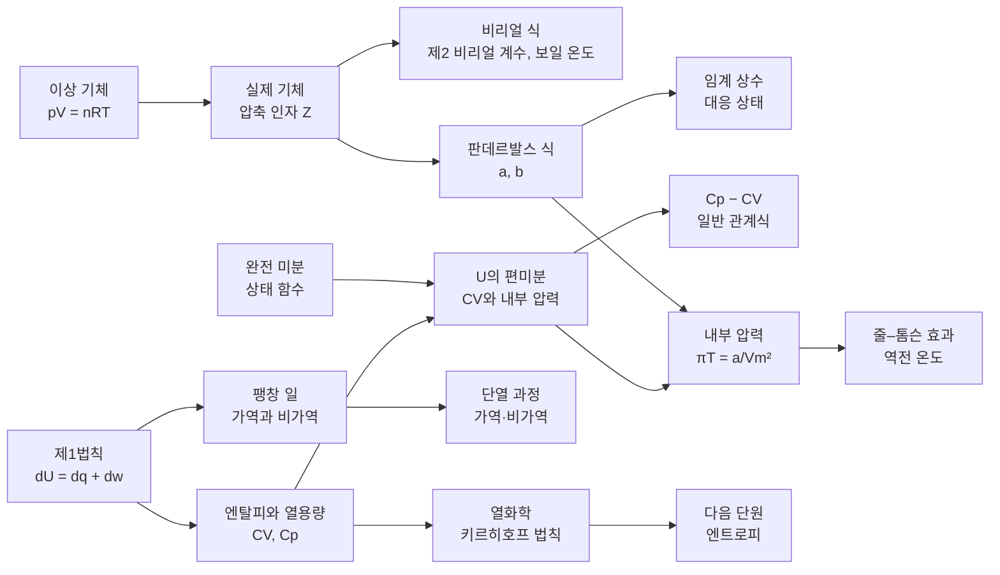

# 물리화학 1. 기체의 성질과 열역학 제1법칙 — 상태 방정식에서 에너지 장부의 미분 언어까지
<!-- prev: uchem-2, uchem-3, uphy-7, umath-1 -->
<!-- next: pchem-2 -->

> [!NOTE]
> **이 단원의 범위**
> - 이상 기체와 실제 기체: 압축 인자, 비리얼 상태 방정식, 판데르발스 식, 임계 상수와 대응 상태의 원리
> - 계·일·열·내부 에너지와 열역학 제1법칙의 분자적 해석
> - 팽창 일: 자유 팽창, 일정 외부 압력, 가역 등온 팽창(이상 기체·판데르발스 기체)
> - 엔탈피와 열용량($C_V$, $C_p$), 열용량의 온도 의존, $C_p - C_V$의 일반 관계식
> - 상태 함수와 완전 미분, 내부 에너지·엔탈피의 편미분 표현
> - 단열 과정(가역·비가역)
> - 내부 압력 $\pi_T$와 줄 실험, 줄–톰슨 효과와 역전 온도
> - 열화학: 표준 엔탈피 변화, 열량 측정, 키르히호프 법칙

**학습 목표**

1. 압축 인자와 비리얼 계수로 실제 기체가 이상 기체에서 벗어나는 정도를 정량화하고, 판데르발스 식에서 임계 상수와 보일 온도를 유도할 수 있다.
2. 환산 변수와 대응 상태의 원리를 써서 서로 다른 기체의 성질을 하나의 틀로 비교할 수 있다.
3. 열역학 제1법칙을 미분형 $dU = dq + dw$로 쓰고, 자유 팽창·일정 외부 압력 팽창·가역 팽창의 일을 적분으로 계산하여 비교할 수 있다.
4. 완전 미분과 불완전 미분을 판별하고, $U(T,V)$와 $H(T,p)$의 편미분($C_V$, $\pi_T$, $C_p$, $\mu$)으로 에너지 변화를 표현할 수 있다.
5. $C_p - C_V = (p + \pi_T)(\partial V/\partial T)_p$를 유도하고, 이상 기체·액체·판데르발스 기체에 적용할 수 있다.
6. 가역·비가역 단열 과정의 나중 온도와 일을 계산하고, 줄–톰슨 계수의 부호를 분자 간 힘으로 설명할 수 있다.
7. 열량 측정 자료와 키르히호프 법칙으로 여러 온도의 반응 엔탈피를 계산할 수 있다.

**이 단원의 학습 사다리**

| 단계 | 무엇을 하나? |
|---|---|
| STEP 1. 이전 학습 다시 보기 | 일반화학의 $PV = nRT$·판데르발스 식·$\Delta U = q + w$, 일반물리학의 $W = \int P\,dV$·$PV^\gamma$ |
| STEP 2. 기초 다지기 | 편미분과 전미분, 역수·순환 관계, 경로를 따라가는 적분 |
| STEP 3. 핵심 개념 | 실제 기체 → 판데르발스 식과 임계점 → 제1법칙 → 팽창 일 → 엔탈피·열용량 → 완전 미분 → $C_p - C_V$ → 단열 과정 → 내부 압력 → 줄–톰슨 효과 → 열화학 |
| STEP 4. 오개념 바로잡기 | "단열이면 온도가 변하지 않는다", "엔탈피 변화는 열과 같다" 같은 착각 |
| STEP 5. 대학원·연구로 | 분자 간 퍼텐셜에서 비리얼 계수 계산, 공정 설계용 3차 상태 방정식 |
| STEP 6. 생활·산업·진로 | 공기 액화, 냉동기의 팽창 밸브, 초임계 유체 |

---

## 🗺️ 단원 들어가기

자전거 바퀴에 손 펌프로 바람을 넣으면 펌프 끝이 뜨거워진다. 반대로 소화기나 스프레이 캔을 오래 뿌리면 캔이 차가워져 표면에 이슬이 맺힌다. 두 현상 모두 기체가 압축되거나 팽창할 뿐 불을 붙이거나 얼음을 대지 않았다. 온도는 어디서 올라가고 어디로 내려간 것일까?

일반화학과 일반물리학에서 우리는 이 질문에 답할 도구를 이미 하나씩 받았다. $PV = nRT$, $\Delta U = q + w$, $W = \int P\,dV$, $PV^\gamma$ = 일정. 그러나 이 도구들은 각각 따로 놀았고, 대부분 "이상 기체라면"이라는 단서가 붙어 있었다. 스프레이 캔이 차가워지는 까닭의 절반은 사실 **기체가 이상 기체가 아니기 때문**이다.

물리화학의 첫 단원에서는 두 가지를 한다. 첫째, 실제 기체를 정확히 기술하는 **상태 방정식**을 세운다. 둘째, 에너지 보존을 **편미분의 언어**로 다시 쓴다. "내부 에너지가 온도와 부피에 따라 어떻게 변하는가"를 $(\partial U/\partial T)_V$, $(\partial U/\partial V)_T$라는 두 숫자로 나타내면, 열용량·단열 냉각·줄–톰슨 효과·반응 엔탈피의 온도 의존이 모두 같은 틀에서 계산된다. 이 틀은 다음 단원부터 엔트로피와 자유 에너지를 다룰 때 그대로 쓰인다.

---

## STEP 1. 🔙 이전 학습 다시 보기

### 연계 개념표

| 이전 단원 | 그때 배운 것 | 이 단원에서 확장되는 것 |
|---|---|---|
| 일반화학 「기체」 '실제 기체와 판데르발스 방정식' | 압축 인자 $Z = PV/nRT$, $Z<1$은 인력 우세·$Z>1$은 부피 우세, 판데르발스 식의 두 보정 $a$, $b$ | 비리얼 계수 $B(T)$의 온도 의존과 보일 온도, 판데르발스 식에서 **임계 상수 유도**, 환산 변수와 대응 상태의 원리 |
| 일반화학 「열화학」 '제1법칙'·'엔탈피' | $\Delta U = q + w$, $w = -P_\text{외부}\Delta V$, $H = U + PV$, $\Delta H = \Delta U + \Delta n_\text{기체}RT$, 헤스 법칙 | 미분형 $dU = dq + dw$, 가역·비가역 일의 적분, 열용량의 온도 의존, **키르히호프 법칙** |
| 일반물리학 「열과 열역학」 '여러 과정의 일'·'몰비열과 단열 과정' | $W = \int P\,dV$, 등온 일 $nRT\ln(V_f/V_i)$, $C_V = \tfrac{f}{2}R$, $C_P - C_V = R$, $PV^\gamma$ = 일정 | 단열식의 유도, **비가역 단열** 과정, 이상 기체가 아닐 때의 $C_p - C_V$ |
| 수학 도구 「미분과 편미분」 | 편미분, 전미분과 완전 미분, 연쇄 법칙과 순환 관계, 교차 미분의 같음 | 상태 함수 $U$, $H$의 편미분이 **측정 가능한 양**(열용량, 내부 압력, 줄–톰슨 계수)이 된다 |
| 일반화학 「화학 열역학」 | 상태 함수와 경로 함수, 가역 과정이 최대 일을 한다는 것 | 다음 단원 「열역학 제2·3법칙과 엔트로피」의 준비: $dq_\text{가역}/T$가 완전 미분이 되는 까닭 |

### 준비 운동 (사전 진단)

**Q1.** 이산화 탄소 1.00 mol을 1.00 L 용기에 넣었더니 300 K에서 압력이 이상 기체로 계산한 값보다 약 10 % 작았다. 이때 $Z$는 1보다 큰가, 작은가? 이 조건에서 우세한 분자 간 효과는 무엇인가?

**Q2.** 일정한 외부 압력 1.00 bar에 맞서 기체의 부피가 2.00 L 늘었다. 계가 한 일과 계의 $w$(부호 포함)를 J 단위로 쓰시오.

**Q3.** 상태 함수와 경로 함수를 하나씩 들고, 순환 과정(처음 상태로 돌아오는 과정)에서 각각의 변화량이 어떻게 되는지 쓰시오.

**Q4.** $z = x^2y$일 때 $\partial z/\partial x$, $\partial z/\partial y$, 그리고 $\partial^2 z/\partial y\,\partial x$와 $\partial^2 z/\partial x\,\partial y$를 구하시오.

정답 및 해설

**Q1.** $Z < 1$. 분자 사이 **인력**이 벽을 때리는 힘을 줄여 압력이 이상 기체보다 작다(일반화학 「기체」 예제의 결과 $Z \approx 0.90$).

**Q2.** 계가 한 일은 $P_\text{외부}\Delta V = (1.00\times10^5\ \mathrm{Pa})(2.00\times10^{-3}\ \mathrm{m^3}) = 200\ \mathrm{J}$이고, 계의 입장에서 $w = -200\ \mathrm{J}$이다.

**Q3.** 상태 함수(예: $U$, $H$, $T$)의 순환 변화량은 0이다. 경로 함수(열 $q$, 일 $w$)는 0이 아닐 수 있다. 열기관이 한 순환마다 일을 하는 것이 그 예이다.

**Q4.** $\partial z/\partial x = 2xy$, $\partial z/\partial y = x^2$, 두 교차 2계 편미분은 모두 $2x$로 같다. 이 '교차 미분의 같음'이 STEP 3 ⑥에서 상태 함수를 판별하는 시험이 된다.

---

## STEP 2. 🧱 기초 다지기

### 디딤돌 1. 편미분과 전미분 — 변수가 여럿인 상태

기체 시료의 상태는 $n$, $T$, $p$, $V$ 가운데 셋을 정하면 나머지 하나가 정해진다. 그래서 $V$를 $V(T, p)$처럼 **두 변수의 함수**로 본다($n$ 일정). 수학 도구 1 '다변수 함수와 편미분'에서 익힌 대로, 한 변수만 움직이고 나머지는 고정한 변화율이 편미분이며 고정한 변수를 아래 첨자로 밝힌다.

$$
dV = \left(\frac{\partial V}{\partial T}\right)_p dT + \left(\frac{\partial V}{\partial p}\right)_T dp
$$

이것이 **전미분**이다. 물리화학에서는 이 두 편미분을 부피로 나눈 '세기 성질'에 이름을 붙여 쓴다.

| 이름 | 정의 | 이상 기체 값 | 25 ℃ 물(약) |
|---|---|---|---|
| 열팽창 계수 $\alpha$ | $\dfrac{1}{V}\left(\dfrac{\partial V}{\partial T}\right)_p$ | $1/T$ | $2.57\times10^{-4}\ \mathrm{K^{-1}}$ |
| 등온 압축률 $\kappa_T$ | $-\dfrac{1}{V}\left(\dfrac{\partial V}{\partial p}\right)_T$ | $1/p$ | $4.52\times10^{-10}\ \mathrm{Pa^{-1}}$ |

$\kappa_T$에 음의 부호를 붙인 것은 압력을 높이면 부피가 줄어 편미분이 음수이므로, 압축률을 양수로 만들기 위해서이다.

**예** 이상 기체 1.00 mol이 300 K, 1.00 bar에 있다. 온도를 1.0 K 올리고 동시에 압력을 0.010 bar 올리면 부피는 대략 얼마 변하는가?
$V = 24.94\ \mathrm{L}$이고 $(\partial V/\partial T)_p = nR/p = V/T$, $(\partial V/\partial p)_T = -nRT/p^2 = -V/p$이므로
$dV \approx V\left(\dfrac{dT}{T} - \dfrac{dp}{p}\right) = 24.94\times\left(\dfrac{1.0}{300} - 0.010\right) = 24.94\times(-0.00667) = -0.17\ \mathrm{L}$.
온도 상승의 효과(+0.33 %)보다 압력 상승의 효과(−1.0 %)가 크다.

### 디딤돌 2. 편미분 사이의 관계 — 역수 관계와 순환 관계

세 변수 $x$, $y$, $z$가 하나의 관계식($f(x,y,z) = 0$, 기체라면 상태 방정식)으로 묶여 있으면, 수학 도구 1 '연쇄 법칙과 순환 관계'에서 익힌 두 관계가 성립한다.

$$
\left(\frac{\partial x}{\partial y}\right)_z = \frac{1}{(\partial y/\partial x)_z} \quad(\text{역수 관계}), \qquad \left(\frac{\partial x}{\partial y}\right)_z\left(\frac{\partial y}{\partial z}\right)_x\left(\frac{\partial z}{\partial x}\right)_y = -1 \quad(\text{순환 관계})
$$

순환 관계의 쓸모는 **재기 어려운 편미분을 재기 쉬운 편미분으로 바꾸는 것**이다. 예를 들어 '부피를 고정하고 데울 때 압력이 오르는 정도' $(\partial p/\partial T)_V$는 액체에서 직접 재기 어렵다(용기가 버티지 못한다). 순환 관계 $(\partial p/\partial T)_V(\partial T/\partial V)_p(\partial V/\partial p)_T = -1$을 정리하면

$$
\left(\frac{\partial p}{\partial T}\right)_V = -\frac{(\partial V/\partial T)_p}{(\partial V/\partial p)_T} = \frac{\alpha}{\kappa_T}
$$

**예** 물을 빈틈없이 채운 단단한 강철 용기를 25 ℃에서 1.0 K 데우면 압력은 얼마나 오르는가? (용기의 팽창은 무시한다.)
$\alpha/\kappa_T = (2.57\times10^{-4})/(4.52\times10^{-10}) = 5.7\times10^{5}\ \mathrm{Pa/K}$, 즉 1 K마다 약 **5.7 bar**가 오른다. 10 K만 데워도 57 bar이다. 액체를 가득 채운 밀폐 용기를 가열하면 안 되는 까닭이 이 숫자에 있다. (이상 기체라면 $\alpha/\kappa_T = p/T$로, 1 bar·300 K에서 1 K당 0.0033 bar에 불과하다.)

### 디딤돌 3. 경로를 따라가는 적분 — 일은 길에 따라 다르다

팽창 일 $w = -\int p_\text{외부}\,dV$는 $p$–$V$ 평면에서 **어떤 길을 따라** 적분하느냐에 따라 값이 다르다. 수학 도구 2 '선적분과 경로 의존성'의 대표적인 예이다. 이 단원에서 반복해 쓰는 적분은 두 가지뿐이다.

$$
\int_{V_1}^{V_2}\frac{dV}{V} = \ln\frac{V_2}{V_1}, \qquad \int_{V_1}^{V_2}\frac{dV}{V^2} = \frac{1}{V_1} - \frac{1}{V_2}
$$

**예** 이상 기체 1.00 mol을 상태 A(300 K, 1.00 bar, 24.94 L)에서 상태 C(300 K, 0.500 bar, 49.89 L)로 옮기는 두 길을 비교하자. 길 ①은 300 K의 가역 등온 팽창, 길 ②는 '1.00 bar를 유지하며 49.89 L까지 팽창한 뒤(온도가 600 K로 오른다), 부피를 고정하고 300 K까지 식히는' 길이다(둘 다 가역).
길 ①: $w = -nRT\ln 2 = -8.314\times300\times0.6931 = -1729\ \mathrm{J}$
길 ②: 첫 단계 $w = -p\Delta V = -(1.00\times10^5)(24.94\times10^{-3}) = -2494\ \mathrm{J}$, 둘째 단계는 부피가 변하지 않으므로 $w = 0$. 합 $-2494\ \mathrm{J}$.
처음과 나중 상태가 같아도 일은 다르다. 반면 두 길 모두 처음과 나중 온도가 같으므로 이상 기체의 $\Delta U = 0$은 같다. 따라서 열도 길마다 다르다($q = -w$).

---

## STEP 3. 📘 핵심 개념

### ① 이상 기체와 실제 기체 — 압축 인자와 비리얼 상태 방정식

#### 상태 방정식과 이상 기체

순물질 기체의 $p$, $V$, $T$, $n$을 잇는 관계식을 **상태 방정식(equation of state)** 이라 한다. 가장 단순한 것이 **이상 기체(perfect gas, ideal gas)** 의 상태 방정식이다.

$$
pV = nRT, \qquad R = 8.314\ \mathrm{J/(mol\cdot K)} = 0.083\,14\ \mathrm{L\cdot bar/(mol\cdot K)} = 0.082\,06\ \mathrm{L\cdot atm/(mol\cdot K)}
$$

일반화학 「기체」에서 보았듯이 이 식은 분자 운동론에서 두 가정 — ① 분자 자체의 부피는 무시한다 ② 충돌할 때 말고는 분자 사이에 힘이 없다 — 으로 유도된다. 두 가정은 **압력이 0으로 가는 극한**에서 정확해진다. 그래서 이상 기체 방정식은 모든 실제 기체가 따르는 **극한 법칙(limiting law)** 이다. 온도의 열역학적 눈금이 "묽은 기체의 $pV/n$"으로 정의되는 것도 이 때문이다.

#### 압축 인자

실제 기체가 이 극한에서 벗어나는 정도는 **압축 인자(compressibility factor)** 로 잰다.

$$
Z = \frac{pV_\mathrm{m}}{RT} = \frac{V_\mathrm{m}}{V_\mathrm{m}^\circ}, \qquad V_\mathrm{m} = \frac{V}{n}
$$

$V_\mathrm{m}^\circ = RT/p$는 같은 $T$, $p$에서 이상 기체의 몰 부피이다. 즉 $Z$는 '실제 기체가 이상 기체보다 몇 배의 부피를 차지하는가'이다. 분자의 관점에서 해석하면 다음과 같다.

| 영역 | $Z$ | 분자 사이에서 무슨 일이 | 대표적 조건 |
|---|---|---|---|
| 매우 낮은 압력 | $\approx 1$ | 분자가 서로 멀리 떨어져 거의 상호작용하지 않는다 | 수 bar 이하 |
| 중간 압력 | $< 1$ | 평균 거리가 인력이 미치는 범위(수백 pm~1 nm)에 들어와 **인력**이 우세하다 | 수십~수백 bar, 낮은 온도 |
| 높은 압력 | $> 1$ | 분자가 서로의 반발 영역까지 밀려 **반발력**(분자의 크기)이 우세하다 | 수백 bar 이상 |

<!-- 그림 요청: 273 K에서 여러 기체의 압축 인자 Z를 압력 p(0~1000 bar, 가로축)에 대해 그린 그래프. 세로축 Z(0~2.0). 이상 기체는 Z = 1인 수평 점선. H₂는 처음부터 1보다 커지며 거의 직선으로 증가(1000 bar에서 약 1.6~1.7). N₂는 1 아래로 아주 조금 내려갔다가(최솟값 약 0.97~0.98, 100 bar 부근) 약 200 bar에서 1을 넘어 증가(1000 bar에서 약 2). CH₄는 더 깊게 내려갔다가(최솟값 약 0.75, 150 bar 부근) 약 400 bar 근처에서 1을 넘어 증가. CO₂는 약 35 bar에서 액화되어 Z가 0.1 근처로 급히 떨어진 뒤(이 부분에 '액화' 이름표) 압력에 거의 비례해 증가. 곡선마다 기체 이름표. 정량값은 모양만 맞추면 된다. 오른쪽 위에 '반발 우세 Z > 1', 오른쪽 아래에 '인력 우세 Z < 1' 글상자. -->

#### 비리얼 상태 방정식

$Z$가 1에서 벗어나는 정도를 밀도(곧 $1/V_\mathrm{m}$)의 거듭제곱 급수로 쓴 것이 **비리얼 상태 방정식(virial equation of state)** 이다.

$$
Z = \frac{pV_\mathrm{m}}{RT} = 1 + \frac{B(T)}{V_\mathrm{m}} + \frac{C(T)}{V_\mathrm{m}^2} + \cdots
$$

$B$를 **제2 비리얼 계수**, $C$를 제3 비리얼 계수라 한다. 이 급수에는 분명한 분자적 의미가 있다. $1/V_\mathrm{m}$ 항은 **분자 두 개**가 만나는 확률(밀도에 비례)에서, $1/V_\mathrm{m}^2$ 항은 **세 개**가 한꺼번에 만나는 확률(밀도의 제곱에 비례)에서 나온다. 그래서 묽은 기체에서는 $B$만으로 충분하고, $B$는 두 분자 사이의 상호작용 퍼텐셜로 계산할 수 있다(STEP 5).

압력의 급수로 쓰는 형태도 자주 쓴다.

$$
Z = 1 + B'p + C'p^2 + \cdots, \qquad B' = \frac{B}{RT}
$$

$B' = B/RT$인 까닭: 첫 식에서 $1/V_\mathrm{m} \approx p/(RTZ) \approx p/RT$(첫 근사)를 넣으면 $B/V_\mathrm{m} \approx Bp/RT$이므로 1차 항끼리 비교하면 된다. 2차 항은 $C' = (C - B^2)/(RT)^2$로 단순한 대응이 아니다.

| 기체 | $B$ (273 K, $\mathrm{cm^3/mol}$, 약) | $B$ (373 K, $\mathrm{cm^3/mol}$, 약) | 보일 온도 $T_\mathrm{B}$ (K, 약) |
|---|---|---|---|
| He | +12 | +11 | 23 |
| $\mathrm{N_2}$ | −10 | +6 | 327 |
| Ar | −22 | −4 | 411 |
| $\mathrm{CO_2}$ | −150 | −72 | 714 |

$B$는 낮은 온도에서 음수(인력 우세)였다가 온도가 오르면 양수(반발 우세)가 된다. 온도가 높을수록 분자의 운동 에너지가 커서 인력에 붙잡히는 시간이 짧아지고, 상대적으로 '단단한 몸집'의 효과가 드러나기 때문이다. $B(T) = 0$인 온도를 **보일 온도(Boyle temperature)** $T_\mathrm{B}$라 한다. 이 온도에서는 $Z = 1 + O(p^2)$이므로 꽤 넓은 압력 범위에서 기체가 이상 기체처럼 행동한다. 즉 $Z$–$p$ 곡선의 $p \to 0$ 기울기 $dZ/dp = B'$가 0이 된다.

<!-- 그림 요청: N₂의 압축 인자 Z(세로축 0.8~1.6)를 압력 p(0~600 bar, 가로축)에 대해 세 온도에서 그린 그래프. 200 K 곡선은 1 아래로 처졌다가(최솟값 약 0.83, 120 bar 부근) 약 300 bar에서 1을 넘고 600 bar에서 약 1.5, 약 327 K(보일 온도) 곡선은 p = 0에서 수평으로 출발해 100 bar 근처까지 거의 1이다가 점점 가파르게 올라감(원점 근처가 위로 오목), 1000 K 곡선은 원점에서부터 양의 기울기로 거의 직선처럼 증가(원점 기울기가 세 곡선 중 가장 큼, 높은 압력에서는 다른 곡선과 만나도 된다). p = 0에서 세 곡선 모두 Z = 1에서 출발하며, 보일 온도 곡선의 원점 접선이 수평임을 짧은 점선으로 강조하고 'T = T_B: dZ/dp = 0 (p → 0)' 이름표. -->

#### 예제 1 — 비리얼 식으로 아르곤의 몰 부피 구하기

273 K, 50.0 bar에서 아르곤의 몰 부피를 (1) 이상 기체 방정식으로, (2) 제2 비리얼 계수 $B = -21.7\ \mathrm{cm^3/mol}$을 써서 구하시오. 압력 급수의 1차 항까지만 쓴다.

**풀이**
(1) 식 세우기: $V_\mathrm{m}^\circ = RT/p$. 대입: $\dfrac{8.314\times273.15}{50.0\times10^{5}} = 4.542\times10^{-4}\ \mathrm{m^3/mol} = 454\ \mathrm{cm^3/mol}$.
(2) $Z \approx 1 + \dfrac{Bp}{RT} = 1 + \dfrac{B}{V_\mathrm{m}^\circ} = 1 - \dfrac{21.7}{454.2} = 0.952$
$V_\mathrm{m} = ZV_\mathrm{m}^\circ = 0.952\times454.2 = 432\ \mathrm{cm^3/mol}$.

**의미** 50 bar에서도 아르곤은 이상 기체보다 약 5 % 작은 부피를 차지한다. 부피 급수 $Z = 1 + B/V_\mathrm{m}$을 이차 방정식으로 정확히 풀면 $431\ \mathrm{cm^3/mol}$($Z = 0.950$)로 1차 근사와 0.3 % 이내로 일치한다. 기체 저장 탱크의 충전량을 계산할 때 이 5 %는 무시할 수 없는 차이이다.

#### ✔ 바로 확인

1. (O/X) 이상 기체 방정식은 압력이 0으로 가는 극한에서 모든 기체가 따른다.
2. 빈칸: 제2 비리얼 계수가 0이 되는 온도를 (    ) 온도라 한다.
3. 어떤 기체의 $Z$–$p$ 곡선이 $p \to 0$에서 음의 기울기를 가진다. $B$의 부호와 우세한 분자 간 효과는?

정답

1. O — 압력이 0으로 가면 분자 사이 거리가 무한히 커져 두 가정이 정확해진다(극한 법칙).
2. 보일 — 이 온도에서 $Z = 1 + O(p^2)$.
3. $B < 0$, 인력 우세 — $p \to 0$ 기울기가 $B' = B/RT$이다.

### ② 판데르발스 식과 임계점 — 기체와 액체를 하나의 식으로

#### 판데르발스 식을 다시 세우기

일반화학 「기체」에서 판데르발스 식의 두 보정을 정성적으로 보았다. 여기서는 각 보정이 무엇을 가정하는지 밝히고 식을 몰 부피로 쓴다.

$$
p = \frac{RT}{V_\mathrm{m} - b} - \frac{a}{V_\mathrm{m}^2}
$$

- **반발(배제 부피)**: 분자를 지름 $d$인 단단한 구로 보면, 두 분자의 중심은 $d$보다 가까이 올 수 없다. 한 쌍이 서로에게서 빼앗는 부피는 반지름 $d$인 구의 부피 $\tfrac{4}{3}\pi d^3$이고, 쌍마다 둘이 나누어 가지므로 분자 하나당 $\tfrac{2}{3}\pi d^3$, 1 mol이면 $b = \tfrac{2}{3}\pi d^3N_\mathrm{A}$이다(분자 자체 부피의 4배). 분자가 실제로 돌아다닐 수 있는 부피가 $V_\mathrm{m} - b$로 줄어든다.
- **인력**: 벽에 부딪히는 분자는 뒤쪽 분자들에게 끌려 충돌이 약해진다. 그 효과는 '벽에 오는 분자의 수 밀도'와 '끌어당기는 분자의 수 밀도'에 각각 비례하므로 $(n/V)^2 = 1/V_\mathrm{m}^2$에 비례한다. 비례 상수가 $a$이다.

| 기체 | $a$ ($\mathrm{atm\cdot L^2/mol^2}$) | $b$ ($\mathrm{L/mol}$) | $b$에서 구한 분자 지름 $d$ (nm) |
|---|---|---|---|
| He | 0.0341 | 0.0237 | 0.27 |
| $\mathrm{H_2}$ | 0.244 | 0.0266 | 0.28 |
| $\mathrm{N_2}$ | 1.39 | 0.0391 | 0.31 |
| Ar | 1.34 | 0.0322 | 0.29 |
| $\mathrm{CH_4}$ | 2.25 | 0.0428 | 0.32 |
| $\mathrm{CO_2}$ | 3.59 | 0.0427 | 0.32 |
| $\mathrm{H_2O}$ | 5.46 | 0.0305 | 0.29 |

(SI로 바꿀 때: $1\ \mathrm{atm\cdot L^2/mol^2} = 0.101\,325\ \mathrm{Pa\cdot m^6/mol^2}$, $1\ \mathrm{L/mol} = 10^{-3}\ \mathrm{m^3/mol}$.)

#### 판데르발스 등온선과 임계점

판데르발스 식은 $V_\mathrm{m}$에 대한 **3차 방정식**이다($pV_\mathrm{m}^3 - (pb + RT)V_\mathrm{m}^2 + aV_\mathrm{m} - ab = 0$). 그래서 어떤 $T$, $p$에서는 실근이 세 개 나온다. 등온선을 그려 보면 이것이 무엇을 뜻하는지 보인다.

- 높은 온도: 등온선이 단조 감소하는 매끈한 곡선이다(기체 하나뿐).
- 낮은 온도: 등온선이 아래로 꺼졌다가 위로 솟는 **판데르발스 고리(van der Waals loop)** 가 생긴다. 실제 기체는 이 고리를 따라가지 않고, 일정한 압력(증기 압력)에서 기체와 액체가 공존하는 수평선을 따라간다. 수평선의 높이는 그 위아래 고리의 넓이가 같도록 정한다(**맥스웰 작도**, 근거는 「순물질의 상평형」에서 화학 퍼텐셜로 보인다). 고리 가운데 $(\partial p/\partial V)_T > 0$인 부분은 '압축하면 압력이 내려가는' 역학적으로 불안정한 상태여서 실제로 존재하지 않는다.
- 두 경우의 경계가 되는 온도에서는 고리가 줄어들어 한 점이 된다. 이 점이 **임계점(critical point)** 이다.

<!-- 그림 요청: CO₂의 실험 등온선(p–V_m 도표). 가로축 V_m(0~0.4 L/mol), 세로축 p(0~120 bar). 등온선 4~5개: 약 260 K, 280 K, 304 K(임계 등온선), 320 K, 340 K. 임계 온도 아래 등온선에는 수평한 기체–액체 공존선(260 K에서 약 24 bar, 280 K에서 약 42 bar)이 있고, 공존선 양 끝을 이은 종 모양의 점선 '공존 곡선'이 꼭대기 임계점(304.1 K, 73.8 bar, 0.094 L/mol)에서 만난다. 종 모양 왼쪽 바깥 '액체', 안쪽 '액체 + 기체', 오른쪽 '기체', 임계 등온선 위쪽 '초임계 유체' 이름표. 임계점은 굵은 점으로 표시하고 '임계점: 기울기 0, 변곡점' 이름표. -->

임계점에서는 등온선이 수평한 변곡점이 되므로 두 조건이 동시에 성립한다.

$$
\left(\frac{\partial p}{\partial V_\mathrm{m}}\right)_T = 0, \qquad \left(\frac{\partial^2 p}{\partial V_\mathrm{m}^2}\right)_T = 0
$$

#### 유도 — 판데르발스 기체의 임계 상수

**가정** 판데르발스 식이 임계점 근처에서도 성립한다.
**1단계** 두 편미분을 쓴다.

$$
\left(\frac{\partial p}{\partial V_\mathrm{m}}\right)_T = -\frac{RT}{(V_\mathrm{m}-b)^2} + \frac{2a}{V_\mathrm{m}^3} = 0, \qquad \left(\frac{\partial^2 p}{\partial V_\mathrm{m}^2}\right)_T = \frac{2RT}{(V_\mathrm{m}-b)^3} - \frac{6a}{V_\mathrm{m}^4} = 0
$$

**2단계** 두 식을 각각 $RT = 2a(V_\mathrm{m}-b)^2/V_\mathrm{m}^3$, $RT = 3a(V_\mathrm{m}-b)^3/V_\mathrm{m}^4$로 고쳐 같다고 놓는다. $2/V_\mathrm{m}^3 = 3(V_\mathrm{m}-b)/V_\mathrm{m}^4$이므로 $2V_\mathrm{m} = 3V_\mathrm{m} - 3b$, 즉 $V_\mathrm{c} = 3b$.
**3단계** 첫 식에 넣으면 $RT_\mathrm{c} = 2a(2b)^2/(3b)^3 = 8a/27b$.
**4단계** 상태 방정식에 넣으면 $p_\mathrm{c} = \dfrac{RT_\mathrm{c}}{2b} - \dfrac{a}{9b^2} = \dfrac{4a}{27b^2} - \dfrac{3a}{27b^2} = \dfrac{a}{27b^2}$.

$$
\boxed{\;V_\mathrm{c} = 3b, \qquad T_\mathrm{c} = \frac{8a}{27Rb}, \qquad p_\mathrm{c} = \frac{a}{27b^2}, \qquad Z_\mathrm{c} = \frac{p_\mathrm{c}V_\mathrm{c}}{RT_\mathrm{c}} = \frac{3}{8}\;}
$$

**적용 한계** 판데르발스 식이 옳다면 모든 기체의 임계 압축 인자가 0.375여야 한다. 실제 값은 대부분 0.23~0.31이다(아래 표). 판데르발스 식은 임계점 근처를 정성적으로는 맞히지만 정량적으로는 어긋난다.

| 기체 | $T_\mathrm{c}$ (K) | $p_\mathrm{c}$ (bar) | $V_\mathrm{c}$ ($\mathrm{cm^3/mol}$) | $Z_\mathrm{c}$ |
|---|---|---|---|---|
| He | 5.2 | 2.27 | 57 | 0.30 |
| $\mathrm{N_2}$ | 126.2 | 33.9 | 90 | 0.29 |
| Ar | 150.7 | 48.6 | 75 | 0.29 |
| $\mathrm{CH_4}$ | 190.6 | 46.0 | 99 | 0.29 |
| $\mathrm{CO_2}$ | 304.1 | 73.8 | 94 | 0.27 |
| $\mathrm{H_2O}$ | 647.1 | 220.6 | 56 | 0.23 |

(값은 출처마다 조금씩 다르다. $V_\mathrm{c}$는 특히 측정이 어려워 약 ±2 % 정도의 차이가 있다.)

#### 예제 2 — 판데르발스 상수로 CO₂의 임계 상수 예측하기

$\mathrm{CO_2}$의 $a = 3.59\ \mathrm{atm\cdot L^2/mol^2}$, $b = 0.0427\ \mathrm{L/mol}$로 $V_\mathrm{c}$, $T_\mathrm{c}$, $p_\mathrm{c}$를 계산하고 실험값($V_\mathrm{c} = 0.094\ \mathrm{L/mol}$, $T_\mathrm{c} = 304.1\ \mathrm{K}$, $p_\mathrm{c} = 72.8\ \mathrm{atm}$)과 비교하시오.

**풀이**
$V_\mathrm{c} = 3b = 0.128\ \mathrm{L/mol}$
$T_\mathrm{c} = \dfrac{8a}{27Rb} = \dfrac{8\times3.59}{27\times0.082\,06\times0.0427} = 304\ \mathrm{K}$ (303.6 K)
$p_\mathrm{c} = \dfrac{a}{27b^2} = \dfrac{3.59}{27\times(0.0427)^2} = 72.9\ \mathrm{atm}$

**의미** $T_\mathrm{c}$와 $p_\mathrm{c}$가 거의 정확히 맞는 것은 우연이 아니다. 표의 $a$, $b$는 흔히 실험 $T_\mathrm{c}$, $p_\mathrm{c}$에서 거꾸로 $a = 27R^2T_\mathrm{c}^2/64p_\mathrm{c}$, $b = RT_\mathrm{c}/8p_\mathrm{c}$로 정한 값이기 때문이다. 그러면 남은 $V_\mathrm{c}$가 모형을 시험하는 값이 되는데, 판데르발스 식은 이를 약 36 % 크게 예측한다($Z_\mathrm{c}$ 0.375 대 0.274와 같은 말). 어떤 '시험'이 진짜 시험인지 가려 보는 습관이 중요하다.

#### 판데르발스 식과 비리얼 식의 연결 — 보일 온도

판데르발스 식을 $Z$로 쓰고, 수학 도구 2 '테일러 급수와 근사'에서 익힌 전개 $1/(1-x) = 1 + x + x^2 + \cdots$($x = b/V_\mathrm{m} \ll 1$)를 쓰면

$$
Z = \frac{V_\mathrm{m}}{V_\mathrm{m} - b} - \frac{a}{RTV_\mathrm{m}} = \frac{1}{1 - b/V_\mathrm{m}} - \frac{a}{RTV_\mathrm{m}} = 1 + \left(b - \frac{a}{RT}\right)\frac{1}{V_\mathrm{m}} + \frac{b^2}{V_\mathrm{m}^2} + \cdots
$$

비리얼 식과 항별로 비교하면

$$
B = b - \frac{a}{RT}, \qquad C = b^2, \qquad T_\mathrm{B} = \frac{a}{Rb} = \frac{27}{8}T_\mathrm{c}
$$

$B$의 두 항이 ①의 표를 그대로 설명한다. 반발($b > 0$)은 온도와 관계없이 $B$를 키우고, 인력($-a/RT$)은 낮은 온도일수록 $B$를 크게 깎는다. 판데르발스 식은 $T_\mathrm{B}/T_\mathrm{c} = 3.375$를 예측하는데, 실제로는 $\mathrm{N_2}$ 2.6, Ar 2.7, $\mathrm{CO_2}$ 2.3 정도이다. 정량적으로 어긋나지만 '보일 온도는 임계 온도의 몇 배'라는 감각은 맞다.

#### 환산 변수와 대응 상태의 원리

임계 상수로 나눈 **환산 변수(reduced variables)** 를 정의한다.

$$
p_\mathrm{r} = \frac{p}{p_\mathrm{c}}, \qquad V_\mathrm{r} = \frac{V_\mathrm{m}}{V_\mathrm{c}}, \qquad T_\mathrm{r} = \frac{T}{T_\mathrm{c}}
$$

판데르발스 식에 $p = p_\mathrm{r}p_\mathrm{c}$ 등을 넣고 유도한 임계 상수를 대입하면 $a$, $b$가 모두 사라진다.

$$
p_\mathrm{r} = \frac{8T_\mathrm{r}}{3V_\mathrm{r} - 1} - \frac{3}{V_\mathrm{r}^2}
$$

물질마다 다른 상수가 없어졌으므로, **같은 환산 온도와 환산 압력에 있는 기체는 같은 환산 부피(따라서 비슷한 $Z$)를 가진다.** 이것이 **대응 상태의 원리(principle of corresponding states)** 이다. 판데르발스 식이 정확하지 않아도 이 원리는 실험적으로 꽤 잘 성립한다. 구형에 가까운 비극성 분자(Ar, $\mathrm{N_2}$, $\mathrm{CH_4}$)에서 특히 잘 맞고, 극성이 크거나 길쭉한 분자($\mathrm{H_2O}$, $\mathrm{NH_3}$)에서는 어긋난다. 공학에서는 이 어긋남을 분자 모양을 나타내는 세 번째 매개변수(이심 인자)로 보정한다.

<!-- 그림 요청: 대응 상태의 원리를 보여 주는 일반화 압축 인자 도표. 가로축 환산 압력 p_r(0~7), 세로축 Z(0.2~1.1). 환산 온도 T_r = 1.0, 1.2, 1.5, 2.0 네 곡선. T_r = 1.0 곡선은 p_r ≈ 1 근처에서 Z ≈ 0.3까지 급히 떨어졌다 다시 오르고, T_r이 클수록 곡선이 1 가까이 완만하다. 곡선 위에 서로 다른 기호(○ N₂, △ CH₄, □ CO₂, ◇ Ar)의 실험점들이 한 곡선 주위에 모이는 모습. 오른쪽 위 범례 '여러 기체의 점이 같은 T_r 곡선 위에 모인다'. -->

<!-- 시뮬레이션 요청: 환산 판데르발스 등온선 탐색기. 조작 변수: 환산 온도 T_r(0.80~1.50, 슬라이더), '맥스웰 작도 보이기' 켜기/끄기. 보여 줄 것: p_r–V_r 그래프(V_r 0.4~5)에 선택한 T_r의 등온선, T_r < 1이면 고리 부분과 (∂p/∂V) > 0인 불안정 구간을 다른 색으로 표시하고 맥스웰 작도의 수평선과 같은 두 넓이를 음영으로 표시, T_r = 1에서 변곡점(1, 1) 강조. 곁에 같은 조건의 Z 값과 실근 개수를 숫자로 표시. -->

#### 예제 3 — 대응 상태에 있는 두 기체

$\mathrm{N_2}$가 189 K, 50.9 bar에 있다. (1) 환산 온도와 환산 압력을 구하시오. (2) $\mathrm{CO_2}$가 같은 대응 상태에 있으려면 온도와 압력이 얼마여야 하는가? (3) 환산 판데르발스 식으로 이 상태의 $Z$를 예측하시오.

**풀이**
(1) $T_\mathrm{r} = 189/126.2 = 1.50$, $p_\mathrm{r} = 50.9/33.9 = 1.50$
(2) $T = 1.50\times304.1 = 456\ \mathrm{K}$, $p = 1.50\times73.8 = 111\ \mathrm{bar}$
(3) $p_\mathrm{r} = 1.50$, $T_\mathrm{r} = 1.50$을 환산 식에 넣으면 $V_\mathrm{r}$에 대한 3차 방정식 $4.5V_\mathrm{r}^3 - 13.5V_\mathrm{r}^2 + 9V_\mathrm{r} - 3 = 0$이 되고, 실근은 $V_\mathrm{r} = 2.24$ 하나이다(임계 온도 위이므로). 판데르발스 기체에서는 $Z = Z_\mathrm{c}\,p_\mathrm{r}V_\mathrm{r}/T_\mathrm{r} = \tfrac{3}{8}\times1.50\times2.24/1.50 = 0.84$.

**의미** 온도·압력이 전혀 다른 두 기체가 같은 $Z$를 가진다는 것이 대응 상태의 원리이다. 실제 기체 자료를 모은 일반화 도표에서 읽은 값은 약 0.86~0.87로, 판데르발스 식의 예측보다 조금 크다. 측정 자료가 없는 기체도 $T_\mathrm{c}$, $p_\mathrm{c}$만 알면 이 방법으로 $Z$를 몇 % 안에서 어림할 수 있다.

#### ✔ 바로 확인

1. 판데르발스 식이 예측하는 임계 압축 인자 $Z_\mathrm{c}$의 값은? 실제 기체의 값은 대체로 그보다 큰가, 작은가?
2. 빈칸: 판데르발스 기체의 제2 비리얼 계수는 $B = (\quad) - a/RT$이다.
3. (O/X) 판데르발스 등온선의 고리 가운데 $(\partial p/\partial V)_T > 0$인 부분은 실제로 관찰되는 상태이다.

정답

1. 3/8 = 0.375, 작다(대부분 0.23~0.31).
2. $b$ — 반발은 $B$를 키우고, 인력은 낮은 온도일수록 $B$를 깎는다.
3. X — 압축하면 압력이 내려가는 역학적으로 불안정한 상태여서 실제로는 기체–액체 공존(수평선)이 나타난다.

### ③ 계·일·열·내부 에너지 — 열역학 제1법칙

#### 계와 주위, 그리고 두 가지 에너지 전달

**계(system)** 는 관심을 두는 부분이고, 나머지 전부가 **주위(surroundings)** 이다. 계와 주위 사이의 경계가 물질과 에너지를 모두 통과시키면 **열린계**, 에너지만 통과시키면 **닫힌계**, 둘 다 막으면 **고립계**이다. 이 단원은 주로 닫힌계를 다룬다.

경계를 통해 에너지가 오가는 방법은 두 가지뿐이다. 물리화학에서는 둘을 **분자 수준의 운동 방식**으로 구별한다.

- **일(work, $w$)**: 주위의 원자들이 **한 방향으로 가지런히** 움직이게 하는 에너지 전달. 피스톤을 미는 것, 추를 들어 올리는 것, 전류를 흘려 보내는 것.
- **열(heat, $q$)**: 주위의 원자들이 **무질서하게(열운동으로)** 더 세게 또는 약하게 움직이게 하는 에너지 전달. 온도 차 때문에 일어난다.

경계가 열을 통과시키면 **투열(diathermic)**, 막으면 **단열(adiabatic)** 경계라 한다. 단열 경계 안의 계에서 에너지가 바뀌는 길은 일뿐이다.

<!-- 그림 요청: 일과 열의 분자적 차이를 보여 주는 두 칸 모식도. 왼쪽 칸 '일': 기체가 든 실린더의 피스톤이 위로 밀려 올라가고, 피스톤 위 주위 원자들(작은 원 격자)이 모두 같은 방향(위쪽) 화살표로 가지런히 움직임. 오른쪽 칸 '열': 뜨거운 계와 닿은 벽 너머 주위 원자들이 제각각 다른 방향의 짧은 화살표로 무질서하게 흔들림. 두 칸 아래에 각각 '가지런한 운동으로 전달', '무질서한 열운동으로 전달' 이름표. -->

#### 내부 에너지와 제1법칙

**내부 에너지(internal energy)** $U$는 계를 이루는 모든 입자의 운동 에너지와 퍼텐셜 에너지의 합이다(계 전체의 운동이나 외부 장에서의 위치 에너지는 뺀다). 그 절댓값은 알 수 없지만 변화량은 잴 수 있다. 수많은 실험(줄의 일당량 실험 등)이 하나의 결론을 주었다.

> [!IMPORTANT]
> **열역학 제1법칙(first law of thermodynamics)**
> 고립계의 내부 에너지는 일정하다. 닫힌계에서 내부 에너지의 변화는 계가 받은 열과 일의 합이다.
> $$
> \Delta U = q + w, \qquad dU = dq + dw
> $$
> 부호는 언제나 **계의 입장**: 계가 받으면 +, 내주면 −. ($w$를 '계가 한 일'로 정의하는 물리학 책은 $\Delta U = Q - W$로 쓴다. 같은 내용이다.)

제1법칙의 핵심은 식보다 그 뒤에 숨은 주장이다. **단열 경계 안에서 계를 상태 A에서 B로 바꾸는 데 드는 일은 어떤 방법으로 하든 같다**(줄의 실험: 추를 떨어뜨려 물을 휘젓든, 전류로 데우든, 같은 온도 상승에 같은 일이 든다). 그래서 그 일로 상태 함수 $U$를 정의할 수 있다. 열은 '단열이 아닐 때 일만으로 설명되지 않는 나머지'로 정의된다. 미분형에서 $dU$는 상태 함수의 미소 변화(완전 미분)이지만 $dq$, $dw$는 경로마다 다른 미소량(불완전 미분)이다. 이 차이는 ⑥에서 수학적으로 다룬다. (일부 책은 이를 강조하려고 $đq$, $đw$로 쓴다.)

#### 분자로 보는 내부 에너지 — 등분배 정리

이상 기체에서는 분자 사이 퍼텐셜 에너지가 없으므로 $U$는 분자의 운동 에너지(병진·회전·진동)와 전자 에너지뿐이다. 일반물리학 「열과 열역학」의 **등분배 정리**에 따르면 고전적으로 '활성화된' 이차 항 하나마다 분자당 $\tfrac{1}{2}k_\mathrm{B}T$이다.

| 분자 | 병진 | 회전 | 진동(실온) | $U_\mathrm{m}(T) - U_\mathrm{m}(0)$ | $C_{V,\mathrm{m}}$ |
|---|---|---|---|---|---|
| 단원자(He, Ar) | $\tfrac{3}{2}RT$ | 0 | 0 | $\tfrac{3}{2}RT$ | $\tfrac{3}{2}R = 12.47\ \mathrm{J/(mol\cdot K)}$ |
| 선형($\mathrm{N_2}$, $\mathrm{CO_2}$) | $\tfrac{3}{2}RT$ | $RT$ | 거의 0 | $\tfrac{5}{2}RT$ | 약 $\tfrac{5}{2}R = 20.79\ \mathrm{J/(mol\cdot K)}$ |
| 비선형($\mathrm{CH_4}$, $\mathrm{H_2O}$) | $\tfrac{3}{2}RT$ | $\tfrac{3}{2}RT$ | 일부 | $3RT$ 이상 | $3R$ 이상 |

실온에서 진동이 거의 기여하지 않는 까닭은 진동 에너지 준위의 간격이 $k_\mathrm{B}T$(약 $2.5\ \mathrm{kJ/mol}$)보다 훨씬 커서 대부분의 분자가 바닥 준위에 머물기 때문이다(양자화, 「통계 열역학」에서 정량적으로 다룬다). $\mathrm{CO_2}$는 굽힘 진동의 준위 간격이 작아 실온에서도 $C_{V,\mathrm{m}} \approx 28.8\ \mathrm{J/(mol\cdot K)}$로 $\tfrac{5}{2}R$보다 크다.

이상 기체의 내부 에너지가 **온도만의 함수**라는 사실은 매우 중요하다. 부피를 바꾸어도 분자 사이 거리가 바뀔 뿐 운동 에너지는 그대로이기 때문이다. 실제 기체는 분자 사이 퍼텐셜 에너지가 거리에 따라 달라지므로 $U$가 부피에도 의존한다(⑨ 내부 압력).

#### 예제 4 — 일정 압력에서 아르곤을 데울 때의 에너지 장부

1.00 mol의 아르곤을 일정한 압력 1.00 bar에서 298.15 K에서 373.15 K로 천천히 데웠다. 이상 기체로 보고 $\Delta U$, $w$, $q$를 구하고, 받은 열 가운데 몇 %가 일로 나갔는지 구하시오.

**풀이**
식 세우기: 이상 기체의 $\Delta U = nC_{V,\mathrm{m}}\Delta T$(온도만의 함수). 일정 압력에서 $w = -p\Delta V = -nR\Delta T$($pV = nRT$에서).
대입: $\Delta U = 1.00\times\tfrac{3}{2}\times8.314\times75.0 = +935\ \mathrm{J}$
$w = -1.00\times8.314\times75.0 = -624\ \mathrm{J}$ (부피는 24.79 L → 31.02 L)
$q = \Delta U - w = 935 + 624 = +1559\ \mathrm{J}$
일로 나간 비율 $= 624/1559 = 0.400$, 곧 **40 %**.

**의미** 받은 열 가운데 $R/C_{p,\mathrm{m}} = R/(\tfrac{5}{2}R) = 2/5$가 주위를 밀어내는 일로 나가고, 나머지 $3/5$만 분자의 운동 에너지를 늘렸다. 같은 온도를 올리는 데 일정 압력에서 열이 더 드는 까닭이 이것이며, ⑤에서 $C_p > C_V$로 정리된다.

#### ✔ 바로 확인

1. (O/X) 단열 경계 안의 닫힌계에서 내부 에너지를 바꾸는 방법은 일뿐이다.
2. 계가 열 250 J을 흡수하고 주위에 일 100 J을 했다. $\Delta U$는?
3. 빈칸: 분자 수준에서 주위 원자들의 가지런한 운동으로 전달되는 에너지는 (    )이고, 무질서한 열운동으로 전달되는 에너지는 (    )이다.

정답

1. O — 단열 경계는 열을 막으므로 $\Delta U = w_\text{단열}$이다. 이것이 $U$를 상태 함수로 정의하는 근거이다.
2. $+150\ \mathrm{J}$ — $q = +250$, $w = -100$.
3. 일, 열

### ④ 팽창 일 — 같은 팽창, 다른 일

#### 팽창 일의 일반식

넓이 $A$인 피스톤이 외부 압력 $p_\text{외부}$에 맞서 $dz$만큼 밀려 나가면, 계가 주위에 한 일은 (힘) × (거리) $= p_\text{외부}A\,dz = p_\text{외부}\,dV$이다. 계의 입장에서

$$
dw = -p_\text{외부}\,dV, \qquad w = -\int_{V_1}^{V_2} p_\text{외부}\,dV
$$

**주의할 점**은 적분 안의 압력이 계의 압력이 아니라 **외부 압력**이라는 것이다. 두 값은 가역 과정에서만 같다. 이 식은 기체뿐 아니라 부피가 바뀌는 모든 계(반응 혼합물, 녹는 고체)에 쓴다. 적분은 $p_\text{외부}$–$V$ 그래프 아래 넓이이며, 디딤돌 3에서 본 것처럼 경로에 따라 다르다.

#### 세 가지 팽창

진공으로의 **자유 팽창**은 $p_\text{외부} = 0$이므로 $w = 0$, **일정 외부 압력 팽창**은 $w = -p_\text{외부}\Delta V$(일반적으로 비가역), **가역 팽창**은 매 순간 $p_\text{외부} = p$이므로 $w = -\int p\,dV$이며 상태 방정식이 있어야 적분할 수 있다.

#### 가역 등온 팽창 — 이상 기체

**가정** 이상 기체, 온도 일정, 매 순간 $p_\text{외부} = p = nRT/V$.

$$
w = -\int_{V_1}^{V_2}\frac{nRT}{V}dV = -nRT\ln\frac{V_2}{V_1} = -nRT\ln\frac{p_1}{p_2}
$$

$T$를 적분 밖으로 꺼낼 수 있는 것은 등온이기 때문이다. 이상 기체의 $U$는 온도만의 함수이므로 $\Delta U = 0$, 따라서 $q = -w = nRT\ln(V_2/V_1)$이다. 기체는 받은 열을 **전부** 일로 바꾼다(한 번의 과정이므로 제2법칙에 어긋나지 않는다. 순환이 아니다).

#### 가역 과정이 최대 일을 하는 까닭

팽창하는 동안 외부 압력은 기체의 압력보다 클 수 없다(크면 압축된다). 가역 팽창은 그 상한, 곧 $p_\text{외부} = p$를 매 순간 유지한다. 따라서 $\int p_\text{외부}\,dV$, 즉 그래프 아래 넓이가 가장 크다. 반대로 압축할 때는 가역 압축이 **가장 적은 일**을 받는다. 어느 쪽이든 실제 과정은 가역 과정보다 손해를 본다.

<!-- 그림 요청: 이상 기체 1 mol의 등온 팽창(298 K, 10 bar → 1 bar)에서 세 경로의 일을 비교하는 p–V 도표 세 칸(나란히). 가로축 V(0~26 L), 세로축 p(0~11 bar). 세 칸 모두 회색 점선으로 등온선 p = nRT/V(2.48 L에서 10 bar, 24.8 L에서 1 bar)를 그림. ① '한 단계': p_외부 = 1 bar 수평선 아래 2.48~24.8 L 직사각형에 음영(넓이 2.23 kJ). ② '두 단계': 5 bar로 2.48→4.96 L, 다음 1 bar로 4.96→24.8 L의 계단 두 개에 음영(3.22 kJ). ③ '가역': 등온선 아래 전체에 음영(5.71 kJ). 각 칸 아래에 일의 크기 수치. -->

<!-- 시뮬레이션 요청: 다단계 등온 팽창과 가역 일. 조작 변수: 단계 수 n(1~50, 슬라이더), 처음·나중 압력(기본 10 bar → 1 bar), 팽창/압축 전환 버튼. 보여 줄 것: p–V 도표에 등온선과 n단계 계단(외부 압력을 등비로 낮춤)과 그 아래 음영 넓이, 계가 한 일 |w|과 가역 일 nRT ln(p₁/p₂)의 비. 압축 모드에서는 계단이 등온선 위에 생겨 받는 일이 가역 일보다 큼을 보여 준다. n이 커질수록 두 값이 같아지는 막대그래프. -->

#### 예제 5 — 같은 팽창, 네 가지 일

이상 기체 1.00 mol이 298.15 K에서 10.0 bar → 1.00 bar로 등온 팽창한다. 다음 경우의 $w$를 구하시오. (1) 진공으로 자유 팽창 (2) 외부 압력 1.00 bar에 맞서 한 번에 팽창 (3) 외부 압력을 5.00 bar로 두고 평형에 이른 뒤 다시 1.00 bar로 낮추어 팽창 (4) 가역 팽창

**풀이**
처음·나중 부피: $V_1 = nRT/p_1 = 2.479\ \mathrm{L}$, $V_2 = 24.79\ \mathrm{L}$, 중간 상태(5.00 bar) $4.958\ \mathrm{L}$.
(1) $w = 0$
(2) $w = -(1.00\times10^5)(24.79 - 2.479)\times10^{-3} = -2.23\times10^3\ \mathrm{J}$
(3) $w = -(5.00\times10^5)(4.958 - 2.479)\times10^{-3} - (1.00\times10^5)(24.79 - 4.958)\times10^{-3} = -1239 - 1983 = -3.22\times10^3\ \mathrm{J}$
(4) $w = -nRT\ln(p_1/p_2) = -8.314\times298.15\times\ln 10.0 = -5.71\times10^3\ \mathrm{J}$

**의미** 처음과 나중 상태가 같으니 네 경우 모두 $\Delta U = 0$이고 $q = -w$이다. 그러나 일은 0에서 5.71 kJ까지 달라진다. 단계를 늘릴수록(외부 압력을 등비로 10단계에 나누면 −5.10 kJ, 100단계면 −5.64 kJ) 가역 일에 다가간다. '가역 = 무한히 많은 단계의 극한'이라는 말의 뜻이다.

#### 가역 등온 팽창 — 판데르발스 기체

**가정** 판데르발스 기체, 온도 일정, 가역. $p = \dfrac{nRT}{V - nb} - \dfrac{an^2}{V^2}$를 넣는다.

$$
w = -\int_{V_1}^{V_2}\left(\frac{nRT}{V - nb} - \frac{an^2}{V^2}\right)dV = -nRT\ln\frac{V_2 - nb}{V_1 - nb} - an^2\left(\frac{1}{V_2} - \frac{1}{V_1}\right)
$$

첫째 항은 이상 기체의 식에서 부피를 '움직일 수 있는 부피'로 바꾼 것이고, 둘째 항($V_2 > V_1$이면 양수)은 인력이 기체가 하는 일을 깎는 효과이다. 팽창하는 기체는 분자들을 서로에게서 떼어 내는 데 에너지를 쓰기 때문이다.

#### 예제 6 — 압축된 CO₂의 가역 등온 팽창

1.00 mol의 $\mathrm{CO_2}$가 300 K에서 0.500 L에서 5.00 L로 가역 등온 팽창한다. (1) 이상 기체로, (2) 판데르발스 기체로($a = 3.59\ \mathrm{atm\cdot L^2/mol^2} = 0.364\ \mathrm{Pa\cdot m^6/mol^2}$, $b = 4.27\times10^{-5}\ \mathrm{m^3/mol}$) 일을 구하시오.

**풀이**
(1) $w = -8.314\times300\times\ln 10.0 = -5743\ \mathrm{J} \approx -5.74\ \mathrm{kJ}$
(2) 첫째 항: $-8.314\times300\times\ln\dfrac{5.00\times10^{-3} - 4.27\times10^{-5}}{0.500\times10^{-3} - 4.27\times10^{-5}} = -8.314\times300\times\ln 10.84 = -5944\ \mathrm{J}$
둘째 항: $-0.3638\times\left(\dfrac{1}{5.00\times10^{-3}} - \dfrac{1}{0.500\times10^{-3}}\right) = -0.3638\times(200 - 2000) = +655\ \mathrm{J}$
$w = -5944 + 655 = -5289\ \mathrm{J} \approx -5.29\ \mathrm{kJ}$

**의미** 배제 부피는 일을 약 3.5 % 늘리고(분자가 더 좁은 공간에서 출발하므로 상대적 부피 증가가 크다), 인력은 약 11 % 줄인다. 이 조건(처음 압력: 이상 기체 49 atm, 판데르발스 약 39 atm)에서는 인력 효과가 우세해 실제 기체가 하는 일이 이상 기체보다 약 8 % 작다. 인력 항 655 J은 ⑨에서 이 기체의 내부 에너지 증가 $\Delta U$로 다시 나타난다.

#### ✔ 바로 확인

1. (O/X) 팽창 일의 식 $dw = -p\,dV$에서 $p$는 언제나 계의 압력이다.
2. 이상 기체 2.00 mol이 300 K에서 부피가 2배가 되도록 가역 등온 팽창할 때 $w$는?
3. 같은 처음·나중 상태 사이의 등온 압축에서 계가 받는 일이 가장 작은 것은 어떤 과정인가?

정답

1. X — 외부 압력이다. 가역 과정에서만 계의 압력과 같다.
2. $-3.46\ \mathrm{kJ}$ — $-2.00\times8.314\times300\times\ln 2 = -3458\ \mathrm{J}$.
3. 가역 압축 — 외부 압력이 매 순간 계의 압력보다 무한히 조금만 크므로 그래프 아래 넓이가 가장 작다.

### ⑤ 엔탈피와 열용량

팽창 일 말고 다른 일(전기적 일 등)이 없다고 하자.
- **일정 부피**: $dV = 0$이므로 $dw = 0$, 따라서 $dU = dq_V$, 즉 $\Delta U = q_V$. 통 열량계(봄베 열량계)가 재는 것이 $\Delta U$이다.
- **일정 압력**: 계가 팽창하며 일을 하므로 열의 일부가 일로 나간다. 이때 열과 같아지는 상태 함수를 따로 정의하면 편리하다.

#### 엔탈피의 정의와 $\Delta H = q_p$의 유도

**엔탈피(enthalpy)** 를 다음과 같이 정의한다.

$$
H = U + pV
$$

$U$, $p$, $V$가 모두 상태 함수이므로 $H$도 상태 함수이다. 미소 변화를 쓰면

$$
dH = dU + p\,dV + V\,dp = (dq - p\,dV) + p\,dV + V\,dp = dq + V\,dp
$$

(가역 팽창 일 $dw = -p\,dV$를 썼다.) 일정 압력에서 $dp = 0$이므로 $dH = dq_p$, 적분하면 $\Delta H = q_p$이다. 비가역이어도 처음과 나중 압력이 외부 압력과 같은 일정 압력 과정이면 같은 결론이 나온다($\Delta H = \Delta U + p\Delta V = q + w + p\Delta V = q$, $w = -p\Delta V$).

이상 기체가 관여하는 반응에서는 $\Delta(pV) = \Delta n_\text{기체}RT$이므로 $\Delta H = \Delta U + \Delta n_\text{기체}RT$이고, 고체·액체만의 변화에서는 $p\Delta V$가 작아 $\Delta H \approx \Delta U$이다. 상전이에서는 차이가 클 수 있다. 물의 몰 증발 엔탈피 $40.66\ \mathrm{kJ/mol}$(373.15 K) 가운데 $RT = 3.10\ \mathrm{kJ/mol}$(약 7.6 %)는 수증기가 대기를 밀어내는 일로 쓰이고, 분자 사이의 수소 결합을 끊어 내부 에너지를 늘리는 데 쓰이는 것은 $\Delta U = 37.56\ \mathrm{kJ/mol}$이다.

#### 열용량 — 상태 함수의 온도 미분

열용량을 '온도를 1 K 올리는 데 드는 열'로 정의하면 열이 경로 함수이므로 조건을 밝혀야 한다. 상태 함수의 편미분으로 정의하면 모호함이 사라진다.

$$
C_V = \left(\frac{\partial U}{\partial T}\right)_V, \qquad C_p = \left(\frac{\partial H}{\partial T}\right)_p
$$

이것이 **정적 열용량(heat capacity at constant volume)** 과 **정압 열용량(heat capacity at constant pressure)** 이다. 1 mol당이면 $C_{V,\mathrm{m}}$, $C_{p,\mathrm{m}}$이다. 정의에서 곧바로 $dU = C_V\,dT$(일정 부피), $dH = C_p\,dT$(일정 압력)가 된다.

이상 기체에서는 $H = U + nRT$이고 $U$, $H$가 모두 온도만의 함수이므로

$$
C_p - C_V = \frac{dH}{dT} - \frac{dU}{dT} = nR, \qquad C_{p,\mathrm{m}} - C_{V,\mathrm{m}} = R
$$

이상 기체가 아닐 때의 일반식은 ⑦에서 유도한다.

#### 열용량의 온도 의존

넓은 온도 범위에서 기체의 $C_{p,\mathrm{m}}$은 온도가 오를수록 커진다(진동이 차례로 활성화된다). 실용적으로는 다음 경험식을 쓴다.

$$
C_{p,\mathrm{m}} = a + bT + \frac{c}{T^2}
$$

| 물질 | $a$ (J/(mol·K)) | $b$ ($10^{-3}\ \mathrm{J/(mol\cdot K^2)}$) | $c$ ($10^{5}\ \mathrm{J\cdot K/mol}$) | 쓸 수 있는 범위(약) |
|---|---|---|---|---|
| $\mathrm{N_2(g)}$ | 28.58 | 3.77 | −0.50 | 298~2000 K |
| $\mathrm{O_2(g)}$ | 29.96 | 4.18 | −1.67 | 298~2000 K |
| $\mathrm{CO_2(g)}$ | 44.22 | 8.79 | −8.62 | 298~2000 K |
| $\mathrm{H_2O(l)}$ | 75.29 | 0 | 0 | 273~373 K |

(이 계수는 측정값에 맞춘 경험식이어서 범위 밖에서는 쓰지 않는다. 계수의 값은 자료마다 조금씩 다르다.)

<!-- 그림 요청: 기체의 정압 몰 열용량 C_p,m(세로축 20~60 J/(mol·K))을 온도 T(300~2000 K, 가로축)에 대해 그린 그래프. N₂: a + bT + c/T² 식(a = 28.58, b = 3.77×10⁻³, c = −0.50×10⁵)으로 298 K에서 29.1, 1000 K에서 32.3, 2000 K에서 약 36. CO₂: (a = 44.22, b = 8.79×10⁻³, c = −8.62×10⁵)으로 298 K에서 약 37, 1000 K에서 약 52, 2000 K에서 약 61. 수평 점선 두 개: 5R/2 + R = 7R/2 ≈ 29.1(선형 분자의 병진+회전, '진동 없음'), 단원자 5R/2 ≈ 20.8(Ar, 온도와 무관한 수평선으로 함께 표시). 이름표 '진동이 활성화되며 증가'. -->

#### 예제 7 — 넓은 온도 범위의 가열

1.00 mol의 $\mathrm{N_2}$를 일정한 압력에서 298 K에서 1000 K로 데우는 데 드는 열을 구하시오. (1) 표의 경험식을 쓰고, (2) 298 K의 값 $C_{p,\mathrm{m}} = 29.1\ \mathrm{J/(mol\cdot K)}$가 일정하다고 볼 때와 비교하시오. (3) 이때 $\Delta U$는 얼마인가?

**풀이**
(1) 일정 압력이므로 $q_p = \Delta H = \displaystyle\int_{T_1}^{T_2}\left(a + bT + \frac{c}{T^2}\right)dT = a(T_2 - T_1) + \frac{b}{2}(T_2^2 - T_1^2) - c\left(\frac{1}{T_2} - \frac{1}{T_1}\right)$
$= 28.58\times701.85 + \tfrac{1}{2}(3.77\times10^{-3})(1000^2 - 298.15^2) - (-0.50\times10^5)\left(\dfrac{1}{1000} - \dfrac{1}{298.15}\right)$
$= 20\,059 + 1717 - 118 = 2.166\times10^4\ \mathrm{J} \approx 21.7\ \mathrm{kJ}$
(2) $29.1\times701.85 = 2.04\times10^4\ \mathrm{J}$ — 약 6 % 작게 나온다.
(3) 이상 기체로 보면 $\Delta U = \Delta H - nR\Delta T = 21\,659 - 8.314\times701.85 = 1.58\times10^4\ \mathrm{J}$.

**의미** 수백 K에 걸친 가열에서는 열용량의 온도 의존을 넣어야 몇 % 정확도가 나온다. 연소 기관이나 반응기의 열 수지 계산에서 이 차이는 수십 K의 온도 오차로 이어진다.

#### ✔ 바로 확인

1. 빈칸: $C_p = (\partial\ (\quad)\ /\partial T)_p$, $C_V = (\partial\ (\quad)\ /\partial T)_V$
2. (O/X) 통 열량계로 잰 연소열은 $\Delta H$이다.
3. 100 ℃에서 물 1 mol이 증발할 때 $\Delta H - \Delta U$는 대략 얼마인가?
4. 이상 기체의 $C_{p,\mathrm{m}} - C_{V,\mathrm{m}}$은?

정답

1. $H$, $U$
2. X — 일정 부피이므로 $\Delta U = q_V$를 잰다. $\Delta H$는 $\Delta n_\text{기체}RT$로 보정해 얻는다.
3. 약 $3.10\ \mathrm{kJ}$ — $\Delta(pV) \approx RT = 8.314\times373.15$.
4. $R = 8.314\ \mathrm{J/(mol\cdot K)}$

### ⑥ 상태 함수와 완전 미분 — 열역학의 미분 언어

#### 완전 미분과 불완전 미분

두 변수 $x$, $y$의 미소량 $df = M(x,y)\,dx + N(x,y)\,dy$가 어떤 함수 $f(x,y)$의 전미분이면 **완전 미분(exact differential)**, 그렇지 않으면 **불완전 미분(inexact differential)** 이라 한다. 수학 도구 1 '고계 편미분과 교차 미분의 같음'에서 익힌 판별법이 있다.

$$
df \text{ 가 완전 미분} \iff \left(\frac{\partial M}{\partial y}\right)_x = \left(\frac{\partial N}{\partial x}\right)_y
$$

(근거: 완전 미분이면 $M = \partial f/\partial x$, $N = \partial f/\partial y$이고, 매끄러운 함수의 교차 2계 편미분은 순서와 무관하다.) 완전 미분에는 다음 세 성질이 **모두 같은 말**이다.

| 성질 | 수학 표현 | 열역학에서의 뜻 |
|---|---|---|
| 어떤 함수의 전미분이다 | $df = (\partial f/\partial x)dx + (\partial f/\partial y)dy$ | 상태 함수가 존재한다 |
| 적분이 경로와 무관하다 | $\int_A^B df = f(B) - f(A)$ | 변화량이 처음·나중 상태로만 정해진다 |
| 닫힌 경로의 적분이 0이다 | $\oint df = 0$ | 순환 과정에서 변화량이 0이다 |

$dU$, $dH$, $dV$, $dp$, $dT$는 완전 미분이고, $dq$와 $dw$는 불완전 미분이다. 불완전 미분에 알맞은 함수(**적분 인자**)를 곱하면 완전 미분이 될 수 있다. 열에 대한 적분 인자가 $1/T$라는 사실이 다음 단원 엔트로피의 출발점이다.

#### 예제 8 — 열은 상태 함수가 아니지만 $dq/T$는 그렇다

단원자 이상 기체 1.00 mol의 가역 과정에서 $dq_\text{가역} = C_V\,dT + \dfrac{nRT}{V}dV$이다($dU = C_V\,dT$, $dw = -p\,dV$에서).
(1) $dq_\text{가역}$이 완전 미분인지 판별하시오. (2) $dq_\text{가역}/T$는 어떠한가? (3) 다음 순환에서 $\oint dq$와 $\oint dq/T$를 계산하시오: A(300 K, 10.0 L) → B(600 K, 10.0 L, 정적 가열) → C(600 K, 20.0 L, 등온 팽창) → D(300 K, 20.0 L, 정적 냉각) → A(등온 압축).

**풀이**
(1) $M = C_V$(상수), $N = nRT/V$. $(\partial M/\partial V)_T = 0$, $(\partial N/\partial T)_V = nR/V \ne 0$ → **불완전 미분**.
(2) $M/T = C_V/T$, $N/T = nR/V$. $\partial(C_V/T)/\partial V = 0$, $\partial(nR/V)/\partial T = 0$ → **완전 미분**.
(3) $C_V = \tfrac{3}{2}R = 12.47\ \mathrm{J/K}$이다.

| 단계 | $q$ (J) | $q/T$ 적분 (J/K) |
|---|---|---|
| A→B 정적 가열 | $C_V\times300 = +3741$ | $C_V\ln 2 = +8.64$ |
| B→C 등온(600 K) | $R\times600\ln 2 = +3458$ | $R\ln 2 = +5.76$ |
| C→D 정적 냉각 | $-3741$ | $-8.64$ |
| D→A 등온(300 K) | $-R\times300\ln 2 = -1729$ | $-5.76$ |
| 합 | $+1729$ | $0$ |

**의미** 한 순환을 돌아 제자리에 왔는데 열의 합이 0이 아니다(+1729 J). 그만큼 계가 주위에 일을 했다($\oint dw = -1729\ \mathrm{J}$, $\oint dU = 0$). 이것이 열기관의 원리이다. 반면 $\oint dq_\text{가역}/T = 0$이므로 $dq_\text{가역}/T$는 어떤 상태 함수의 미분이다. 다음 단원에서 이 함수를 **엔트로피**라 부른다.

#### 내부 에너지를 $T$와 $V$의 함수로

$U$를 $U(T, V)$로 보면 전미분은

$$
dU = \left(\frac{\partial U}{\partial T}\right)_V dT + \left(\frac{\partial U}{\partial V}\right)_T dV = C_V\,dT + \pi_T\,dV
$$

두 번째 계수 $\pi_T = (\partial U/\partial V)_T$를 **내부 압력(internal pressure)** 이라 한다. 단위가 압력과 같고(J/m³ = Pa), 등온에서 부피를 늘릴 때 분자 사이 퍼텐셜 에너지가 얼마나 변하는지를 나타낸다. 이상 기체는 $\pi_T = 0$이고, 그 의미와 값은 ⑨에서 다룬다.

이 식은 '부피를 고정하지 않은' 변화에도 쓸 수 있다. 예를 들어 일정 압력에서 온도를 올릴 때 $U$의 변화율은, 양변을 $dT$로 나누고 압력을 고정하면

$$
\left(\frac{\partial U}{\partial T}\right)_p = C_V + \pi_T\left(\frac{\partial V}{\partial T}\right)_p = C_V + \alpha\pi_TV
$$

이 '고정한 변수 바꾸기'가 열역학 계산의 기본 기술이다. ⑦에서 바로 쓴다.

같은 방식으로 엔탈피를 $H(T, p)$로 보면 $dH = C_p\,dT + (\partial H/\partial p)_T\,dp$이다. 두 번째 계수는 ⑩에서 줄–톰슨 계수와 $(\partial H/\partial p)_T = -\mu C_p$로 이어지며, 이상 기체에서는 0이다.

#### ✔ 바로 확인

1. $df = 2xy\,dx + x^2\,dy$는 완전 미분인가? 그렇다면 $f$는?
2. (O/X) 순환 과정에서 계가 받은 열의 합은 언제나 0이다.
3. 빈칸: $(\partial U/\partial V)_T$를 (    )이라 하며, 이상 기체에서는 그 값이 (    )이다.

정답

1. 완전 미분이다 — $\partial(2xy)/\partial y = 2x = \partial(x^2)/\partial x$. $f = x^2y$ (+상수).
2. X — 열은 경로 함수이다. 순환에서 0이 되는 것은 $U$ 같은 상태 함수의 변화량이다(예제 8: $\oint dq = +1729\ \mathrm{J}$).
3. 내부 압력, 0

### ⑦ $C_p$와 $C_V$의 관계 — 이상 기체를 넘어서

#### 유도 — 일반 관계식

**가정** 닫힌계, 팽창 일 외의 일 없음. 상태 방정식의 형태는 가정하지 않는다.
**1단계** $H = U + pV$를 일정 압력에서 $T$로 미분한다.

$$
C_p = \left(\frac{\partial H}{\partial T}\right)_p = \left(\frac{\partial U}{\partial T}\right)_p + p\left(\frac{\partial V}{\partial T}\right)_p
$$

**2단계** ⑥에서 얻은 $(\partial U/\partial T)_p = C_V + \pi_T(\partial V/\partial T)_p$를 넣는다.

$$
C_p = C_V + \pi_T\left(\frac{\partial V}{\partial T}\right)_p + p\left(\frac{\partial V}{\partial T}\right)_p
$$

**3단계** 정리하면

$$
\boxed{\;C_p - C_V = (p + \pi_T)\left(\frac{\partial V}{\partial T}\right)_p = (p + \pi_T)\,\alpha V\;}
$$

**해석** 일정 압력에서 데우면 계가 팽창한다. 그 팽창에 드는 에너지는 두 가지이다. 외부 대기를 밀어내는 일($p\,dV$)과, 분자들을 서로에게서 떼어 내며 늘어나는 내부 에너지($\pi_T\,dV$). 이 둘을 위해 정적 가열보다 열이 더 필요하다.

이상 기체는 $\pi_T = 0$, $(\partial V/\partial T)_p = nR/p$이므로 $nR$를 되찾는다. 판데르발스 기체는 $nR$보다 조금 크고(문제 17), 액체·고체는 $\pi_T \gg p$이지만 $(\partial V/\partial T)_p$가 아주 작다.

#### 측정 가능한 양으로 — $\alpha^2TV/\kappa_T$

$\pi_T$는 직접 재기 어렵다. 다음 단원들에서 엔트로피와 맥스웰 관계식을 쓰면 **열역학적 상태 방정식** $\pi_T = T(\partial p/\partial T)_V - p$를 유도할 수 있다(「자유 에너지와 화학 퍼텐셜」). 이것을 받아들이면 $p + \pi_T = T(\partial p/\partial T)_V = T\alpha/\kappa_T$(디딤돌 2)이므로

$$
C_p - C_V = \frac{\alpha^2TV}{\kappa_T}
$$

이 식에서 세 가지를 바로 읽을 수 있다. ① $\kappa_T > 0$이므로 언제나 $C_p \ge C_V$이다. ② $\alpha = 0$이면(4 ℃의 물) $C_p = C_V$이다. ③ $T \to 0$에서 두 열용량은 같아진다. (이상 기체에 넣으면 $\alpha = 1/T$, $\kappa_T = 1/p$이므로 $nR$가 되어 위와 일치한다.)

#### 예제 9 — 액체 물의 $C_{p,\mathrm{m}} - C_{V,\mathrm{m}}$

25 ℃의 물에서 $\alpha = 2.57\times10^{-4}\ \mathrm{K^{-1}}$, $\kappa_T = 4.52\times10^{-10}\ \mathrm{Pa^{-1}}$, $V_\mathrm{m} = 18.07\ \mathrm{cm^3/mol}$, $C_{p,\mathrm{m}} = 75.29\ \mathrm{J/(mol\cdot K)}$이다. $C_{p,\mathrm{m}} - C_{V,\mathrm{m}}$과 $C_{V,\mathrm{m}}$을 구하시오.

**풀이**
$C_{p,\mathrm{m}} - C_{V,\mathrm{m}} = \dfrac{(2.57\times10^{-4})^2\times298.15\times18.07\times10^{-6}}{4.52\times10^{-10}} = 0.787\ \mathrm{J/(mol\cdot K)}$
$C_{V,\mathrm{m}} = 75.29 - 0.79 = 74.50\ \mathrm{J/(mol\cdot K)}$

**의미** 액체는 거의 팽창하지 않아서 두 열용량의 차이가 약 1 %에 불과하다(이상 기체는 $R = 8.31$으로 $C_V$의 수십 %). 그래서 액체·고체의 열용량은 보통 구별 없이 '열용량'이라 부른다. 다만 $C_V$를 직접 재기는 어려워(액체를 부피 일정하게 가두면 디딤돌 2처럼 압력이 1 K에 5.7 bar씩 오른다), 실험값 $C_p$에서 이 식으로 $C_V$를 계산한다. 분자 이론(통계 열역학)이 주는 것은 $C_V$이므로 이 변환이 이론과 실험을 잇는 다리이다.

#### ✔ 바로 확인

1. (O/X) 모든 물질에서 $C_p \ge C_V$이다.
2. 4 ℃의 물에서 $C_p - C_V$는?
3. 빈칸: $C_p - C_V = (p + \pi_T)(\quad)$

정답

1. O — $C_p - C_V = \alpha^2TV/\kappa_T$이고 $\kappa_T > 0$, $\alpha^2 \ge 0$이다.
2. 0 — 4 ℃에서 물의 밀도가 최대이므로 $\alpha = 0$이다.
3. $(\partial V/\partial T)_p$ (또는 $\alpha V$)

### ⑧ 단열 과정 — 열 없이 온도가 변한다

**단열 과정(adiabatic process)** 에서는 $dq = 0$이므로 제1법칙이 $dU = dw$가 된다. 팽창하면($dw < 0$) 내부 에너지가 줄어 온도가 내려가고, 압축하면 온도가 오른다. 자전거 펌프가 뜨거워지는 것, 스프레이 캔이 차가워지는 까닭의 첫 번째 몫이 이것이다(두 번째 몫은 ⑩).

#### 유도 — 이상 기체의 가역 단열 과정

**가정** 이상 기체, 가역($p_\text{외부} = p$), 단열, $C_V$는 온도에 무관.
**1단계** 이상 기체이므로 $dU = C_V\,dT$. 가역이므로 $dw = -p\,dV = -\dfrac{nRT}{V}dV$. 단열이므로 둘이 같다.

$$
C_V\,dT = -\frac{nRT}{V}dV
$$

**2단계** 변수를 분리하고(양변을 $T$로 나눈다) 적분한다.

$$
C_{V,\mathrm{m}}\int_{T_1}^{T_2}\frac{dT}{T} = -R\int_{V_1}^{V_2}\frac{dV}{V} \quad\Longrightarrow\quad \ln\frac{T_2}{T_1} = -\frac{R}{C_{V,\mathrm{m}}}\ln\frac{V_2}{V_1}
$$

**3단계** $c = C_{V,\mathrm{m}}/R$로 두면 $T_2/T_1 = (V_1/V_2)^{1/c}$, 곧 $VT^c$ = 일정. $T = pV/nR$를 넣고 $\gamma = C_{p,\mathrm{m}}/C_{V,\mathrm{m}} = (c+1)/c$를 쓰면

$$
\boxed{\;TV^{\gamma-1} = \text{일정}, \qquad pV^\gamma = \text{일정}, \qquad T p^{(1-\gamma)/\gamma} = \text{일정}\;}
$$

**4단계** 일은 단열이므로 $w = \Delta U = C_V(T_2 - T_1)$. ($p_1V_1 = nRT_1$ 등을 넣으면 $w = (p_2V_2 - p_1V_1)/(\gamma - 1)$로도 쓸 수 있다.)

**적용 한계** 이상 기체와 가역 조건을 둘 다 썼다. 실제 기체에서는 $C_V$가 온도에 의존하고 $\pi_T \ne 0$이며, 빠른 팽창은 비가역이다. 특히 $pV^\gamma$ = 일정을 **비가역 단열 과정에 쓰면 틀린다.**

<!-- 그림 요청: 단원자 이상 기체 1 mol의 p–V 도표(가로축 V 0~26 L, 세로축 p 0~11 bar). 같은 출발점 A(2.48 L, 10 bar, 298 K)에서 나가는 두 곡선: 회색 등온선(298 K, 1 bar에서 24.8 L)과 더 가파른 파란 가역 단열선(γ = 5/3, 1 bar에서 9.87 L, 나중 온도 119 K). 단열선의 끝점에 '119 K', 등온선의 끝점에 '298 K'. 추가로 비가역 단열 팽창(외부 압력 1 bar에 맞서)의 나중 상태 점(15.9 L, 1 bar, 191 K)을 빈 원으로 찍고 '비가역 단열의 나중 상태(경로는 정의되지 않음)' 이름표. 출발점에서 두 곡선의 접선 기울기 비가 γ임을 작은 글상자로 표시: '(∂p/∂V)_단열 = γ(∂p/∂V)_등온'. -->

#### 비가역 단열 과정 — 일정한 외부 압력에 맞선 팽창

외부 압력이 갑자기 낮아져 기체가 일정한 $p_\text{외부}$에 맞서 팽창하는 경우, 매 순간의 상태는 평형이 아니지만 처음과 나중은 평형이다. 제1법칙을 처음과 나중 사이에 쓴다.

$$
nC_{V,\mathrm{m}}(T_2 - T_1) = -p_\text{외부}(V_2 - V_1), \qquad V_2 = \frac{nRT_2}{p_\text{외부}} \;(\text{나중 압력} = p_\text{외부})
$$

$T_2$에 대한 일차 방정식이므로 바로 풀린다.

#### 예제 10 — 아르곤의 가역·비가역 단열 팽창

298.15 K, 10.0 bar의 아르곤 1.00 mol이 단열 용기 안에서 1.00 bar로 팽창한다. (1) 가역 팽창과 (2) 외부 압력 1.00 bar에 맞선 한 번의 팽창에서 나중 온도, 나중 부피, 일을 구하시오. ($\gamma = 5/3$, $C_{V,\mathrm{m}} = \tfrac{3}{2}R$)

**풀이**
(1) $T_2 = T_1(p_2/p_1)^{(\gamma-1)/\gamma} = 298.15\times(0.100)^{0.400} = 118.7\ \mathrm{K}$
$V_2 = nRT_2/p_2 = 9.87\ \mathrm{L}$, $w = C_V\Delta T = 1.5\times8.314\times(118.7 - 298.15) = -2.24\times10^3\ \mathrm{J}$
(2) $\tfrac{3}{2}R(T_2 - T_1) = -p_\text{외부}\left(\dfrac{RT_2}{p_\text{외부}} - \dfrac{RT_1}{p_1}\right) = -RT_2 + 0.100RT_1$
$\Rightarrow\ 2.5T_2 = 1.6T_1$, $T_2 = 0.640\times298.15 = 190.8\ \mathrm{K}$
$V_2 = 15.9\ \mathrm{L}$, $w = 1.5\times8.314\times(190.8 - 298.15) = -1.34\times10^3\ \mathrm{J}$

**의미** 같은 압력까지 팽창해도 가역 팽창이 더 많은 일(2.24 kJ 대 1.34 kJ)을 하고, 그만큼 내부 에너지를 더 잃어 더 차가워진다(119 K 대 191 K). 같은 조건의 등온 팽창(예제 5)과 비교하면 나중 부피도 24.8 L, 15.9 L, 9.87 L로 다르다. 처음 상태가 같아도 **단열 가역 경로와 단열 비가역 경로는 서로 다른 나중 상태에 도착한다.** 다음 단원에서 그 차이를 엔트로피로 설명한다.

#### ✔ 바로 확인

1. (O/X) 단열 과정에서는 열 출입이 없으므로 온도가 변하지 않는다.
2. 이원자 이상 기체($\gamma = 1.40$)를 가역 단열적으로 부피 1/2로 압축하면 절대 온도는 몇 배가 되는가?
3. 빈칸: 단열 과정의 일은 $w = (\quad)$이다.

정답

1. X — $dU = dw$이므로 팽창하면 온도가 내려가고 압축하면 오른다.
2. 약 1.32배 — $T_2/T_1 = 2^{0.40} = 1.32$.
3. $\Delta U$ (이상 기체면 $C_V\Delta T$)

### ⑨ 내부 압력과 줄 실험 — 부피가 바뀌면 내부 에너지도 바뀌는가

#### 내부 압력의 분자적 의미

⑥에서 정의한 $\pi_T = (\partial U/\partial V)_T$는 온도(곧 분자의 평균 운동 에너지)를 고정한 채 부피를 늘릴 때 내부 에너지가 얼마나 변하는지이다. 운동 에너지는 그대로이므로, 변하는 것은 **분자 사이의 퍼텐셜 에너지**뿐이다.

분자 간 힘이 없으면(이상 기체) $\pi_T = 0$이다. 인력이 우세하면 부피를 늘릴 때 분자를 서로 떼어 내느라 퍼텐셜 에너지가 올라가므로 $\pi_T > 0$(보통 조건의 기체, 액체), 반발이 우세한 아주 높은 밀도에서는 밀착된 분자가 풀려나며 $\pi_T < 0$이 될 수 있다.

#### 판데르발스 기체의 내부 압력

판데르발스 모형에서 분자 하나가 느끼는 인력 에너지는 주변 분자의 수 밀도 $n N_\mathrm{A}/V$에 비례한다. 분자 $nN_\mathrm{A}$개에 대해 더하고 쌍을 두 번 세지 않도록 정리하면, 인력에 의한 퍼텐셜 에너지의 합은 $-an^2/V$ 꼴이 된다. 따라서

$$
U = U^\text{이상}(T) - \frac{an^2}{V}, \qquad \pi_T = \left(\frac{\partial U}{\partial V}\right)_T = \frac{an^2}{V^2} = \frac{a}{V_\mathrm{m}^2}\ (\text{1 mol당})
$$

판데르발스 식의 압력 보정 항 $a/V_\mathrm{m}^2$이 그대로 내부 압력이라는 것이 아름다운 일치이다. 인력이 벽을 때리는 압력을 그만큼 줄이고, 같은 인력이 부피를 늘릴 때 그만큼의 에너지를 요구한다. (「자유 에너지와 화학 퍼텐셜」에서 유도할 열역학적 상태 방정식 $\pi_T = T(\partial p/\partial T)_V - p$에 판데르발스 식을 넣어도 $T\cdot\dfrac{R}{V_\mathrm{m}-b} - p = \dfrac{a}{V_\mathrm{m}^2}$로 같은 결과가 나온다.) $b$는 $\pi_T$에 나타나지 않는다. 단단한 구의 반발은 부딪칠 때만 작용하고 퍼텐셜 에너지를 저장하지 않기 때문이다.

판데르발스 기체가 등온에서 $V_1$에서 $V_2$로 변할 때

$$
\Delta U = \int_{V_1}^{V_2}\pi_T\,dV = an^2\left(\frac{1}{V_1} - \frac{1}{V_2}\right)
$$

#### 줄 실험

1843년 줄(Joule)은 압축한 공기가 든 용기와 진공 용기를 관으로 잇고 둘을 물통에 담근 뒤, 꼭지를 열어 공기를 진공으로 팽창시켰다. 물의 온도 변화를 재면 $\pi_T$를 알 수 있다고 보았다.

- 자유 팽창이므로 $w = 0$. 물의 온도가 변하지 않았다면 $q = 0$, 따라서 $\Delta U = 0$.
- 기체의 온도도 처음과 같으므로 "등온에서 부피가 늘었는데 $U$가 그대로", 곧 $\pi_T = 0$이라는 결론을 얻었다.

이 결론은 이상 기체에 대해서만 옳다. 줄의 장치에서는 물통의 열용량이 기체보다 수천 배 커서 실제 기체의 작은 온도 변화를 잴 수 없었다. 더 예민한 실험이 다음 소절의 줄–톰슨 실험이다.

<!-- 그림 요청: 줄 실험 장치 모식도. 물이 담긴 단열 물통 안에 금속 용기 두 개(왼쪽 '압축 기체 약 20 bar', 오른쪽 '진공')가 꼭지 달린 관으로 연결되어 있다. 물통에 온도계가 꽂혀 있고 이름표 '온도 변화 측정'. 아래에 작은 두 칸 그림: '꼭지를 열기 전'(왼쪽 용기에만 점으로 표시한 분자)과 '연 뒤'(두 용기에 고르게 퍼진 분자). 옆 글상자: 'w = 0, q ≈ 0 → ΔU ≈ 0'. -->

#### 예제 11 — 내부 압력의 크기와 자유 팽창의 냉각

(1) 298 K에서 $\mathrm{N_2}$($a = 1.39\ \mathrm{atm\cdot L^2/mol^2} = 0.141\ \mathrm{Pa\cdot m^6/mol^2}$)의 몰 부피가 24.8 L(약 1 bar)일 때와 0.248 L(약 100 bar)일 때의 $\pi_T$를 구하시오.
(2) 예제 6의 $\mathrm{CO_2}$ 1.00 mol(300 K, 0.500 L)이 단열 용기 안에서 진공으로 자유 팽창하여 5.00 L가 되었다. 판데르발스 모형으로 온도 변화를 어림하시오. ($C_{V,\mathrm{m}} = 28.8\ \mathrm{J/(mol\cdot K)}$, 일정)

**풀이**
(1) $\pi_T = a/V_\mathrm{m}^2$: 1 bar에서 $0.1408/(0.0248)^2 = 229\ \mathrm{Pa}$ (약 $0.0023\ \mathrm{bar}$), 100 bar에서 $0.1408/(2.48\times10^{-4})^2 = 2.29\times10^6\ \mathrm{Pa}$ (약 $23\ \mathrm{bar}$).
(2) 단열이고 자유 팽창이므로 $q = 0$, $w = 0$, $\Delta U = 0$. $U = U^\text{이상}(T) - an^2/V$이므로
$C_V\Delta T - an^2\left(\dfrac{1}{V_2} - \dfrac{1}{V_1}\right) = 0 \Rightarrow C_V\Delta T = -an^2\left(\dfrac{1}{V_1} - \dfrac{1}{V_2}\right) = -655\ \mathrm{J}$
$\Delta T = -655/28.8 = -22.7\ \mathrm{K}$

**의미** (1) 묽은 기체의 내부 압력은 겉보기 압력의 0.2 %에 불과하지만, 밀도를 100배 높이면 $1/V_\mathrm{m}^2$에 비례해 10 000배가 되어 겉보기 압력의 약 23 %에 이른다. (2) 자유 팽창에서 이상 기체는 온도가 변하지 않지만 실제 기체는 분자를 떼어 내는 에너지를 운동 에너지에서 꺼내 쓰므로 식는다. 같은 팽창을 등온에서 하면(예제 6) $\Delta U = +655\ \mathrm{J}$이고, 열은 $q = \Delta U - w = 655 + 5289 = 5944\ \mathrm{J}$이 들어와야 한다.

#### ✔ 바로 확인

1. (O/X) 판데르발스 기체의 내부 압력은 $b$에 의존한다.
2. 판데르발스 기체 1 mol의 몰 부피를 등온에서 2배로 늘리면, 처음 내부 압력에 비해 나중 내부 압력은 몇 배인가?
3. 줄의 자유 팽창 실험에서 물의 온도 변화를 측정하지 못한 주된 까닭은?

정답

1. X — $\pi_T = a/V_\mathrm{m}^2$. 단단한 구의 반발은 퍼텐셜 에너지를 저장하지 않는다.
2. 1/4배 — $\pi_T \propto 1/V_\mathrm{m}^2$.
3. 물통의 열용량이 기체보다 훨씬 커서 실제 기체의 작은 열 출입에 의한 온도 변화가 측정 한계보다 작았다.

### ⑩ 줄–톰슨 효과 — 기체를 조여 흘려보내면 식는 까닭

#### 줄–톰슨 실험과 등엔탈피 과정

1852년 줄과 톰슨(Thomson, 뒤의 켈빈 경)은 단열한 관 가운데에 다공성 마개를 두고, 한쪽에서 압력 $p_1$으로 기체를 밀어 넣고 다른 쪽으로 낮은 압력 $p_2$에서 흘러나오게 했다. 정상 상태에서 마개 양쪽의 온도 $T_1$, $T_2$를 재면 작은 온도 차를 정밀하게 잴 수 있다(기체가 계속 흐르므로 물통 같은 큰 열용량이 필요 없다).

<!-- 그림 요청: 줄–톰슨 실험 장치 단면도. 단열재로 감싼 가로 관 가운데에 다공성 마개(빗금). 왼쪽 피스톤이 일정 압력 p₁로 기체를 밀어 넣어 부피 V₁이 마개를 통과하고, 오른쪽 피스톤이 일정 압력 p₂(< p₁)로 물러나며 부피 V₂를 받는다. 양쪽에 온도계 T₁, T₂. 아래에 위쪽 그림과 맞춘 '처음'(왼쪽에 기체 덩어리 V₁)과 '나중'(오른쪽에 V₂) 두 줄 그림. 글상자: '왼쪽에서 받은 일 + p₁V₁, 오른쪽에 한 일 − p₂V₂, q = 0 → H₁ = H₂'. -->

#### 유도 — 엔탈피가 보존된다

**가정** 관 전체가 단열($q = 0$), 정상 흐름, 운동 에너지 변화는 무시.
**1단계** 기체 한 덩어리(처음 왼쪽에서 부피 $V_1$, 나중 오른쪽에서 부피 $V_2$)를 계로 잡는다. 왼쪽 피스톤이 이 덩어리를 압력 $p_1$으로 밀어 부피를 0으로 만들며 해 준 일은 $w_1 = -p_1(0 - V_1) = +p_1V_1$.
**2단계** 오른쪽에서 덩어리가 압력 $p_2$에 맞서 부피 0에서 $V_2$로 밀고 나가며 받은 일은 $w_2 = -p_2V_2$.
**3단계** 제1법칙: $U_2 - U_1 = w_1 + w_2 = p_1V_1 - p_2V_2$. 정리하면 $U_2 + p_2V_2 = U_1 + p_1V_1$, 곧

$$
H_2 = H_1 \qquad (\text{등엔탈피 과정})
$$

이 과정에서 압력 변화에 따른 온도 변화의 비를 **줄–톰슨 계수(Joule–Thomson coefficient)** 라 한다.

$$
\mu = \left(\frac{\partial T}{\partial p}\right)_H
$$

$\mu > 0$이면 압력이 내려갈 때(팽창할 때) 온도가 내려가고, $\mu < 0$이면 올라간다.

#### $\mu$를 엔탈피의 편미분으로

$H(T, p)$에 순환 관계(디딤돌 2)를 쓰면 $(\partial T/\partial p)_H(\partial p/\partial H)_T(\partial H/\partial T)_p = -1$이므로

$$
\mu = -\frac{(\partial H/\partial p)_T}{(\partial H/\partial T)_p} = -\frac{1}{C_p}\left(\frac{\partial H}{\partial p}\right)_T, \qquad \left(\frac{\partial H}{\partial p}\right)_T = -\mu C_p
$$

$(\partial H/\partial p)_T$를 **등온 줄–톰슨 계수**라 하며, 기체를 마개로 흘리면서 전기 가열로 온도를 일정하게 유지하는 데 드는 열을 재어 직접 측정한다. 이상 기체는 $H$가 온도만의 함수이므로 $\mu = 0$이다. **줄–톰슨 효과는 순전히 실제 기체의 효과이다.**

#### 유도 — 판데르발스 기체의 $\mu$ (낮은 압력 근사)

**가정** 압력이 낮아 비리얼 식의 1차 항까지만 쓴다. 판데르발스 기체 1 mol.
**1단계** 내부 에너지: $U_\mathrm{m} = U_\mathrm{m}^\text{이상}(T) - a/V_\mathrm{m} \approx U_\mathrm{m}^\text{이상}(T) - ap/RT$ ($1/V_\mathrm{m} \approx p/RT$).
**2단계** $pV_\mathrm{m}$: ②의 $Z = 1 + B/V_\mathrm{m}$, $B = b - a/RT$에서 $pV_\mathrm{m} \approx RT + Bp = RT + (b - a/RT)p$.
**3단계** 더하면

$$
H_\mathrm{m} = U_\mathrm{m} + pV_\mathrm{m} \approx H_\mathrm{m}^\text{이상}(T) + \left(b - \frac{2a}{RT}\right)p
$$

**4단계** 따라서

$$
\left(\frac{\partial H_\mathrm{m}}{\partial p}\right)_T \approx b - \frac{2a}{RT}, \qquad \boxed{\;\mu \approx \frac{1}{C_{p,\mathrm{m}}}\left(\frac{2a}{RT} - b\right)\;}
$$

**해석** 인력($a$)은 $\mu$를 양수로(팽창하면 식는다), 반발($b$)은 음수로(팽창하면 데워진다) 만든다. 두 효과가 같아지는 온도가 **역전 온도(inversion temperature)** 이다.

$$
T_\mathrm{I} = \frac{2a}{Rb} = 2T_\mathrm{B} \qquad (\text{낮은 압력의 판데르발스 기체})
$$

$T < T_\mathrm{I}$이면 조임 팽창으로 식고, $T > T_\mathrm{I}$이면 데워진다. 실제로 역전 온도는 압력에 따라 달라 $T$–$p$ 평면에서 **역전 곡선**을 이룬다. 위 식은 그 곡선이 $p \to 0$에서 갖는 높은 쪽 끝을 어림한 것이다.

| 기체 | $\mu$ (298 K, 1 atm, K/atm, 약) | 최대 역전 온도 (K, 약) | 판데르발스 $2a/Rb$ (K) |
|---|---|---|---|
| $\mathrm{CO_2}$ | +1.11 | 1500 | 2049 |
| $\mathrm{N_2}$ | +0.27 | 621 | 866 |
| $\mathrm{H_2}$ | −0.03 | 202 | 224 |
| He | −0.06 | 40 | 35 |

수소와 헬륨은 실온이 역전 온도보다 높아 조임 팽창으로 오히려 데워진다. 이들을 줄–톰슨 효과로 액화하려면 먼저 액체 질소(77 K) 등으로 역전 온도 아래까지 미리 식혀야 한다.

<!-- 그림 요청: N₂의 T–p 도표에 그린 등엔탈피선과 역전 곡선. 가로축 압력 p(0~400 bar), 세로축 온도 T(100~650 K). 서로 다른 H 값의 등엔탈피선 5~6개가 각각 위로 볼록한 곡선이며 꼭짓점(최대 온도)을 갖는다. 각 등엔탈피선의 꼭짓점을 이은 굵은 점선이 역전 곡선(p = 0에서 약 620 K와 약 100 K 근처의 두 끝을 가진 종 모양, 최대 압력 약 370~400 bar). 역전 곡선 안쪽 'μ > 0: 팽창하면 식는다', 바깥쪽 'μ < 0: 팽창하면 데워진다' 이름표. 등엔탈피선 하나를 골라 높은 압력의 한 점에서 낮은 압력 쪽으로 화살표('조임 팽창')를 그리고, 그 점에서 그은 접선의 기울기가 μ임을 표시. -->

#### 예제 12 — 질소와 헬륨의 줄–톰슨 계수 예측

298 K에서 판데르발스 상수로 (1) $\mathrm{N_2}$($a = 0.1408\ \mathrm{Pa\cdot m^6/mol^2}$, $b = 3.91\times10^{-5}\ \mathrm{m^3/mol}$, $C_{p,\mathrm{m}} = 29.1\ \mathrm{J/(mol\cdot K)}$)와 (2) He($a = 3.46\times10^{-3}\ \mathrm{Pa\cdot m^6/mol^2}$, $b = 2.37\times10^{-5}\ \mathrm{m^3/mol}$, $C_{p,\mathrm{m}} = 20.8\ \mathrm{J/(mol\cdot K)}$)의 $\mu$를 구하시오. (3) $\mathrm{N_2}$를 50 bar에서 1 bar로 조임 팽창시킬 때 온도 변화를 어림하시오.

**풀이**
(1) $\dfrac{2a}{RT} = \dfrac{2\times0.1408}{8.314\times298.15} = 1.136\times10^{-4}\ \mathrm{m^3/mol}$, $\dfrac{2a}{RT} - b = 7.45\times10^{-5}\ \mathrm{m^3/mol}$
$\mu = 7.45\times10^{-5}/29.1 = 2.56\times10^{-6}\ \mathrm{K/Pa} = 0.256\ \mathrm{K/bar}$ (실측 약 0.27 K/bar)
(2) $\dfrac{2a}{RT} = 2.79\times10^{-6}$, $\dfrac{2a}{RT} - b = -2.09\times10^{-5}\ \mathrm{m^3/mol}$, $\mu = -1.0\times10^{-6}\ \mathrm{K/Pa} = -0.10\ \mathrm{K/bar}$ (실측 약 −0.06 K/bar)
(3) $\mu$가 일정하다고 보면 $\Delta T \approx \mu\Delta p = 0.256\times(-49) \approx -13\ \mathrm{K}$

**의미** 질소는 인력 효과가 이겨 식고, 헬륨은 인력이 매우 약해 반발 효과가 이겨 데워진다. 낮은 압력 근사의 판데르발스 식이 부호와 크기를 꽤 잘 맞힌다. 한 번의 조임으로 13 K 정도 식는 것은 적어 보이지만, 식은 기체로 들어오는 기체를 미리 식히는 **역류 열교환**을 되풀이하면 액화 온도까지 내려갈 수 있다(STEP 6).

#### ✔ 바로 확인

1. (O/X) 줄–톰슨 팽창은 등엔탈피 과정이다.
2. 이상 기체의 줄–톰슨 계수는 얼마인가? 그 까닭은?
3. 판데르발스 기체에서 낮은 압력의 역전 온도는 보일 온도의 몇 배인가?

정답

1. O — 단열 정상 흐름에서 $p_1V_1 - p_2V_2$의 일이 내부 에너지 변화와 같아 $H_1 = H_2$이다.
2. 0 — 이상 기체의 $H$는 온도만의 함수이므로 $(\partial H/\partial p)_T = 0$.
3. 2배 — $T_\mathrm{I} = 2a/Rb$, $T_\mathrm{B} = a/Rb$.

### ⑪ 열화학 — 표준 엔탈피와 키르히호프 법칙

#### 표준 상태와 표준 엔탈피 변화

일반화학 「열화학」에서 배운 규약을 정확히 정리하자. 물질의 **표준 상태(standard state)** 는 지정한 온도에서 **압력 1 bar의 순물질**이다(용액의 용질은 1 mol/kg 또는 1 M 기준. 「혼합물과 용액의 열역학」에서 다룬다). 온도는 표준 상태의 정의에 들어 있지 않으므로, 표준값에는 온도를 따로 밝힌다(보통 298.15 K).

| 표준 엔탈피 | 기호 | 정의 | 예 (298.15 K) |
|---|---|---|---|
| 상전이 엔탈피 | $\Delta_\text{trs}H^\circ$ | 표준 상태 사이의 상전이 1 mol | $\Delta_\text{vap}H^\circ(\mathrm{H_2O}) = +44.01\ \mathrm{kJ/mol}$ |
| 반응 엔탈피 | $\Delta_\mathrm{r}H^\circ$ | 반응식대로 순수한 반응물이 순수한 생성물로 | $\mathrm{N_2 + 3H_2 \rightarrow 2NH_3}$: $-92.22\ \mathrm{kJ/mol}$ |
| 생성 엔탈피 | $\Delta_\mathrm{f}H^\circ$ | 기준 상태의 원소에서 화합물 1 mol | $\mathrm{H_2O(l)}$: $-285.83\ \mathrm{kJ/mol}$ |
| 연소 엔탈피 | $\Delta_\mathrm{c}H^\circ$ | 물질 1 mol의 완전 연소(생성물 $\mathrm{CO_2(g)}$, $\mathrm{H_2O(l)}$) | 에탄올(l): $-1366.8\ \mathrm{kJ/mol}$ |

반응 엔탈피의 단위 'kJ/mol'은 '반응식 1 회분(반응 진행도 1 mol)당'이라는 뜻이다. 엔탈피가 상태 함수이므로 **헤스 법칙**이 성립하고, $\Delta_\mathrm{r}H^\circ = \sum_\text{생성물}\nu\Delta_\mathrm{f}H^\circ - \sum_\text{반응물}\nu\Delta_\mathrm{f}H^\circ$로 계산한다. 이 계산의 정확성은 결국 **열량 측정**에 달려 있다.

#### 열량 측정 — 무엇을 재는가

일정 부피의 **통(봄베) 열량계**는 $\Delta U$를 재고 $\Delta H = \Delta U + \Delta n_\text{기체}RT$로 바꾼다(연소열, 생성 엔탈피). 대기압의 **일정 압력 열량계**는 용해열·중화열 같은 $\Delta H$를 바로 잰다. **시차 주사 열량계**(DSC)는 시료와 기준 물질을 같은 속도로 데우며 두 쪽에 드는 열 흐름의 차이로 $C_p(T)$와 전이 엔탈피를 재어 고분자의 녹음, 단백질 변성, 의약품의 결정형 분석에 쓰인다.

통 열량계는 먼저 연소 에너지가 정확히 알려진 표준 물질(벤조산, 약 $-26.43\ \mathrm{kJ/g}$)을 태워 열량계 상수 $C_\text{cal}$을 정한 뒤 시료를 태운다. 반응 자체는 대략 298 K 근처에서 일어나지만, 온도 상승($\Delta T$, 보통 1~3 K)을 보정해 298.15 K의 값으로 환산한다.

#### 예제 13 — 통 열량계로 에탄올의 생성 엔탈피 구하기

열량계 상수가 $10.00\ \mathrm{kJ/K}$인 통 열량계에서 에탄올(l) 1.000 g을 산소 속에서 완전 연소시켰더니 온도가 $2.961\ \mathrm{K}$ 올랐다. (1) 에탄올의 몰 연소 내부 에너지 $\Delta_\mathrm{c}U$, (2) 298 K의 $\Delta_\mathrm{c}H$, (3) $\Delta_\mathrm{f}H^\circ$(에탄올, l)를 구하시오. ($M = 46.07\ \mathrm{g/mol}$, $\Delta_\mathrm{f}H^\circ$: $\mathrm{CO_2(g)}$ $-393.51$, $\mathrm{H_2O(l)}$ $-285.83\ \mathrm{kJ/mol}$)

**풀이**
(1) 방출된 열 $q = C_\text{cal}\Delta T = 10.00\times2.961 = 29.61\ \mathrm{kJ}$. 1 mol당 $\Delta_\mathrm{c}U = -29.61\times46.07 = -1364.1\ \mathrm{kJ/mol}$
(2) $\mathrm{C_2H_5OH(l) + 3O_2(g) \rightarrow 2CO_2(g) + 3H_2O(l)}$, $\Delta n_\text{기체} = 2 - 3 = -1$
$\Delta_\mathrm{c}H = \Delta_\mathrm{c}U + \Delta n_\text{기체}RT = -1364.1 - 2.48 = -1366.6\ \mathrm{kJ/mol}$
(3) $\Delta_\mathrm{c}H = 2\Delta_\mathrm{f}H^\circ(\mathrm{CO_2}) + 3\Delta_\mathrm{f}H^\circ(\mathrm{H_2O}) - \Delta_\mathrm{f}H^\circ(\text{에탄올})$
$\Delta_\mathrm{f}H^\circ(\text{에탄올}) = 2(-393.51) + 3(-285.83) - (-1366.6) = -277.9\ \mathrm{kJ/mol}$

**의미** 표의 값(약 $-277.7\ \mathrm{kJ/mol}$)과 0.1 % 이내로 맞는다. 0.1 K의 온도 측정 오차는 연소열에 약 3 %(약 46 kJ/mol), 생성 엔탈피에는 약 17 %의 오차를 준다(큰 수의 작은 차이). 정밀 열량 측정에 0.001 K 수준의 온도계가 쓰이는 까닭이다.

#### 키르히호프 법칙 — 반응 엔탈피의 온도 의존

표에는 대개 298.15 K의 값만 있다. 다른 온도의 반응 엔탈피는 어떻게 구할까?

**유도**
**가정** 일정 압력(1 bar), 온도 범위 안에서 상전이가 없다.
**1단계** 반응물과 생성물 각각의 엔탈피는 $dH = C_p\,dT$로 변한다. 반응 엔탈피 $\Delta_\mathrm{r}H^\circ = \sum\nu H_\mathrm{m}^\circ(\text{생성물}) - \sum\nu H_\mathrm{m}^\circ(\text{반응물})$을 $T$로 미분하면

$$
\frac{d\Delta_\mathrm{r}H^\circ}{dT} = \Delta_\mathrm{r}C_p^\circ, \qquad \Delta_\mathrm{r}C_p^\circ = \sum_\text{생성물}\nu C_{p,\mathrm{m}}^\circ - \sum_\text{반응물}\nu C_{p,\mathrm{m}}^\circ
$$

**2단계** 적분하면 **키르히호프 법칙(Kirchhoff's law)** 이다.

$$
\Delta_\mathrm{r}H^\circ(T_2) = \Delta_\mathrm{r}H^\circ(T_1) + \int_{T_1}^{T_2}\Delta_\mathrm{r}C_p^\circ\,dT \approx \Delta_\mathrm{r}H^\circ(T_1) + \Delta_\mathrm{r}C_p^\circ(T_2 - T_1)
$$

(마지막 근사는 $\Delta_\mathrm{r}C_p^\circ$가 일정할 때.) 같은 결론을 **열역학 순환**으로도 얻는다. 반응물을 $T_1$에서 $T_2$로 데우고 $T_2$에서 반응시키는 길과, $T_1$에서 반응시키고 생성물을 $T_2$로 데우는 길은 처음과 나중이 같으므로 엔탈피 변화가 같다.

<!-- 그림 요청: 키르히호프 법칙의 열역학 순환 도표. 세로축은 엔탈피(눈금 없음), 가로 방향 두 열은 '반응물'(왼쪽)과 '생성물'(오른쪽). 아래쪽 줄 T₁에서 반응물 → 생성물 가로 화살표 'Δ_rH°(T₁)', 위쪽 줄 T₂에서 반응물 → 생성물 가로 화살표 'Δ_rH°(T₂)'. 왼쪽 세로 화살표(반응물 T₁ → T₂) '∫C_p(반응물)dT', 오른쪽 세로 화살표(생성물 T₁ → T₂) '∫C_p(생성물)dT'. 아래 식 'Δ_rH°(T₂) = Δ_rH°(T₁) + ∫Δ_rC_p°dT'. 발열 반응 예시로 생성물 상자를 반응물보다 아래에 그린다. -->

**적용 한계** 온도 범위 안에 물질의 상전이(예: 물의 끓음)가 있으면 그 점에서 $C_p$가 불연속이고 전이 엔탈피가 끼어든다. 순환을 그려 전이 단계를 따로 더해야 한다(문제 14).

#### 예제 14 — 높은 온도의 암모니아 합성 엔탈피

$\mathrm{N_2(g) + 3H_2(g) \rightarrow 2NH_3(g)}$의 $\Delta_\mathrm{r}H^\circ(298.15\ \mathrm{K}) = -92.22\ \mathrm{kJ/mol}$이다. 298 K의 $C_{p,\mathrm{m}}^\circ$($\mathrm{N_2}$ 29.125, $\mathrm{H_2}$ 28.824, $\mathrm{NH_3}$ 35.06 J/(mol·K))가 일정하다고 보고 500 K의 $\Delta_\mathrm{r}H^\circ$를 구하시오.

**풀이**
$\Delta_\mathrm{r}C_p^\circ = 2(35.06) - [29.125 + 3(28.824)] = 70.12 - 115.597 = -45.48\ \mathrm{J/(mol\cdot K)}$
$\Delta_\mathrm{r}H^\circ(500\ \mathrm{K}) = -92.22 + (-45.48\times10^{-3})(500 - 298.15) = -92.22 - 9.18 = -101.4\ \mathrm{kJ/mol}$

**의미** 200 K 올렸을 때 약 10 % 더 발열적이 된다. 기체 4 mol이 2 mol로 줄어 생성물 쪽의 열용량이 작으므로, 온도가 오를수록 반응물이 생성물보다 엔탈피를 더 많이 '쌓아' 반응 엔탈피가 더 음수가 된다. $\mathrm{NH_3}$의 열용량이 온도에 따라 커지는 것까지 넣은 정밀한 값은 약 $-100\ \mathrm{kJ/mol}$로, 일정 $\Delta_\mathrm{r}C_p$ 근사의 오차는 2 % 이내이다. 반응기의 발열량을 설계할 때는 운전 온도의 값을 써야 한다.

#### ✔ 바로 확인

1. (O/X) 표준 상태의 정의에는 온도 298.15 K가 포함된다.
2. $\Delta_\mathrm{r}C_p^\circ = +10.0\ \mathrm{J/(mol\cdot K)}$인 반응의 $\Delta_\mathrm{r}H^\circ$는 온도가 100 K 오르면 얼마나 변하는가?
3. 빈칸: 통 열량계는 일정 (    )에서 반응의 (    )를 잰다.

정답

1. X — 표준 상태는 1 bar의 순물질이며, 온도는 따로 밝힌다(보통 298.15 K를 쓴다).
2. $+1.00\ \mathrm{kJ/mol}$ — $\Delta_\mathrm{r}C_p^\circ\Delta T = 10.0\times100\ \mathrm{J}$.
3. 부피, 내부 에너지 변화 $\Delta U$

---

## STEP 4. ⚠️ 오개념 바로잡기

| 오개념 | 왜 틀렸나 | 바른 이해 |
|---|---|---|
| 팽창 일 $dw = -p\,dV$의 $p$는 기체의 압력이다 | 일은 경계에서 주위가 계에 작용하는 힘으로 정해진다 | **외부 압력** $p_\text{외부}$이다. 가역 과정에서만 계의 압력과 같다 |
| 단열 과정이면 온도가 변하지 않는다 | '단열'은 열이 없다는 뜻이지 내부 에너지가 일정하다는 뜻이 아니다 | $dU = dw$이므로 팽창하면 식고 압축하면 데워진다. 온도가 일정한 것은 '등온' |
| $\Delta H$는 언제나 열과 같다 | $\Delta H = q_p$의 유도에 일정 압력과 비팽창 일 0을 썼다 | 일정 부피 과정, 단열 압축, 전기적 일이 있는 과정에서는 $\Delta H \ne q$ |
| 비가역 단열 팽창에도 $pV^\gamma$ = 일정을 쓸 수 있다 | 유도에 $p_\text{외부} = p$(가역)를 썼다 | 비가역이면 $nC_{V,\mathrm{m}}\Delta T = -p_\text{외부}\Delta V$를 처음·나중 상태 사이에 직접 푼다(예제 10) |
| 기체가 진공으로 팽창하면 언제나 온도가 변하지 않는다 | 이상 기체에서만 $\pi_T = 0$이다 | 실제 기체는 인력 때문에 $\pi_T > 0$이어서 자유 팽창으로 식는다(예제 11) |
| 줄–톰슨 효과는 기체가 팽창하며 일을 하기 때문에 생긴다 | 이상 기체도 조임 팽창하지만 $\mu = 0$이다 | 등엔탈피 과정에서 온도 변화의 원천은 **분자 간 힘**($2a/RT$ 대 $b$)이다 |
| $Z < 1$이면 기체 분자의 부피를 무시할 수 있다 | $Z$는 인력과 반발의 **알짜** 효과이다 | $B = b - a/RT$처럼 두 효과가 함께 있고, 인력이 더 클 뿐이다 |
| 표준 반응 엔탈피는 298.15 K에서만 정의된다 | 표준 상태는 압력(1 bar)으로 정의되고 온도는 따로 정한다 | 어느 온도에서나 정의되며, 키르히호프 법칙으로 서로 바꾼다 |

---

## STEP 5. 🎓 다음 단계로 한 걸음 더

> [!CAUTION]
> 여기부터는 학부 과정의 범위를 넘는 대학원·연구 수준 맛보기이다. 상태 방정식과 제1법칙이 통계 역학·분자 시뮬레이션·공정 설계에서 어떻게 확장되는지 보여 주기 위한 것으로, 평가 대상이 아니다.

### 대학원 과목·연구 분야와의 연결

| 대학원 과목·연구 분야 | 이어지는 내용 |
|---|---|
| 통계 역학 | 분자 간 퍼텐셜에서 비리얼 계수를 계산하는 마이어 전개, 액체의 동경 분포 함수 |
| 화학공학 열역학 | 판데르발스 식의 뼈대를 다듬은 3차 상태 방정식(레들리히–퀑, 펑–로빈슨), 잔여 함수로 실제 유체의 $H$·$S$ 계산 |
| 분자 시뮬레이션 | 분자 동역학·몬테카를로로 상태 방정식과 임계점을 계산 |
| 계산 열화학 | 양자 화학 계산(복합 방법)으로 생성 엔탈피를 수 kJ/mol 정확도로 예측 |

### 맛보기 ① 분자 간 퍼텐셜에서 제2 비리얼 계수로

통계 역학은 두 분자 사이의 퍼텐셜 에너지 $u(r)$만 알면 제2 비리얼 계수를 계산할 수 있음을 보인다.

$$
B(T) = 2\pi N_\mathrm{A}\int_0^\infty\left(1 - e^{-u(r)/k_\mathrm{B}T}\right)r^2\,dr
$$

단단한 구($r < \sigma$에서 $u = \infty$, 그 밖에서 0)를 넣으면 적분 범위 $0$~$\sigma$에서 괄호가 1이므로 $B = \tfrac{2}{3}\pi N_\mathrm{A}\sigma^3$, 곧 ②의 배제 부피 $b$가 정확히 나온다. 여기에 우물 깊이 $\varepsilon$, 폭 $\lambda\sigma$의 인력 우물을 더하면

$$
B(T) = \frac{2}{3}\pi N_\mathrm{A}\sigma^3\left[1 - (\lambda^3 - 1)\left(e^{\varepsilon/k_\mathrm{B}T} - 1\right)\right]
$$

가 되어, 높은 온도에서 $e^{\varepsilon/k_\mathrm{B}T} - 1 \approx \varepsilon/k_\mathrm{B}T$로 판데르발스 꼴 $B \approx b - a/RT$를 되찾는다. 거꾸로 실험 $B(T)$를 맞추어 $\sigma$, $\varepsilon$을 정하는 것이 분자 간 힘을 '재는' 고전적 방법이다.

### 학부 vs 대학원·연구

| 주제 | 학부(이 단원) | 대학원·연구 |
|---|---|---|
| 실제 기체 | 판데르발스 식, $B = b - a/RT$, 대응 상태 | 분자 퍼텐셜에서 $B(T)$, $C(T)$ 계산, 3차·다매개변수 상태 방정식 |
| 임계점 | $V_\mathrm{c} = 3b$ 등 유도, $Z_\mathrm{c} = 3/8$ | 임계 지수, 재규격화 이론 |
| 제1법칙 | $dU = C_V\,dT + \pi_T\,dV$, 이상·판데르발스 기체 | 잔여 함수, 열린계(흐름계)의 에너지 수지 |
| 열화학 | 열량 측정, 키르히호프 법칙 | 계산 열화학, 고정밀 열량 측정 기술 |

---

## STEP 6. 🏭 생활·산업·진로 연결

### 사례 1. 공기 액화와 산업용 기체

- **원리** 줄–톰슨 효과(⑩)와 역류 열교환. 압축한 공기를 식힌 뒤 팽창 밸브로 조임 팽창시키면 약간 식고, 이 찬 기체로 들어오는 압축 공기를 미리 식히는 과정을 되풀이한다.
- **어디에 쓰이나** 액체 질소·액체 산소·아르곤을 만드는 공기 분리 공정의 기초이다. 수소와 헬륨은 역전 온도가 낮아 먼저 액체 질소로 예비 냉각한다. 액체 헬륨은 MRI의 초전도 자석 냉각에 쓰인다.

### 사례 2. 냉장고·에어컨·히트 펌프의 팽창 밸브

- **원리** 응축된 냉매가 좁은 밸브나 모세관을 지나는 과정은 단열 정상 흐름이므로 등엔탈피 과정이다. 압력이 떨어지며 냉매 일부가 증발하고 온도가 크게 내려간다.
- **어디에 쓰이나** 증기 압축 냉동 순환의 네 단계(압축 → 응축 → 팽창 → 증발) 가운데 '팽창'이다. 냉매를 고를 때 끓는점, 증발 엔탈피, 지구 온난화 지수를 함께 따진다.

### 사례 3. 초임계 이산화 탄소

- **원리** 임계점(②) 위의 유체는 기체처럼 잘 퍼지고 액체처럼 잘 녹인다. $\mathrm{CO_2}$는 임계점(304 K, 74 bar)이 낮아 다루기 쉽다.
- **어디에 쓰이나** 커피의 카페인 제거, 향료 추출, 드라이클리닝, 초임계 $\mathrm{CO_2}$ 발전 순환 연구. 임계점 근처에서는 $Z$가 1에서 크게 벗어나므로 설계에 실제 기체 상태 방정식이 꼭 필요하다.

### 관련 진로

| 진로 | 하는 일 | 이 단원과의 연결 |
|---|---|---|
| 화학공정 엔지니어 | 압축기·열교환기·반응기의 에너지 수지 설계 | 상태 방정식, 엔탈피, 키르히호프 법칙 |
| 극저온·산업 기체 엔지니어 | 공기 분리, 액화 수소·헬륨 설비 | 줄–톰슨 효과, 역전 온도 |
| 냉동공조 엔지니어 | 냉매 선정, 히트 펌프 설계 | 등엔탈피 팽창, 증발 엔탈피 |
| 열분석 연구원 | DSC·열량계로 소재·의약품의 열적 성질 측정 | 열용량, 전이 엔탈피, 열량 측정 |

---

## 🔬 탐구 활동

### 활동 A. (계산 실습) 스프레드시트로 판데르발스 등온선과 압축 인자 그리기

**목표** 판데르발스 식으로 $\mathrm{CO_2}$의 등온선과 $Z$를 계산하여, 임계점·판데르발스 고리·인력 우세 영역을 직접 확인한다.

**준비물** 스프레드시트 프로그램, ②의 $a$, $b$ 값($a = 3.59\ \mathrm{atm\cdot L^2/mol^2}$, $b = 0.0427\ \mathrm{L/mol}$)

**과정**
1. A열에 $V_\mathrm{m}$을 0.06 L/mol부터 2.00 L/mol까지 넣는다(0.06~0.30은 0.005 간격, 그 위는 0.05 간격).
2. B~E열에 네 온도(260, 280, 304, 340 K)에서 $p = RT/(V_\mathrm{m} - b) - a/V_\mathrm{m}^2$을 계산한다($R = 0.082\,06$).
3. $p$–$V_\mathrm{m}$ 그래프를 그리고(세로축 0~120 atm), 어느 온도에서 고리가 생기는지, 304 K 곡선에서 기울기가 0인 점이 어디인지 읽는다.
4. F열에 340 K에서 $Z = pV_\mathrm{m}/RT$를 계산하고 $Z$–$p$ 그래프(가로축 0~200 atm)를 그린다. 같은 그래프에 비리얼 근사 $Z \approx 1 + (b - a/RT)p/RT$를 함께 그린다.
5. 340 K에서 두 곡선이 1 % 이상 벌어지기 시작하는 압력을 찾는다.

**결과 기록** 고리가 생기는 온도, 304 K 곡선의 변곡점 $(V_\mathrm{m}, p)$, 340 K에서 $Z$의 최솟값과 그때의 압력, 비리얼 근사가 1 % 벗어나는 압력을 표로 정리한다.

**생각해 보기**
1. 304 K 곡선의 변곡점을 ②의 유도 결과($V_\mathrm{c} = 3b$, $p_\mathrm{c} = a/27b^2$)와 비교해 보자.
2. 260 K 곡선에서 극소와 극대 사이의 구간은 기울기 $(\partial p/\partial V_\mathrm{m})_T$가 양수이다. 이 구간이 실제로 관찰되지 않는 까닭과, 대신 무엇이 나타나는지 맥스웰 작도와 함께 토의해 보자.

### 활동 B. (실험) 클레망–데조름 방법으로 공기의 $\gamma$ 구하기

**목표** 단열 팽창과 등적 가열을 차례로 일으켜 공기의 열용량 비 $\gamma = C_p/C_V$를 측정하고, 등분배 정리의 예측(7/5)과 비교한다.

**원리** 용기 속 공기를 대기압보다 조금 높은 압력 $p_0 + \Delta p_1$로 만든 뒤(실온 $T_0$), 마개를 잠깐 열어 대기압 $p_0$까지 빠르게 팽창시키고(가역 단열에 가깝다) 곧 닫는다. 남은 공기는 식었다가 벽에서 열을 받아 다시 $T_0$가 되며 압력이 $p_0 + \Delta p_2$로 오른다. 용기에 남은 공기 한 덩어리에 대해 단열 단계는 $p_1V_1^\gamma = p_0V_2^\gamma$, 처음과 마지막은 같은 온도이므로 $p_1V_1 = p_3V_2$이다. 두 식에서 $\gamma = \ln(p_1/p_0)/\ln(p_1/p_3)$이고, $\Delta p \ll p_0$이면

$$
\gamma \approx \frac{\Delta p_1}{\Delta p_1 - \Delta p_2} = \frac{h_1}{h_1 - h_2}
$$

($h$는 물 압력계의 높이 차)

**준비물** 10~20 L 두꺼운 플라스틱 용기(또는 두꺼운 유리병과 보호망), 3구멍 고무마개, 꼭지, 손 펌프(고무공 펌프), U자관 물 압력계, 자, 보안경

<!-- 그림 요청: 클레망–데조름 실험 장치. 큰 용기에 고무마개가 꽂혀 있고 세 개의 관: ① 꼭지 달린 손 펌프 연결관, ② U자관 물 압력계(높이 차 h 표시), ③ 지름이 큰 꼭지(대기로 여는 배출구). 아래에 압력–시간 개략 그래프: 펌프질 후 p₀ + Δp₁에서 평형(h₁) → 꼭지를 잠깐 열면 p₀로 급락 → 닫은 뒤 서서히 올라 p₀ + Δp₂(h₂)에서 평형. 세 구간에 '① 실온 평형', '② 단열 팽창', '③ 등적 가열' 이름표. -->

**과정**
1. 배출 꼭지를 닫고 펌프로 공기를 넣어 물 압력계의 높이 차를 15~25 cm로 만든 뒤 펌프 꼭지를 닫는다.
2. 3~5분 기다려 높이 차가 일정해지면 $h_1$을 읽는다(실온 평형).
3. 배출 꼭지를 1초 이내로 활짝 열었다가 소리가 멈추는 순간 닫는다.
4. 다시 3~5분 기다려 높이 차가 일정해지면 $h_2$를 읽는다.
5. 5회 이상 반복하여 평균과 표준 편차를 구한다.

**결과 기록** 회차마다 $h_1$, $h_2$(cm)와 $\gamma = h_1/(h_1 - h_2)$를 표로 적고, 평균 ± 표준 편차를 구한다.

**생각해 보기**
1. 꼭지를 너무 오래 열어 두면 $h_2$가 커지는가, 작아지는가? $\gamma$는 어느 쪽으로 치우치는가?
2. 측정한 $\gamma$로 공기의 $C_{V,\mathrm{m}}$을 구하고, 등분배 정리의 $\tfrac{5}{2}R$와 비교해 보자.
3. 이산화 탄소로 채워 같은 실험을 하면 $\gamma$는 공기보다 클까, 작을까?

> [!WARNING]
> **안전 수칙** 보안경을 쓴다. 유리 용기는 압력을 받으면 깨질 수 있으므로 두꺼운 플라스틱 용기를 쓰거나 보호망을 씌우고, 과압은 물기둥 30 cm(약 3 kPa) 이하로 제한한다. 마개를 철사나 클램프로 단단히 고정하고, 마개 쪽으로 얼굴을 가까이 두지 않는다. 압력계의 물이 넘쳐 관 속으로 빨려 들어가지 않게 펌프질은 천천히 한다.

---

## ✅ 개념 확인 문제

### 기본

**1.** 메테인 1.00 mol이 300 K에서 0.500 L 용기에 들어 있다. 이상 기체 방정식과 판데르발스 식($a = 2.25\ \mathrm{atm\cdot L^2/mol^2}$, $b = 0.0428\ \mathrm{L/mol}$)으로 압력을 각각 구하고, 판데르발스 압력에 해당하는 $Z$를 구하시오. ($R = 0.082\,06\ \mathrm{L\cdot atm/(mol\cdot K)}$)

정답 및 해설

**정답** 이상 기체 49.2 atm, 판데르발스 44.8 atm, $Z = 0.911$

$p_\text{이상} = 0.082\,06\times300/0.500 = 49.2\ \mathrm{atm}$. $p_\text{vdW} = \dfrac{24.62}{0.500 - 0.0428} - \dfrac{2.25}{0.250} = 53.8 - 9.00 = 44.8\ \mathrm{atm}$. $Z = pV_\mathrm{m}/RT = 44.8/49.2 = 0.911$로 인력이 우세하다.

**2.** 이상 기체 2.00 mol이 350 K에서 5.00 L에서 20.0 L로 등온 팽창한다. (1) 가역 팽창과 (2) 나중 압력과 같은 일정한 외부 압력에 맞선 팽창의 $w$를 구하시오.

정답 및 해설

**정답** (1) $-8.07\ \mathrm{kJ}$ (2) $-4.36\ \mathrm{kJ}$

(1) $w = -nRT\ln(V_2/V_1) = -2.00\times8.314\times350\times\ln 4.00 = -8.07\times10^3\ \mathrm{J}$
(2) $p_2 = nRT/V_2 = 2.00\times8.314\times350/0.0200 = 2.91\times10^5\ \mathrm{Pa}$, $w = -p_2\Delta V = -2.91\times10^5\times0.0150 = -4.36\times10^3\ \mathrm{J}$. 두 경우 모두 $\Delta U = 0$이므로 흡수한 열도 일의 크기만큼 다르다.

**3.** 298 K에서 다음 반응의 $\Delta_\mathrm{r}H - \Delta_\mathrm{r}U$를 구하시오. 기체는 이상 기체로 본다. (1) $\mathrm{2CO(g) + O_2(g) \rightarrow 2CO_2(g)}$ (2) $\mathrm{CaCO_3(s) \rightarrow CaO(s) + CO_2(g)}$

정답 및 해설

**정답** (1) $-2.48\ \mathrm{kJ/mol}$ (2) $+2.48\ \mathrm{kJ/mol}$

$\Delta_\mathrm{r}H - \Delta_\mathrm{r}U = \Delta n_\text{기체}RT$, $RT = 2.48\ \mathrm{kJ/mol}$. (1) $\Delta n_\text{기체} = 2 - 3 = -1$ (2) $+1$. 고체의 부피 변화는 무시한다.

**4.** 디젤 기관에서 300 K, 1.00 bar의 공기($\gamma = 1.40$, 이상 기체)를 부피가 1/16이 되도록 가역 단열 압축한다. 나중 온도와 압력을 구하시오.

정답 및 해설

**정답** 약 909 K, 약 48.5 bar

$T_2 = T_1(V_1/V_2)^{\gamma-1} = 300\times16^{0.40} = 909\ \mathrm{K}$, $p_2 = p_1(V_1/V_2)^\gamma = 16^{1.40} = 48.5\ \mathrm{bar}$. 같은 부피비의 등온 압축(16 bar)보다 압력이 3배 높다. 경유의 자연 발화 온도(약 500~600 K)를 넉넉히 넘는다.

**5.** 다음 미분이 완전 미분인지 판별하고, 완전 미분이면 그 함수를 구하시오. (1) $df = y\,dx - x\,dy$ (2) $df = (y + 2x)\,dx + x\,dy$

정답 및 해설

**정답** (1) 불완전 미분 (2) 완전 미분, $f = xy + x^2$ (+상수)

(1) $\partial(y)/\partial y = 1$, $\partial(-x)/\partial x = -1$로 다르다. (2) $\partial(y + 2x)/\partial y = 1 = \partial(x)/\partial x$. $\partial f/\partial x = y + 2x$를 적분하면 $f = xy + x^2 + g(y)$이고, $\partial f/\partial y = x + g'(y) = x$에서 $g$는 상수이다.

### 응용

**6.** $\mathrm{N_2}$의 $T_\mathrm{c} = 126.2\ \mathrm{K}$, $p_\mathrm{c} = 33.5\ \mathrm{atm}$이다. (1) 판데르발스 상수 $a$, $b$를 구하고 ②의 표와 비교하시오. (2) 이 상수로 보일 온도를 예측하고, 실측값(약 327 K)과 비교하시오.

정답 및 해설

**정답** (1) $a = 1.35\ \mathrm{atm\cdot L^2/mol^2}$, $b = 0.0386\ \mathrm{L/mol}$ (2) 약 426 K (약 30 % 크다)

(1) 임계 상수 식에서 $b = RT_\mathrm{c}/8p_\mathrm{c} = 0.082\,06\times126.2/(8\times33.5) = 0.0386\ \mathrm{L/mol}$, $a = 27R^2T_\mathrm{c}^2/64p_\mathrm{c} = 27\times(0.082\,06\times126.2)^2/(64\times33.5) = 1.35\ \mathrm{atm\cdot L^2/mol^2}$. 표의 1.39, 0.0391과 약 3 % 이내로 맞는다(표는 다른 자료 맞춤에서 온 값).
(2) $T_\mathrm{B} = a/Rb = \tfrac{27}{8}T_\mathrm{c} = 426\ \mathrm{K}$. 판데르발스 식은 $T_\mathrm{B}/T_\mathrm{c}$를 3.375로 고정하지만 실제는 약 2.6이다.

**7.** $\mathrm{CO(g) + \tfrac{1}{2}O_2(g) \rightarrow CO_2(g)}$의 $\Delta_\mathrm{r}H^\circ(298.15\ \mathrm{K}) = -282.98\ \mathrm{kJ/mol}$이다. ⑤의 경험식 계수와 CO의 계수($a = 28.41$, $b = 4.10\times10^{-3}$, $c = -0.46\times10^5$)를 써서 1000 K의 $\Delta_\mathrm{r}H^\circ$를 구하시오. 또 298 K의 $\Delta_\mathrm{r}C_p^\circ$(약 $-6.6\ \mathrm{J/(mol\cdot K)}$)가 일정하다고 본 결과와 비교하시오.

정답 및 해설

**정답** 약 $-282.9\ \mathrm{kJ/mol}$ (일정 근사는 약 $-287.6\ \mathrm{kJ/mol}$)

$\Delta a = 44.22 - 28.41 - \tfrac{1}{2}(29.96) = 0.83$, $\Delta b = (8.79 - 4.10 - 2.09)\times10^{-3} = 2.60\times10^{-3}$, $\Delta c = (-8.62 + 0.46 + 0.835)\times10^5 = -7.33\times10^5$
$\displaystyle\int_{298.15}^{1000}\Delta_\mathrm{r}C_p^\circ\,dT = 0.83\times701.85 + \tfrac{1}{2}(2.60\times10^{-3})(1000^2 - 298.15^2) + 7.33\times10^5\left(\tfrac{1}{1000} - \tfrac{1}{298.15}\right) = 583 + 1184 - 1725 = +43\ \mathrm{J/mol}$
$\Delta_\mathrm{r}H^\circ(1000\ \mathrm{K}) = -282.98 + 0.04 = -282.9\ \mathrm{kJ/mol}$.
298 K의 $\Delta_\mathrm{r}C_p^\circ = 0.83 + 0.775 - 8.24 = -6.6\ \mathrm{J/(mol\cdot K)}$를 일정하다고 보면 $-282.98 - 6.6\times0.702 = -287.6\ \mathrm{kJ/mol}$. 실제로는 $\Delta_\mathrm{r}C_p^\circ$가 약 450 K에서 부호가 바뀌어 거의 상쇄되므로, 넓은 범위에서는 온도 의존을 넣어야 한다.

**8.** 판데르발스 상수로 (1) Ar($a = 1.34$, $b = 0.0322$)과 (2) He($a = 0.0341$, $b = 0.0237$, 단위는 atm·L²/mol²와 L/mol)의 낮은 압력 역전 온도를 구하시오. (3) 77 K(액체 질소 온도)로 예비 냉각한 헬륨을 조임 팽창시키면 식는가?

정답 및 해설

**정답** (1) 약 1010 K (2) 약 35 K (3) 식지 않는다(데워진다).

$T_\mathrm{I} = 2a/Rb$: (1) $2\times1.34/(0.082\,06\times0.0322) = 1.01\times10^3\ \mathrm{K}$ (실측 최대 역전 온도 약 720 K) (2) $2\times0.0341/(0.082\,06\times0.0237) = 35\ \mathrm{K}$ (실측 약 40 K)
(3) 77 K는 역전 온도보다 높으므로 $\mu < 0$이다. 헬륨은 액체 수소(20 K)로 더 식히거나, 일을 하며 팽창하는 팽창 기관(가역 단열 팽창에 가까운 냉각)으로 먼저 역전 온도 아래로 내려야 한다.

**9.** $\mathrm{N_2}$ 2.00 mol(이상 기체, $C_{p,\mathrm{m}} = 29.1\ \mathrm{J/(mol\cdot K)}$, 일정)을 300 K에서 400 K로 (1) 일정 부피에서, (2) 일정 압력에서 데울 때 각각 $q$, $w$, $\Delta U$, $\Delta H$를 구하시오.

정답 및 해설

**정답** (1) $q = \Delta U = 4.16\ \mathrm{kJ}$, $w = 0$, $\Delta H = 5.82\ \mathrm{kJ}$ (2) $q = \Delta H = 5.82\ \mathrm{kJ}$, $w = -1.66\ \mathrm{kJ}$, $\Delta U = 4.16\ \mathrm{kJ}$

$C_{V,\mathrm{m}} = 29.1 - 8.314 = 20.8\ \mathrm{J/(mol\cdot K)}$. $\Delta U = nC_{V,\mathrm{m}}\Delta T = 2.00\times20.8\times100 = 4.16\ \mathrm{kJ}$, $\Delta H = nC_{p,\mathrm{m}}\Delta T = 5.82\ \mathrm{kJ}$. 이상 기체이므로 $\Delta U$, $\Delta H$는 두 경로에서 같다(온도만의 함수). (2)의 $w = -nR\Delta T = -1.66\ \mathrm{kJ}$. 경로 함수인 $q$, $w$만 달라진다.

### 융합·서술형

**10. [지구과학 연계]** 그림처럼 건조한 공기 덩어리가 산을 타고 올라가며 주위와 열을 주고받지 않고 천천히 팽창한다.

<!-- 그림 요청: 건조 공기 덩어리가 산비탈을 따라 올라가는 모식도. 왼쪽 산기슭(고도 0 m, 기온 20 ℃)에서 둥근 공기 덩어리가 출발해 화살표를 따라 꼭대기(고도 2000 m, 온도 '?')로 올라간다. 고도가 높아질수록 공기 덩어리 원을 조금씩 크게 그려 팽창을 나타낸다. 오른쪽에 고도 눈금(0, 1000, 2000 m)과 '열 출입 없음, 주위 압력과 늘 같음' 글상자. -->

(1) 단열 가역 과정에서 $dH = V\,dp$(⑤의 $dH = dq + V\,dp$에서)와 정역학 평형 $dp = -\rho g\,dz$를 써서 기온 감률 $dT/dz = -g/c_p$를 유도하시오($c_p$는 질량당 정압 비열). (2) 공기의 $C_{p,\mathrm{m}} = 29.1\ \mathrm{J/(mol\cdot K)}$, $M = 28.96\ \mathrm{g/mol}$, $g = 9.80\ \mathrm{m/s^2}$로 값을 구하고, 20 ℃의 공기가 2000 m를 올라갔을 때의 온도를 구하시오. (3) 실제 대기의 평균 기온 감률(약 6.5 K/km)이 이보다 작은 까닭을 서술하시오.

정답 및 해설

**정답** (1) 유도 (2) 약 9.8 K/km, 약 0.5 ℃ (3) 서술

(1) 질량 $m$인 공기 덩어리에서 단열이면 $dq = 0$이므로 $dH = V\,dp$. 이상 기체의 $dH = mc_p\,dT$이고, 덩어리 안의 압력은 주위와 같아 $dp = -\rho g\,dz$($\rho = m/V$)이다. $mc_p\,dT = V(-\rho g\,dz) = -mg\,dz$이므로 $dT/dz = -g/c_p$.
(2) $c_p = 29.1/0.028\,96 = 1005\ \mathrm{J/(kg\cdot K)}$, $dT/dz = -9.80/1005 = -9.75\times10^{-3}\ \mathrm{K/m}$, 곧 약 9.8 K/km. 2000 m에서 $20 - 19.5 = 0.5\ \mathrm{℃}$.
(3) **예시 답안** 실제 공기에는 수증기가 있어, 올라가며 식다가 이슬점에 이르면 수증기가 응결하며 숨은열을 내놓는다. 이 열이 단열 냉각을 일부 상쇄하므로 습윤 공기의 감률은 약 5~6 K/km로 작다. 또 대기는 복사·혼합으로 열을 주고받아 엄밀한 단열이 아니다.

**채점 포인트** ① $dq = 0$에서 $dH = V\,dp$ ② 정역학 평형을 넣어 $c_p\,dT = -g\,dz$ ③ 9.8 K/km 계산 ④ 응결 숨은열로 감률이 작아짐

**11. [생활 연계]** 탄산음료 병의 윗공간 기체(대부분 $\mathrm{CO_2}$, $\gamma = 1.29$, 이상 기체로 본다)가 10 ℃, 3.0 bar에 있다. 마개를 따면 기체가 1.0 bar로 빠르게 팽창하며 병목에 하얀 안개가 생긴다. (1) 가역 단열 팽창으로 본 나중 온도, (2) 외부 압력 1.0 bar에 맞선 비가역 단열 팽창으로 본 나중 온도를 구하고, (3) 안개가 생기는 까닭과 실제 온도가 두 값 중 어느 쪽에 가까울지 서술하시오.

정답 및 해설

**정답** (1) 약 221 K (2) 약 241 K (3) 서술

(1) $T_2 = 283.15\times(1.0/3.0)^{0.29/1.29} = 283.15\times0.781 = 221\ \mathrm{K}$
(2) $C_{V,\mathrm{m}} = R/(\gamma - 1) = 3.45R$. $3.45R(T_2 - T_1) = -p_\text{외부}(V_2 - V_1) = -RT_2 + RT_1/3.0$에서 $T_2 = T_1\dfrac{3.45 + 0.333}{4.45} = 0.850T_1 = 241\ \mathrm{K}$
(3) **예시 답안** 기체가 열을 받을 틈 없이 대기를 밀어내며 일을 하므로 내부 에너지가 줄어 급격히 식는다. 병목의 수증기(윗공간에 섞인 것과 주변 공기)가 이슬점 아래로 식어 작은 물방울이 되어 안개가 된다. 마개를 따는 순간의 팽창은 압력 차가 커서 비가역에 가까우므로, 실제 온도 하강은 (2)의 값 쪽에 가깝거나 그보다 작다(주변 공기와 섞이고 벽에서 열을 받으므로).

**채점 포인트** ① 두 단열 계산 ② 일을 하며 내부 에너지 감소 → 냉각 ③ 수증기 응결 ④ 비가역에 가까움을 근거로 판단

### 실력 다지기

**12.** 어떤 기체의 300 K 압축 인자를 측정하여 아래 그림의 자료를 얻었다(10 bar: 0.9950, 20 bar: 0.9900, 30 bar: 0.9851, 40 bar: 0.9801). (1) 제2 비리얼 계수 $B$($\mathrm{cm^3/mol}$)를 구하시오. (2) 이 기체를 $b = 0.0391\ \mathrm{L/mol}$인 판데르발스 기체로 보고 $a$와 보일 온도를 어림하시오.

<!-- 그림 요청: 어떤 기체의 300 K 압축 인자 자료 그래프. 가로축 p(0~45 bar), 세로축 Z(0.975~1.002). 점 네 개 (10, 0.9950), (20, 0.9900), (30, 0.9851), (40, 0.9801)를 검은 원으로 찍고, p = 0, Z = 1에 빈 원. 추세선은 그리지 않는다. -->

정답 및 해설

**정답** (1) 약 $-12.4\ \mathrm{cm^3/mol}$ (2) $a \approx 0.128\ \mathrm{Pa\cdot m^6/mol^2}$ (약 $1.27\ \mathrm{atm\cdot L^2/mol^2}$), $T_\mathrm{B} \approx 395\ \mathrm{K}$

(1) 점들이 직선 위에 있고 기울기는 최소 제곱 맞춤으로 $-4.96\times10^{-4}\ \mathrm{bar^{-1}} = -4.96\times10^{-9}\ \mathrm{Pa^{-1}}$이다. 이것이 $B' = B/RT$이므로 $B = -4.96\times10^{-9}\times8.314\times300 = -1.24\times10^{-5}\ \mathrm{m^3/mol} = -12.4\ \mathrm{cm^3/mol}$.
(2) $B = b - a/RT$에서 $a = (b - B)RT = (39.1 + 12.4)\times10^{-6}\times2494 = 0.128\ \mathrm{Pa\cdot m^6/mol^2}$. $T_\mathrm{B} = a/Rb = 0.128/(8.314\times3.91\times10^{-5}) = 395\ \mathrm{K}$. (질소와 비슷한 기체이다.)

**13.** 단원자 이상 기체 1.00 mol이 그림의 순환을 한다. A(300 K, 1.00 bar) → B: 일정 부피에서 압력이 2.00 bar가 될 때까지 가열 → C: 600 K에서 1.00 bar까지 가역 등온 팽창 → A: 1.00 bar에서 일정 압력으로 냉각. (1) 각 단계의 $q$, $w$, $\Delta U$를 구하시오. (2) 한 순환에서 계가 한 알짜 일과, 흡수한 열에 대한 비(효율)를 구하시오.

<!-- 그림 요청: p–V 도표의 순환 A → B → C → A. 가로축 V(0~55 L), 세로축 p(0~2.5 bar). A(24.9 L, 1.00 bar), B(24.9 L, 2.00 bar), C(49.9 L, 1.00 bar). A→B 수직 위 화살표, B→C 등온 곡선(아래로 볼록)을 따라 오른쪽 아래 화살표, C→A 수평 왼쪽 화살표. 꼭짓점에 A, B, C만 표시하고 온도·일 값은 쓰지 않는다. -->

정답 및 해설

**정답** (1) 아래 표 (2) 알짜 일 0.963 kJ, 효율 약 13 %

| 단계 | $q$ (J) | $w$ (J) | $\Delta U$ (J) |
|---|---|---|---|
| A→B 정적 | $\tfrac{3}{2}R(300) = +3741$ | 0 | +3741 |
| B→C 등온 | $R(600)\ln 2 = +3458$ | −3458 | 0 |
| C→A 정압 | $\tfrac{5}{2}R(-300) = -6236$ | $-p\Delta V = +R(300) = +2494$ | −3741 |
| 합 | +963 | −963 | 0 |

(2) 계가 한 알짜 일 963 J(순환이 시계 방향이므로 양수). 흡수한 열은 A→B와 B→C의 $3741 + 3458 = 7199\ \mathrm{J}$이므로 효율 $= 963/7199 = 0.134$. 같은 최고·최저 온도(600 K, 300 K) 사이의 카르노 효율 50 %보다 훨씬 작다(다음 단원).

**14.** 298.15 K의 $\Delta_\mathrm{f}H^\circ(\mathrm{H_2O, l}) = -285.83\ \mathrm{kJ/mol}$에서 출발하여, 400 K의 반응 $\mathrm{H_2(g) + \tfrac{1}{2}O_2(g) \rightarrow H_2O(g)}$의 $\Delta_\mathrm{r}H^\circ$를 구하시오. ($C_{p,\mathrm{m}}$: $\mathrm{H_2}$ 28.82, $\mathrm{O_2}$ 29.36, $\mathrm{H_2O(l)}$ 75.29, $\mathrm{H_2O(g)}$ 33.58 J/(mol·K), 모두 일정. 373.15 K의 $\Delta_\text{vap}H = 40.66\ \mathrm{kJ/mol}$)

정답 및 해설

**정답** 약 $-243.1\ \mathrm{kJ/mol}$

<!-- 그림 요청: 풀이용 엔탈피 순환 도표. 위쪽 400 K 줄: 'H₂ + ½O₂ (400 K)' → 'H₂O(g) (400 K)' 점선 화살표 '구하는 값'. 왼쪽 아래로 '① 반응물 400 → 298.15 K 냉각', 아래쪽 298.15 K 줄: '② 반응, H₂O(l) 생성 −285.83 kJ', 오른쪽 위로 차례로 '③ 물 298.15 → 373.15 K 가열', '④ 373.15 K 증발 +40.66 kJ', '⑤ 수증기 373.15 → 400 K 가열'. 각 화살표 옆에 단계 번호. -->

상전이가 끼어 있으므로 순환을 다섯 단계로 나눈다.
① 반응물 냉각: $(28.82 + 14.68)\times(298.15 - 400)\times10^{-3} = -4.43\ \mathrm{kJ}$
② 298.15 K 반응: $-285.83\ \mathrm{kJ}$
③ 물 가열: $75.29\times75.0\times10^{-3} = +5.65\ \mathrm{kJ}$
④ 증발: $+40.66\ \mathrm{kJ}$
⑤ 수증기 가열: $33.58\times26.85\times10^{-3} = +0.90\ \mathrm{kJ}$
합: $-243.05 \approx -243.1\ \mathrm{kJ/mol}$. 정밀 자료의 값(약 $-242.8\ \mathrm{kJ/mol}$)과 0.1 % 안에서 맞는다. 키르히호프 법칙을 한 번에 쓰면 상전이를 빠뜨리게 된다.

### 도전

**15. [유도·자료 해석]** (1) 판데르발스 식에서 $B = b - a/RT$, $T_\mathrm{B} = a/Rb$를 유도하고, ⑩의 결과와 묶어 낮은 압력의 역전 온도가 $T_\mathrm{I} = 2T_\mathrm{B}$임을 보이시오. (2) 다음 실측값(약)으로 $T_\mathrm{I}/T_\mathrm{B}$를 계산하시오: $\mathrm{N_2}$ ($T_\mathrm{B}$ 327 K, $T_\mathrm{I}$ 621 K), Ar (411 K, 723 K), He (23 K, 40 K). (3) 판데르발스 식의 예측과 실측의 차이에서 두 상수 $a$, $b$의 어떤 가정이 의심스러운지 하나 이상 서술하시오.

정답 및 해설

**정답** (1) 유도 (2) 1.90, 1.76, 1.74 (3) 서술

(1) $Z = \dfrac{1}{1 - b/V_\mathrm{m}} - \dfrac{a}{RTV_\mathrm{m}} = 1 + \left(b - \dfrac{a}{RT}\right)\dfrac{1}{V_\mathrm{m}} + \cdots$이므로 $B = b - a/RT$, $B(T_\mathrm{B}) = 0$에서 $T_\mathrm{B} = a/Rb$. ⑩에서 $\mu \propto 2a/RT - b$이므로 $\mu = 0$인 온도는 $T_\mathrm{I} = 2a/Rb = 2T_\mathrm{B}$.
(2) $621/327 = 1.90$, $723/411 = 1.76$, $40/23 = 1.74$ — 2보다 조금 작지만 '역전 온도는 보일 온도의 약 2배'라는 예측은 의미 있게 맞는다.
(3) **예시 답안** 판데르발스 식은 $a$와 $b$를 온도와 무관한 상수로 본다. 실제 분자의 반발은 단단한 구가 아니라 부드러워서, 온도가 높아 빠르게 부딪히는 분자일수록 더 가까이 파고든다. 그러면 유효 $b$가 고온에서 작아지고, $B(T)$와 $\mu$의 부호가 바뀌는 온도가 예측과 달라진다. 또 인력도 $1/V_\mathrm{m}^2$ 꼴의 평균장(분자들이 고르게 퍼져 있다는 가정)에서 벗어난다. 이런 가정을 분자 간 퍼텐셜로 바꾼 것이 STEP 5 맛보기 ①이다.

**채점 포인트** ① 전개로 $B$ 유도 ② $\mu = 0$ 조건에서 $T_\mathrm{I} = 2T_\mathrm{B}$ ③ 비 계산 ④ $a$, $b$의 온도 무관 가정(단단한 구, 평균장)의 한계를 구체적으로 지적

**16. [오류 찾기]** 한 학생이 "298.15 K, 10.0 bar의 아르곤 1.00 mol이 단열 용기 안에서 외부 압력 1.00 bar에 맞서 한 번에 팽창한다"는 문제를 다음과 같이 풀었다. "$pV^\gamma$ = 일정이므로 $T_2 = 298.15\times0.100^{0.4} = 118.7\ \mathrm{K}$, 따라서 $w = C_V\Delta T = -2.24\ \mathrm{kJ}$." (1) 이 풀이의 답이 제1법칙과 모순됨을, 학생의 나중 상태로 $-p_\text{외부}\Delta V$를 계산하여 보이시오. (2) 오류의 원인을 쓰고 바른 답을 구하시오.

정답 및 해설

**정답** (1) $-p_\text{외부}\Delta V = -0.739\ \mathrm{kJ} \ne C_V\Delta T = -2.24\ \mathrm{kJ}$ (2) 바른 답 약 191 K, $-1.34\ \mathrm{kJ}$

(1) 학생의 나중 상태: $V_2 = RT_2/p_2 = 8.314\times118.7/10^5 = 9.87\ \mathrm{L}$, 처음 $V_1 = 2.48\ \mathrm{L}$. 이 팽창에서 외부 압력에 맞서 한 일은 $w = -p_\text{외부}\Delta V = -10^5\times7.39\times10^{-3} = -739\ \mathrm{J}$인데, 단열이면 $w = \Delta U = C_V\Delta T = -2238\ \mathrm{J}$이어야 한다. 같은 과정의 일이 두 값일 수 없으므로 모순이다.
(2) $pV^\gamma$ = 일정은 $p_\text{외부} = p$인 **가역** 단열 과정에서만 유도된다. 비가역 과정에서는 처음·나중 상태 사이에 $C_V(T_2 - T_1) = -p_\text{외부}(V_2 - V_1)$을 풀어야 한다. 예제 10 (2)와 같이 $T_2 = 190.8\ \mathrm{K}$, $w = -1.34\ \mathrm{kJ}$. (확인: $V_2 = 15.86\ \mathrm{L}$, $-p_\text{외부}\Delta V = -1.34\ \mathrm{kJ}$로 두 값이 일치한다.)

**채점 포인트** ① 학생의 나중 상태에서 $-p_\text{외부}\Delta V$를 계산해 $\Delta U$와 비교 ② $pV^\gamma$의 가역 조건 지적 ③ 제1법칙으로 바른 $T_2$ 계산 ④ 풀이를 스스로 검산

**17. [유도]** (1) 판데르발스 기체 1 mol에서 ⑦의 일반식 $C_{p,\mathrm{m}} - C_{V,\mathrm{m}} = (p + \pi_T)(\partial V_\mathrm{m}/\partial T)_p$와 $\pi_T = a/V_\mathrm{m}^2$을 써서

$$
C_{p,\mathrm{m}} - C_{V,\mathrm{m}} = \frac{R}{1 - \dfrac{2a(V_\mathrm{m} - b)^2}{RTV_\mathrm{m}^3}}
$$

임을 보이시오. (2) 300 K의 $\mathrm{CO_2}$($a = 0.364\ \mathrm{Pa\cdot m^6/mol^2}$, $b = 4.27\times10^{-5}\ \mathrm{m^3/mol}$)에서 $V_\mathrm{m} = 24.6\ \mathrm{L/mol}$(약 1 bar)과 $1.00\ \mathrm{L/mol}$(약 22 bar)일 때 값을 구하시오. (3) 분모가 0에 가까워지면 어떤 일이 일어나며, 그것이 어떤 상태에 해당하는지 쓰시오.

정답 및 해설

**정답** (1) 유도 (2) $8.41$과 $11.3\ \mathrm{J/(mol\cdot K)}$ (3) 서술

(1) $p + \pi_T = \dfrac{RT}{V_\mathrm{m} - b} - \dfrac{a}{V_\mathrm{m}^2} + \dfrac{a}{V_\mathrm{m}^2} = \dfrac{RT}{V_\mathrm{m} - b}$. 판데르발스 식을 일정 압력에서 미분하면 $0 = \dfrac{R\,dT}{V_\mathrm{m} - b} - \left[\dfrac{RT}{(V_\mathrm{m} - b)^2} - \dfrac{2a}{V_\mathrm{m}^3}\right]dV_\mathrm{m}$이므로
$\left(\dfrac{\partial V_\mathrm{m}}{\partial T}\right)_p = \dfrac{R/(V_\mathrm{m} - b)}{RT/(V_\mathrm{m} - b)^2 - 2a/V_\mathrm{m}^3}$.
곱하면 $\dfrac{R^2T/(V_\mathrm{m} - b)^2}{RT/(V_\mathrm{m} - b)^2 - 2a/V_\mathrm{m}^3} = \dfrac{R}{1 - 2a(V_\mathrm{m} - b)^2/(RTV_\mathrm{m}^3)}$. ($a = 0$이면 $R$로 돌아간다.)
(2) $V_\mathrm{m} = 24.6\ \mathrm{L}$: 분모의 보정 항 $= 0.0118$, 값 $= 8.314/0.9882 = 8.41\ \mathrm{J/(mol\cdot K)}$ (이상 기체보다 1.2 % 큼)
$V_\mathrm{m} = 1.00\ \mathrm{L}$: 보정 항 $= 0.267$, 값 $= 8.314/0.733 = 11.3\ \mathrm{J/(mol\cdot K)}$ (36 % 큼)
(3) **예시 답안** 분모 $= 0$은 $RT/(V_\mathrm{m} - b)^2 = 2a/V_\mathrm{m}^3$, 곧 $(\partial p/\partial V_\mathrm{m})_T = 0$인 상태이다. 그러면 $(\partial V/\partial T)_p$와 $C_p$가 무한히 커진다. 이 조건은 임계점(그리고 판데르발스 고리의 극대·극소)에 해당하며, 실제로 임계점 근처에서 $C_p$와 압축률이 매우 커지는 현상이 관찰된다.

**채점 포인트** ① $p + \pi_T = RT/(V_\mathrm{m} - b)$ ② 음함수 미분으로 $(\partial V_\mathrm{m}/\partial T)_p$ ③ 두 조건의 수치 계산 ④ 분모 0 ↔ $(\partial p/\partial V)_T = 0$ ↔ 임계점 연결

---

## 📝 한눈에 정리

### 핵심 요약

- 실제 기체는 **압축 인자** $Z = pV_\mathrm{m}/RT$로 이상 기체에서의 벗어남을 잰다. **비리얼 식** $Z = 1 + B/V_\mathrm{m} + \cdots$의 $B(T)$는 저온에서 음수(인력), 고온에서 양수(반발)이며 $B = 0$인 온도가 **보일 온도**이다.
- **판데르발스 식** $p = RT/(V_\mathrm{m} - b) - a/V_\mathrm{m}^2$에서 $V_\mathrm{c} = 3b$, $T_\mathrm{c} = 8a/27Rb$, $p_\mathrm{c} = a/27b^2$, $Z_\mathrm{c} = 3/8$, $B = b - a/RT$가 나온다. 환산 변수로 쓰면 물질 상수가 사라진다(**대응 상태의 원리**).
- **제1법칙** $dU = dq + dw$: $U$는 상태 함수(완전 미분), $q$와 $w$는 경로 함수(불완전 미분)이다. 이상 기체의 $U$는 온도만의 함수이다.
- 팽창 일 $w = -\int p_\text{외부}\,dV$. 자유 팽창 0, 일정 외부 압력 $-p_\text{외부}\Delta V$, 가역 등온 $-nRT\ln(V_2/V_1)$. 가역 팽창이 최대 일을 한다.
- **엔탈피** $H = U + pV$, 일정 압력에서 $\Delta H = q_p$. $C_V = (\partial U/\partial T)_V$, $C_p = (\partial H/\partial T)_p$, 넓은 온도 범위에서는 $C_{p,\mathrm{m}} = a + bT + c/T^2$를 적분한다.
- $dU = C_V\,dT + \pi_T\,dV$. **내부 압력** $\pi_T = (\partial U/\partial V)_T$는 이상 기체 0, 판데르발스 기체 $a/V_\mathrm{m}^2$이다.
- $C_p - C_V = (p + \pi_T)(\partial V/\partial T)_p = \alpha^2TV/\kappa_T$, 이상 기체는 $nR$이다.
- 가역 단열: $TV^{\gamma-1}$, $pV^\gamma$ = 일정, $w = C_V\Delta T$. 비가역 단열은 $nC_{V,\mathrm{m}}\Delta T = -p_\text{외부}\Delta V$로 푼다.
- **줄–톰슨 팽창**은 등엔탈피 과정이며 $\mu = (\partial T/\partial p)_H = -(\partial H/\partial p)_T/C_p \approx (2a/RT - b)/C_{p,\mathrm{m}}$. $T < T_\mathrm{I} = 2a/Rb$이면 팽창으로 식는다.
- 통 열량계는 $\Delta U$를 재며 $\Delta H = \Delta U + \Delta n_\text{기체}RT$로 바꾼다. **키르히호프 법칙** $d\Delta_\mathrm{r}H^\circ/dT = \Delta_\mathrm{r}C_p^\circ$로 다른 온도의 반응 엔탈피를 구한다(상전이는 따로 더한다).

| 주요 식 | 쓰임 |
|---|---|
| $Z = 1 + B/V_\mathrm{m} + C/V_\mathrm{m}^2 + \cdots$, $B' = B/RT$ | 비리얼 상태 방정식 |
| $p = RT/(V_\mathrm{m} - b) - a/V_\mathrm{m}^2$ | 판데르발스 식 |
| $V_\mathrm{c} = 3b$, $T_\mathrm{c} = 8a/27Rb$, $p_\mathrm{c} = a/27b^2$ | 판데르발스 임계 상수 |
| $dU = dq + dw$, $dw = -p_\text{외부}\,dV$ | 제1법칙, 팽창 일 |
| $w_\text{가역} = -nRT\ln(V_2/V_1)$ | 이상 기체 가역 등온 일 |
| $H = U + pV$, $\Delta H = q_p$ | 엔탈피 |
| $dU = C_V\,dT + \pi_T\,dV$, $dH = C_p\,dT - \mu C_p\,dp$ | 상태 함수의 전미분 |
| $C_p - C_V = (p + \pi_T)\alpha V = \alpha^2TV/\kappa_T$ | 열용량 관계 |
| $pV^\gamma$ = 일정, $TV^{\gamma-1}$ = 일정 | 이상 기체 가역 단열 |
| $\mu = (\partial T/\partial p)_H \approx (2a/RT - b)/C_{p,\mathrm{m}}$ | 줄–톰슨 계수 |
| $\Delta_\mathrm{r}H^\circ(T_2) = \Delta_\mathrm{r}H^\circ(T_1) + \int\Delta_\mathrm{r}C_p^\circ\,dT$ | 키르히호프 법칙 |

### 핵심 용어

| 용어 | 뜻 |
|---|---|
| 압축 인자(compressibility factor) | $Z = pV_\mathrm{m}/RT$, 실제 기체가 이상 기체에서 벗어난 정도 |
| 비리얼 계수(virial coefficient) | $Z$를 $1/V_\mathrm{m}$의 급수로 쓸 때의 계수 $B(T)$, $C(T)$. 분자 쌍·세 분자의 상호작용을 반영 |
| 보일 온도(Boyle temperature) | 제2 비리얼 계수가 0이 되는 온도 |
| 임계점(critical point) | 기체와 액체의 구별이 사라지는 점. 등온선이 수평한 변곡점 |
| 대응 상태의 원리 | 같은 환산 온도·환산 압력의 기체는 비슷한 $Z$를 가진다는 원리 |
| 열역학 제1법칙 | $dU = dq + dw$. 고립계의 내부 에너지는 일정하다 |
| 가역 과정(reversible process) | 매 순간 평형에 무한히 가까워 미소한 변화로 방향이 뒤집히는 과정 |
| 엔탈피(enthalpy) | $H = U + pV$. 일정 압력에서 변화량이 열과 같은 상태 함수 |
| 정적·정압 열용량 | $C_V = (\partial U/\partial T)_V$, $C_p = (\partial H/\partial T)_p$ |
| 완전 미분(exact differential) | 어떤 함수의 전미분. 적분이 경로와 무관하고 순환 적분이 0 |
| 내부 압력(internal pressure) | $\pi_T = (\partial U/\partial V)_T$. 등온 부피 변화에 따른 분자 간 퍼텐셜 에너지 변화 |
| 단열 과정(adiabatic process) | 열 출입이 없는 과정. $dU = dw$ |
| 줄–톰슨 계수 | $\mu = (\partial T/\partial p)_H$. 등엔탈피 팽창에서의 온도 변화율 |
| 역전 온도(inversion temperature) | 줄–톰슨 계수의 부호가 바뀌는 온도 |
| 키르히호프 법칙(Kirchhoff's law) | 반응 엔탈피의 온도 변화율은 반응 열용량 $\Delta_\mathrm{r}C_p^\circ$와 같다 |

### 다음 단원으로

제1법칙은 에너지가 보존된다는 것만 말할 뿐, 변화가 **어느 방향으로** 일어나는지는 말하지 않는다. 예제 10에서 같은 처음 상태의 단열 팽창이 가역이냐 비가역이냐에 따라 서로 다른 나중 상태에 도착했고, 예제 8에서는 열 $dq_\text{가역}$이 불완전 미분이지만 $dq_\text{가역}/T$는 순환 적분이 0인 완전 미분이었다. 다음 단원 「열역학 제2·3법칙과 엔트로피」에서는 이 새 상태 함수를 **엔트로피**로 정의하고, 카르노 순환과 클라우지우스 부등식으로 자발적 변화의 방향을 정한다. 이 단원에서 익힌 편미분의 언어와 $C_V$, $C_p$, $\pi_T$는 엔트로피 계산에 그대로 쓰인다.
