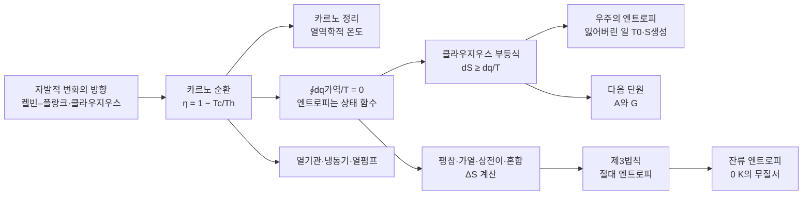

# 물리화학 2. 열역학 제2·3법칙과 엔트로피 — 변화의 방향을 재는 상태 함수
<!-- prev: pchem-1, uchem-10, uphy-7 -->
<!-- next: pchem-3 -->

> [!NOTE]
> **이 단원의 범위**
> - 자발적 변화의 방향, 제2법칙의 켈빈–플랑크 표현과 클라우지우스 표현
> - 카르노 순환과 열효율, 카르노 정리와 열역학적 온도
> - 엔트로피의 열역학적 정의(상태 함수임의 증명)와 클라우지우스 부등식
> - 여러 과정의 엔트로피 변화: 팽창·가열($C_p(T)$)·상전이·혼합
> - 주위의 엔트로피와 우주의 엔트로피, 엔트로피 생성과 잃어버린 일
> - 제3법칙과 절대 엔트로피(열용량 측정, 디바이 외삽), 반응 엔트로피의 온도 의존, 잔류 엔트로피
> - 열기관·냉동기·열펌프의 실제 순환과 성능 한계

**학습 목표**

1. 켈빈–플랑크 표현과 클라우지우스 표현이 같은 내용임을 기관을 짝지어 보이고, 자발적 변화의 방향을 에너지 보존과 구별해 설명할 수 있다.
2. 이상 기체 카르노 순환의 네 단계에서 열과 일을 유도하여 $\eta = 1 - T_\mathrm{c}/T_\mathrm{h}$를 얻고, 카르노 정리로 열역학적 온도를 정의할 수 있다.
3. 임의의 가역 순환에서 $\oint dq_\text{가역}/T = 0$임을 보여 엔트로피가 상태 함수임을 증명하고, 클라우지우스 부등식 $dS \ge dq/T$를 유도할 수 있다.
4. 이상 기체의 팽창, 온도에 따라 변하는 열용량을 가진 물질의 가열, 상전이(비정상 온도 포함), 혼합의 엔트로피 변화를 가역 경로를 설계해 계산할 수 있다.
5. 계·주위·우주의 엔트로피 변화와 엔트로피 생성을 구하고, 비가역성 때문에 잃어버린 일을 $T_0 S_\text{생성}$으로 정량화할 수 있다.
6. 제3법칙과 디바이 $T^3$ 외삽을 써서 열량 측정 자료로 절대 엔트로피를 구하고, 반응 엔트로피의 온도 의존과 잔류 엔트로피를 해석할 수 있다.
7. 오토 순환, 냉동기, 열펌프의 효율·성능 계수를 계산하고 카르노 한계와 비교할 수 있다.

**이 단원의 학습 사다리**

| 단계 | 무엇을 하나? |
|---|---|
| STEP 1. 이전 학습 다시 보기 | 일반화학의 $dS = dq_\text{가역}/T$와 $S^\circ$, 일반물리학의 카르노 효율, 「물리화학 1」의 제1법칙과 단열 과정 |
| STEP 2. 기초 다지기 | 불완전 미분과 적분 인자, 순환 선적분, $\ln(1+x)$의 테일러 근사 |
| STEP 3. 핵심 개념 | 방향의 법칙 → 카르노 순환 → 엔트로피는 상태 함수 → 클라우지우스 부등식 → 팽창·가열·상전이·혼합 → 우주의 엔트로피 → 제3법칙 → 잔류 엔트로피 → 열기관·냉동기·열펌프 |
| STEP 4. 오개념 바로잡기 | "가역 단열이 아니면 $\Delta S = q/T$", "냉장고 문을 열면 방이 시원해진다" 같은 착각 |
| STEP 5. 대학원·연구로 | 비평형 열역학과 엔트로피 생성률, 유한 시간 열역학, 정보와 엔트로피(란다우어 원리) |
| STEP 6. 생활·산업·진로 | 발전소와 복합 화력, 열펌프 난방, 극저온 냉동, 탄소 포집의 최소 일 |

---

## 🗺️ 단원 들어가기

화력 발전소는 연료가 낸 열의 절반 넘게를 냉각탑으로 버린다. 설계를 더 잘하면 이 버리는 열을 0으로 만들 수 있을까? 반대로 열펌프 난방기는 전기 1 kJ로 집 안에 열을 3~4 kJ나 들여보낸다. 에너지가 공짜로 생긴 것일까? 두 질문 모두 「물리화학 1」의 제1법칙만으로는 답할 수 없다. 제1법칙은 에너지의 **양**을 장부에 맞추어 줄 뿐, 어떤 변화가 **어느 방향으로** 일어나는지, 열을 일로 **얼마까지** 바꿀 수 있는지는 말해 주지 않는다.

일반화학 「화학 열역학」에서 엔트로피를 $dS = dq_\text{가역}/T$로 정의하고 반응의 방향을 판단해 보았다. 그러나 거기서는 "엔트로피는 상태 함수이다"를 사실로 받아들였고, 비가역 과정에서 $dq/T$가 왜 $dS$보다 작은지, 0 K에서 엔트로피가 왜 0이 되는지는 따지지 않았다. 이 단원은 그 빈자리를 채운다. 19세기 기술자들이 증기 기관의 효율 한계를 묻다가 찾아낸 **카르노 순환**에서 출발해, 엔트로피가 상태 함수라는 사실을 **증명**하고, **클라우지우스 부등식**이라는 한 줄의 식으로 모든 자발적 변화의 방향을 정한다. 그리고 극저온 열량 측정으로 엔트로피의 **절댓값**을 정하는 제3법칙까지 간다.

이 단원을 마치면 "이 기관이 낼 수 있는 최대 일은?", "이 비가역 과정에서 엔트로피가 얼마나 생겼고, 그만큼 일을 얼마나 잃었는가?", "열량계 자료로 이 물질의 표준 몰 엔트로피를 어떻게 정하는가?"에 직접 답할 수 있다. 다음 단원 「자유 에너지와 화학 퍼텐셜」은 이 단원의 클라우지우스 부등식을 계의 양만으로 다시 쓴 것이다.

---

## STEP 1. 🔙 이전 학습 다시 보기

### 연계 개념표

| 이전 단원 | 그때 배운 것 | 이 단원에서 확장되는 것 |
|---|---|---|
| 일반화학 「화학 열역학」 | $dS = dq_\text{가역}/T$, $S = k_\mathrm{B}\ln W$, 제2·3법칙의 진술, 표준 몰 엔트로피 표, $\Delta S_\text{주위} = -\Delta H/T$ | 엔트로피가 상태 함수임을 **증명**, 클라우지우스 부등식, $C_p(T)$를 쓴 적분, 디바이 외삽으로 $S^\circ$를 **직접 결정**, $\Delta_\mathrm{r}S^\circ$의 온도 의존 |
| 일반물리학 「열과 열역학」 | 카르노 효율 $1 - T_C/T_H$, 냉동기 성능 계수, 제2법칙의 두 표현 | 이상 기체로 카르노 순환을 **단계별로 유도**, 두 표현의 동치 증명, 카르노 정리와 열역학적 온도, 오토 순환 |
| 물리화학 1 「기체의 성질과 열역학 제1법칙」 | $\Delta U = q + w$, $C_V$·$C_p$, 가역·비가역 팽창 일, 단열 과정 $TV^{\gamma-1}$ = 일정, 상태 함수와 완전 미분 | 같은 과정들의 $\Delta S$, 비가역 단열 팽창에서 $\Delta S > 0$, $dq_\text{가역}$에 $1/T$를 곱하면 완전 미분이 됨 |
| 수학 도구 1 「미분과 편미분」 | 완전 미분 판정(교차 미분이 같다) | $dq$는 불완전 미분, $1/T$는 적분 인자 |
| 수학 도구 2 「적분과 급수」 | 선적분과 경로 의존성, 테일러 급수 | 순환 적분 $\oint$, 작은 온도 차에서 엔트로피 생성의 근사 |

> [!NOTE]
> **부호 규약** 이 단원은 「물리화학 1」과 같이 **계가 받은 열과 일을 양(+)으로** 둔다: $\Delta U = q + w$. 기체가 팽창하며 바깥에 일을 하면 $w < 0$이다. 일반물리학 「열과 열역학」의 $\Delta U = Q - W$($W$는 계가 한 일)와 부호만 다르다. 열기관이 한 알짜 일은 $-w$로 쓴다.

### 준비 운동 (사전 진단)

**Q1.** 이상 기체 1.00 mol이 300 K에서 가역 등온 팽창하여 부피가 2배가 되었다. 기체가 흡수한 열 $q$와 엔트로피 변화 $\Delta S$를 구하시오. ($R = 8.314\ \mathrm{J/(mol\cdot K)}$)

**Q2.** 이원자 이상 기체($\gamma = 1.40$)가 가역 단열 팽창하여 부피가 2배가 되었다. 처음 온도가 400 K이면 나중 온도는?

**Q3.** 800 K와 300 K 사이에서 작동하는 열기관의 최대 효율은? 이 기관이 고온 열원에서 1.00 kJ를 받을 때 버려야 하는 최소의 열은?

**Q4.** $dz = y\,dx + 2x\,dy$는 완전 미분인가? 판정 방법을 쓰시오.

정답 및 해설

**Q1.** $q = RT\ln 2 = 8.314\times300\times0.6931 = 1.73\times10^3\ \mathrm{J}$, $\Delta S = q/T = R\ln 2 = 5.76\ \mathrm{J/K}$. 이상 기체 등온 과정은 $\Delta U = 0$이어서 흡수한 열이 모두 바깥에 한 일로 나간다.

**Q2.** $T_2 = T_1(V_1/V_2)^{\gamma - 1} = 400\times(0.5)^{0.40} = 303\ \mathrm{K}$. 이 단원 ⑤에서 이 과정의 $\Delta S = 0$임을 확인한다.

**Q3.** $\eta_\text{최대} = 1 - 300/800 = 0.625$. 받은 1.00 kJ 가운데 최대 0.625 kJ만 일이 되고, 적어도 0.375 kJ는 저온 열원에 버려야 한다.

**Q4.** 완전 미분이 아니다. $dz = M\,dx + N\,dy$에서 $\partial M/\partial y = 1$, $\partial N/\partial x = 2$로 서로 다르다(수학 도구 1 '전미분과 완전 미분'). STEP 2 디딤돌 1에서 열 $dq$가 바로 이런 불완전 미분임을 본다.

---

## STEP 2. 🧱 기초 다지기

### 디딤돌 1. 불완전 미분과 적분 인자 — $dq$는 왜 상태 함수가 아닌가

수학 도구 1 '전미분과 완전 미분'에서 익힌 판정법을 열에 적용해 보자. 이상 기체 $n$ mol의 가역 변화에서 제1법칙은

$$
dq_\text{가역} = dU - dw_\text{가역} = C_V\,dT + p\,dV = C_V\,dT + \frac{nRT}{V}\,dV
$$

이다. $M = C_V$, $N = nRT/V$로 놓고 교차 미분을 비교하면

$$
\left(\frac{\partial C_V}{\partial V}\right)_T = 0, \qquad \left(\frac{\partial (nRT/V)}{\partial T}\right)_V = \frac{nR}{V} \neq 0
$$

이므로 $dq_\text{가역}$은 **불완전 미분(inexact differential)** 이다. 적분값이 경로에 따라 달라진다. 그런데 양변을 $T$로 나누면

$$
\frac{dq_\text{가역}}{T} = \frac{C_V}{T}\,dT + \frac{nR}{V}\,dV, \qquad \left(\frac{\partial (C_V/T)}{\partial V}\right)_T = 0 = \left(\frac{\partial (nR/V)}{\partial T}\right)_V
$$

가 되어 교차 미분이 같아진다. 불완전 미분에 어떤 함수를 곱해 완전 미분으로 만드는 그 함수를 **적분 인자(integrating factor)** 라 한다. $1/T$가 바로 $dq_\text{가역}$의 적분 인자이며, 그렇게 만들어진 완전 미분이 엔트로피의 미분 $dS$이다.

> [!IMPORTANT]
> 위 계산은 **이상 기체**에 대한 확인일 뿐이다. 모든 물질에서 $1/T$가 적분 인자라는 일반적 증명은 제2법칙(카르노 순환)에서 나온다. STEP 3 ③이 그 증명이다.

#### 디딤돌 예제 — 두 경로의 열 비교

이상 기체 1.00 mol($C_{V,\mathrm{m}} = \tfrac{3}{2}R$)을 상태 A(300 K, 10.0 L)에서 상태 B(600 K, 20.0 L)로 바꾼다. 경로 ㉠: 부피 일정으로 600 K까지 가열한 뒤 600 K에서 가역 등온 팽창. 경로 ㉡: 300 K에서 가역 등온 팽창한 뒤 부피 일정으로 가열. 두 경로의 $q$와 $\int dq/T$를 비교하시오.

**풀이**
㉠ $q = C_V(600 - 300) + R(600)\ln 2 = 3741 + 3458 = 7199\ \mathrm{J}$
㉡ $q = R(300)\ln 2 + C_V(600 - 300) = 1729 + 3741 = 5470\ \mathrm{J}$
$\int dq/T$는 두 경로 모두 $C_V\ln(600/300) + R\ln 2 = 8.64 + 5.76 = 14.41\ \mathrm{J/K}$이다.

**의미** 열은 경로에 따라 1.7 kJ 넘게 다르지만, 열을 그때그때의 온도로 나누어 더한 값은 같다. 높은 온도에서 받은 열은 '엔트로피로 치면' 덜 쳐준다는 뜻이다.

<!-- 그림 요청: p–V 도표에서 이상 기체 1 mol의 상태 A(10.0 L, 300 K)와 B(20.0 L, 600 K) 사이 두 경로. 경로 ㉠: A에서 수직으로 위(부피 10.0 L 일정, 압력 약 2.49 bar → 4.99 bar)로 올라간 뒤 600 K 등온 곡선을 따라 B(약 2.49 bar)까지. 경로 ㉡: A에서 300 K 등온 곡선을 따라 20.0 L(약 1.25 bar)까지 간 뒤 수직으로 B까지. 300 K와 600 K 등온선을 점선으로 함께 그리고, 각 경로 옆에 'q = 7.20 kJ', 'q = 5.47 kJ', 아래에 '∫dq/T = 14.4 J/K (두 경로 같음)'이라 적는다. -->

### 디딤돌 2. 순환 적분 — 한 바퀴 돌면 상태 함수는 0

수학 도구 2 '선적분과 경로 의존성'에서 보았듯, 완전 미분 $dF$를 닫힌 경로(처음과 끝이 같은 경로)를 따라 적분하면 0이다.

$$
\oint dF = F(\text{끝}) - F(\text{처음}) = 0 \quad (\text{처음} = \text{끝})
$$

거꾸로, **모든** 닫힌 경로에서 $\oint dF = 0$이면 $F$는 상태 함수이다. A에서 B로 가는 두 경로 1, 2를 잡고 경로 2를 거꾸로 돌아오는 순환을 만들면 $\int_1 dF - \int_2 dF = 0$이 되어 두 경로의 적분이 같기 때문이다. $dU$, $dH$는 순환 적분이 0인 상태 함수이고, $dq$, $dw$는 일반적으로 0이 아닌 경로 함수이다. ③에서는 $dq_\text{가역}/T$의 순환 적분이 0임을 증명한다.

열기관이 한 바퀴 돌며 알짜 일을 할 수 있는 것은 $\oint dq = -\oint dw \ne 0$이기 때문이고, 그런데도 기관이 처음 상태로 돌아올 수 있는 것은 $\oint dU = 0$이기 때문이다.

### 디딤돌 3. $\ln(1+x)$의 테일러 근사 — 작은 차이가 만드는 엔트로피

수학 도구 2 '테일러 급수와 근사'의 $\ln(1+x) = x - \tfrac{x^2}{2} + \tfrac{x^3}{3} - \cdots$ ($\lvert x \rvert < 1$)를 쓰면, 비가역 과정의 엔트로피 생성이 온도 차의 **제곱**에 비례한다는 중요한 결과를 얻는다.

열용량 $C$인 물체를 온도 $T$에서 $T + \delta$까지, 온도가 $T + \delta$인 열원에 닿게 해서 데운다고 하자. 물체의 $\Delta S = C\ln(1 + \delta/T)$, 열원의 $\Delta S = -C\delta/(T + \delta)$이다. $x = \delta/T$로 두고 전개하면

$$
\Delta S_\text{합} = C\left[\ln(1+x) - \frac{x}{1+x}\right] = C\left[\left(x - \frac{x^2}{2}\right) - \left(x - x^2\right) + O(x^3)\right] \approx \frac{C}{2}\left(\frac{\delta}{T}\right)^2
$$

| 근사 | 식 | 쓰이는 곳 |
|---|---|---|
| 1차 | $\ln(1+x) \approx x$ | 작은 온도 변화에서 $C\ln(T_2/T_1) \approx C\Delta T/T$ |
| 2차 | $\ln(1+x) \approx x - x^2/2$ | 엔트로피 생성 $\approx \tfrac{C}{2}(\delta/T)^2 \ge 0$ |
| 결론 | 1차 항은 상쇄되고 2차 항만 남는다 | 온도 차를 줄이면 비가역성은 **제곱**으로 줄어든다 → 가역 과정은 '차이 → 0'의 극한 |

> [!TIP]
> 💡 **요령** — 온도 차를 절반으로 줄이면 한 단계의 엔트로피 생성은 4분의 1이 되고, 단계 수는 2배가 되므로 전체 생성은 절반이 된다. 단계를 무한히 잘게 나누면 전체 생성이 0으로 간다. 이것이 '가역 과정 = 무한히 느린 극한'이라는 말의 정량적 의미이다. 도전 문제 19에서 직접 확인한다.

#### 디딤돌 예제 — 근사의 정확도

열용량 $C = 4184\ \mathrm{J/K}$인 물 1 kg을 300 K에서 310 K로, 310 K 열원에 닿게 하여 데운다. 엔트로피 생성을 정확한 식과 2차 근사로 각각 구하시오.

**풀이**
정확한 식: $4184\left[\ln\dfrac{310}{300} - \dfrac{10}{310}\right] = 4184\,(0.032790 - 0.032258) = 2.22\ \mathrm{J/K}$
2차 근사: $\dfrac{4184}{2}\left(\dfrac{10}{300}\right)^2 = 2.32\ \mathrm{J/K}$

**의미** 10 K 차이에서도 근사가 5 % 이내로 맞는다. 생성된 엔트로피(2 J/K)는 물이 얻은 엔트로피(약 137 J/K)에 비해 매우 작지만, 결코 음수가 되지 않는다.

---

## STEP 3. 📘 핵심 개념

### ① 자발적 변화의 방향 — 제2법칙의 두 표현

자연에는 저절로 일어나는 변화와 그렇지 않은 변화가 있다. 뜨거운 물체에서 차가운 물체로 열이 흐르고, 기체는 진공으로 퍼지며, 마찰은 운동 에너지를 열로 바꾼다. 거꾸로 가는 과정은 에너지 보존과 모순되지 않는데도 저절로는 일어나지 않는다. 이 비대칭을 처음 법칙으로 정리한 것은 **열을 일로 바꾸는 기계**에 대한 두 가지 '불가능 선언'이었다.

> [!IMPORTANT]
> **열역학 제2법칙(second law of thermodynamics)의 두 표현**
> - **켈빈–플랑크 표현(Kelvin–Planck statement)**: 하나의 열원에서 열을 받아 그것을 **모두** 일로 바꾸는 것 말고는 아무 변화도 남기지 않는 순환 과정은 없다.
> - **클라우지우스 표현(Clausius statement)**: 차가운 물체에서 뜨거운 물체로 열을 옮기는 것 말고는 아무 변화도 남기지 않는 과정은 없다.

두 표현 모두 '**순환**'과 '**아무 변화도 남기지 않는**'이라는 조건이 핵심이다. 이상 기체의 등온 팽창은 받은 열을 모두 일로 바꾸지만, 기체의 부피가 커졌다는 변화가 남으므로 켈빈–플랑크 표현에 어긋나지 않는다. 냉장고는 차가운 곳의 열을 따뜻한 곳으로 옮기지만 전기 일을 소비하므로 클라우지우스 표현에 어긋나지 않는다.

#### 두 표현은 같은 말이다

한쪽을 어기는 장치가 있으면 다른 쪽도 어길 수 있음을 보이면 된다.

- **켈빈–플랑크 위반 → 클라우지우스 위반**: 고온 열원에서 열 $q$를 받아 일 $q$로 모두 바꾸는 가상의 기관 X가 있다고 하자. 그 일로 보통의 냉동기를 돌려 저온 열원에서 열 $q'$를 퍼 와 고온 열원에 $q + q'$를 넣는다. 두 장치를 한 상자로 보면 외부의 일 없이 저온 열원에서 $q'$가 고온 열원으로 옮겨졌다.
- **클라우지우스 위반 → 켈빈–플랑크 위반**: 일 없이 저온에서 고온으로 열 $q_\mathrm{c}$를 옮기는 가상 장치 Y가 있다고 하자. 보통의 열기관이 고온에서 $q_\mathrm{h}$를 받아 일 $q_\mathrm{h} - q_\mathrm{c}$를 하고 저온에 $q_\mathrm{c}$를 버리게 하고, 장치 Y가 그 $q_\mathrm{c}$를 고온으로 되돌린다. 저온 열원은 아무 변화가 없고, 고온 열원에서 받은 알짜 열 $q_\mathrm{h} - q_\mathrm{c}$가 모두 일이 되었다.

<!-- 그림 요청: 두 표현의 동치를 보이는 에너지 흐름 도표 두 개를 좌우로. 왼쪽: 위에 '고온 열원 Th' 상자, 아래에 '저온 열원 Tc' 상자. 가운데에 원 'X(가상 기관)'가 고온에서 화살표 q를 받아 오른쪽으로 일 w = q를 내보내고, 그 일이 옆의 원 '냉동기'로 들어가 냉동기가 저온에서 q′를 받아 고온에 q + q′를 넣는다. 둘을 점선 상자로 묶고 '합치면: 저온 → 고온으로 q′, 일 0 (클라우지우스 위반)'이라 적는다. 오른쪽: 원 'Y(가상 장치)'가 저온에서 qc를 받아 고온으로 qc를 보내고, 옆의 원 '열기관'이 고온에서 qh를 받아 일 qh − qc를 내고 저온에 qc를 버린다. 점선 상자로 묶고 '합치면: 고온에서 qh − qc를 받아 모두 일로 (켈빈–플랑크 위반)'이라 적는다. -->

#### 방향을 재는 양이 필요하다

두 표현은 '무엇이 불가능한가'를 말해 주지만, 화학 반응처럼 복잡한 과정에서 방향을 판단하는 데 바로 쓰기는 어렵다. 그래서 **모든 과정에 대해 계산할 수 있는 하나의 양**이 필요하다. 그것이 ③에서 만들 엔트로피이고, 두 표현은 ④에서 "고립계의 엔트로피는 줄지 않는다"는 한 문장으로 합쳐진다.

| 자발적 과정 | 무엇이 '흩어지는가' | 되돌리는 데 드는 것 |
|---|---|---|
| 유한한 온도 차의 열 이동 | 에너지가 더 많은 입자에 퍼진다 | 냉동기의 일 |
| 기체의 자유 팽창·혼합 | 분자가 더 넓은 공간, 더 많은 배치로 퍼진다 | 압축 일, 반투막(⑦) |
| 마찰로 운동 에너지가 열이 됨 | 정렬된 운동이 무작위 운동이 된다 | 열기관(효율 < 1) |

#### 예제 1 — 열의 흐름과 가상의 기관

(1) 400 K 열원에서 300 K 열원으로 열 1000 J이 흘렀다. 두 열원의 엔트로피 변화의 합을 구하시오. (2) 500 K 열원 하나에서 1000 J을 받아 모두 일로 바꾸는 순환 기관이 있다면 우주의 엔트로피 변화는 얼마인가? (열원은 충분히 커서 온도가 변하지 않는다. 열원의 $\Delta S = q_\text{열원}/T$는 ⑧에서 정당화한다.)

**풀이**
(1) $\Delta S = -\dfrac{1000}{400} + \dfrac{1000}{300} = -2.50 + 3.33 = +0.83\ \mathrm{J/K}$
(2) 기관은 순환하므로 $\Delta S_\text{기관} = 0$, 일은 엔트로피를 실어 나르지 않는다. $\Delta S = -\dfrac{1000}{500} = -2.00\ \mathrm{J/K} < 0$

**의미** 열은 같은 양이라도 낮은 온도에서 더 큰 엔트로피를 실어 나른다. 그래서 고온에서 저온으로의 열 흐름은 엔트로피를 늘린다. (2)처럼 엔트로피를 줄이는 기관은 켈빈–플랑크 표현이 금지한 바로 그 기관이다. 엔트로피라는 '장부'로 두 표현을 숫자로 다룰 수 있다.

#### ✔ 바로 확인

1. (O/X) 이상 기체의 가역 등온 팽창은 받은 열을 모두 일로 바꾸므로 켈빈–플랑크 표현에 어긋난다.
2. 빈칸: 클라우지우스 표현은 저온에서 고온으로 열을 옮기는 것 '말고는 (    )도 남기지 않는' 과정이 없다는 것이다.
3. 600 K 열원에서 200 K 열원으로 열 600 J이 흐를 때 두 열원의 엔트로피 변화의 합은?

정답

1. X — 순환 과정이 아니다. 기체의 부피가 커진 변화가 남는다.
2. 아무 변화
3. $+2.00\ \mathrm{J/K}$ — $-600/600 + 600/200 = -1.00 + 3.00$.

### ② 카르노 순환과 열효율

**열기관(heat engine)** 은 고온 열원에서 열 $q_\mathrm{h}$를 받아 일부를 일로 바꾸고 나머지를 저온 열원에 버리며 순환하는 장치이다. 순환이므로 $\Delta U = 0$이고, 기관이 한 알짜 일은 $-w = q_\mathrm{h} + q_\mathrm{c}$이다(여기서 $q_\mathrm{c} < 0$은 기관이 받은 열이므로 버린 열의 크기는 $\lvert q_\mathrm{c} \rvert$). **열효율(thermal efficiency)** 은

$$
\eta = \frac{\text{한 일}}{\text{고온에서 받은 열}} = \frac{-w}{q_\mathrm{h}} = 1 + \frac{q_\mathrm{c}}{q_\mathrm{h}} = 1 - \frac{\lvert q_\mathrm{c} \rvert}{q_\mathrm{h}}
$$

이다. 켈빈–플랑크 표현은 $q_\mathrm{c} = 0$, 즉 $\eta = 1$이 불가능하다는 것이다. 그러면 $\eta$의 상한은 얼마인가? 카르노(Carnot)는 두 열원 사이에서 **가역적으로** 작동하는 순환을 생각했다.

#### 카르노 순환의 네 단계 — 이상 기체로 유도

**가정** 작동 물질은 이상 기체 $n$ mol, $C_V$는 온도와 무관, 모든 단계는 가역. 열은 고온 열원($T_\mathrm{h}$)과 저온 열원($T_\mathrm{c}$)에서 **기체와 열원의 온도가 같을 때만** 주고받는다(그래야 열 이동이 가역이다).

| 단계 | 과정 | $q$ | $w$ | $\Delta U$ |
|---|---|---|---|---|
| 1. A → B | $T_\mathrm{h}$에서 가역 등온 팽창 ($V_\mathrm{A} \to V_\mathrm{B}$) | $nRT_\mathrm{h}\ln\dfrac{V_\mathrm{B}}{V_\mathrm{A}}$ | $-nRT_\mathrm{h}\ln\dfrac{V_\mathrm{B}}{V_\mathrm{A}}$ | 0 |
| 2. B → C | 가역 단열 팽창 ($T_\mathrm{h} \to T_\mathrm{c}$) | 0 | $C_V(T_\mathrm{c} - T_\mathrm{h})$ | $C_V(T_\mathrm{c} - T_\mathrm{h})$ |
| 3. C → D | $T_\mathrm{c}$에서 가역 등온 압축 ($V_\mathrm{C} \to V_\mathrm{D}$) | $nRT_\mathrm{c}\ln\dfrac{V_\mathrm{D}}{V_\mathrm{C}}$ | $-nRT_\mathrm{c}\ln\dfrac{V_\mathrm{D}}{V_\mathrm{C}}$ | 0 |
| 4. D → A | 가역 단열 압축 ($T_\mathrm{c} \to T_\mathrm{h}$) | 0 | $C_V(T_\mathrm{h} - T_\mathrm{c})$ | $C_V(T_\mathrm{h} - T_\mathrm{c})$ |

두 단열 단계의 일은 크기가 같고 부호가 반대여서 서로 상쇄된다. 이제 부피의 관계를 구한다. 「물리화학 1」의 가역 단열 관계 $TV^{\gamma - 1}$ = 일정을 단계 2와 4에 쓰면

$$
T_\mathrm{h}V_\mathrm{B}^{\gamma-1} = T_\mathrm{c}V_\mathrm{C}^{\gamma-1}, \qquad T_\mathrm{h}V_\mathrm{A}^{\gamma-1} = T_\mathrm{c}V_\mathrm{D}^{\gamma-1}
$$

두 식을 나누면 $(V_\mathrm{B}/V_\mathrm{A})^{\gamma - 1} = (V_\mathrm{C}/V_\mathrm{D})^{\gamma - 1}$, 즉

$$
\frac{V_\mathrm{B}}{V_\mathrm{A}} = \frac{V_\mathrm{C}}{V_\mathrm{D}}
$$

따라서 $q_\mathrm{c} = -nRT_\mathrm{c}\ln(V_\mathrm{C}/V_\mathrm{D}) = -nRT_\mathrm{c}\ln(V_\mathrm{B}/V_\mathrm{A})$이고,

$$
\frac{q_\mathrm{c}}{q_\mathrm{h}} = -\frac{T_\mathrm{c}}{T_\mathrm{h}}, \qquad \boxed{\;\eta_\text{카르노} = 1 - \frac{T_\mathrm{c}}{T_\mathrm{h}}\;}
$$

**적용 한계** 이 결과는 두 열원 사이의 **가역** 기관에 대한 것이다. 열원이 둘보다 많거나(오토 순환처럼 열을 여러 온도에서 받는 경우), 과정이 비가역이면 효율은 이보다 작다(⑪).

같은 결과를 다시 쓰면 매우 중요한 관계가 나온다.

$$
\frac{q_\mathrm{h}}{T_\mathrm{h}} + \frac{q_\mathrm{c}}{T_\mathrm{c}} = 0
$$

카르노 순환 한 바퀴에서 '받은 열 ÷ 그때의 온도'의 합이 0이다. ③에서 이것을 모든 가역 순환으로 넓힌다.

<!-- 그림 요청: 이상 기체 카르노 순환의 p–V 도표. 예제 2의 값을 쓴다(1.00 mol, γ = 1.40). A(1.00 L, 600 K), B(3.00 L, 600 K), C(16.97 L, 300 K), D(5.66 L, 300 K). A→B는 600 K 등온선(빨강), B→C는 단열선(검정, 등온선보다 가파름), C→D는 300 K 등온선(파랑), D→A는 단열선. 각 단계에 시계 방향 화살표, A→B 옆에 'qh > 0 흡수', C→D 옆에 'qc < 0 방출'이라 적고, 순환이 둘러싼 넓이에 연한 색을 칠해 '알짜 일 −w'라 적는다. 가로축 V (L, 0~18), 세로축 P (bar). -->

#### 예제 2 — 카르노 순환의 수치 해석

이원자 이상 기체 1.00 mol($C_{V,\mathrm{m}} = \tfrac{5}{2}R$, $\gamma = 1.40$)이 600 K와 300 K 사이에서 카르노 순환을 한다. A에서 부피는 1.00 L, 등온 팽창 후 B에서 3.00 L이다. (1) $V_\mathrm{C}$, $V_\mathrm{D}$ (2) $q_\mathrm{h}$, $q_\mathrm{c}$, 알짜 일, 효율 (3) 각 등온 단계의 $q/T$를 구하시오.

**풀이**
(1) 단열 관계에서 $V_\mathrm{C} = V_\mathrm{B}(T_\mathrm{h}/T_\mathrm{c})^{1/(\gamma-1)} = 3.00\times2^{2.5} = 16.97\ \mathrm{L}$, $V_\mathrm{D} = 1.00\times2^{2.5} = 5.66\ \mathrm{L}$
(2) $q_\mathrm{h} = 1.00\times8.314\times600\times\ln 3 = 5.48\times10^3\ \mathrm{J}$
$q_\mathrm{c} = -8.314\times300\times\ln(16.97/5.66) = -8.314\times300\times\ln 3 = -2.74\times10^3\ \mathrm{J}$
알짜 일 $-w = q_\mathrm{h} + q_\mathrm{c} = 2.74\times10^3\ \mathrm{J}$, $\eta = 2740/5480 = 0.500 = 1 - 300/600$
(두 단열 단계의 일은 각각 $\mp C_V\times300 = \mp6.24\ \mathrm{kJ}$로 상쇄된다.)
(3) $q_\mathrm{h}/T_\mathrm{h} = 5480/600 = +9.13\ \mathrm{J/K}$, $q_\mathrm{c}/T_\mathrm{c} = -2740/300 = -9.13\ \mathrm{J/K}$, 합은 0이다.

**의미** 효율은 작동 기체의 양, 부피 비, $\gamma$와 관계없이 두 온도만으로 정해졌다. 부피 비를 키우면 한 바퀴에 하는 일은 커지지만 효율은 그대로이다.

<!-- 시뮬레이션 요청: 이상 기체 카르노 순환. 조작 변수: 고온 Th(300~1200 K), 저온 Tc(200~600 K, Th보다 작게), 등온 팽창 부피 비 VB/VA(1.2~5), 기체 종류(단원자 γ = 5/3, 이원자 γ = 7/5). 보여 줄 것: p–V 도표와 T–S 도표를 나란히 그리고 순환을 따라 움직이는 점, 각 단계의 q·w 막대, 효율 η와 1 − Tc/Th의 비교 수치. 부피 비와 γ를 바꾸어도 효율은 변하지 않고 한 바퀴의 일(두 도표의 넓이)만 변함을 보여 준다. -->

#### 카르노 정리와 열역학적 온도

> [!IMPORTANT]
> **카르노 정리(Carnot's theorem)** 같은 두 열원 사이에서 작동하는 기관 가운데 가역 기관보다 효율이 큰 기관은 없으며, **모든 가역 기관의 효율은 작동 물질과 관계없이 같다.**

**증명의 뼈대** 가역 기관 R보다 효율이 큰 기관 E가 있다고 하자. 두 기관이 고온에서 같은 열 $q_\mathrm{h}$를 받도록 크기를 맞추면 E가 더 많은 일 $w_\mathrm{E} > w_\mathrm{R}$을 한다(이 증명의 $w_\mathrm{E}$, $w_\mathrm{R}$은 기관이 한 일의 크기이다). R은 가역이므로 거꾸로 돌려 냉동기로 쓸 수 있다. E가 낸 일 가운데 $w_\mathrm{R}$로 R을 거꾸로 돌리면 R이 고온 열원에 $q_\mathrm{h}$를 그대로 되돌려 준다. 결과: 고온 열원은 변화가 없고, 저온 열원에서 받은 열이 일 $w_\mathrm{E} - w_\mathrm{R} > 0$로 모두 바뀌었다. 켈빈–플랑크 표현 위반이다. 같은 논증을 두 가역 기관에 서로 바꿔 쓰면 둘의 효율이 같아야 한다는 결론이 나온다. (도전 문제 18에서 수치로 해 본다.)

이 정리 덕분에 $q_\mathrm{c}/q_\mathrm{h}$는 물질과 관계없이 두 열원의 '뜨거운 정도'만의 함수가 된다. 켈빈은 이것을 거꾸로 **온도의 정의**로 삼았다.

$$
\frac{T_\mathrm{c}}{T_\mathrm{h}} \equiv \frac{\lvert q_\mathrm{c} \rvert}{q_\mathrm{h}} \quad (\text{가역 기관})
$$

이렇게 정한 **열역학적 온도(thermodynamic temperature)** 는 어떤 물질의 성질(수은의 팽창, 기체의 압력)에도 의존하지 않는다. 이상 기체로 유도한 위 결과는 이상 기체 온도 눈금이 열역학적 온도와 같다는 것을 보여 준다. 눈금의 크기는 예전에는 물의 삼중점을 273.16 K로 정해 맞추었고, 2019년부터는 볼츠만 상수 $k_\mathrm{B} = 1.380649\times10^{-23}\ \mathrm{J/K}$를 정확한 값으로 고정해 정한다.

카르노 기관은 열원과 기체의 온도 차가 0일 때만 열을 주고받으므로 무한히 느리고, 출력(일/시간)은 0이다. 실제 기관은 유한한 온도 차로 빠르게 열을 주고받고 마찰·누설도 있어 효율이 상한보다 작다(STEP 5 맛보기 ②).

#### 예제 3 — 발전소 효율의 상한

증기 발전소의 터빈 입구 증기 온도가 565 ℃, 응축기 냉각수 온도가 32 ℃이다. (1) 최대 효율을 구하시오. (2) 실제 효율이 40 %라면 1.00 GJ의 열을 받을 때 카르노 기관보다 얼마나 적은 일을 하는가?

**풀이**
(1) $T_\mathrm{h} = 838.15\ \mathrm{K}$, $T_\mathrm{c} = 305.15\ \mathrm{K}$(약 305 K)이므로 $\eta_\text{카르노} = 1 - 305/838.15 = 0.636$
(2) 카르노: $0.636\ \mathrm{GJ}$, 실제: $0.40\ \mathrm{GJ}$ → 약 $0.24\ \mathrm{GJ}$ 적다.

**의미** 버리는 열을 0으로 만드는 것은 원리적으로 불가능하다. 1 GJ 가운데 적어도 0.36 GJ는 기술이 아무리 좋아도 버려야 한다. 효율을 올리는 정공법은 $T_\mathrm{h}$를 높이는 것(초초임계압 증기, 가스 터빈)과 버리는 열을 다시 쓰는 것(복합 화력, STEP 6)이다.

#### ✔ 바로 확인

1. 1000 K와 400 K 사이의 카르노 기관이 고온에서 열 5.00 kJ를 받는다. 알짜 일은?
2. (O/X) 카르노 기관의 효율은 작동 기체로 헬륨을 쓰느냐 질소를 쓰느냐에 따라 다르다.
3. 빈칸: 카르노 순환에서 $q_\mathrm{h}/T_\mathrm{h} + q_\mathrm{c}/T_\mathrm{c} = (\quad)$이다.

정답

1. $3.00\ \mathrm{kJ}$ — $\eta = 1 - 400/1000 = 0.600$.
2. X — 카르노 정리: 모든 가역 기관의 효율은 두 열원의 온도로만 정해진다.
3. 0 — 이 관계가 엔트로피를 정의하는 출발점이다.

### ③ 엔트로피의 열역학적 정의 — 엔트로피는 상태 함수이다

#### 임의의 가역 순환을 카르노 순환으로 쪼개기

p–V 도표 위의 아무 가역 순환을 생각하자. 이 순환을 촘촘한 **단열선** 여러 개로 세로로 잘라 띠를 만들고, 각 띠의 위아래 끝을 짧은 **등온선** 조각으로 바꾸면, 원래 순환은 아주 가는 카르노 순환 여러 개의 모임으로 근사된다. 이웃한 두 카르노 순환이 공유하는 단열선 조각은 한 번은 위로, 한 번은 아래로 지나므로 서로 상쇄되고, 바깥 테두리만 남는다. 단열선을 무한히 촘촘하게 하면 이 테두리가 원래 순환과 같아진다. 이때 각 등온 조각은, 그것이 대신하는 원래 순환의 조각과 함께 이웃한 두 단열선 사이에 만드는 작은 닫힌 경로의 (부호를 붙인) 넓이가 0이 되도록 잡는다. 그 닫힌 경로에서 $\oint dq = -\oint dw = 0$이고 단열선 조각에서는 열 출입이 없으므로, **등온 조각에서 받는 열은 원래 조각에서 받는 열과 같다.** 지그재그 테두리는 원래 순환과 같은 열을 (조각의 폭이 0으로 갈 때) 같은 온도에서 주고받는다.

<!-- 그림 요청: p–V 도표에 매끄러운 타원형 가역 순환(시계 방향 화살표). 순환 위에 가는 단열선 6~8개를 세로로 겹쳐 그려 띠로 나누고, 각 띠의 위·아래 끝을 짧은 등온선 조각으로 바꾼 지그재그 테두리를 진하게 그린다. 띠 하나를 확대한 삽화: 위 등온 조각에 'dqh, Th', 아래 조각에 'dqc, Tc', 양옆 단열선. 이웃한 띠가 공유하는 단열선에 서로 반대 방향 화살표를 그리고 '상쇄'라 적는다. -->

각각의 작은 카르노 순환 $i$에 대해 ②의 결과 $q_{\mathrm{h},i}/T_{\mathrm{h},i} + q_{\mathrm{c},i}/T_{\mathrm{c},i} = 0$이 성립하므로, 모두 더하면 테두리를 따라 $\sum q_i/T_i = 0$이다. 극한을 취하면

$$
\oint \frac{dq_\text{가역}}{T} = 0
$$

STEP 2 디딤돌 2에 따라 $dq_\text{가역}/T$는 어떤 상태 함수의 완전 미분이다. 그 상태 함수를 **엔트로피(entropy)** $S$라 한다.

> [!IMPORTANT]
> **엔트로피의 열역학적 정의**
> $$
> dS = \frac{dq_\text{가역}}{T}, \qquad \Delta S = S_\mathrm{B} - S_\mathrm{A} = \int_\mathrm{A}^\mathrm{B}\frac{dq_\text{가역}}{T}
> $$
> 적분은 A와 B를 잇는 **아무 가역 경로**를 따라 한다. 결과는 경로와 관계없다. $S$는 크기 성질이며 단위는 $\mathrm{J/K}$이다.

이 증명은 작동 물질이 무엇이든 성립한다. 카르노 정리가 '모든 가역 기관의 효율은 같다'를 보장하기 때문이다. STEP 2에서 이상 기체에 대해 확인한 '1/T는 적분 인자'가 모든 물질로 넓어진 것이다.

#### 온도–엔트로피 도표

$dq_\text{가역} = T\,dS$이므로 가역 과정에서 받은 열은 **T–S 도표 위 곡선 아래의 넓이**이다. 카르노 순환은 T–S 도표에서 직사각형이 된다. 등온 단계는 수평선, 가역 단열 단계는 $dq_\text{가역} = 0$이어서 $dS = 0$인 수직선(**등엔트로피 과정**)이다.

$$
q_\mathrm{h} = T_\mathrm{h}\Delta S, \qquad \lvert q_\mathrm{c} \rvert = T_\mathrm{c}\Delta S, \qquad -w = (T_\mathrm{h} - T_\mathrm{c})\Delta S
$$

효율 $1 - T_\mathrm{c}/T_\mathrm{h}$는 '직사각형 넓이 ÷ 고온 수평선 아래 넓이'로 한눈에 읽힌다. 기계 공학에서 실제 순환을 T–S 도표로 그리는 까닭이다.

<!-- 그림 요청: 예제 2의 카르노 순환을 T–S 도표로. 가로축 S (상대값, J/K), 세로축 T (K, 0~700). A(S0, 600 K) → B(S0 + 9.13 J/K, 600 K) 수평선(빨강), B → C 수직선 아래로 300 K, C → D 수평선 왼쪽(파랑), D → A 수직선 위로. 직사각형 내부를 칠해 '−w = 2.74 kJ', 아래 300 K 선부터 가로축까지의 직사각형을 다른 무늬로 칠해 '|qc| = 2.74 kJ'라 적는다. 오른쪽 여백에 '등온 = 수평, 가역 단열 = 수직(등엔트로피)'. -->

#### 예제 4 — 직사각형 순환에서 확인하기

단원자 이상 기체 1.00 mol이 다음 순환을 한다: A(2.00 bar, 20.0 L) → B(2.00 bar, 40.0 L) 등압 → C(1.00 bar, 40.0 L) 등적 → D(1.00 bar, 20.0 L) 등압 → A 등적. 모두 가역이다. (1) 각 꼭짓점의 온도 (2) 각 단계의 $q$와 $\oint dq$ (3) 각 단계의 $\int dq/T$와 $\oint dq/T$를 구하시오.

**풀이**
(1) $T = pV/nR$: $T_\mathrm{A} = 481\ \mathrm{K}$, $T_\mathrm{B} = 962\ \mathrm{K}$, $T_\mathrm{C} = 481\ \mathrm{K}$, $T_\mathrm{D} = 241\ \mathrm{K}$
(2) 등압은 $q = C_p\Delta T$, 등적은 $q = C_V\Delta T$ ($C_p = \tfrac{5}{2}R$, $C_V = \tfrac{3}{2}R$):
$q_\mathrm{AB} = +10.0\ \mathrm{kJ}$, $q_\mathrm{BC} = -6.00\ \mathrm{kJ}$, $q_\mathrm{CD} = -5.00\ \mathrm{kJ}$, $q_\mathrm{DA} = +3.00\ \mathrm{kJ}$, $\oint dq = +2.00\ \mathrm{kJ}$ (= 직사각형 넓이 $\Delta p\,\Delta V = 10^5\ \mathrm{Pa}\times0.0200\ \mathrm{m^3}$)
(3) $\int dq/T = C\ln(T_2/T_1)$: AB $= C_p\ln 2 = +14.41$, BC $= C_V\ln\tfrac{1}{2} = -8.64$, CD $= C_p\ln\tfrac{1}{2} = -14.41$, DA $= C_V\ln 2 = +8.64\ \mathrm{J/K}$. 합 $\oint dq/T = 0$.

**의미** 이 순환은 카르노 순환이 아니고 여러 온도에서 열을 주고받지만, 가역이면 $\oint dq/T = 0$이 그대로 성립한다. 반면 $\oint dq \neq 0$이며, 그 값이 기관이 한 알짜 일이다.

> [!TIP]
> 💡 **비유** — 열을 '화폐'로, 온도를 그 화폐의 '환율'로 생각하자. 같은 1 J이라도 낮은 온도에서는 엔트로피로 환산한 가치가 크다. 가역 순환은 여러 환전소(온도)를 돌며 환전해도 손해도 이익도 없이 엔트로피 장부가 0으로 맞는 여행이다. 비가역 과정은 수수료를 내는 환전이며, 그 수수료가 ④의 엔트로피 생성이다.

#### ✔ 바로 확인

1. (O/X) 가역 순환 한 바퀴에서 $\oint dq = 0$이다.
2. 빈칸: T–S 도표에서 가역 단열 과정은 (    )선으로 나타난다.
3. T–S 도표에서 $T = 500\ \mathrm{K}$로 일정하게 엔트로피가 $4.0\ \mathrm{J/K}$ 늘었다. 계가 받은 열은?

정답

1. X — $\oint dq = -\oint dw$는 순환이 한 알짜 일이다. 0인 것은 $\oint dq_\text{가역}/T$이다.
2. 수직(등엔트로피)
3. $2.0\ \mathrm{kJ}$ — $q = T\Delta S = 500\times4.0$.

### ④ 클라우지우스 부등식 — 비가역 과정에서는 $dS > dq/T$

#### 유도 — 비가역 기관의 효율에서

카르노 정리에 따르면 같은 두 열원 사이의 비가역 기관은 가역 기관보다 효율이 작다.

$$
1 + \frac{q_\mathrm{c}}{q_\mathrm{h}} < 1 - \frac{T_\mathrm{c}}{T_\mathrm{h}} \quad\Longrightarrow\quad \frac{q_\mathrm{c}}{q_\mathrm{h}} < -\frac{T_\mathrm{c}}{T_\mathrm{h}} \quad\Longrightarrow\quad \frac{q_\mathrm{h}}{T_\mathrm{h}} + \frac{q_\mathrm{c}}{T_\mathrm{c}} < 0
$$

(셋째 식은 둘째 식에 $q_\mathrm{h}/T_\mathrm{c} > 0$을 곱해 얻는다.) 열원이 여럿인 임의의 순환으로 넓힐 때, 비가역 순환은 p–V 도표에 경로를 그릴 수 없으므로 ③처럼 쪼갤 수는 없다. 대신 이렇게 논증한다. 계가 온도 $T_\text{열원}$인 경계에서 열 $dq$를 받을 때마다, 그 열을 온도 $T_0$인 큰 열원 하나와 $T_\text{열원}$ 사이에서 도는 작은 가역 카르노 기관이 대 주게 한다. ②의 관계에 따라 이 보조 기관은 $T_0$ 열원에서 $T_0\,dq/T_\text{열원}$을 받는다. 계와 보조 기관들을 합친 장치는 한 바퀴 뒤 모두 처음 상태로 돌아오고, 열은 $T_0$ 열원 하나에서만 모두 $T_0\oint dq/T_\text{열원}$을 받았으며, 에너지 보존에 따라 그만큼을 바깥에 일로 내놓았다. 켈빈–플랑크 표현에 따라 이 값은 양수일 수 없으므로

$$
\oint \frac{dq}{T_\text{열원}} \le 0 \qquad (\text{등호는 가역 순환, 비가역이면} < 0)
$$

이 된다. 순환이 가역이면 모든 장치를 거꾸로 돌려 부호를 바꿀 수 있으므로 등호가 성립한다. 이것이 **클라우지우스 부등식(Clausius inequality)** 이다. 여기서 $T_\text{열원}$은 열이 드나드는 **경계(열원)의 온도**이다. 비가역 과정에서는 계 안의 온도가 고르지 않아 '계의 온도'가 정해지지 않을 수도 있기 때문이다.

#### 한 과정에 대한 부등식

상태 A에서 B로 가는 **비가역** 과정 I와, B에서 A로 돌아오는 **가역** 과정 R로 순환을 만든다.

<!-- 그림 요청: 상태 공간(가로축 V, 세로축 P)에 점 A와 B. A → B로 구불구불한 점선(비가역 경로 I, 중간 상태가 정의되지 않음을 나타내는 물결 모양)과 B → A로 매끄러운 실선(가역 경로 R). 점선 옆에 '∫ dq/T열원 (비가역)', 실선 옆에 '∫ dq가역/T = SA − SB'. 아래에 '순환 I + R: ∮dq/T ≤ 0 ⇒ ΔS ≥ ∫ dq/T열원'. -->

$$
\int_{\mathrm{A},\,\mathrm{I}}^{\mathrm{B}}\frac{dq}{T_\text{열원}} + \int_{\mathrm{B},\,\mathrm{R}}^{\mathrm{A}}\frac{dq_\text{가역}}{T} \le 0
$$

둘째 항은 $S_\mathrm{A} - S_\mathrm{B}$이므로

$$
\boxed{\;\Delta S = S_\mathrm{B} - S_\mathrm{A} \ge \int_\mathrm{A}^\mathrm{B}\frac{dq}{T_\text{열원}}\;}, \qquad dS \ge \frac{dq}{T_\text{열원}}
$$

등호는 가역 과정에서만 성립한다. 차이를 **엔트로피 생성(entropy production)** 이라 한다.

$$
S_\text{생성} = \Delta S - \int\frac{dq}{T_\text{열원}} \ \ge 0
$$

#### 다른 길로 본 같은 결론 — 가역 일이 최대 일이다

같은 처음·끝 상태 사이의 미소 변화에서 $dU$는 경로와 관계없으므로 $dq + dw = dq_\text{가역} + dw_\text{가역}$이다. 「물리화학 1」의 팽창 일 비교에서 보았듯이 계가 바깥에 하는 일은 가역일 때 가장 크다: $-dw_\text{가역} \ge -dw$. 따라서 $dq_\text{가역} \ge dq$, 양변을 $T$로 나누면 $dS \ge dq/T$이다. 비가역 과정은 할 수 있었던 일의 일부를 열로 흘려보내고, 그만큼 엔트로피가 '덤으로' 생긴다.

#### 고립계 — 엔트로피 증가의 원리

고립계는 열 출입이 없으므로($dq = 0$)

$$
dS_\text{고립} \ge 0
$$

고립계의 엔트로피는 줄지 않으며, 자발적(비가역) 변화가 일어나면 늘어나고, 평형에서 최대가 된다. 계와 주위를 합친 '우주'는 고립계이므로 $\Delta S_\text{우주} \ge 0$이다. ①의 두 불가능 선언은 이 한 줄에 모두 들어 있다(예제 1).

| 과정 | $\int dq/T_\text{열원}$ | $\Delta S_\text{계}$ | $S_\text{생성}$ |
|---|---|---|---|
| 가역 등온 팽창 | $nR\ln(V_2/V_1)$ | $nR\ln(V_2/V_1)$ | 0 |
| 진공으로의 자유 팽창 | 0 | $nR\ln(V_2/V_1)$ | $nR\ln(V_2/V_1)$ |
| 가역 단열 팽창 | 0 | 0 | 0 |
| 비가역 단열 팽창(⑤) | 0 | $> 0$ | $= \Delta S_\text{계}$ |

> [!WARNING]
> **단열 = 등엔트로피가 아니다.** $dq = 0$이면 $dS \ge 0$일 뿐이다. 단열 과정 가운데 **가역**인 것만 $\Delta S = 0$이다. 마찰이 있거나 외부 압력이 갑자기 바뀌는 단열 팽창·압축은 엔트로피를 늘린다.

#### 예제 5 — 비가역 기관의 엔트로피 장부와 잃어버린 일

어떤 기관이 한 순환마다 500 K 열원에서 1000 J을 받아 300 J의 일을 하고 300 K 열원에 700 J을 버린다. (1) $\oint dq/T_\text{열원}$을 구하고 클라우지우스 부등식을 확인하시오. (2) 한 순환마다 우주에 생기는 엔트로피는? (3) 같은 열원 사이의 카르노 기관과 비교해 잃어버린 일은 얼마이며, 그것은 $T_\mathrm{c}S_\text{생성}$과 어떤 관계인가?

**풀이**
(1) $\oint dq/T_\text{열원} = \dfrac{1000}{500} + \dfrac{-700}{300} = 2.000 - 2.333 = -0.333\ \mathrm{J/K} < 0$ — 비가역 순환이다.
(2) 기관은 순환하므로 $\Delta S_\text{기관} = 0$. 열원: $-\dfrac{1000}{500} + \dfrac{700}{300} = +0.333\ \mathrm{J/K}$. 따라서 $S_\text{생성} = +0.333\ \mathrm{J/K}$.
(3) 카르노 기관의 일 $= 1000\times(1 - 300/500) = 400\ \mathrm{J}$. 잃어버린 일 $= 400 - 300 = 100\ \mathrm{J}$이고, $T_\mathrm{c}S_\text{생성} = 300\times0.333 = 100\ \mathrm{J}$로 정확히 같다.

**의미** 비가역성 때문에 잃어버린 일은 '가장 차가운 열원의 온도 × 생성된 엔트로피'와 같다(**구이–스토돌라 정리**, Gouy–Stodola theorem). 엔트로피 생성은 단순한 장부 숫자가 아니라 **버려진 일의 척도**이다. ⑧에서 이 관계를 일반화한다.

#### ✔ 바로 확인

1. (O/X) 단열 과정에서는 언제나 $\Delta S = 0$이다.
2. 빈칸: 클라우지우스 부등식 $dS \ge dq/T$에서 $T$는 엄밀히는 (    )의 온도이다.
3. 600 K에서 1000 J을 받고 300 K에 600 J을 버리는 기관이 있다고 한다. $\oint dq/T$를 구하고, 가능한 기관인지 판단하시오.

정답

1. X — 가역 단열 과정만 $\Delta S = 0$이고, 비가역 단열 과정은 $\Delta S > 0$이다.
2. 열원(열이 드나드는 경계)
3. $-0.333\ \mathrm{J/K}$, 가능하다 — $1000/600 - 600/300 = -0.333 < 0$으로 부등식을 만족하는 비가역 기관이다(효율 0.40 < 카르노 0.50).

### ⑤ 기체의 팽창과 압축에 따른 엔트로피 변화

엔트로피는 상태 함수이므로, 실제 과정이 아무리 비가역이어도 **같은 처음·끝 상태를 잇는 가역 경로를 하나 골라** $\int dq_\text{가역}/T$를 계산하면 된다. 이 소절부터 ⑦까지가 그 '경로 설계'의 연습이다.

#### 이상 기체의 일반식 유도

**가정** 이상 기체 $n$ mol, $C_{V,\mathrm{m}}$은 온도와 무관. STEP 2 디딤돌 1의 식 $dS = dq_\text{가역}/T = (C_V/T)\,dT + (nR/V)\,dV$를 적분한다. 완전 미분이므로 어떤 순서로 적분해도 되며, 먼저 $V_1$에서 $T$를 올리고 다음에 $T_2$에서 부피를 바꾸면

$$
\Delta S = nC_{V,\mathrm{m}}\ln\frac{T_2}{T_1} + nR\ln\frac{V_2}{V_1}
$$

$V = nRT/p$로 부피를 압력으로 바꾸고 $C_{p,\mathrm{m}} = C_{V,\mathrm{m}} + R$(「물리화학 1」)을 쓰면

$$
\Delta S = nC_{p,\mathrm{m}}\ln\frac{T_2}{T_1} - nR\ln\frac{p_2}{p_1}
$$

| 과정 | 조건 | $\Delta S$ |
|---|---|---|
| 등온 | $T_1 = T_2$ | $nR\ln(V_2/V_1) = -nR\ln(p_2/p_1)$ |
| 등적 가열 | $V_1 = V_2$ | $nC_{V,\mathrm{m}}\ln(T_2/T_1)$ |
| 등압 가열 | $p_1 = p_2$ | $nC_{p,\mathrm{m}}\ln(T_2/T_1)$ |
| 가역 단열 | $TV^{\gamma-1}$ = 일정 | $nC_{V,\mathrm{m}}\ln\dfrac{T_2}{T_1} + nR\ln\dfrac{V_2}{V_1} = nC_{V,\mathrm{m}}\left[\ln\dfrac{T_2}{T_1} + (\gamma - 1)\ln\dfrac{V_2}{V_1}\right] = 0$ |

마지막 줄은 $R = C_{V,\mathrm{m}}(\gamma - 1)$이고 $\ln(T_2V_2^{\gamma-1}) = \ln(T_1V_1^{\gamma-1})$이기 때문이다. 「물리화학 1」의 가역 단열 관계가 곧 '등엔트로피 조건'이었던 것이다.

**적용 한계** 실제 기체에서 등온 부피 변화의 엔트로피는 $nR\ln(V_2/V_1)$이 아니라 $\int(\partial p/\partial T)_V\,dV$이다. 이 식은 다음 단원 「자유 에너지와 화학 퍼텐셜」의 맥스웰 관계식에서 유도한다(판데르발스 기체이면 $nR\ln\dfrac{V_2 - nb}{V_1 - nb}$).

#### 예제 6 — 비가역 단열 팽창

단원자 이상 기체 1.00 mol이 300 K, 10.0 bar에서 단열된 실린더 속에서 **일정한 외부 압력 1.00 bar**에 맞서 팽창하여 압력이 1.00 bar가 되었다. (1) 나중 온도 (2) $\Delta S$를 구하고, (3) 같은 압력까지 가역 단열 팽창했을 때와 비교하시오.

**풀이**
(1) 단열이므로 $\Delta U = w$: $C_V(T_2 - T_1) = -p_\text{외부}(V_2 - V_1) = -p_2\left(\dfrac{RT_2}{p_2} - \dfrac{RT_1}{p_1}\right)$
$\tfrac{3}{2}R(T_2 - 300) = -R\left(T_2 - 300\times\tfrac{1.00}{10.0}\right)$ → $\tfrac{5}{2}T_2 = 450 + 30$ → $T_2 = 192\ \mathrm{K}$
(2) 가역 경로(등압 냉각 + 등온 팽창)로 계산한다:
$\Delta S = \tfrac{5}{2}R\ln\dfrac{192}{300} - R\ln\dfrac{1.00}{10.0} = -9.28 + 19.14 = +9.87\ \mathrm{J/K}$
(3) 가역 단열이면 $T_2 = 300\times(0.100)^{R/C_p} = 300\times(0.100)^{0.4} = 119\ \mathrm{K}$, $\Delta S = 0$. 한 일도 가역이 $2.25\ \mathrm{kJ}$, 비가역이 $1.35\ \mathrm{kJ}$이다.

**의미** 열 출입이 없는데도 엔트로피가 9.87 J/K 늘었다. 이것이 모두 엔트로피 생성이다. 비가역 팽창은 일을 덜 하므로 내부 에너지가 덜 줄고(나중 온도가 더 높고), 그 '남은 에너지'가 엔트로피 증가로 나타난다.

<!-- 그림 요청: p–V 도표에서 예제 6의 비교. 처음 상태 A(300 K, 10.0 bar, 2.49 L)에서 출발하는 가역 단열선(실선)이 1.00 bar의 점 B_rev(119 K, 9.9 L)에 닿고, 같은 A에서 1.00 bar의 점 B_irr(192 K, 16.0 L)로 가는 비가역 과정은 경로를 그리지 않고 두 점만 잇는 점선 화살표로 표시한다(중간 상태가 정의되지 않음). 1.00 bar 수평선 위에 B_rev와 B_irr를 표시하고 'ΔS = 0', 'ΔS = +9.87 J/K'라 적는다. 192 K와 119 K 등온선을 옅은 점선으로. -->

#### ✔ 바로 확인

1. 단원자 이상 기체 1.00 mol의 온도가 300 K에서 600 K로, 부피가 2배로 변했다. $\Delta S$는?
2. (O/X) 이상 기체의 가역 단열 팽창에서는 온도가 내려가므로 엔트로피가 감소한다.
3. 이상 기체 2.00 mol을 일정한 온도에서 1.00 bar에서 10.0 bar로 압축하였다. $\Delta S$는?

정답

1. $+14.4\ \mathrm{J/K}$ — $\tfrac{3}{2}R\ln 2 + R\ln 2 = \tfrac{5}{2}R\ln 2$.
2. X — 온도 하강에 의한 감소와 부피 증가에 의한 증가가 정확히 상쇄되어 $\Delta S = 0$이다.
3. $-38.3\ \mathrm{J/K}$ — $-nR\ln(p_2/p_1) = -2.00\times8.314\times\ln 10$.

### ⑥ 가열과 상전이에 따른 엔트로피 변화

#### 온도에 따라 변하는 열용량

일정 압력에서 $dq_\text{가역} = C_p\,dT$이므로

$$
S(T_2) = S(T_1) + \int_{T_1}^{T_2}\frac{C_p(T)}{T}\,dT
$$

일반화학에서는 $C_p$를 상수로 두어 $C_p\ln(T_2/T_1)$을 썼지만, 넓은 온도 범위에서는 $C_p$가 변한다. 기체의 몰 열용량은 흔히 다음 경험식으로 나타낸다(「물리화학 1」 키르히호프 법칙에서 쓴 것과 같은 꼴).

$$
C_{p,\mathrm{m}} = a + bT + \frac{c}{T^2}
$$

이것을 넣고 항별로 적분하면

$$
\Delta S_\mathrm{m} = a\ln\frac{T_2}{T_1} + b(T_2 - T_1) - \frac{c}{2}\left(\frac{1}{T_2^2} - \frac{1}{T_1^2}\right)
$$

#### 예제 7 — 질소의 고온 가열

$\mathrm{N_2(g)}$ 1.00 mol을 1 bar에서 298.15 K부터 1000 K까지 가열한다. $C_{p,\mathrm{m}} = a + bT + c/T^2$에서 $a = 28.58\ \mathrm{J/(mol\cdot K)}$, $b = 3.77\times10^{-3}\ \mathrm{J/(mol\cdot K^2)}$, $c = -0.50\times10^5\ \mathrm{J\cdot K/mol}$(약)이다. (1) $\Delta S$를 구하시오. (2) 298.15 K의 $C_p$를 상수로 둔 근사와 비교하시오.

**풀이**
(1) 세 항을 따로 계산한다.
$a\ln(T_2/T_1) = 28.58\times\ln(1000/298.15) = 34.59\ \mathrm{J/K}$
$b(T_2 - T_1) = 3.77\times10^{-3}\times701.85 = 2.65\ \mathrm{J/K}$
$-\tfrac{c}{2}(1/T_2^2 - 1/T_1^2) = 2.5\times10^4\times(1.000\times10^{-6} - 1.125\times10^{-5}) = -0.26\ \mathrm{J/K}$
$\Delta S = 34.59 + 2.65 - 0.26 = 36.98 \approx 37.0\ \mathrm{J/K}$
(2) $C_p(298.15) = 28.58 + 1.124 - 0.562 = 29.14\ \mathrm{J/(mol\cdot K)}$, 근사값 $29.14\ln(1000/298.15) = 35.27\ \mathrm{J/K}$. 약 1.7 J/K(5 %) 작게 나온다.

**의미** 고온에서 진동 운동이 조금씩 풀리며 $C_p$가 커지기 때문에, 상수 근사는 엔트로피를 과소평가한다. 수백 K 이상의 공정 계산(연소, 고온 반응기)에서는 온도에 따른 열용량을 꼭 넣는다.

#### 상전이의 엔트로피

상전이 온도 $T_\text{전이}$, 일정 압력에서 두 상은 평형이므로 열 출입이 가역이고 온도가 일정하다.

$$
\Delta_\text{전이}S = \frac{\Delta_\text{전이}H}{T_\text{전이}}
$$

융해·증발·승화는 흡열이므로 $\Delta S > 0$이다. 일반화학에서 본 **트루턴 규칙**(많은 액체의 $\Delta_\text{증발}S \approx 85\ \mathrm{J/(mol\cdot K)}$)은 액체에서 기체로 갈 때 늘어나는 부피와 자유가 물질에 크게 의존하지 않기 때문이다. 수소 결합이 있는 액체(물, 알코올)는 액체가 더 정돈되어 있어 값이 크고, 이합체를 이루며 끓는 아세트산처럼 기체 속에서도 분자가 짝을 짓는 경우는 값이 작다.

#### 정상 전이 온도가 아닌 온도의 전이 엔트로피

정상 끓는점이 아닌 온도에서 일어나는 상전이는 평형이 아니어서 $\Delta H/T$를 바로 쓸 수 없다. 이때는 **평형 전이 온도를 거쳐 가는 가역 경로**를 설계한다(일반화학 「화학 열역학」의 과냉각된 물이 어는 예와 같은 방법). 일반적으로 쓰면

$$
\Delta_\text{전이}S(T) = \Delta_\text{전이}S(T_\text{전이}) + \Delta C_p\ln\frac{T}{T_\text{전이}}, \qquad \Delta C_p = C_p(\text{나중 상}) - C_p(\text{처음 상})
$$

($\Delta C_p$가 일정할 때). 「물리화학 1」에서 $\Delta H$의 온도 의존을 다룬 키르히호프 법칙의 엔트로피판이다.

#### 예제 8 — 25 ℃에서 물의 표준 증발 엔트로피

정상 끓는점 373.15 K에서 $\Delta_\text{증발}H = 40.66\ \mathrm{kJ/mol}$, $C_{p,\mathrm{m}}(\mathrm{l}) = 75.3$, $C_{p,\mathrm{m}}(\mathrm{g}) = 33.6\ \mathrm{J/(mol\cdot K)}$(일정)이다. 1 bar, 298.15 K에서 $\mathrm{H_2O(l) \rightarrow H_2O(g)}$의 $\Delta S^\circ$를 구하고, 표준 몰 엔트로피 표의 값($S^\circ$: $\mathrm{H_2O(l)}$ 69.9, $\mathrm{H_2O(g)}$ 188.8 J/(mol·K))과 비교하시오. (1 atm과 1 bar의 차이는 무시한다.)

<!-- 그림 요청: 예제 8의 가역 경로를 나타낸 사각형 도표. 왼쪽 아래 '물(l), 298.15 K', 오른쪽 아래 '수증기(g), 298.15 K, 1 bar(가상 상태)'를 굵은 점선 화살표(구하려는 과정 ΔS°)로 잇는다. 왼쪽 아래 → 왼쪽 위 '물(l), 373.15 K': ㉠ 가열 ΔS = 75.3 ln(373.15/298.15). 왼쪽 위 → 오른쪽 위 '수증기(g), 373.15 K': ㉡ 증발 ΔS = 40 660/373.15. 오른쪽 위 → 오른쪽 아래: ㉢ 냉각 ΔS = 33.6 ln(298.15/373.15). 세로축에 온도를 표시한다. -->

**풀이**
㉠ 물을 298.15 K → 373.15 K로 가열: $75.3\ln\dfrac{373.15}{298.15} = +16.90\ \mathrm{J/K}$
㉡ 373.15 K에서 가역 증발: $\dfrac{40\,660}{373.15} = +108.96\ \mathrm{J/K}$
㉢ 수증기를 373.15 K → 298.15 K로 냉각: $33.6\ln\dfrac{298.15}{373.15} = -7.54\ \mathrm{J/K}$
합: $\Delta S^\circ(298.15\ \mathrm{K}) = 118.3\ \mathrm{J/K}$ (같은 식으로 $108.96 + (33.6 - 75.3)\ln\tfrac{298.15}{373.15} = 108.96 + 9.36$)
표의 값: $188.8 - 69.9 = 118.9\ \mathrm{J/K}$ — 0.5 % 안에서 일치한다.

**의미** 298 K의 수증기 1 bar는 실제로는 존재할 수 없는 가상의 상태(25 ℃ 물의 증기압은 약 0.032 bar)이지만, 엔트로피가 상태 함수이므로 가역 경로로 그 값을 정할 수 있다. 낮은 온도에서 증발 엔트로피가 더 큰 것은 액체와 기체의 열용량 차이 때문이며, 같은 차이 때문에 $\Delta_\text{증발}H$도 298 K에서 약 43.8 kJ/mol로 더 크다.

#### ✔ 바로 확인

1. 액체 물 1.00 mol을 1 bar에서 0 ℃부터 100 ℃까지 가열할 때 $\Delta S$는? ($C_{p,\mathrm{m}} = 75.3\ \mathrm{J/(mol\cdot K)}$, 일정)
2. 트루턴 규칙($85\ \mathrm{J/(mol\cdot K)}$)으로 정상 끓는점이 350 K인 비극성 액체의 몰 증발 엔탈피를 어림하시오.
3. (O/X) −10 ℃에서 과냉각된 물이 얼 때 $\Delta S_\text{계} = \Delta_\text{융해}H/263.15\ \mathrm{K}$로 계산할 수 있다.

정답

1. $+23.5\ \mathrm{J/K}$ — $75.3\ln(373.15/273.15)$.
2. 약 $29.8\ \mathrm{kJ/mol}$ — $85\times350$.
3. X — −10 ℃의 응고는 평형이 아니므로 0 ℃를 거치는 가역 경로로 계산해야 한다.

### ⑦ 혼합의 엔트로피

#### 유도 — 이상 기체의 혼합

**가정** 같은 온도 $T$, 같은 압력 $p$의 이상 기체 A($n_\mathrm{A}$ mol, 부피 $V_\mathrm{A}$)와 B($n_\mathrm{B}$ mol, $V_\mathrm{B}$)가 칸막이로 나뉘어 있다가 칸막이를 치워 섞인다. 이상 기체 분자는 서로 힘을 미치지 않으므로, 각 기체는 **다른 기체가 없는 것처럼** 전체 부피 $V = V_\mathrm{A} + V_\mathrm{B}$로 퍼진다. 혼합은 결국 두 기체 각각의 등온 팽창이다.

$$
\Delta_\text{혼합}S = n_\mathrm{A}R\ln\frac{V}{V_\mathrm{A}} + n_\mathrm{B}R\ln\frac{V}{V_\mathrm{B}}
$$

같은 $T$, $p$에서 부피는 몰수에 비례하므로 $V_\mathrm{A}/V = x_\mathrm{A}$(몰분율)이다. $n = n_\mathrm{A} + n_\mathrm{B}$로 두면

$$
\boxed{\;\Delta_\text{혼합}S = -nR\left(x_\mathrm{A}\ln x_\mathrm{A} + x_\mathrm{B}\ln x_\mathrm{B}\right) = -nR\sum_i x_i\ln x_i\;}
$$

$0 < x_i < 1$이면 $\ln x_i < 0$이므로 $\Delta_\text{혼합}S > 0$이다. 이상 기체의 혼합은 $\Delta_\text{혼합}H = 0$(분자 사이 힘이 없음)인데도 자발적이며, 그 원동력은 순전히 엔트로피이다.

**결과의 성질과 적용 한계**
- 2성분에서 $\Delta_\text{혼합}S/nR$은 $x = 0.5$에서 최대 $\ln 2 = 0.693$이다. 혼합물에 소량의 B를 처음 넣을 때 $d(\Delta_\text{혼합}S)/dx_\mathrm{B} \to \infty$이다. 아주 순수한 물질을 얻기가 그토록 어려운 열역학적 이유이다.
- 같은 꼴의 식이 **이상 용액**에도 성립한다(「혼합물과 용액의 열역학」). 실제 용액에서는 분자 사이 힘의 차이 때문에 초과 엔트로피와 혼합 엔탈피가 더해진다.
- 처음 압력이나 온도가 서로 다르면 위 식을 그대로 쓸 수 없다. 각 기체의 처음 상태에서 나중 상태(전체 부피, 나중 온도)까지를 ⑤의 일반식으로 따로 계산해 더한다(실력 다지기 16).

<!-- 그림 요청: 두 부분 그림. (가) 칸막이로 나뉜 상자: 왼쪽에 기체 A 분자(파란 원) 6개, 오른쪽에 기체 B 분자(주황 원) 4개, 둘 다 같은 T, P. 화살표 → 칸막이를 치운 뒤 파란 원과 주황 원이 상자 전체에 고르게 섞인 모습. 아래에 'A: VA → V, B: VB → V 각각의 등온 팽창'. (나) 그래프: 가로축 xB (0~1), 세로축 ΔmixS/(nR) (0~0.8). 곡선 −[x ln x + (1−x) ln(1−x)], x = 0.5에서 최대 ln 2 = 0.693을 점으로 표시, 양 끝에서 기울기가 수직에 가까움을 강조. -->

#### 깁스의 역설 — 같은 기체를 '섞으면'

칸막이 양쪽에 **같은** 기체가 같은 $T$, $p$로 들어 있다면 칸막이를 치워도 거시 상태는 전혀 변하지 않으므로 $\Delta S = 0$이어야 한다. 그런데 위 식에 기계적으로 넣으면 $nR\ln 2$가 나온다. 이 모순(**깁스의 역설**, Gibbs paradox)은 같은 종류의 분자는 **구별할 수 없다**는 데서 풀린다. 같은 분자끼리 자리를 바꾸어도 새로운 미시 상태가 생기지 않는다. 이 '구별 불가능성'은 「통계 열역학」에서 분배 함수에 $1/N!$을 넣는 근거가 된다. 혼합 엔트로피는 분자의 질량이나 크기 차이가 얼마나 작든 '다르기만 하면' 같은 값이다. 동위 원소 분리가 어려운 것은 이 엔트로피를 거슬러야 하면서도 분리에 쓸 성질 차이가 매우 작기 때문이다.

#### 예제 9 — 공기의 혼합 엔트로피와 분리의 최소 일

공기를 $\mathrm{N_2}$ 78 %, $\mathrm{O_2}$ 21 %, Ar 1 %(몰분율)의 이상 기체 혼합물로 본다. (1) 공기 1.00 mol을 만드는 혼합 엔트로피를 구하시오. (2) 25 ℃에서 공기 1.00 mol을 순수한 세 성분으로 등온 분리하는 데 필요한 최소 일은?

**풀이**
(1) $\Delta_\text{혼합}S = -R(0.78\ln0.78 + 0.21\ln0.21 + 0.01\ln0.01) = -8.314\times(-0.1938 - 0.3277 - 0.0461) = +4.72\ \mathrm{J/K}$
(2) 분리는 혼합의 역과정이다. 가역적으로 분리할 때 계의 엔트로피는 $4.72\ \mathrm{J/K}$ 줄고, 이상 기체이므로 $\Delta U = 0$, 받은 일만큼 열 $q = -T\times4.72\ \mathrm{J/K}$를 주위에 내놓는다. 최소 일 $w_\text{최소} = -q = T\Delta_\text{혼합}S = 298.15\times4.72 = 1.41\times10^3\ \mathrm{J}$.

**의미** 공기 1 mol(약 24 L)을 분리하는 최소 일은 1.4 kJ에 불과하다. 실제 공기 분리 공장(극저온 증류)은 이것의 몇 배에서 수십 배를 쓰는데, 그 차이가 모두 공정의 엔트로피 생성이다. STEP 6에서 같은 계산을 탄소 포집에 쓴다.

#### ✔ 바로 확인

1. 같은 $T$, $p$의 두 이상 기체 1.00 mol씩을 섞을 때 $\Delta_\text{혼합}S$는?
2. (O/X) 이상 기체가 섞일 때 $\Delta_\text{혼합}H = 0$이므로 혼합은 자발적이지 않다.
3. 빈칸: 칸막이 양쪽에 같은 기체가 같은 $T$, $p$로 있을 때 칸막이를 치우면 $\Delta S = (\quad)$이다.

정답

1. $+11.5\ \mathrm{J/K}$ — $-nR\sum x_i\ln x_i = -2.00R\ln 0.5 = 2R\ln 2$.
2. X — 엔탈피 변화가 없어도 엔트로피가 늘어나 자발적이다($\Delta S_\text{우주} = \Delta_\text{혼합}S > 0$).
3. 0 — 같은 분자는 구별할 수 없어 거시 상태도 미시 상태 수도 변하지 않는다.

### ⑧ 주위의 엔트로피와 우주의 엔트로피

#### 열 저장고로서의 주위

화학에서 '주위'는 보통 항온조, 실험실 공기, 대기처럼 계보다 훨씬 큰 물체이다. 이런 **열 저장고(heat reservoir)** 는 열을 조금 주고받아도 온도 $T_\text{주위}$가 변하지 않고, 받은 열이 내부로 순식간에 고르게 퍼져 **저장고 안에서는 늘 평형**이다. 따라서 열이 계에서 어떻게(가역이든 비가역이든) 넘어오든, 저장고 입장에서는 일정한 온도에서 가역적으로 열을 받은 것과 같다.

$$
\Delta S_\text{주위} = \frac{q_\text{주위}}{T_\text{주위}} = -\frac{q}{T_\text{주위}} \qquad (q\text{는 계가 받은 실제 열})
$$

일정 압력이면 $q = \Delta H$이므로 $\Delta S_\text{주위} = -\Delta H/T$이다(일반화학의 결과). 주의할 점은, **계**의 엔트로피는 실제 경로의 $q$로 구할 수 없고 가역 경로가 필요하지만, **주위**의 엔트로피는 실제 $q$로 바로 구한다는 비대칭이다.

#### 우주의 엔트로피와 엔트로피 생성

$$
\Delta S_\text{우주} = \Delta S_\text{계} + \Delta S_\text{주위} = \Delta S_\text{계} - \int\frac{dq}{T_\text{주위}} = S_\text{생성} \ \ge 0
$$

④의 클라우지우스 부등식에서 정의한 엔트로피 생성이 곧 우주의 엔트로피 변화이다. 판단 기준을 정리하면 다음과 같다.

| $\Delta S_\text{우주}$ | 과정 | 예 |
|---|---|---|
| $> 0$ | 자발적(비가역) | 자유 팽창, 유한 온도 차의 열 이동, 마찰 |
| $= 0$ | 가역(평형을 지나는 극한) | 0 ℃에서 얼음의 융해, 카르노 순환 |
| $< 0$ | 일어나지 않는다 | 열이 저절로 차가운 곳에서 뜨거운 곳으로 |

#### 잃어버린 일 — 엔트로피 생성의 값어치

주위 온도 $T_0$인 환경에서 일어나는 과정을 생각하자. 같은 처음·끝 상태 사이에서 가역 과정이 할 수 있었던 일과 실제 과정이 한 일의 차이는

$$
W_\text{잃음} = T_0\,S_\text{생성} = T_0\,\Delta S_\text{우주}
$$

이다(예제 5에서 기관에 대해 확인한 구이–스토돌라 정리의 일반형). 유도의 뼈대: 실제 과정과 가역 과정 모두 $\Delta U$가 같으므로 $-w_\text{가역} - (-w) = q_\text{가역} - q$이고, 열을 모두 $T_0$의 환경과 주고받으면 $q_\text{가역} = T_0\Delta S_\text{계}$, $q = -T_0\Delta S_\text{주위}$이므로 차이는 $T_0(\Delta S_\text{계} + \Delta S_\text{주위})$이다. 에너지는 사라지지 않지만, **일로 쓸 수 있는 능력**은 엔트로피가 생기는 만큼 사라진다. 공학에서는 이 '쓸 수 있는 에너지'를 **엑서지(exergy)** 라 부르며 공정 효율 분석의 기준으로 쓴다.

#### 예제 10 — 두 구리 덩어리의 열 접촉

100 ℃와 0 ℃의 구리 덩어리(각 1.00 kg, 비열 $0.385\ \mathrm{J/(g\cdot K)}$, 일정)를 단열된 상자 안에서 맞붙였다. (1) 나중 온도 (2) 각 덩어리와 전체의 $\Delta S$ (3) 같은 두 덩어리 사이에서 가역 기관을 돌렸다면 얻을 수 있었던 일을 생각해 보고, 25 ℃ 환경 기준 잃어버린 일을 어림하시오.

**풀이**
(1) 열용량이 같으므로 $T_\mathrm{f} = (373.15 + 273.15)/2 = 323.15\ \mathrm{K}$ (50 ℃)
(2) $C = 385\ \mathrm{J/K}$. 뜨거운 쪽: $385\ln(323.15/373.15) = -55.39\ \mathrm{J/K}$, 차가운 쪽: $385\ln(323.15/273.15) = +64.72\ \mathrm{J/K}$
합: $\Delta S = C\ln\dfrac{T_\mathrm{f}^2}{T_\mathrm{h}T_\mathrm{c}} = +9.33\ \mathrm{J/K}$. 이동한 열은 $385\times50 = 19.3\ \mathrm{kJ}$이다.
(3) $W_\text{잃음} \approx T_0 S_\text{생성} = 298.15\times9.33 \approx 2.8\ \mathrm{kJ}$

**의미** 19.3 kJ의 열이 흘렀지만 생긴 엔트로피는 9.33 J/K이고, 일로 치면 약 2.8 kJ의 기회를 잃었다. 산술 평균 $T_\mathrm{f}$는 언제나 기하 평균 $\sqrt{T_\mathrm{h}T_\mathrm{c}}$보다 크므로 $\Delta S > 0$이 항상 보장된다. (만약 두 덩어리 사이에서 가역 기관을 돌리면 두 덩어리의 엔트로피 합이 변하지 않도록 나중 온도가 $\sqrt{T_\mathrm{h}T_\mathrm{c}} = 319.3\ \mathrm{K}$가 되고, 그 차이에 해당하는 내부 에너지가 일로 나온다.)

<!-- 그림 요청: 예제 10의 두 구리 덩어리. 가로축: 뜨거운 덩어리가 잃은 열 q (0~25 kJ), 세로축: ΔS (J/K). 세 곡선: 뜨거운 덩어리 ΔSh = 385 ln((373.15 − q/385)/373.15) (음수, 아래로 휘는 곡선), 차가운 덩어리 ΔSc = 385 ln((273.15 + q/385)/273.15) (양수), 합 ΔS총(위로 볼록, q = 19.25 kJ에서 최대 9.33 J/K). 최대점에 '평형: 두 온도가 50 ℃로 같아짐'이라 적고 수직 점선을 긋는다. 합 곡선의 최대 = 고립계 평형에서 엔트로피 최대임을 강조한다. -->

<!-- 시뮬레이션 요청: 단열된 상자 속 두 물체의 열 접촉. 조작 변수: 두 물체의 처음 온도(250~500 K), 열용량(100~2000 J/K), 사이 벽의 열전도도(이동 속도). 보여 줄 것: 시간에 따라 두 온도가 가까워지는 그래프, 각 물체와 전체의 엔트로피 시간 변화(전체는 늘 증가하다가 평형에서 평평해짐), 누적 이동 열과 생성된 엔트로피, 25 ℃ 기준 잃어버린 일 T0·S생성. 옵션으로 '가역 기관 연결' 단추를 누르면 나중 온도가 기하 평균으로 가고 전체 엔트로피 변화가 0이 되며 얻은 일이 표시된다. -->

#### 예제 11 — 비가역 등온 압축

이상 기체 1.00 mol이 298.15 K 항온조 안에서 1.00 bar에서 **일정한 외부 압력 5.00 bar**로 단번에 눌려 5.00 bar가 되었다. $\Delta S_\text{계}$, $\Delta S_\text{주위}$, $\Delta S_\text{우주}$를 구하고, 가역 압축과 비교하시오.

**풀이**
계: $\Delta S = -R\ln(p_2/p_1) = -8.314\ln 5.00 = -13.38\ \mathrm{J/K}$ (가역 등온 경로로 계산)
일: $w = -p_\text{외부}(V_2 - V_1) = -p_2\left(\dfrac{RT}{p_2} - \dfrac{RT}{p_1}\right) = RT\left(\dfrac{p_2}{p_1} - 1\right) = 2479\times4 = 9.92\ \mathrm{kJ}$
$\Delta U = 0$이므로 $q = -9.92\ \mathrm{kJ}$. 주위: $\Delta S_\text{주위} = +9916/298.15 = +33.26\ \mathrm{J/K}$
우주: $-13.38 + 33.26 = +19.88\ \mathrm{J/K}$
가역 압축이면 $w_\text{가역} = RT\ln 5 = 3.99\ \mathrm{kJ}$, $\Delta S_\text{주위} = +13.38\ \mathrm{J/K}$, $\Delta S_\text{우주} = 0$이다.

**의미** 단번에 누르면 필요한 최소 일(3.99 kJ)의 2.5배를 쓴다. 넘치게 쓴 5.93 kJ은 열로 항온조에 흩어지며, $T_0S_\text{생성} = 298.15\times19.88 = 5.93\ \mathrm{kJ}$로 정확히 잃어버린 일과 같다. 압축기를 여러 단으로 나누어 각 단의 압력 차를 줄이는 다단 압축이 에너지를 아끼는 까닭이다.

> [!NOTE]
> **다음 단원으로 가는 다리** 일정한 $T$, $p$에서 열을 모두 주위와 주고받으면 $\Delta S_\text{우주} = \Delta S - \Delta H/T$이다. 양변에 $-T$를 곱한 $\Delta H - T\Delta S$가 깁스 에너지 변화이며, "우주의 엔트로피 증가"가 "계의 깁스 에너지 감소"로 바뀐다. 이 바꿔 쓰기와 그 일반화(헬름홀츠 에너지, 기본 방정식)는 「자유 에너지와 화학 퍼텐셜」에서 다룬다.

#### ✔ 바로 확인

1. 25 ℃의 실험실에서 반응계가 열 10.0 kJ를 내놓았다. 주위의 엔트로피 변화는?
2. (O/X) 주위의 엔트로피 변화를 구할 때도 반드시 가역 경로를 설계해야 한다.
3. 80 ℃의 물 1.00 kg과 20 ℃의 물 1.00 kg을 단열 용기에서 섞었다. 전체의 $\Delta S$는? ($c = 4.184\ \mathrm{J/(g\cdot K)}$)

정답

1. $+33.5\ \mathrm{J/K}$ — $10\,000/298.15$.
2. X — 큰 열 저장고는 늘 내부 평형이므로 실제 열 $q$를 그 온도로 나누면 된다.
3. $+36.2\ \mathrm{J/K}$ — 나중 온도 50 ℃, $4184[\ln(323.15/353.15) + \ln(323.15/293.15)]$.

### ⑨ 열역학 제3법칙과 절대 엔트로피

#### 네른스트의 열 정리에서 제3법칙으로

20세기 초 네른스트(Nernst)는 여러 반응의 $\Delta_\mathrm{r}S$를 점점 낮은 온도에서 측정하면 0에 가까워진다는 것을 발견했다(**네른스트 열 정리**, Nernst heat theorem). 플랑크는 이를 더 강하게, 각 물질의 엔트로피 자체에 대한 진술로 바꾸었다.

> [!IMPORTANT]
> **열역학 제3법칙(third law of thermodynamics)**
> - 모든 **완전한 결정**의 엔트로피는 $T \to 0$에서 같은 값으로 가며, 그 값을 0으로 정한다: $\displaystyle\lim_{T\to 0}S = 0$.
> - 따라서 완전한 결정들 사이의 반응·전이는 $T \to 0$에서 $\Delta S \to 0$이다.
> - 같은 내용의 다른 얼굴(**도달 불가능성**): 유한한 단계의 과정으로는 절대 영도에 도달할 수 없다.

'완전한 결정'은 0 K에서 배치가 하나뿐인 결정이다. 통계적으로 $S = k_\mathrm{B}\ln W$에서 $W = 1$이면 $S = 0$이라는 해석은 일반화학에서 보았고, 「통계 열역학」에서 분배 함수로 다시 다룬다. 이 단원에서는 제3법칙이 열역학 측정에 주는 결과, 즉 **엔트로피의 절댓값**을 정할 수 있다는 점에 집중한다.

**실험적 확인의 예** 황의 두 동소체(사방황과 단사황)는 약 369 K에서 서로 바뀐다(전이 엔탈피 약 0.4 kJ/mol, 전이 엔트로피 약 1 J/(mol·K)). 단사황을 빨리 식히면 낮은 온도까지 준안정 상태로 남으므로, 두 동소체 각각의 열용량을 0 K 근처부터 측정할 수 있다. 각 동소체의 $\int_0^{369\,\mathrm{K}} C_p/T\,dT$를 따로 구해 그 차이를 계산하면 측정 오차 안에서 전이 엔트로피와 일치한다. 즉 두 결정의 0 K 엔트로피가 같다.

#### 열량 측정으로 구하는 절대 엔트로피

0 K에서 $S = 0$으로 출발해 1 bar에서 가역적으로 데우며 모든 기여를 더한다.

$$
S^\circ(T) = \int_0^{T_\mathrm{m}}\frac{C_p(\mathrm{s})}{T}dT + \frac{\Delta_\text{융해}H}{T_\mathrm{m}} + \int_{T_\mathrm{m}}^{T_\mathrm{b}}\frac{C_p(\mathrm{l})}{T}dT + \frac{\Delta_\text{증발}H}{T_\mathrm{b}} + \int_{T_\mathrm{b}}^{T}\frac{C_p(\mathrm{g})}{T}dT
$$

고체 안에서 결정 구조가 바뀌는 전이가 있으면 그 $\Delta H/T$도 더한다. 실험에서는 열량계(단열 열량계)로 $C_p$를 수 K부터 측정하고, $C_p/T$를 $T$에 대해 그린 곡선 아래 넓이를 수치 적분(사다리꼴·심프슨, 수학 도구 2 '수치 적분')으로 구한다. 상전이에서는 곡선이 끊기고 $S(T)$에 계단이 생긴다.

<!-- 그림 요청: 위아래 두 그래프(가로축 T, 0~400 K 공유). 위: Cp/T 대 T. 고체 구간(0~Tm = 180 K)은 0에서 출발해 T³ 꼴로 솟았다가 완만히 감소하는 곡선, Tm에서 끊기고 액체 구간(180~300 K)은 더 높은 값의 매끄러운 곡선, Tb 근처 표시(필요하면 생략). 0~10 K 구간은 점선으로 '디바이 외삽'이라 적고, 곡선 아래를 칠해 '넓이 = ∫Cp/T dT'. 아래: S(T) 대 T. 0에서 출발해 증가하다가 Tm에서 수직 계단 'ΔfusH/Tm', 다시 증가. 298.15 K에 수직 점선과 'S°(298 K)'. -->

#### 디바이 외삽 — 측정할 수 없는 가장 낮은 온도

수 K 아래에서는 열용량을 재기 어렵다. 다행히 비금속 결정의 열용량은 아주 낮은 온도에서 **디바이 $T^3$ 법칙**을 따른다.

$$
C_{p,\mathrm{m}} \approx C_{V,\mathrm{m}} = aT^3 \qquad (T \ll \theta_\mathrm{D})
$$

$\theta_\mathrm{D}$는 결정마다 정해진 **디바이 온도**이고, 원자 하나짜리 결정이면 $a = \dfrac{12\pi^4R}{5\theta_\mathrm{D}^3} \approx \dfrac{1944\ \mathrm{J/(mol\cdot K)}}{\theta_\mathrm{D}^3}$이다(격자 진동의 양자화에서 나오는 결과로, 유도는 STEP 5와 「통계 열역학」에서). 이 꼴이면 0부터 측정의 가장 낮은 온도 $T_\text{최저}$까지의 적분을 정확히 할 수 있다.

$$
S(T_\text{최저}) = \int_0^{T_\text{최저}}\frac{aT^3}{T}dT = \frac{aT_\text{최저}^3}{3} = \frac{C_p(T_\text{최저})}{3}
$$

**가장 낮은 온도에서 잰 열용량 하나를 3으로 나누면** 그 아래 구간의 엔트로피가 된다. (금속은 전도 전자의 기여 $\gamma_\mathrm{e}T$가 더해져 $C = \gamma_\mathrm{e}T + aT^3$이며, 그 부분의 엔트로피는 $\gamma_\mathrm{e}T$이다.)

<!-- 그림 요청: 디바이 외삽 그래프. 가로축 T (0~20 K), 세로축 Cp (J/(mol·K), 0~2.0). 측정점(채운 원) 10, 12, 14, 16, 18, 20 K에서 Cp = 2.4×10⁻⁴ T³ 값(0.24, 0.41, 0.66, 0.98, 1.40, 1.92)을 찍고, 0~10 K는 같은 식의 점선 곡선 'Cp = aT³ 외삽'. 삽입 그래프로 Cp/T 대 T² 가 원점을 지나는 직선임을 보인다. 주석: 'S(10 K) = Cp(10 K)/3 = 0.080 J/(mol·K)'. -->

#### 예제 12 — 절대 엔트로피 모으기

어떤 물질 Y의 열량 측정 결과가 다음과 같다. 12 K에서 $C_{p,\mathrm{m}} = 0.50\ \mathrm{J/(mol\cdot K)}$(디바이 영역), 12 K부터 녹는점 180 K까지 $\int C_p/T\,dT = 62.4\ \mathrm{J/(mol\cdot K)}$(그래프 넓이), 180 K에서 $\Delta_\text{융해}H = 8.50\ \mathrm{kJ/mol}$, 액체의 $C_{p,\mathrm{m}} = 110\ \mathrm{J/(mol\cdot K)}$(일정). 1 bar, 298.15 K에서 액체 Y의 표준 몰 엔트로피를 구하시오.

**풀이**

| 구간 | 계산 | $S$ 기여 (J/(mol·K)) |
|---|---|---|
| 0 → 12 K (디바이) | $0.50/3$ | 0.17 |
| 12 → 180 K (고체) | 그래프 넓이 | 62.4 |
| 180 K 융해 | $8500/180$ | 47.2 |
| 180 → 298.15 K (액체) | $110\ln(298.15/180)$ | 55.5 |
| 합 | | **165.3** |

**의미** 디바이 외삽 구간은 전체의 0.1 %에 불과하지만 빠뜨려서는 안 되는 항이다. 반대로 상전이와 액체 구간이 큰 몫을 차지한다. 이렇게 '0 K부터 쌓아 올린' 값이 일반화학의 표준 몰 엔트로피 표이다.

#### 반응 엔트로피와 그 온도 의존

절대 엔트로피가 있으므로 표준 반응 엔트로피는 생성물과 반응물의 $S^\circ$로 바로 구한다(일반화학). 다른 온도에서의 값은 각 물질의 엔트로피를 $C_p/T$로 옮겨 가면 된다.

$$
\Delta_\mathrm{r}S^\circ(T_2) = \Delta_\mathrm{r}S^\circ(T_1) + \int_{T_1}^{T_2}\frac{\Delta_\mathrm{r}C_p^\circ}{T}dT \approx \Delta_\mathrm{r}S^\circ(T_1) + \Delta_\mathrm{r}C_p^\circ\ln\frac{T_2}{T_1}, \qquad \Delta_\mathrm{r}C_p^\circ = \sum\nu C_{p,\mathrm{m}}^\circ(\text{생성물}) - \sum\nu C_{p,\mathrm{m}}^\circ(\text{반응물})
$$

#### 예제 13 — 700 K에서 암모니아 합성의 반응 엔트로피

$\mathrm{N_2(g) + 3H_2(g) \rightarrow 2NH_3(g)}$에 대하여 298.15 K의 $S^\circ$(J/(mol·K)): $\mathrm{N_2}$ 191.61, $\mathrm{H_2}$ 130.68, $\mathrm{NH_3}$ 192.45, $C_{p,\mathrm{m}}^\circ$(J/(mol·K)): $\mathrm{N_2}$ 29.12, $\mathrm{H_2}$ 28.82, $\mathrm{NH_3}$ 35.06이다. 열용량을 일정하다고 보고 700 K에서 $\Delta_\mathrm{r}S^\circ$를 구하시오.

**풀이**
$\Delta_\mathrm{r}S^\circ(298.15) = 2(192.45) - [191.61 + 3(130.68)] = -198.75\ \mathrm{J/K}$
$\Delta_\mathrm{r}C_p^\circ = 2(35.06) - [29.12 + 3(28.82)] = -45.46\ \mathrm{J/K}$
$\Delta_\mathrm{r}S^\circ(700) = -198.75 + (-45.46)\ln\dfrac{700}{298.15} = -198.75 - 38.80 = -237.6\ \mathrm{J/K}$

**의미** 700 K에서 반응 엔트로피가 약 20 % 더 음수가 된다. 일반화학에서는 $\Delta_\mathrm{r}S^\circ$를 온도와 무관하다고 근사했는데, 넓은 온도 범위에서는 이 보정이 평형 상수 계산에 의미 있는 차이를 준다(다음 단원의 깁스–헬름홀츠 식에서 $\Delta_\mathrm{r}H^\circ$의 보정과 함께 다룬다).

#### ✔ 바로 확인

1. 어떤 결정의 8.0 K 열용량이 $0.15\ \mathrm{J/(mol\cdot K)}$이고 디바이 법칙을 따른다. 8.0 K에서의 몰 엔트로피는?
2. (O/X) 제3법칙에 따르면 298 K에서 원소의 표준 몰 엔트로피는 0이다.
3. 빈칸: 제3법칙의 다른 표현은 "유한한 단계로는 (    )에 도달할 수 없다"이다.

정답

1. $0.050\ \mathrm{J/(mol\cdot K)}$ — $S = C_p/3$.
2. X — 0인 것은 0 K 완전 결정의 엔트로피이다. 298 K의 원소는 열을 받아 엔트로피를 가진다.
3. 절대 영도(0 K)

### ⑩ 잔류 엔트로피 — 0 K에도 남는 무질서

#### 열량 엔트로피와 통계 엔트로피의 차이

분광학으로 잰 분자의 질량, 결합 길이, 진동수로 기체의 엔트로피를 계산할 수 있다(**통계 엔트로피** 또는 분광 엔트로피, 「통계 열역학」). 대부분의 물질에서 이 값은 ⑨의 열량 측정값과 측정 오차 안에서 일치한다. 그런데 몇몇 물질은 열량 측정값이 **체계적으로 작다.** 결정이 0 K에서 완전하지 않아, 열량계가 0 K에서 $S = 0$으로 출발한 가정이 틀렸기 때문이다. 이 차이를 **잔류 엔트로피(residual entropy)** $S_0$라 한다.

$$
S_\text{통계} = S_\text{열량} + S_0, \qquad S_0 = k_\mathrm{B}\ln W_0 = R\ln w \quad (\text{분자 하나당 } w\text{가지 배치가 서로 독립일 때})
$$

#### 대표적인 예

| 물질 | 무질서의 원인 | 분자당 배치 $w$ (단순 모형) | $R\ln w$ (J/(mol·K)) | 실측 $S_0$ (J/(mol·K), 약) |
|---|---|---|---|---|
| CO | CO와 OC 두 방향 | 2 | 5.76 | 4.6 |
| $\mathrm{N_2O}$ (NNO) | NNO와 ONN 두 방향 | 2 | 5.76 | 5 |
| $\mathrm{H_2O}$ (얼음) | 수소 원자 위치(얼음 규칙) | 3/2 (폴링 어림) | 3.37 | 3.4 |
| $\mathrm{CH_3D}$ | D가 놓일 수 있는 방향 4가지 | 4 | 11.5 | (이론값으로만 다룬다) |

CO와 $\mathrm{N_2O}$는 두 끝이 비슷해(쌍극자 모멘트가 매우 작아) 결정 속에서 방향을 '잘못' 놓아도 에너지 손해가 거의 없다. 결정이 식는 동안 분자가 돌아서 정렬할 만큼 빨리 움직이지 못해 무작위한 방향이 그대로 **얼어붙는다.** 실측값이 $R\ln 2$보다 조금 작은 것은 일부가 정렬되었기 때문이다.

<!-- 그림 요청: 결정 속 CO 분자의 방향 무질서 모식도. 정사각 격자 위 5 × 5개의 짧은 막대 분자, 한쪽 끝은 검은 원(C), 다른 끝은 빨간 원(O). (가) 완전한 결정: 모든 분자가 C→O 같은 방향, 'W = 1, S0 = 0'. (나) 실제 결정: 방향이 무작위로 섞임(약 절반은 반대), '분자마다 2가지 → W = 2^N, S0 = R ln 2 = 5.76 J/(mol·K)'. 둘 사이에 '빨리 식으면 방향이 얼어붙음' 화살표. -->

> [!NOTE]
> **유리와 잔류 엔트로피** 액체를 빨리 식혀 만든 유리(유리질 글리세롤 등)도 0 K에서 무질서한 배치가 얼어붙어 잔류 엔트로피를 가진다. 이런 계는 평형 상태가 아니므로 제3법칙의 '완전한 결정'에 해당하지 않는다. 제3법칙은 **내부 평형에 있는** 계에 대한 법칙이다. 또 원자핵 스핀의 배치나 동위 원소 혼합처럼 화학 반응에서 변하지 않는 기여는 관례상 엔트로피 표에서 뺀다.

#### 예제 14 — 잔류 엔트로피 해석

25 ℃에서 CO의 통계 엔트로피는 $197.7\ \mathrm{J/(mol\cdot K)}$, 열량 측정 엔트로피는 약 $193.1\ \mathrm{J/(mol\cdot K)}$이다. 잔류 엔트로피와 '분자당 실질 배치 수' $w$를 구하시오.

**풀이**
$S_0 = 197.7 - 193.1 = 4.6\ \mathrm{J/(mol\cdot K)}$. $R\ln w = 4.6$에서 $w = e^{4.6/8.314} = 1.74$ — 완전 무작위(2)와 완전 정렬(1) 사이이다.

**의미** 잔류 엔트로피는 '0 K 근처에서 엔트로피를 세는 열량계'와 '분자 구조로 경우의 수를 세는 볼츠만 식'이 서로를 검증하는 자리이다. 측정한 차이로 결정 속의 숨은 무질서를 거꾸로 알아낼 수 있다.

#### ✔ 바로 확인

1. 분자마다 3가지 방향을 독립적으로 가질 수 있는 결정의 잔류 엔트로피 상한은?
2. (O/X) 잔류 엔트로피가 있는 물질의 열량 측정 엔트로피는 실제 엔트로피보다 크게 나온다.
3. 빈칸: 얼음의 잔류 엔트로피를 폴링은 분자당 실질 배치 수 (    )로 어림하였다.

정답

1. $9.13\ \mathrm{J/(mol\cdot K)}$ — $R\ln 3$.
2. X — 0 K에서 $S = 0$으로 잘못 출발하므로 **작게** 나온다.
3. 3/2 — $6\times(1/2)^2$, $S_0 = R\ln 1.5 = 3.37\ \mathrm{J/(mol\cdot K)}$.

### ⑪ 열기관·냉동기·열펌프

#### 세 장치는 같은 순환의 다른 쓰임이다

| 장치 | 원하는 것 | 들이는 것 | 성능 지표 | 카르노 한계 |
|---|---|---|---|---|
| 열기관 | 일 $-w$ | 고온의 열 $q_\mathrm{h}$ | 효율 $\eta = -w/q_\mathrm{h}$ | $1 - \dfrac{T_\mathrm{c}}{T_\mathrm{h}}$ |
| 냉동기 | 저온에서 빼낸 열 $q_\mathrm{c}$ | 일 $w$ | 성능 계수 $\mathrm{COP_R} = q_\mathrm{c}/w$ | $\dfrac{T_\mathrm{c}}{T_\mathrm{h} - T_\mathrm{c}}$ |
| 열펌프 | 고온에 넣은 열 $\lvert q_\mathrm{h} \rvert$ | 일 $w$ | 성능 계수 $\mathrm{COP_{HP}} = \lvert q_\mathrm{h} \rvert/w$ | $\dfrac{T_\mathrm{h}}{T_\mathrm{h} - T_\mathrm{c}}$ |

냉동기와 열펌프는 열기관을 거꾸로 돌린 것이다. 가역이면 ②의 $\lvert q_\mathrm{h} \rvert/T_\mathrm{h} = q_\mathrm{c}/T_\mathrm{c}$와 에너지 보존 $\lvert q_\mathrm{h} \rvert = q_\mathrm{c} + w$에서 표의 한계가 바로 나온다. 또 $\mathrm{COP_{HP}} = \mathrm{COP_R} + 1$이다. 열펌프의 성능 계수가 1보다 큰 것은 에너지를 만들어서가 아니라, 일 $w$로 **바깥의 열을 퍼 와서** 함께 넣기 때문이다.

<!-- 그림 요청: 세 장치의 에너지 흐름 도표를 나란히. 각각 위에 '고온 Th' 띠, 아래에 '저온 Tc' 띠, 가운데 원. (가) 열기관: 위에서 원으로 굵은 화살표 qh, 원에서 아래로 |qc|, 원에서 오른쪽으로 일 −w. (나) 냉동기: 아래에서 원으로 qc(강조 색 '원하는 것'), 왼쪽에서 원으로 일 w, 원에서 위로 |qh| = qc + w. (다) 열펌프: 화살표 방향은 (나)와 같되 위로 가는 |qh|를 강조 색 '원하는 것'. 각 그림 아래에 η, COP_R, COP_HP의 카르노 한계 식. 화살표 굵기는 에너지 크기에 비례하게. -->

#### 오토 순환 — 열을 여러 온도에서 받는 기관

가솔린 기관을 이상화한 **오토 순환(Otto cycle)** 은 공기를 작동 물질(이상 기체, $\gamma$ 일정)로 보고 네 단계로 이루어진다: ① 1→2 가역 단열 압축(부피 $V_1 \to V_2 = V_1/r$, $r$은 **압축비**) ② 2→3 등적 가열(연소) ③ 3→4 가역 단열 팽창 ④ 4→1 등적 냉각(배기).

<!-- 그림 요청: 오토 순환의 p–V 도표. 1(큰 부피, 낮은 압력) → 2(단열 압축, 부피 V1/r) → 3(등적 가열, 압력 급상승) → 4(단열 팽창, 부피 V1) → 1(등적 냉각). 두 단열선은 곡선, 두 등적선은 수직선. 2→3 옆에 'qin = CV(T3 − T2)', 4→1 옆에 'qout = CV(T4 − T1)', 둘러싼 넓이에 '알짜 일'. 가로축에 V2 = V1/r와 V1 눈금. 예제 15의 값(T1 = 300 K, T2 = 754 K, T3 = 2000 K, T4 = 796 K)을 꼭짓점에 적는다. -->

열은 2→3에서만 받고 4→1에서만 버린다. 각각 $q_\text{in} = C_V(T_3 - T_2)$, $\lvert q_\text{out} \rvert = C_V(T_4 - T_1)$이므로

$$
\eta = 1 - \frac{T_4 - T_1}{T_3 - T_2}
$$

두 단열 과정에서 $T_2 = T_1r^{\gamma-1}$, $T_3 = T_4r^{\gamma-1}$이므로 $T_3 - T_2 = (T_4 - T_1)r^{\gamma-1}$, 따라서

$$
\boxed{\;\eta_\text{오토} = 1 - \frac{1}{r^{\gamma - 1}} = 1 - \frac{T_1}{T_2}\;}
$$

효율은 압축비만으로 정해진다. 압축비를 키우면 효율이 오르지만, 압축 끝의 온도가 너무 높아지면 연료가 제멋대로 터지는 노킹이 생겨 가솔린 기관의 $r$은 대략 8~12에 머문다. 압축 착화 방식인 디젤 기관은 더 높은 압축비를 쓴다.

**카르노와의 비교** 오토 순환은 가장 높은 온도 $T_3$와 가장 낮은 온도 $T_1$ 사이에서 작동하지만, 열을 $T_2$부터 $T_3$까지 **변하는 온도에서** 받는다. T–S 도표로 보면 직사각형이 아니라 두 등적 곡선과 두 수직선으로 둘러싸인 모양이어서 같은 온도 범위의 카르노 직사각형보다 넓이 비가 작다. 실제로 $\eta_\text{오토} = 1 - T_1/T_2$는 '$T_2$와 $T_1$ 사이 카르노 효율'과 같고, $T_2 < T_3$이므로 $1 - T_1/T_3$보다 작다.

| 실제 순환 | 이상화 | 쓰이는 곳 |
|---|---|---|
| 오토 | 단열 압축·등적 가열·단열 팽창·등적 냉각 | 가솔린 기관 |
| 브레이턴 | 단열 압축·등압 가열·단열 팽창·등압 냉각 | 가스 터빈, 제트 기관 |
| 랭킨 | 물을 펌프로 가압 → 보일러에서 끓여 증기 → 터빈 → 응축 | 증기 발전소(화력·원자력) |
| 증기 압축 냉동 | 압축기 → 응축기(열 방출) → 팽창 밸브 → 증발기(열 흡수) | 냉장고, 에어컨, 열펌프 |

증기 압축 냉동 순환의 팽창 밸브는 「물리화학 1」의 **줄–톰슨 교축 과정**이다. 엔탈피가 일정한 비가역 과정이어서 엔트로피를 생성하지만, 장치가 간단해 거의 모든 냉장고가 쓴다.

#### 예제 15 — 오토 기관과 열펌프

(1) 압축비 $r = 10$, $\gamma = 1.40$인 오토 순환에서 흡입 공기 온도 $T_1 = 300\ \mathrm{K}$, 연소 후 최고 온도 $T_3 = 2000\ \mathrm{K}$이다. $T_2$, $T_4$, 효율을 구하고 같은 최고·최저 온도의 카르노 효율과 비교하시오.
(2) 바닥 난방수를 35 ℃로 데우는 열펌프가 −5 ℃의 바깥 공기에서 열을 퍼 온다. 카르노 성능 계수를 구하고, 실제 성능 계수가 그 45 %라면 전기 1.00 kWh로 공급하는 열은?

**풀이**
(1) $T_2 = 300\times10^{0.40} = 754\ \mathrm{K}$, $T_4 = 2000/10^{0.40} = 796\ \mathrm{K}$
$\eta_\text{오토} = 1 - 10^{-0.40} = 0.602$, 확인: $1 - \dfrac{796 - 300}{2000 - 754} = 1 - \dfrac{496}{1246} = 0.602$
$\eta_\text{카르노} = 1 - 300/2000 = 0.850$
(2) $\mathrm{COP_{HP}} = \dfrac{308.15}{308.15 - 268.15} = 7.70$, 실제 $0.45\times7.70 = 3.47$ → 열 약 3.5 kWh

**의미** 오토 기관은 같은 온도 범위의 카르노 기관보다 원리적으로 효율이 낮고, 실제 자동차 기관은 마찰·열손실·불완전 연소로 30~40 % 수준이다. 열펌프는 전기 1 kWh로 3.5 kWh의 열을 주는데, 이 '배율'은 실내외 온도 차가 작을수록 커진다. 그래서 바닥 난방처럼 낮은 온도의 물을 쓰는 방식이 열펌프와 잘 맞는다.

#### ✔ 바로 확인

1. 압축비 9, $\gamma = 1.40$인 오토 순환의 효율은?
2. 0 ℃의 냉동실에서 25 ℃의 방으로 열을 퍼내는 냉동기의 카르노 성능 계수는?
3. (O/X) 닫힌 방에서 냉장고 문을 열어 두고 돌리면 방 전체의 온도가 내려간다.

정답

1. 0.585 — $1 - 9^{-0.40}$.
2. 10.9 — $273.15/(298.15 - 273.15)$.
3. X — 냉장고가 빼낸 열과 소비한 전기 일이 모두 방으로 나오므로 방은 오히려 데워진다($\lvert q_\mathrm{h} \rvert = q_\mathrm{c} + w$).

---

## STEP 4. ⚠️ 오개념 바로잡기

| 오개념 | 왜 틀렸나 | 바른 이해 |
|---|---|---|
| 비가역 과정의 $\Delta S$도 실제 경로의 $\int dq/T$로 구한다 | 클라우지우스 부등식에 따라 비가역 과정에서는 $\Delta S > \int dq/T$이다. 진공 팽창은 $q = 0$이지만 $\Delta S > 0$ | 계의 $\Delta S$는 **같은 처음·끝 상태를 잇는 가역 경로**로 계산한다. 실제 $q$를 그대로 쓰는 것은 큰 열 저장고(주위)뿐이다 |
| 단열 과정은 모두 등엔트로피 과정이다 | $dq = 0$이면 $dS \ge 0$일 뿐이다(예제 6: 비가역 단열 팽창 $\Delta S = +9.87\ \mathrm{J/K}$) | **가역** 단열만 $\Delta S = 0$이다. 비가역 단열 과정은 생성된 엔트로피만큼 $\Delta S > 0$ |
| 엔트로피는 언제나 증가한다 | 계의 엔트로피는 줄 수 있다(냉각, 압축, 응고) | 줄지 않는 것은 **고립계(우주)** 의 엔트로피이다. 계의 감소는 주위의 더 큰 증가로 보상된다 |
| 카르노 효율은 더 좋은 기술로 넘을 수 있다 | 넘는 기관이 있으면 짝을 지어 켈빈–플랑크 표현을 어기게 된다(카르노 정리) | 두 열원 사이 기관 효율의 **원리적 상한**이며, 작동 물질과 무관하다 |
| 열펌프의 성능 계수가 1보다 크면 에너지 보존을 어긴다 | 공급한 열 = 들인 일 + 바깥에서 퍼 온 열이다 | 열펌프는 에너지를 만들지 않고 **옮긴다**. $\mathrm{COP_{HP}} = \mathrm{COP_R} + 1 > 1$ |
| 엔트로피 계산에 섭씨 온도를 써도 비율은 같다 | $\ln(T_2/T_1)$과 $q/T$는 절대 온도의 비와 크기에 의존한다 | 반드시 **켈빈 온도**를 쓴다. 효율 $1 - T_\mathrm{c}/T_\mathrm{h}$도 마찬가지 |
| 제3법칙에 따라 모든 물질은 0 K에서 $S = 0$이다 | CO·얼음·유리처럼 배치가 얼어붙으면 0 K에도 잔류 엔트로피가 남는다 | $S \to 0$은 내부 평형의 **완전한 결정**에 대한 진술이다 |
| 같은 기체를 섞어도 혼합 엔트로피 $nR\ln 2$가 생긴다 | 같은 분자는 구별할 수 없어 미시 상태가 늘지 않는다(깁스의 역설) | 다른 기체끼리만 $-nR\sum x_i\ln x_i$이고, 같은 기체면 0이다 |

---

## STEP 5. 🎓 다음 단계로 한 걸음 더

> [!CAUTION]
> 여기부터는 학부 과정의 범위를 넘는 대학원·연구 수준 맛보기이다. 이 단원의 엔트로피 생성과 카르노 한계가 비평형 과정, 유한한 속도로 움직이는 기관, 정보 처리로 어떻게 넓어지는지 보여 주기 위한 것으로, 평가 대상이 아니다.

### 대학원 과목·연구 분야와의 연결

| 대학원 과목·연구 분야 | 이 단원에서 이어지는 내용 |
|---|---|
| 비평형 열역학 | 엔트로피 생성률 $\sigma = \sum_k J_kX_k$(흐름 × 힘), 온사거 상호 관계, 최소 엔트로피 생성 원리 |
| 통계 역학 | 기브스 엔트로피 $S = -k_\mathrm{B}\sum p_i\ln p_i$, 요동 정리와 자진스키 등식(작은 계에서 '제2법칙 위반'의 확률) |
| 유한 시간 열역학 | 최대 출력에서의 효율(쿠존–알본 효율), 엔트로피 생성 최소화 설계 |
| 정보 열역학·양자 열역학 | 란다우어 원리, 맥스웰의 도깨비, 양자 열기관 |

### 맛보기 ① 엔트로피 생성률 — 흐름과 힘의 곱

STEP 2 디딤돌 3에서 작은 온도 차의 엔트로피 생성이 $\delta^2$에 비례함을 보았다. 이를 연속체로 넓히면, 온도 기울기 속을 흐르는 열류 $J_q$(단위 넓이·시간당 열)가 단위 부피·시간당 만드는 엔트로피는

$$
\sigma = J_q\cdot\nabla\!\left(\frac{1}{T}\right) \ \ge 0
$$

이다. 푸리에 법칙 $J_q = -\kappa\nabla T$를 넣으면 $\sigma = \kappa(\nabla T)^2/T^2$으로 늘 양수가 된다. 같은 구조가 확산(농도 기울기 × 물질 흐름), 전기 전도(전위 기울기 × 전류), 화학 반응(친화도 × 반응 속도)에 모두 나타나며, 평형 근처에서는 흐름이 힘에 비례한다(선형 비평형 열역학). 온사거는 이 비례 계수 행렬이 대칭이라는 것을 보였고(온사거 상호 관계), 이는 열전 효과(제베크·펠티에)처럼 서로 다른 흐름이 얽힌 현상을 하나의 틀로 묶는다.

### 맛보기 ② 최대 출력의 효율과 정보의 엔트로피

카르노 기관은 무한히 느려 출력이 0이다. 열을 유한한 속도로 받으려면 열원과 작동 물질 사이에 온도 차가 있어야 하고, 그만큼 엔트로피가 생긴다. 열 교환 속도가 온도 차에 비례한다고 놓고 **출력이 최대인** 조건을 찾으면 효율이 다음과 같이 나온다(**쿠존–알본 효율**).

$$
\eta_\text{최대 출력} = 1 - \sqrt{\frac{T_\mathrm{c}}{T_\mathrm{h}}}
$$

예제 3의 발전소($T_\mathrm{h} = 838\ \mathrm{K}$, $T_\mathrm{c} = 305\ \mathrm{K}$)에 넣으면 $1 - \sqrt{305/838} = 0.397$로, 카르노 효율 0.636보다 실제 효율(약 0.40)에 훨씬 가깝다. 이 모형이 모든 기관에 맞는 것은 아니지만, '빠르게 일하려면 엔트로피를 생성해야 한다'는 점을 잘 보여 준다.

정보도 엔트로피와 얽혀 있다. 맥스웰은 분자 하나하나를 보고 빠른 분자만 통과시키는 '도깨비'가 일 없이 온도 차를 만들어 제2법칙을 깰 수 있지 않냐고 물었다. 오늘날의 답은 **란다우어 원리**이다. 1비트의 정보를 지우는(기억을 초기화하는) 데에는 적어도 $k_\mathrm{B}T\ln 2$의 열이 주위로 나가야 한다. 300 K에서 이 값은 $2.87\times10^{-21}\ \mathrm{J}$이다. 도깨비가 측정 결과를 계속 기록하고 지우는 비용까지 셈하면 우주의 엔트로피는 줄지 않는다. 이 한계는 2010년대에 콜로이드 입자와 나노 자석 실험으로 확인되었다.

### 학부 vs 대학원·연구

| 주제 | 학부(이 단원) | 대학원·연구 |
|---|---|---|
| 엔트로피 생성 | 처음·끝 상태의 $\Delta S_\text{우주}$ | 국소적 생성률 $\sigma(\mathbf{r}, t)$, 흐름과 힘 |
| 열기관 | 가역 극한(카르노), 이상화한 순환 | 유한 시간·최대 출력, 나노·양자 기관 |
| 제2법칙 | 거시계에서 확정적 법칙 | 작은 계의 요동 정리(확률적 위반과 그 평균) |
| 제3법칙 | 절대 엔트로피, 디바이 외삽, 잔류 엔트로피 | 양자 임계 현상, 0 K 근처의 응답 함수 |
| 엔트로피의 뜻 | $dq_\text{가역}/T$, $k_\mathrm{B}\ln W$ | 기브스·섀넌 엔트로피, 정보 처리의 열역학 비용 |

---

## STEP 6. 🏭 생활·산업·진로 연결

### 사례 1. 발전소의 효율과 복합 화력

- **원리** 카르노 한계 $1 - T_\mathrm{c}/T_\mathrm{h}$(②), 잃어버린 일 $T_0S_\text{생성}$(⑧).
- **어디에 쓰이나** 증기 발전소(랭킨 순환)는 증기 온도를 높이는 방향으로 발전해 왔다(초임계·초초임계압). 가스 터빈 복합 화력은 1000 ℃가 넘는 연소 가스로 가스 터빈(브레이턴 순환)을 먼저 돌리고, 그 배기가스(약 500~600 ℃)로 다시 증기를 만들어 증기 터빈을 돌린다. 한 열원의 '버리는 열'을 다음 기관의 고온 열원으로 쓰는 계단식 구성으로 전체 효율이 60 % 안팎에 이른다. 발전소 설계자는 공정의 단계마다 엔트로피 생성을 계산해 어디서 일을 가장 많이 잃는지(대개 연소와 큰 온도 차의 열교환)를 찾는다.

### 사례 2. 열펌프 난방과 냉방

- **원리** $\mathrm{COP_{HP}} = T_\mathrm{h}/(T_\mathrm{h} - T_\mathrm{c})$(⑪), 증기 압축 냉동 순환과 줄–톰슨 팽창.
- **어디에 쓰이나** 공기 열원 열펌프는 같은 전기로 저항 난방보다 3~4배의 열을 공급한다. 땅속이나 지하수는 겨울에도 온도가 거의 일정해 공기보다 좋은 저온 열원이 된다(지열 열펌프). 냉매는 오존층을 파괴하던 염화 플루오린화 탄소에서, 온실 효과가 작은 냉매($\mathrm{CO_2}$, 프로페인, 수소 플루오린화 올레핀 등)로 바뀌고 있다. 냉매 선택은 열역학 성질(증발 엔탈피, 임계 온도)과 환경 영향을 함께 따지는 문제이다.

### 사례 3. 극저온 기술 — 0 K로 다가가기

- **원리** 제3법칙과 도달 불가능성(⑨), 등엔트로피 과정.
- **어디에 쓰이나** 액체 헬륨(4.2 K)은 MRI의 초전도 자석과 입자 가속기에 쓰인다. 더 낮은 온도는 $^3$He–$^4$He 희석 냉동기(mK 영역)와 **단열 탈자화**로 얻는다. 단열 탈자화는 상자성 염을 자기장 속에서 등온으로 자화해 스핀 엔트로피를 줄인 뒤, 단열 상태에서 자기장을 끄면 스핀 엔트로피가 늘어나는 만큼 격자의 엔트로피(온도)가 내려가는 원리이다. 이 과정을 되풀이해도 한 번마다 내려가는 폭이 줄어들어 0 K에는 닿지 못한다. 초전도 양자 컴퓨터는 희석 냉동기 속 약 10 mK에서 작동한다.

### 사례 4. 탄소 포집의 열역학적 최소 일

- **원리** 혼합 엔트로피와 분리의 최소 일(⑦). 혼합물 속 몰분율 $x$인 성분을 조금 빼낼 때의 최소 일은, 그 성분을 분압 $xP$에서 $p$로 등온 압축하는 일 $RT\ln(1/x)$과 같다(반투막 피스톤을 생각하면 된다).
- **어디에 쓰이나** 25 ℃에서 화력 발전 배기가스($\mathrm{CO_2}$ 약 12 %)에서 $\mathrm{CO_2}$ 1 mol을 빼내는 최소 일은 약 5.3 kJ이지만, 공기($\mathrm{CO_2}$ 약 420 ppm)에서 직접 포집하면 약 19 kJ로 3.7배이다. 실제 공정은 흡수제 재생 등에서 엔트로피를 많이 생성해 최소 일의 여러 배를 쓴다. 공기 직접 포집이 배출원 포집보다 근본적으로 비싼 까닭이 여기에 있다(융합 문제 12).

### 관련 진로

| 진로 | 하는 일 | 관련 학과·대학원 분야 |
|---|---|---|
| 에너지 시스템 엔지니어 | 발전 순환 설계, 엑서지 분석, 폐열 회수 | 기계공학, 화학공학, 에너지공학 |
| 냉동·공조 엔지니어 | 열펌프·냉동 순환과 냉매 개발 | 기계공학, 화학공학 |
| 열물성 측정 연구원 | 극저온 열량 측정, 열역학 자료 데이터베이스 구축 | 물리화학, 재료공학, 표준 연구 기관 |
| 저온·양자 기술 연구원 | 희석 냉동기, 초전도 소자, 양자 컴퓨터 냉각 | 물리학, 전자공학 |
| 탄소 포집·공정 연구원 | 분리 공정의 최소 일과 실제 에너지 소비 비교, 흡수제 개발 | 화학공학, 화학, 환경공학 |

---

## 🔬 탐구 활동

### 활동 A. (계산 실습) 열용량 자료로 표준 몰 엔트로피 구하기

**목표** 극저온 열용량 자료에 디바이 외삽과 사다리꼴 수치 적분을 적용해 원자 결정의 $S^\circ(298.15\ \mathrm{K})$를 구한다.

**준비물** 스프레드시트 프로그램, 아래 자료(디바이 온도가 약 210 K인 원자 결정의 몰 열용량. 디바이 모형으로 만든 학습용 자료이다)

| $T$ (K) | 10 | 15 | 20 | 30 | 40 | 50 | 70 | 100 | 150 | 200 | 250 | 298.15 |
|---|---|---|---|---|---|---|---|---|---|---|---|---|
| $C_{p,\mathrm{m}}$ (J/(mol·K)) | 0.21 | 0.71 | 1.65 | 4.76 | 8.48 | 11.82 | 16.53 | 20.20 | 22.66 | 23.62 | 24.08 | 24.33 |

**과정**
1. A열에 $T$, B열에 $C_p$, C열에 $C_p/T$를 계산한다.
2. 0~10 K 구간은 디바이 법칙으로 $S(10\ \mathrm{K}) = C_p(10\ \mathrm{K})/3$을 계산한다.
3. D열에 이웃한 두 점 사이의 사다리꼴 넓이 $\tfrac{1}{2}\left(\tfrac{C_{p,i}}{T_i} + \tfrac{C_{p,i+1}}{T_{i+1}}\right)(T_{i+1} - T_i)$를 계산하고, E열에 누적 합(+ 2의 값)으로 $S(T)$를 만든다.
4. $C_p/T$–$T$ 그래프와 $S$–$T$ 그래프를 그린다. $C_p$가 고온에서 어느 값에 다가가는지(뒬롱–프티 값 $3R = 24.9\ \mathrm{J/(mol\cdot K)}$와 비교) 확인한다.
5. 10 K 자료를 빼고 15 K부터 디바이 외삽을 했을 때의 결과와 비교한다.

<!-- 그림 요청: 활동 A의 자료를 그린 두 그래프. (가) Cp 대 T: 표의 12개 점과 매끄러운 곡선, 0~10 K는 점선(T³ 외삽), 수평 점선 3R = 24.9 J/(mol·K) '뒬롱–프티 극한'. (나) Cp/T 대 T: 같은 점들이 약 50~70 K에서 최댓값(약 0.236)을 가지는 곡선, 곡선 아래를 칠하고 '넓이 ≈ 42.3 J/(mol·K)'라 적는다. -->

**결과 기록**

| 구간 | 0–10 K (디바이) | 10–50 K | 50–100 K | 100–200 K | 200–298.15 K | 합 $S^\circ$ |
|---|---|---|---|---|---|---|
| $S$ 기여 (J/(mol·K)) | | | | | | |

**생각해 보기**
1. 디바이 외삽 구간의 기여는 전체의 몇 %인가? 15 K부터 외삽했을 때 결과는 얼마나 달라지는가?
2. 같은 자료로 엔탈피 $H(298.15) - H(0) = \int C_p\,dT$도 구해 보자. 엔트로피 적분과 달리 낮은 온도 구간의 비중이 왜 더 작은가?
3. 결과를 은의 표준 몰 엔트로피(약 $42.6\ \mathrm{J/(mol\cdot K)}$, 은의 디바이 온도는 약 220 K)와 비교해 보자.

결과 예시

디바이 구간 0.07, 10–50 K 약 5.80, 50–100 K 약 11.30, 100–200 K 약 15.56, 200–298.15 K 약 9.64, 합 약 $42.4\ \mathrm{J/(mol\cdot K)}$이다(같은 모형의 정확한 적분값은 42.3). 디바이 구간은 전체의 약 0.2 %이다. 15 K부터 외삽하면 $0.71/3 = 0.24$에 15 K 이후의 사다리꼴 합을 더해 약 42.4가 되어 차이가 거의 없다. 엔탈피 적분은 $C_p$에 $T$를 곱하지 않고 그대로 더하므로(엔트로피는 $1/T$로 낮은 온도를 크게 친다) 낮은 온도 구간의 비중이 엔트로피보다 훨씬 작다.

### 활동 B. (실험) 뜨거운 물과 찬물 섞기 — 엔트로피 생성 측정

**목표** 단열 용기에서 온도가 다른 물을 섞어 나중 온도를 재고, 계의 엔트로피 변화와 열 손실을 고려한 엔트로피 생성을 계산한다.

**준비물** 스타이로폼 컵 두 개를 겹친 간이 열량계(뚜껑 포함), 디지털 온도계 2개(0.1 ℃ 눈금), 전자저울, 비커, 가열판, 얼음물, 보안경, 내열 장갑

**과정**
1. 간이 열량계에 약 10 ℃의 찬물 100.0 g을 넣고 온도 $T_\mathrm{c}$를 기록한다.
2. 비커에 약 80 ℃의 물 100.0 g을 준비하고 온도 $T_\mathrm{h}$를 잰 직후 열량계에 붓고 뚜껑을 덮어 젓는다.
3. 30초 간격으로 5분 동안 온도를 기록하고, 온도–시간 그래프를 섞은 순간으로 외삽해 나중 온도 $T_\mathrm{f}$를 정한다.
4. 물의 비열 $4.184\ \mathrm{J/(g\cdot K)}$로 $\Delta S_\text{뜨거운 물} = mc\ln(T_\mathrm{f}/T_\mathrm{h})$, $\Delta S_\text{찬물} = mc\ln(T_\mathrm{f}/T_\mathrm{c})$와 합을 계산한다.
5. 열 손실이 없을 때 기대되는 $T_\mathrm{f}$(질량 가중 평균)와 측정값을 비교하고, 잃은 열 $q_\text{손실}$을 구한다. 주위(실온 $T_0$)의 엔트로피 변화 $q_\text{손실}/T_0$를 더해 $\Delta S_\text{우주}$를 구한다.

**결과 기록**

| 회차 | $T_\mathrm{h}$ (K) | $T_\mathrm{c}$ (K) | $T_\mathrm{f}$ 측정 (K) | $T_\mathrm{f}$ 기대 (K) | $\Delta S_\text{물}$ (J/K) | $q_\text{손실}$ (J) | $\Delta S_\text{우주}$ (J/K) |
|---|---|---|---|---|---|---|---|
| 1 | | | | | | | |
| 2 | | | | | | | |
| 3 | | | | | | | |

**생각해 보기**
1. 80.0 ℃와 10.0 ℃의 물 100.0 g씩을 열 손실 없이 섞으면 $\Delta S$는 약 $+5.1\ \mathrm{J/K}$이다. 측정값과 비교해 보자.
2. 열 손실이 크면 물만의 $\Delta S$가 계산상 음수가 될 수도 있다. 이것이 제2법칙 위반이 아닌 까닭을 주위의 엔트로피로 설명해 보자.
3. 두 물의 온도 차를 절반으로 줄이면 엔트로피 생성은 대략 몇 분의 1이 되는가? STEP 2 디딤돌 3의 결과로 예측하고 실험으로 확인해 보자.

> [!WARNING]
> **안전 수칙** 보안경을 쓰고, 뜨거운 물은 내열 장갑을 낀 손으로 비커째 천천히 붓는다. 가열판은 사용 중과 사용 직후에 매우 뜨거우므로 손을 대지 않고, 전선이 물에 닿지 않게 한다. 온도계로 물을 젓지 않고(유리 온도계는 깨질 수 있다) 젓개를 쓴다. 엎지른 물은 바로 닦아 미끄러지지 않게 한다.

---

## ✅ 개념 확인 문제

$R = 8.314\ \mathrm{J/(mol\cdot K)}$, $k_\mathrm{B} = 1.381\times10^{-23}\ \mathrm{J/K}$를 쓴다. 기체는 따로 말이 없으면 이상 기체로 본다.

### 기본

**1.** 800 K와 300 K 사이에서 작동하는 카르노 기관이 한 순환마다 고온 열원에서 2.00 kJ를 받는다. 한 순환의 일과 저온 열원에 버리는 열을 구하시오.

정답 및 해설

**정답** 일 1.25 kJ, 버리는 열 0.750 kJ

$\eta = 1 - 300/800 = 0.625$, 일 $= 0.625\times2.00 = 1.25\ \mathrm{kJ}$. 에너지 보존으로 버리는 열 $= 2.00 - 1.25 = 0.750\ \mathrm{kJ}$. 확인: $\lvert q_\mathrm{c} \rvert/q_\mathrm{h} = T_\mathrm{c}/T_\mathrm{h} = 0.375$, 엔트로피 장부 $2000/800 = 750/300 = 2.50\ \mathrm{J/K}$로 맞는다.

**2.** 이원자 이상 기체 1.50 mol($C_{V,\mathrm{m}} = \tfrac{5}{2}R$)을 300 K에서 600 K로 가열한다. (1) 부피를 일정하게 할 때 (2) 압력을 일정하게 할 때 $\Delta S$를 각각 구하고, 두 값이 다른 까닭을 쓰시오.

정답 및 해설

**정답** (1) $+21.6\ \mathrm{J/K}$ (2) $+30.3\ \mathrm{J/K}$

(1) $nC_{V,\mathrm{m}}\ln 2 = 1.50\times20.785\times0.6931 = 21.6\ \mathrm{J/K}$
(2) $nC_{p,\mathrm{m}}\ln 2 = 1.50\times29.099\times0.6931 = 30.3\ \mathrm{J/K}$
등압 가열에서는 기체가 팽창하며(부피 2배) 등온 팽창의 엔트로피 $nR\ln 2 = 8.6\ \mathrm{J/K}$가 더해진다.

**3.** 같은 온도와 압력의 $\mathrm{H_2}$ 2.00 mol과 $\mathrm{N_2}$ 3.00 mol을 섞는다. 혼합 엔트로피를 구하시오.

정답 및 해설

**정답** $+28.0\ \mathrm{J/K}$

$x_{\mathrm{H_2}} = 0.400$, $x_{\mathrm{N_2}} = 0.600$. $\Delta_\text{혼합}S = -nR\sum x_i\ln x_i = -5.00\times8.314\times(0.400\ln0.400 + 0.600\ln0.600) = -41.57\times(-0.3665 - 0.3065) = 28.0\ \mathrm{J/K}$

**4.** (1) 어떤 결정의 6.0 K 몰 열용량이 $0.090\ \mathrm{J/(mol\cdot K)}$이고 디바이 $T^3$ 법칙을 따른다. 6.0 K의 몰 엔트로피를 구하시오. (2) 분자마다 6가지 방향을 서로 독립적으로 가질 수 있는 결정의 잔류 엔트로피 상한을 구하시오.

정답 및 해설

**정답** (1) $0.030\ \mathrm{J/(mol\cdot K)}$ (2) $14.9\ \mathrm{J/(mol\cdot K)}$

(1) $C_p = aT^3$이면 $S = \int_0^T aT^2\,dT = aT^3/3 = C_p/3 = 0.030\ \mathrm{J/(mol\cdot K)}$
(2) $S_0 = R\ln 6 = 8.314\times1.792 = 14.9\ \mathrm{J/(mol\cdot K)}$

**5.** 내부를 5 ℃로 유지하는 냉장고가 25 ℃의 방에서 작동한다. (1) 카르노 성능 계수를 구하시오. (2) 내부에서 열 100 kJ를 빼내는 데 필요한 최소의 일은?

정답 및 해설

**정답** (1) 13.9 (2) 7.19 kJ

(1) $\mathrm{COP_R} = T_\mathrm{c}/(T_\mathrm{h} - T_\mathrm{c}) = 278.15/20.00 = 13.9$
(2) $w_\text{최소} = q_\mathrm{c}/\mathrm{COP_R} = 100/13.9 = 7.19\ \mathrm{kJ}$. 실제 냉장고는 압축기 손실과 열교환의 온도 차 때문에 이것의 몇 배를 쓴다.

### 응용

**6.** 이상 기체 1.00 mol이 300 K 항온조 속에서 5.00 bar에서 **일정한 외부 압력 1.00 bar**에 맞서 1.00 bar까지 등온 팽창하였다. $\Delta S_\text{계}$, $\Delta S_\text{주위}$, $\Delta S_\text{우주}$를 구하시오.

정답 및 해설

**정답** $\Delta S_\text{계} = +13.4\ \mathrm{J/K}$, $\Delta S_\text{주위} = -6.65\ \mathrm{J/K}$, $\Delta S_\text{우주} = +6.73\ \mathrm{J/K}$

계: 가역 경로로 $\Delta S = R\ln(p_1/p_2) = 8.314\ln 5 = 13.38\ \mathrm{J/K}$
실제 열: $\Delta U = 0$이므로 $q = -w = p_\text{외부}(V_2 - V_1) = RT\left(1 - \dfrac{p_2}{p_1}\right) = 8.314\times300\times0.800 = 1995\ \mathrm{J}$
주위: $-1995/300 = -6.65\ \mathrm{J/K}$, 우주: $13.38 - 6.65 = +6.73\ \mathrm{J/K} > 0$ (비가역). 가역 팽창이었다면 주위도 $-13.38\ \mathrm{J/K}$이 되어 우주의 변화가 0이다.

**7.** $\mathrm{H_2(g) + \tfrac{1}{2}O_2(g) \rightarrow H_2O(g)}$에 대하여 298.15 K의 $S^\circ$(J/(mol·K))는 $\mathrm{H_2}$ 130.68, $\mathrm{O_2}$ 205.14, $\mathrm{H_2O(g)}$ 188.83, $C_{p,\mathrm{m}}^\circ$(J/(mol·K))는 $\mathrm{H_2}$ 28.82, $\mathrm{O_2}$ 29.36, $\mathrm{H_2O(g)}$ 33.58이다. 열용량을 일정하다고 보고 1000 K의 $\Delta_\mathrm{r}S^\circ$를 구하시오.

정답 및 해설

**정답** $-56.4\ \mathrm{J/K}$

$\Delta_\mathrm{r}S^\circ(298.15) = 188.83 - 130.68 - \tfrac{1}{2}(205.14) = -44.42\ \mathrm{J/K}$
$\Delta_\mathrm{r}C_p^\circ = 33.58 - 28.82 - \tfrac{1}{2}(29.36) = -9.92\ \mathrm{J/K}$
$\Delta_\mathrm{r}S^\circ(1000) = -44.42 + (-9.92)\ln(1000/298.15) = -44.42 - 12.01 = -56.4\ \mathrm{J/K}$

**8.** 1500 K의 노(爐) 벽을 통해 300 K의 바깥 공기로 열 1.00 kJ가 새어 나갔다. (1) 우주의 엔트로피 변화 (2) 300 K 환경을 기준으로 잃어버린 일을 구하고, (3) 이 값이 같은 열을 두 온도 사이 카르노 기관에 넣었을 때의 일과 어떤 관계인지 쓰시오.

정답 및 해설

**정답** (1) $+2.67\ \mathrm{J/K}$ (2) 800 J (3) 같다.

(1) $\Delta S = 1000\left(\dfrac{1}{300} - \dfrac{1}{1500}\right) = 3.333 - 0.667 = 2.67\ \mathrm{J/K}$
(2) $T_0S_\text{생성} = 300\times2.667 = 800\ \mathrm{J}$
(3) 카르노 기관이었다면 $1000\times(1 - 300/1500) = 800\ \mathrm{J}$의 일을 얻었다. 고온의 열이 아무 일도 하지 않고 바로 저온으로 흐르면 그 일의 기회가 통째로 사라진다. 노의 단열이 중요한 열역학적 이유이다.

**9.** 실내를 20 ℃로 유지하는 데 10.0 kW의 열이 필요하다. 바깥은 −5 ℃이다. (1) 열펌프의 카르노 성능 계수 (2) 실제 성능 계수가 카르노 값의 40 %일 때 필요한 전력 (3) 전기 저항 난방기와 비교하시오.

정답 및 해설

**정답** (1) 11.7 (2) 약 2.13 kW (3) 저항 난방의 약 5분의 1

(1) $\mathrm{COP_{HP}} = 293.15/25.00 = 11.7$
(2) 실제 COP $= 0.40\times11.73 = 4.69$, 전력 $= 10.0/4.69 = 2.13\ \mathrm{kW}$
(3) 저항 난방기는 COP = 1이므로 10.0 kW가 필요하다. 열펌프는 나머지 약 7.9 kW를 바깥 공기에서 퍼 온다.

### 융합·서술형

**10. [정보·생명과학 연계]** 맥스웰의 도깨비가 상자 속 기체 분자 1.00 mol을 하나씩 관찰해, 처음에 상자 전체에 퍼져 있던 분자를 모두 왼쪽 절반으로 몰아넣었다고 하자(온도 310 K 일정). (1) 기체의 엔트로피 변화를 구하시오. (2) 도깨비는 분자마다 '왼쪽/오른쪽' 1비트를 기록해야 한다. 란다우어 원리에 따라 이 기록을 지울 때 주위로 나가야 하는 최소의 열과 주위의 엔트로피 변화를 구하시오. (3) 이 결과로 도깨비가 제2법칙을 깨지 못하는 까닭을 서술하시오.

정답 및 해설

**정답** (1) $-5.76\ \mathrm{J/K}$ (2) 최소 열 $1.79\ \mathrm{kJ}$, $\Delta S_\text{주위} \ge +5.76\ \mathrm{J/K}$ (3) 서술

(1) 부피가 절반이 된 것과 같은 상태이므로 $\Delta S = R\ln\tfrac{1}{2} = -5.76\ \mathrm{J/K}$
(2) 1비트마다 $k_\mathrm{B}T\ln 2 = 1.381\times10^{-23}\times310\times0.6931 = 2.97\times10^{-21}\ \mathrm{J}$, 1 mol($N_\mathrm{A}$비트)이면 $RT\ln 2 = 8.314\times310\times0.6931 = 1.79\times10^3\ \mathrm{J}$. 주위의 엔트로피 변화 $\ge 1786/310 = 5.76\ \mathrm{J/K}$
(3) **예시 답안** 도깨비가 기체의 엔트로피를 줄인 만큼, 측정 결과를 기록하고 지우는 과정에서 적어도 같은 양의 엔트로피를 주위로 내보내야 한다. 기체·도깨비의 기억·주위를 모두 합친 고립계의 엔트로피는 줄지 않는다($\Delta S_\text{우주} \ge 0$). 정보도 물리적 상태로 저장되므로 열역학 장부에 들어가야 한다. 세포 안의 분자 기계(이온 펌프, 복제 효소)가 '선별'에 늘 자유 에너지를 쓰는 것도 같은 원리이다.

**채점 포인트** ① 기체의 $\Delta S = R\ln(1/2)$ ② 비트당 $k_\mathrm{B}T\ln 2$, 1 mol이면 $RT\ln 2$ ③ 두 값이 상쇄되거나 우주 전체가 $\ge 0$임을 근거로 결론

**11. [지구과학 연계]** 15.0 ℃, 1000 hPa의 건조한 공기 덩어리가 산을 타고 700 hPa까지 올라간다. 공기는 주위와 열을 주고받지 않고 천천히(가역적으로) 팽창한다고 본다(이원자 이상 기체, $C_{p,\mathrm{m}} = \tfrac{7}{2}R$). (1) 700 hPa에서의 온도를 엔트로피 변화가 0이라는 조건으로 구하시오. (2) 기상학에서 공기 덩어리를 1000 hPa로 가역 단열 이동시켰을 때의 온도인 '온위'가 왜 보존량으로 쓰이는지 엔트로피와 관련지어 서술하시오.

정답 및 해설

**정답** (1) 약 260 K(−12.9 ℃) (2) 서술

(1) $\Delta S = nC_{p,\mathrm{m}}\ln\dfrac{T_2}{T_1} - nR\ln\dfrac{p_2}{p_1} = 0$에서 $T_2 = T_1(p_2/p_1)^{R/C_{p,\mathrm{m}}} = 288.15\times0.700^{2/7} = 260.2\ \mathrm{K}$. 300 hPa 오르는 동안 약 28 K 식는다.
(2) **예시 답안** 건조 공기의 몰 엔트로피는 $S = C_p\ln T - R\ln p + \text{상수}$이므로, 온위 $\theta = T(1000\ \mathrm{hPa}/p)^{R/C_p}$는 $S = C_p\ln\theta + \text{상수}$를 만족한다. 즉 온위는 엔트로피를 온도 눈금으로 나타낸 것이다. 열 출입이 없는 가역 단열 상승·하강에서는 엔트로피가 일정하므로 온위가 보존되어, 높이가 다른 공기 덩어리를 비교하고 대기의 안정도를 판단하는 데 쓴다. 수증기가 응결하며 숨은열을 내놓거나 복사로 열을 잃으면 엔트로피가 변해 온위도 변한다.

**채점 포인트** ① $\Delta S = 0$에서 $T_2$ 계산 ② 온위와 엔트로피의 일대일 관계 ③ 보존이 깨지는 조건(응결, 복사) 언급

**12. [환경·공학 연계]** 25 ℃, 1 bar에서 혼합 기체 속 몰분율 $x$인 성분 1 mol을 조금 빼낼 때의 최소 일은 $RT\ln(1/x)$이다. (1) 이 식을, 반투막 피스톤으로 그 성분만 분압 $xP$에서 $p$까지 등온 가역 압축하는 과정으로 설명하시오. (2) 배기가스($\mathrm{CO_2}$ 몰분율 0.12)와 공기(420 ppm)에서 $\mathrm{CO_2}$ 1 mol을 빼내는 최소 일과, 이산화 탄소 1 t당 최소 에너지를 각각 구하시오. (3) 공기 직접 포집이 배출원 포집보다 불리한 까닭과, 실제 공정의 에너지가 최소 일보다 훨씬 큰 까닭을 서술하시오.

정답 및 해설

**정답** (1) 서술 (2) 배기가스 약 5.3 kJ/mol(약 0.12 GJ/t), 공기 약 19 kJ/mol(약 0.44 GJ/t) (3) 서술

(1) 이상 기체 혼합물에서 각 성분은 다른 성분이 없는 것처럼 행동한다. 그 성분만 통과시키는 반투막 뒤에서는 그 성분의 압력이 분압 $xP$이다. 순수한 성분을 압력 $p$로 얻으려면 그 1 mol을 $xP$에서 $p$로 등온 가역 압축해야 하고, 그 일은 $RT\ln(p/xP) = RT\ln(1/x)$이다. 빼내는 양이 적으면 혼합물의 조성은 거의 변하지 않는다.
(2) 배기가스: $8.314\times298.15\times\ln(1/0.12) = 5.26\ \mathrm{kJ/mol}$, 1 t은 $10^6/44.01 = 2.27\times10^4\ \mathrm{mol}$이므로 약 $0.12\ \mathrm{GJ/t}$
공기: $8.314\times298.15\times\ln(1/4.2\times10^{-4}) = 19.3\ \mathrm{kJ/mol}$, 약 $0.44\ \mathrm{GJ/t}$ — 배기가스의 약 3.7배
(3) **예시 답안** 묽을수록 혼합 엔트로피를 거슬러야 하는 양($R\ln(1/x)$)이 커지므로, 몰분율이 수백 배 작은 공기에서의 포집은 최소 일부터 크다. 또 같은 양의 $\mathrm{CO_2}$를 얻으려면 훨씬 많은 공기를 장치에 통과시켜야 해 송풍 에너지도 크다. 실제 공정은 흡수제에 $\mathrm{CO_2}$를 붙였다가 가열해 떼어 내는데, 큰 온도 차의 열 공급과 빠른 흡착·탈착이 엔트로피를 많이 생성하므로 최소 일의 수 배 이상을 쓴다.

**채점 포인트** ① 분압에서 전체 압력까지의 등온 압축 일 ② 두 경우의 수치와 단위 환산 ③ 묽은 정도와 엔트로피 생성(실제 공정)의 두 요인

### 실력 다지기

**13.** 단원자 이상 기체 0.500 mol이 500 K와 300 K 사이에서 아래 그림과 같은 카르노 순환을 한다. A에서 2.00 L, 등온 팽창 후 B에서 5.00 L이다. (1) $V_\mathrm{C}$, $V_\mathrm{D}$ (2) $q_\mathrm{h}$, $q_\mathrm{c}$, 알짜 일, 효율 (3) 이 순환을 T–S 도표에 그렸을 때 직사각형의 가로 길이($\Delta S$)와 넓이를 구하시오.

<!-- 그림 요청: p–V 도표에 카르노 순환의 모양만 그린다(값은 적지 않는다). A(왼쪽 위) → B 등온 팽창(곡선, 'Th = 500 K'), B → C 단열 팽창(더 가파른 곡선), C → D 등온 압축('Tc = 300 K'), D → A 단열 압축. 꼭짓점 이름 A, B, C, D와 시계 방향 화살표만 표시하고, 가로축에 VA = 2.00 L, VB = 5.00 L 눈금만 적는다. VC, VD는 '?'로 둔다. -->

정답 및 해설

**정답** (1) $V_\mathrm{C} = 10.8\ \mathrm{L}$, $V_\mathrm{D} = 4.30\ \mathrm{L}$ (2) $q_\mathrm{h} = 1.90\ \mathrm{kJ}$, $q_\mathrm{c} = -1.14\ \mathrm{kJ}$, 일 0.762 kJ, 효율 0.400 (3) $\Delta S = 3.81\ \mathrm{J/K}$, 넓이 0.762 kJ

(1) 단원자 $\gamma = 5/3$이므로 $1/(\gamma - 1) = 1.5$. $(T_\mathrm{h}/T_\mathrm{c})^{1.5} = (5/3)^{1.5} = 2.152$, $V_\mathrm{C} = 5.00\times2.152 = 10.76\ \mathrm{L}$, $V_\mathrm{D} = 2.00\times2.152 = 4.30\ \mathrm{L}$
(2) $q_\mathrm{h} = 0.500\times8.314\times500\times\ln 2.5 = 1905\ \mathrm{J}$, $q_\mathrm{c} = -0.500\times8.314\times300\times\ln(10.76/4.30) = -1143\ \mathrm{J}$ ($V_\mathrm{C}/V_\mathrm{D} = V_\mathrm{B}/V_\mathrm{A} = 2.5$)
일 $= 1905 - 1143 = 762\ \mathrm{J}$, $\eta = 762/1905 = 0.400 = 1 - 300/500$
(3) $\Delta S = q_\mathrm{h}/T_\mathrm{h} = 1905/500 = 3.81\ \mathrm{J/K}$ $(= nR\ln 2.5)$, 넓이 $= (T_\mathrm{h} - T_\mathrm{c})\Delta S = 200\times3.81 = 762\ \mathrm{J}$ — 알짜 일과 같다.

**14.** 단원자 이상 기체 1.00 mol이 400 K, 2.00 bar에서 1.00 bar로 팽창하는 네 가지 과정을 비교한다(아래 그림). (가) 400 K 항온조 속 가역 등온 팽창 (나) 단열된 용기에서 진공으로의 자유 팽창 (다) 가역 단열 팽창 (라) 400 K 항온조 속에서 일정한 외부 압력 1.00 bar에 맞선 등온 팽창. 각 과정의 나중 온도, $\Delta S_\text{계}$, $\Delta S_\text{주위}$, $\Delta S_\text{우주}$를 표로 정리하고, 어느 과정이 나머지와 다른 나중 상태에 이르는지 쓰시오.

<!-- 그림 요청: p–V 도표에 처음 상태 i(400 K, 2.00 bar, 16.6 L) 한 점. (가) 400 K 등온선을 따라 1.00 bar의 f1(33.3 L)까지 실선, (나) i에서 f1으로 점선 화살표 '자유 팽창(경로 없음)', (다) i에서 가역 단열선을 따라 1.00 bar의 f3(더 왼쪽, 더 낮은 온도)까지 실선, (라) i에서 수직으로 1.00 bar까지 떨어진 뒤 수평으로 f1까지 가는 계단 모양 점선 '외부 압력 일정(실제 중간 상태는 정의되지 않음)'. f3의 온도는 '?'로 둔다. 1.00 bar 수평선과 400 K 등온선을 옅게 함께 그린다. -->

정답 및 해설

**정답**

| 과정 | $T_\text{나중}$ (K) | $\Delta S_\text{계}$ (J/K) | $\Delta S_\text{주위}$ (J/K) | $\Delta S_\text{우주}$ (J/K) |
|---|---|---|---|---|
| (가) 가역 등온 | 400 | +5.76 | −5.76 | 0 |
| (나) 자유 팽창 | 400 | +5.76 | 0 | +5.76 |
| (다) 가역 단열 | 303 | 0 | 0 | 0 |
| (라) 외부 압력 일정 등온 | 400 | +5.76 | −4.16 | +1.61 |

(가) $\Delta S = R\ln 2$, 주위가 같은 열 $RT\ln 2 = 2305\ \mathrm{J}$를 내준다.
(나) 이상 기체는 자유 팽창에서 온도가 변하지 않는다(줄 실험). 열 출입이 없어 주위의 변화는 0.
(다) $T_\text{나중} = 400\times0.5^{2/5} = 303\ \mathrm{K}$, 등엔트로피.
(라) $q = p_\text{외부}(V_2 - V_1) = RT(1 - 1/2) = 1663\ \mathrm{J}$, $\Delta S_\text{주위} = -1663/400 = -4.16\ \mathrm{J/K}$, 우주 $5.76 - 4.16 = +1.61\ \mathrm{J/K}$
(다)만 나중 상태(303 K, 1.00 bar)가 다르다. (가)·(나)·(라)는 나중 상태가 같으므로 계의 $\Delta S$가 같고, 차이는 모두 주위에서 생긴다. 비가역일수록 $\Delta S_\text{우주}$가 크다.

**15.** 어떤 선형 분자 XY의 고체 열용량을 측정해 5.0 K에서 $0.0300$, 10.0 K에서 $0.240\ \mathrm{J/(mol\cdot K)}$을 얻었다. 이 자료와 더 높은 온도의 측정을 합쳐 얻은 298.15 K 기체의 열량 측정 엔트로피는 $189.1\ \mathrm{J/(mol\cdot K)}$, 분광 자료로 계산한 통계 엔트로피는 $193.8\ \mathrm{J/(mol\cdot K)}$이다. (1) 저온 자료가 디바이 법칙을 따르는지 확인하고, 10.0 K까지의 엔트로피를 구하시오. (2) 잔류 엔트로피와 분자당 실질 배치 수를 구하시오. (3) 이 결과로 결정 속 XY 분자의 배열에 대해 무엇을 추론할 수 있는지 쓰시오.

정답 및 해설

**정답** (1) 따른다, $S(10\ \mathrm{K}) = 0.080\ \mathrm{J/(mol\cdot K)}$ (2) $S_0 = 4.7\ \mathrm{J/(mol\cdot K)}$, $w \approx 1.76$ (3) 서술

(1) 온도가 2배일 때 열용량이 $0.240/0.0300 = 8 = 2^3$배이므로 $T^3$ 법칙을 따른다. $S(10\ \mathrm{K}) = 0.240/3 = 0.080\ \mathrm{J/(mol\cdot K)}$
(2) $S_0 = 193.8 - 189.1 = 4.7\ \mathrm{J/(mol\cdot K)}$, $w = e^{4.7/8.314} = 1.76$
(3) 완전 무작위한 두 방향($R\ln 2 = 5.76$)의 약 82 %이다. XY와 YX 두 방향이 거의 무작위로 얼어붙었지만, 일부는 정렬되어 있다고 추론할 수 있다. X와 Y의 크기·전기 음성도가 비슷해 방향을 바꾸어도 에너지 차가 작은 분자일 것이다(CO, $\mathrm{N_2O}$와 비슷한 경우).

**16.** 그림과 같이 단열된 단단한 용기가 칸막이로 나뉘어, 한쪽에 He 1.00 mol(300 K, 1.00 bar), 다른 쪽에 Ar 1.00 mol(400 K, 1.00 bar)이 들어 있다. 칸막이를 치워 두 기체가 섞이고 열평형에 이르렀다. (1) 나중 온도와 압력 (2) 각 기체의 $\Delta S$와 전체 $\Delta S$를 구하고, (3) 전체를 '열 이동 부분'과 '부피 증가(혼합) 부분'으로 나누어 비교하시오.

<!-- 그림 요청: 단열 벽(두꺼운 빗금)으로 둘러싸인 직사각형 용기를 칸막이로 나눈 모습. 왼쪽 칸(작은 칸) 'He 1.00 mol, 300 K, 1.00 bar, 24.9 L', 오른쪽 칸(조금 더 큰 칸) 'Ar 1.00 mol, 400 K, 1.00 bar, 33.3 L'. 화살표 → 칸막이를 치운 뒤 두 종류의 원(작은 원 He, 큰 원 Ar)이 고르게 섞인 용기 '나중 T = ?, P = ?'. -->

정답 및 해설

**정답** (1) 350 K, 1.00 bar (2) He $+8.97$, Ar $+2.99$, 합 $+11.95\ \mathrm{J/K}$ (3) 열 이동 0.26, 부피 증가 11.70 J/K

(1) 단열·강체이므로 $\Delta U = 0$, 두 기체의 $C_{V,\mathrm{m}}$이 같아($\tfrac{3}{2}R$) $T_\mathrm{f} = 350\ \mathrm{K}$. 부피: He $24.9\ \mathrm{L}$, Ar $33.3\ \mathrm{L}$, 합 $58.2\ \mathrm{L}$. $p_\mathrm{f} = 2.00\times8.314\times350/0.058198\ \mathrm{m^3} = 1.00\times10^5\ \mathrm{Pa}$
(2) 각 기체는 처음 칸의 부피·온도에서 전체 부피 58.2 L, 350 K로 간다.
He: $\tfrac{3}{2}R\ln\dfrac{350}{300} + R\ln\dfrac{58.20}{24.94} = 1.92 + 7.04 = +8.97\ \mathrm{J/K}$
Ar: $\tfrac{3}{2}R\ln\dfrac{350}{400} + R\ln\dfrac{58.20}{33.26} = -1.67 + 4.65 = +2.99\ \mathrm{J/K}$
합 $= +11.95\ \mathrm{J/K}$
(3) 열 이동 부분 $\tfrac{3}{2}R[\ln(350/300) + \ln(350/400)] = +0.26\ \mathrm{J/K}$, 부피 증가 부분 $7.04 + 4.65 = 11.70\ \mathrm{J/K}$. 50 K씩의 온도 차보다 서로 다른 기체가 섞이는 효과가 훨씬 크다. 처음 압력과 온도가 달라 $-nR\sum x\ln x$를 그대로 쓸 수 없고, 각 기체의 처음·끝 상태를 따로 계산해야 한다.

### 도전

**17. [유도]** 압축비 $r$, 비열비 $\gamma$인 공기(이상 기체, $C_{V,\mathrm{m}} = \tfrac{5}{2}R$, $\gamma = 1.40$) 1 mol의 오토 순환을 생각한다. (1) $\eta_\text{오토} = 1 - r^{1-\gamma}$를 유도하시오. (2) $r = 8$, $T_1 = 300\ \mathrm{K}$, 연소 후 $T_3 = 1800\ \mathrm{K}$일 때 $T_2$, $T_4$, 받은 열, 버린 열, 일, 효율을 구하시오. (3) 받은 열은 1800 K 열원에서, 버린 열은 300 K 열원으로 주고받는다고 할 때 한 순환의 엔트로피 생성과 잃어버린 일을 구하고, 같은 두 열원 사이 카르노 기관과 비교해 확인하시오.

정답 및 해설

**정답** (1) 유도 (2) $T_2 = 689\ \mathrm{K}$, $T_4 = 783\ \mathrm{K}$, 받은 열 23.1 kJ, 버린 열 10.0 kJ, 일 13.0 kJ, 효율 0.565 (3) $S_\text{생성} = 20.7\ \mathrm{J/K}$, 잃어버린 일 6.2 kJ

(1) 열은 등적 과정에서만 출입한다: $q_\text{in} = C_V(T_3 - T_2)$, $\lvert q_\text{out} \rvert = C_V(T_4 - T_1)$. 가역 단열에서 $T_2 = T_1r^{\gamma-1}$, $T_3 = T_4r^{\gamma-1}$이므로 $T_3 - T_2 = r^{\gamma-1}(T_4 - T_1)$. $\eta = 1 - \lvert q_\text{out} \rvert/q_\text{in} = 1 - r^{1-\gamma}$.
(2) $T_2 = 300\times8^{0.4} = 689.2\ \mathrm{K}$, $T_4 = 1800/8^{0.4} = 783.5\ \mathrm{K}$
$q_\text{in} = 20.785\times(1800 - 689.2) = 23.09\ \mathrm{kJ}$, $\lvert q_\text{out} \rvert = 20.785\times(783.5 - 300) = 10.05\ \mathrm{kJ}$
일 $= 13.04\ \mathrm{kJ}$, $\eta = 0.565 = 1 - 8^{-0.4}$
(3) 기체는 순환하므로 $\Delta S_\text{기체} = 0$. $S_\text{생성} = \dfrac{10\,049}{300} - \dfrac{23\,088}{1800} = 33.50 - 12.83 = 20.67\ \mathrm{J/K}$
잃어버린 일 $= T_\mathrm{c}S_\text{생성} = 300\times20.67 = 6.20\ \mathrm{kJ}$
카르노 기관의 일 $= 23.09\times(1 - 300/1800) = 19.24\ \mathrm{kJ}$, 차이 $19.24 - 13.04 = 6.20\ \mathrm{kJ}$로 일치한다.
엔트로피가 생기는 곳은 기체가 689~1800 K로 변하는 동안 1800 K 열원에서 열을 받는 과정과, 783~300 K로 식는 동안 300 K 열원에 열을 버리는 과정이다. 유한한 온도 차의 열 이동이 효율 손실의 원인이다.

<!-- 그림 요청: (정답 해설용) 오토 순환과 같은 온도 범위 카르노 순환을 한 T–S 도표에 겹쳐 그린다. 가로축 S(상대값), 세로축 T(0~2000 K). 오토 순환: 1(300 K) → 2(689 K) 수직선, 2 → 3 등적 가열 곡선(S가 CV ln(T/689)로 증가하며 1800 K까지 휘어 오름), 3 → 4 수직선(783 K까지), 4 → 1 등적 냉각 곡선. 기체의 S 폭은 CV ln(1800/689) ≈ 20.0 J/K. 비교용 카르노 직사각형: 같은 받은 열 23.1 kJ를 1800 K에서 받는 기관이므로 300 K와 1800 K 수평선, S 폭 23 088/1800 ≈ 12.8 J/K, 넓이 19.2 kJ. 두 도형 옆에 '카르노 일 19.2 kJ', '오토 일 13.0 kJ', '차이 = 잃어버린 일 6.2 kJ = 300 K × S생성 20.7 J/K'라 적는다(두 도형의 넓이 차는 겹친 부분의 빗금이 아니라 수치로 표시한다). -->

**채점 포인트** ① 단열 관계로 온도 차를 $r^{\gamma-1}$로 묶음 ② 네 온도와 열·일 계산 ③ 열원의 엔트로피 변화로 $S_\text{생성}$ 계산 ④ $T_\mathrm{c}S_\text{생성}$ = 카르노 일 − 실제 일 확인

**18. [오류 찾기·논증]** 한 발명가가 450 K의 지열 증기와 300 K의 강물 사이에서 작동하는 기관을 개발했다며, 한 순환마다 증기에서 1000 J을 받아 400 J의 일을 하고 강물에 600 J을 버린다고 주장한다. (1) 제1법칙에 어긋나는지 확인하시오. (2) 클라우지우스 부등식으로 이 주장을 판정하시오. (3) 이 기관의 일로 같은 두 열원 사이의 가역 냉동기를 돌리면 어떤 일이 생기는지 계산해, 클라우지우스 표현과 모순됨을 보이시오.

정답 및 해설

**정답** (1) 어긋나지 않는다. (2) $\oint dq/T = +0.222\ \mathrm{J/K} > 0$, 불가능 (3) 일 없이 저온에서 고온으로 200 J이 옮겨진다.

(1) $1000 = 400 + 600$이므로 에너지는 보존된다. 제1법칙만으로는 거짓을 가려낼 수 없다.
(2) $\oint\dfrac{dq}{T} = \dfrac{1000}{450} - \dfrac{600}{300} = 2.222 - 2.000 = +0.222\ \mathrm{J/K} > 0$. 부등식 $\oint dq/T \le 0$을 어기므로 불가능하다. 우주의 엔트로피로 보아도 $-1000/450 + 600/300 = -0.222\ \mathrm{J/K} < 0$이다. 효율로 보아도 주장 0.400 > 카르노 한계 0.333이다.
(3) 가역 냉동기의 $\mathrm{COP_R} = 300/(450 - 300) = 2.00$이므로, 일 400 J로 강물에서 800 J을 빼내 증기 쪽에 1200 J을 넣는다. 두 장치를 합치면: 고온 열원 $-1000 + 1200 = +200\ \mathrm{J}$, 저온 열원 $+600 - 800 = -200\ \mathrm{J}$, 외부 일 0. 다른 변화 없이 저온에서 고온으로 200 J이 옮겨졌으므로 클라우지우스 표현에 어긋난다.

**채점 포인트** ① 제1법칙은 만족함을 지적 ② $\oint dq/T > 0$ 또는 $\Delta S_\text{우주} < 0$으로 판정 ③ 냉동기의 열 수지를 정확히 계산 ④ 합친 결과가 클라우지우스 표현 위반임을 결론

**19. [유도·설계]** 물 1.00 kg($C = 4184\ \mathrm{J/K}$, 일정)을 300 K에서 350 K로 데우려 한다. (1) 350 K 열원 하나에 바로 닿게 할 때 (2) 325 K 열원에 먼저 닿게 한 뒤 350 K 열원에 닿게 할 때 (3) 305 K, 310 K, …, 350 K의 열원 10개에 차례로 닿게 할 때, 각각 우주의 엔트로피 변화를 구하시오. (4) 열원이 $N$개일 때 $\Delta S_\text{우주} \approx \dfrac{C(\Delta T)^2}{2NT_1T_2}$임을 STEP 2 디딤돌 3의 근사로 보이고, $N \to \infty$의 의미를 쓰시오.

<!-- 그림 요청: 물이 든 비커가 왼쪽에서 오른쪽으로 놓인 열원 줄(305 K, 310 K, …, 350 K 라벨이 붙은 블록 10개)을 차례로 지나가는 모식도. 각 블록 아래 '열원 i: Ti = 300 + 5i K'. 비커 옆 화살표로 '물: 300 K → 350 K'. 아래에 작은 비교 그림: N = 1(블록 하나, 350 K)과 N = 2(325 K, 350 K). -->

정답 및 해설

**정답** (1) $+47.3\ \mathrm{J/K}$ (2) $+24.3\ \mathrm{J/K}$ (3) $+4.96\ \mathrm{J/K}$ (4) 유도, 가역 극한

물의 $\Delta S = 4184\ln(350/300) = 644.97\ \mathrm{J/K}$는 세 경우 모두 같다(같은 처음·끝 상태).
(1) 열원: $-4184\times50/350 = -597.71$, 합 $+47.25\ \mathrm{J/K}$
(2) 열원: $-4184\times25\,(1/325 + 1/350) = -620.70$, 합 $+24.26\ \mathrm{J/K}$
(3) 열원: $-4184\times5\sum_{i=1}^{10}1/(300 + 5i) = -640.01$, 합 $+4.96\ \mathrm{J/K}$
(4) 한 단계의 온도 상승을 $\delta = \Delta T/N$이라 하면, 온도 $T$에서 $T + \delta$인 열원에 닿는 단계의 생성은 디딤돌 3에서 $\approx \tfrac{C}{2}(\delta/T)^2$이다. $i$번째 단계의 처음 온도를 $T_i$라 하고 $N$단계를 더하면 $\Delta S_\text{우주} \approx \tfrac{C}{2}\sum_i\dfrac{\delta^2}{T_i^2} = \tfrac{C\delta}{2}\sum_i\dfrac{\delta}{T_i^2}$이다. $N$이 크면 합은 적분 $\displaystyle\int_{T_1}^{T_2}\frac{dT}{T^2} = \frac{1}{T_1} - \frac{1}{T_2} = \frac{\Delta T}{T_1T_2}$로 바뀌므로 $\Delta S_\text{우주} \approx \dfrac{C}{2}\cdot\dfrac{\Delta T}{N}\cdot\dfrac{\Delta T}{T_1T_2} = \dfrac{C(\Delta T)^2}{2NT_1T_2}$가 된다. 값을 넣으면 $N = 1$: 49.8, $N = 2$: 24.9, $N = 10$: 4.98 J/K로 정확한 값에 가깝고, 무엇보다 $1/N$에 비례함이 맞는다. $N \to \infty$이면 $\Delta S_\text{우주} \to 0$: 열원과 물의 온도 차가 늘 무한히 작은 **가역 가열**이 된다. 대신 무한히 많은 열원과 무한한 시간이 필요하다. 실제 열교환기 설계는 이 둘 사이의 타협이다(STEP 5 유한 시간 열역학).

**채점 포인트** ① 물의 $\Delta S$는 경로와 무관함 ② 각 경우 열원의 엔트로피 합 계산 ③ 2차 근사로 $1/N$ 의존 유도 ④ 가역 극한과 그 대가(시간·장치) 해석

---

## 📝 한눈에 정리

### 핵심 요약

- **제2법칙**의 켈빈–플랑크 표현(열을 모두 일로 바꾸는 순환은 없다)과 클라우지우스 표현(일 없이 저온에서 고온으로 열이 가지 않는다)은 기관을 짝지으면 서로 같은 말이다.
- 이상 기체 **카르노 순환**의 네 단계에서 $V_\mathrm{B}/V_\mathrm{A} = V_\mathrm{C}/V_\mathrm{D}$가 나오고, $q_\mathrm{h}/T_\mathrm{h} + q_\mathrm{c}/T_\mathrm{c} = 0$, $\eta = 1 - T_\mathrm{c}/T_\mathrm{h}$이다. **카르노 정리**로 이 효율은 작동 물질과 무관하며, 이것이 **열역학적 온도**의 정의가 된다.
- 임의의 가역 순환을 카르노 순환으로 쪼개면 $\oint dq_\text{가역}/T = 0$이므로 $dS = dq_\text{가역}/T$는 상태 함수 $S$의 완전 미분이다. $1/T$는 $dq_\text{가역}$의 적분 인자이다.
- **클라우지우스 부등식** $dS \ge dq/T_\text{열원}$, 고립계에서 $dS \ge 0$. 차이 $S_\text{생성} = \Delta S - \int dq/T_\text{열원} \ge 0$이 비가역성의 척도이며, 잃어버린 일은 $T_0S_\text{생성}$이다.
- 이상 기체 $\Delta S = nC_{V,\mathrm{m}}\ln(T_2/T_1) + nR\ln(V_2/V_1)$. 가역 단열은 등엔트로피, 비가역 단열은 $\Delta S > 0$이다.
- 가열은 $\int C_p/T\,dT$($C_p = a + bT + c/T^2$이면 항별 적분), 상전이는 $\Delta H/T_\text{전이}$, 비정상 온도의 전이는 평형 온도를 거치는 가역 경로로 계산한다.
- 이상 기체의 혼합은 $\Delta_\text{혼합}S = -nR\sum x_i\ln x_i > 0$, $\Delta_\text{혼합}H = 0$인 순수한 엔트로피 효과이며, 분리의 최소 일은 $T\Delta_\text{혼합}S$이다.
- 주위(열 저장고)의 엔트로피는 실제 열로 $\Delta S_\text{주위} = -q/T_\text{주위}$, $\Delta S_\text{우주} = S_\text{생성} \ge 0$이다.
- **제3법칙**: 완전한 결정의 $S \to 0$ ($T \to 0$). 열량 측정 + **디바이 외삽** $S(T_\text{최저}) = C_p(T_\text{최저})/3$로 절대 엔트로피를 정하고, $\Delta_\mathrm{r}S^\circ(T_2) = \Delta_\mathrm{r}S^\circ(T_1) + \Delta_\mathrm{r}C_p^\circ\ln(T_2/T_1)$로 온도를 옮긴다. CO·얼음처럼 배치가 얼어붙은 결정은 **잔류 엔트로피** $R\ln w$를 가진다.
- 냉동기 $\mathrm{COP_R} \le T_\mathrm{c}/(T_\mathrm{h} - T_\mathrm{c})$, 열펌프 $\mathrm{COP_{HP}} \le T_\mathrm{h}/(T_\mathrm{h} - T_\mathrm{c})$, 오토 순환 $\eta = 1 - r^{1-\gamma}$는 같은 온도 범위의 카르노 효율보다 작다.

| 주요 식 | 쓰임 |
|---|---|
| $\eta = 1 - T_\mathrm{c}/T_\mathrm{h}$, $q_\mathrm{h}/T_\mathrm{h} + q_\mathrm{c}/T_\mathrm{c} = 0$ | 카르노 기관(가역) |
| $\oint dq_\text{가역}/T = 0$, $dS = dq_\text{가역}/T$ | 엔트로피의 정의 |
| $dS \ge dq/T_\text{열원}$, $\oint dq/T \le 0$ | 클라우지우스 부등식 |
| $\Delta S = nC_{V,\mathrm{m}}\ln\dfrac{T_2}{T_1} + nR\ln\dfrac{V_2}{V_1} = nC_{p,\mathrm{m}}\ln\dfrac{T_2}{T_1} - nR\ln\dfrac{p_2}{p_1}$ | 이상 기체 |
| $\Delta S = \int C_p/T\,dT$, $\Delta_\text{전이}S = \Delta_\text{전이}H/T_\text{전이}$ | 가열, 상전이 |
| $\Delta_\text{혼합}S = -nR\sum x_i\ln x_i$ | 이상 기체·이상 용액의 혼합 |
| $\Delta S_\text{주위} = -q/T_\text{주위}$, $W_\text{잃음} = T_0S_\text{생성}$ | 주위, 잃어버린 일 |
| $S(T) = C_p(T)/3$ (디바이 영역), $S_0 = R\ln w$ | 제3법칙, 잔류 엔트로피 |
| $\mathrm{COP_R} = T_\mathrm{c}/(T_\mathrm{h} - T_\mathrm{c})$, $\mathrm{COP_{HP}} = T_\mathrm{h}/(T_\mathrm{h} - T_\mathrm{c})$, $\eta_\text{오토} = 1 - r^{1-\gamma}$ | 냉동기·열펌프·오토 순환 |

### 핵심 용어

| 용어 | 뜻 |
|---|---|
| 켈빈–플랑크 표현 | 한 열원의 열을 모두 일로 바꾸고 다른 변화를 남기지 않는 순환은 없다 |
| 클라우지우스 표현 | 저온에서 고온으로 열을 옮기는 것 말고는 아무 변화도 남기지 않는 과정은 없다 |
| 열효율 | 열기관이 한 일 ÷ 고온 열원에서 받은 열 |
| 카르노 순환 | 두 가역 등온 과정과 두 가역 단열 과정으로 된 순환. 두 열원 사이 효율의 상한 |
| 카르노 정리 | 같은 두 열원 사이의 가역 기관은 모두 효율이 같고, 어떤 기관도 그보다 효율이 크지 않다 |
| 열역학적 온도 | 가역 기관의 $\lvert q_\mathrm{c} \rvert/q_\mathrm{h}$로 정의한, 물질에 의존하지 않는 온도 |
| 적분 인자 | 불완전 미분에 곱해 완전 미분으로 만드는 함수. $dq_\text{가역}$에 대해서는 $1/T$ |
| 엔트로피(entropy) | $dS = dq_\text{가역}/T$로 정의되는 상태 함수 |
| 클라우지우스 부등식 | $dS \ge dq/T_\text{열원}$, 순환에서 $\oint dq/T \le 0$ |
| 엔트로피 생성 | 과정에서 새로 생긴 엔트로피 $\Delta S - \int dq/T_\text{열원} \ge 0$. 우주의 엔트로피 변화와 같다 |
| 잃어버린 일(구이–스토돌라 정리) | 비가역성 때문에 얻지 못한 일, $T_0S_\text{생성}$ |
| 혼합 엔트로피 | 서로 다른 기체·액체가 섞일 때의 엔트로피 증가 $-nR\sum x_i\ln x_i$ |
| 열역학 제3법칙 | 완전한 결정의 엔트로피는 $T \to 0$에서 0이다. 유한한 단계로 0 K에 도달할 수 없다 |
| 디바이 $T^3$ 법칙 | 아주 낮은 온도에서 결정의 열용량이 $T^3$에 비례한다는 법칙. 절대 엔트로피의 저온 외삽에 쓴다 |
| 잔류 엔트로피 | 0 K에서도 얼어붙은 배치의 무질서 때문에 남는 엔트로피 |
| 성능 계수(COP) | 냉동기·열펌프에서 원하는 열 ÷ 들인 일 |

### 다음 단원으로

이 단원에서 방향의 판단 기준은 늘 '우주'의 엔트로피였다. 그러려면 계뿐 아니라 주위까지 셈해야 한다. 그런데 화학 실험은 대개 온도와 부피, 또는 온도와 압력이 일정한 조건에서 일어나고, 그때 주위의 엔트로피는 계의 $\Delta U$나 $\Delta H$로 바로 쓸 수 있다. 다음 단원 「자유 에너지와 화학 퍼텐셜」에서는 클라우지우스 부등식 $dS \ge dq/T$를 이 조건들에서 다시 써서 **헬름홀츠 에너지** $A = U - TS$와 **깁스 에너지** $G = H - TS$를 만들고, 열역학 기본 방정식 $dU = T\,dS - p\,dV$와 맥스웰 관계식으로 엔트로피처럼 직접 잴 수 없는 양을 잴 수 있는 양($p$, $V$, $T$, $C_p$)으로 바꾸는 방법을 익힌다. 이 단원 ⑤에서 미뤄 둔 실제 기체의 엔트로피도 거기서 계산한다.
