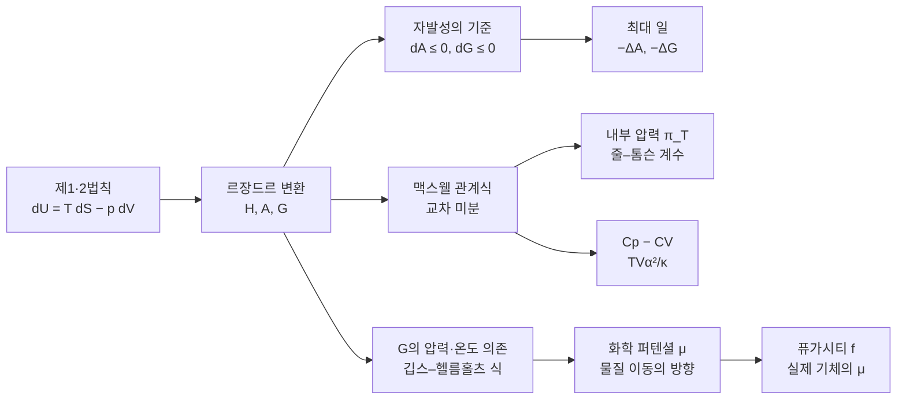

# 물리화학 3. 자유 에너지와 화학 퍼텐셜 — 네 개의 퍼텐셜과 한 장의 미분 지도
<!-- prev: pchem-2, uchem-10, umath-1 -->
<!-- next: pchem-4 -->

> [!NOTE]
> **이 단원의 범위**
> - 헬름홀츠 에너지와 깁스 에너지: 자발성의 기준과 최대 일
> - 열역학 기본 방정식과 네 가지 퍼텐셜($U$, $H$, $A$, $G$)과 그 자연 변수
> - 맥스웰 관계식과 그 활용: 열역학적 상태 방정식과 내부 압력 $\pi_T$, $C_p - C_V$
> - 깁스 에너지의 압력·온도 의존과 깁스–헬름홀츠 식
> - 화학 퍼텐셜: 순물질과 혼합물, 물질 이동과 평형의 조건
> - 실제 기체의 퓨가시티와 퓨가시티 계수

**학습 목표**

1. 클라우지우스 부등식에서 출발하여 일정한 $T$, $V$에서는 $dA \le 0$, 일정한 $T$, $p$에서는 $dG \le 0$이 자발성의 기준임을 유도하고, $-\Delta A$와 $-\Delta G$를 각각 최대 일과 최대 비팽창 일로 해석할 수 있다.
2. 열역학 기본 방정식 $dU = T\,dS - p\,dV$에서 르장드르 변환으로 $dH$, $dA$, $dG$를 이끌어 내고, 각 퍼텐셜의 자연 변수와 그 편미분이 주는 양을 말할 수 있다.
3. 네 가지 맥스웰 관계식을 유도하고, 이를 이용해 측정하기 어려운 양($(\partial S/\partial V)_T$, $(\partial S/\partial p)_T$)을 측정 가능한 양($\alpha$, $\kappa_T$, 상태 방정식)으로 바꿀 수 있다.
4. 열역학적 상태 방정식으로 내부 압력 $\pi_T$를 계산하고, $C_p - C_V = TV\alpha^2/\kappa_T$를 유도하여 기체·액체·고체에 적용할 수 있다.
5. $(\partial G/\partial p)_T = V$, $(\partial G/\partial T)_p = -S$와 깁스–헬름홀츠 식으로 다른 압력·온도에서의 $\Delta G$를 계산할 수 있다.
6. 화학 퍼텐셜을 부분 몰 깁스 에너지로 정의하고, 물질이 화학 퍼텐셜이 높은 곳에서 낮은 곳으로 이동한다는 것과 평형 조건을 설명할 수 있다.
7. 퓨가시티와 퓨가시티 계수를 정의하고, 압축 인자·비리얼 계수·판데르발스 식으로 실제 기체의 퓨가시티 계수를 계산할 수 있다.

**이 단원의 학습 사다리**

| 단계 | 무엇을 하나? |
|---|---|
| STEP 1. 이전 학습 다시 보기 | $G = H - TS$, 클라우지우스 부등식, 실제 기체의 상태 방정식, 완전 미분 |
| STEP 2. 기초 다지기 | 완전 미분과 교차 미분, 연쇄 법칙과 순환 관계, 르장드르 변환, 응답 함수 $\alpha$와 $\kappa_T$ |
| STEP 3. 핵심 개념 | 자발성의 기준 → 최대 일 → 기본 방정식과 네 퍼텐셜 → 맥스웰 관계식 → $\pi_T$와 줄–톰슨 계수 → $C_p - C_V$ → $G$의 압력 의존 → $G$의 온도 의존 → 화학 퍼텐셜 → 퓨가시티 |
| STEP 4. 오개념 바로잡기 | "$\Delta G < 0$이면 언제나 자발적이다", "$-\Delta G$는 계가 할 수 있는 전체 일이다" 같은 착각 |
| STEP 5. 대학원·연구로 | 퍼텐셜의 볼록성과 열역학적 안정성, 고급 열역학·계산화학과의 연결 |
| STEP 6. 생활·산업·진로 | 기체 액화, 고압 공정 설계, 인조 다이아몬드, 생체 막을 지나는 물질 이동 |

---

## 🗺️ 단원 들어가기

일반화학에서 우리는 $\Delta G = \Delta H - T\Delta S$라는 식 하나로 반응의 방향을 판단했다. 그런데 이 식을 쓸 때마다 조용히 깔아 둔 조건이 있다. **온도와 압력이 일정하다**는 것이다. 단단히 밀봉한 강철 용기 속의 반응처럼 부피가 일정하면 무엇을 보아야 할까? $\Delta G$가 "꺼낼 수 있는 최대의 비팽창 일"이라는 말은 어떻게 증명되는가? 그리고 실제 기체 수백 기압 속의 질소처럼 이상 기체 식이 맞지 않는 곳에서 $\mu = \mu^\circ + RT\ln(p/p^\circ)$는 어떻게 고쳐야 하는가?

이 단원의 답은 놀라울 만큼 단순한 한 줄에서 시작한다.

$$
dU = T\,dS - p\,dV
$$

제1법칙과 제2법칙을 합친 이 **기본 방정식**에서 변수를 바꾸는 수학적 조작(르장드르 변환)을 세 번 하면 엔탈피 $H$, 헬름홀츠 에너지 $A$, 깁스 에너지 $G$가 차례로 태어난다. 이 네 함수의 2계 편미분이 서로 같다는 사실에서 **맥스웰 관계식**이 나오고, 그것으로 "엔트로피가 부피에 따라 얼마나 변하는가"처럼 직접 잴 수 없는 양을 "온도를 올릴 때 압력이 얼마나 오르는가"처럼 잴 수 있는 양으로 바꾼다. 열역학은 이렇게 **측정 가능한 몇 가지 양($C_p$, $\alpha$, $\kappa_T$, 상태 방정식)에서 모든 것을 계산해 내는 체계**가 된다.

마지막으로 물질의 양까지 변수에 넣으면 **화학 퍼텐셜**이 등장한다. 온도 차가 열을 흐르게 하고 압력 차가 피스톤을 밀듯이, 화학 퍼텐셜의 차는 물질을 흐르게 한다. 상평형(「순물질의 상평형」), 용액(「혼합물과 용액의 열역학」), 화학 평형과 전지(「화학 평형과 전기화학」)는 모두 이 단원의 화학 퍼텐셜 하나로 다시 쓰인다.

---

## STEP 1. 🔙 이전 학습 다시 보기

### 연계 개념표

| 이전 단원 | 그때 배운 것 | 이 단원에서 확장되는 것 |
|---|---|---|
| 일반화학 「화학 열역학」 | $G = H - TS$, $\Delta G = -T\Delta S_\text{우주}$(일정 $T$, $p$), $-\Delta G$는 최대 비팽창 일(증명 없이), $G(p) = G^\circ + RT\ln(p/p^\circ)$(이상 기체) | 클라우지우스 부등식에서 $dG \le 0$, $dA \le 0$을 **유도**, 최대 일의 증명, 이상 기체 식을 실제 기체로 확장(퓨가시티) |
| 물리화학 「기체의 성질과 열역학 제1법칙」 | 판데르발스 식과 비리얼 식, 압축 인자 $Z$, 내부 압력 $\pi_T$와 줄–톰슨 계수(실험량으로), $C_p - C_V = (p + \pi_T)(\partial V/\partial T)_p$(이상 기체는 $R$), 상태 함수와 완전 미분 | $\pi_T = T(\partial p/\partial T)_V - p$로 상태 방정식에서 **계산**, 모든 물질에 대한 $C_p - C_V = TV\alpha^2/\kappa_T$ |
| 물리화학 「열역학 제2·3법칙과 엔트로피」 | 클라우지우스 부등식 $dS \ge dq/T$, 팽창·가열·상전이의 엔트로피, 절대 엔트로피 | 부등식을 계의 함수($A$, $G$)로 옮김, 기본 방정식 $dU = T\,dS - p\,dV$, 엔트로피의 압력·부피 의존을 맥스웰 관계식으로 계산 |
| 수학 도구 「미분과 편미분」 | 편미분, 전미분과 완전 미분, 연쇄 법칙과 순환 관계($-1$ 규칙), 교차 미분의 같음 | 맥스웰 관계식은 교차 미분의 같음 그 자체, 순환 관계로 $(\partial p/\partial T)_V = \alpha/\kappa_T$ |

### 준비 운동 (사전 진단)

**Q1.** 클라우지우스 부등식 $dS \ge dq/T$에서 등호와 부등호는 각각 어떤 과정에 해당하는가?

**Q2.** $z = x^2y^3$일 때 $\partial^2 z/\partial x\,\partial y$와 $\partial^2 z/\partial y\,\partial x$를 각각 구하시오.

**Q3.** 이상 기체 1.00 mol이 300 K에서 1.00 bar에서 10.0 bar로 등온 압축될 때 $\Delta G$를 구하시오. ($R = 8.314\ \mathrm{J/(mol\cdot K)}$)

정답 및 해설

**Q1.** 등호는 가역 과정, 부등호는 비가역(자발적) 과정이다. 「열역학 제2·3법칙과 엔트로피」에서 카르노 순환으로 이끌어 낸 결과이며, STEP 3 ①에서 이 부등식이 $dA \le 0$, $dG \le 0$으로 바뀐다.

**Q2.** 둘 다 $6xy^2$이다. 매끄러운 함수의 2계 교차 편미분은 미분 순서와 관계없이 같다. 이것이 STEP 3 ④ 맥스웰 관계식의 수학적 뿌리이다.

**Q3.** $\Delta G = nRT\ln(p_2/p_1) = 1.00\times8.314\times300\times\ln 10.0 = 5.74\times10^3\ \mathrm{J} = +5.74\ \mathrm{kJ}$. STEP 3 ⑦에서 이 식을 $(\partial G/\partial p)_T = V$에서 유도한다.

---

## STEP 2. 🧱 기초 다지기

### 디딤돌 1. 완전 미분과 교차 미분의 같음

수학 도구 「미분과 편미분」의 '전미분과 완전 미분'에서 익힌 것을 되짚자. 두 변수 함수 $z(x, y)$의 전미분은

$$
dz = \left(\frac{\partial z}{\partial x}\right)_y dx + \left(\frac{\partial z}{\partial y}\right)_x dy \equiv M\,dx + N\,dy
$$

이다. 거꾸로 $M\,dx + N\,dy$라는 미분 꼴이 주어졌을 때, 이것이 어떤 함수 $z$의 전미분(**완전 미분**, exact differential)이 될 필요충분조건은

$$
\left(\frac{\partial M}{\partial y}\right)_x = \left(\frac{\partial N}{\partial x}\right)_y
$$

이다. 왼쪽과 오른쪽이 모두 $\partial^2 z/\partial x\,\partial y$이기 때문이다(교차 미분의 같음). 상태 함수의 미분은 언제나 완전 미분이고, 열 $dq$나 일 $dw$처럼 경로 함수의 미소량은 그렇지 않다.

**연습 1** 이상 기체 1 mol에서 $dq_\text{가역} = C_V\,dT + \dfrac{RT}{V}dV$이다($C_V$ 일정). $dq_\text{가역}$은 완전 미분인가? $dq_\text{가역}/T$는 어떤가?

**풀이** $M = C_V$, $N = RT/V$로 놓으면 $(\partial M/\partial V)_T = 0$, $(\partial N/\partial T)_V = R/V$로 서로 다르다. 따라서 $dq$는 완전 미분이 아니다(열은 경로 함수). 양변을 $T$로 나누면 $M' = C_V/T$, $N' = R/V$이고 $(\partial M'/\partial V)_T = 0 = (\partial N'/\partial T)_V$이므로 완전 미분이 된다. 이 함수가 엔트로피이며, $1/T$가 **적분 인자**라는 「열역학 제2·3법칙과 엔트로피」의 결론을 미분 꼴로 다시 확인한 셈이다.

### 디딤돌 2. 연쇄 법칙, 역수 관계, 순환 관계

세 변수 $x$, $y$, $z$가 하나의 관계식 $f(x, y, z) = 0$으로 묶여 있으면(예: 상태 방정식 $f(p, V, T) = 0$) 다음 두 규칙이 성립한다(수학 도구 「미분과 편미분」 '연쇄 법칙과 순환 관계').

$$
\left(\frac{\partial x}{\partial y}\right)_z = \frac{1}{(\partial y/\partial x)_z} \quad(\text{역수 관계}), \qquad
\left(\frac{\partial x}{\partial y}\right)_z\left(\frac{\partial y}{\partial z}\right)_x\left(\frac{\partial z}{\partial x}\right)_y = -1 \quad(\text{순환 관계})
$$

또 하나 자주 쓰는 것은 **제약 조건을 바꾸는 규칙**이다. $z(x, y)$에서 $y$ 대신 다른 변수 $w$를 고정하고 $x$로 미분하면

$$
\left(\frac{\partial z}{\partial x}\right)_w = \left(\frac{\partial z}{\partial x}\right)_y + \left(\frac{\partial z}{\partial y}\right)_x\left(\frac{\partial y}{\partial x}\right)_w
$$

이다. $dz$의 전미분 식을 $dx$로 나누되 $w$를 고정하기만 하면 얻어진다. STEP 3 ⑥의 $C_p - C_V$ 유도가 바로 이 식을 쓴다.

**연습 2** 순환 관계를 써서 $(\partial p/\partial T)_V$를 $(\partial V/\partial T)_p$와 $(\partial V/\partial p)_T$로 나타내시오.

**풀이** $(\partial p/\partial T)_V(\partial T/\partial V)_p(\partial V/\partial p)_T = -1$에서 역수 관계로 $(\partial T/\partial V)_p = 1/(\partial V/\partial T)_p$를 넣으면

$$
\left(\frac{\partial p}{\partial T}\right)_V = -\frac{(\partial V/\partial T)_p}{(\partial V/\partial p)_T}
$$

용기를 꽉 막고 가열할 때의 압력 상승률(직접 재기 어렵다, 특히 액체)을 열팽창과 압축률(재기 쉽다)로 바꾼 것이다. 디딤돌 4에서 이것을 $\alpha/\kappa_T$로 쓴다.

### 디딤돌 3. 르장드르 변환 — 기울기를 새 변수로

함수 $f(x)$를 기울기 $s = df/dx$의 함수로 다시 쓰고 싶다고 하자. 단순히 $x$를 $s$로 바꾸어 $f(s)$로 쓰면 정보가 사라진다($f$를 평행 이동한 곡선들이 모두 같은 $f(s)$를 준다). 대신 **기울기가 $s$인 접선의 세로축 절편**

$$
g = f - s\,x
$$

를 쓰면, 접선들의 모임(포락선)으로 원래 곡선을 다시 그릴 수 있으므로 정보가 하나도 사라지지 않는다. 미분하면 $dg = df - s\,dx - x\,ds = s\,dx - s\,dx - x\,ds = -x\,ds$이다. 즉 $g$는 $s$의 자연스러운 함수이고 $dg/ds = -x$이다. 이것을 **르장드르 변환(Legendre transform)** 이라 한다.

<!-- 그림 요청: 르장드르 변환의 기하학적 뜻. 가로축 x, 세로축 f인 위로 볼록하지 않은(아래로 볼록한) 곡선 f(x) = x² + 1 위의 점 x₀ = 1.5에서 접선을 그린다. 접선의 기울기 s = 3, 세로축 절편 g = f − s·x = 3.25 − 4.5 = −1.25 를 세로축 위에 점으로 표시하고 "g = f − s x" 이름표. 같은 곡선에 기울기가 다른 접선 3~4개를 옅게 더 그려, 접선들의 포락선이 원래 곡선이 됨을 보인다. -->

열역학에서는 $U(S, V)$의 기울기 $(\partial U/\partial S)_V = T$를 새 변수로 삼고 싶을 때 $A = U - TS$를, 기울기 $(\partial U/\partial V)_S = -p$를 새 변수로 삼고 싶을 때 $H = U - (-p)V = U + pV$를 만든다. STEP 3 ③에서 자세히 본다.

### 디딤돌 4. 응답 함수 — 열팽창 계수와 등온 압축률

물질의 부피가 온도와 압력에 얼마나 민감한지를 나타내는 두 **응답 함수(response function)** 는 실험으로 쉽게 잰다.

$$
\alpha = \frac{1}{V}\left(\frac{\partial V}{\partial T}\right)_p \quad(\text{열팽창 계수}), \qquad
\kappa_T = -\frac{1}{V}\left(\frac{\partial V}{\partial p}\right)_T \quad(\text{등온 압축률})
$$

$\kappa_T$의 음의 부호는 압력을 높이면 부피가 줄어드는 보통의 물질에서 값을 양수로 만들기 위한 것이다. 디딤돌 2의 결과는 이제 $(\partial p/\partial T)_V = \alpha/\kappa_T$로 쓸 수 있다.

| 물질 (25 ℃, 1 bar) | $\alpha$ ($\mathrm{K^{-1}}$) | $\kappa_T$ ($\mathrm{Pa^{-1}}$) | $V_\mathrm{m}$ ($\mathrm{cm^3/mol}$) | $C_{p,\mathrm{m}}$ ($\mathrm{J/(mol\cdot K)}$) |
|---|---|---|---|---|
| 이상 기체 | $1/T = 3.35\times10^{-3}$ | $1/p = 1.0\times10^{-5}$ | 24 790 | — |
| 물 | $2.57\times10^{-4}$ | $4.52\times10^{-10}$ | 18.07 | 75.3 |
| 벤젠 | 약 $1.24\times10^{-3}$ | 약 $9.7\times10^{-10}$ | 89.4 | 136 |
| 구리 | 약 $4.95\times10^{-5}$ | 약 $7.3\times10^{-12}$ | 7.11 | 24.4 |

액체의 $\kappa_T$는 기체보다 약 $10^4$~$10^5$배 작고, 고체는 그보다도 100배쯤 작다. 이 차이가 STEP 3 ⑦에서 "응축상의 깁스 에너지는 압력에 거의 무관하다"는 결론을 준다.

**연습 4** 물을 빈틈없이 채우고 밀봉한 강철 용기(부피 변화 무시)를 25 ℃에서 1.0 K 데우면 압력은 약 얼마나 오르는가?

**풀이** $(\partial p/\partial T)_V = \alpha/\kappa_T = \dfrac{2.57\times10^{-4}}{4.52\times10^{-10}} = 5.69\times10^5\ \mathrm{Pa/K}$, 즉 1 K마다 약 5.7 bar이다. 물을 가득 채워 밀폐한 배관이나 용기는 얼지 않고 데워지기만 해도 위험한 까닭이다. (온도가 크게 바뀌면 $\alpha$와 $\kappa_T$도 변하므로 이 값은 작은 온도 변화에서만 맞다.)

> [!TIP]
> 💡 **요령** — 열역학 편미분이 나오면 "이것은 실험실에서 잴 수 있는가?"를 먼저 묻자. $(\partial V/\partial T)_p$, $(\partial V/\partial p)_T$, $(\partial H/\partial T)_p = C_p$는 잴 수 있다. $(\partial S/\partial p)_T$나 $(\partial U/\partial V)_T$는 직접 잴 수 없다. 이 단원의 기술은 결국 **잴 수 없는 편미분을 잴 수 있는 편미분으로 바꾸는 것**이다.

---

## STEP 3. 📘 핵심 개념

### ① 계의 함수로 자발성을 판단하기 — 헬름홀츠 에너지와 깁스 에너지

「열역학 제2·3법칙과 엔트로피」에서 자발성의 궁극적인 기준은 **고립계(우주)의 엔트로피 증가**였다. 그러나 화학자가 다루는 계는 대부분 고립되어 있지 않다. 비커는 실험실 공기와 열을 주고받고, 대기압에 눌려 있다. 주위의 엔트로피 변화까지 매번 계산하지 않고 **계의 성질만으로** 방향을 판단하는 함수를 만들어 보자.

#### 유도 — 클라우지우스 부등식에서 출발

계가 온도 $T$인 주위(열 저장고)와 열 $dq$를 주고받으며 미소 변화를 겪을 때 클라우지우스 부등식은

$$
dS - \frac{dq}{T} \ge 0 \qquad (\text{등호: 가역, 부등호: 비가역·자발적})
$$

이다. 여기서 $T$는 열 저장고의 온도이다. "일정한 온도"라는 말은 계가 이 저장고와 열 접촉을 하고 있어 처음과 나중의 온도가 $T$와 같다는 뜻이다. 팽창 일 외의 일(전기적 일 등)은 없다고 하자.

**(가) 부피가 일정할 때.** 팽창 일이 없으므로 제1법칙에서 $dq = dU$이다. 대입하면

$$
dS - \frac{dU}{T} \ge 0 \quad\Longrightarrow\quad T\,dS \ge dU
$$

이제 **헬름홀츠 에너지(Helmholtz energy)** 를 다음과 같이 정의한다.

$$
A \equiv U - TS
$$

일정한 $T$에서 $dA = dU - T\,dS$이므로 위의 부등식은 곧

$$
\boxed{\;dA_{T,V} \le 0\;}
$$

이다. 일정한 온도와 부피에서 자발적 변화는 $A$가 줄어드는 쪽으로 일어나고, $A$가 최소가 되면 평형이다.

**(나) 압력이 일정할 때.** 일정한 압력에서 팽창 일 외의 일이 없으면 $dq = dH$이다(「기체의 성질과 열역학 제1법칙」). 같은 방식으로 $T\,dS \ge dH$이고, **깁스 에너지(Gibbs energy)** $G \equiv H - TS$를 정의하면 일정한 $T$에서 $dG = dH - T\,dS$이므로

$$
\boxed{\;dG_{T,p} \le 0\;}
$$

이다. 일반화학에서 $\Delta G = -T\Delta S_\text{우주}$로 얻은 결론을 미소 변화의 부등식으로 다시 얻었다.

> [!IMPORTANT]
> **같은 부등식, 다섯 가지 얼굴** — 클라우지우스 부등식 $T\,dS \ge dq$ 하나에서, 어떤 변수를 고정하느냐에 따라 다음 기준이 모두 나온다.
>
> | 고정하는 변수 | 자발적 변화의 방향 | 평형 조건 |
> |---|---|---|
> | $U$, $V$ (고립계) | $dS \ge 0$ | $S$ 최대 |
> | $S$, $V$ | $dU \le 0$ | $U$ 최소 |
> | $S$, $p$ | $dH \le 0$ | $H$ 최소 |
> | $T$, $V$ | $dA \le 0$ | $A$ 최소 |
> | $T$, $p$ | $dG \le 0$ | $G$ 최소 |

엔트로피를 일정하게 붙잡아 두는 실험은 거의 없으므로 화학에서 실제로 쓰는 기준은 아래 두 줄이다. 밀봉한 강철 용기 속의 반응, 통계 열역학의 계산(부피를 고정하는 것이 편하다)에서는 $A$를, 열린 비커·대기 중의 반응·생체 반응에서는 $G$를 쓴다.

<!-- 그림 요청: 자발성 기준을 쓰는 두 가지 실험 조건 비교. 왼쪽: 온도 T인 항온조(물결 무늬 열 저장고) 속에 단단한 강철 용기(부피 고정)가 잠겨 있고 용기 벽을 지나는 화살표 "열 dq"만 있음. 아래 이름표 "일정 T, V → dA ≤ 0". 오른쪽: 같은 항온조 속에 마찰 없는 피스톤이 달린 실린더, 피스톤 위에 추와 "외부 압력 p 일정" 이름표, 열 화살표 dq와 피스톤 이동 화살표 dV. 아래 이름표 "일정 T, p → dG ≤ 0". 두 그림 사이 위쪽에 공통 출발점 "클라우지우스 부등식 T dS ≥ dq" 상자에서 양쪽으로 갈라지는 화살표. -->

$dA = dU - T\,dS$와 $dG = dH - T\,dS$는 **에너지를 낮추려는 경향**($dU < 0$, $dH < 0$)과 **엔트로피를 높이려는 경향**($dS > 0$)이 온도라는 '환율'로 저울질되는 모습이다. 또 $-dA/T$와 $-dG/T$는 각각의 조건에서 계와 주위를 합친 **전체 엔트로피의 증가**와 같다. 예를 들어 일정 $T$, $p$에서 주위의 엔트로피 변화는 $-dH/T$이므로

$$
-\frac{dG}{T} = -\frac{dH}{T} + dS = dS_\text{주위} + dS = dS_\text{전체}
$$

이다. $A$와 $G$는 새로운 법칙이 아니라 **제2법칙을 계의 언어로 번역한 것**이다.

#### 예제 1 — 같은 과정, 네 가지 에너지

물 1.00 mol이 100 ℃, 1.00 atm에서 증발한다. $\Delta H_\text{증발} = 40.66\ \mathrm{kJ/mol}$이고 수증기는 이상 기체, 액체의 부피는 무시한다. $\Delta S$, $\Delta U$, $\Delta G$, $\Delta A$를 구하고, $\Delta G$와 $\Delta A$의 부호가 다른 까닭을 설명하시오.

**풀이**
① 정상 끓는점에서 액체와 기체는 평형이므로 증발은 가역적이다. $\Delta S = \Delta H/T = 40\,660/373.15 = +109.0\ \mathrm{J/K}$
② $\Delta U = \Delta H - \Delta(pV) \approx \Delta H - RT = 40\,660 - 8.314\times373.15 = 40\,660 - 3102 = +37.56\ \mathrm{kJ}$
③ $\Delta G = \Delta H - T\Delta S = 40.66 - 40.66 = 0$
④ $\Delta A = \Delta U - T\Delta S = 37.56 - 40.66 = -3.10\ \mathrm{kJ}$ (곧 $\Delta A = -RT$)

**의미** 일정한 $T$, $p$에서 이 증발은 평형($\Delta G = 0$)이다. 그러나 $\Delta A < 0$이라고 해서 "부피가 일정하면 자발적"이라는 뜻은 아니다. 이 과정은 부피가 약 1600배로 늘어나는 과정이므로 $T$, $V$ 일정이라는 조건 자체가 맞지 않는다. $\Delta A = -3.10\ \mathrm{kJ}$의 뜻은 ②에서 밝혀진다. 기체가 대기를 밀어내며 한 팽창 일 $p\Delta V = RT = 3.10\ \mathrm{kJ}$, 즉 이 등온 과정에서 꺼낼 수 있는 **전체 일의 최댓값**이다.

#### ✔ 바로 확인

1. (O/X) 일정한 온도와 부피에서 자발적으로 일어나는 변화는 헬름홀츠 에너지를 줄인다.
2. 빈칸: 고립계에서 평형은 (    )가 최대인 상태이고, 일정한 $T$, $p$에서 평형은 (    )가 최소인 상태이다.
3. 일정한 $T$, $p$에서 어떤 과정의 $\Delta G = -4.0\ \mathrm{kJ}$이다. 300 K에서 계와 주위를 합친 전체 엔트로피 변화는?

정답

1. O — $dA_{T,V} \le 0$.
2. 엔트로피 $S$, 깁스 에너지 $G$
3. $+13\ \mathrm{J/K}$ — $\Delta S_\text{전체} = -\Delta G/T = 4000/300 = 13.3\ \mathrm{J/K}$.

### ② 최대 일 — 자유 에너지라는 이름의 뜻

$A$와 $G$는 방향을 알려 줄 뿐 아니라 **계가 할 수 있는 일의 한계**를 알려 준다. 이것이 '자유 에너지'라는 옛 이름의 유래이다. (독일어 Arbeit(일)에서 $A$라는 기호가 왔다.)

#### 유도 1 — $-\Delta A$는 최대 일

제1법칙 $dU = dq + dw$($dw$는 계가 **받은** 모든 일)에 클라우지우스 부등식 $dq \le T\,dS$를 넣으면

$$
dw = dU - dq \ge dU - T\,dS
$$

일정한 $T$에서 오른쪽은 $dA$이므로 $dw \ge dA$, 적분하면 $w \ge \Delta A$이다. 계가 주위에 **해 준** 일 $-w$로 바꾸면

$$
\boxed{\;-w \le -\Delta A \qquad(\text{일정한 } T,\ \text{등호는 가역})\;}
$$

등온 과정에서 계가 할 수 있는 **모든 종류의 일(팽창 일 포함)의 최댓값**은 $-\Delta A$이고, 그 최댓값은 가역적으로 진행할 때 얻는다. $\Delta U$가 전부 일이 되지 못하는 까닭은 $T\Delta S$만큼은 열로 주고받아야 하기 때문이다. $\Delta S < 0$인 과정에서는 열 $T\lvert\Delta S\rvert$를 주위에 버려야 엔트로피 장부가 맞고, $\Delta S > 0$인 과정에서는 오히려 주위의 열 $T\Delta S$를 끌어와 $\lvert\Delta U\rvert$보다 큰 일을 할 수도 있다.

#### 유도 2 — $-\Delta G$는 최대 비팽창 일

이번에는 일을 팽창 일과 그 밖의 일(전기적 일, 표면을 넓히는 일, 근육의 수축 등)로 나눈다. $dw = -p\,dV + dw_\text{추가}$. 일정한 압력 $p$(외부 압력과 같다)와 온도 $T$에서

$$
dG = dH - T\,dS = dU + p\,dV - T\,dS = (dq - p\,dV + dw_\text{추가}) + p\,dV - T\,dS = dq - T\,dS + dw_\text{추가}
$$

$dq - T\,dS \le 0$이므로 $dG \le dw_\text{추가}$, 즉

$$
\boxed{\;-w_\text{추가} \le -\Delta G \qquad(\text{일정한 } T,\ p,\ \text{등호는 가역})\;}
$$

대기압 아래에서 일어나는 반응은 부피가 변하면 대기를 밀거나 대기에 밀리는 팽창 일을 피할 수 없다. 그 몫을 뺀 **쓸모 있는 일**의 상한이 $-\Delta G$이다. 연료 전지의 전기 에너지, 근육이 ATP로 하는 기계적 일, 생합성에 쓰이는 일의 상한이 모두 여기에 해당한다.

| 함수 | 정의 | 자발성 기준 | 최대 일 (등온 가역에서 등호) |
|---|---|---|---|
| 헬름홀츠 에너지 $A$ | $U - TS$ | $dA_{T,V} \le 0$ | 전체 일: $-w \le -\Delta A$ |
| 깁스 에너지 $G$ | $H - TS = A + pV$ | $dG_{T,p} \le 0$ | 비팽창 일: $-w_\text{추가} \le -\Delta G$ |

#### 예제 2 — 메테인 연소에서 꺼낼 수 있는 일

25 ℃, 1 bar에서 $\mathrm{CH_4(g) + 2O_2(g) \rightarrow CO_2(g) + 2H_2O(l)}$의 $\Delta H^\circ = -890.4\ \mathrm{kJ}$, $\Delta G^\circ = -817.9\ \mathrm{kJ}$이다. (1) $\Delta S^\circ$, (2) $\Delta U^\circ$와 $\Delta A^\circ$, (3) 이 반응에서 꺼낼 수 있는 최대 전체 일과 최대 비팽창 일을 구하고 둘의 차이를 해석하시오. (기체는 이상 기체, 액체의 부피는 무시)

**풀이**
(1) $\Delta S^\circ = (\Delta H^\circ - \Delta G^\circ)/T = (-890.4 + 817.9)\times10^3/298.15 = -243\ \mathrm{J/K}$
(2) 기체 몰수 변화 $\Delta n_\text{기체} = 1 - 3 = -2$이므로 $\Delta(pV) = \Delta n_\text{기체}RT = -2\times2.479 = -4.96\ \mathrm{kJ}$.
$\Delta U^\circ = \Delta H^\circ - \Delta(pV) = -890.4 + 4.96 = -885.4\ \mathrm{kJ}$
$\Delta A^\circ = \Delta G^\circ - \Delta(pV) = -817.9 + 4.96 = -812.9\ \mathrm{kJ}$
(3) 최대 전체 일 $= -\Delta A^\circ = 812.9\ \mathrm{kJ}$, 최대 비팽창 일 $= -\Delta G^\circ = 817.9\ \mathrm{kJ}$

**의미** 비팽창 일의 상한이 전체 일의 상한보다 **크다**. 모순 같지만 그렇지 않다. 기체 3 mol이 1 mol로 줄어드니 대기가 계를 누르며 $4.96\ \mathrm{kJ}$의 일을 **해 준다**. 전체 일 812.9 kJ에 대기가 보태 준 4.96 kJ를 더한 것이 꺼낼 수 있는 비팽창 일 817.9 kJ이다. 한편 $T\Delta S^\circ = -72.4\ \mathrm{kJ}$만큼은 가역적으로 진행하더라도 열로 주위에 내놓아야 한다. 실제 화력 발전에서 얻는 일은 이 상한보다 훨씬 작다. 연소 열을 먼저 만든 뒤 열기관으로 일을 꺼내므로 카르노 효율의 제한을 추가로 받기 때문이다(「열역학 제2·3법칙과 엔트로피」).

<!-- 그림 요청: 메테인 연소(25 ℃)의 에너지 막대 도표. 세로축 "에너지 (kJ)", 0에서 아래로 −900까지. 네 막대를 나란히: ΔH = −890.4, ΔU = −885.4, ΔG = −817.9, ΔA = −812.9. ΔH 막대와 ΔG 막대 사이에 "TΔS = −72.4 kJ: 열로 내놓아야 하는 몫" 괄호, ΔG와 ΔA 사이에 "Δ(pV) = −4.96 kJ: 대기가 해 주는 일" 괄호. 막대 위에 "최대 비팽창 일 817.9 kJ", "최대 전체 일 812.9 kJ" 이름표. -->

#### 예제 3 — 엔탈피보다 큰 일을 꺼낼 수 있는가?

포도당의 완전 연소 $\mathrm{C_6H_{12}O_6(s) + 6O_2(g) \rightarrow 6CO_2(g) + 6H_2O(l)}$의 25 ℃ 값은 $\Delta H^\circ \approx -2803\ \mathrm{kJ}$, $\Delta G^\circ \approx -2879\ \mathrm{kJ}$이다. 세포가 포도당 1 mol에서 꺼낼 수 있는 일의 상한을 구하고, 그것이 $\lvert\Delta H^\circ\rvert$보다 큰 까닭을 설명하시오.

**풀이**
일의 상한은 $-\Delta G^\circ \approx 2879\ \mathrm{kJ}$이다. $T\Delta S^\circ = \Delta H^\circ - \Delta G^\circ \approx +76\ \mathrm{kJ}$, $\Delta S^\circ \approx +255\ \mathrm{J/K}$이다. 기체 몰수는 6 mol → 6 mol로 같아 $\Delta(pV) \approx 0$이므로 $\Delta A^\circ \approx \Delta G^\circ$이다.

**의미** 반응의 엔트로피가 늘어나므로, 가역적으로 진행하면 계는 주위에서 열 약 76 kJ을 **흡수하면서** 일을 한다. 그 열까지 일로 바뀌어 상한이 $\lvert\Delta H^\circ\rvert$보다 커진다. 제2법칙에 어긋나지 않는다. 주위에서 빠져나간 엔트로피($-76\ \mathrm{kJ}/T$)를 계의 엔트로피 증가가 정확히 메우기 때문이다. 실제 세포는 이 상한의 일부만 ATP의 형태로 저장하고 나머지는 열로 내놓는다. 그 수지는 「시트르산 회로와 산화적 인산화」에서 다룬다.

#### ✔ 바로 확인

1. (O/X) 등온 과정에서 계가 할 수 있는 전체 일은 $-\Delta U$를 넘을 수 없다.
2. 빈칸: 일정한 $T$, $p$에서 계가 할 수 있는 비팽창 일의 최댓값은 (    )이고, 그 최댓값은 과정이 (    )적으로 일어날 때 얻는다.
3. 25 ℃에서 $\Delta G^\circ = -237.1\ \mathrm{kJ}$인 수소–산소 연료 전지에서 얻을 수 있는 최대 전기 에너지는? (수소 1 mol 기준)

정답

1. X — 상한은 $-\Delta A = -\Delta U + T\Delta S$이다. $\Delta S > 0$이면 $-\Delta U$보다 클 수 있다(예제 3).
2. $-\Delta G$, 가역
3. $237.1\ \mathrm{kJ}$ — 전기적 일은 비팽창 일이다.

### ③ 열역학 기본 방정식과 네 가지 퍼텐셜

#### 기본 방정식 $dU = T\,dS - p\,dV$

조성이 변하지 않는 닫힌계가 팽창 일만 하며 **가역적으로** 변할 때, $dq_\text{가역} = T\,dS$이고 $dw_\text{가역} = -p\,dV$이다. 제1법칙에 넣으면

$$
\boxed{\;dU = T\,dS - p\,dV\;}
$$

이것을 **열역학 기본 방정식(fundamental equation)** 이라 한다. 가역 과정에서 이끌어 냈지만, 이 식은 **이웃한 두 평형 상태 사이의 어떤 변화에도** 성립한다. 식에 들어 있는 $U$, $T$, $S$, $p$, $V$가 모두 상태 함수(또는 상태 변수)여서, 두 상태가 정해지면 $dU$는 경로와 관계없이 정해지기 때문이다. 비가역 경로에서는 $dq < T\,dS$, $dw > -p\,dV$로 각 항이 달라질 뿐, 두 항을 더한 $dU$는 같다.

예를 들어 이상 기체가 진공으로 자유 팽창하면 $q = 0$, $w = 0$이라 $dU = 0$이다. 기본 방정식에 넣으면 $0 = T\,dS - p\,dV$, 즉 $dS = (p/T)dV = nR\,dV/V > 0$으로 엔트로피 증가가 바로 나온다.

#### 자연 변수와 열역학적 정의

기본 방정식은 $U$를 $S$와 $V$의 함수로 볼 때 가장 깔끔하다. $U(S, V)$의 전미분과 비교하면

$$
\left(\frac{\partial U}{\partial S}\right)_V = T, \qquad \left(\frac{\partial U}{\partial V}\right)_S = -p
$$

이다. 온도는 "부피를 고정하고 엔트로피를 조금 늘릴 때 에너지가 늘어나는 비율", 압력은 "엔트로피를 고정하고(단열·가역) 부피를 늘릴 때 에너지가 줄어드는 비율"이다. 이렇게 함수를 가장 단순한 미분으로 만드는 변수를 그 함수의 **자연 변수(natural variables)** 라 한다. 문제는 $S$가 실험실에서 조절할 수 있는 변수가 아니라는 점이다. 우리가 손잡이를 돌려 맞출 수 있는 것은 $T$와 $p$이다. 그래서 STEP 2 디딤돌 3의 르장드르 변환으로 자연 변수를 바꾼다.

#### 르장드르 변환으로 태어나는 $H$, $A$, $G$

| 바꾸려는 변수 | 새 함수 | 미분 (기본 방정식 대입) | 자연 변수 |
|---|---|---|---|
| — | $U$ | $dU = T\,dS - p\,dV$ | $S$, $V$ |
| $V \to p$ | $H = U + pV$ | $dH = dU + p\,dV + V\,dp = T\,dS + V\,dp$ | $S$, $p$ |
| $S \to T$ | $A = U - TS$ | $dA = dU - T\,dS - S\,dT = -S\,dT - p\,dV$ | $T$, $V$ |
| 둘 다 | $G = H - TS = A + pV$ | $dG = dH - T\,dS - S\,dT = -S\,dT + V\,dp$ | $T$, $p$ |

각 미분 식을 자연 변수에 대한 전미분과 비교하면 첫째 편미분들이 모두 읽힌다.

$$
\left(\frac{\partial H}{\partial S}\right)_p = T,\quad \left(\frac{\partial H}{\partial p}\right)_S = V,\quad
\left(\frac{\partial A}{\partial T}\right)_V = -S,\quad \left(\frac{\partial A}{\partial V}\right)_T = -p,\quad
\left(\frac{\partial G}{\partial T}\right)_p = -S,\quad \left(\frac{\partial G}{\partial p}\right)_T = V
$$

이 네 함수를 **열역학 퍼텐셜(thermodynamic potentials)** 이라 부른다. 역학에서 퍼텐셜 에너지를 미분하면 힘이 나오고 평형이 퍼텐셜의 최솟점이듯, 열역학 퍼텐셜을 자연 변수로 미분하면 $T$, $p$, $S$, $V$가 나오고, 자연 변수를 고정한 계의 평형은 그 퍼텐셜의 최솟점이다(① 표).

<!-- 그림 요청: 열역학 사각형(외우기 도표). 정사각형의 네 꼭짓점에 변수: 왼쪽 위 V, 오른쪽 위 T, 오른쪽 아래 p, 왼쪽 아래 S. 네 변의 가운데에 퍼텐셜: 위 변 A, 오른쪽 변 G, 아래 변 H, 왼쪽 변 U. 두 대각선 화살표: 왼쪽 아래 S → 오른쪽 위 T, 오른쪽 아래 p → 왼쪽 위 V. 옆에 읽는 법 예시 "dG: G 양옆의 꼭짓점 T, p가 자연 변수. dT의 계수는 대각선 맞은편 S, 화살표가 S에서 T로(계수 → 변수) 향하므로 −S dT. dp의 계수는 V, 화살표가 p에서 V로(변수 → 계수) 향하므로 +V dp. 결과 dG = −S dT + V dp". 그 아래 일반 규칙 한 줄: "화살표가 변수에서 계수로 향하면 +, 계수에서 변수로 향하면 −". -->

#### 퍼텐셜 하나가 모든 것을 담는다

자연 변수로 쓴 퍼텐셜 하나를 알면 계의 열역학 성질을 **모두** 계산할 수 있다. 예를 들어 $G(T, p)$를 알면

$$
S = -\left(\frac{\partial G}{\partial T}\right)_p,\quad V = \left(\frac{\partial G}{\partial p}\right)_T,\quad H = G + TS,\quad U = H - pV,\quad A = G - pV,\quad C_p = -T\left(\frac{\partial^2 G}{\partial T^2}\right)_p
$$

이다(마지막 식은 $C_p = T(\partial S/\partial T)_p$에 $S = -(\partial G/\partial T)_p$를 넣은 것이다). 반면 $G$를 자연 변수가 아닌 $T$와 $V$의 함수로 알고 있으면 이런 일이 불가능하다. $G(T, V)$에서 $p$나 $S$를 얻으려면 상태 방정식이 따로 필요하다. 자연 변수가 '자연스러운' 까닭이 여기에 있다. 통계 열역학(「통계 열역학」)이 분배 함수에서 곧바로 $A(T, V)$를 주고, 거기서 모든 열역학 함수를 계산하는 것도 같은 원리이다.

#### 예제 4 — 이상 기체의 $G(T, p)$에서 모든 것을 얻기

이상 기체 1 mol의 몰 깁스 에너지는 $G_\mathrm{m}(T, p) = G_\mathrm{m}^\circ(T) + RT\ln(p/p^\circ)$이다. (1) $V_\mathrm{m}$, $S_\mathrm{m}$, $H_\mathrm{m}$을 이 식에서 구하시오. (2) $\mathrm{N_2}$의 $S_\mathrm{m}^\circ(298.15\ \mathrm{K}) = 191.6\ \mathrm{J/(mol\cdot K)}$일 때 298.15 K, 10.0 bar에서 $S_\mathrm{m}$을 구하시오.

**풀이**
(1) $V_\mathrm{m} = (\partial G_\mathrm{m}/\partial p)_T = RT/p$ — 이상 기체 법칙이 저절로 나온다.
$S_\mathrm{m} = -(\partial G_\mathrm{m}/\partial T)_p = -\dfrac{dG_\mathrm{m}^\circ}{dT} - R\ln\dfrac{p}{p^\circ} = S_\mathrm{m}^\circ(T) - R\ln\dfrac{p}{p^\circ}$
$H_\mathrm{m} = G_\mathrm{m} + TS_\mathrm{m} = G_\mathrm{m}^\circ + RT\ln\dfrac{p}{p^\circ} + TS_\mathrm{m}^\circ - RT\ln\dfrac{p}{p^\circ} = H_\mathrm{m}^\circ(T)$ — 압력에 무관하다.
(2) $S_\mathrm{m} = 191.6 - 8.314\ln 10.0 = 191.6 - 19.1 = 172.5\ \mathrm{J/(mol\cdot K)}$

**의미** 깁스 에너지 식 한 줄이 상태 방정식($pV = RT$), 엔트로피의 압력 의존, "이상 기체의 엔탈피는 온도만의 함수"라는 사실을 모두 담고 있다. 압력을 10배로 높이면 분자 하나가 돌아다닐 공간이 10분의 1로 줄어 엔트로피가 $R\ln 10$만큼 줄어든다.

#### ✔ 바로 확인

1. 빈칸: 헬름홀츠 에너지의 자연 변수는 (    )와 (    )이고, $(\partial A/\partial V)_T = (\quad)$이다.
2. (O/X) 기본 방정식 $dU = T\,dS - p\,dV$는 가역 과정에서만 성립한다.
3. $dH = T\,dS + V\,dp$에서 $(\partial H/\partial p)_S$는 무엇인가?

정답

1. $T$, $V$, $-p$
2. X — 모든 항이 상태 함수이므로 이웃한 평형 상태 사이의 어떤 변화에도 성립한다(닫힌계, 조성 일정, 팽창 일만 있을 때).
3. $V$

### ④ 맥스웰 관계식 — 교차 미분이 주는 네 개의 다리

네 퍼텐셜의 미분은 모두 완전 미분이다. 그러면 STEP 2 디딤돌 1의 조건 "$M\,dx + N\,dy$가 완전 미분이면 $(\partial M/\partial y)_x = (\partial N/\partial x)_y$"가 각각에 대해 성립한다. 예를 들어 $dG = -S\,dT + V\,dp$에서 $M = -S$, $N = V$이므로 $-(\partial S/\partial p)_T = (\partial V/\partial T)_p$이다. 네 퍼텐셜에서 하나씩, 모두 네 개의 **맥스웰 관계식(Maxwell relations)** 을 얻는다.

| 출발 | 완전 미분 | 맥스웰 관계식 |
|---|---|---|
| $U(S, V)$ | $dU = T\,dS - p\,dV$ | $\left(\dfrac{\partial T}{\partial V}\right)_S = -\left(\dfrac{\partial p}{\partial S}\right)_V$ |
| $H(S, p)$ | $dH = T\,dS + V\,dp$ | $\left(\dfrac{\partial T}{\partial p}\right)_S = \left(\dfrac{\partial V}{\partial S}\right)_p$ |
| $A(T, V)$ | $dA = -S\,dT - p\,dV$ | $\left(\dfrac{\partial S}{\partial V}\right)_T = \left(\dfrac{\partial p}{\partial T}\right)_V$ |
| $G(T, p)$ | $dG = -S\,dT + V\,dp$ | $\left(\dfrac{\partial S}{\partial p}\right)_T = -\left(\dfrac{\partial V}{\partial T}\right)_p$ |

실용적으로 가장 많이 쓰는 것은 아래 두 줄이다. 왼쪽은 **엔트로피가 부피나 압력에 따라 얼마나 변하는가**라는, 열량계로도 직접 잴 수 없는 양이다. 오른쪽은 **상태 방정식**이나 **열팽창**처럼 압력계와 눈금만으로 잴 수 있는 양이다.

$$
\left(\frac{\partial S}{\partial V}\right)_T = \left(\frac{\partial p}{\partial T}\right)_V = \frac{\alpha}{\kappa_T}, \qquad
\left(\frac{\partial S}{\partial p}\right)_T = -\left(\frac{\partial V}{\partial T}\right)_p = -V\alpha
$$

두 번째 식은 직관적이다. 대부분의 물질은 데우면 부푼다($\alpha > 0$). 거꾸로 등온에서 압력을 높이면(부피를 줄이면) 분자들의 배치 선택지가 줄어 엔트로피가 줄어든다. 물은 0~4 ℃에서 $\alpha < 0$이므로, 그 온도 범위에서는 등온 압축이 오히려 엔트로피를 늘린다.

#### 예제 5 — 판데르발스 기체의 등온 팽창 엔트로피

$\mathrm{CO_2}$ 1.00 mol($b = 0.0427\ \mathrm{L/mol}$)이 298 K에서 1.00 L에서 20.0 L로 등온 팽창한다. 판데르발스 식을 써서 $\Delta S$를 구하고 이상 기체와 비교하시오.

**풀이**
판데르발스 식 $p = \dfrac{RT}{V_\mathrm{m} - b} - \dfrac{a}{V_\mathrm{m}^2}$에서 $(\partial p/\partial T)_V = \dfrac{R}{V_\mathrm{m} - b}$이다(인력 항 $a/V_\mathrm{m}^2$는 온도에 무관하다). 맥스웰 관계식으로

$$
\Delta S = \int_{V_1}^{V_2}\left(\frac{\partial p}{\partial T}\right)_V dV = R\ln\frac{V_2 - b}{V_1 - b} = 8.314\ln\frac{20.0 - 0.0427}{1.00 - 0.0427} = 8.314\ln 20.85 = 25.25\ \mathrm{J/K}
$$

이상 기체라면 $R\ln 20.0 = 24.91\ \mathrm{J/K}$이다.

**의미** 판데르발스 기체의 엔트로피는 **분자가 실제로 돌아다닐 수 있는 부피 $V - b$** 로 정해지고, 인력 상수 $a$에는 의존하지 않는다. 처음 부피 1.00 L 중 약 4 %를 분자 자신이 차지하고 있어 '자유 공간'의 비율이 20배보다 조금 더 크게 늘었다. 이 결과는 「통계 열역학」에서 분자의 위치 미시 상태를 세어 다시 얻게 된다.

#### 예제 6 — 물을 1000 bar로 누르면 엔트로피는?

25 ℃의 물 1.00 mol을 1 bar에서 1000 bar로 등온 압축할 때 $\Delta S$를 구하시오($V_\mathrm{m}$과 $\alpha$는 일정하다고 본다). 같은 압축을 이상 기체에 했을 때와 비교하시오.

**풀이**
$\Delta S = \displaystyle\int_{p_1}^{p_2}\left(\frac{\partial S}{\partial p}\right)_T dp = -V_\mathrm{m}\alpha\,\Delta p = -(18.07\times10^{-6})(2.57\times10^{-4})(999\times10^5) = -0.464\ \mathrm{J/K}$
이상 기체: $\Delta S = -R\ln(p_2/p_1) = -8.314\ln 1000 = -57.4\ \mathrm{J/K}$

**의미** 같은 1000배의 압력 변화가 기체의 엔트로피는 약 57 J/K 줄이지만 액체의 엔트로피는 0.5 J/K도 줄이지 못한다. 액체 분자는 이미 촘촘히 붙어 있어 압력이 '선택지'를 거의 바꾸지 못한다. 그래서 응축상의 표준 몰 엔트로피는 압력 보정 없이 써도 대개 충분하다.

#### ✔ 바로 확인

1. $dA = -S\,dT - p\,dV$에서 나오는 맥스웰 관계식을 쓰시오.
2. (O/X) 열팽창 계수가 양수인 물질을 등온 압축하면 엔트로피가 증가한다.
3. 이상 기체에서 $(\partial S/\partial V)_T$를 맥스웰 관계식으로 구하시오.

정답

1. $(\partial S/\partial V)_T = (\partial p/\partial T)_V$
2. X — $(\partial S/\partial p)_T = -V\alpha < 0$이므로 감소한다.
3. $nR/V$ — $p = nRT/V$에서 $(\partial p/\partial T)_V = nR/V$. 적분하면 $\Delta S = nR\ln(V_2/V_1)$.

### ⑤ 맥스웰 관계식의 활용 Ⅰ — 열역학적 상태 방정식과 내부 압력

「기체의 성질과 열역학 제1법칙」에서 **내부 압력(internal pressure)** $\pi_T \equiv (\partial U/\partial V)_T$를 만났다. 등온에서 부피를 늘릴 때 내부 에너지가 얼마나 변하는가, 곧 분자 사이 힘의 크기를 재는 양이었다. 그때는 줄의 실험처럼 측정으로만 다루었다. 이제 맥스웰 관계식으로 이것을 **상태 방정식에서 계산**한다.

#### 유도 — 열역학적 상태 방정식

기본 방정식 $dU = T\,dS - p\,dV$의 양변을 $T$를 고정하고 $dV$로 나누면

$$
\left(\frac{\partial U}{\partial V}\right)_T = T\left(\frac{\partial S}{\partial V}\right)_T - p
$$

오른쪽의 $(\partial S/\partial V)_T$에 맥스웰 관계식 $(\partial S/\partial V)_T = (\partial p/\partial T)_V$를 넣는다.

$$
\boxed{\;\pi_T = \left(\frac{\partial U}{\partial V}\right)_T = T\left(\frac{\partial p}{\partial T}\right)_V - p = \frac{T\alpha}{\kappa_T} - p\;}
$$

이것을 **열역학적 상태 방정식(thermodynamic equation of state)** 이라 한다. 내부 에너지라는 '열역학의 양'과 $p$, $V$, $T$라는 '역학의 양'을 잇는 식이며, 어떤 물질에나 성립한다. 같은 방법으로 $dH = T\,dS + V\,dp$를 등온에서 $dp$로 나누고 $(\partial S/\partial p)_T = -(\partial V/\partial T)_p$를 넣으면 짝이 되는 식을 얻는다.

$$
\left(\frac{\partial H}{\partial p}\right)_T = V - T\left(\frac{\partial V}{\partial T}\right)_p = V(1 - T\alpha)
$$

#### 기체·액체에 적용하기

| 물질 | 상태 방정식 또는 자료 | $\pi_T$ |
|---|---|---|
| 이상 기체 | $p = RT/V_\mathrm{m}$, $(\partial p/\partial T)_V = R/V_\mathrm{m}$ | $T\cdot R/V_\mathrm{m} - p = 0$ |
| 판데르발스 기체 | $(\partial p/\partial T)_V = R/(V_\mathrm{m} - b)$ | $\dfrac{RT}{V_\mathrm{m} - b} - p = \dfrac{a}{V_\mathrm{m}^2}$ |
| 물 (25 ℃) | $\alpha$, $\kappa_T$ (STEP 2 표) | 약 $1.7\times10^3\ \mathrm{bar}$ |
| 벤젠 (25 ℃) | $\alpha$, $\kappa_T$ (STEP 2 표) | 약 $3.8\times10^3\ \mathrm{bar}$ |

"이상 기체의 내부 에너지는 온도만의 함수이다"라는 줄의 법칙은 실험 결과가 아니라 상태 방정식 $pV = nRT$의 **열역학적 귀결**임이 드러났다. 판데르발스 기체의 내부 압력이 꼭 인력 항 $a/V_\mathrm{m}^2$과 같다는 것도 자연스럽다. 분자가 서로 끌어당기므로($a > 0$) 등온에서 분자 사이를 벌리면 퍼텐셜 에너지가 올라간다($\pi_T > 0$). 액체의 내부 압력은 수천 bar로, 25 ℃, 1 bar의 질소(판데르발스 식으로 $a/V_\mathrm{m}^2 \approx 2\times10^{-3}\ \mathrm{bar}$)보다 백만 배쯤 크다. 액체 분자를 붙들고 있는 응집력의 크기이다.

판데르발스 기체가 등온에서 $V_1$에서 $V_2$로 팽창하면 $\Delta U = \int\pi_T\,dV = a(1/V_1 - 1/V_2)$이다. $\mathrm{CO_2}$ 1.00 mol($a = 0.364\ \mathrm{Pa\,m^6/mol^2}$)이 1.00 L에서 20.0 L로 팽창하면 $\Delta U = 0.364\times(1000 - 50) = +346\ \mathrm{J}$이다. 온도가 같아도 분자 사이 인력을 거슬러 벌려 놓은 만큼 내부 에너지가 늘어나므로, 실제 기체는 등온 팽창할 때 이상 기체보다 열을 더 받아야 하고, 단열 자유 팽창이라면 그 에너지를 운동 에너지에서 꺼내 써서 식는다.

#### 줄–톰슨 계수의 계산

조절 밸브를 지나는 등엔탈피 팽창에서 온도 변화율 $\mu_\mathrm{JT} = (\partial T/\partial p)_H$를 「기체의 성질과 열역학 제1법칙」에서 측정량으로 다루었다. 순환 관계로 $\mu_\mathrm{JT} = -(\partial H/\partial p)_T/C_p$이므로, 위의 결과를 넣으면

$$
\mu_\mathrm{JT} = \frac{1}{C_p}\left[T\left(\frac{\partial V}{\partial T}\right)_p - V\right] = \frac{V(T\alpha - 1)}{C_p}
$$

이상 기체는 $T\alpha = 1$이므로 $\mu_\mathrm{JT} = 0$이다. 실제 기체를 다루기 위해 압력이 낮을 때의 판데르발스 기체를 보자. 비리얼 꼴로 $V_\mathrm{m} \approx RT/p + B(T)$이고 판데르발스 식에서 $B = b - a/RT$이다(「기체의 성질과 열역학 제1법칙」). 그러면

$$
T\left(\frac{\partial V_\mathrm{m}}{\partial T}\right)_p - V_\mathrm{m} = T\left(\frac{R}{p} + \frac{a}{RT^2}\right) - \left(\frac{RT}{p} + b - \frac{a}{RT}\right) = \frac{2a}{RT} - b
$$

$$
\mu_\mathrm{JT} \approx \frac{1}{C_{p,\mathrm{m}}}\left(\frac{2a}{RT} - b\right)
$$

낮은 온도에서는 인력 항이 이겨 $\mu_\mathrm{JT} > 0$(팽창하면 식는다), 높은 온도에서는 배제 부피 항이 이겨 $\mu_\mathrm{JT} < 0$(팽창하면 데워진다)이다. 부호가 바뀌는 **역전 온도(inversion temperature)** 는 낮은 압력에서 $T_\text{역전} \approx 2a/Rb$이다.

#### 예제 7 — 질소의 줄–톰슨 계수와 역전 온도

$\mathrm{N_2}$($a = 1.37\ \mathrm{bar\,L^2/mol^2}$, $b = 0.0387\ \mathrm{L/mol}$, $C_{p,\mathrm{m}} = 29.1\ \mathrm{J/(mol\cdot K)}$)에 대하여 낮은 압력 근사로 (1) 25 ℃의 $\mu_\mathrm{JT}$와 (2) 역전 온도를 구하시오.

**풀이**
SI 단위로 $a = 0.137\ \mathrm{Pa\,m^6/mol^2}$, $b = 3.87\times10^{-5}\ \mathrm{m^3/mol}$, $RT = 2479\ \mathrm{J/mol}$.
(1) $\dfrac{2a}{RT} = \dfrac{0.274}{2479} = 1.105\times10^{-4}\ \mathrm{m^3/mol}$, $\dfrac{2a}{RT} - b = 7.18\times10^{-5}\ \mathrm{m^3/mol}$
$\mu_\mathrm{JT} = \dfrac{7.18\times10^{-5}}{29.1} = 2.47\times10^{-6}\ \mathrm{K/Pa} = 0.25\ \mathrm{K/bar}$
(2) $T_\text{역전} = \dfrac{2a}{Rb} = \dfrac{0.274}{8.314\times3.87\times10^{-5}} = 8.5\times10^2\ \mathrm{K}$

**의미** 이 값을 그대로 쓰면 상온의 질소가 100 bar에서 1 bar로 조절 밸브를 지날 때 약 25 K 식는다(실제로는 압력이 높은 구간에서 $\mu_\mathrm{JT}$가 작아져 이보다 조금 덜 식는다). 실측 $\mu_\mathrm{JT}$는 이 어림과 같은 크기(약 0.2~0.3 K/bar)이다. 역전 온도는 실제(약 620 K)보다 크게 나오는데, 판데르발스 식 자체가 근사이기 때문이다. 그래도 "상온의 질소·공기는 조절 팽창만으로 식힐 수 있다"는 공기 액화의 결론은 바르게 준다.

<!-- 그림 요청: 판데르발스 기체의 낮은 압력 줄–톰슨 계수의 온도 의존 그래프. 가로축 온도 T (K) 100~1200, 세로축 μ_JT (K/bar) −0.1~+1.0. 질소 값(a = 0.137 Pa·m⁶/mol², b = 3.87×10⁻⁵ m³/mol, Cp,m = 29.1 J/(mol·K))으로 μ_JT = (2a/RT − b)/Cp,m 곡선을 그린다(100 K에서 약 1.0 K/bar, 298 K에서 0.25 K/bar, 852 K에서 0). 852 K에 세로 점선과 "역전 온도 2a/Rb" 이름표, 0보다 위 영역에 "팽창하면 식는다(인력 우세)", 아래 영역에 "팽창하면 데워진다(배제 부피 우세)". 298 K 점에 표시. -->

#### ✔ 바로 확인

1. (O/X) 이상 기체의 내부 에너지가 부피에 무관하다는 것은 상태 방정식 $pV = nRT$에서 열역학적으로 유도된다.
2. 빈칸: 판데르발스 기체의 내부 압력은 $\pi_T = (\quad)$이다.
3. 상태 방정식이 $p(V_\mathrm{m} - b) = RT$인 기체(인력 없음)의 $\pi_T$는?

정답

1. O — $\pi_T = T(\partial p/\partial T)_V - p = T(nR/V) - p = 0$.
2. $a/V_\mathrm{m}^2$
3. 0 — $(\partial p/\partial T)_V = R/(V_\mathrm{m} - b)$이므로 $\pi_T = RT/(V_\mathrm{m} - b) - p = 0$. 내부 압력은 인력에서만 생긴다.

### ⑥ 맥스웰 관계식의 활용 Ⅱ — $C_p - C_V$의 일반식

이상 기체에서 $C_p - C_V = nR$임을 알고 있다. 액체나 고체에서는 어떨까? 고체의 열용량 이론(아인슈타인·디바이 모형)은 부피를 고정한 $C_V$를 계산하지만, 실험은 거의 언제나 대기압 아래에서 $C_p$를 잰다. 둘을 잇는 일반식이 필요하다.

#### 유도

$U$를 $T$와 $V$의 함수로 보면 $dU = C_V\,dT + \pi_T\,dV$이다. 이것을 압력 일정 조건에서 $dT$로 나누면(STEP 2 디딤돌 2의 '제약 조건을 바꾸는 규칙')

$$
\left(\frac{\partial U}{\partial T}\right)_p = C_V + \pi_T\left(\frac{\partial V}{\partial T}\right)_p
$$

한편 $H = U + pV$이므로 $C_p = (\partial H/\partial T)_p = (\partial U/\partial T)_p + p(\partial V/\partial T)_p$이다. 두 식을 합치면

$$
C_p - C_V = (\pi_T + p)\left(\frac{\partial V}{\partial T}\right)_p
$$

이다(「기체의 성질과 열역학 제1법칙」에서 여기까지 유도했고, 그때 미뤄 둔 $\pi_T$를 이제 계산할 수 있다). 이 식은 뜻이 분명하다. 일정한 압력에서 데우면 부피가 늘어나는데, 그때 (분자 사이 인력을 거스르는 일 $\pi_T\,dV$) + (대기를 밀어내는 일 $p\,dV$)에 해당하는 에너지가 추가로 든다. 이제 열역학적 상태 방정식 $\pi_T + p = T(\partial p/\partial T)_V = T\alpha/\kappa_T$와 $(\partial V/\partial T)_p = V\alpha$를 넣는다.

$$
\boxed{\;C_p - C_V = \frac{TV\alpha^2}{\kappa_T}\;}
$$

이상 기체이면 $\alpha = 1/T$, $\kappa_T = 1/p$이므로 $TV(1/T^2)p = pV/T = nR$로 익숙한 결과가 나온다. 역학적으로 안정한 물질은 $\kappa_T > 0$이고 $\alpha^2 \ge 0$이므로 **언제나 $C_p \ge C_V$** 이며, $\alpha = 0$인 경우(약 4 ℃의 물)에만 같아진다.

#### 예제 8 — 액체와 고체의 $C_p - C_V$

STEP 2 표의 값으로 25 ℃의 물, 벤젠, 구리의 $C_{p,\mathrm{m}} - C_{V,\mathrm{m}}$과 $\gamma = C_p/C_V$를 구하시오.

**풀이** $C_{p,\mathrm{m}} - C_{V,\mathrm{m}} = TV_\mathrm{m}\alpha^2/\kappa_T$에 SI 단위로 넣는다.

| 물질 | $TV_\mathrm{m}\alpha^2/\kappa_T$ (J/(mol·K)) | $C_{p,\mathrm{m}}$ | $C_{V,\mathrm{m}}$ | $\gamma$ |
|---|---|---|---|---|
| 물 | $\dfrac{298.15\times18.07\times10^{-6}\times(2.57\times10^{-4})^2}{4.52\times10^{-10}} = 0.79$ | 75.3 | 74.5 | 1.01 |
| 벤젠 | 약 42 | 136 | 약 94 | 약 1.45 |
| 구리 | 약 0.71 | 24.4 | 약 23.7 | 약 1.03 |
| 이상 기체(단원자) | $R = 8.31$ | 20.8 | 12.5 | 1.67 |

**의미** 물은 열팽창 계수가 유난히 작아 $C_p$와 $C_V$가 1 %밖에 다르지 않다. 반면 벤젠처럼 잘 부푸는 유기 액체는 차이가 30 %를 넘는다. 구리의 $C_{V,\mathrm{m}} \approx 23.7\ \mathrm{J/(mol\cdot K)}$는 고전적인 뒬롱–프티 값 $3R = 24.9\ \mathrm{J/(mol\cdot K)}$보다 조금 작은데, 이 차이가 25 ℃에서도 일부 진동이 아직 '얼어 있다'는 양자 효과의 흔적이다(「통계 열역학」). 이런 비교는 측정한 $C_p$를 $C_V$로 바꾸어야만 할 수 있다.

<!-- 그림 요청: 네 물질의 몰 열용량 비교 막대그래프. 가로축 물질(물, 벤젠, 구리, 단원자 이상 기체), 세로축 몰 열용량 (J/(mol·K)) 0~140. 물질마다 막대 두 개(Cp,m 진한 색, CV,m 옅은 색): 물 75.3/74.5, 벤젠 136/94, 구리 24.4/23.7, 이상 기체 20.8/12.5. 막대 위에 차이 Cp − CV 값(0.79, 42, 0.71, 8.31)을 적는다. 구리 옆에 가로 점선 3R = 24.9 와 "뒬롱–프티 값" 이름표. -->

#### ✔ 바로 확인

1. (O/X) 어떤 물질에서도 $C_p$는 $C_V$보다 작을 수 없다(역학적으로 안정한 상태).
2. 빈칸: $C_p - C_V = (\pi_T + p)(\quad)$이다.
3. 물의 $C_p$와 $C_V$가 같아지는 온도는 대략 몇 ℃인가? 그 까닭은?

정답

1. O — $\kappa_T > 0$이고 $\alpha^2 \ge 0$이다.
2. $(\partial V/\partial T)_p$ 또는 $V\alpha$
3. 약 4 ℃ — 물의 밀도가 최대가 되어 $\alpha = 0$이다.

### ⑦ 깁스 에너지의 압력 의존

$dG = -S\,dT + V\,dp$에서 곧바로

$$
\left(\frac{\partial G}{\partial p}\right)_T = V \;>\; 0
$$

이다. 등온에서 압력을 높이면 깁스 에너지는 **언제나** 커지고, 그 비율은 부피이다. 부피가 큰 기체일수록 압력에 민감하다. 유한한 압력 변화에서는 적분한다.

$$
G(p_2) = G(p_1) + \int_{p_1}^{p_2} V\,dp \qquad(\text{등온})
$$

#### 응축상과 기체

| 경우 | 가정 | $G_\mathrm{m}(p_2) - G_\mathrm{m}(p_1)$ |
|---|---|---|
| 액체·고체 (근사 1) | $V_\mathrm{m}$ 일정(압축되지 않음) | $V_\mathrm{m}\,\Delta p$ |
| 액체·고체 (근사 2) | $V_\mathrm{m} = V_{\mathrm{m},0}(1 - \kappa_T\Delta p')$ | $V_{\mathrm{m},0}\left(\Delta p - \tfrac{1}{2}\kappa_T\Delta p^2\right)$ |
| 이상 기체 | $V_\mathrm{m} = RT/p$ | $RT\ln\dfrac{p_2}{p_1}$ |

기체의 식에서 $p_1 = p^\circ = 1\ \mathrm{bar}$로 놓으면 일반화학에서 쓰던 식

$$
G_\mathrm{m}(p) = G_\mathrm{m}^\circ + RT\ln\frac{p}{p^\circ}
$$

이 나온다. 이제 이 식의 출처와 한계가 분명해졌다. **이상 기체**일 때만 정확하다. 실제 기체에서 이 식을 어떻게 고치는지가 ⑩의 주제이다.

#### 예제 9 — 물과 수증기를 1000배로 누를 때

25 ℃에서 (1) 액체 물 1.00 mol을 1.0 bar에서 1000 bar로 압축할 때의 $\Delta G$를 $V_\mathrm{m}$ 일정 근사와 압축률 보정을 넣은 근사로 각각 구하고, (2) 이상 기체 1.00 mol을 같은 압력 범위에서 압축할 때의 $\Delta G$와 비교하시오.

**풀이**
(1) 근사 1: $\Delta G = V_\mathrm{m}\Delta p = (18.07\times10^{-6})(999\times10^5) = 1.81\times10^3\ \mathrm{J}$
근사 2: 보정 인자 $\tfrac{1}{2}\kappa_T\Delta p = \tfrac{1}{2}(4.52\times10^{-10})(9.99\times10^7) = 0.023$이므로 $\Delta G = 1805\times(1 - 0.023) = 1.76\times10^3\ \mathrm{J}$
(2) $\Delta G = RT\ln 1000 = 2479\times6.908 = 1.71\times10^4\ \mathrm{J}$

**의미** 1000배의 압력 변화가 액체의 깁스 에너지는 약 1.8 kJ/mol 올리지만 기체는 약 17 kJ/mol 올린다. 압축률 보정은 2 %쯤이다. 그래서 수십 bar 이하의 압력 변화에서 **응축상의 $G$는 압력에 무관하다**고 보아도 좋고, 반응 지수 $Q$에 순수한 고체·액체를 1로 넣는 근거가 된다.

<!-- 그림 요청: 25 ℃에서 몰 깁스 에너지의 압력 의존 비교 그래프. 가로축 압력 p (bar) 0~1000(선형 눈금), 세로축 G_m(p) − G_m(1 bar) (kJ/mol) 0~18. 곡선 두 개: ① 이상 기체 RT ln(p/1 bar) (p = 1에서 0, p = 10에서 5.7, p = 100에서 11.4, p = 1000에서 17.1의 로그 곡선, 낮은 압력에서 가파르게 오름), ② 액체 물 V_m(p − 1) (기울기 1.807×10⁻³ kJ/(mol·bar)인 거의 평평한 직선, p = 1000에서 1.8). 각 곡선 위에 "기울기 = V_m" 접선 표시 한 곳씩과 이름표. -->

반응에 대해서도 같은 식이 성립한다. $(\partial \Delta G/\partial p)_T = \Delta V$. 반응으로 부피가 줄어드는($\Delta V < 0$) 쪽은 압력을 높일수록 깁스 에너지 면에서 유리해진다. 르샤틀리에 원리의 압력 부분이 바로 이것이다.

#### 예제 10 — 흑연을 다이아몬드로 바꾸는 압력

25 ℃에서 $\mathrm{C(흑연) \rightarrow C(다이아몬드)}$의 $\Delta G^\circ = +2.900\ \mathrm{kJ/mol}$이다. 밀도는 흑연 $2.26\ \mathrm{g/cm^3}$, 다이아몬드 $3.515\ \mathrm{g/cm^3}$이다. 두 고체가 압축되지 않는다고 보고, 25 ℃에서 다이아몬드가 열역학적으로 안정해지는 최소 압력을 구하시오.

**풀이**
$\Delta V_\mathrm{m} = \dfrac{12.011}{3.515} - \dfrac{12.011}{2.26} = 3.417 - 5.315 = -1.898\ \mathrm{cm^3/mol} = -1.898\times10^{-6}\ \mathrm{m^3/mol}$
압력 $p$에서 $\Delta G(p) = \Delta G^\circ + \Delta V_\mathrm{m}(p - p^\circ)$. $\Delta G(p) = 0$이 되는 압력은

$$
p - p^\circ = -\frac{\Delta G^\circ}{\Delta V_\mathrm{m}} = \frac{2900}{1.898\times10^{-6}} = 1.53\times10^9\ \mathrm{Pa} \approx 1.5\times10^4\ \mathrm{bar}
$$

**의미** 약 1만 5천 bar(1.5 GPa) 이상에서는 다이아몬드의 깁스 에너지가 더 낮다. 그러나 25 ℃에서는 탄소 원자가 재배열하는 속도가 사실상 0이어서, 고압 인조 다이아몬드 공정은 약 5 GPa 이상의 압력과 함께 1000 ℃가 훨씬 넘는 높은 온도, 금속 촉매를 쓴다. 온도를 높이면 필요한 압력도 커지는데, 그 까닭은 ⑧의 $(\partial \Delta G/\partial T)_p = -\Delta S$와 개념 확인 문제 11에서 따진다. 거꾸로 1 bar에서 다이아몬드가 흑연으로 변하지 않는 것은 열역학이 아니라 속도론의 문제이다.

<!-- 그림 요청: 25 ℃에서 흑연과 다이아몬드의 몰 깁스 에너지를 압력의 함수로 나타낸 그래프. 가로축 압력 p (10⁴ bar) 0~2.5, 세로축 G_m − G_m(흑연, 1 bar) (kJ/mol) 0~14. 흑연 직선: 절편 0, 기울기 5.315 cm³/mol(= 5.315 kJ/(mol·10⁴ bar)), p = 2.5에서 13.3. 다이아몬드 직선: 절편 2.900, 기울기 3.417 cm³/mol(= 3.417 kJ/(mol·10⁴ bar)), p = 2.5에서 11.4. 두 직선이 p ≈ 1.53×10⁴ bar 에서 만나는 점에 세로 점선과 "평형 압력 약 1.5×10⁴ bar" 이름표. 교차점 왼쪽 "흑연 안정", 오른쪽 "다이아몬드 안정". -->

#### ✔ 바로 확인

1. (O/X) 등온에서 압력을 높이면 어떤 물질의 깁스 에너지도 커진다.
2. 25 ℃에서 이상 기체 1 mol의 압력을 1 bar에서 2 bar로 올릴 때 $\Delta G_\mathrm{m}$은?
3. 빈칸: 반응의 부피 변화가 $\Delta V < 0$이면 압력을 높일수록 $\Delta G$는 (    )진다.

정답

1. O — $(\partial G/\partial p)_T = V > 0$.
2. $+1.72\ \mathrm{kJ/mol}$ — $RT\ln 2 = 2479\times0.693$.
3. 작아(더 음수가 되어) — $(\partial\Delta G/\partial p)_T = \Delta V < 0$.

### ⑧ 깁스 에너지의 온도 의존과 깁스–헬름홀츠 식

#### $G$는 온도가 오르면 줄어든다

$dG = -S\,dT + V\,dp$에서

$$
\left(\frac{\partial G}{\partial T}\right)_p = -S \;<\; 0, \qquad \left(\frac{\partial^2 G}{\partial T^2}\right)_p = -\left(\frac{\partial S}{\partial T}\right)_p = -\frac{C_p}{T} \;<\; 0
$$

이다. 엔트로피는 언제나 양수이므로 온도가 오르면 $G$는 줄고, 그 기울기의 크기는 엔트로피이다. 엔트로피가 큰 기체의 $G$가 가장 가파르게, 고체의 $G$가 가장 완만하게 내려간다. 또 두 번째 도함수가 음수이므로 $G$–$T$ 곡선은 **위로 볼록**하다. 25 ℃ 근처에서 물의 기울기는 액체 $-69.9$, 기체 $-188.8\ \mathrm{J/(mol\cdot K)}$이다. 온도가 오르면 기울기가 가파른 기체의 $G$가 언젠가 액체의 $G$보다 낮아진다. 이 교차가 끓음이며, 다음 단원 「순물질의 상평형」의 출발점이다.

<!-- 그림 요청: 일정 압력에서 한 물질의 고체·액체·기체 몰 깁스 에너지를 온도의 함수로 그린 개념 그래프(눈금 없는 정성적 그림). 가로축 T, 세로축 G_m. 세 곡선 모두 오른쪽으로 내려가며 위로 볼록(∂²G/∂T² = −Cp/T < 0). 기울기 크기: 고체 < 액체 < 기체. 각 곡선에 "기울기 = −S_m" 이름표. 고체–액체 곡선의 교차점과 액체–기체 곡선의 교차점에 점만 찍고 "다음 단원: 상평형"이라는 작은 이름표(T_m, T_b는 적지 않는다). -->

#### 유도 — 깁스–헬름홀츠 식

반응의 열역학에서는 $G$ 자체보다 $G/T$가 편리하다. 평형 상수가 $\ln K = -\Delta G^\circ/RT$로 $\Delta G^\circ/T$에 직접 연결되기 때문이다. 몫의 미분법으로

$$
\left(\frac{\partial (G/T)}{\partial T}\right)_p = \frac{1}{T}\left(\frac{\partial G}{\partial T}\right)_p - \frac{G}{T^2} = -\frac{S}{T} - \frac{G}{T^2} = -\frac{G + TS}{T^2}
$$

$G + TS = H$이므로

$$
\boxed{\;\left(\frac{\partial (G/T)}{\partial T}\right)_p = -\frac{H}{T^2}\;} \qquad\text{또는}\qquad \left(\frac{\partial (G/T)}{\partial (1/T)}\right)_p = H
$$

이것이 **깁스–헬름홀츠 식(Gibbs–Helmholtz equation)** 이다. 둘째 꼴은 $d(1/T) = -dT/T^2$를 쓰면 얻는다. 같은 방법으로 $(\partial (A/T)/\partial T)_V = -U/T^2$도 성립한다. 반응의 처음과 나중에 적용하면

$$
\left(\frac{\partial (\Delta G/T)}{\partial T}\right)_p = -\frac{\Delta H}{T^2}
$$

이다. **엔탈피(열량계로 잰 값)만 알면 자유 에너지가 온도에 따라 어떻게 변하는지** 알 수 있다는 뜻이다. 여기에 $\Delta G^\circ = -RT\ln K$를 넣으면 판트호프 식 $d\ln K/dT = \Delta H^\circ/RT^2$이 나오는데, 그것은 「화학 평형과 전기화학」에서 본격적으로 쓴다.

#### 적분하기 — 두 가지 수준

$T_1$에서 $\Delta G(T_1)$을 알 때 $T_2$에서의 값은

$$
\frac{\Delta G(T_2)}{T_2} = \frac{\Delta G(T_1)}{T_1} - \int_{T_1}^{T_2}\frac{\Delta H(T)}{T^2}dT
$$

| 수준 | $\Delta H(T)$ | 결과 |
|---|---|---|
| ① $\Delta H$ 일정 | $\Delta H(T_1)$ | $\dfrac{\Delta G_2}{T_2} = \dfrac{\Delta G_1}{T_1} + \Delta H\left(\dfrac{1}{T_2} - \dfrac{1}{T_1}\right)$ — 일반화학의 '$\Delta H$, $\Delta S$ 일정' 근사와 같다 |
| ② $\Delta C_p$ 일정 | $\Delta H(T_1) + \Delta C_p(T - T_1)$ (키르히호프 법칙) | ①에 $\Delta C_p$ 보정이 더해진다. 같은 결과를 $\Delta H(T_2) - T_2\Delta S(T_2)$, $\Delta S(T_2) = \Delta S(T_1) + \Delta C_p\ln(T_2/T_1)$로 계산해도 된다 |

#### 예제 11 — 암모니아 합성의 $\Delta G^\circ$를 500 K로 옮기기

$\mathrm{N_2(g) + 3H_2(g) \rightarrow 2NH_3(g)}$의 298.15 K 값은 $\Delta G^\circ = -32.90\ \mathrm{kJ}$, $\Delta H^\circ = -92.22\ \mathrm{kJ}$이다. $C_{p,\mathrm{m}}^\circ$는 $\mathrm{N_2}$ 29.13, $\mathrm{H_2}$ 28.82, $\mathrm{NH_3}$ 35.06 $\mathrm{J/(mol\cdot K)}$로 일정하다고 본다. 500 K에서의 $\Delta G^\circ$와 $K$를 (1) $\Delta H^\circ$ 일정 근사와 (2) $\Delta C_p^\circ$ 보정으로 각각 구하시오.

**풀이**
(1) $\dfrac{\Delta G_2}{500} = \dfrac{-32\,900}{298.15} + (-92\,220)\left(\dfrac{1}{500} - \dfrac{1}{298.15}\right) = -110.35 + 124.87 = +14.52\ \mathrm{J/K}$
$\Delta G^\circ(500\ \mathrm{K}) = +7.26\ \mathrm{kJ}$, $K = \exp\!\left(-\dfrac{7260}{8.314\times500}\right) = 0.17$
(2) $\Delta C_p^\circ = 2(35.06) - 29.13 - 3(28.82) = -45.5\ \mathrm{J/K}$
$\Delta S^\circ(298.15) = (\Delta H^\circ - \Delta G^\circ)/T = (-92\,220 + 32\,900)/298.15 = -199.0\ \mathrm{J/K}$
$\Delta H^\circ(500) = -92\,220 + (-45.5)(201.85) = -101.4\ \mathrm{kJ}$
$\Delta S^\circ(500) = -199.0 + (-45.5)\ln(500/298.15) = -199.0 - 23.5 = -222.5\ \mathrm{J/K}$
$\Delta G^\circ(500) = -101\,400 - 500\times(-222.5) = +9.8\ \mathrm{kJ}$, $K = \exp\!\left(-\dfrac{9840}{4157}\right) = 0.094$

**의미** 200 K를 옮기니 $\Delta C_p$ 보정이 $\Delta G^\circ$를 약 2.6 kJ 바꾸고, 평형 상수는 거의 2배 달라졌다. $\Delta H$와 $\Delta S$ 각각은 크게(약 10 %) 변했지만 $\Delta G = \Delta H - T\Delta S$에서 두 변화가 상당 부분 **상쇄**되어 $\Delta G$의 변화는 그보다 작다. 그래도 공정 설계처럼 $K$를 정확히 알아야 하는 곳에서는 이 보정이 필수이다.

> [!TIP]
> 💡 **요령** — $\Delta G/T$를 $1/T$에 대해 그리면 기울기가 $\Delta H$인 그래프가 된다(깁스–헬름홀츠 식의 둘째 꼴). $\Delta H$가 일정하면 직선이고, $\Delta C_p \ne 0$이면 살짝 휜다. 여러 온도의 자료에서 $\Delta H$를 뽑아내는 가장 깔끔한 방법이다(개념 확인 문제 14).

<!-- 시뮬레이션 요청: "깁스 에너지 지형 탐색기". 물질 선택(이상 기체 / 액체 물 / 고체 구리)과 기준값(S_m°, V_m, Cp,m)을 고르면, 왼쪽 그래프에 일정 압력에서 G_m(T) − G_m(298 K) 곡선(250~600 K), 오른쪽 그래프에 일정 온도에서 G_m(p) − G_m(1 bar) 곡선(1~1000 bar)을 그린다. 슬라이더로 온도 T와 압력 p를 움직이면 두 그래프의 현재 점에 접선이 그려지고 기울기 −S_m, V_m 값이 숫자로 표시된다. 세 물질을 겹쳐 보는 체크 상자를 두어 기체의 G가 압력에 훨씬 민감하고 온도에 따라 더 가파르게 떨어지는 것을 비교하게 한다. -->

#### ✔ 바로 확인

1. 빈칸: $(\partial G/\partial T)_p = (\quad)$이고, 깁스–헬름홀츠 식은 $(\partial(G/T)/\partial T)_p = (\quad)$이다.
2. (O/X) 일정 압력에서 $G$–$T$ 곡선은 아래로 볼록하다.
3. 25 ℃에서 $\mathrm{N_2(g)}$ 1 mol을 일정 압력에서 1.0 K 데우면 $G_\mathrm{m}$은 약 얼마나 변하는가? ($S_\mathrm{m}^\circ = 191.6\ \mathrm{J/(mol\cdot K)}$)

정답

1. $-S$, $-H/T^2$
2. X — $(\partial^2 G/\partial T^2)_p = -C_p/T < 0$이므로 위로 볼록하다.
3. 약 $-0.19\ \mathrm{kJ/mol}$ — $\Delta G \approx -S\Delta T = -191.6\ \mathrm{J/mol}$.

### ⑨ 화학 퍼텐셜 — 물질을 흐르게 하는 '압력'

지금까지는 조성이 변하지 않는 닫힌계만 다루었다. 그러나 화학은 물질의 양이 바뀌는 학문이다. 반응이 일어나고, 물질이 상 사이를 옮겨 가고, 막을 지난다. 그래서 깁스 에너지의 변수에 각 성분의 물질량 $n_1, n_2, \ldots$를 더한다.

#### 정의 — 부분 몰 깁스 에너지

$G = G(T, p, n_1, n_2, \ldots)$의 전미분은

$$
dG = -S\,dT + V\,dp + \sum_i \mu_i\,dn_i, \qquad \mu_i \equiv \left(\frac{\partial G}{\partial n_i}\right)_{T,\,p,\,n_{j\ne i}}
$$

이다. $\mu_i$를 성분 $i$의 **화학 퍼텐셜(chemical potential)** 이라 한다. 온도, 압력, 다른 성분의 양을 고정한 채 성분 $i$를 아주 조금 넣을 때 깁스 에너지가 늘어나는 비율, 곧 성분 $i$ 1 mol당의 깁스 에너지(**부분 몰 깁스 에너지**)이다. 크기 성질 $G$를 크기 성질 $n_i$로 나눈 것이므로 화학 퍼텐셜은 온도·압력처럼 **세기 성질**이다.

순물질이면 $G = nG_\mathrm{m}(T, p)$이고 $G_\mathrm{m}$은 $n$에 무관하므로 $\mu = (\partial G/\partial n)_{T,p} = G_\mathrm{m}$이다. **순물질의 화학 퍼텐셜은 몰 깁스 에너지 그 자체**이다. 따라서 ⑦·⑧의 결과가 그대로 화학 퍼텐셜의 성질이 된다.

$$
\left(\frac{\partial \mu}{\partial T}\right)_p = -S_\mathrm{m}, \qquad \left(\frac{\partial \mu}{\partial p}\right)_T = V_\mathrm{m}, \qquad \mu(\text{이상 기체}) = \mu^\circ + RT\ln\frac{p}{p^\circ}
$$

혼합물에서는 $\mu_i$가 그 성분의 몰 깁스 에너지와 같지 않다. 주위 분자가 다르면 그 성분이 느끼는 환경이 달라지기 때문이다. 혼합물에서 부분 몰 양을 다루는 방법(부분 몰 부피, 깁스–뒤앙 식)은 「혼합물과 용액의 열역학」에서 본격적으로 배운다.

#### 다른 퍼텐셜로 본 화학 퍼텐셜

$G = U + pV - TS$의 미분에 위의 $dG$를 넣으면 $dU = T\,dS - p\,dV + \sum_i\mu_i\,dn_i$이고, 같은 방식으로 $dH = T\,dS + V\,dp + \sum\mu_i\,dn_i$, $dA = -S\,dT - p\,dV + \sum\mu_i\,dn_i$이다. 그러므로

$$
\mu_i = \left(\frac{\partial G}{\partial n_i}\right)_{T,p,n_j} = \left(\frac{\partial A}{\partial n_i}\right)_{T,V,n_j} = \left(\frac{\partial H}{\partial n_i}\right)_{S,p,n_j} = \left(\frac{\partial U}{\partial n_i}\right)_{S,V,n_j}
$$

이다. 같은 $\mu_i$가 네 퍼텐셜 모두에 나타나며, 각각 그 퍼텐셜의 **자연 변수를 고정한** 편미분이다. 이 가운데 '부분 몰' 양이라고 부를 수 있는 것은 $T$, $p$를 고정한 $G$의 미분뿐이다. 나머지는 고정하는 변수에 크기 성질($V$, $S$)이 섞여 있어 부분 몰 양이 아니다. 또 일정 $T$, $p$에서 $dG = \sum\mu_i\,dn_i$이므로 조성이 바뀔 때 꺼낼 수 있는 최대 비팽창 일도 $\sum\mu_i\,dn_i$로 계산된다.

#### 물질 이동의 방향과 평형 조건

온도와 압력이 같은 두 영역 α, β(두 상, 또는 막으로 나뉜 두 용액)가 있고 성분 $i$가 α에서 β로 $dn$만큼 옮겨 갔다고 하자. $dn_i^\alpha = -dn$, $dn_i^\beta = +dn$이므로

$$
dG = \mu_i^\alpha(-dn) + \mu_i^\beta(+dn) = (\mu_i^\beta - \mu_i^\alpha)\,dn
$$

자발적 변화는 $dG < 0$이어야 하므로, $\mu_i^\alpha > \mu_i^\beta$이면 $dn > 0$이다. **물질은 화학 퍼텐셜이 높은 곳에서 낮은 곳으로 저절로 이동하고**, 두 영역의 화학 퍼텐셜이 같아지면 멈춘다.

$$
\text{평형 조건:} \qquad \mu_i^\alpha = \mu_i^\beta \qquad(\text{두 영역을 오갈 수 있는 모든 성분 } i \text{에 대해})
$$

| 흐르는 것 | 흐름을 일으키는 세기 변수 | 평형 조건 |
|---|---|---|
| 열 | 온도 $T$ (높은 곳 → 낮은 곳) | $T^\alpha = T^\beta$ (열평형) |
| 부피(경계의 이동) | 압력 $p$ (높은 쪽이 경계를 민다) | $p^\alpha = p^\beta$ (역학적 평형) |
| 물질 | 화학 퍼텐셜 $\mu_i$ (높은 곳 → 낮은 곳) | $\mu_i^\alpha = \mu_i^\beta$ (물질 평형) |

<!-- 그림 요청: 화학 퍼텐셜과 물질 이동의 개념도. 같은 온도 T, 같은 압력 p인 두 칸 α(왼쪽)와 β(오른쪽)를 성분 i만 지나가는 반투과성 칸막이(점선)로 나눈다. 왼쪽 칸에 입자를 촘촘히, 오른쪽 칸에 성기게 그리고, 위에 "μ_i^α > μ_i^β" 이름표. 칸막이를 지나 왼쪽에서 오른쪽으로 가는 굵은 화살표 "dn > 0, dG = (μ_i^β − μ_i^α) dn < 0". 아래에 작은 두 번째 그림: 시간이 지나 두 칸의 입자 밀도가 비슷해지고 "μ_i^α = μ_i^β: 평형" 이름표. 옆에 비유로 작은 그림 두 개(온도 차 → 열 흐름, 압력 차 → 피스톤 이동)를 나란히 놓는다. -->

이 하나의 조건에서 많은 것이 나온다. 순물질의 두 상이 공존하려면 $\mu^\text{액체} = \mu^\text{기체}$(상평형, 「순물질의 상평형」), 용매가 막을 지나지 않으려면 막 양쪽의 용매 화학 퍼텐셜이 같아야 하고(삼투압, 「혼합물과 용액의 열역학」), 반응 $\sum\nu_i\mathrm{X}_i = 0$이 평형에 이르려면 $\sum\nu_i\mu_i = 0$이어야 한다(「화학 평형과 전기화학」). 평형의 세 가지 문제가 모두 화학 퍼텐셜의 균형이라는 한 가지 문제이다.

#### 이상 기체 혼합물의 화학 퍼텐셜

이상 기체 혼합물에서 성분 $i$의 화학 퍼텐셜은

$$
\mu_i = \mu_i^\circ + RT\ln\frac{p_i}{p^\circ} \qquad(p_i = x_i\,p,\ \text{부분 압력})
$$

이다. 근거는 다음 사고 실험이다. 성분 $i$만 통과시키는 막을 사이에 두고 혼합물과 순수한 $i$를 접하게 하면, 평형에서 순수한 $i$의 압력은 혼합물 속 $i$의 부분 압력 $p_i$와 같아진다(이상 기체 분자는 서로 영향을 주지 않으므로 막을 두드리는 횟수는 $i$의 수밀도만으로 정해진다). 평형이므로 막 양쪽의 $\mu_i$가 같고, 순수한 $i$의 화학 퍼텐셜은 $\mu_i^\circ + RT\ln(p_i/p^\circ)$이다. 혼합 기체 안에서 각 성분은 **자기 부분 압력에서 혼자 있는 것처럼** 행동한다.

#### 예제 12 — 공기에서 산소를 뽑아내는 최소 일

25 ℃, 1 bar의 공기(산소 몰분율 0.21, 이상 기체 혼합물)에서 (1) 산소의 $\mu - \mu^\circ$를 구하시오. (2) 많은 양의 공기에서 산소 1.00 mol을 뽑아 1 bar의 순수한 산소로 만드는 데 필요한 최소 일을 구하시오.

**풀이**
(1) $\mu_{\mathrm{O_2}} - \mu_{\mathrm{O_2}}^\circ = RT\ln(0.21) = 2479\times(-1.561) = -3.87\ \mathrm{kJ/mol}$
(2) 공기의 양이 많아 뽑아내도 조성이 변하지 않는다고 보면, 산소 1 mol을 화학 퍼텐셜이 $\mu^\circ - 3.87\ \mathrm{kJ}$인 곳에서 $\mu^\circ$인 곳으로 옮기는 일이다. 등온·등압에서 최소 비팽창 일은 $\Delta G = \mu^\circ - \mu_\text{공기} = +3.87\ \mathrm{kJ}$이다.

**의미** 실제 산소 분리 공정(심랭 분리, 흡착 분리)은 이 열역학적 하한의 몇 배 이상의 에너지를 쓴다. 화학 퍼텐셜은 분리·정제·탄소 포집처럼 "섞인 것을 가르는" 모든 공정의 에너지 하한을 알려 준다. 공기 중 $\mathrm{CO_2}$(몰분율 약 0.00042)를 1 bar로 모으는 최소 일은 $-RT\ln 0.00042 \approx 19\ \mathrm{kJ/mol}$로 산소보다 훨씬 크다. 묽을수록 모으기 어렵다.

#### ✔ 바로 확인

1. 빈칸: 성분 $i$의 화학 퍼텐셜은 $\mu_i = (\partial G/\partial n_i)$에서 (    ), (    ), 다른 성분의 양을 고정한 편미분이다.
2. (O/X) 순물질의 화학 퍼텐셜은 그 물질의 몰 깁스 에너지와 같다.
3. 같은 온도·압력의 두 상에서 어떤 성분의 화학 퍼텐셜이 $\mu^\alpha = -5.0\ \mathrm{kJ/mol}$, $\mu^\beta = -6.2\ \mathrm{kJ/mol}$이다. 그 성분은 어느 쪽으로 이동하는가?

정답

1. 온도 $T$, 압력 $p$
2. O — $G = nG_\mathrm{m}$이므로 $\mu = G_\mathrm{m}$.
3. α에서 β로 — 화학 퍼텐셜이 높은 곳에서 낮은 곳으로. $dG = (\mu^\beta - \mu^\alpha)dn = -1.2\,dn < 0$.

### ⑩ 퓨가시티와 퓨가시티 계수 — 실제 기체의 화학 퍼텐셜

⑦에서 본 $\mu = \mu^\circ + RT\ln(p/p^\circ)$는 이상 기체에서만 정확하다. 높은 압력의 실제 기체에서는 분자 사이 인력과 반발력 때문에 화학 퍼텐셜이 이 식에서 벗어난다. 그렇다고 화학 퍼텐셜 식의 꼴을 버리면 이상 기체에서 쌓은 모든 식(평형 상수, 반응 지수)을 새로 만들어야 한다. G. N. 루이스는 거꾸로 생각했다. **식의 꼴은 그대로 두고, 압력 자리에 '유효 압력'을 넣자.**

#### 정의

실제 기체의 화학 퍼텐셜을

$$
\mu = \mu^\circ + RT\ln\frac{f}{p^\circ}, \qquad \lim_{p\to0}\frac{f}{p} = 1
$$

로 쓸 때 $f$를 **퓨가시티(fugacity)** 라 한다(라틴어 '달아나려는 경향'에서 온 말이다). 둘째 조건은 압력이 0에 가까워지면 모든 기체가 이상 기체처럼 행동한다는 사실을 반영한다. 퓨가시티와 압력의 비를 **퓨가시티 계수(fugacity coefficient)** $\varphi$라 한다.

$$
f = \varphi\,p, \qquad \mu = \mu^\circ + RT\ln\frac{p}{p^\circ} + RT\ln\varphi = \mu_\text{이상} + RT\ln\varphi
$$

$RT\ln\varphi$는 같은 온도·압력의 이상 기체에 비해 실제 기체의 화학 퍼텐셜이 얼마나 다른지를 나타낸다. 퓨가시티는 압력의 단위를 갖는다.

> [!IMPORTANT]
> **실제 기체의 표준 상태** — 위 식의 $\mu^\circ$는 이상 기체의 것과 **같은 값**이다. 즉 실제 기체의 표준 상태는 "압력 $p^\circ = 1\ \mathrm{bar}$에서 **이상 기체처럼 행동하는 가상의 상태**"이다. 실제 기체를 1 bar로 만든 상태가 아니다. 이렇게 정하면 모든 비이상성이 $\varphi$ 하나에 모이고, 열역학 자료표의 표준값을 실제 기체에도 그대로 쓸 수 있다.

#### 유도 — 압축 인자로 퓨가시티 계수 구하기

일정한 온도에서 순수한 기체의 화학 퍼텐셜은 $d\mu = V_\mathrm{m}\,dp$로 변한다(⑨). 압력 $p'$에서 $p$까지 적분하면

$$
\text{실제 기체:}\quad \mu(p) - \mu(p') = \int_{p'}^{p}V_\mathrm{m}\,dp = RT\ln\frac{f}{f'}
$$

$$
\text{이상 기체:}\quad \mu_\text{이상}(p) - \mu_\text{이상}(p') = \int_{p'}^{p}\frac{RT}{p}dp = RT\ln\frac{p}{p'}
$$

첫째 줄의 오른쪽 등식은 퓨가시티의 정의식을 두 압력에서 쓰고 뺀 것이다. 첫째 식에서 둘째 식을 빼면

$$
RT\left(\ln\frac{f}{p} - \ln\frac{f'}{p'}\right) = \int_{p'}^{p}\left(V_\mathrm{m} - \frac{RT}{p}\right)dp
$$

이제 $p' \to 0$으로 보내면 $f'/p' \to 1$이므로 $\ln(f'/p') \to 0$이다. 압축 인자 $Z = pV_\mathrm{m}/RT$를 쓰면 $V_\mathrm{m} - RT/p = (RT/p)(Z - 1)$이므로

$$
\boxed{\;\ln\varphi = \int_0^{p}\frac{Z - 1}{p}\,dp \qquad(\text{일정한 } T)\;}
$$

이다. 압축 인자를 압력의 함수로 재기만 하면(또는 상태 방정식에서 계산하면) 퓨가시티 계수가 정해진다. 적분이 0에서 시작하는 것이 핵심이다. $p \to 0$에서 $(Z - 1)/p$는 유한한 값($B/RT$, 아래)에 다가가므로 적분은 발산하지 않는다.

그 압력까지 $Z < 1$인 구간이 우세하면(인력 우세) $\varphi < 1$, $f < p$로 화학 퍼텐셜이 이상 기체보다 낮고(덜 달아나려 한다), $Z > 1$인 구간이 우세하면(반발력 우세) $\varphi > 1$이다.

<!-- 그림 요청: 퓨가시티 계수의 기하학적 뜻을 보이는 두 칸 그림. 왼쪽 칸: 가로축 압력 p (bar) 0~200, 세로축 (Z − 1)/p (bar⁻¹). 300 K 메테인의 판데르발스 값으로 계산한 곡선: p → 0에서 −1.95×10⁻³, p = 50에서 −1.97×10⁻³, p = 100에서 −1.84×10⁻³, p = 150에서 −1.42×10⁻³, p = 200에서 −0.89×10⁻³. 0부터 100 bar까지 곡선과 가로축 사이의 넓이를 빗금 치고 "넓이 = ln φ(100 bar) = −0.194" 이름표. 오른쪽 칸: 가로축 압력 p (bar) 0~200, 세로축 퓨가시티 f (bar) 0~200. 대각선 점선 f = p("이상 기체"), 그 아래로 휘는 실선 f = φp (p = 100에서 82.3, p = 200에서 143). 100 bar 위치에 f와 p의 차이를 세로 화살표로 표시하고 "인력 우세 → f < p". -->

#### 비리얼 식과 판데르발스 식으로 계산하기

**비리얼 식.** 낮은 압력에서 $Z = 1 + \dfrac{Bp}{RT} + \cdots$이면 $(Z - 1)/p = B/RT$이므로

$$
\ln\varphi \approx \frac{Bp}{RT}
$$

이다. $B < 0$(인력 우세, 보일 온도보다 낮은 온도)이면 $\varphi < 1$이다. 또 $RT\ln\varphi = Bp$, 즉 이상 기체로부터 화학 퍼텐셜의 차이가 '제2 비리얼 계수 × 압력'이라는 단순한 결과가 나온다.

**판데르발스 식.** 낮은 압력에서는 $B = b - a/RT$이므로 $\ln\varphi \approx (b - a/RT)p/RT$이다. 압력이 높으면 적분을 정확히 해야 한다. 판데르발스 식은 $V_\mathrm{m}$에 대해 풀기 어려우므로, $\int V_\mathrm{m}\,dp = pV_\mathrm{m} - \int p\,dV_\mathrm{m}$(부분 적분)으로 바꾸어 부피에 대해 적분하면 다음 닫힌 식을 얻는다(유도는 개념 확인 문제 17).

$$
\ln\varphi = Z - 1 - \ln\!\left[Z\left(1 - \frac{b}{V_\mathrm{m}}\right)\right] - \frac{a}{RTV_\mathrm{m}}
$$

#### 예제 13 — 이산화 탄소의 퓨가시티

25 ℃에서 $\mathrm{CO_2}$의 제2 비리얼 계수는 약 $B = -125\ \mathrm{cm^3/mol}$이다. 10.0 bar에서 퓨가시티 계수, 퓨가시티, 이상 기체와의 화학 퍼텐셜 차이를 구하시오.

**풀이**
$\dfrac{Bp}{RT} = \dfrac{(-125\times10^{-6}\ \mathrm{m^3/mol})(10.0\times10^5\ \mathrm{Pa})}{2479\ \mathrm{J/mol}} = \dfrac{-125\ \mathrm{J/mol}}{2479\ \mathrm{J/mol}} = -0.0504$
$\varphi = e^{-0.0504} = 0.951$, $f = 0.951\times10.0 = 9.51\ \mathrm{bar}$
$\mu - \mu_\text{이상} = RT\ln\varphi = Bp = -125\ \mathrm{J/mol}$

**의미** 10 bar의 $\mathrm{CO_2}$는 화학 퍼텐셜로 보면 9.5 bar의 이상 기체와 같다. 인력이 분자를 서로 붙들어 '달아나려는 경향'을 5 % 줄였다. 이 정도 비이상성은 고압 반응기의 평형 계산에서 무시할 수 없다.

#### 예제 14 — 고압 메테인: 근사식과 정확한 식

300 K의 메테인을 판데르발스 기체($a = 2.283\ \mathrm{bar\,L^2/mol^2}$, $b = 0.04278\ \mathrm{L/mol}$)로 보고 100 bar에서 퓨가시티 계수를 (1) 낮은 압력 근사로, (2) 닫힌 식으로 구하시오. 이 조건에서 판데르발스 식을 풀면 $V_\mathrm{m} = 0.2036\ \mathrm{L/mol}$, $Z = 0.8165$이다. ($R = 0.08314\ \mathrm{bar\,L/(mol\cdot K)}$)

**풀이**
$RT = 0.08314\times300 = 24.94\ \mathrm{bar\,L/mol}$
(1) $B = b - a/RT = 0.04278 - 2.283/24.94 = 0.04278 - 0.09154 = -0.04876\ \mathrm{L/mol}$
$\ln\varphi \approx Bp/RT = -0.04876\times100/24.94 = -0.1955$ → $\varphi \approx 0.822$
(2) $1 - b/V_\mathrm{m} = 1 - 0.04278/0.2036 = 0.7899$, $Z(1 - b/V_\mathrm{m}) = 0.8165\times0.7899 = 0.6449$
$\ln\varphi = (0.8165 - 1) - \ln 0.6449 - \dfrac{2.283}{24.94\times0.2036} = -0.1835 + 0.4386 - 0.4495 = -0.1944$ → $\varphi = 0.823$
$f = 82.3\ \mathrm{bar}$, $\mu - \mu_\text{이상} = RT\ln\varphi = 8.314\times300\times(-0.1944) = -485\ \mathrm{J/mol}$

| $p$ (bar) | 10 | 50 | 100 | 150 | 200 |
|---|---|---|---|---|---|
| $Z$ (판데르발스) | 0.980 | 0.902 | 0.817 | 0.786 | 0.823 |
| $\varphi$ (닫힌 식) | 0.981 | 0.906 | 0.823 | 0.758 | 0.716 |
| $\varphi$ (낮은 압력 근사) | 0.981 | 0.907 | 0.822 | 0.746 | 0.676 |

**의미** 100 bar까지는 근사식이 잘 맞지만, 그보다 높으면 벌어진다. 200 bar에서는 $Z$가 다시 커지기 시작하는데(반발력이 살아남), $\varphi$는 계속 작아진다. $\varphi$는 그 압력에서의 $Z$가 아니라 **0부터 그 압력까지 $Z - 1$이 쌓인 결과**(적분)이기 때문이다.

<!-- 시뮬레이션 요청: "판데르발스 기체의 퓨가시티 계산기". 기체 선택(N₂, CH₄, CO₂, H₂, He; 판데르발스 상수 a, b 내장)과 온도 T 슬라이더(임계 온도의 1.1배~3배), 최대 압력 p 슬라이더(1~500 bar). 위 그래프: Z(p) 곡선과 Z = 1 기준선. 가운데 그래프: (Z − 1)/p 곡선과 0부터 현재 p까지의 넓이를 색칠, 넓이 값 = ln φ 숫자 표시. 아래 그래프: f(p)와 f = p 점선. 낮은 압력 근사 ln φ ≈ (b − a/RT)p/RT 곡선을 겹쳐 보는 체크 상자. 보일 온도 a/(Rb) 위·아래로 T를 옮길 때 φ가 1보다 작아졌다 커지는 것을 보이게 한다. -->

#### ✔ 바로 확인

1. (O/X) 실제 기체의 표준 상태는 그 기체가 실제로 1 bar에 있는 상태이다.
2. 빈칸: 퓨가시티 계수는 $\ln\varphi = \displaystyle\int_0^p (\quad)\,dp$로 구한다.
3. 어떤 기체의 퓨가시티 계수가 1.05이다. 이 조건에서 우세한 분자 간 힘은 인력인가, 반발력인가?

정답

1. X — 1 bar에서 이상 기체처럼 행동하는 **가상의** 상태이다.
2. $(Z - 1)/p$
3. 반발력 — $\varphi > 1$이면 그 압력까지 대체로 $Z > 1$이었다.

---

## STEP 4. ⚠️ 오개념 바로잡기

| 오개념 | 왜 틀렸나 | 바른 이해 |
|---|---|---|
| $\Delta G < 0$이면 어떤 조건에서든 자발적이다 | $dG \le 0$은 클라우지우스 부등식에 $dq = dH$(일정 $p$)와 일정 $T$를 넣어 얻은 결과이다 | 일정 $T$, $p$에서만 $G$로 판단한다. 일정 $T$, $V$에서는 $A$, 고립계에서는 $S$로 판단한다 |
| $-\Delta G$는 계가 할 수 있는 전체 일의 최댓값이다 | 유도 2에서 팽창 일 $-p\,dV$를 따로 떼어 냈다 | $-\Delta G$는 최대 **비팽창** 일, 전체 일(팽창 일 포함)의 최댓값은 $-\Delta A$이다(예제 2) |
| 꺼낼 수 있는 일은 $\lvert\Delta H\rvert$를 넘을 수 없다 | $\Delta S > 0$인 과정은 주위의 열을 흡수해 일로 바꿀 수 있다 | 포도당 연소처럼 $-\Delta G > -\Delta H$일 수 있다(예제 3). 제2법칙은 전체 엔트로피만 제한한다 |
| $(\partial S/\partial p)_T = (\partial V/\partial T)_p$ | 맥스웰 관계식의 부호를 외워서 쓰다 틀린 것이다 | $dG = -S\,dT + V\,dp$의 교차 미분에서 $(\partial S/\partial p)_T = -(\partial V/\partial T)_p$. 부호는 늘 출발 미분 식에서 다시 확인한다 |
| 액체와 고체는 $C_p = C_V$로 보아도 된다 | $C_p - C_V = TV\alpha^2/\kappa_T$에서 $\alpha$가 큰 액체는 차이가 크다 | 물은 1 %이지만 벤젠은 30 %가 넘는다(예제 8). $\alpha$를 보고 판단한다 |
| 혼합물에서 성분 $i$의 화학 퍼텐셜은 순수한 $i$의 몰 깁스 에너지와 같다 | $\mu_i$는 그 혼합물 속에서 $i$를 더할 때의 $G$ 증가율이다 | 순물질에서만 $\mu = G_\mathrm{m}$. 이상 기체 혼합물에서도 $\mu_i = \mu_i^\circ + RT\ln(p_i/p^\circ)$로, 같은 온도·전체 압력의 순수한 $i$보다 $RT\ln x_i$만큼 낮다 |
| 실제 기체의 표준 상태는 그 기체를 실제로 1 bar에 둔 상태이다 | 그렇게 정하면 표준 상태마다 비이상성이 섞여 자료표를 쓸 수 없다 | 1 bar에서 이상 기체처럼 행동하는 **가상의** 상태이며, 비이상성은 모두 $\varphi$에 담긴다 |

---

## STEP 5. 🎓 다음 단계로 한 걸음 더

> [!CAUTION]
> 여기부터는 학부 과정의 범위를 넘는 대학원·연구 수준 맛보기이다. 이 단원의 퍼텐셜과 맥스웰 관계식이 대학원 열역학·통계역학·계산화학에서 어떻게 일반화되는지 보여 주기 위한 것으로, 평가 대상이 아니다.

### 대학원 과목·연구 분야와의 연결

| 대학원 과목·연구 분야 | 이어지는 내용 |
|---|---|
| 고급 열역학 | 엔트로피 표현과 마시외 함수, 안정성 조건($C_V > 0$, $\kappa_T > 0$)과 퍼텐셜의 볼록성, 임계 현상 |
| 통계역학 | 바른틀·큰 바른틀 앙상블에서 $A = -k_\mathrm{B}T\ln Q$, $pV = k_\mathrm{B}T\ln\Xi$, 화학 퍼텐셜의 미시적 해석 |
| 계산화학·분자 시뮬레이션 | 자유 에너지 섭동, 열역학적 적분, 결합 자유 에너지 계산 |
| 화학공학 열역학 | 3차 상태 방정식(펭–로빈슨 등)으로 퓨가시티 계산, 고압 상평형 |

### 맛보기 ① 퍼텐셜의 볼록성과 열역학적 안정성

평형이 $G$의 **최솟값**이라는 것은 작은 요동에 대해 $G$가 늘어나야 한다는 뜻이다. 이것을 2계 미분으로 쓰면 $U(S, V)$가 아래로 볼록해야 한다는 조건이 되고, 여기서

$$
C_V > 0, \qquad \kappa_T > 0
$$

이 나온다. 데우면 온도가 올라가야 하고, 누르면 부피가 줄어야 한다는, 너무 당연해 보이는 성질이 사실은 제2법칙의 결과이다. 판데르발스 등온선에서 $(\partial p/\partial V)_T > 0$인 구간(곧 $\kappa_T < 0$)이 물리적으로 존재할 수 없고 상분리가 일어나는 까닭이 여기에 있다. 르장드르 변환을 하면 볼록성이 오목성으로 바뀌어 $G(T, p)$는 $T$와 $p$ 각각에 대해 위로 볼록하다(⑧의 $\partial^2 G/\partial T^2 = -C_p/T < 0$, ⑦의 $\partial^2 G/\partial p^2 = -V\kappa_T < 0$). 임계점은 이 안정성 조건이 막 무너지는 점이다.

### 학부 vs 대학원·연구

| 주제 | 학부 (이 단원) | 대학원·연구 |
|---|---|---|
| 퍼텐셜 | $U$, $H$, $A$, $G$와 르장드르 변환 | 마시외 함수, 큰 퍼텐셜 $\Omega = -pV$, 안정성과 볼록성 |
| 맥스웰 관계식 | 네 관계식, $\pi_T$, $C_p - C_V$ | 야코비 행렬식으로 모든 편미분을 체계적으로 변환 |
| 화학 퍼텐셜 | 정의, 물질 이동의 방향, 이상 기체 혼합물 | 미시적 계산(위덤 삽입법), 전기화학 퍼텐셜, 확산의 구동력 |
| 실제 기체 | 비리얼·판데르발스로 $\varphi$ | 3차 상태 방정식, 혼합 규칙, 고압 상평형 계산 |

---

## STEP 6. 🏭 생활·산업·진로 연결

### 사례 1. 기체 액화 — 줄–톰슨 계수와 역전 온도

- **원리** 등엔탈피 팽창에서 $\mu_\mathrm{JT} = V(T\alpha - 1)/C_p$이고, 역전 온도 아래에서만 팽창하는 기체가 식는다(⑤, 예제 7).
- **어디에 쓰이나** 공기 액화 장치는 압축한 공기를 조절 밸브로 팽창시켜 식히고, 식은 기체로 다음에 들어오는 고압 기체를 미리 식히는 열교환(되먹임)을 거듭해 액체 공기를 만든다. 여기서 액체 질소·산소·아르곤을 분리해 의료·반도체·제철에 쓴다. 역전 온도가 낮은 수소와 헬륨은 상온에서 조절 팽창하면 오히려 데워지므로, 액체 질소 등으로 역전 온도 아래까지 먼저 식힌 뒤 팽창시켜야 한다. 액체 헬륨은 MRI의 초전도 자석을 식히는 데 쓰인다.

### 사례 2. 고압 공정 설계 — 퓨가시티로 쓰는 평형

- **원리** 실제 기체의 화학 퍼텐셜은 $\mu = \mu^\circ + RT\ln(f/p^\circ)$이므로 평형 상수는 압력이 아니라 퓨가시티로 써야 정확하다(⑩).
- **어디에 쓰이나** 수백 bar에서 운전하는 암모니아·메탄올 합성, 고압 수소 저장, 초임계 이산화 탄소 추출(커피의 카페인 제거 등)은 모두 퓨가시티 계수가 1에서 크게 벗어나는 조건이다. 공정 설계 프로그램은 상태 방정식으로 각 성분의 $\varphi$를 계산해 평형 조성과 상평형을 예측한다. $\varphi$를 1로 두면 수율 예측이 크게 어긋날 수 있다.

### 사례 3. 생체 막과 분리 공정 — 화학 퍼텐셜의 내리막

- **원리** 물질은 화학 퍼텐셜이 높은 곳에서 낮은 곳으로 이동하고, 거꾸로 옮기려면 최소 $\Delta\mu$만큼의 일이 필요하다(⑨, 예제 12).
- **어디에 쓰이나** 폐포에서 혈액으로, 혈액에서 조직으로 산소가 옮겨 가는 것은 산소 분압(화학 퍼텐셜)의 내리막을 따른 것이다(개념 확인 문제 10). 신장 투석은 막 양쪽의 노폐물 화학 퍼텐셜 차로 요소를 뽑아낸다. 공기 중 이산화 탄소를 직접 포집하는 기술은 묽은 성분을 모으는 일이라 최소 일이 크며(예제 12), 실제 공정이 이 하한에 얼마나 가까운지가 경제성을 가른다.

### 관련 진로

| 진로 | 하는 일 | 관련 전공 |
|---|---|---|
| 공정 설계 엔지니어 | 상태 방정식과 퓨가시티로 고압 반응기·분리탑 설계 | 화학공학, 화학 |
| 극저온·가스 엔지니어 | 공기 분리, 액화 천연가스, 수소·헬륨 액화 설비 | 기계공학, 화학공학 |
| 계산화학자 | 분자 시뮬레이션으로 결합·용해 자유 에너지 계산 | 화학, 물리학 |
| 막·분리 기술 연구원 | 기체 분리막, 탄소 포집, 투석막 개발 | 화학공학, 고분자공학, 환경공학 |

---

## 🔬 탐구 활동

### 활동 A. (계산 실습) 압축 인자 자료로 퓨가시티 계수 구하기

**목표** 압축 인자 자료를 수치 적분하여 퓨가시티 계수를 구하고, 낮은 압력 근사와 비교한다.

**준비물** 스프레드시트 프로그램, 아래 자료(300 K 메테인을 판데르발스 식 $a = 2.283\ \mathrm{bar\,L^2/mol^2}$, $b = 0.04278\ \mathrm{L/mol}$로 계산한 압축 인자. $p = 0$의 $(Z-1)/p$는 극한값 $B/RT$)

| $p$ (bar) | 0 | 25 | 50 | 75 | 100 | 125 | 150 | 175 | 200 |
|---|---|---|---|---|---|---|---|---|---|
| $Z$ | 1 | 0.9507 | 0.9016 | 0.8552 | 0.8165 | 0.7920 | 0.7862 | 0.7981 | 0.8229 |

**과정**
1. A열에 $p$, B열에 $Z$를 입력한다.
2. C열에 $(Z - 1)/p$를 계산한다. $p = 0$ 칸에는 $B/RT = (b - a/RT)/RT$를 계산해 넣는다($RT = 24.94\ \mathrm{bar\,L/mol}$).
3. D열에 사다리꼴 규칙(수학 도구 「적분과 급수」 '수치 적분')으로 0부터 각 압력까지의 누적 적분 $\ln\varphi$를 계산한다: $D_{k} = D_{k-1} + \tfrac{1}{2}(C_{k-1} + C_k)\Delta p$, $\Delta p = 25\ \mathrm{bar}$.
4. E열에 $\varphi = e^{D}$, F열에 $f = \varphi p$, G열에 낮은 압력 근사 $\varphi \approx \exp(Bp/RT)$를 계산한다.
5. $(Z - 1)/p$–$p$ 그래프와 $f$–$p$ 그래프(점선 $f = p$ 포함)를 그린다.

**결과 기록**

| $p$ (bar) | $(Z - 1)/p$ ($10^{-3}\ \mathrm{bar^{-1}}$) | $\ln\varphi$ (적분) | $\varphi$ | $f$ (bar) | $\varphi$ (근사) |
|---|---|---|---|---|---|
| 100 | | | | | |
| 200 | | | | | |

**생각해 보기**
1. 100 bar와 200 bar의 $\varphi$를 예제 14의 닫힌 식 값(0.823, 0.716)과 비교해 보자. 사다리꼴 간격을 50 bar로 늘리면 오차는 어떻게 되는가?
2. $Z$는 150 bar 근처에서 최소가 되는데 $\varphi$는 왜 계속 줄어드는가? 그래프의 넓이로 설명해 보자.
3. 온도를 500 K로 올려 같은 계산을 하면(보일 온도 $a/Rb \approx 642\ \mathrm{K}$보다 낮다) $\varphi$는 1에 가까워지는가, 멀어지는가? 예상한 뒤 판데르발스 식으로 $Z$를 다시 계산해 확인해 보자.

---

## ✅ 개념 확인 문제

### 기본

**1.** 다음 조건에서 자발적 변화가 줄어들게(또는 늘어나게) 만드는 함수와 그 방향을 짝지으시오.
(1) 고립계 (2) 일정한 $T$, $V$ (3) 일정한 $T$, $p$ (4) 일정한 $S$, $p$

정답 및 해설

**정답** (1) $S$ 증가 (2) $A$ 감소 (3) $G$ 감소 (4) $H$ 감소

모두 클라우지우스 부등식 $T\,dS \ge dq$에 각 조건을 넣어 얻는다. 예를 들어 (4)는 일정 압력에서 $dq = dH$이고 $dS = 0$이면 $dH \le 0$이다. 평형은 (1)에서 $S$ 최대, (2)~(4)에서 각 함수의 최소이다.

**2.** 이상 기체 2.00 mol을 300 K에서 1.0 bar에서 5.0 bar로 등온 가역 압축한다. $\Delta G$와 $\Delta A$를 구하고, 둘이 같은 까닭을 쓰시오.

정답 및 해설

**정답** $\Delta G = \Delta A = +8.03\ \mathrm{kJ}$

$\Delta G = nRT\ln(p_2/p_1) = 2.00\times8.314\times300\times\ln 5.0 = 8.03\times10^3\ \mathrm{J}$.
$\Delta A = \Delta G - \Delta(pV)$이고 이상 기체의 등온 과정에서 $pV = nRT$가 일정하므로 $\Delta(pV) = 0$, $\Delta A = \Delta G$이다. (또는 $\Delta U = \Delta H = 0$이므로 $\Delta A = \Delta G = -T\Delta S$.) 등온 가역 압축에 필요한 최소 일이 $\Delta A = 8.03\ \mathrm{kJ}$이다.

**3.** (1) $dG = -S\,dT + V\,dp$에서 맥스웰 관계식을 이끌어 내시오. (2) 그 식을 써서 이상 기체 $n$ mol의 압력이 등온에서 $p_1$에서 $p_2$로 바뀔 때 $\Delta S$를 구하시오.

정답 및 해설

**정답** (1) $(\partial S/\partial p)_T = -(\partial V/\partial T)_p$ (2) $\Delta S = -nR\ln(p_2/p_1)$

(1) $dG$가 완전 미분이므로 $\left(\dfrac{\partial(-S)}{\partial p}\right)_T = \left(\dfrac{\partial V}{\partial T}\right)_p$.
(2) $V = nRT/p$에서 $(\partial V/\partial T)_p = nR/p$이므로 $(\partial S/\partial p)_T = -nR/p$, 적분하면 $\Delta S = -nR\ln(p_2/p_1)$. 압력을 높이면 엔트로피가 줄어든다.

**4.** 1 bar에서 온도를 298 K에서 308 K로 올릴 때 (1) $\mathrm{N_2(g)}$ 1 mol, (2) $\mathrm{H_2O(l)}$ 1 mol의 몰 깁스 에너지는 대략 얼마나 변하는가? ($S_\mathrm{m}^\circ$: $\mathrm{N_2}$ 191.6, $\mathrm{H_2O(l)}$ 69.9 $\mathrm{J/(mol\cdot K)}$, 이 범위에서 일정하다고 본다.)

정답 및 해설

**정답** (1) 약 $-1.92\ \mathrm{kJ/mol}$ (2) 약 $-0.699\ \mathrm{kJ/mol}$

$(\partial G_\mathrm{m}/\partial T)_p = -S_\mathrm{m}$이므로 $\Delta G_\mathrm{m} \approx -S_\mathrm{m}\Delta T$. (1) $-191.6\times10 = -1916\ \mathrm{J/mol}$ (2) $-69.9\times10 = -699\ \mathrm{J/mol}$. 엔트로피가 큰 기체의 $G$가 온도에 더 민감하다.

**5.** 25 ℃에서 (1) 압력 5.0 bar인 순수한 이상 기체의 $\mu - \mu^\circ$를 구하시오. (2) (O/X) 퓨가시티 계수가 1보다 작은 기체는 같은 온도·압력의 이상 기체보다 화학 퍼텐셜이 낮다.

정답 및 해설

**정답** (1) $+3.99\ \mathrm{kJ/mol}$ (2) O

(1) $\mu - \mu^\circ = RT\ln(p/p^\circ) = 2479\times\ln 5.0 = 3.99\times10^3\ \mathrm{J/mol}$.
(2) $\mu - \mu_\text{이상} = RT\ln\varphi$이고 $\varphi < 1$이면 음수이다. 인력이 '달아나려는 경향'을 줄인다.

### 응용

**6.** 벤젠의 정상 끓는점은 353.2 K이고 이 온도에서 $\Delta H_\text{증발} = 30.7\ \mathrm{kJ/mol}$이다. 1 mol이 정상 끓는점에서 증발할 때 $\Delta S$, $\Delta U$, $\Delta G$, $\Delta A$를 구하시오. (증기는 이상 기체, 액체의 부피는 무시하고, 1 atm과 1 bar의 차이는 무시한다.) 또 이 증발에서 꺼낼 수 있는 최대 일은 얼마인가?

정답 및 해설

**정답** $\Delta S = +86.9\ \mathrm{J/K}$, $\Delta U = +27.8\ \mathrm{kJ}$, $\Delta G = 0$, $\Delta A = -2.94\ \mathrm{kJ}$, 최대 일 2.94 kJ

$\Delta S = 30\,700/353.2 = 86.9\ \mathrm{J/K}$(트루턴 규칙의 값과 비슷하다).
$\Delta U = \Delta H - RT = 30.70 - 8.314\times353.2\times10^{-3} = 30.70 - 2.94 = 27.76\ \mathrm{kJ}$
$\Delta G = \Delta H - T\Delta S = 0$ (평형)
$\Delta A = \Delta U - T\Delta S = 27.76 - 30.70 = -2.94\ \mathrm{kJ}$
최대 일 $-\Delta A = 2.94\ \mathrm{kJ}$는 증기가 대기를 밀어내는 팽창 일 $p\Delta V = RT$이다. 비팽창 일은 $-\Delta G = 0$으로 꺼낼 수 없다.

**7.** 25 ℃의 에탄올은 $\alpha = 1.09\times10^{-3}\ \mathrm{K^{-1}}$, $\kappa_T = 1.11\times10^{-9}\ \mathrm{Pa^{-1}}$, $V_\mathrm{m} = 58.4\ \mathrm{cm^3/mol}$, $C_{p,\mathrm{m}} = 112.3\ \mathrm{J/(mol\cdot K)}$이다(약). $C_{V,\mathrm{m}}$과 $\gamma = C_p/C_V$를 구하고, 같은 온도의 물($\gamma \approx 1.01$)과 다른 까닭을 쓰시오.

정답 및 해설

**정답** $C_{V,\mathrm{m}} \approx 93.7\ \mathrm{J/(mol\cdot K)}$, $\gamma \approx 1.20$

$C_p - C_V = \dfrac{TV_\mathrm{m}\alpha^2}{\kappa_T} = \dfrac{298.15\times58.4\times10^{-6}\times(1.09\times10^{-3})^2}{1.11\times10^{-9}} = 18.6\ \mathrm{J/(mol\cdot K)}$
$C_{V,\mathrm{m}} = 112.3 - 18.6 = 93.7$, $\gamma = 112.3/93.7 = 1.20$
에탄올의 $\alpha$는 물의 약 4배이고 $\alpha$가 제곱으로 들어가므로 $C_p - C_V$가 훨씬 크다(몰 부피가 큰 것도 기여한다). 물은 수소 결합 그물 때문에 25 ℃에서 열팽창이 유난히 작다.

**8.** $\mathrm{CO(g) + 2H_2(g) \rightarrow CH_3OH(g)}$의 25 ℃ 값은 $\Delta H^\circ = -90.13\ \mathrm{kJ}$, $\Delta G^\circ = -24.79\ \mathrm{kJ}$이다. (1) 25 ℃의 $K$를 구하시오. (2) $\Delta H^\circ$가 일정하다고 보고 깁스–헬름홀츠 식으로 500 K의 $\Delta G^\circ$와 $K$를 구하시오. (3) 메탄올 공장이 500 K 근처에서 수십 bar 이상의 압력으로 운전되는 까닭을 쓰시오.

정답 및 해설

**정답** (1) $K \approx 2.2\times10^4$ (2) $\Delta G^\circ \approx +19.4\ \mathrm{kJ}$, $K \approx 9.3\times10^{-3}$ (3) 서술

(1) $K = \exp(24\,790/2479) = e^{10.0} = 2.2\times10^4$
(2) $\dfrac{\Delta G_2}{500} = \dfrac{-24\,790}{298.15} + (-90\,130)\left(\dfrac{1}{500} - \dfrac{1}{298.15}\right) = -83.15 + 122.04 = 38.89\ \mathrm{J/K}$
$\Delta G^\circ(500) = +19.4\ \mathrm{kJ}$, $K = \exp(-19\,445/(8.314\times500)) = e^{-4.68} = 9.3\times10^{-3}$
(3) 속도를 위해 온도를 높이면 발열 반응의 $K$가 크게 작아진다. 반응으로 기체 3 mol이 1 mol로 줄어드므로($\Delta V < 0$) 압력을 높이면 평형이 메탄올 쪽으로 이동한다. 이런 고압에서는 정확한 계산에 퓨가시티를 써야 한다.

**9.** 0 ℃에서 $\mathrm{N_2}$의 제2 비리얼 계수를 $B = -10.5\ \mathrm{cm^3/mol}$이라 하자. 50.0 bar에서 (1) 퓨가시티 계수와 퓨가시티, (2) 이상 기체에 대한 화학 퍼텐셜 차이를 구하시오.

정답 및 해설

**정답** (1) $\varphi \approx 0.977$, $f \approx 48.9\ \mathrm{bar}$ (2) $-52.5\ \mathrm{J/mol}$

(1) $\ln\varphi = \dfrac{Bp}{RT} = \dfrac{(-10.5\times10^{-6})(50.0\times10^5)}{8.314\times273.15} = \dfrac{-52.5}{2271} = -0.0231$, $\varphi = 0.977$, $f = 48.9\ \mathrm{bar}$
(2) $\mu - \mu_\text{이상} = RT\ln\varphi = Bp = -52.5\ \mathrm{J/mol}$
같은 조건의 $\mathrm{CO_2}$(예제 13)보다 비이상성이 훨씬 작다. 질소는 인력이 약하고, 0 ℃가 질소의 보일 온도(약 327 K)에서 그리 멀지 않기 때문이다.

### 융합·서술형

**10. [생명과학 연계]** 폐포의 산소 분압은 약 100 mmHg, 쉬고 있는 조직의 모세 혈관 근처 산소 분압은 약 40 mmHg이다. 체온 37 ℃에서 (1) 산소 1 mol이 폐포 쪽에서 조직 쪽으로 옮겨 갈 때 화학 퍼텐셜의 변화 $\Delta\mu$를 구하시오(기체 상의 이상 기체로 보고 계산한다). (2) 산소가 혈액을 거쳐 조직으로 이동하는 방향을 화학 퍼텐셜로 설명하고, 조직이 산소를 소비하는 것이 이 이동을 유지하는 데 어떤 역할을 하는지 서술하시오.

<!-- 그림 요청: 폐포에서 조직까지 산소 이동의 모식도. 왼쪽에 폐포(공기 주머니, "P_O₂ ≈ 100 mmHg"), 가운데에 폐포를 감싼 모세 혈관과 적혈구가 흐르는 혈관, 오른쪽에 조직 세포("P_O₂ ≈ 40 mmHg", 세포 안 미토콘드리아 그림과 "O₂ 소비"). 폐포 → 혈액 → 조직으로 이어지는 화살표 "O₂ 이동"만 그리고 화학 퍼텐셜 값은 적지 않는다. -->

정답 및 해설

**정답** (1) 약 $-2.36\ \mathrm{kJ/mol}$ (2) 서술

(1) $\Delta\mu = RT\ln\dfrac{p_\text{조직}}{p_\text{폐포}} = 8.314\times310.15\times\ln\dfrac{40}{100} = 2578.6\times(-0.916) = -2.36\times10^3\ \mathrm{J/mol}$ (분압의 비만 들어가므로 단위는 mmHg 그대로 써도 된다.)
(2) **예시 답안** 이동에 따른 $\Delta\mu < 0$이므로 산소는 화학 퍼텐셜이 높은 폐포에서 낮은 조직 쪽으로 저절로 이동한다. 혈액 속에서는 헤모글로빈에 결합한 형태가 많지만, 평형에서는 결합한 산소와 녹아 있는 산소의 화학 퍼텐셜이 같으므로 녹아 있는 산소의 분압으로 방향을 판단할 수 있다. 조직의 미토콘드리아가 산소를 계속 소비해 조직 쪽 화학 퍼텐셜을 낮게 유지하므로, 두 곳의 화학 퍼텐셜이 같아지는 평형에 이르지 않고 내리막이 계속 유지되어 산소가 끊임없이 흘러간다.

**채점 포인트** ① $\Delta\mu = RT\ln(p_2/p_1)$을 바르게 계산 ② 화학 퍼텐셜이 높은 곳 → 낮은 곳이라는 이동 방향 ③ 소비가 기울기를 유지해 평형에 이르지 않음을 지적

**11. [지구과학 연계]** 예제 10에서 25 ℃의 흑연 → 다이아몬드 평형 압력은 약 $1.53\times10^9\ \mathrm{Pa}$였다. $S_\mathrm{m}^\circ$는 흑연 5.74, 다이아몬드 2.38 $\mathrm{J/(mol\cdot K)}$이다. (1) 지구 내부의 평균 밀도를 $3.3\ \mathrm{g/cm^3}$, $g = 9.8\ \mathrm{m/s^2}$로 보고 이 압력에 해당하는 깊이를 어림하시오. (2) $(\partial\Delta G/\partial T)_p = -\Delta S$를 써서 1500 K에서 다이아몬드가 안정해지는 압력과 깊이를 어림하시오($\Delta S$, $\Delta V$는 일정하다고 본다). (3) 천연 다이아몬드가 깊은 맨틀에서 만들어지고, 빠른 화산 분출(킴벌라이트)로 지표에 올라와야 보존되는 까닭을 서술하시오.

정답 및 해설

**정답** (1) 약 47 km (2) 약 $3.7\times10^9\ \mathrm{Pa}$, 약 110 km (3) 서술

(1) $h = p/(\rho g) = 1.53\times10^9/(3300\times9.8) = 4.7\times10^4\ \mathrm{m}$
(2) $\Delta S = 2.38 - 5.74 = -3.36\ \mathrm{J/(mol\cdot K)}$이므로 $\Delta G$는 1 K마다 3.36 J씩 **커진다**. $\Delta G^\circ(1500\ \mathrm{K}) \approx 2900 + 3.36\times(1500 - 298) = 6.94\times10^3\ \mathrm{J/mol}$. 평형 압력 $\approx 6940/(1.898\times10^{-6}) = 3.7\times10^9\ \mathrm{Pa}$, 깊이 $\approx 3.66\times10^9/(3300\times9.8) = 1.1\times10^5\ \mathrm{m}$.
(3) **예시 답안** 다이아몬드는 엔트로피가 작아 온도가 높을수록 불리해지므로, 원자 재배열이 가능할 만큼 뜨거운 곳에서는 더 높은 압력, 즉 100 km가 넘는 깊이가 필요하다(실제 천연 다이아몬드는 약 150 km 이상에서 만들어진다고 알려져 있다. 위 어림은 $\Delta V$와 $\Delta S$를 일정하게 둔 근사이며, 실측한 1500 K 부근의 상 경계는 약 5 GPa이다). 천천히 올라오면 높은 온도·낮은 압력 구간을 오래 지나며 흑연으로 되돌아갈 시간이 생기므로, 빠른 분출로 급히 식어 재배열 속도가 사실상 0이 되어야 준안정 상태로 보존된다.

**채점 포인트** ① 압력 → 깊이 환산 ② $-\Delta S > 0$이므로 고온에서 $\Delta G$ 증가, 필요한 압력 증가 ③ 열역학(안정성)과 속도론(보존)의 구분

**12. [공학 연계]** 판데르발스 상수는 He($a = 0.0346\ \mathrm{bar\,L^2/mol^2}$, $b = 0.0238\ \mathrm{L/mol}$), $\mathrm{H_2}$($a = 0.2476$, $b = 0.02661$), $\mathrm{N_2}$($a = 1.370$, $b = 0.0387$)이다. (1) 낮은 압력 근사로 세 기체의 역전 온도를 구하시오. (2) 상온의 질소는 조절 팽창만으로 액화할 수 있지만 수소와 헬륨은 그렇지 않은 까닭과, 그림과 같은 액화 장치에서 수소·헬륨을 액화하는 방법을 서술하시오.

<!-- 그림 요청: 줄–톰슨 효과를 이용한 기체 액화 장치(린데 방식)의 흐름도. 압축기 → 냉각기(실온) → 역류 열교환기(나선관) → 조절 밸브(팽창 밸브) → 액체가 고이는 용기(바닥에 액체, 위에 차가운 기체) → 차가운 기체가 역류 열교환기를 거꾸로 지나 들어오는 고압 기체를 식히고 압축기로 되돌아가는 순환 경로. 각 부분 이름표와 흐름 화살표만 넣고, 예비 냉각 장치는 그리지 않는다. -->

정답 및 해설

**정답** (1) He 약 35 K, $\mathrm{H_2}$ 약 224 K, $\mathrm{N_2}$ 약 852 K (2) 서술

(1) $T_\text{역전} = 2a/Rb$. SI 단위로 바꾸면 ($1\ \mathrm{bar\,L^2/mol^2} = 0.1\ \mathrm{Pa\,m^6/mol^2}$)
He: $2(0.00346)/(8.314\times2.38\times10^{-5}) = 35\ \mathrm{K}$, $\mathrm{H_2}$: $2(0.02476)/(8.314\times2.661\times10^{-5}) = 224\ \mathrm{K}$, $\mathrm{N_2}$: $852\ \mathrm{K}$
(실제 최대 역전 온도는 헬륨 약 40 K대, 수소 약 200 K, 질소 약 620 K로, 판데르발스 근사가 크기의 순서를 바르게 준다.)
(2) **예시 답안** 줄–톰슨 팽창으로 식으려면 $\mu_\mathrm{JT} > 0$, 즉 역전 온도보다 낮아야 한다. 질소는 상온이 역전 온도보다 훨씬 낮아 팽창하면 식고, 역류 열교환기로 이 냉각을 쌓아 액화점에 이른다. 수소와 헬륨은 분자 사이 인력($a$)이 매우 약해 상온이 역전 온도보다 높으므로, 팽창시키면 오히려 데워진다. 그래서 수소는 액체 질소(77 K)로, 헬륨은 액체 수소나 팽창 터빈 등으로 역전 온도 아래까지 먼저 식힌 뒤 조절 밸브로 팽창시킨다.

**채점 포인트** ① $2a/Rb$ 계산과 단위 환산 ② 역전 온도와 $\mu_\mathrm{JT}$ 부호의 관계 ③ 예비 냉각의 필요성

### 실력 다지기

**13.** (1) $(\partial H/\partial p)_T = V(1 - T\alpha)$를 기본 방정식과 맥스웰 관계식으로 유도하시오. (2) 25 ℃의 물 1.00 mol을 1 bar에서 1000 bar로 등온 압축할 때 $\Delta H$를 구하시오($V_\mathrm{m}$, $\alpha$ 일정). (3) 예제 6의 $\Delta S$, 예제 9의 $\Delta G$(근사 1)와 함께 $\Delta G = \Delta H - T\Delta S$가 성립하는지 확인하시오.

정답 및 해설

**정답** (1) 유도 (2) $+1.67\ \mathrm{kJ}$ (3) 성립한다.

(1) $dH = T\,dS + V\,dp$를 $T$ 일정에서 $dp$로 나누면 $(\partial H/\partial p)_T = T(\partial S/\partial p)_T + V$. 맥스웰 관계식 $(\partial S/\partial p)_T = -(\partial V/\partial T)_p = -V\alpha$를 넣으면 $V(1 - T\alpha)$.
(2) $\Delta H = V_\mathrm{m}(1 - T\alpha)\Delta p = 18.07\times10^{-6}\times(1 - 298.15\times2.57\times10^{-4})\times999\times10^5 = 18.07\times10^{-6}\times0.9234\times9.99\times10^7 = 1.67\times10^3\ \mathrm{J}$
(3) $\Delta H - T\Delta S = 1667 - 298.15\times(-0.464) = 1667 + 138 = 1805\ \mathrm{J} = \Delta G$ ✓. 세 결과가 모두 같은 두 자료($V_\mathrm{m}$, $\alpha$)에서 나왔으므로 맞아떨어지는 것이 당연하며, 이것이 맥스웰 관계식이 주는 '내적 일관성'이다.

**14.** 어떤 기체 반응의 $\Delta G^\circ$를 여러 온도에서 구했다.

| $T$ (K) | 300 | 400 | 500 | 600 |
|---|---|---|---|---|
| $\Delta G^\circ$ (kJ) | −20.00 | −9.37 | +2.27 | +14.71 |

<!-- 그림 요청: 문제 14의 자료 그래프. 가로축 1/T (10⁻³ K⁻¹) 1.6~3.4, 세로축 ΔG°/T (J/K) −70~+30. 네 점 (3.333, −66.67), (2.500, −23.43), (2.000, +4.54), (1.667, +24.52)을 찍고 점만 표시한다(직선이나 기울기 값은 그리지 않는다). -->

(1) $\Delta G^\circ/T$를 $1/T$에 대해 나타내고, 이웃한 두 점 사이의 기울기로 세 구간의 $\Delta H^\circ$를 구하시오. (2) $\Delta H^\circ$가 온도에 따라 변하는가? 변한다면 $\Delta C_p^\circ$를 어림하시오. (3) $\Delta G^\circ = \Delta H^\circ - T\Delta S^\circ$를 직선으로 보고 처음 두 점만으로 $\Delta S^\circ$를 구한 학생의 방법은 어떤 가정을 깔고 있는가?

정답 및 해설

**정답** (1) 약 −51.9, −55.9, −59.9 kJ (2) 변한다, $\Delta C_p^\circ \approx -40\ \mathrm{J/K}$ (3) $\Delta H^\circ$, $\Delta S^\circ$ 일정

(1) $\Delta G^\circ/T$: −66.67, −23.43, +4.54, +24.52 J/K, $1/T$: 3.333, 2.500, 2.000, 1.667 ($10^{-3}\ \mathrm{K^{-1}}$). 깁스–헬름홀츠 식의 둘째 꼴 $\partial(\Delta G/T)/\partial(1/T) = \Delta H$에서
300–400 K: $\dfrac{-23.43 - (-66.67)}{(2.500 - 3.333)\times10^{-3}} = -5.19\times10^4\ \mathrm{J}$, 400–500 K: $-5.59\times10^4\ \mathrm{J}$, 500–600 K: $-5.99\times10^4\ \mathrm{J}$
(2) 100 K마다 약 4.0 kJ씩 더 음수가 되므로 $\Delta C_p^\circ = d\Delta H^\circ/dT \approx -4000/100 = -40\ \mathrm{J/K}$ (각 기울기를 구간 중간 온도 350, 450, 550 K의 $\Delta H^\circ$로 본다).
(3) $\Delta G^\circ$가 $T$에 대해 직선이라는 것은 $\Delta H^\circ$와 $\Delta S^\circ$가 일정하다는($\Delta C_p^\circ = 0$) 가정이다. 이 자료는 $\Delta C_p^\circ \ne 0$이므로 좁은 온도 범위에서만 근사로 쓸 수 있다.

**15.** 분자 사이 인력이 없고 크기만 있는 기체의 상태 방정식을 $p(V_\mathrm{m} - b) = RT$로 쓰자($b = 0.040\ \mathrm{L/mol}$, $C_{p,\mathrm{m}} = 29.1\ \mathrm{J/(mol\cdot K)}$ 일정). (1) $\pi_T$, (2) $C_{p,\mathrm{m}} - C_{V,\mathrm{m}}$, (3) $\mu_\mathrm{JT}$, (4) 퓨가시티 계수 $\varphi(p)$를 구하시오. 이 기체를 조절 밸브로 팽창시키면 식는가, 데워지는가?

정답 및 해설

**정답** (1) 0 (2) $R$ (3) $-b/C_{p,\mathrm{m}} = -0.14\ \mathrm{K/bar}$ (4) $\varphi = e^{bp/RT}$, 데워진다.

(1) $(\partial p/\partial T)_V = R/(V_\mathrm{m} - b)$이므로 $\pi_T = RT/(V_\mathrm{m} - b) - p = 0$.
(2) $V_\mathrm{m} = RT/p + b$에서 $(\partial V_\mathrm{m}/\partial T)_p = R/p$, $(\partial V_\mathrm{m}/\partial p)_T = -RT/p^2$. $C_p - C_V = (\pi_T + p)(\partial V/\partial T)_p = p\cdot R/p = R$.
(3) $\mu_\mathrm{JT} = [T(\partial V_\mathrm{m}/\partial T)_p - V_\mathrm{m}]/C_{p,\mathrm{m}} = (RT/p - RT/p - b)/C_{p,\mathrm{m}} = -b/C_{p,\mathrm{m}} = -4.0\times10^{-5}/29.1 = -1.37\times10^{-6}\ \mathrm{K/Pa} = -0.14\ \mathrm{K/bar}$
(4) $Z = 1 + bp/RT$이므로 $\ln\varphi = \int_0^p (b/RT)\,dp = bp/RT$, $\varphi > 1$.
$\mu_\mathrm{JT} < 0$이므로 압력이 낮아지면 온도가 올라간다. 인력이 없으면 역전 온도 아래가 존재하지 않는다(판데르발스 식에서 $a \to 0$이면 $T_\text{역전} \to 0$).

**16.** 판데르발스 기체 1 mol의 헬름홀츠 에너지가 다음과 같다($f(T)$는 온도만의 함수).

$$
A_\mathrm{m}(T, V_\mathrm{m}) = -RT\ln(V_\mathrm{m} - b) - \frac{a}{V_\mathrm{m}} + f(T)
$$

(1) $p = -(\partial A/\partial V)_T$로 상태 방정식을 구하시오. (2) $S_\mathrm{m}$과 $U_\mathrm{m}$을 구하고, 이것으로 $\pi_T$를 구하여 ⑤의 결과와 비교하시오. (3) $\mathrm{CO_2}$($a = 3.64\ \mathrm{bar\,L^2/mol^2}$, $b = 0.0427\ \mathrm{L/mol}$) 1.00 mol이 298 K에서 1.00 L에서 20.0 L로 등온 팽창할 때 $\Delta A$를 구하고, 이상 기체의 값과 비교하시오.

정답 및 해설

**정답** (1) $p = \dfrac{RT}{V_\mathrm{m} - b} - \dfrac{a}{V_\mathrm{m}^2}$ (2) $\pi_T = a/V_\mathrm{m}^2$ (3) $\Delta A \approx -7.18\ \mathrm{kJ}$ (이상 기체 $-7.42\ \mathrm{kJ}$)

(1) $-(\partial A_\mathrm{m}/\partial V_\mathrm{m})_T = \dfrac{RT}{V_\mathrm{m} - b} - \dfrac{a}{V_\mathrm{m}^2}$
(2) $S_\mathrm{m} = -(\partial A_\mathrm{m}/\partial T)_V = R\ln(V_\mathrm{m} - b) - f'(T)$
$U_\mathrm{m} = A_\mathrm{m} + TS_\mathrm{m} = -\dfrac{a}{V_\mathrm{m}} + f(T) - Tf'(T)$
$\pi_T = (\partial U_\mathrm{m}/\partial V_\mathrm{m})_T = a/V_\mathrm{m}^2$ — ⑤에서 열역학적 상태 방정식으로 얻은 값과 같다. 엔트로피의 부피 의존 $R\ln(V_\mathrm{m} - b)$도 예제 5와 일치한다.
(3) $\Delta A = -RT\ln\dfrac{V_2 - b}{V_1 - b} - a\left(\dfrac{1}{V_2} - \dfrac{1}{V_1}\right)$
$= -8.314\times298\times\ln 20.85 + 0.364\times(1000 - 50) = -7525 + 346 = -7179\ \mathrm{J}$
이상 기체: $-RT\ln 20.0 = -8.314\times298\times2.996 = -7422\ \mathrm{J}$
최대 일 $-\Delta A$는 판데르발스 기체가 약 240 J 작다. 배제 부피는 일을 조금 늘리지만(엔트로피 항), 인력을 거슬러 분자를 떼어 놓는 데 에너지 346 J이 들어가 그보다 더 많이 줄인다.

### 도전

**17.** 판데르발스 기체의 퓨가시티 계수를 유도한다.
(1) 일정한 $T$에서 $RT\ln\varphi = \displaystyle\int_0^p\left(V_\mathrm{m} - \frac{RT}{p}\right)dp$를 부분 적분 $\int V_\mathrm{m}\,dp = pV_\mathrm{m} - \int p\,dV_\mathrm{m}$을 써서 부피에 대한 적분으로 바꾸고, ⑩의 닫힌 식 $\ln\varphi = Z - 1 - \ln[Z(1 - b/V_\mathrm{m})] - a/(RTV_\mathrm{m})$을 유도하시오. ($p \to 0$에서 $V_\mathrm{m} \to \infty$, $pV_\mathrm{m} \to RT$를 쓴다.)
(2) 낮은 압력에서 이 식이 $\ln\varphi \approx (b - a/RT)p/RT$가 됨을 보이시오.
(3) 낮은 압력에서 $\varphi = 1$이 되는 온도를 구하고, $\mathrm{N_2}$($a = 1.370\ \mathrm{bar\,L^2/mol^2}$, $b = 0.0387\ \mathrm{L/mol}$)의 값을 구하시오. 이 온도는 무엇이라 부르는가?

정답 및 해설

**정답** (1) 유도 (2) 유도 (3) $T = a/Rb$, 약 426 K, 보일 온도

(1) 압력이 0에 가까운 상태 ($p_0$, $V_0$, $V_0 \to \infty$)에서 출발한다. $\int_{p_0}^{p}V_\mathrm{m}\,dp = pV_\mathrm{m} - p_0V_0 - \int_{V_0}^{V_\mathrm{m}}p\,dV$이고 $p_0V_0 \to RT$이다. 판데르발스 식을 넣으면
$\int_{V_0}^{V_\mathrm{m}}p\,dV = RT\ln\dfrac{V_\mathrm{m} - b}{V_0 - b} + a\left(\dfrac{1}{V_\mathrm{m}} - \dfrac{1}{V_0}\right)$
한편 $\int_{p_0}^{p}(RT/p)\,dp = RT\ln(p/p_0)$이다. 둘을 빼면
$RT\ln\varphi = pV_\mathrm{m} - RT - RT\ln\dfrac{V_\mathrm{m} - b}{V_0 - b} - \dfrac{a}{V_\mathrm{m}} - RT\ln\dfrac{p}{p_0}$ ($a/V_0 \to 0$)
마지막 두 로그를 합치면 $\ln\dfrac{p(V_\mathrm{m} - b)}{p_0(V_0 - b)}$이고, $p_0(V_0 - b) \to p_0V_0 = RT$이므로 $\ln\dfrac{p(V_\mathrm{m} - b)}{RT} = \ln[Z(1 - b/V_\mathrm{m})]$이다. 양변을 $RT$로 나누면
$\ln\varphi = Z - 1 - \ln[Z(1 - b/V_\mathrm{m})] - \dfrac{a}{RTV_\mathrm{m}}$
(2) 낮은 압력에서 $V_\mathrm{m} \approx RT/p$, $Z \approx 1 + (b - a/RT)p/RT$. $\epsilon = Z - 1$, $b/V_\mathrm{m} \approx bp/RT$로 놓고 $\ln(1 + x) \approx x$를 쓰면
$\ln\varphi \approx \epsilon - [\epsilon - bp/RT] - ap/(RT)^2 = (b - a/RT)p/RT$
(3) $b - a/RT = 0$, 즉 $T = a/Rb = \dfrac{0.1370}{8.314\times3.87\times10^{-5}} = 426\ \mathrm{K}$. 제2 비리얼 계수가 0이 되는 **보일 온도**이며, 이보다 낮으면 $\varphi < 1$, 높으면 $\varphi > 1$이다. (질소의 실제 보일 온도는 약 327 K로, 판데르발스 식은 크게 어림한다.)

**채점 포인트** ① 부분 적분과 $p \to 0$ 극한의 처리 ② 로그 항을 $Z(1 - b/V_\mathrm{m})$로 정리 ③ 1차 근사의 바른 전개 ④ 보일 온도의 해석

**18. [포인팅 효과]** 25 ℃에서 물의 증기 압력은 $p^* = 0.0317\ \mathrm{bar}$이다. 그림과 같이 액체 물 위에 물에 녹지 않는 비활성 기체를 넣어 액체가 받는 전체 압력을 $P$로 높인다.
(1) 액체의 화학 퍼텐셜이 $(\partial\mu_\text{액체}/\partial P)_T = V_\mathrm{m}^\text{액체}$로 변하고, 증기(이상 기체로 본다)와 액체가 평형을 이룬다는 조건에서 $\ln\dfrac{p_\text{증기}}{p^*} = \dfrac{V_\mathrm{m}^\text{액체}(P - p^*)}{RT}$를 유도하시오. ($V_\mathrm{m}^\text{액체}$ 일정)
(2) $P = 100\ \mathrm{bar}$일 때 증기 압력은 몇 % 커지는가? ($V_\mathrm{m} = 18.07\ \mathrm{cm^3/mol}$)
(3) 이 결과는 "압력을 가하면 액체가 더 잘 증발한다"는 뜻이다. 르샤틀리에 원리와 어긋나 보이는 이 결과를 화학 퍼텐셜로 설명하시오.

<!-- 그림 요청: 포인팅 효과 실험 모식도. 밀폐 용기 아래쪽에 액체 물, 위쪽 기체 공간에 물 분자(작은 점)와 비활성 기체 분자(큰 점)가 섞여 있다. 용기 위에 피스톤과 아래로 누르는 화살표 "전체 압력 P". 기체 공간에 "p_증기 = ?" 이름표, 액체에 "μ_액체", 기체에 "μ_증기" 이름표와 둘 사이의 "평형" 양방향 화살표. -->

정답 및 해설

**정답** (1) 유도 (2) 약 7.6 % (3) 서술

(1) 처음 상태(액체가 자기 증기압 $p^*$만 받는 상태)에서 $\mu_\text{액체}(p^*) = \mu_\text{증기}(p^*)$이다. 전체 압력을 $P$로 높이면 액체의 화학 퍼텐셜은 $\mu_\text{액체}(P) = \mu_\text{액체}(p^*) + V_\mathrm{m}(P - p^*)$로 커진다. 새 평형에서 증기의 화학 퍼텐셜도 같아져야 하므로 $\mu^\circ + RT\ln(p_\text{증기}/p^\circ) = \mu^\circ + RT\ln(p^*/p^\circ) + V_\mathrm{m}(P - p^*)$. 정리하면 $RT\ln(p_\text{증기}/p^*) = V_\mathrm{m}(P - p^*)$.
(2) $\dfrac{V_\mathrm{m}(P - p^*)}{RT} = \dfrac{18.07\times10^{-6}\times(100 - 0.0317)\times10^5}{8.314\times298.15} = \dfrac{180.6}{2479} = 0.0729$, $e^{0.0729} = 1.076$이므로 약 7.6 % 커진다.
(3) **예시 답안** 비활성 기체가 누르는 압력은 액체의 화학 퍼텐셜을 $V_\mathrm{m}\Delta P$만큼 높인다. 증기의 화학 퍼텐셜은 비활성 기체와 무관하게 물의 부분 압력으로만 정해지므로, 평형을 회복하려면 물의 부분 압력이 높아져야 한다. 르샤틀리에 원리는 계 전체의 부피를 줄이는 방향을 말하지만, 여기서는 비활성 기체를 넣어 액체에만 압력을 더한 것이므로 '증발로 부피가 늘어나는' 반응의 압력 효과와 다른 상황이다. (이 효과는 퓨가시티의 압력 보정으로, 고압 상평형 계산에서 '포인팅 보정'으로 쓰인다.)

**채점 포인트** ① 두 상의 화학 퍼텐셜 같음을 평형 조건으로 사용 ② $(\partial\mu/\partial P)_T = V_\mathrm{m}$의 적분 ③ 수치 계산 ④ 압력이 액체의 $\mu$를 올린다는 해석

**19. [오류 찾기·실험 설계]** 한 학생이 내부 압력을 다음과 같이 유도했다.

> ㉠ $dA = -S\,dT - p\,dV$이므로 $(\partial S/\partial V)_T = -(\partial p/\partial T)_V$이다.
> ㉡ $dU = T\,dS - p\,dV$를 등온에서 $dV$로 나누면 $\pi_T = T(\partial S/\partial V)_T - p$이다.
> ㉢ ㉠을 ㉡에 넣으면 $\pi_T = -T(\partial p/\partial T)_V - p$이다.
> ㉣ 이상 기체에 적용하면 $\pi_T = -2p < 0$이므로, 이상 기체도 등온 팽창하면 내부 에너지가 줄어든다.

(1) 잘못된 단계를 찾아 고치고, 결론 ㉣을 바로잡으시오. (2) 액체 수은의 내부 압력을 실험으로 구하려 한다. 밀봉 용기에서 압력을 직접 재는 대신, 대기압에서 측정하기 쉬운 두 양을 재어 구하는 방법을 설계하시오. (3) 25 ℃ 수은의 $\alpha \approx 1.81\times10^{-4}\ \mathrm{K^{-1}}$, $\kappa_T \approx 4.0\times10^{-11}\ \mathrm{Pa^{-1}}$일 때 $\pi_T$를 구하고, 물(약 $1.7\times10^3\ \mathrm{bar}$)과 비교해 그 차이가 무엇을 뜻하는지 쓰시오.

정답 및 해설

**정답** (1) ㉠이 틀렸다. (2) $\alpha$와 $\kappa_T$를 따로 잰다. (3) 약 $1.3\times10^4\ \mathrm{bar}$

(1) $dA$의 교차 미분은 $\left(\dfrac{\partial(-S)}{\partial V}\right)_T = \left(\dfrac{\partial(-p)}{\partial T}\right)_V$, 즉 $(\partial S/\partial V)_T = +(\partial p/\partial T)_V$이다. ㉡은 옳다. 바르게 고치면 ㉢은 $\pi_T = T(\partial p/\partial T)_V - p$이고, 이상 기체에서 $\pi_T = T(nR/V) - p = 0$이다. 이상 기체의 내부 에너지는 등온 팽창에서 변하지 않는다. (부호 확인 요령: 이상 기체의 등온 팽창에서 엔트로피가 늘어나야 하므로 $(\partial S/\partial V)_T > 0$이어야 한다.)
(2) **예시 설계** $(\partial p/\partial T)_V = \alpha/\kappa_T$(순환 관계)를 쓴다. ① 팽창계(액체를 채운 플라스크에 눈금 모세관을 꽂은 장치)로 대기압에서 온도에 따른 부피 변화를 재어 $\alpha$를 구한다(용기 유리의 팽창 보정). ② 두꺼운 벽의 압력 셀에 수은을 넣고 피스톤으로 압력을 단계적으로 높이며 부피 변화를 재어 $\kappa_T$를 구한다(일정 온도 유지, 셀 자체의 변형 보정). ③ $\pi_T = T\alpha/\kappa_T - p$로 계산한다.
(3) $\pi_T \approx \dfrac{298.15\times1.81\times10^{-4}}{4.0\times10^{-11}} - 1\times10^5 = 1.35\times10^9\ \mathrm{Pa} \approx 1.3\times10^4\ \mathrm{bar}$. 물보다 약 8배 크다. 수은 원자는 금속 결합으로 강하게 묶여 있어, 등온에서 원자 사이를 벌릴 때 드는 에너지가 분자 사이 수소 결합으로 묶인 물보다 훨씬 크다(압축률이 물의 10분의 1 정도로 작은 것과 같은 이유).

**채점 포인트** ① 교차 미분의 부호 오류 지적과 수정 ② 이상 기체 $\pi_T = 0$으로 결론 수정 ③ $\alpha$, $\kappa_T$를 따로 재는 설계와 보정 요소 ④ 수치 계산과 결합 세기에 따른 해석

---

## 📝 한눈에 정리

### 핵심 요약

- 클라우지우스 부등식 $T\,dS \ge dq$에서 일정 $T$, $V$이면 $dA \le 0$, 일정 $T$, $p$이면 $dG \le 0$이 자발성의 기준이다($A = U - TS$, $G = H - TS$). $-dA/T$, $-dG/T$는 각 조건에서 전체 엔트로피의 증가이다.
- 등온에서 계가 할 수 있는 전체 일의 최댓값은 $-\Delta A$, 일정 $T$, $p$에서 비팽창 일의 최댓값은 $-\Delta G$이며, 가역 과정에서 얻는다. $\Delta S > 0$이면 $\lvert\Delta H\rvert$보다 큰 일도 가능하다.
- 기본 방정식 $dU = T\,dS - p\,dV$는 이웃한 평형 상태 사이의 모든 변화에 성립한다. 르장드르 변환으로 $dH = T\,dS + V\,dp$, $dA = -S\,dT - p\,dV$, $dG = -S\,dT + V\,dp$를 얻는다.
- 자연 변수로 쓴 퍼텐셜 하나(예: $G(T, p)$)는 계의 모든 열역학 정보를 담는다.
- 맥스웰 관계식은 완전 미분의 교차 미분이 같다는 데서 나오며, 특히 $(\partial S/\partial V)_T = (\partial p/\partial T)_V = \alpha/\kappa_T$, $(\partial S/\partial p)_T = -V\alpha$로 잴 수 없는 양을 잴 수 있는 양으로 바꾼다.
- 열역학적 상태 방정식 $\pi_T = T(\partial p/\partial T)_V - p$: 이상 기체 0, 판데르발스 기체 $a/V_\mathrm{m}^2$, 액체는 수천 bar. 줄–톰슨 계수 $\mu_\mathrm{JT} = V(T\alpha - 1)/C_p$, 낮은 압력 판데르발스 기체의 역전 온도 $2a/Rb$.
- $C_p - C_V = TV\alpha^2/\kappa_T \ge 0$: 이상 기체는 $nR$, 물은 약 1 %, 열팽창이 큰 유기 액체는 수십 %.
- $(\partial G/\partial p)_T = V$: 응축상은 $V\Delta p$로 작고, 이상 기체는 $nRT\ln(p_2/p_1)$. $(\partial G/\partial T)_p = -S$와 깁스–헬름홀츠 식 $(\partial(G/T)/\partial T)_p = -H/T^2$로 다른 온도의 $\Delta G$를 구한다($\Delta C_p$ 보정 가능).
- 화학 퍼텐셜 $\mu_i = (\partial G/\partial n_i)_{T,p,n_j}$는 부분 몰 깁스 에너지이며 순물질에서는 $G_\mathrm{m}$이다. 물질은 $\mu$가 높은 곳에서 낮은 곳으로 이동하고, 평형에서 각 성분의 $\mu$가 모든 상에서 같다.
- 실제 기체는 $\mu = \mu^\circ + RT\ln(f/p^\circ)$, $f = \varphi p$, $\ln\varphi = \int_0^p (Z - 1)\,dp/p$로 다룬다. 표준 상태는 1 bar의 가상 이상 기체이며, 낮은 압력에서 $\ln\varphi \approx Bp/RT$이다.

| 주요 식 | 쓰임 |
|---|---|
| $dA_{T,V} \le 0$, $dG_{T,p} \le 0$ | 자발성의 기준 |
| $-w \le -\Delta A$, $-w_\text{추가} \le -\Delta G$ | 최대 일, 최대 비팽창 일 |
| $dU = T\,dS - p\,dV$, $dH = T\,dS + V\,dp$, $dA = -S\,dT - p\,dV$, $dG = -S\,dT + V\,dp$ | 네 퍼텐셜의 기본 방정식 |
| $(\partial S/\partial V)_T = (\partial p/\partial T)_V$, $(\partial S/\partial p)_T = -(\partial V/\partial T)_p$ | 맥스웰 관계식(자주 쓰는 둘) |
| $\pi_T = T(\partial p/\partial T)_V - p$, $(\partial H/\partial p)_T = V(1 - T\alpha)$ | 열역학적 상태 방정식 |
| $C_p - C_V = TV\alpha^2/\kappa_T$ | 열용량의 차 |
| $(\partial G/\partial p)_T = V$, $(\partial G/\partial T)_p = -S$ | 깁스 에너지의 압력·온도 의존 |
| $(\partial(\Delta G/T)/\partial T)_p = -\Delta H/T^2$ | 깁스–헬름홀츠 식 |
| $\mu_i = (\partial G/\partial n_i)_{T,p,n_j}$, $\mu_i^\alpha = \mu_i^\beta$ | 화학 퍼텐셜과 물질 평형 |
| $\mu = \mu^\circ + RT\ln(f/p^\circ)$, $\ln\varphi = \int_0^p (Z - 1)\,dp/p$ | 퓨가시티 |

### 핵심 용어

| 용어 | 뜻 |
|---|---|
| 헬름홀츠 에너지(Helmholtz energy) | $A = U - TS$. 일정 $T$, $V$에서 자발성의 기준, $-\Delta A$는 등온 최대 일 |
| 깁스 에너지(Gibbs energy) | $G = H - TS$. 일정 $T$, $p$에서 자발성의 기준, $-\Delta G$는 최대 비팽창 일 |
| 열역학 기본 방정식(fundamental equation) | $dU = T\,dS - p\,dV$. 제1·2법칙을 합친 식 |
| 자연 변수(natural variables) | 퍼텐셜의 미분이 가장 단순해지는 변수. $U(S, V)$, $H(S, p)$, $A(T, V)$, $G(T, p)$ |
| 르장드르 변환(Legendre transform) | 함수의 기울기를 새 변수로 삼는 변환. $f - sx$ |
| 열역학 퍼텐셜(thermodynamic potentials) | $U$, $H$, $A$, $G$. 자연 변수를 고정한 계의 평형에서 최소가 된다 |
| 맥스웰 관계식(Maxwell relations) | 퍼텐셜의 교차 미분이 같다는 데서 나오는 네 관계식 |
| 열팽창 계수·등온 압축률 | $\alpha = V^{-1}(\partial V/\partial T)_p$, $\kappa_T = -V^{-1}(\partial V/\partial p)_T$ |
| 열역학적 상태 방정식 | $\pi_T = T(\partial p/\partial T)_V - p$ |
| 내부 압력(internal pressure) | $\pi_T = (\partial U/\partial V)_T$. 분자 사이 인력의 척도 |
| 역전 온도(inversion temperature) | 줄–톰슨 계수의 부호가 바뀌는 온도 |
| 깁스–헬름홀츠 식(Gibbs–Helmholtz equation) | $(\partial(G/T)/\partial T)_p = -H/T^2$ |
| 화학 퍼텐셜(chemical potential) | $\mu_i = (\partial G/\partial n_i)_{T,p,n_j}$. 물질 이동의 방향을 정하는 세기 변수 |
| 부분 몰 깁스 에너지 | 일정 $T$, $p$에서 성분 1 mol을 더할 때의 $G$ 증가율. 화학 퍼텐셜과 같다 |
| 퓨가시티(fugacity) | 실제 기체의 화학 퍼텐셜 식에서 압력 자리에 들어가는 유효 압력 $f$ |
| 퓨가시티 계수(fugacity coefficient) | $\varphi = f/p$. 1보다 작으면 인력, 크면 반발력 우세 |

### 다음 단원으로

이 단원에서 얻은 두 결과, $(\partial\mu/\partial T)_p = -S_\mathrm{m}$과 $(\partial\mu/\partial p)_T = V_\mathrm{m}$, 그리고 "두 상이 공존하려면 화학 퍼텐셜이 같아야 한다"는 평형 조건만 있으면 순물질의 상평형을 모두 설명할 수 있다. 다음 단원 「순물질의 상평형」에서는 고체·액체·기체의 $\mu$–$T$ 곡선이 만나는 점으로 녹는점과 끓는점을 읽고, 상 도표의 경계선 기울기를 클라페이롱 식으로 유도하며, 표면의 곡률이 화학 퍼텐셜을 바꾸는 효과(켈빈 식)까지 다룬다. 이 단원 ⑦·⑧의 그래프 두 장이 그 출발점이다.
