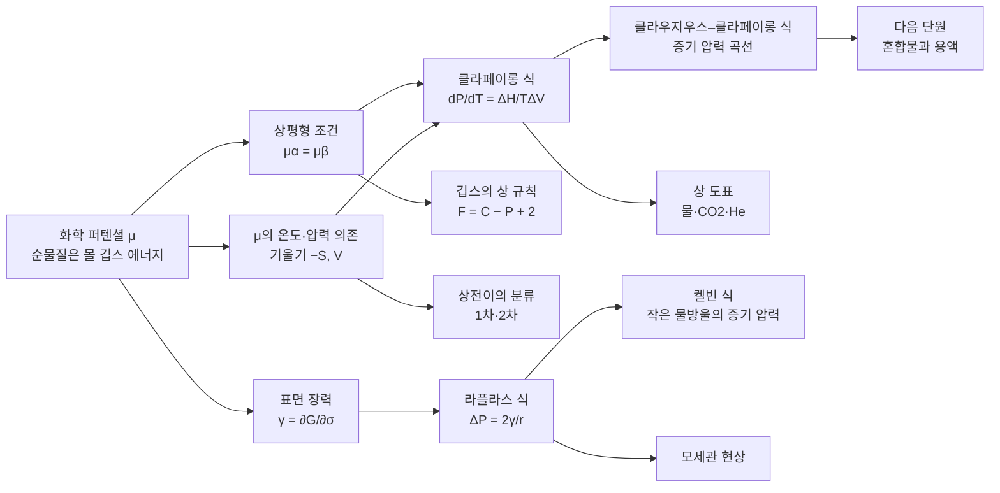

# 물리화학 4. 순물질의 상평형 — 화학 퍼텐셜이 그리는 상의 지도
<!-- prev: pchem-3, uchem-6 -->
<!-- next: pchem-5 -->

> [!NOTE]
> **이 단원의 범위**
> - 상의 안정성과 화학 퍼텐셜: 평형 조건 $\mu^\alpha = \mu^\beta$, $\mu$의 온도·압력 의존
> - 상 도표 읽기: 물·이산화 탄소·헬륨의 상 도표, 삼중점과 임계점
> - 상 경계의 기울기: 클라페이롱 식의 유도와 클라우지우스–클라페이롱 식(근사와 적용 한계)
> - 상전이의 분류: 에렌페스트의 1차·2차 상전이, λ 전이, 연속 상전이
> - 깁스의 상 규칙 $F = C - P + 2$의 유도와 순물질에의 적용
> - 표면 장력의 열역학, 라플라스 식, 켈빈 식, 모세관 현상

**학습 목표**

1. 순물질의 화학 퍼텐셜이 몰 깁스 에너지임을 설명하고, 상평형 조건 $\mu^\alpha = \mu^\beta$와 $(\partial\mu/\partial T)_P = -S_\mathrm{m}$, $(\partial\mu/\partial P)_T = V_\mathrm{m}$로 녹는점·끓는점의 존재와 압력에 따른 이동을 설명할 수 있다.
2. 물·이산화 탄소·헬륨의 상 도표에서 상 영역, 상 경계, 삼중점, 임계점을 읽고, 주어진 경로를 따라 일어나는 상변화를 예측할 수 있다.
3. 클라페이롱 식을 가정부터 유도하고, 여기에 근사를 더해 클라우지우스–클라페이롱 식을 얻은 뒤 증기 압력·끓는점·전이 엔탈피를 계산하고 근사의 한계를 평가할 수 있다.
4. 에렌페스트 분류에 따라 1차 상전이와 2차 상전이를 화학 퍼텐셜의 도함수로 구별하고, 열용량 곡선에서 상전이의 종류를 판별할 수 있다.
5. 깁스의 상 규칙을 변수와 조건의 수를 세어 유도하고, 순물질에서 자유도와 공존할 수 있는 상의 수를 판단할 수 있다.
6. 표면 장력을 표면 깁스 에너지로 정의하고, 라플라스 식·켈빈 식·모세관 상승 식을 유도하여 물방울의 내부 압력, 작은 물방울의 증기 압력, 기공 속 응축, 모세관 높이를 계산할 수 있다.

**이 단원의 학습 사다리**

| 단계 | 무엇을 하나? |
|---|---|
| STEP 1. 이전 학습 다시 보기 | 일반화학의 상평형 그림·증기 압력·표면 장력, 물리화학 3의 기본 방정식과 화학 퍼텐셜 |
| STEP 2. 기초 다지기 | 완전 미분과 편도함수 읽기, 변수 분리 적분, 1차 근사, 구의 넓이·부피의 미분 |
| STEP 3. 핵심 개념 | 화학 퍼텐셜과 안정성 → 상 도표 → 클라페이롱 식 → 클라우지우스–클라페이롱 식 → 상전이의 분류 → 상 규칙 → 표면 장력 → 라플라스 식 → 켈빈 식 → 모세관 현상 |
| STEP 4. 오개념 바로잡기 | "스케이트는 압력 녹음으로 미끄러진다", "증기 압력은 액체의 양에 무관하므로 물방울 크기와도 무관하다" 같은 착각 |
| STEP 5. 대학원·연구로 | 란다우 이론과 임계 지수, 고전적 핵생성 이론 |
| STEP 6. 생활·산업·진로 | 고압 멸균, 구름과 인공 강우, 폐 표면 활성제, 다공성 물질의 기공 분석 |

---

## 🗺️ 단원 들어가기

물은 100 ℃에서 끓는다고 배웠다. 그런데 높은 산 위에서는 밥이 설익고, 압력솥 안에서는 120 ℃가 넘어도 물이 끓지 않는다. 겨울 구름 속에는 0 ℃보다 훨씬 차가운데도 얼지 않은 물방울이 가득하고, 그 사이에서 눈송이가 물방울을 '빨아들이며' 자란다. 반지름 몇 나노미터의 기공을 가진 실리카겔은 습도가 60 %밖에 안 되는 공기에서도 기공 속에 물을 액체로 응축시킨다. 세 장면은 모두 "어느 상이 더 안정한가"라는 하나의 질문이고, 답도 하나의 양으로 정해진다. 바로 **화학 퍼텐셜**이다.

일반화학 「분자 간 힘과 액체·고체·용액」에서는 상평형 그림을 '읽는 법'과 클라우지우스–클라페이롱 식을 '쓰는 법'을 배웠다. 물리화학 3 「자유 에너지와 화학 퍼텐셜」에서는 $dG = V\,dP - S\,dT$와 화학 퍼텐셜을 만났다. 이 단원에서는 이 두 줄기를 합친다. 상 경계선이 왜 그 자리에 그 기울기로 그어지는지를 $\mu$로 유도하고, 상전이를 $\mu$의 도함수가 끊어지는 방식으로 분류하며, 마지막으로 **표면**이라는 새 변수가 들어올 때 증기 압력과 압력이 어떻게 바뀌는지(라플라스 식과 켈빈 식)를 다룬다.

---

## STEP 1. 🔙 이전 학습 다시 보기

### 연계 개념표

| 이전 단원 | 그때 배운 것 | 이 단원에서 확장되는 것 |
|---|---|---|
| 일반화학 「분자 간 힘과 액체·고체·용액」 '상평형 그림' | 영역·경계선·삼중점·임계점 읽기, 물의 고체–액체 경계가 왼쪽으로 기운다는 사실 | 경계선의 위치와 기울기를 $\mu^\alpha = \mu^\beta$에서 **유도**, 헬륨의 상 도표와 λ 선 |
| 일반화학 「분자 간 힘과 액체·고체·용액」 '증기 압력과 클라우지우스–클라페이롱 식' | $\ln P = -\Delta H_\text{기화}/RT + C$를 공식으로 사용 | 엄밀한 클라페이롱 식에서 출발해 어떤 근사 세 가지가 더해졌는지 확인, 승화 곡선과 삼중점 부근의 비교 |
| 일반화학 「분자 간 힘과 액체·고체·용액」 '표면 장력, 모세관 현상' | 표면 장력의 뜻, $h = 2\gamma\cos\theta/(\rho g r)$ | $\gamma = (\partial G/\partial\sigma)_{T,P}$로 정의, 라플라스 압력에서 모세관 식 유도, 켈빈 식 |
| 일반화학 「화학 열역학」 | $\Delta G = \Delta H - T\Delta S$, 상전이의 $\Delta S = \Delta H/T$, 트루턴 규칙 | 상전이 온도에서 $\Delta_\text{trs}G = 0$이 되는 까닭을 $\mu$의 교차로 해석 |
| 물리화학 3 「자유 에너지와 화학 퍼텐셜」 | $dG = V\,dP - S\,dT$, $\mu = (\partial G/\partial n)_{T,P}$, 기체의 $\mu = \mu^\circ + RT\ln(P/P^\circ)$, 퓨가시티 | 상마다 $\mu(T, P)$ 곡면을 그려 가장 낮은 것이 안정한 상, 두 곡면의 교선이 상 경계 |

### 준비 운동 (사전 진단)

**Q1.** 일정한 $T$, $P$에서 순물질 1 mol의 깁스 에너지가 고체 상태보다 액체 상태에서 더 낮다면, 그 조건에서 안정한 상은 무엇인가? 고체가 있다면 어떤 변화가 저절로 일어나는가?

**Q2.** $dG = V\,dP - S\,dT$에서 $(\partial G/\partial T)_P$와 $(\partial G/\partial P)_T$를 쓰시오.

**Q3.** 25 ℃에서 물의 증기 압력은 약 3.2 kPa이다. 물이 담긴 비커를 큰 밀폐 상자에 넣든 작은 밀폐 상자에 넣든, 평형에서 수증기의 압력은 같은가?

**Q4.** 일반화학에서 쓴 식 $\ln(P_2/P_1) = -(\Delta H_\text{기화}/R)(1/T_2 - 1/T_1)$을 얻을 때 둔 가정을 두 가지 쓰시오.

정답 및 해설

**Q1.** 액체가 안정하다. 고체가 있다면 깁스 에너지가 낮아지는 쪽, 즉 고체가 녹는 변화가 저절로 일어난다(속도는 별개이다). STEP 3 ①에서 이 판단을 화학 퍼텐셜로 일반화한다.

**Q2.** $(\partial G/\partial T)_P = -S$, $(\partial G/\partial P)_T = V$. 1 mol당으로 쓰면 $-S_\mathrm{m}$과 $V_\mathrm{m}$이다.

**Q3.** 같다(액체가 남아 있는 한). 증기 압력은 물질과 온도만의 함수이다. 다만 STEP 3 ⑨에서 보듯 액체 표면이 **아주 작게 휘어 있으면**(나노미터 크기 물방울) 증기 압력이 달라진다. "물질과 온도만의 함수"라는 말은 평평한 표면에 대한 것이다.

**Q4.** 기화 엔탈피가 온도에 무관하다, 증기를 이상 기체로 본다(그리고 액체의 부피를 기체에 비해 무시한다). 세 번째 가정은 흔히 잊는데, STEP 3 ④에서 세 가정을 모두 드러내 유도한다.

---

## STEP 2. 🧱 기초 다지기

### 디딤돌 1. 완전 미분에서 편도함수 읽기

수학 도구 1 '전미분과 완전 미분'에서 익힌 대로, 두 변수의 상태 함수 $f(x, y)$의 미소 변화는

$$
df = \left(\frac{\partial f}{\partial x}\right)_y dx + \left(\frac{\partial f}{\partial y}\right)_x dy
$$

이다. 거꾸로, 어떤 상태 함수의 미소 변화가 $df = A\,dx + B\,dy$ 꼴로 주어지면 **계수가 곧 편도함수**이다: $A = (\partial f/\partial x)_y$, $B = (\partial f/\partial y)_x$. 물리화학 3의 기본 방정식 $dG = V\,dP - S\,dT$에 이것을 적용한 결과가 이 단원 전체의 출발점이다.

| 기본 방정식 | 읽어 낸 편도함수 | 이 단원에서의 쓰임 |
|---|---|---|
| $dG = V\,dP - S\,dT$ | $(\partial G/\partial P)_T = V$, $(\partial G/\partial T)_P = -S$ | $\mu$–$T$, $\mu$–$P$ 그래프의 기울기 |
| $d\mu = V_\mathrm{m}dP - S_\mathrm{m}dT$ (순물질) | $(\partial\mu/\partial P)_T = V_\mathrm{m}$, $(\partial\mu/\partial T)_P = -S_\mathrm{m}$ | 클라페이롱 식의 유도 |
| $dG = V\,dP - S\,dT + \gamma\,d\sigma$ (표면이 있을 때) | $(\partial G/\partial\sigma)_{T,P} = \gamma$ | 표면 장력의 열역학적 정의 |

**예제 0-1** 이상 기체 1 mol의 $\mu(P)$를 $d\mu = V_\mathrm{m}dP$(일정 $T$)에서 구하시오.

**풀이** $V_\mathrm{m} = RT/P$를 넣고 $P^\circ$에서 $P$까지 적분하면 $\mu(P) - \mu^\circ = \int_{P^\circ}^{P} (RT/P')\,dP' = RT\ln(P/P^\circ)$이다. 물리화학 3에서 얻은 식과 같다. 액체·고체는 $V_\mathrm{m}$이 거의 일정하므로 같은 적분이 $\mu(P) - \mu(P^\circ) \approx V_\mathrm{m}(P - P^\circ)$가 된다. 이 두 식의 차이(로그 대 직선)가 ①의 핵심이다.

### 디딤돌 2. 변수 분리 적분

상 경계의 기울기는 $dP/dT = f(T, P)$ 꼴의 1계 미분방정식으로 주어진다. 수학 도구 4 '변수 분리형과 1계 선형'에서 익힌 대로, 우변이 $g(T)h(P)$로 나뉘면 $\int dP/h(P) = \int g(T)\,dT$로 적분한다.

| 미분방정식 | 분리 | 적분 결과 |
|---|---|---|
| $\dfrac{dP}{dT} = \dfrac{a}{T}$ ($a$ 일정) | $dP = a\,\dfrac{dT}{T}$ | $P - P^* = a\ln\dfrac{T}{T^*}$ |
| $\dfrac{dP}{dT} = \dfrac{bP}{T^2}$ ($b$ 일정) | $\dfrac{dP}{P} = b\,\dfrac{dT}{T^2}$ | $\ln\dfrac{P}{P^*} = -b\left(\dfrac{1}{T} - \dfrac{1}{T^*}\right)$ |

**예제 0-2** $dP/dT = bP/T^2$에서 $b = 5000\ \mathrm{K}$, $T^* = 300\ \mathrm{K}$일 때 $P^* = 1.00\ \mathrm{bar}$이다. 350 K에서의 $P$를 구하시오.

**풀이** $\ln(P/P^*) = -5000\,(1/350 - 1/300) = 5000\times4.762\times10^{-4} = 2.381$, $P = 1.00\times e^{2.381} = 10.8\ \mathrm{bar}$. 두 번째 줄의 꼴이 ④의 클라우지우스–클라페이롱 식이며, $b = \Delta_\text{vap}H/R$이다.

### 디딤돌 3. 1차 근사 $\ln(1 + x) \approx x$, $e^x \approx 1 + x$

수학 도구 2 '테일러 급수와 근사'에서 익힌 전개를 $\lvert x\rvert \ll 1$에서 첫 항까지만 쓴다.

$$
\ln(1 + x) = x - \frac{x^2}{2} + \cdots \approx x, \qquad e^x = 1 + x + \frac{x^2}{2} + \cdots \approx 1 + x
$$

이 단원에서는 (1) 녹는점 곡선의 로그 식을 직선으로 바꿀 때 $\ln(T/T^*) = \ln(1 + \Delta T/T^*) \approx \Delta T/T^*$, (2) 켈빈 식의 지수를 작은 값으로 펼칠 때 $p/p^* = e^{x} \approx 1 + x$로 쓴다.

**예제 0-3** $\ln(268.15/273.15)$를 1차 근사로 구하고 정확한 값과 비교하시오.

**풀이** $x = -5.00/273.15 = -0.01830$이므로 근사값은 $-0.01830$, 정확한 값은 $\ln 0.98169 = -0.01847$이다. 상대 차이는 약 1 %로, 온도 변화가 녹는점의 몇 % 이내이면 직선 근사로 충분하다.

### 디딤돌 4. 구의 넓이·부피와 그 미분

| 양 | 식 | 반지름이 $dr$ 늘 때 |
|---|---|---|
| 겉넓이 $\sigma$ | $4\pi r^2$ | $d\sigma = 8\pi r\,dr$ |
| 부피 $V$ | $\dfrac{4}{3}\pi r^3$ | $dV = 4\pi r^2dr$ |
| 비 | $\dfrac{d\sigma}{dV} = \dfrac{2}{r}$ | 작은 구일수록 부피당 넓이 변화가 크다 |

곡면이 구가 아니면 두 주곡률 반지름 $R_1$, $R_2$로 $d\sigma/dV = 1/R_1 + 1/R_2$가 된다(구는 $R_1 = R_2 = r$). 이 비 $2/r$가 ⑧ 라플라스 식의 $2\gamma/r$, ⑨ 켈빈 식의 $2\gamma V_\mathrm{m}/r$에 그대로 들어간다.

**예제 0-4** 부피 1.00 cm³의 물을 반지름 1.00 μm의 물방울로 모두 나누면 겉넓이의 합은 얼마인가?

**풀이** 물방울 하나의 겉넓이/부피는 $3/r$이므로 전체 넓이는 $3V/r = 3\times(1.00\times10^{-6}\ \mathrm{m^3})/(1.00\times10^{-6}\ \mathrm{m}) = 3.00\ \mathrm{m^2}$이다. 처음 물(지름 약 1 cm의 덩어리)의 겉넓이 수 cm²에 비해 수천 배이다. ⑦에서 이 넓이를 만드는 데 드는 일을 계산한다.

---

## STEP 3. 📘 핵심 개념

### ① 상의 안정성과 화학 퍼텐셜

**상(phase)** 은 화학 조성과 물리적 상태가 전체에 걸쳐 고른 물질의 부분이다. 얼음과 물은 같은 $\mathrm{H_2O}$이지만 다른 상이고, 얼음에도 결정 구조가 다른 여러 상(얼음 Ih, 얼음 III, …)이 있다. 흑연과 다이아몬드도 탄소의 서로 다른 고체 상이다. 한 상에서 다른 상으로 바뀌는 것이 **상전이(phase transition)** 이고, 그 일이 일어나는 온도가 **전이 온도** $T_\text{trs}$이다.

#### 순물질의 화학 퍼텐셜은 몰 깁스 에너지이다

물리화학 3에서 화학 퍼텐셜을 $\mu = (\partial G/\partial n)_{T,P}$로 정의했다. 순물질 한 상의 깁스 에너지는 양에 비례하므로($G = nG_\mathrm{m}$) 

$$
\mu = \left(\frac{\partial (nG_\mathrm{m})}{\partial n}\right)_{T,P} = G_\mathrm{m}(T, P)
$$

이다. 순물질에서 화학 퍼텐셜은 **그 상 1 mol의 깁스 에너지**와 같다. 상마다 $\mu^\text{s}(T,P)$, $\mu^\text{l}(T,P)$, $\mu^\text{g}(T,P)$라는 서로 다른 함수가 있다.

#### 평형 조건의 유도

일정한 $T$, $P$에서 두 상 $\alpha$, $\beta$가 함께 있는 순물질을 생각하자. 아주 작은 양 $dn$이 $\alpha$에서 $\beta$로 옮겨 가면 전체 깁스 에너지 변화는

$$
dG = \mu^\beta\,dn - \mu^\alpha\,dn = (\mu^\beta - \mu^\alpha)\,dn
$$

이다. 일정 $T$, $P$에서 자발적 변화는 $dG < 0$인 쪽으로만 일어나므로(물리화학 3)

- $\mu^\alpha > \mu^\beta$이면 $dn > 0$, 즉 물질이 $\alpha$에서 $\beta$로 저절로 옮겨 간다.
- $\mu^\alpha = \mu^\beta$이면 어느 쪽으로 옮겨도 $dG = 0$이므로 두 상이 **평형**에 있다.

> [!IMPORTANT]
> **상평형의 조건** 평형에 있는 계에서 한 물질의 화학 퍼텐셜은 그 물질이 존재하는 **모든 상에서 같다.**
> $$
> \mu^\alpha(T, P) = \mu^\beta(T, P)
> $$
> 주어진 $T$, $P$에서 **화학 퍼텐셜이 가장 낮은 상**이 가장 안정한 상이다. 물질은 화학 퍼텐셜이 높은 곳에서 낮은 곳으로 흐른다. '퍼텐셜'이라는 이름은 이 성질에서 왔다.

이 판단은 '열역학적으로 어느 쪽이 안정한가'만 말해 준다. 다이아몬드는 상온·상압에서 흑연보다 $\mu$가 약 $2.9\ \mathrm{kJ/mol}$ 높지만 전이가 극도로 느려 그대로 남는다. 이처럼 열역학적으로는 불안정하지만 속도론적으로 붙들려 있는 상태를 **준안정(metastable)** 상태라 한다. 과냉각된 물, 과열된 액체, 과포화 증기도 준안정 상태이다.

#### $\mu$의 온도 의존 — 기울기는 $-S_\mathrm{m}$

$d\mu = V_\mathrm{m}dP - S_\mathrm{m}dT$에서

$$
\left(\frac{\partial\mu}{\partial T}\right)_P = -S_\mathrm{m}
$$

이다. 몰 엔트로피는 언제나 양수이므로 **모든 상의 $\mu$는 온도가 오르면 내려간다.** 그리고 같은 온도에서 $S_\mathrm{m}(\text{g}) \gg S_\mathrm{m}(\text{l}) > S_\mathrm{m}(\text{s})$이므로 기체의 $\mu$가 가장 가파르게 내려간다.

| 물(1 bar) | $S_\mathrm{m}$ (J/(mol·K), 약) | $\mu$–$T$ 직선의 기울기 |
|---|---|---|
| 얼음 (0 ℃) | 41 | $-41\ \mathrm{J/(mol\cdot K)}$ |
| 액체 (0 ℃) | 63 | $-63\ \mathrm{J/(mol\cdot K)}$ |
| 액체 (25 ℃) | 70 | $-70\ \mathrm{J/(mol\cdot K)}$ |
| 기체 (25 ℃, 1 bar 가상 상태) | 189 | $-189\ \mathrm{J/(mol\cdot K)}$ |

낮은 온도에서는 엔탈피가 낮은 고체의 $\mu$가 가장 낮다. 온도를 올리면 기울기가 더 가파른 액체의 직선이 고체의 직선을 따라잡아 **교차**한다. 그 교점이 녹는점 $T_\mathrm{f}$이다. 더 올리면 기체의 직선이 액체를 따라잡는 교점, 끓는점 $T_\mathrm{b}$가 나온다. 녹는점과 끓는점은 외워야 할 숫자가 아니라 **세 직선(실제로는 완만한 곡선)이 교차하는 자리**이다.

<!-- 그림 요청: 일정 압력에서 순물질의 화학 퍼텐셜 μ(세로축)를 온도 T(가로축)에 대해 그린 그래프. 고체·액체·기체 세 개의 아래로 내려가는 선을 그리되, 기울기의 크기가 고체 < 액체 < 기체가 되게(기체가 가장 가파르게) 그린다. 고체와 액체 선의 교점에 "T_f(녹는점)", 액체와 기체 선의 교점에 "T_b(끓는점)" 표시. 각 온도 구간 아래에 가장 낮은 선의 상 이름(고체 안정 / 액체 안정 / 기체 안정)을 적고, 가장 낮은 선 부분을 굵게, 나머지(준안정)는 점선으로. 각 선 옆에 "기울기 = −S_m" 주석. -->

#### $\mu$의 압력 의존 — 기울기는 $V_\mathrm{m}$

$$
\left(\frac{\partial\mu}{\partial P}\right)_T = V_\mathrm{m} > 0
$$

이므로 압력을 높이면 모든 상의 $\mu$가 올라가며, **몰 부피가 큰 상일수록 많이 올라간다.** 기체는 $V_\mathrm{m}$이 액체의 천 배 가까이 되므로 압력에 매우 민감하다.

- 압력을 높이면 기체의 $\mu$–$T$ 선이 크게 위로 올라가 액체 선과의 교점이 오른쪽으로 옮겨 간다 → **끓는점이 올라간다.**
- 대부분의 물질은 $V_\mathrm{m}(\text{l}) > V_\mathrm{m}(\text{s})$이므로 압력을 높이면 액체의 선이 고체보다 더 올라가 녹는점도 올라간다. 물은 $V_\mathrm{m}(\text{l}) < V_\mathrm{m}(\text{s})$이므로 압력을 높이면 **녹는점이 내려간다.**

<!-- 그림 요청: 앞의 μ–T 그래프를 바탕으로 압력을 P에서 P'(>P)로 높였을 때를 겹쳐 그린 그림. 원래 선은 실선, 압력을 높인 뒤의 선은 같은 색 점선. 기체 선은 크게(Δμ = RT ln(P′/P)), 액체·고체 선은 아주 조금(Δμ = V_m ΔP) 위로 이동한다. (가) 일반 물질(V_m(l) > V_m(s)): T_f와 T_b가 모두 오른쪽으로 이동하는 화살표. (나) 물(V_m(l) < V_m(s)): T_b는 오른쪽, T_f는 왼쪽으로 이동하는 화살표. 두 패널을 나란히. -->

<!-- 시뮬레이션 요청: 순물질의 μ–T 그래프 조작기. 조작 변수: 압력 P(로그 눈금 슬라이더, 0.01~100 bar), 고체·액체의 몰 부피 V_m(s), V_m(l), 몰 엔트로피 S_m(s), S_m(l), S_m(g)(슬라이더). 기체는 μ = μ° + RT ln(P/P°)로, 응축상은 μ = μ(P°) + V_m(P − P°)로 계산한다. 보여 줄 것: 세 선과 가장 낮은 선(굵게), 교점의 T_f·T_b 값 표시, 압력을 낮추면 액체 구간이 사라지고 고체–기체 직접 교점(승화)이 나타나는 순간(삼중점 압력)을 강조. -->

#### 예제 1 — 압력에 대한 민감도: 액체와 기체

25 ℃에서 물(액체, $V_\mathrm{m} = 18.07\ \mathrm{cm^3/mol}$)과 수증기(이상 기체로 본다)의 압력을 1.00 bar에서 2.00 bar로 높일 때 각각의 화학 퍼텐셜 변화를 구하시오.

**풀이**
액체: $V_\mathrm{m}$이 일정하다고 보면 $\Delta\mu = V_\mathrm{m}\Delta P = (18.07\times10^{-6}\ \mathrm{m^3/mol})(1.00\times10^5\ \mathrm{Pa}) = 1.81\ \mathrm{J/mol}$
기체: $\Delta\mu = RT\ln(P_2/P_1) = 8.314\times298.15\times\ln 2 = 1.72\times10^3\ \mathrm{J/mol}$

**의미** 같은 압력 변화에 기체의 $\mu$는 액체보다 약 950배 더 변한다. 그래서 끓는점은 압력에 민감하지만(①·④) 녹는점은 수백 bar를 걸어도 몇 K밖에 변하지 않는다(③). 상 도표에서 고체–액체 경계가 거의 수직인 까닭이다.

#### 바깥 압력이 증기 압력을 바꾼다

액체에 **다른 기체**를 넣어 전체 압력 $P$를 높이면(증기 압력 $p^*$보다 큰 압력을 액체에 건다) 액체의 $\mu$가 $V_\mathrm{m}(P - p^*)$만큼 올라간다. 증기가 평형을 유지하려면 증기의 $\mu$도 같은 양만큼 올라가야 하므로 $RT\ln(p/p^*) = V_\mathrm{m}(P - p^*)$, 즉

$$
p = p^*\exp\!\left(\frac{V_\mathrm{m}(\text{l})\,\Delta P}{RT}\right)
$$

이다. 이 식은 ⑨ 켈빈 식의 원형이다. 켈빈 식에서는 바깥 기체 대신 **휘어진 표면**이 액체에 추가 압력을 건다.

#### 예제 2 — 압력을 걸면 증기 압력이 얼마나 오르는가

25 ℃의 물에 비활성 기체로 100 bar의 압력을 걸었다. 물의 증기 압력은 몇 % 커지는가? ($V_\mathrm{m} = 18.07\ \mathrm{cm^3/mol}$, $\Delta P \approx 100\ \mathrm{bar}$, 기체에 의한 용해 효과는 무시한다.)

**풀이**

$$
\frac{V_\mathrm{m}\Delta P}{RT} = \frac{(18.07\times10^{-6})(1.00\times10^7)}{8.314\times298.15} = 0.0729, \qquad \frac{p}{p^*} = e^{0.0729} = 1.076
$$

약 7.6 % 커진다. 1 bar만 걸면 지수가 $7.3\times10^{-4}$이어서 0.07 %에 불과하다. 보통의 대기압 변화로는 증기 압력이 거의 바뀌지 않는다는 것을 확인할 수 있다.

#### ✔ 바로 확인

1. (O/X) 순물질에서 화학 퍼텐셜은 그 상의 몰 깁스 에너지와 같다.
2. 빈칸: 일정한 압력에서 $\mu$를 $T$에 대해 그린 선의 기울기는 (    )이다.
3. 어떤 $T$, $P$에서 $\mu^\text{s} = -1.20\ \mathrm{kJ/mol}$, $\mu^\text{l} = -1.35\ \mathrm{kJ/mol}$(같은 기준)이다. 고체 조각을 넣으면 어떻게 되는가?
4. 고르기: 압력을 높일 때 $\mu$가 가장 많이 올라가는 상은? (가) 고체 (나) 액체 (다) 기체

정답

1. O — $G = nG_\mathrm{m}$이므로 $\mu = (\partial G/\partial n)_{T,P} = G_\mathrm{m}$.
2. $-S_\mathrm{m}$ — 엔트로피가 큰 상일수록 가파르게 내려간다.
3. 녹는다 — $\mu^\text{s} > \mu^\text{l}$이므로 물질이 고체에서 액체로 옮겨 가며 $G$가 $0.15\ \mathrm{kJ/mol}$씩 낮아진다.
4. (다) — $(\partial\mu/\partial P)_T = V_\mathrm{m}$이고 기체의 몰 부피가 가장 크다.

### ② 상 도표 — 물·이산화 탄소·헬륨

**상 도표(phase diagram, 상평형 그림)** 는 $P$–$T$ 평면을 '그 조건에서 $\mu$가 가장 낮은 상'으로 칠한 지도이다. ①의 그림이 한 압력에서 자른 단면이라면, 상 도표는 모든 압력의 단면을 모아 놓은 것이다.

| 요소 | 열역학적 뜻 | 자유도(⑥) |
|---|---|---|
| 상 영역 | 한 상의 $\mu$가 가장 낮다 | 2 ($T$, $P$를 따로 바꿀 수 있다) |
| 상 경계(공존 곡선) | 두 상의 $\mu$가 같다: $\mu^\alpha(T,P) = \mu^\beta(T,P)$ | 1 ($T$를 정하면 $P$가 정해진다) |
| 삼중점(triple point) | 세 상의 $\mu$가 같다 | 0 (물질마다 하나의 점) |
| 임계점(critical point) | 액체와 기체의 구별이 사라지는 점, 증발 곡선의 끝 | — |

몇 가지 용어를 정리해 둔다.

- 액체–기체 경계의 압력이 그 온도의 **증기 압력(vapour pressure)**, 고체–기체 경계의 압력이 **승화 압력**이다.
- 바깥 압력이 1 atm일 때의 끓는점이 **정상 끓는점**(normal boiling point), 1 bar일 때가 **표준 끓는점**이다. 물은 각각 100.0 ℃와 약 99.6 ℃이다.
- 끓음은 액체 내부에서 증기 거품이 생길 수 있는 조건, 즉 증기 압력이 바깥 압력과 같아지는 조건이다. 그보다 낮은 온도에서는 표면에서의 증발만 일어난다.
- **임계 온도** $T_\mathrm{c}$ 위에서는 압력을 아무리 높여도 액체와 기체의 경계면(메니스커스)이 나타나지 않는다. 그 영역의 유체를 **초임계 유체**라 한다. 임계점에서 증발 엔탈피와 액체–기체의 몰 부피 차는 모두 0이 된다.

| 물질 | 삼중점 | 임계점 | 1 atm에서의 일 |
|---|---|---|---|
| 물 | 273.16 K, 611.7 Pa | 647.1 K, 22.06 MPa | 273.15 K 융해, 373.15 K 끓음 |
| 이산화 탄소 | 216.6 K, 약 5.18 bar | 304.1 K, 약 73.8 bar | 194.7 K에서 승화 |
| 헬륨-4 | 고체–액체–기체 삼중점이 없다 | 5.2 K, 약 2.3 bar | 4.22 K 끓음, 0 K 가까이까지 액체 |

#### 물

물의 상 도표의 특징은 고체–액체 경계(녹는점 곡선)가 **음의 기울기**를 가진다는 것이다. 얼음 Ih는 수소 결합이 사면체 그물을 이루어 속이 빈 구조이므로 액체보다 밀도가 작다($V_\mathrm{m}(\text{s}) > V_\mathrm{m}(\text{l})$). 그래서 ①의 결론대로 압력을 높이면 녹는점이 내려간다. 기울기는 ③에서 계산한다(약 $-135\ \mathrm{bar/K}$).

수천 bar 이상에서는 더 조밀한 얼음(III, V, VI, VII 등)이 나타나고, 이들은 액체보다 밀도가 커서 그 구간의 녹는점 곡선은 양의 기울기를 가진다. 수 GPa의 압력에서 얼음 VII은 100 ℃가 넘어도 녹지 않는다. 물의 상 도표에는 이 고압 얼음들 사이의 삼중점이 여럿 있다. 0.01 ℃, 611.7 Pa의 삼중점은 그중 얼음 Ih–액체–기체의 삼중점이다.

<!-- 그림 요청: 물의 상 도표(개략도). 가로축 온도(K, 200~700 K), 세로축 압력(로그 눈금, 100 Pa ~ 10 GPa). 영역 이름표: 얼음 Ih, 액체, 기체, 초임계 유체(임계점 오른쪽 위, 경계 없이 옅은 색). 삼중점(273.16 K, 611.7 Pa)과 임계점(647.1 K, 22.06 MPa)에 점과 값. 1 atm 수평 점선과 녹는점(273.15 K)·끓는점(373.15 K) 표시. 얼음 Ih–액체 경계는 약 210 MPa(약 251 K)까지 왼쪽으로 기울어지게 그리고, 그 위쪽에 고압 얼음 영역(III, V, VI, VII)을 대략적인 띠로 나누어 이름만 붙인다(VII 영역의 녹는점 곡선은 오른쪽으로 기울어 370 K를 넘게). 그림 아래에 "축척은 개략적" 표시. -->

#### 이산화 탄소

이산화 탄소는 보통의 물질처럼 고체–액체 경계가 **양의 기울기**를 가진다. 특징은 삼중점 압력(약 5.2 bar)이 1 atm보다 높다는 것이다. 그래서 1 atm에서는 액체 영역을 지나지 않고 고체가 바로 기체가 된다(드라이아이스의 승화, 194.7 K). 액체 $\mathrm{CO_2}$를 얻으려면 5.2 bar 이상이 필요하며, 소화기나 탄산 실린더 속 $\mathrm{CO_2}$는 상온에서 그 온도의 증기 압력(25 ℃에서 약 64 bar)으로 액체와 기체가 공존한다. 임계 온도가 31 ℃로 실온에 가까워 초임계 $\mathrm{CO_2}$를 쉽게 만들 수 있다.

<!-- 그림 요청: 이산화 탄소의 상 도표(개략도). 가로축 온도(180~330 K), 세로축 압력(로그 눈금, 0.5~200 bar). 고체·액체·기체·초임계 유체 영역. 삼중점(216.6 K, 5.18 bar), 임계점(304.1 K, 73.8 bar)에 점과 값. 고체–액체 경계는 오른쪽으로 기울어진 가파른 선. 1 atm(1.013 bar) 수평 점선과 승화점 194.7 K 표시. 298 K 수직 점선이 증발 곡선과 만나는 점에 "약 64 bar" 표시. -->

#### 헬륨

헬륨-4($^4\mathrm{He}$)는 상 도표가 아주 특이하다.

1. **보통 압력에서는 0 K 가까이까지 얼지 않는다.** 고체가 되려면 약 25 bar 이상의 압력이 필요하다. 헬륨 원자는 가볍고 원자 사이의 인력(분산력)이 매우 약해서, 양자역학적인 **영점 진동**(움직임을 완전히 멈출 수 없음, 물리화학 7·8)의 에너지가 원자를 격자에 묶는 에너지를 이긴다.
2. 그래서 고체–액체–기체가 만나는 삼중점이 **없다.** 고체 영역은 기체 영역과 맞닿지 않는다.
3. 액체 헬륨은 두 상으로 나뉜다. 약 2.17 K(증기 압력 아래) 위의 보통 액체 **He-Ⅰ**과, 그 아래의 **초유체 He-Ⅱ**이다. He-Ⅱ는 점성이 사실상 0이어서 아주 가는 틈을 막힘 없이 흐르고 용기 벽을 타고 기어오르며, 열전도도가 매우 크다. 두 액체를 나누는 경계를 **λ 선**이라 한다(⑤에서 그 까닭을 본다). λ 선이 증기 압력 곡선, 고체 경계와 만나는 두 점이 헬륨의 삼중점(He-Ⅰ–He-Ⅱ–기체, He-Ⅰ–He-Ⅱ–고체)이다.

헬륨-3($^3\mathrm{He}$)은 끓는점이 약 3.2 K로 더 낮고, 초유체 상태는 수 mK 이하에서야 나타난다. $^3\mathrm{He}$ 원자는 스핀이 반정수인 페르미온이어서 $^4\mathrm{He}$(보손)과 양자 통계가 다르기 때문이다(STEP 5).

<!-- 그림 요청: 헬륨-4의 상 도표(개략도). 가로축 온도(0~6 K), 세로축 압력(0~40 bar, 선형). 영역: 고체(위쪽, 약 25 bar 이상), 액체 He-Ⅰ, 액체 He-Ⅱ(초유체, 낮은 온도 쪽), 기체(아래 오른쪽). 증발 곡선은 임계점(5.2 K, 2.3 bar)에서 끝난다. λ 선은 아래쪽 점(약 2.17 K, 약 0.05 bar, 증발 곡선 위)에서 위쪽 점(약 1.76 K, 약 30 bar, 고체 경계 위)으로 약간 왼쪽으로 기울어진 선. 두 λ 점에 점 표시. 고체 영역과 기체 영역이 서로 닿지 않음을 강조하는 이름표 "고체–액체–기체 삼중점 없음". 정상 끓는점 4.22 K(1.013 bar) 표시. -->

#### 예제 3 — 상 도표 위의 경로

다음 경로에서 일어나는 상변화를 차례로 쓰시오.
(1) 물: 1 atm, −5 ℃의 얼음에 온도를 일정하게 유지한 채 압력을 1000 bar까지 높인다.
(2) 물: 400 Pa, −10 ℃의 얼음을 같은 압력에서 20 ℃까지 데운다.
(3) 헬륨-4: 1 atm, 4.2 K의 액체를 1 atm에서 1.5 K까지 냉각한 뒤, 1.5 K에서 압력을 40 bar까지 높인다.

**풀이**
(1) 물의 녹는점 곡선은 음의 기울기(약 $-135\ \mathrm{bar/K}$)를 가지므로 −5 ℃의 녹는점 압력은 대략 $5\times135 \approx 680\ \mathrm{bar}$이다(곡선이 휘어 실측값은 약 610 bar, 개념 확인 문제 14). 압력이 이 값을 넘는 순간 얼음이 **녹아 액체**가 된다. 1000 bar에서는 액체이다.
(2) 400 Pa은 삼중점 압력(611.7 Pa)보다 낮다. 액체 영역을 지나지 않고, 승화 압력이 400 Pa이 되는 온도(약 −5 ℃, ④의 식으로 구할 수 있다)에서 **승화**한다. 동결 건조가 이 경로를 쓴다.
(3) 1 atm에서 냉각하면 약 2.2 K 부근에서 λ 선을 지나 He-Ⅰ → **He-Ⅱ(초유체)** 로 바뀐다. 1.5 K에서 압력을 높이면 약 25 bar 부근에서 **고체**가 된다. 어느 경로에서도 끓거나 승화하지 않는다.

#### ✔ 바로 확인

1. 빈칸: 상 도표의 상 경계 위에서는 두 상의 (    )가 같다.
2. (O/X) 1 atm에서 드라이아이스가 녹지 않고 승화하는 것은 $\mathrm{CO_2}$의 삼중점 압력이 1 atm보다 높기 때문이다.
3. 물의 녹는점 곡선이 음의 기울기를 갖는 까닭을 몰 부피로 한 문장으로 쓰시오.
4. 헬륨-4에 고체–액체–기체 삼중점이 없는 근본 원인은?

정답

1. 화학 퍼텐셜 — $\mu^\alpha(T,P) = \mu^\beta(T,P)$가 그리는 곡선이 상 경계이다.
2. O — 1 atm은 삼중점 압력(약 5.2 bar)보다 낮아 액체가 안정한 영역을 지나지 않는다.
3. 얼음이 물보다 몰 부피가 커서 압력을 높이면 얼음의 $\mu$가 더 많이 올라가 액체가 유리해지므로 녹는점이 내려간다.
4. 원자가 가볍고 원자 간 인력이 약해 영점 진동 에너지가 결합을 이긴다. 그래서 약 25 bar 이상의 압력 없이는 고체가 되지 않아 고체 영역이 기체 영역과 만나지 않는다.

### ③ 상 경계의 기울기 — 클라페이롱 식

상 경계 위의 한 점 $(T, P)$에서는 $\mu^\alpha = \mu^\beta$이다. 경계를 따라 $(T + dT, P + dP)$로 조금 옮겨 가도 두 상은 여전히 평형이어야 하므로, 두 화학 퍼텐셜의 **변화량도 같아야** 한다.

#### 유도

**가정**: 순물질, 두 상이 평형, 경계를 따라 평형을 유지하며 움직인다. (그 밖의 근사는 없다.)

1단계 — 경계 위에서 $d\mu^\alpha = d\mu^\beta$.
2단계 — 각 상에 $d\mu = V_\mathrm{m}dP - S_\mathrm{m}dT$를 쓴다.

$$
V_\mathrm{m}^\alpha dP - S_\mathrm{m}^\alpha dT = V_\mathrm{m}^\beta dP - S_\mathrm{m}^\beta dT
$$

3단계 — 정리한다. $\Delta_\text{trs}V = V_\mathrm{m}^\beta - V_\mathrm{m}^\alpha$, $\Delta_\text{trs}S = S_\mathrm{m}^\beta - S_\mathrm{m}^\alpha$로 쓰면

$$
(V_\mathrm{m}^\beta - V_\mathrm{m}^\alpha)\,dP = (S_\mathrm{m}^\beta - S_\mathrm{m}^\alpha)\,dT \quad\Longrightarrow\quad \frac{dP}{dT} = \frac{\Delta_\text{trs}S}{\Delta_\text{trs}V}
$$

4단계 — 평형 전이에서는 $\Delta_\text{trs}G = \Delta_\text{trs}H - T\Delta_\text{trs}S = 0$이므로 $\Delta_\text{trs}S = \Delta_\text{trs}H/T$이다.

$$
\boxed{\;\frac{dP}{dT} = \frac{\Delta_\text{trs}H}{T\,\Delta_\text{trs}V}\;}
$$

이것이 **클라페이롱 식(Clapeyron equation)** 이다. 근사 없이 성립하는 **정확한 식**이며, 어떤 상 경계에나(고체–액체, 액체–기체, 고체–기체, 고체–고체) 쓸 수 있다. 적용 한계는 하나다. $\Delta_\text{trs}V$와 $\Delta_\text{trs}S$가 0이 아닌 상전이, 즉 ⑤의 **1차 상전이**에만 쓸 수 있다(2차 상전이에서는 분자·분모가 모두 0이 된다).

| 상 경계 | $\Delta_\text{trs}H$ | $\Delta_\text{trs}V$ | $dP/dT$ | 상 도표의 모습 |
|---|---|---|---|---|
| 액체 → 기체 | + (큼) | + (매우 큼) | + (작음) | 완만하게 오르는 곡선 |
| 고체 → 기체 | + (가장 큼) | + (매우 큼) | + | 증발 곡선보다 조금 가파름 |
| 고체 → 액체 (대부분) | + | + (작음) | + (매우 큼) | 거의 수직, 오른쪽으로 기움 |
| 고체 → 액체 (물, 비스무트, 갈륨, 규소) | + | − (작음) | − (매우 큼) | 거의 수직, 왼쪽으로 기움 |

#### 고체–액체 경계의 적분

융해에서는 $\Delta_\text{fus}H$와 $\Delta_\text{fus}V$가 압력·온도에 따라 거의 변하지 않는다고 보아도 좋다. 디딤돌 2의 첫 번째 꼴로 적분하면

$$
P = P^* + \frac{\Delta_\text{fus}H}{\Delta_\text{fus}V}\ln\frac{T}{T^*} \;\approx\; P^* + \frac{\Delta_\text{fus}H}{T^*\Delta_\text{fus}V}(T - T^*)
$$

이다($P^*$, $T^*$는 경계 위의 알려진 한 점). 오른쪽 식은 디딤돌 3의 $\ln(1 + x) \approx x$를 쓴 것으로, $T$가 $T^*$에 가까우면 녹는점 곡선은 **기울기가 아주 큰 직선**이다.

#### 예제 4 — 얼음의 녹는점 곡선과 스케이트

0 ℃에서 얼음과 물의 밀도는 각각 $0.9167$, $0.9998\ \mathrm{g/cm^3}$이고 $\Delta_\text{fus}H = 6.01\ \mathrm{kJ/mol}$이다. (1) 녹는점 곡선의 기울기 $dP/dT$와 $dT/dP$를 구하시오. (2) 몸무게 70 kg인 사람이 날 하나로 서 있다. 날이 얼음에 닿는 넓이를 $7.5\times10^{-4}\ \mathrm{m^2}$(폭 3 mm, 길이 25 cm)로 보면 녹는점은 얼마나 내려가는가? ($g = 9.8\ \mathrm{m/s^2}$)

**풀이**
(1) 몰 부피: $V_\mathrm{m}(\text{s}) = 18.015/0.9167 = 19.65\ \mathrm{cm^3/mol}$, $V_\mathrm{m}(\text{l}) = 18.015/0.9998 = 18.02\ \mathrm{cm^3/mol}$, $\Delta_\text{fus}V = -1.63\ \mathrm{cm^3/mol}$

$$
\frac{dP}{dT} = \frac{6010\ \mathrm{J/mol}}{(273.15\ \mathrm{K})(-1.63\times10^{-6}\ \mathrm{m^3/mol})} = -1.35\times10^7\ \mathrm{Pa/K} = -135\ \mathrm{bar/K}
$$

$dT/dP = -0.0074\ \mathrm{K/bar}$이다. 1 bar 늘 때 녹는점이 0.0074 K 내려간다.
(2) 압력 $= (70\times9.8)/(7.5\times10^{-4}) = 9.1\times10^5\ \mathrm{Pa} \approx 9.1\ \mathrm{bar}$. $\Delta T = -0.0074\times9.1 \approx -0.07\ \mathrm{K}$

**의미** 녹는점이 0.07 K밖에 내려가지 않는다. 날의 접촉 넓이를 극단적으로 작게 잡아도(예: $1\times10^{-4}\ \mathrm{m^2}$) 약 −0.5 K이다. −10 ℃의 빙판에서도 스케이트가 잘 미끄러지는 것은 **압력 녹음으로는 설명할 수 없다.** 얼음 표면의 얇은 준액체층과 마찰열이 주된 원인으로 꼽히며, 정확한 메커니즘은 지금도 연구 대상이다.

#### 예제 5 — 녹는점 곡선의 적분

어떤 유기 화합물이 1.00 bar에서 300.0 K에 녹는다. $\Delta_\text{fus}H = 10.0\ \mathrm{kJ/mol}$, $\Delta_\text{fus}V = +5.0\ \mathrm{cm^3/mol}$이며 둘 다 일정하다고 본다. (1) 1000 bar에서의 녹는점을 구하시오. (2) 녹는점을 310.0 K로 올리는 데 필요한 압력을 로그 식과 직선 근사로 각각 구하시오.

**풀이**
(1) $\ln(T/T^*) = \Delta_\text{fus}V(P - P^*)/\Delta_\text{fus}H = (5.0\times10^{-6})(999\times10^5)/10\,000 = 0.0500$

$$
T = 300.0\times e^{0.0500} = 315.4\ \mathrm{K}
$$

(직선 근사로는 $dT/dP = T^*\Delta_\text{fus}V/\Delta_\text{fus}H = 0.015\ \mathrm{K/bar}$이므로 $300.0 + 0.015\times999 = 315.0\ \mathrm{K}$)
(2) 로그 식: $P = 1.00 + \dfrac{10\,000}{5.0\times10^{-6}}\ln\dfrac{310.0}{300.0}\times10^{-5}\ \mathrm{bar} = 1 + 656 = 657\ \mathrm{bar}$
직선 근사: $P = 1.00 + \dfrac{10\,000}{300.0\times5.0\times10^{-6}}\times10.0\times10^{-5}\ \mathrm{bar} = 668\ \mathrm{bar}$

**의미** 녹는점을 10 K 올리는 데 수백 bar가 든다. 온도 변화가 녹는점의 3 % 정도이면 두 식의 차이는 2 % 이내이다. 실제로는 수천 bar 이상에서 액체가 압축되어 $\Delta_\text{fus}V$가 작아지므로, 측정한 녹는점 곡선은 고압으로 갈수록 이 식보다 가파르게 휜다.

#### 고체–고체 전이: 흑연과 다이아몬드

클라페이롱 식의 바탕인 $(\partial\mu/\partial P)_T = V_\mathrm{m}$만으로도 고체–고체 전이의 압력을 어림할 수 있다. 25 ℃, 1 bar에서 다이아몬드는 흑연보다 $\mu$가 약 $2.9\ \mathrm{kJ/mol}$ 높지만 몰 부피가 작다($V_\mathrm{m}$: 흑연 약 5.30, 다이아몬드 약 $3.42\ \mathrm{cm^3/mol}$). 압력을 높이면 두 $\mu$의 차이가 $\Delta V_\mathrm{m}\Delta P$만큼 줄어들어

$$
\Delta P \approx \frac{2900\ \mathrm{J/mol}}{1.88\times10^{-6}\ \mathrm{m^3/mol}} \approx 1.5\times10^9\ \mathrm{Pa}
$$

즉 약 1.5 GPa(15 kbar)에서 다이아몬드가 더 안정해진다(두 고체의 압축률은 무시했다). 인조 다이아몬드를 수 GPa, 1000 ℃ 이상에서 금속 촉매와 함께 합성하는 까닭이다. 높은 온도는 열역학적 경계를 옮기기 위해서라기보다 느린 전이의 **속도**를 높이기 위해 필요하다.

> [!WARNING]
> 클라페이롱 식의 $\Delta_\text{trs}H$, $\Delta_\text{trs}V$는 **같은 방향**(α → β)으로 정의해야 한다. 융해의 $\Delta H$(+)와 응고의 $\Delta V$를 섞으면 부호가 뒤집힌다. 단위도 확인한다. $\mathrm{J/(K\cdot m^3)} = \mathrm{Pa/K}$이므로 몰 부피는 반드시 $\mathrm{m^3/mol}$로 넣는다($1\ \mathrm{cm^3} = 10^{-6}\ \mathrm{m^3}$).

#### ✔ 바로 확인

1. (O/X) 클라페이롱 식은 증기를 이상 기체로 보는 근사에서 나온 식이다.
2. 빈칸: 클라페이롱 식 $dP/dT = \Delta_\text{trs}S/\Delta_\text{trs}V$는 경계 위에서 $d\mu^\alpha = (\quad)$라는 조건에서 나온다.
3. 갈륨은 고체보다 액체의 밀도가 크다. 압력을 높이면 갈륨의 녹는점은 올라가는가, 내려가는가?
4. $\Delta_\text{fus}H = 8.00\ \mathrm{kJ/mol}$, $\Delta_\text{fus}V = +4.00\ \mathrm{cm^3/mol}$, $T_\mathrm{f} = 400\ \mathrm{K}$인 물질의 $dT/dP$를 K/bar로 구하시오.

정답

1. X — 근사가 없는 정확한 식이다. 이상 기체 근사는 ④의 클라우지우스–클라페이롱 식에서 더해진다.
2. $d\mu^\beta$ — 경계를 따라 움직여도 두 상의 화학 퍼텐셜이 같게 유지되어야 한다.
3. 내려간다 — $\Delta_\text{fus}V < 0$이므로 $dP/dT < 0$이다(물과 같은 경우).
4. $0.020\ \mathrm{K/bar}$ — $dT/dP = T\Delta_\text{fus}V/\Delta_\text{fus}H = 400\times4.00\times10^{-6}/8000 = 2.0\times10^{-7}\ \mathrm{K/Pa}$.

### ④ 클라우지우스–클라페이롱 식 — 증기 압력 곡선

액체–기체(또는 고체–기체) 경계에서는 클라페이롱 식을 훨씬 간단한 꼴로 바꿀 수 있다. 어떤 근사가 어디서 들어가는지 하나씩 드러내 보자.

#### 유도

출발: $\dfrac{dP}{dT} = \dfrac{\Delta_\text{vap}H}{T(V_\mathrm{m}^\text{g} - V_\mathrm{m}^\text{l})}$ (정확)

**근사 1** — 기체의 몰 부피에 비해 액체의 몰 부피를 무시한다: $V_\mathrm{m}^\text{g} - V_\mathrm{m}^\text{l} \approx V_\mathrm{m}^\text{g}$. (100 ℃의 물에서 $V_\mathrm{m}^\text{l} \approx 19\ \mathrm{cm^3/mol}$, $V_\mathrm{m}^\text{g} \approx 30\,600\ \mathrm{cm^3/mol}$이므로 0.06 %의 오차)

**근사 2** — 증기를 이상 기체로 본다: $V_\mathrm{m}^\text{g} = RT/P$.

$$
\frac{dP}{dT} = \frac{P\,\Delta_\text{vap}H}{RT^2} \quad\Longleftrightarrow\quad \frac{d\ln P}{dT} = \frac{\Delta_\text{vap}H}{RT^2} \quad\Longleftrightarrow\quad \frac{d\ln P}{d(1/T)} = -\frac{\Delta_\text{vap}H}{R}
$$

(세 번째 꼴은 $d(1/T) = -dT/T^2$에서 나온다.) 이것이 **클라우지우스–클라페이롱 식(Clausius–Clapeyron equation)** 의 미분형이다. $\ln P$를 $1/T$에 대해 그리면 각 점의 기울기가 $-\Delta_\text{vap}H/R$이다.

**근사 3** — 온도 범위에서 $\Delta_\text{vap}H$가 일정하다고 보고 적분한다(디딤돌 2의 두 번째 꼴).

$$
\boxed{\;\ln\frac{P_2}{P_1} = -\frac{\Delta_\text{vap}H}{R}\left(\frac{1}{T_2} - \frac{1}{T_1}\right)\;}
$$

같은 식을 고체–기체 경계에 쓰면 $\Delta_\text{vap}H$ 자리에 승화 엔탈피 $\Delta_\text{sub}H$가 들어간다.

| 근사 | 언제 나빠지는가 |
|---|---|
| ① $V_\mathrm{m}^\text{l}$ 무시 | 임계점 가까이(액체와 기체의 밀도가 비슷해진다) |
| ② 이상 기체 | 증기 압력이 높을 때(수 bar 이상), 임계점 가까이. 엄밀히는 퓨가시티로 바꾼다(물리화학 3) |
| ③ $\Delta_\text{vap}H$ 일정 | 넓은 온도 범위. 임계점에서 $\Delta_\text{vap}H \to 0$ |

#### $\Delta_\text{vap}H$의 온도 의존 보정

키르히호프 법칙(물리화학 1)에 따르면 $\Delta_\text{vap}H(T) = \Delta_\text{vap}H(T_0) + \Delta C_p(T - T_0)$이다. 물은 $\Delta C_p = C_p(\text{g}) - C_p(\text{l}) \approx 33.6 - 75.3 = -41.7\ \mathrm{J/(mol\cdot K)}$로, 증발 엔탈피가 100 ℃의 40.7 kJ/mol에서 0 ℃의 약 45.0 kJ/mol로 커진다. 이 식을 미분형에 넣고 적분하면

$$
\ln\frac{P}{P_0} = -\frac{\Delta_\text{vap}H(T_0) - \Delta C_pT_0}{R}\left(\frac{1}{T} - \frac{1}{T_0}\right) + \frac{\Delta C_p}{R}\ln\frac{T}{T_0}
$$

이다. 100 ℃, 1 atm에서 출발해 25 ℃의 증기 압력을 구하면 $\Delta_\text{vap}H$ 일정 근사는 3.74 kPa(실측 3.17 kPa보다 18 % 큼), $\Delta C_p$ 보정식은 3.26 kPa(3 % 큼)이다. 75 K나 떨어진 두 온도를 이으려면 보정이 필요하다는 것을 알 수 있다.

#### 승화 곡선과 증발 곡선 — 삼중점 근처

같은 온도에서 고체 → 기체는 고체 → 액체 → 기체와 처음·나중 상태가 같으므로(헤스 법칙)

$$
\Delta_\text{sub}H = \Delta_\text{fus}H + \Delta_\text{vap}H
$$

이다. 삼중점에서 두 곡선은 같은 $P$, $T$를 지나지만 기울기 $dP/dT = P\Delta H/RT^2$는 승화 곡선이 더 크다. 물은 삼중점에서 $\Delta_\text{sub}H \approx 6.0 + 45.0 = 51.0\ \mathrm{kJ/mol}$, $\Delta_\text{vap}H \approx 45.0\ \mathrm{kJ/mol}$이므로 승화 곡선이 약 13 % 더 가파르다. 그래서 **삼중점보다 낮은 온도에서는 과냉각된 액체의 증기 압력이 고체의 증기 압력보다 크다.** 이것은 "삼중점 아래에서는 고체의 $\mu$가 더 낮다"는 말을 증기 압력으로 바꾼 것이다($\mu = \mu^\circ + RT\ln p$이므로 증기 압력이 낮은 쪽이 $\mu$가 낮다).

<!-- 그림 요청: 물의 삼중점 근처 ln(p/Pa) 대 1/T 그래프. 가로축 1/T(1/K, 0.00350~0.00390, 즉 약 256~286 K), 세로축 ln(p/Pa). 두 직선: 얼음의 승화선(기울기 −Δ_subH/R = −6134 K, 즉 51.0 kJ/mol)과 액체의 증발선(기울기 −Δ_vapH/R = −5413 K, 즉 45.0 kJ/mol). 두 직선은 삼중점(1/273.16 K, ln 611.7 = 6.416)에서 만난다. 삼중점 오른쪽(1/T이 큰 쪽, 낮은 온도)의 액체선은 점선으로 그리고 "과냉각 물(준안정)" 이름표. 263.15 K(−10 ℃) 위치에 수직 점선과 두 값(얼음 260 Pa, 과냉각 물 288 Pa) 표시. -->

#### 예제 6 — 높은 산과 고압 멸균기

물의 정상 끓는점은 373.15 K, $\Delta_\text{vap}H = 40.7\ \mathrm{kJ/mol}$(일정)이다. (1) 기압이 0.334 atm인 높은 산 정상에서 물의 끓는점을 구하시오. (2) 고압 멸균기(오토클레이브)에서 물을 121 ℃에서 끓게 하려면 압력을 몇 bar로 해야 하는가?

**풀이**
(1) $\dfrac{1}{T_2} = \dfrac{1}{T_1} - \dfrac{R}{\Delta_\text{vap}H}\ln\dfrac{P_2}{P_1} = \dfrac{1}{373.15} - \dfrac{8.314}{40\,700}\ln 0.334 = 2.6799\times10^{-3} + 2.240\times10^{-4} = 2.9039\times10^{-3}\ \mathrm{K^{-1}}$
$T_2 = 344.4\ \mathrm{K}$ (약 71 ℃)
(2) $\ln\dfrac{P_2}{1.013\ \mathrm{bar}} = -\dfrac{40\,700}{8.314}\left(\dfrac{1}{394.15} - \dfrac{1}{373.15}\right) = 0.699$, $P_2 = 1.013\times e^{0.699} = 2.04\ \mathrm{bar}$

**의미** (1) 71 ℃에서는 달걀 흰자위의 단백질이 겨우 굳기 시작할 정도로, 고산 지대의 요리가 오래 걸린다. (2) 실제 멸균 조건(121 ℃, 약 2.0 bar 절대 압력, 계기 압력 약 1 bar)과 잘 맞는다. 끓는점을 21 K 올리는 데 압력이 두 배면 충분한 것은 증기 압력이 온도에 지수적으로 의존하기 때문이다.

#### 예제 7 — −10 ℃의 얼음과 과냉각 물

물의 삼중점은 273.16 K, 611.7 Pa이다. 이 근처에서 $\Delta_\text{sub}H = 51.0\ \mathrm{kJ/mol}$, $\Delta_\text{vap}H = 45.0\ \mathrm{kJ/mol}$로 일정하다고 보고 (1) −10.0 ℃에서 얼음과 과냉각된 물의 증기 압력을 구하고, (2) 두 상의 화학 퍼텐셜 차 $\mu^\text{s} - \mu^\text{l}$을 구하시오.

**풀이**
(1) $\dfrac{1}{263.15} - \dfrac{1}{273.16} = 1.3925\times10^{-4}\ \mathrm{K^{-1}}$

얼음: $\ln\dfrac{p^\text{s}}{611.7} = -\dfrac{51\,000}{8.314}\times1.3925\times10^{-4} = -0.8542$, $p^\text{s} = 260\ \mathrm{Pa}$
과냉각 물: $\ln\dfrac{p^\text{l}}{611.7} = -\dfrac{45\,000}{8.314}\times1.3925\times10^{-4} = -0.7537$, $p^\text{l} = 288\ \mathrm{Pa}$
(2) 각 응축상과 평형인 증기의 $\mu$는 $\mu^\circ + RT\ln(p/p^\circ)$이고, 평형에서 응축상의 $\mu$와 같다. 따라서

$$
\mu^\text{s} - \mu^\text{l} = RT\ln\frac{p^\text{s}}{p^\text{l}} = 8.314\times263.15\times\ln\frac{260}{288} = -2.2\times10^2\ \mathrm{J/mol}
$$

**의미** 실측값(얼음 259.9 Pa, 과냉각 물 286.5 Pa)과 1 % 이내로 맞는다. 실측값으로 계산하면 $\mu^\text{s} - \mu^\text{l} = -213\ \mathrm{J/mol}$이며, 이것은 물리화학 2에서 과냉각된 물이 어는 과정의 $\Delta G = \Delta H - T\Delta S$를 열용량으로 보정해 구한 값($-213\ \mathrm{J/mol}$)과 같다. 열량 측정과 증기 압력 측정이 같은 $\mu$를 가리킨다. 구름 속에서 얼음 결정과 과냉각 물방울이 섞여 있으면 수증기가 물방울에서 얼음으로 옮겨 가는 까닭이 이 증기 압력 차이다(개념 확인 문제 10, STEP 6).

#### ✔ 바로 확인

1. 빈칸: $\ln P$를 $1/T$에 대해 그린 증기 압력 그래프의 기울기는 (    )이다.
2. 클라우지우스–클라페이롱 식을 얻을 때 클라페이롱 식에 더한 근사 세 가지를 쓰시오.
3. (O/X) 삼중점보다 낮은 온도에서 과냉각된 물의 증기 압력은 같은 온도의 얼음의 증기 압력보다 작다.
4. 어떤 액체의 증기 압력이 300 K에서 10.0 kPa, 320 K에서 25.0 kPa이다. $\Delta_\text{vap}H$는?

정답

1. $-\Delta_\text{vap}H/R$
2. 액체의 몰 부피 무시, 증기는 이상 기체, $\Delta_\text{vap}H$가 온도에 무관(적분할 때).
3. X — 더 크다. 과냉각 물은 $\mu$가 더 높은 준안정 상이고, $\mu$가 높을수록 평형 증기 압력이 크다.
4. 약 $36.6\ \mathrm{kJ/mol}$ — $\Delta_\text{vap}H = R\ln(25.0/10.0)/(1/300 - 1/320) = 8.314\times0.9163/2.083\times10^{-4}$.

### ⑤ 상전이의 분류 — 1차와 2차

모든 상전이에서 전이 온도의 $\mu$는 두 상이 같다(곡선이 이어진다). 상전이의 '종류'는 **$\mu$의 도함수가 어떻게 끊어지는가**로 나눈다. 이것이 **에렌페스트 분류(Ehrenfest classification)** 이다.

#### $\mu$의 도함수와 측정량

| 도함수 | 같은 양 | 측정량 |
|---|---|---|
| $(\partial\mu/\partial T)_P$ | $-S_\mathrm{m}$ | 엔트로피(전이열 $T\Delta S$) |
| $(\partial\mu/\partial P)_T$ | $V_\mathrm{m}$ | 몰 부피(밀도) |
| $(\partial^2\mu/\partial T^2)_P$ | $-C_{p,\mathrm{m}}/T$ | 정압 열용량 |
| $(\partial^2\mu/\partial P\,\partial T)$ | $(\partial V_\mathrm{m}/\partial T)_P = \alpha V_\mathrm{m}$ | 열팽창 계수 $\alpha$ |
| $(\partial^2\mu/\partial P^2)_T$ | $(\partial V_\mathrm{m}/\partial P)_T = -\kappa_TV_\mathrm{m}$ | 등온 압축률 $\kappa_T$ |

#### 1차 상전이

**1차 상전이(first-order phase transition)** 는 $\mu$의 **1차 도함수**가 전이점에서 불연속인 전이이다. $\mu$–$T$ 그래프에서 두 곡선이 '꺾이며' 교차하므로 $S_\mathrm{m}$과 $V_\mathrm{m}$이 뛴다.

- $\Delta_\text{trs}S \neq 0$ → 전이열 $\Delta_\text{trs}H = T_\text{trs}\Delta_\text{trs}S$가 있다(융해·증발·승화, 대부분의 고체–고체 전이).
- 전이 온도에서 열을 넣어도 온도가 오르지 않는다. 열용량 $C_p = (\partial H/\partial T)_P$는 유한한 $dH$를 $dT = 0$으로 나눈 꼴이 되어 **무한대**이다(그래프에서는 폭이 0인 뾰족한 봉우리).
- 클라페이롱 식이 성립한다. 과냉각·과열 같은 **준안정 상태**와 **두 상의 공존**이 가능하다.

#### 2차 상전이

**2차 상전이(second-order phase transition)** 는 $\mu$와 그 1차 도함수가 모두 연속이고 **2차 도함수**가 불연속인 전이이다.

- $\Delta_\text{trs}S = 0$, $\Delta_\text{trs}V = 0$ → 전이열이 없고 밀도도 갑자기 변하지 않는다.
- $C_p$, $\alpha$, $\kappa_T$가 유한한 크기로 **뛴다**.
- 두 상이 공존하는 구간이 없다. 전이는 고체의 대칭(구조나 스핀의 정렬)이 연속적으로 바뀌며 일어난다. 대표적인 예는 자기장이 없을 때 금속의 **초전도 전이**이다.

클라페이롱 식은 $0/0$이 되어 쓸 수 없다. 대신 경계를 따라 $S_\mathrm{m}$이 두 상에서 같게 유지된다는 조건($dS_\mathrm{m}^\alpha = dS_\mathrm{m}^\beta$)을 쓴다. $S_\mathrm{m}(T, P)$의 완전 미분은 맥스웰 관계식 $(\partial S/\partial P)_T = -(\partial V/\partial T)_P$(물리화학 3)를 써서

$$
dS_\mathrm{m} = \frac{C_{p,\mathrm{m}}}{T}dT - \alpha V_\mathrm{m}\,dP
$$

이다. 두 상에 대해 같다고 놓으면($V_\mathrm{m}$은 두 상이 같다)

$$
\frac{\Delta C_{p,\mathrm{m}}}{T}dT = V_\mathrm{m}\Delta\alpha\,dP \quad\Longrightarrow\quad \frac{dP}{dT} = \frac{\Delta C_{p,\mathrm{m}}}{TV_\mathrm{m}\Delta\alpha}
$$

이것이 **에렌페스트 식**의 하나이다. $V_\mathrm{m}$의 연속에서 같은 방법으로 $dP/dT = \Delta\alpha/\Delta\kappa_T$가 나온다(개념 확인 문제 16).

#### λ 전이와 연속 상전이

실제로 관찰되는 많은 '2차' 전이는 열용량이 유한하게 뛰지 않고 전이점 근처에서 **발산**한다. 열용량 곡선이 그리스 문자 λ 모양이라 **λ 전이**라 부른다.

| 전이 | 무엇이 바뀌나 | 전이 온도(약) |
|---|---|---|
| 액체 헬륨-4의 He-Ⅰ → He-Ⅱ | 초유체 상태가 나타난다 | 2.17 K (증기 압력 아래) |
| β-황동(CuZn)의 질서–무질서 전이 | 낮은 온도에서 Cu와 Zn이 격자 자리를 규칙적으로 나누어 차지한다 | 약 740 K |
| 철의 퀴리점 | 강자성 → 상자성 | 약 1043 K |
이런 전이는 에렌페스트의 틀에 딱 맞지 않는다. 그래서 현대에는 상전이를 (1) 전이열이 있는 **1차(불연속) 상전이**와 (2) 전이열이 없고 질서의 정도(**질서 변수**)가 연속적으로 0이 되는 **연속 상전이**의 둘로 나눈다. 액체–기체의 임계점도 연속 상전이의 한 점이다. 임계점을 향해 갈수록 $\Delta_\text{vap}H$와 $\Delta_\text{vap}V$가 함께 0으로 줄고, 압축률과 열용량이 발산한다(STEP 5).

<!-- 그림 요청: 1차 상전이와 2차(연속) 상전이 비교 그림. 2열 3행 패널. 왼쪽 열 "1차", 오른쪽 열 "2차". 가로축은 모두 온도 T, 전이 온도 T_trs에 수직 점선. 1행: μ(또는 G_m) — 왼쪽은 두 곡선이 꺾이며 만나는 꼭짓점(기울기 불연속), 오른쪽은 매끈하게 이어지되 곡률만 바뀐다. 2행: S_m(또는 V_m) — 왼쪽은 T_trs에서 계단처럼 위로 뜀(ΔS 표시), 오른쪽은 이어지되 기울기가 꺾임. 3행: C_p — 왼쪽은 T_trs에서 폭 0의 무한대 봉우리(화살표로 표시), 오른쪽은 유한한 크기로 계단처럼 뜀(ΔC_p 표시). -->

<!-- 그림 요청: 액체 헬륨-4의 열용량 C_p(세로축, 상대 눈금)를 온도(가로축, 1.0~3.0 K)에 대해 그린 λ 모양 곡선. 2.17 K에서 날카롭게 솟은 꼭대기(대칭이 아니라 낮은 온도 쪽에서 점점 가파르게 올라가고 높은 온도 쪽은 급격히 떨어진 뒤 완만하게 이어짐). 꼭대기에 "T_λ ≈ 2.17 K", 왼쪽 영역에 "He-Ⅱ(초유체)", 오른쪽 영역에 "He-Ⅰ" 이름표. 곡선 모양이 그리스 문자 λ와 닮았음을 작은 λ 글자로 옆에 표시. -->

#### 예제 8 — 1차인가 2차인가, 그리고 에렌페스트 식

(1) 다음 관찰에서 상전이의 종류를 판단하시오. (가) 어떤 고체를 등속으로 가열했더니 352 K에서 온도가 20분 동안 멈췄다가 다시 오르기 시작했다. (나) 어떤 금속의 열용량이 9.2 K에서 전이열 없이 유한한 크기로 뛰었고, 밀도는 연속적으로 변했다.
(2) (나)와 같은 2차 전이에서 $\Delta C_{p,\mathrm{m}} = 2.0\ \mathrm{J/(mol\cdot K)}$, $\Delta\alpha = 1.0\times10^{-5}\ \mathrm{K^{-1}}$, $V_\mathrm{m} = 10.0\ \mathrm{cm^3/mol}$이고 전이 온도가 50.0 K라 하자(가상의 값). 전이 온도는 압력 1 bar당 얼마나 변하는가?

**풀이**
(1) (가) 온도가 일정한 채 열이 흡수되므로 전이열이 있다 → **1차** 상전이. (나) 전이열이 없고 $V_\mathrm{m}$이 연속, $C_p$가 유한하게 뜀 → **2차** 상전이(에렌페스트).
(2)

$$
\frac{dP}{dT} = \frac{\Delta C_{p,\mathrm{m}}}{TV_\mathrm{m}\Delta\alpha} = \frac{2.0}{(50.0)(10.0\times10^{-6})(1.0\times10^{-5})} = 4.0\times10^8\ \mathrm{Pa/K}
$$

$dT/dP = 2.5\times10^{-9}\ \mathrm{K/Pa} = 2.5\times10^{-4}\ \mathrm{K/bar}$이다.

**의미** 압력 1 bar당 0.25 mK밖에 변하지 않는다. 고체 안에서 일어나는 2차 전이는 몰 부피가 연속이므로 압력의 영향을 거의 받지 않는다.

#### ✔ 바로 확인

1. (O/X) 1차 상전이에서는 전이 온도에서 열용량 $C_p$가 무한대가 된다.
2. 빈칸: 에렌페스트 분류에서 2차 상전이는 $\mu$의 (    )차 도함수가 불연속인 전이이다.
3. 고르기: 전이열이 없는 것을 모두 고르시오. (가) 물의 증발 (나) 자기장이 없을 때의 초전도 전이 (다) 흑연 → 다이아몬드 (라) 철의 퀴리점
4. 2차 상전이에 클라페이롱 식을 쓸 수 없는 까닭은?

정답

1. O — 온도가 변하지 않는 채 유한한 열이 흡수되므로 $C_p = dq/dT$가 발산한다.
2. 2 — 1차 도함수($S_\mathrm{m}$, $V_\mathrm{m}$)는 연속이고 $C_p$, $\alpha$, $\kappa_T$가 불연속이다.
3. (나), (라) — 연속 상전이이다. (가)와 (다)는 1차 상전이이다.
4. $\Delta_\text{trs}S = 0$, $\Delta_\text{trs}V = 0$이어서 $dP/dT = \Delta S/\Delta V$가 $0/0$이 되기 때문이다. 대신 에렌페스트 식을 쓴다.

### ⑥ 깁스의 상 규칙

한 상의 순물질에서는 $T$와 $P$를 마음대로 정할 수 있었고, 두 상이 공존하면 하나만 정할 수 있었으며, 세 상이면 하나도 정할 수 없었다(삼중점). 이것을 성분이 여럿인 계까지 일반화한 것이 **깁스의 상 규칙(Gibbs phase rule)** 이다.

#### 용어

- **성분의 수** $C$: 모든 상의 조성을 나타내는 데 필요한, 독립적으로 바꿀 수 있는 화학종의 최소 수. 화학종의 수에서 평형 반응식의 수와 별도의 조성 제약(예: 전기적 중성, 화학량론적 비)의 수를 뺀다.
- **상의 수** $P$: 공존하는 상의 수.
- **자유도** $F$: 상의 수를 바꾸지 않고 **독립적으로 바꿀 수 있는 세기 변수**($T$, $P$, 몰분율)의 수.

#### 유도

**가정**: 상들 사이에 열·역학·물질 평형이 있고, $T$와 $P$ 외의 바깥 변수(표면, 전기장, 중력)는 무시한다.

1단계 — **변수를 센다.** 각 상의 조성은 몰분율 $C$개로 나타내지만 합이 1이므로 독립인 것은 $C - 1$개이다. 상이 $P$개이므로 조성 변수는 $P(C - 1)$개, 여기에 공통의 $T$와 $P$를 더하면

$$
\text{변수의 수} = P(C - 1) + 2
$$

2단계 — **조건을 센다.** 성분마다 화학 퍼텐셜이 모든 상에서 같아야 한다: $\mu_i^\alpha = \mu_i^\beta = \cdots$. 상이 $P$개이면 성분 하나당 등식이 $P - 1$개이고, 성분이 $C$개이므로

$$
\text{조건의 수} = C(P - 1)
$$

3단계 — 자유도는 변수의 수에서 조건의 수를 뺀 것이다.

$$
F = P(C - 1) + 2 - C(P - 1) = PC - P + 2 - CP + C = \boxed{\;C - P + 2\;}
$$

(어떤 성분이 어떤 상에 없으면 그 상의 조성 변수가 하나 줄고, 그 성분의 등식도 하나 줄어 결과는 같다.)

#### 순물질 ($C = 1$): $F = 3 - P$

| $P$ | $F$ | 상 도표에서 | 예 |
|---|---|---|---|
| 1 | 2 | 넓이(영역) | 25 ℃, 1 bar의 액체 물 |
| 2 | 1 | 선(경계) | 끓고 있는 물: 압력을 정하면 온도가 정해진다 |
| 3 | 0 | 점(삼중점) | 물의 삼중점 273.16 K, 611.7 Pa |
| 4 | −1 | 불가능 | 순물질에서 네 상이 함께 평형일 수 없다 |

순물질에 상이 네 개 이상 있을 수는 있다(황은 사방황·단사황·액체·기체, 물은 여러 얼음). 그러나 **어느 한 점에서 함께 평형을 이루는 상은 최대 세 개**이다. 그래서 황의 상 도표에는 네 상이 한 점에서 만나는 곳이 없고, 세 상씩 만나는 삼중점이 여러 개 있다.

<!-- 그림 요청: 순물질의 상 규칙을 보여 주는 개략적 P–T 상 도표(일반 물질형, 고체–액체 경계는 오른쪽으로 기움). 고체·액체·기체 영역. 세 표시점: 액체 영역 한가운데 점 "F = 2(영역)", 증발 곡선 위의 점 "F = 1(선)", 삼중점 "F = 0(점)". 각 점 옆에 상의 수 P = 1, 2, 3을 함께 적는다. -->

#### 예제 9 — 자유도 세기

다음 각 계의 $C$, $P$, $F$를 구하시오.
(1) 밀폐 용기 안에서 물과 수증기가 평형에 있다.
(2) 설탕 수용액이 수증기와 평형에 있다(설탕은 휘발하지 않는다).
(3) 순수한 $\mathrm{CaCO_3}$를 진공 용기에서 가열하여 $\mathrm{CaCO_3(s) \rightleftharpoons CaO(s) + CO_2(g)}$ 평형에 이르렀다.
(4) 순수한 $\mathrm{NH_4Cl}$을 진공 용기에서 가열하여 $\mathrm{NH_4Cl(s) \rightleftharpoons NH_3(g) + HCl(g)}$ 평형에 이르렀다.

**풀이**
(1) $C = 1$, $P = 2$, $F = 1$. 온도를 정하면 수증기 압력(증기 압력)이 정해진다.
(2) $C = 2$(물, 설탕), $P = 2$, $F = 2$. 온도와 농도를 정해야 증기 압력이 정해진다(라울 법칙, 물리화학 5).
(3) 화학종 3개에서 반응 1개를 빼면 $C = 2$. 상은 고체 2개(서로 섞이지 않는다)와 기체 1개로 $P = 3$, $F = 2 - 3 + 2 = 1$. **온도만 정하면 $\mathrm{CO_2}$ 분해 압력이 정해진다.** 일반화학 「화학 열역학」에서 $K_p = P_{\mathrm{CO_2}}/P^\circ$가 온도만의 함수였던 것과 같은 결론이다.
(4) 화학종 3개, 반응 1개, 그리고 $\mathrm{NH_4Cl}$만에서 생겼으므로 $P_{\mathrm{NH_3}} = P_{\mathrm{HCl}}$이라는 조성 제약 1개가 더 있다. $C = 3 - 1 - 1 = 1$, $P = 2$, $F = 1$. 이 계는 순물질처럼 행동하여 '승화 압력'이 온도만으로 정해진다.

> [!TIP]
> 💡 **비유** — 상 규칙은 "미지수의 개수 − 방정식의 개수 = 마음대로 정할 수 있는 값의 개수"이다. 상이 하나 늘 때마다 '이 상과도 화학 퍼텐셜이 같아야 한다'는 방정식이 성분 수만큼 생기는데, 새 상의 조성 미지수는 그보다 하나 적게($C - 1$개) 늘어나므로 자유도가 하나씩 줄어든다.

#### ✔ 바로 확인

1. 빈칸: 순물질에서 자유도는 $F = (\quad) - P$이다.
2. (O/X) 순물질의 상 도표에는 네 상이 함께 평형을 이루는 점이 있을 수 있다.
3. 얼음, 물, 수증기가 함께 있는 순수한 물의 자유도는?
4. 상 규칙의 유도에서 '조건의 수'가 $C(P - 1)$인 까닭은?

정답

1. 3 — $F = C - P + 2$에 $C = 1$.
2. X — $F = 3 - 4 = -1 < 0$이므로 불가능하다.
3. 0 — 삼중점의 온도와 압력이 물질마다 하나로 정해진다.
4. 성분 하나마다 $P$개 상의 화학 퍼텐셜이 모두 같아야 하므로 등식이 $P - 1$개이고, 성분이 $C$개이기 때문이다.

### ⑦ 표면 장력의 열역학

지금까지는 상과 상 사이의 경계면을 두께도 에너지도 없는 것으로 보았다. 그러나 표면의 분자는 한쪽에만 이웃이 있어 내부의 분자보다 에너지가 높다. 표면을 넓히려면 분자를 내부에서 표면으로 끌어올려야 하므로 일이 든다. 물체가 작아질수록 전체 분자 가운데 표면 분자의 비율이 커지므로, 나노미터 크기의 물방울·기공·결정에서는 이 표면 에너지가 상평형을 바꿀 만큼 커진다.

#### 표면 장력의 정의

넓이 $\sigma$인 표면을 $d\sigma$만큼 가역적으로 넓히는 데 드는 일을

$$
dw_\text{표면} = \gamma\,d\sigma
$$

로 쓰고, 비례 상수 $\gamma$를 **표면 장력(surface tension)** 이라 한다. 일정한 $T$, $P$에서 팽창 일 이외의 가역 일은 깁스 에너지의 변화와 같으므로(물리화학 3), 표면이 있는 계의 기본 방정식은

$$
dG = V\,dP - S\,dT + \gamma\,d\sigma \qquad\Longrightarrow\qquad \gamma = \left(\frac{\partial G}{\partial\sigma}\right)_{T,P}
$$

이다. 표면 장력은 **단위 넓이당 표면 깁스 에너지**이다. 단위는 $\mathrm{J/m^2} = \mathrm{N/m}$이며, 그래서 '표면의 단위 길이에 작용하는 힘'으로도 읽을 수 있다(길이 $l$인 막대로 비누막을 $dx$만큼 당기면 막의 양면이 넓어지므로 힘은 $2\gamma l$이다).

일정 $T$, $P$에서 $dG = \gamma\,d\sigma < 0$인 변화가 자발적이므로 **액체는 저절로 표면적을 줄인다.** 무중력에서 물이 공 모양이 되고, 작은 물방울이 합쳐지며, 거품이 꺼지는 것이 모두 이 방향이다.

| 액체 (25 ℃, 약) | $\gamma$ (mN/m) | 분자 간 힘 |
|---|---|---|
| 헥세인 | 18 | 분산력 |
| 에탄올 | 22 | 수소 결합(사슬 끝 하나) |
| 벤젠 | 28 | 분산력(편극성이 큼) |
| 글리세롤 | 63 | 수소 결합(분자당 –OH 3개) |
| 물 | 72.0 | 수소 결합 그물 |
| 수은 | 485 | 금속 결합 |

#### 온도 의존과 표면 엔트로피

표면 깁스 에너지 $\gamma$를 온도로 미분하면 표면의 단위 넓이당 엔트로피가 나온다($(\partial G/\partial T) = -S$와 같은 꼴).

$$
s_\sigma = -\left(\frac{\partial\gamma}{\partial T}\right)_P, \qquad h_\sigma = \gamma + Ts_\sigma = \gamma - T\left(\frac{\partial\gamma}{\partial T}\right)_P
$$

물의 표면 장력은 0 ℃에서 약 75.6, 25 ℃에서 72.0, 100 ℃에서 약 58.9 mN/m로 온도가 오르면 거의 직선으로 줄어든다($d\gamma/dT \approx -0.167\ \mathrm{mN/(m\cdot K)}$). 표면의 분자는 이웃이 적어 내부보다 엔트로피가 크다($s_\sigma > 0$). 25 ℃에서 표면 엔탈피는 $h_\sigma \approx 72.0 + 298\times0.167 \approx 122\ \mathrm{mJ/m^2}$로 $\gamma$보다 크다. 즉 표면을 등온에서 넓히면 일($\gamma$) 외에 열($Ts_\sigma$)도 흡수된다. 임계 온도에서는 액체와 기체의 구별이 사라지므로 $\gamma \to 0$이다.

#### 예제 10 — 물을 안개로 만드는 데 드는 일

25 ℃의 물 1.00 g(1.00 cm³)을 반지름 $r$인 같은 크기의 물방울로 나눌 때, 표면을 만드는 데 필요한 최소 일을 (1) $r = 1.00\ \mathrm{\mu m}$, (2) $r = 10.0\ \mathrm{nm}$에 대해 구하고 물 1.00 g을 1 K 데우는 열(4.18 J)과 비교하시오. ($\gamma = 72.0\ \mathrm{mN/m}$, 처음 덩어리의 넓이는 무시)

**풀이**
디딤돌 4에서 전체 넓이 $\sigma = 3V/r$이다.
(1) $\sigma = 3.00\ \mathrm{m^2}$, $w = \gamma\sigma = 0.0720\times3.00 = 0.216\ \mathrm{J}$
(2) $\sigma = 3\times10^{-6}/10^{-8} = 300.\ \mathrm{m^2}$, $w = 21.6\ \mathrm{J}$

**의미** 마이크로미터 물방울에서는 표면 에너지가 1 K 가열 열량의 5 %에 불과하지만, 10 nm에서는 그 5배이다. 나노 규모로 내려가면 표면 항이 몰 깁스 에너지를 눈에 띄게 바꾸며, 그 결과가 ⑨의 켈빈 식이다.

#### ✔ 바로 확인

1. 빈칸: 표면 장력의 열역학적 정의는 $\gamma = (\partial G/\partial\,\cdot\,)_{T,P}$이며, 미분하는 변수는 (    )이다.
2. (O/X) $\mathrm{J/m^2}$와 $\mathrm{N/m}$는 같은 단위이다.
3. 온도가 오르면 액체의 표면 장력은 커지는가, 작아지는가? 임계 온도에서의 값은?
4. 고르기: 25 ℃에서 표면 장력이 가장 큰 것은? (가) 헥세인 (나) 에탄올 (다) 물

정답

1. 표면의 넓이 $\sigma$ — 단위 넓이당 표면 깁스 에너지이다.
2. O — $\mathrm{J/m^2} = \mathrm{N\cdot m/m^2} = \mathrm{N/m}$.
3. 작아진다. 임계 온도에서는 0이다 — 액체와 기체의 구별이 사라진다.
4. (다) — 수소 결합 그물이 표면 분자를 강하게 안쪽으로 끌어당긴다.

### ⑧ 휘어진 표면과 라플라스 식

비눗방울을 불면 안의 공기는 바깥보다 압력이 높다. 휘어진 표면은 오목한 쪽의 압력을 높인다. 그 크기를 표면 장력으로 구해 보자.

#### 유도

**가정**: 반지름 $r$인 구형 물방울(또는 기포), 안팎의 압력 $P_\text{안}$, $P_\text{밖}$, 표면 장력 $\gamma$는 일정, 평형(가역 변화).

1단계 — 반지름이 $dr$만큼 늘면 표면적이 $d\sigma = 8\pi r\,dr$ 늘고, 그 표면 일은 $\gamma\,d\sigma = 8\pi\gamma r\,dr$이다.
2단계 — 같은 변화에서 안팎의 압력 차가 하는 일은 $(P_\text{안} - P_\text{밖})\,dV = (P_\text{안} - P_\text{밖})\,4\pi r^2dr$이다.
3단계 — 평형에서는 반지름이 조금 바뀌어도 전체 깁스 에너지가 변하지 않으므로 두 일이 같다.

$$
(P_\text{안} - P_\text{밖})\,4\pi r^2dr = 8\pi\gamma r\,dr \quad\Longrightarrow\quad \boxed{\;P_\text{안} - P_\text{밖} = \frac{2\gamma}{r}\;}
$$

이것이 **라플라스 식(Laplace equation)** 이다(영–라플라스 식이라고도 한다). 일반적인 곡면에서는 두 주곡률 반지름으로 $\Delta P = \gamma(1/R_1 + 1/R_2)$이다.

| 계 | 압력 차 | 비고 |
|---|---|---|
| 공기 중의 물방울 | $2\gamma/r$ | 액체 안쪽이 높다 |
| 액체 속의 기포 | $2\gamma/r$ | 기포 안쪽이 높다 |
| 공기 중의 비눗방울 | $4\gamma/r$ | 막의 안팎 두 표면 |
| 평평한 표면 | 0 | $r \to \infty$ |
| 원통형 표면 | $\gamma/r$ | $R_2 = \infty$ |

<!-- 그림 요청: 라플라스 식 유도 그림. 왼쪽: 반지름 r인 구형 물방울 단면(안쪽 압력 P_안, 바깥 P_밖), 반지름이 r에서 r + dr로 늘어난 얇은 껍질을 점선 원으로 표시하고 "dσ = 8πr dr", "dV = 4πr² dr" 이름표. 오른쪽: 공기 중 비눗방울 단면을 그리고 막의 안쪽 면과 바깥쪽 면 두 개를 구별해 표시, "표면 2개 → ΔP = 4γ/r". -->

#### 예제 11 — 물방울·기포·비눗방울의 압력

25 ℃에서 다음의 내부 압력이 바깥보다 얼마나 높은지 구하시오. (1) 반지름 1.00 μm인 물방울 (2) 물속에 있는 반지름 0.100 mm인 공기 기포 (3) 반지름 3.0 cm인 비눗방울($\gamma = 25\ \mathrm{mN/m}$) (물의 $\gamma = 72.0\ \mathrm{mN/m}$)

**풀이**
(1) $2(0.0720)/(1.00\times10^{-6}) = 1.44\times10^5\ \mathrm{Pa}$ (약 1.4 bar)
(2) $2(0.0720)/(1.00\times10^{-4}) = 1.44\times10^3\ \mathrm{Pa}$
(3) $4(0.025)/(0.030) = 3.3\ \mathrm{Pa}$

**의미** 마이크로미터 물방울 속은 대기압보다 1 기압 이상 높다. 반면 큰 비눗방울의 압력 차는 대기압의 3만분의 1에 불과하다. **작을수록 압력이 높다**는 것이 핵심이다. 그래서 크기가 다른 두 비눗방울을 관으로 이으면 작은 것이 줄어들고 큰 것이 커진다(작은 쪽의 압력이 높으므로 공기가 큰 쪽으로 흐른다). 같은 원리가 폐의 허파 꽈리에서 문제가 되고, 폐 표면 활성제가 그것을 막는다(개념 확인 문제 11).

#### ✔ 바로 확인

1. 빈칸: 반지름 $r$인 구형 물방울의 안팎 압력 차는 (    )이다.
2. (O/X) 같은 액체로 만든 물방울은 클수록 내부 압력이 높다.
3. 비눗방울의 압력 차가 $4\gamma/r$인 까닭은?
4. 물속(25 ℃) 반지름 10.0 μm인 기포의 내부는 바깥보다 몇 Pa 높은가?

정답

1. $2\gamma/r$ — 라플라스 식.
2. X — 압력 차는 $r$에 반비례하므로 작을수록 높다.
3. 비누막에는 안쪽 표면과 바깥쪽 표면 두 개가 있어 각각 $2\gamma/r$씩 더해지기 때문이다.
4. $1.44\times10^4\ \mathrm{Pa}$ — $2(0.0720)/(1.00\times10^{-5})$.

### ⑨ 켈빈 식 — 작은 물방울의 증기 압력

라플라스 식에 따르면 반지름 $r$인 물방울 속 액체는 평평한 액체보다 $2\gamma/r$만큼 높은 압력을 받는다. ①에서 바깥 압력을 높이면 증기 압력이 커지는 것을 보았다. 둘을 합치면 작은 물방울의 증기 압력이 나온다.

#### 유도

**가정**: 액체는 압축되지 않는다($V_\mathrm{m}$ 일정), 증기는 이상 기체, $\gamma$는 물방울 크기에 무관하다(분자 크기보다 충분히 큰 물방울).

1단계 — 물방울 속 액체의 화학 퍼텐셜은 평평한 액체보다 $(\partial\mu/\partial P)_T = V_\mathrm{m}$에 따라

$$
\mu^\text{l}(r) = \mu^\text{l}(\infty) + V_\mathrm{m}\frac{2\gamma}{r}
$$

2단계 — 평형인 증기의 화학 퍼텐셜은 $\mu^\text{g} = \mu^\circ + RT\ln(p/p^\circ)$이므로, 물방울과 평형인 증기 압력 $p$와 평평한 액체의 증기 압력 $p^*$ 사이에

$$
RT\ln\frac{p}{p^*} = \mu^\text{l}(r) - \mu^\text{l}(\infty) = \frac{2\gamma V_\mathrm{m}}{r}
$$

3단계 — 정리하면

$$
\boxed{\;p = p^*\exp\!\left(\frac{2\gamma V_\mathrm{m}}{rRT}\right)\;}
$$

이것이 **켈빈 식(Kelvin equation)** 이다. 볼록한 표면(물방울, $r > 0$)에서는 증기 압력이 **커지고**, 오목한 표면(가는 관 속의 메니스커스, 곡률 반지름을 음수로 둔다)에서는 **작아진다.** 적용 한계는 가정 그대로이다. 반지름이 약 1 nm 이하로 분자 몇 개 크기가 되면 $\gamma$와 '표면'이라는 개념 자체가 흐려져 정량적으로 맞지 않는다.

25 ℃의 물에서 길이 상수 $2\gamma V_\mathrm{m}/RT$는

$$
\frac{2(0.0720)(18.07\times10^{-6})}{(8.314)(298.15)} = 1.05\times10^{-9}\ \mathrm{m} = 1.05\ \mathrm{nm}
$$

이다. 따라서 $p/p^* = e^{1.05\ \mathrm{nm}/r}$이다.

| 물방울 반지름 $r$ | 1 nm | 10 nm | 100 nm | 1 μm |
|---|---|---|---|---|
| $p/p^*$ (볼록) | 2.86 | 1.11 | 1.011 | 1.001 |
| $p/p^*$ (같은 크기의 오목한 메니스커스) | 0.35 | 0.90 | 0.990 | 0.999 |

<!-- 그림 요청: 켈빈 식 그래프와 모식도. 왼쪽: 가로축 반지름 r(nm, 로그 눈금 1~1000), 세로축 p/p*(0~3). 볼록 표면 곡선 p/p* = exp(1.05/r)(위쪽, 1보다 큼, r = 1 nm에서 2.86)과 오목 표면 곡선 p/p* = exp(−1.05/r)(아래쪽, 1보다 작음, r = 1 nm에서 0.35)을 그리고 p/p* = 1 수평 점선. 오른쪽: 작은 물방울(볼록, "증발이 쉽다, p > p*")과 가는 관 속 오목한 메니스커스("응축이 쉽다, p < p*")의 단면 모식도. -->

<!-- 시뮬레이션 요청: 반지름 r(로그 슬라이더, 0.5 nm~10 μm)과 온도(0~100 ℃), 액체 선택(물·에탄올·벤젠: γ와 V_m을 바꿈)을 조작하는 표면 효과 계산기. 보여 줄 것: 물방울 그림의 크기 변화, 라플라스 압력 2γ/r(bar), 볼록·오목 표면의 p/p*, 그리고 주어진 과포화도 S = p/p*에서의 임계 반지름 r* = 2γV_m/(RT ln S)보다 작은 물방울은 증발(줄어드는 화살표), 큰 물방울은 성장(커지는 화살표)하는 모습. -->

#### 예제 12 — 핵생성과 구름

(1) 25 ℃의 수증기가 과포화도 $S = p/p^* = 4.0$일 때 저절로 생긴 물방울이 증발하지 않고 자랄 수 있는 최소 반지름(임계 반지름)과 그 안의 분자 수를 구하시오. (2) 실제 구름 속의 과포화도는 약 1 %($S = 1.01$)이다. 임계 반지름은 얼마인가?

**풀이**
켈빈 식을 $r$에 대해 풀면 $r^* = \dfrac{2\gamma V_\mathrm{m}}{RT\ln S}$이다. 이보다 작은 물방울은 증기 압력이 주위보다 높아 증발하고, 큰 물방울은 자란다.
(1) $r^* = 1.05\ \mathrm{nm}/\ln 4.0 = 0.76\ \mathrm{nm}$. 분자 수 $= \dfrac{(4/3)\pi r^{*3}}{V_\mathrm{m}/N_\mathrm{A}} = \dfrac{1.82\times10^{-27}\ \mathrm{m^3}}{3.00\times10^{-29}\ \mathrm{m^3}} \approx 61$
(2) $r^* = 1.05\ \mathrm{nm}/\ln 1.01 = 1.05\ \mathrm{nm}/0.00995 = 1.1\times10^2\ \mathrm{nm}$

**의미** (1) 순수한 증기에서 물방울이 '저절로' 생기려면 분자 약 60개가 우연히 한꺼번에 뭉쳐야 하므로, 수백 % 수준의 과포화가 필요하다(이 크기에서는 켈빈 식이 정량적으로 정확하지 않지만 자릿수는 맞다). (2) 1 % 과포화에서는 반지름 100 nm짜리 물방울이 저절로 생길 수 없다. 구름이 만들어지는 것은 공기 중의 **응결핵**(염 입자, 황산염 에어로졸 등)이 처음부터 그 정도 크기의 젖은 표면을 제공하기 때문이다.

#### 오목한 표면: 모세관 응축

액체가 벽을 적시는 가는 기공 안에서는 메니스커스가 오목하므로 증기 압력이 $p^*$보다 낮다. 그래서 상대 습도가 100 %보다 낮아도 가는 기공 안에서는 증기가 액체로 응축한다. 이것이 **모세관 응축(capillary condensation)** 이다.

#### 예제 13 — 실리카겔의 기공 속 물

25 ℃에서 반지름 2.0 nm인 원통형 기공 속 물이 벽을 완전히 적셔(접촉각 0°) 반구형 오목 메니스커스(곡률 반지름 2.0 nm)를 이룬다. 상대 습도가 몇 % 이상이면 이 기공에 물이 응축하는가?

**풀이** 오목한 면이므로 곡률 반지름을 음수로 넣는다.

$$
\frac{p}{p^*} = \exp\!\left(-\frac{1.05\ \mathrm{nm}}{2.0\ \mathrm{nm}}\right) = e^{-0.525} = 0.59
$$

상대 습도 약 59 % 이상에서 응축한다.

**의미** 실리카겔 같은 다공성 건조제가 보통 습도의 공기에서도 물을 잘 빨아들이는 까닭이다. 거꾸로 상대 습도를 바꾸며 흡착량을 재면, 켈빈 식으로 기공의 크기 분포를 구할 수 있다(STEP 6).

#### 오스트발트 숙성

켈빈 식은 용액 속 작은 결정에도 같은 꼴로 적용된다(증기 압력 대신 용해도). 작은 결정은 큰 결정보다 화학 퍼텐셜이 높아 더 잘 녹는다. 그래서 침전을 용액 속에 오래 두면 작은 결정이 녹고 큰 결정이 자란다. 이것이 **오스트발트 숙성(Ostwald ripening)** 이며, 분석화학의 무게 분석에서 침전을 '숙성'시켜 거르기 쉬운 큰 결정을 얻는 근거이다. 아이스크림을 냉동실에 오래 두면 얼음 결정이 굵어져 식감이 거칠어지는 것, 구름 속에서 큰 물방울이 작은 물방울을 희생하며 자라는 것도 같은 현상이다.

#### ✔ 바로 확인

1. (O/X) 같은 온도에서 반지름 10 nm인 물방울의 증기 압력은 평평한 물의 증기 압력보다 크다.
2. 빈칸: 켈빈 식은 $RT\ln(p/p^*) = (\quad)/r$이다.
3. 가는 기공 속에서 상대 습도 100 % 미만에서도 물이 응축하는 현상의 이름은?
4. 침전을 용액 속에 오래 두면 결정이 굵어지는 까닭을 화학 퍼텐셜로 한 문장으로 쓰시오.

정답

1. O — 볼록한 표면이므로 $p/p^* = e^{1.05/10} \approx 1.11$.
2. $2\gamma V_\mathrm{m}$ — 라플라스 압력 $2\gamma/r$에 $V_\mathrm{m}$을 곱한 만큼 액체의 $\mu$가 올라간다.
3. 모세관 응축 — 오목한 메니스커스의 증기 압력이 $p^*$보다 낮다.
4. 작은 결정은 표면 곡률 때문에 화학 퍼텐셜이 높아 더 잘 녹고, 그 물질이 화학 퍼텐셜이 낮은 큰 결정 위에 석출되기 때문이다(오스트발트 숙성).

### ⑩ 모세관 현상과 접촉각

#### 접촉각과 영 식

액체 방울이 고체 위에 놓이면 고체–액체–기체 세 상이 만나는 선이 생긴다. 이 선에서 세 표면 장력(단위 길이당 힘)이 고체 면 방향으로 균형을 이루어야 하므로

$$
\gamma_\text{sg} = \gamma_\text{sl} + \gamma_\text{lg}\cos\theta
$$

이다(**영 식**, Young equation). $\theta$는 액체 쪽에서 잰 **접촉각(contact angle)** 이다. 고체–기체 표면이 고체–액체 표면보다 에너지가 크면($\gamma_\text{sg} > \gamma_\text{sl}$) $\cos\theta > 0$, 즉 $\theta < 90°$이고 액체가 고체를 **적신다**(깨끗한 유리 위의 물, $\theta \approx 0°$). 반대면 $\theta > 90°$이고 방울로 맺힌다(유리 위의 수은 약 140°, 연잎 위의 물 150° 이상).

#### 모세관 상승의 유도

**가정**: 반지름 $r$인 원통형 관, 관이 충분히 가늘어 메니스커스가 구면의 일부, 기체의 밀도는 액체에 비해 무시.

1단계 — 접촉각이 $\theta$이면 메니스커스의 곡률 반지름은 $R = r/\cos\theta$이다(기하).
2단계 — 라플라스 식에 따라 메니스커스 바로 아래 액체의 압력은 대기압보다 $2\gamma/R = 2\gamma\cos\theta/r$만큼 **낮다**(오목한 쪽인 기체 쪽 압력이 높다).
3단계 — 관 밖의 평평한 수면은 대기압이다. 같은 높이의 액체는 압력이 같아야 하므로, 관 속 액체는 압력 부족분을 정수압 $\rho gh$로 메울 때까지 올라간다.

$$
\rho gh = \frac{2\gamma\cos\theta}{r} \quad\Longrightarrow\quad \boxed{\;h = \frac{2\gamma\cos\theta}{\rho gr}\;}
$$

일반화학에서 힘의 균형으로 얻은 식과 같지만, 여기서는 **라플라스 압력**이 원인임이 드러난다. $\theta > 90°$이면 $\cos\theta < 0$이므로 $h < 0$, 즉 액면이 **내려간다**(모세관 하강). '관이 충분히 가늘다'는 조건은 $r$이 모세관 길이 $\sqrt{\gamma/\rho g}$(물은 약 2.7 mm)보다 훨씬 작다는 뜻이다. 이보다 굵은 관에서는 메니스커스가 중력으로 납작해져 식이 맞지 않는다.

<!-- 그림 요청: 모세관 현상 두 패널. (가) 물에 꽂은 가는 유리관: 관 속 수면이 관 밖 수면보다 h만큼 높고, 메니스커스는 아래로 오목. 메니스커스와 벽이 만나는 곳에 접촉각 θ(작음, 액체 쪽에서 잼), 관 반지름 r, 메니스커스 곡률 반지름 R = r/cosθ를 보조선으로 표시. 메니스커스 바로 아래 점에 "P_대기 − 2γcosθ/r", 바깥 수면에 "P_대기". (나) 수은에 꽂은 유리관: 관 속 수은면이 낮고(−h) 메니스커스는 위로 볼록, 접촉각 약 140°. 별도 작은 삽도: 고체 위 방울 가장자리에서 세 힘 γ_sg(바깥쪽 수평), γ_sl(안쪽 수평), γ_lg(액면 접선 방향, θ 각도)의 균형(영 식). -->

#### 예제 14 — 물기둥과 수은 기둥

(1) 25 ℃의 물($\gamma = 72.0\ \mathrm{mN/m}$, $\rho = 997\ \mathrm{kg/m^3}$, $\theta = 0°$)이 반지름 25 μm인 유리관에서 올라가는 높이를 구하시오. (2) 수은($\gamma = 0.485\ \mathrm{N/m}$, $\rho = 1.353\times10^4\ \mathrm{kg/m^3}$, $\theta = 140°$)이 반지름 0.50 mm인 유리관에서 보이는 높이 변화를 구하시오. ($g = 9.81\ \mathrm{m/s^2}$)

**풀이**
(1) $h = \dfrac{2(0.0720)(1)}{(997)(9.81)(25\times10^{-6})} = 0.59\ \mathrm{m}$
(2) $h = \dfrac{2(0.485)\cos140°}{(1.353\times10^4)(9.81)(5.0\times10^{-4})} = \dfrac{2(0.485)(-0.766)}{66.4} = -0.011\ \mathrm{m}$, 즉 약 1.1 cm 내려간다.

**의미** (1) 식물 물관(반지름 수십 μm) 정도의 관에서 모세관만으로는 1 m 안팎밖에 올라가지 못한다. 100 m 높이의 나무에서는 잎의 증산이 물기둥을 끌어당기는 **음압(장력)** 이 주된 원동력이다. (2) 수은 기압계·온도계를 읽을 때 관이 가늘면 모세관 하강을 보정해야 한다.

> [!TIP]
> 💡 **요령** — 라플라스 식, 켈빈 식, 모세관 식은 모두 **곡률 $1/r$ 하나에서 나온 형제**이다. 곡률이 압력을 바꾸고($\Delta P = 2\gamma/r$), 그 압력이 액체의 화학 퍼텐셜을 바꾸면 증기 압력이 바뀌며($V_\mathrm{m}\Delta P = RT\ln(p/p^*)$), 그 압력을 중력이 받치면 모세관 높이가 된다($\Delta P = \rho gh$).

#### ✔ 바로 확인

1. (O/X) 접촉각이 90°보다 크면 액체는 모세관에서 내려간다.
2. 빈칸: 모세관 속 메니스커스 바로 아래 액체의 압력은 대기압보다 (    )만큼 낮다.
3. 같은 물에서 관의 반지름을 절반으로 줄이면 모세관 상승 높이는 몇 배가 되는가?
4. 영 식 $\gamma_\text{sg} = \gamma_\text{sl} + \gamma_\text{lg}\cos\theta$에서 $\gamma_\text{sg} - \gamma_\text{sl} = \gamma_\text{lg}/2$이면 접촉각은?

정답

1. O — $\cos\theta < 0$이므로 $h < 0$(수은과 유리).
2. $2\gamma\cos\theta/r$ — 오목한 메니스커스의 라플라스 압력.
3. 2배 — $h \propto 1/r$.
4. 60° — $\cos\theta = 1/2$.

---

## STEP 4. ⚠️ 오개념 바로잡기

| 오개념 | 왜 틀렸나 | 바른 이해 |
|---|---|---|
| 스케이트가 미끄러지는 것은 날의 압력으로 얼음이 녹기 때문이다 | 녹는점은 1 bar당 0.0074 K 내려갈 뿐이어서, 사람 몸무게로는 0.1 K 안팎밖에 내려가지 않는다(예제 4) | 압력 녹음으로는 −10 ℃의 빙판을 설명할 수 없다. 표면의 준액체층과 마찰열이 주로 거론된다 |
| 클라우지우스–클라페이롱 식은 엄밀한 식이다 | 액체 부피 무시, 이상 기체, $\Delta_\text{vap}H$ 일정의 세 근사가 들어 있다 | 엄밀한 것은 클라페이롱 식이다. 넓은 온도 범위·높은 압력·임계점 근처에서는 보정이 필요하다 |
| 증기 압력은 물질과 온도만의 함수이므로 물방울의 크기와 무관하다 | 그것은 평평한 표면에 대한 말이다. 휘어진 표면은 액체에 라플라스 압력을 건다 | 볼록한 작은 물방울은 증기 압력이 크고, 오목한 메니스커스는 작다(켈빈 식) |
| 상전이에는 언제나 전이열이 따른다 | 1차 상전이만 그렇다 | 2차·연속 상전이(초전도 전이, 퀴리점, λ 전이)는 전이열 없이 열용량만 뛰거나 발산한다 |
| 삼중점 아래에서도 압력만 충분히 낮추면 언제나 액체를 거쳐 끓는다 | 삼중점 압력보다 낮은 압력에서는 액체 영역을 지나지 않는다 | 삼중점 압력 아래에서 고체를 데우면 승화한다(드라이아이스, 동결 건조) |
| 순물질에도 상이 네 개 이상이면 네 상이 공존하는 점이 있을 수 있다 | 상 규칙으로 $F = 3 - 4 < 0$이다 | 순물질에서 한 점에 공존하는 상은 최대 셋이다. 상이 많으면 삼중점이 여러 개 생길 뿐이다 |
| 물이 언제나 0 ℃에서 어는 것은 0 ℃ 아래에서 액체가 존재할 수 없기 때문이다 | 0 ℃ 아래에서 액체는 $\mu$가 더 높은 준안정 상태로 존재할 수 있다 | 상 도표는 평형의 지도이다. 새 상이 생기려면 핵생성이 필요해 과냉각·과열이 흔하다 |
---

## STEP 5. 🎓 다음 단계로 한 걸음 더

> [!CAUTION]
> 여기부터는 학부 과정의 범위를 넘는 대학원·연구 수준 맛보기이다. 평가 대상이 아니며, 이 단원의 개념이 어디로 이어지는지 보여 주기 위한 것이다.

### 대학원 과목·연구 분야와의 연결

| 대학원 과목·연구 분야 | 이어지는 내용 |
|---|---|
| 고급 통계 역학 | 임계 현상, 임계 지수와 보편성, 재규격화 군 |
| 응집 물질 물리 | 초유체·초전도의 양자 상전이, 보스–아인슈타인 응축 |
| 계면·콜로이드 과학 | 깁스 흡착 등온식, 계면 활성제, 젖음과 접촉각 이력 |
| 재료 과학 | 고전적 핵생성 이론, 나노 입자의 녹는점 내림(깁스–톰슨 효과), 고압 상전이 |
| 대기 과학 | 쾰러 이론(용질이 든 물방울의 켈빈 식), 구름 미세 물리 |

### 맛보기 ① 란다우 이론과 임계 지수

연속 상전이에서는 질서의 정도를 나타내는 **질서 변수** $\eta$(강자성체의 자화, 질서–무질서 합금의 자리 점유 차이)가 전이 온도 $T_\mathrm{c}$ 아래에서 0이 아닌 값을 갖고 위에서 0이 된다. 란다우는 $T_\mathrm{c}$ 근처에서 깁스 에너지를 $\eta$의 거듭제곱으로 전개했다.

$$
G(\eta) = G_0 + a(T - T_\mathrm{c})\eta^2 + b\eta^4 \quad (a, b > 0)
$$

$dG/d\eta = 0$을 풀면 $T < T_\mathrm{c}$에서 $\eta^2 = a(T_\mathrm{c} - T)/2b$, 즉 $\eta \propto (T_\mathrm{c} - T)^{1/2}$이고, 이것을 다시 넣으면 열용량이 $T_\mathrm{c}$에서 유한하게 뛴다. 에렌페스트의 2차 전이가 그대로 나온다. 그러나 실제 측정에서는 $\eta \propto (T_\mathrm{c} - T)^\beta$의 지수 $\beta$가 1/2이 아니라 약 0.33이고, 열용량은 뛰는 대신 발산한다. 임계점 근처에서 질서 변수의 **요동**이 모든 길이 규모에서 커지기 때문이다. 놀랍게도 액체–기체 임계점과 자석의 퀴리점은 같은 임계 지수를 가진다(**보편성**). 이 문제를 푼 것이 재규격화 군 이론이다.

### 맛보기 ② 고전적 핵생성 이론

과포화 증기 속에서 반지름 $r$인 물방울이 생기는 데 드는 깁스 에너지는 부피 항(안정한 상으로 바뀌어 낮아짐)과 표면 항(표면을 만들어 높아짐)의 합이다.

$$
\Delta G(r) = -\frac{4\pi r^3}{3V_\mathrm{m}}RT\ln S + 4\pi r^2\gamma
$$

$d\Delta G/dr = 0$에서 최댓값의 위치는 $r^* = 2\gamma V_\mathrm{m}/(RT\ln S)$로 켈빈 식의 임계 반지름과 같고, 장벽의 높이는 $\Delta G^* = \dfrac{16\pi\gamma^3V_\mathrm{m}^2}{3(RT\ln S)^2}$이다. 핵생성 속도는 $e^{-\Delta G^*/k_\mathrm{B}T}$에 비례하므로 과포화도가 조금만 변해도 속도가 수십 자릿수 바뀐다. 결정 성장, 단백질 결정화, 대기 에어로졸, 반도체 박막 증착이 모두 이 틀에서 출발하며, 실제 연구에서는 벽·불순물에서의 **불균일 핵생성**이 장벽을 크게 낮추는 효과가 중요하다.

### 학부 vs 대학원·연구

| 주제 | 학부(이 단원) | 대학원·연구 |
|---|---|---|
| 상평형 | $\mu^\alpha = \mu^\beta$, 클라페이롱 식 | 상태 방정식으로 계산한 상 도표, 분자 시뮬레이션의 자유 에너지 계산 |
| 상전이의 분류 | 에렌페스트 1차·2차 | 란다우 이론, 임계 지수와 보편성, 양자 상전이 |
| 표면 | $\gamma$, 라플라스·켈빈 식 | 깁스의 분할 표면, 흡착 등온식, 나노 규모에서 켈빈 식의 붕괴 |
---

## STEP 6. 🏭 생활·산업·진로 연결

### 사례 1. 고압 멸균과 진공 증류

- **원리** 클라우지우스–클라페이롱 식: 압력을 바꾸면 끓는점이 지수적으로 이동한다(예제 6).
- **어디에 쓰이나** 병원·실험실의 고압 멸균기는 약 2 bar(절대 압력)에서 121 ℃의 포화 수증기로 미생물 포자까지 죽인다. 반대로 화학 공업과 실험실의 **감압 증류**·회전 증발기는 압력을 낮추어 열에 약한 물질을 낮은 온도에서 끓여 분리한다. 식품 공업의 진공 농축(과즙, 우유)도 같은 원리이다.

### 사례 2. 구름, 눈, 인공 강우

- **원리** 켈빈 식(응결핵이 없으면 큰 과포화 필요, 예제 12)과 얼음·과냉각 물의 증기 압력 차(예제 7).
- **어디에 쓰이나** 0 ℃보다 차가운 구름 속에서 얼음 결정은 과냉각 물방울보다 증기 압력이 낮아, 수증기가 물방울에서 얼음으로 옮겨 가며 눈송이가 빠르게 자란다(베르게론 과정). 구름 씨뿌리기는 아이오딘화 은 같은 얼음 결정핵이나 흡습성 염 입자를 뿌려 이 과정을 돕는다. 그 효과의 크기는 기상 조건에 따라 달라 지금도 연구·평가가 이루어지고 있다.

### 사례 3. 폐 표면 활성제

- **원리** 라플라스 식 $\Delta P = 2\gamma/r$: 작은 허파 꽈리일수록 안쪽 압력이 높아 찌그러지기 쉽다.
- **어디에 쓰이나** 허파 꽈리 안쪽 면의 얇은 물층에는 인지질과 단백질로 된 **폐 표면 활성제**가 있어 표면 장력을 크게 낮추고, 꽈리가 작아질수록 표면 장력이 더 낮아져 크기가 다른 꽈리가 안정하게 공존한다. 이 물질이 충분히 만들어지기 전에 태어난 미숙아는 호흡 곤란 증후군을 겪을 수 있으며, 인공 표면 활성제를 기관 안에 넣는 치료가 쓰인다(개념 확인 문제 11).

### 사례 4. 다공성 물질의 기공 분석과 습도 조절

- **원리** 켈빈 식과 모세관 응축(예제 13).
- **어디에 쓰이나** 촉매 담체·흡착제·배터리 전극 같은 다공성 재료는 질소를 77 K에서 흡착시키며 상대 압력에 따른 흡착량을 잰다. 모세관 응축이 일어나는 상대 압력에서 켈빈 식으로 기공 반지름을 구해 **기공 크기 분포**를 얻는다(표면적은 다른 흡착 모형으로 구한다). 실리카겔·제올라이트 건조제, 박물관의 습도 조절재도 같은 원리를 쓴다.

### 관련 진로

| 진로 | 하는 일 | 관련 학과 |
|---|---|---|
| 화학 공정 엔지니어 | 증류·건조·결정화 공정의 상평형 설계 | 화학공학과, 화학과 |
| 재료·소재 연구원 | 고압 합성, 나노 입자·다공성 소재의 계면 설계 | 신소재공학과, 화학과 |
| 대기 과학자 | 구름 미세 물리, 에어로졸과 기후 연구 | 대기과학과, 환경공학과 |
| 제약·바이오 공정 연구원 | 동결 건조, 단백질 결정화, 멸균 공정 | 약학과, 생명공학과, 화학공학과 |
---

## 🔬 탐구 활동

### 활동 A. (자료 분석) 물의 증기 압력 자료로 증발 엔탈피와 그 온도 의존 구하기

**목표** 증기 압력 자료를 클라우지우스–클라페이롱 그래프로 분석하여 $\Delta_\text{vap}H$를 구하고, $\Delta_\text{vap}H$가 온도에 따라 변하는 것을 기울기의 변화로 확인한다.

**준비물** 스프레드시트 프로그램, 다음의 물의 증기 압력 자료(약)

| $t$ (℃) | 0 | 20 | 40 | 60 | 80 | 100 |
|---|---|---|---|---|---|---|
| $p$ (kPa) | 0.611 | 2.339 | 7.384 | 19.95 | 47.41 | 101.32 |

**과정**
1. $T$(K), $1/T$, $\ln(p/\mathrm{kPa})$ 열을 만든다.
2. $\ln p$–$1/T$ 그래프를 그리고 여섯 점 전체에 직선 추세선을 맞춰 기울기에서 평균 $\Delta_\text{vap}H$를 구한다.
3. 이웃한 두 점 사이마다 기울기를 따로 계산해 다섯 구간의 $\Delta_\text{vap}H$를 구하고, 구간의 중간 온도에 대해 그린다.
4. 3의 그래프의 기울기에서 $\Delta C_p = d(\Delta_\text{vap}H)/dT$를 어림하고, $C_p(\text{g}) - C_p(\text{l}) \approx -42\ \mathrm{J/(mol\cdot K)}$와 비교한다.

**결과 기록**

| 구간 (℃) | 0–20 | 20–40 | 40–60 | 60–80 | 80–100 |
|---|---|---|---|---|---|
| 구간 $\Delta_\text{vap}H$ (kJ/mol) | | | | | |

**생각해 보기**
1. 전체 직선 맞춤으로 구한 값은 어느 온도의 $\Delta_\text{vap}H$에 가장 가까운가?
2. 자료에 1 % 정도의 측정 오차가 있다면, 이웃한 두 점으로 구한 구간 값은 얼마나 흔들리는가? 온도 간격을 넓게 잡을 때의 장단점은?
### 활동 B. (실험) 모세관 상승으로 표면 장력 측정하기

**목표** 굵기가 다른 모세관에서 물과 에탄올의 상승 높이를 재어 $h \propto 1/r$을 확인하고, 표면 장력을 구한다.

**준비물** 안지름이 다른 유리 모세관 3~4종(안지름 0.3~1.5 mm, 안지름이 표시된 것), 증류수, 에탄올, 비커, 자(또는 이동 현미경), 온도계, 클램프, 세척용 묽은 세제, 보안경

**과정**
1. 모세관을 세제와 증류수로 씻어 기름기를 없앤다(접촉각을 0°에 가깝게 한다). 마지막에 측정할 액체로 헹군다.
2. 모세관을 비커 속 액체에 수직으로 꽂고, 관 속 액체를 한 번 위로 빨아올렸다 내려 벽을 충분히 적신 뒤, 비커 액면에서 메니스커스 바닥까지의 높이 $h$를 잰다.
3. 관마다 3회 측정해 평균을 내고, 액체의 온도를 기록한다.
4. $h$를 $1/r$에 대해 그려 원점을 지나는 직선의 기울기 $2\gamma/(\rho g)$에서 $\gamma$를 구한다($\theta = 0°$로 본다).
5. 에탄올로 반복하고, 문헌값(25 ℃에서 물 약 72, 에탄올 약 22 mN/m)과 비교한다.

**결과 기록**

| 액체 | 관 안지름 (mm) | $r$ (m) | $h$ 평균 (m) | $1/r$ (m⁻¹) | 구한 $\gamma$ (mN/m) |
|---|---|---|---|---|---|
| 물 | | | | | |
| 물 | | | | | |
| 에탄올 | | | | | |
| 에탄올 | | | | | |

**생각해 보기**
1. 관이 덜 깨끗해 접촉각이 20°였다면 구한 $\gamma$는 몇 % 작게 나오는가?
2. 메니스커스 바닥이 아니라 벽과 만나는 꼭대기까지 쟀다면 어떤 오차가 생기며, 굵은 관에서 더 커지는 까닭은?
> [!WARNING]
> **안전 수칙** 보안경을 쓴다. 유리 모세관은 쉽게 부러져 날카로운 조각이 되므로 손가락으로 세게 쥐거나 구부리지 않고, 부러진 관은 유리 전용 폐기함에 버린다. 모세관에 입을 대고 빨아올리지 않는다(고무 피펫 필러를 쓴다). 에탄올은 인화성이므로 불꽃과 가열판에서 멀리 두고 환기가 되는 곳에서 다루며, 남은 에탄올은 지정된 유기 폐액 용기에 모은다.

---

## ✅ 개념 확인 문제

### 기본

**1.** 어떤 순물질의 녹는점(1 bar)은 300 K이고 $\Delta_\text{fus}S = 30.0\ \mathrm{J/(mol\cdot K)}$이다. (1) 녹는점 부근에서 $\mu$–$T$ 선의 기울기는 고체와 액체 중 어느 쪽이 더 가파른가? (2) 305 K에서 $\mu^\text{l} - \mu^\text{s}$를 어림하고 안정한 상을 쓰시오.

정답 및 해설

**정답** (1) 액체 (2) 약 $-150\ \mathrm{J/mol}$, 액체

(1) 기울기는 $-S_\mathrm{m}$이고 $S_\mathrm{m}(\text{l}) > S_\mathrm{m}(\text{s})$이므로 액체가 더 가파르게 내려간다.
(2) 녹는점에서 $\mu^\text{l} = \mu^\text{s}$이고, 그 뒤 차이는 $d(\mu^\text{l} - \mu^\text{s})/dT = -\Delta_\text{fus}S$로 변한다. $\mu^\text{l} - \mu^\text{s} \approx -30.0\times5 = -150\ \mathrm{J/mol} < 0$이므로 액체가 안정하다.

**2.** 아래 그림은 어떤 순물질의 상 도표이다. 점 A~E에서 공존하는 상과 자유도 $F$를 쓰시오.

<!-- 그림 요청: 일반 물질형 순물질의 P–T 상 도표(축에 숫자 없이 T, P만). 고체–액체 경계는 오른쪽으로 기운 가파른 선, 승화 곡선과 증발 곡선, 삼중점, 증발 곡선이 끝나는 임계점. 점 A: 고체 영역 안쪽. 점 B: 승화 곡선 위. 점 C: 삼중점 위치. 점 D: 증발 곡선 중간. 점 E: 임계점보다 높은 온도·높은 압력 영역. 영역 이름과 점 C·임계점의 이름은 적지 않고, 점에는 알파벳만 붙인다. -->

정답 및 해설

**정답** A: 고체, $F = 2$ / B: 고체 + 기체, $F = 1$ / C: 고체 + 액체 + 기체(삼중점), $F = 0$ / D: 액체 + 기체, $F = 1$ / E: 초임계 유체(한 상), $F = 2$

순물질은 $F = 3 - P$이다. 초임계 영역은 액체와 기체의 구별이 없는 한 상이다.

**3.** 어떤 물질의 1 bar에서의 녹는점은 350 K, $\Delta_\text{fus}H = 12.0\ \mathrm{kJ/mol}$, $\Delta_\text{fus}V = +6.0\ \mathrm{cm^3/mol}$이다. (1) $dT/dP$를 K/bar로 구하시오. (2) 500 bar에서의 녹는점을 직선 근사로 구하시오.

정답 및 해설

**정답** (1) $0.0175\ \mathrm{K/bar}$ (2) 약 358.7 K

(1) $dT/dP = T\Delta_\text{fus}V/\Delta_\text{fus}H = 350\times6.0\times10^{-6}/12\,000 = 1.75\times10^{-7}\ \mathrm{K/Pa} = 0.0175\ \mathrm{K/bar}$
(2) $\Delta T = 0.0175\times499 = 8.7\ \mathrm{K}$, $T_\mathrm{f} \approx 358.7\ \mathrm{K}$ (로그 식으로는 358.8 K로 거의 같다).

**4.** 에탄올의 정상 끓는점은 351.4 K, 끓는점에서 $\Delta_\text{vap}H = 38.6\ \mathrm{kJ/mol}$이다. 클라우지우스–클라페이롱 식으로 25 ℃의 증기 압력을 구하시오. 실측값은 약 7.9 kPa이다. 차이가 나는 주된 까닭은?

정답 및 해설

**정답** 약 9.6 kPa. $\Delta_\text{vap}H$를 일정하게 둔 근사 때문이다.

$\ln(p/101.3\ \mathrm{kPa}) = -\dfrac{38\,600}{8.314}\left(\dfrac{1}{298.15} - \dfrac{1}{351.4}\right) = -2.360$, $p = 101.3\times e^{-2.360} = 9.6\ \mathrm{kPa}$.
실제 $\Delta_\text{vap}H$는 낮은 온도일수록 커서(25 ℃에서 약 42 kJ/mol) 증기 압력이 더 빨리 떨어진다. 일정하다고 두면 낮은 온도 쪽 증기 압력을 크게 어림한다(④의 $\Delta C_p$ 보정).

**5.** 25 ℃에서 (1) 반지름 50 nm인 물방울 내부의 초과 압력($\gamma = 72.0\ \mathrm{mN/m}$)과 (2) 반지름 1.5 cm인 비눗방울의 초과 압력($\gamma = 30\ \mathrm{mN/m}$)을 구하시오.

정답 및 해설

**정답** (1) $2.9\times10^6\ \mathrm{Pa}$ (약 29 bar) (2) 8.0 Pa

(1) $2\gamma/r = 2(0.0720)/(5.0\times10^{-8}) = 2.88\times10^6\ \mathrm{Pa}$ (2) 표면이 둘이므로 $4\gamma/r = 4(0.030)/0.015 = 8.0\ \mathrm{Pa}$

### 응용

**6.** 압력솥의 추가 솥 안의 절대 압력을 2.00 bar로 유지한다. (1) 솥 안에서 물이 끓는 온도를 구하시오. (2) 해발 약 3000 m(기압 0.70 bar)에서 보통 냄비로 끓일 때의 온도와 비교하시오. ($\Delta_\text{vap}H = 40.7\ \mathrm{kJ/mol}$ 일정, 1.013 bar에서 373.15 K)

정답 및 해설

**정답** (1) 약 393.6 K (120 ℃) (2) 약 363 K (90 ℃)

(1) $1/T = 1/373.15 - (8.314/40\,700)\ln(2.00/1.013) = 2.6799\times10^{-3} - 1.390\times10^{-4}$, $T = 393.6\ \mathrm{K}$
(2) $1/T = 1/373.15 - (8.314/40\,700)\ln(0.70/1.013) = 2.6799\times10^{-3} + 7.55\times10^{-5}$, $T = 362.9\ \mathrm{K}$
두 조리 온도의 차이는 약 30 K이다. 단백질 변성·전분 호화의 속도는 온도에 지수적으로 의존하므로 조리 시간이 크게 달라진다.

**7.** 25 ℃의 물에서 $2\gamma V_\mathrm{m}/RT = 1.05\ \mathrm{nm}$이다. (1) 반지름 5.0 nm인 물방울의 증기 압력은 평평한 물의 몇 배인가? (2) 물이 완전히 적시는 반지름 5.0 nm의 원통형 기공에서 모세관 응축이 시작되는 상대 습도는?

정답 및 해설

**정답** (1) 1.23배 (2) 약 81 %

(1) $p/p^* = e^{1.05/5.0} = e^{0.210} = 1.23$ (2) 오목 면이므로 $p/p^* = e^{-0.210} = 0.81$. 기공이 클수록 응축에 필요한 상대 습도가 100 %에 가까워진다(예제 13의 2.0 nm 기공은 59 %).

**8.** 아래 그림은 세 물질 X, Y, Z의 정압 열용량을 전이 온도 근처에서 잰 결과이다. 각 전이의 종류를 쓰고, 클라페이롱 식으로 상 경계의 기울기를 구할 수 있는 것을 고르시오.

<!-- 그림 요청: C_p(세로축)–T(가로축) 그래프 세 개를 나란히(X, Y, Z). X: 전이 온도에서 폭이 거의 없는 매우 높은 뾰족한 봉우리(화살표로 위쪽 무한대 표시), 그 양옆은 완만한 곡선. Y: 전이 온도에서 아래쪽에서 위쪽으로 유한한 계단이 생기는 곡선(낮은 온도 쪽이 높은 값, 즉 T가 올라가며 C_p가 갑자기 작아짐). Z: 전이 온도로 다가가며 점점 가파르게 솟아 날카로운 꼭짓점을 이루고 높은 온도 쪽은 급히 떨어지는 비대칭 λ 모양 곡선. 각 그래프에 전이 온도 위치만 점선으로 표시하고 전이의 이름은 적지 않는다. -->

정답 및 해설

**정답** X: 1차 상전이 / Y: 2차 상전이(에렌페스트) / Z: λ 전이(연속 상전이). 클라페이롱 식은 X에만 쓸 수 있다.

X는 열을 흡수해도 온도가 오르지 않는 구간이 있어 전이열이 있는 1차 전이이다. Y는 $C_p$가 유한하게 뛰므로 2차 전이이며(초전도 전이가 이런 꼴이다), 경계의 기울기는 에렌페스트 식으로 구한다. Z는 $C_p$가 발산하지만 전이열이 없는 연속 상전이이다. Y와 Z는 $\Delta S = \Delta V = 0$이어서 클라페이롱 식이 $0/0$이 된다.

**9.** 안반지름 0.20 mm인 깨끗한 유리관에서 25 ℃의 에탄올($\rho = 789\ \mathrm{kg/m^3}$, $\theta = 0°$)이 2.84 cm 올라갔다. (1) 에탄올의 표면 장력을 구하시오. (2) 같은 관에서 물($\gamma = 72.0\ \mathrm{mN/m}$, $\rho = 997\ \mathrm{kg/m^3}$)은 몇 cm 올라가는가? ($g = 9.81\ \mathrm{m/s^2}$)

정답 및 해설

**정답** (1) 22.0 mN/m (2) 약 7.4 cm

(1) $\gamma = \rho ghr/2 = (789)(9.81)(0.0284)(2.0\times10^{-4})/2 = 0.0220\ \mathrm{N/m}$
(2) $h = 2(0.0720)/[(997)(9.81)(2.0\times10^{-4})] = 0.0736\ \mathrm{m}$. 높이는 $\gamma/\rho$에 비례하므로 물이 에탄올의 약 2.6배이다.

### 융합·서술형

**10. [지구과학 연계]** −15.0 ℃의 구름 속에 과냉각 물방울과 얼음 결정이 함께 있다. 예제 7의 값($T_\text{삼중} = 273.16\ \mathrm{K}$, $p_\text{삼중} = 611.7\ \mathrm{Pa}$, $\Delta_\text{sub}H = 51.0$, $\Delta_\text{vap}H = 45.0\ \mathrm{kJ/mol}$)으로 (1) 두 상의 증기 압력을 구하고, (2) 공기가 물방울에 대해 포화되어 있을 때 얼음에 대한 과포화도(%)를 구하고, (3) 이 구름에서 눈송이가 빠르게 자라는 과정을 화학 퍼텐셜로 서술하시오.

정답 및 해설

**정답** (1) 얼음 약 166 Pa, 과냉각 물 약 193 Pa (2) 약 17 % (3) 서술

(1) $1/258.15 - 1/273.16 = 2.1286\times10^{-4}\ \mathrm{K^{-1}}$. 얼음: $611.7\,e^{-6134\times2.1286\times10^{-4}} = 166\ \mathrm{Pa}$, 물: $611.7\,e^{-5413\times2.1286\times10^{-4}} = 193\ \mathrm{Pa}$
(2) $193/166 = 1.17$, 즉 얼음에 대해 약 17 % 과포화
(3) **예시 답안** 삼중점 아래에서는 얼음의 화학 퍼텐셜이 과냉각 물보다 낮아 얼음과 평형인 증기 압력이 더 낮다. 수증기 압력이 물방울과 얼음 사이 값에 놓이면 물방울은 증발하고(증기 압력 아래) 얼음 결정에는 수증기가 쌓인다(과포화). 결국 물질이 화학 퍼텐셜이 높은 물방울에서 낮은 얼음으로 증기를 통해 옮겨 가 눈송이가 빠르게 자란다(베르게론 과정). 구름 물방울에 대한 과포화가 1 % 안팎인 것과 비교하면 17 %는 매우 큰 구동력이다.

**채점 포인트** ① 두 증기 압력의 바른 계산 ② 과포화도 계산 ③ $\mu^\text{s} < \mu^\text{l}$ ⇔ $p^\text{s} < p^\text{l}$ 연결 ④ 물방울 → 증기 → 얼음의 물질 이동 방향

**11. [생명과학 연계]** 허파 꽈리를 반지름 0.10 mm인 구형 거품으로 보자. (1) 안쪽 표면의 물층이 순수한 물처럼 $\gamma = 70\ \mathrm{mN/m}$라면 꽈리를 열어 두는 데 필요한 압력 차는 몇 Pa인가? (2) 폐 표면 활성제가 $\gamma$를 5 mN/m로 낮추면 얼마가 되는가? (3) 크기가 다른 두 꽈리가 같은 기관지에 이어져 있을 때 표면 활성제가 없으면 어떤 일이 일어나는지, 그리고 꽈리가 작아질수록 표면 장력이 더 낮아지는 표면 활성제의 성질이 왜 중요한지 라플라스 식으로 서술하시오.

<!-- 그림 요청: 하나의 기관지 가지 끝에 반지름이 다른 두 허파 꽈리(작은 것 r₁, 큰 것 r₂)가 붙어 있는 모식도. 각 꽈리 안쪽 면을 얇은 액체층으로 칠하고 r₁, r₂를 표시. 기관지 쪽 공기 흐름 방향 화살표는 그리지 않는다. -->

정답 및 해설

**정답** (1) $1.4\times10^3\ \mathrm{Pa}$ (약 14 cmH₂O) (2) $1.0\times10^2\ \mathrm{Pa}$ (3) 서술

(1) $2\gamma/r = 2(0.070)/(1.0\times10^{-4}) = 1400\ \mathrm{Pa}$ (2) $2(0.005)/(1.0\times10^{-4}) = 100\ \mathrm{Pa}$
(3) **예시 답안** 표면 장력이 같다면 작은 꽈리의 라플라스 압력 $2\gamma/r_1$이 큰 꽈리의 $2\gamma/r_2$보다 커서, 공기가 작은 꽈리에서 큰 꽈리로 흘러 작은 것은 쭈그러지고 큰 것은 부푼다(두 비눗방울을 이은 경우와 같다). 표면 활성제는 꽈리가 작아져 표면이 압축될수록 표면 농도가 높아져 $\gamma$를 더 크게 낮추므로, $2\gamma/r$이 크기에 따라 크게 달라지지 않아 여러 크기의 꽈리가 안정하게 공존한다. 동시에 숨을 들이쉬는 데 드는 일도 크게 줄어든다.

**채점 포인트** ① 두 압력의 계산 ② 작은 꽈리 → 큰 꽈리로의 흐름(불안정성) ③ $\gamma$가 넓이와 함께 줄어 $2\gamma/r$을 고르게 함

**12. [식품·제약 공학 연계]** 동결 건조는 얼린 식품이나 약품을 진공 용기에 넣고 얼음을 승화시켜 수분을 없애는 공정이다. (1) 이 공정에서 용기 압력을 물의 삼중점 압력보다 낮게 유지해야 하는 까닭을 상 도표로 설명하시오. (2) 용기 압력이 10 Pa일 때 얼음이 승화하는 온도(얼음의 증기 압력이 10 Pa이 되는 온도)를 예제 7의 값으로 구하시오. (3) 제품 온도가 이보다 크게 높아지면 어떤 문제가 생길 수 있는지 서술하시오.

정답 및 해설

**정답** (1) 서술 (2) 약 231 K (−42 ℃) (3) 서술

(1) **예시 답안** 삼중점 압력(611.7 Pa)보다 낮은 압력에서는 상 도표의 등압선이 액체 영역을 지나지 않으므로, 얼음을 데우면 녹지 않고 바로 기체가 된다. 액체 물이 생기지 않아 조직이 무너지거나 성분이 녹아 이동하는 일을 막는다.
(2) $1/T = 1/273.16 + (8.314/51\,000)\ln(611.7/10) = 3.6609\times10^{-3} + 6.707\times10^{-4}$, $T = 230.9\ \mathrm{K}$
(3) **예시 답안** 제품 온도가 승화 온도보다 높아지면 얼음의 증기 압력이 용기 압력보다 커져 승화가 빨라지는 것은 좋지만, 식품·약품 속 얼음은 용질이 섞여 있어 순수한 얼음보다 낮은 온도에서 일부가 녹을 수 있다. 녹은 부분이 생기면 구조가 주저앉고(붕괴) 품질이 떨어진다. 그래서 열을 넣는 속도와 응축기(차가운 판)의 온도를 조절해 제품 온도를 일정 범위 안에 유지한다.

**채점 포인트** ① 삼중점 압력 아래에서는 액체 영역을 지나지 않음 ② 승화 온도의 계산 ③ 녹음(붕괴)의 위험과 온도 관리

### 실력 다지기

**13.** 어떤 물질의 고체와 액체의 증기 압력을 측정해 다음 자료를 얻었다.

| 상 | $T$ (K) | $p$ (Pa) |
|---|---|---|
| 고체 | 180 | 118.8 |
| 고체 | 190 | 382.7 |
| 액체 | 210 | 2349 |
| 액체 | 230 | 8839 |

(1) $\Delta_\text{sub}H$와 $\Delta_\text{vap}H$를 구하시오. (2) 삼중점의 온도와 압력을 구하시오. (3) 삼중점에서의 $\Delta_\text{fus}H$와 $\Delta_\text{fus}S$를 구하시오. (4) 정상 끓는점을 구하시오.

정답 및 해설

**정답** (1) $\Delta_\text{sub}H \approx 33.3$, $\Delta_\text{vap}H \approx 26.6\ \mathrm{kJ/mol}$ (2) 약 200 K, 약 $1.10\times10^3\ \mathrm{Pa}$ (3) $6.65\ \mathrm{kJ/mol}$, $33.3\ \mathrm{J/(mol\cdot K)}$ (4) 약 279 K

<!-- 그림 요청: 풀이용 그래프. 가로축 1/T(1/K, 0.0043~0.0056), 세로축 ln(p/Pa)(4~10). 고체의 두 점(1/180, 4.777), (1/190, 5.947)을 잇는 가파른 직선과 액체의 두 점(1/210, 7.762), (1/230, 9.087)을 잇는 덜 가파른 직선을 그리고, 두 직선을 연장해 (1/200, 7.00)에서 만나는 점에 "삼중점" 표시. 고체 직선 옆에 "기울기 −Δ_subH/R", 액체 직선 옆에 "기울기 −Δ_vapH/R". -->

(1) $\Delta_\text{sub}H = R\ln(382.7/118.8)/(1/180 - 1/190) = 8.314\times1.170/2.924\times10^{-4} = 3.33\times10^4\ \mathrm{J/mol}$
$\Delta_\text{vap}H = R\ln(8839/2349)/(1/210 - 1/230) = 8.314\times1.325/4.141\times10^{-4} = 2.66\times10^4\ \mathrm{J/mol}$
(2) 각 직선을 $\ln p = A - B/T$로 쓰면 고체 $B_\text{s} = 4000\ \mathrm{K}$, $A_\text{s} = \ln 118.8 + 4000/180 = 27.00$, 액체 $B_\text{l} = 3200\ \mathrm{K}$, $A_\text{l} = \ln 2349 + 3200/210 = 23.00$이다. 두 식이 같아지는 온도는 $T = (B_\text{s} - B_\text{l})/(A_\text{s} - A_\text{l}) = 800/4.00 = 200\ \mathrm{K}$, $p = e^{27.00 - 20.00} = e^{7.00} = 1.10\times10^3\ \mathrm{Pa}$
(3) $\Delta_\text{fus}H = \Delta_\text{sub}H - \Delta_\text{vap}H = 6.65\ \mathrm{kJ/mol}$, $\Delta_\text{fus}S = 6650/200 = 33.3\ \mathrm{J/(mol\cdot K)}$
(4) $\ln 101\,325 = 11.526 = 23.00 - 3200/T$, $T = 3200/11.47 = 279\ \mathrm{K}$

**14.** 예제 4의 값($\Delta_\text{fus}H = 6.01\ \mathrm{kJ/mol}$, $\Delta_\text{fus}V = -1.633\ \mathrm{cm^3/mol}$, 1 bar에서 273.15 K)으로 (1) 얼음의 녹는점을 −5.00 ℃로 낮추는 데 필요한 압력을 직선 근사와 로그 식으로 구하시오. (2) 측정값은 약 610 bar이다. 계산값이 더 크게 나오는 까닭을 추론하시오. (3) 이 결과로 "−5 ℃의 빙판에서 스케이트가 미끄러지는 것은 압력 녹음 때문"이라는 주장을 평가하시오.

정답 및 해설

**정답** (1) 직선 약 675 bar, 로그 식 약 681 bar (2) 서술 (3) 성립하지 않는다.

(1) 직선: $P = 1 + \dfrac{6010}{(273.15)(-1.633\times10^{-6})}(-5.00)\times10^{-5} = 1 + 674 = 675\ \mathrm{bar}$
로그 식: $P = 1 + \dfrac{6010}{-1.633\times10^{-6}}\ln\dfrac{268.15}{273.15}\times10^{-5} = 1 + 680 = 681\ \mathrm{bar}$
(2) $\Delta_\text{fus}H$와 $\Delta_\text{fus}V$를 상수로 두었기 때문이다. 녹는점이 내려가면 $\Delta_\text{fus}H$가 작아지고(키르히호프 법칙, $\Delta C_p > 0$), 압력이 높아지면 얼음과 물의 몰 부피 차 $\lvert\Delta_\text{fus}V\rvert$가 달라진다. 실제 경계의 기울기 $\lvert dP/dT\rvert$가 압력이 높아질수록 작아져, 같은 온도 강하에 필요한 압력이 계산보다 적다.
(3) 사람 몸무게로 날 아래에 걸리는 압력은 수~수십 bar(예제 4)로, 필요한 600 bar 남짓에 비해 한두 자릿수 작다. 압력 녹음만으로는 설명할 수 없다.

**15.** −10.0 ℃에서 얼음과 과냉각된 물의 증기 압력 실측값은 각각 259.9 Pa, 286.5 Pa이다. (1) 이 값으로 $\mu^\text{s} - \mu^\text{l}$을 구하시오. (2) 녹는점에서 $\mu^\text{s} = \mu^\text{l}$이고 $\Delta_\text{fus}S = 22.0\ \mathrm{J/(mol\cdot K)}$가 일정하다고 보면 같은 값을 어떻게 어림할 수 있는가? (3) 두 값의 차이를 줄이려면 무엇을 고려해야 하는가?

정답 및 해설

**정답** (1) $-213\ \mathrm{J/mol}$ (2) $-220\ \mathrm{J/mol}$ (3) $\Delta C_p$에 의한 $\Delta_\text{fus}S$·$\Delta_\text{fus}H$의 온도 변화

(1) $RT\ln(p^\text{s}/p^\text{l}) = 8.314\times263.15\times\ln(259.9/286.5) = -213\ \mathrm{J/mol}$
(2) $d(\mu^\text{s} - \mu^\text{l})/dT = -(S_\mathrm{m}^\text{s} - S_\mathrm{m}^\text{l}) = \Delta_\text{fus}S$이므로 $\mu^\text{s} - \mu^\text{l} \approx \Delta_\text{fus}S\,(T - T_\mathrm{f}) = 22.0\times(-10.0) = -220\ \mathrm{J/mol}$
(3) 물과 얼음의 열용량 차($\Delta C_p \approx 37.6\ \mathrm{J/(mol\cdot K)}$)로 $\Delta_\text{fus}H$와 $\Delta_\text{fus}S$가 온도에 따라 변한다. 이를 넣어 263.15 K의 $\Delta_\text{fus}H = 5634\ \mathrm{J/mol}$, $\Delta_\text{fus}S = 20.6\ \mathrm{J/(mol\cdot K)}$로 계산하면 $-(5634 - 263.15\times20.60) = -213\ \mathrm{J/mol}$로 증기 압력의 결과와 일치한다.

### 도전

**16. [유도]** 2차 상전이에서는 두 상의 몰 부피가 경계를 따라 같게 유지된다. (1) $dV_\mathrm{m} = \alpha V_\mathrm{m}dT - \kappa_TV_\mathrm{m}dP$를 써서 $dP/dT = \Delta\alpha/\Delta\kappa_T$를 유도하시오. (2) 이 식과 본문의 $dP/dT = \Delta C_{p,\mathrm{m}}/(TV_\mathrm{m}\Delta\alpha)$가 함께 성립하려면 $\Delta C_{p,\mathrm{m}}$, $\Delta\alpha$, $\Delta\kappa_T$ 사이에 어떤 관계가 있어야 하는가? (3) 예제 8의 가상 물질에서 $\Delta\kappa_T$를 구하시오.

정답 및 해설

**정답** (1) 유도 (2) $\Delta C_{p,\mathrm{m}} = TV_\mathrm{m}(\Delta\alpha)^2/\Delta\kappa_T$ (3) $2.5\times10^{-14}\ \mathrm{Pa^{-1}}$

(1) $V_\mathrm{m}(T, P)$의 완전 미분은 $dV_\mathrm{m} = (\partial V_\mathrm{m}/\partial T)_PdT + (\partial V_\mathrm{m}/\partial P)_TdP = \alpha V_\mathrm{m}dT - \kappa_TV_\mathrm{m}dP$이다. 경계를 따라 $dV_\mathrm{m}^\alpha = dV_\mathrm{m}^\beta$이고 전이점에서 $V_\mathrm{m}^\alpha = V_\mathrm{m}^\beta$이므로 $V_\mathrm{m}$으로 나누면 $\alpha^\alpha dT - \kappa_T^\alpha dP = \alpha^\beta dT - \kappa_T^\beta dP$, 즉 $\Delta\alpha\,dT = \Delta\kappa_T\,dP$, $dP/dT = \Delta\alpha/\Delta\kappa_T$.
(2) 두 식을 같게 놓으면 $\Delta\alpha/\Delta\kappa_T = \Delta C_{p,\mathrm{m}}/(TV_\mathrm{m}\Delta\alpha)$, 따라서 $\Delta C_{p,\mathrm{m}} = TV_\mathrm{m}(\Delta\alpha)^2/\Delta\kappa_T$.
(3) $\Delta\kappa_T = \Delta\alpha/(dP/dT) = 1.0\times10^{-5}/4.0\times10^8 = 2.5\times10^{-14}\ \mathrm{Pa^{-1}}$. 확인: $TV_\mathrm{m}(\Delta\alpha)^2/\Delta\kappa_T = 50.0\times10.0\times10^{-6}\times10^{-10}/2.5\times10^{-14} = 2.0\ \mathrm{J/(mol\cdot K)}$로 주어진 $\Delta C_{p,\mathrm{m}}$과 같다.

**채점 포인트** ① $V_\mathrm{m}$의 완전 미분을 바르게 씀 ② 경계를 따라 $dV_\mathrm{m}$이 같다는 조건 사용 ③ 두 에렌페스트 식을 같게 놓아 관계식 도출 ④ 수치 확인

**17. [처음 보는 상황]** 깨끗한 유리 용기의 물을 1 atm에서 가열하면 100 ℃를 넘어도 끓지 않는 '과열'이 일어날 수 있다. 물속에 반지름 $r$인 수증기 기포가 생겨 자라려면 기포 속 증기 압력이 바깥 압력과 라플라스 압력의 합 이상이어야 한다. (1) $r = 1.0\ \mathrm{\mu m}$인 기포가 자라기 위해 필요한 증기 압력과, 그 증기 압력을 내는 물의 온도를 구하시오($\gamma = 58.9\ \mathrm{mN/m}$, $\Delta_\text{vap}H = 40.7\ \mathrm{kJ/mol}$ 일정). (2) 기포 안쪽 면은 오목하므로 켈빈 식에 따라 증기 압력이 조금 낮아진다. 100 ℃에서 길이 상수 $2\gamma V_\mathrm{m}/RT \approx 7\times10^{-10}\ \mathrm{m}$일 때 이 보정이 (1)의 결론을 바꾸는지 판단하시오. (3) 끓임쪽(다공성 돌 조각)을 넣으면 과열이 사라지는 까닭을 서술하시오.

<!-- 그림 요청: 물속에 떠 있는 반지름 r인 수증기 기포 하나의 단면 모식도. 기포 안에 "증기 압력 p", 바깥 물에 "P_대기 = 1 atm", 기포 경계에 표면 장력 γ 화살표(안쪽으로 조이는 방향). 오른쪽에 작은 삽도: 끓임쪽 표면의 작은 구멍에 공기·증기가 갇혀 있는 모습(구멍 입구에 볼록한 기체–액체 경계). -->

정답 및 해설

**정답** (1) 약 $2.19\times10^5\ \mathrm{Pa}$, 약 396 K (약 23 K 과열) (2) 바꾸지 않는다 (3) 서술

(1) $p \ge P_\text{밖} + 2\gamma/r = 101\,325 + 2(0.0589)/(1.0\times10^{-6}) = 101\,325 + 117\,800 = 2.19\times10^5\ \mathrm{Pa}$
$1/T = 1/373.15 - (8.314/40\,700)\ln(2.19\times10^5/101\,325) = 2.6799\times10^{-3} - 1.574\times10^{-4}$, $T = 396\ \mathrm{K}$
(2) 보정 인자는 $e^{-7\times10^{-10}/1.0\times10^{-6}} = 0.9993$으로 0.07 %에 불과하다. 증기 압력의 감소는 무시할 수 있고, 과열의 주원인은 라플라스 압력이다.
(3) **예시 답안** 새 기포는 아주 작은 반지름에서 출발해야 하므로 라플라스 압력이 매우 커서, 그 크기를 넘는 증기 압력이 될 때까지(즉 끓는점보다 훨씬 높은 온도까지) 기포가 자라지 못한다. 끓임쪽의 구멍에는 처음부터 기체가 들어 있어 비교적 큰 반지름의 기체–액체 경계가 미리 있다. 이 경계는 라플라스 압력이 작아 증기 압력이 1 atm을 조금만 넘어도 자랄 수 있으므로, 핵생성의 장벽 없이 100 ℃ 가까이에서 고르게 끓는다.

**채점 포인트** ① 라플라스 압력을 더한 필요 증기 압력 ② 클라우지우스–클라페이롱 식으로 온도 계산 ③ 켈빈 보정의 크기 비교 ④ 미리 존재하는 큰 기체핵이 장벽을 없앤다는 설명

**18. [실험 설계·오류 찾기]** 한 학생이 물의 증발 엔탈피를 구하려고 물이 든 플라스크를 진공 펌프로 잠시 비운 뒤 밀봉하고, 압력계로 전체 압력을 쟀다. 20.0 ℃에서 12.34 kPa, 50.0 ℃에서 23.37 kPa이었고, 이 값을 증기 압력으로 보아 클라우지우스–클라페이롱 식에 넣었다. (1) 학생이 얻은 $\Delta_\text{vap}H$를 구하시오. (2) 문헌의 증기 압력은 20.0 ℃에서 2.339 kPa, 50.0 ℃에서 12.35 kPa이다. 학생의 자료에서 무엇이 잘못되었는지 찾고, 그 가설이 두 측정값을 정량적으로 설명하는지 확인하시오. (3) 이 오차를 없애는 실험 방법을 제안하시오.

정답 및 해설

**정답** (1) 약 16.8 kJ/mol (2) 남은 공기의 분압이 더해졌다(20.0 ℃에서 10.00 kPa) (3) 서술

(1) $\Delta_\text{vap}H = R\ln(23.37/12.34)/(1/293.15 - 1/323.15) = 8.314\times0.6386/3.167\times10^{-4} = 1.68\times10^4\ \mathrm{J/mol}$ (문헌값 약 43~44 kJ/mol의 40 % 수준)
(2) 20.0 ℃에서 측정값과 증기 압력의 차는 $12.34 - 2.339 = 10.00\ \mathrm{kPa}$이다. 이것이 덜 빠진 공기라면 부피 일정의 밀봉 용기에서 공기의 분압은 절대 온도에 비례하므로 50.0 ℃에서 $10.00\times323.15/293.15 = 11.02\ \mathrm{kPa}$이고, 전체 압력은 $11.02 + 12.35 = 23.37\ \mathrm{kPa}$로 측정값과 정확히 맞는다. 공기 분압을 빼서 다시 계산하면 $\Delta_\text{vap}H = R\ln(12.35/2.339)/(3.167\times10^{-4}) = 4.37\times10^4\ \mathrm{J/mol}$로 문헌의 20~50 ℃ 평균값과 맞는다.
(3) **예시 답안** 물을 얼린 상태에서 진공으로 비우고 녹이기를 여러 번 되풀이해(동결–펌프–해동) 녹아 있던 공기까지 없앤다. 또는 아이소테니스코프처럼 액체 자체로 공기를 밀어내는 장치를 쓰거나, 각 온도에서 펌프로 잠깐 비운 뒤 압력이 다시 같은 값으로 돌아오는지 확인해 남은 공기가 없음을 검증한다. 측정 온도를 3개 이상으로 늘려 $\ln p$–$1/T$가 직선인지 확인하면 이런 계통 오차를 알아채기 쉽다(공기가 섞이면 직선에서 벗어난다).

**채점 포인트** ① 잘못된 $\Delta_\text{vap}H$ 계산 ② 남은 공기 가설과 $T$ 비례 보정으로 50 ℃ 값을 재현 ③ 보정 후 값 계산 ④ 공기 제거와 검증 방법의 제안

---

## 📝 한눈에 정리

### 핵심 요약

- 순물질의 **화학 퍼텐셜**은 몰 깁스 에너지이다. 평형에서는 모든 상의 $\mu$가 같고($\mu^\alpha = \mu^\beta$), 주어진 $T$, $P$에서 $\mu$가 가장 낮은 상이 안정하며, 물질은 $\mu$가 높은 상에서 낮은 상으로 옮겨 간다.
- $(\partial\mu/\partial T)_P = -S_\mathrm{m}$, $(\partial\mu/\partial P)_T = V_\mathrm{m}$. 고온에서는 엔트로피가 큰 상이, 고압에서는 몰 부피가 작은 상이 유리해진다. 녹는점·끓는점은 $\mu$–$T$ 선들의 교점이다.
- **상 도표**의 영역·경계·삼중점은 각각 $\mu$가 최소인 상, 두 상의 $\mu$가 같은 곡선, 세 상의 $\mu$가 같은 점이다. 물은 녹는점 곡선이 음의 기울기, $\mathrm{CO_2}$는 삼중점 압력이 1 atm보다 높고, 헬륨-4는 영점 진동 때문에 고체–액체–기체 삼중점이 없고 λ 선으로 나뉜 초유체 상이 있다.
- **클라페이롱 식** $dP/dT = \Delta_\text{trs}H/(T\Delta_\text{trs}V)$는 $d\mu^\alpha = d\mu^\beta$에서 근사 없이 나온다. 고체–액체 경계는 거의 수직이며(물은 약 $-135\ \mathrm{bar/K}$), 압력 녹음으로는 스케이트를 설명할 수 없다.
- **클라우지우스–클라페이롱 식** $\ln(P_2/P_1) = -(\Delta_\text{vap}H/R)(1/T_2 - 1/T_1)$에는 액체 부피 무시·이상 기체·$\Delta H$ 일정의 세 근사가 들어 있다. 넓은 범위에서는 $\Delta C_p$로 보정한다. $\Delta_\text{sub}H = \Delta_\text{fus}H + \Delta_\text{vap}H$이므로 삼중점 아래에서 과냉각 액체의 증기 압력이 고체보다 크다.
- **에렌페스트 분류**: 1차 상전이는 $S_\mathrm{m}$, $V_\mathrm{m}$이 뛰고 전이열이 있다. 2차 상전이는 $C_p$, $\alpha$, $\kappa_T$가 뛰며 에렌페스트 식을 따른다. 실제 연속 상전이는 $C_p$가 발산하는 λ 전이가 많다.
- **깁스의 상 규칙** $F = C - P + 2$는 변수 $P(C-1) + 2$개에서 조건 $C(P-1)$개를 빼서 얻는다. 순물질은 $F = 3 - P$이므로 한 점에 공존하는 상은 최대 셋이다.
- **표면 장력** $\gamma = (\partial G/\partial\sigma)_{T,P}$는 단위 넓이당 표면 깁스 에너지이며 온도가 오르면 줄어 임계점에서 0이 된다.
- 휘어진 표면은 오목한 쪽의 압력을 $2\gamma/r$만큼 높인다(**라플라스 식**). 그 결과 작은 물방울의 증기 압력은 커지고 오목한 메니스커스의 증기 압력은 작아진다(**켈빈 식**). 핵생성의 장벽, 응결핵, 모세관 응축, 오스트발트 숙성이 여기서 나온다.
- **모세관 현상** $h = 2\gamma\cos\theta/(\rho gr)$은 메니스커스의 라플라스 압력을 정수압이 받치는 결과이며, 접촉각은 영 식 $\gamma_\text{sg} = \gamma_\text{sl} + \gamma_\text{lg}\cos\theta$로 정해진다.

| 주요 식 | 쓰임 |
|---|---|
| $\mu^\alpha = \mu^\beta$, $d\mu = V_\mathrm{m}dP - S_\mathrm{m}dT$ | 상평형 조건, $\mu$의 온도·압력 의존 |
| $p = p^*\exp(V_\mathrm{m}\Delta P/RT)$ | 바깥 압력이 증기 압력에 주는 영향 |
| $dP/dT = \Delta_\text{trs}H/(T\Delta_\text{trs}V)$ | 클라페이롱 식(모든 1차 상 경계) |
| $P = P^* + (\Delta_\text{fus}H/\Delta_\text{fus}V)\ln(T/T^*)$ | 녹는점 곡선 |
| $\ln(P_2/P_1) = -(\Delta_\text{vap}H/R)(1/T_2 - 1/T_1)$ | 증기 압력·승화 압력 곡선 |
| $dP/dT = \Delta C_{p,\mathrm{m}}/(TV_\mathrm{m}\Delta\alpha) = \Delta\alpha/\Delta\kappa_T$ | 에렌페스트 식(2차 상전이) |
| $F = C - P + 2$ | 깁스의 상 규칙 |
| $\Delta P = 2\gamma/r$ | 라플라스 식 |
| $\ln(p/p^*) = 2\gamma V_\mathrm{m}/(rRT)$, $r^* = 2\gamma V_\mathrm{m}/(RT\ln S)$ | 켈빈 식, 임계 반지름 |
| $h = 2\gamma\cos\theta/(\rho gr)$ | 모세관 상승·하강 |

### 핵심 용어

| 용어 | 뜻 |
|---|---|
| 상(phase) | 조성과 물리적 상태가 전체에 걸쳐 고른 물질의 부분 |
| 화학 퍼텐셜 | 순물질에서는 몰 깁스 에너지. 평형에서 모든 상에서 같다 |
| 준안정 상태 | $\mu$가 최소가 아니지만 전이가 느려 유지되는 상태(과냉각 물, 다이아몬드) |
| 상 도표 | $P$–$T$ 평면에 가장 안정한 상을 나타낸 지도 |
| 삼중점 | 세 상이 함께 평형을 이루는 점, 자유도 0 |
| 임계점 | 증발 곡선이 끝나 액체와 기체의 구별이 사라지는 점 |
| 초유체 | 점성이 사실상 0인 액체 상태(He-Ⅱ) |
| 클라페이롱 식 | 상 경계의 기울기 $dP/dT = \Delta H/(T\Delta V)$ |
| 클라우지우스–클라페이롱 식 | 증기 압력의 온도 의존을 나타내는 근사식 |
| 1차 상전이 | $\mu$의 1차 도함수가 불연속, 전이열이 있는 전이 |
| 2차 상전이 | $\mu$의 2차 도함수가 불연속, 전이열 없이 열용량이 뛰는 전이 |
| λ 전이 | 열용량이 전이점에서 λ 모양으로 발산하는 연속 상전이 |
| 깁스의 상 규칙 | $F = C - P + 2$ |
| 표면 장력 | 단위 넓이당 표면 깁스 에너지 $(\partial G/\partial\sigma)_{T,P}$ |
| 라플라스 식 | 휘어진 표면 안팎의 압력 차 $2\gamma/r$ |
| 켈빈 식 | 휘어진 표면의 증기 압력 $p^*\exp(2\gamma V_\mathrm{m}/rRT)$ |

### 다음 단원으로

이 단원에서는 성분이 하나인 계에서 상평형을 화학 퍼텐셜의 같음으로 다루었다. 다음 단원 「혼합물과 용액의 열역학」에서는 성분이 둘 이상이 된다. 각 성분의 화학 퍼텐셜이 조성에 따라 $\mu_i = \mu_i^* + RT\ln x_i$처럼 바뀌고, 이것이 라울 법칙과 헨리 법칙, 끓는점 오름·어는점 내림·삼투압의 열역학적 유도로 이어진다. 이 단원의 상 규칙은 $C = 2$가 되어 2성분 상 도표(증기압–조성, 온도–조성, 공비 혼합물, 공융점)를 읽는 틀이 되고, 클라페이롱 식으로 순물질의 녹는점을 다룬 방법은 용액의 어는점 내림으로 그대로 확장된다.
